# Collective Communication {#sec-collective-communication}

::: {layout-narrow}
::: {.column-margin}

\chapterminitoc

:::

::: {.content-visible when-format="pdf"}
\noindent
{fig-alt="Collective communication topology map where gradient fragments circulate through ring and tree reduction paths before broadcasting synchronized state."}
:::

::: {.content-visible unless-format="pdf"}
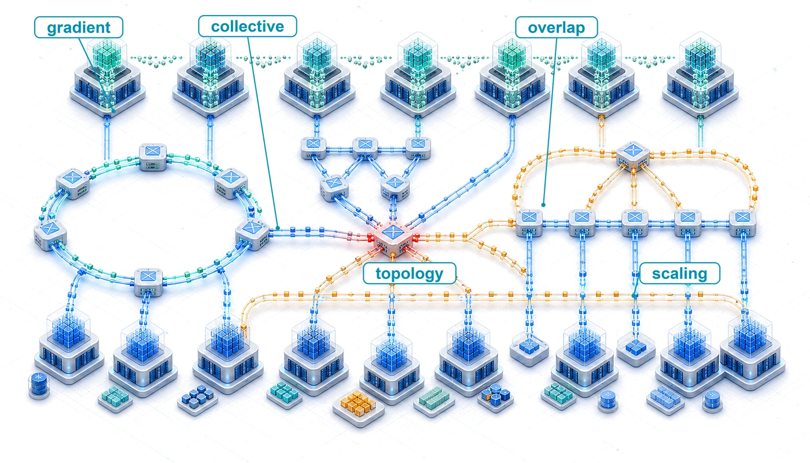{fig-alt="Collective communication topology map where gradient fragments circulate through ring and tree reduction paths before broadcasting synchronized state."}
:::

:::

## Purpose {.unnumbered .unlisted}

\begin{marginfigure}
\mlfleetstack{20}{55}{100}{30}{10}{0}{0}{0}
\end{marginfigure}

_Why does communication between machines constrain large-scale machine learning systems?_

Computation scales by adding processors; communication scales by moving data between them. These scale differently. Adding processors increases available arithmetic capacity, but useful work stalls when the required data does not arrive in time. Exchanging gradients, activations, and parameters can then consume more time than computing them. On one machine, shortening the dominant calculation often shortens the job. Across a fleet, that same improvement may simply make each processor reach its next dependency sooner and wait longer for the others. The cost of that wait includes every reserved accelerator, so a small delay repeated throughout training can consume a substantial budget without advancing the model. Faster links help when transfer capacity is the constraint, but the benefit depends on which physical paths the traffic shares. More bandwidth cannot remove a dependency. Sending less data introduces its own choices about numerical accuracy, memory use, and when the next computation can begin. An exchange must also deliver the correct result to every participant that needs it. A fast transfer that combines the wrong contributions does not preserve a valid training run. The engineering decision is therefore how to organize communication so that its cost remains compatible with the work it enables. Light-speed delays, bandwidth limits, and the energy cost of movement make that decision as physical as processor design. In C³ terms, collective communication connects distributed compute through coordinated exchanges whose correctness and exposed cost determine whether the fleet delivers useful scale.

::: {.content-visible when-format="pdf"}

\newpage

:::

::: {.callout-learning-objectives}

- Apply communication cost models to estimate collective duration and message-size crossover points
- Match collective communication primitives and AllToAll schedules to parallelism strategies, topology, message granularity, and skew
- Compare ring, tree, butterfly, double-tree, and hierarchical reduction algorithms using scale-dependent cost models
- Specify matched measurements for calibrating collective cost models across algorithms, process groups, and topologies
- Evaluate topology-aware collective schedules under link-bandwidth, rank-placement, and shared-capacity constraints
- Evaluate compression, sparsification, and error feedback by balancing communication savings against convergence risk
- Design overlap strategies with bucket fusion, asynchronous operations, and layer-by-layer gradient scheduling

:::

## From Parallelism to Communication Patterns {#sec-communication-collective-operations-collective-operations-communication-fundamentals-44eb}

When 10,000 GPUs need to apply one weight update, the splits created by data, tensor, pipeline, and expert parallelism have to be made consistent again. The workers are not sending arbitrary messages; they are executing choreographed collective operations. Within the multi-tier fleet stack diagrammed in @fig-fleet-stack, those operations occupy the Distributed Execution row of the Distribution band, where logical parallelism becomes physical traffic.

The 3D Parallelism Cube assumes that replicas, shards, stages, and experts can exchange gradients, activations, parameters, and tokens quickly enough for the optimizer to see one coherent training run. That assumption is the handoff from parallelism to communication: every way of splitting the model relocates work onto the network.

The first distinction is between an operation's result and the schedule that produces it. AllReduce combines corresponding tensor elements across participating workers and returns the reduced tensor to every worker. AllGather instead concatenates their shards, ReduceScatter combines contributions but leaves each worker with only a shard of the result, and AllToAll sends different data to different destinations. These contracts follow from the parallel decomposition; ring, tree, and hierarchical algorithms are alternative schedules for carrying them out.

The gap between that assumption and the wire reveals an asymmetry in how computation and communication scale. Computation is local because each GPU works on its own data, so aggregate compute grows with the number of GPUs\index{GPU}\index{Graphics Processing Unit|see{GPU}}. Communication is global because keeping the fleet synchronized requires information to cross physical links with finite latency, bandwidth, interconnect topology\index{Interconnect!topology}, and energy. Gradient synchronization provides the central case; alpha-beta cost models, collective primitives, AllReduce schedules, topology-aware routing, compression, and overlap make its mechanics concrete.

```{python}
#| echo: false
#| label: gradient-sync-significance-calc
# ┌─────────────────────────────────────────────────────────────────────────────
# │ GRADIENT-SYNC SIGNIFICANCE—70B BF16 RING ALLREDUCE NAPKIN MATH
# ├─────────────────────────────────────────────────────────────────────────────
# │ Context: @dfn-collective-communication-gradient-synchronization Significance
# │          bullet, plus the "140 GB of gradients" body sentence below it.
# │
# │ Goal: Pin the 70B BF16 gradient size (140 GB), the per-link bandwidth
# │       (50 GB/s = registry NDR), and the bandwidth-only ring AllReduce time
# │       (2M/beta ~ 5.6 s) so the definition's headline numbers trace to the
# │       registry instead of being hand-typed.
# │ Show: 140 GB; 50 GB/s; ~5.6 s; the "2 x 140 / 50" operand span.
# │ How: gradient = P x 2 bytes/param; ring bandwidth term = 2M/beta.
# │
# └─────────────────────────────────────────────────────────────────────────────
from mlsysim import Models, Systems
from mlsysim.core.units import BYTES_FP16, GB, byte, param, second
from mlsysim.fmt import check, fmt, fmt_bandwidth, fmt_count, fmt_math, fmt_memory, fmt_params, fmt_time

class GradSyncSignificance:
    # ┌── 1. LOAD ──────────────────────────────────────────
    m = Models.Language.Llama2_70B
    beta = Systems.Fabrics.InfiniBand_NDR.bandwidth  # 50 GB/s per link (registry NDR)
    # Illustrative cluster size (scenario assumption; the bandwidth-only estimate
    # is per-worker and independent of this count, which only frames the example).
    cluster_size = 1000

    # ┌── 2. EXECUTE ───────────────────────────────────────
    gradient = m.size_in_bytes(BYTES_FP16).to(GB)
    # Bandwidth-only ring AllReduce estimate: T ~ 2M / beta.
    ring_time = (2 * gradient / beta).to(second)

    # ┌── 3. GUARD ─────────────────────────────────────────
    check(abs(gradient.to(GB).magnitude - 140) < 1, "70B BF16 gradient should be ~140 GB")
    check(abs(ring_time.to(second).magnitude - 5.6) < 0.1, "Ring AllReduce time should be ~5.6 s")

    # ┌── 4. OUTPUT ────────────────────────────────────────
    gradient_gb_str = fmt_memory(gradient, unit=GB, precision=0, commas=False)
    params_str = fmt_params(m.parameters, scale="B", precision=0, commas=False)
    bytes_per_param_str = fmt(BYTES_FP16.to(byte).magnitude, precision=0, commas=False)
    gradient_top1_gb_str = fmt_memory(gradient * 0.01, unit=GB, precision=1, commas=False)
    gradient_2x_gb_str = fmt_memory(gradient * 2, unit=GB, precision=0, commas=False)
    beta_gb_per_s_str = fmt_bandwidth(beta, unit=GB / second, precision=0, commas=False)
    ring_time_s_str = fmt_time(ring_time, second, precision=1, commas=False)
    n_gpus_str = fmt_count(cluster_size, commas=True, label="GPU")
    # "2 x 140 / 50" operand span for the bandwidth-only ring estimate.
    _grad_gb = int(gradient.to(GB).magnitude)
    _beta_gbs = int(beta.to(GB / second).magnitude)
    ring_operands_math = fmt_math(rf"2 \times {_grad_gb}/{_beta_gbs}")
```

For the initial gradient budget, consider a ring schedule: each worker passes tensor chunks to a neighbor, first accumulating their sums and then circulating the completed chunks. Each phase moves nearly one tensor's worth of data per worker, so the bandwidth budget is approximately twice the gradient size divided by link bandwidth. The detailed round count follows after the transfer model and collective contracts are established.

::: {#dfn-collective-communication-gradient-synchronization .callout-definition title="Gradient synchronization"}

***Gradient synchronization***\index{Gradient Synchronization!definition} is the collective communication step in synchronous data-parallel training in which every worker contributes its locally computed gradient tensor to an aggregate reduction, then receives the same reduced result so all model replicas apply an identical update.

1.  **Significance**: A 70B-parameter model in BF16 generates `{python} GradSyncSignificance.gradient_gb_str` of total gradient data per replica per step. This is a logical payload budget; a complete replica requires multiple accelerators or offloaded state, rather than fitting on one H100. Synchronizing across `{python} GradSyncSignificance.n_gpus_str` via ring AllReduce at `{python} GradSyncSignificance.beta_gb_per_s_str` per link requires approximately `{python} GradSyncSignificance.ring_operands_math` $\approx$ `{python} GradSyncSignificance.ring_time_s_str` of communication per step, making the bandwidth (data-movement) part of $\CommunicationTime$ large enough to dominate the Fleet Law step time (@eq-fleet-law) unless overlap, hierarchy, or compression reduces the exposed transfer.
2.  **Distinction**: Unlike parameter-server approaches (where all workers send gradients to a centralized aggregator whose bandwidth scales as $\mathcal{O}(N)$), ring AllReduce distributes the communication across all workers so that each worker sends $2 \times (N-1)/N \times M$ bytes per step, approaching $2M$ as cluster size grows.
3.  **Common pitfall**: A frequent misconception is that ring AllReduce behaves like an all-to-all exchange. In ring AllReduce, each worker communicates with neighbors according to a schedule, and the per-node communication volume is approximately constant as the cluster grows. The scaling pressure comes from latency steps, topology, and the gradient volume per step, not from every worker opening a distinct stream to every other worker.

:::

For standard synchronous data-parallel\index{Data Parallelism!synchronous SGD} stochastic gradient descent (SGD), gradient synchronization is not a design convenience; it is the mechanism that preserves one shared optimization trajectory. If different GPUs apply different gradient updates to their local copies of the model, the copies diverge. After enough steps, the models on different GPUs represent entirely different functions, and the training process no longer approximates stochastic gradient descent on the global loss. Synchronization ensures that all copies remain identical (within floating-point precision) at every step, preserving the theoretical convergence guarantees of the optimization algorithm via the AllReduce[^fn-allreduce-etymology-primitive] primitive\index{AllReduce!convergence guarantee}.

The volume of data that must be synchronized is proportional to the model size. A model with $P$ parameters stored in BF16 (2 bytes per parameter) generates $2P$ bytes of gradient data per training step per data-parallel replica. For a 70-billion-parameter model, a mid-sized dense model smaller than the 175B-parameter Archetype A reference, this is `{python} GradSyncSignificance.gradient_gb_str` of gradients that every replica must contribute to the reduction and receive back in reduced form; a ring schedule moves nearly twice that volume through each rank.[^fn-ring-allreduce-origin]

[^fn-ring-allreduce-origin]: **Ring AllReduce**\index{Ring AllReduce!origin}: The algorithm dates to the HPC collective-communication literature; Patarasuk and Yuan analyzed bandwidth-optimal AllReduce algorithms for workstation clusters, Baidu's Andrew Gibiansky popularized ring AllReduce for deep learning in February 2017, and Horovod plus NVIDIA NCCL helped make it a common distributed-training primitive [@patarasuk2009; @gibiansky2017baidu; @sergeev2018horovod; @jeaugey2017nccl].

At large scale (hundreds of billions of parameters across thousands of GPUs), gradient synchronization can dominate training step time unless aggressive optimization techniques are applied. The next step is to model that data movement as physics rather than as an API\index{API}\index{Application Programming Interface|see{API}} call.

### The physics of data movement {#sec-communication-collective-operations-physics-data-movement}

Physical constraints govern data movement before algorithms are designed. The speed of light sets a latency floor[^fn-speed-of-light] (roughly 5 $\mu\text{s}$ per kilometer in fiber), the bandwidth-distance product\index{Bandwidth-distance product!optical reach} limits how far a fast link can reach before it needs optics, and kernel-bypass transports such as remote direct memory access (RDMA)\index{RDMA!kernel bypass} and GPUDirect RDMA\index{GPUDirect RDMA!latency reduction} strip the per-message software tax down to a few microseconds. Collective communication adds the energy cost of moving a bit, which the algorithms must respect as firmly as latency and bandwidth.

::: {.column-margin .margin-pointer}
↩ Physical layer SerDes signaling, optical reach, and RDMA transports are established in @sec-network-fabrics.
:::

Moving data consumes energy across storage arrays, interfaces, serializers, transceivers, and switches. @Fig-data-movement-hierarchy partitions data movement across nested physical accounting boundaries\index{Energy consumption!data movement hierarchy}—tracing an on-chip traversal from local SRAM and on-package high-bandwidth memory (HBM)\index{HBM}\index{High-Bandwidth Memory|see{HBM}} out to an intra-node peer GPU and across intermediate switches to a remote node. Each boundary activates distinct physical components: on-package links, intra-node crossbars, serializers, optical transceivers, and switch fabrics. Distance alone does not determine energy per bit, and an endpoint-only estimate cannot be compared directly with a complete fabric-path estimate. Locality remains useful because it can avoid transfers and active interfaces; the energy saving must be evaluated under the same workload, utilization, and accounting boundary.

::: {#fig-data-movement-hierarchy fig-env="figure" fig-pos="htb" fig-cap="**Data-movement accounting boundaries**: Successively broader paths involve different storage and communication components. The schematic identifies what an energy estimate must include; it assigns no universal distance law or fixed energy multiplier. Compare energy per transferred byte only after specifying endpoints, interfaces, switches, and utilization." fig-alt="Nested physical boundaries from a local SRAM access through package memory, an intra-node peer, and an inter-node fabric path."}
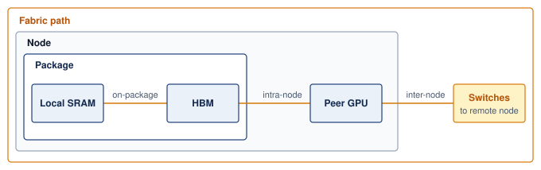

<!--
```{.tikz}
\begin{tikzpicture}[
  font=\small\sffamily,
  >=Stealth,
  tier label/.style={
    font=\footnotesize,
    text=TextDark,
    align=right,
    % 3.4cm, not 2.5cm: "InfiniBand NDR" did not fit and hyphenated as
    % "Infini-/Band NDR". Labels are right-aligned on an east anchor, so the
    % extra width grows into empty space and the shorter labels do not move.
    text width=3.4cm,
    anchor=east
  },
  energy box/.style={
    rectangle,
    rounded corners=3pt,
    line width=0.85pt,
    align=center,
    inner sep=3.5pt
  },
  context card/.style={
    rectangle,
    rounded corners=3pt,
    draw=CardBorder,
    fill=white,
    line width=0.7pt,
    align=left,
    inner sep=4.5pt,
    anchor=west
  },
  multiplier badge/.style={
    rectangle,
    rounded corners=3pt,
    line width=0.85pt,
    align=center,
    inner sep=3.5pt,
    minimum width=1.7cm,
    minimum height=1.05cm
  },
  law card/.style={
    rectangle,
    rounded corners=4pt,
    draw=SteelBlue!40,
    fill=LightBlue!40,
    line width=0.7pt,
    inner sep=6.5pt,
    align=left,
    text width=14.4cm
  }
]

% Tier 1: SRAM (y = 6.4)
\node[tier label] (lbl1) at (2.5, 6.4) {
  \textbf{\normalsize SRAM}\\[1.5pt]
  \scriptsize\textcolor{TextMuted}{On-Chip Cache}\\[1pt]
  \tiny\textcolor{TextMuted}{$\sim$0--1\,mm die}
};

\node[energy box, draw=DarkGreen, fill=GreenFill, minimum width=1.4cm, minimum height=1.05cm] (eng1) at (3.4, 6.4) {
  \textbf{\footnotesize$\sim$0.5\,pJ}\\[1pt]
  \tiny\textcolor{DarkGreen}{per bit}
};

\node[context card, text width=7.7cm, minimum height=1.05cm] (ctx1) at (4.3, 6.4) {
  \textbf{\footnotesize Tiling \& Kernel Fusion}\\[1.5pt]
  \scriptsize Maximized via FlashAttention tiling; keeps intermediate activations inside SRAM.
};

\node[multiplier badge, draw=DarkGreen, fill=GreenFill, text=DarkGreen] (mul1) at (13.5, 6.4) {
  \textbf{\small 1$\times$}\\[1pt]
  \tiny Baseline
};

% Tier 2: DRAM / HBM (y = 4.9)
\node[tier label] (lbl2) at (2.5, 4.9) {
  \textbf{\normalsize DRAM / HBM}\\[1.5pt]
  \scriptsize\textcolor{TextMuted}{On-Package Stack}\\[1pt]
  \tiny\textcolor{TextMuted}{$\sim$1--10\,mm 2.5D}
};

\node[energy box, draw=SteelBlue, fill=LightBlue, minimum width=2.7cm, minimum height=1.05cm] (eng2) at (4.05, 4.9) {
  \textbf{\footnotesize$\sim$20\,pJ / bit}\\[1pt]
  \tiny\textcolor{SteelBlue}{HBM3e PHY read}
};

\node[context card, text width=6.4cm, minimum height=1.05cm] (ctx2) at (5.6, 4.9) {
  \textbf{\footnotesize Memory Bandwidth Wall}\\[1.5pt]
  \scriptsize Requires memory-bound operator recomputation to avoid HBM round-trips.
};

\node[multiplier badge, draw=SteelBlue, fill=LightBlue, text=SteelBlue] (mul2) at (13.5, 4.9) {
  \textbf{\small 40$\times$}\\[1pt]
  \tiny vs.\ SRAM
};

% Tier 3: NVLink 4.0 (y = 3.4)
\node[tier label] (lbl3) at (2.5, 3.4) {
  \textbf{\normalsize NVLink 4.0}\\[1.5pt]
  \scriptsize\textcolor{TextMuted}{Intra-Node Mesh}\\[1pt]
  \tiny\textcolor{TextMuted}{$\sim$0.5--1\,m PCB}
};

\node[energy box, draw=OrangeLine, fill=OrangeL, minimum width=5.2cm, minimum height=1.05cm] (eng3) at (5.3, 3.4) {
  \textbf{\footnotesize$\sim$100\,pJ / bit}\\[1pt]
  \tiny\textcolor{OrangeLine}{NVSwitch copper trace}
};

\node[context card, text width=3.9cm, minimum height=1.05cm] (ctx3) at (8.1, 3.4) {
  \textbf{\footnotesize Intra-Node Locality}\\[1.5pt]
  \scriptsize Enables Tensor Parallelism (TP).
};

\node[multiplier badge, draw=OrangeLine, fill=OrangeL, text=OrangeLine] (mul3) at (13.5, 3.4) {
  \textbf{\small 200$\times$}\\[1pt]
  \tiny vs.\ SRAM
};

% Tier 4: InfiniBand NDR (y = 1.9)
\node[tier label] (lbl4) at (2.5, 1.9) {
  \textbf{\normalsize \mbox{InfiniBand NDR}}\\[1.5pt]
  \scriptsize\textcolor{TextMuted}{Inter-Node Fabric}\\[1pt]
  \tiny\textcolor{TextMuted}{$\sim$10--100\,m optics}
};

\node[energy box, draw=VioletLine, fill=VioletL, minimum width=9.7cm, minimum height=1.05cm] (eng4) at (7.55, 1.9) {
  \textbf{\footnotesize$\sim$1{,}000\,pJ / bit (Laser Transceiver + Serialization + Optical Fiber)}\\[1.5pt]
  \scriptsize\textcolor{VioletLine}{Dominates cluster power budget during all-to-all collectives}
};

\node[multiplier badge, draw=RedLine, fill=RedFill, text=RedLine] (mul4) at (13.5, 1.9) {
  \textbf{\small 2{,}000$\times$}\\[1pt]
  \tiny\textbf{\textcolor{RedLine}{Energy Cliff}}
};

% Log-scale axis bar (y = 1.0)
\draw[line width=0.8pt, CardBorder!90] (2.7, 1.0) -- (12.4, 1.0);

\draw[line width=0.8pt, CardBorder!90] (4.1, 0.9) -- (4.1, 1.1);
\node[below=2pt, font=\scriptsize, text=TextMuted] at (4.1, 0.9) {0.5\,pJ};

\draw[line width=0.8pt, CardBorder!90] (5.4, 0.9) -- (5.4, 1.1);
\node[below=2pt, font=\scriptsize, text=TextMuted] at (5.4, 0.9) {20\,pJ};

\draw[line width=0.8pt, CardBorder!90] (7.9, 0.9) -- (7.9, 1.1);
\node[below=2pt, font=\scriptsize, text=TextMuted] at (7.9, 0.9) {100\,pJ};

\draw[line width=0.8pt, CardBorder!90] (12.4, 0.9) -- (12.4, 1.1);
\node[below=2pt, font=\scriptsize, text=TextMuted] at (12.4, 0.9) {1{,}000\,pJ};

\node[below=15pt, font=\footnotesize\bfseries, text=TextDark] at (7.55, 1.0) {
  Energy Cost per Bit Transferred (pJ / bit, Log Scale)
};

% Bottom Thermodynamic Law Card (y = -0.95)
\node[law card] (law) at (7.25, -0.95) {
  \centering\textbf{\footnotesize Thermodynamic Law of Distributed ML Systems}\\[3pt]
  \raggedright\scriptsize
  % Second column is a fixed-width p{} so the rows wrap inside the card; a
  % plain 'l' column takes its natural width and overruns the node's text width.
  \begin{tabular}{@{}l p{10.8cm}@{}}
    \textbf{The Distance Penalty:} & Moving a bit across a 50-meter optical datacenter fabric costs 2,000$\times$ more energy than inside SRAM. \\[2pt]
    \textbf{Algorithmic Defense:} & Hierarchical AllReduce and FP8/FP4 quantization exist primarily to avoid paying this 2,000$\times$ optical tax. \\
  \end{tabular}
};

\end{tikzpicture}
```
-->

:::

```{python}
#| echo: false
#| label: collective-ring-energy
# ┌─────────────────────────────────────────────────────────────────────────────
# │ RING ALLREDUCE TRANSFER ENERGY (LEGO)
# ├─────────────────────────────────────────────────────────────────────────────
# │ Context: paragraph below (energy of one large-ring reduction).
# │ Goal: Price one ring AllReduce in joules from the registry per-bit cost.
# │ How: bytes sent = N × 2(N−1)/N × M; energy = bits × E_bit, with
# │      E_bit = Systems.NetworkEnergy.InfiniBandEnergyPerBit (midpoint of a
# │      20–50 pJ/bit switched-network envelope) and M the chapter's 1 GB buffer.
# └─────────────────────────────────────────────────────────────────────────────
from mlsysim import ReferenceStats, Systems
from mlsysim.core.units import GB, bit, kJ, pJ
from mlsysim.fmt import check, fmt, fmt_energy, fmt_energy_per_bit, fmt_memory

class RingReductionEnergy:
    # ┌── 1. LOAD ──────────────────────────────────────────────────────────
    n_ranks = 10_000  # scenario assumption: illustrative fleet-scale ring
    payload = ReferenceStats.CollectiveCommunicationProfile.GradientBuffer
    energy_per_bit = Systems.NetworkEnergy.InfiniBandEnergyPerBit

    # ┌── 2. EXECUTE ───────────────────────────────────────────────────────
    bytes_sent = n_ranks * 2 * (n_ranks - 1) / n_ranks * payload
    energy = (bytes_sent * energy_per_bit).to(kJ)

    # ┌── 3. GUARD ─────────────────────────────────────────────────────────
    check(3 < energy.to(kJ).magnitude < 10, f"Ring energy {energy} outside the kilojoule scale the prose describes")

    # ┌── 4. OUTPUT ────────────────────────────────────────────────────────
    n_ranks_str = fmt(n_ranks, precision=0, commas=True)
    payload_str = fmt_memory(payload, unit=GB, precision=0, commas=False)
    energy_per_bit_str = fmt_energy_per_bit(energy_per_bit, unit=pJ / bit, precision=0)
    energy_kj_str = fmt_energy(energy, unit=kJ, precision=1, commas=False)
```

For an illustrative `{python} RingReductionEnergy.n_ranks_str`-rank ring reducing a `{python} RingReductionEnergy.payload_str` payload, approximately twice the payload is sent per rank. At a complete-path transfer cost of `{python} RingReductionEnergy.energy_per_bit_str`, the midpoint of the range typical of switched fabrics, this gives about `{python} RingReductionEnergy.energy_kj_str` per reduction. The per-bit figure is a representative envelope value, not a measurement of any particular fabric. Comparing that energy with compute requires the same step duration and accounting boundary; the number alone cannot establish that communication rivals computation.

These constraints enter different parts of a communication budget. Latency sets the floor for every message regardless of size. Bandwidth caps the throughput for large transfers. Protocol overhead adds a per-message tax that penalizes fine-grained communication, which is why the kernel-bypass transports recalled in @sec-network-fabrics-rdma matter for collective performance. RDMA's zero-copy path[^fn-zerocopy-rdma-bypass] avoids staging each transfer through host memory and the kernel's socket buffers. The physical fabric supplies these limits; the collective schedule determines how many times the job pays them.

```{python}
#| echo: false
from mlsysim import *
from mlsysim.core.units import *

# ┌─────────────────────────────────────────────────────────────────────────────
# │ ALLREDUCE COST—70B MODEL NAPKIN MATH
# ├─────────────────────────────────────────────────────────────────────────────
# │ Context: "AllReduce Cost for a 70B Model" .callout-notebook
# │
# │ Goal: Compute Ring AllReduce latency for a 70B-parameter model across 64
# │       GPUs on 400 Gbps InfiniBand NDR to show that gradient sync dominates
# │       step time at scale.
# │ Show: ring_total_ms ≈ 5,513 ms—inline inside notebook callout steps.
# │ How: Use the alpha-beta ring AllReduce model with bare arithmetic (no pint)
# │      because this is a step-by-step pedagogical trace.
# │
# └─────────────────────────────────────────────────────────────────────────────
from mlsysim.fmt import check, fmt, fmt_bandwidth, fmt_count, fmt_int, fmt_memory, fmt_params, fmt_ratio, fmt_time
from mlsysim.core.units import GB, byte, microsecond, ms, param, second

# ┌── LEGO ───────────────────────────────────────────────
class AllReduceCost:
    """
    Namespace for AllReduce communication cost calculation for Llama-class model.
    Scenario: 64 GPUs connected by 400 Gbps NDR InfiniBand.
    """

    # ┌── 1. LOAD (Constants) ───────────────────────────────────────────────
    from mlsysim.physics import (
        calc_ring_allreduce_time,
        calc_ring_allreduce_data_factor,
        calc_ring_allreduce_latency_time,
        calc_ring_allreduce_latency_steps,
    )
    from mlsysim import Models, Hardware, Systems

    m = Models.Language.Llama2_70B
    ib_ndr = Systems.Fabrics.InfiniBand_NDR
    n_gpus = 64
    ib_bw = Systems.Fabrics.InfiniBand_NDR
    alpha = Systems.SwitchFabric.AlphaNdr

    # ┌── 2. EXECUTE (The Compute) ─────────────────────────────────────────
    # Gradient size (BF16 = 2 bytes/param)
    bf16_bytes_per_param = int(BYTES_FP16.to(byte).magnitude)
    gradient_qty = m.size_in_bytes(BYTES_FP16)

    # Use shared library formula for Ring AllReduce time
    # Note: calc_ring_allreduce_time handles both bandwidth and latency (alpha).
    ring_total = calc_ring_allreduce_time(message_bytes=gradient_qty, n_gpus=n_gpus, bandwidth_bytes_s=ib_ndr.bandwidth, latency_s=alpha).to(ms)

    # Break out terms for pedagogical display
    ring_bw_factor = calc_ring_allreduce_data_factor(n_gpus)
    ring_bw_time = calc_ring_allreduce_time(message_bytes=gradient_qty, n_gpus=n_gpus, bandwidth_bytes_s=ib_bw.bandwidth, latency_s=0 * second).to(ms)
    ring_lat_time = calc_ring_allreduce_latency_time(n_gpus, alpha).to(ms)

    # Value of halving an exposed AllReduce over a training campaign.
    campaign_steps = ReferenceStats.CollectiveCommunicationProfile.TrainingRunSteps  # steps in one training run
    halved_saving = (ring_total / 2).to(second)
    halved_saving_gpu_hours = (halved_saving * campaign_steps * n_gpus).to("hour").magnitude

    # ┌── 3. GUARD (Invariants) ───────────────────────────────────────────
    check(ring_total > 5000 * ms, f"AllReduce ({ring_total.to(ms).magnitude:.0f}ms) should be significant (>5s) for 70B BF16 model.")
    check(4000 < halved_saving_gpu_hours < 6000, f"Halved-AllReduce saving = {halved_saving_gpu_hours:.0f} GPU-hours, expected ~5,000")

    # ┌── 4. OUTPUT (Formatting) ──────────────────────────────────────────────
    gradient_size_gb_str = fmt_memory(gradient_qty, unit=GB, precision=0, commas=False)
    ring_bw_time_ms_str = fmt_time(ring_bw_time, ms, precision=1, commas=True)
    ring_lat_time_ms_str = fmt_time(ring_lat_time, ms, precision=1, commas=False)
    ring_total_ms_str = fmt_time(ring_total, ms, precision=1, commas=True)
    n_gpus_napkin_str = fmt_count(n_gpus, commas=False, label="GPU")
    ring_bw_factor_value_str = fmt_ratio(ring_bw_factor, precision=5, commas=False)
    ib_bw_gb_per_s_str = fmt_bandwidth(ib_bw.bandwidth, unit=GB / second, precision=0, commas=False)
    nvlink_bw_gb_per_s_str = fmt_bandwidth(Hardware.Cloud.H100.nvlink.bandwidth, unit=GB / second, precision=0, commas=False)
    alpha_us_str = fmt_time(alpha, microsecond, precision=1, commas=False)
    lat_steps_str = fmt(calc_ring_allreduce_latency_steps(n_gpus), precision=0, commas=False)
    params_b_str = fmt_params(m.parameters, scale="B", precision=0, commas=False)
    # Gradient-size operand span: P x 10^9 params x 2 bytes/param.
    from mlsysim.fmt import fmt_math, sci_latex

    gradient_operands_math = fmt_math(rf"{sci_latex(m.parameters.magnitude, precision=0)} \times {bf16_bytes_per_param}\ \text{{bytes}}")
    halved_saving_s_str = fmt_time(halved_saving, second, precision=1, commas=False)
    campaign_steps_str = fmt(campaign_steps, precision=0, commas=True)
    halved_saving_gpu_hours_str = fmt_int(round(halved_saving_gpu_hours, -2), commas=True)
```

::: {.column-margin}
```{=latex}
\vspace*{5mm}
```
{width="100%" fig-alt="Two horizontal bars comparing the step's Fleet Law terms at large scale. The communication bar is wide and amber, dominating; the compute bar is a short blue bar."}

*Exposed gradient synchronization can dominate step time at scale.*
:::

The initial ring budget reveals why data movement can become the governing constraint at scale. A single AllReduce on a 70B model's gradients consumes seconds of wall-clock time, which becomes exposed delay when no independent computation overlaps it. This asymmetry between local computation and global coordination motivates every collective algorithm that follows. For the same gradient reduced across `{python} AllReduceCost.n_gpus_napkin_str`, as worked out below, halving the AllReduce saves about `{python} AllReduceCost.halved_saving_s_str` per exposed step; across `{python} AllReduceCost.campaign_steps_str` steps, that is roughly `{python} AllReduceCost.halved_saving_gpu_hours_str` GPU-hours of reserved accelerator time.

Across the four scale tiers charted in @fig-compute-comm-timeline, the training step's critical path inverts as a fixed workload spreads from 8 to 4,096 GPUs. In this illustrative scenario, local compute contracts from 75 percent on a single 8-GPU node down to 20 percent at 4,096 GPUs, while communication and synchronization expand to claim 80 percent (65 percent communication and 15% sync/idle) of elapsed wall-clock time. These fractions represent assumed scaling regimes rather than empirical measurements for a specific cluster; in practice, gradient size, local batch size, partition topology, and asynchronous overlap determine where the critical path lies.

::: {#fig-compute-comm-timeline fig-env="figure" fig-pos="htb" fig-cap="**The compute-communication timeline**: Illustrative fractions show how exposed communication and synchronization can take a growing share of a training step as a fixed workload spreads across more devices. The fractions are assumed scenarios, not measurements or predictions for a particular model or cluster; they motivate measuring the critical path at each scale." fig-alt="Illustrative stacked bars at four cluster sizes, with compute fraction declining and communication and synchronization fractions increasing."}

```{python}
#| echo: false
# ┌─────────────────────────────────────────────────────────────────────────────
# │ COMPUTE-COMM TIMELINE (FIGURE)
# ├─────────────────────────────────────────────────────────────────────────────
# │ Context: @fig-compute-comm-timeline—communication overhead at scale
# │
# │ Goal: Stacked barh of compute/comm/sync at 8/64/512/4096 GPUs; show
# │       comm growing 25%→65%; NVLink vs InfiniBand domains.
# │ Show: Four horizontal stacks; percentage labels; annotations.
# │ How: compute_pct, comm_pct, sync_pct; barh; book_style.setup_plot().
# │
# └─────────────────────────────────────────────────────────────────────────────
# ┌── 1. CANVAS ────────────────────────────────────────────────────────────────
# │ Stacked barh of compute/comm/sync at 8/64/512/4096 GPUs; show
import numpy as np
import matplotlib.pyplot as plt
from binder.tools.figures import style as book_style

fig, ax, COLORS, plt = book_style.setup_plot(figsize=(8, 4.5))

# ┌── 2. COMPUTE FRACTIONS ─────────────────────────────────────────────────────
# Assumed teaching scenarios, not hardware measurements. Each row sums to 100.
gpu_counts_num = [8, 64, 512, 4096]

compute_pct = [75, 45, 32, 20]
comm_pct = [25, 50, 58, 65]
sync_pct = [0, 5, 10, 15]

gpu_counts_labels = ['8 GPUs\n(1 node)', '64 GPUs\n(8 nodes)', '512 GPUs\n(64 nodes)', '4,096 GPUs\n(512 nodes)']
y_pos = np.arange(len(gpu_counts_num))
bar_height = 0.5

# Stacked horizontal bars
bars_compute = ax.barh(y_pos, compute_pct, height=bar_height, color=COLORS['OrangeLine'], label='Compute', edgecolor='white', linewidth=0.5)
bars_comm = ax.barh(
    y_pos, comm_pct, height=bar_height, left=compute_pct, color=COLORS['VioletLine'], label='Communication', edgecolor='white', linewidth=0.5
)
bars_sync = ax.barh(
    y_pos,
    sync_pct,
    height=bar_height,
    left=[c + m for c, m in zip(compute_pct, comm_pct)],
    color=COLORS['RedLine'],
    label='Sync/Idle',
    edgecolor='white',
    linewidth=0.5,
)

# Label each segment with percentage

# ┌── 3. RENDER ────────────────────────────────────────────────────────────────
for i in range(len(gpu_counts_labels)):
    # Compute label
    if compute_pct[i] > 10:
        ax.text(compute_pct[i] / 2, i, f'{compute_pct[i]:.0f}%', ha='center', va='center', fontsize=9, fontweight='bold', color='white')
    # Communication label
    ax.text(compute_pct[i] + comm_pct[i] / 2, i, f'{comm_pct[i]:.0f}%', ha='center', va='center', fontsize=9, fontweight='bold', color='white')
    # Sync label (only if nonzero)
    if sync_pct[i] > 0:
        ax.text(
            compute_pct[i] + comm_pct[i] + sync_pct[i] / 2,
            i,
            f'{sync_pct[i]:.0f}%',
            ha='center',
            va='center',
            fontsize=8,
            fontweight='bold',
            color='white',
        )

# Annotations

# ┌── 4. DECORATE ──────────────────────────────────────────────────────────────
ax.set_yticks(y_pos)
ax.set_yticklabels(gpu_counts_labels, fontsize=9)
ax.set_xlabel('Fraction of Training Step (%)')
ax.set_xlim(0, 105)
ax.invert_yaxis()
ax.set_ylim(len(gpu_counts_labels) - 0.5, -0.7)  # <-- space above top bar
ax.legend(loc='upper right', fontsize=8, ncol=3)

plt.tight_layout()
plt.show()
plt.close()
```

:::

### The gradient's travel manifest {#sec-communication-parallelism-patterns}

The journey begins at the moment the backward pass completes. On a single machine, the optimizer consumes that gradient immediately. At production scale, the gradient exists on one accelerator while every other replica holds its own partial view of the same update, and no replica can take a consistent optimizer step until those views are combined.

The specific "travel manifest" for this journey is dictated by the chosen parallelism strategy, because the way the math is split determines how the data moves. For the lighthouse archetypes, these manifests differ fundamentally. For Archetype A (GPT-4/Llama-3), the gradient is part of a massive, dense tensor that must meet every other gradient in the fleet to compute a global average, so its primary vehicle is the AllReduce. For Archetype B (DLRM at Scale),[^fn-dlrm-embedding-alltoall] the gradient or activation is sparse and targeted, bound only for the specific GPU that holds its embedding shard rather than for every peer. Mixture-of-experts (MoE)\index{MoE!token routing} routing creates the same targeted pattern, sending each token to the GPU that hosts its assigned expert, so both rely on the AllToAll.

::: {.column-margin .margin-pointer}
↩ Parallelism strategies (data, tensor, pipeline, and MoE) are developed in @sec-distributed-training-systems.
:::

At large scale, these parallelism strategies are not mutually exclusive. A single training run for a large language model typically employs 3D parallelism\index{3D parallelism!collective primitives} (combining data parallelism\index{Data Parallelism}, tensor parallelism\index{Tensor Parallelism}, and pipeline parallelism\index{Pipeline Parallelism} simultaneously), which means multiple collective primitives execute concurrently on overlapping subsets of GPUs. Tensor parallelism drives AllReduce operations within each node (over NVLink), pipeline parallelism drives point-to-point sends between pipeline stages (often between nodes), and data parallelism drives AllReduce operations across groups of nodes (over InfiniBand).

Each primitive operates on a different process group\index{Process Group}, a subset of the total GPU population that participates in that particular collective. Classical Message Passing Interface (MPI) uses a communicator\index{MPI!communicator} as the object that names such a participating set; its communicator size is the number of ranks in that set. MPI libraries already selected collective algorithms based on communicator size and message size [@thakur2005]. GPU communication libraries inherit that algorithm-selection problem and add the further challenge of coordinating overlapping process groups without creating contention between concurrent collectives.

@Tbl-parallelism-communication-mapping maps each parallelism strategy to the data it must move, the collective primitive that moves it, and the term most likely to bind. Read the table as a traffic map that says who must exchange data with whom. The transfer model will price those exchanges before the primitive catalog develops their contracts and workload-specific schedules.

| **Parallelism Strategy**      | **What Must Move**                         |   **Primary Primitive**    |            **Primary Constraint**            |
|:------------------------------|:-------------------------------------------|:--------------------------:|:--------------------------------------------:|
| **Data Parallelism**          | Full gradient, averaged across replicas    |         AllReduce          |          Bandwidth (large payloads)          |
| **FSDP/ZeRO-3**               | Parameter shards in, gradient shards out   | AllGather + ReduceScatter  |          Bandwidth, high frequency           |
| **Tensor Parallelism**        | Partial layer activations within the node  |    AllReduce, AllGather    | Critical path (NVLink bandwidth and latency) |
| **Sequence Parallelism**      | Activations sharded along the sequence     | AllGather + ReduceScatter  |       Bandwidth (activation exchange)        |
| **Pipeline Parallelism**      | Activations to the next stage              | Point-to-Point (Send/Recv) |      Latency (microbatch dependencies)       |
| **Expert Parallelism (MoE)**  | Tokens to the ranks hosting their experts  |          AllToAll          |    Startup, injection/bisection, or skew     |
| **Embedding Sharding (DLRM)** | Embedding lookups to and from shard owners |          AllToAll          |    Granularity, fabric capacity, or skew     |

: **The Travel Manifest**: How each parallelism strategy of @sec-distributed-training-systems becomes a traffic pattern. Pipeline parallelism alone relies on point-to-point transfers rather than a collective. {#tbl-parallelism-communication-mapping tbl-colwidths="[21,33,20,26]"}

In this table, expert parallelism refers to the mixture-of-experts[^fn-moe-sparse-routing] architecture pattern. The mapping shows that different parallelism strategies impose fundamentally different communication patterns. Data parallelism and fully sharded data parallel (FSDP) commonly generate large messages that benefit from ring-based algorithms and hierarchical decomposition. Tensor and pipeline parallelism generate smaller, more frequent messages whose cost sits on the critical path, so low-overhead software stacks and fast local links matter. Expert parallelism and sharded embedding tables generate destination-specific traffic whose limiting term depends on message granularity, endpoint injection and reception, fabric bisection, oversubscription, routing, and skew.

The manifest's rows describe data center parallelism, so they leave out the federated Archetype C. Across all three lighthouse archetypes of @sec-vol2-introduction-archetypes, the dominant exchange and its bottleneck differ.

::: {#lhs-collective-communication-communication-archetype-patterns .callout-lighthouse title="Communication archetype patterns"}

The travel manifest for a gradient depends on the system's objective function and constraint regime. Each lighthouse archetype faces a distinct communication challenge, and the techniques developed in this chapter map to those challenges differently, as @tbl-archetype-collective-mapping summarizes.

| **Archetype**                         |             **Primary Collective**             |         **Candidate Limiter**         | **Optimization Strategy**                                   |
|:--------------------------------------|:----------------------------------------------:|:-------------------------------------:|:------------------------------------------------------------|
| **Archetype A (GPT-4/Llama-3)**       |                   AllReduce                    |          Bandwidth ($\beta$)          | Hierarchical AllReduce; rail-optimized placement            |
| **Archetype B (DLRM at Scale)**       |                    AllToAll                    | Granularity, fabric capacity, or skew | Message coalescing; topology-aware routing; shard balancing |
| **Archetype C (Federated MobileNet)** | Client uploads to an aggregator (asynchronous) |   Uplink bandwidth and availability   | Aggressive quantization; error feedback                     |

: **Archetype-to-Collective Mapping**: Each lighthouse archetype produces a characteristic traffic pattern, but the limiting term depends on message shape, placement, and the physical fabric. {#tbl-archetype-collective-mapping}

The table separates traffic pattern from limiting resource. A dense reduction, a destination-specific exchange, and an intermittent device update require different interventions even though all three serve a training workload. Hierarchical AllReduce, AllToAll schedule selection, and compression with error feedback each receive their own treatment later in the chapter.

:::

Choosing among those interventions requires pricing each exchange, and pricing requires a model of network performance.

## Network Performance Modeling {#sec-communication-collective-operations-collective-operations-network-performance-modeling-0d8e}

A data center engineer cannot predict how long it takes to send ten megabytes across a cluster without knowing two distinct variables: how long a message takes to launch and how fast data moves once in transit. As the gradient begins its journey, it immediately encounters the physical reality of the data center network.

### The alpha-beta cost model for network transfers {#sec-communication-collective-operations-collective-operations-alphabeta-model-f9b4}

@Sec-network-fabrics-performance-model introduced the $\alpha$-$\beta$ model\index{Hockney Model!latency and bandwidth} $T(n) = \alpha + n/\beta$ for a single link (principle \ref{pri-alpha-beta-model}), separating a fixed startup tax ($\alpha$) from a per-byte transit fee ($n/\beta$) [@hockney1994]. A collective pays that price at every step of its schedule, so the two terms, multiplied by the schedule's round count and traffic factor, determine algorithm selection across the fleet.

The two parameters take on collective-specific meanings. Latency ($\alpha$) is the fixed start-up cost to send a message regardless of size, covering software overhead (kernel launch, NCCL initialization), PCIe\index{PCIe}\index{Peripheral Component Interconnect Express|see{PCIe}} traversal, and network switching time. Bandwidth ($\beta$) is the sustained data transfer rate in bytes per second. The critical message size\index{Critical Message Size} $n^* = \alpha \cdot \beta$ marks the crossover point: messages smaller than $n^*$ are latency-bound\index{Latency!bound}; messages larger are bandwidth-bound\index{Bandwidth!bound}. @Sec-appdx-comm-foundations-alpha-beta works this model through concrete message-size regimes and roofline analysis, so a reader who wants the full derivation behind the crossover can follow it there; the parameters in @tbl-interconnect-parameters apply directly to collective design.

```{python}
#| echo: false
#| label: collective-message-fusion
# ┌─────────────────────────────────────────────────────────────────────────────
# │ MESSAGE FUSION ON NDR (LEGO)
# ├─────────────────────────────────────────────────────────────────────────────
# │ Context: "The crossover explains two recurring optimizations" paragraph.
# │ Goal: Price 100 separate small messages vs. one fused message on NDR.
# │ How: n* = alpha·beta with alpha = Systems.SwitchFabric.AlphaNdr (the
# │      chapter's canonical NDR alpha) and beta = InfiniBand_NDR bandwidth;
# │      T_sep = k·alpha (bandwidth term negligible); T_fused = alpha + k·n/beta.
# └─────────────────────────────────────────────────────────────────────────────
from mlsysim.fmt import check, fmt, fmt_bandwidth, fmt_memory, fmt_multiple, fmt_time

class MessageFusion:
    # ┌── 1. LOAD ──────────────────────────────────────────────────────────
    alpha = Systems.SwitchFabric.AlphaNdr
    beta = Systems.Fabrics.InfiniBand_NDR.bandwidth
    small_msg = 4 * KB  # scenario assumption: MoE routing message
    n_msgs = 100  # scenario assumption: messages fused into one

    # ┌── 2. EXECUTE ───────────────────────────────────────────────────────
    n_star = (alpha * beta).to(KB)
    fused_msg = n_msgs * small_msg
    t_separate = (n_msgs * alpha).to(microsecond)
    t_fused = (alpha + fused_msg / beta).to(microsecond)
    speedup = (t_separate / t_fused).to_base_units().magnitude

    # ┌── 3. GUARD ─────────────────────────────────────────────────────────
    check(small_msg < n_star / 10, "Routing message must sit far below n*")
    check(fused_msg > n_star, "Fused message should cross into the bandwidth-bound regime")
    check(n_msgs == 100, "Prose math writes the separate-message cost as 100α")

    # ┌── 4. OUTPUT ────────────────────────────────────────────────────────
    alpha_us_str = fmt_time(alpha, microsecond, precision=1, commas=False)
    beta_gb_per_s_str = fmt_bandwidth(beta, unit=GB / second, precision=0, commas=False)
    n_star_kb_str = fmt_memory(n_star, unit=KB, precision=0, commas=False)
    small_msg_kb_str = fmt_memory(small_msg, unit=KB, precision=0, commas=False)
    n_msgs_str = fmt(n_msgs, precision=0, commas=False)
    fused_msg_kb_str = fmt_memory(fused_msg, unit=KB, precision=0, commas=False)
    t_separate_us_str = fmt_time(t_separate, microsecond, precision=0, commas=False)
    t_fused_us_str = fmt_time(t_fused, microsecond, precision=1, commas=False)
    speedup_mult_str = fmt_multiple(round(speedup), precision=0, commas=False)
```

The crossover explains two recurring optimizations. For InfiniBand NDR at $\alpha \approx$ `{python} MessageFusion.alpha_us_str` and $\beta \approx$ `{python} MessageFusion.beta_gb_per_s_str`, $n^* \approx$ `{python} MessageFusion.n_star_kb_str`. A `{python} MessageFusion.small_msg_kb_str` routing message is far below $n^*$, so the startup tax dominates; fusing `{python} MessageFusion.n_msgs_str` such messages into one `{python} MessageFusion.fused_msg_kb_str` message\index{Message fusion!startup latency amortization} reduces communication cost from $100\alpha =$ `{python} MessageFusion.t_separate_us_str` to one $\alpha + n/\beta \approx$ `{python} MessageFusion.t_fused_us_str`, roughly a `{python} MessageFusion.speedup_mult_str` improvement. More generally, $N$ small messages of size $n/N$ cost up to $N\times$ more than one message of size $n$ when $n/N \ll n^*$, which is why NCCL fuses small AllReduce calls and MoE runtimes buffer tokens before launching collectives. A `{python} GradSyncSignificance.gradient_gb_str` gradient tensor sits at the other extreme, far above $n^*$, so bandwidth dominates and reducing payload bytes is the effective lever. Compression shrinks only the $n/\beta$ term, however, so it pays while the compressed message stays well above $n^*$ and stops paying once the payload approaches $n^*$, where the unchanged $\alpha$ term dominates. Shrinking a 70B model's gradient payload from `{python} GradSyncSignificance.gradient_gb_str` to `{python} GradSyncSignificance.gradient_top1_gb_str` still leaves it far above $n^*$, so that reduction pays in full; compressing a `{python} MessageFusion.small_msg_kb_str` routing message saves almost nothing.

Across the typical data center interconnects tabulated in @tbl-interconnect-parameters, the critical-size column carries the load-bearing pattern: intra-node NVLink stays latency-bound up to several hundred kilobytes, whereas the inter-node fabrics cross over below roughly 100 KB. A message between those crossover sizes can therefore be latency-bound inside a node but bandwidth-bound once it travels between nodes.

```{python}
#| echo: false
#| label: collective-communication-interconnect-parameters

# ┌─────────────────────────────────────────────────────────────────────────────
# │ INTERCONNECT ALPHA-BETA PARAMETERS
# ├─────────────────────────────────────────────────────────────────────────────
# │ Context: @tbl-interconnect-parameters and the crossover discussion above it.
# │
# │ Goal: Make the alpha-beta table internally consistent: beta comes from the
# │       registry, and the critical-size column is COMPUTED from this table's
# │       own alpha midpoints via calc_alpha_beta_crossover instead of being a
# │       second set of hand-typed numbers that drifted from the rows.
# │ Show: Effective collective-launch alpha ranges, registry bandwidths, and
# │       the computed latency/bandwidth crossover size per interconnect.
# │ How: Alpha ranges are EFFECTIVE collective-launch values (software stack
# │      included) — pedagogical assumptions consistent with the chapter's
# │      wire-vs-effective discussion; the registry holds wire latencies
# │      (Tech.Interconnect, Fabrics) and two effective anchors
# │      (SwitchFabric.AlphaNdr/AlphaRoce). Editor ruling 2026-09-28: AlphaNdr
# │      is the canonical NDR alpha, so the NDR crossover uses it; the
# │      per-fabric ranges stay here as documented LOAD assumptions.
# │
# └─────────────────────────────────────────────────────────────────────────────
from mlsysim.physics import calc_alpha_beta_crossover
from mlsysim.fmt import check, fmt_bandwidth, fmt_memory, fmt_qty_range, fmt_time

class InterconnectAlphaBeta:
    # ┌── 1. LOAD (Constants) ──────────────────────────────────────────────
    # Effective collective-launch alpha ranges (scenario assumptions; see How)
    nvlink_alpha_lo, nvlink_alpha_hi = 1 * microsecond, 2 * microsecond
    ndr_alpha_lo, ndr_alpha_hi = 1 * microsecond, 3 * microsecond
    hdr_alpha_lo, hdr_alpha_hi = 2 * microsecond, 5 * microsecond
    pcie_alpha_lo, pcie_alpha_hi = 2 * microsecond, 5 * microsecond
    roce_alpha_lo, roce_alpha_hi = 5 * microsecond, 10 * microsecond
    # Registry bandwidths, all PER-DIRECTION deliverable rates (the beta in
    # T(n) = alpha + n/beta). NVLink's datasheet 900 GB/s is the bidirectional
    # total, so the alpha-beta beta is the 450 GB/s one-way rate — consistent
    # with the per-port IB/PCIe/Ethernet figures in the other rows.
    nvlink_bw = Hardware.Cloud.H100.nvlink.bandwidth_per_direction
    ndr_bw = Systems.Fabrics.InfiniBand_NDR.bandwidth
    hdr_bw = Systems.Fabrics.InfiniBand_HDR.bandwidth
    pcie_bw = Hardware.Cloud.H100.interconnect.bandwidth
    roce_bw = Systems.Fabrics.Ethernet_100G.bandwidth

    # ┌── 2. EXECUTE (The Compute) ────────────────────────────────────────
    # Crossover at the alpha midpoint of each range: n* = alpha * beta
    nvlink_nstar = calc_alpha_beta_crossover((nvlink_alpha_lo + nvlink_alpha_hi) / 2, nvlink_bw)
    # NDR row is anchored to the chapter's canonical NDR alpha (editor ruling
    # 2026-09-28), not its range midpoint; the range stays as context.
    ndr_alpha_anchor = Systems.SwitchFabric.AlphaNdr
    ndr_nstar = calc_alpha_beta_crossover(ndr_alpha_anchor, ndr_bw)
    hdr_nstar = calc_alpha_beta_crossover((hdr_alpha_lo + hdr_alpha_hi) / 2, hdr_bw)
    pcie_nstar = calc_alpha_beta_crossover((pcie_alpha_lo + pcie_alpha_hi) / 2, pcie_bw)
    roce_nstar = calc_alpha_beta_crossover((roce_alpha_lo + roce_alpha_hi) / 2, roce_bw)

    # ┌── 3. GUARD (Invariants) ───────────────────────────────────────────
    check(nvlink_nstar > 500 * KB, "NVLink crossover should be several hundred KB — intra-node stays latency-bound up to large messages")
    check(ndr_alpha_lo <= ndr_alpha_anchor <= ndr_alpha_hi, "Registry NDR alpha must fall inside the tabulated NDR range")
    check(max(ndr_nstar, hdr_nstar, roce_nstar) < 100 * KB, "Prose: inter-node fabrics cross over below roughly 100 KB")

    # ┌── 4. OUTPUT (Formatting) ──────────────────────────────────────────
    nvlink_alpha_range_str = fmt_qty_range(nvlink_alpha_lo, nvlink_alpha_hi, microsecond, precision=0, commas=False)
    ndr_alpha_range_str = fmt_qty_range(ndr_alpha_lo, ndr_alpha_hi, microsecond, precision=0, commas=False)
    ndr_alpha_anchor_us_str = fmt_time(ndr_alpha_anchor, microsecond, precision=1, commas=False)
    hdr_alpha_range_str = fmt_qty_range(hdr_alpha_lo, hdr_alpha_hi, microsecond, precision=0, commas=False)
    pcie_alpha_range_str = fmt_qty_range(pcie_alpha_lo, pcie_alpha_hi, microsecond, precision=0, commas=False)
    roce_alpha_range_str = fmt_qty_range(roce_alpha_lo, roce_alpha_hi, microsecond, precision=0, commas=False)
    nvlink_bw_str = fmt_bandwidth(nvlink_bw, unit=GB / second, precision=0, commas=False)
    nvlink_bidir_str = fmt_bandwidth(Hardware.Cloud.H100.nvlink.bandwidth, unit=GB / second, precision=0, commas=False)
    ndr_bw_str = fmt_bandwidth(ndr_bw, unit=GB / second, precision=0, commas=False)
    hdr_bw_str = fmt_bandwidth(hdr_bw, unit=GB / second, precision=0, commas=False)
    pcie_bw_str = fmt_bandwidth(pcie_bw, unit=GB / second, precision=0, commas=False)
    roce_bw_str = fmt_bandwidth(roce_bw, unit=GB / second, precision=1, commas=False)
    nvlink_nstar_str = fmt_memory(nvlink_nstar, unit=MB, precision=1, commas=False, approx=True)
    ndr_nstar_str = fmt_memory(ndr_nstar, unit=KB, precision=0, commas=False, approx=True)
    hdr_nstar_str = fmt_memory(hdr_nstar, unit=KB, precision=1, commas=False, approx=True)
    pcie_nstar_str = fmt_memory(pcie_nstar, unit=KB, precision=0, commas=False, approx=True)
    roce_nstar_str = fmt_memory(roce_nstar, unit=KB, precision=1, commas=False, approx=True)
```

| **Interconnect**                        |                  **Latency ($\alpha$)**                 |                **Bandwidth ($\beta$)**                 |             **Critical Size ($n^*$)**             |
|:----------------------------------------|:-------------------------------------------------------:|:------------------------------------------------------:|:-------------------------------------------------:|
| **NVLink 4.0 (intra-node)**             | `{python} InterconnectAlphaBeta.nvlink_alpha_range_str` |     `{python} InterconnectAlphaBeta.nvlink_bw_str`     | `{python} InterconnectAlphaBeta.nvlink_nstar_str` |
| **InfiniBand NDR 400 Gbps**             |   `{python} InterconnectAlphaBeta.ndr_alpha_range_str`  | `{python} InterconnectAlphaBeta.ndr_bw_str` (per port) |   `{python} InterconnectAlphaBeta.ndr_nstar_str`  |
| **InfiniBand HDR 200 Gbps**             |   `{python} InterconnectAlphaBeta.hdr_alpha_range_str`  |      `{python} InterconnectAlphaBeta.hdr_bw_str`       |   `{python} InterconnectAlphaBeta.hdr_nstar_str`  |
| **PCIe Gen5 (GPU$\leftrightarrow$CPU)** |  `{python} InterconnectAlphaBeta.pcie_alpha_range_str`  |      `{python} InterconnectAlphaBeta.pcie_bw_str`      |  `{python} InterconnectAlphaBeta.pcie_nstar_str`  |
| **Ethernet 100 Gbps (RoCE)**            |  `{python} InterconnectAlphaBeta.roce_alpha_range_str`  |      `{python} InterconnectAlphaBeta.roce_bw_str`      |  `{python} InterconnectAlphaBeta.roce_nstar_str`  |

: **Interconnect Performance Parameters**: Effective per-message launch latency ($\alpha$, including the software stack), per-direction link bandwidth ($\beta$, the one-way deliverable rate that enters $T(n) = \alpha + n/\beta$; NVLink's datasheet `{python} InterconnectAlphaBeta.nvlink_bidir_str` is the bidirectional total, so its $\beta$ is the `{python} InterconnectAlphaBeta.nvlink_bw_str` one-way rate), and the computed crossover size $n^* = \alpha \cdot \beta$ at each row's $\alpha$ midpoint (for InfiniBand NDR, at the representative `{python} InterconnectAlphaBeta.ndr_alpha_anchor_us_str` used throughout this chapter), where communication transitions from latency-bound to bandwidth-bound. {#tbl-interconnect-parameters}

@Fig-bandwidth-divergence tracks the historical divergence between one-way intra-node and inter-node capacities from 2012 to 2024, isolating a nearly ninefold bandwidth gap between multi-link NVLink (climbing from 80 GB/s on NVLink 1.0 to 900 GB/s on NVLink 5.0) and single-port InfiniBand (progressing from 7 GB/s FDR to 100 GB/s XDR). Although intra-node GPU aggregates and individual inter-node ports represent fundamentally different endpoint boundaries, this widening gulf dictates hierarchy-aware collective design: routing unpartitioned traffic across slower external fabrics quickly saturates the network.

::: {#fig-bandwidth-divergence fig-env="figure" fig-pos="htb" fig-cap="**Interconnect bandwidth conventions**: Selected advertised intra-node and inter-node capacities, expressed per direction. NVLink points sum a GPU's links; PCIe uses one x16 interface, and InfiniBand uses one port. These capacities reveal a hierarchy but are not equal-sized endpoint budgets or achieved collective rates. Algorithm selection additionally requires startup cost, port count, routing, and contention." fig-alt="Historical capacity curves with NVLink normalized from bidirectional totals to one direction, contrasted with PCIe x16 and single-port InfiniBand."}

```{python}
#| echo: false
#| label: bandwidth-divergence-plot
import pandas as pd
import matplotlib.pyplot as plt
import matplotlib.ticker as ticker
from binder.tools.figures import style as book_style

fig, ax, COLORS, plt = book_style.setup_plot(figsize=(8, 4.5))
df = pd.read_csv("vol2/06_collective_communication/data/bandwidth_trends.csv")
# NVLink rows are aggregate bidirectional GPU capacities; other rows are one-way.
df.loc[df["Technology"].str.startswith("NVLink"), "Bandwidth_GBps"] /= 2

# Intra-node
intra = df[df["Type"] == "Intra-node"]
ax.plot(
    intra["Year"],
    intra["Bandwidth_GBps"],
    marker='o',
    linestyle='-',
    linewidth=2.5,
    color=COLORS.get('OrangeLine', '#D55E00'),
    label='Intra-node (per GPU / PCIe x16)',
)
for i, txt in enumerate(intra["Technology"]):
    ax.annotate(txt, (intra["Year"].iloc[i], intra["Bandwidth_GBps"].iloc[i]), textcoords="offset points", xytext=(0, 10), ha='center', fontsize=8)

# Inter-node
inter = df[df["Type"] == "Inter-node"]
ax.plot(
    inter["Year"],
    inter["Bandwidth_GBps"],
    marker='s',
    linestyle='-',
    linewidth=2.5,
    color=COLORS.get('VioletLine', '#0072B2'),
    label='Inter-node (per InfiniBand port)',
)
for i, txt in enumerate(inter["Technology"]):
    ax.annotate(txt, (inter["Year"].iloc[i], inter["Bandwidth_GBps"].iloc[i]), textcoords="offset points", xytext=(0, -15), ha='center', fontsize=8)

ax.set_yscale("log")
ax.set_ylabel("One-way capacity (GB/s)")
ax.set_xlabel("Year")
ax.set_xticks(range(2012, 2026, 2))
ax.yaxis.set_major_formatter(ticker.ScalarFormatter())
ax.legend(loc="upper left", fontsize=9)

ax.margins(x=0.14, y=0.14)
plt.tight_layout()
plt.show()
plt.close()
```

:::

Applying the critical message size formula to a concrete workload reveals which optimization strategy matters most:

```{python}
#| echo: false
#| label: critical-msg-size-calc
from mlsysim.fmt import check, fmt_bandwidth, fmt_math, fmt_memory, fmt_time, sci_latex
from mlsysim.core.units import GB, KB, microsecond, second
from mlsysim import Systems

class CriticalMsgSize:
    # ┌── 1. LOAD ──────────────────────────────────────────
    # IB NDR bandwidth from the registry (400 Gbps = 50 GB/s); alpha is the
    # chapter's canonical effective NDR launch latency (Systems.SwitchFabric.AlphaNdr).
    beta = Systems.Fabrics.InfiniBand_NDR.bandwidth
    alpha = Systems.SwitchFabric.AlphaNdr
    # ┌── 2. EXECUTE ───────────────────────────────────────
    n_star = (alpha * beta).to(KB)
    n_star_kb = round(n_star.to(KB).magnitude)
    # ┌── 3. GUARD ─────────────────────────────────────────
    check(n_star_kb == round(MessageFusion.n_star.to(KB).magnitude), "n* must match the crossover paragraph")
    check(n_star == InterconnectAlphaBeta.ndr_nstar.to(KB), "n* must match the NDR row of the interconnect table")
    # ┌── 4. OUTPUT ────────────────────────────────────────
    alpha_us_str = fmt_time(alpha, microsecond, precision=1, commas=False)
    beta_gb_per_s_str = fmt_bandwidth(beta, unit=GB / second, precision=0, commas=False)
    n_star_kb_str = fmt_memory(n_star, unit=KB, precision=0, commas=False)
    # Operands of n* = alpha . beta as scientific-notation math spans: alpha in
    # seconds, beta in bytes/s (so the derivation reads off the LOAD values).
    alpha_s_sci_math = fmt_math(sci_latex(alpha.to(second).magnitude, precision=1))
    beta_bytes_s_sci_math = fmt_math(sci_latex(beta.to("byte/s").magnitude, precision=0))
```

::: {#nbk-collective-communication-critical-message-size .callout-notebook title="The critical message size"}

**Problem**: Consider a cluster using InfiniBand NDR 400 Gbps with $\alpha =$ `{python} CriticalMsgSize.alpha_us_str` and $\beta =$ `{python} CriticalMsgSize.beta_gb_per_s_str`. At what message size does optimizing for bandwidth start to matter more than optimizing for latency?

**Math**:

$n^* = \alpha \cdot \beta =$ `{python} CriticalMsgSize.alpha_s_sci_math` s $\times$ `{python} CriticalMsgSize.beta_bytes_s_sci_math` B/s $=$ `{python} CriticalMsgSize.n_star_kb_str`

**Systems insight**: Messages under `{python} CriticalMsgSize.n_star_kb_str` (such as small routing-control messages) are latency-bound, requiring lower-latency switches and reduced software overhead. Messages over `{python} CriticalMsgSize.n_star_kb_str`, such as large language model (LLM)\index{LLM}\index{Large Language Model|see{LLM}} gradients, are bandwidth-bound, requiring higher link bandwidth and data compression. Applying the wrong optimization wastes resources without improving performance.

:::

::: {.column-margin}
{width="100%" fig-alt="Two horizontal bars. Top (large message): a wide amber bandwidth segment labeled n over beta, plus a thin light-gray latency sliver. Bottom (small message): a wide dark-gray latency segment labeled alpha, plus a thin light-gray sliver. The dominant term flips."}

*Small messages are latency-bound, large ones bandwidth-bound; the cost reverses.*
:::

The critical message size separates two distinct operating regimes. Below it, small messages such as MoE routing tokens or scalar reductions are latency-bound\index{Latency!operating regime} $(n < n^*)$, where time is dominated by $\alpha$ and optimization focuses on fusion (batching small messages), topology (reducing hop count), and software-stack tuning (kernel bypass via RDMA). Above it, large messages such as LLM gradients or optimizer states are bandwidth-bound\index{Bandwidth!operating regime} $(n \gg n^*)$, where time is dominated by $n/\beta$ and optimization shifts to compression\index{Gradient Compression} (lower precision or sparsity), algorithm choice (Ring vs. Tree), and link aggregation\index{Link Aggregation} (multi-rail network interface cards (NICs)). The distinction between latency-bound and bandwidth-bound communication is the diagnostic skill to practice.

::: {#chk-collective-communication-alpha-beta-diagnostics .callout-checkpoint title="Alpha-beta diagnostics"}

Verify your understanding of network performance regimes:

- [ ] **Bound regime**: classify a 10 KB message sent over a link with $\alpha=2\ \mu\text{s}$ and $\beta=10\ \text{GB/s}$ as latency-bound or bandwidth-bound.
- [ ] **Software overhead**: determine which type of parallelism benefits more when "Software Overhead" ($\alpha$) is reduced by half: Data Parallelism or Tensor Parallelism.
- [ ] **Critical message size**: describe how the critical message size $(n^* = \alpha \cdot \beta)$ changes when networking upgrades from 100 Gbps to 400 Gbps while software latency stays constant.
- [ ] **NIC scaling**: assess the True or False claim that, in the bandwidth-bound regime, doubling the number of NICs per node effectively doubles the transmission speed for large tensors.

:::

### The LogP model {#sec-communication-collective-operations-collective-operations-logp-model-e45d}

The α-β model estimates transfer duration without specifying how much independent computation can proceed during that transfer. Adding the entire estimate to compute time therefore overstates step time when overlap is possible. The **LogP model**\index{LogP Model!definition} [@culler1993] separates network transit from processor involvement with four parameters:

*   **$\LogploggpNetworkLatency$ (latency)**: The time for a message to traverse the network (similar to $\alpha$).
*   **$o$ (overhead)**\index{LogP Model!processor overhead}\index{LogP Model!overhead parameter}: The processor time spent initiating or completing a transfer. During this work, the same execution resource cannot compute, making $o$ the nonoverlappable cost. In a distributed training context, dispatch, device-kernel launch, memory registration, and runtime progress can all contribute. The value is an effective parameter of a particular software and hardware path, so it must be measured with the same collective, process group, and topology used by the workload.
*   **$g$ (gap)**: The minimum time interval between consecutive message injections (inverse of message rate). This models link contention\index{Link Contention}.
*   **$N$ (rank count)**: The number of ranks in the communication group.

LogP distinguishes network latency ($\LogploggpNetworkLatency$, which can be hidden) from processor overhead ($o$, which cannot). Independent computation can overlap the network transit interval\index{Communication-computation overlap!LogP analysis}, while initiation and completion overhead remain exposed on the execution resource that performs them. A small overlap calculation makes this distinction concrete:

```{python}
#| echo: false
#| label: logp-overlap-calc
# ┌── LEGO ───────────────────────────────────────────────
from mlsysim.fmt import check, fmt_time
from mlsysim.core.units import microsecond

class LogPOverlap:
    # ┌── 1. LOAD ──────────────────────────────────────────
    L = 100 * microsecond  # scenario assumption: network latency
    o = 50 * microsecond  # scenario assumption: per-side processor overhead
    compute = 500 * microsecond  # scenario assumption: overlapped compute window
    # ┌── 2. EXECUTE ───────────────────────────────────────
    two_o = 2 * o
    effective = two_o + max(compute, L)
    # ┌── 3. GUARD ─────────────────────────────────────────
    check(two_o == 100 * microsecond, f"2o = {two_o.to(microsecond).magnitude}, expected 100 us")
    check(effective == 600 * microsecond, f"Effective = {effective.to(microsecond).magnitude}, expected 600 us")
    # ┌── 4. OUTPUT ────────────────────────────────────────
    L_us_str = fmt_time(L, microsecond, precision=0, commas=False)
    o_us_str = fmt_time(o, microsecond, precision=0, commas=False)
    two_o_us_str = fmt_time(two_o, microsecond, precision=0, commas=False)
    compute_us_str = fmt_time(compute, microsecond, precision=0, commas=False)
    effective_us_str = fmt_time(effective, microsecond, precision=0, commas=False)
```

::: {#nbk-collective-communication-hiding-communication-behind-computation .callout-notebook title="Hiding communication behind computation"}

**Problem**: A training pipeline attempts to overlap gradient AllReduce with the next layer's backward pass. The backward pass takes `{python} LogPOverlap.compute_us_str`. The AllReduce has network latency `{python} LogPOverlap.L_us_str` but processor overhead $o =$ `{python} LogPOverlap.o_us_str` to initiate and $o =$ `{python} LogPOverlap.o_us_str` to receive. Can the communication be hidden?

**Math**:

1.  **Overlappable portion**\index{LogP Model!overlappable latency}: Network latency $\LogploggpNetworkLatency$ = `{python} LogPOverlap.L_us_str` (data in flight while GPU computes).
2.  **Non-overlappable portion**\index{LogP Model!nonoverlappable overhead}: $2o$ = `{python} LogPOverlap.two_o_us_str` (GPU busy initiating/receiving).
3.  **Compute available**: `{python} LogPOverlap.compute_us_str`.
4.  **Hidden**: All `{python} LogPOverlap.L_us_str` of $\LogploggpNetworkLatency$ can overlap with compute.
5.  **Exposed**: The `{python} LogPOverlap.two_o_us_str` of $2o$ overhead cannot overlap.

**Result**: Effective time is `{python} LogPOverlap.two_o_us_str` + max(`{python} LogPOverlap.compute_us_str`, `{python} LogPOverlap.L_us_str`) = `{python} LogPOverlap.effective_us_str`. The network latency is hidden, but the processor overhead remains exposed. The two-lane execution timeline in @fig-comm-compute-overlap sequences this dependency across layers 4 through 1: each layer's gradient AllReduce launches concurrently beneath the next layer's backward compute, leaving only the final layer (Layer 1) exposed on the critical path once backward computation completes.

**Systems insight**: The α-β model captures the total communication time. The LogP model reveals how much of it can be hidden. When designing pipelined training, optimize for low $o$ (kernel bypass, GPUDirect) rather than high $\beta$ alone.

:::

::: {#fig-comm-compute-overlap fig-env="figure" fig-pos="htb" fig-cap="**Communication-computation overlap**: The backward pass runs from the last layer to the first, and each layer's gradient AllReduce launches as soon as that layer finishes, so it runs on the network while the GPU computes the next layer's gradients. The first layer finishes last and has no computation left to hide behind, so its AllReduce is exposed before the optimizer step. Overlap succeeds only when the nonoverlappable overhead ($o$) is small, leaving the bulk transfer free to proceed concurrently. Durations are schematic." fig-alt="Two-lane timeline. The compute lane shows Backward Layer 4, 3, 2, and 1 in sequence. The network lane shows AllReduce Layer 4, 3, and 2 each starting when its layer finishes and running under the next backward block, then AllReduce Layer 1 after compute ends. A bracket marks the first three as hidden behind backward compute and the last as exposed."}
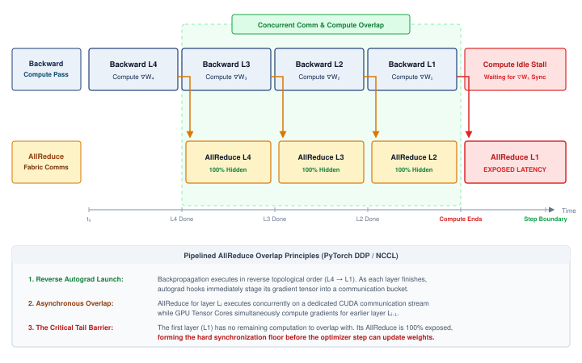

<!--
```{.tikz}
\scalebox{0.8}{%
\begin{tikzpicture}[line join=round, line cap=round, font=\small\sffamily]

  % Define Layer Order
  \pgfdeclarelayer{background}
  \pgfdeclarelayer{foreground}
  \pgfsetlayers{background,main,foreground}

  % Styles
  \tikzset{
    stream_label/.style={font=\small\bfseries\sffamily, align=right, text=TextBlack},
    compute_box/.style={
      draw=OrangeLine, fill=OrangeFill!75, line width=0.8pt, rounded corners=2.5pt,
      minimum height=1.2cm, minimum width=2.4cm, anchor=west, align=center, font=\small\sffamily
    },
    comm_box/.style={
      draw=VioletLine, fill=VioletFill!85, line width=0.8pt, rounded corners=2.5pt,
      minimum height=1.2cm, minimum width=2.4cm, anchor=west, align=center, font=\small\sffamily
    },
    stall_compute/.style={
      draw=RedLine, fill=RedFill!75, line width=0.9pt, rounded corners=2.5pt,
      minimum height=1.2cm, minimum width=2.4cm, anchor=west, align=center, font=\small\sffamily
    },
    stall_comm/.style={
      draw=RedLine, fill=RedFill!75, line width=0.9pt, rounded corners=2.5pt,
      minimum height=1.2cm, minimum width=2.4cm, anchor=west, align=center, font=\small\sffamily
    },
    opt_box/.style={
      draw=BlueLine, fill=BlueFill!75, line width=0.8pt, rounded corners=2.5pt,
      minimum height=1.2cm, minimum width=2.2cm, anchor=west, align=center, font=\small\sffamily
    },
    hook_arr/.style={
      ->, >=Latex, line width=0.9pt, OrangeLine!90!black
    },
    axis_arr/.style={
      ->, >=Latex, line width=0.75pt, GrayLine
    }
  }

  % Stream Header Labels (Left side)
  \node[stream_label, anchor=east] at (-0.4, 2.0) {Compute Stream\\[-1pt]\footnotesize\color{OrangeLine!90!black}(Tensor Cores / Default)};
  \node[stream_label, anchor=east] at (-0.4, 0.0) {Network Stream\\[-1pt]\footnotesize\color{VioletLine}(NIC / NCCL Comms)};

  % Compute Stream Blocks (y = 2.0, height = 1.2, spans y from 1.4 to 2.6)
  \node[compute_box] (C_L4) at (0.0, 2.0) {\textbf{Backward Layer 4}\\[1pt]\footnotesize Compute $\nabla W_4$};
  \node[compute_box] (C_L3) at (2.4, 2.0) {\textbf{Backward Layer 3}\\[1pt]\footnotesize Compute $\nabla W_3$};
  \node[compute_box] (C_L2) at (4.8, 2.0) {\textbf{Backward Layer 2}\\[1pt]\footnotesize Compute $\nabla W_2$};
  \node[compute_box] (C_L1) at (7.2, 2.0) {\textbf{Backward Layer 1}\\[1pt]\footnotesize Compute $\nabla W_1$};
  \node[stall_compute] (C_STALL) at (9.6, 2.0) {\textbf{Compute Stall}\\[1pt]\footnotesize\color{RedLine!90!black}Wait for $\nabla W_1$};
  \node[opt_box] (C_OPT) at (12.0, 2.0) {\textbf{Optimizer}\\[1pt]\footnotesize Weight Update};

  % Communication Stream Blocks (y = 0.0, height = 1.2, spans y from -0.6 to 0.6)
  % Idle / warmup slot on comms stream
  \draw[draw=black!25, fill=black!3, dashed, rounded corners=2.5pt, line width=0.6pt]
    (0.0, -0.6) rectangle (2.4, 0.6)
    node[pos=0.5, font=\footnotesize\color{black!40}\sffamily\itshape] {Comms Idle};

  \node[comm_box] (M_L4) at (2.4, 0.0) {\textbf{AllReduce Layer 4}\\[1pt]\footnotesize\color{GreenLine!90!black}\textbf{100\% Hidden}};
  \node[comm_box] (M_L3) at (4.8, 0.0) {\textbf{AllReduce Layer 3}\\[1pt]\footnotesize\color{GreenLine!90!black}\textbf{100\% Hidden}};
  \node[comm_box] (M_L2) at (7.2, 0.0) {\textbf{AllReduce Layer 2}\\[1pt]\footnotesize\color{GreenLine!90!black}\textbf{100\% Hidden}};
  \node[stall_comm] (M_L1) at (9.6, 0.0) {\textbf{AllReduce Layer 1}\\[1pt]\footnotesize\color{RedLine!90!black}\textbf{Exposed Latency}};

  % Idle on comms stream during optimizer step
  \draw[draw=black!25, fill=black!3, dashed, rounded corners=2.5pt, line width=0.6pt]
    (12.0, -0.6) rectangle (14.2, 0.6)
    node[pos=0.5, font=\footnotesize\color{black!40}\sffamily\itshape] {Comms Idle};

  % Vertical Droplines & Hook Arrows
  % L4 -> M_L4 hook at x = 2.4
  \fill[OrangeLine] (2.4, 1.4) circle (2pt);
  \draw[hook_arr] (2.4, 1.4) -- (2.4, 0.6);
  \node[right=2pt, font=\tiny\bfseries\sffamily\color{OrangeLine!90!black}] at (2.4, 1.0) {hook};

  % L3 -> M_L3 hook at x = 4.8
  \fill[OrangeLine] (4.8, 1.4) circle (2pt);
  \draw[hook_arr] (4.8, 1.4) -- (4.8, 0.6);
  \node[right=2pt, font=\tiny\bfseries\sffamily\color{OrangeLine!90!black}] at (4.8, 1.0) {hook};

  % L2 -> M_L2 hook at x = 7.2
  \fill[OrangeLine] (7.2, 1.4) circle (2pt);
  \draw[hook_arr] (7.2, 1.4) -- (7.2, 0.6);
  \node[right=2pt, font=\tiny\bfseries\sffamily\color{OrangeLine!90!black}] at (7.2, 1.0) {hook};

  % L1 -> M_L1 trigger at x = 9.6 (Critical Path!)
  \fill[RedLine] (9.6, 1.4) circle (2pt);
  \draw[->, >=Latex, line width=1.1pt, RedLine] (9.6, 1.4) -- (9.6, 0.6);
  \node[right=2pt, font=\tiny\bfseries\sffamily\color{RedLine}] at (9.6, 1.0) {tail hook};

  % M_L1 -> Optimizer Step release at x = 12.0 (Sync Barrier!)
  \fill[BlueLine] (12.0, 0.6) circle (2pt);
  \draw[->, >=Latex, line width=1.1pt, BlueLine] (12.0, 0.6) -- (12.0, 1.4);
  \node[right=2pt, font=\tiny\bfseries\sffamily\color{BlueLine}] at (12.0, 1.0) {sync release};

  % Background Shaded Regions
  \begin{pgfonlayer}{background}
    % Overlap Shading (x: 2.35 to 9.55, y: -0.85 to 2.95)
    \draw[draw=GreenLine, fill=GreenFill!25, line width=0.85pt, dashed, rounded corners=5pt]
      (2.35, -0.85) rectangle (9.55, 2.95);

    % Critical Tail Barrier Shading (x: 9.65 to 11.95, y: -0.85 to 2.95)
    \draw[draw=RedLine, fill=RedFill!25, line width=0.85pt, dashed, rounded corners=5pt]
      (9.65, -0.85) rectangle (11.95, 2.95);
  \end{pgfonlayer}

  % Region Title Badges above
  \node[anchor=south, font=\footnotesize\bfseries\sffamily\color{GreenLine!90!black}, fill=white, inner sep=2.5pt, rounded corners=2pt]
    at (5.95, 3.05) {Pipelined Overlap Region ($\LogploggpNetworkLatency$ Hidden)};

  \node[anchor=south, font=\footnotesize\bfseries\sffamily\color{RedLine!90!black}, fill=white, inner sep=2.5pt, rounded corners=2pt]
    at (10.8, 3.05) {Critical Tail Barrier (Exposed)};

  % Time Axis below (y = -1.4)
  \draw[axis_arr] (-0.4, -1.4) -- (14.6, -1.4) node[right, font=\footnotesize\sffamily\bfseries] {Time ($t$)};

  % Milestone Ticks & Droplines
  \foreach \x/\txt in {
    0.0/{$t_0$},
    2.4/{Layer 4 done},
    4.8/{Layer 3 done},
    7.2/{Layer 2 done},
    9.6/{Compute ends},
    12.0/{AllReduce ends},
    14.2/{Step Boundary}
  } {
    \draw[GrayLine, line width=0.6pt] (\x, -1.3) -- (\x, -1.5);
    \node[below, font=\scriptsize\sffamily, text=TextBlack] at (\x, -1.5) {\txt};
  }

  % Subtle background vertical guide lines
  \begin{pgfonlayer}{background}
    \draw[GrayLine!35, dotted, line width=0.5pt] (0.0, 2.9) -- (0.0, -1.3);
    \draw[GrayLine!35, dotted, line width=0.5pt] (2.4, 2.9) -- (2.4, -1.3);
    \draw[GrayLine!35, dotted, line width=0.5pt] (4.8, 2.9) -- (4.8, -1.3);
    \draw[GrayLine!35, dotted, line width=0.5pt] (7.2, 2.9) -- (7.2, -1.3);
    \draw[RedLine!40, dotted, line width=0.6pt] (9.6, 2.9) -- (9.6, -1.3);
    \draw[RedLine!40, dotted, line width=0.6pt] (12.0, 2.9) -- (12.0, -1.3);
    \draw[BlueLine!40, dotted, line width=0.6pt] (14.2, 2.9) -- (14.2, -1.3);
  \end{pgfonlayer}

  % Tight Architectural Legend (Integrated Table Structure)
  \node[
    draw=black!15, fill=black!2, line width=0.5pt, rounded corners=3pt,
    anchor=north, minimum width=14.8cm, inner sep=6pt
  ] at (7.0, -2.3) {
    \begin{minipage}{14.5cm}\footnotesize\sffamily
      \begin{tabular}{@{}p{7.3cm}@{\hspace{0.3cm}}p{6.9cm}@{}}
        \textbf{Execution Streams \& Mechanics} & \textbf{Systems Timing Invariants} \\[2pt]
        \tikz[baseline=-2pt]\fill[OrangeFill!75,draw=OrangeLine,line width=0.5pt,rounded corners=1pt] (0,-0.12) rectangle (0.32,0.12);
        \textbf{Compute:} Reverse autograd (Layer $4 \to 1$), non-blocking &
        $\bullet$ \textbf{Hidden Latency:} $\sum_{i=2}^4 \text{Time}(\text{Layer } i)$ masked by compute \\
        \tikz[baseline=-2pt]\fill[VioletFill!85,draw=VioletLine,line width=0.5pt,rounded corners=1pt] (0,-0.12) rectangle (0.32,0.12);
        \textbf{Network:} Concurrent AllReduce transfers via NCCL &
        $\bullet$ \textbf{Exposed Barrier:} $\text{Time}(\text{Layer 1})$ sets sync stall floor \\
        \tikz[baseline=-2pt]\fill[BlueFill!75,draw=BlueLine,line width=0.5pt,rounded corners=1pt] (0,-0.12) rectangle (0.32,0.12);
        \textbf{Optimizer:} Weights updated after global barrier &
        $\bullet$ \textbf{Step Time:} $\DistributedStepTime = T_{\text{backward}} + T_{\text{tail}} + T_{\text{optimizer}}$
      \end{tabular}
    \end{minipage}
  };

\end{tikzpicture}%
}
```
-->

:::

The $\alpha$-$\beta$ model estimates transfer duration from latency and bandwidth measurements. LogP adds the processor/network distinction needed to estimate exposed delay in pipelined execution\index{Pipelined Execution}. Choosing a communication schedule therefore requires both a transfer budget and the independent computation available to overlap it.

::: {.column-margin .margin-pointer}
↪ Overlap profiling, communication instrumentation, and trace attribution are developed in @sec-performance-engineering-profiling.
:::

When messages are large and pipelined across the network, the LogGP model\index{LogGP Model!large message transfer} [@alexandrov1995] extends LogP with a gap-per-byte parameter $G$, modeling long-message transfer where successive bytes stream into the network without paying an individual injection gap per byte (@sec-appdx-comm-foundations-loggp). Both models share a common limitation: they assume a single flow on a single link. Real communication patterns involve multiple simultaneous flows competing for shared bandwidth, which can cause congestion that neither model captures. For congestion-sensitive workloads (particularly AllToAll for MoE), empirical benchmarking on the target cluster remains the necessary validation step.

The transfer model prices a message, but a training dependency usually requires a coordinated set of messages. Before counting algorithmic rounds or bytes, we need to specify which result each participating worker must receive.

## Collective Operation Primitives {#sec-communication-collective-operations-collective-operations-collective-operation-vocabulary-fdc7}

Sending a gradient tensor to a peer does not specify which workers must contribute or where the final result belongs. Collective operations supply that group-level contract, using a vocabulary standardized by MPI and inherited by modern ML communication libraries [@mpiforum2015mpi31]. @Fig-collective-primitives-overview diagrams the input-to-output dataflow contracts for four central primitives in this group-communication vocabulary: AllReduce, AllGather, ReduceScatter, and AllToAll. Reading left to right across four ranks (rows 0 through 3), each panel routes per-rank input buffers through an amber transformation operator to produce green output buffers. AllReduce applies global summation ($\Sigma$) to replicate identical sums across all ranks; AllGather concatenates disparate shards onto every rank; ReduceScatter sums vectors across ranks before partitioning the result so each rank retains one reduced shard ($\Sigma_i$); and AllToAll performs a distributed matrix transpose, routing each rank's $j$-th chunk to the $j$-th rank. Two further primitives, Broadcast (rank 0 sends to all) and Reduce (all aggregate to rank 0), serve as foundational building blocks defined in @sec-collective-communication-six-core-primitives-8a66 and compose into these collective patterns. @Sec-appdx-comm-foundations-collective-complexity collects their formal semantics and complexity bounds for reference.

::: {#dfn-collective-communication-collective-operation .callout-definition title="Collective operation"}

***Collective operation***\index{Collective Operation!definition} is a distributed communication pattern in which every rank in a process group invokes a matching operation to aggregate, broadcast, or redistribute data. The operation's contract specifies the output at each rank; it does not require simultaneous entry and does not, by itself, impose a general-purpose barrier before or after the call [@mpiforum2015mpi31].

1.  **Significance**: The right collective algorithm determines whether communication scales with cluster size or remains constant. Ring AllReduce achieves bandwidth-optimal $2(N-1)/N \times M / \beta$ per node (nearly constant in $N$), while a naive reduce-then-broadcast through one root must move $(N-1)M$ bytes into and out of that root, costing at least $(N-1)M/\beta$ even when receiving and sending overlap. That is roughly $N/2$ times the ring's cost, or about 500$\times$ for $N=1024$. Algorithm selection thus directly determines whether the communication term $\CommunicationTime$ of the Fleet Law (@eq-fleet-law) becomes the training bottleneck.
2.  **Distinction**: Unlike point-to-point communication, a collective defines one operation over a process group. Ranks may enter at different times, and some algorithms allow one rank to complete before another has entered; correctness depends on matching the operation sequence and argument contract across ranks, not on barrier semantics.
3.  **Common pitfall**: Treating a non-blocking collective as complete when its initiation call returns. The returned request or stream event represents work in flight. A dependent consumer must wait for completion, and a late rank can extend that dependency even though the collective is not a barrier.

:::

::: {#fig-collective-primitives-overview fig-env="figure" fig-pos="htb" fig-cap="**Four central collective primitives**: Standardized patterns for group communication in distributed systems. In each panel the four rows are ranks 0 to 3, read left to right from each rank's input, through the collective, to what each rank holds afterward. (1) AllReduce: all aggregate and all receive the result. (2) AllGather: all send to all and concatenate. (3) ReduceScatter: all aggregate and results are distributed in shards. (4) AllToAll: every process sends unique data to every other process. The two foundational primitives Broadcast (rank 0 sends to all) and Reduce (all aggregate to rank 0) compose the patterns shown here and are defined in the surrounding prose." fig-alt="Four panels, each with four input boxes on the left joined through an amber collective box to four green output boxes on the right. AllReduce: inputs 1, 2, 3, 4 become 10 on every rank. AllGather: inputs a, b, c, d become a b c d on every rank. ReduceScatter: rows a0 b0 c0 d0 through a3 b3 c3 d3 become sum a, sum b, sum c, sum d, one per rank. AllToAll: the same rows become a0 a1 a2 a3, b0 b1 b2 b3, c0 c1 c2 c3, d0 d1 d2 d3."}
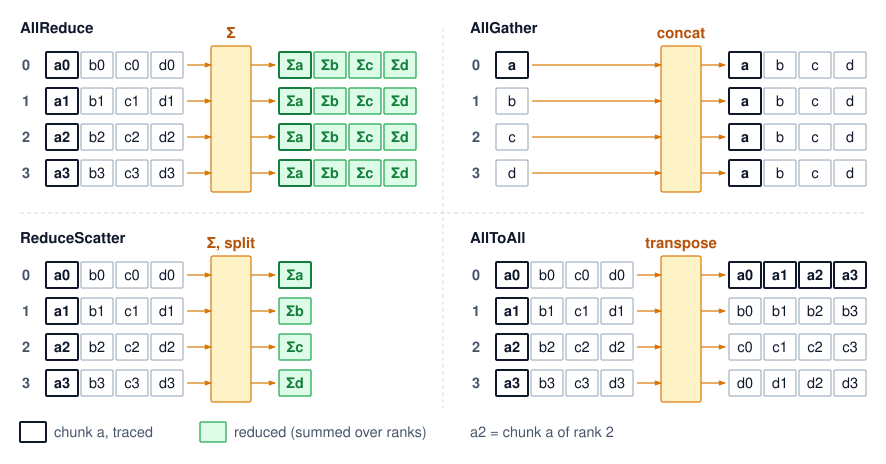

<!--
```{.tikz}
\begin{tikzpicture}[
    font=\small\sffamily,
    >=Stealth,
    panel/.style={
      draw=CanvasBorder,
      fill=CanvasBg,
      rounded corners=5pt,
      line width=0.6pt,
      inner sep=8pt
    },
    in node/.style={
      draw=BlueLine,
      fill=white,
      text=TextDark,
      line width=0.75pt,
      rounded corners=2.5pt,
      font=\scriptsize\sffamily,
      minimum height=0.48cm,
      text centered
    },
    out node green/.style={
      draw=GreenLine,
      fill=GreenFill!60,
      text=TextDark,
      line width=0.75pt,
      rounded corners=2.5pt,
      font=\scriptsize\sffamily,
      minimum height=0.48cm,
      text centered
    },
    out node violet/.style={
      draw=VioletLine,
      fill=VioletFill!70,
      text=TextDark,
      line width=0.75pt,
      rounded corners=2.5pt,
      font=\scriptsize\sffamily,
      minimum height=0.48cm,
      text centered
    },
    op orange/.style={
      draw=OrangeLine,
      fill=OrangeFill,
      text=OrangeLine!90!black,
      line width=0.9pt,
      rounded corners=3.5pt,
      font=\footnotesize\bfseries\sffamily,
      inner sep=4pt,
      text centered
    },
    op violet/.style={
      draw=VioletLine,
      fill=VioletFill,
      text=VioletLine,
      line width=0.9pt,
      rounded corners=3.5pt,
      font=\footnotesize\bfseries\sffamily,
      inner sep=4pt,
      text centered
    },
    wire in/.style={
      draw=BlueLine!80!black,
      line width=0.7pt
    },
    wire green/.style={
      ->,
      draw=GreenLine,
      line width=0.8pt
    },
    wire violet/.style={
      ->,
      draw=VioletLine,
      line width=0.8pt
    }
  ]

  % Define Layer Order
  \pgfdeclarelayer{background}
  \pgfsetlayers{background,main}

  % ========================================================
  % 1. TOP-LEFT: ALLREDUCE
  % ========================================================
  \begin{scope}[shift={(0, 5.0)}, local bounding box=boxAllReduce]
    % Header
    \node[anchor=west, text=TextDark] at (0, 4.35) {\textbf{\small AllReduce} \footnotesize(Sum Reduction)};
    \node[anchor=east, font=\bfseries\scriptsize, text=BlueLine] at (7.1, 4.35) {All Hold Total Sum};
    \node[anchor=west, font=\tiny\sffamily, text=TextMuted] at (0, 4.02) {Aggregates arrays; every device receives the identical sum.};

    % Inputs (Blue)
    \node[in node, minimum width=1.55cm] (ar_in0) at (0.95, 3.35) {G0: [ 1 ]};
    \node[in node, minimum width=1.55cm] (ar_in1) at (0.95, 2.70) {G1: [ 2 ]};
    \node[in node, minimum width=1.55cm] (ar_in2) at (0.95, 2.05) {G2: [ 3 ]};
    \node[in node, minimum width=1.55cm] (ar_in3) at (0.95, 1.40) {G3: [ 4 ]};

    % Central Operator
    \node[op orange, minimum width=1.8cm, minimum height=0.75cm] (ar_op) at (3.55, 2.375) {AllReduce $\Sigma$};

    % Outputs (Green)
    \node[out node green, minimum width=1.65cm] (ar_out0) at (6.15, 3.35) {G0: [ \textbf{10} ]};
    \node[out node green, minimum width=1.65cm] (ar_out1) at (6.15, 2.70) {G1: [ \textbf{10} ]};
    \node[out node green, minimum width=1.65cm] (ar_out2) at (6.15, 2.05) {G2: [ \textbf{10} ]};
    \node[out node green, minimum width=1.65cm] (ar_out3) at (6.15, 1.40) {G3: [ \textbf{10} ]};

    % Wires In -> Op
    \draw[wire in] (ar_in0.east) -- ++(0.5, 0) |- ($(ar_op.west)+(0, 0.15)$);
    \draw[wire in] (ar_in1.east) -- ++(0.3, 0) |- ($(ar_op.west)+(0, 0.05)$);
    \draw[wire in] (ar_in2.east) -- ++(0.3, 0) |- ($(ar_op.west)+(0, -0.05)$);
    \draw[wire in] (ar_in3.east) -- ++(0.5, 0) |- ($(ar_op.west)+(0, -0.15)$);
    \draw[->, wire in] ($(ar_op.west)-(0.15,0)$) -- (ar_op.west);

    % Wires Op -> Out
    \coordinate (ar_out_fork) at ($(ar_op.east)+(0.25,0)$);
    \draw[wire green, -] (ar_op.east) -- (ar_out_fork);
    \draw[wire green] (ar_out_fork) |- (ar_out0.west);
    \draw[wire green] (ar_out_fork) |- (ar_out1.west);
    \draw[wire green] (ar_out_fork) |- (ar_out2.west);
    \draw[wire green] (ar_out_fork) |- (ar_out3.west);

    % Footer Note
    \node[anchor=north, font=\scriptsize, text=TextDark] at (3.55, 0.95) {\textbf{Core Usage:} Data Parallel gradient sync (DDP)};
  \end{scope}

  \begin{pgfonlayer}{background}
    \node[panel, fit=(boxAllReduce)] {};
  \end{pgfonlayer}

  % ========================================================
  % 2. TOP-RIGHT: ALLGATHER
  % ========================================================
  \begin{scope}[shift={(7.8, 5.0)}, local bounding box=boxAllGather]
    % Header
    \node[anchor=west, text=TextDark] at (0, 4.35) {\textbf{\small AllGather} \footnotesize(Concatenation)};
    \node[anchor=east, font=\bfseries\scriptsize, text=GreenLine] at (7.1, 4.35) {All Hold Full Tensor};
    \node[anchor=west, font=\tiny\sffamily, text=TextMuted] at (0, 4.02) {Collects each device's partial shard into the full tensor.};

    % Inputs (Blue)
    \node[in node, minimum width=1.55cm] (ag_in0) at (0.95, 3.35) {G0: [ $a$ ]};
    \node[in node, minimum width=1.55cm] (ag_in1) at (0.95, 2.70) {G1: [ $b$ ]};
    \node[in node, minimum width=1.55cm] (ag_in2) at (0.95, 2.05) {G2: [ $c$ ]};
    \node[in node, minimum width=1.55cm] (ag_in3) at (0.95, 1.40) {G3: [ $d$ ]};

    % Central Operator
    \node[op orange, minimum width=1.8cm, minimum height=0.75cm] (ag_op) at (3.55, 2.375) {AllGather $\boxplus$};

    % Outputs (Green)
    \node[out node green, minimum width=2.1cm] (ag_out0) at (6.05, 3.35) {G0: [ $a, b, c, d$ ]};
    \node[out node green, minimum width=2.1cm] (ag_out1) at (6.05, 2.70) {G1: [ $a, b, c, d$ ]};
    \node[out node green, minimum width=2.1cm] (ag_out2) at (6.05, 2.05) {G2: [ $a, b, c, d$ ]};
    \node[out node green, minimum width=2.1cm] (ag_out3) at (6.05, 1.40) {G3: [ $a, b, c, d$ ]};

    % Wires In -> Op
    \draw[wire in] (ag_in0.east) -- ++(0.5, 0) |- ($(ag_op.west)+(0, 0.15)$);
    \draw[wire in] (ag_in1.east) -- ++(0.3, 0) |- ($(ag_op.west)+(0, 0.05)$);
    \draw[wire in] (ag_in2.east) -- ++(0.3, 0) |- ($(ag_op.west)+(0, -0.05)$);
    \draw[wire in] (ag_in3.east) -- ++(0.5, 0) |- ($(ag_op.west)+(0, -0.15)$);
    \draw[->, wire in] ($(ag_op.west)-(0.15,0)$) -- (ag_op.west);

    % Wires Op -> Out
    \coordinate (ag_out_fork) at ($(ag_op.east)+(0.25,0)$);
    \draw[wire green, -] (ag_op.east) -- (ag_out_fork);
    \draw[wire green] (ag_out_fork) |- (ag_out0.west);
    \draw[wire green] (ag_out_fork) |- (ag_out1.west);
    \draw[wire green] (ag_out_fork) |- (ag_out2.west);
    \draw[wire green] (ag_out_fork) |- (ag_out3.west);

    % Footer Note
    \node[anchor=north, font=\scriptsize, text=GreenLine] at (3.55, 0.95) {\textbf{Core Usage:} FSDP / ZeRO-3 parameter un-sharding};
  \end{scope}

  \begin{pgfonlayer}{background}
    \node[panel, fit=(boxAllGather)] {};
  \end{pgfonlayer}

  % ========================================================
  % 3. BOTTOM-LEFT: REDUCESCATTER
  % ========================================================
  \begin{scope}[shift={(0, 0)}, local bounding box=boxReduceScatter]
    % Header
    \node[anchor=west, text=TextDark] at (0, 4.35) {\textbf{\small ReduceScatter} \footnotesize(Reduce-Scatter)};
    \node[anchor=east, font=\bfseries\scriptsize, text=OrangeLine] at (7.1, 4.35) {One Shard Each};
    \node[anchor=west, font=\tiny\sffamily, text=TextMuted] at (0, 4.02) {Reduces across devices, then scatters disjoint slices.};

    % Inputs (Blue)
    \node[in node, minimum width=2.1cm] (rs_in0) at (1.15, 3.35) {G0: [$a_0,b_0,c_0,d_0$]};
    \node[in node, minimum width=2.1cm] (rs_in1) at (1.15, 2.70) {G1: [$a_1,b_1,c_1,d_1$]};
    \node[in node, minimum width=2.1cm] (rs_in2) at (1.15, 2.05) {G2: [$a_2,b_2,c_2,d_2$]};
    \node[in node, minimum width=2.1cm] (rs_in3) at (1.15, 1.40) {G3: [$a_3,b_3,c_3,d_3$]};

    % Central Operator
    \node[op orange, minimum width=1.8cm, minimum height=0.75cm] (rs_op) at (3.90, 2.375) {ReduceScatter};

    % Outputs (Green)
    \node[out node green, minimum width=1.65cm] (rs_out0) at (6.15, 3.35) {G0: [ $\sum a$ ]};
    \node[out node green, minimum width=1.65cm] (rs_out1) at (6.15, 2.70) {G1: [ $\sum b$ ]};
    \node[out node green, minimum width=1.65cm] (rs_out2) at (6.15, 2.05) {G2: [ $\sum c$ ]};
    \node[out node green, minimum width=1.65cm] (rs_out3) at (6.15, 1.40) {G3: [ $\sum d$ ]};

    % Wires In -> Op
    \draw[wire in] (rs_in0.east) -- ++(0.35, 0) |- ($(rs_op.west)+(0, 0.15)$);
    \draw[wire in] (rs_in1.east) -- ++(0.20, 0) |- ($(rs_op.west)+(0, 0.05)$);
    \draw[wire in] (rs_in2.east) -- ++(0.20, 0) |- ($(rs_op.west)+(0, -0.05)$);
    \draw[wire in] (rs_in3.east) -- ++(0.35, 0) |- ($(rs_op.west)+(0, -0.15)$);
    \draw[->, wire in] ($(rs_op.west)-(0.15,0)$) -- (rs_op.west);

    % Wires Op -> Out
    \coordinate (rs_out_fork) at ($(rs_op.east)+(0.25,0)$);
    \draw[wire green, -] (rs_op.east) -- (rs_out_fork);
    \draw[wire green] (rs_out_fork) |- (rs_out0.west);
    \draw[wire green] (rs_out_fork) |- (rs_out1.west);
    \draw[wire green] (rs_out_fork) |- (rs_out2.west);
    \draw[wire green] (rs_out_fork) |- (rs_out3.west);

    % Footer Note
    \node[anchor=north, font=\scriptsize, text=OrangeLine] at (3.55, 0.95) {\textbf{Core Usage:} FSDP / ZeRO sharded reduction};
  \end{scope}

  \begin{pgfonlayer}{background}
    \node[panel, fit=(boxReduceScatter)] {};
  \end{pgfonlayer}

  % ========================================================
  % 4. BOTTOM-RIGHT: ALLTOALL
  % ========================================================
  \begin{scope}[shift={(7.8, 0)}, local bounding box=boxAllToAll]
    % Header
    \node[anchor=west, text=TextDark] at (0, 4.35) {\textbf{\small AllToAll} \footnotesize(Matrix Transpose)};
    \node[anchor=east, font=\bfseries\scriptsize, text=VioletLine] at (7.1, 4.35) {Pairwise Shuffle};
    \node[anchor=west, font=\tiny\sffamily, text=TextMuted] at (0, 4.02) {Each rank sends distinct shard $i$ to peer rank $i$ (transposition).};

    % Inputs (Blue)
    \node[in node, minimum width=2.1cm] (ata_in0) at (1.15, 3.35) {G0: [$a_0,b_0,c_0,d_0$]};
    \node[in node, minimum width=2.1cm] (ata_in1) at (1.15, 2.70) {G1: [$a_1,b_1,c_1,d_1$]};
    \node[in node, minimum width=2.1cm] (ata_in2) at (1.15, 2.05) {G2: [$a_2,b_2,c_2,d_2$]};
    \node[in node, minimum width=2.1cm] (ata_in3) at (1.15, 1.40) {G3: [$a_3,b_3,c_3,d_3$]};

    % Central Operator
    \node[op violet, minimum width=1.8cm, minimum height=0.75cm] (ata_op) at (3.60, 2.375) {AllToAll $\rightleftarrows$};

    % Outputs (Violet)
    \node[out node violet, minimum width=2.1cm] (ata_out0) at (6.05, 3.35) {G0: [$a_0,a_1,a_2,a_3$]};
    \node[out node violet, minimum width=2.1cm] (ata_out1) at (6.05, 2.70) {G1: [$b_0,b_1,b_2,b_3$]};
    \node[out node violet, minimum width=2.1cm] (ata_out2) at (6.05, 2.05) {G2: [$c_0,c_1,c_2,c_3$]};
    \node[out node violet, minimum width=2.1cm] (ata_out3) at (6.05, 1.40) {G3: [$d_0,d_1,d_2,d_3$]};

    % Wires In -> Op
    \draw[wire in] (ata_in0.east) -- ++(0.35, 0) |- ($(ata_op.west)+(0, 0.15)$);
    \draw[wire in] (ata_in1.east) -- ++(0.20, 0) |- ($(ata_op.west)+(0, 0.05)$);
    \draw[wire in] (ata_in2.east) -- ++(0.20, 0) |- ($(ata_op.west)+(0, -0.05)$);
    \draw[wire in] (ata_in3.east) -- ++(0.35, 0) |- ($(ata_op.west)+(0, -0.15)$);
    \draw[->, wire in] ($(ata_op.west)-(0.15,0)$) -- (ata_op.west);

    % Wires Op -> Out
    \coordinate (ata_out_fork) at ($(ata_op.east)+(0.25,0)$);
    \draw[wire violet, -] (ata_op.east) -- (ata_out_fork);
    \draw[wire violet] (ata_out_fork) |- (ata_out0.west);
    \draw[wire violet] (ata_out_fork) |- (ata_out1.west);
    \draw[wire violet] (ata_out_fork) |- (ata_out2.west);
    \draw[wire violet] (ata_out_fork) |- (ata_out3.west);

    % Footer Note
    \node[anchor=north, font=\scriptsize, text=VioletLine] at (3.55, 0.95) {\textbf{Core Usage:} MoE token dispatch \& combine routing};
  \end{scope}

  \begin{pgfonlayer}{background}
    \node[panel, fit=(boxAllToAll)] {};
  \end{pgfonlayer}

\end{tikzpicture}
```
-->

:::

The primitive choice is the first scaling decision because it fixes which ranks must coordinate, which data must move, and which communication term will dominate. Different model architectures stress different operations, and selecting the wrong primitive for a workload creates unnecessary bottlenecks.

### The six core primitives {#sec-collective-communication-six-core-primitives-8a66}

The six primitives in @tbl-collective-primitives form a decision ladder: use the narrowest operation that preserves the model's mathematics, because every broader pattern adds data movement, coordination, or contention. Read the output contract and use case first. The cost column previews particular implementations, using $N$ for the participating rank count and $M$ for the full tensor or per-rank AllToAll payload; the ring and tree derivations follow in the algorithm section.

| **Primitive**                          | **What it does**                                                                                                        | **Primary use case**                                                                                                                             | **Communication cost**                                                                                                                                                                          |
|:---------------------------------------|:------------------------------------------------------------------------------------------------------------------------|:-------------------------------------------------------------------------------------------------------------------------------------------------|:------------------------------------------------------------------------------------------------------------------------------------------------------------------------------------------------|
| **Broadcast**\index{Broadcast}         | One sender transmits data to all receivers.                                                                             | Distribute initial model weights from rank 0 at startup, across all parallelism strategies.                                                      | $\mathcal{O}(\log N)$ latency (tree); $\mathcal{O}(M)$ bandwidth.                                                                                                                               |
| **Reduce**\index{Reduce}               | Aggregate data from all workers (sum, min, max) to a single root.                                                       | Aggregate validation metrics such as loss and accuracy to a logging process.                                                                     | $\mathcal{O}(\log N)$ latency (tree); $\mathcal{O}(M)$ bandwidth.                                                                                                                               |
| **AllReduce**\index{AllReduce}         | Aggregate from all workers, then distribute the result to all ($y_i = \sum_{j=0}^{N-1} x_j$ for all $i$).               | Data parallelism (@sec-distributed-training-systems-systems-data-parallelism-6132): synchronize gradients so every GPU computes the same update. | Ring is bandwidth-optimal at $2\frac{N-1}{N}\frac{M}{\beta}$ but $\mathcal{O}(N)$ latency; the simple full-message Tree model gives $\mathcal{O}(\log N)$ latency with more byte-transfer work. |
| **AllGather**\index{AllGather}         | Each worker's data goes to all; the result concatenates every input ($x_i \rightarrow [x_0, \dots, x_{N-1}]$).          | Sharded data parallelism (FSDP/ZeRO): collect sharded parameters before a forward or backward pass.                                              | Ring $\frac{N-1}{N}\frac{M}{\beta}$; resident data grows from an $M/N$ shard to the full $M$.                                                                                                   |
| **ReduceScatter**\index{ReduceScatter} | Reduce across workers, but scatter so each keeps a distinct chunk (worker $i$ receives the $i$-th block of $\sum x_j$). | Sharded data parallelism: reduce gradients while keeping them sharded to save memory.                                                            | Ring $\frac{N-1}{N}\frac{M}{\beta}$; the inverse of AllGather.                                                                                                                                  |
| **AllToAll**\index{AllToAll}           | The most general pattern: worker $i$ sends a distinct chunk to each worker $j$, a distributed matrix transpose.         | MoE routing tokens to experts; DLRM exchanging embedding lookups across workers.                                                                 | Per-worker payload $\frac{N-1}{N}M$; the limiter can arise from startup, injection/reception, bisection, oversubscription, routing, granularity, or skew.                                       |

: **The Six Collective Primitives**: What each primitive computes, its primary use, and its communication cost, ordered from the narrowest pattern (Broadcast) to the most general (AllToAll). {#tbl-collective-primitives tbl-colwidths="[14,30,27,29]"}

Ring achieves AllReduce's bandwidth-optimal cost while the simple full-message Tree model\index{Broadcast!tree topology} trades bandwidth for logarithmic latency; @sec-appdx-comm-foundations-allreduce develops the formal definition and a worked example comparing the two, so a reader who wants that derivation can take the full treatment there [@patarasuk2009; @thakur2005].

AllReduce decomposes into ReduceScatter\index{ReduceScatter!decomposition} followed by AllGather\index{AllGather!decomposition}. The decomposition is operational as well as mathematical, since Ring AllReduce's Scatter-Reduce phase is a ReduceScatter and its AllGather phase is an AllGather. ZeRO-style sharding\index{ZeRO!parameter sharding}, realized in PyTorch as FSDP,[^fn-fsdp-memory-sharding] exploits this decomposition by AllGathering parameter shards before a module needs them and ReduceScattering gradients after backward so each rank retains only its shard for the optimizer step [@rajbhandari2020]. This shards parameters, gradients, and optimizer state across workers, reducing persistent model-state memory roughly by $N \times$, while temporary full-parameter buffers and prefetching determine peak memory.

The same AllGather/ReduceScatter pair also appears in sequence parallelism: an AllGather reconstructs the activation view needed for a local operation, and a later ReduceScatter redistributes the result along the sequence dimension. That example will matter later because it shows that a primitive's semantics stay fixed even when the tensor dimension being sharded changes.

This ladder matters because the primitive determines the communication dependency before any algorithmic optimization begins. AllReduce creates global agreement, AllGather and ReduceScatter trade memory for repeated shard movement, and AllToAll replaces a uniform reduction with destination-specific traffic.

Collective correctness has an interface dimension as well as a mathematical one. Every rank in a process group must issue collectives in a compatible order; mismatched operation sequences can deadlock or pair unrelated buffers. Operations also impose shape and count contracts. AllReduce requires compatible element counts and datatypes, whereas variable-size exchanges require explicit per-destination counts and displacements. These invariants belong at the boundary between the parallel decomposition and the communication runtime: the model decides which tensor slice each rank owns, and the collective contract proves that those slices can be recombined.

Reduction order introduces a second, numerical contract. Floating-point addition is not associative, so ring, tree, and switch-assisted reductions may accumulate the same values in different orders and produce different low-order bits [@goldberg1991]. A correct AllReduce therefore guarantees the specified reduction over all contributions, not bitwise identity across algorithms, rank counts, or hardware. Reproducibility-sensitive workloads must fix the algorithm and process-group configuration or use a reproducible accumulation\index{Numerical reproducibility!reduction order} scheme; ordinary training should treat small order-dependent differences as numerical behavior while still checking for larger rank disagreement.

[^fn-fsdp-memory-sharding]: **FSDP (Fully Sharded Data Parallel)**\index{FSDP!memory trade-off}: PyTorch's fully sharded implementation follows the ZeRO-3 idea of sharding parameters, gradients, and optimizer states across $N$ accelerators [@rajbhandari2020]. The trade-off is communication frequency: full sharding adds layer-level AllGather and ReduceScatter operations instead of relying only on data parallelism's step-level AllReduce, making it more sensitive to the $\alpha$ overhead.

[^fn-dlrm-embedding-alltoall]: [offset=6mm] **DLRM (Deep Learning Recommendation Model)**\index{DLRM!AllToAll}: Meta's 2019 architecture for click-through rate prediction uses sharded embedding tables and exchanges the resulting sparse lookups across workers. The resulting AllToAll may be startup-bound when each destination receives a fine-grained message, injection- or reception-bound as aggregate payload grows, or fabric-bound under oversubscription, unfavorable routing, or shard-access skew. DLRM therefore supplies a destination-specific traffic pattern, not a universal latency regime.

The contrast between AllToAll and AllReduce highlights a fundamental difference in how collective operations scale with cluster size.

:::: {#psp-collective-communication-alltoall-vs-allreduce-why-scale-differs .callout-perspective title="AllToAll vs. AllReduce: Why scale differs"}

Ring AllReduce can pipeline a uniform payload through neighbor exchanges. AllToAll presents a different scaling problem because every rank has destination-specific traffic, but the logical peer count alone does not determine its cost.

An AllToAll over $N$ ranks creates $N(N-1)$ logical source-destination transfers, yet each rank's aggregate payload can remain fixed under weak scaling. Its lower bound is governed by the largest of four terms: source injection time\index{All-to-All!injection bound}, destination reception time\index{All-to-All!reception bound}, traffic crossing the fabric bisection\index{Bisection bandwidth!All-to-All communication}, and per-message startup or scheduling overhead. Oversubscription and routing determine how much physical capacity those flows share. Message granularity determines how often they pay $\alpha$. Routing skew determines whether one destination or link becomes the critical path. A full-bisection network carrying balanced, coarse-grained traffic can therefore scale well despite the quadratic logical connection count, whereas an oversubscribed fabric or skewed expert assignment can stall at much smaller $N$.

::: {.column-margin}
```{=latex}
\vspace*{-14mm}
```
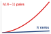{width="100%" fig-alt="All-to-All quadratic logical source-destination pairs compared with the linear number of ranks; physical cost depends on how those flows share the fabric."}

*Logical peer pairs grow quadratically; physical cost depends on the fabric.*
:::

Expert parallelism and large-scale recommendation systems\index{Recommendation System} can reach a communication wall earlier than standard data parallelism when their traffic exhausts injection, reception, or bisection capacity, or when routing and destination skew create hotspots. The primitive determines the traffic matrix\index{Traffic matrix!collective communication}; the physical fabric and routing distribution determine the scaling ceiling.

::::

To make the AllToAll pattern concrete, consider a mixture-of-experts model with 64 experts distributed across 8 GPUs (8 experts per GPU). During each forward pass, a gating network assigns each input token to one or more experts. The tokens assigned to experts on remote GPUs must be physically moved to those GPUs before computation can proceed, and the results must be moved back afterward.

```{python}
#| echo: false
#| label: moe-alltoall-calc
from mlsysim.core.units import BYTES_FP16, GB, KB, MB, microsecond, second
from mlsysim.fmt import check, fmt, fmt_bandwidth, fmt_memory, fmt_time
from mlsysim import Systems

class MoeAllToAll:
    # ┌── 1. LOAD ──────────────────────────────────────────
    total_tokens = 4096
    n_gpus = 8
    hidden_dim = 2048
    bytes_per_elem = BYTES_FP16
    n_experts = 64
    # IB NDR bandwidth from the registry (400 Gbps = 50 GB/s); alpha is the
    # chapter's canonical effective NDR launch latency (Systems.SwitchFabric.AlphaNdr).
    beta = Systems.Fabrics.InfiniBand_NDR.bandwidth
    alpha = Systems.SwitchFabric.AlphaNdr
    # ┌── 2. EXECUTE ───────────────────────────────────────
    tokens_per_gpu = total_tokens // n_gpus
    experts_per_gpu = n_experts // n_gpus
    bytes_per_token = hidden_dim * bytes_per_elem
    kb_per_token = bytes_per_token.to(KB)
    tokens_per_expert = total_tokens // n_experts
    tokens_per_transfer = tokens_per_gpu // n_gpus
    remote_gpus = n_gpus - 1
    data_per_transfer = tokens_per_transfer * bytes_per_token
    total_sent = remote_gpus * data_per_transfer
    # Bandwidth term rounded to whole microseconds: the worked trace presents it
    # as the clean "≈ 5 μs" approximation the callout math line displays, so the
    # downstream per-transfer and serialized totals stay on visible
    # arithmetic (1.5 + 5 = 6.5; 7 × 6.5 = 45.5).
    bw_time = round((data_per_transfer / beta).to(microsecond).magnitude) * microsecond
    per_transfer = alpha + bw_time
    serialized = remote_gpus * per_transfer
    # Concurrent peer streams share the GPU's aggregate NIC injection bandwidth.
    # Full duplex permits simultaneous send and receive, but does not multiply the
    # outgoing 50 GB/s port by the number of remote peers.
    parallel = alpha + total_sent / beta
    # ┌── 3. GUARD ─────────────────────────────────────────
    check(tokens_per_gpu == 512, f"tokens/GPU = {tokens_per_gpu}")
    check(abs(kb_per_token.to(KB).magnitude - 4.096) < 1e-9, f"KB/token = {kb_per_token.to(KB).magnitude}")
    check(tokens_per_expert == 64, f"tokens/expert = {tokens_per_expert}")
    check(abs(data_per_transfer.to(KB).magnitude - 262.144) < 1e-9, f"data/transfer = {data_per_transfer.to(KB).magnitude} KB")
    check(abs(per_transfer.to(microsecond).magnitude - 6.5) < 1e-9, f"T/transfer = {per_transfer.to(microsecond).magnitude} μs")
    check(abs(parallel.to(microsecond).magnitude - 38.20016) < 1e-9, f"Parallel injection lower bound = {parallel.to(microsecond).magnitude} μs")
    # ┌── 4. OUTPUT ────────────────────────────────────────
    alpha_us_str = fmt_time(alpha, microsecond, precision=1, commas=False)
    beta_gb_per_s_str = fmt_bandwidth(beta, unit=GB / second, precision=0, commas=False)
    tokens_per_gpu_str = fmt_count(tokens_per_gpu, label="token", commas=False)
    tokens_per_transfer_str = fmt_count(tokens_per_transfer, label="token", commas=False)
    kb_per_token_str = fmt_memory(kb_per_token, unit=KB, precision=3, commas=False)
    tokens_per_expert_str = fmt_count(tokens_per_expert, label="token", commas=False)
    data_per_transfer_kb_str = fmt_memory(data_per_transfer, unit=KB, precision=3, commas=False)
    total_sent_mb_str = fmt_memory(total_sent, unit=MB, precision=2, commas=False)
    bw_time_approx_us_str = fmt_time(bw_time, microsecond, precision=0, commas=False)
    per_transfer_us_str = fmt_time(per_transfer, unit=microsecond, precision=1, commas=False)
    serialized_us_str = fmt_time(serialized, unit=microsecond, precision=1, commas=False)
    parallel_us_str = fmt_time(parallel, unit=microsecond, precision=1, commas=False)
    total_tokens_str = fmt_count(total_tokens, label="token", commas=False)
    n_gpus_str = fmt(n_gpus, precision=0, commas=False)
    hidden_dim_str = fmt(hidden_dim, precision=0, commas=False)
    n_experts_str = fmt(n_experts, precision=0, commas=False)
    experts_per_gpu_str = fmt(experts_per_gpu, precision=0, commas=False)
    remote_gpus_str = fmt(remote_gpus, precision=0, commas=False)
```

::: {#nbk-collective-communication-alltoall-moe-token-routing .callout-notebook title="AllToAll for MoE token routing"}

**Problem**: A MoE model processes a batch of `{python} MoeAllToAll.total_tokens_str` across `{python} MoeAllToAll.n_gpus_str` GPUs (`{python} MoeAllToAll.tokens_per_gpu_str` per GPU). Each token is a `{python} MoeAllToAll.hidden_dim_str`-dimensional hidden state in BF16 (`{python} MoeAllToAll.kb_per_token_str` per token). The gating network assigns each token to exactly 1 of `{python} MoeAllToAll.n_experts_str` experts (`{python} MoeAllToAll.experts_per_gpu_str` experts per GPU). Assuming uniform routing (each expert receives `{python} MoeAllToAll.tokens_per_expert_str`), how much data does each GPU send and receive?

**Math**:

Each GPU holds `{python} MoeAllToAll.tokens_per_gpu_str` that need to reach `{python} MoeAllToAll.n_experts_str` different experts across `{python} MoeAllToAll.n_gpus_str` GPUs. With uniform routing, each GPU sends `{python} MoeAllToAll.tokens_per_transfer_str` to each of the other `{python} MoeAllToAll.remote_gpus_str` GPUs (keeping `{python} MoeAllToAll.tokens_per_transfer_str` local).

*   Data per GPU-to-GPU transfer: `{python} MoeAllToAll.tokens_per_transfer_str` $\times$ `{python} MoeAllToAll.kb_per_token_str`/token = `{python} MoeAllToAll.data_per_transfer_kb_str`
*   Total data sent per GPU: `{python} MoeAllToAll.remote_gpus_str` $\times$ `{python} MoeAllToAll.data_per_transfer_kb_str` = `{python} MoeAllToAll.total_sent_mb_str`
*   Total data received per GPU: `{python} MoeAllToAll.total_sent_mb_str` (symmetric)

**Latency Analysis** (InfiniBand NDR, $\alpha =$ `{python} MoeAllToAll.alpha_us_str`, $\beta =$ `{python} MoeAllToAll.beta_gb_per_s_str`):

Each of the `{python} MoeAllToAll.remote_gpus_str` transfers is a `{python} MoeAllToAll.data_per_transfer_kb_str` message. From the $\alpha$-$\beta$ model: $T_{\text{transfer}}$ = `{python} MoeAllToAll.alpha_us_str` + `{python} MoeAllToAll.bw_time_approx_us_str` = `{python} MoeAllToAll.per_transfer_us_str` per transfer.

If serialized: `{python} MoeAllToAll.remote_gpus_str` $\times$ `{python} MoeAllToAll.per_transfer_us_str` = `{python} MoeAllToAll.serialized_us_str`. If all `{python} MoeAllToAll.remote_gpus_str` transfers are issued concurrently, they still share the GPU's `{python} MoeAllToAll.beta_gb_per_s_str` injection port. The aggregate injection lower bound is therefore $\alpha + \text{total bytes sent}/\beta =$ `{python} MoeAllToAll.parallel_us_str`, before contention and additional collective overhead. Full duplex permits simultaneous sending and receiving; it does not provide one full-bandwidth outgoing port per peer.

**Systems insight**: The injection result is only a lower bound. If the topology's usable bisection bandwidth is $\Bandwidth_{\text{bisect}}$ and $V_{\text{cut}}$ bytes must cross its minimum cut, the exchange also obeys $T\geq V_{\text{cut}}/\Bandwidth_{\text{bisect}}$. Oversubscription reduces $\Bandwidth_{\text{bisect}}$, fine-grained peer messages add startup cost, and expert skew raises the maximum receive volume above the uniform estimate. The forward pass runs the AllToAll twice per layer, once for token dispatch and once for result collection; training also communicates gradients during backward.

:::

#### Dynamic routing and expert imbalance in MoE AllToAll {#sec-collective-communication-moe-dynamic-routing}

The worked trace in notebook \ref{nbk-collective-communication-alltoall-moe-token-routing} assumes uniform token routing, in which every expert receives an identical share of tokens. In production MoE models, routing decisions are dynamic and data-dependent. The exchange keeps its two-phase shape, but its buffer sizes, its slowest receiver, and its load on the fabric all become functions of the routing distribution.

Each MoE layer performs two exchanges. In an MoE transformer layer with $E$ experts distributed across $N$ ranks ($E/N$ experts per rank), each rank holds a local batch of $B_{\text{tok}}$ tokens. A gating router computes top-$k$ routing probabilities over all $E$ experts for each token, inducing two collective communication phases separated by expert computation. During token dispatch\index{All-to-All!dispatch phase}, each rank partitions its $B_{\text{tok}}$ local token activation vectors ($\mathbf{x} \in \mathbb{R}^d$) according to the destination ranks hosting the selected experts, executing an AllToAll collective (or variable-size `AllToAllv`\index{All-to-All!variable-size AllToAllv}) to route tokens across the fabric according to the routing matrix\index{All-to-All!routing matrix}. After each rank computes forward passes through its assigned local expert feed-forward networks (FFNs), the token combine\index{All-to-All!combine phase} phase executes a second AllToAll collective to route output vectors back to their originating ranks. Each rank then computes the weighted combination of expert outputs:
$$\mathbf{y}_i = \sum_{j \in \text{top-}k} g_{i,j} \cdot \text{Expert}_j(\mathbf{x}_i)$$

Because routing is data-dependent, so are the buffer sizes. In dense models, collective buffer sizes are static and deterministic. In sparse MoE models, the number of tokens routed to expert $e$ is a random variable $B_e \sim \text{Binomial}(N B_{\text{tok}}, p_e)$, where $p_e$ is the probability that the router selects expert $e$ for a given token. To avoid dynamic memory allocation and buffer reallocation overhead during communication, systems pre-allocate static expert buffers parameterized by an expert capacity factor\index{Capacity factor!expert routing} $C \ge 1.0$ [@lepikhin2021gshard; @fedus2022switch]:
$$\text{Capacity}_e = \left\lceil \frac{N \times B_{\text{tok}} \times k}{E} \times C \right\rceil$$

This capacity factor exposes a fundamental systems trade-off between communication efficiency and model fidelity. Sizing buffers strictly for uniform expectation ($C = 1.0$) avoids padding overhead, but under routing skew any tokens assigned to an expert beyond capacity are dropped\index{Token dropping!capacity factor} (bypassed via residual connections without expert computation), which degrades convergence and downstream accuracy. Increasing the capacity factor ($C > 1.0$, typically $1.25$–$1.5$) accommodates routing variance and reduces dropping, but maintaining uniform collective communication requires padding unused buffer slots with dummy tokens. This inflates physical network traffic by $C\times$ and forces GPUs to perform matrix multiplications on null tokens. Modern high-throughput frameworks therefore turn to dropless dynamic routing using variable-size `AllToAllv` with dynamic memory buffers, eliminating padding overhead while preserving every token, though dynamic routing exposes execution time directly to routing skew.

Skew turns the most heavily loaded rank into a straggler. Because token routing is determined by input semantics, some experts inevitably receive disproportionate token volumes. An expert receiving $\gamma \times$ the average load ($\gamma > 1$) increases its host GPU's traffic. The host's total receive volume depends on the combined load of all experts assigned to it, which is the rank-level quantity in the bound that follows.

This skew creates two compounding performance bottlenecks from stragglers\index{Straggler!expert skew}. An inbound reception bottleneck bounds collective completion by the slowest receiver. Even if 95 percent of GPUs complete their AllToAll exchanges in tens of microseconds, the entire cluster stalls waiting for the hottest destination rank to ingest its oversized payload:
$$T_{\text{dispatch}} \ge \frac{B_{\text{max}} \times d \times \ElementStorageSize}{\Bandwidth_{\text{rx}}}$$
where $B_{\text{max}} = \max_r \sum_{e \in \text{rank } r} B_e$ is the largest token batch size any rank $r$ receives. Concurrently, bisection fabric saturation throttles aggregate throughput. Unlike Ring AllReduce (which maps communication onto nearest-neighbor ring links), AllToAll generates a complete bipartite exchange\index{All-to-All!bipartite exchange} in which a fraction $(N-1)/N \approx 1$ of all tokens leaves its source rank and crosses the cluster network fabric. In an oversubscribed fabric with oversubscription ratio $R:1$, the usable bisection bandwidth $\Bandwidth_{\text{bisect}} = (N \cdot \Bandwidth_{\text{inject}}) / (2R)$ limits the exchange:
$$T_{\text{dispatch}} \ge \frac{V_{\text{cut}}}{\Bandwidth_{\text{bisect}}}$$

Scale compounds both problems. To mitigate bisection saturation and small-message overhead across thousands of GPUs, hierarchical MoE runtimes decompose the flat AllToAll into a two-level collective\index{All-to-All!hierarchical exchange} [@hwang2023tutel]. Intra-node NVLink first coalesces tokens destined for any expert residing on the same remote server node. Participating nodes then execute an inter-node AllToAll over InfiniBand or RoCE, exchanging aggregated, coarse-grained payloads rather than thousands of fine-grained pairwise messages. Finally, receiving GPUs use NVLink to scatter incoming tokens to the specific GPUs hosting the targeted experts. This hierarchical decomposition reduces the number of concurrent inter-node network flows from $N(N-1)$ to $\AcceleratorsPerNodeNodes(\AcceleratorsPerNodeNodes-1)$, replacing fine-grained, latency-sensitive packets with bandwidth-saturating message bursts that shield the data center bisection from packet fragmentation.

#### AllToAll schedule selection {#sec-collective-communication-alltoall-schedule-selection}

\index{AllToAll!schedule selection}\index{Collective communication!AllToAll schedules}

AllToAll specifies the destination-specific exchange, not the schedule that carries it. The runtime should choose that schedule from the traffic matrix and physical hierarchy rather than treating every exchange as one flat pattern. @Tbl-alltoall-schedule-selection compares the three common regimes; hierarchical designs such as Tutel's two-dimensional exchange demonstrate why the best schedule can change with message size, scale, and topology [@hwang2023tutel].

| **Schedule**                                                              | **When it fits**                                                                                                              | **Cost exposed**                                                                                                                                                  |
|:--------------------------------------------------------------------------|:------------------------------------------------------------------------------------------------------------------------------|:------------------------------------------------------------------------------------------------------------------------------------------------------------------|
| **Direct pairwise exchange**\index{All-to-All!pairwise exchange schedule} | Balanced, coarse per-peer chunks on a small or full-bisection process group                                                   | Each rank injects directly to its peers; fine granularity repeats startup and scheduling cost, while oversubscription can bind the bisection                      |
| **Hierarchical/coalesced exchange**                                       | Many small remote chunks across multi-GPU nodes or rails; pack by remote node, exchange aggregates, then redistribute locally | Coalescing amortizes inter-node startups and respects fast local links, but adds packing, local copies, synchronization, and temporary buffers                    |
| **Variable-size exchange**                                                | Token or embedding counts differ by destination and padding to the maximum count would waste substantial bandwidth            | Explicit counts and displacements avoid padding, but count exchange and irregular transfers add control overhead; the hottest receiver still sets completion time |

: **AllToAll schedule selection**: The right schedule minimizes the active bound rather than the logical peer count. Direct exchange preserves simplicity, hierarchy coalesces traffic before scarce links, and variable-size exchange removes padding without removing skew. {#tbl-alltoall-schedule-selection tbl-colwidths="[22,37,41]"}

The selection test follows the lower bound developed above. If per-peer chunks are coarse and source injection or fabric bisection already dominates, coalescing cannot remove the byte term and may only add copies. If $N\alpha$ dominates because each remote destination receives a small chunk, hierarchy can replace many inter-node startups with fewer aggregate transfers. If counts are skewed, a variable-size interface prevents padding from inflating $V_{\text{cut}}$, but the schedule must still provision for the maximum receive volume and expert compute load. Consequently, a runtime should benchmark candidate schedules with the observed count distribution, rank placement, and topology; a balanced fixed-size microbenchmark cannot select a production AllToAll schedule.

With the six contracts defined, every row of the travel manifest in @tbl-parallelism-communication-mapping names a primitive whose output and traffic pattern are precise. The sharded data-parallel row repays closer study, because sharding changes how often those primitives run rather than which ones run.

### FSDP communication patterns {#sec-communication-fsdp-patterns}

The FSDP/ZeRO strategy deserves special attention because its communication pattern differs fundamentally from standard data parallelism [@rajbhandari2020]. In an unbucketed data-parallel baseline, each GPU holds a complete copy of the model, computes gradients locally, and synchronizes via a single AllReduce at the end of the backward pass. Full sharding eliminates this redundancy by partitioning the model parameters across GPUs, so each GPU holds only its local shard outside the moments when a layer must be reconstructed.

Because each GPU now holds only $1/N$ of the parameters, it must reconstruct the full tensor before it can use a layer, and that reconstruction is what transforms the communication pattern. Before each layer's forward pass, the GPU calls AllGather to collect the shards from all other GPUs. If it retains those full parameters through backward, no second parameter gather is needed. After the backward pass, ReduceScatter leaves each GPU with gradients for its own parameter shard. The temporary full-parameter buffer can then be freed; the local shard remains for the optimizer update.

The consequence is a displacement of overhead: sharding relieves the memory bottleneck but raises communication frequency. In the unbucketed comparison, standard data parallelism uses a single AllReduce of the full gradient. The retain-through-backward schedule uses two collectives per layer (AllGather in forward, ReduceScatter in backward), each operating on that layer's tensors. For a model with $N_L$ layers, this schedule issues $2N_L$ collective operations per step instead of 1; its total volume of roughly $2M$ (one AllGather and one ReduceScatter of the full model state) is comparable to the single full-gradient AllReduce, but it is spread across many smaller operations. Resharding immediately after forward, the schedule analyzed in @sec-distributed-training-systems-systems-memoryefficient-data-parallelism-zero-fsdp-0e69, saves more memory but requires another AllGather before backward, raising the count to about $3N_L$ collectives and the volume to roughly $3M$, or $1.5\times$ the single AllReduce. The two schedules therefore differ by one AllGather per layer, and the collective count describes a retention policy rather than every FSDP configuration. Bucketed data parallelism also splits its reduction into multiple calls to enable overlap.

The higher operation count makes FSDP more sensitive to latency ($\alpha$) than an unbucketed data-parallel reduction. With $2N_L$ collectives for $N_L$ layers in the retention schedule, an effective startup cost $\alpha_{\text{eff}}$ contributes approximately $2N_L\alpha_{\text{eff}}$ before overlap, or $3N_L\alpha_{\text{eff}}$ when parameters are resharded after forward. FSDP implementations mitigate this cost through prefetching\index{Prefetching} and communication-stream pipelining, but the relevant $\alpha_{\text{eff}}$ must come from a matched collective benchmark rather than a wire-latency specification.

Selecting the right collective algorithm at each invocation requires distinguishing transfer cost from dependency exposure. An FSDP AllGather is latency-sensitive\index{FSDP!AllGather latency sensitivity} in the scheduling sense: a layer cannot compute until its full parameters arrive. Its transfer can nevertheless be bandwidth-bound when the parameter tensor is large. Prefetching can hide part of that gather, while a ReduceScatter can overlap with the remaining backward computation. Neither dependency alone selects Ring or Tree; message size, group size, topology, and the available overlap window jointly determine the useful schedule.

The collective primitives catalog in the preceding section defines what must be communicated; the question now becomes how to execute these primitives efficiently on real networks. The most performance-critical primitive, AllReduce, admits multiple algorithmic implementations whose latency and bandwidth characteristics differ sharply. For the 70B gradient across 1,000 ranks, the simple full-message tree pays about $2\log_2 1000 \approx 20$ full-message transfers against the ring's two, a tenfold difference in byte time, so this choice can decide whether gradient synchronization can be hidden at all.

## AllReduce Algorithms and Topologies {#sec-communication-collective-operations-collective-operations-allreduce-algorithms-7545}

A correct AllReduce must give all 1,000 GPUs the reduced sum of all 1,000 one-gigabyte gradients, subject to the floating-point reduction contract, and the algorithm that delivers it sets the cluster's scaling ceiling. The naive answer (every GPU sends to one central server, whose network card instantly saturates) fails first, which makes it the right place to start.

### Naive approaches vs. the bandwidth bottleneck {#sec-communication-collective-operations-naive-vs-optimal}

Consider a naive implementation using a Parameter Server (Star topology). All $N$ workers send their gradients to rank 0; rank 0 sums them and sends the result back. The constraint is rank 0's bandwidth: it must receive $N \times M$ bytes and send $N \times M$ bytes, so the time grows as $T \propto N \times M / \beta$. At 1,000 GPUs, this makes the central rank the scaling bottleneck rather than the arithmetic.

This naive approach captures the pressure that early distributed ML frameworks had to manage: parameter-server systems receive, aggregate, and redistribute model updates through a server tier, while practical implementations shard the parameter space to spread that load [@dean2012large; @li2014]. Sharding reduces the per-server traffic from $N \times M$ to $N \times M/K_{\text{srv}}$ (where $K_{\text{srv}}$ is the number of servers), but the server tier still grows as workers and model state grow, and it introduces additional complexity in parameter partitioning and consistency management.

The fundamental limitation is that any star-topology approach concentrates traffic at a central point. Regardless of how many servers participate, the aggregate traffic through the central tier scales as $\mathcal{O}(N \times M)$. True scalability requires algorithms where the communication volume per node is constant regardless of $N$. This property, known as bandwidth optimality\index{Bandwidth!optimality}, is the design target for scalable collective algorithms.

::: {#ws-collective-communication-horovod-ring-allreduce .callout-war-story title="When the parameter server became the bottleneck (2017)"}

**Context**: In 2017, Alexander Sergeev and Mike Del Balso's team at Uber open-sourced Horovod as part of Uber's Michelangelo ML\index{ML}\index{Machine Learning|see{ML}} platform, where TensorFlow\index{TensorFlow} training jobs needed to scale across many GPUs without forcing every model author to rewrite large portions of training code [@sergeev2018horovod].

**Mechanism**: TensorFlow's stock distributed training relied on a parameter-server pattern that concentrated gradient traffic through a central tier. As worker count $N$ grew, the central server link saturated, degrading scaling efficiency.

**Impact**: Scaling training beyond a single node resulted in severe throughput bottlenecks and required complex, model-specific parameter partitioning.

**Fix**: Uber adopted Baidu's ring-allreduce algorithm [@gibiansky2017baidu], wrapping bandwidth-optimal collective reduction behind a lightweight API that replaced parameter servers with ring communication.

**Systems lesson**: A collective algorithm is also a developer interface. Scaling improves when the communication primitive is both bandwidth efficient and easy enough that teams actually use it correctly.

:::

### The bandwidth-optimal lower bound {#sec-communication-bandwidth-lower-bound}

Before examining specific algorithms, we establish a lower bound for point-to-point AllReduce with an associative, commutative reduction and no in-network reduction or compression. Reducing one independent data item across $N$ ranks and distributing its result requires at least $2(N-1)$ item transfers in aggregate [@patarasuk2009]. For an $M$-byte tensor, the minimum aggregate sent volume is therefore $2(N-1)M$ bytes. At least one rank must send the average share, $2(N-1)M/N$ bytes; a balanced algorithm assigns that share to every rank.

Take $\beta$ as each rank's available send bandwidth, with equal receive bandwidth that can operate simultaneously. Dividing the required sent volume by $\beta$ gives the full-duplex bandwidth lower bound\index{Bandwidth!lower bound}\index{AllReduce!bandwidth lower bound}:

$$T_{\text{bandwidth}}^{\text{min}} = \frac{2(N-1)}{N} \cdot \frac{M}{\beta}$$

```{python}
#| echo: false
#| label: ring-tree-byte-gap-calc
# ┌─────────────────────────────────────────────────────────────────────────────
# │ RING VS. TREE BYTE-TERM GAP—64 GPUs, 1 GB GRADIENT
# ├─────────────────────────────────────────────────────────────────────────────
# │ Context: @sec-communication-bandwidth-lower-bound closing sentence.
# │
# │ Goal: Show that the byte-term gap between a bandwidth-optimal ring and the
# │       simple full-message tree model is hundreds of milliseconds per step,
# │       not a few milliseconds, and that it accumulates to hours per run.
# │ Show: ring ~39 ms; tree ~240 ms; gap ~200 ms; ~5.6 h over 100,000 steps.
# │ How: Bandwidth terms only (alpha = 0) from the shared ring/tree formulas.
# │
# └─────────────────────────────────────────────────────────────────────────────
from mlsysim import Systems
from mlsysim.core.units import GB, ms, second
from mlsysim.fmt import check, fmt, fmt_bandwidth, fmt_memory, fmt_multiple, fmt_time
from mlsysim.physics import calc_ring_allreduce_time, calc_tree_allreduce_time

class RingTreeByteGap:
    # ┌── 1. LOAD ──────────────────────────────────────────
    n_gpus = 64
    gradient = ReferenceStats.CollectiveCommunicationProfile.GradientBuffer  # chapter's 1 GB gradient buffer
    beta = Systems.Fabrics.InfiniBand_NDR.bandwidth  # 50 GB/s per port
    run_steps = ReferenceStats.CollectiveCommunicationProfile.TrainingRunSteps  # steps in one training run
    # ┌── 2. EXECUTE ───────────────────────────────────────
    ring_bw = calc_ring_allreduce_time(gradient, n_gpus, beta, 0 * second).to(ms)
    tree_bw = calc_tree_allreduce_time(gradient, n_gpus, beta, 0 * second).to(ms)
    gap = (tree_bw - ring_bw).to(ms)
    gap_run_hours = (gap * run_steps).to("hour").magnitude
    # ┌── 3. GUARD ─────────────────────────────────────────
    check(abs(ring_bw.to(ms).magnitude - 39.4) < 0.5, f"Ring byte term = {ring_bw.to(ms).magnitude:.1f} ms, expected ~39 ms")
    check(abs(tree_bw.to(ms).magnitude - 240) < 1, f"Tree byte term = {tree_bw.to(ms).magnitude:.1f} ms, expected ~240 ms")
    # ┌── 4. OUTPUT ────────────────────────────────────────
    n_gpus_str = fmt(n_gpus, precision=0, commas=False)
    gradient_gb_str = fmt_memory(gradient, unit=GB, precision=0, commas=False)
    beta_gb_per_s_str = fmt_bandwidth(beta, unit=GB / second, precision=0, commas=False)
    ring_bw_ms_str = fmt_time(ring_bw, ms, precision=1, commas=False)
    tree_bw_ms_str = fmt_time(tree_bw, ms, precision=0, commas=False)
    # Gap shown to the nearest 10 ms ("roughly" in the prose).
    gap_ms_str = fmt_time(round(gap.to(ms).magnitude, -1) * ms, ms, precision=0, commas=False)
    run_steps_str = fmt(run_steps, precision=0, commas=True)
    gap_run_hours_str = fmt(gap_run_hours, precision=1, commas=False)
    # Tree-to-ring byte-time ratio, reused by the Tree AllReduce section.
    tree_ring_ratio_mult_str = fmt_multiple((tree_bw / ring_bw).to_base_units().magnitude, precision=1, commas=False)
```

As $N$ grows large, this approaches $2M/\beta$, which is independent of $N$. An algorithm that achieves this bound is bandwidth-optimal. Ring AllReduce achieves this bound exactly; simple tree variants do not [@patarasuk2009; @thakur2005]. The distinction has practical consequences. On a `{python} RingTreeByteGap.n_gpus_str`-GPU cluster synchronizing a `{python} RingTreeByteGap.gradient_gb_str` gradient over `{python} RingTreeByteGap.beta_gb_per_s_str` links, the ring's byte term is about `{python} RingTreeByteGap.ring_bw_ms_str`, whereas the simple full-message tree model pays $2\log_2 64 = 12$ full-message transfers, about `{python} RingTreeByteGap.tree_bw_ms_str`. The byte-term difference of roughly `{python} RingTreeByteGap.gap_ms_str` per step accumulates to about `{python} RingTreeByteGap.gap_run_hours_str` hours of wall-clock time over a `{python} RingTreeByteGap.run_steps_str`-step run.

### Ring AllReduce {#sec-communication-collective-operations-collective-operations-ring-allreduce-ffce}

Ring AllReduce[^fn-ring-bandwidth-optimal]\index{AllReduce!ring algorithm}\index{Ring AllReduce!pipelining} arranges nodes in a logical ring ($0 \to 1 \to \dots \to N-1 \to 0$). It achieves bandwidth optimality by pipelining: every node sends and receives simultaneously on every link [@patarasuk2009].

[^fn-ring-bandwidth-optimal]: **Bandwidth-Optimal**\index{Ring AllReduce!bandwidth optimality}: Under the point-to-point model above, Ring AllReduce sends $2(N-1)M/N$ bytes per rank and receives the same amount. With simultaneous full-duplex transfers at bandwidth $\beta$ in each direction, its bandwidth time is $2(N-1)M/(N\beta)$. Adding send and receive bytes would double-count elapsed time.

The algorithm splits the vector of size $M$ into $N$ chunks and then alternates communication and local reduction in two named phases: Scatter-Reduce\index{Ring AllReduce!scatter-reduce phase}\index{ReduceScatter!bandwidth bound} followed by AllGather\index{Ring AllReduce!AllGather phase}\index{AllGather!ring topology}. @Algo-ring-allreduce states the mechanics before the figure and trace make the same dataflow concrete.

```pseudocode
#| label: algo-ring-allreduce
#| pdf-line-number: true
#| pdf-right-comment: false
#| html-comment-delimiter: "▷"
\begin{algorithm}
\caption{Ring AllReduce}
\begin{algorithmic}
\Require $N$ ranks in a logical ring; each rank $i$ starts with tensor $\mathbf{g}_i$ of $M$ bytes, split into $N$ chunks
\Ensure every rank holds $\mathbf{g} = \sum_{i=0}^{N-1} \mathbf{g}_i$
\State assign the ring order $0\to 1\to\dots\to N{-}1\to 0$
\For{$N-1$ scatter-reduce steps}
    \State each rank sends one chunk (or partial sum) right, receives one from the left, and adds it into the matching local sum
\EndFor
\State each rank now owns one fully reduced chunk of $\mathbf{g}$
\For{$N-1$ all-gather steps}
    \State each rank forwards a reduced chunk around the ring and stores the chunks it receives
\EndFor
\State \Return the complete reduced tensor $\mathbf{g}$, held on every rank
\end{algorithmic}
\end{algorithm}
```

Across the $2(N-1)$ send/receive rounds each rank moves $M/N$ bytes per round, for $2(N-1)M/N$ bytes sent and the same received: the bandwidth term reaches the information-theoretic lower bound, while the latency term grows as $2(N-1)\alpha$. @Fig-ring-allreduce traces this two-phase state progression across a four-GPU ring with wrap-around links. In row (a), $N-1 = 3$ reduce-scatter steps circulate gradient chunks A through D until each GPU holds exactly one fully reduced partition (green $\Sigma A$ through $\Sigma D$). In row (b), $N-1 = 3$ subsequent all-gather steps forward those finished shards around the ring until every device holds the complete sum.

::: {#fig-ring-allreduce fig-env="figure" fig-pos="htb" fig-cap="**Ring AllReduce data flow**: Four GPUs in a logical ring, each gradient split into chunks A to D; the wrap-around link closes the ring from GPU 3 back to GPU 0. (a) After the $N-1$ reduce-scatter steps, in which every GPU sends one chunk to its neighbor and adds the chunk it receives, each GPU holds one fully reduced chunk. (b) After $N-1$ AllGather steps that forward those finished chunks around the same ring, every GPU holds the full sum. Every link carries data in every step, so each GPU sends $2\frac{N-1}{N}M$ bytes in total, while the $2(N-1)$ steps each pay one startup latency $\alpha$." fig-alt="Two rows of four GPU cards linked left to right by amber arrows, with an amber wrap-around line from GPU 3 back to GPU 0. Row a: each GPU holds four chunks A to D, one of them green and marked as a full sum, a different chunk on each GPU. Row b: every GPU holds all four chunks as green full sums."}
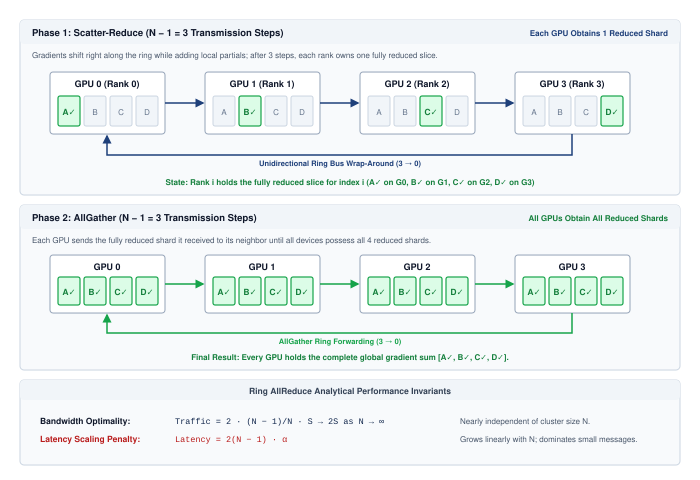

<!--
```{.tikz}
\begin{tikzpicture}[line join=round, line cap=round, font=\small\sffamily]

  % Define Layer Order
  \pgfdeclarelayer{background}
  \pgfdeclarelayer{foreground}
  \pgfsetlayers{background,main,foreground}

  % Styles
  \tikzset{
    gpu_chassis/.style={
      draw=BlueLine, fill=white, line width=0.85pt, rounded corners=3pt,
      minimum width=2.85cm, minimum height=1.5cm
    },
    shard_idle/.style={
      draw=black!25, fill=black!3, line width=0.5pt, rounded corners=1.5pt,
      minimum width=0.56cm, minimum height=0.65cm, font=\scriptsize\sffamily, text=black!50
    },
    shard_reduced/.style={
      draw=GreenLine, fill=GreenFill!85, line width=0.8pt, rounded corners=1.5pt,
      minimum width=0.56cm, minimum height=0.65cm, font=\scriptsize\bfseries\sffamily, text=GreenLine!90!black
    },
    ring_arr_blue/.style={
      ->, >=Latex, line width=1.2pt, BlueLine
    },
    ring_arr_green/.style={
      ->, >=Latex, line width=1.2pt, GreenLine
    }
  }

  % ==========================================
  % PHASE 1: SCATTER-REDUCE
  % ==========================================
  \begin{scope}[shift={(0, 5.0)}]
    % Section Header Band
    \node[anchor=west, font=\normalsize\bfseries\sffamily, text=TextBlack] at (-0.2, 1.9)
      {Phase 1: Scatter-Reduce \mdseries\footnotesize($N-1 = 3$ Transmission Steps)};
    \node[anchor=east, font=\scriptsize\bfseries\sffamily, text=BlueLine] at (14.2, 1.9)
      {Each GPU Obtains 1 Reduced Shard};

    % GPUs (0 to 3)
    \foreach \idx/\rank/\reduced in {
      0/{GPU 0 (Rank 0)}/1,
      1/{GPU 1 (Rank 1)}/2,
      2/{GPU 2 (Rank 2)}/3,
      3/{GPU 3 (Rank 3)}/4
    } {
      \pgfmathsetmacro{\xpos}{\idx * 3.6 + 1.4}
      % Chassis
      \node[gpu_chassis] (G1_\idx) at (\xpos, 0.8) {};
      \node[font=\footnotesize\bfseries\sffamily, text=TextBlack] at (\xpos, 1.28) {\rank};

      % 4 Shard Blocks inside GPU
      \foreach \sidx/\slabel in {1/A, 2/B, 3/C, 4/D} {
        \pgfmathsetmacro{\sxpos}{\xpos - 0.90 + (\sidx - 1) * 0.60}
        \ifnum\sidx=\reduced
          \node[shard_reduced] at (\sxpos, 0.55) {\slabel\,\ding{51}};
        \else
          \node[shard_idle] at (\sxpos, 0.55) {\slabel};
        \fi
      }
    }

    % Forward Ring Links
    \draw[ring_arr_blue] (G1_0.east) -- (G1_1.west);
    \draw[ring_arr_blue] (G1_1.east) -- (G1_2.west);
    \draw[ring_arr_blue] (G1_2.east) -- (G1_3.west);

    % Wrap-Around Ring Link (3 -> 0)
    \draw[ring_arr_blue, rounded corners=4pt]
      (G1_3.south) -- ++(0, -0.45) -| (G1_0.south);
    \node[below=1pt, font=\scriptsize\bfseries\sffamily, text=BlueLine] at (6.8, -0.45)
      {Unidirectional Ring Wrap-Around Link (Rank 3 $\to$ Rank 0)};

    % Phase 1 Completion Status Callout
    \node[anchor=north, font=\scriptsize\sffamily, text=GreenLine!90!black] at (6.8, -0.78)
      {\textbf{Scatter-Reduce Result:} Rank $i$ holds global sum $\sum x^{(i)}$ (A\,\ding{51} on G0, B\,\ding{51} on G1, C\,\ding{51} on G2, D\,\ding{51} on G3)};

    % Background Container
    \begin{pgfonlayer}{background}
      \draw[draw=black!15, fill=black!1, rounded corners=4pt, line width=0.5pt]
        (-0.4, -1.15) rectangle (14.4, 2.25);
    \end{pgfonlayer}
  \end{scope}

  % ==========================================
  % PHASE 2: ALLGATHER
  % ==========================================
  \begin{scope}[shift={(0, 1.2)}]
    % Section Header Band
    \node[anchor=west, font=\normalsize\bfseries\sffamily, text=TextBlack] at (-0.2, 1.9)
      {Phase 2: AllGather \mdseries\footnotesize($N-1 = 3$ Transmission Steps)};
    \node[anchor=east, font=\scriptsize\bfseries\sffamily, text=GreenLine] at (14.2, 1.9)
      {All GPUs Obtain All Reduced Shards};

    % GPUs (0 to 3)
    \foreach \idx/\rank in {
      0/{GPU 0 (Rank 0)},
      1/{GPU 1 (Rank 1)},
      2/{GPU 2 (Rank 2)},
      3/{GPU 3 (Rank 3)}
    } {
      \pgfmathsetmacro{\xpos}{\idx * 3.6 + 1.4}
      \node[gpu_chassis, draw=GreenLine] (G2_\idx) at (\xpos, 0.8) {};
      \node[font=\footnotesize\bfseries\sffamily, text=TextBlack] at (\xpos, 1.28) {\rank};

      % All 4 Shards are now fully reduced!
      \foreach \sidx/\slabel in {1/A, 2/B, 3/C, 4/D} {
        \pgfmathsetmacro{\sxpos}{\xpos - 0.90 + (\sidx - 1) * 0.60}
        \node[shard_reduced] at (\sxpos, 0.55) {\slabel\,\ding{51}};
      }
    }

    % Forward Ring Links (Green)
    \draw[ring_arr_green] (G2_0.east) -- (G2_1.west);
    \draw[ring_arr_green] (G2_1.east) -- (G2_2.west);
    \draw[ring_arr_green] (G2_2.east) -- (G2_3.west);

    % Wrap-Around Ring Link (3 -> 0)
    \draw[ring_arr_green, rounded corners=4pt]
      (G2_3.south) -- ++(0, -0.45) -| (G2_0.south);
    \node[below=1pt, font=\scriptsize\bfseries\sffamily, text=GreenLine] at (6.8, -0.45)
      {AllGather Forwarding Around Ring (Rank 3 $\to$ Rank 0)};

    % Phase 2 Completion Status Callout
    \node[anchor=north, font=\scriptsize\sffamily, text=GreenLine!90!black] at (6.8, -0.78)
      {\textbf{AllGather Final State:} Every GPU possesses the complete synchronized gradient tensor [A\,\ding{51}, B\,\ding{51}, C\,\ding{51}, D\,\ding{51}]};

    % Background Container
    \begin{pgfonlayer}{background}
      \draw[draw=black!15, fill=black!1, rounded corners=4pt, line width=0.5pt]
        (-0.4, -1.15) rectangle (14.4, 2.25);
    \end{pgfonlayer}
  \end{scope}

  % ==========================================
  % ANALYTICAL INVARIANTS FOOTER CARD
  % ==========================================
  \node[
    draw=black!15, fill=black!2, line width=0.5pt, rounded corners=3pt,
    anchor=north, minimum width=14.8cm, inner sep=6pt
  ] at (7.0, -0.2) {
    \begin{minipage}{14.5cm}\footnotesize\sffamily
      \begin{tabular}{@{}p{7.1cm}@{\hspace{0.4cm}}p{7.0cm}@{}}
        \textbf{Bandwidth Optimality (Lower Bound)} & \textbf{Latency Scaling Penalty (Ring Diameter)} \\[2pt]
        $\bullet$ \textbf{Per-GPU Traffic:} $2 \cdot \frac{N-1}{N} \cdot M \to 2M$ as $N \to \infty$ &
        $\bullet$ \textbf{Ring Steps:} $2(N-1)$ sequential point-to-point transfers \\
        $\bullet$ \textbf{Link Utilization:} $100\%$ of links active concurrently in every round &
        $\bullet$ \textbf{Latency Overhead:} $T_{\text{latency}} = 2(N-1) \cdot \alpha$ (scales linearly with $N$)
      \end{tabular}
    \end{minipage}
  };

\end{tikzpicture}
```
-->

:::

The key property of the schedule in @fig-ring-allreduce is that every link carries data simultaneously in every step, leaving no link idle. This uniform link utilization is what makes Ring AllReduce bandwidth-optimal: each node sends exactly $2(N-1)/N \cdot M$ bytes total across both phases, matching the information-theoretic lower bound. @Sec-appdx-comm-foundations-ring-vs-tree works through side-by-side examples that compare Ring, tree, and recursive halving-doubling and show how the best algorithm shifts with message size, giving the reader concrete crossover numbers to weigh against the per-algorithm derivations developed here.

To make the ring algorithm concrete, consider a two-phase example with 4 GPUs reducing a vector of 4 elements by summation. Each GPU $i$ starts with a local gradient vector $\mathbf{g}_i = [a_i, b_i, c_i, d_i]$. The vector is split into 4 chunks (one per GPU), and the algorithm proceeds through two phases.

```{python}
#| echo: false
#| label: ring-trace-calc
from mlsysim.fmt import MarkdownStr, check, fmt

def _ring_scatter_reduce_trace(vectors, names):
    """Simulate ring scatter-reduce; return per-step cells, owned chunks, sums.

    In step s, GPU i sends chunk (i - s) mod N to GPU i + 1, which adds it into
    its own copy of that chunk. Each cell records the chunk a GPU receives and
    the partial sum it now holds. After N - 1 steps, GPU i owns the fully
    reduced chunk (i + 1) mod N.
    """
    n = len(vectors)
    partial = [row[:] for row in vectors]
    cells = []
    for s in range(n - 1):
        sent = [(i, (i - s) % n, partial[i][(i - s) % n]) for i in range(n)]
        row = [""] * n
        for src, chunk, value in sent:
            dst = (src + 1) % n
            partial[dst][chunk] += value
            row[dst] = f"{names[chunk]}: {partial[dst][chunk]}"
        cells.append(row)
    owned = [(names[(i + 1) % n], partial[i][(i + 1) % n]) for i in range(n)]
    totals = [sum(v[j] for v in vectors) for j in range(len(vectors[0]))]
    return cells, owned, totals

class RingTrace:
    # ┌── 1. LOAD ──────────────────────────────────────────
    N = 4
    M = 4
    # Local vectors [a_i, b_i, c_i, d_i] on GPUs 0..3 (worked-example inputs).
    vectors = [[1, 5, 3, 7], [2, 6, 4, 8], [3, 7, 5, 9], [4, 8, 6, 10]]
    chunk_names = ["a", "b", "c", "d"]
    # ┌── 2. EXECUTE ───────────────────────────────────────
    total_steps = 2 * (N - 1)
    elem_per_step = M // N
    total_per_gpu = total_steps * elem_per_step
    sr_cells, owned, totals = _ring_scatter_reduce_trace(vectors, chunk_names)
    # ┌── 3. GUARD ─────────────────────────────────────────
    check(total_steps == 6, f"steps = {total_steps}, expected 6")
    check(elem_per_step == 1, f"elem/step = {elem_per_step}, expected 1")
    check(totals == [10, 26, 18, 34], f"element-wise sum = {totals}")
    check(sorted(val for _, val in owned) == sorted(totals), "each GPU should own one fully reduced chunk")
    # ┌── 4. OUTPUT ────────────────────────────────────────
    sr1_g0_str, sr1_g1_str, sr1_g2_str, sr1_g3_str = [MarkdownStr(c) for c in sr_cells[0]]
    sr2_g0_str, sr2_g1_str, sr2_g2_str, sr2_g3_str = [MarkdownStr(c) for c in sr_cells[1]]
    sr3_g0_str, sr3_g1_str, sr3_g2_str, sr3_g3_str = [MarkdownStr(c) for c in sr_cells[2]]
    sum_vec_str = MarkdownStr("[" + ", ".join(str(t) for t in totals) + "]")
    steps_str = fmt(total_steps, precision=0, commas=False)
    elem_str = fmt(elem_per_step, precision=0, commas=False)
    total_str = fmt(total_per_gpu, precision=0, commas=False)
    n_gpus_str = fmt(N, precision=0, commas=False)
    vec_len_str = fmt(M, precision=0, commas=False)
```

::: {#exmp-collective-communication-ring-allreduce-step-by-step-trace-4-gpus .callout-example title="Ring AllReduce: Two-phase example (4 GPUs)"}

**Scenario**: Four GPUs ($0 \to 1 \to 2 \to 3 \to 0$) perform a Ring AllReduce on local vectors $[1, 5, 3, 7]$, $[2, 6, 4, 8]$, $[3, 7, 5, 9]$, and $[4, 8, 6, 10]$ to compute the element-wise sum $[10, 26, 18, 34]$.

**Diagnosis**: Standard parameter servers suffer from a central reducer bandwidth bottleneck ($\mathcal{O}(N)$ data transfer). Ring AllReduce splits vectors into $N=4$ chunks $a$, $b$, $c$, $d$, executing $N-1$ Scatter-Reduce steps to aggregate sums followed by $N-1$ AllGather steps to distribute results. In Scatter-Reduce step $s$ ($s = 1, 2, 3$), GPU $i$ sends its running copy of chunk $(i-s+1) \bmod 4$ to GPU $(i+1) \bmod 4$, which adds it to its own copy. @Tbl-ring-allreduce-trace records the chunk each GPU receives in each step and the partial sum it then holds.

| **Step**             |            **GPU 0**            |            **GPU 1**            |            **GPU 2**            |            **GPU 3**            |
|:---------------------|:-------------------------------:|:-------------------------------:|:-------------------------------:|:-------------------------------:|
| **Scatter-Reduce 1** | `{python} RingTrace.sr1_g0_str` | `{python} RingTrace.sr1_g1_str` | `{python} RingTrace.sr1_g2_str` | `{python} RingTrace.sr1_g3_str` |
| **Scatter-Reduce 2** | `{python} RingTrace.sr2_g0_str` | `{python} RingTrace.sr2_g1_str` | `{python} RingTrace.sr2_g2_str` | `{python} RingTrace.sr2_g3_str` |
| **Scatter-Reduce 3** | `{python} RingTrace.sr3_g0_str` | `{python} RingTrace.sr3_g1_str` | `{python} RingTrace.sr3_g2_str` | `{python} RingTrace.sr3_g3_str` |

: **Ring AllReduce Scatter-Reduce Trace**: The chunk each of four GPUs receives in each Scatter-Reduce step and the running partial sum it holds afterward. {#tbl-ring-allreduce-trace}

After the third step, each GPU owns one fully reduced chunk. The three AllGather steps then forward those finished chunks around the same ring, so every GPU ends with `{python} RingTrace.sum_vec_str`.

**Systems lesson**: Ring AllReduce achieves optimal bandwidth utilization: each GPU sends $2\frac{N-1}{N}M$ total bytes, approaching $2M$ as $N$ grows, while the startup-round count continues to grow.

:::

Before moving on, verify in the trace that the schedule takes $2(N-1)$ steps and that every rank sends and receives in every step.

::: {.column-margin}
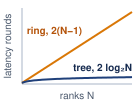{width="100%" fig-alt="Latency rounds against rank count N on linear axes. An amber straight line labeled ring, 2 times N minus 1, climbs steadily; a blue curve labeled tree, 2 log base 2 of N, bends over and stays near the bottom."}

*Ring latency grows with N; tree stays logarithmic.*
:::

::: {#chk-collective-communication-ring-allreduce-mechanics .callout-checkpoint title="Ring AllReduce mechanics"}

Verify your understanding of bandwidth-optimal reduction:

- [ ] **Step count**: calculate the number of sequential steps\index{Ring AllReduce!sequential steps} required for a ring of $N$ GPUs to complete the full AllReduce.
- [ ] **Bandwidth optimality**: explain why Ring AllReduce is bandwidth-optimal, including how many times each byte of the total message $M$ traverses the network per GPU.
- [ ] **Straggler impact**: determine the impact on total collective completion time when one GPU in the ring is 50 percent slower than the others.
- [ ] **Send/receive duality**: assess the True or False claim that every GPU is both a sender and a receiver in every step of Ring AllReduce.

:::

The performance follows directly from the two-phase schedule in example \ref{exmp-collective-communication-ring-allreduce-step-by-step-trace-4-gpus}. Each node sends and receives $\frac{M}{N}$ bytes in each of the $2(N-1)$ steps.
$$
\CollectiveCompletionTimeRing = \underbrace{2(N-1)\alpha}_{\text{Latency Term}} + \underbrace{2\frac{N-1}{N} \frac{M}{\beta}}_{\text{Bandwidth Term}}
$$

The bandwidth term approaches $2M/\beta$ as $N \to \infty$, reaching the full-duplex lower bound: each rank sends nearly $2M$ bytes across the two phases and receives the same amount concurrently. In contrast, the latency term scales linearly with $N$. Across 10,000 nodes, 20,000 sequential hops accumulate substantial latency, which explains why Ring AllReduce becomes uncompetitive for small payloads.

::: {#nbk-collective-communication-allreduce-cost-70b-model .callout-notebook title="AllReduce cost for a 70B model"}

**Problem**: A `{python} AllReduceCost.params_b_str` parameter model trains with data parallelism across `{python} AllReduceCost.n_gpus_napkin_str` connected by InfiniBand NDR (`{python} AllReduceCost.ib_bw_gb_per_s_str` per port). Each GPU computes gradients in BF16 (2 bytes per parameter, common for Llama-class training). How long does one AllReduce take?

**Step 1**: Size the gradient payload.
Each data-parallel replica, whose own model state must be sharded or offloaded, contributes one full logical gradient tensor of `{python} AllReduceCost.gradient_operands_math` $=$ `{python} AllReduceCost.gradient_size_gb_str`.

**Step 2**: Apply the Ring AllReduce bandwidth formula.
$$T_{\text{bandwidth}} = 2 \cdot \frac{N-1}{N} \cdot \frac{M}{\beta}$$

Substituting: $T_{\text{bandwidth}}$ = `{python} AllReduceCost.ring_bw_factor_value_str` $\times$ `{python} AllReduceCost.gradient_size_gb_str` / `{python} AllReduceCost.ib_bw_gb_per_s_str` $\approx$ `{python} AllReduceCost.ring_bw_time_ms_str`.

**Step 3**: Add the latency term.
$$T_{\text{latency}} = 2(N-1) \cdot \alpha$$

Substituting: $T_{\text{latency}} =$ `{python} AllReduceCost.lat_steps_str` $\times$ `{python} AllReduceCost.alpha_us_str` = `{python} AllReduceCost.ring_lat_time_ms_str`.

**Step 4**: Total communication time.
Total: $T_{\text{allreduce}} \approx$ `{python} AllReduceCost.ring_bw_time_ms_str` + `{python} AllReduceCost.ring_lat_time_ms_str` $\approx$ `{python} AllReduceCost.ring_total_ms_str`.

**Systems insight**: The gradient AllReduce alone takes over five seconds. This is pure communication overhead added to every training step. At this scale, communication dominates the step time unless overlapped with backward pass computation. This is why large-scale training systems pipeline AllReduce with the backward pass, launching communication for output-side layers while input-side layers are still computing.

:::

### Tree AllReduce {#sec-communication-collective-operations-tree-allreduce}

Ring AllReduce pays a high price in latency for its bandwidth optimality. When a cluster grows to thousands of GPUs and the message size is moderate (a few megabytes), the $2(N-1)\alpha$ latency term dwarfs the bandwidth term, and the algorithm spends most of its time in sequential hops rather than in useful data transfer. To address this linear latency, Tree AllReduce\index{Tree AllReduce} uses a binary tree structure that works in two phases. In the reduce phase\index{Tree AllReduce!reduce phase}, leaves send to their parents, which sum the incoming values and pass them up, reaching the root in $\log_2 N$ steps. In the broadcast phase\index{Tree AllReduce!broadcast phase}, the root sends the result back down to the leaves in another $\log_2 N$ steps.

Tree AllReduce has worse bandwidth efficiency because of link underutilization. In Ring AllReduce, every node sends and receives simultaneously, so all $N$ links are active at every step. In Tree AllReduce, only a fraction of links are active at any time, and that fraction shrinks at every level. At the leaves, $N/2$ nodes send to $N/2$ parents, leaving half the nodes as idle receivers; at the next level up, $N/4$ nodes send to $N/4$ parents, leaving three-quarters idle; at the root, only two nodes communicate while the remaining $(N-2)$ sit idle. The result is that while Ring achieves near-100 percent link utilization for large messages on a balanced ring, a simple tree can leave many links idle and concentrate traffic near the root or interior links.

The resulting time complexity depends on the specific tree variant. A simple reduce-then-broadcast tree has logarithmic latency but nonuniform traffic and root/interior bottlenecks; recursive-doubling-style variants can incur $\mathcal{O}(\log N)$ full-message bandwidth per rank. The following simplified model captures the latency advantage and the potential bandwidth penalty of tree-like collectives:
$$ T_{\text{tree-like}} \approx \underbrace{2\log_2 N \cdot \alpha}_{\text{Latency}} + \underbrace{2 \log_2 N \frac{M}{\beta}}_{\text{Bandwidth penalty in full-message exchange variants}} $$

The latency term is logarithmic ($\mathcal{O}(\log N)$): for 1024 nodes, Ring needs 2046 steps while Tree needs only 20, and that 100$\times$ reduction in steps makes Tree attractive for small, frequent collectives across large process groups, such as scalar reductions, control messages, or small-batch activation reductions. The bandwidth term carries the penalty, because tree-like algorithms can underutilize links or concentrate traffic on interior links, and recursive-doubling-style full-message exchanges add a $\log_2 N$ bandwidth factor; these penalties make naive tree variants a poor choice for data parallelism's large gradient AllReduce, where bandwidth efficiency determines whether the network is saturated or partially idle.

For large-scale data parallelism, this bandwidth penalty decides the comparison whenever the implementation repeatedly exchanges full messages or creates root/interior bottlenecks. In the 64-GPU example of @sec-communication-bandwidth-lower-bound, the simple tree already pays about `{python} RingTreeByteGap.tree_ring_ratio_mult_str` the ring's byte time. For a 70B-parameter model's `{python} GradSyncSignificance.gradient_gb_str` gradient AllReduce across 1,000 GPUs, a bandwidth-inefficient tree-like variant can erase the latency advantage that motivated it. Optimized double-tree algorithms exist precisely to keep logarithmic latency without imposing that naive bandwidth penalty.

Tree AllReduce is, however, the correct choice when latency is the primary bottleneck, typically for smaller collectives with small message sizes. The canonical use case is a small AllReduce issued by tensor parallelism during small-batch inference, where each activation tensor is only a few hundred kilobytes to a megabyte. For an 8-GPU group inside a node communicating a 1 MB tensor, the latency drops from Ring's $2(8-1)\alpha = 14\alpha$ to Tree's $2\log_2(8)\alpha = 6\alpha$. Tree's byte term is still about $3.4\times$ Ring's at that size, so the saving in startup steps wins only narrowly, by roughly 10 percent under NVLink parameters. For the megabyte-to-tens-of-megabyte activation reductions of tensor-parallel training, the byte term dominates, and what distinguishes those collectives is that they sit on the critical path and cannot overlap with the layer that needs their result.

### Recursive halving-doubling (butterfly) {#sec-communication-butterfly}

Ring and Tree represent two extremes of the latency-bandwidth trade-off: Ring is bandwidth-optimal but latency-poor, while Tree is latency-optimal but bandwidth-poor. A third approach combines the logarithmic latency of Tree with better bandwidth utilization. The recursive halving-doubling\index{Recursive Halving-Doubling}\index{AllReduce!recursive doubling} algorithm (sometimes called the Butterfly algorithm\index{Butterfly Algorithm}) operates in $2\log_2 N$ rounds total: $\log_2 N$ ReduceScatter rounds followed by $\log_2 N$ AllGather rounds. In each round $k$ of either phase, every GPU exchanges data with a partner at distance $2^k$ in the logical numbering, and the message size halves (in the ReduceScatter phase) or doubles (in the AllGather phase).

In the ReduceScatter phase (first $\log_2 N$ rounds), GPU $i$ partners with GPU $i \oplus 2^k$ (XOR of indices), and they exchange half of their current data. After receiving, each GPU sums its half with the received half, then discards the other half. After $\log_2 N$ rounds, each GPU holds $M/N$ bytes of the fully reduced result. The AllGather phase reverses the process: in each round, partners exchange their reduced chunks, doubling the data each GPU holds until all GPUs have the complete result.

The performance of Recursive Halving-Doubling is:
$$ T_{\text{butterfly}} = 2\log_2 N \cdot \alpha + 2\frac{N-1}{N} \cdot \frac{M}{\beta} $$

This achieves the best of both worlds: logarithmic latency ($\mathcal{O}(\log N)$, like Tree) and bandwidth-optimal data movement ($2(N-1)/N \cdot M/\beta$, like Ring). The catch is that it requires nonneighbor communication\index{Recursive Halving-Doubling!nonneighbor communication} (GPU $i$ must communicate with GPU $i \oplus 2^k$, which may be physically distant), and it requires $N$ to be a power of two. For clusters where $N$ is not a power of two, additional complexity is needed to handle the irregular cases.

Recursive halving-doubling is used in MPI-style collective implementations and is useful as a theoretical point in the latency-bandwidth trade-off [@thakur2005]. NCCL's implementation families include ring, tree-derived, hierarchical, NVLink/NVSwitch-aware, and pattern-aware choices, with exact names and availability changing by version and topology [@jeaugey2017nccl; @nvidiaNcclUserGuide]. Whatever a particular release calls them, practical communication libraries select algorithms through a topology-aware cost model because nonlocal communication patterns can create contention on shared network links that erodes theoretical advantages.

Sequence parallelism can expose the topology sensitivity of recursive halving-doubling when the runtime schedules its AllGather and ReduceScatter pairs that way. In sequence parallelism, AllGather reconstructs activation shards and ReduceScatter redistributes them along the sequence dimension; a butterfly schedule for those collectives follows the same distance-doubling logic. The following eight-GPU ReduceScatter trace shows exactly how the long-distance crossings emerge.

To make this concrete, consider the ReduceScatter phase for 8 GPUs, which proceeds in $\log_2(8) = 3$ rounds. In round $k=0$, each GPU $i$ partners with GPU $i \oplus 1$, pairing neighbors: (0,1), (2,3), (4,5), (6,7). They exchange half their data and reduce. In round $k=1$, the distance doubles: GPU $i$ partners with GPU $i \oplus 2$, creating pairs (0,2), (1,3), (4,6), (5,7). In round $k=2$, the distance doubles again: GPU $i$ partners with GPU $i \oplus 4$, creating pairs (0,4), (1,5), (2,6), (3,7).

The problem with this pattern becomes clear on real hardware. The round $k=2$ pairings force communication across physical boundaries. If GPUs 0--3 are on one node and 4--7 are on another, this final round creates cross-node traffic between the two nodes. For a 1,000-GPU cluster (approximated as 1,024 for the algorithm), the final round pairs GPU $i$ with GPU $i \oplus 512$, forcing GPUs in the first half of the cluster to communicate with partners in the second half and potentially flooding the high-level network fabric that connects server racks. This topology-oblivious communication pattern is why Butterfly's theoretical optimality does not translate to practical superiority on large hierarchical clusters.

### Double binary tree {#sec-communication-double-tree}

NCCL can use a double binary tree\index{Double Binary Tree}\index{Double Binary Tree!complementary trees}\index{NCCL!double binary tree} for many message sizes and topologies, which addresses the bandwidth inefficiency of a standard binary tree while allowing topology-aware tree placement [@jeaugey2017nccl; @nvidiaNcclUserGuide]. The idea is to construct two independent binary trees with complementary interior-node roles, then run both trees simultaneously, each carrying half the data.

The complementary-tree construction balances endpoint work: ranks that act as interior nodes in one tree act as leaves in the other. Splitting the payload between the two trees reduces the amount that any one interior rank must forward while retaining logarithmic tree depth. This logical balance does not guarantee that every physical link stays busy or that both trees avoid shared fabric bottlenecks; rank placement and routing still matter.

The combined performance is approximately:
$$ T_{\text{double-tree}} \approx 2\log_2 N \cdot \alpha + \frac{2M}{\beta} $$

In practice, the bandwidth term approaches $2M/\beta$ (optimal) while maintaining logarithmic latency. This makes Double Binary Tree a strong choice across a wide range of message sizes and cluster counts, which is why communication libraries select it in many configurations. The algorithm requires careful construction of the two complementary trees to ensure they do not create link contention, a problem that NCCL's topology-aware graph search addresses during initialization.

PyTorch DistributedDataParallel (DDP) and FSDP fuse many small gradient tensors into buckets, typically 25--100 MB (@sec-communication-bucket-fusion), and those buckets frequently fall into the crossover territory where neither Ring nor pure Tree is clearly optimal. A bucket at 25 MB sits near the Ring-Tree crossover for medium-scale clusters, and a bucket at 100 MB begins to favor Ring on slow networks. The double binary tree's broad competitiveness across message sizes covers this middle ground, which is one reason NCCL dynamically selects\index{NCCL!algorithm selection} it for many DDP/FSDP gradient synchronization calls rather than committing unconditionally to Ring.

For a fixed 256-GPU process group on a 200 Gbps fabric, @fig-allreduce-crossover charts the completion-time curves across message sizes from 1 KB to 10 GB, isolating the operational crossover around 1 MB. Below this threshold, simple Tree and Double Binary Tree exploit logarithmic tree depth to beat Ring by over an order of magnitude in the latency-dominated regime. Above 1 MB, Tree performance degrades under root bandwidth congestion, while Ring maintains bandwidth-optimal scaling and Double Binary Tree converges to match it. @Tbl-allreduce-comparison summarizes the underlying latency and bandwidth scaling bounds across these candidate algorithms.

| **Algorithm**   |         **Latency**         |            **Bandwidth**             | **Bandwidth Optimal?** |          **Constraint**         |
|:----------------|:---------------------------:|:------------------------------------:|:----------------------:|:-------------------------------:|
| **Ring**        |    $\mathcal{O}(N)\alpha$   |   $2\frac{N-1}{N}\frac{M}{\beta}$    |          Yes           |               None              |
| **Simple Tree** | $\mathcal{O}(\log N)\alpha$ | $\mathcal{O}(\log N)\frac{M}{\beta}$ |           No           |               None              |
| **Butterfly**   | $\mathcal{O}(\log N)\alpha$ |   $2\frac{N-1}{N}\frac{M}{\beta}$    |          Yes           |            $N = 2^k$            |
| **Double Tree** | $\mathcal{O}(\log N)\alpha$ |      $\approx\frac{2M}{\beta}$       |      Near-optimal      | Complementary tree construction |

: **AllReduce Algorithm Comparison**: Each algorithm occupies a different point in the latency-bandwidth trade-off space. Ring and Butterfly achieve bandwidth optimality with different latency characteristics, while Double Binary Tree combines logarithmic depth with a near-optimal byte term. The Tree row refers to the simple full-message model, not every tree implementation. {#tbl-allreduce-comparison}

::: {#fig-allreduce-crossover fig-env="figure" fig-pos="htb" fig-cap="**Algorithm crossover in collective communication**: Performance analysis of Ring, Tree, and Double Binary Tree AllReduce algorithms across message sizes (1 KB to 10 GB) for a 256-GPU cluster with a 200 Gbps interconnect and $\alpha = 1\\ \mu\text{s}$. The Double Binary Tree curve applies modest latency and bandwidth overhead factors (1.2$\times$ and 1.05$\times$) to its ideal cost." fig-alt="Log-log plot of AllReduce time vs. message size for Ring, Tree, and Double Binary Tree algorithms showing latency-dominated and bandwidth-dominated crossover regions."}

```{python}
#| echo: false
# ┌─────────────────────────────────────────────────────────────────────────────
# │ ALLREDUCE CROSSOVER (FIGURE)
# ├─────────────────────────────────────────────────────────────────────────────
# │ Context: @fig-allreduce-crossover—Ring vs Tree vs DBT
# │
# │ Goal: Log-log plot of AllReduce time vs message size for Ring, Tree, DBT;
# │       show latency-dominated (Tree wins) vs bandwidth-dominated (Ring wins).
# │ Show: Three curves; crossover regions; N=256, 200 Gbps.
# │ How: t_ring, t_tree, t_dbt from alpha-beta model; matplotlib.
# │
# └─────────────────────────────────────────────────────────────────────────────
# ┌── 1. CANVAS ────────────────────────────────────────────────────────────────
# │ Log-log plot of AllReduce time vs message size for Ring, Tree, DBT;
import matplotlib.pyplot as plt
import numpy as np
from mlsysim import Systems
from mlsysim.physics import (
    calc_ring_allreduce_time,
    calc_tree_allreduce_time,
    calc_double_binary_tree_allreduce_time,
)

from mlsysim import viz

# ┌── 2. ARRAYS ────────────────────────────────────────────────────────────────
N = 256
hdr_bw = Systems.Fabrics.InfiniBand_HDR.bandwidth
bandwidth_bytes_sec = hdr_bw.to("byte/s").magnitude
latency = 1e-6 * second

message_sizes = np.logspace(3, 10, 100)

t_ring = np.array(
    [calc_ring_allreduce_time(size * byte, N, bandwidth_bytes_sec * byte / second, latency).to(second).magnitude for size in message_sizes]
)
t_tree = np.array(
    [calc_tree_allreduce_time(size * byte, N, bandwidth_bytes_sec * byte / second, latency).to(second).magnitude for size in message_sizes]
)
t_dbt = np.array(
    [
        calc_double_binary_tree_allreduce_time(
            size * byte,
            N,
            bandwidth_bytes_sec * byte / second,
            latency,
            latency_factor=1.2,
            bandwidth_factor=1.05,
        )
        .to(second)
        .magnitude
        for size in message_sizes
    ]
)

t_ring_ms = t_ring * THOUSAND
t_tree_ms = t_tree * THOUSAND
t_dbt_ms = t_dbt * THOUSAND

fig, ax, COLORS, plt = viz.setup_plot(figsize=(10, 6))

# ┌── 3. RENDER ────────────────────────────────────────────────────────────────
ax.loglog(message_sizes, t_ring_ms, label='Ring (Bandwidth Optimal)', color=COLORS['VioletLine'], linewidth=2.5)
ax.loglog(message_sizes, t_tree_ms, label='Tree (Latency Optimal)', color=COLORS['GreenLine'], linewidth=2.5, linestyle='--')
ax.loglog(message_sizes, t_dbt_ms, label='Double Binary Tree (Hybrid)', color=COLORS['BlueLine'], linewidth=2.5, linestyle='-.')

ax.text(
    8e3,
    1.6e-1,
    'Latency Dominated\n(Tree wins)',
    fontsize=10,
    color='#555555',
    ha='center',
    bbox=dict(facecolor='white', alpha=0.7, edgecolor='none'),
)
ax.text(
    3e7, 2e2, 'Bandwidth Dominated\n(Ring wins)', fontsize=10, color='#555555', bbox=dict(facecolor='white', alpha=0.7, edgecolor='none'), ha='center'
)

ax.set_xlabel('Message Size (Bytes)', fontsize=12)
ax.set_ylabel('AllReduce Time (ms)', fontsize=12)
ax.legend(loc='upper left', fontsize=8, facecolor='white', frameon=True)
ax.grid(True, which="both", ls="-", alpha=0.3)

ax.set_xticks([1e3, 1e6, 1e9])
ax.set_xticklabels(['1 KB', '1 MB', '1 GB'])

plt.show()
plt.close()

# ┌── 4. DECORATE ──────────────────────────────────────────────────────────────
```

:::

### The algorithm crossover point {#sec-communication-collective-operations-algorithm-crossover}

The crossover knee in @fig-allreduce-crossover, where the dashed Tree curve intersects the solid Ring curve at approximately 1 MB, marks the boundary where bandwidth consumption overtakes latency overhead. Setting $\CollectiveCompletionTimeRing = \CollectiveCompletionTimeTree$ and solving for payload $M$ isolates this inflection algebraically:

$$ \CollectiveCompletionTimeRing = 2(N-1)\alpha + 2\frac{N-1}{N}\frac{M}{\beta} $$
$$ \CollectiveCompletionTimeTree = 2\log_2 N \cdot \alpha + 2\log_2 N \cdot \frac{M}{\beta} $$

For large $N$, $(N-1) \approx N$ and $\frac{N-1}{N} \approx 1$, so the ring pays a latency term proportional to $N$ while moving each byte close to the bandwidth limit:

$$ \CollectiveCompletionTimeRing \approx 2N\alpha + \frac{2M}{\beta}, \quad \CollectiveCompletionTimeTree \approx 2\log_2 N \cdot \alpha + \frac{2\log_2 N \cdot M}{\beta} $$

The tree has the opposite shape: logarithmic startup cost, but each message byte moves through more stages. Setting the estimates equal isolates the message size where the cheaper latency path stops compensating for the extra bandwidth work:

$$ 2N\alpha + \frac{2M}{\beta} = 2\log_2 N \cdot \alpha + \frac{2\log_2 N \cdot M}{\beta} $$
$$ \frac{2M}{\beta} - \frac{2\log_2 N \cdot M}{\beta} = 2\log_2 N \cdot \alpha - 2N\alpha $$
$$ \frac{2M}{\beta}(1 - \log_2 N) = 2\alpha(\log_2 N - N) $$

Since $N \gg \log_2 N$ for large clusters, $(\log_2 N - N) \approx -N$ and $(1 - \log_2 N) \approx -\log_2 N$, yielding:

$$ \frac{2M}{\beta}(-\log_2 N) \approx 2\alpha(-N) $$
$$ \RingtreeCrossoverPayload \approx \frac{N \cdot \alpha \cdot \beta}{\log_2 N} $$

Dropping the logarithmic factor gives a coarser upper-scale heuristic, $\RingtreeCrossoverPayload \lesssim N\alpha\beta$, which overstates the switch point by a factor of $\log_2 N$. The log-aware form remains the estimate to use:
$$ \boxed{\RingtreeCrossoverPayload \approx \frac{N \cdot \alpha \cdot \beta}{\log_2 N}} $$

The log-aware crossover formula\index{Critical message size!algorithm crossover} is the large-$N$ form of the exact crossover $\RingtreeCrossoverPayload(N)$ derived in @sec-appdx-comm-foundations-ring-vs-tree; it yields a useful intuition, not a hard selection rule. Above the crossover, message size dominates and Ring's bandwidth efficiency wins; below it, startup latency dominates and Tree's logarithmic depth wins.

For a cluster with $\alpha=5\ \mu\text{s}$, $\beta=50\ \text{GB/s}$, and $N=100$, the direct approximation gives:
$$\RingtreeCrossoverPayload \approx \frac{100 \times 5\cdot 10^{-6} \times 50\cdot 10^9}{\log_2 100} \approx 3.8 \text{ MB}$$

In practice, NCCL's algorithm selection is more nuanced than a simple two-way split. The Double Binary Tree algorithm offers logarithmic latency with near-optimal bandwidth, making it competitive with both Ring and Tree across a broad range of message sizes. NCCL also considers the number of channels (parallel communication streams), the network topology, and whether inter-node or intra-node links are being used. The effective selection logic resembles a multi-way decision tree indexed by (message size, GPU count, topology type) rather than a single crossover point.

Nevertheless, the crossover formula remains the essential mental model for understanding why libraries make the choices they do. When a library selects an unexpected algorithm, the crossover analysis provides the reasoning framework to evaluate whether the choice is correct or whether manual override is warranted. A concrete buffer-size calculation applies this framework to a realistic decision:

```{python}
#| echo: false
#| label: ring-vs-tree-calc
import math
from mlsysim.fmt import check, fmt, fmt_bandwidth, fmt_count, fmt_memory, fmt_percent, fmt_qty_range, fmt_time
from mlsysim.core.units import BYTES_FP16, GB, MB, microsecond, param, second
from mlsysim.physics import (
    calc_ring_allreduce_time,
    calc_ring_allreduce_latency_steps,
    calc_tree_allreduce_time,
    calc_ring_tree_crossover_size,
)

class RingVsTree:
    # ┌── 1. LOAD ──────────────────────────────────────────
    M_mb = 1
    N = 64
    alpha_us = 10
    beta_gbs = 10
    M = M_mb * MB
    alpha = alpha_us * microsecond
    beta = beta_gbs * GB / second
    ddp_bucket = 10 * MB  # scenario assumption: mid-size DDP bucket
    fused_bucket_low = 50 * MB  # scenario assumption: lower bound for fused multi-layer bucket
    fused_bucket_high = 300 * MB  # scenario assumption: representative upper range for fused buckets
    llama_70b = Models.Language.Llama2_70B
    # ┌── 2. EXECUTE ───────────────────────────────────────
    log2N = int(math.log2(N))
    # Latency terms come from exact closed forms (the guards pin them exactly);
    # deriving them by subtraction or via a seconds round-trip leaves FP residue.
    ring_total = calc_ring_allreduce_time(M, N, beta, alpha).to(microsecond)
    ring_bw = calc_ring_allreduce_time(M, N, beta, 0 * second).to(microsecond)
    ring_lat = (calc_ring_allreduce_latency_steps(N) * alpha).to(microsecond)
    tree_total = calc_tree_allreduce_time(M, N, beta, alpha).to(microsecond)
    tree_bw = calc_tree_allreduce_time(M, N, beta, 0 * second).to(microsecond)
    tree_lat = (2 * log2N * alpha).to(microsecond)
    crossover = calc_ring_tree_crossover_size(N, alpha, beta)
    full_bf16_gradient = llama_70b.parameters.to(param).magnitude * BYTES_FP16
    tree_win_margin_pct = ((ring_total - tree_total) / ring_total).to_base_units().magnitude * 100
    # Like-for-like penalties for the Ring-by-default pitfall: Ring's extra
    # startup cost beyond Tree's, against Tree's extra byte cost beyond Ring's.
    ring_excess_lat = (ring_lat - tree_lat).to(microsecond)
    tree_excess_bw = (tree_bw - ring_bw).to(microsecond)
    # ┌── 3. GUARD ─────────────────────────────────────────
    check(ring_lat == 1260 * microsecond, f"Ring lat = {ring_lat.to(microsecond).magnitude}")
    check(tree_lat == 120 * microsecond, f"Tree lat = {tree_lat.to(microsecond).magnitude}")
    check(abs(ring_bw.to(microsecond).magnitude - 200) < 5, f"Ring bw = {ring_bw.to(microsecond).magnitude}")
    check(abs(tree_bw.to(microsecond).magnitude - 1200) < 1, f"Tree bw = {tree_bw.to(microsecond).magnitude}")
    check(abs(crossover.to(MB).magnitude - 1.1) < 0.05, f"Crossover = {crossover.to(MB).magnitude}")
    # ┌── 4. OUTPUT ────────────────────────────────────────
    alpha_us_str = fmt_time(alpha, microsecond, precision=0, commas=False)
    beta_gb_per_s_str = fmt_bandwidth(beta, unit=GB / second, precision=0, commas=False)
    ring_lat_us_str = fmt_time(ring_lat, unit=microsecond, precision=0)
    tree_lat_us_str = fmt_time(tree_lat, unit=microsecond, precision=0, commas=False)
    ring_bw_us_str = fmt_time(ring_bw, unit=microsecond, precision=1, commas=False)
    tree_bw_us_str = fmt_time(tree_bw, unit=microsecond, precision=0)
    ring_total_us_str = fmt_time(ring_total, unit=microsecond, precision=1)
    tree_total_us_str = fmt_time(tree_total, unit=microsecond, precision=0)
    crossover_mb_str = fmt_memory(crossover, unit=MB, precision=1, commas=False)
    M_mb_str = fmt_memory(M, unit=MB, precision=0, commas=False)
    ddp_bucket_mb_str = fmt_memory(ddp_bucket, unit=MB, precision=0, commas=False)
    fused_bucket_range_str = fmt_qty_range(fused_bucket_low, fused_bucket_high, MB, precision=0, commas=False)
    full_bf16_gradient_gb_str = fmt_memory(full_bf16_gradient, unit=GB, precision=0, commas=False)
    llama_70b_param_str = fmt_count(llama_70b.parameters.to(param).magnitude, scale="B", precision=0, commas=False, label="parameter")
    N_str = fmt(N, precision=0, commas=False)
    tree_win_margin_pct_str = fmt_percent(round(tree_win_margin_pct) / 100, precision=0, commas=False, style='prose')
    ring_excess_lat_us_str = fmt_time(ring_excess_lat, unit=microsecond, precision=0)
    tree_excess_bw_us_str = fmt_time(round(tree_excess_bw.to(microsecond).magnitude, -1) * microsecond, unit=microsecond, precision=0)
    # Formula-substitution math spans: the operands (N-1, log2N, 2.log2N, M, beta,
    # alpha) come straight from the LOAD/EXECUTE values so the worked lines cannot
    # drift from the cell.
    from mlsysim.fmt import fmt_math

    _alpha_us = int(alpha.to(microsecond).magnitude)
    _m_mb = int(M.to(MB).magnitude)
    _beta_gbs = int(beta.to(GB / second).magnitude)
    ring_lat_sub_math = fmt_math(rf"2 \times {N - 1} \times {_alpha_us}\ \mu\text{{s}}")
    tree_lat_sub_math = fmt_math(rf"2 \times {log2N} \times {_alpha_us}\ \mu\text{{s}}")
    ring_bw_sub_math = fmt_math(rf"2 \times \frac{{{_m_mb}\text{{ MB}}}}{{{_beta_gbs}\text{{ GB/s}}}}")
    tree_bw_sub_math = fmt_math(rf"{2 * log2N} \times \frac{{{_m_mb}\text{{ MB}}}}{{{_beta_gbs}\text{{ GB/s}}}}")
```

::: {#nbk-collective-communication-ring-vs-tree-crossover .callout-notebook title="The ring vs. tree crossover"}

**Problem**: A cluster synchronizes a `{python} RingVsTree.M_mb_str` buffer across `{python} RingVsTree.N_str` GPUs. The network has latency $\alpha =$ `{python} RingVsTree.alpha_us_str` and bandwidth $\beta =$ `{python} RingVsTree.beta_gb_per_s_str`. Which algorithm performs better: Ring or Tree?

**Math**:

**Latency**:

1.  **Ring Latency**\index{Ring AllReduce!latency}: $2(N-1)\alpha =$ `{python} RingVsTree.ring_lat_sub_math` = `{python} RingVsTree.ring_lat_us_str`.
2.  **Tree Latency**\index{Tree AllReduce!latency}: $2(\log_2 N)\alpha =$ `{python} RingVsTree.tree_lat_sub_math` = `{python} RingVsTree.tree_lat_us_str`.

**Bandwidth** (note the difference):

3.  **Ring Bandwidth**\index{Ring AllReduce!bandwidth}: $2\frac{N-1}{N}\frac{M}{\beta} \approx$ `{python} RingVsTree.ring_bw_sub_math` = `{python} RingVsTree.ring_bw_us_str` (optimal: each rank sends about $2M$ in total, the lower bound).
4.  **Tree Bandwidth**\index{Tree AllReduce!bandwidth}: $2\log_2 N \cdot \frac{M}{\beta} =$ `{python} RingVsTree.tree_bw_sub_math` = `{python} RingVsTree.tree_bw_us_str` (each level sends full message).

@Tbl-collective-communication-ring-vs-tree-1mb-64gpu sums the latency and bandwidth contributions into a head-to-head comparison:

| **Algorithm** |              **Latency**              |            **Bandwidth**             |                **Total**                |
|:--------------|:-------------------------------------:|:------------------------------------:|:---------------------------------------:|
| **Ring**      | `{python} RingVsTree.ring_lat_us_str` | `{python} RingVsTree.ring_bw_us_str` | `{python} RingVsTree.ring_total_us_str` |
| **Tree**      | `{python} RingVsTree.tree_lat_us_str` | `{python} RingVsTree.tree_bw_us_str` | `{python} RingVsTree.tree_total_us_str` |

: **Ring vs. Tree AllReduce Timing for a 1 MB Buffer on 64 GPUs**: Latency, bandwidth, and total-time terms with $\alpha = 10\ \mu\text{s}$ and $\beta = 10\ \text{GB/s}$. {#tbl-collective-communication-ring-vs-tree-1mb-64gpu}

Tree wins, but only by `{python} RingVsTree.tree_win_margin_pct_str`. For this `{python} RingVsTree.M_mb_str` message, the payload is near the crossover point.

**Systems insight**: Ring's latency penalty (10$\times$ worse than Tree) nearly balances Tree's bandwidth penalty (6$\times$ worse than Ring). The log-aware crossover estimate predicts $\RingtreeCrossoverPayload \approx N \alpha \beta / \log_2 N = 64 \times 10\ \mu\text{s} \times 10\ \text{GB/s} / 6 \approx$ `{python} RingVsTree.crossover_mb_str`. At 1 MB, the payload is just below crossover, so Tree wins. At 10 MB, Ring would dominate.

The crossover point sits inside the range that gradient reductions can traverse as bucket sizes change. In this example, the `{python} RingVsTree.M_mb_str` AllReduce lies near crossover, whereas a `{python} RingVsTree.ddp_bucket_mb_str` DDP bucket is already above it. A fused bucket of `{python} RingVsTree.fused_bucket_range_str` or the full `{python} RingVsTree.full_bf16_gradient_gb_str` BF16 gradient of a `{python} RingVsTree.llama_70b_param_str` model favors Ring over the simple Tree model even more strongly. These conclusions apply to the stated AllReduce configuration. An MoE token-routing payload of the same size still requires an AllToAll schedule, and optimized tree or hierarchical implementations require their own cost comparison.

:::

The crossover analysis demonstrates that algorithm selection is not a static choice but depends on the specific combination of message size, cluster scale, and network parameters. In practice, communication libraries like NCCL maintain internal lookup tables that map message size, GPU count, topology, and protocol settings to selected algorithms such as Ring, Tree, or hybrid approaches. Understanding the underlying crossover math allows engineers to predict when the library's built-in choices may be suboptimal and to override them when necessary.

::: {#chk-collective-communication-allreduce-algorithm-selection .callout-checkpoint title="AllReduce algorithm selection"}

Verify your understanding of Ring vs. Tree AllReduce trade-offs:

- [ ] **Ring vs. Tree**: explain why Ring AllReduce achieves bandwidth-optimal communication (approaching $2M/\beta$) while the simple full-message Tree model incurs $\mathcal{O}(\log N)$ bandwidth overhead.
- [ ] **Crossover point**: calculate $\RingtreeCrossoverPayload$ for a 256-GPU cluster with $\alpha = 5\ \mu\text{s}$ and $\beta = 50\ \text{GB/s}$, then determine whether a 10 MB gradient buffer should use Ring or Tree.
- [ ] **Scatter-reduce trace**: trace through the Scatter-Reduce phase of Ring AllReduce for 3 GPUs with a 3-element vector and verify that each GPU ends with the correct partial sum.
- [ ] **Latency limit**: explain why Ring AllReduce's $\mathcal{O}(N)$ latency hurts small, frequent collectives across a large process group, and why that penalty is modest inside an eight-GPU tensor-parallel group.

:::

[^fn-moe-sparse-routing]: **Mixture-of-Experts (MoE)**\index{MoE!communication}: Because each token activates only a few experts, MoE replaces a uniform dense reduction with destination-specific AllToAll traffic. Fine-grained dispatch can expose startup cost, larger batches can bind injection or reception bandwidth, and oversubscription, routing, or expert skew can make bisection capacity or a hotspot the critical path.

## Hierarchical Communication {#sec-communication-collective-operations-collective-operations-mapping-collectives-topology-3214}

The AllReduce algorithms in @sec-communication-collective-operations-collective-operations-allreduce-algorithms-7545 assume a flat network where every link has the same bandwidth. Real data centers violate this assumption by nearly an order of magnitude.

Hierarchical communication is the response to that inequality. Intra-node links are abundant and fast, inter-node links are scarce and expensive, and the algorithm must shrink payloads before they cross the scarce tier whenever possible. This is why the same AllReduce can be implemented as a local ReduceScatter, a cross-node reduction, and a local AllGather rather than as one flat exchange across every rank.

```{python}
#| echo: false
#| label: comm-infra-scenario
# ┌─────────────────────────────────────────────────────────────────────────────
# │ COMMUNICATION INFRASTRUCTURE SPECS (LEGO)
# ├─────────────────────────────────────────────────────────────────────────────
# │ Context: @sec-communication-collective-operations-collective-operations-mapping-collectives-topology-3214
# │
# │ Goal: Provide NVLink and InfiniBand bandwidth statistics.
# │ Show: ~900 GB/s NVLink; ~50 GB/s InfiniBand NDR.
# │ How: pulling constants from mlsysim.core.units.
# │
# └─────────────────────────────────────────────────────────────────────────────
from mlsysim.core.units import GB, second

class CommInfraScenario:
    """Communication infrastructure bandwidth reference."""

    # ┌── 1. LOAD (Constants) ──────────────────────────────────────────────
    nvlink_raw = Hardware.Cloud.H100.nvlink.bandwidth
    ib_ndr_raw = Systems.Fabrics.InfiniBand_NDR.bandwidth

    # ┌── 2. EXECUTE (The Compute) ────────────────────────────────────────
    # Per-direction basis (NVLink 450 GB/s one-way vs IB 50 GB/s per port = 9x);
    # nvlink_raw stays the 900 GB/s bidirectional datasheet total for display.
    bandwidth_ratio = (Hardware.Cloud.H100.nvlink.bandwidth_per_direction / ib_ndr_raw).to_base_units().magnitude

    # ┌── 3. GUARD (Invariants) ──────────────────────────────────────────
    from mlsysim.fmt import check, fmt_bandwidth, fmt_multiple

    check(bandwidth_ratio > 1, "NVLink bandwidth should exceed InfiniBand bandwidth")

    # ┌── 4. OUTPUT (Formatting) ──────────────────────────────────────────────
    nvlink_h100_bw_gb_per_s_str = fmt_bandwidth(nvlink_raw, unit=GB / second, precision=0, commas=False)
    ib_ndr_bw_gb_per_s_str = fmt_bandwidth(ib_ndr_raw, unit=GB / second, precision=0, commas=False)
    # Approx-prefixed forms + the intra/inter ratio for @tbl-bandwidth-hierarchy.
    nvlink_bw_approx_str = fmt_bandwidth(nvlink_raw, unit=GB / second, precision=0, commas=False, approx=True)
    ib_ndr_bw_approx_str = fmt_bandwidth(ib_ndr_raw, unit=GB / second, precision=0, commas=False, approx=True)
    bandwidth_ratio_mult_str = fmt_multiple(bandwidth_ratio, precision=0, commas=False)
    nvlink_perdir_gb_per_s_str = fmt_bandwidth(Hardware.Cloud.H100.nvlink.bandwidth_per_direction, unit=GB / second, precision=0, commas=False)
```

### Hierarchical AllReduce {#sec-communication-collective-operations-collective-operations-hierarchical-allreduce-1338}

The flat-network assumption holds within a single node, where all GPUs connect via NVLink at uniform speed, but it breaks by roughly `{python} CommInfraScenario.bandwidth_ratio_mult_str` across multi-node clusters. Each GPU reaches its node peers at `{python} CommInfraScenario.nvlink_perdir_gb_per_s_str` per direction (half of NVLink's `{python} CommInfraScenario.nvlink_h100_bw_gb_per_s_str` datasheet figure, which counts both directions), yet it pushes inter-node traffic through one `{python} CommInfraScenario.ib_ndr_bw_gb_per_s_str` InfiniBand port. Real clusters are therefore hierarchical networks\index{Hierarchical Network}, with fundamentally different bandwidths at each tier, as @tbl-bandwidth-hierarchy quantifies. The physical tiers themselves are described in @sec-compute-bandwidth-hierarchy; the question here is how a collective schedule should respect them.

| **Tier**       |   **Interconnect**  |                   **Bandwidth**                   |                      **Relative Speed**                      |
|:---------------|:-------------------:|:-------------------------------------------------:|:------------------------------------------------------------:|
| **Intra-Node** |      NVLink 4.0     | `{python} CommInfraScenario.nvlink_bw_approx_str` | `{python} CommInfraScenario.bandwidth_ratio_mult_str` faster |
| **Inter-Node** | InfiniBand NDR 400G | `{python} CommInfraScenario.ib_ndr_bw_approx_str` |                     1$\times$ (baseline)                     |

: **The Bandwidth Hierarchy**: Modern GPU clusters exhibit an order-of-magnitude bandwidth gap between intra-node and inter-node communication. Hierarchical algorithms exploit this gap. Relative speed compares per-direction rates (NVLink's `{python} CommInfraScenario.nvlink_perdir_gb_per_s_str` one-way against InfiniBand's `{python} CommInfraScenario.ib_ndr_bw_gb_per_s_str` per port); the bandwidth column shows NVLink's bidirectional datasheet total. {#tbl-bandwidth-hierarchy}

A naive flat Ring AllReduce ignores this structure, routing unpartitioned traffic across InfiniBand when local NVLink would suffice and saturating scarce inter-node bandwidth. Hierarchical AllReduce\index{Hierarchical AllReduce}\index{Hierarchical AllReduce!three-phase decomposition} instead partitions the global operation into three stages that align communication volume with available link speed (@fig-hierarchical-allreduce).

::: {#fig-hierarchical-allreduce fig-env="figure" fig-pos="htb" fig-cap="**Hierarchical AllReduce**: Three-phase decomposition that exploits the intra-node/inter-node bandwidth gap. Phase 1 performs intra-node aggregation over NVLink (an NVLink ring acting as a ReduceScatter that leaves each GPU holding a node-shard partial sum), leaving a payload of $M/\AcceleratorsPerNode$ on each of the $\AcceleratorsPerNode$ GPUs per node. Phase 2 runs an AllReduce across corresponding GPUs using InfiniBand. Phase 3 completes intra-node distribution over NVLink (the AllGather that returns each GPU to the full result). The schematic shows two representative ranks per node; the same decomposition applies to $\AcceleratorsPerNode$ ranks." fig-alt="Three schematic phases with two representative ranks per node: local ReduceScatter leaves partial shards, corresponding-rank AllReduce produces global shards, and local AllGather reconstructs the full result."}
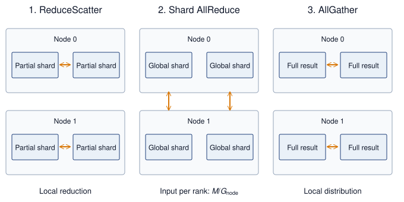

<!--
```{.tikz}
\begin{tikzpicture}[
    font=\small\sffamily,
    >=Stealth,
    panel/.style={
      draw=CanvasBorder,
      fill=CanvasBg,
      rounded corners=5pt,
      line width=0.6pt,
      inner sep=7pt
    },
    gpu box/.style={
      draw=BlueLine,
      fill=white,
      line width=0.85pt,
      rounded corners=3pt,
      minimum width=1.25cm,
      minimum height=1.15cm,
      align=center
    },
    leader box/.style={
      draw=OrangeLine,
      fill=OrangeFill!75,
      line width=1.1pt,
      rounded corners=3pt,
      minimum width=1.25cm,
      minimum height=1.15cm,
      align=center
    },
    step card/.style={
      draw=CanvasBorder,
      fill=white,
      rounded corners=3pt,
      line width=0.5pt,
      inner sep=5pt
    }
  ]

  % Define Layer Order
  \pgfdeclarelayer{background}
  \pgfsetlayers{background,main}

  % ========================================================
  % TOP LEGEND BAR
  % ========================================================
  \node[draw=BlueLine, fill=BlueFill, rounded corners=3pt, font=\scriptsize\bfseries, text=BlueLine, inner sep=4pt] at (2.2, 8.4)
    {Step 1: Intra-Node ReduceScatter};
  \node[draw=OrangeLine, fill=OrangeFill, rounded corners=3pt, font=\scriptsize\bfseries, text=OrangeLine!90!black, inner sep=4pt] at (7.25, 8.4)
    {Step 2: Inter-Node AllReduce (Leaders)};
  \node[draw=GreenLine, fill=GreenFill, rounded corners=3pt, font=\scriptsize\bfseries, text=GreenLine, inner sep=4pt] at (12.3, 8.4)
    {Step 3: Intra-Node AllGather};

  % ========================================================
  % STEP 2 BRIDGE (OPTICAL SPINAL FABRIC)
  % ========================================================
  \node[draw=OrangeLine, fill=OrangeFill!50, rounded corners=3pt, line width=0.9pt, font=\footnotesize\bfseries, text=OrangeLine!90!black, inner sep=5pt] (bridge) at (5.0, 7.55)
    {Step 2: Optical Spine Fabric ($50\text{ GB/s} \cdot \frac{1}{G}\text{ Traffic}$)};

  % ========================================================
  % NODE 0 CONTAINER
  % ========================================================
  \begin{scope}[shift={(0, 1.8)}, local bounding box=node0]
    % Header
    \node[anchor=west, font=\bfseries\small, text=TextDark] at (0, 4.9) {Node 0 (8-GPU Chassis)};
    \node[anchor=east, font=\scriptsize\bfseries, text=BlueLine] at (6.8, 4.9) {NVLink 4.0 Mesh};

    % GPUs
    \node[leader box] (g0) at (1.15, 3.65) {\textbf{G0}\\[1pt]\scriptsize\color{OrangeLine!90!black}\textbf{Leader}};
    \node[gpu box, right=0.35cm of g0] (g1) {\textbf{G1}\\[1pt]\tiny\color{TextMuted}Rank 1};
    \node[gpu box, right=0.35cm of g1] (g2) {\textbf{G2}\\[1pt]\tiny\color{TextMuted}Rank 2};
    \node[gpu box, right=0.35cm of g2] (g3) {\textbf{G3}\\[1pt]\tiny\color{TextMuted}Rank 3};

    % Ring links
    \draw[->, BlueLine, line width=1.1pt] (g0.east) -- (g1.west);
    \draw[->, BlueLine, line width=1.1pt] (g1.east) -- (g2.west);
    \draw[->, BlueLine, line width=1.1pt] (g2.east) -- (g3.west);
    \draw[->, BlueLine, line width=1.1pt, rounded corners=3pt] (g3.south) -- ++(0, -0.32) -| (g0.south);

    \node[font=\tiny\bfseries, text=BlueLine] at ($(g1.south)!0.5!(g2.south) - (0, 0.44)$) {Intra-Node NVLink Ring (900 GB/s)};

    % Step 1 Card
    \node[step card, anchor=north west, minimum width=6.6cm] at (0.1, 2.35) {
      \begin{minipage}{6.4cm}
        \textbf{\scriptsize Step 1: Intra-Node ReduceScatter}\\[1pt]
        \tiny Ranks $0 \dots 7$ reduce partial gradients over 900 GB/s NVLink. G0 accumulates the fully reduced slice for rank index 0.
      \end{minipage}
    };

    % Step 3 Card
    \node[step card, anchor=north west, minimum width=6.6cm] at (0.1, 1.30) {
      \begin{minipage}{6.4cm}
        \textbf{\scriptsize\color{GreenLine} Step 3: Intra-Node AllGather}\\[1pt]
        \tiny\color{GreenLine!80!black} G0 receives global aggregate from optical fabric and broadcasts via NVLink AllGather to ranks $1 \dots 7$.
      \end{minipage}
    };
  \end{scope}

  \begin{pgfonlayer}{background}
    \node[panel, fit=(node0)] (p_node0) {};
  \end{pgfonlayer}

  % ========================================================
  % NODE 1 CONTAINER
  % ========================================================
  \begin{scope}[shift={(7.4, 1.8)}, local bounding box=node1]
    % Header
    \node[anchor=west, font=\bfseries\small, text=TextDark] at (0, 4.9) {Node 1 (8-GPU Chassis)};
    \node[anchor=east, font=\scriptsize\bfseries, text=BlueLine] at (6.8, 4.9) {NVLink 4.0 Mesh};

    % GPUs
    \node[leader box] (g4) at (1.15, 3.65) {\textbf{G4}\\[1pt]\scriptsize\color{OrangeLine!90!black}\textbf{Leader}};
    \node[gpu box, right=0.35cm of g4] (g5) {\textbf{G5}\\[1pt]\tiny\color{TextMuted}Rank 5};
    \node[gpu box, right=0.35cm of g5] (g6) {\textbf{G6}\\[1pt]\tiny\color{TextMuted}Rank 6};
    \node[gpu box, right=0.35cm of g6] (g7) {\textbf{G7}\\[1pt]\tiny\color{TextMuted}Rank 7};

    % Ring links
    \draw[->, BlueLine, line width=1.1pt] (g4.east) -- (g5.west);
    \draw[->, BlueLine, line width=1.1pt] (g5.east) -- (g6.west);
    \draw[->, BlueLine, line width=1.1pt] (g6.east) -- (g7.west);
    \draw[->, BlueLine, line width=1.1pt, rounded corners=3pt] (g7.south) -- ++(0, -0.32) -| (g4.south);

    \node[font=\tiny\bfseries, text=BlueLine] at ($(g5.south)!0.5!(g6.south) - (0, 0.44)$) {Intra-Node NVLink Ring (900 GB/s)};

    % Step 1 Card
    \node[step card, anchor=north west, minimum width=6.6cm] at (0.1, 2.35) {
      \begin{minipage}{6.4cm}
        \textbf{\scriptsize Step 1: Intra-Node ReduceScatter}\\[1pt]
        \tiny Ranks $4 \dots 7$ reduce partial gradients over 900 GB/s NVLink. G4 accumulates the fully reduced slice for rank index 4.
      \end{minipage}
    };

    % Step 3 Card
    \node[step card, anchor=north west, minimum width=6.6cm] at (0.1, 1.30) {
      \begin{minipage}{6.4cm}
        \textbf{\scriptsize\color{GreenLine} Step 3: Intra-Node AllGather}\\[1pt]
        \tiny\color{GreenLine!80!black} G4 receives global aggregate from optical fabric and broadcasts via NVLink AllGather to ranks $5 \dots 7$.
      \end{minipage}
    };
  \end{scope}

  \begin{pgfonlayer}{background}
    \node[panel, fit=(node1)] (p_node1) {};
  \end{pgfonlayer}

  % Bridge connections: route up from the top edge of node0/node1 above G0/G4
  \draw[<->, draw=OrangeLine, line width=1.3pt, dashed]
    (g0.north |- p_node0.north) -- ++(0, 0.5) -| (bridge.west);
  \draw[<->, draw=OrangeLine, line width=1.3pt, dashed]
    (bridge.east) -| (g4.north |- p_node1.north);

  % ========================================================
  % BOTTOM ANALYTICAL PERFORMANCE CARD
  % ========================================================
  \begin{scope}[shift={(0, -1.9)}, local bounding box=boxCard]
    \node[anchor=north west, font=\normalsize\bfseries, text=TextDark] at (0.1, 3.4)
      {Hierarchical Traffic Scaling Advantage ($18\times$ Bandwidth Multiplier)};

    % Bar 1: NVLink
    \draw[fill=OrangeFill, draw=OrangeLine, line width=0.8pt, rounded corners=2pt]
      (0.1, 2.4) rectangle (9.2, 2.8);
    \node[anchor=west, font=\scriptsize\bfseries, text=OrangeLine!90!black] at (0.3, 2.6)
      {Intra-Node NVLink 4.0: 900 GB/s Bidirectional};

    % Bar 2: InfiniBand
    \draw[fill=VioletFill, draw=VioletLine, line width=0.8pt, rounded corners=2pt]
      (0.1, 1.85) rectangle (1.4, 2.25);
    \node[anchor=west, font=\scriptsize\bfseries, text=VioletLine] at (1.55, 2.05)
      {InfiniBand NDR: 50 GB/s per port (400 Gb/s)};

    % Red Callout Gap Badge
    \node[draw=RedLine, fill=RedFill, line width=1.1pt, rounded corners=4pt, align=center, inner sep=6pt] at (12.3, 2.32) {
      \textbf{\large\color{RedLine} 18$\times$}\\[-2pt]
      \scriptsize\bfseries\color{RedLine} Bandwidth Gap
    };

    % Explanatory text
    \node[anchor=north west, text width=14.0cm, font=\footnotesize, text=TextDark] at (0.1, 1.6) {
      \textbf{Traffic Elimination Law:} By completing the first reduction tier inside the node over 900 GB/s NVLink, inter-node traffic across optical switches drops by exactly $G\times$ ($8\times$), preventing bisection bandwidth exhaustion.\\[3pt]
      \textbf{\color{GreenLine}NCCL Runtime Invariant:} Multi-node communication runtimes automatically decompose process-group collectives into this 3-step hierarchical pipeline.
    };
  \end{scope}

  \begin{pgfonlayer}{background}
    \node[panel, fit=(boxCard)] {};
  \end{pgfonlayer}

\end{tikzpicture}
```
-->

:::

By decoupling local aggregation from global synchronization, @fig-hierarchical-allreduce stages the dataflow so that slower inter-node InfiniBand links carry traffic only during Phase 2 (Shard AllReduce). In this middle phase, each corresponding-rank group reduces an $M/\AcceleratorsPerNode$-byte shard across $\AcceleratorsPerNodeNodes$ nodes. A ring in that group sends $2(\AcceleratorsPerNodeNodes-1)M/(\AcceleratorsPerNodeNodes\AcceleratorsPerNode)$ bytes per participating GPU and receives the same amount. Summing across the node's $\AcceleratorsPerNode$ GPUs gives $2(\AcceleratorsPerNodeNodes-1)M/\AcceleratorsPerNodeNodes$ bytes sent per node. Smaller per-port payloads improve elapsed time when the node has independent ports and sufficient fabric capacity; sharding does not create bandwidth on a shared uplink.

The three phases form a single causal pipeline. First, an intra-node ReduceScatter over NVLink performs a local reduction among the $\AcceleratorsPerNode$ GPUs in each node, leaving each GPU with a $1/\AcceleratorsPerNode$ shard of partially reduced data while consuming only abundant intra-node bandwidth. Next, each corresponding-rank group applies an inter-node AllReduce over InfiniBand to its $M/\AcceleratorsPerNode$-byte input shard, where the chosen collective algorithm dictates the bytes transmitted across the network fabric. Finally, an intra-node AllGather over NVLink redistributes the globally reduced shards within each node, completing the collective without consuming additional inter-node bandwidth.

A simple 8-node budget makes this bandwidth multiplication concrete:

```{python}
#| echo: false
#| label: hierarchical-allreduce-calc
# ┌─────────────────────────────────────────────────────────────────────────────
# │ HIERARCHICAL ALLREDUCE—8-NODE CLUSTER ANALYSIS
# ├─────────────────────────────────────────────────────────────────────────────
# │ Context: "The Hierarchical Bandwidth Multiplier" .callout-notebook
# │
# │ Goal: Compare flat Ring AllReduce vs. 3-step hierarchical AllReduce for a
# │       1 GB gradient on 8 nodes × 8 GPUs to quantify the speedup from
# │       exploiting NVLink vs. InfiniBand bandwidth hierarchy.
# │ Show: speedup_mult_str quantifies the hierarchical-vs-flat gain inline.
# │ How: Flat: T = 2M/β_IB; Hierarchical: T = T_rs + T_inter + T_ag with
# │      NVLink for intra-node phases and IB for inter-node phase.
# │
# └─────────────────────────────────────────────────────────────────────────────
from mlsysim.core.units import GB, MB, microsecond, ms, second
from mlsysim import Hardware, Systems
from mlsysim.fmt import check, fmt, fmt_bandwidth, fmt_count, fmt_int, fmt_memory, fmt_multiple, fmt_time
from mlsysim.physics import (
    calc_ring_allreduce_time,
    calc_ring_allreduce_latency_time,
    calc_ring_collective_data_factor,
)

class HierarchicalAllreduceCalc:
    """Flat vs. 3-step hierarchical AllReduce timing for a 1 GB gradient on 64 GPUs."""

    # ┌── 1. LOAD (Constants) ──────────────────────────────────────────────
    n_nodes_har = 8
    gpus_per_node = Systems.Nodes.DGX_H100.accelerators_per_node
    gradient = ReferenceStats.CollectiveCommunicationProfile.GradientBuffer  # chapter's 1 GB gradient buffer
    ib_bw = Systems.Fabrics.InfiniBand_NDR.bandwidth  # InfiniBand NDR 400 Gbps per port
    nvlink_bw = Hardware.Cloud.H100.nvlink.bandwidth  # NVLink 4.0 (H100), datasheet bidirectional (for display)
    nvlink_bw_beta = Hardware.Cloud.H100.nvlink.bandwidth_per_direction  # one-way rate for ring math
    ib_alpha = Systems.SwitchFabric.AlphaNdr  # canonical effective NDR launch latency

    # ┌── 2. EXECUTE (The Compute) ────────────────────────────────────────
    # Flat ring uses the deliberate ~2x simplification the prose math shows
    # (T = 2M/beta); the exact 2(N-1)/N factor appears in the inter-node step.
    flat_data = 2 * gradient  # bandwidth-optimal Ring sends ~2×
    flat_time = (flat_data / ib_bw).to(ms)

    intra_data = (gradient * calc_ring_collective_data_factor(gpus_per_node)).to(MB)  # ~875 MB
    intra_rs = (intra_data / nvlink_bw_beta).to(ms)

    inter_data = (gradient / gpus_per_node).to(MB)  # 125 MB
    inter_bw = calc_ring_allreduce_time(
        message_bytes=inter_data,
        n_gpus=n_nodes_har,
        bandwidth_bytes_s=ib_bw,
        latency_s=0 * second,
    ).to(ms)
    inter_lat = calc_ring_allreduce_latency_time(n_nodes_har, ib_alpha).to(ms)
    inter_time = inter_bw + inter_lat

    intra_ag = intra_rs  # symmetric

    hier_total = intra_rs + inter_time + intra_ag
    speedup = (flat_time / hier_total).to_base_units().magnitude

    # ┌── 3. GUARD (Invariants) ──────────────────────────────────────────
    check(speedup > 1.0, "Hierarchical should be faster than Flat AllReduce")
    check(abs(inter_time.to(ms).magnitude - 4.4) < 0.1, f"Inter-node time = {inter_time.to(ms).magnitude:.1f} ms, expected ~4.4")

    # ┌── 4. OUTPUT (Formatting) ─────────────────────────────────────────────
    flat_time_ms_str = fmt_time(flat_time, ms, precision=0, commas=False)
    intra_data_mb_str = fmt_memory(intra_data, unit=MB, precision=0, commas=False)
    intra_rs_ms_str = fmt_time(intra_rs, ms, precision=2, commas=False)
    inter_data_mb_str = fmt_memory(inter_data, unit=MB, precision=0, commas=False)
    inter_time_ms_str = fmt_time(inter_time, ms, precision=2, commas=False)
    intra_ag_ms_str = fmt_time(intra_ag, ms, precision=2, commas=False)
    hier_total_ms_str = fmt_time(hier_total, ms, precision=1, commas=False)
    ib_bw_gb_per_s_str = fmt_bandwidth(ib_bw, unit=GB / second, precision=0, commas=False)
    # per-direction rate (the beta that produced intra_rs); matches the
    # "sends X at <rate> -> time" worked lines below
    nvlink_bw_gb_per_s_str = fmt_bandwidth(nvlink_bw_beta, unit=GB / second, precision=0, commas=False)
    speedup_mult_str = fmt_multiple(speedup, precision=1, commas=False)
    n_nodes_str = fmt_count(n_nodes_har, commas=False, label="node")
    gpus_per_node_str = fmt_count(gpus_per_node, commas=False, label="GPU")
    n_gpus_total_str = fmt(n_nodes_har * gpus_per_node, precision=0, commas=False)
    gradient_gb_str = fmt_memory(gradient, unit=GB, precision=0, commas=False)
    flat_send_gb_str = fmt_memory(flat_data, unit=GB, precision=0, commas=False)
    # Worked-line operand spans for the flat-ring time and the inter-node shard:
    # 2 . M / beta_IB, and M / G (GPUs per node).
    from mlsysim.fmt import fmt_math

    _grad_gb = int(gradient.to(GB).magnitude)
    _ib_gbs = int(ib_bw.to(GB / second).magnitude)
    flat_time_sub_math = fmt_math(rf"2 \times {_grad_gb}\ \text{{GB}} / {_ib_gbs}\ \text{{GB/s}}")
    inter_data_sub_math = fmt_math(rf"{_grad_gb}\ \text{{GB}}/{gpus_per_node}")
```

::: {#nbk-collective-communication-hierarchical-bandwidth-multiplier .callout-notebook title="The hierarchical bandwidth multiplier"}

**Problem**: A cluster has `{python} HierarchicalAllreduceCalc.n_nodes_str`, each with `{python} HierarchicalAllreduceCalc.gpus_per_node_str` (`{python} HierarchicalAllreduceCalc.n_gpus_total_str` total). The system must AllReduce a `{python} HierarchicalAllreduceCalc.gradient_gb_str` gradient buffer. Assume each GPU has an independent full-rate inter-node port and the flat baseline routes each logical ring edge over the slow fabric. Compare flat Ring AllReduce vs. Hierarchical AllReduce.

**Flat ring AllReduce (ignoring hierarchy)**:

- Each GPU sends ~`{python} HierarchicalAllreduceCalc.flat_send_gb_str` total (the bandwidth-optimal Ring AllReduce formula).
- The ring crosses node boundaries multiple times.
- **Effective Bandwidth**\index{Bandwidth!effective}: Limited by the slowest link = `{python} HierarchicalAllreduceCalc.ib_bw_gb_per_s_str` (InfiniBand).
- **Time**: $\approx$ `{python} HierarchicalAllreduceCalc.flat_time_sub_math` = `{python} HierarchicalAllreduceCalc.flat_time_ms_str` (bandwidth term dominates).

**Hierarchical AllReduce (3-step decomposition)**:

1. **Intra-node ReduceScatter**: Each GPU sends `{python} HierarchicalAllreduceCalc.intra_data_mb_str` at `{python} HierarchicalAllreduceCalc.nvlink_bw_gb_per_s_str` per direction → ~`{python} HierarchicalAllreduceCalc.intra_rs_ms_str`
2. **Inter-Node AllReduce**\index{AllReduce!inter-node}: Each GPU AllReduces a `{python} HierarchicalAllreduceCalc.inter_data_sub_math` = `{python} HierarchicalAllreduceCalc.inter_data_mb_str` shard over InfiniBand; Ring moves roughly $2(\AcceleratorsPerNodeNodes-1)/\AcceleratorsPerNodeNodes$ times that payload, and after adding the small latency term the phase takes ~`{python} HierarchicalAllreduceCalc.inter_time_ms_str` at `{python} HierarchicalAllreduceCalc.ib_bw_gb_per_s_str`

   (Each GPU contributes a one-eighth-sized input shard; all eight shard groups still share the node's fabric capacity.)

3. **Intra-node AllGather**: Each GPU receives `{python} HierarchicalAllreduceCalc.intra_data_mb_str` at `{python} HierarchicalAllreduceCalc.nvlink_bw_gb_per_s_str` per direction → ~`{python} HierarchicalAllreduceCalc.intra_ag_ms_str`
4. **Total time**: $\approx$ `{python} HierarchicalAllreduceCalc.intra_rs_ms_str` + `{python} HierarchicalAllreduceCalc.inter_time_ms_str` + `{python} HierarchicalAllreduceCalc.intra_ag_ms_str` = `{python} HierarchicalAllreduceCalc.hier_total_ms_str`

**Systems insight**: Hierarchical AllReduce achieves a `{python} HierarchicalAllreduceCalc.speedup_mult_str` speedup\index{Hierarchical AllReduce!bandwidth multiplier} by reducing the inter-node payload from `{python} HierarchicalAllreduceCalc.gradient_gb_str` to `{python} HierarchicalAllreduceCalc.inter_data_mb_str` per GPU before the Ring traffic multiplier. This budget assumes an independent full-rate inter-node port per GPU and no oversubscription. A shared node uplink would limit the aggregate shard traffic and reduce the predicted speedup. This is why NVIDIA's NCCL and similar libraries often select hierarchical algorithms on multi-node clusters when the topology supports them.

:::

```{python}
#| echo: false
#| label: llama-budget-calc
# ┌─────────────────────────────────────────────────────────────────────────────
# │ LLAMA 70B COMMUNICATION BUDGET
# ├─────────────────────────────────────────────────────────────────────────────
# │ Context: Model-scale paragraphs after the 8-node hierarchical notebook in
# │          @sec-communication-collective-operations-collective-operations-hierarchical-allreduce-1338
# │
# │ Goal: Quantify the headline gap between flat Ring AllReduce and
# │       hierarchical AllReduce for a 70B model across 128 GPUs
# │       (16 nodes × 8 GPUs). The per-phase derivation lives in the 8-node
# │       notebook; here only the totals are surfaced.
# │ Show: hier_total_llama_ms ≈ 1,201 ms vs flat_total_ms ≈ 5,557 ms—inline.
# │ How: α-β model applied per tier (NVLink ReduceScatter → IB Ring → NVLink
# │      AllGather) to compute the hierarchical total, compared to a flat ring.
# │
# └─────────────────────────────────────────────────────────────────────────────
from mlsysim import Hardware, Models, Systems
from mlsysim.core.units import BYTES_FP16, GB, byte, microsecond, ms, param, second
from mlsysim.fmt import check, fmt_count, fmt_int, fmt_memory, fmt_time
from mlsysim.physics import (
    calc_ring_allreduce_time,
    calc_ring_collective_data_factor,
)

class LlamaBudgetCalc:
    """Hierarchical vs. flat Ring AllReduce timing budget for a 70B model on 128 GPUs."""

    # ┌── 1. LOAD (Constants) ──────────────────────────────────────────────
    n_gpus_llama = 128
    gpus_per_node_llama = Systems.Nodes.DGX_H100.accelerators_per_node
    n_nodes_llama = n_gpus_llama // gpus_per_node_llama
    param_count = Models.Language.Llama2_70B.parameters
    gradient_bf16 = Models.Language.Llama2_70B.size_in_bytes(BYTES_FP16)  # 140 GB in BF16

    nvlink_bw = Hardware.Cloud.H100.nvlink.bandwidth_per_direction  # one-way beta for ring math (datasheet 900 is bidirectional)
    ib_bw = Systems.Fabrics.InfiniBand_NDR.bandwidth  # NDR 400 Gbps per port
    ib_alpha = Systems.SwitchFabric.AlphaNdr  # canonical effective NDR launch latency

    # ┌── 2. EXECUTE (The Compute) ────────────────────────────────────────
    # Hierarchical AllReduce—Step 1: Intra-node ReduceScatter
    intra_payload = gradient_bf16 * calc_ring_collective_data_factor(gpus_per_node_llama)
    intra_rs_time = (intra_payload / nvlink_bw).to(ms)

    # Step 2: Inter-node AllReduce (reduced payload)
    inter_payload = gradient_bf16 / gpus_per_node_llama
    inter_ring_total = calc_ring_allreduce_time(message_bytes=inter_payload, n_gpus=n_nodes_llama, bandwidth_bytes_s=ib_bw, latency_s=ib_alpha).to(ms)
    inter_ring_bw_time = calc_ring_allreduce_time(
        message_bytes=inter_payload, n_gpus=n_nodes_llama, bandwidth_bytes_s=ib_bw, latency_s=0 * second
    ).to(ms)
    inter_ring_lat_time = (inter_ring_total - inter_ring_bw_time).to(ms)

    # Step 3: Intra-node AllGather (symmetric)
    intra_ag_time = intra_rs_time

    hier_total_llama = intra_rs_time + inter_ring_bw_time + inter_ring_lat_time + intra_ag_time

    # Flat Ring AllReduce (BF16)
    flat_ring_total = calc_ring_allreduce_time(message_bytes=gradient_bf16, n_gpus=n_gpus_llama, bandwidth_bytes_s=ib_bw, latency_s=ib_alpha).to(ms)
    flat_total = flat_ring_total

    # ┌── 3. GUARD (Invariants) ──────────────────────────────────────────
    check(flat_total > hier_total_llama, "Flat AllReduce should be much slower than Hierarchical")

    # ┌── 4. OUTPUT (Formatting) ─────────────────────────────────────────────
    gradient_bf16_gb_str = fmt_memory(gradient_bf16, unit=GB, precision=0, commas=False)
    hier_total_llama_ms_str = fmt_time(hier_total_llama, ms, precision=1, commas=True)
    flat_total_ms_str = fmt_time(flat_total, ms, precision=None, commas=True)
    n_gpus_llama_str = fmt_count(n_gpus_llama, commas=False, label="rank")
    n_nodes_llama_str = fmt_count(n_nodes_llama, commas=False, label="node")
    gpus_per_node_llama_str = fmt_count(gpus_per_node_llama, commas=False, label="GPU")
```

The same schedule scales to a model-sized payload. Consider the `{python} GradSyncSignificance.gradient_gb_str` BF16 gradient of a 70B-parameter model (`{python} GradSyncSignificance.params_str` parameters at `{python} GradSyncSignificance.bytes_per_param_str` bytes each, half the FP32 volume) reduced across `{python} LlamaBudgetCalc.n_gpus_llama_str` spanning `{python} LlamaBudgetCalc.n_nodes_llama_str` of `{python} LlamaBudgetCalc.gpus_per_node_llama_str` each. This is a streaming transfer budget rather than an in-memory replicated H100 configuration, since the complete per-replica state requires sharding or offloading. The estimate applies the three phases of notebook \ref{nbk-collective-communication-hierarchical-bandwidth-multiplier} with each tier's per-direction bandwidth and the inter-node startup latency, and it neglects the smaller intra-node startup terms.

Routing the full gradient over the slow inter-node fabric, as a flat Ring AllReduce does, costs roughly `{python} LlamaBudgetCalc.flat_total_ms_str`. Confining most of the traffic to NVLink and sending only the reduced shard over InfiniBand cuts that to approximately `{python} LlamaBudgetCalc.hier_total_llama_ms_str`, and that difference determines whether communication can be hidden behind computation or becomes the critical path. The gain again depends on corresponding shards crossing the network concurrently through independent port capacity. If those exchanges share one node uplink, dividing the payload among GPUs does not multiply that uplink's bandwidth.

These three phases also generalize to additional fabric tiers. For example, 4 racks of 4 nodes with 8 GPUs per node contain 128 GPUs. A rack-local ReduceScatter over 32 GPUs can leave each GPU with one thirty-second of the original payload for the cross-rack phase. The total elapsed time still includes both local phases, the cross-rack collective's traffic factor, startup, and contention. A cross-rack oversubscription ratio alone cannot determine a speedup over a flat ring.

### In-network reduction with SHARP {#sec-communication-sharp}

@Fig-sharp-innetwork contrasts upstream dataflow in a centralized endpoint reduction against in-switch aggregation\index{In-network computing!switch aggregation}. In the endpoint tree of panel (a), intermediate switches merely forward raw packets, forcing all four full gradient tensors ($\mathbf{g}_0$ through $\mathbf{g}_3$) across the upper links into a single Reducer GPU that executes every addition. In panel (b), NVIDIA's Scalable Hierarchical Aggregation and Reduction Protocol (SHARP) offloads arithmetic to aggregation-capable switch ASICs\index{ASIC}\index{Application-Specific Integrated Circuit|see{ASIC}}: each intermediate switch computes partial sums ($\mathbf{g}_0+\mathbf{g}_1$ and $\mathbf{g}_2+\mathbf{g}_3$) in-flight, leaving only the combined shards for the root switch to finalize. Moving reduction into the network fabric halves the upper link traffic and relieves accelerator endpoints from coordinating arithmetic steps.

::: {#fig-sharp-innetwork fig-env="figure" fig-pos="htb" fig-cap="**Endpoint and in-network reduction**: The upstream half of a reduction over four GPUs. (a) Switches only forward packets, so every full gradient tensor crosses the upper links and converges on one reducer GPU, which does all the arithmetic. (b) Aggregation-capable switches add their inputs, so each upper link carries one partial sum and the root switch finishes the reduction; the result then travels back down the same tree. A software reduction tree also aggregates along its path, but performs arithmetic at endpoints rather than switches. The diagram compares where arithmetic happens, not measured speedup." fig-alt="Two panels, each a tree of four GPU boxes at the bottom, two switch boxes in the middle, and one box at the top, with arrows pointing upward. Panel a: gray switches labeled forwards only send g0, g1 and g2, g3 to a blue Reducer GPU at the top. Panel b: amber switches labeled adds its inputs send g0+g1 and g2+g3 to an amber root switch at the top."}
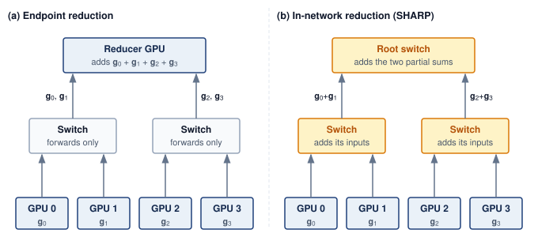{width=100%}

<!--
```{.tikz}
\begin{tikzpicture}[
  font=\small\sffamily,
  >=Stealth,
  header node/.style={
    font=\bfseries\normalsize,
    text=TextDark,
    align=center
  },
  subhdr node/.style={
    font=\scriptsize,
    text=TextMuted,
    align=center,
    text width=6.9cm
  },
  banner node/.style={
    rounded corners=3pt,
    inner sep=5pt,
    align=center,
    font=\footnotesize,
    text width=6.3cm,
    line width=0.6pt
  },
  gpu node/.style={
    rectangle,
    rounded corners=3pt,
    draw=SteelBlue,
    fill=white,
    line width=0.8pt,
    align=center,
    inner sep=3.5pt,
    font=\footnotesize,
    minimum width=1.35cm,
    minimum height=1.05cm
  },
  root node/.style={
    rectangle,
    rounded corners=3pt,
    line width=1pt,
    align=center,
    inner sep=5pt,
    font=\footnotesize,
    minimum width=3.4cm,
    minimum height=1.2cm
  },
  switch node/.style={
    rectangle,
    rounded corners=3pt,
    line width=0.8pt,
    align=center,
    inner sep=4pt,
    font=\footnotesize,
    minimum width=2.5cm,
    minimum height=1.2cm
  },
  badge node/.style={
    rectangle,
    rounded corners=2pt,
    fill=DarkGreen,
    text=white,
    font=\scriptsize\bfseries,
    inner sep=2.5pt,
    minimum width=2.1cm
  },
  footer node/.style={
    font=\scriptsize,
    text=TextMuted,
    align=center,
    text width=6.8cm
  }
]

% Left panel: (a) Standard Tree AllReduce
\node[header node, text=RedLine] (hdrA) at (3.65, 9.3) {(a) Standard Tree AllReduce};
\node[subhdr node] (subA) at (3.65, 8.85) {Full gradients traverse all switch tiers to Root GPU};

\node[banner node, draw=RedLine!80, fill=RedFill] (bannerA) at (3.65, 7.8) {
  \textbf{\textcolor{RedLine}{Bottleneck: Full Tensor Incast}}\\[1.5pt]
  All $N$ workers stream full tensors\\
  Root saturates at $N \times \text{Bandwidth}$
};

% Root GPU
\node[root node, draw=RedLine, fill=RedFill!60] (rootA) at (3.65, 5.75) {
  \textbf{\textcolor{RedLine}{Root GPU (Worker 0)}}\\[1.5pt]
  $\text{sum} = g_0 + g_1 + g_2 + g_3$\\[1.5pt]
  \textit{\scriptsize\textcolor{RedLine}{Compute \& PCIe Bottleneck}}
};

% Switches Level 1
\node[switch node, draw=SteelBlue!60, fill=LightBlue!70] (swA1) at (1.825, 3.3) {
  \textbf{Switch L1-A}\\[2pt]
  \scriptsize\textcolor{TextMuted}{Packet Forward Only}
};
\node[switch node, draw=SteelBlue!60, fill=LightBlue!70] (swA2) at (5.475, 3.3) {
  \textbf{Switch L1-B}\\[2pt]
  \scriptsize\textcolor{TextMuted}{Packet Forward Only}
};

% Leaf GPUs
\node[gpu node] (gA0) at (1.0, 1.0) {\textbf{GPU 0}\\[1.5pt]\scriptsize$\text{grad} = g_0$};
\node[gpu node] (gA1) at (2.65, 1.0) {\textbf{GPU 1}\\[1.5pt]\scriptsize$\text{grad} = g_1$};
\node[gpu node] (gA2) at (4.65, 1.0) {\textbf{GPU 2}\\[1.5pt]\scriptsize$\text{grad} = g_2$};
\node[gpu node] (gA3) at (6.3, 1.0) {\textbf{GPU 3}\\[1.5pt]\scriptsize$\text{grad} = g_3$};

% Connections Panel A
\draw[->, thick, RedLine] (gA0.north) -- (gA0.north |- swA1.south) node[midway, left=1pt, font=\scriptsize\bfseries] {$g_0\text{ (full)}$};
\draw[->, thick, RedLine] (gA1.north) -- (gA1.north |- swA1.south) node[midway, left=1pt, font=\scriptsize\bfseries] {$g_1\text{ (full)}$};
\draw[->, thick, RedLine] (gA2.north) -- (gA2.north |- swA2.south) node[midway, right=1pt, font=\scriptsize\bfseries] {$g_2\text{ (full)}$};
\draw[->, thick, RedLine] (gA3.north) -- (gA3.north |- swA2.south) node[midway, right=1pt, font=\scriptsize\bfseries] {$g_3\text{ (full)}$};

% Switch to Root (Upstream solid on outside, Downstream dashed on inside)
\draw[->, thick, RedLine] ($(swA1.north)-(0.25,0)$) -- ($(rootA.south)-(1.15,0)$)
  node[midway, left=2pt, font=\scriptsize\bfseries] {$g_0 + g_1$};
\draw[<-, thick, dashed, RedLine!70] ($(swA1.north)+(0.35,0)$) -- ($(rootA.south)-(0.45,0)$);

\draw[->, thick, RedLine] ($(swA2.north)+(0.25,0)$) -- ($(rootA.south)+(1.15,0)$)
  node[midway, right=2pt, font=\scriptsize\bfseries] {$g_2 + g_3$};
\draw[<-, thick, dashed, RedLine!70] ($(swA2.north)-(0.35,0)$) -- ($(rootA.south)+(0.45,0)$);

\node[footer node] at (3.65, 0.05) {Upstream: 4 full tensors. Downstream: 4 broadcast copies.};

% Divider
\draw[dashed, CardBorder!90, line width=0.8pt] (7.3, -0.25) -- (7.3, 9.6);

% Right panel: (b) SHARP In-Network Reduction
\node[header node, text=DarkGreen] (hdrB) at (10.95, 9.3) {(b) SHARP In-Network Reduction};
\node[subhdr node] (subB) at (10.95, 8.85) {Switch ASICs reduce inline; only aggregates go up};

\node[banner node, draw=DarkGreen!80, fill=GreenFill] (bannerB) at (10.95, 7.8) {
  \textbf{\textcolor{DarkGreen}{Optimization: Line-Rate Reduction}}\\[1.5pt]
  ASICs aggregate inline at wire speed\\
  $2\text{--}3\times$ AllReduce speedup
};

% Root Switch (ASIC)
\node[root node, draw=DarkGreen, fill=GreenFill!60] (rootB) at (10.95, 5.75) {
  \textbf{\textcolor{DarkGreen}{Root Switch (ASIC)}}\\[1.5pt]
  Aggregates Subtree Sums\\[1.5pt]
  \scriptsize\textcolor{DarkGreen}{\textbf{Final sum:} $g_0 + g_1 + g_2 + g_3\,\text{\ding{51}}$}
};

% SHARP Switches Level 1
\node[switch node, draw=DarkGreen, fill=GreenFill!35] (swB1) at (9.125, 3.3) {
  \textbf{SHARP Switch A}\\[3pt]
  \tikz\node[badge node] {ASIC REDUCE};
};
\node[switch node, draw=DarkGreen, fill=GreenFill!35] (swB2) at (12.775, 3.3) {
  \textbf{SHARP Switch B}\\[3pt]
  \tikz\node[badge node] {ASIC REDUCE};
};

% Leaf GPUs
\node[gpu node] (gB0) at (8.3, 1.0) {\textbf{GPU 0}\\[1.5pt]\scriptsize$\text{grad} = g_0$};
\node[gpu node] (gB1) at (9.95, 1.0) {\textbf{GPU 1}\\[1.5pt]\scriptsize$\text{grad} = g_1$};
\node[gpu node] (gB2) at (11.95, 1.0) {\textbf{GPU 2}\\[1.5pt]\scriptsize$\text{grad} = g_2$};
\node[gpu node] (gB3) at (13.6, 1.0) {\textbf{GPU 3}\\[1.5pt]\scriptsize$\text{grad} = g_3$};

% Connections Panel B
\draw[->, thick, DarkGreen] (gB0.north) -- (gB0.north |- swB1.south) node[midway, left=1pt, font=\scriptsize\bfseries] {$g_0$};
\draw[->, thick, DarkGreen] (gB1.north) -- (gB1.north |- swB1.south) node[midway, left=1pt, font=\scriptsize\bfseries] {$g_1$};
\draw[->, thick, DarkGreen] (gB2.north) -- (gB2.north |- swB2.south) node[midway, right=1pt, font=\scriptsize\bfseries] {$g_2$};
\draw[->, thick, DarkGreen] (gB3.north) -- (gB3.north |- swB2.south) node[midway, right=1pt, font=\scriptsize\bfseries] {$g_3$};

% Switch to Root (Upstream solid on outside, Downstream dashed on inside)
\draw[->, thick, DarkGreen] ($(swB1.north)-(0.25,0)$) -- ($(rootB.south)-(1.15,0)$)
  node[midway, left=2pt, font=\scriptsize\bfseries] {$(g_0 + g_1)\,\text{\ding{51}}$};
\draw[<-, thick, dashed, DarkGreen!70] ($(swB1.north)+(0.35,0)$) -- ($(rootB.south)-(0.45,0)$);

\draw[->, thick, DarkGreen] ($(swB2.north)+(0.25,0)$) -- ($(rootB.south)+(1.15,0)$)
  node[midway, right=2pt, font=\scriptsize\bfseries] {$(g_2 + g_3)\,\text{\ding{51}}$};
\draw[<-, thick, dashed, DarkGreen!70] ($(swB2.north)-(0.35,0)$) -- ($(rootB.south)+(0.45,0)$);

\node[footer node] at (10.95, 0.05) {Only aggregated payloads cross the switch fabric; zero GPU root stall.};

\end{tikzpicture}
```
-->

:::

Hierarchical AllReduce reduces the volume of cross-node traffic, but the aggregation still requires multiple network round-trips through endpoint GPUs. SHARP\index{SHARP!in-network reduction}[^fn-sharp-innetwork-aggregation] takes the endpoint out of those round-trips. Instead of gradients traveling to a destination GPU for summation, the InfiniBand switch aggregates partial sums as data packets pass through it.

[^fn-sharp-innetwork-aggregation]: **SHARP (Scalable Hierarchical Aggregation and Reduction Protocol)**\index{SHARP!in-network reduction}: In-network computing on Quantum InfiniBand switches that performs reduction operations (such as sum, min, and max) as packets traverse an aggregation tree [@graham2020]. The same work reports substantially higher reduction bandwidth than host-based algorithms and describes switch-resource limits on outstanding aggregation groups and trees, which can create contention when many collectives compete for the same in-network resources.

The benefit is twofold. First, SHARP reduces endpoint memory traffic\index{SHARP!memory traffic reduction} and can reduce pressure on upper-level links by aggregating packets before they leave a switch tier. In a software-based tree reduction, data arrives at a GPU, is written to memory, summed with local data, and then transmitted to the next level. With SHARP, the switch combines incoming packets in flight and forwards the aggregate for the reduction tree. Second, SHARP eliminates the store-and-forward path through intermediate GPUs. Each software hop adds the full $\alpha$-$\beta$ cost; with in-switch aggregation, the reduction happens inside the switch ASIC rather than in endpoint memory.

The practical impact is most pronounced for message sizes where aggregation latency contributes meaningfully to total AllReduce time. For very large messages, bandwidth dominates regardless of algorithm, and SHARP's latency reduction becomes proportionally smaller. For very small messages, fixed switch-processing overhead can limit the benefit. @graham2020 report multi-fold reduction-bandwidth improvements and smaller application-level gains for PyTorch workloads when SHARP Streaming-Aggregation is enabled on HDR/Quantum InfiniBand switches.

Strong scaling campaigns (training a fixed model across more accelerators without proportionally growing batch size) expose the importance of this distinction between collective speed and step time. As the per-accelerator batch shrinks, each gradient tensor stays large (proportional to model size) but the backward pass per accelerator shortens, exposing more of the communication budget. The limiting term can still be bandwidth; strong scaling alone does not establish that startup latency dominates. In-switch aggregation helps when its reduction in endpoint work or fabric traffic shortens the exposed critical path. A team choosing SHARP infrastructure for a scaling campaign should verify that the specific switch generation aggregates the datatypes the job reduces, such as FP16 or BF16 gradients, because supported datatypes differ across generations.

SHARP does impose constraints. The switch must support the specific reduction operation (typically limited to sum, min, and max on floating-point and integer types). The number of concurrent SHARP aggregation trees is limited by switch resources, so large clusters with many simultaneous training jobs may exhaust SHARP capacity. Additionally, SHARP requires InfiniBand infrastructure; it is not available on Ethernet-based fabrics.

### Topology-aware routing {#sec-communication-collective-operations-collective-operations-topology-detection-selection-2dc7}

Hierarchical AllReduce reduces inter-node traffic, and SHARP eliminates some of it entirely, but neither technique addresses a subtler problem: how the logical communication pattern maps to the physical network topology. A Ring AllReduce among 64 GPUs creates a logical ring, but which physical links carry each hop determines whether the ring achieves peak bandwidth or creates congestion. Two runs of the same training job on the same hardware can therefore differ substantially in communication throughput, depending on how ranks are assigned to GPUs and how the resulting traffic pattern interacts with the network's physical structure.

Communication libraries like NCCL perform topology detection\index{Topology Detection}\index{NCCL!topology detection} at initialization, running graph search\index{Topology-aware routing!graph search} algorithms to discover the physical network structure and find high-bandwidth communication paths [@nvidiaNcclUserGuide]. The library must determine, for each pair of ranks, whether the peer sits on a local NVLink switch or 100 meters away across an InfiniBand fabric, because that mapping determines which physical links each logical hop occupies.

The topology detection process begins with hardware enumeration. NCCL queries the PCIe bus to discover GPU placement, NVLink connectivity between GPUs, and NIC-to-PCIe-switch affinity. From this information, it constructs an internal graph where nodes represent GPUs and edges represent physical links with annotated bandwidth and latency. A graph search algorithm then finds communication paths that maximize aggregate bandwidth while minimizing the number of cross-domain hops (transitions between NVLink, PCIe, and InfiniBand domains). This topology-aware path selection is what allows NCCL to approach theoretical peak bandwidth on well-configured systems, while topology-unaware implementations can leave a large fraction of bandwidth unused.

#### Torus topology (TPU pods) {#sec-collective-communication-torus-topology-tpu-pods-68b2}

Google's Tensor Processing Unit (TPU)\index{TPU}\index{Tensor Processing Unit|see{TPU}} pods use a 3D torus topology\index{Torus Topology}\index{TPU!torus interconnect} in which each chip links directly to six neighbors $(\pm X, \pm Y, \pm Z)$ with equal per-link bandwidth; @sec-network-fabrics-dragonfly compares the torus with fat-tree fabrics. For collectives, the torus invites dimension-ordered reduction\index{Dimension-Ordered Reduction}, which decomposes the AllReduce into sequential Ring AllReduces along axis-aligned torus rings. For a pod with $X{\times}Y{\times}Z$ chips, ranks first execute independent X-dimension rings for each fixed $(Y,Z)$ coordinate, producing partial sums along each X line. A second phase runs Y-dimension rings to combine those partials across the $X \times Y$ plane, and a third executes Z-dimension rings across fixed $(X,Y)$ coordinates to complete the global reduction.

@Fig-torus-reduction maps this dimension-ordered schedule onto a $4 \times 4$ 2D torus grid (16 ranks)\index{Torus Topology!dimension-ordered reduction}. In Phase 1 (orange solid paths), each row executes an independent 4-rank Ring AllReduce across the horizontal X dimension using dashed wrap-around boundary links to close the ring ($2(X-1) = 6$ steps). Once row partial sums are established, Phase 2 (slate solid paths) executes orthogonal 4-rank vertical Ring AllReduces down the Y dimension ($2(Y-1) = 6$ steps). By routing traffic strictly across direct nearest-neighbor links, this schedule eliminates multi-hop contention and cuts startup latency from $2(N-1) = 30$ rounds on a flat 16-rank ring down to $2(X-1) + 2(Y-1) = 12$ rounds—a $2.5\times$ latency reduction.

::: {#fig-torus-reduction fig-env="figure" fig-pos="htb" fig-cap="**Dimension-ordered reduction on a torus topology**: In a 2D torus mesh ($4 \times 4$ node grid representing a simplified TPU pod slice), AllReduce proceeds sequentially along orthogonal dimensions. Phase 1 (orange) executes four parallel horizontal rings across the X dimension ($2(X-1) = 6$ steps). Phase 2 (slate) then executes four parallel vertical rings across the Y dimension ($2(Y-1) = 6$ steps) on the row-aggregated partial sums. Dashed links indicate torus wrap-around boundary connections. This dimension-ordered decomposition needs 12 startup rounds against 30 for a 16-rank 1D global ring, a $2.5\times$ reduction, but each axis processes the full message, so its bandwidth time is $3M/\beta$ for this grid." fig-alt="2D grid diagram of 16 nodes in a 4x4 torus topology. Orange arrows show Phase 1 horizontal row rings, slate arrows show Phase 2 vertical column rings, and dashed lines trace wrap-around boundary links. A legend below the grid names the three line styles."}
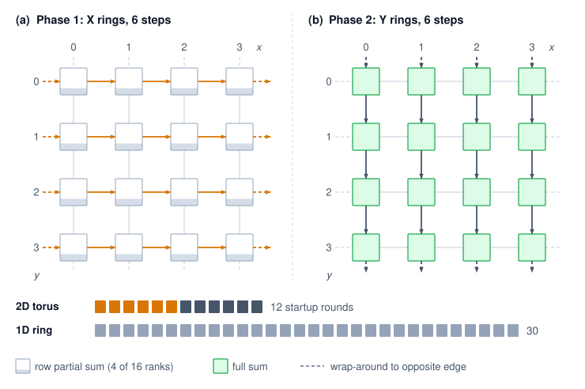{width=85%}

<!--
```{.tikz}
\begin{tikzpicture}[
  font=\small\sffamily,
  >=Stealth,
  node box/.style={
    rectangle,
    rounded corners=3pt,
    draw=SteelBlue,
    fill=white,
    line width=0.85pt,
    align=center,
    inner sep=3pt,
    font=\footnotesize,
    minimum width=1.25cm,
    minimum height=0.95cm
  },
  card/.style={
    rectangle,
    rounded corners=4pt,
    line width=0.7pt,
    inner sep=6pt,
    font=\footnotesize,
    text width=6.2cm,
    align=left
  },
  badge/.style={
    rectangle,
    rounded corners=2pt,
    draw=DarkGreen!60,
    fill=GreenFill,
    text=DarkGreen,
    font=\scriptsize\bfseries,
    inner sep=3pt,
    align=center
  }
]

% 4x4 Torus Grid (x: 1.0, 2.7, 4.4, 6.1; y: 5.8, 4.2, 2.6, 1.0)
\foreach \x/\col in {1.0/0, 2.7/1, 4.4/2, 6.1/3} {
  \foreach \y/\row in {5.8/0, 4.2/1, 2.6/2, 1.0/3} {
    \pgfmathtruncatemacro{\rank}{\row*4 + \col}
    \node[node box] (n_\col_\row) at (\x, \y) {\textbf{Node(\col,\row)}\\[1.5pt]\scriptsize\textcolor{TextMuted}{rank \rank}};
  }
}

% Direct Horizontal Arrows (Phase 1 - Orange)
\foreach \row in {0, 1, 2, 3} {
  \draw[->, very thick, OrangeLine] (n_0_\row.east) -- (n_1_\row.west);
  \draw[->, very thick, OrangeLine] (n_1_\row.east) -- (n_2_\row.west);
  \draw[->, very thick, OrangeLine] (n_2_\row.east) -- (n_3_\row.west);
}

% Direct Vertical Arrows (Phase 2 - Violet)
\foreach \col in {0, 1, 2, 3} {
  \draw[->, very thick, VioletLine] (n_\col_0.south) -- (n_\col_1.north);
  \draw[->, very thick, VioletLine] (n_\col_1.south) -- (n_\col_2.north);
  \draw[->, very thick, VioletLine] (n_\col_2.south) -- (n_\col_3.north);
}

% Wrap-around Horizontal Links (Phase 1 - Dashed Orange)
\foreach \row in {0, 1, 2, 3} {
  \draw[->, thick, dashed, OrangeLine]
    (n_3_\row.east) -- ++(0.35,0) -- ++(0, 0.58)
    -- ($(n_0_\row.west)+(-0.35, 0.58)$) -- ++(0, -0.58)
    -- (n_0_\row.west);
}

% Wrap-around Vertical Links (Phase 2 - Dashed Violet)
\foreach \col in {0, 1, 2, 3} {
  \draw[->, thick, dashed, VioletLine]
    (n_\col_3.south) -- ++(0, -0.35)
    -- ++(-0.85, 0)
    -- ($(n_\col_0.north)+(-0.85, 0.38)$)
    -- ++(0.85, 0)
    -- (n_\col_0.north);
}

% Right Side Cards
% Card 1: Phase 1
\node[card, draw=OrangeLine!80, fill=OrangeL] (card1) at (11.0, 6.30) {
  \textbf{\large\textcolor{OrangeLine}{Phase 1: X-Dimension Rings}}\\[2pt]
  \small Ring AllReduce along each row in parallel.\\[3pt]
  \scriptsize\textbf{Topology:} 4 rings parallel \hfill \textbf{Steps:} $2(X{-}1) = 6$
};

% Card 2: Phase 2
\node[card, draw=VioletLine!80, fill=VioletL] (card2) at (11.0, 3.90) {
  \textbf{\large\textcolor{VioletLine}{Phase 2: Y-Dimension Rings}}\\[2pt]
  \small Ring AllReduce along each column in parallel.\\[3pt]
  \scriptsize\textbf{Topology:} 4 rings parallel \hfill \textbf{Steps:} $2(Y{-}1) = 6$
};

% Card 3: Latency & Step Complexity
\node[card, draw=CardBorder, fill=CardFill] (card3) at (11.0, 1.20) {
  \textbf{\normalsize Latency \& Step Complexity}\\[3pt]
  % \scriptsize and tight math: at \footnotesize the second row was wider than
  % the 6.2cm card and spilled past its border.
  \scriptsize
  \begin{tabular}{@{}ll@{}}
    1D Global Ring ($N = 16$): & \textbf{\textcolor{RedLine}{30 steps}} \\[2pt]
    2D Torus $4\times4$ ($2(X{-}1)+2(Y{-}1)$): & \textbf{\textcolor{DarkGreen}{12 steps}} \\
  \end{tabular}\\[4pt]
  \centering
  \tikz\node[badge, minimum width=5.8cm] {\textbf{2.5$\times$ Step Latency Reduction}};
};

% Card 4: Bandwidth Invariant
\node[card, draw=CardBorder, fill=CardFill] (card4) at (11.0, -1.26) {
  \textbf{\normalsize Bandwidth Volume Invariant}\\[2pt]
  \small$\text{Total volume} = 2 \times \frac{N-1}{N} \times M \approx \frac{2M}{\beta}$\\[2pt]
  \scriptsize\textcolor{TextMuted}{Identical link utilization to a flat ring}
};

% Legend
\coordinate (legBase) at (7.8, -2.75);
\draw[very thick, OrangeLine] ($(legBase)+(0,0)$) -- ++(0.7,0)
  node[right, font=\scriptsize, text=TextDark] {Phase 1: X-dim horizontal ring};
\draw[very thick, VioletLine] ($(legBase)+(0,-0.35)$) -- ++(0.7,0)
  node[right, font=\scriptsize, text=TextDark] {Phase 2: Y-dim vertical ring};
\draw[thick, dashed, gray!80] ($(legBase)+(0,-0.70)$) -- ++(0.7,0)
  node[right, font=\scriptsize, text=TextDark] {Dashed: wrap-around torus boundary links};

\end{tikzpicture}
```
-->

:::

The byte term does not shrink with the rings. Because every axis processes the full $M$-byte tensor, the bandwidth time is $2M[(X-1)/X + (Y-1)/Y + (Z-1)/Z]/\beta$ for equal per-axis bandwidth $\beta$, while the startup term is $2[(X-1)+(Y-1)+(Z-1)]\alpha$. Shorter rings reduce startup cost, but these sequential full-message AllReduces do not retain the bandwidth cost of one global ring. A bandwidth-efficient multidimensional implementation must instead partition the work, for example with dimension-wise ReduceScatter followed by reverse-order AllGather.

Dimension-ordered reduction follows direct neighbor links and separates axis traffic in time; it does not change the network diameter or eliminate contention with other workloads. The torus topology also provides natural fault tolerance through alternate routing paths: if one link in the X-dimension fails, traffic can detour through the Y or Z dimensions (at the cost of increased latency). The compiler and collective runtime must choose a schedule for the actual topology, message size, and available links.

#### Rail-optimized routing (NVIDIA DGX) {#sec-collective-communication-railoptimized-routing-nvidia-dgx-7081}

In NVIDIA DGX systems, each GPU has its own dedicated NIC, and the rail-optimized fabric of @sec-network-fabrics-rail-optimized cables each NIC position to its own rail switch. Rail-optimized routing\index{Rail-optimized routing!DGX architecture} exploits this wiring by ensuring that GPUs at matching intra-node positions communicate strictly across nodes: GPU 0 on Node A exchanges data only with GPU 0 on Nodes B and C, GPU 1 communicates only with peer GPU 1s, and so on across all eight GPUs. This creates eight independent rails of communication that operate in parallel without contention (@tbl-rail-optimized).

| **Rail**   | **Participants**                                                                           | **Traffic** |
|:-----------|:-------------------------------------------------------------------------------------------|:-----------:|
| **Rail 0** | Node0-GPU0 $\leftrightarrow$ Node1-GPU0 $\leftrightarrow$ Node2-GPU0 $\leftrightarrow$ ... |  $M/8$ each |
| **Rail 1** | Node0-GPU1 $\leftrightarrow$ Node1-GPU1 $\leftrightarrow$ Node2-GPU1 $\leftrightarrow$ ... |  $M/8$ each |
| **...**    | ...                                                                                        |     ...     |
| **Rail 7** | Node0-GPU7 $\leftrightarrow$ Node1-GPU7 $\leftrightarrow$ Node2-GPU7 $\leftrightarrow$ ... |  $M/8$ each |

: **Rail-Optimized Traffic Distribution**: Each rail carries 1/8 of the total traffic independently. {#tbl-rail-optimized}

Rail alignment is critical because without it, all 8 GPUs on a node might try to send to the same remote GPU simultaneously, creating 8$\times$ contention on a single NIC\index{NIC!contention}. Rail-aligned routing ensures each NIC handles exactly 1/8 of the traffic, achieving full bisection bandwidth utilization.

Rail-optimized routing and hierarchical AllReduce reinforce each other. In the hierarchical decomposition described in @sec-communication-collective-operations-collective-operations-hierarchical-allreduce-1338, Step 2 (inter-node AllReduce) naturally aligns with rail topology. GPU $i$ on each node communicates only with GPU $i$ on other nodes, which is precisely the rail pattern. This alignment is not coincidental; NVIDIA designed the DGX hardware with rail-optimized communication in mind, and NCCL's hierarchical algorithms can exploit this structure when the topology is detected and ranks are mapped correctly. When the logical communication pattern matches the physical topology, each NIC carries its intended share of traffic and the cluster can approach its theoretical peak bisection bandwidth.

Misalignment between logical and physical topology is a common source of performance degradation that is difficult to diagnose without careful profiling. If process ranks are assigned arbitrarily (for example, by the job scheduler without topology awareness), the hierarchical AllReduce may route cross-node traffic through the wrong NICs or across rails, creating hotspots. In the worst case, all eight shard exchanges of a node converge on one NIC, cutting that node's usable injection bandwidth to one-eighth of the rail-aligned value. Large deployments use topology-aware rank assignment\index{Topology-aware routing!rank assignment} (configured through device ordering such as `CUDA_VISIBLE_DEVICES`, NIC binding, and the scheduler's GPU placement policies) to ensure alignment.

Hierarchical collective execution, combined with topology-aware routing, maximizes effective fabric bandwidth across complex network topologies: the $\alpha$-$\beta$ model identifies the bottleneck (inter-node bandwidth), hierarchical decomposition reduces traffic across that bottleneck, and rail optimization ensures the reduced traffic flows without contention. Together, these techniques close the gap between theoretical peak bandwidth and achieved bandwidth on well-configured clusters.

## Gradient Compression Under Bandwidth Scarcity {#sec-communication-collective-operations-collective-operations-gradient-compression-7a5c}

Even after topology tuning and algorithm selection, a system may remain bandwidth-bound because the physical fabric cannot move gradient payloads fast enough. In that regime, sending fewer bits becomes a deliberate design choice: when the wire cannot be made faster, the only remaining systems lever is reducing the payload itself.

The bandwidth wall arises most acutely in two scenarios: training across data centers connected by wide-area networks (where bandwidth is 10--100$\times$ lower than InfiniBand), and training on cloud instances with commodity Ethernet networking where RDMA is unavailable or constrained. Beyond the data center, federated training on phone-class devices, the Archetype C (Federated MobileNet) regime, faces a narrower link still. Each client uploads its update over a cellular or Wi-Fi uplink that is orders of magnitude slower than a data center port and only intermittently available, so the quantization and error-feedback techniques that follow apply to every client update. In these bandwidth-constrained settings, gradient compression techniques can reduce communication volume by 4--1000$\times$, at the cost of introducing noise into the optimization process. The central tension is between bandwidth reduction and the noise tolerance of the optimization process: how much compression the optimizer can absorb before convergence is compromised.

### Precision reduction via quantization {#sec-communication-collective-operations-collective-operations-quantization-reducing-precision-815b}

Quantization is the least disruptive compression lever when bandwidth is binding because it keeps every gradient element but reduces the bits used to represent it. Most gradients are computed in FP32 (32-bit floating point) or BF16 (16-bit brain float), so reducing bit-width directly reduces communication volume. The useful question is how much gradient fidelity the optimizer can absorb across the progression from mild to aggressive quantization.

Half-precision representations such as FP16\index{FP16!definition} serve as a standard baseline for accelerator training. By halving the bit-width of FP32, FP16 delivers a $2\times$ reduction in communication volume with minimal impact on model convergence. Moving to INT8\index{INT8!definition} quantizes each gradient vector into 256 discrete levels, achieving a $4\times$ volume reduction relative to FP32. This requires computing a tensor-wide scaling factor $s = \max(\lvert \mathbf{g} \rvert) / 127$, quantizing via $\mathbf{g}_{\text{int8}} = \text{round}(\mathbf{g}/s)$, and having the receiver reconstruct $\hat{\mathbf{g}} = \mathbf{g}_{\text{int8}} \times s$, which introduces quantization noise proportional to the gradient magnitude. At the extreme, 1-bit SGD\index{1-bit SGD} transmits only the sign of each gradient element ($+1$ or $-1$), yielding a $32\times$ reduction over FP32. The receiver reconstructs values using a learned or adaptive scaling factor, though the substantial noise introduced by 1-bit quantization can severely degrade convergence without error-feedback mechanisms [@seide2014; @karimireddy2019error].

#### Block quantization for gradient communication {#sec-collective-communication-block-quantization-gradient-communication-c883}

The quantization progression in the preceding section uses a single scaling factor per entire tensor, which implicitly assumes the gradient distribution is uniform across the tensor. In practice, gradient distributions are highly nonuniform: attention layers produce gradients with heavy tails, embedding layers produce extremely sparse gradients, and normalization layers produce gradients concentrated near zero. A single scaling factor per tensor is suboptimal when gradient distributions vary across the tensor. Regions with small gradients lose most of their information when quantized with a scaling factor dominated by the tensor's maximum value. Block quantization\index{Block Quantization} addresses this by dividing the gradient tensor into blocks of $b_{\text{block}}$ elements (typically $b_{\text{block}} = 64$ or $128$) and computing an independent scaling factor per block\index{Block Quantization!block scale factor}. Each block's scaling factor adapts to the local gradient distribution, reducing quantization error at the cost of transmitting $d_{\text{grad}}/b_{\text{block}}$ additional scaling factors.

For a gradient vector of dimension $d_{\text{grad}}$ quantized to INT8 with block size $b_{\text{block}}$, the message size is $d_{\text{grad}} \times 1\ \text{byte}$ for the quantized values plus $(d_{\text{grad}}/b_{\text{block}}) \times 4\ \text{bytes}$ for the FP32 scaling factors, or $d_{\text{grad}} + 4d_{\text{grad}}/b_{\text{block}}$ bytes in total. The effective compression is therefore $4d_{\text{grad}} / (d_{\text{grad}} + 4d_{\text{grad}}/b_{\text{block}}) = 4b_{\text{block}} / (b_{\text{block}} + 4)$, which for $b_{\text{block}} = 128$ reaches 3.88$\times$, close to the theoretical 4$\times$. The quality gain comes from replacing the global error bound: block quantization reduces the maximum quantization error from $s \cdot 0.5$, where $s$ is the global scaling factor, to $s_b \cdot 0.5$, where $s_b$ is the block-local scaling factor, which for the heavy-tailed gradient distributions common in attention layers can cut quantization error by 2--5$\times$ compared to per-tensor quantization.

Interfaces that fuse quantize-reduce operations make block quantization practical in communication compression, but each reduction in bit-width introduces quantization noise. This noise acts as a biased perturbation to the true gradient direction. For aggressive quantization (INT8 and especially 1-bit), the systematic bias can prevent convergence unless the system carries an error-feedback correction across steps. Quantization should therefore move only as far down the precision ladder as the convergence budget permits.

### Gradient sparsification methods {#sec-communication-collective-operations-collective-operations-sparsification-transmitting-important-gradients-2cd2}

Quantization attacks communication volume by reducing the number of bits per gradient element while transmitting every element. An orthogonal approach, sparsification\index{Sparsification}, attacks the problem from the other direction: keep full precision but transmit only a subset of gradient elements, setting the rest to zero.

#### Top-k sparsification {#sec-collective-communication-topk-sparsification-40fc}

The most common method is Top-k compression\index{Top-k Sparsification}: for a gradient vector $\mathbf{g} \in \mathbb{R}^{d_{\text{grad}}}$, transmit only the $K_{\text{top}}$ elements with the largest absolute magnitude, setting the rest to zero [@aji2017; @lin2018deep]:

$$\text{TopK}(\mathbf{g}) = \mathbf{g} \odot \mathbf{1}_{|\mathbf{g}| \geq |\mathbf{g}|_{(K_{\text{top}})}}$$

where $|\mathbf{g}|_{(K_{\text{top}})}$ is the $K_{\text{top}}$-th largest element by magnitude. With $K_{\text{top}} = 0.001 \times d_{\text{grad}}$ (keeping only 0.1 percent of elements), this achieves 1000$\times$ compression.

The compression headline must be discounted by the cost of encoding the sparse representation\index{Top-k Sparsification!index overhead}. Transmitting a sparse gradient requires sending both the nonzero values and their indices. For a gradient vector of dimension $d_{\text{grad}}$ with $K_{\text{top}}$ nonzero elements, the encoded message contains $K_{\text{top}}$ values (each in FP32 or FP16) plus $K_{\text{top}}$ indices (typically INT32). The total message size is $K_{\text{top}} \times (4 + 4) = 8 K_{\text{top}}$ bytes for FP32 values with INT32 indices. The effective compression ratio is therefore $4d_{\text{grad}} / (8 K_{\text{top}}) = d_{\text{grad}} / (2 K_{\text{top}})$.

For $K_{\text{top}} = 0.001 d_{\text{grad}}$, the encoded message yields a compression ratio of 500$\times$, not the 1000$\times$ suggested by the kept-element fraction alone, because the index overhead is significant. Reducing the index size to INT16 (for $d_{\text{grad}} < 65536$) or using run-length encoding for structured sparsity patterns can improve the effective ratio.

Top-k is not the only sparsification rule. Random-k sparsification\index{Random-k Sparsification} selects $K_{\text{rand}}$ elements uniformly at random and scales them by $d_{\text{grad}}/K_{\text{rand}}$ to maintain an unbiased gradient estimate. Random-k has the advantage of being an unbiased compressor even without error feedback, because $\mathbb{E}[\text{RandomK}(\mathbf{g})] = \mathbf{g}$. However, it introduces higher variance than Top-k because it discards large gradients with the same probability as small ones. In practice, Top-k with error feedback converges faster than Random-k for the same compression ratio, because Top-k preserves the most informative gradient components at each step.

#### The convergence problem {#sec-collective-communication-convergence-problem-43f6}

Naively discarding small gradients creates a systematic bias\index{Sparsification!systematic bias}. If a parameter consistently receives small gradients (e.g., 0.01 per step), it will not be updated because 0.01 is always below the Top-k threshold. Over thousands of steps, these "lost" gradients accumulate to a significant error that prevents the model from converging to the true optimum.

The problem is not merely practical; it is a fundamental mathematical obstacle. Without correction, sparsified SGD is a biased estimator of the true gradient, and biased gradient descent can converge to arbitrarily wrong solutions. The same problem afflicts aggressive quantization: rounding gradients to INT8 or 1-bit introduces a systematic rounding error that accumulates across training steps. Error feedback addresses this accumulation for quantized gradients [@seide2014] and for sparsified gradients [@stich2018sparsified; @karimireddy2019error].

### Error feedback and residual accumulation {#sec-communication-collective-operations-error-feedback}

Error feedback controls the accumulated error introduced by compression. At step $t$, the system adds the local residual $\mathbf{e}_t$ to the new gradient $\mathbf{g}_t$, compresses that corrected vector, and transmits the compressed update $\mathbf{v}_t$. The next local accumulator\index{Error Feedback!residual accumulator} stores the difference between the corrected vector and the transmitted update. This residual path defers information so that later updates can recover it under the compressor's convergence assumptions.

::: {.column-margin}
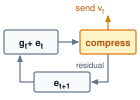{width="100%" fig-alt="Error-feedback loop: a box g t plus e t feeds an amber compress box, which sends v t upward; the residual e t plus 1 returns to the first box for the next step."}

*Error feedback carries the residual into the next compressed step.*
:::

::: {#dfn-collective-communication-error-feedback-mechanism .callout-definition title="Error feedback mechanism"}

***Error feedback***\index{Error Feedback!definition} is a distributed-training technique for gradient compression that maintains a per-worker residual accumulator $\mathbf{e}_t$, re-injecting the compression error back into the next gradient update so that information omitted from the transmitted update remains in the residual. A finite run can end with an untransmitted residual.

1.  **Significance**: Top-k sparsification at 1 percent keeps only the largest 1 percent of gradient values by magnitude, reducing AllReduce data volume from `{python} GradSyncSignificance.gradient_gb_str` to `{python} GradSyncSignificance.gradient_top1_gb_str` for a 70B model, a 100$\times$ payload reduction before sparse-index overhead. Without error feedback, the discarded 99 percent of gradient values create a biased update that can harm convergence; with error feedback, the residual accumulates until deferred components cross the compression threshold in later steps, recovering the convergence guarantees analyzed for memory/error-feedback variants under their assumptions [@stich2018sparsified; @karimireddy2019error].
2.  **Distinction**: Unlike lossy compression (which permanently discards sub-threshold gradient components), error feedback is a delayed transmission strategy: the residual $\mathbf{e}_t$ telescopes across steps so that $\frac{1}{K}\sum_{t=1}^{K} \mathbf{v}_t \to \frac{1}{K}\sum_{t=1}^{K} \mathbf{g}_t$ as $K \to \infty$, provided the residual satisfies $\mathbf{e}_K/K \to 0$. This is an average-update identity, not by itself a convergence guarantee.
3.  **Common pitfall**: A frequent misconception is that error feedback is automatic whenever a compressor is used. It is not: the training system must explicitly preserve and reinject the residual. Without that residual path, Top-k and 1-bit quantization introduce systematic bias that can accumulate across steps [@karimireddy2019error].

:::

Error feedback preserves cumulative gradient information over time. Consider what happens over $K$ steps:

$$\sum_{t=1}^{K} \mathbf{v}_t = \sum_{t=1}^{K} \left[(\mathbf{g}_t + \mathbf{e}_t) - \mathbf{e}_{t+1}\right] = \sum_{t=1}^{K} \mathbf{g}_t + \mathbf{e}_1 - \mathbf{e}_{K+1}$$

If the error accumulator remains bounded under the chosen compressor and training assumptions, then as $K \to \infty$:

$$\frac{1}{K}\sum_{t=1}^{K} \mathbf{v}_t \to \frac{1}{K}\sum_{t=1}^{K} \mathbf{g}_t$$

Under that bounded-residual condition, the difference between the two averages vanishes. At a finite stopping point, untransmitted information remains in the residual. Repeated small gradients can accumulate in $\mathbf{e}_t$ until they exceed the compression threshold, as the worked trace illustrates.

The telescoping property\index{Error Feedback!telescoping sum} of compression error across time is why error feedback can transform a biased compressor into a convergent training method. Theoretical analyses show convergence guarantees for sparsified SGD with memory and for EF-SGD with broad compression operators under their stated assumptions [@stich2018sparsified; @karimireddy2019error]. A short trace shows how error feedback preserves gradient information that naive compression would lose. @Tbl-error-feedback-naive runs the trace for a greedy compressor with no residual path, transmitting only values $\geq 0.5$:

```{python}
#| echo: false
#| label: error-feedback-calc
from mlsysim.fmt import MarkdownStr, check, fmt, fmt_percent

def _ef_dec(x):
    """One-decimal trace value with a Unicode minus sign (matches the table)."""
    if abs(x - round(x)) <= 1e-9:
        return MarkdownStr(str(int(round(x))))
    return MarkdownStr(f"{x:.1f}".replace("-", "−"))

def _ef_int(x):
    """Integer trace value (transmitted v_t and cumulative columns)."""
    return MarkdownStr(str(int(round(x))))

class ErrorFeedbackTrace:
    # ┌── 1. LOAD ──────────────────────────────────────────
    gradients = [0.4, 0.3, 0.2, 0.4, 0.3]
    # ┌── 2. EXECUTE (5-step trace) ────────────────────────
    # Error-feedback recurrence: e starts at 0; each step adds the carried error
    # to the gradient, transmits the rounded (1-bit) value, and stores the
    # residual as the next error.
    errors = [0.0]  # e_1 .. e_6 (errors[t] is the error entering step t+1)
    g_plus_e = []  # g_t + e_t
    transmitted = []  # v_t
    for t, g in enumerate(gradients):
        s = g + errors[t]
        v = round(s)
        g_plus_e.append(s)
        transmitted.append(v)
        errors.append(s - v)
    # Cumulative-true running sum (naive table's last column) and cumulative-v.
    cum_true_running = []
    _acc = 0.0
    for g in gradients:
        _acc += g
        cum_true_running.append(_acc)
    cum_v_running = []
    _acc = 0
    for v in transmitted:
        _acc += v
        cum_v_running.append(_acc)

    cum_transmitted = int(sum(transmitted))
    final_error = round(errors[-1], 4)
    true_cumulative = sum(gradients)
    naive_transmitted = 0
    conservation = cum_transmitted + final_error
    # ┌── 3. GUARD ─────────────────────────────────────────
    check(cum_transmitted == 2, f"Cum transmitted = {cum_transmitted}, expected 2")
    check(abs(final_error - (-0.4)) < 1e-9, f"Final error = {final_error}, expected -0.4")
    check(abs(true_cumulative - 1.6) < 1e-9, f"True cum = {true_cumulative}, expected 1.6")
    check(abs(conservation - true_cumulative) < 1e-9, "Conservation violated")
    # ┌── 4. OUTPUT ────────────────────────────────────────
    cum_str = fmt(cum_transmitted, precision=0, commas=False)
    error_str = MarkdownStr(_ef_dec(final_error))
    true_str = fmt(true_cumulative, precision=1, commas=False)
    naive_str = fmt(naive_transmitted, precision=0, commas=False)
    conservation_str = MarkdownStr(f"{cum_transmitted} + ({final_error:.1f})".replace("-", "−"))
    naive_loss_pct_str = fmt_percent(100 / 100, precision=0, commas=False, style='prose')
    # Per-cell trace exports (scalar, step-indexed) for @tbl-error-feedback-naive
    # and @tbl-error-feedback; the validator requires *_str names, not subscripts.
    naive_v_str = MarkdownStr(_ef_int(naive_transmitted))  # always-zero transmitted (naive)
    naive_cum_str = MarkdownStr(_ef_int(0))  # naive cumulative transmitted (always zero)
    # g_t (both tables)
    g1_str, g2_str, g3_str, g4_str, g5_str = [_ef_dec(g) for g in gradients]
    # cumulative true (naive table)
    ct1_str, ct2_str, ct3_str, ct4_str, ct5_str = [_ef_dec(c) for c in cum_true_running]
    # e_t entering step t (error-feedback table); errors[:5] = e_1..e_5
    e1_str, e2_str, e3_str, e4_str, e5_str = [_ef_dec(e) for e in errors[:5]]
    # g_t + e_t (error-feedback table)
    gpe1_str, gpe2_str, gpe3_str, gpe4_str, gpe5_str = [_ef_dec(s) for s in g_plus_e]
    # v_t transmitted (error-feedback table)
    v1_str, v2_str, v3_str, v4_str, v5_str = [_ef_int(v) for v in transmitted]
    # e_{t+1} residual (error-feedback table); errors[1:6] = e_2..e_6
    en1_str, en2_str, en3_str, en4_str, en5_str = [_ef_dec(e) for e in errors[1:6]]
    # cumulative v (error-feedback table)
    cv1_str, cv2_str, cv3_str, cv4_str, cv5_str = [_ef_int(c) for c in cum_v_running]
```

| **Step** |       **True Gradient $g_t$**        |           **Transmitted $v_t$**           |          **Cumulative Transmitted**         |          **Cumulative True**          |
|:---------|:------------------------------------:|:-----------------------------------------:|:-------------------------------------------:|:-------------------------------------:|
| 1        | `{python} ErrorFeedbackTrace.g1_str` | `{python} ErrorFeedbackTrace.naive_v_str` | `{python} ErrorFeedbackTrace.naive_cum_str` | `{python} ErrorFeedbackTrace.ct1_str` |
| 2        | `{python} ErrorFeedbackTrace.g2_str` | `{python} ErrorFeedbackTrace.naive_v_str` | `{python} ErrorFeedbackTrace.naive_cum_str` | `{python} ErrorFeedbackTrace.ct2_str` |
| 3        | `{python} ErrorFeedbackTrace.g3_str` | `{python} ErrorFeedbackTrace.naive_v_str` | `{python} ErrorFeedbackTrace.naive_cum_str` | `{python} ErrorFeedbackTrace.ct3_str` |
| 4        | `{python} ErrorFeedbackTrace.g4_str` | `{python} ErrorFeedbackTrace.naive_v_str` | `{python} ErrorFeedbackTrace.naive_cum_str` | `{python} ErrorFeedbackTrace.ct4_str` |
| 5        | `{python} ErrorFeedbackTrace.g5_str` | `{python} ErrorFeedbackTrace.naive_v_str` | `{python} ErrorFeedbackTrace.naive_cum_str` | `{python} ErrorFeedbackTrace.ct5_str` |

: **Naive Compression Trace (No Error Feedback)**: Five-step worked trace showing how a threshold compressor transmits zero whenever individual gradients fall below the threshold. {#tbl-error-feedback-naive}

The error-feedback trace in @tbl-error-feedback runs the same sequence with a residual accumulator $\mathbf{e}_t$ that re-injects the discarded remainder into the next step. The trace in example \ref{exmp-collective-communication-error-feedback-mechanism} works through both traces to show that the deferred information is conserved rather than lost.

::: {#exmp-collective-communication-error-feedback-mechanism .callout-example title="Error feedback mechanism"}

**Scenario**: A gradient compression pipeline applies thresholding to small gradient values (<0.5) over 5 training steps during distributed data-parallel training.

**Diagnosis**: Naive greedy compression discards values below threshold, transmitting `{python} ErrorFeedbackTrace.naive_str` when true cumulative gradient is `{python} ErrorFeedbackTrace.true_str` (`{python} ErrorFeedbackTrace.naive_loss_pct_str` gradient loss). Adding error feedback ($\mathbf{e}_t$) telescopes residual errors across steps, transmitting `{python} ErrorFeedbackTrace.cum_str` with `{python} ErrorFeedbackTrace.error_str` residual error.

**Systems lesson**: Error feedback preserves convergence in lossy gradient compression. By storing untransmitted residual vectors in local accelerator memory ($\mathbf{e}_{t+1} = \mathbf{g}_t + \mathbf{e}_t - \mathbf{v}_t$), small gradients accumulate over steps until they cross the transmission threshold, so the compressor defers them rather than discarding them.

:::

| **Step** |              **$g_t$**               |              **$e_t$**               |            **$g_t + e_t$**             |              **$v_t$**               |   **$e_{t+1} = (g_t + e_t) - v_t$**   |           **Cumulative $v$**          |
|:---------|:------------------------------------:|:------------------------------------:|:--------------------------------------:|:------------------------------------:|:-------------------------------------:|:-------------------------------------:|
| 1        | `{python} ErrorFeedbackTrace.g1_str` | `{python} ErrorFeedbackTrace.e1_str` | `{python} ErrorFeedbackTrace.gpe1_str` | `{python} ErrorFeedbackTrace.v1_str` | `{python} ErrorFeedbackTrace.en1_str` | `{python} ErrorFeedbackTrace.cv1_str` |
| 2        | `{python} ErrorFeedbackTrace.g2_str` | `{python} ErrorFeedbackTrace.e2_str` | `{python} ErrorFeedbackTrace.gpe2_str` | `{python} ErrorFeedbackTrace.v2_str` | `{python} ErrorFeedbackTrace.en2_str` | `{python} ErrorFeedbackTrace.cv2_str` |
| 3        | `{python} ErrorFeedbackTrace.g3_str` | `{python} ErrorFeedbackTrace.e3_str` | `{python} ErrorFeedbackTrace.gpe3_str` | `{python} ErrorFeedbackTrace.v3_str` | `{python} ErrorFeedbackTrace.en3_str` | `{python} ErrorFeedbackTrace.cv3_str` |
| 4        | `{python} ErrorFeedbackTrace.g4_str` | `{python} ErrorFeedbackTrace.e4_str` | `{python} ErrorFeedbackTrace.gpe4_str` | `{python} ErrorFeedbackTrace.v4_str` | `{python} ErrorFeedbackTrace.en4_str` | `{python} ErrorFeedbackTrace.cv4_str` |
| 5        | `{python} ErrorFeedbackTrace.g5_str` | `{python} ErrorFeedbackTrace.e5_str` | `{python} ErrorFeedbackTrace.gpe5_str` | `{python} ErrorFeedbackTrace.v5_str` | `{python} ErrorFeedbackTrace.en5_str` | `{python} ErrorFeedbackTrace.cv5_str` |

: **Error-Feedback Compression Trace**: Same five-step sequence under error-feedback compression. {#tbl-error-feedback}

### 1-bit Adam compression-aware optimization {#sec-communication-1bit-adam}

Error feedback can restore convergence guarantees for suitable compressors under stated assumptions, but it treats the optimizer as a black box. The gradient is compressed, transmitted, decompressed, and then fed to the optimizer as if nothing happened. This separation leaves performance on the table: the optimizer maintains internal state (momentum, variance estimates) that contains information about the gradient distribution, yet compression ignores this state entirely. The decision is whether compression should operate on raw gradients or on the optimizer state that already summarizes them.

A more integrated approach, pioneered by Microsoft's DeepSpeed\index{DeepSpeed!1-bit Adam} team, compresses the optimizer's communication rather than the raw gradients. 1-bit Adaptive Moment Estimation (Adam)\index{1-bit Adam} [@tang20211bit] exploits the observation that Adam's second-moment estimate ($\mathbf{v}_t$) stabilizes after an initial training period. It then compresses the communicated first-moment state ($\mathbf{m}_t$) to 1 bit per parameter plus a scaling factor while retaining the stabilized second moment as an adaptive preconditioner.

The algorithm proceeds in two phases. During a warmup phase, standard Adam runs with full-precision communication so that the second-moment estimate stabilizes. The algorithm then freezes that variance estimate\index{1-bit Adam!variance freeze} and uses it as a fixed adaptive preconditioner. In the communication-efficient phase, workers communicate the momentum using 1-bit compression (sign plus scale) and retain each compression residual locally so it can be added before the next compression step.

The theoretical justification combines the frozen adaptive preconditioner with error-compensated momentum compression. The residual feeds quantization error into later momentum messages, controlling accumulated compression error and supporting the paper's convergence result without treating the compressed update as an unbiased estimator.

The 1-bit Adam paper reports up to 5$\times$ communication-volume reduction while matching the convergence speed of uncompressed Adam, with experiments up to 256 GPUs showing up to 3.3$\times$ higher throughput for BERT-Large pretraining and up to 2.9$\times$ higher throughput for Stanford Question Answering Dataset (SQuAD) fine-tuning [@tang20211bit]. The practical lesson is narrower than "compression always wins": the compression overhead must remain small compared with the communication time saved.

The success of 1-bit Adam illustrates a broader principle: compression is most effective when it is co-designed with the optimization algorithm. Compressing raw gradients discards information indiscriminately. Compressing optimizer state exploits the structure of the optimization trajectory, so a 1-bit message can preserve convergence even though the end-to-end volume reduction (up to 5$\times$ once the uncompressed warmup is counted) is smaller than the raw 32$\times$ bit-width ratio.

```{python}
#| echo: false
#| label: compression-payback-notebook
# ┌─────────────────────────────────────────────────────────────────────────────
# │ COMPRESSION PAYBACK (NOTEBOOK)
# ├─────────────────────────────────────────────────────────────────────────────
# │ Context: "The Payback of Compression" .callout-notebook
# │
# │ Goal: Quantify the speedup of gradient compression (quantization).
# │ Show: speedup as computed from T_compute, T_comm, and compression ratio
# │       (current model produces ~5.7-fold; inline value drives prose).
# │ How: T = T_compute + T_comm/Ratio.
# │
# └─────────────────────────────────────────────────────────────────────────────
from mlsysim.fmt import check, fmt_multiple, fmt_ratio, fmt_time
from mlsysim.core.units import ms

class CompressionPayback:
    # ┌── 1. LOAD ──────────────────────────────────────────
    t_comm = 40 * ms  # scenario assumption: original FP32 AllReduce time
    ratio = 8  # 1-bit quantization (32\times compression, but with protocol overhead)
    t_overhead = 2 * ms  # scenario assumption: compute time to quantize/dequantize
    t_comm_fast = 1 * ms  # scenario assumption: same buffer on a fast NVLink domain
    # ┌── 2. EXECUTE ───────────────────────────────────────
    t_compressed_comm = t_comm / ratio
    t_total_new = t_compressed_comm + t_overhead
    speedup = (t_comm / t_total_new).to_base_units().magnitude
    # ┌── 3. GUARD ─────────────────────────────────────────
    check(5 < speedup < 6, f"Speedup {speedup:.1f}x unexpected")
    check(t_overhead > t_comm_fast * (1 - 1 / ratio), "Fast-network case must fail the payback condition")
    # ┌── 4. OUTPUT ────────────────────────────────────────
    cp_comm_time_ms_str = fmt_time(t_comm, ms, precision=0, commas=False)
    cp_throughput_factor_mult_str = fmt_multiple(ratio, precision=0, commas=False)
    cp_ratio_str = fmt_ratio(ratio, precision=0, commas=False)
    cp_overhead_ms_str = fmt_time(t_overhead, ms, precision=0, commas=False)
    cp_compressed_comm_ms_str = fmt_time(t_compressed_comm, ms, precision=0, commas=False)
    cp_total_new_ms_str = fmt_time(t_total_new, ms, precision=0, commas=False)
    cp_speedup_mult_str = fmt_multiple(speedup, precision=1, commas=False)
    cp_saved_ms_str = fmt_time(t_comm - t_compressed_comm, ms, precision=0, commas=False)
    cp_fast_comm_ms_str = fmt_time(t_comm_fast, ms, precision=0, commas=False)
```

::: {#nbk-collective-communication-payback-compression .callout-notebook title="The payback of compression"}

**Problem**: A training job takes `{python} CompressionPayback.cp_comm_time_ms_str` to synchronize a gradient buffer. The system uses 1-bit Adam in its compressed phase, which encodes each communicated FP32 value in 1 bit, a 32$\times$ reduction in raw payload, but adds `{python} CompressionPayback.cp_overhead_ms_str` of CPU/GPU overhead for the compression logic. Scaling factors, optimizer-state coordination, and protocol overhead reduce the realized network gain to `{python} CompressionPayback.cp_throughput_factor_mult_str` effective throughput. What is the actual communication speedup?

**Math**:

1. **Compressed communication time**: `{python} CompressionPayback.cp_comm_time_ms_str` divided by `{python} CompressionPayback.cp_ratio_str` = `{python} CompressionPayback.cp_compressed_comm_ms_str`.
2. **Total new time**: `{python} CompressionPayback.cp_compressed_comm_ms_str` (comm) + `{python} CompressionPayback.cp_overhead_ms_str` (overhead) = `{python} CompressionPayback.cp_total_new_ms_str`.
3. **Effective speedup**: `{python} CompressionPayback.cp_comm_time_ms_str` divided by `{python} CompressionPayback.cp_total_new_ms_str` $\approx$ `{python} CompressionPayback.cp_speedup_mult_str`.

**Systems insight**: Compression is a trade of compute for bandwidth. It pays off only when $T_{\text{overhead}} < \CommunicationTime \times (1 - 1/\CompressionRatio)$. In this case, spending `{python} CompressionPayback.cp_overhead_ms_str` to save `{python} CompressionPayback.cp_saved_ms_str` of network time is a clear win. On a high-speed NVLink network where $\CommunicationTime$ is only `{python} CompressionPayback.cp_fast_comm_ms_str`, the same compression logic would cost more than it saves and slow down training. Always profile the network before adding compression.

:::

The payoff calculation makes compression a conditional optimization: it must save enough communication time to cover both encoding overhead and convergence risk.

::: {#chk-collective-communication-gradient-compression-decisions .callout-checkpoint title="Gradient compression decisions"}

Verify your understanding of when and how to apply gradient compression:

- [ ] **Error feedback**: explain why uncorrected 1-bit SGD can fail to converge and why 1-bit Adam introduces warmup and residual correction, comparing how each method handles information loss.
- [ ] **Compression payoff**: determine whether applying 4$\times$ gradient compression improves total step time when the backward pass takes 800 ms and AllReduce takes either 200 ms or 2000 ms.
- [ ] **Error accumulator**: derive the steady-state behavior of the error accumulator $e_t$ when the true gradient is constant at $g = 0.3$ and the compression threshold is 0.5.
- [ ] **Top-k vs. quantization**: choose between Top-k sparsification and quantization for a workload, accounting for compression ratio and sparse-index encoding overhead.

:::

### Bandwidth versus convergence trade-offs in compression {#sec-communication-collective-operations-compression-tradeoffs}

Gradient compression is not free; it trades reduced communication for increased variance or bias in the optimization process\index{Gradient Compression!trade-offs}. The comparison in @tbl-gradient-compression-methods summarizes the source-backed patterns from quantization, sparsification, error-feedback, and optimizer-aware compression work [@seide2014; @aji2017; @lin2018deep; @stich2018sparsified; @karimireddy2019error; @tang20211bit].

| **Method**                | **Compression Ratio** | **Convergence Impact**                   | **Best Use Case**              |
|:--------------------------|:---------------------:|:-----------------------------------------|:-------------------------------|
| **FP16**                  |       2$\times$       | Check range and numerical stability      | Common accelerator baseline    |
| **INT8 + Error FB**       |   At most 4$\times$   | Workload- and scaling-dependent          | Bandwidth-constrained clusters |
| **Top-k (1%) + Error FB** |   At most 50$\times$  | Depends on sparsity and residual control | Cross-data center training     |
| **1-bit + Error FB**      |   At most 32$\times$  | Requires compression-aware optimization  | Extreme bandwidth constraints  |

: **Gradient Compression Methods**: Encoded-payload ratios relative to FP32. Top-k assumes FP32 values and 32-bit indices; quantization scales and other metadata reduce the stated upper bounds. No method has a fixed convergence penalty across workloads. The right choice depends on whether bandwidth or convergence speed is the binding constraint; evaluate the complete time to the same quality target, including encoding and any additional training steps. {#tbl-gradient-compression-methods}

#### Decision criteria for gradient compression {#sec-collective-communication-use-compression-8519}

The decision rule is not the compression ratio alone\index{Gradient Compression!break-even condition}. Compression is worthwhile only when the wall-clock time it saves across the run exceeds its encoding overhead plus the cost of any extra steps that slower convergence requires, so the comparison must be made in time to the same quality target. A high communication-to-computation ratio $\CommunicationTime/(\IronlawTermTimesCompute/N)$ makes that outcome likely but does not guarantee it. Independently of that ratio, any lossy compression beyond FP16 should carry error feedback unless the optimizer analysis and convergence tests justify omitting it, since without correction convergence can fail.

The $\alpha$-$\beta$ analysis from @sec-communication-collective-operations-collective-operations-network-performance-modeling-0d8e helps determine when compression pays off: if the gradients are large enough to be bandwidth-bound ($M > n^*$), compression can reduce the transfer term, provided encoding and convergence costs do not erase the saving. If they are latency-bound ($M < n^*$), compression offers little transfer-time benefit because the startup term remains.

```{python}
#| echo: false
#| label: compression-break-even-calc
# ┌─────────────────────────────────────────────────────────────────────────────
# │ COMPRESSION BREAK-EVEN—TIME TO TARGET QUALITY
# ├─────────────────────────────────────────────────────────────────────────────
# │ Context: @sec-collective-communication-use-compression-8519 worked scenario
# │          (slow-network and fast-network cases).
# │
# │ Goal: Show that INT8 compression with error feedback shortens a run when
# │       communication is a large share of the step, and lengthens it when
# │       communication is small, once the convergence penalty is counted.
# │ Show: 50,000 s -> 38,500 s (23 percent faster); 33,000 s -> 33,825 s
# │       (2.5 percent slower).
# │ How: total = steps x (T_compute + T_comm / ratio), steps inflated by the
# │      convergence penalty when compressing.
# │
# └─────────────────────────────────────────────────────────────────────────────
from mlsysim.core.units import ms, second
from mlsysim.fmt import check, fmt, fmt_multiple, fmt_percent, fmt_time

class CompressionBreakEven:
    # ┌── 1. LOAD ──────────────────────────────────────────
    steps = 100_000  # scenario assumption: steps to target quality, uncompressed
    t_compute = 300 * ms  # scenario assumption: per-step compute
    t_comm_slow = 200 * ms  # scenario assumption: per-step communication, slow network
    t_comm_fast = 30 * ms  # scenario assumption: per-step communication, fast network
    ratio = 4  # INT8 vs. FP32 payload
    step_penalty = 0.10  # scenario assumption: extra steps caused by compression noise

    # ┌── 2. EXECUTE ───────────────────────────────────────
    steps_compressed = round(steps * (1 + step_penalty))
    step_slow = t_compute + t_comm_slow
    step_slow_c = t_compute + t_comm_slow / ratio
    total_slow = (steps * step_slow).to(second)
    total_slow_c = (steps_compressed * step_slow_c).to(second)
    gain_slow = 1 - (total_slow_c / total_slow).to_base_units().magnitude

    step_fast = t_compute + t_comm_fast
    step_fast_c = t_compute + t_comm_fast / ratio
    total_fast = (steps * step_fast).to(second)
    total_fast_c = (steps_compressed * step_fast_c).to(second)
    loss_fast = (total_fast_c / total_fast).to_base_units().magnitude - 1

    # ┌── 3. GUARD ─────────────────────────────────────────
    check(abs(total_slow.magnitude - 50_000) < 1e-6, f"Baseline total = {total_slow}")
    check(abs(total_slow_c.magnitude - 38_500) < 1e-6, f"Compressed total = {total_slow_c}")
    check(abs(total_fast_c.magnitude - 33_825) < 1e-6, f"Fast-network compressed total = {total_fast_c}")
    check(gain_slow > 0 and loss_fast > 0, "Slow network must gain and fast network must lose")

    # ┌── 4. OUTPUT ────────────────────────────────────────
    steps_str = fmt(steps, precision=0, commas=True)
    steps_c_str = fmt(steps_compressed, precision=0, commas=True)
    extra_steps_str = fmt(steps_compressed - steps, precision=0, commas=True)
    step_penalty_pct_str = fmt_percent(step_penalty, precision=0, style="prose")
    ratio_mult_str = fmt_multiple(ratio, precision=0)
    t_compute_ms_str = fmt_time(t_compute, ms, precision=0, commas=False)
    t_comm_slow_ms_str = fmt_time(t_comm_slow, ms, precision=0, commas=False)
    t_comm_slow_c_ms_str = fmt_time(t_comm_slow / ratio, ms, precision=0, commas=False)
    step_slow_ms_str = fmt_time(step_slow, ms, precision=0, commas=False)
    step_slow_c_ms_str = fmt_time(step_slow_c, ms, precision=0, commas=False)
    saved_slow_ms_str = fmt_time(t_comm_slow - t_comm_slow / ratio, ms, precision=0, commas=False)
    total_slow_s_str = fmt_time(total_slow, second, precision=0, commas=True)
    total_slow_c_s_str = fmt_time(total_slow_c, second, precision=0, commas=True)
    gain_slow_pct_str = fmt_percent(gain_slow, precision=0, style="prose")
    t_comm_fast_ms_str = fmt_time(t_comm_fast, ms, precision=0, commas=False)
    t_comm_fast_c_ms_str = fmt_time(t_comm_fast / ratio, ms, precision=1, commas=False)
    saved_fast_ms_str = fmt_time(t_comm_fast - t_comm_fast / ratio, ms, precision=1, commas=False)
    step_fast_c_ms_str = fmt_time(step_fast_c, ms, precision=1, commas=False)
    total_fast_s_str = fmt_time(total_fast, second, precision=0, commas=True)
    total_fast_c_s_str = fmt_time(total_fast_c, second, precision=0, commas=True)
    loss_fast_pct_str = fmt_percent(loss_fast, precision=1, style="prose")
```

A concrete scenario makes that break-even rule quantitative. Suppose a training run requires `{python} CompressionBreakEven.steps_str` steps to reach its quality target without compression, with each step taking `{python} CompressionBreakEven.step_slow_ms_str` (`{python} CompressionBreakEven.t_compute_ms_str` compute and `{python} CompressionBreakEven.t_comm_slow_ms_str` communication), for a total of `{python} CompressionBreakEven.total_slow_s_str`. INT8 compression with error feedback reduces communication by `{python} CompressionBreakEven.ratio_mult_str` (from `{python} CompressionBreakEven.t_comm_slow_ms_str` to `{python} CompressionBreakEven.t_comm_slow_c_ms_str` per step), but suppose it raises the required steps by `{python} CompressionBreakEven.step_penalty_pct_str`, to `{python} CompressionBreakEven.steps_c_str`. The new total is `{python} CompressionBreakEven.steps_c_str` steps at `{python} CompressionBreakEven.step_slow_c_ms_str` each, or `{python} CompressionBreakEven.total_slow_c_s_str`, a `{python} CompressionBreakEven.gain_slow_pct_str` improvement. Compression wins here because the per-step saving of `{python} CompressionBreakEven.saved_slow_ms_str` outweighs the additional steps.

The same model on a faster network, where communication takes only `{python} CompressionBreakEven.t_comm_fast_ms_str` per step, reverses the verdict. Compression cuts that to `{python} CompressionBreakEven.t_comm_fast_c_ms_str`, saving `{python} CompressionBreakEven.saved_fast_ms_str` per step, but still adds `{python} CompressionBreakEven.extra_steps_str` steps at `{python} CompressionBreakEven.step_fast_c_ms_str` each. The run now takes `{python} CompressionBreakEven.total_fast_c_s_str` instead of `{python} CompressionBreakEven.total_fast_s_str`, `{python} CompressionBreakEven.loss_fast_pct_str` longer. Compression therefore belongs only where the communication-to-computation ratio $\CommunicationTime/(\IronlawTermTimesCompute/N)$ exceeds a threshold set by the chosen method's convergence penalty. When compression reaches that boundary, eliminating the remaining communication overhead requires altering not how many bytes move, but when they move.

## Communication-Computation Overlap {#sec-communication-overlap}

A 20-millisecond network delay can effectively disappear, not by upgrading the physical network, but by hiding the communication behind arithmetic. Rather than shrinking payload bytes or restructuring network routes, overlap\index{Communication-computation overlap!pipelining} attacks the residual synchronization delay by scheduling transfers concurrently with independent backward-pass computations.

### Layer-by-layer overlap {#sec-communication-layer-overlap}

Gradient computation during the backward pass proceeds layer by layer, from the output layer back to the input layer. The gradient for layer $\ell$ is available as soon as that layer's backward pass completes, even while layers $\ell-1, \ell-2, \ldots$ are still computing. This creates an opportunity: begin communicating the gradient for layer $\ell$ immediately, while the GPU computes the gradient for layer $\ell-1$.

In PyTorch's `DistributedDataParallel`\index{DistributedDataParallel}, this overlap is implemented through gradient hooks\index{Gradient Hook}\index{DistributedDataParallel!gradient hooks}. Each parameter registers a hook that fires when its gradient is ready. The hook triggers an asynchronous AllReduce\index{AllReduce!asynchronous execution} for that parameter's gradient bucket. Meanwhile, the backward pass continues computing gradients for earlier layers. If the backward computation for the remaining layers takes longer than each AllReduce, that communication is hidden, although the last bucket's transfer remains exposed (@sec-communication-overlap-limits).

The effectiveness of this overlap depends on the relative sizes of computation and communication at each layer. For transformer models, the largest gradient tensors belong to the attention and feed-forward weight matrices, which are also the most computationally expensive layers. That computation cannot hide the same layer's gradient transfer, because the gradient is ready only afterward. It can hide a previously launched transfer; the ordering and cost of the remaining layers determine each gradient's overlap window.

The overlap strategy interacts with algorithm choice from @sec-communication-collective-operations-collective-operations-allreduce-algorithms-7545 and @sec-communication-collective-operations-collective-operations-mapping-collectives-topology-3214. An isolated-collective crossover need not predict the best training-step schedule, because the dependency schedule determines how much of each candidate's transfer time is exposed. Overlap with the backward pass\index{AllReduce!overlap with backward pass} can reduce Ring's exposed latency penalty, but the benefit must be measured with the actual gradient-ready times and runtime progress behavior.

A critical dependency limits this overlap: the optimizer step cannot begin until all required gradient reductions complete. The gradients for the final layers processed (closest to the input) expose their communication latency because no subsequent backward computation remains to mask them.

### Bucket fusion {#sec-communication-bucket-fusion}

The layer-by-layer overlap described in @sec-communication-layer-overlap assumes that each layer's gradient is communicated as a single message. In reality, a transformer layer contains dozens of individual parameter tensors (query, key, value projection matrices, output projection, layer norm parameters, feed-forward weights, and biases). Launching a separate AllReduce for every individual parameter would create thousands of small-message collectives, each paying the full $\alpha$ overhead. To avoid this, DDP uses bucket fusion\index{Bucket Fusion}\index{Bucket Fusion!trade-off} to group parameters into buckets (often configured around tens of megabytes, with 25 MB a common PyTorch reference point) and launches one AllReduce per bucket. The bucket size represents a trade-off: larger buckets amortize $\alpha$ overhead but delay the start of communication (because the bucket cannot be sent until all its parameters have computed gradients). Smaller buckets start communication earlier but pay more $\alpha$ overhead.

The optimal bucket size\index{Bucket Fusion!size tuning} depends on the model architecture and network characteristics. For models with many small layers (such as deep residual networks), smaller buckets (5--10 MB) improve overlap by starting communication sooner. For models with a few large layers (such as large language models whose individual layers each hold hundreds of megabytes to gigabytes of gradients), larger buckets (50--100 MB) are preferable because the large layers dominate both computation and communication time. PyTorch's `bucket_cap_mb` parameter in DDP allows tuning this trade-off.

The order in which parameters are added to buckets determines overlap effectiveness. DDP assigns parameters to buckets in reverse order of their use in the forward pass, which corresponds to the order in which gradients become available during the backward pass. This reverse-order assignment ensures that the first bucket to fill (and thus the first AllReduce to launch) contains the parameters from the last layers of the forward pass, which are the first layers of the backward pass. This ordering maximizes the overlap window: the earliest buckets have the most subsequent computation behind which to hide their communication.

### Overlap limits and exposed communication {#sec-communication-overlap-limits}

Communication-computation overlap has fundamental limits. The LogP model's overhead parameter $o$ represents processor time consumed by initiating or completing transfers. In the simplified LogP budget, initiation and completion consume $2o$ per operation on the participating execution resource. When backward compute intervals are short relative to that overhead, hiding network transit may save time while leaving processor overhead as the dominant cost.

The pipeline also has boundary effects\index{Communication-computation overlap!boundary effects}. During the first backward computation, no gradient from this pass is ready to communicate. Once the output-side gradient is ready, however, its communication can overlap with the remaining backward work. At the other end, the input-side gradient has no subsequent backward computation to hide its transfer. More layers create a longer overlap window, but depth alone does not guarantee high coverage: if communication takes longer than each compute interval, a backlog remains even in a deep model.

A third limitation arises from memory pressure. Overlapping communication with computation requires maintaining additional GPU memory buffers\index{Communication-computation overlap!memory overhead}: the gradient being communicated must remain in memory while the backward pass continues producing new gradients for earlier layers. For FSDP workloads, where memory optimization is the primary motivation, this additional buffer requirement can conflict with the memory savings that FSDP provides. The engineering challenge is to find the sweet spot where overlap is aggressive enough to hide communication but not so aggressive that it pushes the GPU into out-of-memory territory. PyTorch FSDP settings such as `limit_all_gathers`, `backward_prefetch`, `forward_prefetch`, and resharding or prefetch choices\index{FSDP!prefetch tuning} provide knobs for this trade-off.

A realistic training configuration shows how much communication remains exposed after overlap.

```{python}
#| echo: false
#| label: overlap-budget-calc
from mlsysim.core.units import BILLION, MB, ms

# ┌─────────────────────────────────────────────────────────────────────────────
# │ COMMUNICATION-COMPUTATION OVERLAP BUDGET—7B TRANSFORMER
# ├─────────────────────────────────────────────────────────────────────────────
# │ Context: "Overlap Budget for a 7B Transformer" .callout-notebook
# │
# │ Goal: Quantify step time savings from layer-by-layer AllReduce overlap for
# │       a 32-layer, 7B transformer on 64 GPUs, showing the exposed-latency
# │       residual when AllReduce exceeds per-layer backward time.
# │ Show: overlap_savings_pct_str ≈ 35 percent—inline in callout insight sentence.
# │ How: Sequential: T_no_overlap = T_backward + N_L * T_comm; pipelined:
# │      T_overlap = T_backward + T_first_comm + (N_L - 1) * max(0, T_comm - T_backward_per_layer).
# │
# └─────────────────────────────────────────────────────────────────────────────

class OverlapBudgetCalc:
    """Step-time savings from layer-by-layer AllReduce overlap for a 32-layer 7B transformer."""

    # ┌── 1. LOAD (Constants) ──────────────────────────────────────────────
    _model = Models.Language.Llama2_7B
    n_layers_overlap = _model.layers  # transformer layers
    backward_per_layer = 15 * ms  # scenario assumption: per-layer backward pass
    gradient_per_layer = (_model.size_in_bytes(BYTES_FP32) / n_layers_overlap).to(MB)  # equal-layer model: FP32 gradients / layers
    bucket_size = 100 * MB  # scenario assumption: per AllReduce bucket
    allreduce_per_bucket = 3 * ms  # assumed fixed charge for each bucket, including the final partial bucket
    n_gpus_overlap = 64
    params_overlap = _model.parameters

    # ┌── 2. EXECUTE (The Compute) ────────────────────────────────────────
    total_backward = n_layers_overlap * backward_per_layer
    from math import ceil

    buckets_per_layer = ceil((gradient_per_layer / bucket_size).to_base_units().magnitude)
    allreduce_per_layer = buckets_per_layer * allreduce_per_bucket

    # Sequential (no overlap)
    no_overlap = total_backward + n_layers_overlap * allreduce_per_layer

    # Pipelined (with overlap)
    exposed_per_layer = max(0 * ms, allreduce_per_layer - backward_per_layer)
    with_overlap = total_backward + allreduce_per_layer + (n_layers_overlap - 1) * exposed_per_layer
    overlap_savings_pct = (1 - (with_overlap / no_overlap).to_base_units().magnitude) * 100

    # ┌── 3. GUARD (Invariants) ──────────────────────────────────────────
    from mlsysim.fmt import check, fmt, fmt_count, fmt_memory, fmt_params, fmt_percent, fmt_time

    check(no_overlap > with_overlap, "No overlap should take longer than with overlap")
    check(abs(gradient_per_layer.to(MB).magnitude - 875) < 1e-6, "Header comment and prose assume 875 MB per layer")

    # ┌── 4. OUTPUT (Formatting) ─────────────────────────────────────────────
    total_backward_ms_str = fmt_time(total_backward, ms, precision=0, commas=False)
    allreduce_per_layer_ms_str = fmt_time(allreduce_per_layer, ms, precision=0, commas=False)
    no_overlap_ms_str = fmt_time(no_overlap, ms, precision=0, commas=False)
    with_overlap_ms_str = fmt_time(with_overlap, ms, precision=0, commas=False)
    overlap_savings_pct_str = fmt_percent(overlap_savings_pct / 100, precision=1, commas=False, style='prose')
    exposed_per_layer_ms_str = fmt_time(exposed_per_layer, ms, precision=0, commas=False)
    n_layers_str = fmt(n_layers_overlap, precision=0, commas=False)
    backward_per_layer_ms_str = fmt_time(backward_per_layer, ms, precision=0, commas=False)
    n_gpus_overlap_str = fmt_count(n_gpus_overlap, commas=False, label="GPU")
    gradient_per_layer_mb_str = fmt_memory(gradient_per_layer, unit=MB, precision=0, commas=False)
    bucket_size_mb_str = fmt_memory(bucket_size, unit=MB, precision=0, commas=False)
    params_b_overlap_str = fmt_params(params_overlap, scale="B", precision=0, commas=False)
```

::: {#nbk-collective-communication-overlap-budget-7b-transformer .callout-notebook title="Overlap budget for a 7B transformer"}

**Problem**: A `{python} OverlapBudgetCalc.n_layers_str`-layer transformer model (`{python} OverlapBudgetCalc.params_b_overlap_str` parameters) is trained on `{python} OverlapBudgetCalc.n_gpus_overlap_str`. Each layer's backward pass takes `{python} OverlapBudgetCalc.backward_per_layer_ms_str`. For this overlap budget, the communication bucket uses conservative FP32-gradient accounting, so the hierarchical AllReduce for each layer's gradients (~`{python} OverlapBudgetCalc.gradient_per_layer_mb_str` per layer) takes `{python} OverlapBudgetCalc.allreduce_per_layer_ms_str` using `{python} OverlapBudgetCalc.bucket_size_mb_str` buckets. Assume equal layers, no contention, and the same per-bucket charge for the final partial bucket. What is the backward-plus-communication time with and without overlap?

**Without overlap (sequential)**:

$T_{\text{sequential}} = T_{\text{backward}} + \CommunicationTime$ = `{python} OverlapBudgetCalc.total_backward_ms_str` + `{python} OverlapBudgetCalc.n_layers_str` $\times$ `{python} OverlapBudgetCalc.allreduce_per_layer_ms_str` = `{python} OverlapBudgetCalc.no_overlap_ms_str`.

**With overlap (pipelined)**:

Each layer's AllReduce (`{python} OverlapBudgetCalc.allreduce_per_layer_ms_str`) runs in parallel with the next layer's backward pass (`{python} OverlapBudgetCalc.backward_per_layer_ms_str`). Since `{python} OverlapBudgetCalc.allreduce_per_layer_ms_str` > `{python} OverlapBudgetCalc.backward_per_layer_ms_str`, there is `{python} OverlapBudgetCalc.exposed_per_layer_ms_str` of exposed communication per layer that cannot be hidden.

$T_{\text{pipelined}} = T_{\text{backward}} + T_{\text{first layer comm}} + (N_L - 1) \times T_{\text{exposed}}$ = `{python} OverlapBudgetCalc.with_overlap_ms_str`.

**Systems insight**: Overlap reduces backward-plus-communication time by `{python} OverlapBudgetCalc.overlap_savings_pct_str`. The remaining exposed communication comes from the AllReduce being slower than the per-layer backward pass. To reduce the backlog, either lengthen the independent compute window (for example, with a larger batch) or reduce AllReduce time. The final gradient still has an exposed transfer tail, and any change must preserve the intended training workload and quality target. The overlap is most effective when per-layer backward compute exceeds the reduction time ($T_{\text{backward}} > T_{\text{allreduce}}$).

:::

An overlap budget joins the collective's transfer cost to the model's dependency schedule. Realizing that budget requires a runtime whose asynchronous progress and device-memory path preserve the independent work available between gradient production and consumption.

## Communication Libraries and Runtimes {#sec-communication-collective-operations-collective-operations-communication-libraries-nccl-5307}

An overlap schedule only works if the communication backend can move the required tensors while independent computation proceeds. The engineering decision is which library preserves the chapter's model, topology, and overlap assumptions on the target hardware. Production libraries realize the algorithms and schedules through four decision axes: the device memory path, topology awareness, portability, and observability.

### NCCL communication backend {#sec-communication-nccl}

NVIDIA Collective Communications Library (NCCL)[^fn-nccl-gpu-collectives] is central to many NVIDIA multi-GPU training deployments because it turns collective algorithms (covered in @sec-communication-collective-operations-collective-operations-allreduce-algorithms-7545 and @sec-communication-collective-operations-collective-operations-mapping-collectives-topology-3214) into GPU-resident data movement [@jeaugey2017nccl; @nvidiaNcclUserGuide]. Its integration with GPU memory and execution paths makes three mechanisms especially relevant. Kernel fusion\index{NCCL!kernel fusion} folds the reduction operator (sum, average) directly into the memory-copy kernel, so instead of copying data to a buffer, reducing, then copying the results back, NCCL reduces during the transfer and eliminates the intermediate memory traffic that would otherwise cap HBM\index{HBM} bandwidth utilization. Channel pipelining\index{Channel Pipelining}\index{NCCL!channel allocation} opens multiple parallel communication channels to exploit available network interfaces, but realized bandwidth depends on NIC placement, routing, and contention; multiple channels do not create additional port capacity. GPUDirect RDMA\index{NCCL!GPUDirect RDMA} lets the network card read directly from GPU memory over PCIe, bypassing the CPU entirely; without it, data would traverse GPU → CPU memory → NIC → network, adding microseconds of latency and consuming CPU cycles. Together these explain why NCCL is usually the first backend to benchmark for NVIDIA GPU collectives before falling back to generic MPI implementations.

Beyond raw performance, NCCL's topology auto-discovery is a critical differentiator. The topology-detection phase from @sec-communication-collective-operations-collective-operations-topology-detection-selection-2dc7 is, in NCCL, driven by NVIDIA Management Library queries and PCI bus enumeration of NVLink connectivity and NIC placement. The library-specific payoff is hardware-aware algorithm selection: on a DGX H100 with NVSwitch\index{NVSwitch!fully connected topology}, NCCL recognizes that all 8 GPUs are fully connected and selects NVSwitch-based algorithms that differ from the ring algorithms used on systems with point-to-point NVLink connections.

NCCL also implements automatic algorithm selection based on message size and GPU count. Internally, it maintains tuning logic that maps message size, GPU count, and topology to a selected algorithm or protocol family. Users can override or inspect some built-in choices through documented environment variables\index{NCCL!environment variables} such as `NCCL_ALGO`, `NCCL_PROTO`, and `NCCL_DEBUG` when benchmarking reveals suboptimal choices for specific workloads [@nvidiaNcclUserGuide]. The debug output\index{NCCL!debug logging} provides essential visibility for performance debugging.

A newer NCCL capability is limited support for user-defined reduction operators, such as the documented premultiplied-sum reduction for a communicator and datatype [@nvidiaNcclUserGuide]. This support is narrower than MPI-style arbitrary reductions and custom datatypes, so application-specific aggregation such as outlier clipping usually still requires separate kernels or framework-level logic.

Despite its adoption, NCCL is not without limitations. It is open source but tightly coupled to NVIDIA GPUs and networking, and cannot be used as the native collective library on AMD or Intel accelerators. For organizations building multi-vendor infrastructure or requiring full control over the communication stack, these limitations motivate the use of alternative libraries.

[^fn-nccl-gpu-collectives]: **NCCL (NVIDIA Collective Communications Library)**\index{NCCL!performance}: NCCL can approach theoretical peak bandwidth on well-configured NVIDIA clusters by combining GPU-resident collectives, GPUDirect RDMA, and topology-aware path selection [@jeaugey2017nccl; @nvidiaNcclUserGuide]. Its NVIDIA-specific design creates a vendor lock-in trade-off: organizations can gain a tuned collective backend for NVIDIA GPU fabrics but lose portability to AMD (RCCL) or Intel (oneCCL) hardware.

### MPI distributed foundation {#sec-communication-mpi}

MPI[^fn-mpi-hpc-heritage] standardized collective operations decades before deep learning existed. The MPI Forum's standards history records Version 1.0 in May 1994, defining a vendor-neutral API for point-to-point messaging, collective operations, and process management that became the lingua franca of high-performance computing [@mpiforum2015mpi31; @mpiforum1993]. MPI remains relevant for ML systems when portability, CPU-side coordination, or HPC integration is the binding requirement.

MPI's specification includes features that NCCL lacks, most notably persistent collectives\index{Persistent Collective} and non-blocking collective operations\index{Non-Blocking Collective} with fine-grained completion semantics. Persistent collectives (introduced in MPI 4.0) allow applications to "preregister" a collective operation, amortizing the setup overhead across thousands of invocations. This is valuable for training loops where the same AllReduce shape repeats at every step. Non-blocking collectives (`MPI_Iallreduce`) provide explicit request handles that can be tested for completion, enabling more flexible overlap patterns than NCCL's asynchronous operations.

MPI also provides one-sided communication\index{One-Sided Communication} (MPI_Put, MPI_Get, MPI_Accumulate) that maps naturally to RDMA hardware. These operations allow a process to read from or write to another process's memory without the remote process explicitly participating, enabling communication patterns that are difficult to express with collective operations alone. Parameter server architectures and certain asynchronous training algorithms benefit from one-sided semantics.

The primary limitation for ML practitioners is GPU-awareness. Standard MPI implementations assume host memory buffers. Calling `MPI_Allreduce` on GPU memory typically requires explicit device-to-host copies, which negate the performance advantage of keeping data on the GPU. CUDA-aware MPI\index{MPI!CUDA-aware} extensions (available in OpenMPI and MVAPICH2) can accept GPU pointers directly, but their internal implementations rarely match NCCL's kernel fusion and channel pipelining optimizations. The practical guidance is hardware-specific: use NCCL for NVIDIA GPU-to-GPU collective operations when the hardware stack supports it, and use MPI for CPU collective operations, process management (`mpirun`, `mpiexec`), or cross-platform portability across non-NVIDIA hardware.

[^fn-mpi-hpc-heritage]: **MPI (Message Passing Interface)**\index{MPI!legacy}: Standardized in 1994 after a multi-year community effort, MPI defined collective operations such as AllReduce, Broadcast, and Scatter that ML frameworks later adopted. Traditional MPI implementations require explicit device-to-host copies for GPU buffers, whereas CUDA-aware implementations can use GPUDirect paths. NCCL nevertheless became the usual performance-oriented choice for NVIDIA GPU collectives, while MPI remains common for job launch (`mpirun`) and CPU-side coordination.

### Gloo communication library {#sec-communication-gloo}

Gloo is Meta's open-source collective communication library and a PyTorch backend for development, CPU workloads, and portability. Its TCP/IP transport\index{Gloo!TCP transport} supports multi-process testing over a loopback interface, so engineers can exercise collective semantics before deploying to an accelerator cluster. When a hardware-specific backend is unavailable or inappropriate, Gloo provides a portable communication path.

For CPU-only training (data preprocessing pipelines, feature engineering, CPU-based model architectures), Gloo's implementations are competitive with MPI for small-to-medium cluster sizes. Gloo optimizes for the common case in PyTorch distributed training: process groups that perform AllReduce and Broadcast on tensors stored in CPU memory. Its shared-memory transport\index{Gloo!shared-memory transport} enables high-bandwidth intra-node communication without network overhead, achieving near-memcpy throughput for local process groups.

Gloo\index{Gloo} prioritizes portability over the GPU-specific memory paths and topology tuning developed earlier. A hardware-optimized backend remains the candidate to benchmark for performance-critical accelerator training.

### Library selection guide {#sec-communication-library-selection}

The selection matrix in @tbl-library-selection summarizes those axes. The point is not to memorize library names; it is to choose the backend whose memory path, topology model, portability constraints, and debugging visibility match the job.

| **Scenario**                      |         **Recommended Library**         | **Rationale**                                |
|:----------------------------------|:---------------------------------------:|:---------------------------------------------|
| **Multi-GPU training (NVIDIA)**   |                   NCCL                  | GPUDirect, kernel fusion, NVLink-aware       |
| **CPU-only distributed training** |               Gloo or MPI               | Mature CPU optimizations                     |
| **Development/debugging**         |                   Gloo                  | Cross-platform, no CUDA dependency           |
| **Mixed vendor GPUs**             | Vendor library per group; Gloo fallback | NCCL, RCCL, and oneCCL are vendor-specific   |
| **HPC integration**               |                MPI + NCCL               | MPI for job launch, NCCL for GPU collectives |

: **Communication Library Selection**: Choose based on hardware and workload requirements. Many NVIDIA GPU training deployments use NCCL; Gloo serves as a portable fallback. {#tbl-library-selection}

The table follows directly from the chapter's cost model. A backend is not faster in the abstract; it is faster when its memory path avoids host copies, its topology model matches the fabric, and its failure signals expose the part of $\alpha$, $\beta$, or processor overhead that limits the job.

### Vendor-specific libraries {#sec-communication-vendor-libs}

The three libraries (@sec-communication-nccl, @sec-communication-mpi, and @sec-communication-gloo) do not exhaust available options because the same collective algorithm has different effective $\alpha$, $\beta$, and topology constraints on different accelerator platforms. The pattern is consistent: use the backend that understands the device memory path and interconnect on the hardware actually running the job. AMD's RCCL (ROCm Communication Collectives Library)\index{RCCL} implements collectives for AMD GPUs and the ROCm stack\index{RCCL!ROCm stack}, while Intel's oneCCL (oneAPI Collective Communications Library)\index{oneCCL} targets Intel accelerator and CPU deployments\index{oneCCL!oneAPI architecture}. Their names matter less than the durable selection criteria: device-memory access, topology awareness, collective semantics, and measurable performance on the target fabric.

The broader pattern is a standardized front-end API with hardware-specific backends underneath it. PyTorch's `torch.distributed`\index{PyTorch!torch.distributed backends} module routes collective calls to NCCL, RCCL, oneCCL, or Gloo based on the configured process group and available backend. In practice, teams often mix backends rather than choosing one globally: a GPU process group may use NCCL for gradient AllReduce while a CPU-side coordination group uses Gloo for barriers, scalar broadcasts, or sampler state. The chapter's algorithms remain universal, but the efficient execution plan is hardware-specific. When that plan underperforms, the communication backend also becomes the diagnostic starting point.

### Calibrating collective communication models {#sec-communication-nccl-reality}

The bandwidth-latency trade-off (principle \ref{pri-alpha-beta-model}) provides useful first-order predictions, but a valid comparison must model the same collective that the benchmark executes. For a ring AllReduce over $N$ ranks and an $M$-byte tensor, the first-order cost is $2(N-1)\alpha + 2(N-1)M/(N\beta)$, not the point-to-point expression $\alpha+M/\beta$. A tree, a hierarchical schedule, and a switch-assisted reduction have different step counts and traffic factors. NCCL also selects protocols, channels, and algorithms according to message size and detected topology, so those choices become part of the experimental condition [@jeaugey2017nccl; @nvidiaNcclUserGuide].

A calibrated collective model\index{Performance modeling!collective calibration} therefore records the operation, reduction datatype, rank count, tensor size, algorithm and protocol, topology, rank placement, and achieved bus bandwidth. It then fits effective $\alpha$ and $\beta$ to measurements from that same configuration. Comparing predicted and observed time under this contract reveals software overhead or topology loss without mistaking a collective's algorithmic traffic factor for library inefficiency. The resulting parameters apply only to the measured regime; changing the collective, process group, topology, or library version requires recalibration. This chapter owns the algorithmic cost model and the overlap schedule that consumes it. The profiling treatment in @sec-performance-engineering-profiling owns the broader measurement discipline needed to attribute an observed training-step regression to kernels, memory, communication, or contention.

Communication diagnosis begins by comparing the workload against a matched bare-collective baseline and recording the selected algorithm, protocol, rank placement, and achieved bandwidth. A healthy baseline with a slow training step points to invocation granularity, contention, stragglers, or insufficient overlap rather than the fabric alone. The profiler traces and attribution workflow in @sec-performance-engineering-profiling separate those causes; the output needed here is the calibrated $\alpha$, $\beta$, and overlap window that select a collective schedule.

The backend must satisfy both the collective contract and the measured execution budget. A fast isolated collective is insufficient when its placement, invocation order, or progress behavior leaves the training step waiting.

```{python}
#| echo: false
# ┌─────────────────────────────────────────────────────────────────────────────
# │ COMMUNICATION INFRASTRUCTURE RECAP (LEGO)
# ├─────────────────────────────────────────────────────────────────────────────
# │ Context: "Flat AllReduce is good enough" fallacy.
# │
# │ Goal: Recap the per-direction NVLink vs. InfiniBand NDR bandwidth
# │       hierarchy and the 8-node hierarchical-vs-flat speedup.
# │ Show: nvlink_bw_beta_gb_per_s_str = 450 GB/s, speedup_mult_str ≈ 4.8x.
# │ How: Flat T = 2M/beta_IB vs. 3-step hierarchical (NVLink ReduceScatter,
# │      IB ring on the M/G shard, NVLink AllGather).
# │
# └─────────────────────────────────────────────────────────────────────────────
from mlsysim import Hardware, Systems
from mlsysim.core.units import GB, MB, microsecond, ms, second
from mlsysim.fmt import check, fmt_bandwidth, fmt_multiple
from mlsysim.physics import (
    calc_ring_allreduce_latency_time,
    calc_ring_allreduce_time,
    calc_ring_collective_data_factor,
)

class CommInfraRecap:
    # ┌── 1. LOAD (Constants) ──────────────────────────────────────────────
    nvlink_bw_beta = Hardware.Cloud.H100.nvlink.bandwidth_per_direction
    n_nodes_har = 8
    gpus_per_node = Systems.Nodes.DGX_H100.accelerators_per_node
    gradient = ReferenceStats.CollectiveCommunicationProfile.GradientBuffer  # chapter's 1 GB gradient buffer
    ib_bw = Systems.Fabrics.InfiniBand_NDR.bandwidth
    ib_alpha = Systems.SwitchFabric.AlphaNdr  # canonical effective NDR launch latency

    # ┌── 2. EXECUTE (The Compute) ────────────────────────────────────────
    flat_time = (2 * gradient / ib_bw).to(ms)
    intra_data = (gradient * calc_ring_collective_data_factor(gpus_per_node)).to(MB)
    intra_rs = (intra_data / nvlink_bw_beta).to(ms)
    inter_data = (gradient / gpus_per_node).to(MB)
    inter_bw = calc_ring_allreduce_time(
        message_bytes=inter_data,
        n_gpus=n_nodes_har,
        bandwidth_bytes_s=ib_bw,
        latency_s=0 * second,
    ).to(ms)
    inter_lat = calc_ring_allreduce_latency_time(n_nodes_har, ib_alpha).to(ms)
    hier_total = intra_rs + inter_bw + inter_lat + intra_rs
    speedup = (flat_time / hier_total).to_base_units().magnitude

    # ┌── 3. GUARD (Invariants) ──────────────────────────────────────────
    check(speedup > 4, "Hierarchical recap speedup should remain material")

    # ┌── 4. OUTPUT (Formatting) ─────────────────────────────────────────────
    nvlink_bw_beta_gb_per_s_str = fmt_bandwidth(nvlink_bw_beta, unit=GB / second, precision=0, commas=False)
    ib_ndr_bw_gb_per_s_str = fmt_bandwidth(ib_bw, unit=GB / second, precision=0, commas=False)
    speedup_mult_str = fmt_multiple(speedup, precision=1, commas=False)
```

## Fallacies and Pitfalls {#sec-communication-collective-operations-collective-operations-fallacies-pitfalls-9cd0}

Communication optimization attracts persistent misconceptions because the interaction between latency, bandwidth, topology, and compression creates nonobvious failure modes that simple mental models miss.

::: {.fallacy-pitfall}

**Fallacy**: *Bandwidth is the only metric that matters.*

For small control messages or sufficiently small token exchanges, latency ($\alpha$) dominates. Buying 400G networking will not help if the message takes 5 μs to serialize in software. The critical message size $n^* = \alpha \cdot \beta$\index{Critical message size!crossover} determines which metric to optimize: below $n^*$, reduce latency; above it, increase bandwidth.

:::

::: {.fallacy-pitfall}

**Pitfall**: *Assuming AllReduce works for everything.*

AllReduce computes one reduction over compatible element counts and datatypes; it does not implement destination-specific routing. In expert parallelism and recommendation systems, each worker instead sends distinct data to different peers. These workloads require AllToAll or its variable-count form, whose performance depends on injection bandwidth, bisection bandwidth, oversubscription, message granularity, routing, and skew rather than logical connection count alone.

:::

::: {.fallacy-pitfall}

**Fallacy**: *Pipeline parallelism eliminates communication overhead.*

Pipeline parallelism replaces AllReduce with point-to-point activation transfers between adjacent stages, and the per-message cost is genuinely cheaper. Pipeline introduces a different overhead: bubble idleness\index{Pipeline Parallelism!bubble overhead}. With $\PipelineparallelDegreePp$ pipeline stages, at least $(\PipelineparallelDegreePp-1)/(\PipelineparallelDegreePp-1+m)$ of GPU-time is idle while the pipeline fills and drains, where $m$ is the number of microbatches. For the balanced fill-and-drain schedule, keeping the bubble below 20 percent requires $m > 4(\PipelineparallelDegreePp-1)$; for eight stages, 32 microbatches meet this condition, which constrains batch size, activation memory, and convergence. The choice between data parallelism and pipeline parallelism is not "communication vs. no communication" but a trade between bandwidth-bound AllReduce and time-bound bubble overhead.

:::

::: {.fallacy-pitfall}

**Pitfall**: *Using Ring AllReduce by default without checking message size and topology.*

Ring achieves bandwidth-optimal $2\frac{N-1}{N}\frac{M}{\beta}$ but pays $\mathcal{O}(N)$ latency. For a `{python} RingVsTree.M_mb_str` gradient across `{python} RingVsTree.N_str` GPUs with $\alpha =$ `{python} RingVsTree.alpha_us_str` and $\beta =$ `{python} RingVsTree.beta_gb_per_s_str`, Tree AllReduce wins because Ring's extra startup cost (about `{python} RingVsTree.ring_excess_lat_us_str` beyond Tree's) exceeds Tree's extra byte-transfer cost (about `{python} RingVsTree.tree_excess_bw_us_str` beyond Ring's). The log-aware crossover estimate\index{AllReduce!algorithm selection} $\RingtreeCrossoverPayload \approx N \alpha \beta / \log_2 N$ determines when to switch algorithms; $N\alpha\beta$ is only a coarse upper-scale heuristic.

:::

::: {.fallacy-pitfall}

**Fallacy**: *Gradient compression is safe without error feedback.*

Top-k sparsification can achieve 99 percent compression, but naively discarding small gradients can prevent convergence. Without error feedback ($\mathbf{e}_{t+1} = (\mathbf{g}_t + \mathbf{e}_t) - \mathbf{v}_t$), gradients below the threshold are lost forever, accumulating systematic bias\index{Gradient Compression!divergence risk} that can destabilize training or leave a persistent optimization error.

:::

::: {.fallacy-pitfall}

**Pitfall**: *Evaluating gradient compression by communication speedup alone.*

Even a 100$\times$ communication speedup must be evaluated against the complete training budget when reaching the target quality requires 2$\times$ more iterations. It helps only if the reduction in total step time outweighs the extra iterations. The right metric is time to target quality, not time per iteration. Communication microbenchmarks measure collective time, while the engineering decision depends on time to target quality, and the two diverge whenever compression introduces gradient bias or variance that slows convergence. Validate compression on the target convergence benchmark with the deployment training schedule, not on a synthetic AllReduce microbenchmark alone.

:::

::: {.fallacy-pitfall}

**Fallacy**: *Async collectives always hide latency.*

Python's `dist.all_reduce(..., async_op=True)` only returns control to the CPU. The LogP model distinguishes network latency $\LogploggpNetworkLatency$ (overlappable) from processor overhead $o$ (nonoverlappable\index{Asynchronous collective!overlap limits}). The condition $\IronlawTermTimesCompute > o$ alone does not guarantee that a transfer is hidden. The remaining independent work must cover the transfer interval, the runtime must make progress, and dependent consumers must wait for completion.

:::

::: {.fallacy-pitfall}

**Pitfall**: *Silent data corruption in the network.*

Networks are not perfect. A bad cable, faulty NIC, or firmware bug can corrupt data below the level where the training framework sees an explicit error. At 10,000 nodes running 24/7, even rare bit errors can appear often enough to matter. The communication-specific lesson is that bandwidth tuning is incomplete without end-to-end validation: checksums, collective result checks, gradient-norm sanity tests, and fault-tolerance mechanisms must catch silent data corruption\index{Silent data corruption!network validation} before corrupted gradients become model updates.

:::

::: {.fallacy-pitfall}

**Fallacy**: *Flat AllReduce is good enough for multi-node training.*

A flat Ring AllReduce\index{Hierarchical AllReduce!bandwidth hierarchy} treats all links as equal, routing data across `{python} CommInfraRecap.ib_ndr_bw_gb_per_s_str` InfiniBand when NVLink offers `{python} CommInfraRecap.nvlink_bw_beta_gb_per_s_str` per direction within the node. For an 8-node cluster with 8 GPUs per node, hierarchical AllReduce reduces inter-node traffic by 8$\times$ compared to flat Ring, achieving about `{python} CommInfraRecap.speedup_mult_str` in the worked example in @sec-communication-collective-operations-collective-operations-hierarchical-allreduce-1338. Ignoring the bandwidth hierarchy leaves the majority of intra-node bandwidth unused while overloading the scarce inter-node bandwidth.

:::

::: {.fallacy-pitfall}

**Pitfall**: *Assuming one cost formula fits every intra-node algorithm.*

NVSwitch\index{NVSwitch!intra-node algorithm selection} provides high-radix, nonblocking connectivity within supported DGX generations, but it does not turn an arbitrary AllReduce into a one-step reduction. Unless the switch generation and software path provide in-network reduction, endpoints still execute a ring, tree, or other scheduled algorithm over NVLink paths; newer switch-assisted designs require their own documented cost model. Capacity planning should therefore use the algorithm and hardware generation that the runtime actually selects. Apply the corresponding intra-node traffic factor, the inter-node ring or tree factor, and their hierarchical composition rather than substituting a generic crossbar hop for reduction work.

:::

::: {.fallacy-pitfall}

**Fallacy**: *Rank-to-GPU mapping does not affect collective performance.*

If the job scheduler assigns ranks to GPUs without considering the physical topology\index{Rank assignment!topology alignment}, hierarchical AllReduce and rail-optimized routing may route traffic suboptimally. A common symptom is that `nccl-tests` achieves full bandwidth on the cluster while the actual training job achieves only a fraction of it, because ranks are assigned across nodes in a way that prevents rail alignment. Verify that rank assignment matches the expected topology (e.g., ranks 0--7 on Node 0, ranks 8--15 on Node 1) before benchmarking communication performance.

:::

::: {.fallacy-pitfall}

**Pitfall**: *Benchmarking collectives without recording placement context.*

A collective benchmark is not reusable evidence unless it records rank order, NIC rail binding, NCCL topology configuration, and node allocation\index{Benchmarking!placement context}. Without that context, teams compare results from different physical layouts and mistake placement differences for library or hardware regressions.

:::

## Summary {#sec-communication-collective-operations-summary}

Communication is the friction of scale. Every mechanism in this chapter works on the communication term $\CommunicationTime$ of the Fleet Law (@eq-fleet-law), either shrinking it through better schedules, placement, and smaller payloads or enlarging $\OverlappedTime$ so that less of it is exposed, and each spends effort on the Communication axis of C³ so that added compute does not sit waiting. Computation is local, but learning is global, and the $\alpha$-$\beta$ and LogP models transform communication bottleneck analysis from guesswork into quantitative engineering. The critical message size $n^* = \alpha \cdot \beta$ separates latency-bound from bandwidth-bound regimes. Calibrating those models against the same collective, algorithm, process group, and topology captures software overhead without confusing a collective's traffic factor with library inefficiency.

The collective primitives (AllReduce, AllGather/ReduceScatter, AllToAll) map directly to parallelism strategies, and each primitive produces a distinct traffic matrix. Large AllReduce payloads are commonly bandwidth-bound. AllToAll can instead bind on injection, bisection, message startup, or routing skew, so its practical ceiling depends on the fabric rather than peer count alone. Direct pairwise exchange suits balanced coarse chunks, hierarchical coalescing amortizes small inter-node transfers, and variable-size exchange avoids padding under skew without eliminating the hotspot itself.

The ring and tree AllReduce algorithms occupy opposite ends of the latency-bandwidth trade-off, with the log-aware crossover estimate $\RingtreeCrossoverPayload \approx N \alpha \beta / \log_2 N$ comparing Ring with the simple Tree model for a fixed configuration. Hierarchical AllReduce and rail-optimized routing exploit independent ports and the bandwidth hierarchy to shorten cross-node transfers, while in-network reduction (SHARP) reduces host-visible communication by performing part of the aggregation inside network switches.

When even the fastest wires are not enough, gradient compression provides another lever. Quantization, sparsification, and compression-aware optimizers like 1-bit Adam reduce payload volume, but encoding overhead and convergence determine whether training finishes sooner. Error feedback preserves residual information across steps under the assumptions developed in @sec-communication-collective-operations-error-feedback. Communication-computation overlap through layer-by-layer pipelining and bucket fusion can then hide transfer time within the remaining backward computation. The worked overlap budget shows why communication that outlasts that window remains exposed.

::: {.callout-takeaways title="Every byte has a travel cost"}

* **The $\alpha$-$\beta$ model reveals the bottleneck**: The critical message size $n^* = \alpha \cdot \beta$ separates startup-dominated from bandwidth-dominated transfers (principle \ref{pri-alpha-beta-model}). Collective duration also depends on round count and traffic volume; fit parameters with a benchmark that matches the workload's collective and topology.
* **Algorithm choice is scale-dependent**: Ring AllReduce is bandwidth-optimal but pays $\mathcal{O}(N)$ latency; the simple full-message Tree model uses fewer rounds ($\mathcal{O}(\log N)$) but more bandwidth work. Use the log-aware crossover estimate $\RingtreeCrossoverPayload \approx N \alpha \beta / \log_2 N$ to reason about the switch point, and treat $N\alpha\beta$ only as a coarse upper-scale heuristic.
* **Hierarchy exposes parallel network capacity**: Local reductions over fast NVLink leave smaller shards for the slow InfiniBand tier. The effective bandwidth gain requires independent port capacity for concurrent shard exchanges; splitting a payload cannot multiply the capacity of a shared uplink.
* **AllToAll schedule selection follows the active bound**: Direct exchange preserves simplicity for balanced coarse chunks, hierarchy amortizes startup across scarce inter-node links, and variable-size exchange removes padding under skew. Injection bandwidth, bisection capacity, oversubscription, message granularity, and the hottest receiver determine which schedule wins.
* **Error feedback controls lossy compression error**: Sparsification can discard 99 percent of each transmitted update while accumulating the compression residual locally and adding it before the next compression step. Under the analyzed assumptions, this bounds accumulated compression error and restores convergence guarantees even though individual compressed updates can remain biased.
* **Overlap is limited by remaining independent work**: Gradient hooks and bucket fusion let communication run during later backward computations, but the final transfer and any communication backlog remain exposed. Evaluate the resulting step time, not model depth alone (principle \ref{pri-distributed-step-time}).
* **Placement determines usable bandwidth**: Logical collective schedules share physical links according to rank placement and routing (principle \ref{pri-bisection-bandwidth}). A matched benchmark must record that placement; changing the mapping can change the bottleneck even when the algorithm and hardware stay fixed.

:::

If parallelism decides what must be communicated, collective communication measures what that communication costs. Each collective (AllReduce, AllGather, AllToAll) is an instruction in the fleet's instruction set, priced by the α-β model through a fixed startup latency and a per-byte transfer time. The useful optimization is the one that shortens the training dependency path while preserving the required result. Communication is the price compute pays to act as one machine.

::: {.callout-chapter-connection title="From logic to resilience"}

The fleet now has its logic (parallelism) and its traffic patterns (communication). In production, however, GPUs overheat, networks drop packets, and nodes fail mid-calculation. Checkpointing, recovery, and elastic training maintain a coherent computation on imperfect hardware.

:::

::: {.column-margin .margin-pointer}
↪ Checkpointing protocols, failure recovery, and elastic training systems are examined in @sec-fault-tolerance-reliability.
:::

[^fn-allreduce-etymology-primitive]: **AllReduce**\index{AllReduce!etymology}: The name comes from MPI and describes the result, not the schedule: a Reduce (combining every rank's data at one root) followed by a Broadcast (returning the combined value to all ranks). Implementing it literally as root-reduce-then-broadcast funnels all traffic through one rank, which is why the algorithms in @sec-communication-collective-operations-collective-operations-ring-allreduce-ffce reach the same result without a root.

```{python}
#| echo: false
#| label: collective-fiber-delay
# ┌─────────────────────────────────────────────────────────────────────────────
# │ FIBER PROPAGATION DELAY (LEGO)
# ├─────────────────────────────────────────────────────────────────────────────
# │ Context: [^fn-speed-of-light] footnote.
# │ How: delay = cable length / SPEED_OF_LIGHT_FIBER_KM_S.
# └─────────────────────────────────────────────────────────────────────────────
from mlsysim.physics.constants import SPEED_OF_LIGHT_FIBER_KM_S
from mlsysim.core.units import km, meter, microsecond, nanosecond, second
from mlsysim.fmt import check, fmt, fmt_qty, fmt_time

class FiberDelay:
    # ┌── 1. LOAD ──────────────────────────────────────────────────────────
    v_fiber = SPEED_OF_LIGHT_FIBER_KM_S.to(km / second)
    cable = 100 * meter  # scenario assumption: rack-to-rack run in a large hall

    # ┌── 2. EXECUTE ───────────────────────────────────────────────────────
    meters_per_us = (v_fiber * microsecond).to(meter).magnitude
    delay = (cable / v_fiber).to(nanosecond)

    # ┌── 3. GUARD ─────────────────────────────────────────────────────────
    check(abs(meters_per_us - round(meters_per_us)) < 1e-9, "Meters per microsecond should be a whole number")

    # ┌── 4. OUTPUT ────────────────────────────────────────────────────────
    v_fiber_km_s_str = fmt_qty(v_fiber, unit=km / second, precision=0, commas=True)
    meters_per_us_str = fmt(meters_per_us, precision=0, commas=True)
    cable_m_str = fmt(cable.to(meter).magnitude, precision=0, commas=False)
    delay_ns_str = fmt_time(delay, nanosecond, precision=0, commas=False)
```

[^fn-zerocopy-rdma-bypass]: **Zero-Copy Communication**\index{Zero-Copy Communication!RDMA}: GPUDirect RDMA lets the NIC read gradients directly from accelerator memory, so a `{python} GradSyncSignificance.gradient_gb_str` gradient never passes through host DRAM, whereas a staged path writes and then rereads it there (`{python} GradSyncSignificance.gradient_2x_gb_str` of host-memory traffic per send).

[^fn-speed-of-light]: **The Speed of Light Constraint**\index{Speed of Light!latency bound}: Light travels through optical fiber at approximately `{python} FiberDelay.v_fiber_km_s_str`, or `{python} FiberDelay.meters_per_us_str` meters per microsecond. In a massive data center where cables between racks span `{python} FiberDelay.cable_m_str` meters, the "wire delay" alone contributes `{python} FiberDelay.delay_ns_str` to every message, a physical limit that no amount of better networking hardware can reduce.

::: { .quiz-end }
:::
