# Fault Tolerance {#sec-fault-tolerance-reliability}

::: {layout-narrow}
::: {.column-margin}

\chapterminitoc

:::

::: {.content-visible when-format="pdf"}
\noindent
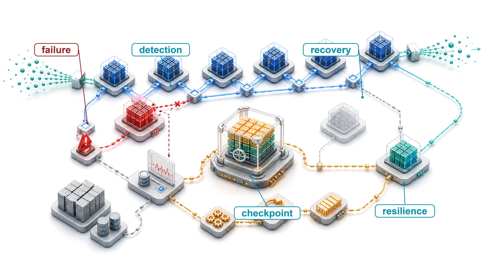{fig-alt="Fleet recovery blueprint showing a training path interrupted by a failed node, checkpoint state preserved, and work resumed through replacement workers."}
:::

::: {.content-visible unless-format="pdf"}
{fig-alt="Fleet recovery blueprint showing a training path interrupted by a failed node, checkpoint state preserved, and work resumed through replacement workers."}
:::

:::

## Purpose {.unnumbered .unlisted}

::: {.content-visible when-format="pdf"}
\begin{marginfigure}
\mlfleetstack{15}{20}{45}{100}{20}{30}{10}{0}
\end{marginfigure}
:::

::: {.content-visible unless-format="pdf"}
::: {.column-margin}
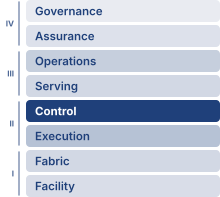{width="100%" fig-alt="Fleet Machine Learning Systems Stack"}

*Fleet stack focus for this chapter.*
:::
:::

_Why does scale transform hardware failure from rare exception to routine condition that systems must absorb continuously?_

A single accelerator can run for years between hardware failures. A thousand accelerators turn that same component risk into failures every couple of days, and ten thousand see failures every few hours, while shared power and network faults can interrupt many workers at once. Individual devices need not become less reliable for the fleet to experience failures routinely. A program on one machine can often stop and restart when a component fails; a distributed training job must also recover agreement among surviving workers about which progress remains valid. Restarting quickly is of little value if the restored state silently changes the computation. Preserving more state reduces the work at risk, but consumes storage bandwidth and memory while the job is healthy. Waiting longer between saves reduces that overhead while increasing the progress a failure can erase. Serving imposes a different consequence: users may abandon a request before recovery completes, and replacing a worker may leave the request's context unavailable. A response that arrives on time can still be unacceptable if recovery has discarded information needed to produce it. Engineers must therefore bound lost work and recovery delay while preserving the validity of training and the usefulness of service. The goal is continued useful execution despite repeated failures, with the costs and limits of recovery made explicit. In C³ terms, fault tolerance spends compute and communication on coordination so that component failures do not routinely become failures of the entire workload.

::: {.content-visible when-format="pdf"}

\newpage

:::
::: {.callout-learning-objectives}

- Calculate mean time between fleet failures from component rates and estimate interruption frequency for large training clusters
- Classify hardware, software, silent-data-corruption, and slow-but-alive failures by detectability, blast radius, and recovery path
- Select checkpoint intervals that balance write overhead against acceptable lost work and recovery delay
- Design distributed checkpointing and elastic recovery plans for multi-terabyte model state across accelerator fleets
- Design serving redundancy, failover, and state-recovery policies under latency budgets and partial failures
- Select graceful degradation strategies that preserve useful service when models, features, regions, or capacity fail
- Evaluate detection timeouts, restart strategies, and fault-injection evidence against a per-failure recovery-time budget

:::

## Failure Analysis at Scale {#sec-fault-tolerance-reliability-reliability-failure-analysis-scale-6b4b}

```{python}
#| echo: false
from mlsysim import *
from mlsysim.core.units import *

# ┌─────────────────────────────────────────────────────────────────────────────
# │ CHAPTER START
# ├─────────────────────────────────────────────────────────────────────────────
# │ Context: Chapter initialization and global imports
# │
# │ Why: Registers this chapter with the mlsys registry and provides shared
# │      imports for all subsequent calculation cells.
# │
# └─────────────────────────────────────────────────────────────────────────────
from mlsysim.physics import memory_from_params
from mlsysim.fmt import check, fmt
```

```{python}
#| echo: false
#| label: fault-tolerance-reliability-rates
# ┌─────────────────────────────────────────────────────────────────────────────
# │ FLEET RELIABILITY RATES — PERSISTENT (single source of truth)
# ├─────────────────────────────────────────────────────────────────────────────
# │ Context: PERSISTENT. Per-GPU and fleet failure rates derived from canonical
# │          MTTF/fleet constants. Consumed by the failure-rate footnote
# │          [^fn-fits-failure-rate] and the Fallacies and Pitfalls section
# │          (@sec-fault-tolerance-reliability-reliability-fallacies-pitfalls-74b8).
# │
# │ Goal: Derive lambda, FIT, and fleet failure cadence from one constant set so
# │       every quoted reliability number is traceable and cannot drift.
# │ Show: GPU FIT, lambda_hour, fleet FIT total, fleet failure rate, hours between.
# │ How:  lambda = 1/MTTF; FIT = 10^9/MTTF; fleet rate = N/MTTF; interval = 1/rate.
# │
# └─────────────────────────────────────────────────────────────────────────────
from mlsysim.fmt import check, fmt, fmt_count, fmt_math, fmt_time, sci_latex

class FleetReliabilityRates:
    # ┌── 1. LOAD (Constants) ──────────────────────
    gpu_mttf_h = float(Systems.Reliability.Gpu.mttf_hours)
    fleet_gpus = Systems.Clusters.Training_10K.total_accelerators

    # ┌── 2. EXECUTE (The Compute) ─────────────────
    lambda_gpu = 1 / gpu_mttf_h  # per-GPU failure rate (per hour)
    gpu_fit = BILLION / gpu_mttf_h  # failures per 10^9 device-hours
    fleet_fit_total = fleet_gpus * gpu_fit  # aggregate FITs across the fleet
    fleet_rate_per_h = fleet_gpus / gpu_mttf_h  # fleet failures per hour
    hours_between = 1 / fleet_rate_per_h  # mean hours between fleet failures

    # ┌── 3. GUARD (Invariants) ────────────────────
    check(abs(gpu_fit * gpu_mttf_h - BILLION) < 1, "FIT definition: FIT x MTTF must equal 10^9")
    check(abs(hours_between * fleet_rate_per_h - 1) < 1e-9, "interval must be reciprocal of fleet rate")
    check(0 < fleet_rate_per_h < fleet_gpus, "fleet failure rate must be positive and below the GPU count")

    # ┌── 4. OUTPUT (Formatting) ───────────────────
    _fleet_tex = fmt(fleet_gpus, precision=0).replace(",", "{,}")
    _mttf_tex = fmt(gpu_mttf_h, precision=0).replace(",", "{,}")
    _fit_tex = fmt(gpu_fit, precision=0).replace(",", "{,}")
    gpu_mttf_str = fmt_time(gpu_mttf_h, "hour", precision=0, commas=True, style="word")
    gpu_mttf_prose_str = fmt_time(gpu_mttf_h, "hour", precision=0, commas=True, style="word")
    fleet_gpus_str = fmt_count(fleet_gpus, label="GPU")
    fleet_fit_str = fmt(fleet_fit_total, precision=0)
    hours_between_str = fmt_time(hours_between, "hour", precision=0, commas=False, style="word")
    gpu_mttf_sym_str = fmt_time(gpu_mttf_h, "hour", precision=0, commas=True)  # margin caption
    gpu_mttf_attr_str = fmt_time(gpu_mttf_h, "hour", precision=0, commas=True, style="word", attributive=True)
    gpu_fit_str = fmt(gpu_fit, precision=0)
    node_gpus_str = fmt(Systems.Nodes.DGX_H100.accelerators_per_node, precision=0)  # series-system example
    hours_between_sym_str = fmt_time(hours_between, "hour", precision=0)  # margin caption
    fit_eq_math = fmt_math(rf"\text{{FIT}} = {_fit_tex}")
    lambda_eq_math = fmt_math(rf"\HourlyComponentFailureRate = {sci_latex(lambda_gpu, precision=1)}")
    fleet_rate_eq_math = fmt_math(f"{_fleet_tex}/{_mttf_tex} = {fmt(fleet_rate_per_h, precision=1, commas=False)}")
```

```{python}
#| echo: false
# ┌── LEGO ───────────────────────────────────────────────
# │ Context: PERSISTENT. Opening hook (daily idle cost of the 10,000-GPU
# │          cluster), LLM failure-impact prose (@tbl-failure-impact-by-model),
# │          the detection opener, and the workload-state paragraph.
# │ Goal: Format GPT-3 checkpoint size for the 175B running example.
# │ Also: idle cost per minute of the 10,000-GPU cluster (detection opener).
# │ Note: resumable checkpoint = 14 B/param (bf16 weights, fp32 master
# │       weights, fp32 Adam moments; no gradients or activations).
from mlsysim.physics import calc_checkpoint_size
from mlsysim import Models, Hardware, ReferenceStats
from mlsysim.fmt import check, fmt, fmt_memory, fmt_text

class FaultToleranceIntroRecap:
    m = Models.Language.GPT3
    ckpt_bpp = ReferenceStats.MixedPrecisionAdam.CheckpointBytesPerParameter
    gpt3_ckpt_bytes = calc_checkpoint_size(m.parameters)  # 14 B/param default
    gpus_example = Systems.Clusters.Training_10K.total_accelerators  # the chapter's 10,000-GPU running cluster
    rate = Infrastructure.Pricing.Fleet.GpuHourRef.rate.to(USD / hour).magnitude
    daily_cost = gpus_example * rate * 24
    idle_cost_per_min = gpus_example * rate / 60  # whole cluster waiting on one hung rank
    vit_ckpt = ReferenceStats.CheckpointArchetypes.MediumVisionTransformerCheckpointSize
    recsys_table = ReferenceStats.RecommenderAtScaleProfile.EmbeddingTableSize
    check(
        abs((gpt3_ckpt_bytes / (m.parameters * ckpt_bpp)).to("").magnitude - 1) < 1e-9, "calc_checkpoint_size must use the registry 14 B/param anchor"
    )
    check(2.3e12 < gpt3_ckpt_bytes.to(byte).magnitude < 2.6e12, "175B resumable checkpoint must be about 2.45 TB")
    check(1.0 < vit_ckpt.to(GB).magnitude < 2.0, "ViT-Large checkpoint row is a single-digit-GB 'middle ground'")
    check(100 < idle_cost_per_min < 1000, "one idle minute of the 10,000-GPU cluster costs hundreds of dollars")
    check(3e5 < daily_cost < 7e5, "opening hook: an idle day of the 10,000-GPU cluster costs about half a million dollars")
    # ┌── 4. OUTPUT (Formatting) ─────────────────────────────────────────────
    ckpt_bpp_str = fmt(ckpt_bpp.magnitude, precision=0)
    gpt3_ckpt_tb_str = fmt_memory(gpt3_ckpt_bytes, unit=TB, precision=2, commas=False)
    gpus_example_str = fmt(gpus_example, precision=0, commas=True)
    rate_str = fmt_usd(rate, precision=0, commas=False, per="GPU-hour")
    daily_cost_str = fmt_usd(daily_cost, scale="M", precision=1, commas=False)
    idle_cost_per_min_str = fmt_usd(round(idle_cost_per_min, -1), precision=0, commas=False)
    vit_ckpt_str = fmt_memory(vit_ckpt, unit=GB, precision=1, commas=False)
    recsys_table_str = fmt_text(fmt_memory(recsys_table, unit=TB, precision=0, commas=False), "+")
```

::: {.content-visible when-format="html:js"}
<span id="sec-fault-tolerance-reliability-reliability-failure-analysis-scale-6b4b"></span>
:::

Imagine a `{python} FaultToleranceIntroRecap.gpus_example_str`-GPU cluster midway through a three-month training run for a new foundation model. The parallel training plan and the communication layer beneath it have done their job, and thousands of devices exchange gradients through AllReduce, AllGather, and AllToAll as if they were one machine. Then the arithmetic of scale catches up. A GPU fails every few hours, and if the system cannot absorb that ordinary physical event, synchronized training halts while compute worth about `{python} FaultToleranceIntroRecap.daily_cost_str` a day sits idle. **Fault tolerance**\index{Fault tolerance!definition} is the system property that lets distributed execution continue making useful progress when components fail, degrade, or disappear. In the fleet stack of @fig-fleet-stack, fault tolerance occupies the Reliability & Control row of the Distribution band, where it protects the progress that parallelism and communication produce.

That fragility is the direct consequence of successful synchronization. Every collective in @sec-collective-communication assumed that all ranks in its process group arrive, and each dependent consumer waits for every contribution. One stalled device can therefore stop progress in its synchronous training group, even while unrelated jobs continue elsewhere in the fleet. Fault-tolerant ML systems preserve progress by detecting failure, checkpointing recoverable state, restarting or elastically reshaping jobs, and treating hardware churn as normal execution rather than an exceptional path. That reliability envelope covers both halves of the fleet's work. Training needs recovery that preserves weeks of accumulated progress, while serving needs redundancy, failover, and graceful degradation that preserve a latency contract, and both draw their spare capacity from a shared fleet pool.

::: {.column-margin .margin-pointer}
↪ How the scheduler holds spare capacity for failed jobs and prepositions replacement nodes while a missed heartbeat is confirmed is developed in @sec-fleet-orchestration-failure-rates.
:::

Not every failure announces itself. A component can stop outright, slow down while still answering liveness checks, or keep running while it computes wrong values. The quiet cases pair low detection rates with a high blast radius, because the system keeps running on state it should no longer trust. The recovery target here is therefore trustworthy execution: preserving valid training progress and restoring a service after its infrastructure or software fails. A restored model can still make poor predictions on changed inputs even when every component executes correctly. Evaluating that behavioral robustness requires a separate contract for model quality under distribution shifts and adversarial inputs, developed in @sec-robust-ai. The distinction lets us use model-quality signals to diagnose a fault without treating every quality regression as evidence of failed hardware.

Because failures cannot be eliminated at this scale, fault-tolerant systems verify completion rather than assume it, treat failure as a normal code path, exercise recovery continuously, and account for partial failures that naive error handling may not anticipate. These techniques draw on decades of distributed systems research, but ML workloads change the economics. Training checkpoints are large but can be sized from the model and optimizer state, while some optimization algorithms tolerate bounded numerical perturbations without requiring bitwise replay. That tolerance must be established for the training method; stochasticity does not make arbitrary corruption or inconsistent recovery safe. A recovery design can exploit approximate execution only while preserving its declared convergence and quality requirements. Making failure a routine part of operation starts with knowing how often failures arrive, and the mathematics that follows makes the shift from *rare exception* to *routine occurrence* precise.

::: {.column-margin}
```{=latex}
\vspace*{6mm}
```
{width="100%" fig-alt="Time ladder showing system mean time between failures collapsing as fleet size grows: 1 GPU at 50,000 hours, 1,000 GPUs at 50 hours, 10,000 GPUs at 5 hours."}

*Fleet mean time between failures (MTBF) collapses from `{python} FleetReliabilityRates.gpu_mttf_sym_str` to `{python} FleetReliabilityRates.hours_between_sym_str` as GPUs multiply.*
:::

## The Mathematics of Inevitable Failure {#sec-fault-tolerance-reliability-reliability-mathematics-inevitable-failure-93ef}

A single data-center GPU can run for years without a hardware fault, yet a synchronous job spanning ten thousand of those same GPUs is interrupted every few hours. System reliability engineering explains why individual device longevity erodes so quickly when thousands of components must stay healthy at the same time [@birolini2017]. Each component has a failure rate $\ComponentFailureRate$,[^fn-fits-failure-rate] measured in failures per unit time. When $\ComponentFailureRate$ is constant, the probability that a single component survives without failure until time $\TimeInstant$ follows an exponential distribution,[^fn-poisson-failure-rate] as in @eq-single-component-reliability:

[^fn-poisson-failure-rate]: **Poisson process**\index{Poisson process!failure modeling}: A statistical model for events occurring independently at a constant average rate. In this model, event counts follow a Poisson distribution and waiting times follow an exponential distribution, giving the survival function $\ComponentReliability(\TimeInstant) = e^{-\ComponentFailureRate \TimeInstant}$. With independent identical component hazards, the probability of at least one failure in a 10,000-component cluster is $1 - e^{-\RequiredComponentCount\ComponentFailureRate \TimeInstant}$. The aggregate hazard $\RequiredComponentCount\ComponentFailureRate$ scales linearly with component count; the failure probability is nonlinear in both $\RequiredComponentCount$ and $\TimeInstant$, approaching $\RequiredComponentCount\ComponentFailureRate \TimeInstant$ only when that product is small.

[^fn-fits-failure-rate]: **Failure rate ($\ComponentFailureRate$)**\index{Failure rate!FITs}: Expressed in FITs (Failures In Time), where 1 FIT equals one failure per billion device-hours. A data center GPU with a `{python} FleetReliabilityRates.gpu_mttf_attr_str` mean time to failure has `{python} FleetReliabilityRates.fit_eq_math`, corresponding to `{python} FleetReliabilityRates.lambda_eq_math` failures/hour. That seems negligible for one device but becomes dominant at fleet scale: a cluster with `{python} FleetReliabilityRates.fleet_gpus_str` accumulates `{python} FleetReliabilityRates.fleet_fit_str` FITs from GPUs alone, translating to an expected GPU failure every `{python} FleetReliabilityRates.hours_between_str`.

$$ \ComponentReliability(\TimeInstant) = e^{-\ComponentFailureRate \TimeInstant} $$ {#eq-single-component-reliability}

::: {.column-margin .margin-pointer}
↪ The independence, exponential-lifetime, and Poisson results this failure arithmetic rests on are developed in @sec-appdx-reliability-foundations-probability-tools.
:::

The expected time to failure of this component equals $1/\ComponentFailureRate$. In this book's convention, mean time to failure (MTTF)\index{MTTF!per-component failure rate}\index{MTTF!vs. MTBF}\index{Mean time to failure|see{MTTF}} names a single component's expected time to its first failure. MTBF\index{MTBF!system failure rate}\index{MTBF!component vs. system} names the repairable system's expected operating time between successive failures, excluding recovery downtime. Under the constant-rate exponential model used here the two coincide numerically, and the fault-tolerance model uses MTTF for per-component constants and MTBF for composed system rates. Data center GPUs often use planning MTTF values in the tens of thousands of hours, with field behavior depending on operating conditions, cooling effectiveness, manufacturing variation, and workload stress.[^fn-gpu-mtbf-reliability] @Sec-appdx-reliability-foundations-component-rates catalogs the reference per-component FIT and MTTF values (GPU, high-bandwidth memory (HBM), network interface card (NIC), power supply, PCIe switch, optical cable, ToR switch) that anchor these $\ComponentFailureRate$ and FIT figures. A reader can substitute the constant for any device and reproduce the rates used throughout the fault-tolerance analysis.

[^fn-gpu-mtbf-reliability]: **GPU MTTF variation**\index{GPU!MTBF variation}\index{MTBF!GPU field variation}: This chapter uses `{python} FleetReliabilityRates.gpu_mttf_prose_str` as a planning constant for current data center GPUs (A100 and H100 class), not as a guarantee for every deployed GPU. Published fleet studies from Google TPUv4 pods and Meta GPU clusters report that field reliability depends on topology, cooling, workload, and operational practice [@zu2024tpuv4; @kokolis2025; @dubey2024llama]. The planning constant therefore anchors the arithmetic, while operators should substitute measured fleet rates when they have them.

When multiple independent components operate in a system where any single failure causes system failure, @eq-system-reliability-product formalizes how system reliability becomes the product of individual component reliabilities:

$$ \SystemReliability(\TimeInstant) = \prod_{i=1}^{\RequiredComponentCount} {\ComponentReliability}_i(\TimeInstant) = \prod_{i=1}^{\RequiredComponentCount} e^{-\ComponentFailureRate_i \TimeInstant} $$ {#eq-system-reliability-product}

For $\RequiredComponentCount$ identical components with individual failure rate $\ComponentFailureRate$, @eq-system-reliability-n-components gives the identical-component simplification:

$$ \SystemReliability(\TimeInstant) = e^{-\RequiredComponentCount\ComponentFailureRate \TimeInstant} $$ {#eq-system-reliability-n-components}

The system failure rate becomes $\RequiredComponentCount\ComponentFailureRate$, and @eq-system-mtbf expresses how the system MTBF scales inversely with component count. This inverse scaling explains why per-device reliability that looks excellent in isolation erodes at cluster scale:

$$ \SystemMtbf = \frac{1}{\RequiredComponentCount\ComponentFailureRate} = \frac{\ComponentMttf}{\RequiredComponentCount} $$ {#eq-system-mtbf}

The consequence is a gap between failure cadence and job length. At `{python} FleetReliabilityRates.fleet_gpus_str`, the GPU-only calculation gives an expected interval of `{python} FleetReliabilityRates.hours_between_str`, so a training run measured in weeks accumulates dozens of expected failures and one measured in months accumulates hundreds. These are planning averages, not a schedule of incidents; a shorter job can finish without failure even when its expected failure count exceeds one. Once the expected time between failures falls below the length of the job, fault tolerance becomes part of the execution budget for long-running fleet work. Applied to the landmark training runs of @sec-vol2-introduction-scale-moment, whose accelerator counts grew by about four orders of magnitude between 2012 and 2024, the same per-device planning rate puts the largest of them, with more than ten thousand GPUs, below a 10-hour system MTBF. Recovery therefore becomes an active scheduling constraint rather than a reliability feature.

### Composing component reliability {#sec-fault-tolerance-reliability-quantitative-analysis}

The GPU-only calculation of @eq-system-mtbf supplies the scale intuition; a real training system then composes GPUs, HBM, links, power supplies, storage paths, and redundancy into one failure budget. Component rates are usually quoted in the FIT units introduced with the failure rate, so the `{python} FleetReliabilityRates.gpu_mttf_attr_str` GPU contributes `{python} FleetReliabilityRates.gpu_fit_str` FIT to whatever system contains it. The new question is how different component rates compose, and the composition rule depends on the redundancy structure and the independence assumptions. For series systems\index{Reliability!series system}\index{Series system!reliability calculation} (for example, a node where all `{python} FleetReliabilityRates.node_gpus_str` GPUs must work), failure of any component fails the whole. With independent constant-rate failures, the reliabilities multiply as in @eq-system-reliability-product, so the rates add even when the components differ:
$$\SystemMtbf = \frac{1}{\sum \ComponentFailureRate_i}$$
Under this additive failure-rate law, the system failure rate grows linearly with component count while system MTBF falls in inverse proportion. Every unredundanted component on the critical path adds its FIT contribution directly to the denominator.

```{python}
#| echo: false
#| label: lego-nines-reliability
from mlsysim.fmt import check, fmt, fmt_int, fmt_percent, fmt_time

class NinesReliability:
    # ┌── 1. LOAD ──────────────────────────────────────────
    n_gpus = Systems.Clusters.Training_10K.total_accelerators
    availability_pct = 99.99
    single_gpu_success = availability_pct / 100

    # ┌── 2. EXECUTE ───────────────────────────────────────
    downtime_min_year = (1 - single_gpu_success) * HOURS_PER_YEAR * MINUTES_PER_HOUR
    cluster_prob = single_gpu_success**n_gpus
    fleet_mtbf = FleetReliabilityRates.hours_between * hour
    fast_mttr = 5 * minute
    slow_mttr = 30 * minute
    fast_availability = (fleet_mtbf / (fleet_mtbf + fast_mttr)).to("").magnitude
    slow_availability = (fleet_mtbf / (fleet_mtbf + slow_mttr)).to("").magnitude

    # ┌── 3. GUARD ─────────────────────────────────────────
    check(0 < cluster_prob < 1, "Probability must be in (0,1)")
    check(cluster_prob < 0.5, "Cluster survival must be low at scale")
    check(0 < slow_availability < fast_availability < 1, "Faster repair must improve availability")

    # ┌── 4. OUTPUT ────────────────────────────────────────
    n_gpus_str = fmt(n_gpus, precision=0)
    availability_str = fmt_percent(availability_pct / 100, precision=2, commas=False, style='prose')
    downtime_min_str = fmt_time(downtime_min_year, 'minute', precision=1, commas=False, style='word')
    cluster_pct_str = fmt_percent(round(cluster_prob * 100) / 100, precision=0, commas=False, style='prose')
    fleet_mtbf_str = fmt_time(fleet_mtbf, hour, precision=0, commas=False, style="word")
    fast_mttr_str = fmt_time(fast_mttr, minute, precision=0, commas=False, style="word")
    slow_mttr_str = fmt_time(slow_mttr, minute, precision=0, commas=False, style="word")
    fast_availability_str = fmt_percent(fast_availability, precision=2, commas=False, style="prose")
    slow_availability_str = fmt_percent(slow_availability, precision=2, commas=False, style="prose")
```

The same product governs instantaneous availability, a different quantity from the survival function $\ComponentReliability(\TimeInstant)$. Availability $\SteadyStateAvailability$ is the probability that a component is up at a randomly chosen instant, counting repairs, whereas $\ComponentReliability(\TimeInstant)$ is the probability that it has not yet failed by time $\TimeInstant$. If each GPU is independently up with probability $\GpuAvailability$, all $\RequiredComponentCount$ are up together with probability $(\GpuAvailability)^\RequiredComponentCount$, which is the reliability gap of @eq-reliability-gap. For the chapter's `{python} NinesReliability.n_gpus_str`-GPU cluster, a per-GPU availability of `{python} NinesReliability.availability_str` (only `{python} NinesReliability.downtime_min_str` of downtime per year) leaves about a `{python} NinesReliability.cluster_pct_str` chance that every GPU is up at the same instant. That power erodes even highly reliable hardware once $\RequiredComponentCount$ reaches fleet scale, so software must handle failures automatically.

::: {#psp-fault-tolerance-scale-transforms-failure .callout-perspective title="Scale transforms failure"}

A cluster of `{python} NinesReliability.n_gpus_str` GPUs turns a per-GPU MTTF of `{python} FleetReliabilityRates.gpu_mttf_prose_str` into a system MTBF of `{python} NinesReliability.fleet_mtbf_str`. For a repairable system, steady-state availability\index{Availability!MTBF and MTTR} is $\SteadyStateAvailability= \MeanTimeBetweenFailures/(\MeanTimeBetweenFailures+\MeanTimeToRepair)$, where mean time to recovery (MTTR)\index{MTTR!availability impact}\index{MTTR!recovery interval}\index{Mean time to recovery|see{MTTR}} is the recovery interval. Cutting MTTR from `{python} NinesReliability.slow_mttr_str` to `{python} NinesReliability.fast_mttr_str` raises availability from `{python} NinesReliability.slow_availability_str` to `{python} NinesReliability.fast_availability_str`. This stationary two-state model assumes unconstrained repair capacity and complete outage; correlated incidents, repair contention, and degraded operation require direct measurement [@birolini2017]. Systems must engineer recovery, not merely improve components.

:::

Engineering faster recovery is one response to that arithmetic; redundancy is the other. For parallel systems\index{Reliability!parallel system}\index{Parallel system!redundancy calculation} providing redundancy, suppose that any surviving component can satisfy the required service. With independent failures and no repair during the observation interval, the system survives until every component has failed:
$$\SystemReliability(\TimeInstant) = 1 - \prod_{i=1}^{\RedundantComponentCount} (1 - {\ComponentReliability}_i(\TimeInstant))$$

Series composition is the training job's problem, because a synchronous step needs every participant. Parallel composition is the serving fleet's lever, and it returns when interchangeable replicas protect a latency contract. Both rules, however, describe whatever the model calls a component, and the fault rate assigned to that component depends on which protections sit inside it.

```{python}
#| echo: false
# ┌─────────────────────────────────────────────────────────────────────────────
# │ UNPROTECTED-HBM SOFT-ERROR BUDGET (LEGO)
# ├─────────────────────────────────────────────────────────────────────────────
# │ Goal: Show why unprotected HBM at cluster scale corrupts memory every tens of seconds.
# │ How: 250 FIT/Mbit x (1,024 x H100 HBM) megabits -> aggregate FIT -> mean time to first error.
# └─────────────────────────────────────────────────────────────────────────────
from mlsysim.fmt import check, fmt, fmt_memory_capacity, fmt_time

class HbmSerBudget:
    # ┌── 1. LOAD ──────────────────────────────────────────────────────────
    ser_fit_per_mbit = Systems.Reliability.Hbm.soft_error_fit_per_mbit
    cluster_gpus = Systems.Clusters.Training_1K.total_accelerators  # Archetype A reference cluster
    hbm_per_gpu = Hardware.Cloud.H100.memory.capacity
    # ┌── 2. EXECUTE ───────────────────────────────────────────────────────
    total_mbit = (cluster_gpus * hbm_per_gpu).to(bit).magnitude / 1e6
    aggregate_fit = float(ser_fit_per_mbit) * total_mbit
    failures_per_hour = aggregate_fit / BILLION  # FIT = failures per 1e9 device-hours
    time_to_error_s = SEC_PER_HOUR / failures_per_hour
    # ┌── 3. GUARD ─────────────────────────────────────────────────────────
    check(10 <= time_to_error_s <= 60, "Illustrative raw-error interval should be tens of seconds")
    # ┌── 4. OUTPUT ────────────────────────────────────────────────────────
    fit_per_mbit_str = fmt(ser_fit_per_mbit, precision=0, commas=False)
    time_to_error_str = fmt_time(round(time_to_error_s), 'second', precision=0, commas=False, style='word')
    cluster_gpus_str = fmt(cluster_gpus, precision=0, commas=True)
    hbm_per_gpu_gb_str = fmt_memory_capacity(hbm_per_gpu, unit=GiB, precision=0, commas=False)
```

::: {#lhs-fault-tolerance-archetype-a-gpt-4-llama-3-memory-soft-error .callout-lighthouse title="Archetype A (GPT-4/Llama-3): Memory soft-error scale"}

Composition makes the distinction between raw faults and job interruptions essential. Memory soft-error rates are quoted per megabit of storage rather than per device, so the exposure grows with memory capacity. As an illustrative raw-bit-error budget, assume `{python} HbmSerBudget.fit_per_mbit_str` FIT per megabit across `{python} HbmSerBudget.cluster_gpus_str` GPUs with `{python} HbmSerBudget.hbm_per_gpu_gb_str` each, the size of the Archetype A reference cluster. The resulting interval between raw memory errors is roughly `{python} HbmSerBudget.time_to_error_str`. This is not a measured job-failure interval. Error-correcting code (ECC) protection can correct covered error patterns before they affect computation, while detected uncorrectable errors and escaped corruption require different recovery paths. At that raw rate, unprotected memory in the reference cluster would corrupt training state many times per hour, so ECC is a precondition for large-scale training rather than an option. A fleet reliability budget therefore needs the residual job-interrupting and silent-corruption rates under its actual protection scheme; raw bit-error rates alone cannot establish whether memory, logic, or interconnect dominates.

:::

These raw bit-error rates justify ECC, but they are not the interruption rates that set checkpoint cadence; the worked cascade that follows uses device MTTF values that already include the effect of that protection. The cascade also treats its GPU, PCIe, power, and network contributions as separate categories, so a measured whole-node rate that already includes those paths cannot be added to them again.

### Cluster MTBF calculation {#sec-fault-tolerance-reliability-reliability-worked-example-cluster-mtbf-calculation-9255}

```{python}
#| echo: false
#| label: fault-tolerance-mtbf-cascade
# ┌─────────────────────────────────────────────────────────────────────────────
# │ CLUSTER MTBF CASCADE — WORKED EXAMPLE (LEGO)
# ├─────────────────────────────────────────────────────────────────────────────
# │ Context: @sec-fault-tolerance-reliability-reliability-worked-example-cluster-
# │          mtbf-calculation-9255. Drives the Steps 1-3 display equations and the
# │          closing narrative (every 3.9 h, 6.2/day, ~43/week).
# │
# │ Goal: Reproduce the worked MTBF cascade from canonical MTTF/fleet constants so
# │       every quoted rate is traceable and cannot drift.
# │ Scope: chapter-anchor — checkpoint analysis reuses the worked cluster MTBF.
# │ Show: lambda per subsystem, total, system rate, cluster MTBF, failure cadence.
# │ How:  lambda = 1/MTTF; network shared across the node's GPUs; power enters only
# │       through series (non-redundant) PSUs, 0 for the DGX H100's 4+2 supply;
# │       system = N*total. Narrative cadence follows the displayed rate (0.2583)
# │       for self-consistency.
# │
# └─────────────────────────────────────────────────────────────────────────────
from mlsysim import Scenarios
from mlsysim.fmt import MarkdownStr, check, fmt, fmt_count, fmt_rate, fmt_time

class FailureCascadeExample:
    # ┌── 1. LOAD (Constants) ──────────────────────
    fleet_gpus = Systems.Clusters.Training_10K.total_accelerators
    gpu_mttf = float(Systems.Reliability.Gpu.mttf_hours)
    pcie_mttf = float(Systems.Reliability.PcieSwitch.mttf_hours)
    psu_mttf = float(Systems.Reliability.Psu.mttf_hours)
    nic_mttf = float(Systems.Reliability.Nic.mttf_hours)
    gpus_per_node = Systems.Nodes.DGX_H100.accelerators_per_node
    series_psus = Systems.Nodes.DGX_H100.series_psus  # 0: 4+2 redundant supplies
    psus_per_node = Systems.Nodes.DGX_H100.psus_per_node
    psu_redundancy = Systems.Nodes.DGX_H100.psu_redundancy
    psus_required = psus_per_node - psu_redundancy
    ref_gpus = Scenarios.DenseLLMPretrainingReference.system.total_accelerators

    # ┌── 2. EXECUTE (The Compute) ─────────────────
    l_gpu = 1 / gpu_mttf
    l_pcie = 1 / pcie_mttf
    l_power = (series_psus / gpus_per_node) / psu_mttf  # 0 for the DGX H100's 4+2 supply
    l_net = (1 / gpus_per_node) / nic_mttf
    l_total = l_gpu + l_pcie + l_power + l_net
    l_system = fleet_gpus * l_total
    l_system_disp = round(l_system, 4)  # rate as displayed (0.2583)
    mtbf_h = 1 / l_system_disp  # narrative follows the displayed rate
    per_day = 24 * l_system_disp
    per_week = 24 * 7 * l_system_disp
    weekly_failures = round(per_week)

    # ┌── 3. GUARD (Invariants) ────────────────────
    check(0 < l_gpu < 1, "per-GPU failure rate must be a small positive value")
    check(l_power == 0, "DGX H100 PSUs are 4+2 redundant: no single-PSU term in the series sum")
    check(2.0 < mtbf_h < 5.0, "10k-GPU cluster MTBF should be a few hours")
    check(per_week > per_day > 1, "weekly failures must exceed daily, both above one")
    check(9 < fleet_gpus / ref_gpus < 11, "prose says 'roughly ten times' the reference cluster")

    # ┌── 4. OUTPUT (Formatting) ───────────────────
    fleet_gpus_str = fmt(fleet_gpus, precision=0)
    ref_gpus_str = fmt(ref_gpus, precision=0)
    gpu_mttf_hours_str = fmt_time(gpu_mttf, "hour", precision=0, commas=True, style="word")
    pcie_mttf_hours_str = fmt_time(pcie_mttf, "hour", precision=0, commas=True, style="word")
    psu_mttf_hours_str = fmt_time(psu_mttf, "hour", precision=0, commas=True, style="word")
    nic_mttf_hours_str = fmt_time(nic_mttf, "hour", precision=0, commas=True, style="word")
    gpus_per_node_str = fmt(gpus_per_node, precision=0)
    psus_per_node_str = fmt(psus_per_node, precision=0)
    psus_required_str = fmt(psus_required, precision=0)
    psu_redundancy_str = fmt(psu_redundancy, precision=0)
    _gpu_d = fmt(gpu_mttf, precision=0).replace(",", "{,}")
    _pcie_d = fmt(pcie_mttf, precision=0).replace(",", "{,}")
    _psu_d = fmt(psu_mttf, precision=0).replace(",", "{,}")
    _nic_d = fmt(nic_mttf, precision=0).replace(",", "{,}")
    _fleet_d = fleet_gpus_str.replace(",", "{,}")
    _npn = gpus_per_node_str
    lambda_gpu_eq_math = fmt_display_math(rf" \GpuFailureRate = \frac{{1}}{{{_gpu_d}}} = {l_gpu*1e5:.1f} \times 10^{{-5}} \text{{ failures/hour}} ")
    lambda_pcie_eq_math = fmt_display_math(
        rf" \PcieLinkFailureRate = \frac{{1}}{{{_pcie_d}}} = {l_pcie*1e5:.1f} \times 10^{{-5}} \text{{ failures/hour}} "
    )
    lambda_power_eq_math = fmt_display_math(
        rf" \PerGpuPowerFailureRate = \frac{{\SeriesPsuCount}}{{{_npn}}} \times \frac{{1}}{{{_psu_d}}} = \frac{{{series_psus}}}{{{_npn}}} \times \frac{{1}}{{{_psu_d}}} = 0 \text{{ failures/hour}} "
    )
    lambda_net_eq_math = fmt_display_math(
        rf" \PerGpuNetworkFailureRate = \frac{{1}}{{{_npn}}} \times \frac{{1}}{{{_nic_d}}} = {l_net*1e5:.3f} \times 10^{{-5}} \text{{ failures/hour}} "
    )
    lambda_total_eq_math = fmt_display_math(
        rf" \PerGpuTotalFailureRate = ({l_gpu*1e5:.1f} + {l_pcie*1e5:.1f} + {l_net*1e5:.3f}) \times 10^{{-5}} = {l_total*1e5:.3f} \times 10^{{-5}} \text{{ failures/hour}} "
    )
    lambda_system_eq_math = fmt_display_math(
        rf" \SystemFailureRate = {_fleet_d} \times {l_total*1e5:.3f} \times 10^{{-5}} = {l_system:.4f} \text{{ failures/hour}} "
    )
    mtbf_eq_math = fmt_display_math(rf" \SystemMtbf = \frac{{1}}{{{l_system_disp:.4f}}} = {mtbf_h:.2f} \text{{ hours}} ")
    mtbf_hours_str = fmt_time(mtbf_h, "hour", precision=1, commas=False, style="word")
    mtbf_hours_2dp_str = fmt_time(mtbf_h, "hour", precision=2, commas=False, style="word")
    failures_per_day_str = fmt_rate(per_day, "failures/day", precision=1, commas=False)
    weekly_failures_str = fmt_count(weekly_failures, precision=0, label="failure")
```

Consider a training cluster designed for large language model development, roughly ten times the `{python} FailureCascadeExample.ref_gpus_str`-GPU Archetype A reference cluster, with the following specifications:

- `{python} FailureCascadeExample.fleet_gpus_str` NVIDIA H100\index{H100!cluster reliability}\index{NVIDIA!H100} GPUs
- Individual GPU MTTF: `{python} FailureCascadeExample.gpu_mttf_hours_str`
- Each GPU connected to host via PCIe (MTTF: `{python} FailureCascadeExample.pcie_mttf_hours_str`)
- Each node contains `{python} FailureCascadeExample.gpus_per_node_str` GPUs fed by `{python} FailureCascadeExample.psus_per_node_str` power supply units (MTTF: `{python} FailureCascadeExample.psu_mttf_hours_str` each) in `{python} FailureCascadeExample.psus_required_str`+`{python} FailureCascadeExample.psu_redundancy_str` redundancy, so the node keeps full performance with any `{python} FailureCascadeExample.psu_redundancy_str` of them failed
- Network infrastructure per node (NIC, cables): MTTF `{python} FailureCascadeExample.nic_mttf_hours_str`

Each GPU operates within a failure domain that includes the GPU itself, its PCIe connection, and a proportional share of the node's shared power and network infrastructure. Dividing a node-wide subsystem rate by the `{python} FailureCascadeExample.gpus_per_node_str` GPUs in the node prorates one shared failure source across those GPUs, so that multiplying the per-GPU total by all `{python} FailureCascadeExample.fleet_gpus_str` GPUs in the final step counts each node's shared hardware once per node rather than eight times. Power enters the sum only through supplies whose single failure stops the node, counted as $\SeriesPsuCount$ in the power equation. With the node's supplies in redundant sets, no single unit qualifies, so the power term below is zero in this first-order calculation. The approximation omits the residual risk that additional independent failures exhaust redundancy before repair. A fault upstream of the chassis, such as the loss of the circuits feeding it, can also take down the whole node. That risk belongs to the correlated failures treated later in this chapter. The four subsystem rates follow from their MTTF values:

`{python} FailureCascadeExample.lambda_gpu_eq_math`

`{python} FailureCascadeExample.lambda_pcie_eq_math`

`{python} FailureCascadeExample.lambda_power_eq_math`

`{python} FailureCascadeExample.lambda_net_eq_math`

Because the subsystems sit in series, their rates add to a per-GPU total:

`{python} FailureCascadeExample.lambda_total_eq_math`

Multiplying that total by the cluster size gives the system failure rate, whose reciprocal is the cluster MTBF:

`{python} FailureCascadeExample.lambda_system_eq_math`

`{python} FailureCascadeExample.mtbf_eq_math`

Under the model, the cluster experiences a failure every `{python} FailureCascadeExample.mtbf_hours_str` on average. The expected failure cadence is `{python} FailureCascadeExample.failures_per_day_str`; a training run lasting one week has an expected count of `{python} FailureCascadeExample.weekly_failures_str`. Actual incident times vary, but the expected loss is large enough that recovery must be part of normal execution planning.

::: {.column-margin .margin-pointer}
↪ The step-by-step composition of per-component failure rates into a fleet-wide system MTBF, reusable for any node design or cluster size, is developed in @sec-appdx-reliability-foundations-mtbf-cascade.
:::

The cluster MTBF scaling\index{Cluster!MTBF scaling} in @tbl-cluster-mtbf-scaling isolates the GPU-only baseline across cluster sizes. The full-system calculation is lower once PCIe and network failure domains are included. The same 10,000-GPU cluster therefore carries three MTBF values in this chapter. Each later calculation names the one it uses: the GPU-only `{python} FleetReliabilityRates.hours_between_str` of this table, the full-system `{python} FailureCascadeExample.mtbf_hours_str` of the cascade above, and the two-to-three-hour cadence that somewhat larger production runs report below. Two running scenarios carry the rest of the chapter. The `{python} FailureCascadeExample.ref_gpus_str`-GPU Archetype A reference cluster sizes per-node state, restore paths, and the elastic and straggler examples, while the `{python} FailureCascadeExample.fleet_gpus_str`-GPU cluster of the cascade sets failure cadence and checkpoint intervals. The full-system MTBF is the default input; a calculation that uses the GPU-only value says so, usually because it compares cluster sizes on the common basis of @tbl-cluster-mtbf-scaling, and its failure count is then a lower bound.

```{python}
#| echo: false
#| label: cluster-mtbf-scaling-table
# ┌─────────────────────────────────────────────────────────────────────────────
# │ CLUSTER MTBF SCALING TABLE (LEGO)
# ├─────────────────────────────────────────────────────────────────────────────
# │ Context: @tbl-cluster-mtbf-scaling — GPU-only MTBF and failures-per-day rows
# │          across seven cluster sizes.
# │
# │ Goal: Compute each row's cluster MTBF and expected failures per day from the
# │       single canonical per-GPU MTTF constant, so the whole table reproduces
# │       the 1/N scaling law and cannot drift from the registry.
# │ Show: Per-row cluster MTBF (hours, plus a days parenthetical for the long-MTBF
# │       rows) and expected failures per day.
# │ How:  cluster_mtbf = MTTF / N; failures_per_day = 24 * N / MTTF.
# │
# └─────────────────────────────────────────────────────────────────────────────
from mlsysim.core.units import day, hour
from mlsysim.fmt import check, fmt, fmt_int, fmt_text, fmt_time

def _mtbf_h(v):
    # integer-like rows display as whole hours; fractional rows keep one place
    return fmt_time(round(v) * hour, hour, precision=0, commas=True, style="word")

def _mtbf_cell(v):
    # show the days parenthetical only where the cluster MTBF is at least a day
    hrs = _mtbf_h(v)
    if v >= 24.0:
        days = fmt_time(round(v / 24.0) * day, day, precision=0, commas=False, style="word")
        return fmt_text(hrs, " (", days, ")")
    return hrs

def _fpd_cell(v):
    if v < 0.01:
        return fmt(v, precision=3, commas=False)
    if v < 1.0:
        return fmt(v, precision=2, commas=False)
    if float(round(v, 1)).is_integer():
        return fmt_int(int(round(v)))
    return fmt(v, precision=1, commas=False)

class ClusterMtbfScaling:
    # ┌── 1. LOAD (Constants) ──────────────────────
    gpu_mttf_h = float(Systems.Reliability.Gpu.mttf_hours)
    sizes = [8, 64, 512, 1000, 4000, 10000, 25000]

    # ┌── 2. EXECUTE (The Compute) ─────────────────
    cluster_mtbf_h = []
    failures_per_day = []
    for _n in sizes:
        cluster_mtbf_h.append(gpu_mttf_h / _n)
        failures_per_day.append(24.0 * _n / gpu_mttf_h)

    # ┌── 3. GUARD (Invariants) ────────────────────
    check(abs(cluster_mtbf_h[3] - 50.0) < 1e-9 and abs(cluster_mtbf_h[5] - 5.0) < 1e-9, "1,000-GPU MTBF must be 50h and 10,000-GPU MTBF must be 5h")
    check(abs(failures_per_day[5] - 4.8) < 0.01, "10,000-GPU failure rate must be 4.8 failures/day")

    # ┌── 4. OUTPUT (Formatting) ───────────────────
    gpu_mttf_hrs_str = fmt_time(round(gpu_mttf_h) * hour, hour, precision=0, commas=True, style="word")
    n0_str, n1_str, n2_str, n3_str, n4_str, n5_str, n6_str = [fmt_int(_n) for _n in sizes]
    mtbf0_str, mtbf1_str, mtbf2_str, mtbf3_str, mtbf4_str, mtbf5_str, mtbf6_str = [_mtbf_cell(_v) for _v in cluster_mtbf_h]
    fpd0_str, fpd1_str, fpd2_str, fpd3_str, fpd4_str, fpd5_str, fpd6_str = [_fpd_cell(_v) for _v in failures_per_day]
```

| **Cluster size (GPUs)**              |            **Individual GPU MTTF**             |             **Cluster MTBF**            |     **Expected failures per day**      |
|:-------------------------------------|:----------------------------------------------:|:---------------------------------------:|:--------------------------------------:|
| `{python} ClusterMtbfScaling.n0_str` | `{python} ClusterMtbfScaling.gpu_mttf_hrs_str` | `{python} ClusterMtbfScaling.mtbf0_str` | `{python} ClusterMtbfScaling.fpd0_str` |
| `{python} ClusterMtbfScaling.n1_str` | `{python} ClusterMtbfScaling.gpu_mttf_hrs_str` | `{python} ClusterMtbfScaling.mtbf1_str` | `{python} ClusterMtbfScaling.fpd1_str` |
| `{python} ClusterMtbfScaling.n2_str` | `{python} ClusterMtbfScaling.gpu_mttf_hrs_str` | `{python} ClusterMtbfScaling.mtbf2_str` | `{python} ClusterMtbfScaling.fpd2_str` |
| `{python} ClusterMtbfScaling.n3_str` | `{python} ClusterMtbfScaling.gpu_mttf_hrs_str` | `{python} ClusterMtbfScaling.mtbf3_str` | `{python} ClusterMtbfScaling.fpd3_str` |
| `{python} ClusterMtbfScaling.n4_str` | `{python} ClusterMtbfScaling.gpu_mttf_hrs_str` | `{python} ClusterMtbfScaling.mtbf4_str` | `{python} ClusterMtbfScaling.fpd4_str` |
| `{python} ClusterMtbfScaling.n5_str` | `{python} ClusterMtbfScaling.gpu_mttf_hrs_str` | `{python} ClusterMtbfScaling.mtbf5_str` | `{python} ClusterMtbfScaling.fpd5_str` |
| `{python} ClusterMtbfScaling.n6_str` | `{python} ClusterMtbfScaling.gpu_mttf_hrs_str` | `{python} ClusterMtbfScaling.mtbf6_str` | `{python} ClusterMtbfScaling.fpd6_str` |

: **Cluster MTBF Scaling**: GPU-only mean time between failures falls in inverse proportion to cluster size, transforming failures from rare events to continuous operating conditions at scale. Additional host, power, storage, and network failure domains reduce system-level MTBF further. {#tbl-cluster-mtbf-scaling}

```{python}
#| echo: false
#| label: published-failure-rates
# ┌─────────────────────────────────────────────────────────────────────────────
# │ PUBLISHED FAILURE RATES (LEGO)
# ├─────────────────────────────────────────────────────────────────────────────
# │ Context: The Kokolis/Llama 3 paragraph below and @fig-published-failure-rates.
# │
# │ Goal: Pin the published fleet MTTF evidence to Literature so the prose and
# │       the figure quote the same measured and projected values.
# │ Show: 16,384-GPU projected MTTF (1.8 h); Llama 3 405B snapshot of 419
# │       unexpected interruptions over 54 days on 16,384 H100s (~3.1 h MTTF).
# │ How:  Literature.FleetOperations.Kokolis*; Literature.TrainingRuns.Llama3_405B_*;
# │       Models.Language.Llama3_405B.training_accelerators_ref; MTTF = days*24/count.
# └─────────────────────────────────────────────────────────────────────────────
from mlsysim import Literature, Models
from mlsysim.fmt import check, fmt, fmt_count, fmt_time

class PublishedFailureRates:
    # ┌── 1. LOAD (Constants) ──────────────────────
    kokolis_16k_mttf_h = float(Literature.FleetOperations.Kokolis16KGpuProjectedMttfHours)
    llama_gpus = Models.Language.Llama3_405B.training_accelerators_ref.magnitude
    llama_interruptions = float(Literature.TrainingRuns.Llama3_405B_UnexpectedInterruptions)
    llama_days = float(Literature.TrainingRuns.Llama3_405B_SnapshotDays)

    # ┌── 2. EXECUTE (The Compute) ─────────────────
    llama_mttf_h = llama_days * 24 / llama_interruptions

    # ┌── 3. GUARD (Invariants) ────────────────────
    check(abs(float(Literature.FleetOperations.Kokolis16KGpuJobGpus) - llama_gpus) < 1, "Kokolis projection and Llama 3 run must share a job size")
    check(1.5 < kokolis_16k_mttf_h < 2.0 and 2.5 < llama_mttf_h < 3.5, "prose brackets the cadence at 'roughly two to three hours'")

    # ┌── 4. OUTPUT (Formatting) ───────────────────
    kokolis_16k_mttf_attr_str = fmt_time(kokolis_16k_mttf_h, "hour", precision=1, style="word", attributive=True)
    llama_mttf_attr_str = fmt_time(llama_mttf_h, "hour", precision=1, style="word", attributive=True)
    llama_mttf_str = fmt_time(llama_mttf_h, "hour", precision=1, style="word")
    llama_gpus_str = fmt(llama_gpus, precision=0)
    llama_interruptions_str = fmt(llama_interruptions, precision=0)
    llama_days_str = fmt(llama_days, precision=0)
```

Production measurements confirm the $1/\AcceleratorCount$ trend of @tbl-cluster-mtbf-scaling and show that the GPU-only line is optimistic. Plotted on log-log axes, measured MTTF values and fitted projections from Meta's clusters follow the slope of the $50{,}000\,\text{h}/\AcceleratorCount$ line across more than three orders of magnitude in job size but sit below it. The gap arises because a job can be interrupted by far more than its GPUs (@fig-published-failure-rates). The @kokolis2025 study of Meta's Research SuperCluster reported measured MTTF values for observed RSC job sizes and projected a `{python} PublishedFailureRates.kokolis_16k_mttf_attr_str` MTTF for `{python} PublishedFailureRates.llama_gpus_str`-GPU jobs. That projection lands next to the Llama 3\index{Llama-3!failure report} run previewed in @sec-vol2-introduction-scale-moment (war story \ref{ws-fault-tolerance-llama3-failure-cadence} follows its recovery). That run recorded `{python} PublishedFailureRates.llama_interruptions_str` unexpected interruptions across a `{python} PublishedFailureRates.llama_days_str`-day snapshot on `{python} PublishedFailureRates.llama_gpus_str` H100 GPUs, which gives an observed MTTF of about `{python} PublishedFailureRates.llama_mttf_str`. Together, the measured Llama run and Kokolis projection put `{python} PublishedFailureRates.llama_gpus_str`-GPU training on a failure cadence of roughly two to three hours, bracketed by the `{python} PublishedFailureRates.kokolis_16k_mttf_attr_str` projection and the `{python} PublishedFailureRates.llama_mttf_attr_str` measurement. This evidence turns the idealized $1/\AcceleratorCount$ relation into an engineering constraint that determines checkpoint frequency, recovery architecture, and infrastructure investment.

::: {#fig-published-failure-rates fig-env="figure" fig-pos="htb" fig-cap="**Published Failure Rates from Production Clusters**: Measured MTTF values and fitted projections from Meta's RSC clusters [@kokolis2025] plotted with Llama 3 training measurements [@dubey2024llama] against the theoretical 1/N curve. At 16,384 GPUs, the Kokolis projection and the Llama 3 empirical measurement bracket a failure cadence of roughly two to three hours (the `{python} PublishedFailureRates.kokolis_16k_mttf_attr_str` projection and the `{python} PublishedFailureRates.llama_mttf_attr_str` measurement), confirming that fault tolerance is a mathematical necessity, not an edge case. Data sources: Kokolis et al., arXiv:2410.21680; Meta, arXiv:2407.21783." fig-alt="Log-log scatter plot of mean time to failure in hours versus GPU count with a dashed theoretical 50,000 hours over N line. Filled blue dots mark measured Meta RSC values at 8 and 1,024 GPUs, hollow blue dots mark projections at 16,384 and 131K GPUs, and a dark diamond marks the Llama 3 measurement of 3.1 hours. A short light red band at 16,384 GPUs spans 1.8 to 3.1 hours, labeled failure every 2 to 3 h. Dotted gray reference lines mark 1 day, 1 week, and 3 months."}

```{python}
#| echo: false
# ┌─────────────────────────────────────────────────────────────────────────────
# │ PUBLISHED FAILURE RATES (FIGURE)
# ├─────────────────────────────────────────────────────────────────────────────
# │ Context: @fig-published-failure-rates—measurements/projections vs 1/N scaling
# │
# │ Goal: Overlay Kokolis et al. measured/projected MTTF and Llama 3 measured
# │       MTTF on the theoretical 1/N curve.
# │ Show: Log-log plot; theoretical dashed line; scatter with annotations.
# │ How: Systems.Reliability.Gpu.mttf_hours/N; Kokolis/Llama data; book_style.setup_plot().
# │
# └─────────────────────────────────────────────────────────────────────────────
# ┌── 1. CANVAS ────────────────────────────────────────────────────────────────
# │ Overlay Kokolis et al. and Llama 3 MTTF data on theoretical 1/N
import numpy as np
import matplotlib.pyplot as plt
from binder.tools.figures import style as book_style

fig, ax, COLORS, plt = book_style.setup_plot(figsize=(6.2, 5.1))

# Theoretical curve: cluster MTBF = GPU_MTTF/N

# ┌── 2. ARRAYS ────────────────────────────────────────────────────────────────
n_theoretical = np.logspace(0.5, 5.3, 200)
mtbf_theoretical = Systems.Reliability.Gpu.mttf_hours / n_theoretical

# ┌── 3. RENDER ────────────────────────────────────────────────────────────────
ax.plot(
    n_theoretical,
    mtbf_theoretical,
    color=COLORS['grid'],
    linestyle='--',
    linewidth=1.5,
    label=f'Theoretical: {Systems.Reliability.Gpu.mttf_hours:,.0f} h/N',
    zorder=1,
)

# MEASURED AND PROJECTED DATA: Kokolis et al. (arXiv:2410.21680, HPCA 2025),
# read from Literature.FleetOperations so the figure matches the prose.
_fo = Literature.FleetOperations
kokolis_gpus = [float(_fo.Kokolis8GpuJobGpus), float(_fo.Kokolis1024GpuJobGpus), float(_fo.Kokolis16KGpuJobGpus), float(_fo.Kokolis131KGpuJobGpus)]
kokolis_mttf = [
    float(_fo.Kokolis8GpuJobMttfHours),
    float(_fo.Kokolis1024GpuJobMttfHours),
    float(_fo.Kokolis16KGpuProjectedMttfHours),
    float(_fo.Kokolis131KGpuProjectedMttfHours),
]  # hours
# Direct labels carry the measured/projected distinction (no legend).
kokolis_labels = [
    f'Meta RSC, {kokolis_gpus[0]:,.0f} GPUs\n{kokolis_mttf[0] / 24:.1f} days (measured)',
    f'{kokolis_gpus[1]:,.0f} GPUs, {kokolis_mttf[1]:.1f} h\n(measured)',
    f'{kokolis_gpus[2]:,.0f} GPUs, {kokolis_mttf[2]:.1f} h\n(projected)',
    f'{kokolis_gpus[3] / 1000:.0f}K GPUs, {kokolis_mttf[3] * 60:.0f} min\n(projected)',
]

# Measured RSC points are filled; fitted projections are hollow.
ax.scatter(
    kokolis_gpus[:2],
    kokolis_mttf[:2],
    color=COLORS['BlueLine'],
    s=60,
    zorder=3,
    marker='o',
    edgecolors='white',
    linewidth=0.8,
    label='Meta RSC, measured (Kokolis et al. 2025)',
)
ax.scatter(
    kokolis_gpus[2:],
    kokolis_mttf[2:],
    facecolors='white',
    s=60,
    zorder=3,
    marker='o',
    edgecolors=COLORS['BlueLine'],
    linewidth=1.5,
    label='Meta RSC, projected (Kokolis et al. 2025)',
)
# Label Kokolis points (offsets in points; text sits beside, not on, the 1/N line)
label_pos = {0: (-7, -10, 'left', 'top'), 1: (-10, 0, 'right', 'center'), 2: (-10, -6, 'right', 'top'), 3: (-10, 0, 'right', 'center')}

for i, (x, y, lbl) in enumerate(zip(kokolis_gpus, kokolis_mttf, kokolis_labels)):
    dx, dy, ha, va = label_pos[i]
    ax.annotate(lbl, xy=(x, y), xytext=(dx, dy), textcoords='offset points', fontsize=10, ha=ha, va=va, linespacing=1.15, color=COLORS['BlueLine'])

# VERIFIED DATA: Meta Llama 3 (arXiv:2407.21783), via PublishedFailureRates
# (unexpected interruptions over the snapshot window -> observed MTTF)
llama_gpus = [PublishedFailureRates.llama_gpus]
llama_mttf = [PublishedFailureRates.llama_mttf_h]

ax.scatter(
    llama_gpus,
    llama_mttf,
    color=COLORS['primary'],
    s=110,
    zorder=4,
    marker='D',
    edgecolors='white',
    linewidth=0.8,
    label='Llama 3, measured (Meta 2024)',
)

# ┌── 4. DECORATE ──────────────────────────────────────────────────────────────
ax.annotate(
    f'Llama 3, {PublishedFailureRates.llama_mttf_h:.1f} h (measured)\n'
    f'{PublishedFailureRates.llama_interruptions_str} interruptions\n'
    f'in {PublishedFailureRates.llama_days_str} days',
    xy=(PublishedFailureRates.llama_gpus, PublishedFailureRates.llama_mttf_h),
    xytext=(10, 6),
    textcoords='offset points',
    fontsize=10,
    linespacing=1.15,
    ha='left',
    va='bottom',
    color=COLORS['primary'],
)

# Training duration reference lines (neutral: a time scale, not a resource)
durations = [(24, '1 day'), (168, '1 week'), (2160, '3 months')]
for hrs, lbl in durations:
    ax.axhline(y=hrs, color=COLORS['secondary'], linestyle=':', linewidth=0.8, alpha=0.6, zorder=0)
    ax.text(450000, hrs * 1.12, lbl, fontsize=10, color=COLORS['secondary'], ha='right')

# The 16K-GPU failure cadence bracketed by the projection and the measurement
# Confined to the 16K-GPU column so the bracket reads as a claim about that scale only.
ax.fill_between([1.15e4, 2.35e4], kokolis_mttf[2], PublishedFailureRates.llama_mttf_h, color=COLORS['RedL'], alpha=0.8, zorder=0, lw=0)
ax.text(
    1.05e4,
    np.sqrt(kokolis_mttf[2] * PublishedFailureRates.llama_mttf_h),
    'failure every 2 to 3 h',
    fontsize=10,
    color=COLORS['RedLine'],
    va='center',
    ha='right',
)

ax.set_xscale('log')
ax.set_yscale('log')
ax.set_xlabel('GPU count (N)')
ax.set_ylabel('Mean time to failure (hours)')
ax.set_xlim(3, 500000)
ax.set_ylim(0.1, 5000)
# Direct label on the 1/N reference line, rotated to its on-screen slope.
_lx = 150.0
_ly = Systems.Reliability.Gpu.mttf_hours / _lx
fig.canvas.draw()
_p0 = ax.transData.transform((_lx, _ly))
_p1 = ax.transData.transform((_lx * 10, _ly / 10))
_ang = np.degrees(np.arctan2(_p1[1] - _p0[1], _p1[0] - _p0[0]))
ax.annotate(
    f'theoretical {Systems.Reliability.Gpu.mttf_hours:,.0f} h / N',
    xy=(_lx, _ly),
    xytext=(2, -5),
    textcoords='offset points',
    rotation=_ang,
    rotation_mode='anchor',
    fontsize=10,
    color=COLORS['secondary'],
    ha='left',
    va='top',
    bbox=dict(facecolor='white', edgecolor='none', pad=0.5),
)

plt.tight_layout()
plt.show()
plt.close()
```

:::

## Failure Taxonomy {#sec-fault-tolerance-reliability-reliability-failure-taxonomy-e78c}

A network partition that clears in seconds and a permanent GPU failure both interrupt a training step, yet retrying the first succeeds while retrying the second wastes cluster time on dead silicon. Silent memory corruption that produces wrong gradients demands a different defense again from a node crash that stops responding altogether. While the MTBF calculations quantify *how often* interruptions arrive, which sets checkpoint intervals and spare-pool sizes, choosing the right recovery action requires distinguishing *what kind* of failure has occurred. In standard reliability terms, a fault is the underlying defect or disturbance, an error is the corrupted internal state it produces, and a failure is the externally visible misbehavior that the training or serving system must handle [@avizienis2004basic].

No single label captures all of these differences. Reliability decisions require three orthogonal axes [@constantinescu2008; @lamport1982byzantine]: persistence (transient, intermittent, or permanent), manifestation (fail-stop, degraded, or value-corrupting), and failure scope (one device, one node, a rack or power domain, or the whole job). Two manifestations need names because liveness checks cannot see them. A **gray failure**\index{Gray failure!definition} is a component that stays alive but runs slowly or erratically, so it keeps answering the liveness checks that would flag a crash while every peer that waits on it slows down. **Silent data corruption (SDC)**\index{Silent data corruption!definition} goes further, producing wrong values with no error at all. Because the three axes are independent, a single fault sits on all three at once: a transient disturbance can manifest as either a detected crash or silent corruption, while a permanent switch failure can remain confined to one rack or partition an entire job. Each axis governs a different operational choice. Persistence determines whether a fault clears on its own or requires hardware quarantine and replacement (@sec-ft-fault-persistence-response). Manifestation separates crashed ranks from slow stragglers (@sec-fault-tolerance-reliability-reliability-distinguishing-stragglers-failures-285d) and from Byzantine value corruption, while scope determines when a single shared hazard can defeat naive redundancy.

```{python}
#| echo: false
# ┌─────────────────────────────────────────────────────────────────────────────
# │ MEASURED INTERRUPTION ROOT CAUSES (LEGO)
# ├─────────────────────────────────────────────────────────────────────────────
# │ Context: Paragraph opening the failure taxonomy and
# │          @fig-llama3-interruptions.
# │
# │ Goal: Show which failures a large training run actually meets.
# │ Show: GPU components 268 of 419 (~64%), software bugs 54, network 35,
# │       host components 21; six detected silent data corruptions.
# │ How: Counts from Literature.Series.Llama3Interruptions, cross-checked
# │      against Literature.TrainingRuns totals.
# │
# └─────────────────────────────────────────────────────────────────────────────
from mlsysim import Literature, Models
from mlsysim.fmt import check, fmt, fmt_int, fmt_percent

def _by_category(rows):
    out = {}
    for r in rows:
        out[r["category"]] = out.get(r["category"], 0) + r["interruption_count"]
    return out

def _component(rows, name):
    return next(r["interruption_count"] for r in rows if r["component"] == name)

# ┌── LEGO ───────────────────────────────────────────────
class InterruptionCauses:
    """Root causes of unexpected interruptions in Llama 3 405B pretraining."""

    # ┌── 1. LOAD (Constants) ───────────────────────────────────────────────
    rows = Literature.Series.Llama3Interruptions.entries
    total_ref = float(Literature.TrainingRuns.Llama3_405B_UnexpectedInterruptions)
    days = float(Literature.TrainingRuns.Llama3_405B_SnapshotDays)
    gpus = Models.Language.Llama3_405B.training_accelerators_ref.magnitude

    # ┌── 2. EXECUTE (The Compute) ─────────────────────────────────────────
    total = sum(r["interruption_count"] for r in rows)
    cats = _by_category(rows)
    gpu_share = cats["GPU"] / total
    faulty_gpu = _component(rows, "Faulty GPU")
    hbm = _component(rows, "GPU HBM3 Memory")
    software = _component(rows, "Software Bug")
    sdc = _component(rows, "Silent Data Corruption")

    # ┌── 3. GUARD (Invariants) ───────────────────────────────────────────
    check(total == total_ref, f"Table 5 counts must sum to the registry total {total_ref}, got {total}.")
    check(0.6 <= gpu_share <= 0.7, f"Prose says GPU components caused about two-thirds, got {gpu_share:.2f}.")
    check(cats["GPU"] > cats["Dependency"] > cats["Network"] > cats["Host"], "Prose orders GPU > software > network > host.")

    # ┌── 4. OUTPUT (Formatting) ──────────────────────────────────────────────
    total_str = fmt_int(total)
    days_str = fmt(days, precision=0)
    gpus_str = fmt(gpus, precision=0)
    gpu_count_str = fmt_int(cats["GPU"])
    gpu_share_pct_str = fmt_percent(round(gpu_share, 2), precision=0, style="prose")
    faulty_gpu_str = fmt_int(faulty_gpu)
    hbm_str = fmt_int(hbm)
    software_str = fmt_int(software)
    network_str = fmt_int(cats["Network"])
    host_str = fmt_int(cats["Host"])
    sdc_str = fmt_int(sdc)
```

Production logs show which of these failures a large run actually meets. During a `{python} InterruptionCauses.days_str`-day period of Llama 3 405B pretraining on `{python} InterruptionCauses.gpus_str` H100 GPUs, Meta traced each of `{python} InterruptionCauses.total_str` unexpected interruptions to a root cause [@dubey2024llama]. Grouped by cause in @fig-llama3-interruptions, GPU components account for `{python} InterruptionCauses.gpu_count_str` of them, about `{python} InterruptionCauses.gpu_share_pct_str`, led by `{python} InterruptionCauses.faulty_gpu_str` faulty GPUs and `{python} InterruptionCauses.hbm_str` HBM memory failures. Software bugs caused `{python} InterruptionCauses.software_str`, network switches and cables `{python} InterruptionCauses.network_str`, and the remaining host hardware, from NICs to power supplies, `{python} InterruptionCauses.host_str` between them. Only `{python} InterruptionCauses.sdc_str` interruptions were attributed to silent data corruption, and that count includes only corruption that was caught. Most fault-tolerance effort therefore goes to frequent, detectable accelerator failures, while the rare silent ones demand a different kind of defense.

::: {#fig-llama3-interruptions fig-env="figure" fig-pos="htb" fig-cap="**Root Causes of Training Interruptions**: The 419 unexpected interruptions recorded over 54 days of Llama 3 405B pretraining on 16,384 H100 GPUs, by root-cause component and colored by category. GPU components dominate; silent data corruption appears only where it was detected. Counts are from Table 5 of @dubey2024llama; one percentage in that table (Faulty GPU) disagrees with its count, so shares here are computed from the counts." fig-alt="Horizontal bar chart of 18 root-cause components sorted by count, colored by category. Faulty GPU leads with 148 interruptions, then GPU HBM3 memory 72, software bug 54, network switch or cable 35, host maintenance 32, GPU SRAM memory 19, and GPU system processor 17. The remaining components each caused 7 or fewer, including NIC 7, NCCL watchdog timeouts 7, silent data corruption 6, and GPU thermal interface and sensor 6."}

```{python}
#| echo: false
# ┌─────────────────────────────────────────────────────────────────────────────
# │ MEASURED INTERRUPTION ROOT CAUSES (FIGURE)
# ├─────────────────────────────────────────────────────────────────────────────
# │ Context: @fig-llama3-interruptions.
# │
# │ Goal: Show interruption counts by component, colored by category.
# │ Show: Sorted horizontal bars with counts; category legend.
# │ How: InterruptionCauses (above); book_style.setup_plot().
# │
# └─────────────────────────────────────────────────────────────────────────────
from matplotlib.patches import Patch
from binder.tools.figures import style as book_style

fig, ax, COLORS, plt = book_style.setup_plot(figsize=(5.9, 4.3))
_C = InterruptionCauses
_ccol = {
    "GPU": COLORS["RedLine"],
    "Dependency": COLORS["VioletLine"],
    "Network": COLORS["BlueLine"],
    "Unplanned Maintenance": COLORS["OrangeLine"],
    "Host": COLORS["GreenLine"],
    "Unknown": COLORS["grid"],
}
_label = {"Dependency": "Software", "Unplanned Maintenance": "Unplanned maintenance"}
_rows = sorted(_C.rows, key=lambda r: r["interruption_count"])
ax.barh(range(len(_rows)), [r["interruption_count"] for r in _rows], color=[_ccol[r["category"]] for r in _rows], height=0.7)
for _i, _r in enumerate(_rows):
    ax.text(_r["interruption_count"] + 1.5, _i, f"{_r['interruption_count']:.0f}", va="center", fontsize=9)
ax.set_yticks(range(len(_rows)))
ax.set_yticklabels([r["component"] for r in _rows], fontsize=9)
ax.set_xlim(0, 165)
ax.set_xlabel("Unexpected interruptions in 54 days")
ax.legend(
    handles=[Patch(color=c, label=_label.get(k, k)) for k, c in _ccol.items()], fontsize=9, loc="lower right", title="Category", title_fontsize=9
)
plt.show()
plt.close()
```

:::

### Transient failures {#sec-fault-tolerance-reliability-reliability-transient-failures-57b4}

A transient fault clears without physical repair, but the state it corrupts can persist after the disturbance ends, forcing recovery to retry or validate affected work before relying on that state. In large-scale training systems, temporary disruptions range from network packet loss\index{Transient fault!network packet loss}, where dropped packets are recovered by transport retransmission, to memory bit flips\index{Memory!bit flip} triggered by cosmic-ray-induced single-event upsets.[^fn-seu-soft-error] Timing disturbances can be equally disruptive without corrupting bits directly. Under temperature spikes, thermal throttling\index{Thermal throttling!performance degradation} reduces compute throughput without halting execution. Software timeouts\index{Software timeout!resource contention} fire when transient contention delays a collective beyond its allotted window.

[^fn-seu-soft-error]: **Single-event upset (SEU)**\index{SEU!error rate}: From particle physics, where "upset" denotes a nondestructive state change. Cosmic rays and alpha particles from chip packaging can flip bits in memory and logic; the observed rate depends on altitude, process technology, packaging materials, shielding, and workload [@ziegler1996; @baumann2005]. ECC memory corrects single-bit errors but cannot handle every multi-bit upset in the same word, leaving a residual silent-corruption risk that compounds across the terabytes of state in large-scale ML training.

Transient faults are particularly difficult to diagnose in ML training when they leave no explicit error signal. If hardware protection and the computation itself do not mask a memory bit flip during gradient computation, the corrupted value propagates into later updates while training continues. Large-scale SDC studies document such escaped corruption in production processors, and DRAM field studies confirm that memory errors occur frequently enough to require fleet-level monitoring [@dixit2021silent; @sridharan2015; @schroeder2009]. In ML training, that undetected corruption surfaces as degraded gradients, anomalous loss curves, or rollback-worthy checkpoints rather than an explicit crash.

How the system responds to a transient failure therefore depends on whether the fault announces itself. Errors that raise explicit exceptions can be handled through bounded retry logic, whereas silent corruption requires end-to-end validation. Checksums catch altered bytes in storage or transport, cross-rank digests expose disagreement across a supposedly identical reduced buffer, and statistical or replay checks test whether the computation itself remains plausible. Because a rank that computes the wrong local gradient and then checksums those wrong bytes will pass an ordinary transport check, only independent recomputation, invariants, or model-level evidence can expose the error.

### Fail-stop failures {#sec-fault-tolerance-reliability-reliability-failstop-failures-5cdd}

In synchronous distributed training, a single participant that goes silent stalls the entire group's next update. A conventional AllReduce cannot complete until every rank supplies its input, so one dead GPU in a 10,000-GPU job can leave the other 9,999 accelerators waiting at the barrier until recovery begins. Smaller communication groups limit the immediate dependency, although pipeline or data-parallel stages soon propagate the stall across the rest of the job. Such **fail-stop failures**\index{Fail-stop failure!characteristics}\index{Fail-stop failure!detection and recovery} occur when a component ceases operation outright and stops responding to requests. A GPU hardware failure\index{GPU!hardware failure} renders an individual accelerator unresponsive, and a host node crash\index{Node!crash} terminates all training processes on the machine. A network partition\index{Network partition!fault tolerance} severs communication between a healthy node and the cluster, and a storage failure\index{Storage!failure} blocks workers from reading or writing checkpoint shards.

A stopped component gives a clearer symptom than one that keeps returning plausible but incorrect values. Yet a stopped rank announces itself only through silence, so detection rests on timeouts that must separate an outright crash from a slow or isolated host, such as a GPU still writing a large checkpoint while the collective waits. Once a timeout flags the missing participant, the recovery system replaces or restarts it and restores the most recent valid checkpoint; @sec-fault-tolerance-reliability-reliability-failure-detection-mechanisms-efed sets that timeout threshold once the full recovery-time budget is in view.

### Byzantine failures {#sec-fault-tolerance-reliability-reliability-byzantine-failures-8a24}

Where a fail-stop component ceases to participate, a value-corrupting component can keep running while returning incorrect results. A GPU may return wrong gradients without raising an error, a link may deliver a corrupted packet whose error pattern the CRC happens not to cover, or a worker may compute different results for identical inputs and state. Byzantine failures\index{Byzantine failure!classification} allow arbitrary behavior, including inconsistent messages to different participants [@lamport1982byzantine]. ML systems can encounter this broader failure model through silent data corruption\index{Silent data corruption!mechanism} or adversarial corruption. Numerical instability\index{Numerical instability!Byzantine failure} and determinism violations\index{Determinism!violation} also require validation when they break the execution contract, but ordinary rounding differences or intentionally stochastic outputs are not themselves evidence of a faulty worker. The recovery concern is a participant whose accepted contribution can corrupt shared state without a visible crash.

The two models leave different evidence (@fig-failure-types). A fail-stop worker such as W2 falls silent, and its missing heartbeats make it suspect. A Byzantine worker such as W6 keeps sending messages on schedule, so it passes every liveness check while the values it sends are wrong.

::: {#fig-failure-types fig-env="figure" fig-pos="htb" fig-cap="**Fail-Stop vs. Byzantine Failures**: In the fail-stop model (left), a failed worker simply ceases to send messages, which a timeout flags as suspect without distinguishing a crash from delay or isolation. In the Byzantine model (right), a failed worker continues to participate but sends incorrect data (for example, corrupted gradients reported as valid), which can poison the global model state if not detected by redundant validation." fig-alt="Two panels divided by a dashed line, each showing four worker message streams along a time axis with a liveness column at the right. Left, fail-stop: W1, W3, and W4 emit regular violet heartbeat ticks and get green checks; W2's ticks stop at a red X, a bracket labeled silence runs to a violet diamond labeled timeout, and W2 gets a red X for liveness. Caption text reads silence is the evidence. Right, Byzantine: W5 to W8 send amber gradient squares on the same schedule and all four get green checks, but partway along W6's row its squares turn red. Text reads on time, but wrong."}
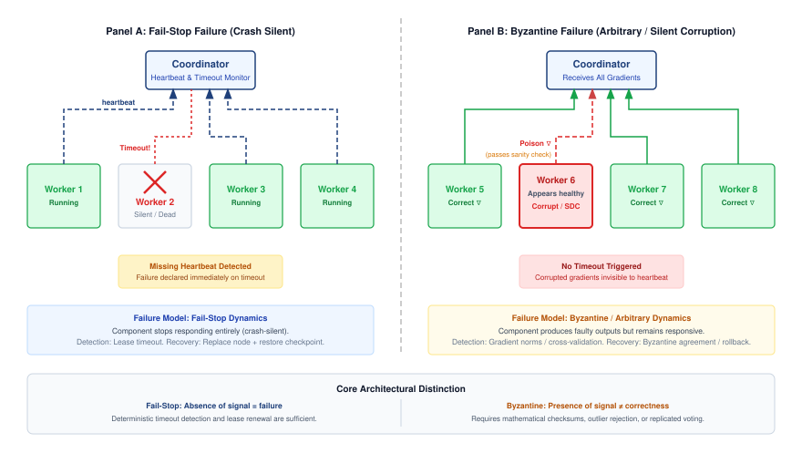

:::

In an ML fleet, the most common source of value corruption is not an adversary but hardware that changes a value without raising an error, the silent data corruption already met among transient failures. Its physical causes, the training signals that expose it, and the verification and hot-spare defenses that contain it are developed together in @sec-ft-sdc-verification, after the hardware faults that produce it. Whatever its source, a Byzantine contribution violates a contract that liveness checks never test. Ordinary data-parallel workers process different batches and need not produce identical local gradients; the required contract is that each contribution correctly represents its assigned computation. A single Byzantine worker can violate that contract and corrupt the averaged gradient, potentially causing training to diverge or converge to a poor solution.

Redundant computation supplies one form of evidence against Byzantine failures. Workers repeating a computation from matching inputs, state, and random-number streams can compare results under a stated numerical tolerance. Statistical outlier detection and invariants provide additional evidence without fully repeating the computation. Each method has a coverage limit. Agreement can miss shared faults, while a statistical anomaly can arise from legitimate data variation. Detection overhead must therefore be evaluated together with the faults the method can expose.

Byzantine-resilient distributed training algorithms exist but impose significant overhead. Krum [@blanchard2017machine] keeps the single worker gradient whose nearest neighbors lie closest to it and discards the rest, while coordinate-wise trimmed mean [@yin2018byzantine] drops the largest and smallest values in each coordinate before averaging what remains. Both compute aggregates that stay robust to a bounded number of Byzantine workers, but they require more communication and computation than simple averaging. Without such protection, corrupted gradients can push the optimizer toward an unreliable model state while the training job appears healthy. Reliability must therefore protect semantic correctness rather than process liveness alone.[^fn-byzantine-consensus-overhead]

[^fn-byzantine-consensus-overhead]: **Byzantine-resilient ML**\index{Byzantine-resilient ML!algorithmic overhead}\index{Byzantine fault tolerance!ML overhead}: Named after Lamport's 1982 "Byzantine Generals Problem," these algorithms (Krum\index{Byzantine fault tolerance!Krum algorithm}, trimmed mean\index{Byzantine fault tolerance!trimmed mean}, and signSGD, which aggregates only the signs of gradient coordinates by majority vote) tolerate a bounded fraction of corrupted workers, with the exact bound depending on the rule and its assumptions. Krum's original analysis requires $2\ByzantineClientCount + 2 < \KrumClientCount$ for $\ByzantineClientCount$ Byzantine workers among $\KrumClientCount$, while coordinate-wise median and trimmed mean rest on different robustness assumptions, so the tolerated fraction depends on the aggregation rule, dimensionality, and statistical model. For $\KrumClientCount$ workers, Krum requires pairwise distance computations over worker gradients, so overhead grows quadratically with worker count and directly competes with the throughput gains of data parallelism [@blanchard2017machine].

### Correlated failures {#sec-fault-tolerance-reliability-reliability-correlated-failures-95e8}

The reliability calculations in @sec-fault-tolerance-reliability-reliability-mathematics-inevitable-failure-93ef assume independent failures, yet real systems depart sharply from this assumption when common physical or operational dependencies take down multiple components at once. Within a single node, a power fault that exhausts the chassis's redundant supplies\index{Correlated failure!power supply}, such as the loss of its feed circuits, removes every GPU in the chassis. Across a cluster, a top-of-rack network switch failure\index{Correlated failure!network switch} isolates all attached nodes, while a cooling system failure\index{Correlated failure!cooling system} can trigger thermal shutdowns down an entire row of racks. Shared software and operational dependencies widen the blast radius further. A software bug\index{Correlated failure!software bug} in an updated CUDA driver can crash processes across nodes whenever they exercise the affected code path, and operator error\index{Correlated failure!operator error} during cluster reconfiguration can render an entire fleet unreachable.

Correlated failures violate the independence assumption underlying @eq-system-reliability-n-components. A model that counts only independent device failures omits shared hazards and their potentially larger blast radius; incident frequency and the number of affected devices must be modeled separately. Correlated failures can also defeat redundancy strategies. Three replicas of a model provide no protection against a shared power failure if all three run on the same power domain.

Defending against correlated failures\index{Correlated failure!failure domain protection} requires classifying each failure by its scope, the failure domain\index{Failure domain!ML infrastructure} it takes down, and ensuring that redundancy spans independent domains. Common failure domains in ML infrastructure range from a single GPU to an entire data center region, and each calls for its own mitigation (@tbl-failure-domains). These domains nest, so a physical disruption scales upward from one eight-GPU node to a rack and then to a multi-rack power and network envelope (@fig-failure-domains).

| **Failure domain**     |                   **Impact scope**                  | **Typical recovery time** |   **Mitigation strategy**    |
|:-----------------------|:---------------------------------------------------:|:-------------------------:|:----------------------------:|
| **Single GPU**         |                        1 GPU                        |      Seconds (spare)      | Hot spare, elastic training  |
| **Node (power/OS)**    | `{python} FleetReliabilityRates.node_gpus_str` GPUs |          Minutes          | Checkpoint, node replacement |
| **Rack (ToR switch)**  |                     32--64 GPUs                     |      Minutes to hours     |    Cross-rack redundancy     |
| **Power domain**       |                    100--500 GPUs                    |           Hours           |     Multiple power feeds     |
| **Data center region** |                       All GPUs                      |       Hours to days       |   Geographic distribution    |
| **Software version**   |               All GPUs running version              |     Minutes (rollback)    |       Staged rollouts        |

: **Failure Domains in ML Infrastructure**: Understanding failure domain boundaries enables placement of redundant components across independent domains, preventing correlated failures from defeating redundancy strategies. {#tbl-failure-domains}

::: {#fig-failure-domains fig-env="figure" fig-pos="htb" fig-cap="**Hierarchy of Failure Domains**: Failure domains are often nested or overlapping. A GPU failure affects one device. A node failure affects `{python} FleetReliabilityRates.node_gpus_str` GPUs. A rack switch failure affects 32--64 GPUs (each rack is drawn with only two of its four to eight nodes). A power distribution unit (PDU) failure may affect multiple racks. The red rack shows one such correlated failure: a single top-of-rack switch fault removes every GPU it contains, while the neighboring rack is untouched, which is why replicas must span independent domains (for example, different racks or rows)." fig-alt="Nested rectangles: a data center labeled blast radius all GPUs contains a power and network domain spanning several racks, which contains two racks, each drawn with two of its eight-GPU nodes. The left rack is outlined in red, labeled ToR switch fails and 32 to 64 GPUs, and all its GPU squares are red; the right rack is labeled unaffected and its GPUs are blue."}
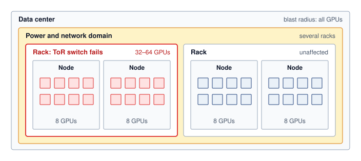

:::

The containment hierarchy in @tbl-failure-domains and @fig-failure-domains explains why replica placement must match the fault being tolerated: placing replicas within the same domain provides zero protection against that domain's failure mode. The highlighted rack in @fig-failure-domains contains nodes that share a top-of-rack (ToR) switch, so that switch's loss can disconnect every attached node from the job. A neighboring rack with a separate switch can remain reachable during that event even if both racks share a power domain, yet that same placement does not protect against loss of their shared power source. Redundancy must therefore cross the relevant failure boundary, not merely occupy different devices.

::: {.column-margin .margin-pointer}
↩ The failure domain and its physical nesting from node to rack to building are established in @sec-compute-infrastructure-node-health-reliability-56a6.
:::

::: {#chk-fault-tolerance-mapping-failure-domains .callout-checkpoint title="Mapping failure domains"}

Verify your understanding of how failure domains nest and their operational impact:

- [ ] **Blast radius**: calculate how many 8-GPU nodes a rack switch failure typically affects in a standard data center configuration.
- [ ] **Power-domain correlation**: explain why placing all 3 model replicas in the same power domain fails to provide protection against a power outage confined to that domain.
- [ ] **Staged rollouts**: identify the failure domain addressed by staged rollouts rather than hardware redundancy.
- [ ] **Nested domains**: explain hierarchical containment and decide whether the rack failure domain still matters once the power domain containing that rack fails.

:::

```{python}
#| echo: false
#| label: tpuv4-war-story-scale
# ┌─────────────────────────────────────────────────────────────────────────────
# │ TPUv4 WAR-STORY SCALE (LEGO)
# ├─────────────────────────────────────────────────────────────────────────────
# │ Context: War story "The supercomputer that swapped in spare cubes" below.
# │
# │ Goal: Pin the TPUv4 supercomputer's chip count to the registry pod.
# │ Show: 4,096 chips.
# │ How:  Systems.Pods.TPUv4_4096.chips.
# └─────────────────────────────────────────────────────────────────────────────
from mlsysim import Systems
from mlsysim.fmt import check, fmt

class TpuV4WarStoryScale:
    # ┌── 1. LOAD (Constants) ──────────────────────
    pod_chips = Systems.Pods.TPUv4_4096.chips
    # ┌── 3. GUARD (Invariants) ────────────────────
    check(pod_chips > 1000, "war story describes a multi-thousand-chip pod")
    # ┌── 4. OUTPUT (Formatting) ───────────────────
    pod_chips_str = fmt(pod_chips, precision=0)
```

::: {#ws-fault-tolerance-google-tpuv4-routing .callout-war-story title="The supercomputer that swapped in spare cubes (2024)"}

**Context**: Google's Tensor Processing Unit (TPU) v4\index{TPU!v4 supercomputer} machine-learning supercomputer used `{python} TpuV4WarStoryScale.pod_chips_str` TPU chips connected by a custom 3D torus inter-chip interconnect (ICI) fabric, and Google engineers published their operating experience with automatic fault resiliency and hardware recovery [@zu2024tpuv4].

**Mechanism**: At `{python} TpuV4WarStoryScale.pod_chips_str`-chip scale, machine and link failures could remove participants or paths required by a job's configured communication topology.

**Impact**: Losing a required participant can interrupt the synchronous job across the slice. Losing a link instead raises a routing question: whether the remaining fabric can still provide the required communication paths.

**Fix**: Google used optical circuit switches (OCS) to assemble replacement slices from spare healthy TPU cubes, the pod's building blocks of chips wired as a $4{\times}4{\times}4$ mesh, for machine outages, together with fault-tolerant routing for supported OCS outage patterns. The response depended on which resource failed.

**Systems lesson**: Fault tolerance is a topology-management problem. In tightly coupled accelerator fleets, recovery must preserve the communication graph, not merely replace an individual component; otherwise one local hardware fault can become a cluster-wide training interruption.

:::

## Hardware Faults at Fleet Scale {#sec-fault-tolerance-hardware-fault-taxonomy}

A cosmic ray that flips one bit in a GPU's high-bandwidth memory and a solder joint that cracks under thermal cycling are physical events, but the recovery system never observes them directly. It observes symptoms: a gradient spike with no process crash, a rank that disappears from the collective, or a node that fails only after it heats under sustained load. The failure taxonomy of @sec-fault-tolerance-reliability-reliability-failure-taxonomy-e78c already classifies such events by persistence, manifestation, and scope. For hardware, persistence carries most of the operational weight because it decides whether the fleet should retry, quarantine, or replace a component, while manifestation decides whether the fleet notices the fault at all.

ML workloads raise the stakes of each fault. A training step performs trillions of arithmetic operations on state that persists into later steps, so a wrong value can survive beyond the computation that produced it. The damage depends on the affected value and its later use. Under the IEEE 754 format,[^fn-ieee754-fp-vulnerability] a sign-bit flip inverts a weight, while an exponent-bit flip can move a small gradient by many orders of magnitude. Fault-injection studies show that network resilience varies with model, layer, and bit position, so a few faults in vulnerable locations can cost disproportionate accuracy [@reagen2018]. A valid-looking corrupted value can enter learned state without triggering the process failure that would otherwise initiate recovery.

::: {.column-margin .margin-pointer}
↪ How an FP16 exponent-bit flip rescales a value by $2^{16}$ and can saturate an attention softmax is developed in @sec-appdx-reliability-sdc-perturbation.
:::

[^fn-ieee754-fp-vulnerability]: **IEEE 754**\index{IEEE 754!bit-flip vulnerability}: The IEEE 754 floating-point standard defines the binary32 format with 1 sign bit, 8 exponent bits, and 23 fraction bits [@ieee_754_2019]. Because bit positions differ so much in consequence, resilience mechanisms often prioritize the sign and exponent bits rather than treating all bits as equally important.

Fleet scale turns these rare device events into routine operating conditions. Smaller geometries and lower operating voltages can reduce the charge needed to disturb a stored value [@baumann2005]. Fleet studies at Google and Meta found that a small but persistent population of processors, on the order of a few per several thousand machines, computes wrong results without raising any error [@hochschild2021; @dixit2021silent]. Studies of accelerator training fleets reach the same conclusion: rare hardware faults appear often enough that software-level detection and recovery become part of the training system design [@he2023]. ML system architects must therefore treat hardware as an unreliable substrate\index{Hardware!unreliable substrate} and budget for end-to-end integrity checks, replayed computation on high-value paths, and periodic consistency checks as system requirements rather than high-performance computing specialties.

### Fault persistence and the fleet response {#sec-ft-fault-persistence-response}

Each persistence class from the taxonomy maps to a different fleet action, from retry for a fault that leaves nothing to repair, through quarantine for one that returns under load, to replacement for one that repeats on every attempt (@fig-fault-tolerance-failure-spectrum). A transient fault\index{Transient fault!fleet response}, as @sec-fault-tolerance-reliability-reliability-transient-failures-57b4 established, leaves no lasting defect from that event, so the fleet's question is only whether its effect escaped. A single-event upset, a voltage droop on an unstable power path [@reddi2013], a timing violation, or a soft error in combinational logic [@mukherjee2005] can corrupt a tensor, packet, or instruction. Detection and correction can prevent propagation; affected state may otherwise require rollback. During training, an undetected error in weights or gradients can compromise convergence and contaminate subsequent checkpoints [@he2023]. During stateless inference, an activation error can remain confined to one request [@mahmoud2020]. If that activation enters retained state such as a KV cache, later outputs can also depend on it.

::: {#fig-fault-tolerance-failure-spectrum fig-env="figure" fig-pos="htb" fig-cap="**The ML Failure Spectrum**: Hardware faults ordered by how long they persist. A transient fault leaves nothing to repair, an intermittent fault returns under the load that exposed it, and a permanent fault repeats on every retry. Persistence decides the fleet response, from retry through quarantine to replacement, and fault tolerance engineering must handle all three to keep a fleet making progress." fig-alt="An arrow labeled fault persistence runs from clears on its own to lasts until repaired above three panels: transient, intermittent, and permanent. Each panel shows a row of eight attempt squares over time, green when an attempt completes and red when it faults. Transient: one red square among greens. Intermittent: gray load bars above the row, and the two attempts under the tallest load bars are red. Permanent: two green squares then all red. Below each row are a typical cause (particle strike, cracked solder joint, stuck-at fault or wear-out) and a response box (retry or roll back, drain and stress-test, replace and restore)."}
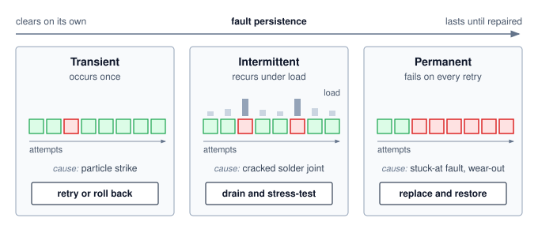

:::

A permanent fault\index{Permanent fault!fleet response} announces itself through repeatability. The same accelerator, memory cell, or link fails again after retry, often at the same address or in the same workload phase. Manufacturing defects and wear-out mechanisms such as electromigration[^fn-electromigration-silicon-wearout] and oxide breakdown produce this signature, and the stuck-at fault, in which a signal remains fixed at 0 or 1 regardless of input, is its standard abstract model [@seong2010]. Repeatability helps locate the defect but does not make the result trustworthy. A permanent datapath fault keeps producing wrong gradients until the device is drained from the cluster [@he2023], and rerunning the computation on the same device reproduces the error instead of exposing it. The fleet must stop trusting the component, quarantine it, and restore from a checkpoint that predates its first bad write.

[^fn-electromigration-silicon-wearout]: **Electromigration**\index{Electromigration!wear-out mechanism}: Gradual displacement of metal atoms in conductors by electron momentum transfer, first characterized in early electromigration studies and later modeled in Black's reliability equation [@black1969electromigration]. Mean time to failure decreases with higher current density and higher temperature, so sustained high-power accelerator workloads make thermal management a direct determinant of fleet lifespan.

Intermittent faults\index{Intermittent fault!fleet response} create the most operational ambiguity because they produce evidence and then disappear. A node may pass a reboot test, rejoin the fleet, and fail again only when the next job drives the package into the same thermal, voltage, or communication regime. Cracked solder joints, aging packages, and contamination between contacts create these load-dependent conditions [@constantinescu2008; @rashid2015], and reduced voltage margins cause timing errors that are hard to reproduce [@zhang2018thundervolt]. Sporadic errors of this kind can accumulate across iterations and degrade convergence without any explicit failure [@rashid2015]. An intermittent node should therefore remain suspect until evidence clears it. The fleet drains it from long jobs, correlates its error logs, and readmits it only after it passes stress tests under the load that exposed the fault. Otherwise one marginal component can make validation and recovery untrustworthy for every job that lands on it. Across the three persistence classes, the evidence that exposes a fault also determines the fleet's response (@tbl-fault_types).

| **Persistence**  | **Fleet signature**                                       | **Detection evidence**                                         | **Fleet response**                                                |
|:-----------------|:----------------------------------------------------------|:---------------------------------------------------------------|:------------------------------------------------------------------|
| **Transient**    | One-time wrong value or lost message; retry succeeds      | Corrected-error counters, checksum mismatches, gradient spikes | Correct or retry; roll back if durable state was contaminated     |
| **Intermittent** | Recurring errors under specific load, heat, or voltage    | Correlated error logs and repeated anomalies on one node       | Drain and quarantine; readmit only after screening under load     |
| **Permanent**    | Reproducible failure at the same device, address, or link | Failed self-test or replay mismatch on the same device         | Replace the component; restore from a checkpoint before the fault |

: **Hardware Fault Persistence and Fleet Response**: The persistence class of a hardware fault determines the evidence that exposes it and the action the fleet takes. Manifestation is a separate axis: any of the three classes can surface as a crash or as silent corruption [@constantinescu2008]. {#tbl-fault_types}

### Hardware lifecycle and the hazard rate {#sec-fault-tolerance-reliability-reliability-bathtub-curve-hardware-lifecycle-7d8a}

A newly unboxed accelerator rack is far more likely to fail in its first week of service than in its sixth month, and a multi-year-old rack that has endured thousands of thermal cycles becomes fragile again as packages and solder joints fatigue. While persistence classifies a fault after it strikes, the hazard function $\ComponentHazardRate(\TimeInstant)$ describes *when* over a component's operating lifespan faults are most likely to occur, partitioning hardware longevity into three reliability regimes (@fig-bathtub-curve). The first phase, infant mortality\index{Bathtub curve!infant mortality}, brings elevated failure rates from manufacturing defects, improper installation, and early-life failure of marginal components. For electronic components it typically lasts days to weeks, which is why burn-in testing[^fn-burnin-screening-hardware] stresses hardware before deployment to precipitate those early failures prior to production use.

[^fn-burnin-screening-hardware]: **Burn-in testing**\index{Burn-in testing!reliability screening}: A controlled screening procedure stresses components before deployment to expose early-life defects. Temperature, voltage, duration, and acceptance criteria depend on the component and its qualified test procedure; a generic semiconductor screening recipe is not an operating specification for an assembled accelerator. Screening reduces the defective population entering service but does not certify every later workload or fault mode.

After surviving infant mortality, components enter the useful-life\index{Bathtub curve!useful life} phase, where failure rates remain relatively constant under the standard reliability-engineering model [@birolini2017; @klutke2003]. This phase spans the longest portion of a component's lifetime and is the regime where the exponential reliability model in @eq-single-component-reliability applies most accurately. For data center GPUs, the useful-life window is an operational planning concept shaped by refresh cycles, cooling, utilization, and observed fleet health rather than a fixed physical duration.

As components age, they enter the wear-out\index{Bathtub curve!wear-out} phase, where failure rates increase due to accumulated wear. For GPUs, wear mechanisms include electromigration in circuits, thermal cycling stress on solder joints, and degradation of thermal interface materials. The onset of wear-out depends heavily on operating conditions; components operated at high temperatures or with frequent thermal cycling enter wear-out earlier.

The practical implication for ML systems is that fleet-wide failure rates can depend on age distribution. Under the bathtub model, a new cohort passes through elevated early-life risk, a relatively stable period, and eventual wear-out. Screening, operating conditions, and replacement policy determine how much of that pattern appears in field data. Mixed-age fleets combine cohorts at different stages, so their aggregate hazard need not follow the curve of a single cohort.

::: {#fig-bathtub-curve fig-env="figure" fig-pos="htb" fig-cap="**The Bathtub Curve**: Hardware failure rates $\ComponentHazardRate(\TimeInstant)$ vary over time. (1) Infant mortality: high failure rate initially due to manufacturing defects. (2) Useful life: constant, low failure rate where random failures dominate. (3) Wear-out: increasing failure rate as components age. Burn-in testing aims to filter out infant mortality failures before deployment." fig-alt="Line graph of failure rate versus component age from days to end of life, showing a bathtub shape across three shaded regions separated by dashed lines: (1) infant mortality in red with a falling rate from manufacturing defects screened by burn-in, (2) useful life in green with a constant rate whose flat floor is highlighted and labeled h equals 1 over MTTF, with MTTF about 50,000 hours, and (3) wear-out in red with a rising rate from electromigration and thermal fatigue."}

```{python}
#| echo: false
from binder.tools.figures import style as book_style
import numpy as np

fig, ax, COLORS, plt = book_style.setup_plot(figsize=(6.2, 3.7))

# Zones: x in [0, 12]
ax.axvspan(0, 3.5, color=COLORS['RedL'], alpha=0.35, zorder=1, lw=0)
ax.axvspan(3.5, 8.5, color=COLORS['GreenL'], alpha=0.45, zorder=1, lw=0)
ax.axvspan(8.5, 12.0, color=COLORS['RedL'], alpha=0.35, zorder=1, lw=0)

# Dividers
ax.axvline(3.5, color=COLORS['grid'], linestyle='--', linewidth=1.1, zorder=2)
ax.axvline(8.5, color=COLORS['grid'], linestyle='--', linewidth=1.1, zorder=2)

# Generate smooth bathtub curve
x1 = np.linspace(0.1, 3.5, 80)
y1 = 0.08 + 4.2 * np.exp(-1.4 * x1)

x2 = np.linspace(3.5, 8.5, 60)
y2 = np.full_like(x2, y1[-1])

x3 = np.linspace(8.5, 11.9, 80)
y3 = y2[-1] + 0.03 * (np.exp(1.4 * (x3 - 8.5)) - 1)  # starts exactly on the floor: no step at the join

x = np.concatenate([x1, x2, x3])
y = np.concatenate([y1, y2, y3])

ax.plot(x, y, color=COLORS['primary'], linewidth=2.2, zorder=4)

# Regime names (numbered to match the caption), set just above the curve's tallest end
for xc, name in [(1.75, '(1) Infant mortality'), (6.0, '(2) Useful life'), (10.25, '(3) Wear-out')]:
    ax.text(xc, 3.9, name, ha='center', va='center', fontsize=10, fontweight='bold', color=COLORS['primary'])

# Short regime annotations, set beside the curve
ax.text(1.0, 2.25, 'manufacturing defects', ha='left', va='center', fontsize=10, color=COLORS['primary'])
ax.text(1.0, 1.8, 'screened by burn-in', ha='left', va='center', fontsize=10, style='italic', color=COLORS['secondary'])
ax.text(6.0, 0.95, 'constant rate, random failures', ha='center', va='center', fontsize=10, color=COLORS['primary'])
ax.text(10.45, 1.3, 'electromigration,\nthermal fatigue', ha='right', va='center', fontsize=10, color=COLORS['primary'], linespacing=1.3)

# Useful life: MTTF is a rate level, not an age. Label the flat floor itself,
# h = 1/MTTF, and mark the level with a thin bracket instead of a point.
floor_y = y2[0]
ax.plot([3.9, 8.1], [floor_y, floor_y], color=COLORS['GreenLine'], linewidth=3.2, zorder=5, solid_capstyle='butt')
ax.text(
    6.0,
    floor_y + 0.2,
    rf'$h = 1/\mathrm{{MTTF}}$,  MTTF ≈ {float(Systems.Reliability.Gpu.mttf_hours):,.0f} h',
    ha='center',
    va='bottom',
    fontsize=10,
    color=COLORS['GreenLine'],
)

ax.set_xlim(0, 12.0)
ax.set_ylim(-0.2, 4.25)

ax.set_xticks([0.8, 2.2, 4.8, 7.2, 10.5])
ax.set_xticklabels(['Days', 'Weeks', 'Months', 'Years', 'End of life'], color=COLORS['primary'])
ax.set_xlabel('Component age')

ax.set_yticks([])
ax.set_ylabel(r'Failure rate $h(t)$ (illustrative)')

ax.grid(False)

plt.tight_layout()
plt.show()
plt.close()
```

:::

These three hazard regimes in @fig-bathtub-curve translate directly into admission control and maintenance policies. Before assigning new or repaired nodes to a long training run, operators use matrix-multiply, memory, and communication stress tests to expose marginal components. During service, temperature trends, error counts, and performance degradation help identify devices for scheduled replacement. Screening moves failures out of expensive production runs. An infant-mortality failure caught during a few hours of stress testing costs only idle time, while the same failure weeks into a pretraining run forces a checkpoint rollback. For that reason operators often route fresh or repaired nodes to short jobs first. Monitoring then checks whether the constant-rate model remains appropriate as the fleet ages.

### Fleet-scale detection and mitigation {#sec-ft-hardware-fault-detection-mitigation-8f7f}

Burn-in screening and lifecycle replacement keep the most failure-prone hardware out of long training runs, but even healthy mid-life devices still suffer random faults that compound across a fleet just as the interruption rates of @sec-fault-tolerance-reliability-reliability-mathematics-inevitable-failure-93ef do. Field studies of DRAM in large data centers found memory errors frequent enough that error-correcting memory, background scrubbing, and error-rate monitoring are standard fleet practice rather than optional hardening [@schroeder2009; @sridharan2015]. Protection consumes some capacity and bandwidth for check bits and scrubbing, but that cost is small compared with a corrupted multi-week run.

Detection works in layers with different coverage and cost. At the hardware layer, error-correcting codes\index{ECC!error detection and correction}\index{Error correction code|see{ECC}}[^fn-hamming-ecc-memory] [@hamming1950] correct and detect the memory-error patterns covered by the implemented code, and link-level CRCs[^fn-crc-packet-validation] check corruption in transit. These protections operate within their enabled storage and transport boundaries; they do not validate an incorrect arithmetic result merely because its bytes arrive intact. Before deployment, built-in self-test and the burn-in screening of the hardware lifecycle expose manufacturing defects and permanent faults [@bushnell2002]. During service, operators periodically pull nodes from production and run known-answer stress tests on arithmetic, memory, and interconnect, because defective processors often fail only on particular instruction mixes, data patterns, or operating points [@hochschild2021; @dixit2021silent].

[^fn-hamming-ecc-memory]: **Hamming codes (1950)**\index{Hamming code!ECC origin}: Richard Hamming developed error-correcting codes at Bell Labs after relay computers repeatedly detected errors in his unattended weekend jobs and abandoned them rather than repairing them. A Hamming code uses parity checks to locate a single-bit error with $\mathcal{O}(\log \HammingDataBitCount)$ check-bit overhead; adding an overall parity bit yields the extended single-error-correcting, double-error-detecting form. Memory ECC implementations vary in code and coverage, so the system must account for both corrected errors and residual faults outside that coverage.

[^fn-crc-packet-validation]: **CRC (cyclic redundancy check)**\index{CRC!gradient validation}: Polynomial checksum family introduced by @peterson1961. CRC coverage depends on the polynomial, frame length, and error model; it is best understood as a low-cost detection layer rather than a universal guarantee. In distributed ML training, checksums or hashes can validate gradient payloads exchanged during collectives; without a verification layer, a corrupted gradient packet can silently poison the parameter update for every worker in the collective.

The software layer draws its cheapest evidence from metrics the training loop already emits. Statistical checks on loss, gradient norms, and activations flag silent drift [@chandola2009], missed heartbeats identify suspected failures [@kawazoe_aguilera1997], and watchdog timers catch tasks that stall without crashing [@pont2002using]. A node that stays alive but runs slowly or erratically, the gray failure of the failure taxonomy, can degrade progress while still meeting a liveness timeout, so @sec-fault-tolerance-reliability-reliability-distinguishing-stragglers-failures-285d treats it through straggler detection. Redundant computation adds stronger evidence on selected paths, either periodically or in response to an anomaly, by replaying a step on another device or comparing independently computed results. Its frequency depends on the residual corruption risk, the value of the protected state, and the cost of detecting an error late.

::: {#chk-fault-tolerance-classifying-hardware-faults .callout-checkpoint title="Classifying a hardware fault"}

Verify your understanding of the transient, permanent, and intermittent fault categories and the fault, error, failure progression:

- [ ] **Transient fault**: classify a GPU that produces a wrong result once after a cosmic-ray strike and then computes correctly for the rest of the run, and justify why detection and rollback to a known-good checkpoint, not node replacement, match that fault.
- [ ] **Intermittent vs. permanent**: distinguish an intermittent fault from a permanent one when both can produce a stuck-at value, including the diagnostic signal that separates them.
- [ ] **Fault-error-failure chain**: trace a single bit flip through the fault, error, failure chain, identifying where error correction codes and checkpoint-restart each intervene.
- [ ] **Silent corruption**: explain why silent corruption sits apart from the other fault manifestations even when its underlying fault is an ordinary transient bit flip.

:::

## Check-and-Verify Defenses Against Silent Data Corruption {#sec-ft-sdc-verification}

Of the hardware faults just classified, the costliest are the ones whose manifestation is silent. A corrupted value that raises no error passes every liveness check the fleet runs, and training keeps building on it. Defending against silent data corruption therefore requires checks that establish a correct result, not merely a live process, and choosing those checks starts with where the corruption comes from and how it surfaces in training.

### The physics of silent corruption {#sec-fault-tolerance-reliability-physics-silent-corruption-5d5d}

An accelerator executes deterministic logic gates, yet the silicon carrying those gates operates under narrow physical margins where both random particle strikes and load-dependent defects can flip bits without halting the processor. Single-event upsets (SEUs)\index{SEU!mechanism}\index{Single-event upset|see{SEU}}, the particle strikes introduced with transient failures, create fleet exposure that grows with device count and operating time even when the per-device rate is low. Manufacturing variances\index{Manufacturing variance!silicon margin} can instead leave "marginal" chips that pass initial QA but fail under particular inputs or operating conditions. Voltage and temperature margins matter, including supply disturbances during rapid current changes ($d\AcceleratorSupplyCurrent/d\TimeInstant$). Because these margin defects produce repeatable errors under specific workloads while particle strikes arrive at random, fleet reliability requires a probabilistic exposure model even when individual hardware faults are deterministic.

Facebook documented a pervasive SDC issue where a hardware fault caused a valid file to be reported as "size zero" during decompression [@dixit2021silent]; the system "worked" without crashing, but data was silently deleted. In ML, the same failure manifests as valid-looking but numerically corrupted gradients. The pipeline trace in @fig-sdc-example follows a single ALU or memory bit flip as it corrupts an individual tensor entry, taints gradient reduction during the backward pass, commits into weights, and finally surfaces as degraded quality at evaluation. The comparative timelines beneath contrast this silent latency with a standard detected error. A hardware trap halts within milliseconds to restart cleanly from the last checkpoint, whereas silent corruption commits contaminated state into checkpoints over hours or days before an evaluation alert forces a costly rollback.

::: {#fig-sdc-example fig-env="figure" fig-pos="htb" fig-cap="**Silent Data Corruption Propagation**: A hardware bit flip moves left to right from one wrong tensor value through the backward pass and the weight update, surfacing only at the final stage as degraded model quality. The two timelines below contrast a detected error, which traps within milliseconds and restarts from the last checkpoint, with silent corruption, which is saved into checkpoints for hours or days before an evaluation alert forces a rollback; the gap between the two is the cost of silence." fig-alt="Top, a left-to-right chain linked by red arrows: an 8-bit word with one red bit under a lightning mark labeled bit flip in memory or ALU; a 5 by 5 tensor grid with one red cell labeled wrong value in one tensor entry; a gradient grid where the red cell's row and column are tinted red, labeled backward pass taints gradients; a weight grid whose whole row and column are red, labeled weight update commits to weights; and a small plot whose rising quality curve turns red and falls, labeled quality drops seen at evaluation. Below, two timelines share a time axis marked t equals zero, milliseconds, and hours to days. Detected error: a fault dot, a trap dot, then a green restart from checkpoint box. Silent corruption: a fault dot, a long red dashed span labeled corrupt state saved containing three crossed-out checkpoint squares, an alert dot, then a green roll back box."}
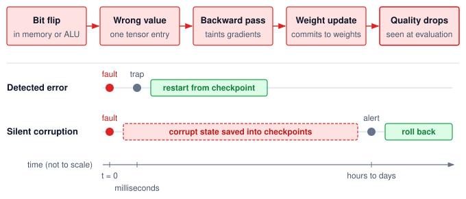

:::

Telemetry from production training fleets shows this corruption is routine rather than anomalous. At modern training scales, hardware bit flips occur regularly, and erroneous computations from a single malfunctioning accelerator can propagate into the global model state, as Jeff Dean documented in his MLSys 2024 keynote on silent data corruption [@dean2024mlsys] (@fig-sdc-jeffdean).

::: {#fig-sdc-jeffdean fig-env="figure" fig-pos="htb" fig-cap="**Silent Data Corruption at Scale**: Jeff Dean presents on silent data corruption (SDC) at MLSys 2024, arguing that at the scale of large ML training jobs hardware errors occur routinely, and that incorrect computations from one buggy chip can propagate and infect an entire training run. Source: Jeff Dean, MLSys 2024 keynote (Google)." fig-alt="Photograph of Jeff Dean giving a keynote at MLSys 2024. On stage he stands at a podium; a projected slide titled 'Silent Data Corruption errors (SDCs)' explains that ML-scale hardware errors can propagate and infect the entire training system."}

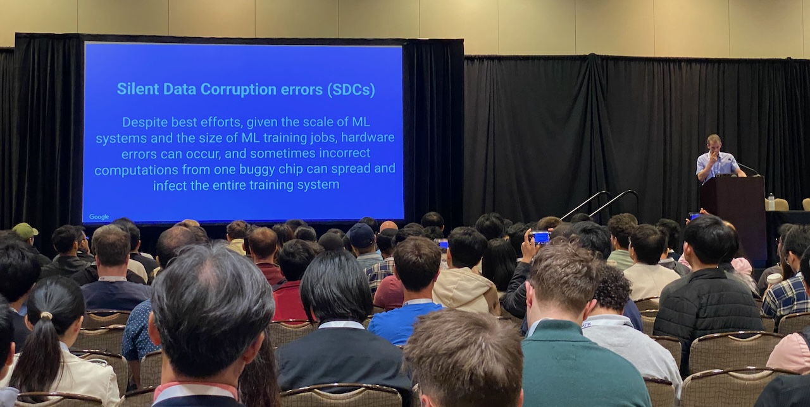

:::

In the Google training telemetry presented by @dean2024mlsys, @fig-sdc-training-fault identifies an abrupt gradient-norm anomaly as an SDC event. The plot shows the symptom without identifying the damaged bit or circuit. Corrupting a floating-point exponent is one mechanism that can greatly change a tensor value and subsequent updates. Gradient clipping can limit update magnitude, but it does not reconstruct the correct gradient; an anomaly detector must trigger validation or recovery before suspect state is accepted.

::: {#fig-sdc-training-fault fig-env="figure" fig-pos="htb" fig-cap="**Gradient Norm Deviation**: Transient hardware faults, such as silent data corruption (SDC), can disrupt optimization by causing abrupt changes in gradient norms. Google's production examples show SDC anomalies surfacing as visible gradient-norm spikes. Source: [@dean2024mlsys]." fig-alt="Line graph of gradient norm over training time showing smooth baseline with sudden spike anomaly caused by silent data corruption event."}

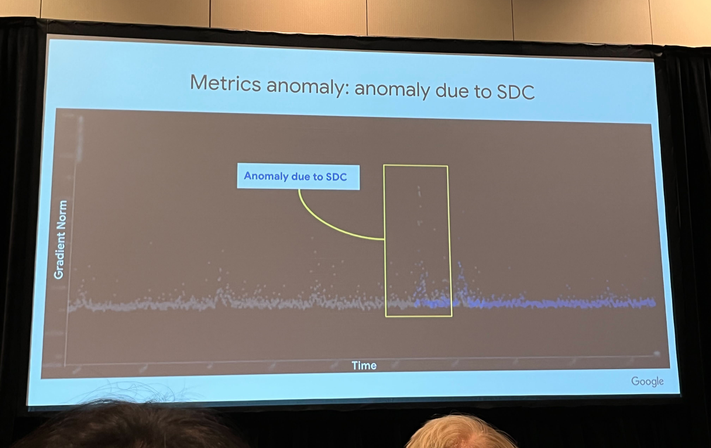

:::

### Verification at fleet scale {#sec-ft-sdc-verification-fleet-scale}

::: {.column-margin}
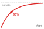{width="100%" fig-alt="One red curve over training steps that rises and flattens toward a dashed certainty line, with a dot marking 63 percent: cumulative silent-corruption probability approaches certainty over a long run."}

*Cumulative SDC probability nears certainty over a long run.*
:::

```{python}
#| echo: false
#| label: sdc-chapter-cluster
# ┌─────────────────────────────────────────────────────────────────────────────
# │ SDC CADENCE ON THE CHAPTER CLUSTER (LEGO)
# ├─────────────────────────────────────────────────────────────────────────────
# │ Context: @sec-ft-sdc-verification-fleet-scale opening paragraph, before the
# │          "SDC risk accumulation" notebook scales the estimate tenfold.
# │
# │ Goal: State the expected SDC cadence on the chapter's own 10,000-GPU cluster
# │       so the notebook's larger fleet reads as an extrapolation.
# │ Show: ~100 hours between events; ~22 events over a 90-day run.
# │ How:  Same constant-rate model and illustrative 2 s step as the notebook:
# │       p_step = 1 - (1 - p)^(N x step/3600); interval = step / p_step.
# └─────────────────────────────────────────────────────────────────────────────
from mlsysim import Systems
from mlsysim.fmt import check, fmt, fmt_int, fmt_time

class SdcChapterCluster:
    # ┌── 1. LOAD (Constants) ──────────────────────
    n_gpus = Systems.Clusters.Training_10K.total_accelerators
    p_sdc_per_gpu_hr = Systems.Reliability.SdcRatePerGpuHr  # illustrative generic SDC-rate assumption
    training_step_s = 2  # scenario assumption: same illustrative step time as the notebook
    run_days = 90  # three-month run of the chapter opening

    # ┌── 2. EXECUTE (The Compute) ─────────────────
    exposure_gpu_hr = n_gpus * (training_step_s / SEC_PER_HOUR)
    p_step_sdc = 1 - (1 - p_sdc_per_gpu_hr) ** exposure_gpu_hr
    hours_between = (1 / p_step_sdc) * training_step_s / SEC_PER_HOUR
    run_events = run_days * 24 / hours_between

    # ┌── 3. GUARD (Invariants) ────────────────────
    check(90 < hours_between < 110, "10,000-GPU SDC interval should be about 100 hours")
    check(15 < run_events < 30, "a three-month run should see about twenty events")

    # ┌── 4. OUTPUT (Formatting) ───────────────────
    n_gpus_str = fmt(n_gpus, precision=0)
    hours_between_str = fmt_time(round(hours_between), "hour", precision=0, commas=False, style="word")
    run_events_str = fmt_int(round(run_events))
```

Even a small per-GPU SDC rate accumulates across repeated collective operations, and the accumulation grows with fleet size. Any single collective is unlikely to contain an SDC event. Under the illustrative rate used in the analysis that follows, the per-step probability remains small while the cumulative probability grows over a long training run, reaching $1 - e^{-1} \approx 63$ percent once the expected number of events reaches one. On the chapter's `{python} SdcChapterCluster.n_gpus_str`-GPU cluster, that rate gives one expected event roughly every `{python} SdcChapterCluster.hours_between_str`, or about `{python} SdcChapterCluster.run_events_str` over the three-month run of the chapter opening. The notebook below scales the same estimate to a fleet ten times larger to show where the trend leads, since the expected interval shrinks in proportion to fleet size. Standard AllReduce reduces the supplied contributions; it does not establish that an *alive* worker computed a *correct* gradient. The fleet therefore needs validation appropriate to its fault model in addition to liveness checks.

Check-and-verify methods\index{Silent data corruption!detection methods} test data-path invariants, subject to the boundary drawn for transient failures in @sec-fault-tolerance-reliability-reliability-transient-failures-57b4. Digests test byte integrity and agreement within their error-detection limits; they cannot establish that the original computation was correct. Independent computation, an algorithmic invariant, or replay tests that additional claim under a declared fault model. A quick estimate shows how much exposure those checks must cover.

```{python}
#| echo: false
#| label: sdc-prob-calc
import math
from mlsysim.fmt import check, fmt, fmt_int, fmt_math, fmt_percent, fmt_time

class SDCCollective:
    """The risk of silent corruption in global collectives."""

    # ┌── 1. LOAD ──────────────────────────────────────────
    n_gpus = Systems.Clusters.Training_10K.total_accelerators * 10
    p_sdc_per_gpu_hr = Systems.Reliability.SdcRatePerGpuHr  # illustrative generic SDC-rate assumption
    training_step_s = 2  # scenario assumption: illustrative step time
    # ┌── 2. EXECUTE ───────────────────────────────────────
    _sdc_exp = round(math.log10(float(p_sdc_per_gpu_hr)))
    exposure_gpu_hr = n_gpus * (training_step_s / SEC_PER_HOUR)  # aggregate GPU-hours per step
    p_step_sdc = 1 - (1 - p_sdc_per_gpu_hr) ** exposure_gpu_hr
    expected_steps = 1 / p_step_sdc
    expected_hours = expected_steps * training_step_s / SEC_PER_HOUR
    # ┌── 3. GUARD ─────────────────────────────────────────
    check(p_step_sdc > 0.00005, f"Prob {p_step_sdc:.6f} unexpected")
    check(abs(exposure_gpu_hr - 55.56) < 0.1, f"Expected ~55.6 GPU-hours exposure, got {exposure_gpu_hr:.2f}")
    check(abs(float(p_sdc_per_gpu_hr) / 10**_sdc_exp - 1) < 1e-9, "SDC rate must be an exact power of ten to render as 10^k")
    # ┌── 4. OUTPUT ────────────────────────────────────────
    prob_str = fmt_percent(p_step_sdc, precision=4, commas=False, style='prose')
    n_gpus_str = fmt(n_gpus, precision=0, commas=True)
    n_gpus_k_str = fmt_text(fmt_int(n_gpus // 1000), "k")
    training_step_s_str = fmt_time(training_step_s, unit="second", precision=0, commas=False)
    training_step_attr_str = fmt_time(training_step_s, unit="second", precision=0, style="word", attributive=True)
    sdc_rate_math = fmt_math(rf"10^{{{_sdc_exp}}}")
    steps_between_str = fmt_count(round(expected_steps), commas=True, label="step")
    hours_between_str = fmt_time(round(expected_hours), "hour", precision=0, style="word")
    _n_tex = n_gpus_str.replace(",", "{,}")
    exposure_eq_math = fmt_math(rf"{_n_tex} \times ({training_step_s}/{SEC_PER_HOUR}) \approx {fmt_int(round(exposure_gpu_hr))}")
```

::: {#nbk-fault-tolerance-napkin-math-sdc-certainty .callout-notebook title="SDC risk accumulation"}

**Problem**: Under an illustrative generic SDC-rate assumption, calculate the probability that at least one GPU in a `{python} SDCCollective.n_gpus_str`-GPU fleet experiences an SDC event during a single `{python} SDCCollective.training_step_s_str` training step.

1. **Fleet size**: `{python} SDCCollective.n_gpus_str` accelerators.
2. **Individual risk**: `{python} SDCCollective.sdc_rate_math` per GPU-hour (an illustrative generic SDC-rate assumption).
3. **The exposure**: In a `{python} SDCCollective.training_step_attr_str` window, the fleet has `{python} SDCCollective.exposure_eq_math` "GPU-hours" of exposure.
4. **The probability**: $\Pr(\text{at least one SDC}) \approx$ `{python} SDCCollective.prob_str`.

**Systems insight**: Under this illustrative constant-rate assumption, a `{python} SDCCollective.n_gpus_k_str`-GPU fleet expects one SDC event every `{python} SDCCollective.steps_between_str` (roughly every `{python} SDCCollective.hours_between_str`), even though the per-step probability is only `{python} SDCCollective.prob_str`. A CRC or hash can protect each shard or reduced buffer against corruption in transit or storage, while a redundant reduction can test the arithmetic path independently. Robustness moves from being a *restart* problem to a *verification* problem only when the verification covers the failure mechanism being claimed.

:::

Full replication protects a broader computation path at a correspondingly high resource cost. Dual modular redundancy\index{DMR!fleet contrast} runs every computation twice and compares the results, and triple modular redundancy\index{TMR!fleet contrast} runs it three times and takes a majority vote. These schemes pay 100 and 200 percent hardware overhead, respectively, to detect or mask a fault within a single control deadline [@sheaffer2007; @arifeen2020]. These guarantees depend on the replicas avoiding a shared fault. The price is justified in safety-critical embedded control, such as a vehicle's onboard computers, where one wrong output can endanger people and the replicated hardware is a small computer. For fleet training, duplicating every step of a run on `{python} FleetReliabilityRates.fleet_gpus_str` doubles the compute devoted to those steps, before comparison and coordination costs. When corruption is rare and rollback can recover valid state, selective redundancy can protect useful progress at lower cost. Screening removes suspect devices, statistical checks run continuously, standby pools absorb drained nodes, and periodic or triggered recomputation checks selected execution paths.

Google's reactive hot-spare protocol shows how those pieces combine in three stages (@fig-sdc-controller). When runtime monitors flag an anomalous gradient and replay implicates a suspect accelerator (G2), the scheduler isolates that device and promotes a standby hot spare (S) into the active ring. It then provisions a replacement spare (S') while the suspect unit undergoes hardware diagnostics [@dean2024mlsys]. The fleet pays in advance for one idle device per pool rather than for a duplicate of every computation, and the protocol shifts the burden of correctness from unverified hardware to system-level auditing. Even so, these hardware checks reduce only the risk of an unreliable physical substrate; they do not protect against faults that the software stack introduces itself, bugs that look like valid computation while corrupting the ML pipeline.

::: {#fig-sdc-controller fig-env="figure" fig-pos="htb" fig-cap="**Hot-Spare Failover**: An $\DeviceCount+1$ pool of four active GPUs and one standby spare. When loss or gradient sanity checks flag a suspect GPU and replay implicates it, the job drains that device and resumes on the spare from the last known-good state; the device goes to repair and a healthy unit refills the spare slot. Google's data-center examples use this reactive pattern to keep training moving despite hardware faults, in contrast to running every computation on two or three redundant units and comparing results [@dean2024mlsys]. The standing cost is the idle spare." fig-alt="Three panels left to right, each a row of five GPU slots. Panel 1: G0, G1, and G3 active in blue, G2 outlined in red and labeled suspect, and a dashed green spare S. Panel 2: G2 dashed gray and labeled isolated, and S solid blue and labeled active. Panel 3: a new dashed green spare S prime occupies the G2 slot, labeled new spare, with G2 sent to repair."}
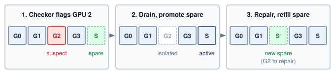

:::

::: {.content-visible when-format="pdf"}
\FloatBarrier
:::

::: {#chk-fault-tolerance-detecting-silent-corruption .callout-checkpoint title="Detecting silent corruption"}

Verify your understanding of Byzantine failures and SDC:

- [ ] **SDC danger**: explain why silent data corruption is more dangerous for ML training than a simple node crash.
- [ ] **Hot spare vs. restart**: compare a hot spare redundancy strategy with traditional checkpoint-restart in terms of recovery latency.
- [ ] **Sanity checker**: identify the metric used as a "sanity checker" to identify potential hardware faults: GPU temperature or gradient norm.
- [ ] **Byzantine scope**: assess the True or False claim that Byzantine failures only occur when a malicious actor intentionally sabotages the training cluster.

:::

## Software Faults {#sec-ft-software-faults}

A team spends three months testing a large language model (LLM) against complex prompt-level failure cases, only to realize that its preprocessing script kept only the last 512 tokens of each input, silently discarding the system prompt on long requests. The example exposes an ordinary source of ML failure that algorithmic testing can miss. A logic error in a data loader or prompt assembler can preserve valid tensor shapes while changing the computation's meaning, allowing the pipeline to continue without a crash.

Software faults require a different recovery lens from hardware failures. Hardware faults enter from silicon, electrons, and physical wear; software faults enter through design choices, dependency versions, and pipeline glue. The fault-tolerance problem shifts from replacing a failed component to identifying which valid-looking transformation corrupted data, gradients, or predictions. Every boundary between framework, library, runtime, and distributed system is a place where such a transformation can hide.

### Software fault properties and propagation {#sec-ft-software-fault-properties}

A single tensor reference leaked on every training iteration lets a correctly sized job drift toward the device memory limit over hundreds of steps and then crash with an out-of-memory error far from the code that leaked it. Across ML frameworks, software faults of this kind span logic errors, resource leaks, concurrency bugs, and integration mismatches that propagate across system boundaries. Race conditions in asynchronous updates can lose or overwrite parameter updates, and deadlocks[^fn-deadlock-pipeline-stall] leave workers waiting on messages that never arrive. Because many of these faults surface only under high load, on particular hardware, or with a specific pairing of a high-level framework and a low-level numerical library such as cuDNN, root-cause analysis must treat the model code, the runtime, and its dependencies as one versioned artifact.

[^fn-deadlock-pipeline-stall]: **Pipeline deadlock**\index{Deadlock!pipeline parallelism}: In pipelined training, a deadlock can form when stage 1 waits for a free buffer to send activations to stage 2 while stage 2 waits for stage 1 to accept its backward gradients. Neither stage can proceed, and because every other stage depends on them, the whole job stalls with no error raised, which a collective timeout eventually converts into a detectable failure.

### Software fault detection and prevention {#sec-ft-software-fault-detection-prevention}

The prompt-truncation bug from the opening example and the memory or synchronization bugs above should never survive unchallenged into a multi-week run. Because many software faults leave the pipeline running while corrupting inputs or gradients, each verification gate must establish which invariant holds and which recovery action is safe when it fails. A unit test catches the tokenizer boundary before launch, an integration replay verifies that a recorded batch reproduces the expected shapes and state on known-good hardware, and a fault-injection test verifies that a corrupted buffer or lost worker triggers rollback before tainting committed state.

Several of these gates also test the recovery machinery itself before an incident relies on it. A restore drill verifies a checkpoint manifest, the record that names every saved shard and the training step they share (@sec-fault-tolerance-reliability-reliability-distributed-checkpointing-5dcc). A membership fault-injection test kills or partitions a worker and checks that, once replaced, the stale process can no longer write state the job will trust under the epoch, lease, and fencing rules of @sec-fault-tolerance-reliability-reliability-recovery-procedures-002d. Every recovery drill is judged against two bounds formalized in @sec-fault-tolerance-reliability-reliability-checkpoint-restart-fundamentals-0ac2: how much completed work a failure may lose and how long recovery may take before useful execution resumes. Across all six gates, each test earns its place through the operational decision it authorizes (@tbl-software-faults-summary-ft).

| **Reliability evidence**       | **Invariant exercised**                                                            | **Decision enabled**                                      |
|:-------------------------------|:-----------------------------------------------------------------------------------|:----------------------------------------------------------|
| **Boundary unit test**         | Tokenizer limits, tensor shapes, masks, and step metadata remain valid             | Reject the change before distributed execution            |
| **Deterministic replay**       | A recorded batch produces equivalent state on known-good hardware                  | Separate input or software defects from suspect hardware  |
| **Checkpoint restore drill**   | A committed manifest restores every shard and resumes at its named step            | Accept the generation as satisfying the recovery contract |
| **Membership fault injection** | A killed or partitioned worker loses ownership and cannot write after replacement  | Validate ownership handoff and communicator rebuild       |
| **Corruption injection**       | A changed shard, reduced buffer, or checkpoint fails the intended verifier         | Block the optimizer step or roll back before propagation  |
| **Dependency rollback test**   | A versioned runtime and artifact set can return to the last known-good combination | Authorize automated rollback instead of manual repair     |

: **Reliability Evidence and Recovery Decisions**: Tests earn operational value when each one establishes an invariant and authorizes a specific rejection, rollback, isolation, or restore decision. {#tbl-software-faults-summary-ft}

These safeguards matter only when each gate targets a concrete corruption path. A test that checks only whether the tokenizer runs is too weak; it must assert that system prompts, labels, masks, and sequence-length metadata survive preprocessing with the intended semantics. Integration replay then follows one recorded batch through loading, sharding, collation, and model input construction. Fault injection tests whether the detector fires before the protected commit and whether recovery stays within the named bounds on lost work and recovery time for the injected fault. Restore drills, stale-writer rejection, and corrupted-shard rejection therefore provide evidence that generic build success cannot supply, and @sec-ft-fault-injection-tools-frameworks exercises those claims directly once the recovery paths themselves have been built. Before building those paths, however, a fleet must decide how much protection each workload is worth.

## The Cost of Failure {#sec-fault-tolerance-reliability-reliability-economic-framework-fault-tolerance-investment-e032}

Losing an uncheckpointed day on a 10,000-GPU foundation-model run burns hundreds of thousands of dollars in accelerator time, whereas losing an hour on a small vision job costs a few hundred dollars and a failed update in an online recommender costs live revenue rather than batch rework. Hardware, silent corruption, and software together set how often a fleet fails, but the work a failure destroys determines what each incident costs. A defense is worth buying only where it removes more of that expected loss than it adds in standing overhead.

### Failure cost by workload {#sec-fault-tolerance-reliability-reliability-modeltype-diversity-failure-impact-8ec0}

Three workload properties set the price of a training interruption: the burn rate of the cluster running the job, the footprint of state that must be saved and reloaded, and how sensitive model quality is to lost or reordered updates. Those three factors separate multi-terabyte foundation models and continuous recommenders from smaller vision, speech, and scientific workloads (@tbl-failure-impact-by-model).

| **Model type**                  | **Typical training duration** |                        **Checkpoint size**                        |      **State sensitivity**      |                              **Failure cost**                             |
|:--------------------------------|:-----------------------------:|:-----------------------------------------------------------------:|:-------------------------------:|:-------------------------------------------------------------------------:|
| **Archetype A (GPT-4/Llama-3)** |        Weeks to months        |    `{python} FaultToleranceIntroRecap.gpt3_ckpt_tb_str` (175B)    |  High (position in data order)  | `{python} FaultToleranceIntroRecap.daily_cost_str` compute per 24 hr loss |
| **Vision (ViT-Large)**          |           1--3 days           |          `{python} FaultToleranceIntroRecap.vit_ckpt_str`         |   Medium (augmentation state)   |                           \$10--50K per day loss                          |
| **Archetype B (DLRM at Scale)** |           Continuous          | `{python} FaultToleranceIntroRecap.recsys_table_str` (embeddings) | Very High (embedding freshness) |                          Revenue impact per hour                          |
| **Speech (Whisper-scale)**      |           3--7 days           |                              5--10 GB                             |              Medium             |                          \$50--200K per day loss                          |
| **Scientific (AlphaFold)**      |         Days to weeks         |                             10--50 GB                             |     High (exploration state)    |                               Research delay                              |

: **Failure Impact by Model Type**: The cost of training failures varies dramatically by model type, driven by training duration, checkpoint overhead, and the value of accumulated training state. The Archetype A cost is one lost day on the chapter's 10,000-GPU cluster; the vision, speech, and scientific rows give illustrative ranges rather than measured values. These differences demand model-specific fault tolerance strategies. {#tbl-failure-impact-by-model}

Large language model training illustrates how a costly allocation magnifies each hour of lost progress. The chapter's `{python} FaultToleranceIntroRecap.gpus_example_str`-GPU cluster at approximately `{python} FaultToleranceIntroRecap.rate_str` incurs `{python} FaultToleranceIntroRecap.daily_cost_str` in compute costs per day. A job checkpointed only once a day can lose up to a full day of progress to one failure, which costs `{python} FaultToleranceIntroRecap.daily_cost_str` in wasted compute plus schedule delay. At the checkpoint interval derived in @sec-fault-tolerance-young-daly, the same failure costs minutes of rework instead of a day. The checkpoint overhead is correspondingly large. At the `{python} FaultToleranceIntroRecap.ckpt_bpp_str`-byte-per-parameter resumable format that the checkpointing analysis uses (BF16 weights, FP32 master weights, and two FP32 Adaptive Moment Estimation (Adam) moments), the 175B-parameter running example writes `{python} FaultToleranceIntroRecap.gpt3_ckpt_tb_str` at every save.

### Investing in protection {#sec-fault-tolerance-investing-protection}

Every GPU cycle, network byte, and storage drive dedicated to checkpointing, standby nodes, or verification is a resource that is not training the model, yet skimping on protection leaves a multi-million-dollar run exposed to day-long rollbacks. Rational investment in fault tolerance therefore weighs what a failure destroys against what the defense costs to run.

When a failure strikes, its bill extends well beyond the GPU-hours burned on steps that must be replayed. Repeating lost work delays the delivery of the trained model, ties up accelerators that could have run other jobs, and pulls engineers away from research to diagnose faults and nurse manual restarts. On the other side of the cost account, prevention carries a continuous overhead even when the cluster is healthy. Checkpoint storage scales with model size and save frequency, and checkpoint writes compete for memory and network bandwidth. Hot spares and automated recovery controllers consume standing infrastructure, and fault-tolerant coordination adds software complexity that must be maintained and debugged.

Optimal investment balances these two curves against cluster scale. For a small job on a few GPUs where hardware failures are weeks apart, infrequent checkpoints and manual restarts are cheaper than standing recovery infrastructure. On thousands of GPUs where failures arrive several times a day, frequent checkpoints, automated failover, and elastic resizing pay back their overhead many times over. The checkpoint interval derived in @sec-fault-tolerance-young-daly applies this exact marginal balance to a single decision variable, choosing the cadence where the cost of one more save equals the expected rework it prevents.

@Eq-ft-total-cost presents a simplified economic model for expected cost per training run:

$$ \TotalTrainingRunCost= \BaseTrainingComputeCost+ \mathbb{E}[\TrainingFailureCount] \times \FailureEventCost+ \FaultToleranceCost$$ {#eq-ft-total-cost}

where $\BaseTrainingComputeCost$ is the base compute cost, $\mathbb{E}[\TrainingFailureCount]$ is the expected number of failures during training, $\FailureEventCost$ is the cost per failure, and $\FaultToleranceCost$ is the cost of fault tolerance mechanisms. The cost per failure includes wasted compute plus overhead.

@Eq-ft-investment-criterion formalizes when fault tolerance investment is justified:

$$ \frac{\partial \FaultToleranceCost}{\partial \FaultToleranceInvestment} < -\frac{\partial (\mathbb{E}[\TrainingFailureCount] \times \FailureEventCost)}{\partial \FaultToleranceInvestment} $$ {#eq-ft-investment-criterion}

where $\FaultToleranceInvestment$ represents investment in fault tolerance mechanisms and the base compute cost is held fixed. The negative derivative on the right is the marginal reduction in expected failure cost. Additional protection reduces total expected cost while this reduction exceeds its marginal cost; an interior optimum equates the two when the cost functions have a suitable minimum.

```{python}
#| echo: false
#| label: hot-spare-breakeven
# ┌─────────────────────────────────────────────────────────────────────────────
# │ HOT-SPARE BREAK-EVEN (LEGO)
# ├─────────────────────────────────────────────────────────────────────────────
# │ Context: @sec-fault-tolerance-reliability-reliability-economic-framework-
# │          fault-tolerance-investment-e032, worked instance of
# │          @eq-ft-investment-criterion.
# │
# │ Goal: Price one idle hot-spare node against the recovery time it must save
# │       on the chapter's 10,000-GPU cluster.
# │ Show: ~$384/day idle node; ~$2,100/day per minute shaved from each
# │       recovery at 6.2 failures/day; break-even ~11 s saved per failure.
# │ How:  spare cost = GPUs/node x 24 h x price; benefit per second saved =
# │       failures/day x fleet GPUs x price / 3600; break-even = cost / benefit.
# └─────────────────────────────────────────────────────────────────────────────
from mlsysim import Infrastructure, Systems
from mlsysim.fmt import check, fmt, fmt_time, fmt_usd

class HotSpareBreakeven:
    # ┌── 1. LOAD (Constants) ──────────────────────
    fleet_gpus = FailureCascadeExample.fleet_gpus
    failures_per_day = FailureCascadeExample.per_day  # full-system cascade cadence
    gpus_per_node = Systems.Nodes.DGX_H100.accelerators_per_node
    price = Infrastructure.Pricing.Fleet.GpuHourRef.rate.to(USD / hour).magnitude

    # ┌── 2. EXECUTE (The Compute) ─────────────────
    spare_cost_day = gpus_per_node * 24 * price  # one node held idle all day
    value_per_min_day = failures_per_day * fleet_gpus * price / 60  # one minute shaved per failure
    breakeven_s = spare_cost_day / (value_per_min_day / 60)

    # ┌── 3. GUARD (Invariants) ────────────────────
    check(breakeven_s < 60, "at fleet scale a spare should pay back within a minute saved per failure")
    check(value_per_min_day > spare_cost_day, "one minute saved per failure must outweigh one idle node")

    # ┌── 4. OUTPUT (Formatting) ───────────────────
    gpus_per_node_str = fmt(gpus_per_node, precision=0)
    spare_cost_day_str = fmt_usd(round(spare_cost_day), precision=0)
    value_per_min_day_str = fmt_usd(round(value_per_min_day, -2), precision=0)
    breakeven_s_str = fmt_time(round(breakeven_s), "second", precision=0, commas=False, style="word")
```

One investment worked through the criterion shows what it decides. Let $\FaultToleranceInvestment$ be a hot-spare node held idle beside the chapter's `{python} FailureCascadeExample.fleet_gpus_str`-GPU cluster, so that a failed node's replacement no longer waits for the scheduler to find capacity. Its marginal cost is `{python} HotSpareBreakeven.gpus_per_node_str` GPUs idling all day, about `{python} HotSpareBreakeven.spare_cost_day_str` per day. Its marginal benefit is the recovery time it removes from each failure while every other GPU waits. At the cascade's `{python} FailureCascadeExample.failures_per_day_str`, each minute removed from every recovery is worth about `{python} HotSpareBreakeven.value_per_min_day_str` per day, so the spare pays for itself once it shortens each recovery by about `{python} HotSpareBreakeven.breakeven_s_str`, provided it is refilled before the next failure arrives some `{python} FailureCascadeExample.mtbf_hours_str` later. The same node beside an eight-GPU job, whose GPU-only MTBF in @tbl-cluster-mtbf-scaling is `{python} ClusterMtbfScaling.mtbf0_str`, would sit idle far longer than it could ever save. Scale reverses the verdict on the same hardware, and three foundational principles distill how that shift guides design across the rest of this chapter.

::: {#psp-fault-tolerance-three-rules-failure-at-scale .callout-perspective title="Three rules of failure at scale"}

1. *At scale, failures are continuous, not exceptional.* A `{python} FailureCascadeExample.fleet_gpus_str`-GPU cluster experiences a failure every `{python} FailureCascadeExample.mtbf_hours_str` on average. Systems must be designed expecting failure as normal operation.
2. *Checkpoint intervals have an optimum.* The Young-Daly interval (developed in @sec-fault-tolerance-young-daly) sets checkpoint frequency from write time and system MTBF under its stated assumptions, and it shrinks only with the square root of a falling MTBF.
3. *Training and serving have fundamentally different fault tolerance requirements.* A long training job can budget minutes for recovery while preserving accumulated progress; an interactive serving request may have only milliseconds left before its deadline. Those budgets motivate checkpoint recovery for training and ready alternate capacity for serving.

:::

These three rules organize the rest of the chapter: rules 1 and 2 govern long-running training jobs that must protect accumulated progress, rule 3 governs low-latency serving fleets that must protect live requests, and observability and fault injection verify that both recovery paths work under fire. Training resilience begins with the durable state that every restart or resize falls back on.

## Checkpointing and Progress Preservation {#sec-fault-tolerance-reliability-reliability-checkpoint-restart-fundamentals-0ac2}

When a top-of-rack switch dies two weeks into the training run of a 175-billion-parameter model, the cluster loses 64 GPUs instantly. Because a large cluster experiences such interruptions routinely (@sec-fault-tolerance-reliability-reliability-failure-analysis-scale-6b4b), it cannot restart multi-week jobs from scratch; training fault tolerance must preserve state, detect and classify the failure, and resume or resize the worker group. Checkpointing supplies the first of those three obligations, and every detection, restart, and elastic-resizing path later in the chapter depends on the durable snapshot it produces. The first design question is what that snapshot must contain to make a restart valid.

::: {#dfn-fault-tolerance-checkpointing .callout-definition title="Checkpointing"}

***Checkpointing***\index{Checkpointing!definition} is the periodic serialization of the complete training state (parameters, optimizer state, data loader position, and random state) to persistent storage at a recorded training step.

1.  **Significance**: It minimizes lost work after a system failure by trading checkpoint I/O against rework. Writing too often wastes accelerator time on storage traffic; writing too rarely risks replaying many completed steps after a failure. The Young-Daly interval\index{Young-Daly formula!square-root trade-off} developed in this section chooses the cadence that balances write cost against expected lost work.
2.  **Distinction**: A resumable checkpoint captures a consistent execution state, including optimizer state, random-number generator state, data position, and learning rate schedules. It can use full or incremental storage; bitwise replay additionally requires compatible deterministic execution.
3.  **Common pitfall**: A frequent misconception is that checkpointing is "just writing to disk." For large models it is a storage-system stress test, because the simultaneous write from thousands of GPUs can trigger a checkpoint storm (definition \ref{dfn-data-storage-checkpoint-storm}) that saturates the shared network and storage bandwidth $(\Bandwidth)$.

:::

A checkpoint is useful only if it resumes the recorded step consistently. In distributed training, every shard must belong to the same recoverable state; a collection of files from different steps does not preserve progress. For the interval model, assume that writing a checkpoint completes durably before it becomes available for recovery and that a failure discards the work performed since the last completed checkpoint.

Two recovery objectives turn those obligations into a contract. The recovery point objective (RPO) bounds acceptable lost progress, so checkpoint age and replication lag must fit within it. The recovery time objective (RTO) bounds the delay until useful work resumes, which covers detection, resource replacement, restore, and warmup. A 20-minute checkpoint interval cannot promise an RPO below 20 minutes without a more frequent durable log or replica, and asynchronous flushing can leave the last durable generation older still. A five-minute RTO is impossible if checkpoint reload alone takes eight minutes. These objectives apply to a stated fault model. Corruption discovered after several saves can require rollback beyond the newest durable checkpoint. The Young-Daly interval derived next minimizes expected waste; RPO and RTO impose service constraints that the expected-value optimum must still satisfy [@beyer2016sre].

### The Young-Daly checkpoint interval {#sec-fault-tolerance-young-daly}

When failures are expected during a job, the key engineering decision is how often to write that state, because every save costs I/O time and every unsaved step is work a failure can erase. The Young-Daly formula\index{Young-Daly formula!optimal interval}\index{Daly formula|see{Young-Daly formula}}[^fn-young-daly-formula] (principle \ref{pri-young-daly}) gives a first-order estimate of that balance through a square-root rule:

$$ \OptimalCheckpointInterval = \sqrt{2 \cdot \CheckpointWriteTime \cdot \SystemMtbf} $$ {#eq-ft-young-daly-interval}

```{python}
#| echo: false
#| label: young-daly-checkpoint-state
# ┌─────────────────────────────────────────────────────────────────────────────
# │ RESUMABLE CHECKPOINT STATE (LEGO)
# ├─────────────────────────────────────────────────────────────────────────────
# │ Context: @sec-fault-tolerance-young-daly, the T_write paragraph below.
# │
# │ Goal: Size a resumable mixed-precision Adam checkpoint for a 70B model and
# │       for the 175B running example from one bytes-per-parameter anchor.
# │ Show: 14 bytes per parameter; ~1 TB (70B) and >2 TB (175B).
# │ How:  params x ReferenceStats.MixedPrecisionAdam.CheckpointBytesPerParameter.
# └─────────────────────────────────────────────────────────────────────────────
from mlsysim import Models, ReferenceStats
from mlsysim.fmt import check, fmt

class YoungDalyCheckpointState:
    # ┌── 1. LOAD (Constants) ──────────────────────
    ckpt_bpp = ReferenceStats.MixedPrecisionAdam.CheckpointBytesPerParameter
    params_70b = Models.Language.Llama3_70B.parameters
    params_175b = Models.Language.GPT3.parameters

    # ┌── 2. EXECUTE (The Compute) ─────────────────
    ckpt_70b_tb = (params_70b * ckpt_bpp).to(TB).magnitude
    ckpt_175b_tb = (params_175b * ckpt_bpp).to(TB).magnitude

    # ┌── 3. GUARD (Invariants) ────────────────────
    check(0.9 < ckpt_70b_tb < 1.0, "70B checkpoint must 'approach a terabyte'")
    check(ckpt_175b_tb > 2.0, "175B checkpoint must 'exceed two terabytes'")

    # ┌── 4. OUTPUT (Formatting) ───────────────────
    ckpt_bpp_str = fmt(ckpt_bpp.magnitude, precision=0)
```

$\CheckpointWriteTime$ in distributed ML training is not the time to flush a small process state; it includes transferring model weights and optimizer state to durable storage. The reference format here stores BF16 weights, separate FP32 master weights, and two FP32 moment tensors per parameter for Adam. A single resumable checkpoint for a 70B-parameter model therefore approaches a terabyte at `{python} YoungDalyCheckpointState.ckpt_bpp_str` bytes per parameter; for the later 175B-parameter running example, it exceeds two terabytes. Of those `{python} YoungDalyCheckpointState.ckpt_bpp_str` bytes per parameter, the optimizer state[^fn-adam-state-memory] dominates the payload, exactly as in the storage sizing of the same resumable checkpoint in @sec-storage-checkpointing. The optimizer state rather than the model weights therefore sets most of $\CheckpointWriteTime$. Reducing $\CheckpointWriteTime$ requires a smaller payload or higher sustained write bandwidth, and $\CheckpointWriteTime$ is the central constraint that determines how tightly the checkpoint interval can be set before I/O overhead displaces productive training compute.

::: {.column-margin}
{width="100%" fig-alt="Stacked checkpoint payload bar where BF16 weights occupy 14 percent and optimizer state, the FP32 master weights plus Adam moments, occupies 86 percent."}

*Optimizer state, not weights, dominates checkpoint size.*
:::

```{python}
#| echo: false
# ┌── LEGO ───────────────────────────────────────────────
# │ Context: Checkpointing section — Adam state and shard sizing.
# │ Note: resumable checkpoint = 14 B/param (bf16 weights 2 + fp32 master 4
# │       + fp32 Adam moments 8); gradients and activations are not saved.
from mlsysim.physics import calc_checkpoint_size
from mlsysim import *

class FaultToleranceCheckpointRecap:
    m = Models.Language.GPT3
    gpt3_ckpt_bytes = calc_checkpoint_size(m.parameters)  # 14 B/param default
    gpt3_adam_bytes = (m.parameters.to(param).magnitude * 2 * BYTES_FP32).to(byte)  # m and v moments
    n_workers = Systems.Clusters.Training_1K.total_accelerators
    aggregate_ckpt_bw = float(Systems.Reliability.Recovery.checkpoint_write_bw_gbs) * (GB / second)
    ckpt_write = (gpt3_ckpt_bytes / aggregate_ckpt_bw).to(second)
    check(gpt3_adam_bytes < gpt3_ckpt_bytes, "Adam moments must be a subset of the checkpoint")
    check(22 < ckpt_write.to(second).magnitude < 27, f"GPT-3 checkpoint write should be ~24.5 s, got {ckpt_write.to(second).magnitude:.1f}")
    # ┌── 4. OUTPUT (Formatting) ─────────────────────────────────────────────
    gpt3_params_b_str = fmt_params(m.parameters, scale="B", precision=0, commas=False)
    gpt3_ckpt_tb_str = fmt_memory(gpt3_ckpt_bytes, unit=TB, precision=2, commas=False)
    gpt3_adam_tb_str = fmt_memory(gpt3_adam_bytes, unit=TB, precision=1, commas=False)
    gpt3_shard_gb_str = fmt_memory(gpt3_ckpt_bytes / n_workers, unit=GB, precision=1, commas=False)
    ckpt_write_s_str = fmt_time(ckpt_write, second, precision=None, commas=False)
    aggregate_read_gb_per_s_str = fmt_bandwidth(aggregate_ckpt_bw, unit=GB / second, precision=0, commas=False)
```

[^fn-adam-state-memory]: **Adam optimizer state**\index{Adam optimizer!state}\index{Adam optimizer!checkpoint memory}: Adam's per-parameter first-moment ($\AdamFirstMoment$) and second-moment ($\AdamSecondMoment$) estimates are two FP32 values, 8 of the `{python} YoungDalyCheckpointState.ckpt_bpp_str` bytes per parameter in the resumable checkpoint; with the FP32 master weights, optimizer-side state accounts for all but the 2 bytes of BF16 weights. For a `{python} FaultToleranceCheckpointRecap.gpt3_params_b_str` parameter model, the two moments alone reach `{python} FaultToleranceCheckpointRecap.gpt3_adam_tb_str`, which typically dominates checkpoint size and recovery time, making optimizer state the primary bottleneck in checkpoint I/O design.

To see the balance, consider an interval between saves. Doubling that interval approximately halves the checkpoint writes per unit of training, but a failure then loses twice as much work on average. Under the constant-rate, rare-failure approximation, failure occurs approximately uniformly within an interval, so the average lost work is half the interval. When write time is small relative to the interval, the wasted fraction from saving and replaying work is approximately the sum below. Detection, allocation, and restoration time require a separate recovery budget.

$$ \CheckpointWasteFraction(\CheckpointInterval) \approx \frac{\CheckpointWriteTime}{\CheckpointInterval} + \frac{\CheckpointInterval}{2 \cdot \SystemMtbf} $$ {#eq-ft-checkpoint-waste}

Setting the first derivative to zero ($\frac{d\CheckpointWasteFraction}{d\CheckpointInterval} = -\frac{\CheckpointWriteTime}{\CheckpointInterval^2} + \frac{1}{2 \cdot \SystemMtbf} = 0$) directly yields the square-root minimum of @eq-ft-young-daly-interval. As clusters grow, system MTBF drops, so the optimal interval shrinks, demanding higher-bandwidth storage to keep $\CheckpointWriteTime$ small before checkpoint overhead consumes the cluster's compute capacity. Because the relationship is a square root, halving MTBF tightens the interval by only $\sqrt{2}\approx 1.4\times$, so doubling cluster size does not demand doubling checkpoint I/O bandwidth when checkpoint size and the other assumptions stay fixed. Substituting the optimum back into @eq-ft-checkpoint-waste gives a minimum waste of $\sqrt{2\CheckpointWriteTime/\SystemMtbf}$. Because $\SystemMtbf$ falls as $1/\DeviceCount$ under independent failures, that optimized overhead grows as $\sqrt{\DeviceCount}$, and doubling the cluster raises it by a factor of $\sqrt{2}$ even though the interval itself adapts.

::: {.column-margin .margin-pointer}
↩ The per-tier storage bandwidths that bound how quickly a checkpoint can be written are established in @sec-storage-hierarchy.
:::

[^fn-young-daly-formula]: **Young-Daly formula**\index{Young-Daly formula!history}: @young1974 derived the first-order optimal checkpoint interval, and @daly2006 independently refined it with tighter second-order bounds.

### Checkpoint interval from failure analysis {#sec-fault-tolerance-reliability-reliability-checkpoint-interval-failure-analysis-c28d}

The Young-Daly interval of @eq-ft-young-daly-interval needs two inputs, the system MTBF and the write time $\CheckpointWriteTime$, and the chapter's 10,000-GPU cluster supplies both as computed values. The worked cascade (@sec-fault-tolerance-reliability-reliability-worked-example-cluster-mtbf-calculation-9255) put full-system MTBF, including PCIe and network failures (the redundant power supplies add no term), at `{python} FailureCascadeExample.mtbf_hours_2dp_str`. For the write time, the 175B running example's `{python} FaultToleranceCheckpointRecap.gpt3_ckpt_tb_str` resumable checkpoint drains to shared storage at the sustained aggregate write bandwidth this chapter assumes for the cluster, `{python} FaultToleranceCheckpointRecap.aggregate_read_gb_per_s_str`, which takes `{python} FaultToleranceCheckpointRecap.ckpt_write_s_str`. Substituting these into the Young-Daly formula gives a candidate interval for this cluster, which must still satisfy its RPO and RTO.

```{python}
#| echo: false
#| label: checkpoint-tradeoff-inputs
# ┌─────────────────────────────────────────────────────────────────────────────
# │ CHECKPOINT TRADE-OFF INPUTS (LEGO)
# ├─────────────────────────────────────────────────────────────────────────────
# │ Context: @fig-checkpoint-tradeoff and its caption.
# │
# │ Goal: Feed the U-curve the same two inputs the Young-Daly notebook uses
# │       later, so the plotted optimum and the worked interval agree.
# │ Show: T_write ~24.5 s (175B, 14 B/param, registry write bandwidth);
# │       full-system MTBF ~3.87 h (GPU + PCIe + shared NIC, 10,000 GPUs);
# │       tau_opt ~13.8 min.
# │ How:  Same series-rate composition as the worked MTBF cascade (redundant
# │       PSUs add no term); tau_opt = sqrt(2 * T_write * MTBF_system).
# └─────────────────────────────────────────────────────────────────────────────
import math
from mlsysim import Models, Systems
from mlsysim.physics import calc_checkpoint_size
from mlsysim.fmt import check, fmt_time

class CheckpointTradeoffInputs:
    # ┌── 1. LOAD (Constants) ──────────────────────
    ckpt_bytes = calc_checkpoint_size(Models.Language.GPT3.parameters)  # 14 B/param
    write_bw = float(Systems.Reliability.Recovery.checkpoint_write_bw_gbs) * (GB / second)
    n_gpus = Systems.Clusters.Training_10K.total_accelerators
    gpus_per_node = Systems.Nodes.DGX_H100.accelerators_per_node
    gpu_mttf_h = float(Systems.Reliability.Gpu.mttf_hours)
    pcie_mttf_h = float(Systems.Reliability.PcieSwitch.mttf_hours)
    nic_mttf_h = float(Systems.Reliability.Nic.mttf_hours)

    # ┌── 2. EXECUTE (The Compute) ─────────────────
    t_write_h = (ckpt_bytes / write_bw).to(hour).magnitude
    rate_per_gpu = 1 / gpu_mttf_h + 1 / pcie_mttf_h + (1 / gpus_per_node) / nic_mttf_h
    mtbf_h = 1 / (n_gpus * rate_per_gpu)
    tau_opt_h = math.sqrt(2 * t_write_h * mtbf_h)

    # ┌── 3. GUARD (Invariants) ────────────────────
    check(22 < t_write_h * 3600 < 27, "175B checkpoint write should be ~24.5 s")
    check(3.5 < mtbf_h < 4.2, "full-system MTBF should match the worked cascade (~3.87 h)")
    check(12 < tau_opt_h * 60 < 15, "tau_opt should match the Young-Daly notebook (~13.8 min)")

    # ┌── 4. OUTPUT (Formatting) ───────────────────
    t_write_s_str = fmt_time(t_write_h * 3600, "second", precision=1, commas=False)
    mtbf_h_str = fmt_time(mtbf_h, "hour", precision=1, commas=False)
    tau_opt_min_str = fmt_time(round(tau_opt_h * 60), "minute", precision=0, commas=False)
    n_gpus_str = fmt(n_gpus, precision=0)
```

```{python}
#| echo: false
#| label: young-daly-optimal-interval
# ┌─────────────────────────────────────────────────────────────────────────────
# │ YOUNG-DALY OPTIMAL INTERVAL (NOTEBOOK)
# ├─────────────────────────────────────────────────────────────────────────────
# │ Context: "The Young-Daly Optimal Interval" .callout-notebook
# │
# │ Goal: Quantify the optimal checkpoint interval for a 10K-GPU cluster
# │       to minimize wasted work using the square-root rule.
# │ Show: tau_opt_min_str ≈ 13.8 min (2.45 TB, 14 B/param checkpoint), inline in notebook steps;
# │   mtbf_s_str and tau_opt_s_str support the arithmetic.
# │ How: tau_opt = sqrt(2 * T_write * MTBF_system); bare arithmetic for clarity.
# │
# └─────────────────────────────────────────────────────────────────────────────
from mlsysim import *
from mlsysim.physics import calc_young_daly_interval

class YoungDalyOptimal:
    # ┌── 1. LOAD ──────────────────────────────────────────
    ckpt_bytes = FaultToleranceCheckpointRecap.gpt3_ckpt_bytes  # 14 B/param resumable checkpoint
    mtbf = round(float(FailureCascadeExample.mtbf_h), 2) * hour  # worked cascade MTBF, at the 2 dp the chapter displays
    aggregate_ckpt_bw = float(Systems.Reliability.Recovery.checkpoint_write_bw_gbs) * (GB / second)
    # ┌── 2. EXECUTE ───────────────────────────────────────
    t_write = (ckpt_bytes / aggregate_ckpt_bw).to(second)
    tau_opt = calc_young_daly_interval(t_write, mtbf)
    overhead_pct = ((t_write / tau_opt) + (tau_opt / (2 * mtbf))).to("").magnitude * 100
    hourly_interval = 1 * hour
    hourly_overhead_pct = ((t_write / hourly_interval) + (hourly_interval / (2 * mtbf))).to("").magnitude * 100
    # ┌── 3. GUARD ─────────────────────────────────────────
    check(12 < tau_opt.to(minute).magnitude < 15, f"Interval {tau_opt.to(minute).magnitude:.1f}m outside expected range")
    check(hourly_overhead_pct > overhead_pct, "Hourly checkpointing should waste more than optimal")
    check(abs(tau_opt.to(hour).magnitude / CheckpointTradeoffInputs.tau_opt_h - 1) < 0.01, "notebook interval must match @fig-checkpoint-tradeoff")
    # ┌── 4. OUTPUT ────────────────────────────────────────
    t_write_s_str = fmt_time(t_write, second, precision=None, commas=False)
    mtbf_h_str = fmt_time(mtbf, hour, precision=2, commas=False, style='word')
    mtbf_s_str = fmt_time(mtbf, second, precision=0, commas=False)
    tau_opt_s_str = fmt_time(tau_opt, second, precision=1, commas=False)
    tau_opt_min_str = fmt_time(tau_opt, minute, precision=1, commas=False)
    overhead_pct_str = fmt_percent(overhead_pct / 100, precision=1, commas=False, style='prose')
    hourly_overhead_pct_str = fmt_percent(hourly_overhead_pct / 100, precision=1, commas=False, style='prose')
    seconds_per_hour_str = fmt_time(SEC_PER_HOUR, "second", precision=0, commas=False, per="hour")
    n_gpus_str = fmt(Systems.Clusters.Training_10K.total_accelerators, precision=0, commas=True)
```

::: {#nbk-fault-tolerance-young-daly-optimal-interval .callout-notebook title="The Young-Daly optimal interval"}

**Problem**: A `{python} YoungDalyOptimal.n_gpus_str`-GPU cluster has an MTBF of `{python} YoungDalyOptimal.mtbf_h_str`. A full model checkpoint takes `{python} YoungDalyOptimal.t_write_s_str` to write. What is the optimal checkpoint frequency?

**Math**:
Apply the Young-Daly interval of @eq-ft-young-daly-interval (principle \ref{pri-young-daly}).

1. **Convert to common units**: $\SystemMtbf =$ `{python} YoungDalyOptimal.mtbf_h_str` $\times$ `{python} YoungDalyOptimal.seconds_per_hour_str` = `{python} YoungDalyOptimal.mtbf_s_str`.
2. **Substitute and solve**: With $\CheckpointWriteTime =$ `{python} YoungDalyOptimal.t_write_s_str` and $\SystemMtbf =$ `{python} YoungDalyOptimal.mtbf_s_str`, the formula gives $\OptimalCheckpointInterval \approx$ `{python} YoungDalyOptimal.tau_opt_s_str`, or about `{python} YoungDalyOptimal.tau_opt_min_str`.

**Systems insight**: At this interval, the checkpoint overhead (time spent saving plus time spent recomputing) is minimized to approximately `{python} YoungDalyOptimal.overhead_pct_str`. Checkpointing every hour instead would lengthen the expected rework after each failure, wasting about `{python} YoungDalyOptimal.hourly_overhead_pct_str` of the cluster's capacity.

:::

The result connects measured or estimated interruption rates to checkpoint policy. At this interval, saving and expected replay together consume approximately `{python} YoungDalyOptimal.overhead_pct_str` of training time in the first-order model, half from writes and half from replay, because at the square-root optimum the two terms of @eq-ft-checkpoint-waste are equal. Plotting those two terms for this cluster shows how forgiving the optimum is (@fig-checkpoint-tradeoff). Write overhead falls hyperbolically and expected rework climbs linearly, so their sum has a shallow floor around `{python} CheckpointTradeoffInputs.tau_opt_min_str`. An interval slightly off the optimum costs little, while one several times too short or too long costs far more, which is why a rough MTBF estimate still yields a usable schedule. How far the estimate itself can be trusted depends on the simplifying assumptions behind it.

::: {#fig-checkpoint-tradeoff fig-env="figure" fig-pos="htb" fig-cap="**The Checkpoint Trade-Off**: Checkpoint save overhead (dashed blue) falls as the interval lengthens, while expected rework after a failure (dashed red) rises; their sum (solid) is minimized at the Young-Daly interval. The curves use this chapter's 175B running example on its `{python} CheckpointTradeoffInputs.n_gpus_str`-GPU cluster, with a `{python} CheckpointTradeoffInputs.t_write_s_str` checkpoint write and a `{python} CheckpointTradeoffInputs.mtbf_h_str` full-system MTBF, which put the optimum near `{python} CheckpointTradeoffInputs.tau_opt_min_str`. The minimum is shallow, so an interval somewhat off the optimum costs little, while a far shorter or far longer one costs a great deal." fig-alt="Plot of share of wall time wasted against checkpoint interval in minutes. A dashed blue save-overhead curve falls hyperbolically, a dashed red expected-rework line rises linearly, and a solid dark total curve has a shallow minimum marked with a green dot at about 14 minutes and 5.9 percent wasted. A dotted dropline from the minimum passes through an open circle where the two dashed terms cross, labeled terms equal. The background left of the optimum is tinted blue and labeled writes dominate; the background to the right is tinted red and labeled rework dominates. Each curve carries a direct label."}

```{python}
#| echo: false
# ┌─────────────────────────────────────────────────────────────────────────────
# │ CHECKPOINT TRADE-OFF (FIGURE)
# ├─────────────────────────────────────────────────────────────────────────────
# │ Context: @fig-checkpoint-tradeoff.
# │
# │ Goal: Plot save overhead, expected rework, and their sum vs. interval for
# │       the chapter's 175B / 10,000-GPU example; mark tau_opt.
# │ Show: Three curves; optimum annotation near 14 min.
# │ How:  Inputs from CheckpointTradeoffInputs (no literals); book_style.
# └─────────────────────────────────────────────────────────────────────────────
import numpy as np
from binder.tools.figures import style as book_style

fig, ax, COLORS, plt = book_style.setup_plot(figsize=(6.2, 3.5))

t_write = CheckpointTradeoffInputs.t_write_h
mtbf = CheckpointTradeoffInputs.mtbf_h
tau_opt = CheckpointTradeoffInputs.tau_opt_h

tau = np.linspace(tau_opt / 6, tau_opt * 4, 300)
over_ckpt = t_write / tau
over_rework = tau / (2 * mtbf)
total_waste = over_ckpt + over_rework
waste_opt = t_write / tau_opt + tau_opt / (2 * mtbf)

x_min = tau * 60
x_max = tau_opt * 4 * 60

# Regimes on either side of the optimum: writes dominate (left), rework dominates (right).
ax.axvspan(0, tau_opt * 60, color=COLORS['BlueL'], alpha=0.35, lw=0, zorder=0)
ax.axvspan(tau_opt * 60, x_max, color=COLORS['RedL'], alpha=0.25, lw=0, zorder=0)
ax.text(tau_opt * 60 * 0.5, 19.2, 'writes\ndominate', ha='center', va='top', fontsize=10, fontweight='bold', color=COLORS['BlueLine'])
ax.text(
    tau_opt * 60 + (x_max - tau_opt * 60) / 2,
    19.2,
    'rework dominates',
    ha='center',
    va='top',
    fontsize=10,
    fontweight='bold',
    color=COLORS['RedLine'],
)

ax.plot(x_min, over_ckpt * 100, color=COLORS['BlueLine'], linestyle='--', linewidth=1.6)
ax.plot(x_min, over_rework * 100, color=COLORS['RedLine'], linestyle='--', linewidth=1.6)
ax.plot(x_min, total_waste * 100, color=COLORS['primary'], linewidth=2.5)

# Direct labels at the right end of each curve
x_lab = x_max * 0.97

def _at(arr):
    return float(np.interp(x_lab, x_min, arr * 100))

ax.text(x_lab, _at(total_waste) + 0.6, 'total wasted time', ha='right', va='bottom', fontsize=10, fontweight='bold', color=COLORS['primary'])
x_rw = tau_opt * 60 * 2.3
ax.text(
    x_rw,
    float(np.interp(x_rw, x_min, over_rework * 100)) - 1.3,
    'expected rework\n$T_{\\mathrm{ckpt}}/(2\\,\\mathrm{MTBF}_{\\mathrm{system}})$',
    ha='left',
    va='top',
    fontsize=10,
    color=COLORS['RedLine'],
)
ax.text(
    x_lab,
    _at(over_ckpt) + 0.6,
    'save overhead  $T_{\\mathrm{write}}/T_{\\mathrm{ckpt}}$',
    ha='right',
    va='bottom',
    fontsize=10,
    color=COLORS['BlueLine'],
)

# Young-Daly optimum: green dot with a dropline; the two dashed terms cross on the dropline
ax.plot([tau_opt * 60, tau_opt * 60], [0, waste_opt * 100], color=COLORS['GreenLine'], linestyle=':', linewidth=1.0, zorder=3)
ax.scatter([tau_opt * 60], [waste_opt * 100 / 2], facecolor='white', edgecolor=COLORS['primary'], linewidth=1.0, s=28, zorder=5)
ax.text(tau_opt * 60 + 0.5, 1.45, 'terms equal', ha='left', va='center', fontsize=10, color=COLORS['primary'])
ax.scatter([tau_opt * 60], [waste_opt * 100], color=COLORS['GreenLine'], edgecolor='white', linewidth=1.0, s=55, zorder=5)
ax.annotate(
    f'$T^*_{{\\mathrm{{ckpt}}}} \\approx {tau_opt * 60:.0f}$ min\n{waste_opt * 100:.1f}% wasted',
    xy=(tau_opt * 60, waste_opt * 100),
    xytext=(0, 12),
    textcoords='offset points',
    ha='center',
    va='bottom',
    fontsize=10.5,
    color=COLORS['GreenLine'],
)

ax.set_xlabel('Checkpoint interval $T_{\\mathrm{ckpt}}$ (minutes)')
ax.set_ylabel('Share of wall time wasted (%)')
ax.set_xlim(0, x_max)
ax.set_yticks([0, 5, 10, 15, 20])
ax.set_ylim(0, 20)

plt.tight_layout()
plt.show()
plt.close()
```

:::

::: {#psp-fault-tolerance-young-daly-formula-assumptions .callout-perspective title="Young-Daly formula assumptions"}

The first-order Young-Daly formula provides valuable intuition but rests on assumptions that may not hold when write times are non-negligible relative to MTBF; the renewal model derived in @sec-appdx-reliability-daly-2nd-order shows how finite checkpoint time changes the optimum. The assumptions are:

- Exponentially distributed failures\index{Young-Daly formula!exponential failure assumption}: Assumes a constant failure rate. Real hardware follows the bathtub curve, with higher rates during burn-in and wear-out phases.
- Deterministic checkpoint time\index{Young-Daly formula!constant write time assumption}: Assumes $\CheckpointWriteTime$ is constant. In practice, checkpoint time varies from save to save with storage contention, network congestion, and memory pressure.
- Recovery cost is independent of the chosen interval\index{Young-Daly formula!recovery time assumption}: A fixed per-failure recovery cost does not change the first-order minimizing interval. Recovery can take longer than checkpoint writing because it also includes job scheduling delays, topology reconstruction, and warmup; it still belongs in the total-waste budget.
- Aggregate interruption process\index{Young-Daly formula!single failure assumption}: Independent constant-rate failure sources can contribute to one job-interruption rate. Shared power, cooling, or switch failures require a model of incident frequency and recovery cost; adding per-device rates alone misses those common causes.
- Infinite timeline\index{Young-Daly formula!infinite horizon assumption}: Optimizes for long training runs. Short runs, where total time is comparable to MTBF, require different analysis.

When assumptions are violated, the optimal interval may shift significantly, but restart overhead should not be treated as if it were paid at every checkpoint. In the first-order lost-time model, restart time adds a per-failure recovery term to total expected waste; it does not replace $\CheckpointWriteTime$ inside @eq-ft-young-daly-interval unless a recovery-aware Daly-style model is explicitly derived and calibrated.

:::

Along an execution timeline, a training run alternates productive compute intervals ($\CheckpointInterval$) with synchronous save barriers ($\CheckpointWriteTime$), and a failure charges two distinct penalties (@fig-checkpoint-recovery-timeline). Uncheckpointed progress is discarded as lost rework, and the restart latency ($\FailureRecoveryTime$) of job scheduling\index{Recovery procedure!job scheduling delay}, checkpoint loading, and pipeline warmup\index{Warmup!recovery overhead} follows before useful work resumes. Recovery latency therefore matters as much as write duration. Restart adds scheduling and warmup to reading the saved state back, so total restart time can exceed the checkpoint write time. It belongs in the total-waste and service-level objective (SLO) budgets as a per-failure term (perspective \ref{psp-fault-tolerance-young-daly-formula-assumptions}) rather than inside the per-checkpoint write term.

::: {#fig-checkpoint-recovery-timeline data-explore="mechanism-scene" data-explore-key="vol2:fig-checkpoint-recovery-timeline" fig-env="figure" fig-pos="htb" fig-cap="**Checkpoint-Recovery Timeline**: A training run alternates productive compute (blue) with durable checkpoint writes (green). When a failure strikes, all compute since the last completed checkpoint is lost (red hatching), and the job must then read the checkpoint and restart (red) before productive compute resumes. A failure therefore costs the rework since the last save plus the recovery latency; the Young-Daly interval trades the first of these against the write time paid at every checkpoint." fig-alt="Top, a horizontal timeline: blue compute, green save, blue compute, green save, a red-hatched block labeled lost that ends at a red vertical line, a red recover block, and a final blue compute block. A bracket above the lost and recover blocks reads cost of one failure; brackets below label T ckpt, T write, rework, and T recovery. Bottom, a progress line on the same time axis rises during compute and stays flat during each save, with green dots marking durable progress at the end of each save. During the lost block the line rises in red, then at the failure a red dashed arrow drops it back to the last durable level, it stays flat through recovery, and it climbs again."}
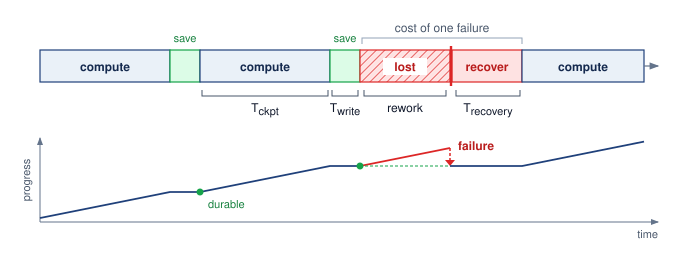

:::

### Checkpoint overhead analysis {#sec-fault-tolerance-reliability-reliability-checkpoint-overhead-analysis-f5df}

The interval calculation chooses *when* the system preserves state; the write path decides what each save costs while training waits. @Eq-checkpoint-overhead generalizes the save-side term of @eq-ft-checkpoint-waste to include any pause beyond the write itself:

$$ \CheckpointOverheadFraction= \frac{\CheckpointWriteTime}{\CheckpointInterval} + \frac{\CheckpointExtraPauseTime}{\CheckpointInterval} $$ {#eq-checkpoint-overhead}

Here, $\CheckpointOverheadFraction$ is the dimensionless fraction of time lost to checkpointing, $\CheckpointWriteTime$ is checkpoint write time, $\CheckpointInterval$ is the checkpoint interval, and $\CheckpointExtraPauseTime$ is any training pause beyond the checkpoint write itself. This includes memory allocation, coordination, and serialization. Total first-order waste is then $\CheckpointWasteFraction(\CheckpointInterval) \approx \CheckpointOverheadFraction+ \CheckpointInterval/(2 \cdot \SystemMtbf)$, so checkpoint overhead in this section means the save side alone, with expected rework counted separately. How large $\CheckpointOverheadFraction$ becomes depends first on whether training waits for durable storage.

#### Synchronous vs. asynchronous checkpointing {#sec-fault-tolerance-reliability-reliability-synchronous-vs-asynchronous-checkpointing-ecc1}

Synchronous checkpointing\index{Checkpointing!synchronous} resumes training only after every worker's portion reaches durable storage. Asynchronous checkpointing\index{Checkpointing!asynchronous}\index{Asynchronous checkpointing|see{Checkpointing}} instead pauses the accelerators only long enough to copy the weights and optimizer tensors from GPU memory into host memory\index{Checkpointing!in-memory staging} or local staging, then flushes that staged copy to remote storage in the background while training continues. The brief device-to-host copy is necessary because the next optimizer step updates the live GPU tensors in place, which would otherwise overwrite state that is still being serialized. @Sec-storage-distributed-checkpoint develops the write path behind both approaches. For recovery, blocking alone does not establish consistency, so the protocol must ensure that every shard belongs to the same recoverable training state. Recovery can use an asynchronous generation only after all required shards reach the storage tier that survives the modeled failure and the coordinator publishes completion. If a failure strikes while the background flush is still in flight, recovery must fall back to the previous committed generation.

A synchronous save pauses every accelerator in the job for the full remote write, and @sec-storage-checkpointing prices that exposed pause on a slow shared tier. Asynchronous capture shrinks the exposed pause to the local staging copy and moves the remote flush off the critical path, which is why production systems stage checkpoints rather than block on shared storage. Write time also varies widely across model types, because larger models require longer writes but also earn longer optimal intervals (@tbl-checkpoint-overhead-by-model).

```{python}
#| echo: false
#| label: checkpoint-overhead-by-model-calc
# ┌─────────────────────────────────────────────────────────────────────────────
# │ CHECKPOINT OVERHEAD BY MODEL TYPE (LEGO)
# ├─────────────────────────────────────────────────────────────────────────────
# │ Context: @tbl-checkpoint-overhead-by-model immediately below this cell.
# │
# │ Goal: Compute write time, optimal checkpoint interval, and save overhead
# │       for six model archetypes using the Young-Daly square-root formula.
# │ Show: All numeric cells in the checkpoint overhead comparison table.
# │ How: Load named model sizes, reusable checkpoint archetype sizes, reliability
# │      bandwidth/MTBF anchors; then compute write_time, tau_opt, and overhead.
# │
# └─────────────────────────────────────────────────────────────────────────────
from mlsysim import *
from mlsysim.physics import calc_checkpoint_size
from mlsysim.physics import calc_young_daly_interval

class CheckpointOverheadCalc:
    # ┌── 1. LOAD (Constants) ──────────────────────────────────────────────────
    # Checkpoint sizes for each model archetype.
    checkpoint_archetypes = ReferenceStats.CheckpointArchetypes
    # Archetype A: 14 B/param resumable checkpoint (calc_checkpoint_size default),
    # the same 2.45 TB contract used throughout the chapter.
    ckpt_bpp = ReferenceStats.MixedPrecisionAdam.CheckpointBytesPerParameter
    archA_size = calc_checkpoint_size(Models.Language.GPT3.parameters)
    check(2.3 * TB < archA_size < 2.6 * TB, "Archetype A checkpoint must be about 2.45 TB")
    check(
        abs((archA_size / (Models.Language.GPT3.parameters * ckpt_bpp)).to("").magnitude - 1) < 1e-9,
        "calc_checkpoint_size must match the registry bytes/param anchor",
    )
    dense20b_size = checkpoint_archetypes.Dense20BTransformerCheckpointSize
    bert_size = Models.Language.BERT_Large.size_in_bytes(BYTES_FP32)
    archB_size = checkpoint_archetypes.EmbeddingHeavyRecommenderCheckpointSize
    resnet_size = Models.Vision.ResNet50.size_in_bytes(BYTES_FP32)
    vision_transformer_size = checkpoint_archetypes.MediumVisionTransformerCheckpointSize

    write_bw = float(Systems.Reliability.Recovery.checkpoint_write_bw_gbs) * (GB / second)
    mtbf = (float(Systems.Reliability.Gpu.mttf_hours) / Systems.Clusters.Training_10K.total_accelerators) * hour

    # ┌── 2. EXECUTE (The Compute) ─────────────────────────────────────────────
    # Write time = checkpoint_size / write_bandwidth
    archA_write = (archA_size / write_bw).to(second)
    dense20b_write = (dense20b_size / write_bw).to(second)
    bert_write = (bert_size / write_bw).to(second)
    archB_write = (archB_size / write_bw).to(second)
    resnet_write = (resnet_size / write_bw).to(second)
    vision_transformer_write = (vision_transformer_size / write_bw).to(second)

    # Optimal interval = sqrt(2 * write_time * MTBF) [Young-Daly formula]
    # Bind the class-level MTBF at call time to avoid any upstream namespace collision
    # with later tutorial cells that define bare `mtbf` scalars.
    archA_interval = calc_young_daly_interval(archA_write, mtbf)
    dense20b_interval = calc_young_daly_interval(dense20b_write, mtbf)
    bert_interval = calc_young_daly_interval(bert_write, mtbf)
    archB_interval = calc_young_daly_interval(archB_write, mtbf)
    resnet_interval = calc_young_daly_interval(resnet_write, mtbf)
    vision_transformer_interval = calc_young_daly_interval(vision_transformer_write, mtbf)

    # Save overhead = write_time / optimal_interval * 100
    archA_overhead_ratio = (archA_write / archA_interval).to_base_units().magnitude
    dense20b_overhead_ratio = (dense20b_write / dense20b_interval).to_base_units().magnitude
    bert_overhead_ratio = (bert_write / bert_interval).to_base_units().magnitude
    archB_overhead_ratio = (archB_write / archB_interval).to_base_units().magnitude
    resnet_overhead_ratio = (resnet_write / resnet_interval).to_base_units().magnitude
    vision_transformer_overhead_ratio = (vision_transformer_write / vision_transformer_interval).to_base_units().magnitude

    # ┌── 3. GUARD (Invariants) ────────────────────────────────────────────────
    check(920 * second < archA_interval < 960 * second, "Archetype A interval should be ~15.7 minutes")
    check(280 * second < dense20b_interval < 310 * second, "20B dense transformer interval should be ~4.9 minutes")
    check(20 * second < bert_interval < 25 * second, "BERT interval should be ~22 seconds")
    check(1190 * second < archB_interval < 1210 * second, "Archetype B interval should be 20 minutes")
    check(5 * second < resnet_interval < 8 * second, "ResNet-50 interval should be ~6 seconds")
    check(18 * second < vision_transformer_interval < 23 * second, "Vision transformer interval should be ~21 seconds")
    check(archA_overhead_ratio < 0.10, "Archetype A overhead must be < 10%")
    check(dense20b_overhead_ratio < 0.10, "20B dense transformer overhead must be < 10%")
    check(bert_overhead_ratio < 0.10, "BERT overhead must be < 10%")
    check(archB_overhead_ratio < 0.10, "Archetype B overhead must be < 10%")
    check(resnet_overhead_ratio < 0.10, "ResNet-50 overhead must be < 10%")
    check(vision_transformer_overhead_ratio < 0.10, "Vision transformer overhead must be < 10%")

    # ┌── 4. OUTPUT (Formatting) ───────────────────────────────────────────────
    # -- Checkpoint sizes
    ckpt_bpp_str = fmt(ckpt_bpp.magnitude, precision=0)
    archA_ckpt_tb_str = fmt_memory(archA_size, unit=TB, precision=2, commas=False)
    dense20b_ckpt_gb_str = fmt_memory(dense20b_size, unit=GB, precision=0, commas=False)
    bert_ckpt_gb_str = fmt_memory(bert_size, unit=GB, precision=1, commas=False)
    archB_ckpt_tb_str = fmt_memory(archB_size, unit=TB, precision=0, commas=False)
    resnet_ckpt_mb_str = fmt_memory(resnet_size, unit=MB, precision=1, commas=False)
    vision_transformer_ckpt_gb_str = fmt_memory(vision_transformer_size, unit=GB, precision=1, commas=False)

    write_bw_gb_per_s_str = fmt_bandwidth(write_bw, unit=GB / second, precision=0, commas=False)
    mtbf_hr_str = fmt_time(mtbf, unit=hour, precision=0, commas=False)

    # -- Write times
    archA_write_s_str = fmt_time(archA_write, unit=second, precision=1, commas=False)
    dense20b_write_s_str = fmt_time(dense20b_write, unit=second, precision=1, commas=False)
    bert_write_s_str = fmt_time(bert_write, unit=second, precision=3, commas=False)
    archB_write_s_str = fmt_time(archB_write, unit=second, precision=0, commas=False)
    resnet_write_s_str = fmt_time(resnet_write, unit=second, precision=3, commas=False)
    vision_transformer_write_s_str = fmt_time(vision_transformer_write, unit=second, precision=3, commas=False)

    # -- Optimal intervals (min for >= 60s, s for < 60s)
    archA_interval_min_str = fmt_time(archA_interval, unit=minute, precision=1, commas=False)
    dense20b_interval_min_str = fmt_time(dense20b_interval, unit=minute, precision=1, commas=False)
    bert_interval_s_str = fmt_time(round(bert_interval.to(second).magnitude), unit=second, precision=0, commas=False)
    archB_interval_min_str = fmt_time(archB_interval, unit=minute, precision=0, commas=False)
    resnet_interval_s_str = fmt_time(round(resnet_interval.to(second).magnitude), unit=second, precision=0, commas=False)
    vision_transformer_interval_s_str = fmt_time(round(vision_transformer_interval.to(second).magnitude), unit=second, precision=0, commas=False)

    # -- Save overhead percentages
    archA_overhead_pct_str = fmt_percent(archA_overhead_ratio, precision=1, commas=False, style='symbol')
    dense20b_overhead_pct_str = fmt_percent(dense20b_overhead_ratio, precision=1, commas=False, style='symbol')
    bert_overhead_pct_str = fmt_percent(bert_overhead_ratio, precision=2, commas=False, style='symbol')
    archB_overhead_pct_str = fmt_percent(archB_overhead_ratio, precision=1, commas=False, style='symbol')
    resnet_overhead_pct_str = fmt_percent(resnet_overhead_ratio, precision=2, commas=False, style='symbol')
    vision_transformer_overhead_pct_str = fmt_percent(vision_transformer_overhead_ratio, precision=2, commas=False, style='symbol')
```

The Archetype A row in @tbl-checkpoint-overhead-by-model uses the same `{python} CheckpointOverheadCalc.ckpt_bpp_str`-byte-per-parameter resumable checkpoint (`{python} CheckpointOverheadCalc.archA_ckpt_tb_str`) as the rest of the chapter. Its interval calculation uses the GPU-only cluster MTBF rather than the shorter full-system MTBF of the worked cascade, so the square-root rule gives a longer interval than the Young-Daly notebook. The table keeps the GPU-only basis because its purpose is comparison across model types. Switching every row to the full-system MTBF would shorten each interval, and raise each overhead, by the same square-root factor, leaving the ranking across rows unchanged. The ResNet-50 and BERT-Large rows count only FP32 weights, so their write times and resulting intervals are lower bounds for a resumable checkpoint. Their intervals of seconds describe the balance for that smaller payload; selecting a recovery cadence requires including optimizer, schedule, and input-stream state. Small-state jobs rarely run on a cluster this large, and their actual storage bandwidth and complete recovery state determine whether saves every few minutes or every epoch have negligible overhead. The large-state rows show why interval selection becomes consequential when each save moves hundreds of gigabytes or terabytes.

| **Model type**                  |                       **Checkpoint size**                        | **Write time (`{python} CheckpointOverheadCalc.write_bw_gb_per_s_str`)** | **Optimal interval (`{python} CheckpointOverheadCalc.mtbf_hr_str` GPU-only MTBF)** |                           **Save overhead**                           |
|:--------------------------------|:----------------------------------------------------------------:|:------------------------------------------------------------------------:|:----------------------------------------------------------------------------------:|:---------------------------------------------------------------------:|
| **Archetype A (GPT-4/Llama-3)** |       `{python} CheckpointOverheadCalc.archA_ckpt_tb_str`        |           `{python} CheckpointOverheadCalc.archA_write_s_str`            |              `{python} CheckpointOverheadCalc.archA_interval_min_str`              |        `{python} CheckpointOverheadCalc.archA_overhead_pct_str`       |
| **20B dense transformer class** |      `{python} CheckpointOverheadCalc.dense20b_ckpt_gb_str`      |          `{python} CheckpointOverheadCalc.dense20b_write_s_str`          |            `{python} CheckpointOverheadCalc.dense20b_interval_min_str`             |      `{python} CheckpointOverheadCalc.dense20b_overhead_pct_str`      |
| **BERT-Large**                  |        `{python} CheckpointOverheadCalc.bert_ckpt_gb_str`        |            `{python} CheckpointOverheadCalc.bert_write_s_str`            |               `{python} CheckpointOverheadCalc.bert_interval_s_str`                |        `{python} CheckpointOverheadCalc.bert_overhead_pct_str`        |
| **Embedding-heavy recommender** |       `{python} CheckpointOverheadCalc.archB_ckpt_tb_str`        |           `{python} CheckpointOverheadCalc.archB_write_s_str`            |              `{python} CheckpointOverheadCalc.archB_interval_min_str`              |        `{python} CheckpointOverheadCalc.archB_overhead_pct_str`       |
| **ResNet-50**                   |       `{python} CheckpointOverheadCalc.resnet_ckpt_mb_str`       |           `{python} CheckpointOverheadCalc.resnet_write_s_str`           |              `{python} CheckpointOverheadCalc.resnet_interval_s_str`               |       `{python} CheckpointOverheadCalc.resnet_overhead_pct_str`       |
| **Vision transformer class**    | `{python} CheckpointOverheadCalc.vision_transformer_ckpt_gb_str` |     `{python} CheckpointOverheadCalc.vision_transformer_write_s_str`     |        `{python} CheckpointOverheadCalc.vision_transformer_interval_s_str`         | `{python} CheckpointOverheadCalc.vision_transformer_overhead_pct_str` |

: **Checkpoint Overhead by Model Type**: The Archetype A row is the 175B running example at `{python} CheckpointOverheadCalc.ckpt_bpp_str` bytes per parameter (weights, FP32 master weights, and Adam moments); the 20B, recommender, and vision transformer rows are representative scenario sizes, and the `{python} CheckpointOverheadCalc.archB_ckpt_tb_str` embedding-heavy recommender is a smaller scenario than the `{python} FaultToleranceIntroRecap.recsys_table_str` embedding tables of Archetype B (DLRM at Scale) in @tbl-failure-impact-by-model; the BERT-Large and ResNet-50 rows count FP32 weights only and omit optimizer state, so their write times understate a full resumable checkpoint. Larger models require longer save times but also benefit from longer optimal checkpoint intervals. The percentage column reports the save-side overhead $\CheckpointOverheadFraction$ of @eq-checkpoint-overhead with no extra pause, not total Young-Daly waste; at the optimum, expected rework adds a comparable term. {#tbl-checkpoint-overhead-by-model}

These per-model overheads assume the write path is uncontended. When thousands of workers save at the same step, their combined burst becomes the checkpoint storm that @sec-storage-checkpointing defines and sizes; for recovery, the burst matters because a stalled write delays the generation that a failure would fall back on. Staging hides the write from training, yet a snapshot held only on local staging does not survive loss of its node, so where each copy lives decides which failures the saved state outlasts and how quickly it returns.

### Checkpoint storage and recovery {#sec-fault-tolerance-reliability-reliability-checkpoint-storage-recovery-6634}

Writing a checkpoint to node-local NVMe makes the save fast, but if the node itself fails, that local snapshot vanishes along with the hardware it was meant to recover. Writing only to a durable remote filesystem or object store survives the node failure, but pulling multi-terabyte state back across shared storage links slows every recovery. Recovery mechanisms therefore pair tiers from the storage hierarchy. Local NVMe provides fast staging and survivor reads, distributed filesystems provide durability across node failures, and object storage provides long-term retention. Together, the tiers let the saved state both outlast the fault and reload within the recovery budget.

::: {.column-margin .margin-pointer}
↩ Tiered checkpoint storage designs and asynchronous write pipelines are established in @sec-storage-checkpointing.
:::

```{python}
#| echo: false
#| label: checkpoint-placement-restore
# ┌─────────────────────────────────────────────────────────────────────────────
# │ CHECKPOINT PLACEMENT AND RESTORE PATH (LEGO)
# ├─────────────────────────────────────────────────────────────────────────────
# │ Context: §Checkpoint storage and recovery paragraph below; reused by the
# │          recovery-time-budget notebook's T_load bullet.
# │
# │ Goal: Contrast a node-local restore with a shared-storage restore for the
# │       175B running example on the 1,024-GPU Archetype A reference cluster.
# │ Show: ~19.1 GB per node from local NVMe at 5 GB/s (~3.8 s, all nodes in
# │       parallel) vs. the full ~2.45 TB checkpoint at 100 GB/s aggregate (~24.5 s).
# │ How:  node share = checkpoint / nodes; t = bytes / bandwidth. Bandwidths from
# │       Systems.Storage.LocalNvmeTrainingTypical and Systems.Reliability.Recovery.
# └─────────────────────────────────────────────────────────────────────────────
from mlsysim import Models, Systems
from mlsysim.physics import calc_checkpoint_size
from mlsysim.fmt import check, fmt, fmt_bandwidth, fmt_memory, fmt_time

class CheckpointPlacementRestore:
    # ┌── 1. LOAD (Constants) ──────────────────────
    ckpt_bytes = calc_checkpoint_size(Models.Language.GPT3.parameters)  # 14 B/param resumable checkpoint
    n_gpus = Systems.Clusters.Training_1K.total_accelerators
    gpus_per_node = Systems.Nodes.DGX_H100.accelerators_per_node
    nvme_bw = Systems.Storage.LocalNvmeTrainingTypical.bandwidth
    shared_bw = float(Systems.Reliability.Recovery.checkpoint_write_bw_gbs) * (GB / second)

    # ┌── 2. EXECUTE (The Compute) ─────────────────
    n_nodes = n_gpus // gpus_per_node
    node_share = ckpt_bytes / n_nodes
    t_local = (node_share / nvme_bw).to(second)
    t_shared = (ckpt_bytes / shared_bw).to(second)

    # ┌── 3. GUARD (Invariants) ────────────────────
    check(n_nodes * gpus_per_node == n_gpus, "reference cluster must be a whole number of nodes")
    check(t_local < t_shared, "parallel local reads must beat one shared aggregate read")
    check(3 < t_local.to(second).magnitude < 5, "per-node local restore should take about 4 s")

    # ┌── 4. OUTPUT (Formatting) ───────────────────
    n_nodes_str = fmt(n_nodes, precision=0)
    node_share_gb_str = fmt_memory(node_share, unit=GB, precision=1, commas=False)
    nvme_bw_str = fmt_bandwidth(nvme_bw, unit=GB / second, precision=0, commas=False)
    shared_bw_str = fmt_bandwidth(shared_bw, unit=GB / second, precision=0, commas=False)
    t_local_str = fmt_time(t_local, second, precision=1, commas=False)
    t_shared_str = fmt_time(t_shared, second, precision=1, commas=False)
    ckpt_tb_str = fmt_memory(ckpt_bytes, unit=TB, precision=2, commas=False)
```

For fault tolerance, checkpoint placement determines which failures the saved state survives, while the restore path determines how quickly that surviving state becomes useful. On the `{python} CheckpointPlacementRestore.n_nodes_str`-node Archetype A reference cluster, each node holds about `{python} CheckpointPlacementRestore.node_share_gb_str` of the `{python} CheckpointPlacementRestore.ckpt_tb_str` checkpoint for the 175B running example. Reading that share from local NVMe at `{python} CheckpointPlacementRestore.nvme_bw_str` takes about `{python} CheckpointPlacementRestore.t_local_str`, with every node reading in parallel, while pulling the full checkpoint back through shared storage at `{python} CheckpointPlacementRestore.shared_bw_str` aggregate takes about `{python} CheckpointPlacementRestore.t_shared_str`. The local path is faster because it multiplies drive bandwidth by node count, but a sole copy on a lost node cannot restore that node's shard. The replacement node must read its share from a copy outside the failed domain, such as a distributed filesystem or object store, whose recovery time is set by sustained aggregate reads, network capacity, and deserialization. A sound placement therefore keeps a fast local copy for the survivors and a durable remote copy for whatever the failure took away, and these rates must still be measured under the job's own load.

### Checkpoint coordination patterns {#sec-fault-tolerance-reliability-checkpoint-coordination-patterns-f670}

If workers in a sharded training job save their local shards at different steps without coordinating, rolling one failed worker back to its last save invalidates every peer that already consumed gradients or activations from its later steps. Rollbacks then cascade backward through the run in the classic domino effect [@elnozahy2002survey]. Avoiding that cascade requires choosing how workers coordinate across two orthogonal dimensions. Workers can vary in whether they synchronize to capture a consistent cut (**coordinated** versus **uncoordinated checkpointing**\index{Checkpointing!uncoordinated}\index{Uncoordinated checkpointing|see{Checkpointing}}). They can also vary in whether they funnel state through one writer or persist shards in parallel (centralized versus distributed checkpointing). Because distributed ML workers exchange state at every step, production training relies on **coordinated checkpointing**\index{Checkpointing!coordinated}\index{Coordinated checkpointing|see{Checkpointing}}. In this scheme, workers synchronize at step boundaries or through an explicit two-phase commit protocol, so that all saved shards belong to a single globally consistent recovery line. Once coordination guarantees consistency, the remaining architectural decision is how those shards reach persistent storage: whether workers funnel their state through a single coordinator or write their partitions directly in parallel.

#### Centralized checkpointing {#sec-fault-tolerance-reliability-reliability-centralized-checkpointing-83a7}

In centralized checkpointing, workers send their state to a coordinator process that assembles and writes the complete checkpoint. This approach simplifies checkpoint management and can produce self-contained checkpoint files, but all state crosses the coordinator's network links, and coordinator failure interrupts the save. A streaming writer can avoid buffering the entire checkpoint, although it cannot remove the ingress bottleneck. That bottleneck is structural. The coordinator receives through one node's network links, so its write time grows with total state volume, whereas independent writers each move only their own share of the state through their own links. The gap between the two patterns therefore widens in proportion to the number of writers. For the 175B running example, the `{python} CheckpointPlacementRestore.n_nodes_str` nodes of the reference cluster would funnel `{python} CheckpointPlacementRestore.ckpt_tb_str` through one node's links instead of `{python} CheckpointPlacementRestore.node_share_gb_str` through each. The pattern is viable while that one path meets the checkpoint budget; state volume and sustained bandwidth determine the limit more directly than a fixed worker count. Centralized checkpointing is therefore attractive when operational simplicity matters more than aggregate bandwidth, whereas distributed and sharded approaches become necessary once the checkpoint itself is a fleet-scale object.

#### Distributed checkpointing {#sec-fault-tolerance-reliability-reliability-distributed-checkpointing-5dcc}

Distributed checkpointing eliminates this coordinator funnel by having each worker persist its own shard directly. @Fig-distributed-checkpoint-architecture contrasts the dataflow topologies: the centralized pattern concentrates traffic at the coordinator's ingress, while the distributed pattern writes in parallel to local NVMe and drains the shards to remote object storage in the background. With fixed per-worker shard sizes and sufficient independent staging bandwidth, adding workers need not lengthen the local write pause. Shared drain capacity and completion coordination can still limit scaling. A coordinator signals when to checkpoint and confirms completion, but state flows directly from workers to storage without aggregation.

::: {#fig-distributed-checkpoint-architecture fig-env="figure" fig-pos="htb" fig-cap="**Distributed Checkpoint Architecture**: Centralized vs. sharded checkpoint writes. In the centralized pattern (left), every worker funnels its shard through one coordinator, whose ingress bandwidth and buffering constrain the write path and whose failure halts the save. In the distributed pattern (right), each worker writes its own shard to local NVMe in parallel and a background process drains the shards to remote object storage, so the local blocking write time can remain roughly constant with fixed shard sizes and sufficient staging bandwidth; shared drain capacity still limits completion." fig-alt="Two panels divided by a dashed line. Left, centralized: four workers send red arrows that merge into one coordinator box labeled ingress limit, which writes to shared storage; beneath, a timing strip shows the four workers' green shard writes in a staircase, one after another, with a red bracket reading blocking write grows with workers. Right, distributed: each of four workers writes with a green arrow to its own NVMe drive, and dashed arrows drain the drives to an object store labeled background; beneath, the four green shard writes start together and end together under a green bracket labeled blocking, followed by dashed gray bars under a bracket labeled drain in background."}
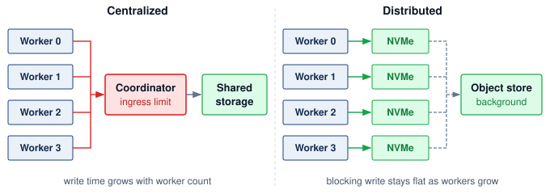

:::

A synchronous version of the coordination protocol proceeds in six steps:

1. Coordinator broadcasts checkpoint request with checkpoint ID
2. Each worker reaches a consistent state (barrier synchronization)
3. Each worker writes an immutable shard to a generation-specific staging prefix and records its byte length and cryptographic digest
4. Each worker confirms durable write completion to the coordinator
5. The coordinator writes an immutable manifest after all confirmations; the manifest names the training step, topology, model and optimizer formats, data-loader position, random state, and the length and digest of every shard, then publishes a commit marker or atomic pointer to that manifest
6. Coordinator broadcasts checkpoint complete, training resumes

The idealized protocol assumes step 2 completes quickly. The barrier, however, waits for the slowest of thousands of arrivals, so a single slow worker can make it dominate the checkpoint pause even when the storage path has ample bandwidth. Measuring arrival skew separately from copying and writing reveals whether coordination or data movement limits the save.

The manifest, not the presence of a directory or a plausible set of shard names, defines a committed checkpoint generation. Restore accepts only a published manifest whose shards all match their recorded lengths and digests; staged shards without that final publication remain unreachable and can be garbage collected. This rule prevents a partially overwritten `latest` directory from masquerading as recoverable state and makes generation rollback explicit. PyTorch Distributed Checkpoint\index{Distributed Checkpoint!manifest publication} follows this ordering, with storage writers persisting each rank's data before the coordinator's `finish()` operation writes the metadata and marks the checkpoint successful, while the storage backend supplies the publication semantics [@pytorchDistributedCheckpointDocs]. The set of per-worker states a manifest names is a cut\index{Checkpointing!consistency cut}, and the cut is consistent when all of those states could have existed together at one moment of a valid execution. In a consistent cut, no shard reflects an update another shard has not yet seen. That consistency cut determines whether the system can claim strict, bounded-asynchronous, or eventual consistency.

::: {#psp-fault-tolerance-checkpoint-consistency-models .callout-perspective title="Checkpoint consistency models"}

Strict synchronous\index{Checkpointing!strict synchronous}: All workers checkpoint at exactly the same training step. Provides strongest consistency but highest overhead from barrier synchronization.

Bounded asynchronous\index{Checkpointing!bounded asynchronous}: Workers may progress at different rates while the checkpoint manager tracks which snapshots can form a consistent recovery cut. Bounding step skew alone is insufficient, because the system must retain compatible shard versions or enough replay information to reconstruct that cut. Asynchronous flushing can also preserve a single synchronized snapshot while its writes complete in the background, avoiding training stalls without relaxing recovery consistency.

Eventual consistency\index{Checkpointing!eventual consistency}: Workers save independently and recovery attempts to reconcile their versions. A usable design must retain enough compatible versions or replay information to reconstruct a valid state; arbitrary recent shards do not necessarily form a recoverable generation. Reduced coordination at save time therefore transfers work and storage requirements to recovery.

:::

Steps 3 through 5 are two-phase commit,[^fn-twophase-checkpoint-protocol] the classic distributed-systems protocol for making one decision atomic across many participants [@gray1978], applied to a checkpoint. Steps 3 and 4 form its prepare phase, in which each worker stages its shard and reports success, and step 5 is its commit phase, in which the coordinator durably records the decision by publishing the manifest. The manifest publication rule inherits the protocol's guarantee and its known weakness. If the coordinator crashes after workers prepare but before it records a decision, the system must not expose those shards as a valid checkpoint, and the prepared participants remain blocked until the original or a replacement coordinator recovers the durable decision. Uncommitted staged shards can be garbage collected only after recovery establishes that no commit decision exists. Atomic publication also does not by itself make the published shards consistent: synchronous gradient updates naturally create step boundaries where all workers have applied the same updates, whereas asynchronous training and pipeline parallelism require explicit coordination to define a consistent cut.

[^fn-twophase-checkpoint-protocol]: **Two-phase commit (2PC)**\index{Two-phase commit!checkpoint atomicity}: Formalized by @gray1978, 2PC ensures all participants either commit or abort atomically. A timeout can trigger coordinator recovery, but it cannot by itself authorize unilateral rollback.

#### Sharded checkpointing {#sec-fault-tolerance-reliability-reliability-sharded-checkpointing-58d0}

Modern distributed training frameworks partition model state across workers using techniques like ZeRO and FSDP, which shard parameters, gradients, and optimizer state instead of replicating them on every data-parallel worker. In these configurations, no single worker holds complete model state. Each worker holds only its assigned parameter shard plus corresponding optimizer state.

::: {.column-margin .margin-pointer}
↩ How ZeRO and FSDP partition training state across data-parallel workers is established in @sec-distributed-training-systems-systems-memoryefficient-data-parallelism-zero-fsdp-0e69.
:::

Sharded checkpointing\index{Checkpointing!sharded}[^fn-sharded-checkpoint-state] [@rajbhandari2020] uses this distribution. Each worker writes only its shard, which divides the per-worker write volume by the number of shards. Recovery loads shards and redistributes state to workers based on the recovery configuration.

```{python}
#| echo: false
# ┌── LEGO ───────────────────────────────────────────────
# │ Context: Sharded checkpointing prose and footnote below.
# │ Note: 14 B/param resumable checkpoint (no gradients or activations).
from mlsysim.physics import calc_checkpoint_size
from mlsysim import Models, Hardware
from mlsysim.fmt import fmt, fmt_memory

class FaultToleranceShardRecap:
    m = Models.Language.GPT3
    gpt3_ckpt_bytes = calc_checkpoint_size(m.parameters)  # 14 B/param default
    n_workers = Systems.Clusters.Training_1K.total_accelerators
    from mlsysim.fmt import fmt

    # ┌── 4. OUTPUT (Formatting) ──────────────────────────────────────────────
    gpt3_params_b_str = fmt_params(m.parameters, scale="B", precision=0, commas=False)
    gpt3_ckpt_tb_str = fmt_memory(gpt3_ckpt_bytes, unit=TB, precision=2, commas=False)
    gpt3_shard_gb_str = fmt_memory(gpt3_ckpt_bytes / n_workers, unit=GB, precision=1, commas=False)
    n_workers_str = fmt(n_workers, precision=0, commas=True)
```

[^fn-sharded-checkpoint-state]: **Sharded checkpointing**\index{Checkpointing!sharded I/O parallelism}: Each worker saves only its local partition rather than gathering state to a single writer, parallelizing I/O across all nodes. The trade-off is that recovery requires every shard to be available and consistent, making the checkpoint protocol more complex. Losing one storage device invalidates the generation only if a required shard cannot be recovered from another copy or sufficient storage redundancy.

Dividing state across the fleet keeps per-worker saves small even for multi-terabyte models. A `{python} FaultToleranceShardRecap.gpt3_params_b_str` parameter model with a `{python} FaultToleranceShardRecap.gpt3_ckpt_tb_str` checkpoint distributed across `{python} FaultToleranceShardRecap.n_workers_str` workers requires each worker to write only `{python} FaultToleranceShardRecap.gpt3_shard_gb_str`, achievable in seconds with local NVMe storage. When elastic scaling or hardware replacement changes the worker count between save and restore, shard redistribution must remap the saved partitions to the new worker configuration, which is why frameworks need flexible resharding support to recover across topology changes. Yet possessing a valid checkpoint is only half the recovery path. Sharding distributes the write work and staging controls the shared I/O burst, but the system must still detect the failure, trigger restoration, and coordinate the distributed shards before training can resume. The speed of detection and recovery therefore governs the cost of the interruption.

::: {#chk-fault-tolerance-checkpoint-cost .callout-checkpoint title="Reasoning about checkpoint overhead"}

Verify your understanding of how failure rate and checkpoint cost set the optimal checkpoint interval:

- [ ] **Young-Daly shift**: use the Young-Daly formula to estimate how the optimal interval $\OptimalCheckpointInterval$ shifts when a cluster doubles in size and its system MTBF halves, with $\CheckpointWriteTime$ held fixed. State whether the interval lengthens or shortens and by about what factor.
- [ ] **Two-sided overhead**: explain why writing checkpoints too frequently and writing them too rarely both raise checkpoint overhead, including the two costs $\OptimalCheckpointInterval$ balances.
- [ ] **Faster writes**: determine how an order-of-magnitude reduction in $\CheckpointWriteTime$ from sharded checkpointing changes the optimal interval and expected lost work per failure.
- [ ] **Square-root scaling**: explain why the Young-Daly interval depends on the square root of MTBF rather than scaling linearly with it.

:::

## Failure Detection and Recovery {#sec-fault-tolerance-reliability-reliability-failure-detection-recovery-0f54}

A GPU silently hangs, dropping its utilization to zero while its peer GPUs wait indefinitely at an AllReduce barrier. On the chapter's `{python} FaultToleranceIntroRecap.gpus_example_str`-GPU cluster, every minute the system takes to notice this hung rank and reboot the node costs about `{python} FaultToleranceIntroRecap.idle_cost_per_min_str` in idle compute. Checkpoints preserve state, but the recovery process itself determines how much compute a failure wastes. In the accounting of the Fleet Law (@eq-fleet-law), that waiting belongs to the synchronization term $\SynchronizationTime(\DeviceCount)$. Every surviving rank idles at the barrier until the group is whole again, so detection, restart, and reload add directly to step time averaged over the run. The goodput accounting of @sec-performance-engineering-goodput-boundaries charges the same time to runtime goodput.

@Eq-recovery-time decomposes recovery time into four primary components:

$$ \FailureRecoveryTime= \FailureDetectionTime+ \JobRestartTime+ \CheckpointLoadTime+ \RecoveryWarmupTime$$ {#eq-recovery-time}

where $\FailureDetectionTime$ is the time between the physical hardware fault and system classification as a failure. The term $\JobRestartTime$ is the latency required for the job scheduler to allocate resources and launch replacement processes. The term $\CheckpointLoadTime$ is the I/O duration to read checkpoint state from distributed storage into GPU memory. The term $\RecoveryWarmupTime$ is the interval needed to refill data pipelines, compile just-in-time (JIT) kernels, and stabilize training throughput. Each component presents distinct optimization opportunities, and the dominant term varies by cluster configuration. Understanding this decomposition enables targeted investment in the bottleneck rather than uniform improvement across all components.

### Failure detection mechanisms {#sec-fault-tolerance-reliability-reliability-failure-detection-mechanisms-efed}

::: {.column-margin}
```{=latex}
\vspace*{-5mm}
```
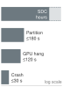{width="100%" fig-alt="A ladder of bars for detection latency on a log scale, ordered by how hard a failure is to see: a process crash within 30 seconds, a GPU hang within 120 seconds, a network partition within 180 seconds, and silent data corruption as the longest bar, labeled hours, whose end continues as a dotted open extension."}

*Detection latency climbs from seconds (crash) to hours (silent corruption).*
:::

To the rest of the cluster, a dead rank and a rank busy flushing a multi-gigabyte checkpoint shard both look silent. Every failure detector must therefore balance two expensive mistakes: setting timeouts too short kills healthy workers during transient network or storage stalls, while setting them too long leaves thousands of peer GPUs idling at a collective barrier. Heartbeat monitoring\index{Heartbeat protocol!liveness signal}\index{Heartbeat protocol!failure detection}\index{Failure detection!heartbeat protocol} is the first detection layer and usually sets the floor on $\FailureDetectionTime$. Each GPU rank periodically signals liveness to a coordinator, and if no heartbeat arrives within the timeout period $\HandoverTimeout$, the coordinator declares the worker failed.

For a heartbeat interval of $\HeartbeatInterval$ seconds and network-delay standard deviation $\NetworkDelayStandardDeviation$ in seconds, @eq-timeout-calculation defines the timeout heuristic:

$$ \HandoverTimeout = \HeartbeatInterval+ \TimeoutSafetyMultiplier\NetworkDelayStandardDeviation$$ {#eq-timeout-calculation}

Here, $\TimeoutSafetyMultiplier$ is a dimensionless safety multiplier; values from three to five illustrate a tuning range rather than a guaranteed false positive rate. The heuristic treats the normal heartbeat delivery delay as small relative to the heartbeat interval. A deployment with substantial baseline delay or a heavy delay tail must account for those measurements as well as $\NetworkDelayStandardDeviation$. Tuning $\HandoverTimeout$ too tightly causes legitimate checkpoint writes or long collectives to trigger false failure declarations; tuning it too loosely extends the window during which other ranks wait for the missing contribution.

Collective communication timeouts provide a second detection layer. During synchronous training, a collective required by the next step remains an incomplete critical-path dependency if a required rank disappears. AllReduce needs every rank's contribution before it can produce the reduced result; the progress and failure behavior of other collectives depends on the operation and runtime. Transport and process-group timeouts bound how long the job waits before declaring the operation failed and entering recovery. NCCL[^fn-nccl-collective-timeout] provides configurable transport and reliability, availability, and serviceability (RAS) timeout parameters for this purpose, while higher-level frameworks may impose process-group operation timeouts. These settings are often set conservatively to avoid crashing jobs during legitimate periods of slow communication, which unfortunately extends $\FailureDetectionTime$.

[^fn-nccl-collective-timeout]: **NCCL timeout**\index{NCCL!timeout}\index{NCCL!timeout trade-off}: NVIDIA's collective communication library exposes transport and RAS timeout controls such as `NCCL_IB_TIMEOUT` and `NCCL_RAS_TIMEOUT_FACTOR` [@nvidiaNcclUserGuide]. Higher-level launch and distributed-training frameworks can add their own restart and operation-timeout behavior [@pytorchElasticDocs]. Aggressive timeout settings accelerate failure detection but risk false positives during legitimate long collective operations on large models, forcing a trade-off between detection latency and training stability that has no universal optimum.

Container orchestration health checks\index{Health check!orchestration layer} provide a third layer. Kubernetes, the container orchestration system, offers liveness probes\index{Liveness probe!container orchestration} (verifying that a process still responds and makes progress) and readiness probes\index{Readiness probe!container orchestration} (verifying that a process is ready to handle requests). Slurm, the batch scheduler common on HPC-style training clusters, instead runs a periodic node health-check program that can drain a node whose GPUs, links, or file systems fail their tests. Both operate independently of the training framework, catching failures that application-level heartbeats might miss; a liveness probe that tests forward progress rather than mere process existence can catch a process that is alive but deadlocked.

Loss spike\index{Loss spike!failure anomaly} detection exposes an anomaly, not its cause. @Fig-training-failure-signatures contrasts an idealized healthy loss trend with gradient explosion, a premature plateau, and NaN divergence. Real stochastic training need not decrease monotonically, so a transient rise alone does not establish failure, and nonfinite values need not crash the process. Silent hardware corruption can produce an abrupt loss or gradient-norm spike, but so can a bad batch, an optimizer instability, a data-ordering defect, or a distributed-state mismatch. Robust systems therefore pause before the suspect update commits, preserve the input and worker evidence, and replay the step on known-good hardware. The system drains hardware only after that evidence implicates the device; otherwise, it repairs the data, optimizer, or synchronization path that produced the same symptom.

::: {#fig-training-failure-signatures fig-env="figure" fig-pos="htb" fig-cap="**Training Failure Signatures**: Common patterns of model loss over time that indicate underlying system or algorithmic failures. (A) Normal training. (B) Gradient explosion. (C) Loss plateau. (D) NaN divergence, ending where a nonfinite-value check halts the run; without such a check the process can keep running on NaN values rather than crash. Identifying these signatures automatically is essential for rapid recovery in autonomous training pipelines. The curves are synthetic illustrations of each pattern, not logs from a training run." fig-alt="Four loss-versus-steps panels in a two-by-two grid on a shared loss axis. (A) Normal training: a green curve descending smoothly. Panels B to D repeat that healthy curve as a faint green reference line behind each pathology. (B) Gradient explosion: a descending curve with a red spike segment midway that then rejoins the healthy reference, labeled healthy. (C) Loss plateau: a curve that flattens early, with the gap between it and the healthy reference shaded red and labeled gap to healthy. (D) NaN divergence: a curve that pulls away above the healthy reference, oscillating with growing amplitude, then climbs steeply to a red X labeled NaN check halts run."}
```{python}
#| echo: false
from binder.tools.figures import style as book_style
import numpy as np

book_style.set_book_style()
COLORS = book_style.COLORS

# Four small multiples on one shared loss axis; the healthy curve is green, the
# pathological curves are neutral with only the failure itself marked in red.
# Laid out 2x2 at book width so every label prints at or above the floor.
fig, axes2d = plt.subplots(2, 2, figsize=(6.2, 4.5), sharey=True, sharex=True)
axes = axes2d.ravel()

steps = np.linspace(0, 100, 200)
np.random.seed(42)

# PANEL A: Normal Training
noise = np.random.normal(0, 0.02, len(steps))
loss_a = 2.4 * np.exp(-0.035 * steps) + 0.35 + noise

# PANEL B: Gradient Explosion
loss_b = 2.4 * np.exp(-0.035 * steps) + 0.35 + np.random.normal(0, 0.02, len(steps))
spike_idx = 90
loss_b[spike_idx : spike_idx + 15] += np.linspace(0, 1.7, 15)
# Recovery: the excess decays smoothly back onto the healthy baseline and carries
# the same measurement noise as the rest of the trace.
decay_k = np.arange(1, 21)
loss_b[spike_idx + 15 : spike_idx + 35] += 1.7 * np.exp(-decay_k / 4.5)

# PANEL C: Loss Plateau
loss_c = np.copy(loss_a)
plateau_idx = 40
loss_c[plateau_idx:] = loss_c[plateau_idx] + np.random.normal(0, 0.015, len(steps) - plateau_idx)

# PANEL D: NaN Divergence
nan_steps = steps[:140]
# The run tracks healthy training at first, then its baseline drifts upward and a
# one-sided oscillation of growing amplitude rides on top, so even its troughs sit
# above the healthy curve. The last few steps climb steeply before the halt.
healthy_d = 2.4 * np.exp(-0.035 * nan_steps) + 0.35
drift = 1.25 * (nan_steps / nan_steps[-1]) ** 1.6
amp = 0.06 * np.exp(0.034 * nan_steps)
osc = amp * (0.5 + 0.5 * np.sin(nan_steps * 0.4))
loss_d = healthy_d + drift + osc + np.random.normal(0, 0.012, len(nan_steps)).clip(0)
n_ramp = 12
loss_d[-n_ramp:] += np.linspace(0, 1, n_ramp) ** 2.2 * (2.85 - loss_d[-1])

ax_a, ax_b, ax_c, ax_d = axes
lw = 1.8

ax_a.plot(steps, loss_a, color=COLORS['GreenLine'], linewidth=lw)

# Healthy reference: the panel-A curve, drawn faintly behind each pathology so
# the deviation itself is what the eye reads.
for ax_ref in (ax_b, ax_c, ax_d):
    ax_ref.plot(steps, loss_a, color=COLORS['GreenLine'], linewidth=1.0, alpha=0.45, zorder=1)
ax_b.text(54, 0.55, 'healthy', fontsize=10, color=COLORS['GreenLine'], ha='center', va='top')

ax_b.plot(steps, loss_b, color=COLORS['primary'], linewidth=lw)
seg = slice(spike_idx - 1, spike_idx + 35)
ax_b.plot(steps[seg], loss_b[seg], color=COLORS['RedLine'], linewidth=lw + 0.4)
peak = spike_idx + 14
ax_b.text(steps[peak] + 4, loss_b[peak] + 0.05, 'spike', fontsize=10.5, color=COLORS['RedLine'], ha='left', va='bottom')

ax_c.fill_between(steps[plateau_idx:], loss_a[plateau_idx:], loss_c[plateau_idx:], color=COLORS['RedL'], alpha=0.8, lw=0, zorder=0)
ax_c.plot(steps, loss_c, color=COLORS['primary'], linewidth=lw)
ax_c.text(70, loss_c[plateau_idx] + 0.3, 'plateau', fontsize=10.5, color=COLORS['RedLine'], ha='center', va='bottom')
ax_c.text(70, 0.98, 'gap to healthy', fontsize=10.5, color=COLORS['RedLine'], ha='center', va='center')

ax_d.plot(nan_steps, loss_d, color=COLORS['primary'], linewidth=lw)
ax_d.scatter([nan_steps[-1]], [loss_d[-1]], marker='X', color=COLORS['RedLine'], edgecolor='white', linewidth=0.8, s=70, zorder=6)
ax_d.text(
    nan_steps[-1] - 5, loss_d[-1] - 0.4, 'NaN check\nhalts run', fontsize=10.5, linespacing=1.1, color=COLORS['RedLine'], ha='right', va='center'
)

titles = ['(A) Normal training', '(B) Gradient explosion', '(C) Loss plateau', '(D) NaN divergence']
for ax, title in zip(axes, titles):
    ax.set_title(title, fontsize=11.5, fontweight='bold', color=COLORS['primary'], loc='left', pad=6)
    ax.set_xlim(-2, 102)
    ax.set_ylim(0, 3.1)
    ax.set_xticks([0, 50, 100])
    ax.set_yticks([0, 1, 2, 3])
    ax.tick_params(labelsize=10.5)
    ax.grid(True, linestyle='--', color=COLORS['grid'], linewidth=0.5, alpha=0.6)
for ax in (ax_c, ax_d):
    ax.set_xlabel('Steps', fontsize=11)
for ax in (ax_a, ax_c):
    ax.set_ylabel('Loss', fontsize=11)

plt.tight_layout()
fig.subplots_adjust(wspace=0.08, hspace=0.32)
plt.show()
plt.close()
```
:::

@Tbl-training-failure-response-map pairs each signature, plus the silent hang that a loss curve cannot show, with a candidate cause and a first response. The pairing guides investigation without treating the curve as a unique diagnosis, and the operational question that follows is how long detection actually takes once these monitoring layers interact.

| **Signature**              | **Likely interpretation**                                                         | **Recovery response**                                                                                |
|:---------------------------|:----------------------------------------------------------------------------------|:-----------------------------------------------------------------------------------------------------|
| Spike followed by recovery | Transient input or numerical anomaly; the curve alone does not identify the cause | Preserve the suspect batch and step evidence, then replay before deciding whether to continue.       |
| Spike followed by plateau  | Optimizer instability, corrupted state, or a persistent data-path defect          | Pause, replay from a known-good checkpoint, and compare input, optimizer, and worker evidence.       |
| Gradual divergence         | Data drift, numerical instability, corrupted state, or worker desynchronization   | Compare per-rank telemetry and evaluation evidence; isolate hardware only when replay implicates it. |
| Hang without an error      | Collective deadlock or crashed worker blocking synchronization                    | Use timeout detection and restart or reconstruct the worker group.                                   |

: **Training Failure Response Map**: Training-loss curves are operational evidence only when they lead to different recovery actions. The response map ties each signature to the failure class most likely to explain it and to the first action operators should take. {#tbl-training-failure-response-map}

::: {#psp-fault-tolerance-realistic-detection-latencies .callout-perspective title="Realistic failure detection latencies"}

Failure detection includes more than the configured heartbeat timeout when the policy requires verification before recovery. The ranges in @tbl-fault-tolerance-detection-latencies illustrate planning scenarios, not universal detection guarantees. Aggressive timeouts risk false positives (killing healthy-but-slow workers), while conservative timeouts delay real failure detection. A multi-stage policy can use an initial timeout to trigger investigation and a later threshold to trigger recovery. Its actual latency must be measured under the workload and failure conditions it is intended to handle.

| **Failure type**           | **Planning range** | **Why**                                        |
|:---------------------------|:------------------:|:-----------------------------------------------|
| **Process crash**          |   5--30 seconds    | Heartbeat timeout + verification retries       |
| **GPU hang**               |  30--120 seconds   | Must distinguish from legitimately slow kernel |
| **Network partition**      |  60--180 seconds   | Must distinguish from temporary congestion     |
| **Silent data corruption** |  Minutes to hours  | Requires statistical anomaly detection         |

: **Illustrative Failure Detection Latencies**: Planning ranges for detecting process crashes, GPU hangs, network partitions, and silent data corruption, with the dominant cause of latency for each category, showing why static heartbeat timeouts alone are insufficient. The ranges are illustrative assumptions, not measurements; a deployment must measure its own. {#tbl-fault-tolerance-detection-latencies}

:::

### Recovery procedures {#sec-fault-tolerance-reliability-reliability-recovery-procedures-002d}

Once a failure is classified, a cold-restart recovery path executes a coordinated sequence to restore consistency. The warm-restart alternative developed next preserves surviving processes when their state can be trusted.

1. Job termination\index{Recovery procedure!job termination}: A `SIGTERM` is broadcast to all surviving workers. This cold-restart path tears down the affected training group so that no survivor continues using the old membership or partially completed collective state.
2. Resource reclamation\index{Recovery procedure!resource reclamation}: The scheduler marks the failed node as "draining" to prevent immediate rescheduling and requests a replacement from the spare pool.
3. Job restart\index{Recovery procedure!job restart}: New containers are launched (from cache if available), and the training binary is re-initialized on all nodes.
4. Checkpoint loading: Each worker reads the state assigned to it from the distributed filesystem. When membership or parallelism changes, recovery remaps the saved shards to the new partitions.
5. State synchronization\index{Recovery procedure!state synchronization}: Ranks handshake to establish a new communicator (for example, `ncclCommInitRank`), and workers verify they are all at the same training step.
6. Training resumption\index{Recovery procedure!training resumption}: The data loader restores its recorded position and sampling state, and the training loop resumes from the checkpoint step. A batch index alone suffices only when it reconstructs the same logical input stream.

Automatic recovery systems perform these steps without human intervention. Modern training frameworks integrate with cluster managers to automate parts of the sequence. DeepSpeed documents save/load routines for model and ZeRO optimizer checkpoints, which provide the durable state needed after failure [@deepspeedCheckpointingDocs]. PyTorch's `torchrun` elastic launch documents failure and membership-change behavior through its rendezvous mechanism,[^fn-rendezvous-elastic-barrier] the coordinator-backed protocol by which surviving workers agree on membership and ranks after a restart [@pytorchElasticDocs; @pytorchRendezvousDocs].

[^fn-rendezvous-elastic-barrier]: **Rendezvous**\index{Rendezvous!elastic training}: From French "rendez-vous" (present yourselves), this coordination protocol lets restarted workers discover one another and establish a new group before training resumes. Recovery waits for the membership policy to be satisfied, so slow startup, delayed communication, and missing workers can extend this phase. Heterogeneity affects those delays but does not by itself imply a proportional latency law.

Recovery validation tests whether the restored job behaves consistently with its recorded state. Parameter shapes, dtypes, and shard identities must match the manifest. A short replay or validation workload then checks loss and gradient statistics under the expected numerical tolerance; different batches need not reproduce the last prefailure loss. Immediate divergence is evidence to investigate the checkpoint, data state, and execution configuration, not proof that the snapshot is corrupt. Falling back to an earlier validated generation is appropriate when the newest state cannot be trusted.

Recovery must also prevent the failed ownership epoch from returning. A coordinator grants each worker-group incarnation a monotonically increasing epoch (a membership counter, unrelated to a training epoch over the dataset) and associates membership with a renewable lease. Every state-changing write carries that epoch as a fencing token. Before replacement writes proceed, the recovery protocol advances the enforced epoch at each protected resource, which rejects writes carrying an older token (@fig-epoch-fencing). The old worker then cannot publish a checkpoint or update job progress, even if it resumes after a long pause; rendezvous likewise admits only the current membership. A lease alone is insufficient because expiration changes the coordinator's ownership decision, not the old worker's ability to reach storage. Fencing enforces that decision at the resource boundary [@kleppmann2017designing].

::: {#fig-epoch-fencing fig-env="figure" fig-pos="htb" fig-cap="**Epoch Fencing during Recovery**: When the old worker's lease expires, the coordinator starts epoch 8 and advances the epoch the checkpoint store enforces before the replacement begins writing. The replacement's writes carry token 8 and are accepted; when the old worker resumes from its pause or partition, its write still carries token 7 and the store rejects it. The lease decides ownership, and the fence at the store enforces that decision even against a worker that never learned it lost ownership." fig-alt="Swim-lane timeline with four lanes: coordinator, replacement, old worker, and checkpoint store, with time running left to right. The coordinator lane shows epoch 7 then epoch 8, split at a mark labeled lease expires. A dashed violet arrow labeled advance fence runs from the epoch boundary down to the store, whose bar changes from accepts epoch at least 7 to accepts epoch at least 8. The replacement lane begins after the boundary with a bar labeled token 8, and a green arrow from it to the store is labeled write, token 8: accepted. The old worker lane shows a token 7 bar, a dashed gray line labeled paused or partitioned, and a bar labeled resumes, from which a red arrow ends at a red X labeled write, token 7: rejected."}
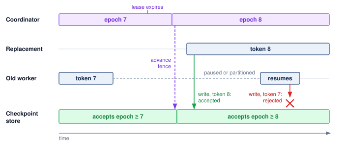

:::

Retries complete the recovery contract. An operation may be retried automatically only when it is idempotent or carries a stable operation identifier that lets the receiver deduplicate repeated effects. Each attempt inherits the caller's absolute deadline rather than receiving a fresh timeout, and the system caps attempts with a retry budget shared across the request or recovery tree. Exponential backoff and jitter spread attempts in time, but they do not prevent overload if every layer retries independently. The budget therefore belongs at one retry-owning layer; exhausted budget returns a failure or invokes degradation instead of amplifying the original incident [@beyer2016sre; @nygard2007releaseit].

```{python}
#| echo: false
#| label: lego-recovery-budget
from mlsysim import *
from mlsysim.physics import calc_mtbf_cluster, calc_checkpoint_size

class RecoveryBudget:
    # ┌── 1. LOAD ──────────────────────────────────────────
    ckpt_bytes = calc_checkpoint_size(Models.Language.GPT3.parameters)  # 14 B/param resumable checkpoint
    recovery = Systems.Reliability.Recovery
    t_detect = float(recovery.detection_time_s) * second
    t_restart = float(recovery.restart_time_s) * second
    aggregate_ckpt_bw = float(recovery.checkpoint_write_bw_gbs) * (GB / second)
    t_load = (ckpt_bytes / aggregate_ckpt_bw).to(second)
    t_warmup = float(recovery.warmup_time_s) * second
    shard_read_bw = Systems.Storage.LocalNvmeTrainingTypical.bandwidth
    n_gpus_1k = Systems.Clusters.Training_1K.total_accelerators
    n_gpus_10k = Systems.Clusters.Training_10K.total_accelerators
    mtbf_1k = calc_mtbf_cluster(Systems.Reliability.Gpu.mttf_hours, n_gpus_1k)
    mtbf_10k = calc_mtbf_cluster(Systems.Reliability.Gpu.mttf_hours, n_gpus_10k)
    failures_per_day_1k = (24 * hour / mtbf_1k).to("").magnitude
    failures_per_day_10k = (24 * hour / mtbf_10k).to("").magnitude

    # ┌── 2. EXECUTE ───────────────────────────────────────
    # One source for the four-term budget: the preemption overhead in fleet
    # orchestration and the runtime-goodput composition call the same helper.
    t_total = recovery.cold_restart_time(ckpt_bytes)
    daily_loss_1k = failures_per_day_1k * t_total
    daily_loss_10k = failures_per_day_10k * t_total
    overhead_pct_1k = (daily_loss_1k / (24 * hour)).to("").magnitude * 100
    overhead_pct_10k = (daily_loss_10k / (24 * hour)).to("").magnitude * 100
    waste_gpu_hours_10k = daily_loss_10k.to(hour).magnitude * n_gpus_10k

    # ┌── 3. GUARD ─────────────────────────────────────────
    check(abs(t_total.to(minute).magnitude - 6.6) < 1.0, f"Expected ~6.6 min total recovery time, got {t_total.to(minute).magnitude:.1f}")
    check(t_total < 30 * minute, "Recovery time should be under 30 min")
    check(
        abs((t_detect + t_restart + t_load + t_warmup - t_total).to(second).magnitude) < 1e-9,
        "Notebook terms must sum to the registry's cold_restart_time",
    )
    check(abs(daily_loss_1k.to(minute).magnitude - 3.0) < 0.5, f"1k daily loss ({daily_loss_1k.to(minute).magnitude:.1f} min)")
    check(22 < t_load.to(second).magnitude < 27, f"Aggregate checkpoint load should be ~24.5 s, got {t_load.to(second).magnitude:.1f}")
    check(abs(daily_loss_10k.to(minute).magnitude - 31.0) < 2.0, f"10k daily loss ({daily_loss_10k.to(minute).magnitude:.1f} min)")

    # ┌── 4. OUTPUT ────────────────────────────────────────
    t_total_min_str = fmt_time(t_total, unit=minute, precision=1, commas=False)
    t_detect_s_str = fmt_time(t_detect, second, precision=0, commas=False)
    t_restart_min_str = fmt_time(t_restart, minute, precision=0, commas=False)
    t_load_s_str = fmt_time(t_load, second, precision=None, commas=False)
    t_warmup_min_str = fmt_time(t_warmup, minute, precision=0, commas=False)
    aggregate_read_gb_per_s_str = fmt_bandwidth(aggregate_ckpt_bw, unit=GB / second, precision=0, commas=False)
    shard_read_gb_per_s_str = fmt_bandwidth(shard_read_bw, unit=GB / second, precision=0, commas=False)
    n_gpus_1k_str = fmt(n_gpus_1k, precision=0, commas=True)
    n_gpus_10k_str = fmt(n_gpus_10k, precision=0, commas=True)
    mtbf_1k_hrs_str = fmt_time(round(mtbf_1k.to(hour).magnitude), hour, precision=0, commas=False, style='word')
    mtbf_10k_hrs_str = fmt_time(round(mtbf_10k.to(hour).magnitude), hour, precision=0, commas=False, style='word')
    failures_per_day_1k_str = fmt_rate(failures_per_day_1k, "failures/day", precision=2, commas=False)
    failures_per_day_10k_str = fmt_rate(failures_per_day_10k, "failures/day", precision=1, commas=False)
    daily_loss_min_1k_str = fmt_time(round(daily_loss_1k.to(minute).magnitude), minute, precision=0, commas=False, style='word')
    daily_loss_min_10k_str = fmt_time(round(daily_loss_10k.to(minute).magnitude), minute, precision=0, commas=False, style='word')
    overhead_pct_1k_str = fmt_percent(overhead_pct_1k / 100, precision=1, commas=False, style='prose')
    overhead_pct_10k_str = fmt_percent(overhead_pct_10k / 100, precision=1, commas=False, style='prose')
    waste_gpu_hours_10k_str = fmt_count(round(waste_gpu_hours_10k), label="GPU-hour", plural_label="GPU-hours")
```

::: {#nbk-fault-tolerance-recovery-time-budget .callout-notebook title="The recovery time budget"}

```{python}
#| echo: false
# ┌── LEGO ───────────────────────────────────────────────
# │ Context: Recovery time budget notebook below.
# │ Note: 14 B/param resumable checkpoint (no gradients or activations).
from mlsysim.physics import calc_checkpoint_size
from mlsysim import *

class FaultToleranceRecoveryRecap:
    m = Models.Language.GPT3
    gpt3_ckpt_bytes = calc_checkpoint_size(m.parameters)  # 14 B/param default
    n_workers = Systems.Clusters.Training_1K.total_accelerators
    # ┌── 4. OUTPUT (Formatting) ─────────────────────────────────────────────
    params_b_str = fmt_params(m.parameters, scale="B", precision=0, commas=False)
    gpt3_ckpt_tb_str = fmt_memory(gpt3_ckpt_bytes, unit=TB, precision=2, commas=False)
    gpt3_shard_gb_str = fmt_memory(gpt3_ckpt_bytes / n_workers, unit=GB, precision=1, commas=False)
    n_workers_str = fmt_count(n_workers, commas=True, label="GPU")
```

**Problem**: Consider a `{python} FaultToleranceRecoveryRecap.params_b_str` parameter model training on `{python} FaultToleranceRecoveryRecap.n_workers_str`. The checkpoint size is approximately `{python} FaultToleranceRecoveryRecap.gpt3_ckpt_tb_str` (BF16 weights, FP32 master weights, and Adam moments at `{python} YoungDalyCheckpointState.ckpt_bpp_str` bytes per parameter). Estimate the cost of a single failure event.

**Setup**: The recovery budget $\FailureRecoveryTime$ has four terms.

- **$\FailureDetectionTime$**: `{python} RecoveryBudget.t_detect_s_str` (conservative heartbeat timeout with verification retries).
- **$\JobRestartTime$**: `{python} RecoveryBudget.t_restart_min_str` (scheduler queue time + container launch + Python import overhead + NCCL initialization).
- **$\CheckpointLoadTime$**: `{python} RecoveryBudget.t_load_s_str` (this is the aggregate-shared-storage read of the full `{python} FaultToleranceRecoveryRecap.gpt3_ckpt_tb_str` checkpoint at `{python} RecoveryBudget.aggregate_read_gb_per_s_str` aggregate). With sharded local-NVMe reads at `{python} RecoveryBudget.shard_read_gb_per_s_str`, one GPU's `{python} FaultToleranceRecoveryRecap.gpt3_shard_gb_str` shard alone would load in under a second. The GPUs of a node share its drive, however, so the node's `{python} CheckpointPlacementRestore.node_share_gb_str` share takes about `{python} CheckpointPlacementRestore.t_local_str`, and only on nodes that survived with their local copy).
- **$\RecoveryWarmupTime$**: `{python} RecoveryBudget.t_warmup_min_str` (JIT kernel compilation, data pipeline buffer fill, TCP connection re-establishment).

**Total**: $\FailureRecoveryTime= \FailureDetectionTime+ \JobRestartTime+ \CheckpointLoadTime+ \RecoveryWarmupTime\approx$ `{python} RecoveryBudget.t_total_min_str` per failure event.

**Impact**: For this recovery path, $\FailureRecoveryTime$ is the operational MTTR\index{MTTR!recovery time budget} term in the steady-state availability relation (perspective \ref{psp-fault-tolerance-scale-transforms-failure}). It is not the whole cost of a failure. Every failure also discards the work done since the last completed checkpoint, on average half the checkpoint interval (@fig-checkpoint-recovery-timeline), and the Young-Daly waste of @eq-ft-checkpoint-waste already counts that rework, so the figures below price only the recovery term. Recovery time optimization matters more as clusters grow. The GPU-only baseline from @tbl-cluster-mtbf-scaling compares the two sizes on a common basis and understates both failure counts. On that basis, a `{python} RecoveryBudget.n_gpus_1k_str`-GPU cluster has MTBF of `{python} RecoveryBudget.mtbf_1k_hrs_str` and experiences about `{python} RecoveryBudget.failures_per_day_1k_str`, losing about `{python} RecoveryBudget.daily_loss_min_1k_str` daily, a modest `{python} RecoveryBudget.overhead_pct_1k_str` overhead. However, a `{python} RecoveryBudget.n_gpus_10k_str`-GPU cluster has GPU-only MTBF of `{python} RecoveryBudget.mtbf_10k_hrs_str` and experiences about `{python} RecoveryBudget.failures_per_day_10k_str`, losing about `{python} RecoveryBudget.daily_loss_min_10k_str` daily (`{python} RecoveryBudget.overhead_pct_10k_str` overhead). That is equivalent to wasting roughly `{python} RecoveryBudget.waste_gpu_hours_10k_str` every day (the daily lost minutes multiplied across all `{python} RecoveryBudget.n_gpus_10k_str` GPUs).

:::

### Warm restart vs. cold restart {#sec-fault-tolerance-reliability-warm-vs-cold-restart}

The recovery procedure described in @sec-fault-tolerance-reliability-reliability-recovery-procedures-002d is a cold restart\index{Cold restart!recovery trade-offs}: every process in the affected job group exits, and the group reloads state from a valid checkpoint. This simplifies recovery by avoiding dependence on surviving in-memory state, but it can discard useful state. After one GPU fails in the `{python} FaultToleranceShardRecap.n_workers_str`-GPU reference job, every surviving worker may retain reusable values; an interrupted update or silent corruption, however, can make some of those values unsafe to keep.

A warm restart\index{Warm restart!survivor preservation} preserves the state of surviving workers. When a rank fails, surviving ranks detect the failure but do not exit. They enter a waiting state, preserving loaded model weights and optimizer states in GPU memory. The scheduler replaces only the failed node. The new node joins, loads its partition of the state from disk (or receives it via broadcast from a peer), and the communicator is rebuilt. The replacement and survivors must agree on the same committed training step before resuming. A shard restored from an older checkpoint cannot be combined with survivor shards that have advanced beyond it; the runtime must reconstruct the missing current state or roll the group back to a common recovery point. Training resumes only after that consistency check.

When the missing state can be reconstructed at the survivors' current step, warm restart avoids a full-cluster reload and repeated warmup. For the `{python} FaultToleranceRecoveryRecap.n_workers_str` example, that fast path avoids rereading the full `{python} FaultToleranceRecoveryRecap.gpt3_ckpt_tb_str` checkpoint through shared storage, whose cold-path $\CheckpointLoadTime$ is `{python} RecoveryBudget.t_load_s_str`. The replacement still needs state transfer and initialization, and all ranks wait until it is ready. If consistency instead requires a rollback, the recovery budget must include the corresponding survivor-state restoration and lost work.

The trade-off is software complexity. Survivor-preserving warm restarts require specialized application and runtime support for dynamic membership changes without leaking CUDA memory, corrupting shared state, or deadlocking during communicator reconstruction. Common training frameworks restart the worker group or reload a checkpoint rather than preserve survivors (@sec-fault-tolerance-reliability-reliability-framework-support-elastic-training-8b75). A deployment that implements a warm-restart fast path still needs cold restart as a safety net. The cold-restart range in @tbl-cold-vs-warm-restart brackets the `{python} RecoveryBudget.t_total_min_str` budget computed above. The warm-restart range is a planning range for the fast path, which avoids the full-cluster reload and warmup; its actual duration depends on how quickly the replacement receives its state and the communicator is rebuilt.

| **Aspect**                  | **Cold restart**                 | **Warm restart**                       |
|:----------------------------|:---------------------------------|:---------------------------------------|
| **Recovery time**           | 4--10 minutes (full reload)      | 30--90 seconds (single node reload)    |
| **State guarantee**         | Clean: all state from checkpoint | Assumes surviving state is valid       |
| **Implementation**          | Simple: kill all, reload all     | Complex: dynamic membership management |
| **Failure during recovery** | Retry cold restart               | Fall back to cold restart              |
| **Best for**                | Correlated failures, SDC events  | Single-node failures, GPU errors       |

: **Cold vs. Warm Restart Trade-Offs**: Cold restart kills every process and reloads from disk; warm restart preserves surviving workers and replaces only the failed node. Warm restart cuts recovery from minutes to tens of seconds for the typical single-node failure but introduces software complexity around dynamic membership management. Mature deployments can run warm restart as the fast path and cold restart as the safety net. Recovery times are illustrative planning ranges, not measurements. {#tbl-cold-vs-warm-restart}

### Recovery automation pipeline {#sec-fault-tolerance-reliability-recovery-automation-pipeline}

At the scale of 10,000+ GPUs, failures occur multiple times per day, so human operators cannot intervene manually on each incident. Recovery must be an autonomous control loop managed by the cluster control plane. Published reports from large training fleets describe multi-stage automation that classifies failures and selects the minimum viable remediation [@dubey2024llama; @kokolis2025; @zu2024tpuv4].

The pipeline operates in four ordered stages:

1.  Health monitoring daemon\index{Recovery automation!health monitoring daemon}: Continuously scrapes GPU telemetry (ECC error counters, temperature, fan speed, NVLink status) alongside application metrics like training loss and step throughput, often from a sidecar container.
2.  Failure classifier\index{Recovery automation!failure classifier}: Determines whether a signal indicates a fatal error (for example, NVIDIA Xid error 48: double-bit ECC error\index{ECC error!uncorrectable}), a transient stall (for example, temporary network congestion), or a performance degradation (for example, thermal throttling).
3.  Action selector\index{Recovery automation!action selector}: Chooses the cheapest response consistent with the affected state and communication group. A process hang on one rank usually requires restarting the whole communication group rather than one container, because every surviving rank still holds a communicator that includes the hung rank. A confirmed hardware fault requires draining the node and drawing a replacement from the spare pool, which is slower and consumes standby capacity. A network partition can justify a bounded wait that preserves in-memory state, but if the wait expires, replacement must fence the old ownership before accepting new writes.
4.  Validation stage\index{Recovery automation!validation stage}: Runs a recorded "canary batch" or validation workload under the expected numerical tolerance. Unexpected loss or gradient behavior triggers investigation of restored state and execution configuration, with fallback to an earlier validated snapshot when the new state cannot be trusted.

This automation removes the human page-diagnose-repair cycle from the recovery path for the common failure types, which shortens mean time to recovery. The classification stage matters most. Treating every failure as a cold restart wastes compute on transient issues, while treating a hardware failure as transient allows corrupted computation to continue. The Llama 3 pretraining run shows what such a pipeline buys at fleet scale.

```{python}
#| echo: false
#| label: llama3-recovery-record
# ┌─────────────────────────────────────────────────────────────────────────────
# │ LLAMA 3 RECOVERY RECORD (LEGO)
# ├─────────────────────────────────────────────────────────────────────────────
# │ Context: war story ws-fault-tolerance-llama3-failure-cadence.
# │
# │ Goal: Pin Meta's reported effective training time and manual-intervention
# │       count for the Llama 3 405B pretraining snapshot to MLSysIM.
# │ Show: >90 percent effective training time; three manual interventions.
# │ How: Literature.TrainingRuns (Dubey 2024).
# │
# └─────────────────────────────────────────────────────────────────────────────
from mlsysim import Literature
from mlsysim.fmt import check, fmt_percent

class Llama3RecoveryRecord:
    """Recovery outcome of the Llama 3 405B pretraining snapshot (Dubey et al. 2024)."""

    # ┌── 1. LOAD (Constants) ──────────────────────────────────────────────
    effective_time_fraction = float(Literature.TrainingRuns.Llama3_405B_EffectiveTrainingTimeFraction)
    manual_interventions = float(Literature.TrainingRuns.Llama3_405B_ManualInterventions)

    # ┌── 2. EXECUTE (The Compute) ────────────────────────────────────────
    # (no derived values; both figures are quoted directly)

    # ┌── 3. GUARD (Invariants) ──────────────────────────────────────────
    check(manual_interventions == 3, "Prose spells out 'only three times'")
    check(effective_time_fraction >= 0.9, f"Prose says more than 90 percent effective time, got {effective_time_fraction}")

    # ┌── 4. OUTPUT (Formatting) ──────────────────────────────────────────
    effective_time_pct_str = fmt_percent(effective_time_fraction, precision=0, style='prose')
```

::: {#ws-fault-tolerance-llama3-failure-cadence .callout-war-story title="The training run that failed every few hours (2024)"}

**Context**: Meta reports training Llama 3\index{Llama-3!training failure cadence} 405B on `{python} InterruptionCauses.gpus_str` H100 GPUs during a `{python} InterruptionCauses.days_str`-day snapshot of pretraining [@dubey2024llama].

**Mechanism**: The snapshot recorded `{python} InterruptionCauses.total_str` unexpected interruptions, about one every `{python} PublishedFailureRates.llama_mttf_str`, with the root causes shown in @fig-llama3-interruptions.

**Impact**: Meta nevertheless reported more than `{python} Llama3RecoveryRecord.effective_time_pct_str` effective training time, measured as useful training time divided by elapsed time. Significant manual intervention was required only three times.

**Fix**: Meta reduced job startup and checkpointing\index{Checkpointing!automated recovery} time and developed automated diagnosis and recovery tools. Communication traces helped locate stalled collectives and slow workers before restarting useful work.

**Systems lesson**: At fleet scale, reliability is a property of the recovery system rather than of the hardware. Effective training time stayed high because automation, not operators, handled nearly every interruption.

:::

### Stragglers versus fail-stop failures {#sec-fault-tolerance-reliability-reliability-distinguishing-stragglers-failures-285d}

Not every recovery decision starts from a crashed process. When one GPU in a synchronous job slows down without dying, every healthy peer still waits at the AllReduce barrier, forcing the recovery pipeline to decide whether the slow rank is a temporary straggler or an incipient failure (perspective \ref{psp-fault-tolerance-straggler-or-failure}).

::: {#psp-fault-tolerance-straggler-or-failure .callout-perspective title="Straggler or failure"}

A straggler, the slow rank of a synchronous step (@sec-distributed-training-systems-systems-synchronization-models-396f), bounds the throughput of every peer that waits on it, so one node running 10 percent slow can cost thousands of nodes 10 percent of their capacity. Fault tolerance must decide what that slowness means. A straggler can still produce correct results, so slowness alone establishes neither incorrect values nor a failed process, and its cause is often system jitter\index{Straggler!system jitter cause} from background OS processes, network congestion, or thermal throttling rather than bad hardware. The decision is between mitigation, which keeps the job running and removes the slowdown, and recovery, which treats the rank as failed and pays for a restart.

:::

Under the simplified no-overlap straggler model, the slowest rank sets the step time of the entire cluster because AllReduce cannot complete until every participant has submitted its gradients:
$$ \StragglerStepTime(\DeviceCount) = \max(\FirstRankComputeTime, \SecondRankComputeTime, \dots, \LastRankComputeTime) + \CommunicationTime(\DeviceCount) $$

Many stragglers are gray failures\index{Gray failure!silent degradation}\index{Gray failure!straggler cause}\index{Straggler!gray failure cause}, the silent degradations named in the failure taxonomy, seen from inside a synchronous job, and none of their common causes raises an explicit error. Thermal throttling reduces clock speed, degrading interconnect cables increase communication latency, OS background processes (memory scrubbing, log rotation) consume CPU cycles, and data loading from a congested network filesystem introduces variable I/O delays. A slow worker can continue meeting a liveness timeout while reducing training throughput, or become slow enough to trigger the same timeout as a failed worker. Progress measurements are therefore needed alongside liveness checks.

Timeout policy governs where the system draws the line between *mitigation* (redistributing work or replacing the slow node) and *recovery* (checkpoint-restart). Aggressive timeouts treat transient stragglers as fail-stop crashes, causing unnecessary job restarts that waste more compute than the slowdown itself, whereas conservative timeouts leave thousands of healthy GPUs waiting on a degraded node that will never speed up. The two responses also land in different places in the goodput accounting of @sec-performance-engineering-goodput-boundaries. A slow rank that stays in the job lowers program goodput, while replacing it spends runtime goodput on the restart. The replacement decision therefore weighs one loss against the other.

Straggler mitigation strategies\index{Straggler!mitigation strategies}\index{Straggler mitigation|see{Straggler}} change either the work assignment or the execution resources. Dynamic load balancing\index{Straggler!dynamic load balancing} moves work away from slow workers while preserving the intended update, whereas bounded staleness\index{Straggler!bounded staleness} allows delayed gradients under an algorithm that tolerates them; its convergence cost depends on the workload and delay bound. Backup workers\index{Straggler!backup worker} replicate selected tasks and accept one result per logical contribution, trading extra GPU cycles for a shorter wait without double-counting gradients. At the infrastructure boundary, proactive replacement\index{Straggler!proactive replacement} uses hardware telemetry, such as rising operating temperatures or growing correctable-ECC error counts, to identify suspect components and replace them when the expected benefit exceeds migration and recovery costs. A simple cost calculation shows why a severe straggler is often cheaper to replace than to tolerate.

```{python}
#| echo: false
#| label: lego-straggler-tax
from mlsysim.fmt import check, fmt, fmt_int, fmt_percent, fmt_usd

class StragglerTax:
    # ┌── 1. LOAD ──────────────────────────────────────────
    n_gpus = Systems.Clusters.Training_1K.total_accelerators
    normal_step_s = 1.0
    throttle_factor = 0.50  # straggler runs at 50% speed
    gpu_cost_per_hour = Infrastructure.Pricing.Fleet.GpuHourRef.rate.to(USD / hour).magnitude

    # ┌── 2. EXECUTE ───────────────────────────────────────
    straggler_step_s = normal_step_s / throttle_factor
    healthy_gpus = n_gpus - 1
    effective_speed = 1 / straggler_step_s
    straggler_frac_pct = 1 / n_gpus * 100
    throughput_loss_pct = (1 - normal_step_s / straggler_step_s) * 100
    wasted_cost_per_hour = n_gpus * gpu_cost_per_hour * (1 - normal_step_s / straggler_step_s)

    # ┌── 3. GUARD ─────────────────────────────────────────
    check(straggler_step_s > normal_step_s, "Straggler must be slower")
    check(abs(throughput_loss_pct - 50.0) < 0.01, f"Expected 50% throughput loss, got {throughput_loss_pct}")
    check(abs(wasted_cost_per_hour - 1024.0) < 0.1, f"Expected $1024/hr wasted cost, got {wasted_cost_per_hour}")

    # ┌── 4. OUTPUT ────────────────────────────────────────
    n_gpus_str = fmt(n_gpus, precision=0)
    normal_step_str = fmt(normal_step_s, precision=0, commas=False)
    throttle_pct_str = fmt_percent(round(throttle_factor * 100) / 100, precision=0, commas=False, style='prose')
    straggler_step_str = fmt(straggler_step_s, precision=0, commas=False)
    healthy_gpus_str = fmt(healthy_gpus, precision=0)
    effective_speed_str = fmt(effective_speed, precision=1, commas=False)
    straggler_frac_str = fmt_percent(straggler_frac_pct / 100, precision=1, commas=False, style='prose')
    throughput_loss_str = fmt_int(throughput_loss_pct, commas=False)
    gpu_cost_str = fmt_usd(gpu_cost_per_hour, precision=0, commas=False, per="GPU-hour")
    wasted_cost_str = fmt_usd(wasted_cost_per_hour, precision=0, per="hour")
```

::: {.column-margin}
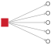{width="100%" fig-alt="A red square source node with five arrows fanning out to five hollow gray nodes."}

*One straggler stalls every healthy peer at the barrier.*
:::

:::: {#nbk-fault-tolerance-straggler-tax .callout-notebook title="The cost of a straggler"}

Consider a `{python} StragglerTax.n_gpus_str`-GPU cluster where a normal training iteration takes `{python} StragglerTax.normal_step_str` second. A single GPU enters a thermally throttled state, clocking down to `{python} StragglerTax.throttle_pct_str` speed, and now takes `{python} StragglerTax.straggler_step_str` seconds to complete its computation.

Because AllReduce cannot complete until every rank has submitted its gradients, the other `{python} StragglerTax.healthy_gpus_str` healthy GPUs sit idle waiting for the straggler.

```{=latex}
\tcbbreak
```

**Impact**:

- Normal step time: `{python} StragglerTax.normal_step_str` second
- Straggler step time: `{python} StragglerTax.straggler_step_str` seconds
- Effective cluster speed: 1 step/`{python} StragglerTax.straggler_step_str`s = `{python} StragglerTax.effective_speed_str` steps/sec

A single failing device (`{python} StragglerTax.straggler_frac_str` of the hardware) has reduced the throughput of the entire cluster by `{python} StragglerTax.throughput_loss_str` percent. At `{python} StragglerTax.gpu_cost_str`, this straggler wastes `{python} StragglerTax.wasted_cost_str` in idle compute.

**Systems insight**: Replacement is worthwhile only when the expected time saved exceeds recovery and replay costs. Suppose the slowdown is expected to persist for the next $\SlowdownPersistenceUpdateCount$ useful updates, whose step times are $\DegradedStepTime$ on the degraded allocation and $\HealthyStepTime$ after replacement. The simplified break-even condition is then $\SlowdownPersistenceUpdateCount(\DegradedStepTime-\HealthyStepTime) > \JobRestartTime+ \LostWorkReplayTime$. The right side includes waiting for capacity and restoring state. A short-lived slowdown may clear before replacement pays off; false-positive detection and uncertain persistence also affect the decision. MTBF describes failure recurrence, not how long this slowdown will last.

::::

Replacing a slow node while maintaining the original GPU count requires available capacity. An $\DeviceCount+1$ redundancy model reserves a hot spare for the isolation and promotion stages of @fig-sdc-controller, reducing allocation delay. Promotion still requires compatible resources, valid state, and communication-group reconstruction; an idle device alone does not guarantee recovery within seconds. A cold spare adds startup work, while a job without a reserved spare depends on the scheduler finding capacity or on repair. The hot spare buys shorter waiting time with devices that sit idle while the fleet is healthy. Fixed-size checkpoint-restart recovery restores the original resource count. Elastic recovery relaxes that requirement by allowing the job to continue with fewer workers when the remaining allocation can support it.

::: {#chk-fault-tolerance-detection-vs-recovery .callout-checkpoint title="Tuning detection and recovery"}

Verify your understanding of how detection latency and recovery strategy trade against one another:

- [ ] **Timeout tuning**: given the heartbeat timeout rule $\HandoverTimeout = \HeartbeatInterval+ \TimeoutSafetyMultiplier\NetworkDelayStandardDeviation$, explain what failure mode is traded away when $\TimeoutSafetyMultiplier$ is lowered from 5 to 3, and which failure mode worsens.
- [ ] **Warm vs. cold restart**: choose a warm restart or a cold restart for a single GPU failure in a 1,000-GPU job with surviving state intact, and identify two conditions that push recovery back toward the cold path.
- [ ] **Hot spare cost**: explain why a hot spare cuts recovery latency relative to detect-then-restart, including the standing cost the cluster pays to keep that spare available.
- [ ] **Straggler decision**: determine what governs whether to wait out a slowed node or kill it and recover onto healthy hardware.

:::

## Elastic Recovery {#sec-fault-tolerance-reliability-reliability-elastic-training-4f87}

```{python}
#| echo: false
#| label: elastic-recovery-node-loss
# ┌─────────────────────────────────────────────────────────────────────────────
# │ ELASTIC RECOVERY NODE LOSS (LEGO)
# ├─────────────────────────────────────────────────────────────────────────────
# │ Context: @sec-fault-tolerance-reliability-reliability-elastic-training-4f87 opener.
# │
# │ Goal: Size the survivors when the Archetype A reference job loses one node.
# │ Show: 1,024-GPU job, 8-GPU node, 1,016 surviving GPUs.
# │ How:  Scenarios.DenseLLMPretrainingReference system: total minus one node.
# └─────────────────────────────────────────────────────────────────────────────
from mlsysim import Scenarios
from mlsysim.fmt import check, fmt, fmt_percent

class ElasticNodeLoss:
    # ┌── 1. LOAD (Constants) ──────────────────────
    job_gpus = Scenarios.DenseLLMPretrainingReference.system.total_accelerators
    gpus_per_node = Scenarios.DenseLLMPretrainingReference.system.node.accelerators_per_node

    # ┌── 2. EXECUTE (The Compute) ─────────────────
    survivors = job_gpus - gpus_per_node

    # ┌── 3. GUARD (Invariants) ────────────────────
    check(survivors == 1016, "prose quotes 1,016 surviving GPUs")

    # ┌── 4. OUTPUT (Formatting) ───────────────────
    job_gpus_str = fmt(job_gpus, precision=0)
    gpus_per_node_str = fmt(gpus_per_node, precision=0)
    survivors_str = fmt(survivors, precision=0)
    retained_pct_str = fmt_percent(survivors / job_gpus, precision=1, style="prose")
```

Suppose a `{python} ElasticNodeLoss.job_gpus_str`-GPU training job loses an `{python} ElasticNodeLoss.gpus_per_node_str`-GPU node to a hardware fault, but the cluster has no spare nodes available. A fixed-size recovery policy leaves the remaining `{python} ElasticNodeLoss.survivors_str` GPUs waiting until replacement capacity becomes available or the allocation is released. Elastic recovery allows the job to resize and continue with less compute, provided its state and parallel decomposition fit the smaller allocation.

::: {#dfn-fault-tolerance-elastic-training .callout-definition title="Elastic training"}

***Elastic training***\index{Elastic training!definition}\index{Training!elastic} is the capability of a distributed training job to adjust its worker count across membership changes, potentially through a coordinated worker-group restart.

1.  **Significance**: It converts a permanent capacity loss into a temporary interruption followed by reduced throughput. A pure data-parallel `{python} ElasticNodeLoss.job_gpus_str`-GPU job that loses `{python} ElasticNodeLoss.gpus_per_node_str` GPUs retains `{python} ElasticNodeLoss.retained_pct_str` of its device count and may resume if the remaining devices can hold the state. Tensor- and pipeline-parallel jobs additionally need a feasible partition and compatible group sizes; retained device count does not guarantee the same fraction of throughput. The recovery policy must either preserve the effective batch size through additional accumulation or validate the optimization changes caused by a smaller batch.
2.  **Distinction**: Unlike fixed-size checkpoint-restart recovery, which waits for replacement hardware to restore the original allocation, elastic recovery can restart or resume with a different worker count. The optimization loop may pause while membership, ranks, and state are re-established.
3.  **Common pitfall**: A frequent misconception is that elasticity is "automatic." In reality, recovery requires coordinated adaptation: the training framework, the data loader, and the orchestrator must all synchronize their state to ensure that no data samples are lost or double-counted during the resize.

:::

A small example shows the lifecycle in three phases (@fig-elastic-flow). Execution begins with a balanced four-node AllReduce ring at full throughput. When Node 3 drops out, the survivors pause at a rendezvous barrier and reload the last consistent checkpoint. The group then contracts into a three-node ring in which each worker takes a one-third larger data shard, resuming productive training at 75 percent throughput if the per-worker rate remains unchanged.

::: {#fig-elastic-flow fig-env="figure" fig-pos="htb" fig-cap="**Elastic Training Recovery**: Read the three phases top to bottom. Rather than restoring the original worker count before resuming, elastic training pauses when a node fails, reloads the last consistent checkpoint, re-forms the ring over the $\DeviceCount-1$ survivors, and redistributes the failed node's data shards among them. The job resumes at reduced throughput (75 percent here, assuming an unchanged per-worker rate), turning a hard failure into a temporary slowdown." fig-alt="Three stacked phase panels joined by downward arrows, each with a ring of nodes at left, columns of data-shard tiles in the middle, and a throughput bar at right. Phase 1: nodes N0 to N3 in an amber ring, three shard tiles per node, throughput bar full at 100 percent. Phase 2: N3 is red, the ring links touching it are red and dashed, N3's three shard tiles are red, a violet box over the surviving columns reads rendezvous plus reload, and the empty throughput bar reads paused. Phase 3: N0, N1, and N2 form a three-node ring, each column holds four tiles with the new top tile in green, a label reads plus 1 shard each (plus 33 percent), N3's column is an empty dashed outline, and the throughput bar is three-quarters full at 75 percent."}
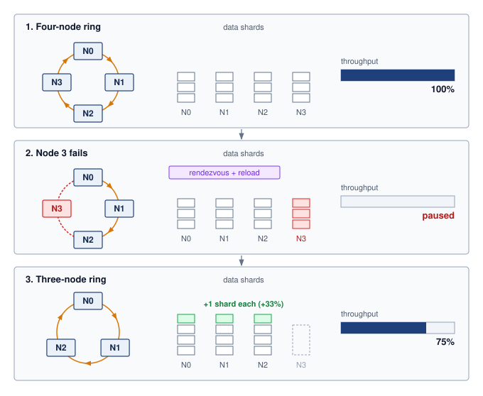

<!--
```{.tikz}
\scalebox{0.83}{
\begin{tikzpicture}[
  >=Latex,
  font=\sffamily
]

  % Book color palette
  \providecolor{NavyBlue}{RGB}{20,45,85}
  \providecolor{SteelBlue}{RGB}{40,90,140}
  \providecolor{LightBlue}{RGB}{234,241,248}
  \providecolor{RedLine}{RGB}{185,45,45}
  \providecolor{RedFill}{RGB}{254,226,226}
  \providecolor{DarkRed}{RGB}{160,25,25}
  \providecolor{DarkGreen}{RGB}{20,110,60}
  \providecolor{GreenLine}{RGB}{35,135,75}
  \providecolor{GreenFill}{RGB}{240,249,244}
  \providecolor{OrangeLine}{RGB}{215,105,15}
  \providecolor{OrangeL}{RGB}{254,243,199}
  \providecolor{CardFill}{RGB}{248, 250, 252}
  \providecolor{CardBorder}{RGB}{226, 232, 240}
  \providecolor{TextDark}{RGB}{30, 41, 59}
  \providecolor{TextMuted}{RGB}{100, 116, 139}
  \providecolor{DarkAmber}{RGB}{146, 64, 14}
  \providecolor{SlateGray}{RGB}{100, 116, 139}

  % =========================================================================
  % TIME AXIS ON LEFT
  % =========================================================================
  \draw[->, line width=1.0pt, SlateGray!60] (0.5, 13.0) -- (0.5, 0.6);
  \node[rotate=90, font=\fontsize{7.5pt}{9pt}\selectfont\bfseries, text=SlateGray]
    at (0.25, 6.8) {Time};

  % =========================================================================
  % PHASE 1: 4-NODE RING --- ALL HEALTHY
  % =========================================================================
  \node[font=\fontsize{9pt}{11pt}\selectfont\bfseries, text=DarkGreen]
    at (7.2, 13.1) {Phase 1: 4-Node Ring --- All Healthy};

  % 4 Nodes (x-centers: 2.85, 5.75, 8.65, 11.55)
  \foreach \i/\x in {0/2.85, 1/5.75, 2/8.65, 3/11.55} {
    \draw[line width=0.9pt, draw=SteelBlue, fill=LightBlue!40]
      (\x - 1.05, 11.3) rectangle (\x + 1.05, 12.5);
    \node[font=\fontsize{8.5pt}{10pt}\selectfont\bfseries, text=NavyBlue]
      at (\x, 12.1) {Node \i};
    \node[font=\fontsize{6.8pt}{8pt}\selectfont, text=SteelBlue]
      at (\x, 11.65) {rank \i};
  }

  % Ring forward arrows
  \draw[->, line width=1.0pt, NavyBlue] (3.90, 11.9) -- (4.70, 11.9);
  \draw[->, line width=1.0pt, NavyBlue] (6.80, 11.9) -- (7.60, 11.9);
  \draw[->, line width=1.0pt, NavyBlue] (9.70, 11.9) -- (10.50, 11.9);

  % Ring return arrow: Node 3 bottom -> Node 0 bottom
  \draw[->, line width=1.0pt, NavyBlue]
    (11.55, 11.3) -- (11.55, 10.7) -- (2.85, 10.7) -- (2.85, 11.3);

  % Phase 1 Metrics
  \node[anchor=west, font=\fontsize{7.2pt}{8.5pt}\selectfont\bfseries, text=DarkGreen]
    at (12.9, 12.1) {AllReduce: active};
  \node[anchor=west, font=\fontsize{7.2pt}{8.5pt}\selectfont\bfseries, text=DarkGreen]
    at (12.9, 11.65) {MFU: 82\%};

  % Separator 1
  \draw[dashed, line width=0.7pt, SlateGray!40] (1.0, 10.2) -- (15.2, 10.2);


  % =========================================================================
  % PHASE 2: NODE 3 FAILS --- JOB PAUSES
  % =========================================================================
  \node[font=\fontsize{9pt}{11pt}\selectfont\bfseries, text=DarkRed]
    at (7.2, 9.7) {Phase 2: Node 3 Fails --- Job Pauses};

  % Healthy Nodes 0..2
  \foreach \i/\x in {0/2.85, 1/5.75, 2/8.65} {
    \draw[line width=0.9pt, draw=SteelBlue, fill=LightBlue!40]
      (\x - 1.05, 7.9) rectangle (\x + 1.05, 9.1);
    \node[font=\fontsize{8.5pt}{10pt}\selectfont\bfseries, text=NavyBlue]
      at (\x, 8.7) {Node \i};
    \node[font=\fontsize{6.8pt}{8pt}\selectfont, text=SteelBlue]
      at (\x, 8.25) {rank \i};
  }

  % Forward arrows 0->1 and 1->2
  \draw[->, line width=1.0pt, NavyBlue] (3.90, 8.5) -- (4.70, 8.5);
  \draw[->, line width=1.0pt, NavyBlue] (6.80, 8.5) -- (7.60, 8.5);

  % Broken link to Node 3
  \draw[->, dashed, line width=1.0pt, RedLine] (9.70, 8.5) -- (10.50, 8.5);
  \node[above=2pt, font=\fontsize{6.5pt}{7.5pt}\selectfont\bfseries, text=DarkRed]
    at (10.1, 8.5) {broken};

  % Failed Node 3
  \draw[line width=0.8pt, draw=SlateGray!60, fill=CardFill]
    (10.5, 7.9) rectangle (12.6, 9.1);
  \node[font=\fontsize{8.5pt}{10pt}\selectfont\bfseries, text=TextMuted]
    at (11.55, 8.7) {Node 3};
  \draw[line width=0.9pt, DarkRed!70] (11.0, 8.55) -- (12.1, 8.85);
  \draw[line width=0.9pt, DarkRed!70] (11.0, 8.85) -- (12.1, 8.55);
  \node[font=\fontsize{6.5pt}{8pt}\selectfont\bfseries, text=DarkRed]
    at (11.55, 8.22) {FAILED};

  % Status Cards below Phase 2
  \draw[line width=0.8pt, draw=OrangeLine, fill=OrangeL!50]
    (1.8, 6.6) rectangle (6.8, 7.35);
  \node[font=\fontsize{7.2pt}{8.5pt}\selectfont\bfseries, text=DarkAmber]
    at (4.3, 7.1) {Checkpoint loaded};
  \node[font=\fontsize{6.0pt}{7.2pt}\selectfont, text=OrangeLine!90!black]
    at (4.3, 6.78) {rollback to last consistent state};

  \draw[line width=0.8pt, draw=RedLine, fill=RedFill!50]
    (7.6, 6.6) rectangle (12.6, 7.35);
  \node[font=\fontsize{7.2pt}{8.5pt}\selectfont\bfseries, text=DarkRed]
    at (10.1, 7.1) {Training paused};
  \node[font=\fontsize{6.0pt}{7.2pt}\selectfont, text=DarkRed]
    at (10.1, 6.78) {Rendezvous barrier: ranks 0, 1, 2 wait};

  % Separator 2
  \draw[dashed, line width=0.7pt, SlateGray!40] (1.0, 6.1) -- (15.2, 6.1);


  % =========================================================================
  % PHASE 3: 3-NODE RING --- ELASTIC RECONFIGURATION
  % =========================================================================
  \node[font=\fontsize{9pt}{11pt}\selectfont\bfseries, text=DarkGreen]
    at (7.2, 5.6) {Phase 3: 3-Node Ring --- Elastic Reconfiguration};

  % 3 Reconfigured Nodes (x-centers: 3.95, 7.20, 10.45)
  \foreach \i/\x in {0/3.95, 1/7.20, 2/10.45} {
    \draw[line width=0.9pt, draw=SteelBlue, fill=LightBlue!40]
      (\x - 1.15, 3.8) rectangle (\x + 1.15, 5.05);
    \node[font=\fontsize{8.5pt}{10pt}\selectfont\bfseries, text=NavyBlue]
      at (\x, 4.72) {Node \i};
    \node[font=\fontsize{6.5pt}{7.5pt}\selectfont, text=SteelBlue]
      at (\x, 4.38) {rank \i{} (new)};
    \node[font=\fontsize{6.5pt}{7.5pt}\selectfont\bfseries, text=DarkGreen]
      at (\x, 4.02) {shard +33\%};
  }

  % Forward arrows 0->1 and 1->2
  \draw[->, line width=1.0pt, NavyBlue] (5.10, 4.42) -- (6.05, 4.42);
  \draw[->, line width=1.0pt, NavyBlue] (8.35, 4.42) -- (9.30, 4.42);

  % Ring return arrow: Node 2 bottom -> Node 0 bottom
  \draw[->, line width=1.0pt, NavyBlue]
    (10.45, 3.8) -- (10.45, 3.25) -- (3.95, 3.25) -- (3.95, 3.8);

  % Phase 3 Metrics
  \node[anchor=west, font=\fontsize{7.2pt}{8.5pt}\selectfont\bfseries, text=DarkGreen]
    at (12.0, 4.70) {AllReduce: active};
  \node[anchor=west, font=\fontsize{7.2pt}{8.5pt}\selectfont\bfseries, text=DarkAmber]
    at (12.0, 4.35) {MFU: $\approx$ 62\%};
  \node[anchor=west, font=\fontsize{6.5pt}{8pt}\selectfont, text=TextMuted]
    at (12.0, 4.00) {(75\% of prior)};

  % Elastic Reconfiguration Annotation Card
  \node[font=\fontsize{8pt}{9.5pt}\selectfont\bfseries, text=NavyBlue]
    at (7.2, 2.5) {Elastic Reconfiguration};
  \node[font=\fontsize{6.8pt}{8.2pt}\selectfont, text=TextDark]
    at (7.2, 2.1) {Failed node's data shards redistributed across remaining 3 nodes};
  \node[font=\fontsize{6.5pt}{7.8pt}\selectfont, text=TextMuted]
    at (7.2, 1.7) {MFU drops $\sim$25\% ($W=3$ vs.\ $W=4$) but training continues --- no full restart required};

\end{tikzpicture}
}
```
-->

:::

### Recovery adaptation mechanisms {#sec-fault-tolerance-reliability-reliability-elastic-training-mechanisms-49b1}

Shedding a lost node narrows the active ring instead of idling the whole allocation until replacement hardware arrives, so elastic recovery converts a job termination into a bounded capacity adjustment. The worker group may restart while the framework re-establishes membership, ranks, and state under the smaller resource allocation. When a failure reduces the worker count, the recovery path must adapt several training components before productive work resumes. Each adaptation addresses a specific consistency requirement that, if violated, would corrupt the model or waste computation.

Batch size adjustment comes first. With fewer surviving workers, either each worker must process more samples to preserve the global batch size, or the global batch size must shrink, which in turn may require recalibrating the learning rate to preserve convergence. Changing the global batch size changes the optimization regime as well as the amount of work per step. The linear and square-root learning-rate rules of @sec-distributed-training-systems-systems-learning-rate-scaling-rules-fa26 are candidate policies for a resized job, with the worker-count ratio standing in for the batch ratio when per-worker microbatch size and accumulation count stay fixed [@goyal2017accurate]. For a shrink, the square-root rule reduces the learning rate less than linear scaling does; that arithmetic does not establish which policy is more stable, and either policy requires validation for the optimizer, schedule, and workload. Preserving the global batch instead can avoid introducing this change in optimization regime.

Gradient accumulation offers that alternative. Each surviving worker processes additional micro-batches before synchronization to maintain the original effective batch size. If worker count drops by half, doubling the accumulation steps preserves the number of examples per update and can retain the existing learning-rate schedule. Each worker then performs twice as much micro-batch computation per update, although communication and overlap determine the wall-time increase. Equal batch size does not imply bitwise-identical updates or identical behavior from operations that depend on micro-batch statistics.

Data loader redistribution must agree with the recovered training step and new membership. When workers are lost, the loader reassigns the remaining logical input stream so that the resize itself neither omits samples nor counts them twice in an update. Replaying work discarded by checkpoint rollback is expected; duplicating contributions within the resumed stream is a different error. The saved data position and sampling state distinguish those cases.

State resharding adds further complexity when using sharded model parallelism (ZeRO/FSDP). When parameters and optimizer states are sharded once across the entire job without replication, losing a worker removes the only live in-memory copy of its shard, so the job must reload a complete durable checkpoint generation before repartitioning the state across the smaller worker set. When the job instead uses hybrid sharding that replicates each shard across two or more data-parallel groups, a surviving replica group still holds a live copy in GPU memory and can supply the missing shard over the network without reading from storage. Only after the missing values are recovered from a peer replica or a durable checkpoint can the runtime redistribute shard ownership across the surviving workers. Changing shard ownership alone cannot recover missing values.

#### Spot instance preemption as a failure class {#sec-fault-tolerance-reliability-reliability-spot-instance-arbitrage-68ad}

```{python}
#| echo: false
#| label: spot-recovery-prices
# ┌─────────────────────────────────────────────────────────────────────────────
# │ SPOT RECOVERY PRICES (LEGO)
# ├─────────────────────────────────────────────────────────────────────────────
# │ Context: @sec-fault-tolerance-reliability-reliability-spot-instance-arbitrage-68ad.
# │
# │ Goal: Quote the same spot and on-demand GPU-hour prices that the fleet
# │       orchestration chapter uses for its spot-versus-on-demand model.
# │ Show: $0.70 spot vs. $2.00 on demand per GPU-hour.
# │ How:  Infrastructure.Pricing.Fleet.{SpotGpuHourRef, GpuHourRef}.
# └─────────────────────────────────────────────────────────────────────────────
from mlsysim import Infrastructure
from mlsysim.fmt import check, fmt_usd

class SpotRecoveryPrices:
    # ┌── 1. LOAD (Constants) ──────────────────────
    spot = Infrastructure.Pricing.Fleet.SpotGpuHourRef.rate.to(USD / hour).magnitude
    on_demand = Infrastructure.Pricing.Fleet.GpuHourRef.rate.to(USD / hour).magnitude

    # ┌── 3. GUARD (Invariants) ────────────────────
    check(0 < spot < on_demand, "spot capacity must be cheaper than on-demand capacity")

    # ┌── 4. OUTPUT (Formatting) ───────────────────
    spot_str = fmt_usd(spot, precision=2, commas=False, per="GPU-hour")
    on_demand_str = fmt_usd(on_demand, precision=0, commas=False, per="GPU-hour")
```

Hardware faults are not the only event that removes workers from a running job. Cloud providers often price preemptible ("spot") instances below on-demand capacity, with the caveat that they can be reclaimed with little warning. Once workers vanish, recovery faces the same missing-state and membership problems as a hardware failure. An advance notice, when available, can allow a coordinated save or drain before departure and therefore changes the recovery opportunity.

Both fixed-size and elastic jobs can recover from preemption using checkpoints, but a fixed-size job must regain its required allocation before restarting. An elastic job can instead resume at reduced scale if enough capacity remains and the training invariants survive the resize. Recovery still pays for detection, state restoration, and group reconstruction; repeated reclamations can erase the apparent price advantage. At the reference fleet prices of `{python} SpotRecoveryPrices.spot_str` for spot capacity against `{python} SpotRecoveryPrices.on_demand_str` for on-demand capacity, the savings can outweigh the lost work and resizing delays; @sec-fleet-orchestration-spot-instances develops the full spot-versus-on-demand cost model. Where spot capacity makes worker departure frequent, federated training makes it the default.

::: {#lhs-fault-tolerance-archetype-c-federated-mobilenet-client-dropout .callout-lighthouse title="Archetype C (Federated MobileNet): Dropout as the normal case"}

Archetype C (Federated MobileNet) makes worker departure an expected part of training. Its phone-class clients train while charging, idle, and connected, so a client that disappears mid-round is an ordinary event rather than a fault to repair. The coordinator therefore selects more clients than a round needs and closes the round at a deadline. The round tolerates departures as long as enough compatible updates arrive; otherwise the coordinator abandons it [@mcmahan2017communication; @bonawitz2019towards]. Model-version checks prevent updates computed against a replaced model from entering the current aggregate, the federated counterpart of fencing a stale epoch, while aggregation weights account for the examples contributed under the chosen learning algorithm. Version checks and weighting do not remove participation bias. Recovery must preserve the coordinator state needed to continue that algorithm, including the model, round position, and any persistent optimizer or sampling state, rather than assuming weights alone suffice. @Sec-edge-intelligence-client-scheduling-f675 develops the round design, including deadlines, participation requirements, and the bias that arises when some kinds of devices report less often than others.

:::

#### Framework support for elastic recovery {#sec-fault-tolerance-reliability-reliability-framework-support-elastic-training-8b75}

Whether worker loss comes from a hardware fault or a spot preemption, training frameworks differ in how many of the resize invariants (group membership, shard ownership, data loader redistribution, and batch-size or learning-rate adjustment) they enforce automatically after a failure. PyTorch Elastic\index{PyTorch Elastic!worker failure detection} (TorchElastic) uses agents to monitor workers and a rendezvous mechanism to establish group membership [@pytorchElasticDocs; @pytorchRendezvousDocs]. On a failure or membership change, it stops all surviving workers, forms a new worker group, and starts its workers with new `RANK` and `WORLD_SIZE` assignments. It handles rank reassignment and communication-group reconstruction while leaving batch size, learning rate, and checkpoint semantics to user code. DeepSpeed [@rasley2020] provides ZeRO-based distributed training and checkpointing building blocks for large models [@deepspeedCheckpointingDocs]. Recovery reloads from the last durable checkpoint, and Universal Checkpointing addresses portability across some changes in parallelism and topology [@deepspeedUniversalCheckpointingDocs], though elastic behavior still depends on the surrounding launcher and resource manager.

Ray Train, built on Ray's actor model, provides a checkpoint-oriented recovery path that restarts a worker group after a failure or preemption and resumes from the latest available checkpoint. The training function remains responsible for saving and loading sufficient state [@rayTrainFaultToleranceDocs]. Horovod Elastic similarly builds on Horovod's data-parallel training system [@sergeev2018horovod] with an elastic state API for worker additions and removals [@horovodElasticDocs]. The API resets ranks and reconstructs communication while leaving convergence-sensitive choices such as learning-rate or batch-size policy to the training script. Across these four frameworks, restarting the worker group is largely automated, while state resharding remains manual, deployment-dependent, or tied to a checkpoint reload (@tbl-elastic-training-comparison).

| **Framework**       | **Failure detection** | **Automatic recovery** | **State resharding** | **Cluster integration** |
|:--------------------|:---------------------:|:----------------------:|:--------------------:|:-----------------------:|
| **PyTorch Elastic** |   Rendezvous timeout  |          Yes           |        Manual        |        Kubernetes       |
| **DeepSpeed**       |        External       |    Checkpoint-based    | Deployment-dependent |   External schedulers   |
| **Ray Train**       |   Actor supervision   | Checkpoint retry path  |  Checkpoint reload   |       Ray Cluster       |
| **Horovod Elastic** |    Driver heartbeat   |          Yes           |        Manual        |    Slurm, Kubernetes    |

: **Elastic Recovery Framework Comparison**: Frameworks differ in how they detect worker failures and how much of the recovery sequence (group reconstruction, state redistribution, batch size adjustment) they automate. {#tbl-elastic-training-comparison}

### Model-specific training fault tolerance {#sec-fault-tolerance-reliability-reliability-modelspecific-training-fault-tolerance-4b70}

Restoring model weights alone does not guarantee a valid restart: an LLM that reloads its weights but loses its curriculum cursor trains twice on the same documents, and a continuous recommender that rolls back its embedding tables serves stale user preferences. The checkpoint and recovery mechanisms of @sec-fault-tolerance-reliability-reliability-checkpoint-restart-fundamentals-0ac2 and @sec-fault-tolerance-reliability-reliability-failure-detection-recovery-0f54 must therefore adapt to the workload costs priced in @sec-fault-tolerance-reliability-reliability-modeltype-diversity-failure-impact-8ec0. The design question is not simply how often to checkpoint, but which state variable would make a restart mathematically or economically wrong. For recommendation workloads, incremental checkpointing\index{Checkpointing!incremental}\index{Incremental checkpointing|see{Checkpointing}}, tiered checkpointing, and embedding versioning can reduce the cost of preserving fresh state. Incremental storage can still reconstruct an exact generation from a base and its required deltas; accepting stale or approximate state is a separate choice. For each workload, the state at risk determines what its checkpoint must contain (@tbl-training-recovery-state-invariants).

| **Workload**   | **State at risk**                                                                                  | **Checkpoint implication**                                                                                                                                                                                                 |
|:---------------|:---------------------------------------------------------------------------------------------------|:---------------------------------------------------------------------------------------------------------------------------------------------------------------------------------------------------------------------------|
| LLM training   | Optimizer state, curriculum position, document position, long-context schedule                     | Preserve the FP32 optimizer state where precision matters, shard writes with ZeRO/FSDP, move serialization off the critical path, and include the data-schedule position so the optimization trajectory resumes correctly. |
| Recommendation | Embedding freshness, feature-store version                                                         | Preserve fresh state with incremental checkpointing, tiered checkpointing, and embedding versioning; accepting stale or approximate state requires a separate recovery contract.                                           |
| Vision         | Augmentation seeds, shuffling order, batch-normalization statistics, progressive-resizing schedule | Capture the stochastic and normalization state that controls the input stream; weights alone are not enough to reproduce the training trajectory.                                                                          |
| Scientific ML  | Simulator state, search frontier, explored configurations, validation seeds                        | Treat the model, simulator, search process, and random state as one consistency unit so recovery does not duplicate exploration or invalidate comparisons.                                                                 |

: **Training Recovery State Invariants**: Workloads require different checkpoint contents because they make different state variables quality-bearing. The correct recovery policy starts from the state that would make a restart wrong, then chooses sharding, incrementality, or domain-state capture accordingly. {#tbl-training-recovery-state-invariants}

The common pattern is that recovery correctness is broader than weight restoration. LLMs can reload weights but resume with the wrong curriculum position. Recommendation models that train continuously can reload dense parameters but serve stale embeddings, so a failure that loses recent updates carries a freshness cost as well as a replay cost. The recovery budget must reflect the workload's measured sensitivity to stale state.[^fn-recsys-model-freshness] Vision models have smaller checkpoints, about `{python} FaultToleranceIntroRecap.vit_ckpt_str` for the ViT-Large example, which permit more frequent saves on the same storage path. Yet reproducing their input stream requires the augmentation configuration, random-number generator state, and data position rather than only the initial shuffling seed. Scientific models can reload a neural network while losing the simulator state that made the data meaningful, and an iterative search must also retain which configurations it has evaluated when those results choose its next candidates. In every case the checkpoint boundary must include whatever prior decisions affect future work, wherever that state resides. Once the trained model is deployed to users, however, the operational calculus shifts from protecting *weeks of batch computation* to protecting *milliseconds of real-time latency*.

[^fn-recsys-model-freshness]: **RecSys freshness**\index{Recommendation system!freshness fault tolerance}: Freshness makes recovery delay part of the model-quality budget. Its importance depends on how quickly useful user and item signals change and how strongly predictions depend on them. Comparing quality at different state ages establishes the permitted staleness; that measured limit determines how much checkpoint and replication overhead is justified.

## Serving Fault Tolerance {#sec-fault-tolerance-reliability-reliability-serving-fault-tolerance-5375}

When users ask a voice assistant to turn off the lights, they will not tolerate a five-minute pause while the inference server reloads from a checkpoint. Serving presents a different challenge, because users expect millisecond-level responsiveness even when backend GPUs crash. The C³ budget for fault tolerance shifts accordingly. Training pays for coordination in synchronization time so that a failure does not erase completed compute, while serving pays in standing redundant compute and in routing coordination so that a failure does not break a latency contract.

A serving replica is a runnable copy of the model that can accept requests; the routing layer chooses a replica, and a readiness check determines whether that replica can serve successfully. Replicas may share external state stores or keep request state in accelerator memory, so replacing compute does not necessarily replace the state a request needs. Serving fault tolerance asks how those mechanisms behave when replicas, GPUs, or state stores fail under live latency budgets. The focus here is narrower than a complete serving architecture: each mechanism is treated as a reliability boundary for real-time inference.

### Stateless vs. stateful serving {#sec-fault-tolerance-reliability-reliability-stateless-vs-stateful-serving-0a60}

The first serving decision is where request state lives, because that choice determines whether failover is a retry or a state-reconstruction problem. A stateless model worker retains no required per-session state between requests. It obtains the necessary context from the request or an external state store, so another ready worker can process the same request. A stateful application can therefore use stateless model workers, although its external store remains a reliability dependency.

The stateless pattern appears when the input itself carries all context: an image classifier processes one image, an object detector processes one frame, a single-turn text classifier processes one snippet, and an embedding service maps one input to one vector. Fault tolerance can then focus on replica health and request routing. Redundant replicas\index{Replication!redundant replicas} serve requests in parallel, load balancing\index{Load balancing!serving fault tolerance} sends traffic only to healthy replicas, health checks\index{Health check!serving failover} remove failed replicas from rotation, and automatic replacement starts a new replica when capacity falls. When a replica fails, in-flight requests to that replica can be retried elsewhere, because no quality-bearing session state has been lost.

Stateless serving offers the simpler architecture when the application permits it. However, many ML applications inherently require state across requests. Consider a chatbot: a single-turn question-answering system can operate statelessly, processing each question independently. A conversational assistant must preserve its history somewhere, but the model worker can still be stateless if each request carries the complete history or reads it from a durable external store. Worker-local state creates a stronger dependency when later requests rely on information available only at the selected replica.

Stateful serving appears when later work depends on retained session state. For a transformer, the key-value (KV) cache stores attention keys and values computed for earlier tokens so the worker can reuse them while generating subsequent tokens. This cache is derived state. If the authoritative token history and compatible model version remain available, a replacement can recompute it by processing that history again. Losing the history itself is a different failure because cache reconstruction no longer has its required input. Streaming speech recognition similarly maintains context from previous audio, recommendation sessions accumulate user context, and interactive editing maintains document state across edits. The fault-tolerance consequence is that failure loses quality-bearing state rather than serving capacity alone. KV cache loss requires reprocessing previous turns, session context loss forces users to repeat previous interactions, and accumulated user state loss degrades quality when context is unavailable. The mitigation choice follows the size, update rate, and quality value of that state. Session affinity routes a session to the same replica, state checkpointing periodically saves session state, state replication maintains a standby copy, and graceful degradation keeps the service available at reduced quality if state cannot be recovered. @Tbl-stateless-stateful-comparison contrasts how that state boundary reshapes routing, failure impact, and recovery complexity. Whether the architecture is stateless or stateful, maintaining availability under live latency constraints requires deploying redundant capacity.

::: {.column-margin .margin-pointer}
↪ How the KV cache grows with sequence length and concurrency until it fills accelerator memory is developed in @sec-inference-scale-kv-cache-wall.
:::

| **Aspect**               |      **Stateless serving**       |             **Stateful serving**            |
|:-------------------------|:--------------------------------:|:-------------------------------------------:|
| **Request routing**      |           Any replica            |            Session-affine replica           |
| **Failure impact**       |     Retry on another replica     |             Potential state loss            |
| **Recovery complexity**  |     Restart and load weights     |      Reload state + reconstruct context     |
| **Redundancy approach**  |      Active-active replicas      |          Replicated state + standby         |
| **Work after detection** | Route or retry to a ready worker | Recover required state, then route or retry |

: **Stateless vs. Stateful Serving Fault Tolerance**: State recovery adds work after failure detection. End-to-end failover also includes probe timeouts, routing, replacement readiness, and request retry; neither worker category implies a fixed latency. {#tbl-stateless-stateful-comparison}

### Redundancy and replication {#sec-fault-tolerance-reliability-reliability-redundancy-replication-2239}

Redundancy buys availability only when replica placement and spare capacity match the failure domain being defended against. Turning multiple model copies into uninterrupted service requires sizing the replica count to the availability target, choosing how live traffic is split across healthy and standby workers, and placing those replicas across independent failure domains.

#### Availability calculations {#sec-fault-tolerance-reliability-reliability-availability-calculations-ef0a}

Serving redundancy is the parallel composition of @sec-fault-tolerance-reliability-quantitative-analysis applied to interchangeable replicas, with availability in place of survival probability. For a single replica with availability $\ReplicaAvailability$ (probability of being operational at any given time), @eq-availability-redundancy quantifies how multiple independent replicas achieve higher system availability:

$$ \RedundantServiceAvailability= 1 - (1 - \ReplicaAvailability)^\RedundantReplicaCount$$ {#eq-availability-redundancy}

where $\RedundantReplicaCount$ is the number of replicas. For a service whose single replica is available 99 percent of the time, redundancy compounds as follows.

```{python}
#| echo: false
#| label: replica-availability
# ┌─────────────────────────────────────────────────────────────────────────────
# │ REPLICA AVAILABILITY (LEGO)
# ├─────────────────────────────────────────────────────────────────────────────
# │ Context: @eq-availability-redundancy worked values and the margin ladder.
# │
# │ Goal: Compute availability and annual downtime for one, two, and three
# │       independent replicas at 99 percent per-replica availability.
# │ Show: 3.65 days; 99.99 percent and 52.6 minutes; 99.9999 percent and 31.5 s.
# │ How:  A = 1 - (1 - a)^r; downtime = (1 - A) x hours per year.
# └─────────────────────────────────────────────────────────────────────────────
from mlsysim.fmt import check, fmt_percent, fmt_time

class ReplicaAvailability:
    # ┌── 1. LOAD (Constants) ──────────────────────
    a_single = 0.99  # scenario: per-replica availability

    # ┌── 2. EXECUTE (The Compute) ─────────────────
    a2 = 1 - (1 - a_single) ** 2
    a3 = 1 - (1 - a_single) ** 3
    down1_h = (1 - a_single) * HOURS_PER_YEAR
    down2_h = (1 - a2) * HOURS_PER_YEAR
    down3_h = (1 - a3) * HOURS_PER_YEAR

    # ┌── 3. GUARD (Invariants) ────────────────────
    check(down1_h > down2_h > down3_h > 0, "each replica must cut downtime")
    check(3.6 < down1_h / 24 < 3.7, "margin ladder shows 3.65 days for one replica")

    # ┌── 4. OUTPUT (Formatting) ───────────────────
    a1_str = fmt_percent(a_single, precision=0, commas=False, style="prose")
    a2_str = fmt_percent(a2, precision=2, commas=False, style="prose")
    a3_str = fmt_percent(a3, precision=4, commas=False, style="prose")
    down1_str = fmt_time(down1_h / 24, "day", precision=2, commas=False, style="word")
    down2_str = fmt_time(down2_h * 60, "minute", precision=1, commas=False, style="word")
    down3_str = fmt_time(down3_h * 3600, "second", precision=1, commas=False, style="word")
```

For a single replica, availability of `{python} ReplicaAvailability.a1_str` corresponds to `{python} ReplicaAvailability.down1_str` of downtime per year. Adding independent replicas changes the tail of the failure distribution quickly: two replicas give `{python} ReplicaAvailability.a2_str`, or `{python} ReplicaAvailability.down2_str` of downtime per year, and three replicas give `{python} ReplicaAvailability.a3_str`, or `{python} ReplicaAvailability.down3_str`. The arithmetic assumes independent failures and enough capacity on any surviving replica to meet the service target; shared power, shared networking, and shared software bugs reduce actual availability below these theoretical values.

::: {.column-margin}
{width="100%" fig-alt="Time ladder showing annual downtime dropping from 3.65 days with one replica to 52.6 minutes with two and 31.5 seconds with three."}

*Redundancy turns days of downtime into seconds.*
:::

#### Replication strategies {#sec-fault-tolerance-reliability-reliability-replication-strategies-aaa2}

The availability equation says how much redundancy can help; the replication topology determines how that redundancy behaves under normal execution and sudden hardware loss. Two fundamental designs make opposite bets (@fig-serving-redundancy). Active-active replication splits ingress traffic evenly across live replicas, one-third each for three, which keeps every device busy but requires spare headroom so the survivors can absorb a failed replica's share. Active-passive replication sends all traffic to a designated primary and keeps a pre-warmed standby whose weights remain loaded in accelerator memory, which makes failover fast at the expense of a device that serves nothing while the primary is healthy.

::: {#fig-serving-redundancy fig-env="figure" fig-pos="htb" fig-cap="**Serving Redundancy Strategies**: Active-active (left) splits traffic across three replicas, each carrying about one-third, which uses every device but requires enough headroom for the survivors to absorb a failed replica's share. Active-passive (right) sends all traffic to one primary and keeps a warm standby with weights already loaded, which simplifies failover at the cost of capacity that serves nothing while the primary is healthy." fig-alt="Two panels divided by a dashed line. Each replica card holds a blue weights bar and a load gauge whose green fill shows traffic served. Left, active-active: a load balancer splits requests along three violet arrows labeled one third to replicas 1, 2, and 3; each gauge is one-third full, and a bracket under the empty part of the first gauge reads headroom absorbs a failed share. Right, active-passive: a load balancer sends a solid arrow labeled all traffic to a primary whose gauge is full and labeled traffic, and a dashed arrow labeled on failure to a dashed warm standby whose weights are loaded but whose gauge is empty and labeled idle; text below reads loaded, serves nothing."}
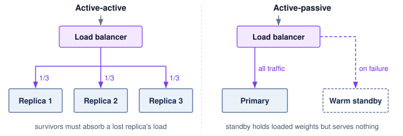

:::

Geographic replication extends the same choice across regions. It protects against data-center or regional network failures, but requests routed to distant regions pay additional latency, and the active-active headroom problem reappears at regional scale. When a region fails, the surviving regions must absorb its traffic and, for stateful services, rebuild its sessions, so each region either carries spare capacity sized for the largest region it may absorb or accepts degraded latency during the failover. Traffic returns to a recovered region gradually, because its caches and warm replicas start empty and an abrupt shift back would overload it and trigger the same failover again. Multi-tier designs combine several replication policies at once: edge caches replicate for latency, regional serving clusters replicate for availability, and a global primary or coordination layer preserves consistency and freshness.

#### Replica placement and failure domains {#sec-fault-tolerance-reliability-reliability-replica-placement-failure-domains-73a7}

Effective redundancy requires placing replicas in independent failure domains. Different machines tolerate individual machine failures; different racks tolerate rack-level failures from power or top-of-rack switch issues; different availability zones tolerate data-center-section failures; and different regions tolerate entire data-center failures. The independence level should match the availability requirement and cost constraint: regional replication is expensive because it duplicates compute and network capacity, but it is necessary when regional failure must not become user-visible downtime. Placement alone, however, only creates the possibility of recovery; the serving system still needs a control loop that notices the failure, removes the affected replica from traffic, and preserves enough state that the user-visible service continues with bounded degradation.

### Failover mechanisms {#sec-fault-tolerance-reliability-reliability-failover-mechanisms-5ddd}

When a replica fails, traffic must be redirected to healthy replicas, and the speed and reliability of that redirection determine how much of the failure users see. The mechanism decomposes into two questions: how the system decides that a replica can no longer serve, and what happens to stateful sessions already attached to it.

#### Health checking {#sec-fault-tolerance-reliability-reliability-health-checking-a604}

Health checks\index{Health check!liveness vs. readiness}\index{Health check!inference correctness probe} decide when traffic should move. The liveness and readiness probes of @sec-fault-tolerance-reliability-reliability-failure-detection-mechanisms-efed apply to a serving replica, where readiness means that its weights are loaded, its accelerator is initialized, warmup has completed, and dependencies such as feature stores (the services that supply precomputed model input features) are reachable. Serving adds an inference check, which runs a known input through the model and compares the output with the expected result, catching the silent failure in which the process is healthy but its answers are wrong. The load balancer acts on these signals.

::: {.column-margin .margin-pointer}
↪ What each probe must test on an accelerator replica, from process liveness to a fixed-prompt inference check, is developed in @sec-inference-scale-health-checking-failover-070e.
:::

```{python}
#| echo: false
#| label: health-check-detection-budget
# ┌─────────────────────────────────────────────────────────────────────────────
# │ HEALTH CHECK DETECTION BUDGET
# ├─────────────────────────────────────────────────────────────────────────────
# │ Context: @sec-fault-tolerance-reliability-reliability-health-checking-a604
# │          failover-budget paragraph immediately below.
# │
# │ Goal: Show how probe interval, timeout, and failure threshold bound the time
# │       a crashed replica keeps receiving traffic.
# │ Show: 5 s interval, 2 s timeout, threshold 3 -> removal 12-17 s after crash.
# │ How:  Earliest removal = (threshold - 1) x interval + timeout (crash just
# │       before a probe); latest = threshold x interval + timeout (crash just
# │       after a successful probe). Probe settings are scenario inputs.
# └─────────────────────────────────────────────────────────────────────────────
from mlsysim.core.units import second
from mlsysim.fmt import check, fmt_int, fmt_range, fmt_time

class HealthCheckDetection:
    # ┌── 1. LOAD (Constants) ──────────────────────
    interval_s = 5  # probe interval (scenario setting)
    timeout_s = 2  # per-probe timeout (scenario setting)
    fail_threshold = 3  # consecutive missed probes before removal
    success_threshold = 2  # consecutive clean probes before readmission

    # ┌── 2. EXECUTE (The Compute) ─────────────────
    detect_min_s = (fail_threshold - 1) * interval_s + timeout_s
    detect_max_s = fail_threshold * interval_s + timeout_s

    # ┌── 3. GUARD (Invariants) ────────────────────
    check(detect_min_s == 12, f"Expected 12 s earliest removal, got {detect_min_s}")
    check(detect_max_s == 17, f"Expected 17 s latest removal, got {detect_max_s}")

    # ┌── 4. OUTPUT (Formatting) ───────────────────
    interval_str = fmt_time(interval_s, second, precision=0, commas=False)
    timeout_str = fmt_time(timeout_s, second, precision=0, commas=False)
    fail_threshold_str = fmt_int(fail_threshold)
    success_threshold_str = fmt_int(success_threshold)
    detect_range_str = fmt_range(detect_min_s, detect_max_s, unit=second, precision=0)
```

The probe parameters\index{Health check!trade-offs and thresholds} set the failover budget. With a `{python} HealthCheckDetection.interval_str` check interval, a `{python} HealthCheckDetection.timeout_str` timeout, and a failure threshold of `{python} HealthCheckDetection.fail_threshold_str` missed probes, a crashed replica leaves rotation `{python} HealthCheckDetection.detect_range_str` after it fails, depending on where the crash falls between probes. Every request routed to it in that window fails or waits for a client retry. Shortening the interval or lowering the threshold speeds failover but raises the false-positive rate, marking healthy replicas unhealthy during transient stalls and removing capacity exactly when load is high. A success threshold of `{python} HealthCheckDetection.success_threshold_str` clean probes applies the same caution in reverse, holding a recovered replica out of rotation until it has proved stable.

::: {.content-visible when-format="pdf"}
\Needspace{24\baselineskip}
:::

#### Session affinity and stateful failover {#sec-fault-tolerance-reliability-reliability-session-affinity-stateful-failover-27b2}

For stateful serving, session affinity\index{Session affinity!stateful failover} routes all requests within a session to the same replica. Load balancers maintain session-to-replica mapping through sticky sessions implemented with cookies, headers, or IP hashing. Affinity preserves locality but supplies no replacement copy when that replica fails. Checkpointing saves session state periodically, replication copies it to a standby, and external systems such as Redis or Memcached move it outside the model worker. The external store still needs its own availability and durability contract. Accepting state loss is valid only when the service can reconstruct derived state from retained history or explicitly begin a reduced-context session. Which option fits a workload depends on state size, update frequency, and the quality impact of state loss, as @tbl-stateful-failover summarizes across the four common approaches.

| **Approach**                | **Recovery latency** |              **State guarantee**               | **Operational complexity** |
|:----------------------------|:--------------------:|:----------------------------------------------:|:--------------------------:|
| **State loss**              |         Fast         |                      None                      |            Low             |
| **Checkpointing**           |        Medium        | Consistent snapshot; later updates may be lost |           Medium           |
| **Synchronous replication** |         Fast         |                     Strong                     |            High            |
| **Distributed state**       |         Fast         |                  Configurable                  |           Medium           |

: **Stateful Failover Approaches**: Recovery latency, state guarantees, and operational complexity distinguish four approaches to session-state failover. Checkpoint recovery may lose updates after the saved snapshot. Distributed storage can provide different consistency contracts, and synchronous replication provides its promised guarantee only under the specified acknowledgment and fault model. {#tbl-stateful-failover}

::: {.content-visible when-format="pdf"}

:::

### Model-specific serving fault tolerance {#sec-fault-tolerance-reliability-reliability-modelspecific-serving-fault-tolerance-3245}

Retrying a failed image classification request on another replica loses no session state, whereas losing the replica that holds a multi-turn LLM conversation drops gigabytes of live attention state and losing a recommendation feature store leaves the ranker with stale user signals. Model-specific serving policies therefore start from a state-loss budget: which state can be rebuilt within the latency deadline, which state must be replicated in advance, and which state may be degraded temporarily without violating the product contract. Each of the three common serving regimes answers that budget differently, setting both its fault-tolerance policy and its degradation path (@tbl-serving-recovery-state-invariants).

| **Serving workload** | **State expensive to lose**                    | **Fault-tolerance policy**                                                                                  | **Degradation path**                                                   |
|:---------------------|:-----------------------------------------------|:------------------------------------------------------------------------------------------------------------|:-----------------------------------------------------------------------|
| LLM conversation     | KV cache, conversation context, prefix state   | Replicate or checkpoint high-value session state; regenerate only when the latency budget allows.           | Rebuild from transcript, reuse cached prefixes, or ask for retry.      |
| Recommendation       | Fresh user features, item features, embeddings | Replicate feature stores, cache hot features, and monitor freshness as a reliability signal.                | Serve stale or default features with measured quality loss.            |
| Vision service       | Preprocessing state, device health, edge input | Retry stateless requests on healthy replicas and fail closed on preprocessing or accelerator-health faults. | Use a smaller local model, defer prediction, or return low confidence. |

: **Serving Recovery State Invariants**: Serving fault tolerance starts from the state whose loss changes user-visible quality. LLMs protect live context, recommendation systems protect feature freshness, and vision services protect preprocessing and device correctness. {#tbl-serving-recovery-state-invariants}

```{python}
#| echo: false
#| label: kv-cache-live-state
# ┌─────────────────────────────────────────────────────────────────────────────
# │ KV-CACHE LIVE STATE (LEGO)
# ├─────────────────────────────────────────────────────────────────────────────
# │ Context: [^fn-kv-cache-resilience] below (serving fault tolerance).
# │
# │ Goal: Size one full-context conversation's KV cache for a Llama-family 70B
# │       model with grouped-query attention.
# │ Show: 128K context; ~43 GB per conversation.
# │ How:  Models.Language.Llama3_70B.get_kv_cache_size at its context_length,
# │       BF16 (2 bytes). The sizing equation itself is owned by the inference chapter.
# └─────────────────────────────────────────────────────────────────────────────
from mlsysim import Models
from mlsysim.fmt import check, fmt_int, fmt_memory, fmt_text

class KvCacheLiveState:
    # ┌── 1. LOAD (Constants) ──────────────────────
    m = Models.Language.Llama3_70B
    kv_bytes = BYTES_FP16  # BF16 and FP16 are both 2 bytes per element

    # ┌── 2. EXECUTE (The Compute) ─────────────────
    kv_gqa = m.get_kv_cache_size(seq_len=m.context_length, batch_size=1, precision=kv_bytes)

    # ┌── 3. GUARD (Invariants) ────────────────────
    check(40 < kv_gqa.to(GB).magnitude < 45, "footnote quotes about 43 GB per conversation")

    # ┌── 4. OUTPUT (Formatting) ───────────────────
    context_k_str = fmt_text(fmt_int(m.context_length // 1024), "K")
    kv_gqa_str = fmt_memory(round(kv_gqa.to(GB).magnitude) * GB, unit=GB, precision=0)
```

The KV cache[^fn-kv-cache-resilience] can be substantial (gigabytes for long contexts across attention layers). Losing it requires recomputing attention state from the retained token history, which can take seconds to minutes; previously delivered text need not be generated again. During an in-flight response, recovery must also know which output tokens the client has already received so a retry does not silently duplicate or replace part of the response.

[^fn-kv-cache-resilience]: [offset=-34mm] **KV cache**\index{KV cache!serving fault tolerance}: Stores key and value projections for all previous tokens across all attention layers, with a per-token size derived in @sec-inference-scale-kv-cache-wall. For a Llama-family 70B model at its `{python} KvCacheLiveState.context_k_str` context in BF16, the KV cache is about `{python} KvCacheLiveState.kv_gqa_str` per conversation. Reconstruction can exceed serving latency service level agreements (SLAs) even when a replacement replica is already available.

::: {.column-margin}
{width="100%" fig-alt="Two rows. An image retry shows only a thin baseline mark labeled no state lost. An LLM conversation shows a full-width blue bar labeled 43 GB."}

*A retried image loses nothing; a lost conversation loses `{python} KvCacheLiveState.kv_gqa_str` of KV cache.*
:::

LLM serving choices trade KV-cache recovery latency against memory and storage overhead. The simplest strategy is to accept regeneration cost by rebuilding KV cache from conversation history after failure, but this can turn a long conversation into a multi-second or multi-minute restart. KV-cache checkpointing saves live state periodically and bounds the amount of regeneration, while KV-cache replication keeps a standby copy for fast failover at the cost of extra memory. Prefix caching\index{KV cache!prefix caching}, also offered as prompt caching\index{KV cache!prompt caching}, reuses state for common system prompts and shared context. A compatible cached prefix can reduce reconstruction work if it survives the failure and remains accessible to the replacement worker. Cache reuse alone does not establish a failover guarantee or preserve the session-specific history.

Recommendation serving protects freshness rather than conversational continuity. Recommendations depend on user and item features from feature stores, so feature-store unavailability can either degrade ranking quality or block recommendations entirely. The serving decision is the staleness budget. Replicated feature stores keep recent features available across zones, local caches cover hot features, fallback to stale features accepts measured quality loss, and default features let the service return a lower-quality result when lookup fails. Real-time features such as recent user actions make freshness monitoring part of fault tolerance, because a pipeline that keeps serving old features is available operationally but wrong semantically. Large embedding tables may also sit behind dedicated embedding services, which need their own replication and failover plan.

Vision serving is usually closer to the stateless end of the spectrum because each image or frame can be retried on another replica. That simplicity changes where the checks belong. Thermal throttling threatens latency, while uncorrected memory errors threaten numerical validity; health policy must distinguish those consequences. Preprocessing checks must also prevent invalid resize, crop, color conversion, or normalization from producing apparently valid predictions. At the edge, disconnection can require a validated smaller local model, delayed nonurgent work, or abstention when the available computation cannot meet the prediction contract.

When redundancy cannot preserve full service, the remaining choice depends on the application contract. A validated reduced-capability response can preserve useful availability; if no such response is acceptable, the system must reject or defer the work. Graceful degradation makes the permitted reduction explicit before failure occurs.

## Graceful Degradation {#sec-fault-tolerance-reliability-reliability-graceful-degradation-9122}

During a major regional network outage, an e-commerce site suddenly loses access to its heavy, GPU-accelerated recommendation cluster. Rather than showing users empty pages or crashing, the site instantly switches to serving precomputed, generic popular items. The serving fault tolerance mechanisms developed in @sec-fault-tolerance-reliability-reliability-serving-fault-tolerance-5375 aim to maintain full service, but graceful degradation dictates what happens when those defenses are overwhelmed.

::: {#dfn-fault-tolerance-graceful-degradation .callout-definition title="Graceful degradation"}

***Graceful degradation***\index{Graceful degradation!definition} is a fault tolerance strategy in which a system responds to resource exhaustion or component failure by deliberately reducing service quality (falling back to a smaller model, serving cached results, or returning partial outputs) rather than failing completely, maintaining measurable availability at reduced capability.

1.  **Significance**: Graceful degradation converts total outage risk into a controlled quality reduction. A recommendation system can fall back from a large ranker to a collaborative-filtering model on GPU failure, maintaining request availability with a quality penalty that must be measured for that workload. The engineering calculation includes both the requests served and the utility lost during fallback.
2.  **Distinction**: Unlike complete system failure (where the service returns errors to all requests), graceful degradation provides a managed transition through a predefined capability hierarchy in which each fallback level has known accuracy, latency, and resource characteristics that allow the system to continue satisfying SLOs at reduced quality.
3.  **Common pitfall**: A frequent misconception is that degradation is automatic in well-designed systems. Graceful degradation requires explicit preengineering. Fallback models must be preloaded or precomputed, switchover logic must detect the failure condition and trigger the transition without human intervention, and each degradation level must have been validated to satisfy its reduced SLO before it is needed in production.

:::

### Degradation dimensions {#sec-fault-tolerance-reliability-reliability-degradation-dimensions-4b25}

A degradation plan must name which service property will be sacrificed before an incident begins. The main levers in @tbl-graceful-degradation-dimensions form a pre-incident design checklist, not an outage-time brainstorming aid. Each sacrificed property needs a measured quality budget, an activation condition, and a recovery path before the failure occurs.

| **Dimension**        | **What the system sacrifices**    | **Typical fallback**                                                                           |
|:---------------------|:----------------------------------|:-----------------------------------------------------------------------------------------------|
| Quality              | Model accuracy or ranking quality | Use a simpler model, such as a collaborative-filtering fallback for a multi-tower recommender. |
| Latency              | Response speed                    | Batch more requests together to preserve throughput and model quality under high load.         |
| Coverage             | Result completeness               | Return top-10 search results instead of top-100.                                               |
| Freshness            | Recency of computed results       | Serve cached or stale candidates, such as hour-old news recommendations during an outage.      |
| Feature completeness | Input richness                    | Use content features when user history or real-time context is unavailable.                    |

: **Graceful Degradation Dimensions**: Degradation plans choose which service property can be reduced while still returning a useful answer. Naming the dimension in advance prevents the system from treating every failure as a binary serve-or-crash decision. {#tbl-graceful-degradation-dimensions}

These dimensions are not interchangeable. A search product may sacrifice coverage by returning fewer results while keeping freshness intact. A recommender may sacrifice freshness by serving cached candidates while preserving latency. An interactive assistant may sacrifice quality by using a smaller model while keeping the session alive. The correct fallback is therefore workload-specific. It follows the property whose temporary loss least harms the application and whose recovery path can be validated before the incident.

### Graceful degradation strategies {#sec-fault-tolerance-reliability-reliability-graceful-degradation-strategies-e85e}

The dimensions in @tbl-graceful-degradation-dimensions become operational only when the service binds each sacrificed property to a specific fallback mechanism. The strategy ladder starts with model fallback when the primary inference path is too expensive or unavailable. It then moves to feature fallback when input quality degrades, and finally to load shedding when demand exceeds capacity and the system must preserve the highest-value requests first.

#### Model fallback {#sec-fault-tolerance-reliability-reliability-model-fallback-bc6e}

Model fallback turns quality into an explicit availability lever by maintaining multiple model versions with different resource requirements. The primary model\index{Graceful degradation!primary model} provides full capability at the highest resource cost, a secondary model\index{Graceful degradation!secondary model} reduces capability and resource demand, a tertiary model\index{Graceful degradation!tertiary model} preserves minimal capability, and a static fallback\index{Graceful degradation!static fallback} serves precomputed defaults with no inference at all. When the primary path is unavailable or overloaded, the policy descends only as far as resource pressure requires, then returns upward after the primary path is healthy again.

```{python}
#| echo: false
#| label: model-fallback-cascade
# ┌─────────────────────────────────────────────────────────────────────────────
# │ MODEL FALLBACK CASCADE (LEGO)
# ├─────────────────────────────────────────────────────────────────────────────
# │ Context: @sec-fault-tolerance-reliability-reliability-model-fallback-bc6e prose below.
# │
# │ Goal: Pin the three named vision models' sizes and ImageNet top-1 accuracy.
# │ Show: ViT-Large 307M / 88%; EfficientNet-B4 19M / 83%; MobileNetV3-Large 5.4M / 75%.
# │ How:  Models.Vision.*.parameters; Literature.Benchmarks.*ImageNetTop1.
# └─────────────────────────────────────────────────────────────────────────────
from mlsysim import Literature, Models
from mlsysim.fmt import check, fmt, fmt_percent

class ModelFallbackCascade:
    # ┌── 1. LOAD (Constants) ──────────────────────
    vit_params_m = Models.Vision.ViT_Large.parameters.to(param).magnitude / 1e6
    effnet_params_m = Models.Vision.EfficientNetB4.parameters.to(param).magnitude / 1e6
    mobilenet_params_m = Models.Vision.MobileNetV3_Large.parameters.to(param).magnitude / 1e6
    vit_top1 = float(Literature.Benchmarks.ViTLargeImageNetTop1)
    effnet_top1 = float(Literature.Benchmarks.EfficientNetB4ImageNetTop1)
    mobilenet_top1 = float(Literature.Benchmarks.MobileNetV3LargeImageNetTop1)

    # ┌── 2. EXECUTE (The Compute) ─────────────────
    # (no derived values; each rung is a named registry entity)

    # ┌── 3. GUARD (Invariants) ────────────────────
    check(vit_params_m > effnet_params_m > mobilenet_params_m, "each fallback rung must be smaller")
    check(vit_top1 > effnet_top1 > mobilenet_top1, "each fallback rung must trade accuracy for cost")

    # ┌── 4. OUTPUT (Formatting) ───────────────────
    vit_params_str = fmt(vit_params_m, precision=0)
    effnet_params_str = fmt(effnet_params_m, precision=0)
    mobilenet_params_str = fmt(mobilenet_params_m, precision=1)
    vit_top1_str = fmt_percent(round(vit_top1 * 100) / 100, precision=0, style="prose")
    effnet_top1_str = fmt_percent(round(effnet_top1 * 100) / 100, precision=0, style="prose")
    mobilenet_top1_str = fmt_percent(round(mobilenet_top1 * 100) / 100, precision=0, style="prose")
```

An image classification cascade makes the trade-off concrete. The primary path might run a ViT-Large model with `{python} ModelFallbackCascade.vit_params_str` million parameters and `{python} ModelFallbackCascade.vit_top1_str` ImageNet top-1 accuracy. Under pressure, it might fall back to EfficientNet-B4 with `{python} ModelFallbackCascade.effnet_params_str` million parameters and `{python} ModelFallbackCascade.effnet_top1_str` accuracy, then fall back again to MobileNet-V3-Large with `{python} ModelFallbackCascade.mobilenet_params_str` million parameters and `{python} ModelFallbackCascade.mobilenet_top1_str` accuracy when only minimal classification remains affordable. If even that path cannot meet the SLO, the service can return cached labels, a coarse category, or "classification unavailable" rather than blocking the request indefinitely. For that ladder to be real rather than aspirational, the production system must keep multiple models deployed, route requests to the appropriate level, monitor fallback frequency, and measure the quality impact of each level.

Recommendation and ranking systems use the same pattern when a complex deep learning model falls back to a top-n popularity list, a linear ranker, or a cached response during primary serving failures. Complex models often fight for the last mile of accuracy while simple heuristics provide the bulk of the utility, so the fallback path must be monitored as a first-class quality signal rather than treated as a silent failover. Otherwise the product appears healthy while quality is silently traded for availability.

#### Feature fallback {#sec-fault-tolerance-reliability-reliability-feature-fallback-0730}

Feature fallback controls how much input quality the model may lose before the request must be blocked. When feature retrieval fails, validated population-level defaults or cached values can substitute for missing user or item features. A recommender might use genre-level item defaults for missing item attributes or the most recent cached value of a real-time signal. The model must have been trained or evaluated with those missing-feature semantics; an average embedding or a vector from another encoder is not automatically a compatible input. Approximate features are useful only when their representation and measured prediction quality satisfy the fallback contract.

The key design step is prioritizing features by their measured contribution to prediction quality. In a four-level policy, critical features block the request, important features use defaults, useful features use cached values, and optional features can be omitted (@tbl-feature-degradation-tiers). The table's quality-loss ranges are example policy budgets, not transferable properties of those feature categories. Deployment requires measurements showing that each permitted fallback meets its budget. When feature degradation alone is insufficient to maintain system stability under extreme load, the serving infrastructure must begin actively dropping requests.

| **Tier**      |      **Example features**     | **Missing action** |  **Quality impact**  |
|:--------------|:-----------------------------:|:------------------:|:--------------------:|
| **Critical**  |        User ID, Item ID       |   Block request    |     Cannot serve     |
| **Important** | User history, Item attributes |    Use defaults    | 5--10% quality loss  |
| **Useful**    |       Real-time context       |     Use cached     |  2--5% quality loss  |
| **Optional**  |       Secondary signals       |        Omit        | $< 2\%$ quality loss |

: **Graceful Feature Degradation Tiers**: Features classified by importance to prediction quality, with the corresponding response when each tier is unavailable. Critical features block the request entirely; lower tiers allow the system to fall back to defaults, cached values, or omission with bounded quality impact. The tiers convert a binary "feature available or not" question into a four-step degradation ladder. {#tbl-feature-degradation-tiers}

#### Load shedding {#sec-fault-tolerance-reliability-reliability-load-shedding-8476}

Load shedding protects the system by sacrificing selected requests before overload spreads to every request. Random shedding is the simplest policy: drop a fraction of incoming requests and preserve enough capacity for the rest. Its weakness is that it treats all requests as equally valuable. Priority-based shedding turns quality-of-service degradation into an explicit policy by serving premium users before free users, revenue-generating requests before analytics requests, and interactive traffic before background batch work. The system is still degrading, but it is degrading according to a predeclared service contract rather than whichever queue happens to fill first.

Admission control\index{Graceful degradation!admission control} applies the same idea at system entry points. It rejects requests that would exceed capacity rather than accepting work that will degrade every request already in the system. Circuit breakers\index{Circuit breaker!serving resilience} extend the same protection to individual dependencies by failing fast when a model replica, feature store, or supporting service is unhealthy, so that one failing dependency cannot exhaust connection pools across the fleet. @Sec-inference-scale-circuit-breakers-backpressure-e61c develops their states and the backpressure signals that accompany them.

#### Graceful degradation implementation {#sec-fault-tolerance-reliability-reliability-graceful-degradation-implementation-1aa5}

Implementation begins by turning the degradation ladder into a control loop. Tail-latency percentiles reveal delayed responses, dependency-specific error rates locate failed calls, resource utilization exposes pressure, and growing queues indicate a mismatch between arrivals and completions. These signals support entry and exit conditions for each degradation level: a trigger can justify load shedding before diagnosis is complete, even though the signal alone does not establish the underlying cause. Degradation triggers\index{Graceful degradation!triggers} define conditions that activate degradation; three common triggers watch tail latency, error rate, and feature store health, and each one activates its own fallback mechanism (@lst-degradation-triggers).

::: {#lst-degradation-triggers lst-cap="**Progressive Degradation Triggers**: Conditions that activate graceful degradation based on tail latency, error rate, and feature store health. Each trigger activates a different fallback mechanism appropriate to the detected problem."}

```{.python}
# Monitor tail latency for user-facing impact
if p99_latency > threshold:
    activate_model_fallback()  # Switch to faster, simpler model

# Track error rates to detect downstream failures
if error_rate > threshold:
    activate_circuit_breaker()  # Fail fast, prevent cascade

# Feature store slowdowns degrade recommendation quality
if feature_store_latency > threshold:
    activate_feature_fallback()  # Use cached/default features
```

:::

Degradation should increase progressively as conditions worsen rather than switch at one cliff. The system can raise the fallback percentage gradually as load increases, then require sustained improvement before traffic returns to higher-capability paths. Hysteresis prevents oscillation between primary and fallback modes when the service hovers near a threshold.

### Degradation monitoring and alerting {#sec-fault-tolerance-reliability-reliability-degradation-monitoring-alerting-87c2}

Because graceful degradation trades quality for availability, monitoring must make that trade visible rather than letting the system appear healthy while serving lower-fidelity results. The monitoring surface must expose how much service quality has been traded away. @Tbl-degradation-monitoring-action-map turns that surface into an action map: fallback share reveals how often model quality was reduced, default-feature share reveals input-quality loss, drop rate reveals capacity protection, and the primary-vs-fallback quality gap reveals whether the degraded path remains acceptable. Its escalation thresholds illustrate one policy; the service's permitted degradation duration and quality loss must determine the deployed thresholds.

| **Signal**                      | **Quality trade exposed**                       | **Escalation rule**                                                              | **Postincident question**                              |
|:--------------------------------|:------------------------------------------------|:---------------------------------------------------------------------------------|:-------------------------------------------------------|
| Fallback-model request share    | Model capability reduced to preserve serving    | Sustained activation beyond 5 minutes becomes a warning.                         | Did the fallback preserve enough user value?           |
| Default-feature request share   | Input richness reduced because dependencies lag | Severe degradation affecting over 50% of requests becomes critical.              | Which feature dependency needs replication or caching? |
| Load-shed request rate          | Coverage reduced to protect the service         | Any growth after the circuit breaker opens triggers capacity investigation.      | Was admission control early enough to prevent cascade? |
| Primary-vs-fallback quality gap | Product quality lost during the incident        | Degradation beyond 1 hour escalates even when availability metrics look healthy. | Is the fallback path still a valid product experience? |

: **Degradation Monitoring Action Map**: Graceful degradation is safe only when the quality trade is observable. Each signal ties a degraded serving mode to the escalation and postincident question that prevent silent quality loss. {#tbl-degradation-monitoring-action-map}

After the event, postincident analysis should identify the root cause, evaluate fallback effectiveness, measure user and business impact, and define improvements that prevent recurrence. Implementing these fallback mechanisms safely requires deep visibility into the system's runtime state. When a complex recommendation pipeline begins degrading, operators must rapidly determine which microservice is failing, and that diagnosis depends on distributed debugging and observability.

## Distributed Debugging and Observability {#sec-fault-tolerance-reliability-reliability-distributed-debugging-observability-1a7f}

At 2:00 AM, latency on the flagship generative API spikes from 200 ms to 5 seconds, but CPU, memory, and network metrics all look normal. The latency breach can justify immediate mitigation under a predefined policy; choosing a targeted repair requires locating the stalled work across hundreds of microservices. Distributed debugging and observability provide the diagnostic capability required to locate these invisible bottlenecks.

### Diagnostic challenges in distributed ML systems {#sec-fault-tolerance-reliability-reliability-distributed-ml-systems-hard-debug-8d8a}

When a latency spike or stalled collective appears on one run and vanishes on the next, the evidence needed for recovery is split across timing, state, scale, and model behavior. Nondeterminism enters from multiple directions: network timing variations change execution order, thread scheduling differences alter race conditions, GPU kernel execution order varies across runs, and floating-point operation ordering changes numerical results. Consequently, a bug that manifests on one execution may not reproduce on subsequent runs, creating "Heisenbugs"[^fn-heisenbug-ml-concurrency] that appear to vanish when observed.

[^fn-heisenbug-ml-concurrency]: **Heisenbug**\index{Heisenbug!distributed debugging}: A pun on Heisenberg's uncertainty principle, popularized in @gray1986computers's analysis of why production systems fail. Instrumentation perturbs timing, so observing the bug changes it. In distributed ML training, inserting gradient logging alters collective timing and can mask the very race that caused the silent corruption.

Partial failures turn that nondeterminism into a recovery problem. A single machine can also suffer partial failures, but distribution adds independently progressing workers and communication paths: one component can stop while others continue, leaving peers uncertain whether it has failed or become unreachable. Scale then removes manual inspection as a viable debugging method. With thousands of components, automated tools must filter large telemetry streams and identify the few signals that explain the incident. ML systems add model behavior to the same diagnostic problem: silent accuracy degradation produces wrong results without errors, numerical issues like NaN and infinity propagate through computation, data-dependent bugs manifest only for specific inputs, and learning causes expected behavior changes that can resemble bugs. Isolating a fault across all four sources requires structured telemetry that links cluster-wide symptoms to individual requests and events.

### Observability pillars {#sec-fault-tolerance-reliability-reliability-observability-pillars-0e45}

Observability supports both immediate mitigation and investigation of the cause. Suppose a recommendation service suddenly violates its latency SLO while the model replicas still report healthy GPU utilization. Metrics establish the timing and scope of the symptom, traces show which service span consumes the request budget, and logs record events inside that service. @Fig-observability-three-pillars connects these streams to operational decisions. A single signal can justify an action, such as shedding load when a queue exceeds its budget. Joining request and trace context with model versions, deployment tags, and time windows strengthens the diagnosis when several causes could explain the same symptom. Correlated evidence narrows those possibilities; it does not by itself prove the physical or software cause.

::: {.column-margin .margin-pointer}
↪ How metrics, logs, and traces become a fleet-wide observability architecture that routes evidence across many models and owners is developed in @sec-ml-operations-scale-observability-architecture-ba87.
:::

::: {#fig-observability-three-pillars fig-env="figure" fig-pos="htb" fig-cap="**The Three Pillars of Observability**: Diagnosis of fleet failures can combine three signal types. Metrics reveal *when* and *where* a problem occurs (for example, GPU utilization drops). Logs provide the *what* through event context (for example, an out-of-memory exception). Traces expose the *request path* by linking events across the distributed lifecycle (for example, identifying the request that triggered the memory spike). A single signal can justify immediate mitigation; joining signals on shared identifiers strengthens diagnosis without proving the cause." fig-alt="Three panels draw each signal in its native form. Metrics, labeled when and where: a GPU utilization time series that runs level and then drops sharply in red. Logs, labeled what happened: a stream of gray log lines with one red monospace line reading OOM exception. Traces, labeled request path: a waterfall of nested span bars with one long span outlined in red. In each panel a dashed violet connector leaves the red anomaly, the end of the utilization drop, the end of the OOM line, and the end of the red span, and runs down as an arrow into a bar reading correlate on shared identifiers, listing request, trace, model version, feature version, and deployment, which leads to a recovery action box: shed load, restart, roll back, or degrade."}
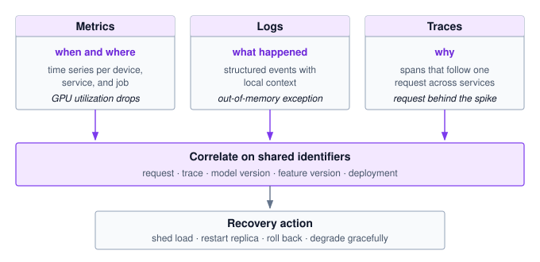

:::

Metrics are the first evidence because they compress fleet behavior into time series that can trigger action. A metric stream becomes fault-tolerance infrastructure only when an alert maps to a recovery decision. High p99 latency may trigger load shedding, a falling cache hit rate may trigger fallback features, and a sudden prediction-distribution shift may block a rollout before it corrupts user-facing decisions.

Logs provide the event context that a metric intentionally discards. Structured logging\index{Structured logging!JSON format} uses formats such as JavaScript Object Notation (JSON) with consistent fields, so incident tooling can search by service, request, model version, GPU, feature store, or trace identifier. A GPU memory allocation failure logged this way records both the local failure context and the trace identifiers needed to connect the event to distributed metrics and spans (@lst-structured-log-entry).

::: {#lst-structured-log-entry lst-cap="**Structured JSON Log Entry**: A structured log entry for a GPU memory allocation failure, including trace and span identifiers for correlation with distributed traces and resource metrics for diagnosis."}

```{.json}
{
  "timestamp": "2024-01-15T10:23:45.123Z",
  "level": "ERROR",
  "service": "inference-server",
  "trace_id": "abc123",
  "span_id": "def456",
  "message": "GPU memory allocation failed",
  "gpu_id": 3,
  "requested_bytes": 4294967296,
  "available_bytes": 2147483648
}
```

:::

For fault tolerance, the important logging property is consistent correlation rather than the particular backend. Log levels should map incidents to escalation consistently across components, but the recovery system depends more on whether operators can query events by the same request, trace, model version, feature version, and deployment identifiers that appear in metrics and spans. Log aggregation is therefore useful because it preserves the join between local failure context and fleet-wide symptoms.

Traces show where latency or failure propagated across distributed components. A trace\index{Distributed tracing!trace} is the end-to-end journey of a request, a span\index{Distributed tracing!span} is one operation within that journey, and context propagation\index{Distributed tracing!context propagation} carries the trace identity across service boundaries. A trace through an ML inference pipeline illustrates how these spans compose:

```text
Trace: user-request-12345
|-- Span: api-gateway (5 ms)
|   `-- Span: auth-service (2 ms)
|-- Span: feature-service (15 ms)
|   |-- Span: user-feature-lookup (8 ms)
|   `-- Span: item-feature-lookup (12 ms)
|-- Span: inference-service (45 ms)
|   |-- Span: preprocessing (3 ms)
|   |-- Span: model-inference (40 ms)
|   `-- Span: postprocessing (2 ms)
`-- Span: response-formatting (1 ms)
Total: 66 ms
```

Standard distributed tracing\index{Distributed tracing!observability} APIs such as OpenTelemetry carry this context across services, and a tracing backend stores and visualizes the traces. The durable requirement is not the particular backend but enough preserved context to answer whether the fault lives in request routing, feature retrieval, model execution, postprocessing, or a dependency outside the model service.

### ML-specific debugging {#sec-fault-tolerance-reliability-reliability-mlspecific-debugging-27d5}

Operational signals alone are not enough when a process stays healthy while its tensors, inputs, or per-rank execution times drift outside the model's contract. ML systems therefore add specialized debugging across three surfaces: numerical health inside the computation, semantic validity across the data pipeline, and straggler attribution across distributed stages.

#### Numerical debugging {#sec-fault-tolerance-reliability-reliability-numerical-debugging-ee2a}

Numerical debugging targets failures where tensors remain valid objects but contain invalid values. NaN detection\index{Numerical debugging!NaN detection}[^fn-nan-gradient-propagation] exposes values that can propagate through later arithmetic without a process crash. A minimal diagnostic check only flags the invalid output (@lst-nan-detection), so the caller must act on the result and block its publication.

[^fn-nan-gradient-propagation]: **NaN propagation**\index{NaN propagation!training corruption}: Many IEEE 754 arithmetic operations propagate a NaN operand, so an invalid gradient can contaminate dependent updates without stopping the process. The affected scope depends on the computation's data dependencies. Zero divided by zero and the logarithm of a negative real value produce NaNs; division of a nonzero finite value by zero or floating-point overflow can instead produce infinity, which may cause a later invalid operation. Checking only for a process crash therefore misses numerical failures.

::: {#lst-nan-detection lst-cap="**NaN Detection**: This check flags NaN output for diagnosis. The caller must block publication or choose a fallback; a logged request identifier refers to an input retained by the application for replay."}

```{.python}
# Check tensor for NaN values
# (propagate from any corrupted computation)
if torch.isnan(output).any():
    log.error("NaN detected in output", request_id=request_id)
    # Caller must retain a replayable input reference and block or replace this output
```

:::

During training, per-step gradient statistics expose numerical faults before they corrupt the entire run. Tracking the global gradient norm catches sudden explosion or vanishing, histogramming the gradient distribution flags outlier spikes, and logging layer-wise gradient norms isolates which block in the network first destabilized. Mixed-precision training[^fn-mixedprecision-fault-tolerance] can introduce related numerical issues when narrow dynamic range interacts with unstable updates. A dynamic loss scaler reduces its scale after detecting nonfinite gradients, indicating overflow or another invalid operation rather than proving underflow. Gradient magnitudes, skipped updates, and comparison with a higher-precision replay help distinguish range problems from other causes; ordinary FP16 rounding differences are not themselves faults.

[^fn-mixedprecision-fault-tolerance]: **Mixed-precision numerical issues**\index{Mixed-precision training!numerical issues}\index{Mixed-precision training!numerical fault tolerance}: FP16's exponent range is far narrower than FP32's or BF16's, which is why mixed-precision training scales the loss before backpropagation and dynamic scaling skips nonfinite updates. The formats and the mixed-precision recipe are recapped in @sec-appdx-dam-taxonomy-training-memory.

#### Data debugging and validation {#sec-fault-tolerance-data-debugging-validation}

Data bugs surface as valid-looking but wrong inputs, so debugging must verify semantic correctness at each pipeline boundary in addition to numerical validity. Validation checks expected format, shape, value ranges, required fields, and encoding before data reaches the model, catching malformed examples while the failure is still local to the input path. Once the input passes those static checks, the system needs evidence about behavior over time. Distribution monitors track feature drift, null-rate changes, and outliers as they emerge, while transformation instrumentation logs intermediate shapes and statistics so teams can compare each stage against known-good data. Together, these signals separate a corrupted input path from a numerical failure inside the model.

::: {.column-margin .margin-pointer}
↪ The validation gates and response policies that run these data checks continuously across a production fleet are developed in @sec-ml-operations-scale-data-quality-operations-e77b.
:::

#### Straggler detection and analysis {#sec-fault-tolerance-reliability-reliability-straggler-detection-analysis-6925}

Perspective \ref{psp-fault-tolerance-straggler-or-failure} treated a straggler as a slow training rank that holds up a synchronous step. The same idea extends to serving once "peer" means any component on a request's path, so straggler diagnosis there asks which replica or service stage is slow enough to become a failure-equivalent bottleneck. A slow serving replica delays requests routed to it and can trigger retries under load; its effect on the service's tail percentile depends on its traffic share and the routing policy. A request that waits for several required parallel branches is instead bounded by the last required completion. Operation-level timing\index{Straggler!timing instrumentation} instrumentation measures time for each operation, enabling latency attribution across pipeline stages. Wrapping each operation in a context manager that emits per-span timing metrics makes performance directly comparable across replicas (@lst-timing-instrumentation).

::: {#lst-timing-instrumentation lst-cap="**Operation-Level Timing**: Context manager instrumentation attributes latency to individual pipeline stages, enabling straggler detection by comparing the same span across replicas."}

```{.python}
# Wrap operations in timing context managers for latency attribution
with timer("feature_lookup"):
    features = feature_store.lookup(
        ids
    )  # Often the latency bottleneck
with timer("model_inference"):
    predictions = model(features)  # Host submission time for asynchronous GPU work
```

:::

For asynchronous GPU execution, the host span around `model(features)` in @lst-timing-instrumentation measures only the CPU time required to enqueue kernels onto the GPU stream, not completed device work. Because kernel launches return to the host before the GPU finishes executing them, a naive host timer can report a fast inference span even on a thermally throttled GPU and misattribute the delay to whichever later stage first synchronizes the stream or copies predictions back to host memory. Measuring actual GPU execution time requires recording hardware events on the stream before and after the forward pass and reading their elapsed time after the stream completes. Like-for-like component timing is then compared across replicas with percentile analysis: p50 shows typical performance, while p99 shows tail latency, and comparing p99 across replicas identifies workers whose slow path has become a fleet-wide bottleneck. The diagnosis must then separate the causes that share this slow-worker symptom, which include the gray-failure causes of @sec-fault-tolerance-reliability-reliability-distinguishing-stragglers-failures-285d and data skew, in which some inputs are slower to process.

### Serving failure patterns {#sec-fault-tolerance-reliability-reliability-common-failure-patterns-3306}

Serving failures require a symptom-to-action mapping under much tighter latency constraints than the training-loss signatures of @sec-fault-tolerance-reliability-reliability-failure-detection-mechanisms-efed. Common serving symptoms differ both in what each one reveals and in what the serving system must do first (@tbl-serving-failure-response-map). Cascade failures are hardest to diagnose because the root cause is obscured by the secondary timeouts and retries it generates, as example \ref{exmp-fault-tolerance-diagnosing-cascade-failure} traces across metrics, logs, and spans.

| **Symptom**                | **Likely interpretation**                                                               | **Immediate response**                                                                         |
|:---------------------------|:----------------------------------------------------------------------------------------|:-----------------------------------------------------------------------------------------------|
| Latency spikes             | Resource contention, garbage collection, cold caches, or model reloads                  | Check placement and capacity; repeated spikes usually mean the problem is no longer transient. |
| Rising error rates         | Dependency failure, data-format change, or model bug                                    | Investigate immediately because errors compound across dependent services.                     |
| Silent quality degradation | Model drift, feature degradation, or data-pipeline fault                                | Use quality monitoring beyond standard operational metrics.                                    |
| Cascade failure            | Timeout exhaustion, resource depletion, or error propagation from one failing component | Trip circuit breakers and preserve isolation boundaries before the failure spreads.            |

: **Serving Failure Response Map**: Serving incidents must be classified quickly because every diagnosis competes with a user-facing latency budget. The table ties each symptom to the first operational response rather than treating all serving failures as generic errors. {#tbl-serving-failure-response-map}

::: {#exmp-fault-tolerance-diagnosing-cascade-failure .callout-example title="Diagnosing a cascade failure"}

**Scenario**: A recommendation system experiences sudden latency spikes.

**Diagnosis**: The three observability pillars narrow the failure path. Metrics\index{Metric!observability} reveal the symptom: p99 latency jumped from 45 ms to 800 ms at 14:32, with error rate increasing from 0.1 percent to 15 percent. Traces\index{Trace!observability} locate the delay in the feature-service span, which consumes 700 ms instead of the normal 12 ms, while model inference remains at 40 ms. Logs\index{Log!observability} show repeated connection timeouts to the user embedding cache at 14:31, followed by requests bypassing the cache and reaching the embedding database directly. That evidence identifies cache unavailability and increased downstream demand; it does not yet distinguish a failed cache process from a network or resource problem.

**Systems lesson**: Cache unavailability can transfer enough demand to overwhelm the embedding database. A circuit breaker and a validated default-embedding path can limit that cascade while diagnosis continues. The fallback must also respect the quality budget and avoid sending the rejected demand to another saturated dependency.

:::

Observability and diagnostic maps help operators isolate a failure once it strikes, but verifying that detectors, circuit breakers, and recovery paths actually hold under fire requires triggering those failures deliberately before production traffic meets them.

## Fault Injection Tools and Frameworks {#sec-ft-fault-injection-tools-frameworks}

An injected failure is useful evidence only when it resembles the production failure the system must survive. A multi-node training cluster that claims to tolerate network partitions should have that connection severed in a staging environment so engineers can observe what the orchestration layer does. Fault injection\index{Fault injection!testing discipline}\index{Fault injection!tools and frameworks} is the engineering discipline of deliberately perturbing a system to empirically verify that robustness mechanisms work before production traffic discovers the gap. Fault-injection tools for tensors and accelerators cover bit flips, corrupted tensor values, and accelerator-oriented failures [@chen2020tensorfi; @tsai2021; @grafe2023], while network partitions, latency injection, dependency termination, and API-response faults belong to chaos and distributed-systems testing practice [@basiri2016].

An injection experiment is evidence only at the level where it injects. Its fault model\index{Fault model!abstraction} names the originating disturbance, such as a transient single-bit upset or a permanent multi-bit defect, and its error model\index{Error model!propagation} names the corrupted state that results. Results for transient single-bit faults therefore do not establish resilience to permanent multi-bit defects [@sangchoolie2017]. The injection level also decides which masking the experiment includes. Hardware absorbs many physical disturbances before software sees them, in unused units, overwritten values, and dead instructions [@mohanram2003; @ko2021]. Hardware-based injection through field-programmable gate array (FPGA) emulation or particle-beam exposure [@velazco2010] passes through that masking, while software tools such as PyTorchFI\index{PyTorchFI!fault injection} [@mahmoud2020] perturb weights, activations, and gradients directly. They cover many model states quickly, but by skipping the masking they can overstate how often a physical fault corrupts the model. Frameworks such as Fidelity\index{Fidelity!fault injection framework} [@he2020fidelity] narrow that abstraction gap\index{Fault injection!abstraction gap} by mapping hardware faults to the software-visible errors they produce. A tensor mutation still tests how the software responds to a corrupted value; on its own, it does not estimate production vulnerability.

For fleet recovery, the most valuable experiments inject faults at the level where recovery decisions are made. Killing a rank in the middle of a collective or delaying its heartbeat past the timeout exercises the detection layers of @sec-fault-tolerance-reliability-reliability-failure-detection-mechanisms-efed. Partitioning a node from the rendezvous service exercises the membership and fencing rules of @sec-fault-tolerance-reliability-reliability-recovery-procedures-002d. Corrupting one checkpoint shard exercises the manifest check of @sec-fault-tolerance-reliability-reliability-distributed-checkpointing-5dcc. Each of these experiments tests one row of @tbl-software-faults-summary-ft. Running these experiments continuously in staging, and in controlled form in production, keeps rarely executed recovery code from decaying between real incidents [@basiri2016]. A recovery path is trustworthy only for the fault model it has been exercised against, which is why the case studies that follow report both the failures production fleets met and the machinery that absorbed them.

## Case Studies {#sec-fault-tolerance-reliability-reliability-case-studies-927f}

```{python}
#| echo: false
#| label: opt175b-case-study
# ┌─────────────────────────────────────────────────────────────────────────────
# │ OPT-175B CASE STUDY (LEGO)
# ├─────────────────────────────────────────────────────────────────────────────
# │ Context: Case-studies opener and
# │          @sec-fault-tolerance-reliability-reliability-largescale-llm-training-fault-tolerance-f4aa.
# │
# │ Goal: Pin the OPT-175B run's reported cluster size, restart counts, host
# │       churn, and sustained throughput to Literature.TrainingRuns.
# │ Show: 992 GPUs; at least 35 manual and ~70 automatic restarts; >100 hosts;
# │       147 TFLOP/s per A100, about 47 percent of A100 dense FP16 peak.
# │ How:  Literature.TrainingRuns.Opt175B*; fraction = 147 / A100 peak_flops.
# └─────────────────────────────────────────────────────────────────────────────
from mlsysim import Hardware, Literature
from mlsysim.fmt import check, fmt, fmt_percent

class Opt175BCaseStudy:
    # ┌── 1. LOAD (Constants) ──────────────────────
    gpus = float(Literature.TrainingRuns.Opt175BGpus)
    manual_restarts = float(Literature.TrainingRuns.Opt175BManualRestarts)
    auto_restarts = float(Literature.TrainingRuns.Opt175BAutomaticRestarts)
    hosts_cycled = float(Literature.TrainingRuns.Opt175BHostsCycled)
    tflops_per_gpu = float(Literature.TrainingRuns.Opt175BTflopsPerGpu)
    a100_peak_tflops = Hardware.Cloud.A100.compute.peak_flops.to(TFLOPs / second).magnitude

    # ┌── 2. EXECUTE (The Compute) ─────────────────
    peak_fraction = tflops_per_gpu / a100_peak_tflops

    # ┌── 3. GUARD (Invariants) ────────────────────
    check(0.45 < peak_fraction < 0.50, "prose says 'near 50 percent of FP16 peak'")
    check(manual_restarts < auto_restarts, "paper: more automatic than manual restarts")

    # ┌── 4. OUTPUT (Formatting) ───────────────────
    gpus_str = fmt(gpus, precision=0)
    manual_restarts_str = fmt(manual_restarts, precision=0)
    auto_restarts_str = fmt(auto_restarts, precision=0)
    hosts_cycled_str = fmt(hosts_cycled, precision=0)
    tflops_per_gpu_str = fmt(tflops_per_gpu, precision=0)
    peak_fraction_str = fmt_percent(round(peak_fraction * 100) / 100, precision=0, style="prose")
```

Training a 175-billion-parameter language model across `{python} Opt175BCaseStudy.gpus_str` GPUs for two months, keeping a 4,096-chip supercomputer slice routable despite daily hardware faults, and serving low-latency recommendations across dozens of microservices each stress a different layer of the fault-tolerance stack. Public operational reports from Meta, Google, and Netflix show how production fleets combine failure detection, state preservation, topology reconfiguration, and chaos testing at scale. Their reported numbers are operational magnitudes that expose the design pressure on each system rather than universal hardware constants.

### Large-scale LLM training at Meta {#sec-fault-tolerance-reliability-reliability-largescale-llm-training-fault-tolerance-f4aa}

Over two months of training the Open Pre-trained Transformer (OPT-175B) on `{python} Opt175BCaseStudy.gpus_str` NVIDIA A100 GPUs, Meta's engineering team reported at least `{python} Opt175BCaseStudy.manual_restarts_str` manual restarts and estimated `{python} Opt175BCaseStudy.auto_restarts_str` or more automatic restarts triggered by hardware failures including ECC memory errors, NCCL and InfiniBand network faults, and lost GPUs [@zhang2022opt]. Alongside these restarts, more than `{python} Opt175BCaseStudy.hosts_cycled_str` hosts were cycled [@zhang2022opt; @opt2022logbook]. Numerical instability created a separate recovery problem. These counts establish repeated interruption, but cycling hosts and restarting jobs are different events; their totals do not directly measure one common MTBF. The recovery design had to preserve progress while distinguishing failed execution resources from suspect optimization state.

During the OPT run, the team monitored progress through train-log freshness checks. The public logbook records a 15-minute modified-file threshold, later relaxed to one hour, as part of restart monitoring [@opt2022logbook]. For a hang that raised no error, this threshold contributed to $\FailureDetectionTime$; polling and response delays could extend the wait before restart. The logbook illustrates the trade-off of @eq-timeout-calculation in operational form, since relaxing the threshold reduced sensitivity to delayed logs while allowing longer idle windows.

Recovery procedures also had to account for loss spikes associated with numerical instability. Unlike a fail-stop event, this symptom made recent model state suspect without identifying a failed device. The team combined rollback to an earlier checkpoint with a lower learning rate to recover from divergence [@opt2022logbook]. The paper separately reports approximately `{python} Opt175BCaseStudy.tflops_per_gpu_str` TFLOP/s per A100 (about `{python} Opt175BCaseStudy.peak_fraction_str` of dense FP16 peak) [@zhang2022opt]; that execution-rate metric alone does not establish end-to-end useful throughput after interruptions and replay. The enduring lesson is the distinction between recovery paths. A failed device calls for replacement and restoration of valid state, while numerical divergence can require an older checkpoint and a changed optimization policy. Retaining checkpoint history makes that second path possible.

### Google TPU pod resilience {#sec-fault-tolerance-reliability-reliability-google-tpu-pod-resilience}

```{python}
#| echo: false
#| label: tpuv4-pod-cubes
# ┌─────────────────────────────────────────────────────────────────────────────
# │ TPUv4 POD CUBES (LEGO)
# ├─────────────────────────────────────────────────────────────────────────────
# │ Context: @sec-fault-tolerance-reliability-reliability-google-tpu-pod-resilience.
# │
# │ Goal: Derive the pod's cube count from the registry pod size.
# │ Show: 4,096 chips as 64 cubes of 64 chips; one chip = 1/4096 of capacity.
# │ How:  Systems.Pods.TPUv4_4096.chips / cube size (4x4x4, architectural constant).
# └─────────────────────────────────────────────────────────────────────────────
from mlsysim import Systems
from mlsysim.fmt import check, fmt, fmt_math

class TpuV4PodCubes:
    # ┌── 1. LOAD (Constants) ──────────────────────
    pod_chips = Systems.Pods.TPUv4_4096.chips
    cube_chips = 4 * 4 * 4  # 4x4x4 cube, the OCS-switched building block [@zu2024tpuv4]

    # ┌── 2. EXECUTE (The Compute) ─────────────────
    n_cubes = pod_chips // cube_chips

    # ┌── 3. GUARD (Invariants) ────────────────────
    check(n_cubes * cube_chips == pod_chips, "pod must be a whole number of cubes")

    # ┌── 4. OUTPUT (Formatting) ───────────────────
    pod_chips_str = fmt(pod_chips, precision=0)
    n_cubes_str = fmt(n_cubes, precision=0)
    cube_chips_str = fmt(cube_chips, precision=0)
    chip_share_math = fmt_math(rf"1/{pod_chips}")
```

Google's TPUv4 supercomputer combines configurable topology with recovery software. A pod contains `{python} TpuV4PodCubes.pod_chips_str` chips organized as `{python} TpuV4PodCubes.n_cubes_str` cubes of `{python} TpuV4PodCubes.cube_chips_str` chips, each arranged in a $4{\times}4{\times}4$ 3D mesh [@zu2024tpuv4]. Losing one chip removes `{python} TpuV4PodCubes.chip_share_math`th of pod capacity, but can interrupt an entire job that requires that participant. The recovery unit therefore exceeds the failed device.

War story \ref{ws-fault-tolerance-google-tpuv4-routing} traced the recovery mechanism, in which the OCS fabric assembles healthy cubes into job-sized slices, reallocating spare cubes after machine outages and routing around unavailable links for supported OCS outage patterns. The published study adds the software that runs that loop, components including `libtpunet` and `healthd` for topology setup and health monitoring. It also gives the operating statistics that show how often the loop runs. System availability was 99.98 percent, with hardware outages affecting approximately 1 percent of training jobs [@zu2024tpuv4]. Daily failure rates were 0.08 percent of TPU machines, 0.005 percent of ICI cables, and 0.04 percent of OCS units. Small daily fractions still add up across thousands of components, so the control plane absorbs a steady stream of reconfiguration events rather than an occasional emergency. The architectural lesson is to match each failure boundary to a feasible replacement or routing mechanism.

### Netflix chaos engineering for serving dependencies {#sec-fault-tolerance-reliability-reliability-netflix-chaos-engineering}

While training resilience focuses on long-running batch jobs, Netflix's published work on Chaos Engineering\index{Chaos engineering!serving resilience} [@basiri2016] provides the serving-side contrast, and it is the production origin of the injection discipline that @sec-ft-fault-injection-tools-frameworks applied to training. The premise is simple but operationally demanding. Because production systems have many interacting dependencies, teams should validate steady-state behavior by deliberately injecting failures instead of waiting for real incidents to discover whether fallbacks work.

For ML serving, the same discipline applies to feature stores, model-serving dependencies, caches, and fallback paths. A model endpoint can be healthy while a feature service is slow, stale, or unavailable; if the system lacks a tested fallback, a local dependency problem can become user-visible latency or degraded recommendations. Chaos tests make those assumptions executable by injecting latency, terminating dependencies, or forcing fallback paths in controlled conditions.

The recovery procedure for these injected faults centers on fallback hierarchies. If the primary deep learning model fails or times out, the serving system can switch to a lighter model, cached response, or simple popularity-based default. The systems lesson is that resilience in ML serving is not a static property but a continuous practice of active verification. A fallback path that is never exercised is documentation, not fault tolerance.

Across these production case studies, three architectural patterns recur. First, detection speed\index{Fault tolerance!detection speed} belongs in the recovery budget. Meta's log-freshness threshold and Google's health monitors determine when recovery can begin, while Netflix's chaos experiments test detection and fallback for selected dependency failures. Checkpoint age and replication lag separately govern recoverable state. Second, the atomic unit of failure\index{Failure domain!atomic unit of failure} shapes the architecture. Google combines cube replacement with fault-tolerant routing, the OPT run restarted from durable checkpoints and kept their history for numerical rollback, and Netflix validates service-dependency fallbacks. Third, fault tolerance is a spectrum\index{Fault tolerance!spectrum} rather than a switch. Exact state recovery trades normal-operation overhead against lost work and recovery time; graceful degradation additionally trades service capability against continued availability. Those distinct trade-offs help identify the misconceptions that follow.

## Fallacies and Pitfalls {#sec-fault-tolerance-reliability-reliability-fallacies-pitfalls-74b8}

An infrastructure team might spend weeks hardening their storage layer against disk failures, only to have their entire training run destroyed by a subtle software bug in their PyTorch distributed backend. Fault tolerance for distributed ML systems involves counterintuitive mathematics and subtle trade-offs where conventional data center wisdom often fails. Recognizing the fallacies and pitfalls below prevents engineers from optimizing for the wrong failure modes before the chapter closes with a synthesis of its core quantitative rules.

::: {.fallacy-pitfall}

**Fallacy**: *Hardware failures are the main concern.*

This intuition comes from traditional systems where disk failures, power outages, and network partitions dominate, whereas in ML systems hardware failures are only one part of a broader incident mix. Long-lived, stateful ML jobs expose failure paths that hardware redundancy cannot cover. A malformed checkpoint path can make recovery impossible, a mismatched collective library can hang all ranks, an undersized shared-memory limit can crash data loaders, and a stale feature schema can silently corrupt training. Their relative frequency depends on the deployment, but even an infrequent software or configuration fault can destroy the same multi-day job that hardware redundancy was meant to protect. Investing heavily in hardware redundancy while neglecting software robustness (input validation, gradual rollouts, configuration management) leaves many important failure modes unaddressed, which is why the most reliable ML systems treat software bugs as inevitable and design defensively.

:::

::: {.fallacy-pitfall}

**Pitfall**: *Setting checkpoint interval by intuition.*

```{python}
#| echo: false
#| label: young-daly-intuition-fallacy
# ┌─────────────────────────────────────────────────────────────────────────────
# │ YOUNG-DALY INTUITION FALLACY (LEGO)
# ├─────────────────────────────────────────────────────────────────────────────
# │ Context: @sec-fault-tolerance-reliability-reliability-fallacies-pitfalls-74b8
# │          ("Setting checkpoint interval by intuition") — the display equation
# │          and the slower-storage follow-up sentence.
# │
# │ Goal: Reproduce the two Young-Daly optimal intervals from a hypothetical
# │       1,000-GPU cluster at the chapter's own MTBF so the "intuition is
# │ Show: tau_opt = sqrt(2 * T_write * MTBF) for a 5-minute and a 15-minute write.
# │ How:  Work in minutes; tau = sqrt(2 * write_min * mtbf_min); round to whole
# │       minutes for display.
# │
# └─────────────────────────────────────────────────────────────────────────────
import math
from mlsysim import Systems
from mlsysim.core.units import minute
from mlsysim.fmt import check, fmt_display_math, fmt_int, fmt_time

class YoungDalyIntuitionFallacy:
    # ┌── 1. LOAD (Constants) ──────────────────────
    # The 1,000-GPU row of the chapter's cluster-MTBF table, plus two write times.
    cluster_gpus = ClusterMtbfScaling.sizes[3]  # the 1,000-GPU row of @tbl-cluster-mtbf-scaling (scenario sweep)
    mtbf_min = round(float(Systems.Reliability.Gpu.mttf_hours) / cluster_gpus * 60)  # cluster MTBF, minutes
    write_fast_min = 5  # checkpoint write time, fast storage
    write_slow_min = 15  # checkpoint write time, slower storage / larger model

    # ┌── 2. EXECUTE (The Compute) ─────────────────
    arg_fast = 2 * write_fast_min * mtbf_min
    tau_fast_min = math.sqrt(arg_fast)
    tau_slow_min = math.sqrt(2 * write_slow_min * mtbf_min)

    # ┌── 3. GUARD (Invariants) ────────────────────
    check(165 < tau_fast_min < 180, "5-minute write at 50 h MTBF should give a ~173-minute interval")
    check(tau_slow_min > tau_fast_min, "slower storage must lengthen the optimal interval")

    # ┌── 4. OUTPUT (Formatting) ───────────────────
    tau_opt_fast_eq_math = fmt_display_math(
        rf"T^\ast_{{\text{{ckpt}}}} = \sqrt{{2 \times {write_fast_min} \times {mtbf_min}}} = "
        rf"\sqrt{{{arg_fast}}} \approx {fmt_int(round(tau_fast_min))} \text{{ minutes}}"
    )
    tau_opt_slow_min_str = fmt_time(round(tau_slow_min) * minute, minute, precision=0, commas=False, style="word")
    mtbf_h_str = fmt_time(mtbf_min / 60, "hour", precision=0, commas=False, style="word")
    write_fast_str = fmt_time(write_fast_min * minute, minute, precision=0, commas=False, style="word")
    write_fast_attr_str = fmt_time(write_fast_min * minute, minute, precision=0, commas=False, style="word", attributive=True)
    write_slow_str = fmt_time(write_slow_min * minute, minute, precision=0, commas=False, style="word")
```

Organizations commonly set checkpoint intervals based on "feels right": "every hour seems reasonable" or "every 1,000 steps." The Young-Daly formula reveals these intuitions are often wrong. For the `{python} ClusterMtbfScaling.n3_str`-GPU cluster of @tbl-cluster-mtbf-scaling, whose GPU-only MTBF is `{python} YoungDalyIntuitionFallacy.mtbf_h_str`, with a checkpoint write time of `{python} YoungDalyIntuitionFallacy.write_fast_str`:

`{python} YoungDalyIntuitionFallacy.tau_opt_fast_eq_math`

The intuitive "every hour" checkpoints nearly three times more often than the expected-waste optimum. It reduces potential lost work, but the added write overhead outweighs that benefit under this model. A tighter RPO can still justify the shorter interval. The same hourly policy was too infrequent in the Young-Daly notebook, and both verdicts follow from one rule. The optimum scales as $\sqrt{\CheckpointWriteTime \cdot \SystemMtbf}$, so an hour is too long when a `{python} YoungDalyOptimal.t_write_s_str` write meets a full-system MTBF of `{python} YoungDalyOptimal.mtbf_h_str`, yet too short when a `{python} YoungDalyIntuitionFallacy.write_fast_attr_str` write meets a GPU-only MTBF of `{python} YoungDalyIntuitionFallacy.mtbf_h_str`. If checkpoint time increases to `{python} YoungDalyIntuitionFallacy.write_slow_str` (larger model, slower storage), the optimal interval stretches to `{python} YoungDalyIntuitionFallacy.tau_opt_slow_min_str`, further still from the "every 15 minutes" that some teams adopt to "stay safe." The decision must balance expected waste with the recovery contract rather than treat either interval as universally correct.

:::

::: {.fallacy-pitfall}

**Fallacy**: *Component MTTF values predict individual failure timing.*

```{python}
#| echo: false
# ┌── LEGO ───────────────────────────────────────────────
# │ Context: Fallacy — component MTTF values predict individual failure timing.
from mlsysim import Systems
from mlsysim.fmt import check, fmt, fmt_count, fmt_math, fmt_time

class FleetReliabilityFallacyRates:
    gpu_mttf_h = float(Systems.Reliability.Gpu.mttf_hours)
    fleet_gpus = Systems.Clusters.Training_10K.total_accelerators
    fleet_rate_per_h = fleet_gpus / gpu_mttf_h
    hours_between = 1 / fleet_rate_per_h

    check(abs(hours_between * fleet_rate_per_h - 1) < 1e-9, "interval must be reciprocal of fleet rate")

    _fleet_tex = fmt(fleet_gpus, precision=0).replace(",", "{,}")
    _mttf_tex = fmt(gpu_mttf_h, precision=0).replace(",", "{,}")
    # ┌── 4. OUTPUT (Formatting) ─────────────────────────────────────────────
    gpu_mttf_str = fmt_time(gpu_mttf_h, "hour", precision=0, commas=True, style="word")
    fleet_gpus_str = fmt_count(fleet_gpus, label="GPU")
    fleet_rate_eq_math = fmt_math(f"{_fleet_tex}/{_mttf_tex} = {fmt(fleet_rate_per_h, precision=1, commas=False)}")
    hours_between_str = fmt_time(hours_between, "hour", precision=0, commas=False, style="word")
```

Engineers read a GPU MTTF of `{python} FleetReliabilityFallacyRates.gpu_mttf_str` and plan around a five-year replacement cadence per device. MTTF is a population mean, not a lifetime assigned to each component. A GPU with MTTF `{python} FleetReliabilityFallacyRates.gpu_mttf_str` might fail at 200 hours or last 100,000 hours. Under the chapter's independent constant-rate model, a fleet of `{python} FleetReliabilityFallacyRates.fleet_gpus_str` has an aggregate rate of approximately `{python} FleetReliabilityFallacyRates.fleet_rate_eq_math` failures per hour, or roughly one failure every `{python} FleetReliabilityFallacyRates.hours_between_str`. This planning model helps size recovery capacity and spare pools. It does not make device-health monitoring pointless: temperature, error history, and recurring anomalies provide condition-specific evidence that the population mean alone lacks.

:::

::: {.fallacy-pitfall}

**Pitfall**: *Using MTBF calculations as if failures were independent.*

The reliability equation $\SystemMtbf = \ComponentMttf/\RequiredComponentCount$ assumes component failures are statistically independent, while production failures correlate through the shared power, switches, software, and cooling of @sec-fault-tolerance-reliability-reliability-correlated-failures-95e8.

```{python}
#| echo: false
#| label: correlated-failure-pitfall
# ┌─────────────────────────────────────────────────────────────────────────────
# │ CORRELATED FAILURE PITFALL (LEGO)
# ├─────────────────────────────────────────────────────────────────────────────
# │ Context: Pitfall "Using MTBF calculations as if failures were independent."
# │
# │ Goal: Show how a correlated hazard 10x the independent rate collapses MTBF.
# │ Show: 1,000 GPUs x 50,000-hour MTBF -> 50 h; adding a 10x hazard -> ~5 h.
# │ How:  MTBF = MTTF / N; combined rate = (1 + 10) x independent rate.
# └─────────────────────────────────────────────────────────────────────────────
from mlsysim import Systems
from mlsysim.fmt import check, fmt, fmt_time

class CorrelatedFailurePitfall:
    # ┌── 1. LOAD (Constants) ──────────────────────
    gpu_mttf_h = float(Systems.Reliability.Gpu.mttf_hours)
    cluster_gpus = ClusterMtbfScaling.sizes[3]  # the 1,000-GPU row of @tbl-cluster-mtbf-scaling (scenario sweep)
    hazard_multiple = 10  # scenario assumption: correlated hazard 10x the independent rate

    # ┌── 2. EXECUTE (The Compute) ─────────────────
    independent_mtbf_h = gpu_mttf_h / cluster_gpus
    effective_mtbf_h = 1 / ((1 + hazard_multiple) / independent_mtbf_h)

    # ┌── 3. GUARD (Invariants) ────────────────────
    check(4.0 < effective_mtbf_h < 5.0, "prose says the effective incident MTBF drops to 'about 5 hours'")

    # ┌── 4. OUTPUT (Formatting) ───────────────────
    cluster_gpus_str = fmt(cluster_gpus, precision=0)
    gpu_mttf_attr_str = fmt_time(gpu_mttf_h, "hour", precision=0, commas=True, style="word", attributive=True)
    independent_mtbf_str = fmt_time(independent_mtbf_h, "hour", precision=0, style="word")
    effective_mtbf_str = fmt_time(round(effective_mtbf_h), "hour", precision=0, style="word")
```

Correlated failures change two quantities that the simple MTBF equation hides: incident frequency and blast radius. A cluster with `{python} CorrelatedFailurePitfall.cluster_gpus_str` independent GPUs each with `{python} CorrelatedFailurePitfall.gpu_mttf_attr_str` MTTF has a first-GPU-failure MTBF of `{python} CorrelatedFailurePitfall.independent_mtbf_str`. If a shared power, cooling, or software hazard adds an incident rate 10 times larger than that independent first-failure rate, the effective incident MTBF drops to about `{python} CorrelatedFailurePitfall.effective_mtbf_str`. Separately, a correlated incident may take out 10 GPUs at once, increasing recovery cost even if the independent GPU failure rate itself has not changed. Reliability engineering must identify and mitigate correlation through diversity: different power feeds, different network paths, different software versions in canary deployments.

:::

::: {.fallacy-pitfall}

**Fallacy**: *Every failure should be handled as a full restart.*

Engineers often treat all failures as "node crashed, restart from checkpoint," but different failure modes require different responses. Transient stalls such as network congestion can permit a bounded wait or safe retry when state and the communication group remain valid; a brief fault can still require recovery if it corrupts state or leaves the group unusable. Permanent device loss requires replacement or a feasible resize, together with restoration of the missing state. Silent corruption requires a trusted recovery point, which may precede the latest checkpoint and therefore motivates checkpoint history retention. Persistent resource exhaustion (OOM, memory fragmentation) needs reconfiguration before restart; otherwise the job can crash again immediately. As @sec-fault-tolerance-reliability-reliability-failure-taxonomy-e78c details, misdiagnosing failure type wastes compute. Restarting for a harmless stall discards useful work, while continuing from corrupted state can contaminate later updates.

:::

::: {.fallacy-pitfall}

**Pitfall**: *Assuming checkpoints are consistent without validating state.*

Modern frameworks checkpoint transparently, creating the illusion of automatic consistency. In practice, distributed checkpoints require cross-node coordination that can fail subtly across multiple dimensions. Rank desynchronization\index{Checkpoint consistency!rank desynchronization} occurs when workers record different training steps, such as rank 0 snapshotting iteration 1000 while rank 1 captures iteration 1001. Similarly, transient storage failures can cause partial writes\index{Checkpoint consistency!partial writes} that leave behind truncated shards, sharded optimizer state lag\index{Optimizer!state lag} leaves optimizer states misaligned with model weights when captured asynchronously, and in-flight gradients\index{Checkpoint consistency!in-flight gradients} from incomplete AllReduce operations can produce ambiguous reduction boundaries. Production systems must therefore implement checkpoint validation: verify all shards exist, verify iteration numbers match, and verify optimizer state matches model state. The reason is that organizations that discover corrupted checkpoints during recovery from a failure have no recourse except restarting from a potentially much earlier checkpoint.

:::

::: {.fallacy-pitfall}

**Fallacy**: *Overhead budgets are fixed fractions of training time.*

Reference tables that show "pipeline bubble: 10 percent, checkpoint overhead: 5 percent, failure recovery: 3 percent" are easy to read as physical laws and pass through as line items in capacity plans. They are engineering targets, not constants. Pipeline bubble overhead depends on the number of microbatches and the interleaved schedule, as its bubble fraction shows (@sec-distributed-training-systems-systems-pipeline-parallelism-8748). Elastic recovery can reduce waiting for replacement capacity while still restarting workers and restoring state. Checkpoint overhead is a function of model size, storage bandwidth, and whether checkpointing is synchronous or asynchronous. Treating these numbers as fixed percentages leads to passive acceptance of avoidable inefficiency, because each one is set by a design choice.

:::

::: {.fallacy-pitfall}

**Pitfall**: *Using elastic training as a substitute for checkpointing.*

Elastic training adjusts parallelism degree when workers fail, but resizing still requires a consistent recovery state. Reducing the active worker count requires redistributing model shards, optimizer states, and data assignments, often through checkpoint reload. Below some minimum viable size, training becomes infeasible because the model no longer fits or the batch policy cannot be maintained; the job must wait for sufficient capacity before restoring. If a failure was caused by a software bug triggered by specific data, the bug persists in remaining workers. Elastic training is complementary to checkpointing, not a replacement. Resizing alone does not justify a lower checkpoint frequency, because the recovery contract, failure rate, and checkpoint cost still determine that choice.

:::

::: {.fallacy-pitfall}

**Fallacy**: *Silent data corruption is negligible because hardware has ECC.*

GPUs and memory systems include extensive error correction\index{ECC!end-to-end limitation} (ECC, CRC, parity), creating the intuition that silent data corruption is negligible. Large-scale CPU SDC and memory-error studies show that silent corruptions and memory faults still occur at fleet scale and can escape ordinary error reporting [@dixit2021silent; @sridharan2015]. ECC and link CRCs remain necessary layers, but they protect stored and transmitted bits rather than arithmetic, so they are not an end-to-end correctness proof for a training run. A 10,000-GPU cluster executes enough arithmetic that even rare per-device corruption becomes an operating condition, which is why it needs the check-and-verify defenses of @sec-ft-sdc-verification in addition to hardware protection.

:::

::: {.fallacy-pitfall}

**Pitfall**: *Adding GPUs without accounting for communication and recovery overhead.*

Capacity plans typically account for Amdahl's Law and AllReduce overhead but treat reliability as a fixed background condition. At extreme scale, each additional GPU increases the aggregate failure rate, which inflates the expected recovery and replay time per job. There exists a cluster size beyond which the time lost to failures and recovery exceeds the time saved by additional parallelism, and wall-clock training time increases rather than decreasing with $\AcceleratorCount$. This is the reliability version of diminishing returns, and it applies on top of the Amdahl ceiling, so the two effects must be modeled together. Whole-run useful goodput must count only retained progress and include recovery time in the denominator, and its reliability penalty generally grows with $\AcceleratorCount$ under the independent-failure model. @Sec-performance-engineering-goodput-factors composes that runtime loss with the scheduling and program losses without counting any of them twice.

:::

## Summary {#sec-fault-tolerance-reliability-reliability-summary-48b0}

Fault tolerance turns the statistical expectation of hardware failure into a manageable operational routine. Individual component reliability compounds across thousands of devices, driving system-level MTBF from years down to hours. At fleet scale, systems must bound lost work and recovery delay through recovery that is automatic, fast, and minimally disruptive to training or serving.

In training, progress is only as safe as the last state the fleet can prove it can restore. Checkpointing bounds lost work, and the Young-Daly interval (@eq-ft-young-daly-interval) prices that bound against write cost, shrinking only with the square root of a falling MTBF. RPO and RTO turn the expected-value optimum into a service contract. A manifest published last defines which generation exists, and fencing at the resource boundary decides who may still write to it. The retries that recovery triggers stay safe only when each operation is idempotent, inherits its caller's deadline, and draws on one shared retry budget, so the response cannot amplify the incident. Elastic recovery then trades capacity for continuity, valid only while the data, batch-size, and optimizer invariants survive the resize.

Serving inverts the budget. Training can spend minutes restoring state that satisfies its optimization contract; an interactive request has milliseconds, so serving buys availability with ready replicas and decides in advance which state it will rebuild, replicate, or abandon. The KV cache is the clearest case, derived state that can be reconstructed from retained history only when the latency budget allows. When neither redundancy nor reconstruction fits that budget, graceful degradation keeps the service useful by sacrificing a named property that was validated before the incident.

Recovery depends on evidence about both the failure and the state being restored. A loss spike can originate in hardware, data, numerical behavior, or synchronization. Suspect state can justify a pause or rollback while investigation continues; attributing the cause to a device requires corroborating telemetry, replay, or integrity evidence. Restore drills and fault injection then test whether the selected response actually preserves valid state and meets its recovery budget. Passing those tests establishes evidence for the exercised fault model, rather than a guarantee against every failure.

::: {.callout-takeaways title="Failure is normal operation"}

* **Scale makes failure routine**: A `{python} FailureCascadeExample.fleet_gpus_str`-GPU cluster\index{Failure!inevitability at scale} encounters hardware failures every few hours under the chapter's component-rate assumptions; software must treat failure as a normal state.
* **Liveness is not correctness**: A gray failure keeps answering heartbeats while every peer waits on it, and silent data corruption passes ECC while feeding wrong gradients into a correct AllReduce, so detection needs progress measurements and check-and-verify evidence beside liveness checks.
* **Recovery is a contract**: RPO bounds lost progress, RTO bounds recovery delay, MTTR combines with MTBF to determine steady-state availability, a manifest identifies committed state, and fencing prevents an expired worker epoch from writing after replacement.
* **Checkpoint cadence balances two costs**: Under the first-order assumptions, $\OptimalCheckpointInterval = \sqrt{2 \cdot \CheckpointWriteTime \cdot \SystemMtbf}$ balances checkpoint write overhead against expected rework; for the 175B running example on a `{python} YoungDalyOptimal.n_gpus_str`-GPU cluster it lands near `{python} YoungDalyOptimal.tau_opt_min_str`. The selected interval must also meet limits on lost progress; recovery delay needs its own budget.
* **Elasticity enables persistence**: Designing training jobs to be "elastic"\index{Elastic training!resilience} (rebuilding communication groups and rebalancing data shards as traced in @fig-elastic-flow) can reduce waiting for replacement capacity. The runtime must preserve valid state and data coverage, and either preserve batch size or validate the changed optimization policy. Checkpoint cadence still determines how much work must be replayed.
* **Serving recovery follows the state budget**: Preserve authoritative history, then choose reconstruction, checkpointing, or replication for derived state according to the latency contract (@tbl-stateful-failover). A ready replacement provides useful service only when it can also recover the context the request needs.
* **Degradation is a designed mode**: When recovery cannot finish inside the latency budget, a fallback validated in advance (a smaller model, cached results, default features, or shed low-priority load) keeps the service useful, provided monitoring exposes how much quality was traded away.

:::

Fault tolerance makes the cost of coordination a deliberate part of the execution budget. @Sec-appdx-c3-taxonomy-case-3 works a complete coordination-bound diagnosis, attributing a large run's lost wall time to checkpoints, failures, pipeline bubbles, and scheduling. In the Fleet Law (@eq-fleet-law), checkpoint pauses, detection timeouts, and restarts all land in the synchronization term $\SynchronizationTime(\DeviceCount)$, and in goodput accounting they are runtime losses. The chapter's mechanisms spend Coordination ($\OperationalTaxonomyDimension_3$) so that a failure does not erase completed Compute, and asynchronous checkpointing and warm restart earn their complexity by moving part of that synchronization cost into $\OverlappedTime$ or shrinking it outright. The useful comparison is between time spent preserving and validating state during normal operation and time lost reconstructing trustworthy execution after a failure. A cheaper recovery mechanism is valuable only when it still meets the workload's limits on lost progress, response delay, and degraded quality.

::: {.callout-chapter-connection title="From resilience to resource management"}

Keeping the fleet running despite inevitable hardware failures requires three layers: checkpointing preserves progress, elasticity absorbs node losses, and redundancy protects stateful serving sessions. Each layer also assumed a decision made elsewhere: a spare pool deep enough to replace a drained node, a hot spare held idle, spot capacity that may vanish, and replicas placed across independent failure domains. Those are allocation decisions, made while many jobs compete for the same fleet, from month-long training runs to hour-long experiments. A fault-tolerant cluster therefore still needs orchestration to decide which jobs run where, when to preempt, and how to share capacity fairly among them.

:::

<!-- This is here to make sure that quizzes are inserted properly before a part begins. -->

::: { .quiz-end }
:::
