# Fleet Orchestration {#sec-fleet-orchestration}

::: {layout-narrow}
::: {.column-margin}

\chapterminitoc

:::

::: {.content-visible when-format="pdf"}
\noindent
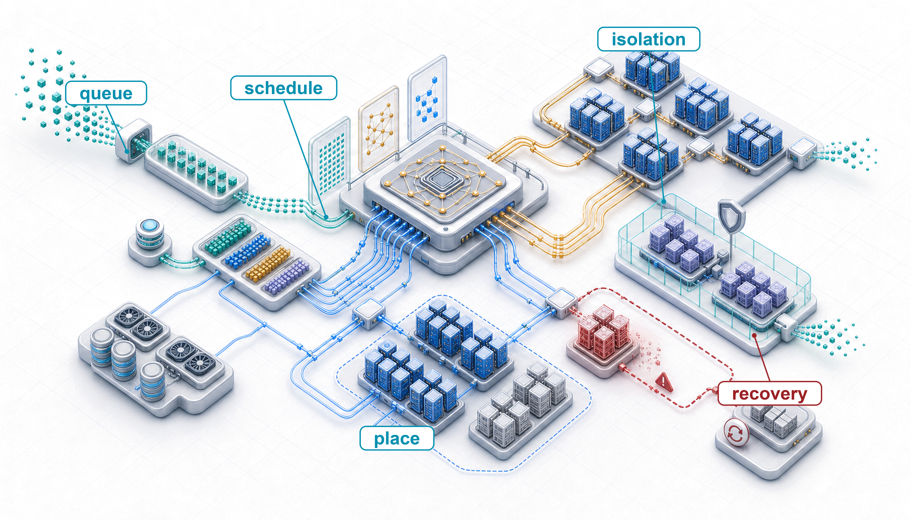{fig-alt="Scheduler control-plane blueprint where queued jobs are placed onto topology-aware accelerator capacity with preemption, recovery, and policy constraints."}
:::

::: {.content-visible unless-format="pdf"}
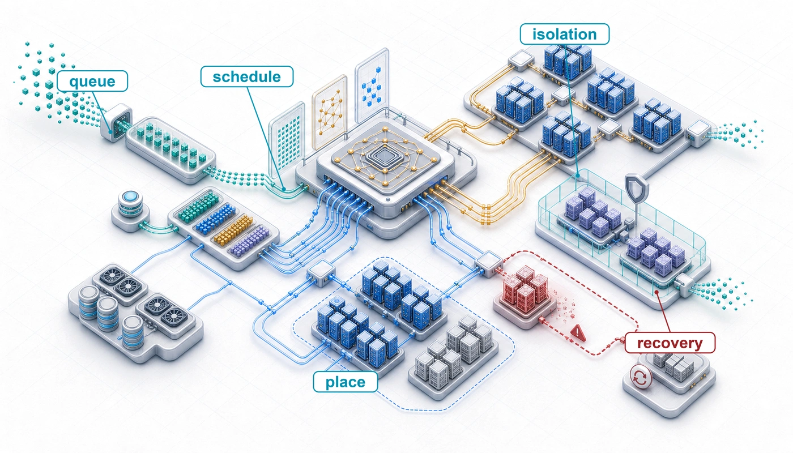{fig-alt="Scheduler control-plane blueprint where queued jobs are placed onto topology-aware accelerator capacity with preemption, recovery, and policy constraints."}
:::

:::

## Purpose {.unnumbered .unlisted}

::: {.content-visible when-format="pdf"}
\begin{marginfigure}
\mlfleetstack{25}{30}{40}{100}{35}{45}{10}{0}
\end{marginfigure}
:::

::: {.content-visible unless-format="pdf"}
::: {.column-margin}
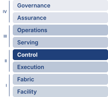{width="100%" fig-alt="Fleet Machine Learning Systems Stack"}

*Fleet stack focus for this chapter.*
:::
:::

_Why can jobs wait while expensive accelerators sit idle?_

A thousand idle accelerators still incur ownership or reservation costs while queued experiments make no progress. More hardware does not resolve that waste when available resources cannot form the groups that pending jobs need. Free devices may be scattered across machines with unsuitable connections, or several jobs may each hold resources while waiting for the rest. On one machine, improving execution usually begins with the work already running. Across a shared fleet, useful progress also depends on which work can start, how long it waits, and what other work its allocation displaces. A short experiment needs a timely result, a long training run needs continuity, and a serving workload needs capacity before requests miss their deadlines. Favoring any one claim without considering the others can leave the fleet busy while delaying the results it exists to produce. Interrupting a job can free capacity, but preserving its state and restoring progress consume time and bandwidth. Waiting for a better placement can accelerate execution while extending completion time. Fair access therefore cannot be judged from device counts alone, and high utilization cannot establish that capacity is being used well. The engineering challenge is to honor these competing claims under changing demand and uncertain resource availability, while keeping the allocation process itself reliable. In C³ terms, orchestration pays coordination overhead to turn compute and communication capacity into useful progress while preserving fairness and latency headroom.

::: {.content-visible when-format="pdf"}

\newpage

:::

::: {.callout-learning-objectives}

- Analyze scheduling objectives, fragmentation, and deadlock risks for distributed training jobs under shared fleet constraints
- Compare HPC, cloud-native, and hybrid orchestration paradigms for batch training and self-healing serving workloads
- Apply gang, bin-packing, and topology-aware placement policies across NVLink domains and switch hierarchies
- Design elastic training and preemption policies that trade throughput, recovery overhead, and spot-instance savings
- Evaluate ML-specific schedulers by their workload signals, fairness objectives, and required integration with the training runtime
- Design serving capacity, isolation, and multi-tenant quota policies that balance serving headroom, team guarantees, and borrowed capacity against training demand
- Diagnose utilization losses from quota hoarding, noisy neighbors, fragmentation, topology mismatch, and data starvation

:::

```{python}
#| echo: false
from mlsysim import *
from mlsysim.core.units import *

# ┌─────────────────────────────────────────────────────────────────────────────
# │ CHAPTER START
# ├─────────────────────────────────────────────────────────────────────────────
# │ Context: Chapter initialization and global imports
# │
# │ Why: Registers this chapter with the mlsys registry and provides shared
# │      imports for all subsequent calculation cells.
# │
# └─────────────────────────────────────────────────────────────────────────────
from mlsysim.fmt import check, fmt, fmt_int
```

```{python}
#| echo: false
#| label: fleet-setup
from mlsysim.fmt import MarkdownStr, check, fmt
```

## The Scheduling Problem {#sec-fleet-orchestration-introduction}

::: {.content-visible when-format="html:js"}
<span id="sec-fleet-orchestration-introduction"></span>
:::

Consider two research teams sharing a 1,000-GPU cluster: Team A submits a 512-GPU job that will run for a month, while Team B submits hundreds of 8-GPU experiments that each run for an hour. If the scheduler continually admits whichever jobs fit, Team B's small experiments can indefinitely block Team A's large training run. The scheduling problem is the challenge of navigating this multi-dimensional conflict between throughput, fairness, and cluster utilization.

Partitioning computation (@sec-distributed-training-systems), synchronizing it efficiently (@sec-collective-communication), and recovering from hardware failures (@sec-fault-tolerance-reliability) solve the single-job scaling problem, but each of those mechanisms assumed that the job already held its accelerators. Fault tolerance assumed more than that. Its recovery paths drew on a spare pool deep enough to replace a drained node and on spot capacity whose loss the job could absorb, and neither exists unless something outside the job grants it, holds it in reserve, or takes it back. That something is orchestration, the policy that decides which jobs run, where they run, when one is preempted for another, and how competing demands share the fleet. A useful allocation must first be feasible, then worth granting under the fleet's fairness, latency, and cost objectives. That ordering motivates the progression from admission and packing constraints to control-plane designs, topology-aware placement, elastic and cost-aware policies, schedulers built around ML workload signals, and finally the serving and multi-tenant contracts under which many owners share one fleet. Training and serving draw on the same fleet, so the capacity envelope this chapter allocates is the one both depend on; how a serving system spends its share, request by request, is the subject of @sec-inference-scale.

In the Fleet Stack (shown in the margin), orchestration occupies the Reliability & Control row of the distribution band, but the infrastructure band beneath it constrains its decisions. The scheduler must account for GPU heterogeneity, NVLink topology, rack power limits, and network bisection bandwidth. When scheduling goes wrong, debugging can require examining all four bands to identify whether the root cause lies in infrastructure (hardware constraints), distribution (algorithm limitations), serving (workload mismatch), or governance (policy misconfiguration). Orchestration connects physical infrastructure to distributed algorithms, translating resource requests into placements that respect both hardware topology and organizational policy.

```{python}
#| echo: false

# ┌─────────────────────────────────────────────────────────────────────────────
# │ CLUSTER ECONOMICS CONTEXT (LEGO)
# ├─────────────────────────────────────────────────────────────────────────────
# │ Context: @sec-fleet-orchestration-introduction
# │
# │ Goal: Provide cluster scale and economic statistics for orchestration.
# │ Show: 10,000-GPU cluster; ~$480k/day operating cost.
# │ How: Multiply GPU count, GPU-hour cost, and 24 hours.
# │
# └─────────────────────────────────────────────────────────────────────────────
from mlsysim.fmt import check, fmt, fmt_memory_capacity, fmt_percent, fmt_usd

class ClusterEconomicsContext:
    """Namespace for cluster orchestration economics."""

    # ┌── 1. LOAD (Constants) ──────────────────────────────────────────────
    from mlsysim import Hardware, Scenarios

    cluster_size = Systems.Clusters.Training_10K.total_accelerators
    gpu_hour_cost_usd = Infrastructure.Pricing.Fleet.GpuHourRef.rate.to(USD / hour).magnitude
    idle_fraction = 0.30  # scenario assumption: illustrative scheduling-idle share
    util_low = 0.50  # scenario assumption: poorly scheduled utilization; the chapter-wide improvement baseline (50 -> 80 percent)
    util_high = Systems.Orchestration.target_cluster_utilization
    gang_job_gpus = Scenarios.DenseLLMPretrainingReference.system.total_accelerators
    gang_held_gpus = 900  # scenario assumption: GPUs already held while the gang assembles
    a100_mem = Hardware.Cloud.A100.memory.capacity
    h100_mem = Hardware.Cloud.H100.memory.capacity

    # ┌── 2. EXECUTE (The Compute) ────────────────────────────────────────
    daily_cost = cluster_size * gpu_hour_cost_usd * HOURS_PER_DAY
    annual_cost_m = (daily_cost * DAYS_PER_YEAR) / MILLION
    daily_waste = daily_cost * idle_fraction
    annual_waste_m = (daily_waste * DAYS_PER_YEAR) / MILLION
    productive_gpu_gain = cluster_size * (util_high - util_low)
    raw_gpu_equivalent_gain = productive_gpu_gain / util_low
    gang_missing_gpus = gang_job_gpus - gang_held_gpus
    gang_idle_burn = gang_held_gpus * gpu_hour_cost_usd
    # Value of the 50 -> 80 percent gain per day, and how many hours of a
    # whole-cluster hold-and-wait deadlock erase it (gang-scheduling section).
    daily_gain = productive_gpu_gain * gpu_hour_cost_usd * HOURS_PER_DAY
    cluster_hourly_cost = cluster_size * gpu_hour_cost_usd
    deadlock_hours_per_daily_gain = daily_gain / cluster_hourly_cost

    # ┌── 3. GUARD (Invariants) ──────────────────────────────────────────
    from mlsysim.fmt import check

    check(abs(annual_waste_m - 52.56) < 0.01, f"Expected $52.56M annual waste, got {annual_waste_m}")
    check(abs(deadlock_hours_per_daily_gain - 7.2) < 0.01, f"Expected ~7 h of deadlock per day of gain, got {deadlock_hours_per_daily_gain}")
    check(0 < gang_missing_gpus < gang_held_gpus, "partial gang must hold most but not all of its GPUs")

    # ┌── 4. OUTPUT (Formatting) ──────────────────────────────────────────────
    cluster_size_str = fmt(cluster_size, precision=0)
    gpu_hour_cost_str = fmt_usd(gpu_hour_cost_usd, precision=0, commas=False, per="GPU-hour")
    idle_pct_str = fmt_percent(idle_fraction, precision=0, commas=False, style='prose')
    util_low_pct_str = fmt_percent(util_low, precision=0, commas=False, style='prose')
    util_high_pct_str = fmt_percent(util_high, precision=0, commas=False, style='prose')
    daily_cost_str = fmt_usd(daily_cost, precision=0)
    daily_waste_str = fmt_usd(daily_waste, precision=0)
    annual_waste_str = fmt_usd(annual_waste_m * MILLION, scale="M", precision=1, commas=False)
    productive_gpu_gain_str = fmt(productive_gpu_gain, precision=0)
    raw_gpu_equivalent_gain_str = fmt(raw_gpu_equivalent_gain, precision=0)
    gpu_hour_cost_bare_str = fmt_usd(gpu_hour_cost_usd, precision=0, commas=False)
    gang_job_gpus_str = fmt(gang_job_gpus, precision=0)
    gang_held_gpus_str = fmt(gang_held_gpus, precision=0)
    gang_missing_gpus_str = fmt(gang_missing_gpus, precision=0)
    gang_idle_burn_str = fmt_usd(gang_idle_burn, precision=0)
    gang_half_gpus_str = fmt(gang_job_gpus // 2, precision=0)
    daily_gain_str = fmt_usd(daily_gain, precision=0)
    cluster_hourly_cost_str = fmt_usd(cluster_hourly_cost, precision=0)
    deadlock_hours_str = fmt_int(round(deadlock_hours_per_daily_gain), commas=False)
    a100_mem_gb_str = fmt_memory_capacity(a100_mem, unit=GiB, precision=0, commas=False)
    h100_mem_gb_str = fmt_memory_capacity(h100_mem, unit=GiB, precision=0, commas=False)
```

The same conflict grows with the fleet. Consider a research organization operating a `{python} ClusterEconomicsContext.cluster_size_str`-GPU cluster. A single pretraining run of a GPT-3-class 175B-parameter model [@brown2020language], the running instance of Archetype A (GPT-4/Llama-3) throughout this book, can hold a `{python} ClusterEconomicsContext.gang_job_gpus_str`-GPU allocation for weeks. Because the scaling laws of @sec-vol2-intro-ai-scaling-laws-a043 reward larger models trained on more tokens, each new generation of such runs asks for a larger gang held for longer, so the scheduler's hardest requests keep growing. Suppose enough jobs of that class are queued that together they ask for more GPUs than the cluster holds, alongside thousands of smaller experiments and inference workloads all competing for the same resources. The system must decide which jobs run, when they run, and where they run. A first-come-first-served policy without backfilling or preemption can let large jobs occupy the cluster for weeks, delaying smaller experiments that researchers need to iterate quickly. A fair-share policy that divides capacity without respecting each job's minimum resource bundle can leave many partial allocations and no runnable large job. The scheduler must navigate a multi-dimensional trade-off space where every decision affects throughput, fairness, cost, and researcher productivity simultaneously.

::: {.column-margin .margin-pointer}
↩ Archetype A and its 175B-parameter running instance are established in @sec-introduction-archetype-gpt4llama3-b02f.
:::

The economic stakes make these decisions consequential at every scale. A continuously provisioned `{python} ClusterEconomicsContext.cluster_size_str`-GPU cluster, valued at the chapter's cloud-equivalent rate of `{python} ClusterEconomicsContext.gpu_hour_cost_str`, represents `{python} ClusterEconomicsContext.daily_cost_str` per day in capacity, whether the GPUs are computing useful work or sitting idle while jobs wait in a queue. If scheduling inefficiencies leave `{python} ClusterEconomicsContext.idle_pct_str` of GPUs idle, that translates to `{python} ClusterEconomicsContext.daily_waste_str` per day in unused capacity value, or about `{python} ClusterEconomicsContext.annual_waste_str` annually. Holding useful work per active GPU-hour constant, improving utilization from `{python} ClusterEconomicsContext.util_low_pct_str` to `{python} ClusterEconomicsContext.util_high_pct_str` adds `{python} ClusterEconomicsContext.productive_gpu_gain_str` fully utilized GPU-equivalents of productive capacity without purchasing additional hardware. That count measures the gain in useful work. Procurement planning asks a different question, namely how much hardware the gain replaces, and for that comparison the answer is `{python} ClusterEconomicsContext.raw_gpu_equivalent_gain_str` raw GPUs, because new GPUs run under the same scheduling policy would also reach only `{python} ClusterEconomicsContext.util_low_pct_str` utilization. Recovered capacity becomes cash savings only when it avoids purchases or billed resource time. Scheduling can therefore increase the useful work delivered by an existing investment, even when the fleet's immediate expenditure remains unchanged.

Workload semantics, rather than an ML-versus-high-performance computing (HPC) boundary, determine scheduling flexibility. Rigid synchronous jobs in both domains require a fixed set of co-scheduled ranks, whereas malleable jobs can make progress across a declared range of resource counts. Gang scheduling\index{Gang Scheduling!all-or-nothing requirement}[^fn-gang-allor-nothing] represents the critical allocation constraint for a rigid training group: a job configured to require `{python} ClusterEconomicsContext.gang_job_gpus_str` GPUs cannot complete its distributed iterations with only half of them. Each collective requires participation from all ranks in its communication group, which may be a subset of the job. Ring and tree AllReduce schedules make this constraint physical: allocating a group of $\DeviceCount$ GPUs but launching only $\DeviceCount-1$ leaves the collective unable to complete. Partial allocation can create deadlock when rigid jobs retain their incomplete allocations while waiting for resources held by one another. Malleable data-parallel training can instead vary its replica count at explicit reconfiguration boundaries, but tensor- and pipeline-parallel groups usually retain a rigid base allocation. The scheduler must therefore model each job's minimum viable gang and permitted resize points rather than infer rigidity from the workload's field.

::: {.column-margin .margin-pointer}
↩ Ring and tree AllReduce schedules, each of which completes only after every rank's contribution has been reduced, are established in @sec-communication-collective-operations-collective-operations-allreduce-algorithms-7545.
:::

If gang scheduling determines which resources must be available together, topology awareness via placement groups\index{Placement Group!topology-aware scheduling}[^fn-placement-group-affinity] determines how efficiently they can communicate. Tensor-parallel groups benefit from placement within a high-bandwidth NVLink domain; a placement across slower links must still meet the job's communication budget. Two allocations of the same size can therefore deliver very different useful throughput.

[^fn-gang-allor-nothing]: **Gang Scheduling**\index{Gang Scheduling!origins}: Formalized by @ousterhout1982scheduling for parallel systems, where the "Ousterhout matrix" co-schedules related threads across processors in synchronized time slices. In a rigid ML training group, incomplete allocation prevents collective completion, so held resources can remain idle until the missing ranks launch. Without atomic allocation, under the chapter's cloud-equivalent `{python} ClusterEconomicsContext.gpu_hour_cost_bare_str`/GPU-hour scenario, a `{python} ClusterEconomicsContext.gang_job_gpus_str`-GPU job that has already acquired `{python} ClusterEconomicsContext.gang_held_gpus_str` GPUs while waiting for `{python} ClusterEconomicsContext.gang_missing_gpus_str` more burns approximately `{python} ClusterEconomicsContext.gang_idle_burn_str`/hour. Gang scheduling prevents the job from holding that partial allocation.

[^fn-placement-group-affinity]: **Placement Group**\index{Placement Group!topology}: A cloud-native abstraction that requests instances be placed within a high-bandwidth, low-latency network domain. For the ML Fleet, placement groups reduce placement scatter and may expose higher network limits than unconstrained placement. They do not guarantee workload-level bisection bandwidth: topology oversubscription, concurrent traffic, routing, and the collective pattern still determine delivered AllReduce bandwidth.

GPU heterogeneity is the third dimension. Many clusters contain mixtures of A100 and H100 accelerators with different compute throughput and interconnect bandwidth. Their training-throughput ratio depends on the workload, numerical precision, and communication path, so the scheduler needs measured performance and the applicable allocation cost. Memory capacity adds a hard admission test once pools differ in it. The common A100 and H100 variants both carry `{python} ClusterEconomicsContext.h100_mem_gb_str` of high-bandwidth memory (HBM), but smaller-memory variants of the same accelerator and older generations often share the fleet, and a job whose working set fits only the larger devices cannot run on the rest at any priority. The debugging example in @sec-fleet-orchestration-debugging returns to exactly such a mixed fleet. The scheduler must match workloads to appropriate hardware based on actual requirements, not user preferences, while maintaining high utilization across heterogeneous pools. When users request specific GPU types out of habit rather than necessity, the mismatch between requested and required resources can leave entire hardware pools idle while queues overflow on preferred hardware.

Job duration unpredictability compounds these challenges further. A training run may converge early and complete in days rather than weeks. Hardware failures may abort jobs unexpectedly, returning resources at unpredictable times. Hyperparameter searches may reveal early that certain configurations will not succeed, leading to voluntary termination. Fixed-step jobs with stable iteration times permit better release-time estimates than jobs whose stopping conditions or execution rates vary. Both ML and scientific computing contain these cases. The scheduler must distinguish an estimated completion time from an enforced runtime limit when deciding whether another job can safely use a temporary gap in capacity.

The interaction between these challenges creates combinatorial complexity. A scheduler must simultaneously handle gang scheduling constraints (atomic allocation), heterogeneous resources (capability matching), topology requirements (NVLink locality for tensor parallelism), priority and fairness policies (organizational equity), preemption decisions (which running jobs to interrupt), and cost optimization (spot vs. on-demand placement). Each dimension constrains the others: a topology-optimal placement may violate fairness policies, a cost-optimal spot placement may violate reliability requirements, and a fairness-driven allocation may fragment resources in ways that prevent gang scheduling.

These constraints define the central problem of orchestration: the scheduler is not merely packing jobs onto GPUs, but maintaining a consistent, economically useful view of a failing, heterogeneous fleet. The first step is to see why cluster scheduling is fundamentally harder than single-machine process scheduling. At fleet scale, placement stops being only an optimization challenge and becomes a distributed systems problem of keeping state coherent across thousands of machines.

## Distributed Scheduling Complexity {#sec-fleet-orchestration-distributed-scheduling}

A single-machine scheduler works inside one operating-system boundary, where three properties hold closely enough to design around: it observes resource state directly and consistently, its allocation decisions take effect atomically, and failures are nearly binary (the machine is up or it is down). Device faults and delayed cleanup still occur, but they do not hide behind a network. A cluster scheduler surrenders all three properties. It coordinates independent nodes through delayed messages and uncertain observations, so an authoritative allocation decision does not establish that every node has received or completed it, and several distributed systems problems emerge from that gap.

Partial failures pose the first challenge. A node can fail between allocation and job start, creating a gap between the scheduler's decision and its effect. The scheduler may successfully allocate 32 GPUs across 4 nodes, only to have one node fail before the job launches. The remaining 24 GPUs sit idle while the scheduler detects the failure, updates its state, and re-plans the allocation. Meanwhile, other jobs that could have used those 24 GPUs have already been placed elsewhere, potentially on suboptimal hardware. Before the first training step, recovery must repair allocation and launch state even though no new model progress exists to restore. Once execution begins, resource recovery must also coordinate with the framework's checkpoint and membership mechanisms.

Network partitions create a second problem. The scheduler may lose connectivity to a subset of nodes while those nodes continue operating normally. From the scheduler's perspective, their status is uncertain; from the nodes' perspective, jobs may still be running and producing useful work. Reallocating their GPUs risks double allocation if the partition heals while the old work still runs; waiting for reconnection leaves possibly healthy capacity idle. The partition's duration cannot be known in advance, so any fixed timeout is a guess about network behavior that may prove wrong. A timeout can trigger recovery, but it does not prove that the old execution has stopped. Reusing a GPU therefore requires confirmed cleanup or an enforced revocation of the old allocation. Restarting a job on reachable replacement nodes also requires fencing stale attempts from shared outputs. The recovery policy can choose how long to wait for reconnection, but each choice must preserve exclusive ownership where the workload requires it.

State inconsistency emerges as a third challenge that compounds the first two. Resource state may differ between the scheduler's view and reality on individual nodes. A GPU the scheduler believes is free may still be cleaning up from a previous job: flushing caches, deallocating device memory, running a zombie process from a failed container, or completing a CUDA driver reset after an error. Conversely, a GPU marked as "in use" may have been freed by a job that terminated between heartbeat intervals. This inconsistency means the scheduler operates on a model of cluster state that is always slightly stale, and the degree of staleness varies across nodes depending on heartbeat frequency, network latency, and the complexity of cleanup operations.

Ordering without global time presents the fourth fundamental issue. Allocation messages issued before and after a partition can arrive out of order. Logical timestamps can describe an order, but do not by themselves prevent conflicting ownership. The control plane must serialize conflicting allocation decisions, and the resource manager must reject stale allocation generations before acting on them. Otherwise, an old launch request can revive work after a newer allocation has taken ownership.

These four challenges echo the consistency, availability, partition-tolerance trade-off described by the CAP theorem\index{CAP theorem!scheduling}.[^fn-cap-theorem-scheduling] CAP is a theorem about distributed data systems, not a literal proof about every scheduler, but the analogy draws attention to which allocation decisions remain safe when nodes cannot communicate. Slurm, an HPC workload manager, and Kubernetes, a container orchestration platform, both need authoritative allocation records and mechanisms that reconcile those records with execution. Optimistic concurrency permits schedulers to plan against potentially stale snapshots, then validate proposed changes before committing them. Rejecting a conflicting proposal costs scheduling work; accepting conflicting ownership would violate a different, essential invariant.

[^fn-cap-theorem-scheduling]: **CAP (Consistency, Availability, Partition Tolerance) Theorem**: Conjectured by @brewer2000 and proven by @gilbert2002, CAP establishes that no distributed data system can simultaneously guarantee Consistency, Availability, and Partition tolerance. For ML schedulers, use CAP as a design analogy rather than a product claim: the concrete policy question is how much uncertainty the control plane accepts before it allocates, reclaims, or reschedules expensive accelerators.

The control-plane tension becomes concrete when the scheduler interacts with the ML framework's own distributed coordination plane during a partition. A scheduler may decide that a subset of nodes is unavailable while workers on those nodes are still blocked inside a collective operation. That creates a brief window of conflicting intent: the scheduler wants to recover the allocation, but the training job has not yet converged on a new membership view. Elastic launch and rendezvous mechanisms such as TorchElastic reduce this ambiguity by using heartbeats and re-rendezvous so the framework can either reform a viable worker group or terminate cleanly, giving the scheduler a clearer recovery signal than an opaque collective timeout [@pytorchElasticDocs; @pytorchRendezvousDocs]. This layered coordination, with scheduler-level policy for coarse allocation and framework-level membership for workers, is the characteristic architecture of production distributed training clusters.

### Admission, placement, and reconciliation {#sec-fleet-orchestration-control-plane}

A scheduler control plane separates three decisions that a single queue can obscure. **Admission control**\index{Admission control!definition} decides whether a job may enter the runnable set under quota, priority, gang, and safety constraints. **Placement**\index{Placement!definition} binds an admitted job to a feasible set of nodes while accounting for accelerator capability, topology, power, storage, and network capacity. **Reconciliation**\index{Reconciliation!definition} compares desired allocations with observed node and job state, then starts, retries, evicts, or fences work until the two agree. Keeping these stages explicit makes it possible to distinguish admission denial from placement failure. Preventing duplicate ownership additionally requires versioned decisions and enforcement at the resources, so stale observations cannot authorize competing owners.

Control-plane architectures distribute these decisions differently [@hindman2011; @burns2016]. A centralized scheduler serializes admission and placement against one authoritative state, which simplifies conflict handling but concentrates scheduling latency and failure impact. A two-level design offers resources to framework schedulers, gaining policy specialization at the cost of delayed or rejected offers. A shared-state design lets several schedulers plan concurrently against a common state and resolves conflicts through version checks or optimistic concurrency. In every design, reconciliation closes the loop. Node agents must enforce allocation generations and lease validity so that an old decision cannot revive after a newer placement has taken ownership.

Feasibility also extends beyond free accelerator count. Power-aware admission rejects or delays a placement whose worst-case draw would exceed a rack or facility envelope; relying on average draw risks correlated throttling when colocated jobs enter compute-heavy phases together. I/O-aware placement treats dataset-read and checkpoint-write bandwidth as reservable capacity, so a gang that fits in GPU memory does not start where concurrent input pipelines or checkpoint bursts will saturate the same storage path. These constraints can deliberately leave accelerators idle. The idle capacity is the cost of preserving the power and data-movement budgets required for the admitted jobs to make progress.

## Failure Rates at Scale {#sec-fleet-orchestration-failure-rates}

```{python}
#| echo: false
#| label: lego-fleet-failure-rates
# ┌─────────────────────────────────────────────────────────────────────────────
# │ FLEET FAILURE RATES (LEGO)
# ├─────────────────────────────────────────────────────────────────────────────
# │ Context: @sec-fleet-orchestration-failure-rates prose immediately below.
# │
# │ Goal: Show that ordinary per-GPU reliability makes fleet failures routine.
# │ Show: ~0.5 GPU failures/day per 1,000 GPUs; ~49 h between failures on the
# │       1,024-GPU reference cluster; ~4.8 failures/day at 10,000 GPUs; the
# │       Llama 3 interruption cadence (~3.1 h) as published corroboration.
# │ How: failures/day = N × 24 / MTBF_GPU (independent GPU-only failures).
# │
# └─────────────────────────────────────────────────────────────────────────────
from mlsysim import Literature, Models
from mlsysim.fmt import check, fmt, fmt_int

class FleetFailureRates:
    # ┌── 1. LOAD ──────────────────────────────────────────
    gpu_mtbf_h = float(Systems.Reliability.Gpu.mttf_hours)
    n_per_thousand = 1000
    n_reference = Systems.Clusters.Training_1K.total_accelerators
    n_large = Systems.Clusters.Training_10K.total_accelerators
    # Published observation (Llama 3 report, arXiv:2407.21783): unexpected
    # interruptions over a pretraining snapshot on the 405B run's H100 fleet.
    llama3_gpus = Models.Language.Llama3_405B.training_accelerators_ref.magnitude
    llama3_interruptions = float(Literature.TrainingRuns.Llama3_405B_UnexpectedInterruptions)
    llama3_days = float(Literature.TrainingRuns.Llama3_405B_SnapshotDays)
    # ┌── 2. EXECUTE ───────────────────────────────────────
    per_thousand_per_day = n_per_thousand * HOURS_PER_DAY / gpu_mtbf_h
    reference_mtbf_h = gpu_mtbf_h / n_reference
    large_per_day = n_large * HOURS_PER_DAY / gpu_mtbf_h
    llama3_hours_between = llama3_days * HOURS_PER_DAY / llama3_interruptions
    llama3_scale_up = llama3_gpus / n_reference
    # ┌── 3. GUARD ─────────────────────────────────────────
    check(abs(per_thousand_per_day - 0.48) < 0.01, f"Expected ~0.48 failures/day per 1,000 GPUs, got {per_thousand_per_day}")
    check(abs(large_per_day - 4.8) < 0.01, f"Expected 4.8 failures/day at 10K GPUs, got {large_per_day}")
    check(abs(llama3_hours_between - 3.1) < 0.05, f"Expected ~3.1 h between Llama 3 interruptions, got {llama3_hours_between}")
    check(llama3_scale_up == 16, "prose says 'sixteen times the reference cluster'")
    # ┌── 4. OUTPUT ────────────────────────────────────────
    gpu_mtbf_str = fmt_int(round(gpu_mtbf_h))
    per_thousand_per_day_str = fmt(round(per_thousand_per_day, 1), precision=1, commas=False)
    reference_gpus_str = fmt_int(n_reference)
    reference_mtbf_h_str = fmt_int(round(reference_mtbf_h), commas=False)
    large_gpus_str = fmt_int(n_large)
    large_per_day_str = fmt(large_per_day, precision=1, commas=False)
    llama3_gpus_str = fmt_int(round(llama3_gpus))
    llama3_interruptions_str = fmt_int(round(llama3_interruptions))
    llama3_days_str = fmt_int(round(llama3_days))
    llama3_hours_between_str = fmt(round(llama3_hours_between, 1), precision=1, commas=False)
```

At scale, failure is normal operation, not exceptional. Fault tolerance turned that principle into checkpoints, detection, and elastic recovery for a running job; for the scheduler, it means planning for failure in every allocation decision rather than merely tolerating it. Holding per-component reliability constant, adding components increases the expected fleet event count. For an operating population maintained at $\FleetAcceleratorCount$ GPUs with independent, constant failure hazards, each with mean time to failure $\GpuMttf$ in hours:

::: {.column-margin}
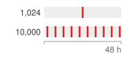{width="100%" fig-alt="Two 48-hour timelines with red marks for GPU failures. The 1,024-GPU cluster shows a single mark, and the 10,000-GPU fleet shows a mark about every 5 hours."}

*Failures become a cadence, one every `{python} FleetFailureRates.reference_mtbf_h_str` hours at `{python} FleetFailureRates.reference_gpus_str` GPUs but `{python} FleetFailureRates.large_per_day_str` a day at `{python} FleetFailureRates.large_gpus_str`.*
:::

$$ \text{Expected GPU failures per day} = \FleetAcceleratorCount\times \frac{24}{\GpuMttf} $$

With the per-GPU planning value of `{python} FleetFailureRates.gpu_mtbf_str` hours used throughout this book, that is about `{python} FleetFailureRates.per_thousand_per_day_str` failures per day for every thousand GPUs. Under this model, the `{python} FleetFailureRates.reference_gpus_str`-GPU reference cluster averages one GPU failure every `{python} FleetFailureRates.reference_mtbf_h_str` hours, and a `{python} FleetFailureRates.large_gpus_str`-GPU fleet averages `{python} FleetFailureRates.large_per_day_str` GPU failures every day. These are the GPU-only baselines that fault tolerance tabulated (@tbl-cluster-mtbf-scaling). Its full-system cascade for the `{python} FleetFailureRates.large_gpus_str`-GPU fleet (@sec-fault-tolerance-reliability-reliability-worked-example-cluster-mtbf-calculation-9255) adds PCIe and network failure domains and therefore yields a shorter interval between failures. The two figures answer different questions. The scheduler sizes spare capacity and replacement paths from the GPU-only count of devices it must replace, while job interruptions follow the full-system rate and depend on how each failure affects an allocation. A production example illustrates the operational burden: at sixteen times the reference cluster, the Llama 3 pretraining run on `{python} FleetFailureRates.llama3_gpus_str` H100 GPUs recorded `{python} FleetFailureRates.llama3_interruptions_str` unexpected interruptions in `{python} FleetFailureRates.llama3_days_str` days, about one every `{python} FleetFailureRates.llama3_hours_between_str` hours [@dubey2024llama].

The scheduler cannot treat the cluster as a static resource pool where resources, once allocated, remain available until voluntarily released. It must anticipate loss of allocated resources during execution and provide replacement capacity or rescheduling paths. The response depends on the fault and the validity of the surviving state. A transient disruption may permit recovery in place if the execution state remains usable; a persistent hardware failure requires replacement resources. Even a short disruption can force checkpoint recovery if the framework cannot safely continue [@tiwari2015].

When a node heartbeat is missed, the scheduler faces three recovery policies with different delay and capacity costs. It can wait to see whether the heartbeat resumes, though this delays recovery if the machine has permanently crashed. It can instead begin recovery promptly on replacement resources, provided stale execution is fenced before conflicting work resumes. An intermediate approach marks the node as suspect and prepositions replacement capacity while checking its status; this reduces launch delay if replacement becomes necessary, but holds capacity that could otherwise serve pending work. Whichever policy it picks, a timeout is evidence rather than proof of failure, so reuse of the node's GPUs still waits on fencing. Historical failure and recovery measurements set how long to wait and how much replacement capacity to hold. The recovery-time decomposition of fault tolerance (@eq-recovery-time) shows where scheduler policy intervenes most effectively. Of its detection, restart, load, and warmup terms, the scheduler owns most of $\JobRestartTime$, the time to allocate replacement resources and launch processes, and that is the term its spare-capacity policy shortens. Waiting longer on a missed heartbeat lengthens $\FailureDetectionTime$ in exchange for avoiding a needless restart, so the wait is worth extending only while a transient fault remains more likely than a permanent one.

::: {.column-margin .margin-pointer}
↪ The same decomposition in scheduler-facing phases (detect, reschedule, reload, and replay of work since the last checkpoint) is developed in @sec-appdx-reliability-foundations-recovery-anatomy.
:::

These requirements connect the scheduler directly to checkpoint and recovery infrastructure. Scheduling decisions about spare capacity, preemption policies, and elastic training support determine how quickly the system recovers from statistically expected failures. A scheduler that reserves spare capacity or supports elastic recovery can restore throughput much faster than one that requires every failed job to wait for a full fresh allocation and reload. The reserve fraction follows from the measured failure rate and recovery time of the fleet's own workloads.

::: {.column-margin .margin-pointer}
↩ Failure detection, recovery procedures, and spare pools are established in @sec-fault-tolerance-reliability-reliability-failure-detection-recovery-0f54.
:::

## Scheduling Objectives and Their Conflicts {#sec-fleet-orchestration-objectives}

Scheduling policies balance four objectives: throughput, fairness, latency, and cost efficiency. Throughput benefits from allocations that sustain useful work and amortize launch, interruption, and data-movement overhead; a large allocation helps only while the job scales effectively. Maintaining fairness\index{Fairness!scheduling objective} demands an equitable distribution of resources across competing tenants to prevent a single dominant project from monopolizing the fleet; dominant resource fairness\index{Dominant Resource Fairness!multi-resource allocation} [@ghodsi2011] formalizes this balance by equalizing each tenant's largest normalized share across GPUs, CPU, and memory. Reducing queue latency helps short, interactive jobs complete promptly, but aggressive preemption can repeatedly interrupt long-running training. Pursuing cost efficiency\index{Cost efficiency!scheduling objective} introduces different costs for different policies: spot capacity risks interruption, off-peak scheduling delays admission, and dense packing can increase interference. Each policy must be evaluated against useful work completed and the delays it imposes.

Fairness requires an outcome metric rather than an input quota rule alone. For job $\JobIndex$, **slowdown**\index{Slowdown!definition} $\JobSlowdown_j=(\JobQueueWaitTime_j+\IsolatedJobRunTime_j)/\IsolatedJobRunTime_j$ compares its queueing-plus-running time with its isolated runtime $\IsolatedJobRunTime_j$, assuming the running time is unchanged by sharing; a one-hour job that waits nine hours has $\JobSlowdown_j=10$, even if its team eventually receives its nominal GPU share. When contention or resizing changes execution time, the numerator must instead use the observed queueing-plus-running duration while the denominator retains the isolated baseline. A scheduler should report the distribution of slowdown by user and job class, together with the age of the oldest pending feasible job. Dominant-share parity detects unequal resource allocation, slowdown exposes unequal delay, and the maximum feasible wait exposes starvation risk. These metrics separate a policy that is fair in allocated GPU-hours from one that is fair in the time users wait to obtain useful results.

The trade-off diamond in @fig-fleet-orchestration-scheduling-tradeoffs illustrates these operational tensions among throughput, latency, fairness, and cost efficiency. Favoring a large unbroken allocation can delay short experiments, while repeatedly admitting short jobs can prevent a large gang from assembling. These conflicts depend on the workload and available capacity; improving one objective does not necessarily worsen every other objective. Resource-share fairness and completion-delay fairness therefore need separate measurements.

::: {#fig-fleet-orchestration-scheduling-tradeoffs fig-env="figure" fig-pos="htb" fig-cap="**Scheduling trade-offs across competing fleet objectives**: A four-way trade-off diamond (Throughput, Latency, Fairness, Cost Efficiency) illustrates the tensions governing cluster scheduling. Throughput favors long, unbroken runs; Latency favors aggressive preemption for interactive jobs; Resource-share fairness can constrain placement to equalize shares; and Cost Efficiency uses discounted, interruptible capacity. Each vertex sketches a four-GPU pool over time as that objective would schedule it and names a possible cost of favoring it; the conflicts depend on workload and available capacity." fig-alt="Four violet-outlined cards arranged as a diamond and joined by dashed edges, each holding a small strip of a four-GPU pool against time, with strip height standing for GPUs, and a line naming what that objective gives up. Throughput, at top: one large gang block runs unbroken across the whole strip while three small jobs wait stacked in a dashed queue column to its left; gives up small jobs, which starve. Cost efficiency, at left: three spot blocks separated by two red preemption ticks, each tick followed by a red hatched stretch of redone work; gives up preemption overhead. Fairness, at right: team A holds half the pool for the whole period, team B holds the other half briefly and the rest of its share sits idle with a dashed outline; gives up peak utilization. Latency, at bottom: the gang block is cut by two red preemption ticks so short gray jobs can start, leaving the gang in fragments; gives up large gangs, which fragment. The center reads a scheduling policy sets the weights."}
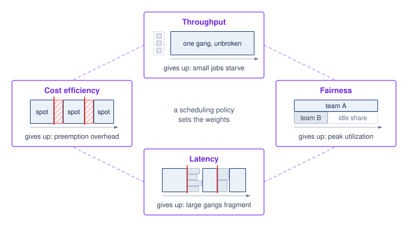

:::

Consider a 64-GPU fine-tuning run of the same 175B-parameter model, a far smaller allocation than its `{python} ClusterEconomicsContext.gang_job_gpus_str`-GPU pretraining run. If it sustains high utilization for days, an uninterrupted allocation amortizes launch overhead across a long execution. Admitting it may nevertheless require draining 64 suitably placed GPUs, delaying smaller experiments. Conversely, repeatedly filling available gaps with short jobs can prevent the large job from assembling its required group. Preemption or resizing can recover flexibility only if the job supports the transition and its cost is acceptable. The policy must therefore compare useful throughput with completion delay for both job classes. In scheduler terminology, those choices often appear as quality-of-service classes: job-priority tiers that decide which objective wins when throughput, latency, fairness, and cost collide.

```{python}
#| echo: false
#| label: lego-queuing-theory
# ┌─────────────────────────────────────────────────────────────────────────────
# │ QUEUING THEORY (LEGO)
# ├─────────────────────────────────────────────────────────────────────────────
# │ Context: callout-notebook "The Queuing Theory of GPU Clusters"
# │
# │ Goal: Compute Pollaczek-Khinchine waiting-time multipliers for uniform
# │       vs heavy-tailed ML workloads.
# │ How: Compute the waiting-time multiplier from utilization and service-time variability.
# │
# └─────────────────────────────────────────────────────────────────────────────
from mlsysim.fmt import check, fmt

class QueuingTheory:
    # ┌── 1. LOAD ──────────────────────────────────────────
    rho = 0.8
    cs_uniform = 1
    cs_ml = 3
    # ┌── 2. EXECUTE ───────────────────────────────────────
    wq_uniform = rho / (1 - rho) * (1 + cs_uniform**2) / 2
    wq_ml = rho / (1 - rho) * (1 + cs_ml**2) / 2
    # ┌── 3. GUARD ─────────────────────────────────────────
    check(abs(wq_uniform - 4) < 1e-9, f"Expected 4, got {wq_uniform}")
    check(abs(wq_ml - 20) < 1e-9, f"Expected 20, got {wq_ml}")
    # ┌── 4. OUTPUT ────────────────────────────────────────
    wq_uniform_str = fmt(wq_uniform, precision=0)
    wq_ml_str = fmt(wq_ml, precision=0)
    rho_pct_str = fmt_percent(rho, precision=0, commas=False, style='prose')
```

::: {#nbk-fleet-orchestration-queuing-theory-gpu-clusters .callout-notebook title="The queuing theory of GPU clusters"}

To isolate the effect of runtime variability, consider an M/G/1 queue with first-come-first-served service. Kendall notation names the queue by its arrival process, service-time distribution, and server count: M for memoryless (Poisson) arrivals, G for a general service-time distribution, and 1 for a single server. Treating a fleet as one server means modeling its aggregate capacity as a single resource that works through one job at a time, with each job's service time equal to its GPU-hours divided by the fleet's GPU count. That mapping ignores gang packing and parallel admission, so it isolates the variability effect rather than predicting a real fleet's wait. Jobs arrive according to a Poisson process $(\ArrivalRate)$, and independent service times follow a general distribution $(\Glyph{G})$ with mean $1/\ServiceRate$ and finite standard deviation $\ServiceTimeStandardDeviation$. When offered load is below service capacity, the Pollaczek-Khinchine formula gives the steady-state expected waiting time in the queue $(\QueueWaitTime)$:

$$ \frac{\QueueWaitTime}{1/\ServiceRate} = \frac{\ServingUtilization}{1-\ServingUtilization} \cdot \frac{1+\ServiceTimeVariationCoefficient^2}{2} $$

Here, $\ServingUtilization = \ArrivalRate/\ServiceRate$ represents offered load relative to the model's service capacity, $1/\ServiceRate$ is the average job duration, and $\ServiceTimeVariationCoefficient= \ServiceTimeStandardDeviation\ServiceRate$ is the **coefficient of variation**\index{Coefficient of Variation!definition} of job duration. The right-hand side is therefore the waiting time expressed as a multiple of the average job duration; a fleet's measured GPU-busy percentage is not automatically this model's load.

An exponential service-time distribution provides a reference case, yielding $\ServiceTimeVariationCoefficient\approx 1$. A mixed ML queue can have much greater variability when short debugging jobs measured in minutes share capacity with training runs measured in weeks. The representative $\ServiceTimeVariationCoefficient=3$ calculation in this callout captures that variability without claiming a universal fleet constant. The impact on wait times is multiplicative. For the scheduling argument here, the single-server multiplier is sufficient; @sec-appdx-inference-scale-queuing-theory-batched-inference-bbf0 develops an explicit single-server surrogate for batched serving and explains why multi-server, finite-buffer M/G/c/K systems require additional modeling.

At `{python} QueuingTheory.rho_pct_str` utilization $(\ServingUtilization = 0.8)$: with an exponential workload $(\ServiceTimeVariationCoefficient= 1)$, $\QueueWaitTime=$ `{python} QueuingTheory.wq_uniform_str` $\times$ the average job duration. With an illustrative high-variability workload $(\ServiceTimeVariationCoefficient= 3)$, $\QueueWaitTime=$ `{python} QueuingTheory.wq_ml_str` $\times$ the average job duration. In this M/G/1 model, service-time variability multiplies waiting time at the same offered load. The example does not prescribe a universal GPU-utilization threshold or model gang placement directly. It explains why capacity planning needs the service-time distribution and queue-delay objective as well as average load.

:::

## Core Allocation Constraints {#sec-fleet-orchestration-core-allocation}

A scheduling objective can only choose among allocations that a job can actually run. Fairness must be computed across every resource a tenant consumes, a request must fit every dimension of the node that receives it, a rigid group must arrive whole, and the resources each job holds must not block one another. Each of these constraints narrows the feasible set before any objective selects within it.

### Dominant-resource fairness allocation {#sec-fleet-orchestration-drf-worked-allocation}

Dominant-resource fairness (DRF)\index{Dominant Resource Fairness!worked allocation}\index{DRF|see{Dominant Resource Fairness}} makes a multi-resource entitlement comparable by normalizing each tenant's allocation against fleet capacity and taking its largest share [@ghodsi2011]. Consider the deliberately small cluster in @tbl-fleet-orchestration-drf-allocation: 8 GPUs, 32 CPU cores, 256 GB of memory, and 80 Gb/s of network capacity. Tenant A's replica requires 1 GPU, 4 cores, 32 GB, and 10 Gb/s; Tenant B's distributed worker requires 2 GPUs, 2 cores, 16 GB, and 20 Gb/s.

::: {.content-visible when-format="pdf"}
\newpage
:::

| **Tenant** | **Allocation** | **GPU share** | **CPU share** | **Memory share** | **Network share** | **Dominant share** |
|:-----------|:---------------|:-------------:|:-------------:|:----------------:|:-----------------:|:------------------:|
| A          | 4 replicas     |   $4/8=0.50$  |  $16/32=0.50$ |  $128/256=0.50$  |    $40/80=0.50$   |       $0.50$       |
| B          | 2 workers      |   $4/8=0.50$  |  $4/32=0.125$ |  $32/256=0.125$  |    $40/80=0.50$   |       $0.50$       |

: **Worked DRF allocation**: Progressive filling gives Tenant A four one-GPU replicas and Tenant B a pair of two-GPU workers. Both tenants reach a dominant share of 0.50 even though their CPU and memory allocations differ. GPUs and network are jointly saturated; CPU and memory remain available but cannot increase either allocation without exceeding a saturated resource. {#tbl-fleet-orchestration-drf-allocation tbl-colwidths="[12,19,13,13,14,15,14]"}

For tenant $\TenantIndex$, define its dominant share as $\DominantShare_i=\max_\ResourceTypeIndex(\TenantResourceAllocation/\FleetResourceCapacity)$, where $\TenantResourceAllocation$ is its allocation of resource $\ResourceTypeIndex$ and $\FleetResourceCapacity$ is fleet capacity for that resource. The calculation equalizes $\DominantShare_i$, not every resource share. One A replica raises A's dominant share by $1/8$; one B worker raises B's by $2/8$. Progressive filling therefore grants roughly two A replicas for each B worker until both dominant shares reach $0.50$. This is a fair policy target, but it is not yet a feasible placement. If B's two workers form one four-GPU gang, the four GPUs must become available atomically; if tensor parallelism requires one NVLink domain, four free GPUs scattered across nodes do not satisfy the allocation; and if the job requires 80 GB HBM accelerators, four incompatible GPUs do not count at all. A production scheduler therefore applies capability, gang, and topology constraints to the feasible set, then uses DRF\index{Dominant Resource Fairness!progressive filling} to choose fairly among allocations that can actually run. The order is not a convenience. Feasibility comes before fairness (principle \ref{pri-feasibility-before-fairness}) because a fair share of accelerators on which the job cannot run delivers no progress to the tenant who holds it. When no equal-share placement exists, the scheduler should report the constraint causing the deviation rather than silently presenting an infeasible entitlement as service delivered.

::: {#lhs-fleet-orchestration-archetype-placement-fairness .callout-lighthouse title="Lighthouse archetypes: Placement changes fairness"}

The same resource share has different meaning across the three lighthouse workloads introduced in @sec-vol2-introduction-archetypes:

- **Archetype A (GPT-4/Llama-3)** needs a rigid, topology-compatible gang. Fractional allocations below its minimum parallel configuration deliver no progress, so fairness must include maximum feasible wait for a contiguous placement rather than GPU-hours alone.
- **Archetype B (DLRM at Scale)** couples accelerator memory to sparse-routing bandwidth. A nominal GPU allocation is infeasible when embedding shards or network capacity cannot follow it, so network and memory must enter the dominant share and placement must protect the serving-latency envelope.
- **Archetype C (Federated MobileNet)** schedules participation rather than data-center GPUs. Eligibility filters for power, connectivity, and device capability can systematically exclude parts of the population, so fairness must be audited through participation and outcome rates across device and user groups, not equal device counts in a round.

The common rule is to define the feasible bundle first and assess fairness over useful progress second. Treating every accelerator or client as interchangeable would conceal the constraint that makes each archetype difficult.

:::

### Bin packing {#sec-fleet-orchestration-bin-packing}

Bin packing\index{Bin Packing!multi-dimensional}[^fn-bin-packing-scheduling] captures a basic placement problem: fitting jobs of varying sizes into fixed-capacity nodes. This problem is NP-hard in its general form, meaning no known algorithm finds optimal solutions in polynomial time. Practical heuristics such as first-fit decreasing and best-fit decreasing offer tractable choices, but their performance depends on job sizes and placement constraints. How much usable capacity a heuristic recovers in a heterogeneous ML fleet has to be measured against that fleet's job mix, because the classical guarantees cover only one-dimensional packing.

[^fn-bin-packing-scheduling]: **Bin Packing**\index{Bin Packing!scheduling}: First-fit decreasing has a classical asymptotic $11/9$ approximation ratio for one-dimensional bin packing, with an additive constant in the finite-instance bound. That result does not guarantee the same ratio for ML placement with several resource dimensions, topology constraints, and indivisible gangs. A scheduler must evaluate its heuristic against feasible placements and the stranded capacity it leaves.

```{python}
#| echo: false
#| label: lego-fleet-fragmentation
# ┌─────────────────────────────────────────────────────────────────────────────
# │ FLEET FRAGMENTATION (LEGO)
# ├─────────────────────────────────────────────────────────────────────────────
# │ Context: Bin-packing fragmentation prose immediately below this cell.
# │
# │ Goal: Quantify effective capacity lost to bin-packing fragmentation, and
# │       the NVLink-vs-InfiniBand locality cliff that forbids cross-node packs.
# │ Show: total cluster GPUs, effective capacity after fragmentation, and the
# │       intra-node NVLink vs inter-node InfiniBand bandwidth gap.
# │ How: Compute wasted GPUs per node for a fixed job request; read NVLink and
# │      InfiniBand bandwidths from the Hardware and Systems registries.
# │
# └─────────────────────────────────────────────────────────────────────────────
from mlsysim.fmt import fmt_bandwidth

class FleetFragmentation:
    from mlsysim import Hardware

    h_h100 = Hardware.Cloud.H100
    ib_ndr = Systems.Fabrics.InfiniBand_NDR
    n_nodes = 64
    gpus_per_node = Systems.Nodes.DGX_H100.accelerators_per_node
    total_gpus = n_nodes * gpus_per_node
    job_request = 6
    wasted_per_node = gpus_per_node - job_request
    frag_pct = (wasted_per_node / gpus_per_node) * 100
    # ┌── 4. OUTPUT (Formatting) ─────────────────────────────────────────────
    total_gpus_str = fmt_count(total_gpus, label="GPU")
    effective_capacity_pct_str = fmt_percent(round(100 - frag_pct) / 100, precision=0, commas=False, style='prose')
    # per-direction NVLink vs per-port IB — the like-with-like cliff comparison
    nvlink_h100_gb_per_s_str = fmt_bandwidth(h_h100.nvlink.bandwidth_per_direction, unit=GB / second, precision=0)
    ib_ndr_gb_per_s_str = fmt_bandwidth(ib_ndr.bandwidth, unit=GB / second, precision=0)
```

Consider a 64-node cluster with 8 GPUs per node, totaling `{python} FleetFragmentation.total_gpus_str`. If every job requires 6 GPUs within one node, only one such job fits per node, leaving 2 GPUs unused and reducing effective capacity for this workload to `{python} FleetFragmentation.effective_capacity_pct_str`. The remaining 2 GPUs per node cannot be combined across nodes into another feasible six-GPU allocation, although smaller compatible jobs could use them. With a mix of 1-GPU, 3-GPU, and 7-GPU jobs, fragmentation\index{Fragmentation!scheduling} depends on the placement and the pending requests; total free capacity can exceed a waiting job's demand while no individual node has enough space. @Fig-fragmentation-problem maps this stranded capacity across an 8×8 allocation grid: although 19 slots (30 percent of cluster capacity, dashed white cells) sit idle across nodes 0 through 7, active allocations (J1 through J15) leave every node partially occupied, blocking a pending 8-GPU job that requires an entire unfragmented node.

ML placement is a multi-dimensional packing problem. Jobs require GPUs together with CPU cores for data preprocessing, host memory for data loading and augmentation pipelines, local SSD storage for dataset caching, and network bandwidth for gradient synchronization. A job requesting 4 GPUs, 32 CPU cores, and 256 GB of RAM may not fit on a node that has 4 free GPUs but only 16 free CPU cores because other jobs have consumed the host CPU for preprocessing. The scheduler must simultaneously satisfy all resource dimensions, and the job fits only if every dimension has sufficient capacity on the selected node. A bottleneck in any one dimension can therefore strand capacity in the others.

Locality constraints further restrict placement beyond simple resource availability. A training job may require tensor-parallel groups to remain within NVLink-connected nodes when its communication budget cannot tolerate the lower per-endpoint bandwidth of the external fabric (`{python} FleetFragmentation.nvlink_h100_gb_per_s_str` per direction intra-node vs. `{python} FleetFragmentation.ib_ndr_gb_per_s_str` per port inter-node). On this topology, where NVLink does not connect the nodes, a job requesting "4 GPUs with NVLink connectivity" cannot use 2 GPUs from node A and 2 from node B, even if all 4 GPUs are individually available and the total capacity is sufficient. These topology constraints turn resource counts into a placement problem where which specific resources are available matters as much as how many. A capacity-feasible packing must also pass the job's locality constraints.

Schedulers address fragmentation through several complementary strategies, each targeting a different aspect of the problem. The first, backfill, lets smaller jobs run in the gaps while a large job waits for contiguous resources; @sec-fleet-orchestration-gang-scheduling develops it together with the reservation it must protect and the runtime estimates it depends on.

Periodic **defragmentation**\index{Defragmentation!definition} migrates or preempts low-priority jobs to consolidate free resources into contiguous blocks, analogous to memory compaction in operating systems. The scheduler identifies nodes where partial allocations leave stranded resources, preempts the jobs occupying those resources, and re-schedules them on nodes where they can be packed more efficiently. The cost includes state transfer and restart, plus replay of work not captured by a valid checkpoint. A graceful checkpoint can preserve recent progress, but still takes time and storage bandwidth. The scheduler must weigh these costs against the benefit of starting large jobs sooner. Low-demand periods reduce the number of competing jobs affected by the move.

A third strategy, **over-subscription**\index{Over-subscription!definition}, admits more demand than a capacity dimension can sustain simultaneously, but only where the resource is divisible and the scheduler can bound interference. Average activity of a GPU's streaming multiprocessors (SMs), its compute units, does not create fractional whole GPUs. A job that reserves device memory, requires an exclusive CUDA context, or belongs to a rigid gang still occupies its assigned device while kernels are idle. Statistical multiplexing can be safe for explicitly shareable CPU, network, storage, or partitioned GPU capacity when tenants have measured, weakly correlated peaks and enforceable limits. It is unsafe to convert 70 percent average GPU utilization into a 1.4$\times$ device overcommit ratio. Whole-device capacity should instead be recovered through preemption, elastic resizing, or an isolation mechanism such as Multi-Instance GPU (MIG) hardware partitioning or NVIDIA's Multi-Process Service (MPS), which lets several processes' kernels share one device, provided the scheduler models each mechanism's memory, compute, and fault-sharing contract explicitly. Both reappear with the serving workloads they suit best in @sec-fleet-orchestration-resource-isolation.

::: {#fig-fragmentation-problem fig-env="figure" fig-pos="htb" fig-cap="**The fragmentation problem**: A snapshot of an 8-node cluster (rows) with 8 GPUs each (columns). Blue blocks mark the slots each active job holds (J1 to J15); dashed white cells are free, and the count at the right of each row gives that node's free slots. Although 19 GPUs, roughly 30 percent of capacity, are free, every node still holds at least one busy slot, so the pending job above the grid, which needs a full node, cannot be placed. Fragmentation, not total capacity, sets what the scheduler can admit." fig-alt="Eight-by-eight grid of GPU slots, rows labeled node 0 to node 7 and columns labeled slot 0 to 7. Each active job, J1 to J15, is a light blue block spanning its slots; free slots are white with dashed outlines, scattered across every row. A column at the right lists free slots per node, between 1 and 3, totaling 19 free, 30 percent. Above the grid, a queue row holds a red dashed bar spanning all eight columns labeled pending job, 8 GPUs on one node, with the note blocked, no node fits."}

```{python}
#| echo: false
# ┌─────────────────────────────────────────────────────────────────────────────
# │ FRAGMENTATION PROBLEM (FIGURE)
# ├─────────────────────────────────────────────────────────────────────────────
# │ Context: @fig-fragmentation-problem—bin-packing and fragmentation
# │
# │ Goal: Heatmap of 8×8 cluster; show fragmented free slots; illustrate why
# │       8-contiguous-GPU job cannot be placed despite 30% free.
# │ Show: one blue block per job; dashed white = free; per-node free count; red pending job.
# │ How: row_patterns grid; Rectangle patches; book_style.setup_plot().
# │
# └─────────────────────────────────────────────────────────────────────────────
# ┌── 1. CANVAS ────────────────────────────────────────────────────────────────
# │ Heatmap of 8×8 cluster; show fragmented free slots; illustrate why
import matplotlib.patches as mpatches
import numpy as np
from binder.tools.figures import style as book_style

# ┌── 2. ARRAYS ────────────────────────────────────────────────────────────────
n_nodes = 8
gpus_per_node = Systems.Nodes.DGX_H100.accelerators_per_node

row_patterns = [
    [1, 1, 0, 0, 2, 2, 2, 0],
    [3, 3, 3, 3, 0, 0, 4, 4],
    [5, 5, 0, 6, 6, 6, 6, 6],
    [7, 7, 7, 0, 0, 8, 8, 8],
    [9, 9, 0, 0, 0, 10, 10, 10],
    [11, 11, 11, 11, 0, 0, 12, 12],
    [13, 13, 13, 13, 13, 0, 0, 0],
    [14, 14, 14, 14, 15, 0, 0, 0],
]
grid = np.array(row_patterns)
total_gpus = grid.size
allocated_gpus = int(np.count_nonzero(grid))
free_gpus = total_gpus - allocated_gpus
allocated_pct = allocated_gpus / total_gpus * 100
free_pct = free_gpus / total_gpus * 100

fig, ax, COLORS, plt = book_style.setup_plot(figsize=(7, 3.9))

# Each job is drawn as one block over its contiguous slots, in one blue
# family; free slots are dashed outlines. A per-node free count on the right
# shows that no row reaches the 8 slots the pending job needs.
JOB_FACE, JOB_EDGE = COLORS['BlueL'], COLORS['BlueLine']
FREE_EDGE = COLORS['secondary']
PAD = 0.06

def job_blocks(row):
    blocks, start = [], 0
    for c in range(1, len(row) + 1):
        if c == len(row) or row[c] != row[start]:
            if row[start] != 0:
                blocks.append((row[start], start, c - start))
            start = c
    return blocks

# ┌── 3. RENDER ────────────────────────────────────────────────────────────────
for r in range(n_nodes):
    for c in range(gpus_per_node):
        if grid[r, c] == 0:
            ax.add_patch(
                mpatches.Rectangle(
                    (c + PAD, r + PAD), 1 - 2 * PAD, 1 - 2 * PAD, facecolor='white', edgecolor=FREE_EDGE, linewidth=0.9, linestyle=(0, (3, 2))
                )
            )
    for job, c0, w in job_blocks(grid[r]):
        ax.add_patch(mpatches.Rectangle((c0 + PAD, r + PAD), w - 2 * PAD, 1 - 2 * PAD, facecolor=JOB_FACE, edgecolor=JOB_EDGE, linewidth=1.0))
        ax.text(c0 + w / 2, r + 0.5, f'J{job}', ha='center', va='center', fontsize=10, color=JOB_EDGE)
    n_free = int(np.count_nonzero(grid[r] == 0))
    ax.text(gpus_per_node + 0.35, r + 0.5, f'{n_free} free', ha='left', va='center', fontsize=10, color=COLORS['primary'])

# Pending job: one row of 8 slots above the grid, red because it cannot be placed.
py = -1.55
ax.add_patch(
    mpatches.Rectangle(
        (PAD, py + PAD),
        gpus_per_node - 2 * PAD,
        1 - 2 * PAD,
        facecolor=COLORS['RedL'],
        edgecolor=COLORS['RedLine'],
        linewidth=1.0,
        linestyle=(0, (4, 2)),
    )
)
ax.text(gpus_per_node / 2, py + 0.5, f'pending job: {gpus_per_node} GPUs on one node', ha='center', va='center', fontsize=10, color=COLORS['RedLine'])
ax.text(gpus_per_node + 0.35, py + 0.5, 'blocked:\nno node fits', ha='left', va='center', fontsize=10, color=COLORS['RedLine'], linespacing=1.3)

# Totals under the free-count column.
ax.plot([gpus_per_node + 0.35, gpus_per_node + 1.75], [n_nodes + 0.15] * 2, color=COLORS['grid'], linewidth=0.8, clip_on=False)
ax.text(
    gpus_per_node + 0.35,
    n_nodes + 0.55,
    f'{free_gpus} free ({free_pct:.0f}%)',
    ha='left',
    va='center',
    fontsize=10,
    color=COLORS['primary'],
    fontweight='bold',
)

ax.set_xlim(-0.05, gpus_per_node + 1.9)
ax.set_ylim(n_nodes + 0.05, py - 0.05)

# ┌── 4. DECORATE ──────────────────────────────────────────────────────────────
ax.set_xticks(np.arange(gpus_per_node) + 0.5)
ax.set_xticklabels(np.arange(gpus_per_node))
ax.set_xlabel('GPU slot (local rank)', x=gpus_per_node / 2 / (gpus_per_node + 1.95))
ax.set_yticks([py + 0.5] + list(np.arange(n_nodes) + 0.5))
ax.set_yticklabels(['Queue'] + [f'Node {i}' for i in range(n_nodes)])
ax.tick_params(length=0)
ax.grid(False)
for spine in ax.spines.values():
    spine.set_visible(False)

plt.show()
plt.close()
```

:::

### Gang scheduling {#sec-fleet-orchestration-gang-scheduling}

Partial allocation of rigid multi-GPU jobs creates a distributed scheduling failure mode in which two jobs each hold half the resources they need and block each other indefinitely while every allocated GPU sits idle. In the left panel of @fig-gang-scheduling-deadlock, jobs J1 and J2 each hold 4 of the 8 GPUs they require, and the whole pool stalls. Atomic gang scheduling\index{Gang Scheduling!atomic allocation} (right panel) instead grants J1 all 8 GPUs as one allocation while J2 waits without holding any, which prevents this allocation deadlock.

::: {#fig-gang-scheduling-deadlock fig-env="figure" fig-pos="htb" fig-cap="**The distributed deadlock (hold and wait)**: In a non-gang scheduler (left), job J1 acquires half the cluster and waits for the rest, while job J2 acquires the other half and waits for J1 to release its GPUs. Neither can proceed, and 100 percent of the cluster sits idle. Gang scheduling (right) solves this by mandating atomic allocation: a job is either granted its entire $\DeviceCount$-GPU requirement simultaneously or it waits in the queue without holding any resources." fig-alt="Two panels, each with a queue lane above eight GPU rows against a time axis. Left, partial allocation: J1 holds GPU rows 0 to 3 and J2 holds rows 4 to 7, both drawn as red hatched blocks labeled holds 4 of 8 that extend past the right edge with dashed ends; two curved red arrows form a cycle between them labeled waits, and the panel reads 8 GPUs held, none computing. Right, gang scheduling: a blue J1 block spans all eight rows, then a blue J2 block spans all eight rows after it, each labeled all 8 at once; above them, J2 waits in the queue in a dashed violet box labeled holds 0 until an arrow labeled J1 finishes drops it into the GPUs. The panel reads no partial holds, no deadlock."}
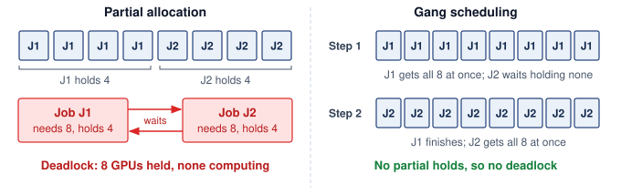

:::

::: {#dfn-fleet-orchestration-gang-scheduling .callout-definition title="Gang scheduling"}

***Gang scheduling***\index{Gang Scheduling!definition} is the ML cluster scheduling policy that atomically allocates the resources required by a job's minimum viable execution group, so a rigid group either receives its complete allocation or waits without retaining a partial one.

1.  **Significance**: A rigid synchronous job configured for `{python} ClusterEconomicsContext.gang_job_gpus_str` GPUs but holding only `{python} ClusterEconomicsContext.gang_half_gpus_str` GPUs completes zero training steps, not half as many: each collective stalls until every rank in its communication group arrives, so the held GPUs consume power and capital at zero useful output. Without atomic allocation, two such jobs can each acquire half the cluster and deadlock, both at zero progress while consuming the full cluster's operating cost.
2.  **Distinction**: Unlike a malleable service or parallel job that can make progress across a resource range, rigid synchronous training has step-function utility: the minimum viable gang or nothing. The distinction is a property of the execution graph, not of whether the workload is labeled ML, cloud, or HPC.
3.  **Common pitfall**: A frequent misconception is that priorities or quotas alone solve this. Atomicity must extend to every co-scheduled resource the job needs to make progress (accelerators, high-bandwidth interconnect domains, network capacity for collectives); enforcing it at GPU granularity alone recreates the deadlock one resource layer down.

:::

The partial-allocation pattern is a hold-and-wait deadlock\index{Deadlock!hold-and-wait}[^fn-deadlock-scheduling-cycle] in which two jobs each hold half the cluster and neither can proceed. Its price is the whole allocation for as long as the cycle persists. At the scale of the chapter's reference workload, two `{python} ClusterEconomicsContext.gang_job_gpus_str`-GPU gangs that have each acquired `{python} ClusterEconomicsContext.gang_held_gpus_str` GPUs from a pool too small to complete either one burn about `{python} ClusterEconomicsContext.gang_idle_burn_str` per hour apiece. The limiting case is two jobs that each request the entire cluster, the example OpenAI used to motivate group admission (war story \ref{ws-fleet-orchestration-openai-gang-scheduling}). On the `{python} ClusterEconomicsContext.cluster_size_str`-GPU cluster, a deadlock that strands every device wastes `{python} ClusterEconomicsContext.cluster_hourly_cost_str` per hour at the chapter's rate while producing no progress for either job. Measured against the stake computed at the start of the chapter, raising utilization from `{python} ClusterEconomicsContext.util_low_pct_str` to `{python} ClusterEconomicsContext.util_high_pct_str` recovers about `{python} ClusterEconomicsContext.daily_gain_str` per day in equivalent capacity value, so about `{python} ClusterEconomicsContext.deadlock_hours_str` hours of such a deadlock erase a full day of that gain. Gang scheduling does not create the gain, but it protects it. For a rigid job $\RigidGangJob$ requiring $\DeviceCount$ GPUs, the scheduler must grant all $\DeviceCount$ GPUs atomically or leave the job queued without a partial allocation. This removes hold-and-wait for the resources covered by that allocation; it does not prevent later deadlocks in application code or auxiliary resources. Implementing atomic admission efficiently remains a central challenge in cluster scheduling algorithm design.

[^fn-deadlock-scheduling-cycle]: **Hold-and-wait**\index{Deadlock!Coffman conditions}: One of the four Coffman conditions (mutual exclusion, hold-and-wait, no preemption, and circular wait), all of which must hold for deadlock to occur [@coffman1971]. Gang scheduling removes hold-and-wait through atomic allocation, which is why it prevents this deadlock by construction; the price is reduced packing flexibility.

Naive gang scheduling is wasteful in predictable ways. Atomic allocation means the waiting job holds nothing, yet a large gang will never assemble if every freed GPU goes to a smaller job. The scheduler therefore places a **reservation**\index{Backfill Scheduling!reservation} for the job at the head of the queue, draining capacity toward it by declining to start new work on GPUs that the gang will need. If the cluster has `{python} ClusterEconomicsContext.gang_held_gpus_str` free GPUs and that job requests `{python} ClusterEconomicsContext.gang_job_gpus_str`, the reservation keeps the `{python} ClusterEconomicsContext.gang_held_gpus_str` GPUs idle until `{python} ClusterEconomicsContext.gang_missing_gpus_str` more become available, potentially wasting thousands of GPU-hours. Backfill scheduling\index{Backfill Scheduling!conservative backfilling}\index{Gang Scheduling!backfilling} addresses this by identifying jobs in the queue that can fit within the `{python} ClusterEconomicsContext.gang_held_gpus_str` available GPUs without delaying the large job's expected start time, an idea popularized in the ANL/IBM SP scheduling system [@lifka1995anlibm]. A 128-GPU job with an estimated runtime of 2 hours is a backfill candidate if the `{python} ClusterEconomicsContext.gang_missing_gpus_str` additional GPUs needed by the large job will remain unavailable for at least 2 hours. Protecting the reservation requires an enforced runtime bound or a preemption contract that releases the backfill allocation in time, including any checkpoint and cleanup delay. The estimate identifies an opportunity; the release contract makes the reservation enforceable.

The accuracy of runtime estimates determines backfill effectiveness, and this creates a game-theoretic challenge. If users overestimate runtimes, fewer jobs appear to fit a backfill window. If they underestimate, the scheduler may need to preempt a backfilled job to honor the reservation, paying recovery costs and losing unsaved progress. A policy that kills jobs at their declared limit encourages conservative estimates. Tiresias [@gu2019tiresias], discussed in @sec-fleet-orchestration-tiresias, avoids duration estimates when setting priority by using observed resource consumption. That choice addresses ordering under uncertainty, while reservation protection still needs an enforced runtime bound or release contract that says when a backfilled job will give its capacity back.

Gang scheduling removes the hold-and-wait deadlock, but another waiting pattern remains. Priority inversion can still strand reserved GPUs behind jobs that cannot finish their own exit path.

::: {.column-margin}
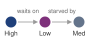{width="100%" fig-alt="Priority inversion wait-for sketch: a high-priority job waits on a low-priority job holding GPUs, while medium-priority jobs starve the low-priority job's checkpoint exit path."}

*Priority inversion is a wait-for chain, not a root-failure tree.*
:::

### Deadlock prevention and detection {#sec-fleet-orchestration-deadlock}

Gang scheduling eliminates the hold-and-wait condition for the atomically allocated bundle, but it does not immunize the cluster against all forms of resource contention. Later requests for auxiliary resources can still create a cycle of dependencies. Priority rules can also prevent a resource holder from making progress without creating a cycle. Distinguishing these cases matters because breaking a deadlock and providing a starved job with enough resources to exit require different interventions.

Priority inversion occurs when a high-priority job waits on a low-priority resource holder whose progress other work delays. Consider the 64-GPU fine-tuning run of the 175B-parameter model, submitted at high priority. The scheduler has reserved 60 available GPUs, but the remaining 4 are held by a low-priority data processing job. Normally, the scheduler would preempt the low-priority job to satisfy the high-priority request. However, if a stream of medium-priority development jobs saturates the cluster's CPU or network bandwidth, starving the low-priority job of the resources it needs to checkpoint and exit, the low-priority job stalls. Its graceful release path cannot complete. The high-priority job waits for the low-priority job, which is effectively blocked by the medium-priority jobs. The 60-GPU idle block persists until the exit path receives resources or an enforced termination policy reclaims the remaining GPUs, potentially losing uncheckpointed work.

::: {.column-margin}
{width="100%" fig-alt="Wait-for chain of three job nodes. An arrow labeled waits on runs from the high-priority job to the low-priority job holding GPUs, and an arrow labeled starved by runs from the low-priority job to the medium-priority jobs that consume its checkpoint exit path."}

*Priority inversion: the high-priority job waits on a low-priority holder that medium-priority work starves.*
:::

::: {#dfn-fleet-orchestration-priority-inversion .callout-definition title="Priority inversion"}

***Priority inversion***\index{Priority Inversion!definition} is an ML cluster scheduling pathology in which a high-priority task is forced to wait for a lower-priority task to release a shared resource.

1.  **Significance**: It ties the progress of a high-priority job, and the accelerators reserved for it, to the progress of the lowest-priority job in the wait-for chain. In ML clusters, this typically occurs when a low-priority job holding GPUs is starved of auxiliary resources (for example, bandwidth for checkpointing), preventing it from finishing and releasing the accelerators needed by high-priority workloads.
2.  **Distinction**: Unlike standard queuing (where tasks wait their turn), priority inversion involves an active blockage\index{Priority Inversion!active blockage}: the high-priority task is ready to run but is transitively dependent on a task that the scheduler does not prioritize.
3.  **Common pitfall**: A frequent misconception is that strict priority levels solve this. Raising the waiting job's priority does not supply the CPU or bandwidth that its lower-priority resource holder needs to exit; the preemption policy must protect that release path.

:::

Prevention and detection address different parts of this problem. Atomic allocation prevents hold-and-wait for the resources included in the gang, while reserving checkpoint bandwidth allows a preempted job to complete its exit path. Timeouts instead bound how long the system waits before investigating or reclaiming an allocation; they do not prevent deadlock states from arising. Monitoring can trigger recovery when progress stops, but safe reclamation still requires enforcing the new ownership decision.

Detection, unlike exact placement search, is computationally cheap. Before feasibility filtering, a cluster with 10,000 GPUs and 500 pending jobs can have more than $10^{15}$ candidate allocations, which puts exhaustive allocation search out of reach. Detection instead works on a **wait-for graph**\index{Wait-for graph!deadlock detection}, a directed graph with one vertex per job and an edge from job A to job B whenever A waits for a resource that B holds. A cycle identifies a potential deadlock. It establishes deadlock when every edge is an unavoidable blocking dependency and no alternative resource allocation can let a member proceed. Finding a cycle in an already constructed graph takes time linear in its vertices and edges. The difficulty lies in construction. Resource state changes continuously across a distributed control plane, so the scheduler rarely holds a complete, current graph, and a cycle detected on stale state may already have resolved while a real one goes unseen.

Large-scale schedulers therefore supplement wait-for detection with mechanisms that preserve liveness under incomplete state. A **lease-based resource**\index{Lease-based resource!definition} gives every allocation a time-to-live; expiry authorizes reclamation only when the resource manager enforces revocation and cleanup before reuse. **Progress monitoring**\index{Progress monitoring!definition} checks advancement through signals such as completed-step counters, using GPU utilization and heartbeats as supporting observations rather than proof of useful work. When the scheduler must preempt a lower-priority job, **holistic preemption**\index{Holistic preemption!definition} reserves the CPU, network, and storage bandwidth needed for that job to checkpoint and exit cleanly; otherwise, the victim can be too starved to release the accelerators. False failure suspicions can cost useful work, but must not bypass the ownership checks required for safe recovery.

### Heterogeneous gang scheduling {#sec-fleet-orchestration-heterogeneous-gang}

The homogeneous case uses a bulk synchronous parallel workload with $\DeviceCount$ workers executing the same compute graph, but atomic allocation does not require identical workers. Some training workflows contain several roles with different resource profiles. In preference-training pipelines such as reinforcement learning from human feedback (RLHF), for example, one component may update the policy while another scores outputs or supplies reference behavior. The scheduler still sees one job, but the gang contains trainers, evaluators, and inference-style workers that need different GPU counts, memory footprints, and lifetimes.

::: {#psp-fleet-orchestration-routing-over-synchrony .callout-perspective title="Routing over synchrony"}

Heterogeneous gang scheduling\index{Gang Scheduling!heterogeneous workloads} extends atomic allocation to the roles that must coexist for a workflow to progress. A viable group might pair high-HBM nodes for memory-bound generation with compute-oriented nodes for policy updates. The orchestration problem then shifts from packing a homogeneous ring toward routing data: rather than reducing gradients among identical workers, the job streams rollouts from generation workers to the workers that compute policy updates, so placement must also support the data exchanged between those roles. Rollout and training stages may exchange work in batches or through a buffered pipeline; their measured production and consumption rates determine where queues grow or accelerators wait. The scheduler needs a minimum viable resource bundle and a supported scaling policy for each role, rather than an assumption that all workers are interchangeable or perfectly balanced.

:::

Homogeneous and heterogeneous jobs share an allocation requirement: the scheduler must assemble a viable group before expecting progress. Backfill can use capacity while that group waits, provided runtime estimates or preemption contracts protect the reservation. Enforcing these policies requires a control plane that represents ownership and reconciles allocations after failures.

## Orchestration Paradigms {#sec-fleet-orchestration-paradigms}

A pending gang and a queue of small backfill jobs need both a policy for sharing capacity and a control plane that can enforce it. The policies just developed apply across platforms; the orchestration paradigm determines how the platform represents allocations and recovers when observed state diverges from them. Slurm, shaped by HPC batch systems, favors explicit resource requests and predictable allocation. Kubernetes, shaped by cloud-native service management, favors declared desired state and continuous reconciliation. The choice is therefore not Slurm vs. Kubernetes as products; it is which control model best matches the workload mix, failure behavior, and operational culture of the fleet.

The control-plane architectures in @fig-fleet-orchestration-slurm-vs-k8s contrast two control models. Slurm follows an imperative batch model: the user states the resources a job needs, and the central slurmctld dispatches that allocation through per-node slurmd daemons. Kubernetes follows a declarative model: the user states what should be running, and controllers reconcile observed state toward that declaration through the API server and node agents. Both platforms accept explicit resource requirements and track execution state, so the useful distinction is which lifecycle the platform manages directly: an allocated batch job or a collection of workloads maintained by controllers. That distinction shapes how ML workloads are admitted, monitored, and recovered from failure, and distributed training still needs framework-level coordination under either model.

::: {#fig-fleet-orchestration-slurm-vs-k8s fig-env="figure" fig-pos="htb" fig-cap="**Architectural paradigms: Slurm vs. Kubernetes**: Slurm (left) uses an imperative batch model where users submit explicit resource requests to a centralized controller (`slurmctld`) providing deterministic atomic allocation. Kubernetes (right) uses a declarative service model where controllers continuously reconcile observed cluster state in `etcd` against desired state specifications." fig-alt="Two columns. Left, Slurm, drawn as a straight one-way line: a job script with an sbatch command flows down once to slurmctld, then to slurmd on each node, whose connectors end on one dashed violet outline enclosing four nodes; the note reads all nodes granted at once, or the job waits. Right, Kubernetes, drawn as a closed loop: a desired-state file applied with kubectl flows into the API server and etcd, which holds two slots reading desired 4 pods and observed 3. Three violet arrows then form a cycle labeled reconcile loop: watch, from etcd down to the controllers, which act on the gap; recreate, from the controllers to a group of four pods, of which Pod 3 is drawn red and dashed and labeled failed; and status, from the pods back up into etcd. The note reads observed state is reconciled continuously."}
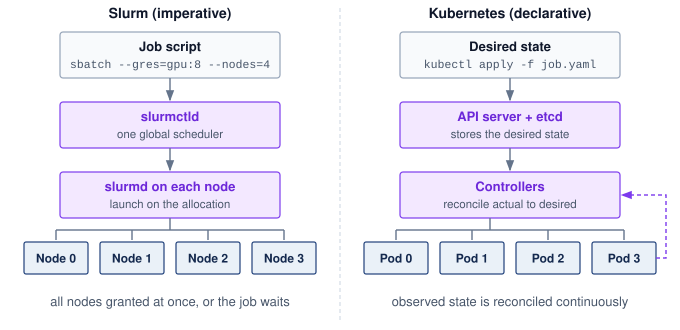

:::

### Slurm and HPC scheduling heritage {#sec-fleet-orchestration-slurm}

The Slurm Workload Manager\index{Slurm!workload manager}[^fn-slurm-hpc-workload] originated at Lawrence Livermore National Laboratory as a scalable, fault-tolerant resource manager for Linux clusters [@yoo2003]. Its batch-oriented design fits the distinctive requirements of scientific computing: long-running jobs, expensive shared hardware, and users who can specify resource needs in advance. In ML infrastructure, the same model maps to GPU training through partitions for heterogeneous accelerator pools and predictable allocations for long-running distributed jobs.

[^fn-slurm-hpc-workload]: **Slurm Workload Manager**\index{Slurm!scheduling}: Originally "SLURM," an acronym for Simple Linux Utility for Resource Management, the project dropped the acronym capitalization in 2012. Developed at Lawrence Livermore National Laboratory beginning in 2002, Slurm's centralized controller (`slurmctld`) maintains a single authoritative view of resource allocations. At very large scale, operators may partition fleets or federate schedulers to keep scheduling latency, policy isolation, and failure domains manageable.

Slurm's batch submission model\index{Slurm!imperative model} makes resource requirements explicit. Users submit job scripts, and the scheduler allocates resources within eligible partitions according to policy and availability. A submission of `sbatch --gres=gpu:8 --nodes=4` requests 8 GPUs on each of 4 nodes, a 32-GPU allocation. The request supplies a capacity contract, but useful execution still depends on the selected hardware and the application's launch configuration. Overstating requirements strands resources; understating them can cause memory failures or poor performance.

Slurm's architecture consists of a central controller daemon (`slurmctld`) that maintains the global view of cluster state and makes scheduling decisions, and per-node daemons (`slurmd`) that manage local resources and execute jobs. This centralized architecture provides the authoritative allocation model discussed in @sec-fleet-orchestration-distributed-scheduling: the controller is the source of truth for resource assignments, reducing the risk of conflicting allocations. The cost is a potential single point of failure (addressed through active-passive failover) and a scheduling-throughput limit. As fleets grow, organizations may partition the cluster or federate schedulers to bound scheduling latency and failure impact.

A typical ML cluster configuration defines Slurm partitions by accelerator type and interconnect (@tbl-fleet-orchestration-slurm-partitions).

| **Partition** | **GPUs/Node**  | **Interconnect** |  **Typical Use**   |
|:--------------|:--------------:|:----------------:|:------------------:|
| **dgx-a100**  | 8$\times$ A100 | NVLink + IB NDR  | Large LLM training |
| **a100-pcie** | 4$\times$ A100 |  PCIe + IB HDR   |  Medium training   |
| **inference** | 2$\times$ A10G |     Ethernet     |   Model serving    |
| **debug**     | 1$\times$ V100 |     Ethernet     |    Development     |

: **Slurm Partition Configuration**: Partitions organize heterogeneous accelerators into logical pools matched to workload characteristics. NVLink-connected partitions support tensor parallelism, while PCIe partitions serve workloads that rely primarily on data parallelism. Separating inference and debug partitions prevents experimental workloads from impacting production serving. {#tbl-fleet-orchestration-slurm-partitions}

Within a partition, a request specifies both the number of GPUs a job needs and the **allocation shape**\index{Allocation Shape!definition}\index{Slurm!generic resources (GRES)}: how those GPUs are distributed across nodes. In Slurm, `--gres=gpu:N` or `--gpus-per-node=N` requests a per-node count, while `--gpus=N` requests a job-wide total. Whether the scheduler may split a node between jobs is a separate consumable-resource policy\index{Slurm!consumable resources} (Slurm's `select/cons_tres` plugin), and a node-exclusive policy strands the unused devices in the six-on-eight example of @sec-fleet-orchestration-bin-packing. Shape decides communication. In an eight-GPU-per-node pool, a 16-GPU request that also fixes eight GPUs per node (`--gpus-per-node=8`) yields two fully populated nodes, whose NVLink domains follow from the node hardware rather than the count. A request for 16 GPUs with no per-node constraint gives the scheduler more freedom, so it can start sooner on partially occupied nodes, but it may spread the group across several of them. Whether that flexibility is useful depends on the parallelism configuration and its communication budget. Tensor-parallel groups with frequent exchanges may justify compact placement, while data-parallel groups with well-overlapped communication may tolerate a wider allocation.

The **fair-share scheduling**\index{Fair-Share Scheduling!definition} mechanism uses past consumption to influence future priority under contention. An illustrative heuristic combines base priority, the user's target fair share ($\TargetFairShare$), recent actual consumption ($\RecentUsageShare$), and a small stabilizing constant ($\FairShareStabilizingConstant$); it illustrates the feedback without reproducing Slurm's multifactor priority calculation:

$$\text{Priority}_{\text{effective}} = \text{Priority}_{\text{base}} \times \frac{\TargetFairShare}{\RecentUsageShare+ \FairShareStabilizingConstant}$$ {#eq-fleet-orchestration-fair-share}

With base priority and target share fixed, @eq-fleet-orchestration-fair-share lowers priority as recent consumption increases. Doubling consumption approximately halves this illustrative priority when the stabilizing constant is negligible. Actual admission also depends on other priority factors and feasible resources; low recent usage does not guarantee an immediate start.

The time decay of usage history determines how quickly the system "forgives" past heavy usage. A half-life\index{Fair-Share Scheduling!decay half-life} of one week means that a researcher's heavy usage from two weeks ago contributes only 25 percent to their current usage calculation. Short half-lives make the policy more responsive to recent changes but can encourage alternating bursts of usage. Long half-lives retain the effect of a completed large project when its researchers return with smaller jobs. The useful decay window depends on the fleet's job durations and the period over which the organization intends to balance access.

Preemption\index{Slurm!preemption} policies enable high-priority jobs to reclaim resources from running workloads, and for ML training the reclaim must leave time to save state. Slurm expresses that time as a grace period. It signals the selected job (`SIGTERM`), waits the configured `GraceTime`, and only then kills it (`SIGKILL`); under `PreemptMode=REQUEUE` it can also requeue an eligible job to run again later. Neither the signal nor the requeue saves model state. The application must handle the signal, publish a valid checkpoint within the grace period, and restore it on restart. If termination precedes completion of that save, recovery uses the last valid checkpoint and replays subsequent work.

::: {.column-margin .margin-pointer}
↩ Checkpointing for progress preservation, including the checkpoint interval and coordination patterns, is established in @sec-fault-tolerance-reliability-reliability-checkpoint-restart-fundamentals-0ac2.
:::

Preemption improves access for high-priority work but can reduce overall useful throughput. Forced termination loses progress after the last valid checkpoint and adds restart and reload time. A graceful preemption can save that progress, but still incurs checkpoint and transition overhead. If checkpoint intervals are long (for example, hourly) and forced preemptions are frequent, replay can dominate the cost. A cooldown policy can limit repeated interruption, at the expense of delaying later high-priority requests.

Slurm's strengths for ML training include explicit batch allocations, configurable fair-share policies, and integration with MPI-based distributed training frameworks. A mixed training-serving fleet also needs a service lifecycle that maintains ready replicas as demand and failures change. Inside a batch scheduler, adding or removing an inference replica means submitting or canceling a job, a far heavier operation than a controller adjusting a replica count, and a failed replica stays down until something resubmits it. Operators must integrate replica health, replacement, and demand-driven scaling with the batch scheduler, or assign those responsibilities to a service orchestration platform.

### Advanced Slurm configuration for ML {#sec-fleet-orchestration-slurm-advanced}

Once Slurm owns batch training, the remaining question is how much ML semantics the batch system can see. Standard partitions and fair-share policies schedule ordinary jobs; large-scale deep learning needs configuration that exposes sweep structure, asymmetric pipeline resources, hardware health at job boundaries, and the economic weight of different accelerator types.

A hyperparameter sweep is the opposite of a gang. Job arrays\index{Slurm!job arrays} submit many trials as one record (for example, `--array=0-99`), and each trial reads its index from the `SLURM_ARRAY_TASK_ID` environment variable to select its configuration. Slurm schedules the elements independently, so individual trials become ideal backfill candidates that fill small gaps in capacity, while the array keeps submission and management overhead low without making the trials one indivisible gang.

Heterogeneous jobs\index{Slurm!heterogeneous jobs} carry the heterogeneous gang of @sec-fleet-orchestration-heterogeneous-gang into a batch allocation. One job can contain components with distinct resource requests, admitted together. The 64-GPU fine-tuning run of the 175B model, for example, could request 8 GPU nodes for training and 2 CPU-only nodes for on-the-fly tokenization as a single allocation, then launch training on the GPU component and data workers on the CPU component (`srun --het-group=0` and `--het-group=1`). This separation helps only if the data workers and transfer path sustain the training stage's consumption rate; a heterogeneous allocation exposes that choice but does not itself balance the pipeline.

Prolog and epilog scripts\index{Slurm!prolog and epilog scripts} turn job boundaries into admission health checks. A prolog runs on each allocated node before launch and can check reported topology (`nvidia-smi topo -m`), ECC counters, and InfiniBand link status. A node that fails is drained and the job requeued elsewhere, preventing launch on hardware that failed those checks. An epilog can remove job-owned orphan processes and shared-memory segments (`/dev/shm`) and record final utilization. These checks reduce exposure to known faults; they do not establish delivered bandwidth or exclude all silent corruption. For the 64-GPU fine-tuning run, testing peer-to-peer throughput across the intended eight-GPU groups would provide evidence beyond the reported topology alone.

Finally, **trackable resources (TRES)**\index{Trackable Resource!definition}\index{TRES|see{Trackable Resource}}\index{Slurm!trackable resources (TRES)} let accounting distinguish resource classes rather than count only CPU time. Configured billing weights can charge different amounts for different accelerators and feed that weighted usage into fair-share policy. The weights express an administrative valuation; they track economic cost only to the extent that the chosen values reflect it. Resource accounting and physical capacity enforcement remain separate responsibilities.

These extensions make Slurm more ML-aware while preserving its batch-scheduler model. Kubernetes starts from a different contract: users declare the desired state of services and jobs, and controllers continuously reconcile the cluster toward that state.

### Kubernetes declarative container orchestration {#sec-fleet-orchestration-kubernetes}

Kubernetes is a common platform for ML infrastructure, particularly for organizations requiring unified management of training and serving workloads [@burns2016; @kubernetes_orchestration]. Its **declarative model**\index{Declarative Model!definition} expresses a workload's desired state and uses control loops to reconcile observations with that state. The unit it places is the **pod**\index{Pod!Kubernetes scheduling unit}, one or more containers that share a node and a network identity, and its default scheduler places pods one at a time. The name collides with the hardware pod of @sec-compute-pod, the many racks joined under one fabric. A Kubernetes pod is a software unit that never spans more than one node, so a 64-pod training job is 64 container groups placed onto nodes, all of which can sit inside one hardware pod. Controllers above the scheduler give groups of pods a purpose: a Deployment keeps a set number of identical replica pods running, while a Job runs pods until they complete, retrying failures under a stated policy. The workload controller therefore determines what completion, replacement, or continued availability means.

Failure handling reveals the importance of the workload contract. Slurm can detect node failures and requeue eligible jobs when configured to do so. Kubernetes controllers maintain workload-specific goals, such as a Deployment's replica count or a Job's completion and retry policy. A replacement pod still has to be placed, become ready, and rejoin the distributed training run before progress resumes. Training operators can coordinate worker creation, while the framework remains responsible for valid state and group recovery. Both platforms therefore require an explicit agreement between allocation, process lifecycle, and application recovery.

Kubernetes' control loop architecture uses the controller pattern\index{Controller Pattern!Kubernetes}:[^fn-controller-k8s-reconciliation] controllers observe and update API objects through the API server, which persists cluster state in etcd, a replicated key-value store. Those objects contain desired state and reported observations, not instantaneous physical truth. The pattern repeats at every level: the Deployment controller reconciles the number of pod replicas, the scheduler binds pending pods to nodes, the kubelet (the agent on each node) keeps its assigned containers running, and the node controller marks nodes that stop reporting. Each component acts independently and communicates only through API objects, which makes the system resilient to the failure of any single controller. The price of that independence is that their interactions require clear ownership and retry behavior, particularly when a failed node's last reported state no longer describes its execution.

[^fn-controller-k8s-reconciliation]: **Controller Pattern (Reconciliation Loop)**\index{Controller Pattern!Kubernetes}: A "level-triggered" design reconciles the current desired and observed states rather than depending on every intermediate event. A restarted controller can resume from durable state if its actions tolerate retries and its observations expose unfinished work. Multiple controllers still need distinct responsibilities so that one controller's correction does not repeatedly undo another's.

Kubernetes\index{Kubernetes!gpu allocation} needs an explicit resource representation before it can place GPU workloads. In the device-plugin model, **device plugins**\index{Device Plugin!definition} expose accelerators as schedulable extended resources. The NVIDIA device plugin\index{Kubernetes!device plugins} registers GPUs with the kubelet, enabling pod specifications that request GPU resources declaratively through the standard Kubernetes resource model. @Lst-fleet-orchestration-k8s-gpu shows the resulting pod fragment.

::: {#lst-fleet-orchestration-k8s-gpu lst-cap="**Kubernetes GPU Allocation**: Pod resource specification requesting GPUs through the NVIDIA device plugin. The `nvidia.com/gpu` resource name follows Kubernetes extended resource conventions, where the domain prefix identifies the device plugin vendor. This declarative syntax enables portable GPU workload definitions across any Kubernetes cluster with the NVIDIA device plugin installed."}

```{.yaml}
# Kubernetes pod resource specification for GPU allocation
resources:
  limits:
    nvidia.com/gpu: 4  # Request exactly 4 GPUs for this pod
  requests:
    cpu: "32"
    memory: "256Gi"
```

:::

When the device plugin exposes exclusive whole GPUs, a small model serving occasional requests can reserve a device while using only a fraction of its compute and memory capacity. Whole-device allocation suits workloads that need the capacity or isolation, but can strand resources for smaller workloads. The resource unit exposed by the plugin therefore matters: sharing or partitioning changes what the scheduler can allocate and what isolation each allocation receives.

```{python}
#| echo: false
#| label: lego-cluster-economics-mig-recap
# ┌─────────────────────────────────────────────────────────────────────────────
# │ CLUSTER ECONOMICS — MIG MEMORY RECAP (LEGO)
# ├─────────────────────────────────────────────────────────────────────────────
# │ Context: MIG-partitioning prose immediately below this cell.
# │
# │ Goal: Surface the A100 and H100 HBM capacities that MIG partitions divide.
# │ Show: A100 and H100 branded memory capacity, inline in the MIG prose.
# │ How: Read each device's memory capacity from the Hardware registry and
# │      render the branded capacity label.
# │
# └─────────────────────────────────────────────────────────────────────────────
from mlsysim.core.units import GB
from mlsysim.fmt import fmt, fmt_memory_capacity

class ClusterEconomicsMigRecap:
    from mlsysim import Hardware

    # ┌── 1. LOAD ──────────────────────────────────────────────────────────────
    _mig = {p.name: p for p in Hardware.Cloud.A100.mig_profiles}

    # ┌── 4. OUTPUT (Formatting) ──────────────────────────────────────────────
    a100_mem_gb_str = fmt_memory_capacity(Hardware.Cloud.A100.memory.capacity, unit=GiB, precision=0, commas=False)
    h100_mem_gb_str = fmt_memory_capacity(Hardware.Cloud.H100.memory.capacity, unit=GiB, precision=0, commas=False)
    # @tbl-fleet-orchestration-mig-profiles cells (GPU memory + SM count per profile)
    mig_1g_mem_str = fmt_memory_capacity(_mig["1g.10gb"].gpu_memory, unit=GiB, precision=0, commas=False)
    mig_1g_sm_str = fmt(_mig["1g.10gb"].sm_count, precision=0, commas=False)
    mig_2g_mem_str = fmt_memory_capacity(_mig["2g.20gb"].gpu_memory, unit=GiB, precision=0, commas=False)
    mig_2g_sm_str = fmt(_mig["2g.20gb"].sm_count, precision=0, commas=False)
    mig_3g_mem_str = fmt_memory_capacity(_mig["3g.40gb"].gpu_memory, unit=GiB, precision=0, commas=False)
    mig_3g_sm_str = fmt(_mig["3g.40gb"].sm_count, precision=0, commas=False)
    mig_7g_mem_str = fmt_memory_capacity(_mig["7g.80gb"].gpu_memory, unit=GiB, precision=0, commas=False)
    mig_7g_sm_str = fmt(_mig["7g.80gb"].sm_count, precision=0, commas=False)
```

Multi-Instance GPU (MIG)\index{MIG!orchestration}[^fn-mig-gpu-isolation] technology addresses this inefficiency by partitioning A100 (`{python} ClusterEconomicsMigRecap.a100_mem_gb_str`) and H100 (`{python} ClusterEconomicsMigRecap.h100_mem_gb_str`) GPUs into hardware-isolated instances. Unlike software-based GPU sharing, such as time-slicing that context-switches several processes over one whole device, MIG dedicates memory, cache, and compute resources to each instance, reducing interference through those partitioned resources and limiting the noisy neighbor[^fn-noisy-neighbor-etymology] effect. The A100 MIG profiles\index{MIG!A100 profiles} in @tbl-fleet-orchestration-mig-profiles show the scheduling consequence: a single physical A100 becomes several fixed-size resources that the device plugin can expose as independently schedulable accelerators.

[^fn-mig-gpu-isolation]: **Multi-Instance GPU (MIG)**\index{MIG!GPU isolation}: Introduced with the A100 (2020), MIG partitions a single GPU into up to 7 hardware-isolated instances with dedicated memory controllers, L2 cache slices, and compute units [@NVIDIA2020]. The isolation is enforced at the hardware level, not by time-slicing, reducing noisy-neighbor interference relative to software-only sharing. Changing the partition layout requires stopping affected GPU workloads; the scheduler must include that disruption when adapting profiles to a changing workload mix.

[^fn-noisy-neighbor-etymology]: **Noisy Neighbor**\index{Noisy Neighbor!isolation}: In GPU clusters, interference arises when one job's bursty network traffic or memory bus utilization slows down a co-located job on the same node. In synchronous training, a delayed flow can extend collective completion when it lies on the communication critical path, propagating one tenant's interference across a worker group.

| **MIG Profile** |                   **GPU Memory**                   |                      **SM Count**                     | **Typical Workload** |
|:----------------|:--------------------------------------------------:|:-----------------------------------------------------:|:--------------------:|
| **1g.10gb**     | `{python} ClusterEconomicsMigRecap.mig_1g_mem_str` | `{python} ClusterEconomicsMigRecap.mig_1g_sm_str` SMs |   Small inference    |
| **2g.20gb**     | `{python} ClusterEconomicsMigRecap.mig_2g_mem_str` | `{python} ClusterEconomicsMigRecap.mig_2g_sm_str` SMs |   Medium inference   |
| **3g.40gb**     | `{python} ClusterEconomicsMigRecap.mig_3g_mem_str` | `{python} ClusterEconomicsMigRecap.mig_3g_sm_str` SMs |   Large inference    |
| **7g.80gb**     | `{python} ClusterEconomicsMigRecap.mig_7g_mem_str` | `{python} ClusterEconomicsMigRecap.mig_7g_sm_str` SMs |       Training       |

: **A100 MIG Profiles**: Multi-Instance GPU configurations trade GPU memory and compute resources for increased sharing density. Each profile provides hardware-isolated resources, making MIG suitable for multi-tenant inference clusters where workloads from different teams or customers must not interfere. The streaming multiprocessor (SM) count determines compute throughput within each instance. {#tbl-fleet-orchestration-mig-profiles}

Kubernetes' default scheduler places pods independently, so it does not supply the group admission that @sec-fleet-orchestration-gang-scheduling requires. Under that default, a 64-pod training job receives 64 separate placement decisions, with no guarantee that all will succeed. If the cluster has resources for 60 pods but not 64, those 60 can occupy capacity while the remaining 4 wait. The platform must therefore configure a group-level admission and placement contract for a rigid job. PodGroup-style abstractions give that contract a unit matching the job's minimum viable execution group rather than an individual pod.

The mechanism that closes this gap is group admission. A **PodGroup**\index{PodGroup!definition} declares a group's minimum runnable membership. The scheduler tentatively reserves a placement for each member as it finds one but binds none of them to nodes until the minimum membership is placed, and it releases every reservation if the attempt fails or times out. Admission and placement thereby become two decisions, with the group admitted only when placement has succeeded for enough of it. The Volcano\index{Volcano!Kubernetes scheduling}[^fn-volcano-k8s-scheduler] batch scheduler and the Coscheduling\index{Coscheduling!Kubernetes scheduling} scheduler plugin both implement this pattern. Group admission does not make physical launches simultaneous; nodes can still fail or start at different times, so the framework must establish the communication group before training proceeds.

[^fn-volcano-k8s-scheduler]: **Volcano**\index{Volcano!Kubernetes scheduling}: Volcano provides a scheduler with batch and gang-scheduling mechanisms. Pods select it through their scheduler name, so it can coexist with Kubernetes' default scheduler. The operational contract must account for interactions between schedulers sharing the same nodes; installing Volcano does not automatically transfer every workload's scheduling to it.

```{python}
#| echo: false
#| label: lego-openai-k8s-scale
# ┌─────────────────────────────────────────────────────────────────────────────
# │ OPENAI KUBERNETES SCALE (LEGO)
# ├─────────────────────────────────────────────────────────────────────────────
# │ Context: War story "OpenAI's gang-scheduling deadlock (2021)" below.
# │
# │ Goal: Pin the reported Kubernetes node count to Literature.FleetOperations.
# │ Show: 7,500 nodes.
# │ How:  Literature.FleetOperations.OpenAiKubernetesNodes.
# └─────────────────────────────────────────────────────────────────────────────
from mlsysim import Literature
from mlsysim.fmt import check, fmt

class OpenAiK8sScale:
    # ┌── 1. LOAD ──────────────────────────────────────────
    nodes = float(Literature.FleetOperations.OpenAiKubernetesNodes)
    # ┌── 3. GUARD ─────────────────────────────────────────
    check(nodes > 1000, "war story describes a multi-thousand-node cluster")
    # ┌── 4. OUTPUT ────────────────────────────────────────
    nodes_str = fmt(nodes, precision=0)
```

::: {#ws-fleet-orchestration-openai-gang-scheduling .callout-war-story title="OpenAI's gang-scheduling example (2021)"}

**Context**: OpenAI scaled Kubernetes clusters to `{python} OpenAiK8sScale.nodes_str` nodes for workloads including GPT-3, CLIP, and DALL-E. Its account explains that MPI-coordinated optimizer groups needed all members scheduled before training could progress [@sigler2021openai_kubernetes].

**Mechanism**: The account illustrates the risk with two experiments each requesting the entire cluster. Incremental pod placement could allocate half the capacity to each, leaving neither with a complete group.

**Impact**: In that example, both jobs hold capacity without making progress. It demonstrates the deadlock mechanism rather than documenting a particular pair of stalled production runs.

**Fix**: OpenAI reports adopting the coscheduling plugin to add group-aware admission to the Kubernetes scheduler.

**Systems lesson**: Distributed ML scheduling must encode the job's execution semantics. For MPI-style training, "some pods scheduled" is not partial progress; it is wasted allocation. Production schedulers need gang scheduling, quota controls, and workload-aware policies rather than generic pod placement alone.

:::

Priority classes\index{Kubernetes!priority classes} control scheduling precedence and preemption\index{Kubernetes!preemption} eligibility. A fleet might give inference higher priority than training to help protect serving service-level objectives (SLOs), but priority cannot replace ready capacity during a demand spike. With `preemptionPolicy: PreemptLowerPriority`, a pending pod can displace lower-priority pods when their removal makes placement feasible. With `preemptionPolicy: Never`, it retains queue precedence without initiating preemption and remains subject to higher-priority preemption. Termination, cleanup, and replacement startup take time. Training applications also need a checkpoint-aware shutdown path that fits the allowed grace period; assigning priorities does not create that path. The policy must balance serving readiness against repeated interruption of training.

Kueue\index{Kueue!Kubernetes job queueing}[^fn-kueue-k8s-scheduler] makes admission a separate control decision. It manages when workloads may consume quota, while a compatible scheduler binds their pods to nodes. The admission policy and placement policy must agree on resource types, group requirements, and topology. Separating these responsibilities lets each layer run its own policy, at the price of keeping the two consistent.

Kueue represents each team or project as a queue with a configured quota (a ClusterQueue\index{Kueue!ClusterQueue borrowing}) and groups queues into cohorts whose members may lend one another unused quota and reclaim it according to preemption policy. A research queue might borrow production capacity off peak, but returning quota is only part of restoring service capacity. Borrowed work must release its resources, and the production workload must obtain a feasible placement and become ready. The reclaim policy must account for that delay rather than treating a quota transfer as instantaneous recovery.

[^fn-kueue-k8s-scheduler]: **Kueue**\index{Kueue!Kubernetes scheduling}: Kueue separates workload admission from pod placement. Its all-or-nothing mechanisms include waiting for admitted pods to become ready and requeuing workloads that exceed the configured timeout. Aggregate quota admission alone does not prove that a gang fits the physical topology; the guarantee depends on the configured readiness, topology, and placement mechanisms.

### Kubernetes ecosystem for ML training {#sec-fleet-orchestration-k8s-ecosystem}

Group admission handles one constraint that microservice orchestration leaves implicit and distributed training cannot. Four more remain. Workers must launch knowing their peers, collective traffic must avoid network layers built for request traffic, checkpoint writes need bandwidth rather than only storage capacity, and progress must be observable below the container. Operators and plugins add each constraint to the platform; the mechanism matters more than the product that happens to implement it.

Peer discovery is the job of the **training operator ecosystem**\index{Training Operator Ecosystem!definition}, which extends Kubernetes with job-specific resource types (custom resource definitions). In the Kubeflow Training Operator\index{Kubernetes!training operators}, a `PyTorchJob` declares the number of workers, the container image, and resource requirements; the operator creates the pods and injects the rendezvous address (`MASTER_ADDR` and `MASTER_PORT`), the group size, and each worker's rank (`WORLD_SIZE` and `RANK`), which the framework uses to form its communication group. If a worker pod fails, the operator can detect the deviation and create a replacement pod to restore the desired replica count, but training-state recovery still depends on the framework's checkpoint and rendezvous logic.

Collective traffic is the second constraint. The pod overlay network that the Container Network Interface (CNI) configures, designed for microservice requests, routes packets through software switching on the host CPU, which adds latency and caps bandwidth when it sits on the critical gradient-synchronization path. For bandwidth-sensitive training, **host networking**\index{Host Networking!definition} (`hostNetwork: true`) places pods in the host's network namespace, bypassing the ordinary pod overlay path. It does not itself allocate remote direct memory access (RDMA) devices or grant permission to use them; device exposure, resource requests, drivers, and access controls require separate configuration. Operators such as NVIDIA's Network Operator automate that exposure through RDMA device plugins and GPUDirect RDMA configuration, letting containerized workloads approach bare-metal interconnect performance once the rest of the stack is configured.

```{python}
#| echo: false
#| label: lego-reference-checkpoint
# ┌─────────────────────────────────────────────────────────────────────────────
# │ REFERENCE CHECKPOINT SIZE (LEGO)
# ├─────────────────────────────────────────────────────────────────────────────
# │ Context: Checkpoint-storm prose immediately below this cell.
# │
# │ Goal: Size the resumable checkpoint of the 175B reference model.
# │ Show: ~2.45 TB (14 bytes/param: BF16 weights, FP32 master, two FP32 Adam moments).
# │ How: parameters × (2 + 4 + 2 × 4) bytes; gradients are not checkpointed.
# │
# └─────────────────────────────────────────────────────────────────────────────
from mlsysim import ReferenceStats, Scenarios
from mlsysim.fmt import check, fmt, fmt_memory

class ReferenceCheckpoint:
    # ┌── 1. LOAD ──────────────────────────────────────────
    params = Models.Language.GPT3.parameters
    ckpt_bpp = ReferenceStats.MixedPrecisionAdam.CheckpointBytesPerParameter
    ref_system = Scenarios.DenseLLMPretrainingReference.system
    corpus_bytes = ReferenceStats.StorageTrainingCorpus.TokenizedText  # one-epoch tokenized corpus of the 175B running example
    # ┌── 2. EXECUTE ───────────────────────────────────────
    ckpt_bytes = params * ckpt_bpp
    # ┌── 3. GUARD ─────────────────────────────────────────
    check(abs(ckpt_bpp.magnitude - (BYTES_FP16 + BYTES_FP32 + 2 * BYTES_FP32).magnitude) < 1e-9, "14 B/param = BF16 + FP32 master + two FP32 moments")
    check(abs(ckpt_bytes.to(TB).magnitude - 2.45) < 0.01, f"Expected 2.45 TB checkpoint, got {ckpt_bytes.to(TB)}")
    check(ref_system.count * ref_system.node.accelerators_per_node == ref_system.total_accelerators, "pods x GPUs/pod must equal the job size")
    # ┌── 4. OUTPUT ────────────────────────────────────────
    ckpt_tb_str = fmt_memory(ckpt_bytes, unit=TB, precision=2, commas=False)
    job_gpus_str = fmt(ref_system.total_accelerators, precision=0)
    worker_pods_str = fmt(ref_system.count, precision=0)
    gpus_per_pod_str = fmt(ref_system.node.accelerators_per_node, precision=0)
    corpus_tb_str = fmt_memory(corpus_bytes, unit=TB, precision=0, commas=False)
```

Checkpoint bandwidth is the third constraint, because storage integration must account for the checkpoint storm of definition \ref{dfn-data-storage-checkpoint-storm}, in which many workers write large amounts of state together. Kubernetes PersistentVolumeClaims (PVCs) request capacity on a configured storage system but do not reserve checkpoint throughput. A `{python} ReferenceCheckpoint.job_gpus_str`-GPU training job writing the `{python} ReferenceCheckpoint.ckpt_tb_str` resumable checkpoint of the 175B model needs a measured write budget shared with other workloads. Backend bandwidth controls, client throttling, or staggered writes can limit interference; the platform must verify which controls the storage implementation enforces.

Visibility into progress is the fourth. The **observability stack**\index{Observability Stack!definition} for training clusters combines general-purpose cluster monitoring with specialized hardware telemetry. Prometheus and Grafana provide the collection and visualization layer, while the Data Center GPU Manager (DCGM) exporter exposes granular GPU metrics: utilization, memory bandwidth, temperature, and ECC errors. These observations locate symptoms; correlating them with step progress, input waits, and communication traces distinguishes useful computation from stalls. Identifying which dependency limits a training job takes that correlation, not a utilization dashboard.

The `{python} ReferenceCheckpoint.job_gpus_str`-GPU pretraining run for our 175B model illustrates how these responsibilities fit together. One possible deployment defines a `PyTorchJob` with `{python} ReferenceCheckpoint.worker_pods_str` worker pods, each requesting `{python} ReferenceCheckpoint.gpus_per_pod_str` GPUs. Host networking removes the pod overlay from the gradient path, and the Network Operator exposes each node's InfiniBand adapters to the workers through RDMA device plugins. A PVC backed by Lustre provides access to the `{python} ReferenceCheckpoint.corpus_tb_str` tokenized training corpus and a checkpoint path whose sustained bandwidth must be validated. DCGM metrics stream to Prometheus, supporting alerts on uncorrectable ECC errors and deviations from workload-specific communication baselines.

### Paradigm trade-offs and selection criteria {#sec-fleet-orchestration-paradigm-choice}

Selecting a control plane requires matching its allocation and recovery contract to the workload mix. Rigid training groups need reliable atomic placement and checkpoint-aware interruption; serving replicas need readiness checks and continuous recovery. Existing operational expertise and the cost of running a second control plane also shape the choice. A fleet dedicated to long, homogeneous training runs that use bare-metal collectives, operated by a team fluent in batch scheduling, gains most from Slurm's authoritative allocation and mature fair-share. A fleet that mixes training with always-on serving, and already runs cloud-native deployment and observability tooling, gains more from Kubernetes with a gang-admission layer added for its rigid jobs. The comparison that follows separates those requirements before the hybrid designs show how to divide ownership between systems.

The Slurm vs. Kubernetes trade-off\index{Slurm!vs. Kubernetes} organizes around the dimensions most relevant to ML workloads (@tbl-fleet-orchestration-paradigm-comparison).

| **Dimension**                    | **Slurm**                                                                                                   | **Kubernetes**                                                                                                                  |
|:---------------------------------|:------------------------------------------------------------------------------------------------------------|:--------------------------------------------------------------------------------------------------------------------------------|
| **Scheduling model**             | Imperative: user specifies exact resources and scheduler allocates them                                     | Declarative: user specifies desired state, system reconciles continuously                                                       |
| **Failure handling**             | Configuration-dependent requeue and checkpoint workflows                                                    | Self-healing through control loops                                                                                              |
| **Gang/atomic multi-node start** | Atomic job allocation plus backfill; Slurm "gang scheduling" specifically refers to time-slicing/preemption | Production clusters commonly use PodGroup-based support such as Volcano, Coscheduling, Kueue, or upstream alpha gang scheduling |
| **Fair-share**                   | Mature multi-factor priority with configurable decay                                                        | Kueue provides basic fair-share with ClusterQueue borrowing                                                                     |
| **Container overhead**           | None from a container runtime when jobs run directly on nodes                                               | Configuration-dependent networking overhead and container startup time                                                          |
| **Service management**           | No native support for long-running services                                                                 | Native Deployment, rolling updates, health checks                                                                               |
| **Ecosystem**                    | MPI, OpenMP, scientific computing libraries                                                                 | Cloud-native, microservices mesh, observability stack                                                                           |

: **Slurm vs. Kubernetes for ML Workloads**: The two paradigms reflect different design philosophies optimized for different workload characteristics. Most production ML platforms use elements of both, with Slurm managing dedicated training clusters and Kubernetes managing inference serving and pipeline orchestration. {#tbl-fleet-orchestration-paradigm-comparison}

The gang-scheduling row of the table compresses a naming collision that is easy to miss. This chapter uses gang scheduling for atomic allocation of a whole execution group, which is the requirement distributed training imposes. Slurm reserves the name for the older, Ousterhout-style meaning of the term, in which co-scheduled jobs share nodes by time-slicing in synchronized rounds. Slurm provides atomic multi-node allocation under its ordinary job model, so the requirement is met even though Slurm's "gang scheduling" option means something else.

The choice of scheduling paradigm also reflects organizational trajectory. Teams starting with HPC-focused training infrastructure may begin with Slurm and add Kubernetes for serving. Teams starting from cloud-native application infrastructure may begin with Kubernetes and add HPC-oriented extensions (Volcano, Kueue) for training. Either path can reach a functional hybrid architecture, but the starting point determines which capabilities are strongest and which require the most investment to develop.

### Hybrid architectures in practice {#sec-fleet-orchestration-hybrid-architectures}

While the choice between Slurm and Kubernetes often appears binary, engineering organizations can deploy **hybrid architectures**\index{Hybrid Architecture!definition} that use the strengths of both systems. The relevant boundary again follows workload semantics rather than labels. Rigid, topology-sensitive jobs fit a batch scheduler's atomic allocation contract, while malleable services fit a reconciliation loop that adjusts replica count continuously. Some training jobs are elastic, and some serving replicas are rigid multi-accelerator gangs, so neither "training" nor "serving" selects a control plane by itself.

The **Kubernetes-over-Slurm**\index{Kubernetes-over-Slurm!definition} pattern wraps the HPC scheduler within a cloud-native control plane. Kubernetes manages the lifecycle of training jobs through custom operators while delegating batch admission and placement to Slurm. The central engineering problem is ownership: exactly one control plane must authorize each placement, while the outer controller reconciles lifecycle state without issuing a conflicting allocation. The arrangement combines a declarative management surface with Slurm's batch and topology policies, but it also creates a cross-control-plane failure boundary that operators must fence explicitly.

The **Slurm-alongside-Kubernetes**\index{Slurm-alongside-Kubernetes!definition} pattern takes a coarser-grained approach, maintaining separate clusters for training and serving that draw from a shared pool of physical nodes. A meta-scheduler or capacity broker acts as an arbitrator, dynamically reassigning nodes between the Slurm partition and the Kubernetes cluster based on demand signals. During intensive training campaigns, nodes are drained from Kubernetes and joined to Slurm; during product launches or traffic spikes, the flow reverses. The primary challenge is the mode-switching cost: draining a node, changing its ownership and configuration, and admitting it to the other control plane takes much longer than an ordinary placement decision. This latency limits sharing to planned capacity shifts rather than second-by-second inference bursts.

A shared application runtime such as Ray\index{Ray!distributed scheduler}\index{Ray!actor placement} provides task and actor abstractions for both training and serving. Ray's placement groups, unlike the cloud network-locality abstraction of the same name, reserve bundles of logical resources for work that must run together, and serving replicas can also require multi-device groups. Inside a shared runtime the workloads keep their different state, latency, and recovery requirements, so the platform must still coordinate Ray's logical allocations with the underlying resource manager and validate the isolation and recovery behavior needed by each workload.

Threading these patterns together, consider the lifecycle of our 175B parameter model. A hybrid platform can allocate the training gang through Slurm and later place serving replicas through Kubernetes. The orchestration boundary concerns resource ownership: the training job releases its allocation, and the serving control plane admits replicas against its own capacity and readiness requirements. Deciding whether the trained artifact is ready for production requires validation and release policy beyond the scheduler; @sec-ml-operations-scale-cicd-ml-scale-730a develops those validation gates and rollout policies.

A hybrid platform is useful when its separate allocation contracts justify the additional ownership and recovery boundary. The cost to measure is the coordination between control planes, including node draining and reassignment, rather than a presumed performance advantage from either product name.

::: {#psp-fleet-orchestration-convergence-hpc-cloud .callout-perspective title="The convergence of HPC and cloud"}

HPC and cloud-native platforms increasingly address overlapping fleet requirements. Kubernetes has acquired queues, priorities, and gang admission through Volcano and Kueue, while Slurm has added a REST interface and container support. Batch admission, service reconciliation, and resource sharing can coexist in one deployment, and each guarantee of the separate systems survives the combination only where one layer clearly owns it. The durable design question is which layer owns each allocation and recovery decision, and how the other layers observe and respect that ownership.

:::

The overlap in capabilities makes the paradigm choice a workload-specific design decision. Teams must establish the allocation and recovery guarantees they need before layering physical placement constraints on top of them.

::: {#chk-fleet-orchestration-scheduling-paradigm-trade-offs .callout-checkpoint title="Scheduling paradigm trade-offs"}

Before the chapter turns to topology-aware placement, review the core trade-offs:

- [ ] **Gang scheduling**: explain why a rigid synchronous execution group needs atomic allocation, and why the scheduler must still reserve capacity for a waiting gang that holds no GPUs itself.
- [ ] **Slurm vs. Kubernetes**: compare authoritative allocation with desired-state reconciliation, and explain why either design must prevent duplicate ownership during a network partition.
- [ ] **Group admission**: explain why a default scheduler that places pods one at a time can strand capacity for a 64-pod training job, and how a PodGroup's minimum membership prevents it.
- [ ] **MIG partitioning**: explain how MIG changes the resource unit that the device plugin exposes, and which workloads gain from that smaller unit.
- [ ] **Backfill incentives**: explain why backfill scheduling depends on accurate job runtime estimates and why users have game-theoretic incentives to provide inaccurate estimates.

:::

A control plane can now represent, admit, and reconcile an allocation, yet it still counts accelerators as if any group of the requested size were interchangeable. The same accelerator count can meet very different communication budgets depending on where the devices sit, so the next layer of the scheduler must weigh physical location as well as resource count.

## Topology-Aware Scheduling {#sec-fleet-orchestration-topology-aware}

A scattered allocation can place frequent collective traffic on shared cross-rack paths, exposing latency or bandwidth limits that a more compact allocation avoids. The penalty is set by how much of the job's traffic crosses those paths and how much capacity the fabric provisions there, not by the rack count itself. The earlier feasibility rules already required compatible topology; topology-aware scheduling makes that requirement explicit in the placement objective, accounting for communication paths as well as raw compute.

### The topology hierarchy {#sec-fleet-orchestration-topology-hierarchy}

```{python}
#| echo: false
#| label: lego-fleet-topology-interconnect
# ┌─────────────────────────────────────────────────────────────────────────────
# │ FLEET TOPOLOGY INTERCONNECT (LEGO)
# ├─────────────────────────────────────────────────────────────────────────────
# │ Context: Communication-hierarchy prose below this cell and the
# │          callout-perspective "Topology placement impact".
# │
# │ Goal: Quantify the intra-node NVLink vs inter-node InfiniBand bandwidth gap
# │       and the resulting activation-transfer slowdown.
# │ Scope: chapter-anchor — communication hierarchy prose and topology
# │ placement callout share the same interconnect scenario.
# │ Show: NVLink (A100/H100) and InfiniBand NDR bandwidths, the activation
# │       transfer times over each, and the NVLink-to-InfiniBand slowdown.
# │ How: Read NVLink and InfiniBand bandwidths from the Hardware and Systems
# │      registries; divide a fixed activation size by each rate.
# │
# └─────────────────────────────────────────────────────────────────────────────
from mlsysim.fmt import check, fmt, fmt_bandwidth, fmt_memory, fmt_time

class FleetTopologyInterconnect:
    from mlsysim import Hardware

    h_h100 = Hardware.Cloud.H100
    h_a100 = Hardware.Cloud.A100
    ib_ndr = Systems.Fabrics.InfiniBand_NDR
    ib_ndr_2to1 = Systems.Fabrics.InfiniBand_NDR_Oversub2to1
    ib_ndr_4to1 = Systems.Fabrics.InfiniBand_NDR_Oversub4to1
    activation = 1 * GB  # scenario assumption
    # ┌── 2. EXECUTE ───────────────────────────────────────
    # One-way deliverable NVLink rate (per-direction) for the transfer-time
    # comparison; the datasheet 900 GB/s is the bidirectional total.
    nvlink_xfer = (activation / h_h100.nvlink.bandwidth_per_direction).to(ms)
    ib_xfer = (activation / ib_ndr.bandwidth).to(ms)
    xfer_slowdown = (ib_xfer / nvlink_xfer).to("").magnitude
    # Per-endpoint share of a saturated, oversubscribed spine (balanced load).
    oversub_hi_bw = ib_ndr_2to1.bandwidth / ib_ndr_2to1.oversubscription_ratio
    oversub_lo_bw = ib_ndr_4to1.bandwidth / ib_ndr_4to1.oversubscription_ratio
    rack_vs_spine_mult = ib_ndr_4to1.oversubscription_ratio
    # ┌── 3. GUARD ─────────────────────────────────────────
    check(abs((nvlink_xfer - ib_xfer).to(ms).magnitude) > 0, "IB transfer should differ from NVLink")
    check(xfer_slowdown > 1, f"Expected IB slowdown > 1, got {xfer_slowdown}")
    check(oversub_lo_bw < oversub_hi_bw < ib_ndr.bandwidth, "oversubscribed share must fall below the port rate")
    # ┌── 4. OUTPUT (Formatting) ──────────────────────────────────────────────
    nvlink_h100_gb_per_s_str = fmt_bandwidth(h_h100.nvlink.bandwidth, unit=GB / second, precision=0)  # datasheet spec (per-GPU aggregate)
    nvlink_h100_perdir_gb_per_s_str = fmt_bandwidth(
        h_h100.nvlink.bandwidth_per_direction, unit=GB / second, precision=0
    )  # one-way rate behind nvlink_xfer
    nvlink_a100_gb_per_s_str = fmt_bandwidth(h_a100.nvlink.bandwidth, unit=GB / second, precision=0)
    nvlink_a100_perdir_gb_per_s_str = fmt_bandwidth(h_a100.nvlink.bandwidth_per_direction, unit=GB / second, precision=0)
    oversub_lo_gb_per_s_str = fmt_bandwidth(oversub_lo_bw, unit=GB / second, precision=1)
    oversub_hi_gb_per_s_str = fmt_bandwidth(oversub_hi_bw, unit=GB / second, precision=0)
    oversub_lo_num_str = fmt(oversub_lo_bw.to(GB / second).magnitude, precision=1)
    ratio_hi_str = fmt(ib_ndr_2to1.oversubscription_ratio, precision=0)
    ratio_lo_str = fmt(ib_ndr_4to1.oversubscription_ratio, precision=0)
    rack_vs_spine_mult_str = fmt_multiple(rack_vs_spine_mult, precision=0, commas=False)
    ib_ndr_gbit_per_s_str = fmt_bandwidth(ib_ndr.bandwidth, unit=Gbps, precision=0)
    ib_ndr_gb_per_s_str = fmt_bandwidth(ib_ndr.bandwidth, unit=GB / second, precision=0)
    activation_gb_str = fmt_memory(activation, unit=GB, precision=0, commas=False)
    nvlink_xfer_ms_str = fmt_time(nvlink_xfer, ms, precision=1, commas=False)
    ib_xfer_ms_str = fmt_time(ib_xfer, ms, precision=0, commas=False)
    xfer_slowdown_mult_str = fmt_multiple(xfer_slowdown, precision=0, commas=False)
```

Modern GPU clusters exhibit a multi-level communication hierarchy, with different bandwidth and latency budgets across placement domains. This hierarchy is not an implementation detail that the scheduler can ignore; it is a physical constraint that affects training throughput for communication-intensive workloads. Understanding the hierarchy is essential for making placement decisions that translate allocated resources into useful work.

Within a single node, GPUs communicate via NVLink\index{NVLink!topology-aware scheduling}, providing `{python} FleetTopologyInterconnect.nvlink_a100_gb_per_s_str` aggregate bidirectional bandwidth (`{python} FleetTopologyInterconnect.nvlink_a100_perdir_gb_per_s_str` per direction) per GPU on A100 systems and `{python} FleetTopologyInterconnect.nvlink_h100_gb_per_s_str` (`{python} FleetTopologyInterconnect.nvlink_h100_perdir_gb_per_s_str` per direction) on H100 systems. This high-bandwidth, low-latency interconnect enables efficient tensor parallelism, where matrix operations are split across GPUs that must exchange intermediate results (activations and gradients) at every transformer layer. Whether these exchanges overlap computation depends on the tensor sizes and execution schedule; high local bandwidth improves the budget but does not guarantee near-ideal scaling.

Between nodes within the same rack or **leaf switch domain**\index{Leaf Switch Domain!definition}, communication traverses an external fabric such as InfiniBand or RoCE. An NDR InfiniBand link provides `{python} FleetTopologyInterconnect.ib_ndr_gbit_per_s_str`, roughly `{python} FleetTopologyInterconnect.ib_ndr_gb_per_s_str` per direction. Compared per direction, the H100's NVLink rate is `{python} FleetTopologyInterconnect.xfer_slowdown_mult_str` the rate of one such port, the same NVLink-to-InfiniBand cliff as in @sec-compute-bandwidth-hierarchy. Delivered job bandwidth also depends on how many ports each node has and how traffic spreads across them. Bucketed data-parallel gradient synchronization can overlap the remaining backward computation, reducing its exposed cost. Frequent tensor-parallel exchanges may be more sensitive to placement even when each exchange is smaller.

Between racks connected through **spine switches**\index{Spine Switch!definition}, communication crosses additional switch hops, introducing both higher latency and potentially reduced effective bandwidth due to network congestion. Fat-tree topologies provide full bisection bandwidth in theory, while concurrent flows, routing inefficiencies, and switch buffer limitations can reduce delivered cross-rack bandwidth. Cross-rack communication also adds tail latency variability: while median latency may be only slightly higher, p99 latency can spike during congestion events, creating straggler effects in synchronous training where the slowest communicator determines the pace for all workers.

::: {.column-margin .margin-pointer}
↩ Bisection bandwidth and fat-tree network topologies are established in @sec-network-fabrics-fat-tree.
:::

A 64-GPU job within one rack can avoid cross-rack paths that a spread allocation must use. It outperforms the spread allocation only when those paths add exposed latency or bandwidth contention; a non-blocking, uncongested spine need not reduce sustained throughput. The performance difference stems directly from the hierarchical communication analysis in @sec-communication-collective-operations-collective-operations-hierarchical-allreduce-1338: a flat ring AllReduce runs at the speed of the slowest link in the ring, and cross-rack hops introduce both higher latency and increased contention risk. For synchronous training, every iteration waits for the slowest worker to complete its AllReduce, so even occasional cross-rack congestion inflates the Fleet Law's communication term $\CommunicationTime(\DeviceCount)$ (@eq-fleet-law) on every step it touches.

The scheduler must therefore model the cluster as a hierarchical graph with discrete bandwidth boundaries (@fig-fleet-orchestration-topology-hierarchy). In the illustrated H100 fleet, per-direction bandwidth steps down from `{python} FleetTopologyInterconnect.nvlink_h100_perdir_gb_per_s_str` across the NVSwitch inside a node to `{python} FleetTopologyInterconnect.ib_ndr_gb_per_s_str` per port under a leaf switch, and to roughly `{python} FleetTopologyInterconnect.oversub_lo_num_str`--`{python} FleetTopologyInterconnect.oversub_hi_gb_per_s_str` per endpoint when balanced traffic saturates an oversubscribed spine. A node boundary can introduce a large bandwidth reduction, but a non-blocking rack or pod boundary need not reduce per-endpoint bandwidth. Oversubscription adds a separate constraint when traffic saturates shared uplinks. Topology-aware placement minimizes the communication cost of the job's actual traffic pattern rather than applying a fixed penalty to every boundary.

::: {#fig-fleet-orchestration-topology-hierarchy fig-env="figure" fig-pos="htb" fig-cap="**Physical topology hierarchy and bandwidth cliffs**: Hardware boundaries dictate communication performance across three distinct domains. The example compares a `{python} FleetTopologyInterconnect.nvlink_h100_perdir_gb_per_s_str` per-direction NVLink endpoint budget with a `{python} FleetTopologyInterconnect.ib_ndr_gb_per_s_str` per-direction external port. Under balanced load saturating a `{python} FleetTopologyInterconnect.ratio_hi_str`:1 to `{python} FleetTopologyInterconnect.ratio_lo_str`:1 oversubscribed spine, the external per-endpoint share falls to approximately `{python} FleetTopologyInterconnect.oversub_lo_num_str`--`{python} FleetTopologyInterconnect.oversub_hi_gb_per_s_str`. A non-blocking spine need not impose this reduction. The bar in each domain's header draws its bandwidth on one shared linear scale." fig-alt="Nested boxes. A pod of spine switches contains a rack under one leaf switch, which contains a node of eight GPUs, G0 to G7, each wired to an NVSwitch. Beside the rack's node sit three smaller gray nodes labeled more nodes, and beside the rack sit three gray racks labeled more racks, each holding a column of miniature gray nodes drawn like the sibling nodes. Each domain header carries a solid amber bar of its per-direction bandwidth, all starting at the same position on one linear scale: the node bar for NVLink at 450 GB/s is long, the rack bar at 50 GB/s is short, and the pod bar at about 12.5 to 25 GB/s per endpoint, oversubscribed, is a sliver with a dashed extension."}
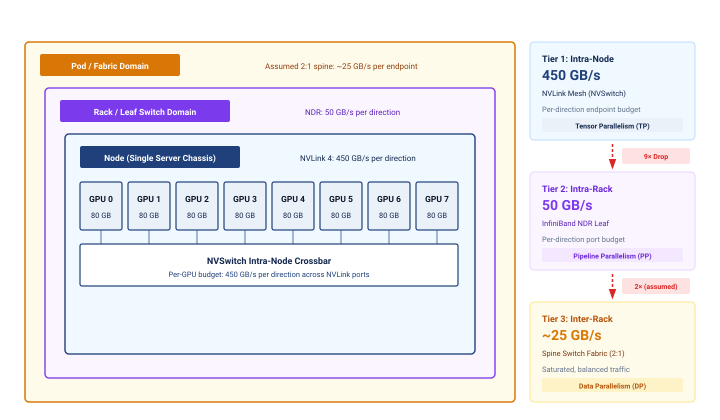

:::

For a 4-GPU collective group, the routing paths make that cost concrete (@fig-topology-placement-paths). In the illustrated contended fabric, scattering ranks across Rack A and Rack B forces a 3-hop leaf-spine-leaf path with about `{python} FleetTopologyInterconnect.oversub_lo_gb_per_s_str` of effective bandwidth per endpoint, a share of contended uplinks rather than a physical link rate. Consolidating all four ranks (G0–G3) under Rack A's leaf switch avoids those shared uplinks and provides about `{python} FleetTopologyInterconnect.ib_ndr_gb_per_s_str` per GPU under the example's load assumptions.

::: {#fig-topology-placement-paths fig-env="figure" fig-pos="htb" fig-cap="**Topology-unaware vs. topology-aware placement**: An illustrative 4-GPU job that permits inter-node placement and uses an oversubscribed cross-rack fabric, placed across two racks (left, topology-unaware) must traverse leaf-spine-leaf hops: 3 switch hops per AllReduce message at about `{python} FleetTopologyInterconnect.oversub_lo_gb_per_s_str` effective bandwidth. The same 4-GPU job packed within one rack (right, topology-aware) uses a single leaf switch: 1 hop at about `{python} FleetTopologyInterconnect.ib_ndr_gb_per_s_str`, roughly `{python} FleetTopologyInterconnect.rack_vs_spine_mult_str` faster. Blue squares are the job's GPUs; gray squares are GPUs held by other jobs." fig-alt="Two panels, each with a spine switch above two racks of four GPUs under a leaf switch; line width encodes per-GPU bandwidth, and GPUs held by other jobs are filled gray. Left, topology-unaware: GPUs G0 and G1 sit in Rack A and G2 and G3 in Rack B. A thin amber path runs from Rack A's leaf switch up through the spine switch and down to Rack B's leaf switch, inside pale shared-uplink channels that also carry gray flows from other jobs; the three traversed switches are tinted amber and numbered 1, 2, 3, labeled 3 hops at about 12.5 GB/s per GPU. Right, topology-aware: all four job GPUs sit in Rack A, joined to one green leaf switch numbered 1 by thick green links; the spine switch is gray and not crossed, and the label reads 1 hop at about 50 GB/s per GPU."}
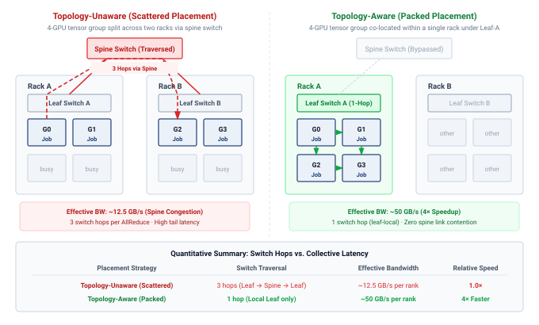

:::

### Placement algorithms {#sec-fleet-orchestration-placement-algorithms}

The illustrated `{python} FleetTopologyInterconnect.rack_vs_spine_mult_str` bandwidth difference between the 1-hop leaf path and the 3-hop spine route (@fig-topology-placement-paths) stretches the transfer component by the same factor when transfer time is bandwidth-dominated. Crossing a spine does not impose that ratio independently of load and topology. Whether communication exceeds computation also depends on the model and overlap schedule, and repeated exchanges can amplify the exposed cost. Topology-aware placement algorithms assign jobs to nodes that reduce this cost, turning resource packing into graph optimization over the physical topology. A simple **locality cost**\index{Locality Cost!definition}, defined in @eq-fleet-orchestration-locality-score, penalizes allocations spanning multiple topology domains:

$$ \text{Cost}_{\text{locality}} = \sum_{i < j} \LocalityPenaltyFunction(\GpuTopologicalDistance(\AssignedJobGpu_i, \AssignedJobGpu_j)) $$ {#eq-fleet-orchestration-locality-score}

where $\AssignedJobGpu_i$ and $\AssignedJobGpu_j$ are GPUs assigned to the job, $\GpuTopologicalDistance(\AssignedJobGpu_i, \AssignedJobGpu_j)$ is their topological distance (0 for same node, 1 for same rack, 2 for different racks), and $\LocalityPenaltyFunction(\cdot)$ is a weighting function that increases with distance. The scheduler minimizes this score when selecting an allocation from the set of feasible placements. An illustrative heuristic assigns the following locality penalties: $\LocalityPenaltyFunction(0) = 0$ (same node, NVLink, no penalty), $\LocalityPenaltyFunction(1) = 1$ (same rack, one switch hop), $\LocalityPenaltyFunction(2) = 10$ (different racks, multiple switch hops). These dimensionless weights are policy assumptions, not measured latency or bandwidth ratios. A deployment should calibrate them to its traffic and topology; an unweighted pairwise score also cannot distinguish heavily communicating rank pairs from pairs that rarely exchange data.

More sophisticated algorithms distinguish the communication requirements of different parallelism strategies. Frequent tensor-parallel activation exchanges favor a high-bandwidth, low-latency domain that meets the measured communication budget; that domain need not coincide with one server. Pipeline parallelism exchanges activations across stage boundaries rather than between every layer, but its tolerance for link delay depends on microbatch size and the pipeline schedule. Data-parallel gradient synchronization can overlap computation, making wider placement feasible when the exposed communication remains within budget. These patterns guide placement without establishing a universal ranking for every model or fabric.

@Algo-topology-aware-placement combines the all-or-nothing gang constraint of @sec-fleet-orchestration-gang-scheduling, the locality cost of @eq-fleet-orchestration-locality-score, and an illustrative parallelism-to-topology mapping. Its enumeration expresses the decision conceptually: construct feasible rank mappings, score their allocations, and choose the lowest illustrative locality score, leaving the job queued when none fits. This surrogate does not guarantee minimum communication time or completion time. A fleet-scale implementation must restrict that search using heuristics rather than enumerate every allocation.

```pseudocode
#| label: algo-topology-aware-placement
#| pdf-line-number: true
#| pdf-right-comment: false
#| html-comment-delimiter: "▷"
\begin{algorithm}
\caption{Topology-aware placement}
\begin{algorithmic}
\Require job requesting $N$ accelerators with tensor-, pipeline-, and data-parallel groups; cluster topology with illustrative per-level locality weights $w(\cdot)$
\Ensure an all-or-nothing feasible placement with the lowest illustrative locality score, or the job stays queued
\State enumerate candidate slots: sets of $N$ free accelerators that satisfy every resource dimension \Comment{gang: all or nothing}
\State retain only slots that admit a rank mapping satisfying the job's tensor-, pipeline-, and data-parallel communication constraints
\If{no feasible slot exists}
    \State leave the job queued without holding any accelerators \Comment{prevents hold-and-wait deadlock}
    \State \Return no placement
\EndIf
\For{each feasible slot}
    \State use a feasible rank mapping: tensor-parallel ranks within an NVLink domain, pipeline stages within a rack, data-parallel replicas across racks where permitted
    \State score the slot by $\text{Cost}_{\text{locality}} = \sum_{i < j} w(d(g_i, g_j))$
\EndFor
\State \Return the feasible slot of least $\text{Cost}_{\text{locality}}$ \Comment{minimum score among enumerated feasible placements; atomic allocation}
\end{algorithmic}
\end{algorithm}
```

```{python}
#| echo: false
#| label: lego-topology-placement
# ┌─────────────────────────────────────────────────────────────────────────────
# │ TOPOLOGY PLACEMENT (LEGO)
# ├─────────────────────────────────────────────────────────────────────────────
# │ Context: @fig-topology-placement prose and the 3D-parallel placement notebook.
# │
# │ Goal: Compute speedup from topology-aware placement.
# │ How: speedup = worst_latency/best_latency
# │
# └─────────────────────────────────────────────────────────────────────────────
from mlsysim.core.units import ms
from mlsysim.fmt import check, fmt, fmt_multiple, fmt_time

class TopologyPlacement:
    # ┌── 1. LOAD ──────────────────────────────────────────
    n_gpus = 64  # scenario assumption: AllReduce job size for the placement comparison
    lat_random = 120 * ms
    lat_rack = 85 * ms
    lat_rail = 40 * ms
    lat_optimal = 25 * ms
    # ┌── 2. EXECUTE ───────────────────────────────────────
    speedup = (lat_random / lat_optimal).to("").magnitude
    # ┌── 3. GUARD ─────────────────────────────────────────
    check(speedup == 4.8, f"Expected 4.8, got {speedup}")
    # 2026-09-28: constructed times must respect the stated ring payload and port.
    ring_bytes = 2 * (n_gpus - 1) / n_gpus * (0.5 * GB)
    ring_lower_bound = ring_bytes / Systems.Fabrics.InfiniBand_NDR.bandwidth
    check(lat_optimal >= ring_lower_bound, "Illustrative AllReduce cannot exceed the endpoint bandwidth bound")
    # ┌── 4. OUTPUT ────────────────────────────────────────
    random_placement_latency_ms_str = fmt_time(lat_random, ms, precision=0, commas=False)
    rack_aware_latency_ms_str = fmt_time(lat_rack, ms, precision=0, commas=False)
    rail_optimized_latency_ms_str = fmt_time(lat_rail, ms, precision=0, commas=False)
    optimal_latency_ms_str = fmt_time(lat_optimal, ms, precision=0, commas=False)
    speedup_mult_str = fmt_multiple(speedup, precision=1, commas=False)
    n_gpus_str = fmt(n_gpus, precision=0, commas=False)
```

Applied to a whole job, the same reasoning ranks placement strategies. The latencies in this comparison are illustrative, not derived. They are constructed to stay above the ring-AllReduce bandwidth bound for the payload, and they show the order in which placement removes delay rather than values a reader could recompute from topology names. For a 0.5 GB gradient synchronization on `{python} TopologyPlacement.n_gpus_str` GPUs, random placement spans multiple racks and spine switches and takes an assumed `{python} TopologyPlacement.random_placement_latency_ms_str`. Each successive strategy removes a source of delay that the previous one leaves. Confining the group to a single rack removes spine hops and reduces latency to `{python} TopologyPlacement.rack_aware_latency_ms_str`. Rail-optimized alignment maps ranks so that every member of each collective group sits at the same local GPU index and therefore on the same network rail (developed in @sec-fleet-orchestration-rail-optimized). Traffic that previously hopped between rails through the spine now stays within one rail's switches, which cuts latency to `{python} TopologyPlacement.rail_optimized_latency_ms_str`. Topology-optimal placement additionally avoids leaf ports that other jobs are using and reaches `{python} TopologyPlacement.optimal_latency_ms_str`, a `{python} TopologyPlacement.speedup_mult_str` reduction (@fig-topology-placement, where each bar also carries its algorithm throughput). This ratio compares whole collectives under four assumed placements, so it need not match the link-bandwidth ratio of the two-rack paths above.

::: {#fig-topology-placement fig-env="figure" fig-pos="htb" fig-cap="**Topology placement impact**: Assumed AllReduce latency across four placement strategies (Random, Rack-Aware, Rail-Optimized, and Topology-Optimal) for a 0.5 GB gradient sync on 64 GPUs. The assumed latency falls from 120 ms to 25 ms, a 4.8$\times$ ratio. Labels report payload divided by completion time (algorithm throughput), not physical link bandwidth. The dashed ghost above each bar names the source of delay that strategy removes." fig-alt="Bar chart of AllReduce latency for four placement strategies: random at 120 ms, rack-aware at 85 ms, and rail-optimized at 40 ms in gray, and topology-optimal at 25 ms in light green. Each bar carries its latency and algorithm throughput inside its top. Above each bar after the first, a dashed hatched ghost reaches up to the previous bar's height and names the delay that strategy removes: spine hops, cross-rail hops, and contended leaf ports, joined by dotted steps into a staircase. A dashed line carries the 120 ms level across the chart, and a green double arrow between it and the top of the topology-optimal bar is labeled 4.8 times lower."}

```{python}
#| echo: false
# ┌─────────────────────────────────────────────────────────────────────────────
# │ TOPOLOGY PLACEMENT (FIGURE)
# ├─────────────────────────────────────────────────────────────────────────────
# │ Context: @fig-topology-placement—AllReduce latency vs placement strategy
# │
# │ Goal: Bar chart comparing Random, Rack-Aware, Rail-Optimized, Topology-
# │       Optimal; show 4.8× speedup for 0.5 GB gradient sync on 64 GPUs.
# │ Show: Four bars with latency (ms) and effective bandwidth labels, plus
# │       dashed ghosts naming the delay each strategy removes.
# │ How: TopologyPlacement LEGO latencies; ax.bar; book_style.setup_plot().
# │
# └─────────────────────────────────────────────────────────────────────────────
# ┌── 1. CANVAS ────────────────────────────────────────────────────────────────
# │ Bar chart comparing Random, Rack-Aware, Rail-Optimized, Topology-
import numpy as np
from binder.tools.figures import style as book_style

# ┌── 2. ARRAYS ────────────────────────────────────────────────────────────────
strategies = ['Random', 'Rack-Aware', 'Rail-Optimized', 'Topology-Optimal']
lat = [TopologyPlacement.lat_random, TopologyPlacement.lat_rack, TopologyPlacement.lat_rail, TopologyPlacement.lat_optimal]
times = [t.to(ms).magnitude for t in lat]
gradient_payload = 0.5 * GB  # constructed placement scenario, not a measured benchmark
bandwidths = [(gradient_payload / t).to(GB / second).magnitude for t in lat]

fig, ax, COLORS, plt = book_style.setup_plot(figsize=(8, 4.6))
# Neutral bars for the strategies that leave delay on the table; green marks the target.
face = [COLORS['grid'], COLORS['grid'], COLORS['grid'], COLORS['GreenL']]
edge = [COLORS['secondary'], COLORS['secondary'], COLORS['secondary'], COLORS['GreenLine']]

# ┌── 3. RENDER ────────────────────────────────────────────────────────────────
x = np.arange(len(strategies))
bars = ax.bar(x, times, color=face, edgecolor=edge, linewidth=1.0, width=0.56)

# ┌── 4. DECORATE ──────────────────────────────────────────────────────────────
ax.set_xticks(x)
ax.set_xticklabels(strategies)
ax.set_ylabel('AllReduce latency (ms)')
ax.set_xlabel('Placement strategy')
ax.set_xlim(-0.55, len(strategies) - 0.1)
ax.set_ylim(0, max(times) * 1.08)
ax.grid(False)
ax.spines['top'].set_visible(False)
ax.spines['right'].set_visible(False)

# Value labels sit inside each bar's top so the removed-delay ghosts above stay clear.
for bar, time, bw in zip(bars, times, bandwidths):
    ax.text(
        bar.get_x() + bar.get_width() / 2.0,
        bar.get_height() - max(times) * 0.02,
        f'{time:.0f} ms\n({bw:.1f} GB/s)',
        ha='center',
        va='top',
        fontsize=9.5,
        color=COLORS['primary'],
    )

# Staircase: each strategy keeps the previous bar's height as a dashed ghost, and
# the ghost names the source of delay that strategy removes (prose order).
removed = ['spine hops', 'cross-rail hops', 'contended\nleaf ports']
for i in range(1, len(times)):
    xb = x[i] - 0.28
    # rc_context keeps the light hatch local to these ghosts (no rcParams leak).
    with plt.rc_context({'hatch.color': COLORS['grid'], 'hatch.linewidth': 0.6}):
        ax.bar(
            x[i],
            times[i - 1] - times[i],
            bottom=times[i],
            width=0.56,
            color='white',
            edgecolor=COLORS['secondary'],
            linewidth=0.8,
            linestyle=(0, (3, 2)),
            hatch='///',
            zorder=1,
        )
    ax.plot([x[i - 1] + 0.28, xb], [times[i - 1], times[i - 1]], color=COLORS['secondary'], lw=0.8, ls=(0, (2, 2)))
    ax.text(
        x[i],
        (times[i - 1] + times[i]) / 2.0,
        removed[i - 1],
        ha='center',
        va='center',
        fontsize=9,
        color=COLORS['primary'],
        linespacing=1.05,
        bbox=dict(boxstyle='square,pad=0.15', fc='white', ec='none'),
        zorder=3,
    )

# Ratio bracket: dashed reference at the random-placement latency, carried to
# the right of the topology-optimal bar, with a double arrow down to its top.
x_br = x[-1] + 0.38
ax.plot([x[0] + 0.28, x_br + 0.06], [times[0], times[0]], color=COLORS['secondary'], lw=0.8, ls=(0, (4, 3)))
ax.annotate(
    '', xy=(x_br, times[-1]), xytext=(x_br, times[0]), arrowprops=dict(arrowstyle='<->', color=COLORS['GreenLine'], lw=1.2, shrinkA=0, shrinkB=0)
)
ax.plot([x[-1] + 0.28, x_br + 0.06], [times[-1], times[-1]], color=COLORS['GreenLine'], lw=0.8)
ax.text(
    x_br - 0.06,
    (times[0] + times[-1]) / 2,
    f'{TopologyPlacement.speedup:.1f}$\\times$\nlower',
    ha='right',
    va='center',
    fontsize=10,
    color=COLORS['GreenLine'],
    fontweight='bold',
)

plt.tight_layout()
plt.show()
plt.close()
```

:::

A **hierarchical placement**\index{Hierarchical Placement!definition} algorithm applies these constraints from the most restrictive communication domain outward. In the illustrated fleet, it places each tensor-parallel group within an NVLink-connected node, then places consecutive pipeline stages under the same leaf switch. It distributes data-parallel replicas across racks only when the resulting collective fits the external bandwidth budget. This alignment reduces costly boundary crossings, but placement alone cannot reserve the fabric's full bisection bandwidth against other jobs.

The computational cost of topology-aware placement is nontrivial. Evaluating all possible placements for a 256-GPU job across a 10,000-GPU cluster is combinatorially intractable. Production schedulers use heuristic approaches: greedy algorithms that build placements bottom-up (first fill NVLink domains, then fill racks, then spread across racks), tree-search algorithms with pruning that explore the most promising placements first, or scoring-based approaches that evaluate a sample of feasible placements and select the best. Long jobs can amortize a more expensive search, but frequent submissions, short jobs, and recovery bursts also consume scheduler capacity. The useful comparison is end-to-end completion time, including placement delay, rather than execution throughput alone.

::: {#nbk-fleet-orchestration-topology-placement-3d-parallel .callout-notebook title="Placement impact on 3D-parallel training"}

**Scenario**: Consider a 256-GPU training job using 3D parallelism: 8-way tensor parallel, 4-way pipeline parallel, 8-way data parallel.

**Good placement**\index{Good Placement!definition} (topology-aware):

- Tensor parallel groups: 32 groups of 8 GPUs, each confined to one 8-GPU node (NVLink: `{python} FleetTopologyInterconnect.nvlink_h100_perdir_gb_per_s_str` per direction)
- Pipeline stages: 4 consecutive nodes within the same rack (1 switch hop, InfiniBand: `{python} FleetTopologyInterconnect.ib_ndr_gb_per_s_str` per direction)
- Data parallel replicas: 8 racks (3 switch hops through leaf-spine-leaf paths)

**Bad placement**\index{Bad Placement!definition} (topology-unaware):

- Tensor parallel groups split across 2 nodes (InfiniBand instead of NVLink)
- Pipeline stages scattered across racks (3 switch hops instead of 1)
- Data parallel replicas randomly distributed

**Math**: The tensor parallel communication alone illustrates the impact. With NVLink delivering `{python} FleetTopologyInterconnect.nvlink_h100_perdir_gb_per_s_str` per direction, a `{python} FleetTopologyInterconnect.activation_gb_str` activation transfer takes approximately `{python} FleetTopologyInterconnect.nvlink_xfer_ms_str`. Over InfiniBand at `{python} FleetTopologyInterconnect.ib_ndr_gb_per_s_str`, the same transfer takes approximately `{python} FleetTopologyInterconnect.ib_xfer_ms_str`, a `{python} FleetTopologyInterconnect.xfer_slowdown_mult_str` slowdown.

**Systems insight**: This calculation prices only the tensor-parallel component of the bad placement. Splitting a tensor-parallel group across nodes makes each activation exchange `{python} FleetTopologyInterconnect.xfer_slowdown_mult_str` slower, and the group performs such exchanges at every transformer layer of every step, so the penalty multiplies with model depth rather than appearing once. How much of it reaches step time depends on how much of the exchange was hidden behind computation, and it is why hierarchical placement gives tensor-parallel groups the fastest tier first. The scattered pipeline stages and data-parallel replicas add their own penalties on top, and the scheduler must profile the complete job before assigning a throughput benefit to the placement.

:::

### Rail-optimized scheduling {#sec-fleet-orchestration-rail-optimized}

In **rail-optimized topologies**\index{Rail-Optimized Topology!definition}, corresponding GPU positions across nodes connect through parallel network "rails." The design supplies separate paths that a suitable rank mapping can use concurrently. Balanced bandwidth depends on distributing traffic across those paths rather than concentrating it on a subset. Keeping a collective group on one rail avoids cross-rail transfers for that group, while the placement of other groups determines how much rail capacity it must share.

::: {.column-margin .margin-pointer}
↩ Rail-optimized fabric architectures and rail-to-rail traffic isolation are established in @sec-network-fabrics-rail-optimized.
:::

Rail-aware scheduling\index{Topology-Aware Scheduling!rail-aware} assigns corresponding model shards across data-parallel replicas to GPUs attached to the same rail. In the eight-GPU-per-node example, local GPU index $\LocalRankIndex$ connects to rail $\LocalRankIndex$. Every replica's copy of shard $\LocalRankIndex$ therefore stays at that local index on its selected node; the data-parallel replica rank varies across nodes, not across local GPU indices. The resulting collective can remain within the rail fabric. This removes cross-rail transfers for that group, but other groups or tenants can still contend for the same rail's links, so full dedicated bandwidth requires an explicit capacity and sharing contract.

Rail alignment therefore acts at two levels, and they belong to different components. Within a node it is a rank-mapping decision. The launcher or framework must give every member of a data-parallel group the same local GPU index on its node, which is what removes the cross-rail hops in the placement comparison above; a mapping that puts shard $\LocalRankIndex$ at index $\LocalRankIndex$ on one node and at another index elsewhere sends that group's traffic between rails. Across nodes it constrains the scheduler only when allocations are smaller than a node. When each replica's pipeline stage occupies a complete node and every node wires local GPU $\LocalRankIndex$ to rail $\LocalRankIndex$, any free node already offers every rail, so rail alignment does not narrow which racks the scheduler can choose. With partial-node allocations, a job can receive different local indices on different nodes, and the scheduler must then choose GPU positions as well as nodes so that each group's members share a rail. Those positions can conflict with the tensor-parallel budget and the paths between pipeline stages when only particular GPU positions remain free, so the packing cost follows the allocation granularity and the available topology rather than an inherent conflict among the three parallelism dimensions.

Resolving these conflicts means matching each 3D parallelism dimension to the interconnect tier its traffic can tolerate (@fig-fleet-orchestration-hierarchical-placement). Per-layer tensor-parallel activation exchanges stay on intra-node NVLink at `{python} FleetTopologyInterconnect.nvlink_h100_perdir_gb_per_s_str`, pipeline stage boundaries cross intra-rack leaf switches at `{python} FleetTopologyInterconnect.ib_ndr_gb_per_s_str`, and the once-per-step data-parallel gradient synchronization spans the oversubscribed spine at roughly `{python} FleetTopologyInterconnect.oversub_lo_num_str`--`{python} FleetTopologyInterconnect.oversub_hi_gb_per_s_str`. Even a single-node allocation can have meaningful topology constraints when GPUs occupy different interconnect, PCIe, or non-uniform memory access (NUMA) domains. Packing efficiency should therefore be optimized only among placements that satisfy the job's local and external communication contract.

::: {#fig-fleet-orchestration-hierarchical-placement fig-env="figure" fig-pos="htb" fig-cap="**Hierarchical placement for 3D parallelism**: This placement example maps distributed training dimensions to physical interconnect layers. Tensor parallelism (TP), which exchanges activations at every layer, stays inside a node on NVLink (`{python} FleetTopologyInterconnect.nvlink_h100_perdir_gb_per_s_str`); pipeline parallelism (PP) maps across adjacent nodes under one leaf switch (`{python} FleetTopologyInterconnect.ib_ndr_gb_per_s_str`); and data parallelism (DP), which exchanges gradients only once per step, spans racks through the oversubscribed spine. Bandwidths are per direction, as in @fig-fleet-orchestration-topology-hierarchy." fig-alt="Physical layout of one 3D-parallel job. Two racks, Rack 1 replica 1 and Rack N replica N, separated by an ellipsis, each contain a leaf switch above three nodes labeled stage 0, stage 1, and stage 2. Each node is a blue box of eight GPUs in two rows of four with a thick amber NVSwitch bar between them, and small amber arrows near the bottom of the nodes, below the NVSwitch bars, hand off from stage 0 to stage 1 to stage 2. Above the racks, an amber spine switch labeled oversubscribed joins the two leaf switches by an undirected dashed amber path labeled DP gradients once per step, about 12.5 to 25 GB/s. A bracket under one node of Rack 1 reads TP every layer, NVLink 450 GB/s, and a bracket under the three nodes of Rack N reads PP stage boundaries, leaf 50 GB/s."}
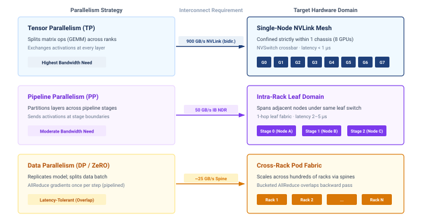

:::

### Topology discovery and dynamic adaptation {#sec-fleet-orchestration-topology-discovery}

Static configuration files like Slurm's `topology.conf` or Kubernetes node labels provide a baseline map of the cluster. Runtime **topology discovery**\index{Topology Discovery!definition} supplements that map with information exposed by the operating system and device libraries. NCCL uses system topology information, including the PCIe hierarchy and network devices exposed through paths such as `/sys/class/infiniband`, to identify communication paths and network interface card (NIC) proximity. The discovered graph describes reported connectivity; health checks and traffic measurements must establish whether those paths deliver the expected performance.

Cluster topology is an operating state, not a fixed schematic. Hardware failures, maintenance windows, and thermal throttling change the paths and effective capacity available to the scheduler. A spine switch failure in a redundant Clos network can leave connectivity intact while removing capacity. The effect on our 175B parameter model's data-parallel AllReduce depends on rerouting, concurrent traffic, and how much bandwidth the job was using. If the failure increases exposed communication time, the scheduler must compare continuing at reduced throughput with the cost of moving to a healthier allocation.

A checkpoint-and-restart migration spends time saving state, releasing the old allocation, obtaining a new one, and restoring execution. Its value depends on measured transition cost and remaining work. If migration takes 10 minutes and restores throughput after a sustained 20 percent penalty, it pays back in less than an hour of subsequent training. That comparison assumes a healthy destination is available and the gain persists. A practical policy also accounts for queue delay and requires evidence that placement causes the slowdown, such as rising collective time on the affected path, before it moves the job.

::: {#exmp-fleet-orchestration-limping-switch .callout-example title="The limping switch"}

**Scenario**: A multi-node foundation model training job exhibits a 30 percent throughput drop while static topology maps show full bandwidth and GPU hardware health checks report green.

**Diagnosis**: A single leaf switch transceiver experienced high CRC error rates and packet retransmissions. Binary up/down probes passed, but reduced effective bandwidth on the affected path delayed AllReduce completion and therefore the training group.

**Systems lesson**: Binary health checks are insufficient for distributed training fabrics. Schedulers require performance-aware topology monitoring that tracks retransmissions and collective bandwidth, dynamically quarantining degraded network links.

:::

::: {#ws-fleet-orchestration-health-checks .callout-war-story title="Performance-aware health checks (2021)"}

**Context**: OpenAI's account of scaling Kubernetes describes automated health checks that remove misbehaving nodes from the schedulable pool [@sigler2021openai_kubernetes].

**Mechanism**: Passive checks monitor reachability, disks, and GPU errors, but error codes do not expose every hardware or driver problem. Active GPU tests exercise the device before admitting ordinary workloads and periodically during its lifetime.

**Fix**: Nodes enter with a preflight taint, a node marking that repels ordinary pods, which blocks normal scheduling until the tests pass. Failed passive checks cordon a node; more serious failures can trigger eviction requests.

**Systems lesson**: Reachability alone is not a sufficient admission test. A scheduler needs health evidence that reflects the resources its jobs depend on, together with a policy for removing suspect nodes from placement.

:::

The general scheduling idea is quarantine: when runtime evidence says a node, rack, or link is degraded, the scheduler should stop placing sensitive work there even if the nominal resource count still looks available. Kubernetes implements this pattern through taints and tolerations\index{Taints and Tolerations!Kubernetes scheduling},[^fn-taint-toleration-rule] while Slurm clusters commonly use drain states, node features, or partition rules. The complementary problem is how jobs adapt when available resources change dynamically. Rather than treating resource allocation as fixed for a job's lifetime, elastic training allows logical jobs to grow, shrink, and recover. Whether worker processes restart depends on the framework; TorchElastic restarts its worker group when membership changes.

[^fn-taint-toleration-rule]: **Taints and Tolerations**\index{Taints and Tolerations!GPU isolation}: Node taints can block scheduling of pods without matching tolerations. A toleration permits consideration of a node but neither requires placement there nor reserves it exclusively for training. Dedicated GPU pools also need controlled toleration assignment and placement constraints; removing existing workloads requires an eviction or drain policy appropriate to the taint's effect.

## Elastic Scheduling {#sec-fleet-orchestration-elastic-training}

When cluster demand fluctuates, rigid allocation creates two categories of waste. During off-peak hours, a job running on 256 GPUs cannot absorb idle resources to speed up training. During peak demand, the same job cannot release excess resources to accommodate higher-priority work without being fully preempted. The scheduler's only options are "let it keep all its resources" or "kill it entirely," with nothing in between.

Elastic scheduling expands this binary choice. The recovery mechanics of elastic training show how a distributed job can adjust its worker count, adapt its batch policy, and reconstruct its communication group after a failure. From the scheduler's perspective, the same capability solves a resource-allocation problem under fluctuating demand. A training job might start with 128 GPUs, scale up to 256 when resources become available, and scale back to 192 when higher-priority work arrives, provided each allocation supports a viable worker group. Resizing may pause training and restart workers from saved state. The scheduler therefore chooses among supported allocation sizes, each with a transition cost, rather than assuming uninterrupted progress at any resource level.

::: {.column-margin .margin-pointer}
↩ Batch-size and learning-rate adjustment and communication-group contraction during elastic recovery are established in @sec-fault-tolerance-reliability-reliability-elastic-training-mechanisms-49b1.
:::

### The scheduler-framework contract {#sec-fleet-orchestration-elastic-contract}

Elastic scheduling requires a well-defined contract between the scheduler and the training framework. For planned resizing, the scheduler and framework coordinate resource release through defined signals and an agreed adaptation window. Unexpected failures can bypass that window, so the framework must also recover from valid saved state. Its recovery path reconstructs communication groups and either preserves the global batch or applies a validated batch-size and learning-rate policy. The worker-membership lifecycle therefore behaves as a state machine centered on active training (@fig-fleet-orchestration-elastic-state-machine). Idle GPUs trigger scale-up, preemptions trigger scale-down, and host timeouts or ECC errors divert ranks to worker replacement; each path returns to active training once the communication group is rebuilt or a spare node joins.

::: {#fig-fleet-orchestration-elastic-state-machine fig-env="figure" fig-pos="htb" fig-cap="**Elastic training worker lifecycle and state machine**: The state machine governing dynamic worker membership. Active training loops on step completion and leaves that state along three paths: idle GPUs trigger scale up, a preemption for higher-priority work triggers scale down, and a host timeout or ECC error triggers worker replacement. Each path rebuilds the communication group and returns to active training (dashed arrows), and a spot reclamation deadline can force a shrinking job straight into replacement. Worker processes may restart during resizing, so recovery requires the application to restore valid training state." fig-alt="State machine with a central active training state that has a step completion self-loop. Solid arrows lead from it to scale up on idle GPUs, to scale down on preemption, and to replace worker on host timeout or ECC error. Dashed arrows return to active training labeled group rebuilt, ranks released, and spare joined. A red dashed arrow labeled spot reclaim deadline runs from scale down to replace worker."}
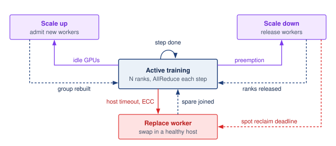

:::

From the scheduler's perspective, this contract is defined by three governing parameters: the elastic range, the transition cost, and the scaling efficiency curve. The elastic range\index{Elastic Scheduling!elastic range}, $[\ElasticMinimumWorkerCount, \ElasticMaximumWorkerCount]$, specifies lower and upper worker bounds; the job's parallelism layout determines the valid allocation increments within them. The transition cost\index{Elastic Scheduling!transition cost} includes any checkpoint, restart, state redistribution, and rendezvous required by the runtime. Measuring the full interruption determines how frequently the scheduler can trigger reallocations before transition overhead wipes out any throughput advantage. Finally, the scaling efficiency curve\index{Scaling Efficiency!elastic scheduling} quantifies the marginal throughput gained from each added worker, indicating whether assigning idle GPUs to this job yields more aggregate progress than holding them for an assembling gang-scheduled workload. Together, these parameters provide the scheduler with the quantitative bounds needed to resize jobs dynamically without treating elasticity as free capacity.

The scheduler must also account for the effect of worker count on global batch size ($\GlobalBatchSize = \PerWorkerBatchSize\times \DeviceCount$), where the per-worker batch counts examples contributing to one optimizer update, including gradient accumulation. Holding the global batch constant requires each remaining worker to process more examples after a shrink. Larger microbatches consume more memory; additional accumulation steps extend the update time. Preserving the batch removes one source of optimization change but does not guarantee identical convergence. Allowing the global batch to change instead requires validating the learning-rate policy and resulting model quality, so throughput alone cannot determine the best allocation.

Frameworks like TorchElastic expose the worker-membership range in their launch configuration, as @lst-fleet-orchestration-torchelastic illustrates.

::: {#lst-fleet-orchestration-torchelastic lst-cap="**TorchElastic Launch Configuration**: The `--nnodes=4:16` range configures the elastic worker group to admit 4 to 16 nodes, or 32 to 128 workers. A separate cluster scheduler or operator must acquire, launch, and release nodes within that range."}

```{.bash}
# Launch elastic training with min 32 to max 128 workers
torchrun \
  --nnodes=4:16 \
  --nproc_per_node=8 \
  --rdzv_backend=c10d \
  --rdzv_endpoint=head-node:29500 \
  --max_restarts=3 \
  train.py
```

:::

The `--nnodes=4:16` specification configures TorchElastic's rendezvous and worker-membership range as 4 to 16 nodes (32 to 128 workers with 8 processes per node). It does not acquire or resize cluster resources. A separate cluster scheduler or operator must place the nodes and start or stop elastic agents as capacity changes.

```{python}
#| echo: false
#| label: lego-elastic-vs-rigid
# ┌─────────────────────────────────────────────────────────────────────────────
# │ ELASTIC VS. RIGID SCHEDULING (LEGO)
# ├─────────────────────────────────────────────────────────────────────────────
# │ Context: callout-perspective "Elastic vs. rigid scheduling"
# │
# │ Goal: Show how much work an elastic job completes while a rigid gang waits.
# │ Show: 3.5 h of full-scale work during an 8 h wait; 28.5 h vs. 32 h; ~11%.
# │ How: Integrate fractional throughput over the wait, then finish at full scale.
# │      The full 128-GPU gang frees at the end of the wait for both policies.
# │
# └─────────────────────────────────────────────────────────────────────────────
from mlsysim.fmt import check, fmt, fmt_percent

class ElasticVsRigid:
    # ┌── 1. LOAD ──────────────────────────────────────────
    full_gpus = 128
    min_gpus = 32
    mid_gpus = 64
    wait_h = 8  # hours until the full 128-GPU gang frees
    step_up_h = 2  # hour at which 64 GPUs become free
    full_run_h = 24  # training time at full scale
    # ┌── 2. EXECUTE ───────────────────────────────────────
    frac_min = min_gpus / full_gpus
    frac_mid = mid_gpus / full_gpus
    work_phase1 = frac_min * step_up_h
    work_phase2 = frac_mid * (wait_h - step_up_h)
    work_during_wait = work_phase1 + work_phase2
    rigid_total_h = wait_h + full_run_h
    elastic_total_h = wait_h + (full_run_h - work_during_wait)
    saving_h = rigid_total_h - elastic_total_h
    saving_ratio = saving_h / rigid_total_h
    # ┌── 3. GUARD ─────────────────────────────────────────
    check(abs(work_during_wait - 3.5) < 1e-9, f"Expected 3.5 h equivalent, got {work_during_wait}")
    check(abs(elastic_total_h - 28.5) < 1e-9, f"Expected 28.5 h, got {elastic_total_h}")
    # ┌── 4. OUTPUT ────────────────────────────────────────
    full_gpus_str = fmt(full_gpus, precision=0, commas=False)
    min_gpus_str = fmt(min_gpus, precision=0, commas=False)
    mid_gpus_str = fmt(mid_gpus, precision=0, commas=False)
    wait_h_str = fmt(wait_h, precision=0, commas=False)
    step_up_h_str = fmt(step_up_h, precision=0, commas=False)
    full_run_h_str = fmt(full_run_h, precision=0, commas=False)
    phase2_h_str = fmt(wait_h - step_up_h, precision=0, commas=False)
    frac_min_pct_str = fmt_percent(frac_min, precision=0, commas=False, style='prose')
    frac_mid_pct_str = fmt_percent(frac_mid, precision=0, commas=False, style='prose')
    work_phase1_str = fmt(work_phase1, precision=1, commas=False)
    work_phase2_str = fmt(work_phase2, precision=0, commas=False)
    work_during_wait_str = fmt(work_during_wait, precision=1, commas=False)
    rigid_total_h_str = fmt(rigid_total_h, precision=0, commas=False)
    elastic_total_h_str = fmt(elastic_total_h, precision=1, commas=False)
    remaining_h_str = fmt(full_run_h - work_during_wait, precision=1, commas=False)
    saving_h_str = fmt(saving_h, precision=1, commas=False)
    saving_pct_str = fmt_percent(round(saving_ratio, 2), precision=0, commas=False, style='prose')
```

::: {#psp-fleet-orchestration-elastic-vs-rigid-scheduling .callout-perspective title="Elastic vs. rigid scheduling"}

Consider a congested cluster where a `{python} ElasticVsRigid.full_gpus_str`-GPU job waits `{python} ElasticVsRigid.wait_h_str` hours for a full gang allocation. This first comparison assumes throughput scales linearly with worker count, equivalent learning progress per processed example, and negligible resize overhead; the later scaling decision relaxes the throughput and transition assumptions.

**Rigid scheduling**\index{Rigid Scheduling!queue delay}: Wait `{python} ElasticVsRigid.wait_h_str` hours, then train for `{python} ElasticVsRigid.full_run_h_str` hours at full throughput. Total wall-clock: `{python} ElasticVsRigid.rigid_total_h_str` hours.

**Elastic scheduling**\index{Elastic Scheduling!definition} (min `{python} ElasticVsRigid.min_gpus_str`, max `{python} ElasticVsRigid.full_gpus_str`):

- Start immediately with `{python} ElasticVsRigid.min_gpus_str` GPUs (throughput = `{python} ElasticVsRigid.frac_min_pct_str` of full)
- At hour `{python} ElasticVsRigid.step_up_h_str`, when `{python} ElasticVsRigid.mid_gpus_str` GPUs free, scale to `{python} ElasticVsRigid.mid_gpus_str` (throughput = `{python} ElasticVsRigid.frac_mid_pct_str`)
- At hour `{python} ElasticVsRigid.wait_h_str`, when the full gang frees and the rigid job would also start, scale to `{python} ElasticVsRigid.full_gpus_str` (throughput = 100 percent)

Work completed during the `{python} ElasticVsRigid.wait_h_str`-hour queue wait, in hours of full-scale training:

- Hours 0 to `{python} ElasticVsRigid.step_up_h_str`: `{python} ElasticVsRigid.frac_min_pct_str` throughput $\times$ `{python} ElasticVsRigid.step_up_h_str` hours = `{python} ElasticVsRigid.work_phase1_str`
- Hours `{python} ElasticVsRigid.step_up_h_str` to `{python} ElasticVsRigid.wait_h_str`: `{python} ElasticVsRigid.frac_mid_pct_str` throughput $\times$ `{python} ElasticVsRigid.phase2_h_str` hours = `{python} ElasticVsRigid.work_phase2_str`
- Total: `{python} ElasticVsRigid.work_during_wait_str` hours of equivalent full-scale work

The elastic job completes in approximately `{python} ElasticVsRigid.elastic_total_h_str` hours (`{python} ElasticVsRigid.wait_h_str` hours of partial-scale training plus `{python} ElasticVsRigid.remaining_h_str` hours at full scale), saving `{python} ElasticVsRigid.saving_h_str` hours compared to rigid scheduling. This improvement of about `{python} ElasticVsRigid.saving_pct_str` comes entirely from using resources productively during what would otherwise be idle queue time.

:::

```{python}
#| echo: false
#| label: lego-elastic-node-range
# ┌─────────────────────────────────────────────────────────────────────────────
# │ ELASTIC NODE RANGE (LEGO)
# ├─────────────────────────────────────────────────────────────────────────────
# │ Context: Elastic-scaling constraints paragraph immediately below.
# │
# │ Goal: Bound the 175B job's elastic range by two registry tiers.
# │ Show: 128 nodes (1,024 GPUs) down to 32 nodes (256 GPUs); 8-way TP per node.
# │ How:  Scenarios.DenseLLMPretrainingReference.system (max) and
# │       Systems.Clusters.Research_256 (min); both use 8-GPU nodes.
# └─────────────────────────────────────────────────────────────────────────────
from mlsysim import Scenarios, Systems
from mlsysim.fmt import check, fmt

class ElasticNodeRange:
    # ┌── 1. LOAD ──────────────────────────────────────────
    max_sys = Scenarios.DenseLLMPretrainingReference.system
    min_sys = Systems.Clusters.Research_256
    # ┌── 2. EXECUTE ───────────────────────────────────────
    tp_degree = max_sys.node.accelerators_per_node  # TP confined to one node
    # ┌── 3. GUARD ─────────────────────────────────────────
    check(min_sys.node.accelerators_per_node == tp_degree, "both tiers must use the same node size")
    check(min_sys.count < max_sys.count, "minimum scale must be below maximum scale")
    # ┌── 4. OUTPUT ────────────────────────────────────────
    tp_degree_str = fmt(tp_degree, precision=0)
    max_nodes_str = fmt(max_sys.count, precision=0)
    max_gpus_str = fmt(max_sys.total_accelerators, precision=0)
    min_nodes_str = fmt(min_sys.count, precision=0)
    min_gpus_str = fmt(min_sys.total_accelerators, precision=0)
```

```{python}
#| echo: false
#| label: lego-elastic-scaling-curve
# ┌─────────────────────────────────────────────────────────────────────────────
# │ ELASTIC SCALING CURVE (LEGO)
# ├─────────────────────────────────────────────────────────────────────────────
# │ Context: Elastic-scaling constraints paragraph immediately below,
# │          @fig-fleet-orchestration-scaling-efficiency-curve, and the
# │          paragraph that introduces it.
# │
# │ Goal: Model eta_scaling for the 175B reference job from 64 to 4,096 GPUs.
# │ Show: 89 -> 69 percent; the pipeline bubble dominates the losses at scale,
# │       while throughput still rises at every step.
# │ How:  DistributedModel sweep; TP = node size; PP = smallest power of two
# │       that fits mixed-precision Adam state in HBM; fixed global batch from
# │       Brown et al. (2020). Each sweep point is an unregistered in-memory
# │       copy of the Training_1K fleet (HDR InfiniBand at every size).
# └─────────────────────────────────────────────────────────────────────────────
from mlsysim import Literature, ReferenceStats, Scenarios, Systems
from mlsysim.solvers import DistributedModel
from mlsysim.fmt import check, fmt, fmt_count, fmt_multiple, fmt_percent

class ElasticScalingCurve:
    # ┌── 1. LOAD ──────────────────────────────────────────
    scenario = Scenarios.DenseLLMPretrainingReference  # GPT-3 175B on DGX H100 + HDR IB
    model = scenario.workload
    fleet = scenario.system
    min_sys = Systems.Clusters.Research_256  # policy minimum (matches ElasticNodeRange)
    local_eff = float(ReferenceStats.TrainingScaleProfiles.LocalComputeEfficiency)
    batch_tokens = float(Literature.TrainingRuns.Gpt3BatchTokens)  # Brown et al. (2020), Table 2.1
    seq_len = model.context_length
    gpus_per_node = fleet.node.accelerators_per_node
    hbm = fleet.node.accelerator.memory.capacity
    sweep_doublings = 7  # scenario assumption: 64 ... 4,096 GPUs
    # ┌── 2. EXECUTE ───────────────────────────────────────
    state_bytes = 2 * BYTES_FP16 + BYTES_FP32 + BYTES_ADAM_STATE  # 16 B/param mixed-precision Adam
    tp = gpus_per_node  # TP confined to one node
    pp = 1
    while (model.parameters.magnitude * state_bytes / (tp * pp)).to(GiB) > hbm:
        pp *= 2  # smallest pipeline depth that fits HBM
    replica = tp * pp
    # Class scope: explicit loops, because comprehensions cannot see class variables.
    gpu_counts = []
    for _i in range(sweep_doublings):
        gpu_counts.append(replica * 2**_i)
    max_dp = gpu_counts[-1] // replica
    batch_seqs = int(batch_tokens / seq_len) // max_dp * max_dp  # divisible by every DP degree
    rows = []
    for _n in gpu_counts:
        _dp = _n // replica
        _r = DistributedModel().solve(
            model,
            fleet.model_copy(update={"count": _n // gpus_per_node}),
            batch_size=batch_seqs,
            precision="fp16",
            efficiency=local_eff,
            tp_size=tp,
            pp_size=pp,
            microbatch_count=batch_seqs // _dp,  # scenario assumption: one sequence per micro-batch
            overlap_comm=True,
            seq_len=seq_len,
        )  # scenario assumption: solver default 85% DP overlap
        _step = _r.step_latency_total.to("s").magnitude
        _tp = _r.tp_communication_latency.to("s").magnitude / _step
        _bub = _r.pipeline_bubble_latency.to("s").magnitude / _step
        rows.append(
            dict(n=_n, eff=_r.scaling_efficiency, thr=_r.effective_throughput.magnitude, tp=_tp, bub=_bub, dp=1 - _r.scaling_efficiency - _tp - _bub)
        )
    win_min = min_sys.total_accelerators
    win_max = fleet.total_accelerators
    i_min = gpu_counts.index(win_min)
    i_max = gpu_counts.index(win_max)
    thr_gain = rows[-1]["thr"] / rows[i_max]["thr"]
    # ┌── 3. GUARD ─────────────────────────────────────────
    check(pp == 8 and replica == 64, f"replica: expected TP8 x PP8 = 64 GPUs, got {tp}x{pp}")
    check(batch_seqs == 1536, f"global batch: expected 1,536 sequences, got {batch_seqs}")
    for _a, _b in zip(rows, rows[1:]):
        check(_a["eff"] >= _b["eff"], "efficiency must not rise with scale")
        check(_a["thr"] < _b["thr"], "throughput must still rise with scale")
    check(rows[-1]["bub"] > rows[-1]["tp"], "pipeline bubble should dominate losses at the top of the sweep")
    for _a, _b in zip(rows, rows[1:]):
        check(_a["tp"] >= _b["tp"], "prose says the tensor-parallel share never rises above its small-scale value")
    # ┌── 4. OUTPUT ────────────────────────────────────────
    tp_str = fmt(tp, precision=0, commas=False)
    pp_str = fmt(pp, precision=0, commas=False)
    replica_str = fmt_count(replica, commas=False, label="GPU")
    batch_seqs_str = fmt(batch_seqs, precision=0, commas=True)
    eff_min_str = fmt_percent(round(rows[i_min]["eff"], 2), precision=0, commas=False, style='prose')
    eff_max_str = fmt_percent(round(rows[i_max]["eff"], 2), precision=0, commas=False, style='prose')
    eff_top_str = fmt_percent(round(rows[-1]["eff"], 2), precision=0, commas=False, style='prose')
    tp_share_str = fmt_percent(round(rows[0]["tp"], 2), precision=0, commas=False, style='prose')
    top_gpus_str = fmt_count(gpu_counts[-1], commas=True, label="GPU")
    thr_gain_mult_str = fmt_multiple(thr_gain, precision=1, commas=False)
```

The scheduler cannot treat every worker count as a valid elastic configuration. Model parallelism constrains the allocation increment when the resize policy keeps tensor and pipeline layouts fixed and adds or removes whole data-parallel replicas. For a 175B-parameter job that relies on `{python} ElasticNodeRange.tp_degree_str`-way tensor parallelism within each node and `{python} ElasticScalingCurve.pp_str` pipeline stages across nodes, this policy operates at the granularity of a whole model replica of `{python} ElasticScalingCurve.replica_str`. The pipeline depth of `{python} ElasticScalingCurve.pp_str` is the smallest power of two at which each GPU's share of the mixed-precision Adaptive Moment Estimation (Adam) training state fits in its HBM when that state is not sharded across replicas. The feasible layout of @sec-distributed-training-systems instead uses a shallower pipeline and shards optimizer state across the data-parallel group with ZeRO (@sec-distributed-training-systems-systems-memoryefficient-data-parallelism-zero-fsdp-0e69). Keeping each replica's state self-contained costs memory, but it lets the scheduler add or remove a replica without redistributing every other replica's optimizer shards. The job can scale between `{python} ElasticNodeRange.max_nodes_str` nodes (`{python} ElasticNodeRange.max_gpus_str` GPUs) and `{python} ElasticNodeRange.min_nodes_str` nodes (`{python} ElasticNodeRange.min_gpus_str` GPUs) one replica at a time, changing the data-parallel degree. Removing a single GPU from a tensor-parallel group would instead require a new sharding layout and redistribution of training state. Changing the pipeline degree would also require repartitioning stages and rebuilding the pipeline schedule. A runtime that supports these transitions can expose them to the scheduler, but their feasibility and measured costs belong in the resize contract rather than following automatically from data-parallel elasticity.

The transition cost also constrains the scheduler's resize frequency. Each scaling event can interrupt useful work while the framework reconstructs its communication group and restores or redistributes state. The duration must be measured for the chosen runtime and checkpoint path. The scheduler must amortize this cost over the subsequent run duration, so small resize increments are only worthwhile if the job will run at the new scale for significantly longer than the transition window; @sec-fleet-orchestration-elastic-policies shows the thrashing that results when a policy ignores this amortization.

### Scheduler integration {#sec-fleet-orchestration-elastic-scheduler-integration}

The scheduler uses the declared $[\ElasticMinimumWorkerCount, \ElasticMaximumWorkerCount]$ range to choose when a job starts and how its allocation changes. Starting at the minimum can reduce queue delay; expanding into newly idle capacity can increase progress; shrinking can release borrowed capacity without terminating the logical job. Which of these wins depends on the job's scaling curve and transition cost, and the policies below compare the choices by the work completed over the same time window.

Each action must respect the framework contract. The most consequential of the three is **graceful preemption**\index{Graceful Preemption!definition}: when higher-priority work arrives, the scheduler first shrinks an elastic job toward $\ElasticMinimumWorkerCount$, reclaiming whole replicas at the next resize boundary, and resorts to checkpoint-and-preempt only when the final viable group itself must yield. Quota borrowing across teams, developed in @sec-fleet-orchestration-multi-tenancy, depends on this primitive whenever an owner reclaims capacity it lent. Scaling curves and transition costs determine whether the extra progress repays the disruption. Because batch changes can affect convergence, the test of a resize is time to target model quality, not throughput.

### Elastic scaling policies {#sec-fleet-orchestration-elastic-policies}

Adding resources to a running job does not always accelerate time-to-convergence. Communication and synchronization overhead limit throughput gains, requiring the scheduler to enforce elastic scaling policies based on empirical efficiency curves rather than resource availability alone. A job's scaling efficiency\index{Scaling Efficiency!operating regimes} $\ScalingEfficiency(\ScalingCurveWorkerCount)$ compares observed throughput at $\ScalingCurveWorkerCount$ workers with the throughput predicted by ideal linear scaling from a reference allocation. With fixed global work per step, it typically passes through three regimes: a near-linear regime where per-worker computation dwarfs every fixed per-step cost, a sublinear regime where pipeline fill and drain and the unhidden part of gradient synchronization become a visible share of each step, and a saturation regime where those fixed costs rival the shrinking computation itself. Assigning available GPUs to a saturated job can yield less useful progress than serving queued work. The lower allocation bound answers a different question. Below its **minimum viable scale**\index{Minimum Viable Scale!definition}, a job may lack the memory or complete parallel groups needed to execute at all. A policy can impose a higher minimum to meet a deadline, even when a smaller allocation remains computationally efficient.

::: {.column-margin}
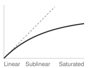{width="100%" fig-alt="Schematic throughput curve against worker count beside a dashed ideal linear diagonal from the origin. The curve follows the diagonal at first, falls away from it, and flattens, with the regions labeled linear, sublinear, and saturated along the horizontal axis."}

*Throughput falls away from ideal linear scaling and saturates.*
:::

The 175B reference job shows these regimes with the chapter's own numbers. Modeled at a fixed global batch with the step-time decomposition of the Fleet Law (@eq-fleet-law), its scaling efficiency falls from `{python} ElasticScalingCurve.eff_min_str` at `{python} ElasticNodeRange.min_gpus_str` GPUs to `{python} ElasticScalingCurve.eff_max_str` at `{python} ElasticNodeRange.max_gpus_str` GPUs and `{python} ElasticScalingCurve.eff_top_str` at `{python} ElasticScalingCurve.top_gpus_str` (@fig-fleet-orchestration-scaling-efficiency-curve, panel a). Efficiency falls, yet quadrupling from `{python} ElasticNodeRange.max_gpus_str` to `{python} ElasticScalingCurve.top_gpus_str` still raises throughput `{python} ElasticScalingCurve.thr_gain_mult_str`, so a lower efficiency is a declining marginal return rather than a slowdown. Panel (b) locates the loss. Tensor-parallel communication shrinks along with each worker's computation, so its share of the step never rises above `{python} ElasticScalingCurve.tp_share_str`. The decline comes instead from pipeline fill and drain and unhidden gradient synchronization, which take roughly fixed time per step while each worker's share of the batch shrinks. The pipeline bubble grows fastest of the three, for a reason the bubble fraction $(\PipelineParallelDegree-1)/(\MicrobatchCount+\PipelineParallelDegree-1)$ of @sec-distributed-training-systems-systems-pipeline-parallelism-8748 makes explicit. With the global batch fixed, each added replica takes a share of the sequences, so the microbatch count $\MicrobatchCount$ per replica falls while the stage count stays at `{python} ElasticScalingCurve.pp_str`, and the idle fraction rises. The shaded window from `{python} ElasticNodeRange.min_gpus_str` to `{python} ElasticNodeRange.max_gpus_str` GPUs is therefore a policy choice, not an interval derived from these efficiencies alone. A minimum allocation could follow from a completion deadline or the job's declared resource contract. It does not follow from insufficient per-worker computation at smaller scale, since with fixed global work fewer workers generally perform more work each. The upper limit likewise requires comparing additional useful progress with resize cost and the value of serving queued jobs. A real scheduler must obtain those inputs from profiling and the workload's quality target.

::: {#fig-fleet-orchestration-scaling-efficiency-curve fig-env="figure" fig-pos="htb" fig-cap="**Modeled scaling efficiency and elastic operating range**: (a) Scaling efficiency ($\ScalingEfficiency$) of the 175B reference job from 64 to 4,096 GPUs, computed with `{python} ElasticScalingCurve.tp_str`-way tensor parallelism within each DGX H100 node, `{python} ElasticScalingCurve.pp_str` pipeline stages, HDR InfiniBand, and a fixed global batch of `{python} ElasticScalingCurve.batch_seqs_str` sequences. The shaded window is an assumed admission policy; efficiency alone establishes neither its minimum nor its maximum. (b) Share of each step lost to tensor-parallel communication, pipeline bubble, and exposed gradient synchronization. Lower efficiency does not imply that adding workers reduces throughput." fig-alt="Two stacked panels sharing a GPU-count axis. Top, a line of modeled scaling efficiency against GPU count on a log scale from 64 to 4,096 GPUs, declining gently and then more steeply, with a shaded policy window from 256 to 1,024 GPUs. Bottom, stacked bars of the share of step time lost at each GPU count, labeled directly beside the 4,096-GPU bar from bottom to top as tensor-parallel communication, pipeline bubble, and exposed gradient synchronization; the tensor-parallel share stays nearly flat while the pipeline bubble grows fastest."}

```{python}
#| echo: false
# ┌─────────────────────────────────────────────────────────────────────────────
# │ ELASTIC SCALING CURVE (FIGURE)
# ├─────────────────────────────────────────────────────────────────────────────
# │ Context: @fig-fleet-orchestration-scaling-efficiency-curve
# │
# │ Goal: Plot the modeled efficiency of the 175B reference job with the
# │       assumed policy window, and break down where each step's time goes.
# │ Show: (a) efficiency vs GPUs on a log axis; (b) stacked lost-time shares.
# │ How:  Plot ElasticScalingCurve.rows; no values are computed here.
# └─────────────────────────────────────────────────────────────────────────────
# ┌── 1. CANVAS ────────────────────────────────────────────────────────────────
import numpy as np
import matplotlib.pyplot as plt
from binder.tools.figures import style as book_style

book_style.set_book_style()
COLORS = book_style.COLORS
# Stacked panels share one GPU axis: the bars of (b) sit directly under the points of (a).
fig, (ax, ax2) = plt.subplots(2, 1, figsize=(6.2, 5.6))

# ┌── 2. ARRAYS ────────────────────────────────────────────────────────────────
_esc = ElasticScalingCurve
n = np.array([r["n"] for r in _esc.rows])
eff = np.array([r["eff"] for r in _esc.rows])
tick_labels = [f"{v:,}" for v in n]

# ┌── 3. RENDER ────────────────────────────────────────────────────────────────
# (a) Efficiency with the assumed admission window shaded.
ax.axvspan(_esc.win_min, _esc.win_max, color=COLORS["grid"], alpha=0.45, lw=0)
ax.axhline(1.0, color=COLORS["secondary"], ls="--", lw=1)
ax.plot(n, eff, color=COLORS["BlueLine"], lw=2, marker="o", ms=5, zorder=3)
for _k, (x, y) in enumerate(zip(n, eff)):
    # below-left of each point keeps labels off the descending line; the first sits centered, clear of the spine
    ax.annotate(
        f"{y * 100:.0f}%",
        (x, y),
        textcoords="offset points",
        xytext=(0, -15) if _k == 0 else (-4, -14),
        ha="center" if _k == 0 else "right",
        fontsize=9.5,
        color=COLORS["primary"],
    )

# (b) Share of each step lost, by source. The pipeline bubble is the term that
# grows, so it carries the strong (dark neutral) fill; the two communication
# terms stay muted in the network hue (violet), separated by tint vs. dots.
loss_series = [
    ("tp", "Tensor-parallel comm.", COLORS["VioletL"], None, COLORS["VioletLine"]),
    ("bub", "Pipeline bubble", COLORS["secondary"], None, "white"),
    ("dp", "Exposed gradient sync", "white", "....", COLORS["VioletLine"]),
]
x = np.arange(len(n))
bottom = np.zeros(len(n))
for key, label, color, hatch, edge in loss_series:
    v = np.array([r[key] for r in _esc.rows])
    ax2.bar(x, v, bottom=bottom, color=color, label=label, width=0.7, hatch=hatch, edgecolor=edge, lw=0.5, zorder=3)
    bottom += v

# ┌── 4. DECORATE ──────────────────────────────────────────────────────────────
ax.text(n[-1] * 1.2, 0.992, "Ideal linear scaling", ha="right", va="top", fontsize=9.5, color=COLORS["secondary"])
ax.text(
    (_esc.win_min * _esc.win_max) ** 0.5,
    0.625,
    f"Assumed policy window\n[{_esc.win_min:,}, {_esc.win_max:,}] GPUs",
    ha="center",
    fontsize=9.5,
    color=COLORS["primary"],
)
ax.set_xscale("log", base=2)
ax.set_xticks(n)
ax.set_xticklabels(tick_labels, fontsize=9.5)
ax.minorticks_off()
ax.set_xlim(n[0] / 2**0.55, n[-1] * 2**0.55)  # aligns with the bar slots of (b)
ax.set_ylim(0.6, 1.02)
ax.set_yticks([0.6, 0.7, 0.8, 0.9, 1.0])
ax.set_yticklabels([f"{t:.0%}" for t in [0.6, 0.7, 0.8, 0.9, 1.0]])
ax.set_xlabel("GPUs (log scale)", fontsize=10)
ax.set_ylabel(r"Scaling efficiency $\eta_{\mathrm{scaling}}$", fontsize=10)
ax.set_title("(a)", loc="left", fontsize=10)

top = bottom.max() * 1.08
ax2.set_xticks(x)
ax2.set_xticklabels(tick_labels, fontsize=9.5)
ax2.set_xlim(-0.55, len(n) - 1 + 0.55)
ax2.set_axisbelow(True)
ax2.set_ylim(0, top)
_yt = np.arange(0, top, 0.1)
ax2.set_yticks(_yt)
ax2.set_yticklabels([f"{t:.0%}" for t in _yt])
ax2.set_xlabel("GPUs", fontsize=10)
ax2.set_ylabel("Share of step time lost", fontsize=10)
# Direct labels beside the largest stack instead of a legend, placed outside the
# axes (the frame ends at the last bar): each name sits at the middle of its own
# segment, so the reader reads the stack top to bottom.
_direct = {"tp": "tensor-parallel\ncomm.", "bub": "pipeline\nbubble", "dp": "exposed\ngradient sync"}
_cum = 0.0
for key, label, color, hatch, edge in loss_series:
    _v = _esc.rows[-1][key]
    _mid = _cum + _v / 2.0
    _cum += _v
    _ty = _mid + (0.022 if key == "dp" else 0.0)
    ax2.annotate(
        _direct[key],
        xy=(x[-1] + 0.37, _mid),
        xytext=(x[-1] + 0.85, _ty),
        ha="left",
        va="center",
        annotation_clip=False,
        fontsize=9.5,
        color=COLORS["primary"],
        linespacing=1.05,
        arrowprops=dict(arrowstyle="-", color=COLORS["secondary"], lw=0.7, shrinkA=1, shrinkB=0),
    )
ax2.grid(axis="x", visible=False)
ax2.set_title("(b)", loc="left", fontsize=10)

plt.tight_layout()
fig.align_ylabels((ax, ax2))
plt.show()
plt.close()
```

:::

This logic extends to the temporal dimension, where the scheduler must weigh the immediate progress of a smaller allocation against waiting for a larger one. If a 512-GPU job can start immediately with 128 GPUs or wait for the full request, the better choice depends on the integration of throughput over time. The resize overhead (the cost of stopping, checkpointing, and restarting when the runtime requires them) must be amortized over the subsequent run duration. A policy of "opportunistic scaling" that resizes a job every time a single node becomes free can lose its throughput advantage to repeated interruptions, completing less useful work than a stable allocation.

```{python}
#| echo: false
#| label: lego-elastic-scaling
# ┌─────────────────────────────────────────────────────────────────────────────
# │ ELASTIC SCALING DECISION (LEGO)
# ├─────────────────────────────────────────────────────────────────────────────
# │ Context: callout-notebook "The Elastic Scaling Decision"
# │
# │ Goal: Compare three elastic scaling strategies over a 24-hour window.
# │ How: total_work = run_hours × throughput_at_scale
# │
# └─────────────────────────────────────────────────────────────────────────────
from mlsysim.fmt import check, fmt, fmt_math, fmt_time

class ElasticScaling:
    # ┌── 1. LOAD ──────────────────────────────────────────
    window_h = 24  # scenario assumption
    wait_h = 4  # scenario assumption
    rescale_min = 10  # scenario assumption
    rescale_h = rescale_min / 60
    tp_128 = 1.0  # scenario assumption: relative throughput multipliers
    tp_256 = 1.8  # scenario assumption
    tp_512 = 3.2  # scenario assumption
    s1_gpus = 128
    s2_gpus = 512
    s3_gpus = 256
    # ┌── 2. EXECUTE ───────────────────────────────────────
    s1_work = window_h * tp_128
    s2_run_h = window_h - wait_h
    s2_work = s2_run_h * tp_512
    s3_phase1 = wait_h * tp_128
    s3_phase2_h = window_h - wait_h - rescale_h
    s3_phase2 = s3_phase2_h * tp_256
    s3_work = s3_phase1 + s3_phase2
    elastic_trails_wait_pct = (s2_work - s3_work) / s2_work * 100
    elastic_trails_wait_pct_r = round(elastic_trails_wait_pct)
    elastic_vs_immediate = s3_work / s1_work
    # Break-even re-scaling tax against Strategy 1: 4 + (24 - 4 - t) × 1.8 = 24
    # gives t = window - wait - (s1_work - s3_phase1) / tp_256 ≈ 8.9 h.
    rescale_break_even_h = window_h - wait_h - (s1_work - s3_phase1) / tp_256
    # ┌── 3. GUARD ─────────────────────────────────────────
    check(abs(rescale_break_even_h - 8.9) < 0.05, f"Break-even: expected ~8.9 h, got {rescale_break_even_h}")
    check(s1_work == 24.0, f"S1: expected 24.0, got {s1_work}")
    check(s2_work == 64.0, f"S2: expected 64.0, got {s2_work}")
    check(abs(s3_phase2 - 35.7) < 0.2, f"S3 phase 2: expected ~35.7, got {s3_phase2}")
    check(abs(s3_work - 39.7) < 0.2, f"S3 total: expected ~39.7, got {s3_work}")
    check(elastic_trails_wait_pct_r == 38, f"trail: expected 38%, got {elastic_trails_wait_pct_r}")
    # ┌── 4. OUTPUT ────────────────────────────────────────
    es_s3p1_str = fmt(s3_phase1, precision=0, commas=False)
    es_s3p2_str = fmt(s3_phase2, precision=1, commas=False)
    es_s3_str = fmt(s3_work, precision=1, commas=False)
    es_rescale_hours_str = fmt_time(rescale_h, 'hour', precision=2, commas=False, style='word')
    es_rescale_min_str = fmt_time(rescale_min, 'minute', precision=0, commas=False, style='word')
    es_rescale_break_even_h_str = fmt_time(round(rescale_break_even_h), 'hour', precision=0, commas=False, style='word')
    # Pre-compute the full Phase 2 math expression to avoid the
    # `\(...\)` + inline-`{python}` interaction anti-pattern that drops
    # the middle of the expression in rendered HTML (math.md §2).
    es_s3p2_math = fmt_math(rf"(24 - 4 - {rescale_h:.2f}) \times 1.8 \approx {s3_phase2:.1f}")
    # Pre-compute the worked-math products so prose carries no hand-typed
    # operands (lego-prose-literals Tier 1): every number in the equation
    # traces to the LOAD constants above.
    es_s1_math = fmt_math(rf"{window_h:.0f} \times {tp_128:.1f} = {s1_work:.0f}")
    es_s2_math = fmt_math(rf"{s2_run_h:.0f} \times {tp_512:.1f} = {s2_work:.0f}")
    es_s3p1_math = fmt_math(rf"{wait_h:.0f} \times {tp_128:.1f} = {s3_phase1:.0f}")
    es_s1_gpus_str = fmt_count(s1_gpus, commas=False, label="GPU")
    es_window_h_str = fmt_time(window_h, 'hour', precision=0, commas=False, style='word')
    es_wait_h_str = fmt_time(wait_h, 'hour', precision=0, commas=False, style='word')
    es_s2_gpus_str = fmt_count(s2_gpus, commas=False, label="GPU")
    es_s2_run_h_str = fmt_time(s2_run_h, 'hour', precision=0, commas=False, style='word')
    es_peak_gpus_str = fmt(s2_gpus, precision=0, commas=False)
    es_gpus_128_str = fmt_count(s1_gpus, commas=False, label="GPU")
    es_gpus_256_str = fmt_count(s3_gpus, commas=False, label="GPU")
    es_tp_128_str = fmt(tp_128, precision=0, commas=False)
    es_tp_256_str = fmt(tp_256, precision=1, commas=False)
    es_tp_512_str = fmt(tp_512, precision=1, commas=False)
    es_eff_256_pct_str = fmt_percent(round(tp_256 / (2 * tp_128), 2), precision=0, commas=False, style='prose')
    es_eff_512_pct_str = fmt_percent(round(tp_512 / (4 * tp_128), 2), precision=0, commas=False, style='prose')
    es_trails_wait_pct_str = fmt_percent(round(elastic_trails_wait_pct_r) / 100, precision=0, commas=False, style='prose')
    es_vs_imm_factor_mult_str = fmt_multiple(elastic_vs_immediate, precision=1, commas=False)
```

::: {#nbk-fleet-orchestration-elastic-scaling-decision .callout-notebook title="The elastic scaling decision"}

The comparison of elastic and rigid scheduling above assumed linear scaling and free resizing; this decision drops both assumptions. Consider a training job with a target batch size that requires `{python} ElasticScaling.es_peak_gpus_str` GPUs for the highest throughput among the configurations considered. Three scheduling strategies are evaluated over a window of `{python} ElasticScaling.es_window_h_str`.

**Given**: Throughput at `{python} ElasticScaling.es_gpus_128_str` is `{python} ElasticScaling.es_tp_128_str` epoch/hour (baseline). Throughput at `{python} ElasticScaling.es_gpus_256_str` is `{python} ElasticScaling.es_tp_256_str` epochs/hour (`{python} ElasticScaling.es_eff_256_pct_str` scaling efficiency relative to that baseline). Throughput at `{python} ElasticScaling.es_s2_gpus_str` is `{python} ElasticScaling.es_tp_512_str` epochs/hour (`{python} ElasticScaling.es_eff_512_pct_str` scaling efficiency). Re-scaling cost is `{python} ElasticScaling.es_rescale_min_str` (`{python} ElasticScaling.es_rescale_hours_str`) to checkpoint, re-shard, and restart.

**Strategy 1 (immediate start, no scaling)**: The job starts immediately with `{python} ElasticScaling.es_s1_gpus_str` and runs for the full `{python} ElasticScaling.es_window_h_str`. Total work: `{python} ElasticScaling.es_s1_math` epochs.

**Strategy 2 (wait for the full allocation)**: The job waits in the queue for `{python} ElasticScaling.es_wait_h_str` until `{python} ElasticScaling.es_s2_gpus_str` become available, then runs for `{python} ElasticScaling.es_s2_run_h_str`. Total work: `{python} ElasticScaling.es_s2_math` epochs.

**Strategy 3 (elastic step-up)**: The job starts immediately with `{python} ElasticScaling.es_gpus_128_str`. After `{python} ElasticScaling.es_wait_h_str`, the capacity that lets Strategy 2 start frees up, but the elastic policy caps growth at `{python} ElasticScaling.es_gpus_256_str` so that the remaining GPUs stay available to queued jobs. The job pauses, scales up, and resumes. Phase 1: `{python} ElasticScaling.es_s3p1_math` epochs. Phase 2: `{python} ElasticScaling.es_s3p2_math` epochs. Total work: `{python} ElasticScaling.es_s3p1_str` + `{python} ElasticScaling.es_s3p2_str` = `{python} ElasticScaling.es_s3_str` epochs.

The elastic strategy completes nearly `{python} ElasticScaling.es_vs_imm_factor_mult_str` the epoch-equivalent work of the immediate small-scale run, but still trails the full allocation by about `{python} ElasticScaling.es_trails_wait_pct_str`. That comparison counts this job's epochs, not the GPU-hours spent on them. Strategy 2 holds twice as many GPUs as Strategy 3 for most of the window and runs them at `{python} ElasticScaling.es_eff_512_pct_str` scaling efficiency against Strategy 3's `{python} ElasticScaling.es_eff_256_pct_str`, so the elastic job does more work per GPU-hour, and the GPUs it leaves free serve queued jobs. Which strategy wins therefore depends on whether the fleet values this job's completion time or the total work completed across all jobs. That gap shrinks when queue waits grow or peak capacity stays scarce; re-scaling overhead is only `{python} ElasticScaling.es_rescale_min_str`, so the step-up strategy keeps its lead over the immediate small-scale run unless slow checkpoint transfer or compilation stretches that tax beyond about `{python} ElasticScaling.es_rescale_break_even_h_str`.

:::

Placement and elasticity determine which allocations are feasible and how much useful progress they produce across competing jobs. Fleet economics adds the price of those choices. Every placement, preemption, and reservation consumes capacity that could serve another workload, so the scheduler must compare both useful progress and opportunity cost.

## Cost Optimization {#sec-fleet-orchestration-cost-optimization}

An idle accelerator in an enterprise fleet incurs operational costs every hour whether computing or blocked in a queue, turning placement and preemption decisions into direct financial trade-offs. The orchestrator translates this utilization-to-dollars relationship from @sec-fleet-orchestration-introduction into an online scheduling signal, balancing resource prices, reservation commitments, interruption risk, checkpoint cost, and job deadlines to decide whether to admit, delay, preempt, or resize work. Capital planning, portfolio return, cost attribution, and lifecycle total cost of ownership are larger, slower decisions developed in @sec-ops-scale-fleet-economics; the scheduler consumes their outcomes as prices and constraints.

```{python}
#| echo: false
#| label: lego-idle-cost-anchors
# ┌─────────────────────────────────────────────────────────────────────────────
# │ IDLE-COST ANCHORS (LEGO)
# ├─────────────────────────────────────────────────────────────────────────────
# │ Context: @fig-cost-idle-gpus prose and caption immediately below.
# │
# │ Goal: Price idle capacity at 10,000 GPUs and pin the published utilization
# │       measurements (Philly, Perlmutter) to Literature.FleetOperations.
# │ Show: ~$87.6M/yr waste at 50% utilization; >$52M/yr recovered moving to
# │       the 80% target (the chapter-wide 50 -> 80 baseline); Philly 52% mean utilization; Perlmutter 50% of jobs <25% memory.
# │ How:  N x (1 - util) x GpuHourRef x hours/year.
# └─────────────────────────────────────────────────────────────────────────────
from mlsysim import Literature
from mlsysim.fmt import check, fmt, fmt_percent, fmt_usd

class IdleCostAnchors:
    # ┌── 1. LOAD ──────────────────────────────────────────
    n_gpus = Systems.Clusters.Training_10K.total_accelerators
    gpu_hour_usd = Infrastructure.Pricing.Fleet.GpuHourRef.rate.to(USD / hour).magnitude
    util_low = 0.50  # scenario assumption: poorly scheduled utilization
    util_mid = Systems.Orchestration.target_cluster_utilization  # same 50 -> 80 improvement as the chapter opening
    philly_util = float(Literature.FleetOperations.PhillyMeanGpuUtilization)
    perlmutter_jobs = float(Literature.FleetOperations.PerlmutterJobsUnder25PctMemoryFraction)
    perlmutter_mem_threshold = 0.25  # threshold as reported by the study
    # ┌── 2. EXECUTE ───────────────────────────────────────
    waste_low = n_gpus * (1 - util_low) * gpu_hour_usd * HOURS_PER_YEAR
    recovered = n_gpus * (util_mid - util_low) * gpu_hour_usd * HOURS_PER_YEAR
    recovered_floor = (recovered // MILLION) * MILLION
    # ┌── 3. GUARD ─────────────────────────────────────────
    check(abs(waste_low / MILLION - 87.6) < 0.05, "caption quotes $87.6M at 10K GPUs, 50% utilization")
    check(recovered > recovered_floor, "prose says 'recovers over' the floored value")
    check(abs(recovered - ClusterEconomicsContext.productive_gpu_gain * gpu_hour_usd * HOURS_PER_YEAR) < 1, "must match the opening 50 -> 80 gain")
    # ┌── 4. OUTPUT ────────────────────────────────────────
    n_gpus_str = fmt(n_gpus, precision=0)
    gpu_hour_str = fmt_usd(gpu_hour_usd, precision=0, commas=False)
    util_low_str = fmt_percent(util_low, precision=0, style="prose")
    util_mid_str = fmt_percent(util_mid, precision=0, style="prose")
    waste_low_str = fmt_usd(waste_low, scale="M", precision=1, commas=False)
    recovered_str = fmt_usd(recovered_floor, scale="M", precision=0)
    philly_util_str = fmt_percent(philly_util, precision=0, style="prose")
    philly_util_pct_str = fmt_percent(philly_util, precision=0, style="symbol")
    perlmutter_jobs_str = fmt_percent(perlmutter_jobs, precision=0, style="prose")
    perlmutter_mem_str = fmt_percent(perlmutter_mem_threshold, precision=0, style="prose")

IdleCostAnchors.philly_util_pct_label = IdleCostAnchors.philly_util_pct_str
```

At a fixed utilization, idle capacity grows linearly with fleet size, so the dollar cost of a scheduling inefficiency grows with every procurement (@fig-cost-idle-gpus). At `{python} IdleCostAnchors.n_gpus_str` GPUs operating at `{python} IdleCostAnchors.util_low_str` utilization, annual waste reaches `{python} IdleCostAnchors.waste_low_str` under the chapter's `{python} IdleCostAnchors.gpu_hour_str`/GPU-hour accounting scenario. Published measurements show that such underutilization occurs in production. Microsoft's Philly cluster study [@jeon2019analysis] measured mean GPU utilization of approximately `{python} IdleCostAnchors.philly_util_str`. The 30 to 70 percent shaded band in the figure is an illustrative operating range for the cost model, not a universal empirical claim about all production clusters. Moving from `{python} IdleCostAnchors.util_low_str` to `{python} IdleCostAnchors.util_mid_str` utilization on a `{python} IdleCostAnchors.n_gpus_str`-GPU cluster recovers over `{python} IdleCostAnchors.recovered_str` annually in equivalent capacity value under this pricing scenario. That value equals the opening's annual waste at `{python} ClusterEconomicsContext.idle_pct_str` idle for a simple reason. Both scenarios concern `{python} ClusterEconomicsContext.idle_pct_str` of the same `{python} IdleCostAnchors.n_gpus_str` GPUs at the same rate, so both price `{python} ClusterEconomicsContext.productive_gpu_gain_str` GPU-equivalents of capacity, once as waste and once as recovery. Cash savings require avoiding billed usage or a planned purchase.

::: {#fig-cost-idle-gpus fig-env="figure" fig-pos="htb" fig-cap="**The cost of idle GPUs**: Annual wasted cost as a function of cluster size for different GPU utilization levels, assuming `{python} IdleCostAnchors.gpu_hour_str`/GPU-hour (cloud equivalent). The shaded region between 30 percent and 70 percent is an illustrative operating range for the scenario analysis. At `{python} IdleCostAnchors.n_gpus_str` GPUs with `{python} IdleCostAnchors.util_low_str` utilization, the model yields `{python} IdleCostAnchors.waste_low_str` in annual wasted capacity. The thin violet line traces the published Microsoft Philly mean GPU utilization of `{python} IdleCostAnchors.philly_util_str` across all cluster sizes; it is a utilization reference, not a measured cluster size or cost. Data source: @jeon2019analysis." fig-alt="Line chart of annual wasted cost in millions of dollars against cluster size from 1 to 20 thousand GPUs. Four straight lines rise from near the origin, labeled at their right ends 30, 50, 70, and 90 percent utilization, steepest for 30 percent. A light gray band fills the region between the 30 and 70 percent lines. A thin violet line just below the 50 percent line, labeled at its right end as the Philly mean of 52 percent, shows waste at the published Microsoft Philly utilization. A blue dot on the 50 percent line at 10 thousand GPUs marks 87.6 million dollars wasted per year; a key in the upper left names the dot and the band."}

```{python}
#| echo: false

# ┌─────────────────────────────────────────────────────────────────────────────
# │ COST OF IDLE GPUS (FIGURE)
# ├─────────────────────────────────────────────────────────────────────────────
# │ Context: @fig-cost-idle-gpus—utilization and waste economics
# │
# │ Goal: Plot annual wasted cost vs cluster size for 30/50/70/90% utilization;
# │       show $87.6M at 10K GPUs/50%; Microsoft Philly data point.
# │ Show: Four curves; shaded 30–70% typical range; annotations.
# │ How: Convert idle GPU capacity into annual wasted cost; book_style.setup_plot().
# │
# └─────────────────────────────────────────────────────────────────────────────
# ┌── 1. CANVAS ────────────────────────────────────────────────────────────────
# │ Plot annual wasted cost vs cluster size for 30/50/70/90% utilization;
import numpy as np
import matplotlib.pyplot as plt
from binder.tools.figures import style as book_style

fig, ax, COLORS, plt = book_style.setup_plot(figsize=(6.4, 3.9))

# Parameters

# ┌── 2. ARRAYS ────────────────────────────────────────────────────────────────
gpu_cost_per_hour = Infrastructure.Pricing.Fleet.GpuHourRef.rate.to(USD / hour).magnitude
# Plotted to 20K GPUs so the two marked points sit clear of the origin; the
# lines stay linear in fleet size, which is the point of the figure.
cluster_sizes = np.linspace(1000, 20000, 200)
X_END = cluster_sizes[-1] / THOUSAND

# Utilization levels differ by line style and gray value (darker = more waste);
# each line is labeled at its right end. The blue dot marks the worked example
# and the diamond the published Philly measurement; a key in the empty upper-left
# corner names both, so no leader line crosses a series.
util_configs = [
    (0.30, COLORS['primary'], '-', '30%'),
    (0.50, COLORS['primary'], '--', '50%'),
    (0.70, COLORS['secondary'], '-.', '70%'),
    (0.90, COLORS['secondary'], ':', '90%'),
]

# ┌── 3. RENDER ────────────────────────────────────────────────────────────────
# Shade the illustrative range (30% to 70%) first so lines draw over it.
waste_30 = cluster_sizes * (1 - 0.30) * gpu_cost_per_hour * HOURS_PER_YEAR / MILLION
waste_70 = cluster_sizes * (1 - 0.70) * gpu_cost_per_hour * HOURS_PER_YEAR / MILLION
ax.fill_between(cluster_sizes / THOUSAND, waste_70, waste_30, color=COLORS['grid'], alpha=0.35, lw=0)

for util, color, linestyle, label in util_configs:
    annual_waste = cluster_sizes * (1 - util) * gpu_cost_per_hour * HOURS_PER_YEAR / MILLION
    ax.plot(cluster_sizes / THOUSAND, annual_waste, color=color, linestyle=linestyle, linewidth=1.6)
    _y = annual_waste[-1] + (7 if util == 0.50 else 0)  # nudge 50% up to clear the Philly label
    ax.text(X_END * 1.015, _y, label, ha='left', va='center', fontsize=9.5, color=color)
ax.text(X_END * 1.015, max(waste_30) * 1.08, 'utilization', ha='left', va='center', fontsize=9.5, color=COLORS['secondary'])

# Microsoft Philly: the paper reports a mean utilization, not a cluster size,
# so it is drawn as a utilization reference line across every size, labeled
# in the right-edge column with the other utilization levels.
philly_waste = cluster_sizes * (1 - IdleCostAnchors.philly_util) * gpu_cost_per_hour * HOURS_PER_YEAR / MILLION
ax.plot(cluster_sizes / THOUSAND, philly_waste, color=COLORS['VioletLine'], lw=1.0, zorder=4)

waste_10k_50 = Systems.Clusters.Training_10K.total_accelerators * (1 - 0.50) * gpu_cost_per_hour * HOURS_PER_YEAR / MILLION
ax.text(
    X_END * 1.015,
    philly_waste[-1] - 9,
    f'Philly mean,\n{IdleCostAnchors.philly_util_pct_label}',
    ha='left',
    va='center',
    fontsize=9,
    color=COLORS['VioletLine'],
    linespacing=1.1,
)
ax.scatter([10], [waste_10k_50], color=COLORS['BlueLine'], s=70, zorder=6, edgecolors='white', linewidth=1.0)

# ┌── 4. DECORATE ──────────────────────────────────────────────────────────────
from matplotlib.lines import Line2D
from matplotlib.patches import Patch

_key = [
    (
        Line2D([], [], color=COLORS['BlueLine'], marker='o', ms=7, mec='white', ls='none'),
        f'10K GPUs at 50% util.: ${waste_10k_50:.1f}M wasted per year',
    ),
    (Patch(facecolor=COLORS['grid'], alpha=0.35, lw=0), 'illustrative range (30% to 70%)'),
]
_leg = ax.legend(
    [h for h, _ in _key],
    [t for _, t in _key],
    loc='upper left',
    fontsize=9.5,
    frameon=False,
    handlelength=1.2,
    handletextpad=0.6,
    borderaxespad=0.3,
    labelspacing=0.5,
)
for _t in _leg.get_texts():
    _t.set_color(COLORS['primary'])

ax.set_xlabel('Cluster size (thousands of GPUs)', fontsize=10)
ax.set_ylabel('Annual wasted cost ($M)', fontsize=10)
ax.set_xlim(0, X_END)
ax.set_xticks(np.arange(0, X_END + 1, 5))
ax.set_ylim(0, max(waste_30) * 1.12)
ax.spines['top'].set_visible(False)
ax.spines['right'].set_visible(False)

plt.tight_layout()
fig.subplots_adjust(right=fig.subplotpars.right - 0.02)  # keep the end-label column off the canvas edge
plt.show()
plt.close()
```

:::

The idle-capacity figure establishes the economic target; the remaining cost controls explain how the scheduler moves toward it. Interruptible capacity lowers the price of tolerant work, reservation and quota policy decide which jobs deserve scarce guaranteed capacity, and accountability mechanisms make idle GPUs visible to the teams that create demand.

### Spot instances and preemptible VMs {#sec-fleet-orchestration-spot-instances}

```{python}
#| echo: false
#| label: lego-fleet-spot-pricing
# ┌─────────────────────────────────────────────────────────────────────────────
# │ FLEET SPOT PRICING (LEGO)
# ├─────────────────────────────────────────────────────────────────────────────
# │ Context: Spot-instance economics prose immediately below this cell.
# │
# │ Goal: Contrast the spot and on-demand GPU-hour rates that set spot savings.
# │ Show: spot and on-demand GPU-hour rates, inline in the prose.
# │ How: Read both rates from Infrastructure.Pricing and render them as rates.
# │
# └─────────────────────────────────────────────────────────────────────────────
from mlsysim import Ops
from mlsysim.fmt import check, fmt, fmt_percent, fmt_time, fmt_usd

class FleetSpotPricing:
    # ┌── 1. LOAD ──────────────────────────────────────────
    hourly_rate = Infrastructure.Pricing.Fleet.GpuHourRef.rate.to(USD / hour).magnitude
    spot_rate = Infrastructure.Pricing.Fleet.SpotGpuHourRef.rate.to(USD / hour).magnitude
    discount_lo = float(Infrastructure.Pricing.Cloud.SpotDiscountLow.rate)
    discount_hi = float(Infrastructure.Pricing.Cloud.SpotDiscountHigh.rate)
    aws_notice = Ops.Preemption.AwsSpotNotice
    gcp_notice = Ops.Preemption.GcpPreemptibleNotice
    # ┌── 2. EXECUTE ───────────────────────────────────────
    ref_discount = 1 - spot_rate / hourly_rate
    # ┌── 3. GUARD ─────────────────────────────────────────
    check(discount_lo <= ref_discount <= discount_hi, "reference spot price must sit inside the quoted discount band")
    check(gcp_notice < aws_notice, "prose orders the notice window as 'as little as GCP to AWS'")
    # ┌── 4. OUTPUT (Formatting) ─────────────────────────────────────────────
    spot_price_str = fmt_usd(spot_rate, precision=2, commas=False, per="GPU-hour")
    on_demand_price_str = fmt_usd(hourly_rate, precision=0, commas=False, per="GPU-hour")
    discount_lo_num_str = fmt(discount_lo * 100, precision=0)
    discount_hi_pct_str = fmt_percent(discount_hi, precision=0, style="prose")
    aws_notice_str = fmt_time(aws_notice, "minute", precision=0, style="word")
    gcp_notice_str = fmt_time(gcp_notice, "second", precision=0, style="word")
    gcp_notice_attr_str = fmt_time(gcp_notice, "second", precision=0, style="word", attributive=True)
```

Cloud providers sell spare capacity through spot instances\index{Spot Instances!cost optimization}[^fn-spot-instances-cloud] (AWS) or **preemptible VMs**\index{Preemptible VMs!definition} (GCP), retaining the right to reclaim it. This chapter uses a `{python} FleetSpotPricing.discount_lo_num_str` to `{python} FleetSpotPricing.discount_hi_pct_str` discount band for its pricing comparison; actual discounts depend on the resource and market. The reference interruption windows range from up to `{python} FleetSpotPricing.gcp_notice_str` for GCP preemptible shutdown to `{python} FleetSpotPricing.aws_notice_str` for AWS stop or termination notices, with best-effort delivery rather than a guaranteed recovery interval. At the scenario rates of `{python} FleetSpotPricing.spot_price_str` instead of `{python} FleetSpotPricing.on_demand_price_str`, the worked comparison below shows how savings can exceed half the on-demand cost after accounting for its assumed interruption overhead.

[^fn-spot-instances-cloud]: **Spot Instances**\index{Spot Instances!cost optimization}: The scenario's `{python} FleetSpotPricing.discount_lo_num_str` to `{python} FleetSpotPricing.discount_hi_pct_str` discount purchases reclaimable capacity, not a guaranteed interval for saving state. AWS's best-effort stop or termination notice targets `{python} FleetSpotPricing.aws_notice_str`, while GCP preemptible shutdown allows up to `{python} FleetSpotPricing.gcp_notice_str`; AWS hibernation begins immediately. If a job's measured checkpoint time exceeds the reference `{python} FleetSpotPricing.gcp_notice_attr_str` window, a notice-triggered save cannot be its only recovery path.

The viability of spot instances for ML training depends on two factors that determine whether the discount translates into actual savings: the cost of each interruption (checkpoint overhead plus restart time plus lost work since the last checkpoint) and the frequency of interruption (which varies by instance type, region, time of day, and overall cloud demand). @Eq-fleet-orchestration-spot-cost gives the **effective cost**\index{Effective Cost!definition} of spot training:

$$ \EffectiveSpotTrainingCost= \SpotHourlyPrice\times \frac{\BilledAllocationTime}{\RetainedProductiveTime} $$ {#eq-fleet-orchestration-spot-cost}

where $\BilledAllocationTime$ is billed allocation time, including checkpointing, recovery, and work later discarded after an interruption, and $\RetainedProductiveTime$ is the equivalent training time represented by retained progress. The ratio assumes a fixed allocation size and price, with unchanged useful throughput while training; variable allocations require summing the cost of each allocation interval. Waiting for replacement capacity extends completion time but contributes to billed time only while resources remain allocated. When checkpointing and interruption losses consume a small fraction of billed time, effective cost stays near the spot price. Frequent interruptions, expensive recovery, or substantial replay can instead erase the discount.

Spot savings and fault tolerance infrastructure are coupled. Fault tolerance mechanisms (frequent asynchronous checkpointing, fast checkpoint loading, elastic recovery) make spot capacity usable by lowering the cost of each interruption. Elastic training can resume a logical job with fewer workers after reclamation, provided the remaining allocation is viable, although the framework may still restart worker processes and restore checkpointed state, so elasticity reduces recovery cost rather than eliminating it. The same infrastructure therefore earns a double return. It protects against hardware losses, and it enables the deliberate use of interruptible capacity. Both benefits require measurement. The scheduler combines observed interruption rates, recovery costs, and retained training progress with resource prices to estimate whether spot savings repay the additional recovery infrastructure. The same evidence supports valuing protection against hardware failures; neither benefit follows from the discount or checkpoint mechanism alone.

### Spot instance strategies for ML training {#sec-fleet-orchestration-spot-strategies}

Spot capacity pays off only when an interruption rarely removes the whole job at once, so schedulers that use it diversify where capacity comes from instead of simply retrying on failure. Availability zone diversification reduces the probability of simultaneous fleet-wide reclamation. Cloud providers typically manage spot pools independently per availability zone (AZ). If a training job requires `{python} ClusterEconomicsContext.gang_job_gpus_str` GPUs, allocating them as a single block in one zone exposes the job to a complete stop if that specific zone's spot pool is reclaimed. Diversifying independent jobs or restart destinations across zones reduces exposure to one exhausted pool. Splitting a single synchronous gang across zones also changes its communication paths, so the scheduler must include cross-zone bandwidth, latency, and transfer costs before accepting that placement. The scheduler still must model correlation carefully: independent per-instance interruptions make large simultaneous losses unlikely, but pool-level or AZ-level reclamations can remove hundreds of GPUs at once and must be treated as elastic-shrink or failover events rather than ordinary isolated failures.

Instance type diversification expands the set of capacity pools a job can use, though availability across those pools can remain correlated. A job that requests only one instance type cannot use spare capacity in another pool. Accepting alternatives therefore requires a compatibility list that includes memory capacity, runtime support, communication paths, and measured throughput. An instance with more memory can still be an unsuitable substitute if its runtime support, communication paths, or throughput differ. The scheduler compares each feasible alternative's price and recovery cost per unit of retained progress; mixing devices within a synchronous gang also requires accounting for unequal worker speeds.

Spot capacity signals can guide placement but do not necessarily predict interruption frequency. For example, the AWS Spot Placement Score estimates the current likelihood that a capacity request will succeed in a region or availability zone; it explicitly does not predict interruption risk. A scheduler can use this signal to choose where to request capacity, but estimating interruptions per day requires separate historical measurements for the instance type and region. If the resulting workload-specific recovery model shows that interruption overhead erases the discount, the scheduler should migrate the job to on-demand capacity or a different region.

Checkpoint frequency optimization for spot instances extends the reliability logic. The Young-Daly formula developed in @sec-fault-tolerance-young-daly models losses from unpredicted interruptions, whether caused by hardware failure or reclamation without a usable warning. Provider notices offer an additional opportunity to save state, using the reference windows of `{python} FleetSpotPricing.aws_notice_str` on AWS and up to `{python} FleetSpotPricing.gcp_notice_str` on GCP preemptible VMs. A **two-tier checkpointing**\index{Two-Tier Checkpointing!definition} approach combines periodic checkpoints, with an interval chosen for the workload's interruption model, and a best-effort checkpoint triggered by a notice. The notice-triggered checkpoint reduces lost work only if it becomes durable before reclamation. Otherwise, the job restores its last durable state, whether produced by a periodic, asynchronous, or incremental checkpoint, and replays subsequent work.

The same need for contingency planning becomes acute when spot interruptions are correlated rather than isolated.

::: {#psp-fleet-orchestration-correlated-spot-risk .callout-perspective title="Correlated spot risk"}

**Context**: Spot capacity is cheap because it is reclaimable. That risk is not independent across instances: cloud regions, instance types, product launches, and deadline cycles can create correlated demand.

**Failure mode**: A fleet that concentrates all interruptible training in one region and one instance type can lose a large fraction of workers at once, even if each individual worker appears restartable.

**Consequence**: Checkpointing handles isolated interruptions; it does not solve fleet-wide preemption when every retry targets the same exhausted pool.

**Systems insight**: A robust scheduler diversifies compatible restart destinations, monitors interruption risk, and plans an on-demand fallback when spot capacity cannot meet the job's deadline or cost target. That fallback still depends on available capacity and the time needed to restore state.

:::

### Capacity reservation strategies {#sec-fleet-orchestration-capacity-reservation}

Organizations that rely on cloud infrastructure (or that think about on-premise infrastructure in economic terms) balance three tiers of compute capacity, each trading cost and commitment against availability and interruption risk, and each suited to a different class of workload (@tbl-cloud-capacity-reservation-tiers).

| **Capacity tier**      | **Cost and commitment**                                                       | **Availability and interruption risk**                                       | **Best-fit workloads**                                                                                                                       |
|:-----------------------|:------------------------------------------------------------------------------|:-----------------------------------------------------------------------------|:---------------------------------------------------------------------------------------------------------------------------------------------|
| **Reserved capacity**  | Capacity reservation; price discounts require a separate purchasing contract. | Capacity assurance within the reservation terms; startup still takes time.   | Predictable continuous workloads: 24/7 inference, scheduled training, CI and regression testing, jobs under service-level agreements (SLAs). |
| **On-demand capacity** | Full price with no long-term commitment.                                      | Admission depends on available capacity; provisioning and startup add delay. | Urgent retraining, interactive debugging, and short-lived jobs that do not justify spot management.                                          |
| **Spot capacity**      | Discounted interruptible capacity.                                            | Availability varies with cloud demand, and workers can be reclaimed.         | Restart-tolerant jobs: hyperparameter sweeps, ablations, checkpointed pretraining, and exploratory research.                                 |

: **Cloud Capacity Reservation Tiers**: Capacity tiers trade cost and commitment against availability guarantees and interruption risk, giving the scheduler a price ladder for routing workloads by urgency and restart tolerance. {#tbl-cloud-capacity-reservation-tiers tbl-colwidths="[18,25,27,30]"}

The constructed portfolio in @fig-fleet-orchestration-capacity-reservation divides capacity into a reserved tier covering the steady 60 percent baseline, an on-demand band between 60 and 80 percent, and an interruptible spot tier serving peaks up to 92 percent. An organization with 60 percent steady-state utilization and 40 percent burst demand might reserve capacity for 60 percent of peak need, use on-demand for bursts whose deadlines tolerate admission and startup delay, and use spot for restart-tolerant work. These shares illustrate a policy rather than establish an optimal portfolio. The scheduler must match each workload's deadline and recovery contract to the capacity tier: reserved capacity can support the steady serving load or a training job's base allocation, while spot can support elastic replicas or independent experiments that tolerate reclamation. A peak in urgent demand cannot automatically be assigned to spot merely because it lies above the reserved band.

::: {#fig-fleet-orchestration-capacity-reservation fig-env="figure" fig-pos="htb" fig-cap="**Capacity reservation tiers and portfolio optimization**: This constructed portfolio combines reserved physical capacity, on-demand acquisitions, and interruptible workers. Reserved capacity covers the steady 60 percent base, on-demand the next 20 percent, and spot the peak; these shares and the demand curve are scenario assumptions. A discount commitment alone does not reserve capacity, and on-demand admission is not instantaneous. Schedulers map steady-state baseline demand to reserved capacity, diurnal spikes to on-demand instances, and restart-tolerant training to discounted spot pools. Hatching marks reserved capacity that is held while demand sits below it." fig-alt="Chart of share of peak capacity over one day with three horizontal tiers separated by dashed lines: reserved from 0 to 60 percent, steady base load; on-demand from 60 to 80 percent, bursts that can wait; and spot from 80 to 100 percent, restart-tolerant work. A constructed demand curve starts near 40 percent, peaks near 92 percent inside the spot tier, and settles near 50 percent. The area under the curve is filled with the color of the tier that serves it: blue below 60 percent, yellow between 60 and 80, and green above 80. Inside the reserved tier, the area above the curve is hatched and labeled reserved, idle, while the on-demand and spot tiers stay white wherever demand does not reach them."}
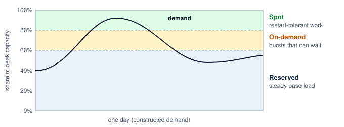

:::

```{python}
#| echo: false

# ┌─────────────────────────────────────────────────────────────────────────────
# │ SPOT TRAINING ECONOMICS (LEGO)
# ├─────────────────────────────────────────────────────────────────────────────
# │ Context: callout-perspective "Spot vs. on-demand training"
# │
# │ Goal: Compare on-demand and spot costs for a 512-GPU, 14-day run.
# │ How: Compare GPU-hours at on-demand and spot GPU-hour rates.
# │
# └─────────────────────────────────────────────────────────────────────────────
from mlsysim import *

class SpotTrainingEconomics:
    # ┌── 1. LOAD ──────────────────────────────────────────
    fleet = Systems.Clusters.Training_512_H100
    gpus = fleet.total_accelerators
    run_hours = 14 * HOURS_PER_DAY  # scenario assumption: 14-day run
    on_demand_rate = Infrastructure.Pricing.Fleet.GpuHourRef.rate.to(USD / hour).magnitude
    spot_rate = Infrastructure.Pricing.Fleet.SpotGpuHourRef.rate.to(USD / hour).magnitude
    checkpoint_overhead_fraction = 0.05  # scenario assumption
    interruptions_per_day = 14  # scenario assumption: fixed event budget per day of useful training, not wall-clock hazard
    restart_hours = 0.5  # scenario assumption
    # ┌── 2. EXECUTE ───────────────────────────────────────
    on_demand_cost = gpus * run_hours * on_demand_rate
    spot_base_cost = gpus * run_hours * spot_rate
    checkpoint_extra_hours = checkpoint_overhead_fraction * run_hours
    run_days = run_hours // HOURS_PER_DAY
    restart_interruptions = interruptions_per_day * run_days
    restart_total_hours = restart_interruptions * restart_hours
    spot_total_hours = run_hours + checkpoint_extra_hours + restart_total_hours
    spot_total_cost = gpus * spot_total_hours * spot_rate
    savings = on_demand_cost - spot_total_cost
    savings_pct = savings / on_demand_cost * 100
    longer_pct = (spot_total_hours / run_hours - 1) * 100
    # ┌── 3. GUARD ─────────────────────────────────────────
    check(on_demand_cost == 344064, f"Expected on-demand cost 344064, got {on_demand_cost}")
    check(abs(spot_total_hours - 450.8) < 1e-9, f"Expected 450.8 hours, got {spot_total_hours}")
    check(abs(spot_total_cost - 161566.72) < 1e-2, f"Expected spot cost 161566.72, got {spot_total_cost}")
    # ┌── 4. OUTPUT ────────────────────────────────────────
    on_demand_rate_str = fmt_usd(on_demand_rate, precision=0, commas=False, per="GPU-hour")
    spot_rate_str = fmt_usd(spot_rate, precision=2, commas=False, per="GPU-hour")
    on_demand_cost_str = fmt_usd(on_demand_cost, precision=0)
    spot_base_cost_str = fmt_usd(spot_base_cost, precision=0)
    checkpoint_extra_hours_str = fmt_time(checkpoint_extra_hours, 'hour', precision=1, commas=False, style='word')
    restart_total_hours_str = fmt_time(restart_total_hours, 'hour', precision=0, commas=False, style='word')
    spot_total_hours_str = fmt_time(spot_total_hours, 'hour', precision=1, commas=False, style='word')
    spot_total_cost_str = fmt_usd(spot_total_cost, precision=0)
    savings_str = fmt_usd(savings, precision=0)
    savings_pct_str = fmt_percent(savings_pct / 100, precision=1, commas=False, style='prose')
    longer_pct_str = fmt_percent(longer_pct / 100, precision=1, commas=False, style='prose')
    spot_gpus_str = fmt_count(gpus, commas=False, label="GPU")
    spot_run_hours_str = fmt_time(run_hours, 'hour', precision=0, commas=False, style='word')
    checkpoint_overhead_pct_str = fmt_percent(checkpoint_overhead_fraction, precision=0, commas=False, style='prose')
    # "%"-glyph math form for the worked-calc line; the prose twin (checkpoint_overhead_pct_str) keeps the word.
    checkpoint_overhead_pct_math = fmt_math(rf"{checkpoint_overhead_fraction * 100:.0f}\%")
    restart_interruptions_str = fmt_count(restart_interruptions, commas=False, label="interruption")
    interruptions_per_day_str = fmt_count(interruptions_per_day, commas=False, label="interruption")
    restart_hours_each_str = fmt_time(restart_hours, 'hour', precision=1, commas=False, style='word')
    restart_min_str = fmt_time(round(restart_hours * 60), 'minute', precision=0, commas=False, style='word')
    model_params_b_str = fmt_params(Models.Language.Llama2_70B.parameters, precision=0, commas=False)
    spot_run_days_str = fmt_time(round(run_hours // HOURS_PER_DAY), 'day', precision=0, commas=False, style='word')
    spot_discount_pct_str = fmt_percent(round(1 - spot_rate / on_demand_rate, 2), precision=0, commas=False, style='prose')
    spot_gpus_num_str = fmt(gpus, precision=0, commas=False)
    spot_run_days_attr_str = fmt_time(round(run_hours // HOURS_PER_DAY), 'day', precision=0, style='word', attributive=True)
    restart_min_attr_str = fmt_time(round(restart_hours * 60), 'minute', precision=0, style='word', attributive=True)
```

::: {#psp-fleet-orchestration-spot-vs-demand-training .callout-perspective title="Spot vs. on-demand training"}

Consider training a `{python} SpotTrainingEconomics.model_params_b_str` parameter model, a smaller workload than the chapter's 175B reference, on `{python} SpotTrainingEconomics.spot_gpus_str` for `{python} SpotTrainingEconomics.spot_run_days_str`. The scenario fixes the event budget at `{python} SpotTrainingEconomics.restart_interruptions_str` over the run and treats each as graceful, so no progress is replayed.

**On-Demand**\index{On-Demand Capacity!cost comparison}: `{python} SpotTrainingEconomics.spot_gpus_str` $\times$ `{python} SpotTrainingEconomics.spot_run_hours_str` $\times$ `{python} SpotTrainingEconomics.on_demand_rate_str` = `{python} SpotTrainingEconomics.on_demand_cost_str`

**Spot**\index{Spot!definition} (`{python} SpotTrainingEconomics.spot_discount_pct_str` discount, `{python} SpotTrainingEconomics.checkpoint_overhead_pct_str` checkpoint overhead, `{python} SpotTrainingEconomics.interruptions_per_day_str` per day of useful training with `{python} SpotTrainingEconomics.restart_min_str` restart):

- Base cost: `{python} SpotTrainingEconomics.spot_gpus_str` $\times$ `{python} SpotTrainingEconomics.spot_run_hours_str` $\times$ `{python} SpotTrainingEconomics.spot_rate_str` = `{python} SpotTrainingEconomics.spot_base_cost_str`
- Checkpoint overhead: `{python} SpotTrainingEconomics.checkpoint_overhead_pct_math` $\times$ `{python} SpotTrainingEconomics.spot_run_hours_str` = `{python} SpotTrainingEconomics.checkpoint_extra_hours_str`
- Restart overhead: `{python} SpotTrainingEconomics.restart_interruptions_str` $\times$ `{python} SpotTrainingEconomics.restart_hours_each_str` = `{python} SpotTrainingEconomics.restart_total_hours_str`
- Total time: `{python} SpotTrainingEconomics.spot_run_hours_str` + `{python} SpotTrainingEconomics.checkpoint_extra_hours_str` + `{python} SpotTrainingEconomics.restart_total_hours_str` = `{python} SpotTrainingEconomics.spot_total_hours_str`
- Total cost: `{python} SpotTrainingEconomics.spot_gpus_str` $\times$ `{python} SpotTrainingEconomics.spot_total_hours_str` $\times$ `{python} SpotTrainingEconomics.spot_rate_str` = `{python} SpotTrainingEconomics.spot_total_cost_str`

**Savings**: `{python} SpotTrainingEconomics.savings_str` (`{python} SpotTrainingEconomics.savings_pct_str`), at the cost of approximately `{python} SpotTrainingEconomics.longer_pct_str` longer wall-clock time.

The economics are compelling when fault tolerance infrastructure is already in place. Without checkpointing, a single interruption forces restart from scratch, potentially wasting days of compute and negating all savings.

:::

### Cost-aware scheduling policies {#sec-fleet-orchestration-cost-scheduling}

Cost-aware scheduling adds financial efficiency to the completion-time, utilization, and fairness objectives already introduced. The orchestrator evaluates three recurring classes of trade-offs: waiting versus running immediately, preempting existing tasks versus paying more for on-demand capacity, and falling back versus shrinking elastically. For example, it might compare an immediate launch on reserved A100 GPUs with waiting two hours for spot H100 instances. If workload profiling and the price model predict twice the throughput at half the execution cost, the remaining question is whether those gains repay the delay and interruption risk. When capacity becomes constrained, the scheduler must balance preempting a low-priority hyperparameter sweep on reserved capacity against routing a high-priority training run to more expensive on-demand instances. When a provider reclaims spot instances, the policy compares replacing them with on-demand nodes against shrinking elastically. These choices require the costs of waiting, recovery, and displaced work as well as the price of the new allocation.

These decisions require the scheduler to model both the time-value of computation (the organizational cost of a 2-hour delay in researcher productivity, product launch schedules, or competitive position) and the financial cost of different resource allocations. Delaying a production model retrain by 2 hours might violate a service level agreement (SLA), while the same delay to an exploratory experiment can postpone a research decision or block dependent work. A workload class's delay tolerance is therefore a policy input grounded in its dependencies and deadlines, not an assumption that exploratory work has no time cost.

Production systems can define **cost policies**\index{Cost Policy!definition} per workload class that encode these trade-offs as configuration rather than requiring per-decision human judgment. One policy places steady inference demand on reserved capacity and maintains ready replicas to meet its latency target; the reservation alone does not guarantee application availability or latency. Large training runs can combine a reserved minimum viable allocation with interruptible elastic expansion, requesting on-demand replacements when a deadline justifies the cost and capacity is available. Exploratory workloads with flexible deadlines can use spot capacity while accepting interruptions and variable completion times. These assignments express the organization's priorities rather than a universal mapping from workload type to purchasing tier.

The scheduler does not implement the organization's financial accounting system. It consumes the resulting price and policy signals: the marginal price of each capacity tier, the reservation a project may claim, the interruption risk it may accept, and the deadline it must meet. Showback, chargeback, and attribution belong to that accounting system; the scheduler uses their outputs only to rank feasible scheduling actions.

::: {.column-margin .margin-pointer}
↪ Tag-based cost attribution, shared-cost allocation, and chargeback are developed in @sec-ml-operations-scale-cost-visibility-attribution-3f3a.
:::

### Total cost of ownership integration {#sec-fleet-orchestration-tco}

Total cost of ownership (TCO) determines the price signals exposed to the scheduler, but it is not itself a scheduling mechanism. The orchestrator needs only the resulting per-resource opportunity costs and policy constraints, including whether capacity is owned, reserved, on demand, or interruptible.

::: {.column-margin .margin-pointer}
↪ The lifecycle TCO framework, which combines training, inference, data, and iteration costs, is developed in @sec-ml-operations-scale-ml-systems-tco-framework-b980.
:::

::: {#chk-fleet-orchestration-cost-aware-scheduling-trade-offs .callout-checkpoint title="Cost-aware scheduling trade-offs"}

Before moving to ML-specific schedulers, review how the cost-optimization mechanisms interact:

- [ ] **Spot break-even**: identify the additional inputs needed to compute a break-even checkpoint interval for the `{python} SpotTrainingEconomics.spot_gpus_num_str`-GPU, `{python} SpotTrainingEconomics.spot_run_days_attr_str` training job of the spot comparison above (`{python} SpotTrainingEconomics.spot_discount_pct_str` spot discount, `{python} SpotTrainingEconomics.interruptions_per_day_str` per day, `{python} SpotTrainingEconomics.restart_min_attr_str` restart overhead), including checkpoint duration, the interruption-rate clock, and lost-progress assumptions.
- [ ] **Double return**: explain why fault tolerance infrastructure has a "double return" for reliability and cost savings, and identify the minimum fault tolerance investment needed to make spot instances viable.
- [ ] **Reservation sizing**: starting from the constructed portfolio that reserves 60 percent of peak, identify the demand history, reservation terms, unit prices, and unused-capacity costs needed to decide whether raising the reserved share to 70 percent reduces total spending.

:::

Spot pricing and reservation strategy reduce the cost of capacity, but they do not determine which competing job should receive it. Runtime uncertainty, unequal completion delays, and the cost of interrupting an iteration remain even when prices are known. Resolving them requires signals from the workload itself, such as how much service a job has consumed, where its iteration boundaries fall, or how fast it is learning. A scheduler that tracks learning progress can optimize time-to-accuracy, the wall-clock time until a run reaches a target validation metric, rather than execution speed alone.

## Custom ML Schedulers {#sec-fleet-orchestration-custom-schedulers}

A short experiment waiting behind a long training run can suffer even when every running job has an efficient placement. Improving that outcome requires a policy for deciding which job receives the next available resources. Custom ML schedulers use different signals to make that decision: consumed service can prioritize jobs without runtime estimates, iteration boundaries can make preemption cheaper, normalized finish time can expose unfair delay, and measured goodput can guide joint resource and batch-size changes. Only the last of these requires a model of learning progress; the others improve completion time, utilization, or fairness without predicting convergence.

### Duration-agnostic scheduling (Tiresias) {#sec-fleet-orchestration-tiresias}

**Tiresias**\index{Tiresias!definition} [@gu2019tiresias] addresses the fundamental problem identified in @sec-fleet-orchestration-gang-scheduling: ML job durations are unpredictable, and scheduling policies that rely on exact duration estimates can make poor decisions when those estimates are unavailable or unreliable. Rather than fighting this information asymmetry, Tiresias eliminates the requirement for duration estimates entirely. It uses a two-dimensional attained service\index{Attained Service Scheduling!two-dimensional}[^fn-attained-service-scheduling] scheduler that makes priority decisions based on what a job has already consumed, not what it claims it will consume. Jobs accumulate "service" based on GPU-time consumed, with priority decreasing as service increases. The two dimensions are time (how long the job has been running) and resources (how many GPUs the job uses), capturing both elapsed duration and resource intensity.

[^fn-attained-service-scheduling]: **Attained Service Scheduling**\index{Attained Service Scheduling!queueing discipline}: A discipline that uses consumed service to set priority when remaining work is unknown. Unlike shortest remaining processing time (SRPT), it cannot distinguish a newly arrived long job from a short one before either receives service. Its benefit depends on the workload distribution; protection against starvation remains necessary when new jobs repeatedly displace older ones.

A discretized version groups jobs into service bins (illustratively, less than 1 GPU-hour, 1 to 10 GPU-hours, 10 to 100 GPU-hours, greater than 100 GPU-hours), giving lower-service bins higher priority. When job durations are heavy-tailed, a job that has consumed little service is likely to be short, so favoring low-service jobs approximates shortest-remaining-processing-time ordering without any runtime estimate. New jobs can receive service before long-running jobs, but their eventual duration remains unknown, and a high-priority gang still needs a feasible allocation. Tiresias also promotes jobs that have waited too long, trading some average-completion-time benefit for protection against starvation. The priority rule therefore replaces runtime prediction with an observable signal and an explicit waiting-time policy; it does not guarantee that every short job starts promptly.

The Tiresias evaluation reports lower average job completion time (JCT) on its testbed and trace-driven workloads [@gu2019tiresias]. The result depends on job arrivals, sizes, and the comparison policy. Prioritizing low-service jobs can delay long-running jobs, so average completion time must be evaluated alongside starvation prevention and the delay experienced by each job class.

### Iteration-aware scheduling (Gandiva) {#sec-fleet-orchestration-gandiva}

**Gandiva**\index{Gandiva!definition} [@xiao2018gandiva] exploits repetitive training iterations to profile jobs and share GPUs. Its central mechanism is time-slicing at iteration boundaries. To give a GPU to another job, Gandiva suspends the running job at the end of a minibatch, copies its live GPU memory to host memory, and resumes another job on the device; switching back reverses the copy. Several jobs can therefore take turns on one GPU, and the same suspend-and-resume path lets Gandiva migrate a job to better-placed devices or pack compatible jobs onto one GPU when their combined memory fits. The boundary is the cheap place to switch because temporary activations have been released, so far less state must move than in the middle of a step. Weights, optimizer state, and runtime allocations remain, so each switch still costs a transfer proportional to that persistent state, and a job whose persistent state nearly fills the device cannot share it. The scheduler must measure memory demand, interference, and transition cost before admitting additional jobs.

Gandiva also implements **grow-shrink elasticity**\index{Grow-Shrink Elasticity!definition}, applying the allocation mechanism of @sec-fleet-orchestration-elastic-training to jobs that explicitly permit resizing. It expands eligible jobs into idle capacity and shrinks them when demand returns, using profiles to estimate which jobs benefit. The published implementation limits growth to one server and waits through an idle period before expanding. Its contribution is the connection between measured job behavior and resource control, rather than a claim that arbitrary training jobs can resize cheaply.

### Finish-time fairness (Themis) {#sec-fleet-orchestration-themis}

Equal GPU-time shares can produce unequal completion delays when workloads respond differently to placement. **Themis**\index{Themis!definition} [@mahajan2020themis] measures fairness in normalized finish time. Each application, which can contain related training jobs, compares its completion time in the shared cluster with its completion time on an isolated $1/\ContendingApplicationCount$ share of the cluster, where $\ContendingApplicationCount$ is the number of applications contending for it. The ratio has the same form as the slowdown $\JobSlowdown_j$ defined with the scheduling objectives, except in its denominator. Themis divides by the completion time on a fair share of the cluster rather than by the isolated runtime on the job's own allocation, so a ratio of one means the application finished no later than its fair share would have allowed.

Themis targets the worst finish-time fairness ratio across applications. Its auction rounds offer available resources to applications farthest from fair completion, while allowing placement efficiency to influence the allocation within a round. With two applications whose current estimates are 1.2 and 2.0, the second is projected to finish twice as late as its fair share would allow, so it is offered the next round's GPUs first. The first application's ratio rises while it waits, and once it overtakes the second it moves to the front of later rounds. The signal is relative completion delay, not proximity to completion or GPU-hours already consumed.

Applications bid by reporting estimated finish-time fairness for candidate GPU subsets. These bids expose placement preferences rather than monetary willingness to pay. The auction trades short-term allocation efficiency against the long-term fairness objective, making the quality of completion-time and placement estimates part of the scheduler's operating assumptions.

### Adaptive resource allocation (Pollux) {#sec-fleet-orchestration-pollux}

**Pollux**\index{Pollux!definition} [@qiao2021pollux] extends resource adaptation to include training hyperparameters. Gandiva already changes allocations; Pollux jointly considers allocation, batch size, and learning-rate scaling because a larger batch can use more devices efficiently while changing the amount of work needed to converge. The preferred configuration can therefore change with both cluster demand and the stage of training.

Pollux uses goodput\index{Goodput!cluster-wide} to connect system throughput, measured in training examples per second, with statistical efficiency, which measures progress per example relative to a reference batch size. This is a third use of the word. The run-level goodput of @sec-vol2-introduction-fleet-law discounts work lost to failures and restarts, and Google's ML Productivity Goodput multiplies program, runtime, and scheduling factors; Pollux's version instead discounts each example by the optimization progress it contributes at the current batch size. Statistical efficiency falls as the batch grows past the critical batch size of @sec-distributed-training-systems-systems-critical-batch-size-parallelism-hurt-4961, which is why more GPUs at a larger batch can raise throughput while lowering goodput. It estimates how allocation and batch changes affect both quantities, then uses those estimates to guide resource sharing across jobs. Additional GPUs are valuable only when their throughput gain survives the corresponding change in statistical efficiency and the cost of changing the allocation.

```{python}
#| echo: false
#| label: lego-pollux-reported-jct
# ┌─────────────────────────────────────────────────────────────────────────────
# │ POLLUX REPORTED JCT REDUCTION (LEGO)
# ├─────────────────────────────────────────────────────────────────────────────
# │ Context: Pollux evaluation paragraph immediately below.
# │
# │ Goal: Anchor the Pollux discussion with its published headline result.
# │ Show: 37 to 50 percent lower average JCT than the compared DL schedulers.
# │ How:  Published values, held locally until Literature carries them.
# └─────────────────────────────────────────────────────────────────────────────
from mlsysim.fmt import check, fmt, fmt_percent

class PolluxReportedJct:
    # ┌── 1. LOAD ──────────────────────────────────────────
    # scenario assumption: published observation, not yet in Literature.*.
    # Qiao et al. (OSDI 2021), abstract (arXiv:2008.12260): "Pollux reduces
    # average job completion times by 37-50% relative to state-of-the-art DL
    # schedulers."
    jct_reduction_lo = 0.37
    jct_reduction_hi = 0.50
    # ┌── 3. GUARD ─────────────────────────────────────────
    check(0 < jct_reduction_lo < jct_reduction_hi < 1, "reported reduction must be a fractional range")
    # ┌── 4. OUTPUT ────────────────────────────────────────
    jct_lo_num_str = fmt(jct_reduction_lo * 100, precision=0)
    jct_hi_pct_str = fmt_percent(jct_reduction_hi, precision=0, commas=False, style="prose")
```

The Pollux evaluation reports average job completion times `{python} PolluxReportedJct.jct_lo_num_str` to `{python} PolluxReportedJct.jct_hi_pct_str` lower than the state-of-the-art deep learning schedulers it was compared against, which do not make the same combined adjustment of resources and batch size [@qiao2021pollux]. The number belongs to that testbed and trace. Its durable lesson is the coupling: an allocation can increase samples per second while reducing progress per sample. The scheduler must estimate both effects and validate completion time at the same target quality, rather than transferring a reported improvement to a different workload.

### Scheduler comparison framework {#sec-fleet-orchestration-scheduler-comparison}

The comparison in @tbl-fleet-orchestration-scheduler-comparison links each policy objective to the observations and controls it requires. Consumed service can be obtained from resource accounting, while iteration timing and learning-progress estimates require closer runtime integration. The choice therefore turns on what the platform can observe and control, not on a ranking of scheduler sophistication.

| **Scheduler** | **Key Insight**                       | **Scheduling Signal**  | **Optimization Target**  | **Integration Requirement**                    |
|:--------------|:--------------------------------------|:-----------------------|:-------------------------|:-----------------------------------------------|
| **Tiresias**  | Attained service informs priority     | GPU-hours consumed     | Minimize average JCT     | Resource accounting and queue reprioritization |
| **Gandiva**   | Iteration boundaries enable sharing   | Iteration timing       | Improve utilization      | Runtime profiling and coordinated time slicing |
| **Themis**    | Completion delay defines fairness     | Normalized finish time | Improve worst fairness   | Finish-time estimates and allocation auctions  |
| **Pollux**    | Batch size and allocation are coupled | Goodput                | Maximize cluster goodput | Runtime resizing and batch-size adaptation     |

: **Custom ML Scheduler Comparison**: A taxonomy of research schedulers based on the specific workload characteristic they exploit. Tiresias uses attained-service accounting, Gandiva profiles iterations, Themis estimates relative finish times and placement effects, and Pollux models goodput under allocation and batch-size changes. {#tbl-fleet-orchestration-scheduler-comparison}

The table separates policies by what the platform must observe and control. Attained-service scheduling can work from accounting records, while iteration-aware sharing needs reliable timing profiles. Adaptive goodput policies require the training loop to accept allocation and batch-size changes. Additional control creates additional failure modes: inaccurate profiles can increase interference, and inaccurate learning-progress models can choose allocations that fail to improve convergence.

For our 175B parameter model, the practical distinction is whether the runtime supports those interventions at an acceptable transition cost. A policy that only changes queue priority needs less training-loop integration than one that resizes the execution group. The production discussion that follows evaluates that integration against the fleet's topology and recovery requirements.

The common lesson is to match the policy signal to the scheduling objective. Attained service addresses runtime uncertainty, iteration boundaries expose cheaper opportunities to interrupt work, normalized finish time measures unequal delay, and goodput couples resource allocation to learning progress. Only the goodput-based policy models convergence, and only the iteration-aware one lowers the cost of interrupting work. A platform should test the chosen policy against queue delay, starvation risk, and measured recovery cost before adopting it.

The challenge for production systems is incorporating these insights while maintaining the operational reliability, policy flexibility, and organizational governance that production environments require. Production platforms usually adopt scheduler ideas selectively because reliability, governance, heterogeneous hardware, and user policy constrain pure research designs.

### From research to production {#sec-fleet-orchestration-research-to-production}

A research scheduler's evaluation establishes results for a particular workload, hardware configuration, and set of runtime controls. A production fleet must test whether its own conditions preserve those results. A cluster containing V100s alongside A100s and H100s, with both InfiniBand and Ethernet paths, can give the same allocation count different performance across placements. Jobs can also crash, hang, or exceed declared memory needs. Deploying a policy therefore requires integrating its decisions with admission, failure recovery, and the existing orchestrator, then measuring its benefit under the fleet's actual workload.

Consider applying adaptive allocation to our 175B-parameter model training run. The runtime must first expose viable resize configurations and their costs. A checkpoint-and-restart path can require persisting and restoring large optimizer state, while other state-transfer mechanisms impose different costs. Repeated resizing can consume the expected throughput gain before the job benefits from its new allocation. The policy should therefore compare predicted additional progress over the expected allocation duration with the measured transition tax, retaining a stable placement when resizing does not repay that tax. The decision follows the workload and cluster demand, not a universal training phase.

The production decision is whether a specialized policy improves marginal allocation enough to justify its operational burden, judged by the measures this chapter has already built: queue delay and slowdown, useful GPU-hours, preemption tax, and placement efficiency. Group admission settles whether a gang can start at all; the research schedulers answer the next question, which feasible group to admit, and each imposes different requirements on the runtime. Selecting a policy therefore means matching its objective and assumptions to the fleet rather than choosing a single scheduler as universally best.

::: {#chk-fleet-orchestration-custom-scheduler-design-space .callout-checkpoint title="Custom scheduler design space"}

Consider the trade-offs between the four research schedulers:

- [ ] **Estimate-free scheduling**: identify the information Tiresias sacrifices by eliminating runtime estimates, and describe when that sacrifice hurts scheduling quality.
- [ ] **Time-slicing limits**: identify workloads for which Gandiva's iteration-boundary time-slicing fails, and explain why.
- [ ] **Job starvation**: explain how waiting changes an application's finish-time fairness ratio in Themis, and why this differs from favoring jobs that are nearly complete.
- [ ] **Goodput-model risk**: describe the failure mode when Pollux's goodput model is wrong.

:::

The training policies just compared balance completion time, fairness, utilization, and learning progress. Serving adds a different deadline: capacity must be ready before an arriving request exhausts its latency budget. That requirement makes provisioning delay and burst headroom central to how the fleet allocates capacity to serving.

## Serving Capacity in the Shared Fleet {#sec-fleet-orchestration-serving}

When an e-commerce platform launches a major sale, requests can arrive faster than its serving replicas can process them. A training job may tolerate waiting in the admission queue; a serving request misses its deadline while additional capacity is still starting. To the fleet orchestrator, serving is therefore a claim on accelerators that must be honored quickly and that competes with training gangs for the same devices.

The orchestrator's unit is the serving replica, a ready execution group with a loaded model that may occupy one accelerator, a device partition, or a multi-accelerator gang. A 175B-parameter model may make an eight-GPU tensor-parallel group the schedulable replica, and Archetype B (DLRM at Scale) imposes the same constraint through its embedding tables: a replica whose tables are sharded across several accelerators can serve only when every shard is placed. Each replica has a measured request-processing capacity at a specified workload mix and latency target, and that measured capacity is the quantity the orchestrator uses to size and place replicas. It decides how many such groups exist, where they reside, how they are protected from interference, and which lower-priority allocations yield when serving demand grows. Language models add a memory dimension to the claim. Each in-progress response retains per-token attention state, the key-value (KV) cache, whose footprint grows with context length and concurrency even though the weights stay fixed, so a replica can exhaust its memory before it exhausts its compute.

How many replicas to run at each moment is a control problem with its own signals and delays. Accelerator utilization alone does not identify the capacity needed to meet a request-latency target, and loading large models can delay a new replica's readiness. The controller must combine demand signals with measured startup time and ready reserve capacity; @sec-inference-scale-autoscaling-capacity-control develops that control loop. For the orchestrator, the immediate consequence is that reclaiming a device from training does not instantly make it available for serving. Three fleet-level questions follow, namely how serving workloads share devices without unacceptable interference, when sharing pays for itself, and where the boundary between training and serving pools should sit.

### Resource isolation {#sec-fleet-orchestration-resource-isolation}

When multiple inference workloads share physical hardware, noisy-neighbor contention arises whenever one workload's resource consumption degrades another's execution speed. On GPUs, shared execution units can limit concurrent kernels, while saturated HBM interfaces constrain memory-bound work. Contending working sets can evict lines from the shared L2 cache, and simultaneous host-to-device transfers can compete for PCIe bandwidth. Aggregate power and temperature limits can also reduce operating clocks. These mechanisms connect the placement decision to the request's critical path. A placement that fits every model in memory can still miss its service-level objective if sharing extends execution or queueing enough to exhaust the latency budget.

```{python}
#| echo: false
#| label: lego-mig-partition-fit
# ┌─────────────────────────────────────────────────────────────────────────────
# │ MIG PARTITION FIT (LEGO)
# ├─────────────────────────────────────────────────────────────────────────────
# │ Context: MIG placement-constraint paragraph immediately below.
# │
# │ Goal: Show internal fragmentation when a workload falls between MIG sizes.
# │ Show: a 15 GB workload wastes 5 GB on 2g.20gb and cannot fit on 1g.10gb.
# │ How:  A100 mig_profiles gpu_memory (branded GB, as in the MIG table).
# └─────────────────────────────────────────────────────────────────────────────
from mlsysim import Hardware
from mlsysim.fmt import check, fmt_memory_capacity

class MigPartitionFit:
    # ┌── 1. LOAD ──────────────────────────────────────────
    _mig = {p.name: p for p in Hardware.Cloud.A100.mig_profiles}
    fit_gb = _mig["2g.20gb"].gpu_memory.to(GiB).magnitude  # branded size, as in the MIG table
    small_gb = _mig["1g.10gb"].gpu_memory.to(GiB).magnitude
    need_gb = 15  # scenario assumption: workload memory need
    # ┌── 2. EXECUTE ───────────────────────────────────────
    waste_gb = fit_gb - need_gb
    # ┌── 3. GUARD ─────────────────────────────────────────
    check(small_gb < need_gb < fit_gb, "workload must fall between the two profile sizes")
    # ┌── 4. OUTPUT ────────────────────────────────────────
    need_str = fmt_memory_capacity(need_gb * GB, unit=GB, precision=0)
    waste_str = fmt_memory_capacity(waste_gb * GB, unit=GB, precision=0)
    fit_str = fmt_memory_capacity(fit_gb * GB, unit=GB, precision=0)
    small_str = fmt_memory_capacity(small_gb * GB, unit=GB, precision=0)
```

MIG sits at the strong resource-isolation end of this design space. @Tbl-fleet-orchestration-mig-profiles already showed the fixed profiles; the operational implication is that hardware partitioning reduces cross-workload interference but turns partition choice into a placement constraint. MIG is available on supported MIG-capable NVIDIA data-center GPUs, profiles may require draining affected workloads before reconfiguration, and fixed partition sizes may not match workload requirements. The memory-fit and sharing examples use the displayed device and profile capacities as conservative decimal-GB admission budgets, rather than as conversions of their modeled byte capacities. A workload that needs `{python} MigPartitionFit.need_str` of GPU memory leaves `{python} MigPartitionFit.waste_str` of a `{python} MigPartitionFit.fit_str` MIG instance budget unused or exceeds a `{python} MigPartitionFit.small_str` instance budget.

Software sharing offers different controls over execution, memory, and fault isolation; these do not form a single performance-versus-security scale. At the simplest level, **CUDA time-slicing**\index{CUDA Time-Slicing!definition} allows multiple processes to share a GPU by context-switching the compute resources. While flexible, it offers weak performance isolation because contexts compete for the entire device over time. NVIDIA's Multi-Process Service (MPS)\index{MPS!GPU sharing}[^fn-mps-gpu-sharing] allows kernels and memory copies from different processes to overlap, reducing context-switch overhead and improving utilization when one process cannot fill the device [@nvidiaCudaMps]. In the shared-resource MPS configuration considered here, Volta and newer clients have distinct GPU virtual address spaces but compete for execution and memory-system resources. Additional partitioning controls depend on the hardware, software version, and selected mode, and those configured limits, not address-space separation, determine how much performance and fault isolation MPS provides.

GPU memory accounting must still prevent one model from consuming capacity reserved for another. A distinct virtual address space blocks direct addressing of another client's allocations, but it does not create a fixed memory-capacity partition. Without enforceable per-client limits, a memory leak or unexpectedly large batch can exhaust shared device memory and disrupt colocated workloads. MPS therefore fits mutually trusting workloads whose aggregate memory footprint and interference have been measured; MIG or full-device assignment fits stronger trust and predictability requirements.

[^fn-mps-gpu-sharing]: **CUDA MPS (Multi-Process Service)**\index{MPS!GPU sharing}: NVIDIA's runtime supports concurrent CUDA clients, with distinct virtual address spaces on Volta and newer GPUs. Its isolation contract depends on configured resource limits and partitioning support; the shared-resource mode used in this example does not reserve an independent hardware slice for each client. A deployment must also account for its fault domain, since address-space separation alone does not contain every GPU fault [@nvidiaCudaMps].

At the CPU level, core pinning restricts inference processes to selected cores, reducing migrations that lose cache locality. For latency-sensitive workloads, `isolcpus` kernel parameters and `taskset` affinity can reduce scheduling interference, but affinity alone does not remove interrupts or other kernel activity. Combined with NUMA-aware[^fn-numa-node-inference] placement, CPU affinity can reduce interference and avoid unnecessary remote-memory traffic. The tail-latency benefit depends on the host topology and request path. For a request path limited by host-memory access, cache eviction, remote NUMA access, and address-translation misses can increase tail latency. CPU placement addresses those costs only when they lie on the critical path.

[^fn-numa-node-inference]: **NUMA (Non-Uniform Memory Access)**\index{NUMA!inference latency}: Host-memory latency and bandwidth depend on which socket owns the memory and where the accelerator's PCIe connection terminates. CPU, memory, and device placement should therefore be evaluated together; a remote allocation can add inter-socket traffic, but its end-to-end inference penalty must be measured for the workload.

The GPU mechanisms form a spectrum from flexible software sharing (time-slicing and MPS) through hardware partitioning (MIG) to exclusive assignment, and each point gives up packing efficiency for isolation (@tbl-gpu-virtualization-isolation-spectrum). For serving, the choice turns on interference and memory accounting; when colocated workloads belong to different teams, it also becomes a trust-boundary decision, which @sec-fleet-orchestration-security-isolation takes up with the rest of multi-tenant security.

| **Option**                  | **Isolation strength**                                             | **Efficiency and flexibility**                         | **Suitable workload or trust boundary**                                    |
|:----------------------------|:-------------------------------------------------------------------|:-------------------------------------------------------|:---------------------------------------------------------------------------|
| **Time-slicing**            | Separate contexts; shared performance and device fault domains.    | Flexible; no spatial reservation.                      | Trusted, bursty jobs.                                                      |
| **MPS**                     | Separate address spaces; shared performance and GPU fault domains. | Concurrent kernels; configurable limits.               | Mutually trusting jobs with measured demand.                               |
| **MIG**                     | Hardware-partitioned memory, cache, and compute.                   | Predictable; fixed profiles.                           | SLO-sensitive work; external tenants also need platform security controls. |
| **Full device passthrough** | Exclusive access to the GPU.                                       | Strongest device isolation; lowest packing efficiency. | Jobs that saturate the device or forbid sharing.                           |

: **GPU Virtualization Isolation Spectrum**: GPU sharing mechanisms trade device-resource isolation against packing efficiency. External tenant isolation additionally depends on the host, driver, identity, network, and storage security boundaries. {#tbl-gpu-virtualization-isolation-spectrum tbl-colwidths="[23,27,23,27]"}

### GPU sharing economics {#sec-fleet-orchestration-gpu-sharing}

The decision to co-locate multiple models on a single GPU trades potential capacity savings against interference. Choosing **exclusive access**\index{Exclusive Access!definition} avoids competition from another device tenant but can leave capacity unused when one workload cannot fill the device. Production evidence suggests such stranded capacity is common. On NERSC's Perlmutter supercomputer, @li2023 found that `{python} IdleCostAnchors.perlmutter_jobs_str` of jobs used less than `{python} IdleCostAnchors.perlmutter_mem_str` of their allocated GPU memory. Moving to **aggressive sharing**\index{Aggressive Sharing!definition} (via MPS or time-slicing) can admit more work, provided contention does not erase the gain or violate latency objectives. Exclusive device assignment still depends on the surrounding host, driver, identity, network, and storage controls for tenant security. The scheduler must therefore evaluate memory fit and measured service capacity together.

```{python}
#| echo: false
#| label: lego-gpu-sharing-density
# ┌─────────────────────────────────────────────────────────────────────────────
# │ GPU SHARING DENSITY (LEGO)
# ├─────────────────────────────────────────────────────────────────────────────
# │ Context: Sharing margin note and the MIG/MPS density prose immediately below.
# │
# │ Goal: Size the dark HBM left by exclusive, MIG 3g.40gb, and two-tenant MPS
# │       hosting of a 7B model on one 80 GB A100; size 175B FP16 weights.
# │ Show: 14 GB weights, 26 GB footprint, 54 GB (67.5%) dark, ~35% dark under
# │       MIG and MPS, 350 GB for 175B weights -> at least 5 A100s.
# │ How:  Llama2_7B / GPT3 parameters x FP16; A100 capacity and 3g.40gb profile
# │       in branded GB (as in the MIG table).
# └─────────────────────────────────────────────────────────────────────────────
import math
from mlsysim import Hardware, Models
from mlsysim.fmt import check, fmt, fmt_memory, fmt_memory_capacity, fmt_params, fmt_percent

class GpuSharingDensity:
    # ┌── 1. LOAD ──────────────────────────────────────────
    a100_mem = Hardware.Cloud.A100.memory.capacity.to(GiB).magnitude * GB  # branded decimal GB
    mig3g_mem = {p.name: p for p in Hardware.Cloud.A100.mig_profiles}["3g.40gb"].gpu_memory.to(GiB).magnitude * GB
    small_model = Models.Language.Llama2_7B
    small_footprint = 26 * GB  # scenario assumption: weights + KV cache + activations
    tenants = 2  # scenario assumption: MPS tenants per GPU
    large_weights = Models.Language.GPT3.parameters * BYTES_FP16
    # ┌── 2. EXECUTE ───────────────────────────────────────
    small_weights = small_model.parameters * BYTES_FP16
    excl_dark = a100_mem - small_footprint
    excl_dark_ratio = (excl_dark / a100_mem).to("").magnitude
    mig_dark_ratio = ((mig3g_mem - small_footprint) / mig3g_mem).to("").magnitude
    shared_mem = tenants * small_footprint
    shared_dark_ratio = ((a100_mem - shared_mem) / a100_mem).to("").magnitude
    min_gpus_large = math.ceil((large_weights / a100_mem).to("").magnitude)
    # ┌── 3. GUARD ─────────────────────────────────────────
    check(abs(mig_dark_ratio - shared_dark_ratio) < 0.01, "prose says MIG and MPS both leave ~35 percent dark")
    check(min_gpus_large == 5, "prose says 'at least five GPUs' for 175B FP16 weights")
    # ┌── 4. OUTPUT ────────────────────────────────────────
    a100_mem_gb_str = fmt_memory_capacity(a100_mem, unit=GB, precision=0, commas=False)
    small_model_b_str = fmt_params(small_model.parameters, precision=0, commas=False)
    small_weights_gb_str = fmt_memory(small_weights, unit=GB, precision=0, commas=False)
    small_footprint_gb_str = fmt_memory_capacity(small_footprint, unit=GB, precision=0, commas=False)
    excl_dark_gb_str = fmt_memory_capacity(excl_dark, unit=GB, precision=0, commas=False)
    excl_dark_pct_str = fmt_percent(excl_dark_ratio, precision=1, style="prose")
    mig_dark_pct_str = fmt_percent(round(mig_dark_ratio, 2), precision=0, style="prose")
    shared_mem_gb_str = fmt_memory_capacity(shared_mem, unit=GB, precision=0, commas=False)
    shared_dark_pct_str = fmt_percent(round(shared_dark_ratio, 2), precision=0, style="prose")
    large_weights_gb_str = fmt_memory(large_weights, unit=GB, precision=0, commas=False)
    min_gpus_large_str = fmt(min_gpus_large, precision=0)
```

::: {.column-margin}
{width="100%" fig-alt="Two stacked bars of the scenario's conservative 80 GB memory budget. Exclusive hosting: a 26 GB blue used segment and a wide gray dark segment. Shared hosting: a 52 GB blue used segment and a narrow gray dark segment. Sharing uses more of the scenario memory budget."}

*Sharing packs two tenants, cutting the unused memory budget from `{python} GpuSharingDensity.excl_dark_pct_str` to `{python} GpuSharingDensity.shared_dark_pct_str`.*
:::

Using the same conservative admission budget, consider an A100 GPU with a `{python} GpuSharingDensity.a100_mem_gb_str` memory budget serving a `{python} GpuSharingDensity.small_model_b_str` parameter model. The model weights in FP16 consume approximately `{python} GpuSharingDensity.small_weights_gb_str`. With the scenario's assumed KV cache and activation overhead, the total runtime footprint is roughly `{python} GpuSharingDensity.small_footprint_gb_str`. Exclusive access leaves `{python} GpuSharingDensity.excl_dark_gb_str` (`{python} GpuSharingDensity.excl_dark_pct_str`) of the memory budget unused at this load. That budget is reclaimable only to the extent that it exceeds required runtime and burst headroom. A MIG partition (for example, a `3g.40gb` profile) leaves roughly `{python} GpuSharingDensity.mig_dark_pct_str` of the assigned partition budget unused; the remaining device capacity is subject to valid partition combinations. Packing two such models onto the same `{python} GpuSharingDensity.a100_mem_gb_str` device through MPS consumes `{python} GpuSharingDensity.shared_mem_gb_str`, leaving `{python} GpuSharingDensity.shared_dark_pct_str` of the device memory budget unused under the same footprint assumption. Reducing the device count also requires enough compute and bandwidth headroom to preserve throughput and latency under concurrent demand; fitting the models in memory is only the first admission condition.

This density introduces interference\index{Interference!GPU sharing}. When two workloads share execution and memory resources through MPS, their demands can overlap on SMs and memory bandwidth. A compute-bound model paired with a memory-bound model is a candidate for complementary placement because, in isolation, each saturates a different resource, but the bottleneck labels describe isolated behavior, not a guarantee of compatibility. Both workloads still use multiple resources, and concurrent demand can change the limiting resource. The scheduler must measure the pair's throughput and tail latency across its expected load range before treating memory density as usable capacity.

For a heterogeneous fleet, this logic dictates a bifurcated strategy. Our 175B parameter model requires about `{python} GpuSharingDensity.large_weights_gb_str` just for FP16 weights; with the `{python} GpuSharingDensity.a100_mem_gb_str` per-device admission budget that means at least `{python} GpuSharingDensity.min_gpus_large_str` GPUs before KV cache, activation buffers, runtime workspace, and tensor-parallel granularity are included. In practice, an 8-GPU tensor-parallel replica is the cleaner scheduling unit and is a candidate for exclusive access. Conversely, the dozens of 1B to 7B parameter support models, such as toxicity classifiers, query embedding encoders, and auxiliary generation models, are prime candidates for sharing. Packing these smaller models onto shared "utility nodes" liberates high-performance clusters for the heavy lifting of foundation model inference.

```{python}
#| echo: false

# ┌─────────────────────────────────────────────────────────────────────────────
# │ GPU SHARING ROI (LEGO)
# ├─────────────────────────────────────────────────────────────────────────────
# │ Context: callout-notebook "GPU Sharing ROI"
# │
# │ Goal: Compare exclusive vs shared GPU hosting for inference fleets.
# │ How: Pack 2 small models per GPU; compute savings in GPUs and dollars.
# │
# └─────────────────────────────────────────────────────────────────────────────
from mlsysim.fmt import check, fmt, fmt_count, fmt_int, fmt_memory, fmt_memory_capacity, fmt_params, fmt_qty_int, fmt_usd

class GpuSharingRoi:
    # ┌── 1. LOAD ──────────────────────────────────────────
    n_small = 100
    small_footprint = GpuSharingDensity.small_footprint  # same 7B serving footprint as the density prose
    n_large = 10
    large_footprint = Models.Language.GPT3.parameters * BYTES_FP16  # 175B FP16
    # nameplate magnitude in decimal GB: the model footprints in this
    # scenario are decimal, so utilization must share their unit space
    a100_mem = Hardware.Cloud.A100.memory.capacity.to(GiB).magnitude * GB
    gpus_per_large = 8
    models_per_gpu_shared = 2
    gpu_rate = Infrastructure.Pricing.Fleet.GpuHourRef.rate.to(USD / hour).magnitude
    # ┌── 2. EXECUTE ───────────────────────────────────────
    excl_small_gpus = n_small
    excl_total_mem = excl_small_gpus * a100_mem
    excl_used_mem = n_small * small_footprint
    excl_util_pct = (excl_used_mem / excl_total_mem).to("").magnitude * 100
    excl_large_gpus = n_large * gpus_per_large
    excl_total = excl_small_gpus + excl_large_gpus
    shared_small_gpus = n_small // models_per_gpu_shared
    shared_mem_per_gpu_q = models_per_gpu_shared * small_footprint
    shared_util_pct = (shared_mem_per_gpu_q / a100_mem).to("").magnitude * 100
    shared_total = shared_small_gpus + excl_large_gpus
    saved_gpus = excl_total - shared_total
    saved_pct = saved_gpus / excl_total * 100
    annual_savings = saved_gpus * gpu_rate * HOURS_PER_YEAR
    # ┌── 3. GUARD ─────────────────────────────────────────
    check(excl_total == 180, f"Excl total: expected 180, got {excl_total}")
    check(shared_total == 130, f"Shared total: expected 130, got {shared_total}")
    check(abs(shared_util_pct - 65) < 1, f"Shared util: expected 65%, got {shared_util_pct}")
    check(abs(annual_savings - 876000) < 1000, f"Savings: expected ~876K, got {annual_savings}")
    # ┌── 4. OUTPUT ────────────────────────────────────────
    gs_excl_util_str = fmt_percent(excl_util_pct / 100, precision=1, style='prose')
    gs_excl_total_mem_gb_str = fmt_memory_capacity(excl_total_mem, unit=GB, precision=0, commas=False)
    gs_excl_large_str = fmt_count(excl_large_gpus, label="GPU")
    gs_excl_total_str = fmt_count(excl_total, label="GPU")
    gs_shared_gpus_str = fmt_count(shared_small_gpus, label="GPU")
    gs_shared_mem_gb_str = fmt_memory_capacity(shared_mem_per_gpu_q, unit=GB, precision=0)
    gs_shared_util_str = fmt_percent(round(shared_util_pct) / 100, precision=0, commas=False, style='prose')
    gs_shared_total_str = fmt_count(shared_total, label="GPU")
    gs_saved_gpus_str = fmt(saved_gpus, precision=0)
    gs_saved_pct_str = fmt_percent(saved_pct / 100, precision=1, style='prose')
    gs_annual_usd_str = fmt_usd(annual_savings, precision=0)
    gs_small_model_b_str = fmt_params(Models.Language.Llama2_7B.parameters, precision=0, commas=False)
    gs_large_model_b_str = fmt_params(Models.Language.GPT3.parameters, precision=0, commas=False)
    gs_n_small_str = fmt(n_small, precision=0, commas=False)
    gs_a100_mem_gb_str = fmt_memory_capacity(a100_mem, unit=GB, precision=0, commas=False)
    gs_small_footprint_gb_str = fmt_memory_capacity(small_footprint, unit=GB, precision=0, commas=False)
    gs_models_per_gpu_str = fmt(models_per_gpu_shared, precision=0, commas=False)
    gs_n_large_str = fmt(n_large, precision=0, commas=False)
    gs_gpus_per_large_str = fmt_count(gpus_per_large, commas=False, label="GPU")
    gs_large_footprint_gb_str = fmt_memory(large_footprint, unit=GB, precision=0, commas=False)
    gs_gpu_hour_rate_str = fmt_usd(gpu_rate, precision=0, commas=False, per="GPU-hour")
```

::: {#nbk-fleet-orchestration-gpu-sharing-roi .callout-notebook title="GPU sharing ROI"}

Consider a fleet serving `{python} GpuSharingRoi.gs_n_small_str` distinct `{python} GpuSharingRoi.gs_small_model_b_str` models (`{python} GpuSharingRoi.gs_small_footprint_gb_str` footprint each) and `{python} GpuSharingRoi.gs_n_large_str` distinct `{python} GpuSharingRoi.gs_large_model_b_str` models (`{python} GpuSharingRoi.gs_large_footprint_gb_str` footprint each). Assume load testing has established that each proposed co-resident pair meets its throughput and tail-latency objectives with the required headroom and isolation. The memory-utilization percentages use the same conservative admission budgets. The example computes the resulting capacity reduction under the load-testing assumption; memory fit alone would not establish it.

**Strategy A (exclusive access, one model per GPU)**: The `{python} GpuSharingRoi.gs_small_model_b_str` models require `{python} GpuSharingRoi.gs_n_small_str` A100 GPUs (`{python} GpuSharingRoi.gs_a100_mem_gb_str` each), achieving only `{python} GpuSharingRoi.gs_excl_util_str` memory utilization (`{python} GpuSharingRoi.gs_n_small_str` $\times$ `{python} GpuSharingRoi.gs_small_footprint_gb_str` used out of `{python} GpuSharingRoi.gs_excl_total_mem_gb_str` total). The `{python} GpuSharingRoi.gs_large_model_b_str` models require `{python} GpuSharingRoi.gs_excl_large_str` (`{python} GpuSharingRoi.gs_n_large_str` models $\times$ `{python} GpuSharingRoi.gs_gpus_per_large_str` each for tensor parallelism). Total fleet: `{python} GpuSharingRoi.gs_excl_total_str`.

**Strategy B (MPS for small models, exclusive for large)**: Pack `{python} GpuSharingRoi.gs_models_per_gpu_str` models per A100 for the `{python} GpuSharingRoi.gs_small_model_b_str` models (`{python} GpuSharingRoi.gs_models_per_gpu_str` $\times$ `{python} GpuSharingRoi.gs_small_footprint_gb_str` = `{python} GpuSharingRoi.gs_shared_mem_gb_str`, well within `{python} GpuSharingRoi.gs_a100_mem_gb_str`), requiring only `{python} GpuSharingRoi.gs_shared_gpus_str` at `{python} GpuSharingRoi.gs_shared_util_str` memory utilization. The `{python} GpuSharingRoi.gs_large_model_b_str` models remain unchanged at `{python} GpuSharingRoi.gs_excl_large_str`. Total fleet: `{python} GpuSharingRoi.gs_shared_total_str`.

Under the load-testing assumption, sharing reduces the required fleet size by `{python} GpuSharingRoi.gs_saved_pct_str` (`{python} GpuSharingRoi.gs_saved_gpus_str` fewer GPUs). At `{python} GpuSharingRoi.gs_gpu_hour_rate_str`, the released capacity is worth approximately `{python} GpuSharingRoi.gs_annual_usd_str` annually at the scenario rate. It becomes a cash saving when the organization releases billed resources or avoids purchasing that capacity.

:::

### The training-serving resource boundary {#sec-fleet-orchestration-boundary}

Separate training and serving pools simplify capacity ownership but can leave useful work queued beside idle devices. Consider a serving pool reserved for peak traffic while a training pool remains backlogged. This **static partitioning**\index{Static Partitioning!definition} protects serving capacity from training demand, but unused serving resources cannot help the training queue. **Dynamic sharing**\index{Dynamic Sharing!definition} allows that borrowing only when the orchestrator can return ready serving capacity before it is needed. The mode-switching cost determines how much capacity can safely move between the pools.

Repurposing a GPU from training to serving can require saving training state, releasing the old allocation, launching the inference runtime, loading weights, and warming the replica. The orchestrator must measure the complete path to readiness, including any overlap between these operations. If that path takes minutes, reclaiming training capacity cannot cover a burst that exhausts the serving reserve in seconds. Forecasts can schedule transfers ahead of predictable demand, while already-ready headroom covers shorter bursts; the required reserve depends on forecast error and measured reclaim time.

```{python}
#| echo: false
#| label: diurnal-gpu-shift

# ┌─────────────────────────────────────────────────────────────────────────────
# │ DIURNAL GPU SHIFT (LEGO)
# ├─────────────────────────────────────────────────────────────────────────────
# │ Context: @fig-fleet-orchestration-training-serving-diurnal and the
# │          callout-notebook "The diurnal GPU shift".
# │
# │ Goal: Compare static partitioning vs dynamic sharing for training/serving.
# │ How: Compare active GPUs to fleet size and convert recovered capacity into annual value.
# │
# └─────────────────────────────────────────────────────────────────────────────
from mlsysim.fmt import check, fmt, fmt_count, fmt_int, fmt_percent, fmt_usd

class DiurnalGpuShift:
    # ┌── 1. LOAD ──────────────────────────────────────────
    fleet = Systems.Clusters.Training_1K.total_accelerators
    serving_peak = 400
    serving_avg = 150
    training_fixed = 618
    reclaimed = 133
    safety_buffer = 117
    gpu_rate = Infrastructure.Pricing.Fleet.GpuHourRef.rate.to(USD / hour).magnitude
    # ┌── 2. EXECUTE ───────────────────────────────────────
    serving_reclaimable = serving_peak - serving_avg
    peak_demand = serving_peak - safety_buffer  # reservation = peak demand + surge buffer
    static_active = serving_avg + training_fixed
    static_util_pct = static_active / fleet * 100
    dynamic_active = serving_avg + training_fixed + reclaimed
    dynamic_util_pct = dynamic_active / fleet * 100
    annual_value = reclaimed * gpu_rate * HOURS_PER_YEAR * USD
    ds_unallocated = fleet - serving_peak - training_fixed
    # ┌── 3. GUARD ─────────────────────────────────────────
    check(static_active == 768, f"Static: expected 768, got {static_active}")
    check(static_util_pct == 75, f"Static util: expected 75%, got {static_util_pct}")
    check(dynamic_active == 901, f"Dynamic: expected 901, got {dynamic_active}")
    check(round(dynamic_util_pct) == 88, f"Dynamic util: expected 88%, got {dynamic_util_pct}")
    check(serving_reclaimable - safety_buffer == reclaimed, f"Reclaimed mismatch: {serving_reclaimable - safety_buffer}")
    check(serving_avg < peak_demand < serving_peak, "peak demand must sit between the average and the reservation")
    check(serving_peak + training_fixed <= fleet, "serving reservation plus training base must fit in the fleet")
    # ┌── 4. OUTPUT ────────────────────────────────────────
    ds_static_active_str = fmt(static_active, precision=0)
    ds_static_util_str = fmt_percent(round(static_util_pct) / 100, precision=0, style='prose')
    ds_dynamic_active_str = fmt(dynamic_active, precision=0)
    ds_dynamic_util_str = fmt_percent(round(dynamic_util_pct) / 100, precision=0, commas=True, style='prose')
    ds_reclaimed_str = fmt_count(reclaimed, label="GPU")
    ds_annual_usd_str = fmt_usd(annual_value, scale="M", precision=1, commas=False)
    ds_serving_peak_str = fmt_count(serving_peak, commas=False, label="GPU")
    ds_serving_avg_str = fmt_count(serving_avg, commas=False, label="GPU")
    ds_training_fixed_str = fmt_count(training_fixed, commas=False, label="GPU")
    ds_fleet_gpus_str = fmt_count(fleet, commas=True, label="GPU")
    ds_gpu_hour_rate_str = fmt_usd(gpu_rate, precision=0, commas=False, per="GPU-hour")
    ds_serving_peak_util_str = fmt_percent(serving_avg / serving_peak, precision=1, commas=False, style='prose')
    ds_safety_buffer_str = fmt(safety_buffer, precision=0, commas=False)
    ds_serving_reclaimable_str = fmt_count(serving_reclaimable, commas=False, label="GPU")
    ds_training_full_util_str = fmt_percent(1.0, precision=0, style='prose')
    ds_peak_demand_str = fmt_count(peak_demand, commas=False, label="GPU")
    ds_unallocated_str = fmt_count(ds_unallocated, commas=False, label="GPU")
```

Consider a daily traffic pattern with low demand at 3 AM, growth at 8 AM, a peak at 2 PM, and a decline at 10 PM. A forecast with a 30-minute lead allows the orchestrator to begin reclaiming training allocations at 7:30 AM, provided measured replica startup fits within that lead time. As traffic falls, it drains surplus replicas before returning their devices to training. Pricing that policy against a static split needs three quantities: what serving reserves, what it uses on average, and how much of the difference training can absorb without eroding the surge buffer. The example below assumes its surge buffer suffices; a production policy must size the buffer against its own burst distribution and forecast errors.

::: {#nbk-fleet-orchestration-diurnal-gpu-shift .callout-notebook title="The diurnal GPU shift"}

Consider a fleet of `{python} DiurnalGpuShift.ds_fleet_gpus_str` managed under two regimes:

**Scenario A (static partitioning)**: The serving pool reserves `{python} DiurnalGpuShift.ds_serving_peak_str`. That reservation is the forecast peak of `{python} DiurnalGpuShift.ds_peak_demand_str` plus a `{python} DiurnalGpuShift.ds_safety_buffer_str`-GPU surge buffer that absorbs forecast error and bursts shorter than a replica's startup time, but average usage is only `{python} DiurnalGpuShift.ds_serving_avg_str` (`{python} DiurnalGpuShift.ds_serving_peak_util_str` utilization). The training pool takes the rest of the fleet after the serving reservation and `{python} DiurnalGpuShift.ds_unallocated_str` held back as maintenance headroom, which leaves `{python} DiurnalGpuShift.ds_training_fixed_str`, and its backlog keeps them at `{python} DiurnalGpuShift.ds_training_full_util_str` utilization. Result: `{python} DiurnalGpuShift.ds_serving_avg_str` + `{python} DiurnalGpuShift.ds_training_fixed_str` = `{python} DiurnalGpuShift.ds_static_active_str` active GPUs. Fleet utilization: `{python} DiurnalGpuShift.ds_static_util_str`. The maintenance headroom stays unallocated in both scenarios.

**Scenario B (dynamic sharing)**: Serving holds forecast demand (average `{python} DiurnalGpuShift.ds_serving_avg_str`) plus the same `{python} DiurnalGpuShift.ds_safety_buffer_str`-GPU surge buffer. Training reclaims the rest of the serving reservation, which is the unused `{python} DiurnalGpuShift.ds_serving_reclaimable_str` on average minus the buffer and averages `{python} DiurnalGpuShift.ds_reclaimed_str` over the course of the day (the medium-blue band in @fig-fleet-orchestration-training-serving-diurnal). Because each role switch costs minutes, the orchestrator moves this capacity on the forecast rather than chasing individual traffic spikes. Result: serving (`{python} DiurnalGpuShift.ds_serving_avg_str`) + training (`{python} DiurnalGpuShift.ds_training_fixed_str` + `{python} DiurnalGpuShift.ds_reclaimed_str`) = `{python} DiurnalGpuShift.ds_dynamic_active_str` active GPUs (the second training term is reclaimed serving capacity). Fleet utilization: `{python} DiurnalGpuShift.ds_dynamic_util_str`.

Dynamic sharing recovers `{python} DiurnalGpuShift.ds_reclaimed_str` of effective capacity. At `{python} DiurnalGpuShift.ds_gpu_hour_rate_str`, this creates approximately `{python} DiurnalGpuShift.ds_annual_usd_str` per year in value without purchasing a single additional accelerator.

:::

::: {#fig-fleet-orchestration-training-serving-diurnal fig-env="figure" fig-pos="htb" fig-cap="**Training vs. serving diurnal GPU capacity shift**: One day on the `{python} DiurnalGpuShift.ds_fleet_gpus_str` fleet of the diurnal GPU shift notebook, drawn from the same numbers. Serving demand (green) averages `{python} DiurnalGpuShift.ds_serving_avg_str` and peaks at `{python} DiurnalGpuShift.ds_peak_demand_str`; the orchestrator keeps a `{python} DiurnalGpuShift.ds_safety_buffer_str`-GPU surge buffer above the forecast, so the serving side never exceeds the `{python} DiurnalGpuShift.ds_serving_peak_str` a static partition would reserve (dashed line). Everything between the buffer and that line returns to training, averaging `{python} DiurnalGpuShift.ds_reclaimed_str` over the day, on top of the `{python} DiurnalGpuShift.ds_training_fixed_str` training base. The remaining `{python} DiurnalGpuShift.ds_unallocated_str` of maintenance headroom at the top of the fleet are too thin to draw and are named in the upper panel. The shape of the daily curve is illustrative; its average and peak are the notebook's." fig-alt="Stacked area chart of GPU count over 24 hours on a broken vertical axis: a short upper panel covers 460 to 1,024 GPUs and a taller lower panel covers 0 to 460. From the bottom: green serving demand low overnight and peaking mid-afternoon, a lightly hatched pale green surge buffer above it, and a medium blue band, labeled in bold, of training reclaimed from the serving reservation that is widest at night and vanishes at the afternoon peak. A dashed line marks the static serving reservation at 400 GPUs. Above it a pale blue training base of 618 GPUs fills the upper panel, whose top edge is the 1,024-GPU fleet; a note there reads that 6 GPUs are held as headroom."}

```{python}
#| echo: false
# ┌─────────────────────────────────────────────────────────────────────────────
# │ DIURNAL CAPACITY SHIFT (FIGURE)
# ├─────────────────────────────────────────────────────────────────────────────
# │ Context: @fig-fleet-orchestration-training-serving-diurnal.
# │
# │ Goal: Show the notebook's dynamic-sharing policy over one day, so the
# │       figure and the notebook report the same fleet, reservation, buffer,
# │       and reclaimed capacity.
# │ Show: Stacked areas: serving demand, surge buffer, reclaimed training,
# │       training base; dashed static serving reservation.
# │ How:  Illustrative diurnal shape u(t)^2 (low near 03:00, high near 14:00),
# │       scaled so its time average and maximum equal DiurnalGpuShift's
# │       serving_avg and peak_demand; every other quantity comes from the LEGO.
# └─────────────────────────────────────────────────────────────────────────────
import numpy as np
from binder.tools.figures import style as book_style

D = DiurnalGpuShift
import matplotlib.pyplot as plt
from matplotlib.colors import to_rgba

book_style.set_book_style()
COLORS = book_style.COLORS
# Broken GPU axis: the constant training base gets a short upper panel so the
# 0-400 GPU region, where capacity actually moves during the day, gets most of
# the height. Both panels are linear; only the scale differs.
Y_SPLIT = 460
fig, (ax_top, ax) = plt.subplots(2, 1, figsize=(6.6, 4.1), sharex=True, gridspec_kw={'height_ratios': [1, 3.4], 'hspace': 0.07})

# ┌── 1. DEMAND CURVE (shape illustrative; mean and peak from the LEGO) ────────
t = np.linspace(0, 24, 24 * 12 + 1)
t_low, t_high = 3.0, 14.0
phase = np.where(
    t < t_low,
    np.pi + np.pi * (t + 24 - t_high) / (24 + t_low - t_high),
    np.where(t < t_high, np.pi * (t - t_low) / (t_high - t_low), np.pi + np.pi * (t - t_high) / (24 + t_low - t_high)),
)
u = ((1 - np.cos(phase)) / 2) ** 2  # time average 3/8, maximum 1
u_mean = 3 / 8
amp = (D.peak_demand - D.serving_avg) / (1 - u_mean)
base = D.peak_demand - amp
demand = base + amp * u

serving_alloc = demand + D.safety_buffer  # never exceeds the reservation
reclaimed = D.serving_peak - serving_alloc
check(np.all(serving_alloc <= D.serving_peak + 1e-9), "buffered serving must fit inside the reservation")
check(abs(np.trapezoid(reclaimed, t) / 24 - D.reclaimed) < 1.0, "figure's daily-average reclaim must match the notebook")

# ┌── 2. RENDER ─────────────────────────────────────────────────────────────────
top_train = D.serving_peak + D.training_fixed
headroom = D.fleet - top_train
BASE_FACE = to_rgba(COLORS['BlueL'], 0.45)  # constant base: pale, supporting
RECLAIM_FACE = to_rgba(COLORS['BlueLine'], 0.42)  # the reclaimed band is the focal element
for _ax in (ax_top, ax):
    _ax.fill_between(t, 0, demand, color=COLORS['GreenLine'], alpha=0.55, lw=0)
    _ax.plot(t, demand, color=COLORS['GreenLine'], lw=1.2)
    with plt.rc_context({'hatch.linewidth': 0.6}):
        _ax.fill_between(
            t, demand, serving_alloc, facecolor=to_rgba(COLORS['GreenL'], 0.8), edgecolor=to_rgba(COLORS['GreenLine'], 0.4), hatch='//', lw=0
        )
    _ax.fill_between(t, serving_alloc, D.serving_peak, color=RECLAIM_FACE, lw=0)
    _ax.plot(t, serving_alloc, color=COLORS['BlueLine'], lw=0.9)
    _ax.fill_between(t, D.serving_peak, top_train, color=BASE_FACE, lw=0)
    _ax.fill_between(t, top_train, D.fleet, color=COLORS['grid'], lw=0)
    _ax.axhline(D.serving_peak, color=COLORS['primary'], ls='--', lw=1.1)
    _ax.grid(False)

ax.text(
    23.6, D.serving_peak + 12, f'static serving reservation ({D.serving_peak:,} GPUs)', ha='right', va='bottom', fontsize=9.5, color=COLORS['primary']
)
ax_top.text(
    12, (Y_SPLIT + top_train) / 2, f'training base: {D.training_fixed:,} GPUs', ha='center', va='center', fontsize=10, color=COLORS['primary']
)
ax.text(
    4.4,
    305,
    f'reclaimed for training\n(average {D.reclaimed:,})',
    ha='center',
    va='center',
    fontsize=10,
    color=COLORS['BlueLine'],
    fontweight='bold',
    linespacing=1.25,
)
ax.text(
    14, 80, f'serving demand\n(average {D.serving_avg:,}, peak {D.peak_demand:,})', ha='center', va='center', fontsize=9.5, color=COLORS['primary']
)
# Name the surge buffer inside the hatched band itself, where it is lowest and
# flattest (overnight), so the label cannot be read as naming the blue band.
_sb_x = 3.0
ax.text(
    _sb_x,
    float(np.interp(_sb_x, t, demand + D.safety_buffer / 2)),
    f'surge buffer ({D.safety_buffer:,})',
    ha='center',
    va='center',
    fontsize=9.5,
    color=COLORS['primary'],
    bbox=dict(boxstyle='square,pad=0.15', facecolor=to_rgba(COLORS['GreenL'], 0.8), edgecolor='none'),
)
# The headroom strip is too thin to see at this scale; name it in text at the
# top of the panel instead of pointing a leader at an invisible band.
ax_top.text(
    23.6, D.fleet - 30, f'fleet: {D.fleet:,} GPUs ({headroom:,} held as headroom)', ha='right', va='top', fontsize=9, color=COLORS['secondary']
)

ax.set_xlim(0, 24)
ax.set_ylim(0, Y_SPLIT)
ax_top.set_ylim(Y_SPLIT, D.fleet)
ax.set_xticks(range(0, 25, 3))
ax.set_xticklabels([f'{h:02d}:00' for h in range(0, 25, 3)])
ax.set_yticks([0, 100, 200, 300, D.serving_peak])
ax_top.set_yticks([600, 800, 1000])
ax_top.set_yticklabels(['600', '800', '1,000'])
ax.set_xlabel('Time of day', fontsize=10)
fig.supylabel('GPUs', fontsize=10, x=0.02)
# Transparent spacer above the top panel: tight-bbox saving otherwise puts the
# '1,000' tick label right at the canvas margin floor.
ax_top.text(0.5, 1.01, '.', fontsize=5, alpha=0, va='bottom', transform=ax_top.transAxes)
ax_top.spines['bottom'].set_visible(False)
ax.spines['top'].set_visible(False)
ax_top.tick_params(axis='x', length=0)
for _ax in (ax_top, ax):
    _ax.tick_params(axis='y', length=3)
# Scale-break marks on both vertical spines at the junction.
_d = 0.012
_kw = dict(color=COLORS['primary'], clip_on=False, lw=0.9)
ax_top.plot((-_d, _d), (-_d * 3.4, _d * 3.4), transform=ax_top.transAxes, **_kw)
ax_top.plot((1 - _d, 1 + _d), (-_d * 3.4, _d * 3.4), transform=ax_top.transAxes, **_kw)
ax.plot((-_d, _d), (1 - _d, 1 + _d), transform=ax.transAxes, **_kw)
ax.plot((1 - _d, 1 + _d), (1 - _d, 1 + _d), transform=ax.transAxes, **_kw)

plt.show()
plt.close()
```

:::

Safe sharing requires both a measured interference budget and an enforceable right to reclaim capacity. Isolation mechanisms address the first requirement; they do not decide which team owns a device or when a borrower must release it. That second requirement is an allocation contract across teams, and it applies to every pool the orchestrator manages, serving and training alike.

## Multi-Tenancy and Quotas {#sec-fleet-orchestration-multi-tenancy}

When the computer vision team hoards 500 GPUs for a week while the natural language processing team sits blocked trying to push a critical bug fix to production, shared clusters devolve into a tragedy of the commons. Teams with the most aggressive job submission rates, the largest jobs, or the most persistent resubmission scripts consume disproportionate resources, while teams with more modest or intermittent needs find the cluster perpetually occupied. The result is organizational friction and underinvestment in slower-moving but potentially higher-value projects whose teams cannot compete for capacity on submission volume alone. A static serving reservation faces the same pressure from the other direction, since a training team that sees idle serving devices will want them.

Multi-tenancy and quotas turn organizational priorities into rules for resource allocation, borrowing, and reclamation that the scheduler can enforce. A quota defines an entitlement or a limit. Whether that entitlement becomes prompt, productive access depends on three further mechanisms developed below: borrowing that lends idle guarantees to other teams, reclamation and preemption that return them within a bounded time, and accounting that separates capacity a team holds from capacity it uses well.

### Hierarchical fair-share {#sec-fleet-orchestration-fair-share-multi}

GPU quota allocation typically operates at the namespace or project level, defining how much of the cluster each team is entitled to use. The simplest approach allocates fixed GPU counts per team: Team A gets 500 GPUs, Team B gets 300 GPUs, Team C gets 200 GPUs. This approach is easy to understand and implement but leads to systematic underutilization when teams have variable workloads. If Team A's 500-GPU allocation sits 50 percent idle during a quiet period while Team B's queue overflows with urgent work, the cluster wastes 250 GPUs of capacity that rigid quotas forbid Team B from using. The alternative, allocating less quota to each team, creates a different problem: teams are blocked from running legitimate work during peak periods even when the cluster has overall spare capacity.

Hierarchical quotas, which Slurm expresses through its account hierarchy and fair-share accounting (@eq-fleet-orchestration-fair-share) and Kueue through ClusterQueues grouped into borrowing cohorts, separate a team's guaranteed share from its maximum permitted allocation. In @eq-fleet-orchestration-quota, $\TeamQuotaCap$ denotes that maximum cap, not the guarantee; $\DepartmentQuotaLimit$ is the department's total capacity limit, and $\SiblingTeamAllocation$ is each sibling team's current allocation. Assuming those allocations remain within the department limit, the equation gives an admission ceiling before any reclamation:

$$ \EffectiveAdmissionCeiling= \min\left(\TeamQuotaCap,\ \DepartmentQuotaLimit- \sum_{\text{other teams}} \SiblingTeamAllocation\right) $$ {#eq-fleet-orchestration-quota}

The ceiling caps what a team may hold; it encodes neither fair-share weights nor guarantees. When demand exceeds capacity, the scheduler still applies its fairness policy, the dominant-resource calculation of @sec-fleet-orchestration-drf-worked-allocation, to the feasible gangs that fit under each ceiling. Unused guaranteed capacity can be lent within the hierarchy: if Team A uses only 60 percent of its 500-GPU allocation, the remaining 200 GPUs become available to other teams within the same department.

### Burst capacity and quota borrowing {#sec-fleet-orchestration-burst-capacity}

Lending turns unused guarantees into burst capacity. Suppose a small team holds a guarantee of 64 GPUs but needs 256 for a weekend-long training run while a sibling team's guaranteed share sits idle. The small team may borrow idle whole devices up to its maximum quota. Those devices remain part of physical cluster capacity rather than becoming virtual capacity, and they carry lower preemption priority than owned resources. When the sibling team submits work that needs its guarantee, the scheduler reclaims the borrowed devices by preempting or shrinking the borrower's opportunistic jobs.

Borrowing is what allows a multi-tenant cluster to reach high utilization. Without it, organizations face a painful choice between reserving enough quota to handle each team's peak demand, which leaves capacity idle when peaks do not coincide, and allocating less, which blocks teams during peak periods even when reclaimable capacity exists elsewhere. Borrowing provides a reclaimable entitlement subject to the platform's response-time objective, safety headroom, and current physical capacity. A team entitled to 500 GPUs can reclaim borrowed devices according to that contract, but the scheduler must not promise an immediate 500-GPU allocation when failures, nonpreemptible reservations, or recovery headroom reduce reclaimable capacity.

Burst capacity therefore expands aspirational maxima and fair-share weights, not simultaneous guarantees. The sum of guarantees that the platform promises to honor concurrently must fit reclaimable physical capacity after nonpreemptible reservations and safety headroom. Teams may advertise higher maximums or weights because borrowed jobs yield when guaranteed demand returns, but those values are not guarantees. Fractional sharing is a separate mechanism that requires an explicit MIG, MPS, or time-slicing contract.

Reclamation couples quota policy to the checkpoint infrastructure. The admission controller separates guaranteed jobs, which run on the team's owned quota and face preemption only from higher-priority work, from opportunistic jobs, which run on borrowed capacity, yield first, and must checkpoint often enough that reclamation wastes little work. Elastic jobs soften reclamation further through the graceful preemption of @sec-fleet-orchestration-elastic-scheduler-integration, shrinking one replica at a time toward their minimum viable allocation rather than terminating.

One policy for quota borrowing uses four tiers. Production serving\index{Priority class!production serving} (Priority 0) holds capacity protected from routine preemption. Production training\index{Priority class!production training} (Priority 1) yields only under a defined serving-failover policy. Interactive and debug\index{Priority class!interactive and debug} sessions (Priority 2) receive short execution limits to preserve iteration speed without indefinite resource occupation. Batch and research\index{Priority class!batch and research} tasks (Priority 3) use surplus capacity and yield under their reclamation contract. These numbers label this example's tiers; they are not Kubernetes priority values, where larger integers indicate higher priority. The hierarchy establishes precedence, but deadline protection still requires feasible capacity and bounded reclamation time, while lower-priority work needs an explicit starvation policy.

As the over-subscription discussion in @sec-fleet-orchestration-bin-packing showed, a partly idle device is still a whole allocated device, so the safe burst limit follows from reclaimability rather than average SM utilization. The scheduler must measure how quickly borrowed jobs can checkpoint, shrink, or terminate; reserve the I/O and network bandwidth required for that transition; and bound the amount of opportunistic capacity that can be reclaimed within the guarantee's response-time objective.

### Priority preemption cascades {#sec-fleet-orchestration-preemption-cascades}

::: {.column-margin}
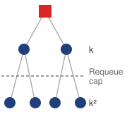{width="100%" fig-alt="Two-level tree. A red square for the admitted job evicts two jobs, labeled k, and each of those evicts two more, labeled k squared. A dashed line labeled requeue cap crosses the tree between the two levels."}

*Each eviction can evict again, so one admission reaches $\PreemptionFanoutCount + \PreemptionFanoutCount^2$ jobs.*
:::

When a high-priority job enters a saturated cluster, the scheduler must decide which running workloads to terminate to free up resources. This decision is rarely isolated. In tightly packed clusters, evicting a medium-priority job to accommodate a high-priority request often triggers a **preemption cascade**\index{Preemption Cascade!definition}, where the evicted job immediately attempts to reschedule itself by displacing lower-priority workloads. The disruption multiplies with each level. If the urgent job displaces $\PreemptionFanoutCount$ medium-priority jobs and each of those, on rescheduling, displaces $\PreemptionFanoutCount$ lower-priority jobs, one admission interrupts $\PreemptionFanoutCount+ \PreemptionFanoutCount^2$ jobs after two levels, every one of which pays the preemption tax quantified below and adds a checkpoint reload to the storage system at the same moment. Two dampening controls cap that growth. A rule that evicted jobs requeue without preempting anyone themselves stops the chain at the first level, so one admission costs at most $\PreemptionFanoutCount$ interruptions. A **preemption budget**\index{Preemption Budgets!definition} limits how often any single job, or what fraction of capacity, may be displaced in a time window, which protects the jobs at the bottom of the priority order that every chain would otherwise reach.

```{python}
#| echo: false

# ┌─────────────────────────────────────────────────────────────────────────────
# │ PREEMPTION TAX (LEGO)
# ├─────────────────────────────────────────────────────────────────────────────
# │ Context: @sec-fleet-orchestration-preemption-cascades
# │
# │ Goal: Quantify wasted cost and GPU-hours from repeated preemptions.
# │ How: Convert recovery time across all GPUs into wasted GPU-hour cost.
# │
# └─────────────────────────────────────────────────────────────────────────────
from mlsysim import Systems
from mlsysim.fmt import check, fmt, fmt_count, fmt_time, fmt_usd

class PreemptionTax:
    # ┌── 1. LOAD ──────────────────────────────────────────
    fleet = Systems.Clusters.Lab_64_H100
    gpus = fleet.total_accelerators
    lost_duration = 15 * minute  # scenario assumption
    reload_duration = 20 * minute  # scenario assumption
    warmup_duration = 10 * minute  # scenario assumption
    gpu_hour_rate = Infrastructure.Pricing.Fleet.GpuHourRef.rate.to(USD / hour).magnitude
    preemptions_per_day = 12  # scenario assumption
    # ┌── 2. EXECUTE ───────────────────────────────────────
    recovery_duration = lost_duration + reload_duration + warmup_duration
    recovery_minutes = recovery_duration.to(minute).magnitude
    recovery_hours = recovery_duration.to(hour).magnitude
    cost_per_event = gpus * recovery_hours * gpu_hour_rate
    wasted_duration_per_day = preemptions_per_day * recovery_duration
    wasted_hours_per_day = wasted_duration_per_day.to(hour).magnitude
    wasted_gpu_hours_per_day = gpus * wasted_hours_per_day
    # ┌── 3. GUARD ─────────────────────────────────────────
    check(recovery_duration.check("[time]"), f"Expected recovery duration, got {recovery_duration}")
    check(wasted_duration_per_day.check("[time]"), f"Expected wasted duration, got {wasted_duration_per_day}")
    check(recovery_minutes == 45, f"Expected 45 minutes, got {recovery_minutes}")
    check(cost_per_event == 96, f"Expected $96, got {cost_per_event}")
    check(wasted_gpu_hours_per_day == 576, f"Expected 576 GPU-hours, got {wasted_gpu_hours_per_day}")
    # ┌── 4. OUTPUT ────────────────────────────────────────
    recovery_duration_min_attr_str = fmt_time(recovery_duration, minute, precision=0, commas=False, style="word", attributive=True)
    gpu_hour_rate_str = fmt_usd(gpu_hour_rate, precision=0, commas=False, per="GPU-hour")
    cost_per_event_str = fmt_usd(cost_per_event, precision=0)
    wasted_duration_per_day_h_str = fmt_time(wasted_duration_per_day, hour, precision=0, commas=False, style="word")
    wasted_gpu_hours_per_day_str = fmt_count(wasted_gpu_hours_per_day, label="GPU-hour", plural_label="GPU-hours")
    lost_min_str = fmt_time(lost_duration, minute, precision=0, commas=False, style="word")
    reload_min_str = fmt_time(reload_duration, minute, precision=0, commas=False, style="word")
    warmup_min_str = fmt_time(warmup_duration, minute, precision=0, commas=False, style="word")
    preemptions_per_day_str = fmt(preemptions_per_day, precision=0, commas=False)
    gpus_str = fmt(gpus, precision=0, commas=False)
```

The engineering cost of preemption extends beyond scheduling latency. The **preemption tax**\index{Preemption Tax!definition} depends on the exit path. A successful graceful checkpoint adds saving and restart overhead while preserving completed progress; a forced stop can instead discard work since the last durable checkpoint. Consider such a victim, a forced interruption of the `{python} PreemptionTax.gpus_str`-GPU fine-tuning run for our 175B parameter model. The scenario assumes lost work equivalent to `{python} PreemptionTax.lost_min_str` of execution, followed by `{python} PreemptionTax.reload_min_str` to reload optimizer state and `{python} PreemptionTax.warmup_min_str` of warmup as data pipelines refill and just-in-time (JIT) compilation and runtime initialization complete. The calculation prices replay and restart across the same allocation; it does not also charge for a successful final save.

Reconstructing the distributed data pipeline also belongs in the preemption contract. The checkpoint must preserve the sampling and loader state needed to resume the intended data order, alongside model and optimizer state. If the restart path omits that state, it can repeat or skip samples and lose exact replay of the training trajectory. A different shuffle order does not by itself prove statistical corruption, but the recovery policy must specify which changes are acceptable. The scheduler should therefore measure restoration and pipeline warmup as part of recovery cost, rather than assume that reloading model weights alone makes the job productive.

The resulting `{python} PreemptionTax.recovery_duration_min_attr_str` tax combines discarded execution with reload and warmup time; it is not a measurement of continuous kernel activity after eviction. Spread over the run, it belongs to the Fleet Law's coordination term $\SynchronizationTime(\DeviceCount)$ (@eq-fleet-law), which counts scheduling decisions and failure recovery alongside barrier waits, so frequent preemption lengthens the average step exactly as frequent failure does. At `{python} PreemptionTax.gpu_hour_rate_str`, the scenario values each event at `{python} PreemptionTax.cost_per_event_str` in allocation time. A low-priority run sits at the bottom of every cascade, so without a budget it can be struck many times a day. At the scenario's `{python} PreemptionTax.preemptions_per_day_str` forced preemptions per day, it loses `{python} PreemptionTax.wasted_duration_per_day_h_str` of equivalent allocation time, or `{python} PreemptionTax.wasted_gpu_hours_per_day_str` for this `{python} PreemptionTax.gpus_str`-GPU run. A per-job budget bounds that loss directly. When a budget binds, the scheduler must consider waiting, another placement, or a defined emergency exception. The trade-off is reduced recovery churn against delayed admission, measured under the workload's deadlines.

### Resource accounting and observability {#sec-fleet-orchestration-resource-accounting}

The 64 GPUs that sat idle for a weekend because a researcher forgot to cancel a reservation represent invisible waste in a multi-tenant cloud fleet. In a dedicated cluster, such waste is at least visible: the lights are on, but the fans are quiet. In a shared environment, the cost is hidden and compounds across thousands of jobs. Effective governance requires moving beyond simple "allocation" metrics to a tiered accounting model that distinguishes between what was requested, what was used, and what was useful.

Three tiers of measurement expose this gap between requested hardware and actual progress. Allocated capacity counts resources reserved for a job. Compute utilization measures hardware activity under a stated counter definition, which can include communication kernels or work later replayed. Productive utilization requires a workload-level measure of retained training progress or serving work that meets its objective, normalized to a declared reference rate. For example, a team allocated 500 GPUs might average 350 active-device equivalents (70 percent activity) while delivering 280 device-equivalents of useful work at the reference rate (56 percent of its allocation). These are time-averaged equivalents, not necessarily distinct sets of active and productive devices. The gap motivates profiling; it does not identify its cause or imply that necessary communication and recovery can all be eliminated.

::: {.column-margin}
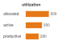{width="100%" fig-alt="Three horizontal orange bars of GPU-equivalent counts, labeled allocated 500, active 350, and productive 280, decreasing from top to bottom."}

*Allocated, active, and productive capacity in GPU equivalents, each tier counting less than the one above.*
:::

Attribution in a shared fleet presents a control problem. Every admitted job needs an owner, project, workload class, and preemption contract so the scheduler can apply quota and recovery policy consistently. Kubernetes labels and Slurm accounts carry this scheduling identity.

This data feeds the utilization dashboard, the cluster operator's primary instrument for fleet health. This view must synthesize per-team utilization against quotas, queue depth by priority class, and the **fragmentation index**\index{Fragmentation Index!definition}, a measure of free GPUs that cannot be allocated due to topology constraints. It must also track preemption rates, spot interruptions, checkpoint traffic, and the recovery overhead they induce. These measurements let the scheduler distinguish idle capacity it can reclaim from allocated capacity whose apparent idleness reflects communication, I/O, or a rigid gang dependency.

Automated anomaly detection turns these metrics into investigation triggers. A sudden spike in a team's consumption to 3$\times$ its historical norm might reflect a runaway submission script or an intentional experiment. A growing queue can indicate insufficient capacity, but it can also reflect quota limits, fragmented placements, or a stalled dependency. A sudden power drop can accompany a shared storage stall, though job completions and changes in workload mix can produce a similar signal. Operators must correlate these alerts with admission decisions and job progress before changing capacity or policy.

::: {#psp-fleet-orchestration-three-utilization-metrics .callout-perspective title="The three utilization metrics"}

Each tier narrows the investigation. Low allocated utilization\index{Utilization!allocated} calls for checking demand, quotas, device health, and placement feasibility. Low compute utilization\index{Utilization!compute} on allocated devices calls for tracing input supply, communication waits, and runtime execution. Low productive utilization\index{Utilization!productive} despite busy kernels calls for comparing retained progress with replay, synchronization, and other overhead. The metric selects the next evidence to collect; it does not by itself select the remedy.

:::

### Security and namespace isolation {#sec-fleet-orchestration-security-isolation}

Multi-tenancy requires both fair resource allocation and security isolation to prevent teams from interfering with or observing each other's workloads. The stakes are real: ML models represent significant intellectual property, training data may contain sensitive information subject to privacy regulations, and the models themselves may encode proprietary business logic. Without proper isolation, a compromised or misconfigured workload in one team's namespace could access another team's model weights, training data, or inference traffic.

In Kubernetes environments, namespace separation provides an administrative boundary that must be reinforced by host, device, network, and storage controls. Role-based access control can restrict a team's Kubernetes API operations, including job submission and access to pod logs, within its namespaces. Model artifacts in external storage require their own authorization policies, and cluster-wide scheduling controls require appropriately scoped permissions. Each boundary needs its own enforcement beyond namespace ownership.

Network policies restrict permitted traffic when the installed network plugin enforces them. A policy can allow communication among an admitted gang while denying unwanted cross-namespace connections, but it must cover the paths the workload actually uses. Ring AllReduce exchanges chunks along ring neighbors, while other collective algorithms use different peer patterns. Host networking and additional device interfaces require verification of the applicable enforcement boundary. Connection filtering does not encrypt gradient traffic; confidentiality on permitted paths requires separate controls. Egress restrictions can reduce exfiltration opportunities, subject to the same enforcement and coverage checks.

Across teams, the isolation spectrum of @tbl-gpu-virtualization-isolation-spectrum becomes a trust-boundary choice, because colocated workloads now belong to owners with different exposure to one another. Security in multi-tenant environments extends beyond simple resource fairness. Side-channel attacks on shared GPUs are a documented vulnerability; by monitoring contention on shared caches or memory controllers, a malicious tenant can infer the architecture or even data properties of a co-resident model. In sensitive environments, MIG or dedicated devices can strengthen device-resource isolation, but neither creates a complete external-tenant security boundary by itself. A multi-tenant platform combines device partitioning with VM or container isolation, IOMMU configuration, driver and runtime hardening, authentication and authorization, and network and storage controls. Single-organization workloads with a narrower trust boundary can use MPS or time-slicing when weaker fault and performance isolation is acceptable.

### Quota governance and organizational dynamics {#sec-fleet-orchestration-quota-governance}

Schedulers manage immediate resource assignments, while **quota governance**\index{Quota Governance!definition} determines the entitlements and limits those assignments must honor. Periodic **quota review cycles**\index{Quota Review Cycle!definition} compare observed use, forecast demand, and the cost of meeting each team's capacity promise. A team using only 40 percent of a 128-GPU guarantee does not necessarily block other teams if unused devices can be borrowed. The governance question is whether the guarantee remains justified and whether its reclamation contract lets the fleet use spare capacity productively between demand peaks.

The central tension in quota management is the **hoarding problem**\index{Hoarding Problem!definition}. Teams can retain idle reservations to avoid queuing again when work becomes ready. For example, a workflow that pauses policy training while awaiting human annotations can leave its reserved accelerators unused. A training run delayed by unfinished tokenization can create the same pattern. These examples concern dependencies in particular workflows, not an unavoidable idle phase of all training. Utilization-based reclamation\index{Quota!utilization-based reclamation} can release idle physical allocations to borrowers, provided the platform preserves any promised return time. Revising the team's longer-term guarantee instead requires comparing expected demand with observed use. Clear return contracts reduce the incentive to hold idle devices without making low activity alone grounds for breaking a capacity promise.

Quota accounting should remain close to the scheduling decision. GPU-hours charged against a reservation, borrowed share, or preemption class make the opportunity cost of hoarding visible and let the control plane reclaim idle guarantees.

```{python}
#| echo: false

# ┌─────────────────────────────────────────────────────────────────────────────
# │ QUOTA HOARDING COST (LEGO)
# ├─────────────────────────────────────────────────────────────────────────────
# │ Context: callout-example "Quota hoarding"
# │
# │ Goal: Quantify idle reservation cost for 500 GPUs over three weeks.
# │ How: Convert idle reserved GPUs and idle duration into GPU-hour cost.
# │
# └─────────────────────────────────────────────────────────────────────────────
from mlsysim.fmt import check, fmt, fmt_time, fmt_usd

class QuotaHoardingCost:
    # ┌── 1. LOAD ──────────────────────────────────────────
    gpus = 500
    weeks = 3
    hours_per_week = 7 * HOURS_PER_DAY
    gpu_hour_rate = Infrastructure.Pricing.Fleet.GpuHourRef.rate.to(USD / hour).magnitude
    # ┌── 2. EXECUTE ───────────────────────────────────────
    idle_hours = weeks * hours_per_week
    cost = gpus * idle_hours * gpu_hour_rate
    # ┌── 3. GUARD ─────────────────────────────────────────
    check(idle_hours == 504, f"Expected 504 hours, got {idle_hours}")
    check(cost == 504000, f"Expected 504000, got {cost}")
    # ┌── 4. OUTPUT ────────────────────────────────────────
    hoarding_cost_str = fmt_usd(cost, precision=0)
    hoarding_gpus_str = fmt(gpus, precision=0, commas=False)
    hoarding_weeks_str = fmt_time(weeks, "week", precision=0, commas=False, style="word")
```

A concrete quota scenario shows how quickly idle reservations become expensive.

::: {#exmp-fleet-orchestration-quota-hoarding .callout-example title="Quota hoarding"}

**Scenario**: A research team reserves a static block of `{python} QuotaHoardingCost.hoarding_gpus_str` GPUs for an upcoming model refresh.

**Diagnosis**: Upstream data delays postpone training, but the team retains the reservation to ensure future availability. The GPUs sit idle for `{python} QuotaHoardingCost.hoarding_weeks_str`, accumulating `{python} QuotaHoardingCost.hoarding_cost_str` in capital waste while other teams' queues back up.

**Systems lesson**: An idle reservation should trigger a review of lending eligibility and future demand. The orchestrator can admit opportunistic borrowers under a bounded reclamation contract without changing the owner's guarantee. Reducing that guarantee is a separate governance decision; lending owned capacity does not turn it into cloud spot capacity.

:::

The "use it or lose it" reclamation policy addresses the most visible symptom of quota hoarding, but it raises a second-order question: when idle capacity is lent to another team, the system must distinguish borrowed capacity (preemptible on short notice) from guaranteed reservations (protected by SLOs). Defining borrowing, preemption, and guaranteed tiers as first-class policy primitives is the core multi-tenancy design decision.

::: {#chk-fleet-orchestration-multi-tenancy-design-decisions .callout-checkpoint title="Multi-tenancy design decisions"}

Consider a 2,000-GPU cluster shared between a research team (60 percent allocation) and a production team (40 percent allocation):

- [ ] **Idle reclamation**: decide whether the production team can borrow the research team's allocation while half of it sits idle, and describe the preemption behavior when the research team submits a large job.
- [ ] **Priority classes**: configure priority classes for a production inference workload that needs 100 GPUs with guaranteed latency SLOs and a research training job that can tolerate preemption.
- [ ] **Sharing contract**: explain why 65 percent average SM utilization does not justify whole-device overcommitment, then identify which measured resource and isolation constraints would make statistical multiplexing safe.

:::

Even with isolation, quotas, and dynamic sharing in place, the cluster can still fall victim to systemic bottlenecks that defy simple monitoring. When utilization drops inexplicably despite full queues, operators must move from dashboards to systematic utilization debugging.

## Debugging Cluster Utilization {#sec-fleet-orchestration-debugging}

A cluster dashboard shows average GPU utilization stuck at 60 percent, yet developers complain about three-day queue times for small debugging jobs. Hundreds of GPUs sit idle, but no jobs are starting. Bridging this gap between theoretical capacity and production reality requires methodical forensic analysis to untangle the interactions between hardware topology, scheduler policies, and user behavior. Part of the paradox is the queueing arithmetic of notebook \ref{nbk-fleet-orchestration-queuing-theory-gpu-clusters}. The $\ServingUtilization/(1-\ServingUtilization)$ factor grows without bound as offered load approaches service capacity, so mean wait rises gently through moderate load and then steeply above 80 percent for small, mixed, and large workloads alike (@fig-utilization-paradox, plotted on a logarithmic scale). The curves use the notebook's exponential reference case ($\ServiceTimeVariationCoefficient= 1$), so they are the gentlest version of the effect. A mixed ML queue with the notebook's representative $\ServiceTimeVariationCoefficient= 3$ multiplies every curve by the larger variability factor, shifting each one upward without changing where it bends. The curves also describe offered service load rather than allocated or kernel-active GPU percentages, and their 75 percent headroom marker is an illustrative choice rather than a universal cluster threshold. Queueing explains why a busy fleet waits. A fleet whose queue is full while devices sit idle is waiting for a different reason, and finding it requires looking past the dashboard.

::: {#fig-utilization-paradox fig-env="figure" fig-pos="htb" fig-cap="**The utilization paradox**: As cluster utilization approaches saturation (100 percent), job wait times increase hyperbolically and diverge near saturation, not linearly. The shaded region above 80 percent and the dashed 75 percent target illustrate headroom choices in this toy queue model, not measured GPU-utilization thresholds. Real queue delay also depends on job sizes, gang constraints, and arrival variability." fig-alt="Semi-log plot of toy-queue wait time vs. offered service load relative to capacity. Three directly labeled curves for small, mixed, and large jobs. Wait times explode near 100 percent. An illustrative high-load region is shaded above 80 percent. A dashed line shows an assumed headroom target at 75 percent."}

```{python}
#| echo: false
# ┌─────────────────────────────────────────────────────────────────────────────
# │ UTILIZATION PARADOX (FIGURE)
# ├─────────────────────────────────────────────────────────────────────────────
# │ Context: @fig-utilization-paradox—wait time vs utilization
# │
# │ Goal: Plot job wait time vs cluster utilization; show M/M/1-style explosion
# │       near 100%; Danger Zone >80%; Target 75%.
# │ Show: Three curves (small/mixed/large jobs); log-scale y; shaded zone.
# │ How: Convert utilization into M/M/1-style waiting-time curves; book_style.setup_plot().
# │
# └─────────────────────────────────────────────────────────────────────────────
# ┌── 1. CANVAS ────────────────────────────────────────────────────────────────
# │ Plot job wait time vs cluster utilization; show M/M/1-style explosion
import numpy as np
from binder.tools.figures import style as book_style

# ┌── 2. ARRAYS ────────────────────────────────────────────────────────────────
utilization = np.linspace(0, 0.98, 500)
rho = utilization

wait_small = (rho / (1 - rho)) * 1.0
wait_mixed = (rho / (1 - rho)) * 4.0
wait_large = (rho / (1 - rho)) * 12.0

fig, ax, COLORS, plt = book_style.setup_plot(figsize=(8, 5))

# ┌── 3. RENDER ────────────────────────────────────────────────────────────────
# Curves are labeled directly; line style and gray value separate them in print.
# Each label sits just above its own curve (3 pt perpendicular offset), staggered
# along x so the three never share a column.
curves = [
    (wait_large, 'large jobs (average 12 h)', COLORS['primary'], '-', 31),
    (wait_mixed, 'mixed workload (average 4 h)', COLORS['primary'], '--', 46),
    (wait_small, 'small jobs (average 1 h)', COLORS['secondary'], ':', 59),
]
lines = []
for w, label, color, ls, _ in curves:
    keep = (w >= 0.1) if ls == ':' else (w > 0)  # dotted: visible part only, so its dash phase is measured from the frame
    (ln,) = ax.plot(utilization[keep] * 100, w[keep], linewidth=1.8, color=color, linestyle=ls, dash_capstyle='butt', solid_capstyle='butt')
    lines.append(ln)

target_util = 75
ax.set_yscale('log')
ax.set_xlim(0, 100)
ax.set_ylim(0.1, 1000)
fig.canvas.draw()  # fix the transform so label angles and dash phase follow the drawn curves
# Phase the dotted curve so its path ends in a gap rather than a clipped sliver of a dot.
_dot_on, _dot_off, _lw = 1.0, 1.65, 1.8
_xy = ax.transData.transform(lines[2].get_xydata())
_len_pt = float(np.sum(np.hypot(*np.diff(_xy, axis=0).T))) * 72 / fig.dpi / _lw
lines[2].set_linestyle(((_dot_on + 0.3 - _len_pt) % (_dot_on + _dot_off), (_dot_on, _dot_off)))
for w, label, color, ls, x_lab in curves:
    y0, y1 = (float(np.interp(v / 100, rho, w)) for v in (x_lab - 4, x_lab + 4))
    p0, p1 = ax.transData.transform([(x_lab - 4, y0), (x_lab + 4, y1)])
    theta = float(np.arctan2(p1[1] - p0[1], p1[0] - p0[0]))
    y_mid = float(np.interp(x_lab / 100, rho, w))
    off = (-3 * np.sin(theta), 3 * np.cos(theta))  # 3 pt above the curve, perpendicular to it
    ax.annotate(
        label,
        (x_lab, y_mid),
        xytext=off,
        textcoords='offset points',
        ha='center',
        va='bottom',
        fontsize=9.5,
        color=color,
        rotation=float(np.degrees(theta)),
        rotation_mode='anchor',
    )

ax.axvspan(80, 100, color=COLORS['RedL'], alpha=0.55, lw=0)
ax.axvline(x=target_util, color=COLORS['secondary'], linestyle=(0, (4, 3)), lw=1.0)

# ┌── 4. DECORATE ──────────────────────────────────────────────────────────────
ax.text(90, 0.13, 'high-load\nregion\n(illustrative)', color=COLORS['RedLine'], ha='center', va='bottom', fontsize=9.5)
ax.text(target_util - 1.2, 600, 'headroom\ntarget (75%)', color=COLORS['secondary'], ha='right', va='top', fontsize=9)

ax.set_xlabel('Offered service load / capacity (%)')
ax.set_ylabel('Average job wait time (hours, log scale)')
ax.grid(True, which='major', ls='--', alpha=0.4)
ax.grid(False, which='minor')
ax.spines['top'].set_visible(False)
ax.spines['right'].set_visible(False)

plt.show()
plt.close()
```

:::

```{python}
#| echo: false

# ┌─────────────────────────────────────────────────────────────────────────────
# │ DEBUGGING EXAMPLE: UTILIZATION RECOVERY (LEGO)
# ├─────────────────────────────────────────────────────────────────────────────
# │ Context: @sec-fleet-orchestration-debugging worked example (callout)
# │
# │ Goal: Quantify the annual dollar value recovered by fixing a 1,000-GPU
# │       cluster from 60% to 84% effective utilization via policy changes.
# │ Show: 240 fully utilized GPU-equivalents; ~400 equivalent raw GPUs
# │       recovered at the old utilization; ~$7M/year in equivalent capacity value.
# │ How: Compute productive GPU-equivalent gain from the utilization improvement;
# │      convert it to recovered raw-GPU capacity at the old utilization;
# │      convert recovered GPU-equivalent capacity into annual dollar value.
# │
# └─────────────────────────────────────────────────────────────────────────────
from mlsysim import *
from mlsysim.fmt import fmt, fmt_bandwidth, fmt_count, fmt_int, fmt_memory, fmt_memory_capacity, fmt_percent, fmt_pp, fmt_usd

# ┌── LEGO ───────────────────────────────────────────────
class DebugValueCalc:
    """Annual dollar value recovered by raising a Training_1K cluster from 60% to 84% utilization."""

    # ┌── 1. LOAD (Constants) ──────────────────────────────────────────────
    debug_cluster = Systems.Clusters.Training_1K.total_accelerators
    debug_util_before = 0.60  # scenario assumption: observed pre-fix utilization
    debug_util_after = 0.84  # scenario assumption: observed post-fix utilization
    debug_target_util = Systems.Orchestration.target_cluster_utilization
    a100_80_count = 400
    a100_40_count = 424
    v100_count = 200
    a100_80_memory = Hardware.Cloud.A100.memory.capacity
    a100_40_memory = Hardware.Cloud.A100_40GB.memory.capacity
    v100_memory = Hardware.Cloud.V100.memory.capacity
    a100_gpus_per_node = Systems.Nodes.DGX_A100.accelerators_per_node
    v100_gpus_per_node = 4  # scenario assumption: legacy 4-GPU V100 servers
    pending_jobs = 50  # scenario assumption: queue depth for the diagnostic example
    large_job_count = 15
    large_job_min_gpus = 64
    large_job_avg_gpus = 80
    medium_job_count = 8
    medium_job_gpus = 32
    v100_job_count = 0
    large_job_peak_memory = 35 * GB
    a100_80_alloc_before = 0.95
    a100_80_eff_before = 0.72
    a100_80_alloc_after = 0.89
    a100_80_eff_after = 0.94
    a100_40_alloc_before = 0.64
    a100_40_alloc_after = 0.88
    v100_alloc_before = 0.0
    v100_alloc_after = 0.71
    _gpu_rate = Infrastructure.Pricing.Fleet.GpuHourRef.rate.to(USD / hour).magnitude

    # ┌── 2. EXECUTE (The Compute) ────────────────────────────────────────
    debug_improvement = debug_util_after - debug_util_before
    debug_productive_gain = debug_cluster * debug_improvement
    debug_recovered = debug_productive_gain / debug_util_before
    debug_annual = debug_recovered * _gpu_rate * HOURS_PER_YEAR
    a100_80_nodes = a100_80_count // a100_gpus_per_node
    a100_40_nodes = a100_40_count // a100_gpus_per_node
    v100_nodes = v100_count // v100_gpus_per_node
    large_job_total_gpus = large_job_count * large_job_avg_gpus
    medium_job_total_gpus = medium_job_count * medium_job_gpus
    idle_a100_40_count = round(a100_40_count * (1 - a100_40_alloc_before))
    a100_80_eff_change_pp = (a100_80_eff_after - a100_80_eff_before) * 100
    a100_40_alloc_change_pp = (a100_40_alloc_after - a100_40_alloc_before) * 100
    v100_alloc_change_pp = (v100_alloc_after - v100_alloc_before) * 100
    cluster_change_pp = debug_improvement * 100

    # ┌── 3. GUARD (Invariants) ──────────────────────────────────────────
    check(abs(debug_improvement - 0.24) < 0.01, f"Expected 24 pp utilization improvement, got {debug_improvement}")
    check(abs(debug_productive_gain - 245.76) < 0.01, f"Expected ~246 productive GPUs, got {debug_productive_gain}")
    check(abs(debug_recovered - 409.6) < 0.01, f"Expected ~410 recovered GPUs, got {debug_recovered}")
    check(large_job_total_gpus == 1200, "Large-job demand should match scenario")
    check(medium_job_total_gpus == 256, "Medium-job demand should match scenario")
    check(idle_a100_40_count == 153, f"Idle A100-40 count should follow allocation state, got {idle_a100_40_count}")
    check(a100_80_nodes == 50 and a100_40_nodes == 53 and v100_nodes == 50, "Inventory should map to node pools totaling 1,024 GPUs")

    # ┌── 4. OUTPUT (Formatting) ─────────────────────────────────────────────
    debug_productive_gain_str = fmt_int(debug_productive_gain, commas=False)
    debug_recovered_str = fmt_int(debug_recovered, commas=False)
    debug_annual_usd_str = fmt_usd(debug_annual, scale="M", precision=0, commas=False)
    debug_gpu_hour_rate_str = fmt_usd(_gpu_rate, precision=0, commas=False, per="GPU-hour")
    debug_cluster_comma_str = fmt(debug_cluster, precision=0, commas=True)
    debug_util_before_pct_str = fmt_percent(debug_util_before, precision=0, commas=False, style='prose')
    debug_util_before_pct_tbl_str = fmt_percent(debug_util_before, precision=0, commas=False, style='symbol')
    a100_80_count_str = fmt_count(a100_80_count, commas=False, label="GPU")
    a100_40_count_str = fmt_count(a100_40_count, commas=False, label="GPU")
    v100_count_str = fmt_count(v100_count, commas=False, label="GPU")
    a100_80_memory_str = fmt_memory_capacity(a100_80_memory, unit=GiB, precision=0, commas=False)
    a100_40_memory_str = fmt_memory_capacity(a100_40_memory, unit=GiB, precision=0, commas=False)
    v100_memory_str = fmt_memory_capacity(v100_memory, unit=GiB, precision=0, commas=False)
    a100_80_nodes_str = fmt_count(a100_80_nodes, commas=False, label="node")
    a100_40_nodes_str = fmt_count(a100_40_nodes, commas=False, label="node")
    v100_nodes_str = fmt_count(v100_nodes, commas=False, label="node")
    a100_gpus_per_node_str = fmt_count(a100_gpus_per_node, commas=False, label="GPU")
    v100_gpus_per_node_str = fmt_count(v100_gpus_per_node, commas=False, label="GPU")
    nvlink_a100_gb_per_s_str = fmt_bandwidth(Hardware.Cloud.A100.nvlink.bandwidth, unit=GB / second, precision=0)
    pcie_v100_gb_per_s_str = fmt_bandwidth(Hardware.Cloud.V100.interconnect.bandwidth, unit=GB / second, precision=1)
    pending_jobs_str = fmt(pending_jobs, precision=0, commas=False)
    large_job_peak_memory_str = fmt_memory(large_job_peak_memory, unit=GB, precision=0, commas=False)
    a100_80_alloc_before_str = fmt_percent(a100_80_alloc_before, precision=0, commas=False, style='symbol')
    a100_80_eff_before_str = fmt_percent(a100_80_eff_before, precision=0, commas=False, style='symbol')
    a100_80_alloc_after_str = fmt_percent(a100_80_alloc_after, precision=0, commas=False, style='symbol')
    a100_80_eff_after_str = fmt_percent(a100_80_eff_after, precision=0, commas=False, style='symbol')
    a100_80_eff_change_pp_str = fmt_pp(a100_80_eff_change_pp, precision=0, commas=False, style="symbol")
    a100_40_alloc_before_str = fmt_percent(a100_40_alloc_before, precision=0, commas=False, style='symbol')
    a100_40_alloc_after_str = fmt_percent(a100_40_alloc_after, precision=0, commas=False, style='symbol')
    a100_40_alloc_change_pp_str = fmt_pp(a100_40_alloc_change_pp, precision=0, commas=False, style="symbol")
    v100_alloc_before_str = fmt_percent(v100_alloc_before, precision=0, commas=False, style='symbol')
    v100_alloc_after_str = fmt_percent(v100_alloc_after, precision=0, commas=False, style='symbol')
    v100_alloc_change_pp_str = fmt_pp(v100_alloc_change_pp, precision=0, commas=False, style="symbol")
    debug_util_after_pct_str = fmt_percent(debug_util_after, precision=0, commas=False, style='symbol')
    debug_util_after_pct_prose_str = fmt_percent(debug_util_after, precision=0, commas=False, style='prose')
    cluster_change_pp_str = fmt_pp(cluster_change_pp, precision=0, commas=False, style="symbol")
```

The debugging method is to compare scheduler state with physical capability, inspect job requests against the actual hardware pools, and then test for a policy-infrastructure mismatch. A full queue and idle accelerators can coexist when the scheduler is honoring constraints that the dashboard has aggregated away. The cluster at the center of example \ref{exmp-fleet-orchestration-debugging-low-gpu-utilization} runs the heterogeneous hardware in @tbl-fleet-orchestration-debug-inventory, accumulated across three procurement cycles.

| **GPU Type**   |                  **Count**                  |                     **Memory**                     |                       **Interconnect**                       |                                               **Nodes**                                               |
|:---------------|:-------------------------------------------:|:--------------------------------------------------:|:------------------------------------------------------------:|:-----------------------------------------------------------------------------------------------------:|
| **A100-80 GB** | `{python} DebugValueCalc.a100_80_count_str` | `{python} DebugValueCalc.a100_80_memory_str` HBM2e | NVLink (`{python} DebugValueCalc.nvlink_a100_gb_per_s_str`)  | `{python} DebugValueCalc.a100_80_nodes_str` $\times$ `{python} DebugValueCalc.a100_gpus_per_node_str` |
| **A100-40 GB** | `{python} DebugValueCalc.a100_40_count_str` | `{python} DebugValueCalc.a100_40_memory_str` HBM2e | NVLink (`{python} DebugValueCalc.nvlink_a100_gb_per_s_str`)  | `{python} DebugValueCalc.a100_40_nodes_str` $\times$ `{python} DebugValueCalc.a100_gpus_per_node_str` |
| **V100-32 GB** |   `{python} DebugValueCalc.v100_count_str`  |   `{python} DebugValueCalc.v100_memory_str` HBM2   | PCIe Gen3 (`{python} DebugValueCalc.pcie_v100_gb_per_s_str`) |   `{python} DebugValueCalc.v100_nodes_str` $\times$ `{python} DebugValueCalc.v100_gpus_per_node_str`  |

: **Cluster hardware inventory**: Three procurement generations create distinct resource pools with different capabilities. In this inventory, A100 nodes have NVLink and the V100 pool uses PCIe. That difference changes tensor-parallel communication cost; it does not make tensor parallelism impossible on V100 devices. {#tbl-fleet-orchestration-debug-inventory}

::: {#exmp-fleet-orchestration-debugging-low-gpu-utilization .callout-example title="Debugging low GPU utilization"}

**Scenario**: A `{python} DebugValueCalc.debug_cluster_comma_str`-GPU cluster reports `{python} DebugValueCalc.debug_util_before_pct_str` average utilization despite over `{python} DebugValueCalc.pending_jobs_str` pending jobs in queue.

**Diagnosis**: Over-specification (users copying A100-80 GB templates for `{python} DebugValueCalc.large_job_peak_memory_str` memory jobs), pool fragmentation, and legacy V100 avoidance leave A100-40 GB and V100 nodes idle while large jobs wait for A100-80 GB allocations. The scheduler correctly enforced policies written for a homogeneous fleet that no longer matched the heterogeneous infrastructure.

**Systems lesson**: Surface-level diagnosis often mistakes policy-infrastructure mismatches for scheduling algorithm bugs. Updating scheduler policies to support automatic capability matching, dynamic memory profiling, and backfilling raises cluster utilization to `{python} DebugValueCalc.debug_util_after_pct_prose_str`, recovering `{python} DebugValueCalc.debug_annual_usd_str` in annual compute capacity; @tbl-fleet-orchestration-debug-results breaks that gain out pool by pool, using the allocated and active tiers of @sec-fleet-orchestration-resource-accounting.

:::

| **Pool**         |                                                       **Before**                                                      |                                                      **After**                                                      |                       **Change**                       |
|:-----------------|:---------------------------------------------------------------------------------------------------------------------:|:-------------------------------------------------------------------------------------------------------------------:|:------------------------------------------------------:|
| **A100-80 GB**   | `{python} DebugValueCalc.a100_80_alloc_before_str` allocated, `{python} DebugValueCalc.a100_80_eff_before_str` active | `{python} DebugValueCalc.a100_80_alloc_after_str` allocated, `{python} DebugValueCalc.a100_80_eff_after_str` active |  +`{python} DebugValueCalc.a100_80_eff_change_pp_str`  |
| **A100-40 GB**   |                              `{python} DebugValueCalc.a100_40_alloc_before_str` allocated                             |                             `{python} DebugValueCalc.a100_40_alloc_after_str` allocated                             | +`{python} DebugValueCalc.a100_40_alloc_change_pp_str` |
| **V100**         |                               `{python} DebugValueCalc.v100_alloc_before_str` allocated                               |                               `{python} DebugValueCalc.v100_alloc_after_str` allocated                              |  +`{python} DebugValueCalc.v100_alloc_change_pp_str`   |
| **Cluster-wide** |                              **`{python} DebugValueCalc.debug_util_before_pct_tbl_str`**                              |                                **`{python} DebugValueCalc.debug_util_after_pct_str`**                               |  **+`{python} DebugValueCalc.cluster_change_pp_str`**  |

: **Utilization recovery results**: Before the fix, A100-80 GB GPUs were almost fully allocated but less than fully active, while strict job templates stranded the other pools. Pool rows report allocated utilization, and for the A100-80 GB pool also the active share of its allocated GPUs; the A100-80 GB change is in that active share, the others in allocation. The cluster-wide row is the fleet's separately observed average utilization, so the pool rows are diagnostic signals that locate the loss rather than terms that add up to the total. {#tbl-fleet-orchestration-debug-results}

For this capacity valuation, assume that each active GPU-hour delivers the same retained useful work before and after the policy change, including across hardware pools. Under that simplifying assumption, the observed utilization gain is equivalent to approximately `{python} DebugValueCalc.debug_productive_gain_str` fully utilized GPUs of productive work (@tbl-fleet-orchestration-debug-results). A heterogeneous production fleet must validate that conversion against workload progress and measured throughput in each pool. As at the start of the chapter, procurement planning compares the gain with the hardware it replaces, here `{python} DebugValueCalc.debug_recovered_str` additional raw GPUs, because new devices under the old policies would also run at only `{python} DebugValueCalc.debug_util_before_pct_str` utilization. At `{python} DebugValueCalc.debug_gpu_hour_rate_str`, that avoided purchase represents approximately `{python} DebugValueCalc.debug_annual_usd_str` in annual recovered value, achieved through policy changes requiring zero additional hardware investment.

### Common utilization anti-patterns {#sec-fleet-orchestration-anti-patterns}

High-level metrics can hide the gap between reserved capacity and useful progress. A dashboard reporting 85 percent allocation says how much capacity is assigned, not how effectively jobs use it. Debugging requires comparing that allocation with hardware activity and workload progress, then correlating telemetry with execution timelines to test the suspected bottleneck.

A zombie job\index{Cluster Utilization!zombie jobs} retains an allocation after its useful execution has stopped. In a distributed run training a 175B parameter model, a rank failure can leave a 128-GPU group idle if worker cleanup or failure propagation does not complete. The surviving ranks may block inside a collective that will never finish, or a process left behind by a driver-level fault may resist reaping by the container runtime, so the devices stay allocated until a timeout or node-level remediation clears them. Persistent memory allocation combined with low SM activity is an investigation signal, not proof of a driver fault; valid input or communication waits can look similar. The operator must compare runtime health, step progress, and the workload's timeout contract, then verify that old workers have stopped before releasing or reassigning their devices.

The data starvation\index{Cluster Utilization!data starvation} pattern manifests as a high-frequency sawtooth wave in GPU utilization, where the device oscillates between 100 percent load (forward/backward pass) and 0 percent load (waiting for the next batch). While the average utilization might appear acceptable at 60 to 70 percent, the GPU is effectively idling for a third of its life. This occurs when the CPU-bound data pipeline cannot sustain the throughput required by the GPU, a common scenario in computer vision where JPEG decoding and augmentation saturate host CPUs. The data stall ratio of @eq-data-stall quantifies the loss as the fraction of each step spent waiting for input, and a timeline that aligns the idle intervals with input waits supports the diagnosis; utilization variance alone does not identify the cause. The remedy depends on whether decoding, storage, or transfer limits the input path.

A communication bottleneck\index{Cluster Utilization!communication bottleneck} can leave ranks waiting for collectives, though communication kernels can also keep SM activity high. Per-rank gradient traffic depends on gradient precision, sharding, and the parallelism layout, so the ratio of step time to compute-only time (forward plus backward passes in isolation) is a quicker first bound on exposed overhead. If total iteration time exceeds 1.5$\times$ compute-only time, non-compute overhead exceeds 0.5$\times$ compute time, which is material but not dominant. Setting $\SynchronizationTime(\DeviceCount)$ and $\OverlappedTime$ to zero in the Fleet Law (@eq-fleet-law) leaves $\DistributedStepTime(\DeviceCount) = \IronLawComputeTime/\DeviceCount+ \CommunicationTime(\DeviceCount)$, under which communication exceeds per-device computation only when the ratio is greater than 2$\times$. Real steps also contain synchronization waits and input stalls, so profiling must separate communication from those before the ratio is read as a communication diagnosis. Placement can reduce exposed communication when it improves the relevant paths. Gradient accumulation can reduce synchronization frequency only when the runtime defers gradient exchange across accumulation steps.

Memory fragmentation\index{Cluster Utilization!memory fragmentation} can prevent admission even when aggregate free memory appears sufficient. An allocator requiring a large contiguous KV-cache region may fail to place a new sequence when free space is split across smaller regions. The diagnosis therefore depends on the allocator's requirements, rather than merely the percentage of HBM occupied. Comparing live token demand with reserved cache capacity helps expose unusable space. Paged cache allocation reduces the need for contiguous sequence storage. For the fleet scheduler, the allocator matters through its result, the number of concurrent requests a replica can hold, because that measured capacity sets how many replicas the serving envelope needs. Any throughput gain depends on request lengths, batching, and the allocator baseline.

::: {.column-margin .margin-pointer}
↪ Paged KV-cache allocation and its effect on replica concurrency are developed in @sec-inference-scale-pagedattention-3c94.
:::

The debugging example illustrates a broader principle that applies to every system across the fleet stack: scheduling systems are only as effective as the policies they implement, and policies must evolve alongside infrastructure. When infrastructure changes (new hardware generations are added, network topologies are upgraded, workload mixes shift from training-dominant to serving-dominant), the policies encoded in scheduler configuration, job templates, and organizational practices must be re-evaluated and updated. The most expensive scheduling bug is often not a software defect but a policy that was correct for the old infrastructure and was never updated for the new one.

This principle connects scheduling mechanics to fleet governance. Technical policies (GPU type matching, gang scheduling timeouts, preemption grace periods) interact with organizational policies (team quotas, priority hierarchies, cost allocation) and human behavior (job template reuse, resource request habits, queue submission patterns). Effective fleet orchestration requires attending to all three layers simultaneously.

## Fallacies and Pitfalls {#sec-fleet-orchestration-fallacies}

Those policy-infrastructure mismatches recur as a small set of misconceptions that can make an apparently healthy scheduler waste expensive fleet capacity. It is tempting to look at a cluster running at 98 percent utilization and declare victory, only to discover that researchers have stopped submitting jobs entirely because wait times have stretched into weeks. Each misconception below follows the same pattern, in which optimizing one visible metric degrades the outcome the fleet exists to deliver.

::: {.fallacy-pitfall}

**Fallacy**: *More sophisticated scheduling algorithms always improve utilization.*

Engineers facing low utilization often reach for more advanced schedulers, assuming the algorithm is the bottleneck. As the debugging example in @sec-fleet-orchestration-debugging demonstrates, the root cause is frequently policy misconfiguration, not algorithmic limitation. A simple FIFO scheduler with correct policies (capability-based matching, backfill with timeouts, appropriate gang scheduling constraints) often outperforms a sophisticated scheduler with incorrect policies. Before upgrading the scheduler, audit the policies: confirm that users are not requesting resources they do not need, that heterogeneous resources are properly exposed, and that gang-scheduling timeouts are configured.

:::

::: {.fallacy-pitfall}

**Pitfall**: *Treating all GPU-hours as equal when measuring utilization.*

An unlabeled "GPU utilization" percentage can conflate allocation with activity or useful work. For example, 80 percent of fleet capacity might be allocated while 15 percent of the fleet waits in incomplete groups and another 5 percent waits for input, leaving at most 60 percent executing useful training in that snapshot. Such a breakdown comes from scheduler and runtime evidence, which an activity counter cannot supply. The allocated, compute, and productive tiers of @sec-fleet-orchestration-resource-accounting keep these measurements distinct, with productive capacity tied to a stated workload objective and reference rate.

:::

::: {.fallacy-pitfall}

**Fallacy**: *Gang scheduling is always necessary for distributed training.*

Gang scheduling prevents partial-allocation deadlock for a rigid synchronous group, but the required group need not equal the job's maximum requested size. Asynchronous workers may progress independently, while elastic training can begin with its minimum viable gang and resize at supported boundaries. Independent hyperparameter trials can also run separately. The scheduler gains flexibility by admitting the actual unit of progress, while preserving atomic allocation wherever synchronous dependencies require it. Changes to worker count or synchronization policy still require convergence validation.

:::

::: {.fallacy-pitfall}

**Pitfall**: *Setting static quotas based on peak demand.*

Organizations commonly set team quotas to handle worst-case demand, reasoning that teams need guaranteed access during crunch periods. If Team A's peak demand is 500 GPUs and Team B's is 300 GPUs, the cluster needs 800 GPUs with static quotas. In practice, peaks rarely coincide. A 600-GPU cluster can accommodate either peak when the other team's simultaneous demand leaves enough capacity, but it cannot guarantee both peaks concurrently. Hierarchical fair-share with borrowing uses that statistical opportunity only when the declared guarantees fit physical capacity and borrowed work can yield within the reclamation contract. In this example, sizing static quotas to the sum of the peaks provisions 200 GPUs, a quarter of the 800-GPU cluster, as guarantees that sit unused whenever the peaks do not coincide.

:::

::: {.fallacy-pitfall}

**Fallacy**: *Spot instances are always cheaper for training.*

```{python}
#| echo: false
#| label: lego-spot-discount-fallacy
# ┌─────────────────────────────────────────────────────────────────────────────
# │ SPOT DISCOUNT FALLACY (LEGO)
# ├─────────────────────────────────────────────────────────────────────────────
# │ Context: Fallacy "Spot instances are always cheaper for training."
# │
# │ Goal: Show how interruption overhead erodes the nominal spot discount.
# │ Show: 15 + 30 = 45 minutes lost per interruption; every 2 productive hours
# │       turns the 65 percent reference discount into ~52 percent savings.
# │ How:  C_eff = C_spot x (T_productive + T_lost) / T_productive
# │       (@eq-fleet-orchestration-spot-cost).
# └─────────────────────────────────────────────────────────────────────────────
from mlsysim.fmt import check, fmt, fmt_percent, fmt_time

class SpotDiscountFallacy:
    # ┌── 1. LOAD ──────────────────────────────────────────
    on_demand = Infrastructure.Pricing.Fleet.GpuHourRef.rate.to(USD / hour).magnitude
    spot = Infrastructure.Pricing.Fleet.SpotGpuHourRef.rate.to(USD / hour).magnitude
    ckpt_min = 15  # scenario assumption: slow-storage checkpoint for a large model
    restart_min = 30  # scenario assumption: restart and reload time
    interval_h = 2  # scenario assumption: productive hours between interruptions
    # ┌── 2. EXECUTE ───────────────────────────────────────
    lost_min = ckpt_min + restart_min
    nominal_discount = 1 - spot / on_demand
    effective_spot = spot * (interval_h * 60 + lost_min) / (interval_h * 60)
    effective_savings = 1 - effective_spot / on_demand
    # ┌── 3. GUARD ─────────────────────────────────────────
    check(abs(nominal_discount - 0.65) < 1e-9, "prose quotes a 65 percent nominal discount")
    check(0.50 < effective_savings < 0.54, "prose says savings shrink to about 52 percent")
    # ┌── 4. OUTPUT ────────────────────────────────────────
    ckpt_attr_str = fmt_time(ckpt_min, "minute", precision=0, style="word", attributive=True)
    restart_attr_str = fmt_time(restart_min, "minute", precision=0, style="word", attributive=True)
    lost_str = fmt_time(lost_min, "minute", precision=0, style="word")
    interval_str = fmt_time(interval_h, "hour", precision=0, style="word")
    nominal_str = fmt_percent(round(nominal_discount, 2), precision=0, style="prose")
    effective_str = fmt_percent(round(effective_savings, 2), precision=0, style="prose")
```

Actual savings depend on the billed overhead each interruption adds, not on the scenario's `{python} FleetSpotPricing.discount_lo_num_str` to `{python} FleetSpotPricing.discount_hi_pct_str` discount band. Consider `{python} SpotDiscountFallacy.ckpt_attr_str` checkpoint overhead and `{python} SpotDiscountFallacy.restart_attr_str` restart overhead, totaling `{python} SpotDiscountFallacy.lost_str` of billed nonproductive time per event. If each event follows `{python} SpotDiscountFallacy.interval_str` of retained training progress, the nominal `{python} SpotDiscountFallacy.nominal_str` discount becomes about `{python} SpotDiscountFallacy.effective_str` savings under the fixed-allocation model. This illustration assumes a successful save and no replay; a real interruption budget must also include discarded progress when the save cannot finish. The scheduler must separately account for unbilled capacity waits when evaluating deadlines. Sufficient billed overhead can erase the discount, regardless of the advertised rate.

:::

::: {.fallacy-pitfall}

**Pitfall**: *Ignoring topology when scheduling distributed training.*

Schedulers that ignore connectivity can place communication-intensive groups across paths with less available bandwidth or more contention. On a fleet with NVLink confined to each node, spreading a tensor-parallel group across nodes moves its traffic onto the inter-node fabric; other hardware can expose larger NVLink domains. Crossing a spine switch does not itself prove congestion, so the placement decision must compare effective path capacity and competing traffic. A measured throughput penalty accumulates over a long run and may exceed the delay of waiting for a more suitable allocation. The scheduler must weigh that gain against queue delay and fragmentation.

:::

::: {.fallacy-pitfall}

**Pitfall**: *Using elastic training to avoid gang-scheduling decisions.*

Elastic training complements gang scheduling by moving between viable execution groups. With a fixed 8-way tensor-parallel layout, each group still requires eight workers; changing the number of data-parallel replicas does not relax that requirement. A runtime that changes the tensor or pipeline layout must also redistribute state and establish a new viable group. The scheduler must honor the supported resize granularity, atomic admission requirements, and placement budget for each configuration. Elasticity adds feasible choices; it does not make an incomplete group productive or an arbitrary placement efficient.

:::

::: {.fallacy-pitfall}

**Fallacy**: *The scheduler needs no workload-specific validation.*

Scheduler configuration needs revalidation as workloads evolve. A preemption grace period that suffices for one model may be too short for another to save state, while placement weights suited to an earlier topology can strand capacity after an expansion. The constructed debugging example in @sec-fleet-orchestration-debugging raises utilization from `{python} DebugValueCalc.debug_util_before_pct_str` to `{python} DebugValueCalc.debug_util_after_pct_prose_str` through policy changes without new hardware. That result illustrates the value of checking capability matching, gang admission, and recovery contracts; it is not a promised gain from tuning defaults. The operator must compare queue delay, retained progress, and service objectives before and after a policy change.

:::

::: {.fallacy-pitfall}

**Pitfall**: *Treating high utilization as proof of cluster health.*

A high allocated-GPU percentage does not establish that the cluster has enough headroom to admit new work promptly. The exponential-service case of notebook \ref{nbk-fleet-orchestration-queuing-theory-gpu-clusters}, an M/M/1 queue, shows the pressure near saturation, since mean queue wait divided by mean service time is $\ServingUtilization/(1-\ServingUtilization)$, where $\ServingUtilization$ is offered service load relative to service capacity. This model assumes Poisson arrivals, exponential service times, and a single server; it does not turn a GPU-busy percentage into a prediction for a gang-scheduled fleet. Real headroom targets depend on arrival bursts, job sizes, placement constraints, and the queue-delay or serving-latency objective. The operator must measure those outcomes instead of applying a universal utilization threshold.

:::

Recognizing these fallacies prevents platform teams from chasing false optimizations that look good on dashboards but degrade developer velocity. The core orchestration principles that successfully navigate these trade-offs share a common thread: they treat scheduling as an engineering discipline, not an administrative function.

## Summary {#sec-fleet-orchestration-summary}

Fleet orchestration transforms raw data center capacity into productive ML infrastructure by governing how silicon, bandwidth, and state interact across time and space. Orchestration spends Coordination, the third axis of C³, so that Compute and Communication capacity turn into useful progress. In Fleet Law terms (@eq-fleet-law), placement sets the communication term $\CommunicationTime(\DeviceCount)$ of every step, and preemption and recovery, amortized over the run, enter the coordination term $\SynchronizationTime(\DeviceCount)$. Queue wait and gang admission are coordination costs too, but they delay the first step rather than lengthening any step, so they appear in end-to-end completion time rather than in the per-step law. Multi-tenancy and quota policy decide how much of that time allocated compute spends doing useful work. Hardware capability sets the feasible choices; the scheduler turns those choices into useful allocations by preserving ownership, coordinating recovery, and matching placement to workload demand.

Feasibility is the first filter. Gang size, topology locality, multi-dimensional fit, and accelerator compatibility decide which allocations a job can actually run, and only then can a fairness policy choose among them (principle \ref{pri-feasibility-before-fairness}). Quota borrowing extends the same reasoning across teams, since a guarantee is worth what the platform can reclaim within its response-time objective rather than the number printed on the quota.

Placement changes the physical paths available to a workload. Aligning model parallelism with the network hierarchy reduces exposed communication when placement is the binding constraint, but it cannot create fabric capacity that is not there. Elastic resizing and spot capacity widen the set of feasible choices by trading worker continuity for flexibility and price, and ML-aware schedulers sharpen the choice among them with workload signals such as attained service, iteration boundaries, finish-time ratios, and goodput. Every one of these levers pays a transition or integration cost that must be measured against the progress it buys.

At serving time, the fleet scheduler preserves a capacity envelope of indivisible replicas with SLO headroom and moves the training-serving boundary on measured demand, leaving request-level routing and batching to the serving system. When that envelope, the quotas around it, or the placements inside it go wrong, the symptom is usually a full queue beside idle accelerators, and the cause is more often a policy written for an earlier fleet than a defect in the scheduling algorithm.

::: {.callout-takeaways title="Scheduling is systems engineering"}

* **Distributed scheduling is fundamentally hard**: Cluster scheduling\index{Distributed Scheduling!challenges} must coordinate allocation ownership across machines despite partial failures, network partitions, and stale observations. Control planes balance prompt recovery against the risk of authorizing a replacement while an old worker still runs.
* **Gang scheduling prevents deadlock but reduces flexibility**: Gang scheduling\index{Gang Scheduling!deadlock prevention} gives rigid execution groups atomic resource allocation to prevent hold-and-wait deadlocks, while backfilling and elastic resizing recover flexibility within the job's minimum viable gang and transition constraints.
* **Fairness is measured over feasible bundles**: DRF equalizes each tenant's dominant normalized share across GPUs, CPU, memory, and network, but only among bundles that already pass gang, topology, and compatibility constraints (principle \ref{pri-feasibility-before-fairness}). Slowdown and maximum feasible wait test whether the resulting policy avoids delay and starvation, and a quota guarantee holds only as far as lent capacity can be reclaimed in time.
* **Topology determines performance**: Where GPUs are placed within the cluster hierarchy\index{Scheduling!topology awareness} changes the communication paths available to a job. Locality can reduce exposed communication, but waiting for a compact placement also costs time; compare end-to-end completion rather than iteration throughput alone.
* **Scheduling signals must match the objective**: Workload characteristics\index{Scheduling!ML-specific policies} support different improvements: attained service addresses runtime uncertainty, iteration boundaries reduce interruption cost, finish-time ratios expose unfair delay, and goodput guides adaptive allocation. Each policy requires validation against the fleet's workload mix and recovery costs.
* **Useful utilization creates economic capacity**: Reducing avoidable idle time can deliver more useful work from an existing fleet. Distinguish allocated, active, and productive capacity before valuing an improvement, and preserve the headroom required for recovery and latency targets.
* **Policies must evolve with infrastructure**: Scheduling algorithms\index{Scheduling Policy!infrastructure coupling} are only as effective as the policies they implement. When infrastructure changes (heterogeneous hardware additions, topology upgrades, workload mix shifts), policies must be re-evaluated and updated.

:::

The same placement decision makes the displacement of overhead (principle \ref{pri-conservation-overhead}) concrete. Co-locating a tensor-parallel gang keeps its collectives on NVLink and shrinks the exposed communication of every step, but the scheduler pays for that locality in coordination time while it waits for a feasible contiguous allocation. The bottleneck moves from collective bandwidth to queue delay or fragmentation rather than disappearing, so the right placement is the one that minimizes end-to-end completion time, not iteration time alone.

::: {.callout-chapter-connection title="From orchestration to optimization"}

The orchestrator counts serving capacity in replicas, and a replica that holds a full node of accelerators is allocated whether or not those accelerators do useful work. During autoregressive decode at small batch sizes, every new token streams the model's weights from memory again, so a fully allocated replica can leave most of its arithmetic units waiting on data. Communication stalls, input delays, and long chains of short host-launched kernels consume an allocation the same way. Performance engineering locates which of these limits binds on the request's critical path and tests whether a fix survives at the replica and fleet boundaries. The per-replica capacity it measures is the number this chapter's serving envelope divides demand by, so every gain inside a replica changes how many replicas the fleet must hold.

:::

::: {.column-margin .margin-pointer}
↪ The memory wall, roofline diagnosis, profiling, fusion, precision, and compilation, applied to the replicas and training steps this chapter allocates, are developed in @sec-performance-engineering.
:::

<!-- This is here to make sure that quizzes are inserted properly before a part begins. -->

::: { .quiz-end }
:::

```{=latex}
\part{key:vol2_deployment}
```
