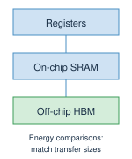
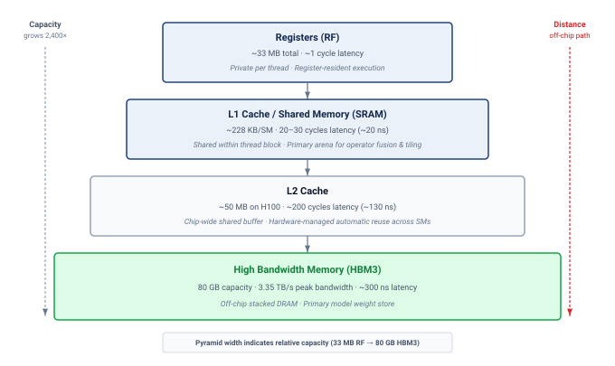
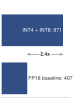
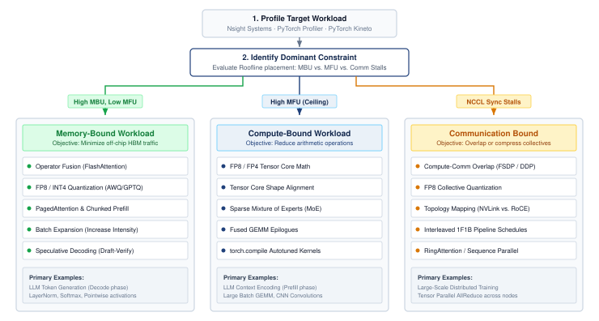

# Performance Engineering {#sec-performance-engineering}

::: {layout-narrow}
::: {.column-margin}

\chapterminitoc

:::

::: {.content-visible when-format="pdf"}
\noindent
{fig-alt="Performance engineering workbench where a fleet workload is measured, bottlenecks are diagnosed, and tiling, fusion, memory, and scheduling rewrites improve the path."}
:::

::: {.content-visible unless-format="pdf"}
{fig-alt="Performance engineering workbench where a fleet workload is measured, bottlenecks are diagnosed, and tiling, fusion, memory, and scheduling rewrites improve the path."}
:::

:::

## Purpose {.unnumbered .unlisted}

\begin{marginfigure}
\mlfleetstack{25}{35}{55}{30}{100}{35}{0}{0}
\end{marginfigure}

_Why can a fleet with abundant compute still fail to serve requests fast enough?_

Expensive accelerators can spend much of a request waiting for data, software dispatch, or communication while their arithmetic units remain underused. Adding more machines may raise cost without removing the delay, and a faster isolated kernel may leave the request's critical path unchanged. The engineering stakes are useful serving capacity: how much work the existing fleet can complete while preserving latency and model quality. A configuration that answers one short request quickly may behave differently when many requests arrive with varied lengths and memory demands. Sharing work can improve throughput, but the extra state competes for memory and individual requests may wait longer. Reducing that state can admit more work only if the resulting computation remains accurate and the execution path can use the freed capacity. These interactions make optimization a question of measured constraints rather than a search for the fastest component. On one machine, a local improvement can be tested against a relatively contained execution path. Across a fleet, its value also depends on communication, synchronization, and the distribution of work across devices. The cost of a mistaken diagnosis grows when the same inefficient execution repeats across many replicas. Reaching useful capacity therefore requires matching numerical representations and execution schedules to the workload, then checking whether local savings survive along the complete request path. In C³ terms, performance engineering makes compute gains accountable to the communication and coordination costs that determine sustained fleet throughput.

::: {.content-visible when-format="pdf"}

\newpage

:::

::: {.callout-learning-objectives}

- Apply roofline analysis and execution traces to distinguish compute, memory, and launch limits
- Analyze prefill, decode, and batch-size regimes to predict latency-throughput behavior in LLM serving
- Diagnose serving bottlenecks using reproducible measurements at kernel, replica, and fleet boundaries
- Evaluate fusion, tiling, and graph replay against memory traffic, launch overhead, and resource limits
- Select precision, compilation, and runtime optimizations from bandwidth, quality, and deployment constraints
- Evaluate speculative decoding and sparse expert routing against acceptance, communication, and load-imbalance costs
- Construct a serving optimization plan that tests compute, communication, coordination, and quality trade-offs

:::

```{python}
#| echo: false
from mlsysim import *
from mlsysim.core.units import *

# ┌─────────────────────────────────────────────────────────────────────────────
# │ CHAPTER START
# ├─────────────────────────────────────────────────────────────────────────────
# │ Context: Chapter initialization and global imports
# │
# │ Why: Registers this chapter with the mlsys registry and provides shared
# │      imports for all subsequent calculation cells.
# │
# └─────────────────────────────────────────────────────────────────────────────
from mlsysim.physics.quantities import token_throughput
from mlsysim.fmt import check, fmt, fmt_int
from mlsysim.physics import calc_bottleneck, model_memory
```

## The Memory Wall and Roofline Diagnosis {#sec-performance-engineering-memory-wall}

```{python}
#| echo: false
#| label: memory-wall-opening
# ┌─────────────────────────────────────────────────────────────────────────────
# │ MEMORY WALL OPENING HOOK (LEGO)
# ├─────────────────────────────────────────────────────────────────────────────
# │ Context: @sec-performance-engineering-memory-wall opening paragraph.
# │
# │ Goal: Pin the chapter-opening H100 FP16 peak-compute claim to the registry.
# │ Show: ~989 TFLOP/s FP16 dense Tensor Core peak—inline prose.
# │ How: Read Hardware.Cloud.H100.compute.peak_flops (FP16/BF16 headline rate).
# │
# └─────────────────────────────────────────────────────────────────────────────
from mlsysim.fmt import check, fmt_qty_int

class MemoryWallOpening:
    """H100 headline FP16 peak compute for the chapter-opening hook."""

    # ┌── 1. LOAD (Constants) ──────────────────────────────────────────────
    peak_flops = Hardware.Cloud.H100.compute.peak_flops  # FP16/BF16 dense Tensor Core peak

    # ┌── 3. GUARD (Invariants) ──────────────────────────────────────────
    check(peak_flops > 900 * TFLOP / second, "H100 FP16 peak should exceed 900 TFLOP/s")

    # ┌── 4. OUTPUT (Formatting) ──────────────────────────────────────────────
    h100_fp16_tflop_per_s_str = fmt_qty_int(peak_flops, TFLOP / second, commas=False)
```

An H100 GPU capable of `{python} MemoryWallOpening.h100_fp16_tflop_per_s_str` of dense FP16 Tensor Core compute can still show single-digit compute utilization during small-batch language-model decode. The processor is not short on arithmetic; it is starving for data. Performance engineering\index{Performance Engineering!discipline definition} operates inside that constraint: the memory wall, where moving bytes from memory to compute units can cap throughput long before Tensor Cores reach their advertised peak.

Placement, synchronization, recovery, and scheduling can put the workload on the right hardware and keep it alive. They cannot guarantee that each allocated replica completes enough useful work to justify its capacity. In the fleet stack shown in @fig-fleet-stack, performance engineering connects execution inside the Serving Layer to the compute, communication, and coordination costs already established for the fleet. A faster kernel matters when it shortens the request's critical path, releases memory for concurrent requests, or reduces the capacity needed to meet a service objective. The governing question is therefore which execution constraint limits useful fleet throughput, not which kernel can achieve the highest isolated speedup.

The recurring workload is an autoregressive language-model service. A request first processes its input prompt in a prefill pass, then generates output tokens through successive decode passes. The key-value (KV) cache retains attention keys and values from the prompt and generated tokens so later passes can reuse them. A serving replica may span several accelerators through tensor parallelism; several replicas can serve different requests. Time-to-first-token measures the delay from request arrival to the first output token, while inter-token latency measures the gaps between subsequent tokens. Batching shares execution across active requests, but each request still consumes cache capacity and must meet its latency objective.

Before comparing implementations, we fix the model and quality criterion, prompt and output-length distributions, offered request load, hardware topology, and timing boundary. We measure completed throughput and latency percentiles under that workload, separating cold-start costs from warmed execution. An end-to-end trace then distinguishes waiting for input or scheduling from exposed communication, memory movement, computation, and host dispatch. Only after locating the limiting interval do we use kernel counters and rooflines to choose among fusion, precision, compilation, or changes to the algorithm. Repeating the same measurement after each change establishes whether a local improvement survives at the replica and fleet boundaries.

### The iron law of ML performance {#sec-performance-engineering-efficiency-frontier}

The memory wall is one term in a larger budget. @Eq-iron-law-perf states the iron law of ML system performance\index{Iron law!performance decomposition}, decomposing execution time into three competing costs:

$$
T = \frac{D_{\text{vol}}}{\text{BW}} + \frac{O}{R_{\text{peak}} \cdot \eta_{\text{hw}}} + L_{\text{lat}}
$$ {#eq-iron-law-perf}

In overlapped execution, the roofline-style simplification replaces the sum of compute and data movement with the slower exposed term:

$$
T \approx \max\left( \frac{O}{R_{\text{peak}} \cdot \eta_{\text{hw}}}, \; \frac{D_{\text{vol}}}{\text{BW}} \right) + L_{\text{lat}}
$$

Here, $D_{\text{vol}}$ is the data volume crossing the chosen memory boundary, $\text{BW}$ is its bandwidth, $O$ is the operation count, and $R_{\text{peak}} \cdot \eta_{\text{hw}}$ is the realized compute rate after accounting for hardware execution efficiency. The overhead term $L_{\text{lat}}$ includes exposed launch, synchronization, communication, and software costs outside those compute and memory terms. This local execution budget supplies the service time of a replica; request queueing and routing add time outside that boundary. The roofline approximation asks which exposed term dominates at a given operating point: increasing compute throughput for a memory-bound workload does not materially improve performance until the memory term is reduced. Eager framework execution can expose a large slice of the overhead term when a Python loop and the framework dispatcher submit many short kernels, but not every launch traverses the Python global interpreter lock (GIL); asynchronous runtime threads, compiled regions, and native extensions can submit work outside that path. `torch.compile(mode="reduce-overhead")` and CUDA Graphs target repeated host-submission costs by capturing a stable region and replaying its GPU work with fewer CPU interactions. They amortize or avoid repeated dispatch within that region rather than removing all runtime overhead.

::: {.column-margin}
{width="100%" fig-alt="Iron-law bar split into three segments, Data, Compute, and Latency. The Data segment is the widest and shaded; Compute and Latency are narrow and gray."}

*Autoregressive transformer decode is often memory-bound: the data-movement term dominates the iron law.*
:::

Standard model compression\index{Model Compression!vs. performance engineering} (pruning, quantization, distillation) shrinks the model's intrinsic work, performing fewer operations on smaller data. System optimization addresses the complementary problem: shrinking the gap between that work and the hardware's peak by moving the same terms through implementation rather than model change, keeping data in fast memory, packing each transfer more densely, and removing software overhead.

Several levers map directly to those terms. When memory traffic dominates, operator fusion and tiling reduce the exposed data-volume term by eliminating intermediate high-bandwidth memory (HBM) round-trips. A fused sequence that keeps its intermediates in SRAM can shrink the exposed memory-access term dramatically, often by 10--30$\times$ for attention computation. Precision engineering attacks the same numerator from a different angle: FP8, INT4, and KV-cache compression (storing the per-token attention keys and values in fewer bytes) represent each value in fewer bytes, so the same physical bandwidth carries more useful model state.

Other levers change the overhead or compute terms. Graph compilation, including `torch.compile`, Accelerated Linear Algebra (XLA), and TensorRT, reduces overhead by eliminating kernel launch gaps, fusing operations, and optimizing memory allocation across the graph. Communication-computation overlap makes distributed communication concurrent with useful work, removing it from the critical path when $T_{\text{comm}} \leq T_{\text{compute}}$ (that is, communication finishes before the concurrent compute phase completes, leaving zero exposed communication time: $T_{\text{comm}} - T_{\text{overlap}} \leq 0$). This condition is the exposed-time test, not a new law: overlap helps only when useful computation is large enough to cover the communication. Algorithmic changes affect the work itself. Exact speculative decoding preserves the target sampling distribution under its verification rule; mixture of experts (MoE) changes the model architecture and requires a trained model plus quality validation before its compute savings are usable.

Each technique attacks a different term, and this taxonomy guides optimization strategy: diagnose which term dominates (using the roofline model from @sec-performance-engineering-roofline), then apply the technique targeting that term. A technique targeting a smaller exposed term can still help, but its end-to-end benefit is bounded by that term’s share of execution time.

Before using this diagnostic process, check how each term in the iron law maps to a practical optimization lever.

::: {#chk-performance-engineering-iron-law-performance .callout-checkpoint title="The iron law of performance"}

Verify understanding of system-level performance diagnosis:

- [ ] **Memory-bound limit**: determine whether increasing the GPU's clock frequency (increasing FLOP/s) improves a memory-bound workload.
- [ ] **Quantization term**: identify which term in @eq-iron-law-perf changes when quantization moves the representation from FP16 to INT4.
- [ ] **Overhead term**: define the "Overhead" term in the iron law and explain why graph compilation targets it specifically.
- [ ] **Compute-bound bandwidth**: evaluate the claim that memory bandwidth is irrelevant to the performance of a compute-bound system.
- [ ] **Iron-law decomposition**: for a step that is 60 percent data movement, 30 percent compute, and 10 percent latency, estimate which single optimization buys the most wall-clock time, and what the iron law predicts once that dominant term is halved.

:::

The same diagnostic process can be codified as a decision flowchart, mapping each bottleneck to its corresponding optimization technique. The flowchart in @fig-iron-law-flowchart makes the sequencing explicit: rule out I/O, CPU, and communication overheads before classifying the remaining workload as compute-bound or memory-bound.

::: {#fig-iron-law-flowchart fig-env="figure" fig-pos="htb" fig-cap="**Iron law diagnostic flowchart**: A training-slow-down troubleshooting flow that starts from observed symptoms (slow training, low GPU utilization), branches through I/O, CPU, and communication-overhead checks, and classifies the workload as compute-bound or memory-bound at the leaves. Compute-bound paths point to precision engineering and algorithmic change; memory-bound paths point to operator fusion and tiling. Overhead-bound symptoms (graph dispatch, communication) are surfaced earlier in the flow and addressed before the final compute/memory classification." fig-alt="Troubleshooting flowchart starting from 'Training is slow', branching through GPU-utilization, I/O, CPU, and communication checks, with two terminal labels: Compute Bound and Memory Bound."}


<!--
```{=latex}
\begin{tikzpicture}[
    >=Stealth,
    font=\small,
    box/.style={
        rectangle, rounded corners=4pt,
        align=center, inner sep=5pt,
        line width=0.9pt
    },
    root_box/.style={
        box, draw=NavyBlue!80, fill=NavyBlue!8!white,
        line width=1.1pt, minimum width=4.0cm, minimum height=0.95cm
    },
    decision_box/.style={
        box, draw=SlateGrey!75, fill=SlateGrey!6!white,
        minimum width=3.3cm, minimum height=1.0cm
    },
    compute_box/.style={
        box, draw=NavyBlue!85, fill=NavyBlue!8!white,
        line width=1.1pt, minimum width=3.6cm, minimum height=0.95cm
    },
    memory_box/.style={
        box, draw=Crimson!85, fill=Crimson!6!white,
        line width=1.1pt, minimum width=3.6cm, minimum height=0.95cm
    },
    action_green/.style={
        box, draw=ForestGreen!80, fill=ForestGreen!6!white,
        minimum width=3.3cm, minimum height=0.9cm
    },
    action_blue/.style={
        box, draw=NavyBlue!75, fill=NavyBlue!5!white,
        minimum width=3.3cm, minimum height=0.9cm
    },
    action_amber/.style={
        box, draw=Amber!85, fill=Amber!8!white,
        minimum width=3.3cm, minimum height=0.9cm
    },
    action_crimson/.style={
        box, draw=Crimson!75, fill=Crimson!5!white,
        minimum width=3.0cm, minimum height=0.9cm
    },
    action_purple/.style={
        box, draw=violet!75, fill=violet!5!white,
        minimum width=3.0cm, minimum height=0.9cm
    },
    action_sub/.style={
        box, draw=NavyBlue!70, fill=NavyBlue!4!white,
        minimum width=2.8cm, minimum height=0.9cm
    },
    reprofile_box/.style={
        box, draw=NavyBlue!80, fill=white,
        line width=1.0pt, minimum width=4.2cm, minimum height=0.85cm
    }
]

    % Provide colors if not defined
    \providecolor{ForestGreen}{RGB}{34,139,34}
    \providecolor{NavyBlue}{RGB}{20,45,110}
    \providecolor{Amber}{RGB}{217,119,6}
    \providecolor{BurntOrange}{RGB}{210,105,30}
    \providecolor{BrickRed}{RGB}{180,30,30}
    \providecolor{Crimson}{RGB}{180,30,30}
    \providecolor{SlateGrey}{RGB}{112,128,144}

    % -------------------------------------------------------------------------
    % NODES
    % -------------------------------------------------------------------------

    % Root
    \node[root_box] (root) at (0, 0) {
        \bfseries\color{NavyBlue!90!black} Training is slow
    };

    % Level 1: GPU util
    \node[decision_box] (gpu_util) at (0, -1.6) {
        \textbf{GPU util $<$ 70\%?}\\[2pt]
        {\tiny\color{black!70}(Nsight / nvidia-smi)}
    };

    % Level 2 (Left path from GPU util = No): AI > ridge point?
    \node[decision_box] (ridge) at (0, -3.5) {
        \textbf{AI $>$ ridge point?}\\[2pt]
        {\tiny\color{black!70}(Roofline analysis)}
    };

    % Level 3 (Left path from ridge = Yes): COMPUTE BOUND
    \node[compute_box] (compute_bound) at (-5.6, -3.5) {
        \bfseries\color{NavyBlue!90!black} COMPUTE BOUND
    };

    % Sub-actions under COMPUTE BOUND
    \node[action_sub] (fp8) at (-7.1, -5.1) {
        \textbf{\scriptsize\color{NavyBlue!90!black} FP8 / INT4}\\[2pt]
        {\tiny\color{black!70}Precision eng.}
    };
    \node[action_sub] (moe) at (-4.1, -5.1) {
        \textbf{\scriptsize\color{NavyBlue!90!black} MoE / Speculative}\\[2pt]
        {\tiny\color{black!70}Algorithmic opt.}
    };

    % Level 3 (Down from ridge = No): MEMORY BOUND
    \node[memory_box] (mem_bound) at (0, -5.3) {
        \bfseries\color{Crimson} MEMORY BOUND
    };

    % Sub-actions under MEMORY BOUND
    \node[action_crimson] (fusion) at (-1.7, -6.8) {
        \textbf{\scriptsize\color{Crimson} Operator fusion}\\[2pt]
        {\tiny\color{black!70}FlashAttention}
    };
    \node[action_purple] (compile) at (1.7, -6.8) {
        \textbf{\scriptsize\color{violet!90!black} torch.compile}\\[2pt]
        {\tiny\color{black!70}Graph compilation}
    };

    % Right branches from GPU util = Yes:
    \node[decision_box] (io_bound) at (4.0, -1.6) {
        \textbf{I/O bound?}\\[2pt]
        {\tiny\color{black!70}(DataLoader stall)}
    };

    \node[action_green] (dl_workers) at (8.0, -2.5) {
        \textbf{\scriptsize\color{ForestGreen!85!black} More DL workers}\\[2pt]
        {\tiny\color{black!70}Use GDS / NVMe}
    };

    \node[decision_box] (cpu_bound) at (4.0, -3.5) {
        \textbf{CPU bound?}\\[2pt]
        {\tiny\color{black!70}(preprocessing)}
    };

    \node[action_blue] (offload_gpu) at (8.0, -4.4) {
        \textbf{\scriptsize\color{NavyBlue!90!black} Offload to GPU}\\[2pt]
        {\tiny\color{black!70}DALI / async preproc}
    };

    \node[action_amber] (comm_overhead) at (4.0, -5.3) {
        \textbf{\scriptsize\color{Amber!90!black} Comm overhead}\\[2pt]
        {\tiny\color{black!70}Overlap / compress}
    };

    % Bottom: Re-profile Workload
    \node[reprofile_box] (reprofile) at (0, -8.6) {
        \bfseries\color{NavyBlue!90!black} Re-profile Workload
    };

    % -------------------------------------------------------------------------
    % EDGES
    % -------------------------------------------------------------------------

    % Root -> GPU util
    \draw[->, line width=0.9pt, SlateGrey!90!black] (root) -- (gpu_util);

    % GPU util -> Ridge (No)
    \draw[->, line width=0.9pt, Crimson] (gpu_util) -- node[right=1pt, font=\scriptsize\bfseries\color{Crimson}] {No} (ridge);

    % GPU util -> I/O bound (Yes)
    \draw[->, line width=0.9pt, ForestGreen!85!black] (gpu_util) -- node[above=2pt, font=\scriptsize\bfseries\color{ForestGreen!85!black}] {Yes} (io_bound);

    % I/O bound -> DL workers (Yes)
    \draw[->, line width=0.9pt, ForestGreen!85!black] (io_bound.east) -| node[above, pos=0.2, font=\scriptsize\bfseries\color{ForestGreen!85!black}] {Yes} (dl_workers.north);

    % I/O bound -> CPU bound (No)
    \draw[->, line width=0.9pt, Crimson] (io_bound) -- node[right=1pt, font=\scriptsize\bfseries\color{Crimson}] {No} (cpu_bound);

    % CPU bound -> Offload to GPU (Yes)
    \draw[->, line width=0.9pt, ForestGreen!85!black] (cpu_bound.east) -| node[above, pos=0.2, font=\scriptsize\bfseries\color{ForestGreen!85!black}] {Yes} (offload_gpu.north);

    % CPU bound -> Comm overhead (No)
    \draw[->, line width=0.9pt, Crimson] (cpu_bound) -- node[right=1pt, font=\scriptsize\bfseries\color{Crimson}] {No} (comm_overhead);

    % Ridge -> COMPUTE BOUND (Yes)
    \draw[->, line width=0.9pt, ForestGreen!85!black] (ridge) -- node[above=2pt, font=\scriptsize\bfseries\color{ForestGreen!85!black}] {Yes} (compute_bound);

    % Ridge -> MEMORY BOUND (No)
    \draw[->, line width=0.9pt, Crimson] (ridge) -- node[right=1pt, font=\scriptsize\bfseries\color{Crimson}] {No} (mem_bound);

    % Under COMPUTE BOUND: fork to fp8 and moe
    \draw[line width=0.9pt, SlateGrey!80!black] (compute_bound.south) -- ++(0, -0.35) coordinate (c_split);
    \draw[->, line width=0.9pt, SlateGrey!80!black] (c_split) -| (fp8.north);
    \draw[->, line width=0.9pt, SlateGrey!80!black] (c_split) -| (moe.north);

    % Under MEMORY BOUND: fork to fusion and compile
    \draw[line width=0.9pt, SlateGrey!80!black] (mem_bound.south) -- ++(0, -0.35) coordinate (m_split);
    \draw[->, line width=0.9pt, SlateGrey!80!black] (m_split) -| (fusion.north);
    \draw[->, line width=0.9pt, SlateGrey!80!black] (m_split) -| (compile.north);

    % -------------------------------------------------------------------------
    % Convergence bus to Re-profile Workload
    % -------------------------------------------------------------------------
    \coordinate (bus_y) at (0, -7.7);

    % Drops to the horizontal bus
    \draw[line width=0.8pt, SlateGrey!70] (fp8.south) -- (fp8.south |- bus_y);
    \draw[line width=0.8pt, SlateGrey!70] (moe.south) -- (moe.south |- bus_y);
    \draw[line width=0.8pt, SlateGrey!70] (fusion.south) -- (fusion.south |- bus_y);
    \draw[line width=0.8pt, SlateGrey!70] (compile.south) -- (compile.south |- bus_y);
    \draw[line width=0.8pt, SlateGrey!70] (comm_overhead.south) -- (comm_overhead.south |- bus_y);
    \draw[line width=0.8pt, SlateGrey!70] (offload_gpu.south) |- (bus_y);
    \draw[line width=0.8pt, SlateGrey!70] (dl_workers.east) -- ++(0.4, 0) |- (bus_y);

    % The continuous horizontal bus line
    \draw[line width=0.8pt, SlateGrey!70] (-7.1, -7.7) -- (10.0, -7.7);

    % Three arrows from the bus into Re-profile Workload
    \draw[->, line width=0.9pt, SlateGrey!80!black] (-0.7, -7.7) -- (-0.7, -8.6);
    \draw[->, line width=0.9pt, SlateGrey!80!black] (0.0, -7.7) -- (0.0, -8.6);
    \draw[->, line width=0.9pt, SlateGrey!80!black] (0.7, -7.7) -- (0.7, -8.6);

    % Return loop to Root
    \draw[dashed, ->, line width=0.9pt, SlateGrey!70]
        (reprofile.west) -- ++(-6.7, 0) coordinate (loop_left)
        -- node[left, font=\scriptsize\itshape\color{black!70}, rotate=90, anchor=south, pos=0.5] {iterate until target met}
           (loop_left |- root.west)
        -- (root.west);

\end{tikzpicture}
```
-->

:::

The central lesson of @fig-iron-law-flowchart is that profiling must precede optimization. A technique that changes a small or hidden term has limited influence on end-to-end time even if it produces a large local speedup. For serving, the same diagnostic sequence starts from missed request-latency or throughput targets rather than slow training. Misdiagnosis is not only wasted effort; a performance change shipped blind can move the system to the wrong point on its operating boundary.

That boundary is the **efficiency frontier**\index{Efficiency Frontier!definition}\index{Efficiency Frontier!Pareto optimality}, the Pareto-optimal curve of model quality vs. system throughput. A model on the frontier cannot improve throughput without sacrificing quality, or vice versa. @thompson2021 show why this frontier matters for deep learning: quality improvements have required rapidly increasing compute, making efficiency gains central to continued progress. Performance engineering pushes the frontier outward by making each quality level achievable at higher throughput, or equivalently, by making each throughput level achievable at higher quality. An organization's goal is not merely to reach the frontier but to find the point on it that best matches their latency, throughput, cost, and quality requirements.

The multi-dimensional nature of this frontier makes optimization challenging. @Tbl-performance-engineering-frontier-dimensions identifies the five dimensions that performance engineers must balance before choosing an optimization target.

| **Dimension**                    | **How it is measured**                              | **What it constrains**                                 | **Typical tension**                                                 |
|:---------------------------------|:----------------------------------------------------|:-------------------------------------------------------|:--------------------------------------------------------------------|
| **Throughput**\index{Throughput} | Tokens/second or requests/second                    | How much work the system completes per unit time       | Larger batches improve throughput but often degrade latency         |
| **Latency**\index{Latency}       | Time-to-first-token and inter-token latency         | How quickly the system responds to individual requests | Lower latency can require smaller batches and higher per-token cost |
| **Cost**                         | Dollars per million tokens                          | Economic efficiency of the system                      | Cheapest configurations may miss latency or quality targets         |
| **Quality**                      | Perplexity, benchmark accuracy, or human preference | Accuracy and usefulness of model outputs               | Precision reduction and speculation require quality guardrails      |
| **Memory**                       | Peak GPU memory                                     | Feasible batch size and sequence length                | Larger contexts and batches consume capacity needed for model state |

: **Efficiency frontier dimensions**: Performance optimization balances measurable throughput, latency, cost, quality, and memory constraints rather than a single hardware-utilization number. {#tbl-performance-engineering-frontier-dimensions tbl-colwidths="[18,28,27,27]"}

The dimensions in @tbl-performance-engineering-frontier-dimensions interact in nonobvious ways. Increasing batch size can improve throughput and cost efficiency while degrading latency. Reducing precision can lower memory demand and improve throughput but may degrade quality. Speculative decoding can improve latency but may increase per-token cost. The performance engineer's task is to navigate these trade-offs guided by the application's specific requirements.

A real-time chatbot prioritizes latency (time-to-first-token under 200 ms, inter-token latency under 50 ms) and may tolerate higher per-token cost. A batch processing pipeline for document summarization prioritizes throughput and cost, tolerating seconds of latency. A medical diagnostic system prioritizes quality above all else, accepting lower throughput and higher cost. Each application maps to a different optimal point on the efficiency frontier, and the performance-engineering toolbox provides the methods for reaching that point.

For the same 70B language model, a latency-oriented configuration might use small batches and speculative decoding to reduce the time a request waits for tokens. A throughput-oriented configuration might use larger batches and INT4 weights to amortize weight reads and free memory for concurrent requests. These are candidate operating points, not guaranteed improvements. The larger batch can increase aggregate throughput while lengthening each request's token intervals, and reduced precision is usable only if the model still meets its quality criterion.

The comparison requires completed throughput and per-request latency measured together under the same request-length distribution and a stated offered load. Cost per output token then follows from the occupied replica's hourly cost and its measured aggregate output rate. A tensor-parallel replica produces one shared output stream per request, so its aggregate token rate must not be counted once for every participating GPU. Only this consistent accounting can establish whether lower cost compensates for higher latency at the application's chosen operating point.

### The memory wall {#sec-performance-engineering-memory-wall-physics}

The efficiency frontier establishes the optimization objective. The physics of memory bandwidth determines where the optimization begins. Many accelerator-based ML performance problems begin with the same observation: memory bandwidth, not compute, is the bottleneck. Consider a single autoregressive decoding step in a large language model. The model reads its full weight matrix from HBM[^fn-hbm-memory-performance] to generate a single token, performing only one or two multiply-accumulate operations per weight loaded.

[^fn-hbm-memory-performance]: **High-bandwidth memory (HBM)**\index{HBM!memory hierarchy}: Vertical stacks of DRAM dies connect through thousands of through-silicon vias, supplying high aggregate bandwidth while remaining far slower and more energy-intensive to access than on-chip SRAM.

```{python}
#| echo: false
#| label: memory-wall-scenario
# ┌─────────────────────────────────────────────────────────────────────────────
# │ MEMORY WALL HARDWARE SPECS (LEGO)
# ├─────────────────────────────────────────────────────────────────────────────
# │ Context: @sec-performance-engineering-memory-wall-physics
# │
# │ Goal: Provide H100 hardware specs for memory wall discussion.
# │ Show: ~1,979 TFLOP/s FP8; ~3.35 TB/s BW.
# │ How: pulling constants from mlsysim.core.units.
# │
# └─────────────────────────────────────────────────────────────────────────────
from mlsysim.fmt import fmt, fmt_bandwidth, fmt_int, fmt_power

class MemoryWallScenario:
    """H100 specs for memory wall discussion."""

    # ┌── 1. LOAD (Constants) ──────────────────────────────────────────────
    flops_fp8 = Hardware.Cloud.H100.compute.precision_flops["fp8"]
    bw = Hardware.Cloud.H100.memory.bandwidth
    mem = Hardware.Cloud.H100.memory.capacity
    l2_cache = Hardware.Cloud.H100.memory.l2_cache
    sm_count = Hardware.Cloud.H100.compute.sm_count
    reg_per_sm = Hardware.Cloud.H100.memory.register_file_per_sm
    shared_per_sm = Hardware.Cloud.H100.memory.shared_memory_per_sm
    tdp = Hardware.Cloud.H100.tdp
    hbm_latency = Hardware.Tech.Memory.DRAM.latency

    # ┌── 2. EXECUTE (The Compute) ────────────────────────────────────────
    ridge_fp8 = (flops_fp8 / bw).to(flop / byte)
    # Register file is quoted in binary (KiB/MiB) and labeled with decimal units
    # in prose, matching the branded-hardware-label convention (e.g., 80 GiB -> "80 GB").
    register_total = sm_count * reg_per_sm

    # ┌── 3. GUARD (Invariants) ──────────────────────────────────────────
    from mlsysim.fmt import check, fmt_memory_capacity, fmt_time, fmt_qty_int, fmt_multiple

    check(200 * KiB <= reg_per_sm <= 300 * KiB, "H100 register file/SM should be ~256 KiB")
    check(200 * KiB <= shared_per_sm <= 256 * KiB, "H100 shared memory/SM should be ~228 KiB")
    check(30 * MiB <= register_total <= 36 * MiB, "H100 register file total should be ~33 MiB")
    check(40 * MB <= l2_cache <= 60 * MB, "H100 L2 cache should be ~50 MB")
    check(250 * nanosecond <= hbm_latency <= 350 * nanosecond, "HBM3 access latency should be ~300 ns")

    # ┌── 4. OUTPUT (Formatting) ──────────────────────────────────────────────
    h100_fp8_tflop_per_s_str = fmt_qty_int(flops_fp8, TFLOP / second, commas=False)
    h100_hbm_bw_tb_per_s_str = fmt_bandwidth(bw, unit=TB / second, precision=2, commas=False)
    h100_ridge_fp8_str = fmt_arithmetic_intensity(ridge_fp8, unit=flop / byte, precision=1, commas=False)
    h100_mem_gb_str = fmt_memory_capacity(mem, unit=GiB, precision=0, commas=False)
    h100_tdp_w_str = fmt_power(tdp, unit=watt, precision=0, commas=False)
    register_total_mib_str = fmt_memory_capacity(register_total, unit=MiB, precision=0, commas=False)
    l2_cache_mb_str = fmt_qty_int(l2_cache, MB, commas=False)
    hbm_latency_ns_str = fmt_time(hbm_latency, nanosecond, precision=0, commas=False)
    sm_count_str = fmt_int(sm_count, commas=False)
    reg_per_sm_kib_str = fmt_memory_capacity(reg_per_sm, unit=KiB, precision=0, commas=False)
    shared_mem_per_sm_kib_str = fmt_memory_capacity(shared_per_sm, unit=KiB, precision=0, commas=False)
```

An NVIDIA H100\index{H100!memory hierarchy} delivers `{python} MemoryWallScenario.h100_fp8_tflop_per_s_str` of FP8 compute at a `{python} MemoryWallScenario.h100_tdp_w_str` thermal design power budget but only `{python} MemoryWallScenario.h100_hbm_bw_tb_per_s_str` of memory bandwidth. If an operation achieves an arithmetic intensity below `{python} MemoryWallScenario.h100_ridge_fp8_str`, the compute units sit idle, starved for data. This gap between compute capability and memory delivery rate is the memory wall, and it defines the landscape within which all performance engineering operates.

The memory wall represents a physical constraint. Off-chip transfers traverse interconnects and memory interfaces that on-chip reuse can avoid, but their energy cost depends on technology, transfer width, and the measurement boundary. A per-access SRAM estimate cannot be divided by a different-width DRAM transaction estimate to obtain a same-value energy ratio. HBM provides capacity (the H100 offers `{python} MemoryWallScenario.h100_mem_gb_str`), while nearby storage offers lower latency and opportunities for reuse. Models need large parameter and state stores, yet only a fraction of those data can remain close to each compute unit.

::: {.column-margin}
{width="100%" fig-alt="Memory path from thread-local registers through on-chip SRAM to off-chip HBM; a note requires matched transfer sizes for energy comparisons."}

*Compare access energy only on matched transfer boundaries.*
:::

The capacity-bandwidth tension shapes the optimization space. Operator fusion reduces the number of trips to HBM\index{Memory Wall!bandwidth bottleneck} by combining operations so that intermediate results stay in SRAM. Precision engineering reduces the number of bytes per trip by representing values in FP8 or INT4 instead of FP16. Tiling strategies restructure algorithms to maximize data reuse within SRAM. Graph compilers automate these transformations. Each technique attacks a different term in the same fundamental equation: minimize the ratio of bytes moved to operations performed.

### The GPU memory hierarchy {#sec-performance-engineering-memory-hierarchy}

The physical structure of a GPU memory system dictates the limits of data movement. @Tbl-performance-engineering-memory-hierarchy summarizes the four levels by scale, access cost, and the optimization constraint each one imposes.

| **Level**                            | **Scale on H100**                                                                                                                                                               | **Access cost**                                                                                                       | **Optimization constraint**                                                                                                                                        |
|:-------------------------------------|:--------------------------------------------------------------------------------------------------------------------------------------------------------------------------------|:----------------------------------------------------------------------------------------------------------------------|:-------------------------------------------------------------------------------------------------------------------------------------------------------------------|
| **Registers**\index{Register File}   | `{python} MemoryWallScenario.reg_per_sm_kib_str` per SM across `{python} MemoryWallScenario.sm_count_str` SMs, about `{python} MemoryWallScenario.register_total_mib_str` total | One clock cycle                                                                               | Private to each thread; FP32 accumulators can force register spilling\index{Register File!register spilling} to device-backed local memory, with cost determined by cache hits and misses; shared-memory spilling requires explicit compiler support |
| **Shared memory (SRAM)**\index{SRAM} | Up to `{python} MemoryWallScenario.shared_mem_per_sm_kib_str` configurable shared memory per SM                                                                                 | 20--30 clock cycles (~20 ns)                                                                   | Shared within a thread block; operator fusion is profitable when intermediates fit here instead of returning to HBM                                                |
| **L2 cache**                         | `{python} MemoryWallScenario.l2_cache_mb_str` on-chip buffer                                                                                                                    | About 200 clock cycles (~130 ns)                                                                                      | Captures reuse automatically across SMs but cannot be explicitly managed by kernel authors                                                                         |
| **HBM**                              | `{python} MemoryWallScenario.h100_mem_gb_str` at `{python} MemoryWallScenario.h100_hbm_bw_tb_per_s_str` bandwidth                                                               | About `{python} MemoryWallScenario.hbm_latency_ns_str` per access | Supplies model and activation capacity, but reading the full device takes about 24 ms, far longer than real-time inference latency targets                         |

: **GPU memory hierarchy constraints**: Faster GPU storage is smaller, closer to the compute units, and more explicitly managed, while HBM supplies capacity at much higher latency and energy cost. {#tbl-performance-engineering-memory-hierarchy tbl-colwidths="[17,24,24,35]"}

@Tbl-performance-engineering-memory-hierarchy makes register pressure a first-class design constraint in custom Triton and CUDA kernels: tile size controls both arithmetic intensity and register demand. It also explains why shared memory and L2 reuse matter so much for attention. If KV cache entries or fused intermediates remain on chip, the kernel avoids the slow, high-energy HBM round trip that dominates low-arithmetic-intensity operations.

The energy cost of data movement\index{Energy efficiency!data movement cost} also affects fleet economics. Estimating interface power requires a consistent energy-per-byte measurement multiplied by the transferred bytes per second, with any static or device-level power accounted for separately. Operator fusion can remove intermediate HBM transfers, but its energy benefit depends on the traffic actually avoided and any additional on-chip work. A bandwidth ceiling alone therefore cannot establish memory power or fleet-wide energy savings.

The performance engineering challenge reduces to a data placement problem (@fig-performance-engineering-gpu-memory-hierarchy): keep the data that the compute units need in the fastest memory that can hold it. When a kernel reads a tensor from HBM, processes it, and writes the result back to HBM, the HBM round-trip dominates execution time for any operation with low arithmetic intensity. Every technique here shares the same goal: keeping data closer to compute for longer.

::: {#fig-performance-engineering-gpu-memory-hierarchy fig-env="figure" fig-pos="htb" fig-cap="**GPU memory hierarchy and data movement**: Visual hierarchy from fast on-chip registers and SRAM down through L2 cache to off-chip HBM3. Latency grows from a register access to off-chip transfers; the capacity and reuse boundaries determine where intermediates can remain. Energy comparisons additionally require matched transfer sizes and technologies." fig-alt="Pyramid diagram of GPU memory hierarchy from registers at the top through shared memory and L2 cache to HBM at the base, with capacity, bandwidth, and latency metrics per level."}



:::

::: {#psp-performance-engineering-analogy-scholars-library .callout-perspective title="Analogy: The scholar's library"}

The GPU memory hierarchy parallels a scholar researching in a library:

*   Registers (`{python} MemoryWallScenario.register_total_mib_str`)\index{Register!GPU working memory} are working memory: instant access, but capacity is small enough to hold only a few values at once.
*   Shared Memory (SRAM)\index{SRAM!scratchpad capacity} is a desk: very fast to reach, but capacity fits only a few open references.
*   L2 cache (`{python} MemoryWallScenario.l2_cache_mb_str`)\index{Cache!GPU L2} is a book cart beside the desk: a small access cost, holding a moderate working set.
*   HBM (`{python} MemoryWallScenario.h100_mem_gb_str`)\index{HBM!bandwidth ceiling} is the library basement: holds everything that could be needed, but each round trip costs hundreds of nanoseconds.

Performance engineering is the art of minimizing trips to the basement.\index{Memory Wall!memory hierarchy analogy}

:::

### The widening gap {#sec-performance-engineering-widening-gap}

The memory wall is not static; in the accelerator generations compared here, compute throughput has grown faster than off-chip memory bandwidth. Memory bandwidth improves more slowly because the physics of off-chip signaling and the economics of HBM manufacturing limit how fast data can leave the chip.

```{python}
#| echo: false
#| label: widening-gap-table
# ┌─────────────────────────────────────────────────────────────────────────────
# │ WIDENING MEMORY WALL TABLE (LEGO)
# ├─────────────────────────────────────────────────────────────────────────────
# │ Context: @tbl-widening-gap, its caption, and the @sec-performance-engineering-widening-gap
# │          prose that follows it.
# │
# │ Goal: Compute the per-generation FP16 peak, HBM bandwidth, and ridge point
# │       (ridge = peak_flops / bandwidth), plus the V100->B200 compute-growth,
# │       bandwidth-growth, and ridge-ratio figures used in the caption and prose.
# │ Show: V100/A100/H100/B200 peak (TFLOP/s), bandwidth (TB/s), ridge (FLOP/byte);
# │       18x compute growth, 8.9x bandwidth growth, ~2x ridge increase.
# │ How: Read each chip's compute.peak_flops (FP16/BF16 dense Tensor Core peak)
# │      and memory.bandwidth from the registry; ridge = peak/bandwidth.
# │
# └─────────────────────────────────────────────────────────────────────────────
from mlsysim.fmt import check, fmt_bandwidth, fmt_display_math, fmt_flop_rate, fmt_int, fmt_magnitude, fmt_multiple

class WideningGap:
    """Generational FP16 peak, bandwidth, and ridge point for V100 through B200."""

    # ┌── 1. LOAD (Constants) ──────────────────────────────────────────────
    v100 = Hardware.Cloud.V100
    a100 = Hardware.Cloud.A100
    h100 = Hardware.Cloud.H100
    b200 = Hardware.Cloud.B200

    # ┌── 2. EXECUTE (The Compute) ────────────────────────────────────────
    # Ridge point = peak FP16 compute / HBM bandwidth (FLOP/byte).
    v100_ridge = (v100.compute.peak_flops / v100.memory.bandwidth).to(flop / byte).magnitude
    a100_ridge = (a100.compute.peak_flops / a100.memory.bandwidth).to(flop / byte).magnitude
    h100_ridge = (h100.compute.peak_flops / h100.memory.bandwidth).to(flop / byte).magnitude
    b200_ridge = (b200.compute.peak_flops / b200.memory.bandwidth).to(flop / byte).magnitude

    compute_growth = (b200.compute.peak_flops / v100.compute.peak_flops).to("").magnitude
    bw_growth = (b200.memory.bandwidth / v100.memory.bandwidth).to("").magnitude
    ridge_ratio = b200_ridge / v100_ridge

    # ┌── 3. GUARD (Invariants) ──────────────────────────────────────────
    check(h100_ridge > a100_ridge > v100_ridge, "Ridge point should rise V100 -> A100 -> H100")
    check(compute_growth > bw_growth, "Compute should outgrow bandwidth across generations")
    check(1.9 < ridge_ratio < 2.1, f"Ridge should roughly double V100 -> B200, got {ridge_ratio:.2f}")

    # ┌── 4. OUTPUT (Formatting) ─────────────────────────────────────────────
    # Table cells are number-only; the column headers carry the units.
    v100_peak_tflop_per_s_str = fmt_int(round(v100.compute.peak_flops.to(TFLOP / second).magnitude))
    a100_peak_tflop_per_s_str = fmt_int(round(a100.compute.peak_flops.to(TFLOP / second).magnitude))
    h100_peak_tflop_per_s_str = fmt_int(round(h100.compute.peak_flops.to(TFLOP / second).magnitude))
    b200_peak_tflop_per_s_str = fmt_int(round(b200.compute.peak_flops.to(TFLOP / second).magnitude))
    h100_peak_value_str = h100_peak_tflop_per_s_str

    v100_bw_tb_per_s_str = fmt_magnitude(v100.memory.bandwidth, unit=TB / second, precision=1, commas=False)
    a100_bw_tb_per_s_str = fmt_magnitude(a100.memory.bandwidth, unit=TB / second, precision=2, commas=False)
    h100_bw_tb_per_s_str = fmt_magnitude(h100.memory.bandwidth, unit=TB / second, precision=2, commas=False)
    b200_bw_tb_per_s_str = fmt_int(round(b200.memory.bandwidth.to(TB / second).magnitude))
    h100_bw_value_str = h100_bw_tb_per_s_str
    h100_peak_flops_str = fmt_flop_rate(h100.compute.peak_flops, unit=TFLOP / second, precision=0, commas=False)
    h100_bw_str = fmt_bandwidth(h100.memory.bandwidth, unit=TB / second, precision=2, commas=False)

    v100_ridge_str = fmt_int(round(v100_ridge))
    a100_ridge_str = fmt_int(round(a100_ridge))
    h100_ridge_str = fmt_int(round(h100_ridge))
    b200_ridge_str = fmt_int(round(b200_ridge))

    compute_growth_mult_str = fmt_multiple(compute_growth, precision=0, commas=False)
    bw_growth_mult_str = fmt_multiple(bw_growth, precision=1, commas=False)
    ridge_ratio_mult_str = fmt_multiple(round(ridge_ratio), precision=0, commas=False)
    h100_ridge_display_math = fmt_display_math(
        rf"I_{{\text{{ridge}}}}^{{\text{{H100, FP16}}}} = "
        rf"\frac{{{h100_peak_value_str}\text{{ TFLOP/s}}}}{{{h100_bw_value_str}\text{{ TB/s}}}} "
        rf"\approx {h100_ridge_str}\text{{ FLOP/byte}}"
    )
```

@Tbl-widening-gap quantifies how the hardware balance shifts across accelerator generations. The key column is the ridge point: as compute grows faster than bandwidth, more operators need higher arithmetic intensity just to remain compute-bound.

| **GPU**  | **Year** |             **Peak FP16 (TFLOP/s)**              |              **HBM BW (TB/s)**              |      **Ridge Point (FLOP/byte)**      |
|:---------|:--------:|:------------------------------------------------:|:-------------------------------------------:|:-------------------------------------:|
| **V100** |   2017   | `{python} WideningGap.v100_peak_tflop_per_s_str` | `{python} WideningGap.v100_bw_tb_per_s_str` | `{python} WideningGap.v100_ridge_str` |
| **A100** |   2020   | `{python} WideningGap.a100_peak_tflop_per_s_str` | `{python} WideningGap.a100_bw_tb_per_s_str` | `{python} WideningGap.a100_ridge_str` |
| **H100** |   2022   | `{python} WideningGap.h100_peak_tflop_per_s_str` | `{python} WideningGap.h100_bw_tb_per_s_str` | `{python} WideningGap.h100_ridge_str` |
| **B200** |   2024   | `{python} WideningGap.b200_peak_tflop_per_s_str` | `{python} WideningGap.b200_bw_tb_per_s_str` | `{python} WideningGap.b200_ridge_str` |

: **The widening memory wall**: Compute throughput has increased `{python} WideningGap.compute_growth_mult_str` from V100 to B200 over seven years, while memory bandwidth has increased only `{python} WideningGap.bw_growth_mult_str`. The ridge point has roughly doubled overall (V100 to B200), pulling more workloads into the memory-bound regime over time, though the per-generation movement is not monotonic (B200 sits slightly below H100). {#tbl-widening-gap}

In @tbl-widening-gap, the ridge point increased from `{python} WideningGap.v100_ridge_str` FLOP/byte on the V100 to `{python} WideningGap.b200_ridge_str` FLOP/byte on the B200, about a `{python} WideningGap.ridge_ratio_mult_str` increase. An operation with arithmetic intensity of 200 FLOP/byte was compute-bound on the V100 and A100, but memory-bound on the H100 and B200. Performance engineering techniques targeting memory efficiency, fusion, precision, and tiling therefore become more important as the ridge point rises, not less. The systems lesson is not that one named kernel lasts forever, but that reducing exposed memory traffic becomes more valuable when compute grows faster than bandwidth.

### The roofline model {#sec-performance-engineering-roofline}

The roofline model[^fn-roofline-williams-origin] [@williams2009] and arithmetic intensity provide the framework for diagnosing whether a workload is compute-bound or memory-bound on a given accelerator, anchored by the accelerator's ridge point. At fleet scale, the model exposes how the ridge point shifts across hardware generations, how FP8 moves it, where production ML workloads fall relative to it, and how batch size walks a workload across it. The model plots achievable performance as a function of arithmetic intensity, the ratio of floating-point operations to bytes transferred from memory, and the intersection of the two regimes is the ridge point.

::: {.column-margin .margin-pointer}
↩ The roofline formulation and hardware arithmetic intensity ceilings are derived in @sec-compute-roofline.
:::

[^fn-roofline-williams-origin]: **Roofline model**\index{Roofline Model!performance engineering}: The original paper framed the model for multicore CPUs [@williams2009]; the same two-ceiling diagram extends directly to accelerators.

::: {#dfn-performance-engineering-arithmetic-intensity .callout-definition title="Arithmetic intensity"}

***Arithmetic intensity***\index{Arithmetic Intensity!performance engineering} $(I)$ is the ML workload ratio of floating-point operations performed to the number of bytes transferred from memory (FLOP per byte).

1.  **Significance**: It characterizes the computational density of a workload. It is the independent variable in the roofline model\index{Roofline Model!operational intensity}, determining whether a system operates in the bandwidth-bound ($\text{BW}$)\index{Roofline Model!memory bandwidth ceiling} or compute-bound\index{Roofline Model!compute ceiling}\index{Compute-Bound} ($R_{\text{peak}}$) regime.
2.  **Distinction**: Unlike peak throughput (a hardware property), arithmetic intensity has two useful forms. *Algorithmic intensity* counts the data movement required by an idealized algorithm under a stated memory model; *measured intensity* divides executed FLOPs by observed traffic at a named memory boundary, such as HBM. The latter includes tiling, cache behavior, fusion, padding, and redundant transfers.
3.  **Common pitfall**: Arithmetic intensity is not a fixed property of a model. Batch size can change algorithmic reuse, while fusion and tiling primarily change measured HBM intensity by keeping intermediates on chip. A roofline point is interpretable only when its FLOP convention and memory boundary match the ceilings on the same plot.

:::

For a given accelerator with peak compute $R_{\text{peak}}$ (in FLOP/s) and peak memory bandwidth $\text{BW}$ (in bytes/s), @eq-performance-roofline gives the achievable performance of a workload with arithmetic intensity $I$ (in FLOP/byte):

$$
\text{Achievable FLOP/s} = \min(R_{\text{peak}}, \; \text{BW} \times I)
$$ {#eq-performance-roofline}

@Eq-ridge-point locates the ridge point\index{Roofline Model!ridge point} where these two limits intersect:

$$
I_{\text{ridge}} = \frac{R_{\text{peak}}}{\text{BW}}
$$ {#eq-ridge-point}

Workloads with $I < I_{\text{ridge}}$ are memory-bound\index{Memory-Bound}\index{Memory-Bound!bandwidth ceiling}: their performance is limited by how fast data can be loaded, not how fast it can be processed. Workloads with $I > I_{\text{ridge}}$ are compute-bound\index{Compute-Bound!tensor core saturation}: the arithmetic units are the bottleneck. @Fig-roofline-model illustrates this relationship graphically.

::: {#fig-roofline-model fig-env="figure" fig-pos="htb" fig-cap="**The roofline model**: Achievable performance (y-axis) as a function of arithmetic intensity (x-axis) on a log-log plot. The sloped line represents the memory bandwidth ceiling; the flat line represents the compute ceiling at the labeled precision (FP8 tensor-core throughput on H100, approximately `{python} MemoryWallScenario.h100_fp8_tflop_per_s_str`); their intersection is the ridge point at roughly `{python} MemoryWallScenario.h100_ridge_fp8_str` for FP8. Most transformer inference operations fall in the memory-bound region (left of the ridge point), while large batched GEMMs fall in the compute-bound region (right). The corresponding FP16 ridge point is roughly `{python} WideningGap.h100_ridge_str` FLOP/byte (`{python} WideningGap.h100_peak_flops_str` divided by `{python} WideningGap.h100_bw_str`)." fig-alt="Log-log roofline plot with diagonal memory-bandwidth ceiling and horizontal compute ceiling labeled at FP8 throughput around 2,000 TFLOP/s. Ridge point around 600 FLOP/byte. Workload markers: LLM decode and element-wise ops on the left (memory-bound), large GEMM on the right (compute-bound)."}
```{=latex}
\begin{tikzpicture}[
    >=Stealth,
    font=\small
]

    % Provide colors if not defined
    \providecolor{ForestGreen}{RGB}{34,139,34}
    \providecolor{NavyBlue}{RGB}{20,45,110}
    \providecolor{Amber}{RGB}{217,119,6}
    \providecolor{BurntOrange}{RGB}{210,105,30}
    \providecolor{BrickRed}{RGB}{180,30,30}
    \providecolor{Crimson}{RGB}{180,30,30}
    \providecolor{SlateGrey}{RGB}{112,128,144}
    \providecolor{LightGrey}{RGB}{245,247,250}
    \providecolor{BorderGrey}{RGB}{203,213,225}

    % =========================================================================
    % COORDINATE MAPPING
    % x_canvas = 2.6 * (log10(x) + 0.903)
    % y_canvas = 1.35 * (log10(y) + 1.0)
    % Ridge: x = 600 -> x_c = 9.57; y = 2000 -> y_c = 5.81
    % =========================================================================

    % Background shading
    % Memory-bound region (left of ridge at x = 9.57)
    \fill[Crimson!4!white] (0, 0) rectangle (9.57, 6.2);

    % Compute-bound region (right of ridge)
    \fill[NavyBlue!4!white] (9.57, 0) rectangle (11.5, 6.2);

    % Grid lines (subtle)
    \foreach \x in {2.35, 4.70, 7.05, 9.40} {
        \draw[BorderGrey!40, line width=0.5pt] (\x, 0) -- (\x, 6.2);
    }
    \foreach \y in {1.35, 2.70, 4.05, 5.40, 5.81} {
        \draw[BorderGrey!40, line width=0.5pt] (0, \y) -- (11.5, \y);
    }

    % Region Labels (Pills at top)
    \node[draw=Crimson!60, fill=Crimson!8!white, rounded corners=4pt, line width=0.8pt,
          inner sep=4pt, font=\scriptsize\bfseries\color{Crimson}]
        at (2.5, 6.6) {MEMORY-BOUND};

    \node[draw=NavyBlue!60, fill=NavyBlue!8!white, rounded corners=4pt, line width=0.8pt,
          inner sep=4pt, font=\scriptsize\bfseries\color{NavyBlue!90!black}]
        at (10.4, 6.6) {COMPUTE-BOUND};

    % Ridge vertical dashed line
    \draw[dashed, SlateGrey!80, line width=0.9pt, dash pattern=on 4pt off 3pt]
        (9.57, 0) -- (9.57, 5.81);

    % Sloped roofline (Memory BW ceiling)
    \draw[Crimson, line width=1.8pt] (0, 0.84) -- (9.57, 5.81);

    % Horizontal roofline (Compute ceiling)
    \draw[NavyBlue!90!black, line width=1.8pt] (9.57, 5.81) -- (11.2, 5.81);

    % Ridge point circle
    \fill[NavyBlue!90!black] (9.57, 5.81) circle (2.8pt);

    % Ridge callout box (to the right, below ceiling)
    \node[draw=SlateGrey!70, fill=white, rounded corners=3pt, line width=0.8pt,
          inner sep=3.5pt, font=\scriptsize\bfseries\color{black!80}, anchor=west]
        at (9.75, 5.35) {Ridge $\approx$ 600 FLOP/B};

    % Sloped text: slope = 3.35 TB/s (HBM3 BW ceiling) - compact stacked
    \node[font=\scriptsize\bfseries\color{Crimson}, rotate=27.4, align=center, anchor=south]
        at (2.35, 2.45) {slope = 3.35 TB/s\\[1.5pt]{\tiny\color{Crimson!90!black}(HBM3 BW ceiling)}};

    % Compute ceiling text
    \node[font=\scriptsize\bfseries\color{NavyBlue!90!black}, anchor=south east]
        at (9.45, 6.0) {2,000 TFLOP/s FP8 Tensor Core ceiling};

    % =========================================================================
    % WORKLOAD POINTS
    % =========================================================================

    % 1. Decode (batch=1)
    \draw[dashed, SlateGrey!70, line width=0.8pt] (1.95, 1.85) -- (1.95, 1.05);
    \fill[Crimson] (1.95, 1.05) circle (3pt);
    \node[font=\tiny\itshape\color{black!60}, anchor=north] at (1.95, 0.95) {peak $\gg$ actual};
    \node[draw=Crimson!60, fill=white, rounded corners=3pt, line width=0.8pt,
          inner sep=3.5pt, align=center, anchor=south east] at (2.1, 1.4) {
        {\scriptsize\bfseries\color{Crimson} Decode}\\[1pt]
        {\tiny\color{black!70}(batch=1)}
    };

    % 2. Prefill (long prompt)
    \fill[NavyBlue!90!black] (4.62, 3.25) circle (3pt);
    \draw[dashed, SlateGrey!60, line width=0.7pt] (4.62, 3.25) -- (4.62, 2.5);
    \node[draw=SlateGrey!60, fill=white, rounded corners=3pt, line width=0.8pt,
          inner sep=3.5pt, align=center, anchor=south] at (4.62, 3.55) {
        {\scriptsize\bfseries\color{black!85} Prefill}\\[1pt]
        {\tiny\color{black!70}(long prompt)}
    };

    % 3. Transformer train (B=512)
    \fill[NavyBlue!90!black] (6.26, 4.09) circle (3pt);
    \node[draw=SlateGrey!60, fill=white, rounded corners=3pt, line width=0.8pt,
          inner sep=3.5pt, align=center, anchor=north west] at (6.4, 3.5) {
        {\scriptsize\bfseries\color{black!85} Transformer}\\[1pt]
        {\tiny\color{black!70}train (B=512)}
    };

    % 4. Conv training (ResNet)
    \fill[NavyBlue!90!black] (8.21, 5.10) circle (3pt);
    \node[draw=NavyBlue!60, fill=white, rounded corners=3pt, line width=0.8pt,
          inner sep=3.5pt, align=center, anchor=north west] at (8.3, 4.6) {
        {\scriptsize\bfseries\color{NavyBlue!90!black} Conv training}\\[1pt]
        {\tiny\color{black!70}(ResNet)}
    };

    % =========================================================================
    % AXES
    % =========================================================================
    \draw[->, SlateGrey!90!black, line width=1.0pt] (0, 0) -- (11.8, 0);
    \draw[->, SlateGrey!90!black, line width=1.0pt] (0, 0) -- (0, 6.6);

    % Y-axis ticks and labels
    \foreach \y/\val in {0/0.1, 1.35/1, 2.70/10, 4.05/100, 5.40/1{,}000, 5.81/2{,}000} {
        \draw[SlateGrey!90!black, line width=0.8pt] (0, \y) -- (-0.12, \y);
        \node[font=\scriptsize\color{black!85}, anchor=east] at (-0.16, \y) {\val};
    }

    % X-axis ticks and labels
    \foreach \x/\val in {0/{1/8}, 2.35/1, 4.70/8, 7.05/64} {
        \draw[SlateGrey!90!black, line width=0.8pt] (\x, 0) -- (\x, -0.12);
        \node[font=\scriptsize\color{black!85}, anchor=north] at (\x, -0.16) {\val};
    }

    % Highlighted Ridge tick (~600)
    \draw[SlateGrey!90!black, line width=1.0pt] (9.57, 0) -- (9.57, -0.12);
    \node[draw=SlateGrey!60, fill=white, rounded corners=2pt, line width=0.6pt,
          font=\tiny\bfseries\color{black!80}, inner sep=2.5pt, anchor=north]
        at (9.57, -0.18) {$\sim$600};

    % Axis Titles
    \node[font=\small\bfseries\color{black!90}, rotate=90] at (-1.3, 3.3) {Attainable Throughput (TFLOP/s) --- log scale};
    \node[font=\small\bfseries\color{black!90}] at (5.6, -0.85) {Arithmetic Intensity (FLOP/byte) $\rightarrow$ log scale};

\end{tikzpicture}
```
:::

The ridge point of the NVIDIA H100 at FP16 precision follows directly from the same peak-compute and bandwidth values used in @tbl-widening-gap:

`{python} WideningGap.h100_ridge_display_math`

```{python}
#| echo: false
#| label: roofline-ridge-calc
# ┌─────────────────────────────────────────────────────────────────────────────
# │ ROOFLINE RIDGE POINT COMPARISON
# ├─────────────────────────────────────────────────────────────────────────────
# │ Context: @sec-performance-engineering-roofline—ridge point prose comparison
# │
# │ Goal: Verify and expose ridge-point values (FLOP/s divided by BW in FLOP/byte) for
# │       A100 FP16 (~153), H100 FP16 (~295), and H100 FP8 (~591) to explain why
# │       each new generation makes more workloads memory-bound.
# │ Show: ~153 FLOP/byte (A100), ~295 (H100 FP16), ~591 (H100 FP8)—inline prose.
# │ How: Extract precomputed ridge quantities from PerformanceSetup; keep them
# │       as FLOP/byte quantities through guards, then format scalar magnitudes.
# │
# └─────────────────────────────────────────────────────────────────────────────

# ┌── LEGO ───────────────────────────────────────────────
class RooflineRidgeCalc:
    """Ridge point comparison across A100/H100 FP16/FP8."""

    # ┌── 1. LOAD (Constants) ──────────────────────────────────────────────
    from mlsysim import Hardware

    h_a100 = Hardware.Cloud.A100
    h_h100 = Hardware.Cloud.H100

    # ┌── 2. EXECUTE (The Compute) ────────────────────────────────────────
    a100_ridge = h_a100.ridge_point().to(flop / byte)
    h100_ridge_fp16 = h_h100.ridge_point().to(flop / byte)
    h100_ridge_fp8 = h_h100.ridge_point("fp8").to(flop / byte)

    # ┌── 3. GUARD (Invariants) ──────────────────────────────────────────
    from mlsysim.fmt import check, fmt_bandwidth

    check(h100_ridge_fp16 > a100_ridge, "H100 FP16 ridge should exceed A100 FP16 ridge")
    check(h100_ridge_fp8 > h100_ridge_fp16, "H100 FP8 ridge should exceed H100 FP16 ridge")

    # ┌── 4. OUTPUT (Formatting) ─────────────────────────────────────────────
    from mlsysim.fmt import fmt, fmt_int, fmt_qty_int

    a100_ridge_str = fmt_arithmetic_intensity(a100_ridge, unit=flop / byte, precision=None, commas=False)
    h100_fp16_ridge_str = fmt_arithmetic_intensity(h100_ridge_fp16, unit=flop / byte, precision=None, commas=False)
    h100_fp8_ridge_str = fmt_arithmetic_intensity(h100_ridge_fp8, unit=flop / byte, precision=None, commas=False)

    a100_fp16_tflop_per_s_str = fmt_qty_int(h_a100.compute.peak_flops, TFLOP / second, commas=False)
    a100_hbm_bw_tb_per_s_str = fmt_bandwidth(h_a100.memory.bandwidth, unit=TB / second, precision=2, commas=False)
    h100_fp8_tflop_per_s_str = fmt_qty_int(h_h100.compute.precision_flops["fp8"], TFLOP / second, commas=False)
    h100_hbm_bw_tb_per_s_str = fmt_bandwidth(h_h100.memory.bandwidth, unit=TB / second, precision=2, commas=False)
```

Any operation with an arithmetic intensity below `{python} RooflineRidgeCalc.h100_fp16_ridge_str` is memory-bound on the H100 at FP16. At FP8 precision, where compute doubles to `{python} RooflineRidgeCalc.h100_fp8_tflop_per_s_str` and bandwidth remains `{python} RooflineRidgeCalc.h100_hbm_bw_tb_per_s_str`, the ridge point rises to approximately `{python} RooflineRidgeCalc.h100_fp8_ridge_str`. The A100, with `{python} RooflineRidgeCalc.a100_fp16_tflop_per_s_str` and `{python} RooflineRidgeCalc.a100_hbm_bw_tb_per_s_str`, has a lower ridge point of approximately `{python} RooflineRidgeCalc.a100_ridge_str` at FP16.

@Fig-shifting-roofline overlays the roofline models for four GPU generations on a single log-log plot, making the generational ridge-point shift tabulated in @tbl-widening-gap visible at a glance. An operation like naive self-attention, with an arithmetic intensity near 10 FLOP/byte, is memory-bound on every generation and falls progressively further below the ridge with each new chip. More critically, operations near 200 FLOP/byte, such as some matrix multiplications and fused blocks, can change regime as hardware changes. The same kernel can change performance regime across hardware generations, a fact that demands re-profiling whenever hardware is upgraded.

::: {#fig-shifting-roofline fig-env="figure" fig-pos="htb" fig-cap="**The shifting roofline across GPU generations**: Overlaid FP16/BF16 roofline models for V100 through B200 show the ridge point growing from 139 to 281 FLOP/byte. Operations near 200 FLOP/byte can change regime as the roofline shifts. The same kernel can change performance regime across hardware generations." fig-alt="Log-log roofline plot for V100, A100, H100, B200 with ridge points and example ML operations marked."}

```{python}
#| echo: false
# ┌─────────────────────────────────────────────────────────────────────────────
# │ SHIFTING ROOFLINE (FIGURE)
# ├─────────────────────────────────────────────────────────────────────────────
# │ Context: @fig-shifting-roofline—roofline across GPU generations
# │
# │ Goal: Overlay rooflines for V100–B200; show ridge point growth 139→281;
# │       mark ops moving from compute-bound to memory-bound.
# │ Show: Log-log; four rooflines; ridge points; example ops.
# │ How: Peak TFLOP/s, HBM BW; ridge = TFLOP/s/BW; book_style.setup_plot().
# │
# └─────────────────────────────────────────────────────────────────────────────
# ┌── 1. CANVAS ────────────────────────────────────────────────────────────────
# │ Overlay rooflines for V100–B200; show ridge point growth 139→281;
import numpy as np
import matplotlib.pyplot as plt
from binder.tools.figures import style as book_style

fig, ax, COLORS, plt = book_style.setup_plot(figsize=(9, 6))

# GPU specifications: (name, peak FP16 TFLOP/s, HBM BW TB/s, color)

# ┌── 2. ARRAYS ────────────────────────────────────────────────────────────────
gpus = [
    (
        "V100",
        Hardware.Cloud.V100.compute.peak_flops.to(TFLOPs / second).magnitude,
        Hardware.Cloud.V100.memory.bandwidth.to(TB / second).magnitude,
        COLORS["VioletLine"],
    ),
    (
        "A100",
        Hardware.Cloud.A100.compute.peak_flops.to(TFLOPs / second).magnitude,
        Hardware.Cloud.A100.memory.bandwidth.to(TB / second).magnitude,
        COLORS["BlueLine"],
    ),
    (
        "H100",
        Hardware.Cloud.H100.compute.peak_flops.to(TFLOPs / second).magnitude,
        Hardware.Cloud.H100.memory.bandwidth.to(TB / second).magnitude,
        COLORS["GreenLine"],
    ),
    (
        "B200",
        Hardware.Cloud.B200.compute.peak_flops.to(TFLOPs / second).magnitude,
        Hardware.Cloud.B200.memory.bandwidth.to(TB / second).magnitude,
        COLORS["OrangeLine"],
    ),
]

ai_range = np.logspace(0, 4, 500)  # 1 to 10000 FLOP/byte

# ┌── 3. RENDER ────────────────────────────────────────────────────────────────
label_pos = {
    "V100": (10, -25, "left", "bottom"),
    "A100": (13, -23, "left", "bottom"),
    "H100": (5, -25, "left", "bottom"),
    "B200": (8, -7, "left", "top"),
}

for name, peak_tflops, bw_tbs, color in gpus:
    bw_bytes = bw_tbs * TRILLION
    peak_flops = peak_tflops * TRILLION
    ridge = peak_flops / bw_bytes

    attainable_tflops = np.minimum(peak_tflops, bw_tbs * ai_range)

    ax.plot(ai_range, attainable_tflops, color=color, linewidth=2.0, label=f"{name}")

    ax.plot(ridge, peak_tflops, "o", color=color, markersize=8, zorder=5)

    # 👉 individual control
    dx, dy, ha, va = label_pos[name]

    ax.annotate(
        f"{name} ridge\n{ridge:.0f} FLOP/byte",
        xy=(ridge, peak_tflops),
        xytext=(dx, dy),
        textcoords="offset points",
        fontsize=7.5,
        color=color,
        fontweight="bold",
        ha=ha,
        va=va,
    )

# Example ML operations as vertical dashed lines
ops = [
    ("LayerNorm\n(~5 FLOP/byte)", 5, "bottom"),
    ("Attention (naive)\n(~10 FLOP/byte)", 10, "bottom"),
    ("MatMul (large)\n(~200 FLOP/byte)", 200, "bottom"),
]

for label, ai_val, va_pos in ops:
    ax.axvline(x=ai_val, color=COLORS["primary"], linestyle=":", linewidth=1.0, alpha=0.5)
    ax.text(
        ai_val,
        0.8,
        label,
        fontsize=7,
        color=COLORS["primary"],
        ha="center",
        va="bottom",
        rotation=0,
        bbox=dict(boxstyle="round,pad=0.2", facecolor="white", edgecolor="none", alpha=0.8),
    )

# Arrow annotation for ridge shift

# ┌── 4. DECORATE ──────────────────────────────────────────────────────────────
ax.annotate("", xy=(281, 2250), xytext=(141, 140), arrowprops=dict(arrowstyle="->", color="crimson", lw=1.0, linestyle="-"))

ax.text(
    105,
    600,
    "Ridge point shifted\n~2× in 7 years",
    fontsize=8,
    color="crimson",
    fontweight="bold",
    ha="center",
    va="center",
    bbox=dict(boxstyle="round,pad=0.5", facecolor="#fadadd", edgecolor="crimson", alpha=0.8),
)

ax.set_xscale("log")
ax.set_yscale("log")
ax.set_xlabel("Arithmetic Intensity (FLOP/byte)")
ax.set_ylabel("Attainable Performance (TFLOP/s)")
ax.set_xlim(1, 10000)
ax.set_ylim(0.5, 10000)
ax.legend(
    loc='lower right',
    fontsize=8,
    frameon=True,
    facecolor='white',
    framealpha=0.95,
    edgecolor='gray',
    fancybox=True,
    title="GPU Generation",
    borderpad=0.6,
)

plt.tight_layout()
plt.show()
plt.close()
```

:::

### Workload placement on the roofline {#sec-performance-engineering-workload-placement}

ML operations span three orders of magnitude in arithmetic intensity, and the position of each operation on the roofline determines which optimization strategies apply.

```{python}
#| echo: false
#| label: workload-intensity-calc
# ┌─────────────────────────────────────────────────────────────────────────────
# │ WORKLOAD ARITHMETIC INTENSITY
# ├─────────────────────────────────────────────────────────────────────────────
# │ Context: @sec-performance-engineering-workload-placement—classify ML ops
# │
# │ Goal: Compute arithmetic intensity (FLOP/byte) for a 4096×4096 FP16 GEMM,
# │       a GELU element-wise op, and single-request LLM decode on a 4096-wide model
# │       to show why inference is predominantly memory-bound.
# │ Show: ~1365 FLOP/byte (GEMM, compute-bound), ~1.25 (GELU, memory-bound),
# │       ~1 (single-request LLM decode, deeply memory-bound)—inline prose.
# │ How: Compare FLOPs to bytes moved for each case; GEMM counts matrix multiply
# │       work and operand traffic;
# │       element-wise uses ~5 FLOPs per element / (load + store) bytes.
# │
# └─────────────────────────────────────────────────────────────────────────────
from mlsysim.fmt import check, fmt, fmt_arithmetic_intensity, fmt_memory

class WorkloadIntensityCalc:
    """Arithmetic intensity for GEMM, GELU, and LLM decode operations."""

    # ┌── 1. LOAD (Constants) ──────────────────────────────────────────────
    bytes_per_elem = BYTES_FP16
    # GEMM: C = A*B where A is M_dim x K_dim, B is K_dim x C_dim
    M_dim, K_dim, C_dim = 4096, 4096, 4096
    # Element-wise (e.g., GELU): ~5 ops per element
    elem_flops_per_val = 5
    elem_count = M_dim * K_dim
    # LLM decode: one request, 4096-wide hidden state
    decode_batch = 1
    decode_hidden = 4096

    # ┌── 2. EXECUTE (The Compute) ────────────────────────────────────────
    # GEMM: 2*M*C*K FLOPs, load A + B, then store C
    gemm_flops = 2 * M_dim * C_dim * K_dim * flop
    gemm_bytes = (M_dim * K_dim + K_dim * C_dim + M_dim * C_dim) * bytes_per_elem
    gemm_intensity = (gemm_flops / gemm_bytes).to(flop / byte).magnitude

    # Element-wise: load+store
    elem_flops = elem_flops_per_val * elem_count * flop
    elem_bytes = 2 * elem_count * bytes_per_elem  # load + store
    elem_intensity = (elem_flops / elem_bytes).to(flop / byte).magnitude

    # LLM decode step: one request times a square hidden-state weight matrix
    decode_flops_val = 2 * decode_batch * decode_hidden * decode_hidden * flop
    decode_bytes_val = (decode_hidden * decode_hidden + decode_batch * decode_hidden) * bytes_per_elem
    decode_intensity_val = (decode_flops_val / decode_bytes_val).to(flop / byte).magnitude

    # ┌── 3. GUARD (Invariants) ──────────────────────────────────────────
    check(gemm_intensity > 100, f"GEMM should have high AI, got {gemm_intensity:.1f}")
    check(elem_intensity < 5, f"Element-wise should have low AI, got {elem_intensity:.1f}")
    check(decode_intensity_val < 5, f"Decode should be memory-bound, got {decode_intensity_val:.1f}")

    # ┌── 4. OUTPUT (Formatting) ─────────────────────────────────────────────
    gemm_intensity_str = fmt_arithmetic_intensity(gemm_flops / gemm_bytes, precision=1, commas=False)
    elem_intensity_str = fmt_arithmetic_intensity(elem_flops / elem_bytes, precision=1, commas=False)
    decode_intensity_str = fmt_arithmetic_intensity(decode_flops_val / decode_bytes_val, precision=None, commas=False)
    # Table cell (@tbl-arithmetic-intensity): comma-grouped integer with the unit.
    gemm_intensity_table_str = fmt_arithmetic_intensity(round(gemm_intensity) * flop / byte, unit=flop / byte, precision=0, commas=True)
    # GEMM work and operand traffic for the prose above.
    gemm_flops_billion_str = fmt(gemm_flops.to(flop).magnitude / 1e9, precision=1, commas=False)
    gemm_bytes_mb_str = fmt_memory(gemm_bytes, unit=MB, precision=1, commas=False)
```

Large general matrix multiply (GEMM)\index{GEMM!arithmetic intensity} operations are the most compute-intensive operations in ML. A square matrix multiplication of dimension $4096{\times}4096$ in FP16 performs approximately `{python} WorkloadIntensityCalc.gemm_flops_billion_str` billion FLOPs while loading roughly `{python} WorkloadIntensityCalc.gemm_bytes_mb_str` of data, yielding an arithmetic intensity of approximately `{python} WorkloadIntensityCalc.gemm_intensity_str`. This sits well above the H100's ridge point, making large GEMMs firmly compute bound.

Element-wise operations\index{Element-wise operation!memory-bound bottleneck} tell the opposite story. A Gaussian error linear unit (GELU) activation applied to a $4096{\times}4096$ tensor performs roughly 5 operations per element but must load and store each element, yielding an arithmetic intensity of approximately `{python} WorkloadIntensityCalc.elem_intensity_str`. The GPU spends almost all its time waiting for data transfers rather than computing, making these operations profoundly memory-bound.

Autoregressive large language model (LLM) decoding\index{LLM!autoregressive decoding bottleneck} at batch size one represents the extreme case. Each decoding step reads the entire weight matrix (gigabytes of data) to produce a single output token. With a hidden dimension of 4096 and batch size 1, the arithmetic intensity is approximately `{python} WorkloadIntensityCalc.decode_intensity_str`, deep in the memory-bound regime. The arithmetic intensity explains why LLM token generation achieves a tiny fraction of peak FLOP/s: the GPU spends nearly all its time reading weights, not multiplying them.

@Tbl-arithmetic-intensity reveals the central pattern behind these examples: batched GEMM can reach the compute-bound regime, but attention, element-wise work, and batch-1 decode sit below the ridge point and are governed by bytes moved rather than FLOPs advertised.

| **Operation**                      |                  **Arithmetic Intensity**                  | **H100 FP16 Regime** | **Primary Bottleneck** |
|:-----------------------------------|:----------------------------------------------------------:|:--------------------:|:----------------------:|
| **GEMM ($4096{\times}4096$)**      | ~`{python} WorkloadIntensityCalc.gemm_intensity_table_str` |    Compute-bound     | Tensor core throughput |
| **Self-Attention (seq=2048)**      |                     ~50--200 FLOP/byte                     |     Memory-bound     |     HBM bandwidth      |
| **Element-wise (GELU, LayerNorm)** |                      ~1--3 FLOP/byte                       |     Memory-bound     |     HBM bandwidth      |
| **LLM Decode (batch=1)**           |                      ~1--2 FLOP/byte                       |     Memory-bound     |     HBM bandwidth      |

: **Arithmetic intensity of common ML operations**: Many transformer inference operations, aside from large batched GEMMs, fall below the H100's ridge point and are therefore memory-bound. Performance engineering focuses on reducing the memory traffic of these operations. {#tbl-arithmetic-intensity}

The workload comparison explains why peak FLOP/s alone cannot predict small-batch decode performance. When weight streaming dominates, memory bandwidth limits token generation, while memory capacity constrains the requests that can be batched. Larger batches can reuse weights across requests and move the workload toward the compute ceiling; the serving regime determines how far that shift remains useful.

## Serving Regimes, Batch Size, and Prefill-Decode {#sec-performance-engineering-serving-regimes-9f2c}

When an LLM serving endpoint goes live, serving requests individually at batch size 1 wastes over 90 percent of an accelerator's compute capacity and inflates per-token cost. Yet naively lumping requests into larger batches can cause latency spikes if prompt processing and token generation are treated as identical operations. The serving regime—how a system manages the batch dimension and divides prompt processing from token generation—determines whether decode stays pinned to the memory-bound slope or climbs toward the compute roof. These two structural features are levers through which all subsequent optimization techniques act.

### Batch size as the universal control knob {#sec-performance-engineering-batch-size}

For memory-bound LLM serving, batch size\index{Batching!arithmetic intensity effect} is often the first performance lever to test, and also one of the most constrained. Increasing the batch size raises arithmetic intensity where requests reuse the same weights. For the weight-dominated portion of an LLM decode step, the following estimate is approximately linear in batch size:

$$
I_{\text{decode}}(B) = \frac{2PB}{P s_{\text{param}} + B d_{\text{model}} s_{\text{elem}}}
$$

Here, $P$ is parameter count, $B$ is batch size, $d_{\text{model}}$ is hidden width, $s_{\text{param}}$ is bytes per stored parameter, and $s_{\text{elem}}$ is bytes per activation element. This simplified weight-reuse estimate excludes KV-cache traffic and inter-device communication; it describes why batching helps before those other costs become binding. At batch size 1, the denominator is dominated by the weight term $(P s_{\text{param}})$, and $I \approx 2/s_{\text{param}} \approx 1$ FLOP/byte for FP16. At batch size 256, the weight term still dominates, but the same weight bytes are amortized across more requests, so $I \approx 2 \times 256/s_{\text{param}} \approx 256$ FLOP/byte, approaching the compute-bound regime.

::: {.column-margin}
{width="100%" fig-alt="Roofline thumbnail with a B equals 1 point on the memory-bound slope and a B equals 256 point near the compute plateau."}

*Larger batches raise arithmetic intensity toward the ridge.*
:::

```{python}
#| echo: false
#| label: performance-engineering-batch-mfu-anchors

# ┌─────────────────────────────────────────────────────────────────────────────
# │ BATCH-SIZE MFU ANCHORS
# ├─────────────────────────────────────────────────────────────────────────────
# │ Context: the memory-bound-to-compute-bound transition prose below.
# │
# │ Goal: Pin the batch-1 vs batched inference utilization claim to the
# │       package's cited anchors (the old prose hand-typed 2%/60%/30x,
# │       matching no registry value; canon is 5%/40% -> 8x).
# │ Show: MFU at batch 1, MFU at large batch, and the cost-per-token multiple.
# │ How: Literature.Training.MfuInferenceBatch1 / MfuInferenceBatched.
# │
# └─────────────────────────────────────────────────────────────────────────────
from mlsysim.fmt import check, fmt_multiple, fmt_percent

class BatchMfuAnchors:
    # ┌── 1. LOAD (Constants) ──────────────────────────────────────────────
    mfu_b1 = float(Literature.Training.MfuInferenceBatch1)
    mfu_batched = float(Literature.Training.MfuInferenceBatched)

    # ┌── 2. EXECUTE (The Compute) ────────────────────────────────────────
    cost_mult = mfu_batched / mfu_b1

    # ┌── 3. GUARD (Invariants) ───────────────────────────────────────────
    check(cost_mult > 5, "Batched inference should improve utilization by at least 5x over batch 1")

    # ┌── 4. OUTPUT (Formatting) ──────────────────────────────────────────
    mfu_b1_pct_str = fmt_percent(mfu_b1, precision=0, commas=False, style="prose")
    mfu_batched_pct_str = fmt_percent(mfu_batched, precision=0, commas=False, style="prose")
    cost_mult_str = fmt_multiple(cost_mult, precision=0, commas=False)
```

At large batch sizes, the GPU transitions from memory-bound to compute-bound, and utilization increases dramatically. A single H100 achieving `{python} BatchMfuAnchors.mfu_b1_pct_str` utilization at batch size 1 may achieve `{python} BatchMfuAnchors.mfu_batched_pct_str` utilization at large batch sizes. The economic implication is stark: the cost per token decreases by roughly `{python} BatchMfuAnchors.cost_mult_str` as batching carries the workload from the memory-bound to the compute-bound regime.

The constraint is memory: each additional request in the batch requires its own KV cache (the per-request store of attention keys and values for every token generated so far), and the total KV cache across all requests must fit in GPU memory alongside the model weights. The 70B-model-on-8-H100 deployment is a recurring example, revisited with full quantitative detail in the precision dividend (@sec-performance-engineering-quant-strategies) and the case study (@sec-performance-engineering-case-study). A 70B model with 140 GB of weights in FP16 must be sharded across multiple GPUs; on an 8-GPU node the per-GPU remainder is what the KV cache has to live in, before overhead. Precision engineering techniques address exactly this constraint: INT4 weight quantization reduces the per-GPU weight footprint to about 4.4 GB and frees roughly 13 GB per GPU for KV cache, enabling batch sizes that transform the economics of serving.

A serving scheduler can keep the effective batch full by adding new requests as older requests finish, but that policy only works when memory is available for the active requests. Performance engineering's role is to make that scheduler's job feasible by minimizing the per-request memory footprint, primarily through KV cache compression and weight quantization. Inference serving (@sec-inference-scale) develops the full scheduler; the local point here is that memory optimization expands the batch sizes the scheduler can safely admit.

A critical enabler for large batch sizes is PagedAttention\index{PagedAttention!memory allocation},[^fn-paged-attention-os] vLLM's paged KV cache management technique [@kwon2023]. Traditional KV cache implementations preallocate contiguous memory for each request's maximum possible sequence length.

[^fn-paged-attention-os]: **PagedAttention**\index{PagedAttention!memory management}: The name draws a direct analogy to operating-system virtual memory\index{PagedAttention!virtual memory paging}, which maps noncontiguous physical pages into a contiguous virtual address space.

If the maximum is 4,096 tokens but the average is 500, approximately 88 percent of the allocated memory is wasted. PagedAttention divides the KV cache into fixed-size blocks (pages), allocated on demand as the sequence grows. This avoids external fragmentation\index{KV Cache!memory fragmentation} from variable-length contiguous allocations, while partially filled final blocks and metadata still consume capacity. The performance impact is indirect but substantial: by reducing memory waste, PagedAttention expands the feasible batch size, one mechanism behind the paper's reported 2--4$\times$ throughput improvement at the same latency.

PagedAttention and KV cache quantization address complementary sources of memory pressure. PagedAttention reduces memory waste from fragmentation, while quantization reduces memory usage from precision. Their joint batch-size gain depends on the model-weight footprint, request-length distribution, and scheduler headroom, so it cannot be inferred by multiplying the paper's throughput result by the 2$\times$ precision reduction.

### The prefill-decode decomposition {#sec-performance-engineering-prefill-decode}

Modern LLM serving systems decompose each request into two distinct phases with fundamentally different performance characteristics. The distinction between these phases drives system architecture and optimization strategy.

The prefill phase\index{Prefill Phase!compute intensity} processes the entire input prompt in parallel. If the prompt contains $S$ tokens, the prefill phase executes a single forward pass over all $S$ tokens simultaneously. The GEMM operations have shape $[S,d_{\text{model}}]{\times}[d_{\text{model}},d_{\text{model}}]$, making the batch dimension equal to $S$. For a prompt of 1024 tokens, this is arithmetically intensive: the arithmetic intensity is approximately $2 \times 1024/2 = 1024$ FLOP/byte for FP16 weights, well into the compute-bound regime. This weight-reuse estimate places the example GEMM above the FP16 ridge point; it omits activation and output traffic. Short prompts, kernel shapes, and other operators can produce different limits, so prefill as a whole still requires profiling.

The decode phase\index{Decode Phase!memory bandwidth bottleneck} generates output tokens one at a time, autoregressively. Each step has a batch dimension of 1 (for a single request) or the number of concurrent requests (for batched serving). At batch size 1, decode is deeply memory-bound as analyzed in @sec-performance-engineering-workload-placement.

The prefill-decode decomposition has direct implications for system design, as visualized on the hardware roofline in @fig-performance-engineering-prefill-decode-roofline. Long-prompt prefill GEMMs can operate at high arithmetic intensity in the compute-bound regime. Low-batch decode often lies below the ridge point in the memory-bound regime. Prompt length, batch size, and kernel implementation determine the actual positions. A real serving system must handle both phases, often simultaneously across different active requests.

::: {#fig-performance-engineering-prefill-decode-roofline fig-env="figure" fig-pos="htb" fig-cap="**Prefill versus decode roofline comparison**: Operational regimes of LLM prompt evaluation (prefill) versus autoregressive token generation (decode) plotted on the hardware roofline model. The illustrated long-prompt prefill and low-batch decode operating points lie above and below the ridge point, respectively. These positions describe the selected workload regime, not every prompt length, batch size, or kernel." fig-alt="Roofline comparison showing the compute-bound prefill phase near the Tensor Core ceiling and the memory-bound decode phase along the memory bandwidth slope."}
```{=latex}
\begin{tikzpicture}[
    >=Stealth,
    font=\small,
    card/.style={
        rectangle, rounded corners=4pt,
        align=center, inner sep=4pt,
        line width=0.85pt
    }
]

    % Provide colors if not defined
    \providecolor{ForestGreen}{RGB}{34,139,34}
    \providecolor{NavyBlue}{RGB}{20,45,110}
    \providecolor{Amber}{RGB}{217,119,6}
    \providecolor{BurntOrange}{RGB}{210,105,30}
    \providecolor{BrickRed}{RGB}{180,30,30}
    \providecolor{Crimson}{RGB}{180,30,30}
    \providecolor{SlateGrey}{RGB}{112,128,144}
    \providecolor{LightGrey}{RGB}{245,247,250}
    \providecolor{BorderGrey}{RGB}{203,213,225}

    % =========================================================================
    % PANEL DIVIDER
    % =========================================================================
    \draw[dashed, SlateGrey!50, line width=0.9pt] (7.4, -0.7) -- (7.4, 6.3);

    % =========================================================================
    % LEFT PANEL: Prefill Phase
    % =========================================================================
    \node[font=\large\bfseries\color{black!90}] at (3.8, 5.8) {Prefill Phase};
    \node[draw=NavyBlue!60, fill=NavyBlue!8!white, rounded corners=4pt, line width=0.8pt,
          inner sep=3.5pt, font=\scriptsize\bfseries\color{NavyBlue!90!black}]
        at (3.8, 5.15) {Compute-Bound};

    % Left axis title
    \node[font=\scriptsize\bfseries\color{black!85}, rotate=90, anchor=south] at (-0.2, 2.2) {Achievable Throughput (TFLOP/s)};

    % Axes (Left)
    \draw[->, SlateGrey!90!black, line width=1.0pt] (0.8, 0) -- (6.9, 0);
    \draw[->, SlateGrey!90!black, line width=1.0pt] (0.8, 0) -- (0.8, 4.7);

    % Y-axis labels
    \node[font=\tiny\color{black!80}, anchor=east] at (0.68, 0) {0};
    \node[font=\tiny\color{black!80}, anchor=east] at (0.68, 0.6) {low};
    \node[font=\tiny\color{black!80}, anchor=east] at (0.68, 3.4) {peak};

    % X-axis labels
    \node[font=\tiny\color{black!80}, anchor=north] at (0.8, -0.1) {0};
    \node[font=\scriptsize\bfseries\color{black!85}] at (3.85, -0.45) {Arithmetic Intensity (FLOP/byte) $\rightarrow$};

    % Roofline (Left): Ridge at (3.8, 3.4)
    \draw[Crimson, line width=1.6pt] (0.8, 0) -- (3.8, 3.4);
    \draw[NavyBlue!90!black, line width=1.6pt] (3.8, 3.4) -- (6.7, 3.4);

    % Ridge point
    \fill[black!85] (3.8, 3.4) circle (2.2pt);
    \node[font=\tiny\bfseries\color{black!80}, anchor=south east] at (3.75, 3.55) {Ridge $\sim$300};

    % Roofline labels
    \node[font=\tiny\bfseries\color{Crimson}, rotate=48, anchor=south] at (2.2, 1.8) {HBM BW ceiling};
    \node[font=\tiny\bfseries\color{NavyBlue!90!black}, anchor=south west] at (3.9, 3.55) {Compute ceiling};

    % Prefill Point (at x = 6.1, y = 3.4)
    \draw[dashed, NavyBlue!80!black, line width=0.8pt] (6.1, 0) -- (6.1, 3.4);
    \fill[NavyBlue!90!black] (6.1, 3.4) circle (3.2pt);
    \draw[NavyBlue!90!black, line width=1.0pt] (6.1, 3.4) circle (5.0pt);

    % Prefill Callout badge
    \node[draw=NavyBlue!60, fill=white, rounded corners=3pt, line width=0.8pt,
          inner sep=3.5pt, align=center, anchor=south] at (6.1, 3.9) {
        {\scriptsize\bfseries\color{NavyBlue!90!black} Prefill Point}\\[1pt]
        {\tiny\color{black!70}AI $\approx$ 1{,}024 FLOP/B}
    };

    % Compute-Limited Card (placed under roofline, perfectly centered)
    \node[card, draw=NavyBlue!70, fill=white, anchor=center]
        at (4.4, 1.4) {
        {\scriptsize\bfseries\color{NavyBlue!90!black} Compute-Limited}\\[2pt]
        {\tiny\color{NavyBlue!80!black} Tensor Cores saturated.}\\[1pt]
        {\tiny\color{black!70} Benefit: FP8 Tensor Cores,}\\[1pt]
        {\tiny\color{black!70} FlashAttention-2 tiling.}
    };

    % =========================================================================
    % RIGHT PANEL: Decode Phase
    % =========================================================================
    \node[font=\large\bfseries\color{black!90}] at (11.1, 5.8) {Decode Phase};
    \node[draw=Crimson!60, fill=Crimson!8!white, rounded corners=4pt, line width=0.8pt,
          inner sep=3.5pt, font=\scriptsize\bfseries\color{Crimson}]
        at (11.1, 5.15) {Memory-Bound};

    % Axes (Right)
    \draw[->, SlateGrey!90!black, line width=1.0pt] (8.1, 0) -- (14.2, 0);
    \draw[->, SlateGrey!90!black, line width=1.0pt] (8.1, 0) -- (8.1, 4.7);

    % Y-axis labels
    \node[font=\tiny\color{black!80}, anchor=east] at (7.98, 0) {0};
    \node[font=\tiny\color{black!80}, anchor=east] at (7.98, 0.6) {low};
    \node[font=\tiny\color{black!80}, anchor=east] at (7.98, 3.4) {peak};

    % X-axis labels
    \node[font=\tiny\color{black!80}, anchor=north] at (8.1, -0.1) {0};
    \node[font=\scriptsize\bfseries\color{black!85}] at (11.1, -0.45) {Arithmetic Intensity (FLOP/byte) $\rightarrow$};

    % Roofline (Right): Ridge at (11.1, 3.4)
    \draw[Crimson, line width=1.6pt] (8.1, 0) -- (11.1, 3.4);
    \draw[NavyBlue!90!black, line width=1.6pt] (11.1, 3.4) -- (14.0, 3.4);

    % Ridge point
    \fill[black!85] (11.1, 3.4) circle (2.2pt);
    \node[font=\tiny\bfseries\color{black!80}, anchor=south east] at (11.0, 3.55) {Ridge $\sim$300};

    % Roofline labels
    \node[font=\tiny\bfseries\color{Crimson}, rotate=48, anchor=south] at (9.6, 1.8) {HBM BW ceiling};
    \node[font=\tiny\bfseries\color{NavyBlue!90!black}, anchor=south west] at (11.2, 3.55) {Compute ceiling};

    % Decode Point (at x = 8.65, y = 0.62)
    \coordinate (dec_pt) at (8.65, 0.62);
    \draw[dashed, Crimson, line width=0.9pt] (dec_pt |- 8.1, 0) -- (dec_pt) -- (8.65, 3.9);
    \fill[Crimson] (dec_pt) circle (3.2pt);

    % Compute Idle Callout (at top of dashed line, y = 3.9, perfectly symmetric with left panel)
    \node[draw=Crimson!70, fill=white, rounded corners=3pt, line width=0.8pt,
          inner sep=3.5pt, align=center, anchor=south] at (8.65, 3.9) {
        {\scriptsize\bfseries\color{Crimson} Compute Idle}\\[1pt]
        {\tiny\color{black!70}HBM-starved}
    };

    % Decode Point Callout (right of dot)
    \node[draw=Crimson!70, fill=white, rounded corners=3pt, line width=0.8pt,
          inner sep=3.5pt, align=center, anchor=west] at (8.9, 0.62) {
        {\scriptsize\bfseries\color{Crimson} Decode Point}\\[1pt]
        {\tiny\color{black!70}AI $\approx$ 1 FLOP/B}
    };

    % Memory-BW Limited Card
    \node[card, draw=Crimson!70, fill=white, anchor=south west]
        at (11.2, 1.1) {
        {\scriptsize\bfseries\color{Crimson} Memory-BW Limited}\\[2pt]
        {\tiny\color{Crimson!90!black} Weights streamed per token.}\\[1pt]
        {\tiny\color{black!70} Benefit: INT4 weights,}\\[1pt]
        {\tiny\color{black!70} INT8 KV cache, spec dec.}
    };

\end{tikzpicture}
```
:::

Disaggregated serving\index{Disaggregated Serving!prefill-decode disaggregation} addresses this mismatch by running prefill and decode on separate hardware pools. Here, disaggregation is evidence that prefill and decode have different bottlenecks; @sec-inference-scale develops the routing, admission-control, and serving-policy machinery. Prefill servers are optimized for compute (fewer, higher-FLOP/s GPUs), while decode servers are optimized for memory bandwidth and capacity (more memory per GPU, aggressive quantization). The KV cache computed during prefill is transferred to a decode server, which handles the subsequent autoregressive generation. This disaggregation allows each phase to use hardware and software configurations tuned for its specific bottleneck.

The performance characteristics of each phase determine which optimization techniques apply. FlashAttention provides its largest gains during prefill, where the quadratic attention computation dominates. Speculative decoding targets the decode phase. KV cache quantization reduces decode storage and read traffic, while its encoding cost begins when prefill creates the cache. Precision engineering (FP8/INT4 weights) benefits both phases, but through different mechanisms: prefill benefits from doubled compute throughput (FP8 Tensor Cores), while decode benefits from doubled effective bandwidth (half the bytes per weight read).

```{python}
#| echo: false
#| label: roofline-diagnostic
from mlsysim.fmt import (
    check,
    fmt,
    fmt_arithmetic_intensity,
    fmt_count,
    fmt_math,
    fmt_memory,
    fmt_percent,
    fmt_rate,
    fmt_time,
    sci_latex,
)

class RooflineDiagnostic:
    """Roofline analysis for 70B LLM decode on 8× H100."""

    # ┌── 1. LOAD ──────────────────────────────────────────
    tensor_parallel_degree = 8
    params_per_gpu = Models.Language.Llama2_70B.parameters / tensor_parallel_degree
    h100_bw = Hardware.Cloud.H100.memory.bandwidth
    h100_fp16_peak = Hardware.Cloud.H100.compute.peak_flops  # FP16 tensor peak (989 TFLOP/s)

    # ┌── 2. EXECUTE ───────────────────────────────────────
    flops = 2 * params_per_gpu * (flop / param)
    weight_qty = params_per_gpu * (BYTES_FP16 / param)
    arith_intensity = (flops / weight_qty).to(flop / byte)
    decode_time = (weight_qty / h100_bw).to(ms)
    tokens_per_sec = token_throughput(1 * count, decode_time)
    achieved_flop_rate = (flops / decode_time).to(TFLOP / second)
    achieved_fp16_util = (achieved_flop_rate / h100_fp16_peak).to("").magnitude
    h100_ridge = (h100_fp16_peak / h100_bw).to(flop / byte)
    # Scalar magnitudes for the worked-math operands and equation displays.
    _ppg = params_per_gpu.to("").magnitude  # 8.75e9
    _flops_mag = flops.to(flop).magnitude  # 1.75e10
    _weight_gb = weight_qty.to(GB).magnitude  # 17.5
    _bytes_mag = weight_qty.to(byte).magnitude  # 1.75e10
    _bw_tb = h100_bw.to(TB / second).magnitude  # 3.35

    # ┌── 3. GUARD ─────────────────────────────────────────
    check(abs(arith_intensity - 1.0 * flop / byte) < 0.01 * flop / byte, f"AI should be 1.0 FLOP/byte, got {arith_intensity:~P}")
    check(5 * ms < decode_time < 6 * ms, f"Decode time should be ~5.2 ms, got {fmt_time(decode_time, millisecond, precision=1, commas=False)}")
    check(180 / second < tokens_per_sec < 200 / second, f"Token rate should be ~191 tokens/s, got {tokens_per_sec:~P}")
    check(achieved_fp16_util < 0.004, f"Decode should use less than 0.4 percent of H100 FP16 peak, got {achieved_fp16_util:.4f}")
    check(290 * flop / byte < h100_ridge < 300 * flop / byte, f"H100 FP16 ridge should be ~295 FLOP/byte, got {h100_ridge:~P}")

    # ┌── 4. OUTPUT ────────────────────────────────────────
    flops_str = fmt_count(flops.to(flop).magnitude, scale="B", precision=1, commas=False, label="FLOP")
    weight_gb_str = fmt_memory(weight_qty, unit=GB, precision=1, commas=False)
    ai_str = fmt_arithmetic_intensity(arith_intensity, unit=flop / byte, commas=False)
    decode_ms_str = fmt_time(decode_time, millisecond, precision=1, commas=False)
    tps_tokens_per_s_str = fmt_rate(tokens_per_sec.to(1 / second).magnitude, "tokens/s", precision=1, commas=False)
    achieved_fp16_util_pct_str = fmt_percent(achieved_fp16_util, precision=1, commas=False, style="prose")
    ridge_str = fmt_arithmetic_intensity(round(h100_ridge.magnitude) * flop / byte, unit=flop / byte, precision=0, commas=False)
    params_per_gpu_b_str = fmt(_ppg / 1e9, precision=2, commas=False)
    # Worked-math operand and equation displays (no hand-typed literals in prose).
    flops_math = fmt_math(rf"2 \times {sci_latex(_ppg)}")
    bytes_math = fmt_math(rf"{sci_latex(_ppg)} \times 2 \text{{ bytes}}")
    ai_eq_math = fmt_math(
        rf"I = \frac{{{sci_latex(_flops_mag)} \text{{ FLOP}}}}{{{sci_latex(_bytes_mag)} \text{{ bytes}}}} = "
        rf"{fmt_int(round(arith_intensity.magnitude), commas=False)} \text{{ FLOP/byte}}"
    )
    decode_eq_math = fmt_math(
        rf"T_{{\text{{decode}}}} = \frac{{{fmt(_weight_gb, precision=1, commas=False)}\,\text{{GB}}}}"
        rf"{{{fmt(_bw_tb, precision=2, commas=False)}\,\text{{TB/s}}}} \approx "
        rf"{fmt(decode_time.magnitude, precision=1, commas=False)}\,\text{{ms per token}}"
    )
```

A quick decode calculation shows why the memory wall dominates even when the accelerator has abundant unused FLOP/s.

::: {#nbk-performance-engineering-roofline-diagnostic .callout-notebook title="The Roofline diagnostic"}

**Problem**: A 70B parameter LLM is deployed on 8$\times$ H100 GPUs with tensor parallelism. At batch size 1, each GPU holds approximately `{python} RooflineDiagnostic.params_per_gpu_b_str`B parameters in FP16 (`{python} RooflineDiagnostic.weight_gb_str` of weights). Each decode step reads its weight shard to produce one token. What is the achieved arithmetic intensity, and what is the theoretical maximum token generation rate?

**Math**:

Step 1: Arithmetic intensity.
Each decode step per GPU: FLOPs $=$ `{python} RooflineDiagnostic.flops_math` $=$ `{python} RooflineDiagnostic.flops_str`. Bytes loaded $=$ `{python} RooflineDiagnostic.bytes_math` $=$ `{python} RooflineDiagnostic.weight_gb_str`.

`{python} RooflineDiagnostic.ai_eq_math`

At `{python} RooflineDiagnostic.ai_str`, the operation sits far below the H100 ridge point of ~`{python} RooflineDiagnostic.ridge_str`: deeply memory-bound.

Step 2: Token rate.
Since the operation is memory-bound, performance is limited by bandwidth, not compute:

`{python} RooflineDiagnostic.decode_eq_math`

This yields approximately `{python} RooflineDiagnostic.tps_tokens_per_s_str` per GPU, or about `{python} RooflineDiagnostic.tps_tokens_per_s_str` for the model (since tensor parallelism does not multiply throughput for memory-bound decode). In practice, overheads from KV cache reads and NVLink synchronization reduce this substantially below the ideal bandwidth-only limit.

**Systems insight**: At batch size 1, only about `{python} RooflineDiagnostic.achieved_fp16_util_pct_str` of the H100's FP16 FLOP/s are in use. The improvement paths all attack the same weight-streaming cost: larger batches amortize each weight read across more requests, quantization reduces the bytes read for each weight, and speculative decoding tries to obtain multiple accepted tokens from one target-model weight pass.

:::

The decode calculation identifies weight streaming as a possible limit, while the prefill analysis exposes a different opportunity in attention intermediates. These are distinct sources of HBM traffic, and neither estimate establishes which dominates the deployed service. Profiling must locate the exposed cost and establish a reproducible baseline before an optimization can be selected.

## System Profiling {#sec-performance-engineering-profiling}

An engineer spends two weeks rewriting a PyTorch module into a custom CUDA kernel to make it 5$\times$ faster, only to discover the overall model latency did not budge because the system was entirely I/O bound. Performance engineering without measurement is expensive guesswork. System profiling identifies where execution waits and which intervals an intervention could shorten. The remedies named in the diagnostic tables are hypotheses: fusion removes intermediate transfers, graph replay reduces repeated host submission, and precision reduction moves fewer bytes. Their detailed mechanisms follow the measurement method; selecting one first requires evidence that its target cost is exposed.

::: {#psp-performance-engineering-physics-profiling-heisenberg-effect .callout-perspective title="The physics of profiling (the Heisenberg effect)"}

Observing a distributed ML system fundamentally alters its behavior. Gathering high-resolution telemetry (such as tracking every CUDA kernel launch or memory allocation) consumes PCIe bandwidth, CPU cycles, and memory capacity. In heavily optimized serving pipelines, the overhead of profiling can artificially induce the very latency spikes the engineer is trying to diagnose. This "Heisenberg Effect" requires a deliberate strategy: deploying low-overhead, sampling-based telemetry for continuous production monitoring, and only enabling high-fidelity, synchronous tracing in isolated diagnostic environments.

Profiling options matter. In PyTorch, recording tensor shapes can retain tensor references, inhibit optimizations that depend on reference counts, and introduce extra copies. Allocation-history recording instead tracks allocator events and carries its own metadata overhead; it should not be assumed to preserve every activation tensor. An engineer should record the enabled options, compare instrumented and uninstrumented runs, and use traces to explain execution structure while measuring production latency with instrumentation overhead controlled.

:::

### The profiling hierarchy {#sec-performance-engineering-profiling-hierarchy}

Profiling levels are useful only if they guide the drill-down from symptom to intervention. ML system profiling operates at four levels, each providing different granularity and targeting different bottleneck categories. @Fig-optimization-hierarchy makes this drill-down explicit, starting from application-level symptoms and descending toward kernel and hardware-counter evidence.

::: {#fig-optimization-hierarchy fig-env="figure" fig-pos="htb" fig-cap="**The profiling hierarchy**: Diagnosis begins with application-level symptoms, then narrows through framework and kernel evidence to hardware counters. Each lower level trades breadth for the detail needed to isolate a root cause." fig-alt="Four-level profiling hierarchy with hardware counters at the base, followed by kernel profiling, framework profiling, and application profiling at the top. A downward arrow shows diagnosis narrowing from application symptoms toward hardware evidence."}


<!--
```{=latex}
\begin{tikzpicture}[
    font=\sffamily,
    >=Stealth,
    levelcard/.style={
        rounded corners=5pt,
        line width=0.85pt,
        minimum width=10.8cm,
        minimum height=2.85cm,
        anchor=north west
    },
    lpill/.style={
        rounded corners=3pt,
        line width=0.75pt,
        font=\scriptsize\bfseries,
        inner xsep=6pt,
        inner ysep=2.5pt
    },
    scopecard/.style={
        rounded corners=4pt,
        line width=0.8pt,
        fill=white,
        minimum width=2.45cm,
        minimum height=1.35cm,
        align=center
    }
]

    \providecolor{DarkNavy}{RGB}{20, 35, 60}
    \providecolor{OceanBlue}{RGB}{21, 101, 192}
    \providecolor{SoftBlue}{RGB}{238, 245, 252}
    \providecolor{BorderBlue}{RGB}{170, 205, 235}
    \providecolor{PurpleStage}{RGB}{124, 58, 237}
    \providecolor{SoftPurple}{RGB}{248, 244, 255}
    \providecolor{BorderPurple}{RGB}{200, 175, 245}
    \providecolor{AmberStage}{RGB}{217, 119, 6}
    \providecolor{SoftAmber}{RGB}{254, 248, 238}
    \providecolor{BorderAmber}{RGB}{245, 200, 135}
    \providecolor{BorderGrey}{RGB}{215, 222, 232}
    \providecolor{BgCard}{RGB}{252, 253, 255}

    % =========================================================================
    % 1. CENTER COLUMN: 4 PROFILING LEVELS
    % =========================================================================

    % ---- Level 4: Application & Fleet Profiling ----
    \node[levelcard, draw=BorderBlue!85, fill=BgCard] (l4) at (2.55cm, 0) {};
    \node[lpill, draw=BorderBlue, fill=SoftBlue, anchor=north west] at ([shift={(0.3cm, -0.22cm)}] l4.north west) {
        \color{DarkNavy} Level 4
    };
    \node[anchor=west] at ([shift={(1.95cm, -0.42cm)}] l4.north west) {
        \bfseries\small\color{DarkNavy} Application \& Fleet Profiling
    };
    \node[anchor=north west, text width=10.2cm, align=left] at ([shift={(0.3cm, -0.78cm)}] l4.north west) {
        \scriptsize
        \textbf{Metrics:} End-to-end SLOs, token rate (tok/s), TTFT, ITL, cluster MFU, GPU duty cycle\\[2.5pt]
        \textbf{Question:} ``Is the cluster meeting target throughput and latency SLOs?''\\[2.5pt]
        \textbf{Tools:} \textbf{\color{DarkNavy}Prometheus $\cdot$ Grafana $\cdot$ Weights \& Biases $\cdot$ OpenTelemetry}
    };

    % ---- Level 3: Framework & Distributed Traces ----
    \node[levelcard, draw=BorderAmber!85, fill=SoftAmber!30] (l3) at (2.55cm, -3.05cm) {};
    \node[lpill, draw=BorderAmber, fill=SoftAmber, anchor=north west] at ([shift={(0.3cm, -0.22cm)}] l3.north west) {
        \color{AmberStage!95!black} Level 3
    };
    \node[anchor=west] at ([shift={(1.95cm, -0.42cm)}] l3.north west) {
        \bfseries\small\color{DarkNavy} Framework \& Distributed Traces
    };
    \node[anchor=north west, text width=10.2cm, align=left] at ([shift={(0.3cm, -0.78cm)}] l3.north west) {
        \scriptsize
        \textbf{Metrics:} NCCL collective communication, AllReduce/compute overlap, stragglers, data loading\\[2.5pt]
        \textbf{Question:} ``Is throughput bottlenecked by communication, pipeline bubbles, or CPU starvation?''\\[2.5pt]
        \textbf{Tools:} \textbf{\color{AmberStage!95!black}PyTorch Profiler + NVTX $\cdot$ TensorBoard Trace Viewer $\cdot$ DeepSpeed Flops Profiler}
    };

    % ---- Level 2: Kernel Timeline & Concurrency ----
    \node[levelcard, draw=BorderBlue!85, fill=SoftBlue!30] (l2) at (2.55cm, -6.10cm) {};
    \node[lpill, draw=BorderBlue, fill=SoftBlue, anchor=north west] at ([shift={(0.3cm, -0.22cm)}] l2.north west) {
        \color{OceanBlue} Level 2
    };
    \node[anchor=west] at ([shift={(1.95cm, -0.42cm)}] l2.north west) {
        \bfseries\small\color{DarkNavy} Kernel Timeline \& Concurrency
    };
    \node[anchor=north west, text width=10.2cm, align=left] at ([shift={(0.3cm, -0.78cm)}] l2.north west) {
        \scriptsize
        \textbf{Metrics:} Kernel launch latency, host-device synchronization, GPU idle gaps, stream serialization\\[2.5pt]
        \textbf{Question:} ``Are CUDA kernels overlapping effectively and keeping SMs continuously occupied?''\\[2.5pt]
        \textbf{Tools:} \textbf{\color{OceanBlue}NVIDIA Nsight Systems (nsys) $\cdot$ PyTorch Kineto $\cdot$ Perfetto UI}
    };

    % ---- Level 1: Hardware Microarchitecture Counters ----
    \node[levelcard, draw=BorderPurple!85, fill=SoftPurple!30] (l1) at (2.55cm, -9.15cm) {};
    \node[lpill, draw=BorderPurple, fill=SoftPurple, anchor=north west] at ([shift={(0.3cm, -0.22cm)}] l1.north west) {
        \color{PurpleStage!90!black} Level 1
    };
    \node[anchor=west] at ([shift={(1.95cm, -0.42cm)}] l1.north west) {
        \bfseries\small\color{DarkNavy} Hardware Microarchitecture Counters
    };
    \node[anchor=north west, text width=10.2cm, align=left] at ([shift={(0.3cm, -0.78cm)}] l1.north west) {
        \scriptsize
        \textbf{Metrics:} Memory roofline position, HBM vs SRAM bandwidth, warp occupancy, register spills\\[2.5pt]
        \textbf{Question:} ``Is this specific kernel bound by memory bandwidth, latency, or compute units?''\\[2.5pt]
        \textbf{Tools:} \textbf{\color{PurpleStage!90!black}NVIDIA Nsight Compute (ncu) $\cdot$ Linux perf $\cdot$ ROCm Omnitrace}
    };

    % =========================================================================
    % 2. LEFT COLUMN: DIAGNOSTIC FLOW
    % =========================================================================
    \node[rounded corners=6pt, draw=BorderGrey!90, fill=BgCard, line width=0.85pt,
          minimum width=2.25cm, minimum height=12.0cm, anchor=north west] (flowbox) at (0, 0) {};

    \node[anchor=north, align=center] at ([shift={(0, -0.28cm)}] flowbox.north) {
        \bfseries\scriptsize\color{DarkNavy} Diagnostic Flow\\[2pt]
        \tiny\color{black!55} Top-Down
    };

    % Step 1: Observe
    \node[circle, draw=BorderBlue!90, fill=white, line width=1.1pt, inner sep=0pt, minimum size=0.56cm]
          (c1) at ([shift={(1.125cm, -1.62cm)}] flowbox.north west) {
        \footnotesize\bfseries\color{OceanBlue} 1
    };
    \node[anchor=north, align=center] (l1_lbl) at ([shift={(0, -0.05cm)}] c1.south) {
        \bfseries\scriptsize\color{DarkNavy} Observe\\[1.5pt]
        \tiny\color{black!55} Symptom
    };

    % Step 2: Isolate
    \node[circle, draw=AmberStage!90, fill=white, line width=1.1pt, inner sep=0pt, minimum size=0.56cm]
          (c2) at ([shift={(1.125cm, -4.45cm)}] flowbox.north west) {
        \footnotesize\bfseries\color{AmberStage!95!black} 2
    };
    \node[anchor=north, align=center] (l2_lbl) at ([shift={(0, -0.05cm)}] c2.south) {
        \bfseries\scriptsize\color{AmberStage!95!black} Isolate\\[1.5pt]
        \tiny\color{black!55} Phase
    };

    % Step 3: Pinpoint
    \node[circle, draw=OceanBlue!80, fill=white, line width=1.1pt, inner sep=0pt, minimum size=0.56cm]
          (c3) at ([shift={(1.125cm, -7.55cm)}] flowbox.north west) {
        \footnotesize\bfseries\color{OceanBlue} 3
    };
    \node[anchor=north, align=center] (l3_lbl) at ([shift={(0, -0.05cm)}] c3.south) {
        \bfseries\scriptsize\color{OceanBlue} Pinpoint\\[1.5pt]
        \tiny\color{black!55} Kernel
    };

    % Step 4: Resolve
    \node[circle, draw=PurpleStage!85, fill=white, line width=1.1pt, inner sep=0pt, minimum size=0.56cm]
          (c4) at ([shift={(1.125cm, -10.60cm)}] flowbox.north west) {
        \footnotesize\bfseries\color{PurpleStage!90!black} 4
    };
    \node[anchor=north, align=center] (l4_lbl) at ([shift={(0, -0.05cm)}] c4.south) {
        \bfseries\scriptsize\color{PurpleStage!90!black} Resolve\\[1.5pt]
        \tiny\color{black!55} Root Cause
    };

    % Connecting dotted lines between steps
    \draw[dotted, line width=1.1pt, black!40] ([yshift=-2pt] l1_lbl.south) -- ([yshift=2pt] c2.north);
    \draw[dotted, line width=1.1pt, black!40] ([yshift=-2pt] l2_lbl.south) -- ([yshift=2pt] c3.north);
    \draw[dotted, line width=1.1pt, black!40] ([yshift=-2pt] l3_lbl.south) -- ([yshift=2pt] c4.north);


    % =========================================================================
    % 3. RIGHT COLUMN: SCOPE & SCALE
    % =========================================================================
    \node[rounded corners=6pt, draw=BorderGrey!90, fill=BgCard, line width=0.85pt,
          minimum width=2.65cm, minimum height=12.0cm, anchor=north west] (scopebox) at (13.65cm, 0) {};

    \node[anchor=north, align=center] at ([shift={(0, -0.28cm)}] scopebox.north) {
        \bfseries\scriptsize\color{DarkNavy} Scope \& Scale
    };

    % Subcard 4 (aligned with Level 4)
    \node[scopecard, draw=BorderBlue!80] at ([shift={(1.325cm, -1.43cm)}] scopebox.north west) {
        \bfseries\scriptsize\color{DarkNavy} Fleet / Cluster\\[3pt]
        \tiny\color{black!55} Hours to Days
    };

    % Subcard 3 (aligned with Level 3)
    \node[scopecard, draw=BorderAmber!80] at ([shift={(1.325cm, -4.48cm)}] scopebox.north west) {
        \bfseries\scriptsize\color{AmberStage!95!black} Node / Rank\\[3pt]
        \tiny\color{black!55} Minutes / Steps
    };

    % Subcard 2 (aligned with Level 2)
    \node[scopecard, draw=BorderBlue!80] at ([shift={(1.325cm, -7.53cm)}] scopebox.north west) {
        \bfseries\scriptsize\color{OceanBlue} Process / Stream\\[3pt]
        \tiny\color{black!55} Seconds / Milliseconds
    };

    % Subcard 1 (aligned with Level 1)
    \node[scopecard, draw=BorderPurple!80] at ([shift={(1.325cm, -10.58cm)}] scopebox.north west) {
        \bfseries\scriptsize\color{PurpleStage!90!black} SM / Warp / Instr\\[3pt]
        \tiny\color{black!55} Microseconds / Nano
    };

\end{tikzpicture}
```
-->

:::

The drill-down starts at the application level, where end-to-end metrics\index{Metric!system vs. algorithmic} such as tokens per second, time-to-first-token, P99 latency, and GPU utilization reveal whether the user-facing system meets its target. Framework profiling then associates time with model operations and exposes scheduling, data-transfer, and collective-communication dependencies. Kernel profiling narrows the diagnosis to execution intervals, launch gaps, and overlap opportunities. Hardware counters complete the chain: tools such as NVIDIA Nsight Compute\index{Nsight Compute} report achieved memory bandwidth, occupancy, and instruction mix for a selected kernel. Distributed scope cuts across these levels. Application metrics describe the fleet outcome, while synchronized traces across ranks identify imbalance before an engineer drills into one rank's kernels.

For example, an application trace may reveal missed token-latency targets; framework traces across ranks may then expose a lagging collective. Kernel timelines distinguish late arrival from slow communication, and hardware counters test whether the preceding computation suffered from memory stalls or register pressure. Tensor Core use is also a measurement question: matrix alignment can affect kernel efficiency, but a misaligned shape does not universally force a fallback to scalar CUDA Core instructions. Library version, datatype, hardware, and kernel selection determine the executed path. Inspecting the instruction mix is more reliable than inferring that path from tensor dimensions alone.

### Key performance metrics {#sec-performance-engineering-metrics}

Metrics are not interchangeable; each answers a different bottleneck question. Model FLOPs utilization and model bandwidth utilization (MBU) diagnose useful hardware work, time-to-first-token (TTFT) and inter-token latency (ITL) diagnose serving latency, and throughput exposes capacity under batching. Understanding their relationships and trade-offs is essential for performance engineering.

@Tbl-performance-engineering-key-metrics maps the common metrics to the bottleneck question each one answers.

| **Metric**                                                               | **Definition**                                                                        | **Best diagnostic use**                                                                              | **Caveat or target**                                                                                                                                              |
|:-------------------------------------------------------------------------|:--------------------------------------------------------------------------------------|:-----------------------------------------------------------------------------------------------------|:------------------------------------------------------------------------------------------------------------------------------------------------------------------|
| **MFU**                                                                  | Fraction of hardware peak FLOP/s productively used by model computation               | Training efficiency across memory limits, launch overhead, communication wait, and software overhead | 40--60% is common in well-tuned LLM training; above 60% is excellent                                                                                              |
| **Hardware FLOPs Utilization (HFU)**                                     | Total arithmetic operations executed, including recomputation, divided by peak FLOP/s | Separating useful model work from overhead such as activation recomputation                          | Usually exceeds MFU, and the HFU–MFU gap estimates wasted compute                                                                                                 |
| **Time-to-first-token (TTFT)**\index{Time to First Token}                | Latency from request arrival to the first generated token                             | Interactive serving responsiveness, including queueing, prefill, and initialization                  | Below 500 ms is generally acceptable; below 200 ms feels responsive                                                                                               |
| **Inter-token latency (ITL)**\index{Inter-Token Latency}                 | Time between consecutive generated tokens during decode                               | Perceived generation speed after the first token                                                     | Below 50 ms supports comfortable reading; real-time speech may require below 25 ms                                                                                |
| **Throughput**                                                           | Tokens/second for the system, or tokens/second/GPU for per-device efficiency          | Aggregate serving or training capacity under batching                                                | Large batches improve throughput but increase per-request latency; @sec-appdx-inference-scale-queuing-theory-batched-inference-bbf0 covers the queueing trade-off |
| **Model Bandwidth Utilization (MBU)**\index{Model Bandwidth Utilization} | Achieved memory bandwidth divided by hardware peak bandwidth                          | Memory-bound inference, especially decode workloads                                                  | An H100 decode step can show 2% MFU but 85% MBU, which indicates a memory-saturated and well-optimized path                                                       |

: **Performance metrics and their diagnostic use**: Each metric measures a different layer of the system, so choosing the wrong metric can hide the real bottleneck. {#tbl-performance-engineering-key-metrics tbl-colwidths="[18,32,28,22]"}

### Using the roofline for diagnosis {#sec-performance-engineering-roofline-diagnosis}

The metric choice in @tbl-performance-engineering-key-metrics reflects the fundamental bottleneck shift between training and inference: model FLOPs utilization (MFU) is usually the right training-efficiency lens, while MBU is often the right inference-efficiency lens when decode is limited by HBM traffic. The roofline model from @sec-performance-engineering-roofline becomes a diagnostic tool when combined with profiling data. Diagnosis follows three steps:

1. Measure the achieved FLOP/s and memory bandwidth for a kernel using Nsight Compute.\index{Profiling!Nsight Compute}
2. Compute measured arithmetic intensity from executed FLOPs and observed bytes at the same memory boundary used for the bandwidth ceiling (FLOP/byte). Compare it with the algorithmic estimate to expose extra traffic.\index{Roofline Model!profiling verification}
3. Plot the measured performance against the roofline ceiling.

A kernel that falls far below both the compute ceiling and the bandwidth ceiling has an implementation problem: launch overhead, poor memory access patterns, or low occupancy. A kernel that reaches the bandwidth ceiling but falls below the compute ceiling is memory-bound, and further optimization requires reducing memory traffic (fusion, precision) rather than improving compute efficiency. A kernel at the compute ceiling is compute-bound and can only be improved by algorithmic changes (reducing FLOPs) or faster hardware.

```{python}
#| echo: false
# ┌── LEGO ───────────────────────────────────────────────
# │ Context: Roofline diagnosis — LayerNorm profiling example.
class RooflineProfilingRecap:
    # ┌── 4. OUTPUT (Formatting) ──────────────────────────────────────────────
    h100_fp16_ridge_str = fmt_arithmetic_intensity(Hardware.Cloud.H100.ridge_point(), unit=flop / byte, precision=1, commas=False)
```

```{python}
#| echo: false
from mlsysim.fmt import fmt_bandwidth, fmt_flop_rate

# ┌── LEGO ───────────────────────────────────────────────
# │ Context: Roofline diagnosis — LayerNorm profiling example.
class MemoryWallProfilingRecap:
    # ┌── 4. OUTPUT (Formatting) ──────────────────────────────────────────────
    h100_hbm_bw_tb_per_s_str = fmt_bandwidth(Hardware.Cloud.H100.memory.bandwidth, unit=TB / second, precision=2, commas=False)
```

```{python}
#| echo: false
from mlsysim.fmt import fmt_arithmetic_intensity, fmt_bandwidth, fmt_flop_rate, fmt_percent

# ┌── LEGO ───────────────────────────────────────────────
# │ Context: Roofline diagnosis — LayerNorm profiling example.
class LayerNormRoofline:
    # ┌── 1. LOAD (Constants) ──────────────────────────────────────────────
    achieved_flops = 15 * (TFLOPs / second)
    achieved_bw = 2.8 * (TB / second)

    # ┌── 2. EXECUTE (The Compute) ────────────────────────────────────────
    arithmetic_intensity_q = achieved_flops / achieved_bw
    bandwidth_utilization = (achieved_bw / Hardware.Cloud.H100.memory.bandwidth).to("").magnitude

    # ┌── 4. OUTPUT (Formatting) ──────────────────────────────────────────────
    achieved_tflop_per_s_str = fmt_flop_rate(achieved_flops, unit=TFLOPs / second, precision=0, commas=False)
    achieved_tb_per_s_str = fmt_bandwidth(achieved_bw, unit=TB / second, precision=1, commas=False)
    arithmetic_intensity_str = fmt_arithmetic_intensity(arithmetic_intensity_q, precision=1, commas=False)
    bandwidth_utilization_pct_str = fmt_percent(bandwidth_utilization, precision=1, commas=False, style="prose")
```
Consider a concrete example: a LayerNorm kernel profiled on an H100 reports `{python} LayerNormRoofline.achieved_tflop_per_s_str` of achieved compute and `{python} LayerNormRoofline.achieved_tb_per_s_str` of achieved memory bandwidth. Its arithmetic intensity is `{python} LayerNormRoofline.achieved_tflop_per_s_str` / `{python} LayerNormRoofline.achieved_tb_per_s_str` $\approx$ `{python} LayerNormRoofline.arithmetic_intensity_str`. The H100's ridge point is approximately `{python} RooflineProfilingRecap.h100_fp16_ridge_str` at FP16. Since `{python} LayerNormRoofline.arithmetic_intensity_str` is far below `{python} RooflineProfilingRecap.h100_fp16_ridge_str`, the kernel is strictly memory-bound. Its achieved `{python} LayerNormRoofline.achieved_tb_per_s_str` (`{python} LayerNormRoofline.bandwidth_utilization_pct_str` of the H100's `{python} MemoryWallProfilingRecap.h100_hbm_bw_tb_per_s_str` peak bandwidth) confirms it is operating near the physical limit of the memory subsystem. The diagnosis is clear: further FLOP-level optimizations will yield little gain; performance can only be improved materially by reducing data movement, either through fusion (eliminating the HBM round-trip) or precision reduction (halving the bytes per element).

### PyTorch profiler workflow {#sec-performance-engineering-pytorch-profiler}

The PyTorch Profiler\index{PyTorch Profiler} is most useful when application metrics show a slowdown but the responsible layer is still unknown. Its role is to narrow a global symptom to a layer, kernel family, or synchronization point before a heavier tool is used. It integrates with the training loop to capture detailed traces with minimal code modification:

```python
import torch
from torch.profiler import (
    profile,
    schedule,
    tensorboard_trace_handler,
)

# Profile 2 warmup steps + 3 active steps
with profile(
    activities=[
        torch.profiler.ProfilerActivity.CPU,
        torch.profiler.ProfilerActivity.CUDA,
    ],
    schedule=schedule(wait=1, warmup=2, active=3, repeat=1),
    on_trace_ready=tensorboard_trace_handler("./profiler_logs"),
    record_shapes=True,
    profile_memory=True,
    with_stack=True,
) as prof:
    for step, batch in enumerate(dataloader):
        if step >= 6:  # 1 wait + 2 warmup + 3 active
            break
        output = model(batch)
        loss = criterion(output, labels)
        loss.backward()
        optimizer.step()
        optimizer.zero_grad()
        prof.step()
```

The `schedule` parameter defines a warmup period where the profiler runs but does not record, allowing CUDA caches and just-in-time (JIT) compilation to stabilize before measurement begins. Without warmup, the first few iterations include one-time costs (kernel compilation, memory allocation, CUDA context initialization) that inflate the measured times and misrepresent steady-state performance.

The resulting trace, viewable in TensorBoard or Chrome's trace viewer, matters only insofar as each view maps to an intervention. @Tbl-performance-engineering-profiler-views turns those views into a diagnostic checklist.

| **Trace view**                                               | **Diagnostic signal**                                                        | **Likely intervention**                                                          |
|:-------------------------------------------------------------|:-----------------------------------------------------------------------------|:---------------------------------------------------------------------------------|
| **Kernel timeline**\index{Kernel!timeline}                   | CUDA kernels, their duration, GPU idle gaps, and unexpectedly long kernels   | Fuse operators, use CUDA Graphs, or investigate long kernels with Nsight Compute |
| **Memory timeline**\index{Memory!timeline}                   | Allocation and deallocation spikes or gradual memory growth                  | Reuse buffers, plan allocations, or investigate leaks                            |
| **CPU-GPU synchronization**\index{CPU-GPU Synchronization}   | Points where the CPU waits for the GPU, or the GPU waits for CPU launch work | Remove blocking synchronization and reduce launch overhead                       |
| **Communication events**\index{Communication!event timeline} | NCCL collective duration relative to compute kernels                         | Tune overlap, bucket sizing, or parallelization strategy                         |

: **Profiler views and interventions**: PyTorch profiler views are useful when each visual signal points to a concrete next experiment. {#tbl-performance-engineering-profiler-views tbl-colwidths="[24,38,38]"}

### Timeline analysis with Nsight Systems {#sec-performance-engineering-nsight-systems}

NVIDIA Nsight Systems\index{Nsight Systems}\index{Profiling!Nsight Systems} narrows a profiler's layer-level finding to the CPU, GPU, and communication timeline. A short trace of training or inference iterations reveals whether host submission leaves launch gaps, whether communication serializes execution, and which kernels warrant deeper inspection:

```bash
nsys profile --trace=cuda,nvtx,osrt,cudnn,cublas \
    --output=llm_profile \
    --force-overwrite=true \
    python3 inference_server.py --num-steps=5
```

The `--trace` flags control which activities are recorded. The `cuda` flag captures kernel launches and memory operations. The `nvtx` flag captures NVIDIA Tools Extension (NVTX) ranges emitted by application instrumentation or an enabled framework profiling context; it does not itself add module annotations. The `cublas` and `cudnn` flags capture library-level operations, which helps identify whether a GEMM is using cuBLAS or a custom kernel. The command is useful because these rows expose whether the bottleneck is launch overhead, communication serialization, or kernel implementation.

The resulting `.nsys-rep` file is opened in the Nsight Systems graphical user interface, which presents a multi-row timeline.\index{Nsight Systems!timeline analysis} Four rows carry the most diagnostic weight.

The CUDA HW row shows the actual kernel execution on the GPU. Each colored bar represents a kernel, with width proportional to execution time. Gaps between bars indicate GPU idle time, which represents wasted potential. For a well-optimized inference pipeline, the CUDA HW row should show nearly continuous kernel execution with minimal gaps.

The CUDA API row shows CPU-side CUDA API calls (kernel launches, memory allocations, synchronization). A long API interval may reflect launch overhead, a blocking synchronization, allocation, or waiting on device work. Identify the API and correlate its interval with GPU activity before diagnosing a CPU launch bottleneck. Graph replay helps when repeated host submission creates exposed launch gaps.

The NCCL row (for distributed workloads) shows collective communication operations. Comparing the NCCL row with compute-kernel intervals reveals whether communication overlaps with useful computation. Concurrent bars establish overlap in time, but not a net speedup: communication can contend with compute for device resources. Compare end-to-end duration with the baseline to establish whether concurrency actually removed exposed time.

The NVTX row shows the ranges emitted by the selected instrumentation. Explicit module-level annotations can associate intervals with names such as `Linear`, `LayerNorm`, or `Attention`. This connects low-level kernel names (often cryptic strings like `volta_fp16_s1688gemm_fp16_256x128_ldg8_f2f_nn`) to the model-level operations that produced them.

Five patterns reveal the most diagnostic information from an Nsight Systems trace. @Tbl-performance-engineering-nsight-patterns maps each visual pattern to the bottleneck question it answers.

| **Timeline pattern**             | **Diagnostic question**                                            | **Optimization direction**                                     |
|:---------------------------------|:-------------------------------------------------------------------|:---------------------------------------------------------------|
| Kernel execution vs. idle gaps   | How much of the trace is useful GPU execution rather than waiting? | Investigate launch overhead, CPU stalls, or input starvation   |
| Distribution of kernel durations | Are many short kernels fragmenting the workload?                   | Try fusion, CUDA Graphs, or compiler capture                   |
| NCCL alignment with CUDA HW rows | Does communication overlap with computation?                       | Tune bucket sizes, scheduling, or parallelization layout       |
| Memory allocation spikes         | Are tensors being materialized or allocated repeatedly?            | Add memory planning, buffer reuse, or fused kernels            |
| GEMM vs. non-GEMM time           | How much execution is useful matrix arithmetic vs. overhead?       | Move non-GEMM work into fused kernels or reduce memory traffic |

: **Nsight timeline diagnostic patterns**: Timeline patterns connect visual structure to utilization, fusion, overlap, allocation, and arithmetic-efficiency questions. {#tbl-performance-engineering-nsight-patterns tbl-colwidths="[34,33,33]"}

### Common bottleneck patterns {#sec-performance-engineering-bottleneck-patterns}

Profiling is valuable because recurring trace patterns map directly to optimization choices. @Tbl-performance-engineering-bottleneck-patterns turns that pattern recognition into a diagnostic map: first identify the visual signature, then connect it to the likely cause and the intervention that changes the system.

| **Trace Pattern**               | **Likely Cause**                                   | **Primary Intervention**                                                       | **Trade-Off to Check**                                |
|:--------------------------------|:---------------------------------------------------|:-------------------------------------------------------------------------------|:------------------------------------------------------|
| Small gaps between many kernels | Kernel launch overhead dominates                   | Graph compilation with `torch.compile`, CUDA Graphs, or fusion                 | Compilation warmup and debugging complexity           |
| Large memory spikes             | Unfused operators materialize intermediate tensors | FlashAttention or custom Triton fusion                                         | Numerical validation and kernel maintenance           |
| Low FLOP/s with high bandwidth  | Memory-bound operations dominate                   | Precision reduction, batching, or algorithmic changes                          | Accuracy, cache pressure, and quality guardrails      |
| NCCL bars during GPU idle gaps  | Communication is serialized rather than overlapped | DDP gradient overlap or pipeline restructuring                                 | Bucket size, schedule complexity, and synchronization |
| Some GPUs wait for stragglers   | Uneven work distribution or MoE load imbalance     | MoE capacity tuning, auxiliary loss adjustment, or even tensor-parallel splits | Routing quality and utilization balance               |
| Repeated large allocations      | Buffers are recreated rather than reused           | Memory planning, preallocated buffer pools, or checkpointing                   | Recompute cost and allocator behavior                 |
| Periodic GPU utilization drops  | CPU preprocessing or tokenization is not pipelined | More data workers, preprocessing services, or pretokenized datasets            | Storage cost and data freshness                       |

: **Common bottleneck trace patterns**: Diagnostic map from trace signature to likely cause, intervention, and trade-off. The table is most useful after the profiler has already localized the bottleneck to launch overhead, memory movement, communication, load balance, allocation behavior, or input preparation. {#tbl-performance-engineering-bottleneck-patterns}

A full decode trace shows how several of these smaller bottlenecks can combine into the dominant loss.

```{python}
#| echo: false
from mlsysim.fmt import fmt, fmt_bandwidth, fmt_int, fmt_percent, fmt_qty_int, fmt_rate

# ┌── LEGO ───────────────────────────────────────────────
# │ Goal: Profiler-detective decode bottleneck scenario for callout below.
class ProfilerDetective:
    observed_tps = 45
    ceiling_tps = 96
    decode_traffic = 35 * GB
    hidden_performance_pct = 53
    gemm_bandwidth = 2.8 * (TB / second)
    gemm_efficiency_pct = 84
    gemm_time_share_pct = 42
    attn_share_pct = 28
    layernorm_share_pct = 12
    softmax_share_pct = 8
    launch_gap_pct = 10
    kv_cache_bandwidth = 1.9 * (TB / second)
    kernels_per_layer = 120
    fused_kernels_per_layer = 30
    non_gemm_share_pct = 100 - gemm_time_share_pct

    # ┌── 4. OUTPUT (Formatting) ──────────────────────────────────────────
    observed_tps_tokens_per_s_str = fmt_rate(round(observed_tps), 'tokens/s', precision=0, commas=False)
    ceiling_tps_tokens_per_s_str = fmt_rate(round(ceiling_tps), 'tokens/s', precision=0, commas=False)
    gemm_bandwidth_tb_per_s_str = fmt_bandwidth(gemm_bandwidth, unit=TB / second, precision=1, commas=False)
    kernels_per_layer_str = fmt_int(kernels_per_layer, commas=False)
    non_gemm_share_pct_str = fmt_percent(round(non_gemm_share_pct) / 100, precision=0, commas=False, style='prose')
```

::: {#exmp-performance-engineering-profiler-detective .callout-example title="The profiler detective"}

**Scenario**: A 7B parameter LLM running autoregressive generation on an H100 GPU at batch size 1 achieves `{python} ProfilerDetective.observed_tps_tokens_per_s_str`, falling below the `{python} ProfilerDetective.ceiling_tps_tokens_per_s_str` memory-bandwidth decode ceiling.

**Diagnosis**: Nsight Compute shows the primary FP16 GEMM operates efficiently\index{Nsight Compute!kernel roofline} (`{python} ProfilerDetective.gemm_bandwidth_tb_per_s_str` bandwidth), but Nsight Systems reveals `{python} ProfilerDetective.non_gemm_share_pct_str` of step time is lost to unfused LayerNorm/GELU kernels, sampling, and CPU launch gaps across `{python} ProfilerDetective.kernels_per_layer_str` launches per layer.

**Systems lesson**: Systematic profiling reveals bottlenecks where intuition fails. Optimizing GEMM kernels yields diminishing returns when accumulated launch overhead and unfused element-wise operations consume over half the step duration;\index{Amdahl's law!optimization target} kernel fusion via `torch.compile` or Triton is required to reach the hardware decode roofline.

:::

### The profiling feedback loop {#sec-performance-engineering-profiling-loop}

Effective performance engineering follows an iterative cycle: profile, diagnose, optimize, verify. The verification step is critical and often skipped. After applying an optimization, reprofile to confirm that the targeted bottleneck was addressed and that no new bottleneck emerged. Performance optimization is a waterbed problem: fixing one bottleneck often exposes the next.

A common trap is optimizing based on microbenchmarks rather than end-to-end traces. A kernel that appears 2$\times$ faster in isolation may deliver only 5 percent improvement in end-to-end throughput if it was not the bottleneck, or if the surrounding code cannot take advantage of its speedup due to data dependencies. Always measure impact at the application level (tokens/second, step time, P99 latency) in addition to kernel-level metrics. The same measurement discipline governs rollout risk: a change that looks local can consume a global resource once it reaches production traffic.

::: {#ws-performance-engineering-cloudflare-regex-outage .callout-war-story title="The regex that saturated the edge (2019)"}

**Context**: Cloudflare's web application firewall inspects incoming HTTP/HTTPS traffic at the global edge under strict latency constraints ($L_{\text{lat}} \le 10\text{ ms}$) [@cloudflare2019outage].

**Mechanism**: On July 2, 2019, a regular expression rule containing catastrophic backtracking was deployed. When evaluated against certain payload patterns, state transitions expanded from linear to exponential $O(2^N)$ CPU instructions, driving CPU utilization to 100 percent across all edge nodes.

**Impact**: The 27-minute outage dropped global HTTP/HTTPS traffic by 82 percent, returning 502 errors to millions of downstream sites.

**Fix**: Cloudflare globally rolled back the firewall ruleset, implemented CPU execution timeouts per regex evaluation, and enforced mandatory canary testing for ruleset updates.

**Systems lesson**: Software performance limits require strict algorithmic bounds and rollout guards. In ML serving, unconstrained attention sequences or unbudgeted feature transformations can trigger identical latency cliffs ($L_{\text{lat}} \to \infty$), requiring canary deployments, per-request execution timeouts, and global circuit breakers.

:::

Profiling itself can also perturb the system being measured. The PyTorch profiler\index{Profiling!observer effect} adds approximately 10--20 percent overhead when recording full traces with memory profiling enabled. Nsight Systems adds less overhead but still affects scheduling. Profile warmup steps before active measurement, and discount the first few profiled iterations where JIT compilation or CUDA context initialization may dominate.

### Profiling at scale {#sec-performance-engineering-profiling-scale}

Profiling a single GPU is straightforward; profiling a distributed system with hundreds or thousands of GPUs introduces unique challenges. The volume of trace data grows linearly with the number of GPUs: a 5-second Nsight Systems trace for one GPU is approximately 500 MB; the same trace for 1,000 GPUs would be 500 GB, impractical to store or analyze.

Production systems address this through hierarchical profiling\index{Hierarchical Profiling!system metrics}. At the top level, application-level metrics (MFU, throughput, step time) are collected continuously from every GPU with negligible overhead. These aggregate metrics detect when performance degrades. When a degradation is detected, targeted profiling\index{Targeted Profiling!windowed trace analysis} is triggered on a representative subset of GPUs (typically one GPU per pipeline stage, per data-parallel group) for a short window (a few training steps). The resulting traces are analyzed to identify the specific bottleneck.

Another approach is statistical profiling\index{Statistical Profiling!kernel time distribution}, where each GPU randomly samples a small fraction of its kernels for detailed timing. Over many training steps, the aggregated samples provide a statistically accurate picture of the kernel time distribution without the overhead of full tracing. The approach is analogous to the sampling profilers (like Linux `perf`) used in traditional systems engineering, adapted for the GPU context.

The most challenging profiling scenario is intermittent stragglers: GPUs that are occasionally slow due to thermal throttling, memory errors, or network congestion, but fast most of the time. These stragglers may not appear in a short profiling window but can reduce training throughput by 10--20 percent over hours. Detecting them requires continuous per-GPU step-time monitoring with statistical anomaly detection, a form of profiling infrastructure that operates at the monitoring layer rather than the kernel layer.

Profiling tools provide the measurement foundation for all optimization work. Without measurement, performance engineering degenerates into guesswork. With measurement, it becomes a systematic discipline guided by quantitative evidence.

## Measurement at Scale {#sec-performance-engineering-measurement-scale}

When scaling from 8 GPUs to 1,024 GPUs, new sources of overhead emerge that are invisible in local traces. Fleet measurements determine whether optimizing a local kernel is warranted in the first place. A profiler can explain why one kernel stalls; it cannot by itself say whether thousands of accelerators are converting power, memory bandwidth, and network time into useful model progress. The measurement contract introduced at the outset must therefore cover both the local execution boundary and global efficiency metrics that capture computation, communication, and hardware variability.

Before two measurements can support an optimization claim, they must share a reproducible measurement contract. Benchmark suites formalize this principle by fixing workload, quality, and measurement rules before comparing systems [@mattson2020mlperf; @reddi2020]. The contract fixes the workload envelope, including model, input and output length distributions, batch or concurrency, data distribution, and quality criterion; records hardware topology, accelerator clocks and power limits, software versions, precision, and compiler settings; and states the timing and synchronization boundaries. Cold-start compilation and cache-filling trials must remain separate from warmed steady-state trials. Each reported point needs repeated trials with a dispersion statistic, an output-equivalence or quality check, and latency percentiles at a named offered load. Without those controls, a speedup can come from different work, different machine state, asynchronous timing, or a shifted quality or service-level objective (SLO) rather than from the proposed optimization.

| **Contract field**       | **Evidence to report**                                                                                                           | **Failure prevented**                                               |
|:-------------------------|:---------------------------------------------------------------------------------------------------------------------------------|:--------------------------------------------------------------------|
| Workload and correctness | Model revision; representative input/output distributions; batch or concurrency; quality or output-equivalence gate              | Comparing different work or accepting an invalid numerical shortcut |
| System state             | Device and topology; clocks and power limit; software, compiler, precision, and kernel versions                                  | Attributing a hardware or configuration change to the optimization  |
| Timing boundary          | Included setup; device synchronization; warmup; cold-start and steady-state definitions                                          | Under-timing asynchronous execution or hiding compilation           |
| Load generation          | Open- or closed-loop mode; intended and achieved arrival rates; completed throughput; concurrency; errors and timeouts; duration | Hiding overload when the generator reduces arrivals during a stall  |
| Statistical report       | Trial count; median or mean; dispersion; tail percentiles                                                                        | Promoting a favorable single run                                    |

: **Reproducible performance measurement contract**: Every optimization result fixes workload, correctness, system state, timing, and statistical reporting before comparing implementations. {#tbl-performance-engineering-measurement-contract tbl-colwidths="[22,45,33]"}

```{python}
#| echo: false
#| label: coordinated-omission-example
# ┌────────────────────────────────────────────────────────────────────────────
# │ COORDINATED OMISSION EXAMPLE (LEGO)
# ├────────────────────────────────────────────────────────────────────────────
# │ Context: Systems Perspective \ref{psp-performance-engineering-load-generation}.
# │
# │ Goal:    Quantify how a response-paced generator suppresses samples during a stall.
# │ Show:    Intended arrivals and unobserved waiting-time samples for a simple workload.
# │ How:     Multiply the external request rate by the stall duration, then compare
# │          it with the single slow completion observed at fixed concurrency one.
# └─────────────────────────────────────────────────────────────────────────────
from mlsysim.fmt import check, fmt_count, fmt_rate, fmt_time

class CoordinatedOmissionExample:
    """Illustrative request accounting during a one-second service stall."""

    # ┌── 1. LOAD (Scenario assumptions) ──────────────────────────────────────
    intended_requests_per_second = 100
    stall_duration = 1 * second
    closed_loop_completions = 1

    # ┌── 2. EXECUTE (Request accounting) ────────────────────────────────────
    intended_arrivals = round(intended_requests_per_second * stall_duration.to(second).magnitude)
    suppressed_samples = intended_arrivals - closed_loop_completions

    # ┌── 3. GUARD (Invariants) ───────────────────────────────────────────
    check(intended_arrivals == 100, "open-loop schedule should contain 100 arrivals")
    check(suppressed_samples == 99, "closed-loop generator should suppress 99 samples")

    # ┌── 4. OUTPUT (Formatting) ───────────────────────────────────────────
    intended_rate_str = fmt_rate(intended_requests_per_second, "requests/s", commas=False)
    stall_duration_str = fmt_time(stall_duration, second, precision=0, commas=False)
    intended_arrivals_str = fmt_count(intended_arrivals, label="request")
    slow_completion_str = fmt_count(closed_loop_completions, label="slow completion")
    suppressed_samples_str = fmt_count(suppressed_samples, label="waiting-time sample")
```

::: {#psp-performance-engineering-load-generation .callout-perspective title="The load generator is part of the measurement"}

An open-loop load generator\index{Open-loop load generation!uncoordinated arrival schedule} schedules requests independently of responses. A closed-loop load generator\index{Closed-loop load generation!concurrency-bounded dispatch} issues replacements only as earlier requests finish. The modes hold attempted arrivals and outstanding work fixed, respectively.

At `{python} CoordinatedOmissionExample.intended_rate_str`, a `{python} CoordinatedOmissionExample.stall_duration_str` open-loop schedule contains `{python} CoordinatedOmissionExample.intended_arrivals_str`. At concurrency one, the closed loop records `{python} CoordinatedOmissionExample.slow_completion_str` but issues no replacements, omitting `{python} CoordinatedOmissionExample.suppressed_samples_str`. This coordinated omission\index{Coordinated omission!latency underestimation} makes overload look less severe.

The correct mode reproduces the target workload. Reporting intended load, achieved arrivals, completed throughput, concurrency, latency, errors, timeouts, and duration together exposes any generator feedback that conceals the queue.

:::

### The fleet efficiency metric {#sec-performance-engineering-fleet-efficiency-metric-dff4}

While hardware utilization reports how often GPUs are busy, it fails to distinguish between useful work and wasted cycles (such as activation recomputation or communication bubbles). Fleet measurement therefore needs a useful-work utilization metric. Focusing on the "useful" FLOPs\index{MFU!useful FLOP metric} required by the model architecture allows this metric to provide an invariant measure of system efficiency\index{MFU!derivation and measurement} that remains comparable across different software stacks and parallelization strategies.

::: {#dfn-performance-engineering-model-flops-utilization-mfu .callout-definition title="MFU"}

***MFU***\index{Model FLOPs Utilization!fleet-scale behavior}, introduced in @sec-distributed-training-systems-systems-distributed-training-efficiency-metrics-9488, is the fraction of the hardware's theoretical peak throughput ($R_{\text{peak}}$) consumed by FLOPs that directly advance model training or inference, excluding overhead from recomputation, padding, and synchronization. The new content here is its fleet-scale behavior: how the per-node figure aggregates across thousands of accelerators and how the scaling tax pulls it down.

1.  **Significance**: At fleet scale, MFU aggregates across all nodes: communication overhead, load imbalance, and pipeline bubbles each compound the utilization loss, so fleet MFU is consistently below single-node MFU. It is the primary diagnostic for whether hardware investment is translating into model progress, and a one-percentage-point MFU increase across 10,000 identical GPUs adds useful throughput equivalent to 100 GPUs at peak. Realized cost savings depend on whether the recovered capacity displaces hardware or shortens paid runtime.\index{MFU!economic impact}
2.  **Distinction**: Unlike hardware utilization\index{Hardware Utilization}\index{Hardware Utilization!vs. MFU} (which reports how often the accelerator is "busy"), MFU reports how much of that activity contributes to model convergence or inference, excluding waste FLOPs from recomputation, padding, and gradient checkpointing overhead.
3.  **Common pitfall**: A frequent misconception is that high GPU utilization implies high efficiency. A system can show 90 percent hardware utilization while achieving 30 percent MFU if it is wasting cycles on communication bubbles or inefficient kernel implementations, making MFU the correct metric for optimization decisions, not raw utilization.

:::

```{python}
#| echo: false
#| label: fleet-efficiency-calc
# ┌─────────────────────────────────────────────────────────────────────────────
# │ FLEET EFFICIENCY ANALYSIS (LEGO)
# ├─────────────────────────────────────────────────────────────────────────────
# │ Context: @sec-performance-engineering-measurement-scale
# │
# │ Goal: Calculate MFU for a 70B model distributed across a 128-GPU cluster.
# │ Show: How the "Scaling Tax" reduces MFU from a 65% local peak to 48% fleet avg.
# │ How: Compute useful training FLOPs and divide by peak cluster FLOPs over wall time.
# │
# └─────────────────────────────────────────────────────────────────────────────
from mlsysim.physics import calc_transformer_training_flops
from mlsysim.fmt import MarkdownStr, check, fmt_count, fmt_flop_rate, fmt_flops, fmt_percent, fmt_time

class FleetEfficiencyCalc:
    """Calculates Fleet MFU and identifies the Scaling Tax."""

    # ┌── 1. LOAD (Constants) ──────────────────────────────────────────────
    n_gpus = 128
    r_peak_per_gpu = Hardware.Cloud.H100.compute.peak_flops
    local_tokens_per_step = 2204
    fleet_tokens_per_step = 35446

    # Constructed scenario times
    t_local_step = 180.0 * ms  # scenario assumption: 8-GPU node baseline
    t_fleet_step = 245.0 * ms  # scenario assumption: 128-GPU cluster

    # ┌── 2. EXECUTE (The Compute) ────────────────────────────────────────
    # Step 1: Useful FLOPs per step from parameters and tokens processed
    local_flops_per_step = calc_transformer_training_flops(Models.Language.Llama2_70B.parameters, local_tokens_per_step)
    fleet_flops_per_step = calc_transformer_training_flops(Models.Language.Llama2_70B.parameters, fleet_tokens_per_step)

    # Step 2: MFU is useful FLOPs divided by peak cluster FLOPs over wall time
    fleet_peak_flops_per_step = n_gpus * r_peak_per_gpu * t_fleet_step  # the fleet MFU denominator, surfaced in the callout
    local_mfu = (local_flops_per_step / (8 * r_peak_per_gpu * t_local_step)).to("").magnitude
    global_mfu = (fleet_flops_per_step / (n_gpus * r_peak_per_gpu * t_fleet_step)).to("").magnitude

    scaling_tax = 1 - (global_mfu / local_mfu)

    # ┌── 3. GUARD (Invariants) ──────────────────────────────────────────
    check(global_mfu < local_mfu, "Fleet MFU must be lower than local node MFU due to scaling overhead.")

    # ┌── 4. OUTPUT (Formatting) ─────────────────────────────────────────────
    fleet_params_b_str = MarkdownStr("70B")
    fleet_nodes_str = fmt_count(n_gpus, commas=False, label="GPU")
    fleet_t_step_ms_str = fmt_time(t_fleet_step, millisecond, precision=0, commas=False)
    fleet_useful_flops_pflop_str = fmt_flops(fleet_flops_per_step, unit=PFLOP, commas=False)
    fleet_r_peak_tflop_per_s_str = fmt_flop_rate(r_peak_per_gpu, unit=TFLOP / second, precision=0, commas=False)
    fleet_peak_budget_pflop_str = fmt_flops(fleet_peak_flops_per_step, unit=PFLOP, commas=False)
    fleet_local_mfu_str = fmt_percent(round(local_mfu * 100) / 100, precision=0, commas=False, style='prose')
    fleet_global_mfu_str = fmt_percent(round(global_mfu * 100) / 100, precision=0, commas=False, style='prose')
    fleet_scaling_tax_str = fmt_percent(scaling_tax, precision=1, commas=False, style='prose')
```

::: {.column-margin}
```{=latex}
\vspace*{-22mm}
```
{width="100%" fig-alt="Two-point trend showing high kernel efficiency falling to lower fleet efficiency because of synchronization tax."}

*The communication tax erodes local MFU into fleet MFU.*
:::

With MFU defined as useful work rather than raw busyness, the scaling-tax calculation shows how distributed overhead turns a strong single-node number into a weaker fleet-wide result.

:::: {#nbk-performance-engineering-scaling-tax .callout-notebook title="The scaling tax"}

**Problem**: A `{python} FleetEfficiencyCalc.fleet_params_b_str` parameter model achieves `{python} FleetEfficiencyCalc.fleet_local_mfu_str` MFU on a single 8-GPU node. When training scales to `{python} FleetEfficiencyCalc.fleet_nodes_str`, what relative MFU loss appears at fleet scale? The timings are constructed assumptions, with a memory-feasible state/offload configuration included in each step budget; they are not a claim that conventional full-state training fits on the single node.

*   **Local node baseline**\index{Model FLOPs Utilization!local node baseline}: A single 8-GPU node achieves `{python} FleetEfficiencyCalc.fleet_local_mfu_str` MFU.
*   **Fleet performance**\index{Model FLOPs Utilization!fleet performance}: At `{python} FleetEfficiencyCalc.fleet_nodes_str`, the step time increases to `{python} FleetEfficiencyCalc.fleet_t_step_ms_str`, dropping MFU to `{python} FleetEfficiencyCalc.fleet_global_mfu_str`.

**Math**: Both MFU figures come from the same ratio, the useful FLOPs a step performs divided by the FLOPs the cluster could execute at peak in that step's wall time:

$$\text{MFU} = \frac{\text{FLOPs}_{\text{useful}}}{N \times R_{\text{peak}} \times t_{\text{step}}}$$

For the fleet case, a step performs `{python} FleetEfficiencyCalc.fleet_useful_flops_pflop_str` of useful work, while `{python} FleetEfficiencyCalc.fleet_nodes_str` $\times$ `{python} FleetEfficiencyCalc.fleet_r_peak_tflop_per_s_str` per GPU $\times$ `{python} FleetEfficiencyCalc.fleet_t_step_ms_str` of wall time could execute `{python} FleetEfficiencyCalc.fleet_peak_budget_pflop_str` at peak; the quotient `{python} FleetEfficiencyCalc.fleet_useful_flops_pflop_str` ÷ `{python} FleetEfficiencyCalc.fleet_peak_budget_pflop_str` $\approx$ `{python} FleetEfficiencyCalc.fleet_global_mfu_str`. The same substitution on the single node yields `{python} FleetEfficiencyCalc.fleet_local_mfu_str`, and the scaling tax is $1 - \text{Fleet MFU}/\text{Local MFU}$, giving `{python} FleetEfficiencyCalc.fleet_scaling_tax_str`.

**Systems insight**: The `{python} FleetEfficiencyCalc.fleet_scaling_tax_str` scaling tax\index{MFU!fleet scaling tax} measures the relative efficiency change under these assumptions. It does not isolate network cost: workload shape, parallelism, offload, kernel efficiency, and synchronization can all change the ratio. A scaling regression\index{Scaling!regression} therefore requires a matched measurement contract and trace evidence before attributing the loss to the network.

::::

### Detecting scaling regressions {#sec-performance-engineering-detecting-scaling-regressions-7c11}

At scale, the system is nonlinear. A code change that introduces a minor memory overhead on a single GPU can trigger a catastrophic performance collapse at 1,000 GPUs due to increased garbage collection pauses or exhausted InfiniBand credit buffers. @Tbl-performance-engineering-scaling-regression-tests shows how tiered tests catch that collapse before it becomes a fleet incident.

| **Testing tier**                                               | **What it measures**                                                                  | **Regression caught**                                                                             |
|:---------------------------------------------------------------|:--------------------------------------------------------------------------------------|:--------------------------------------------------------------------------------------------------|
| **Small-scale canaries**\index{Small-Scale Canaries}           | Model behavior on 8 and 64 GPUs to establish a scaling efficiency curve               | Code changes that look harmless on one GPU but bend the curve before full-fleet launch            |
| **Fleet baseline comparison**\index{Fleet Baseline Comparison} | Every production run's MFU against the reference baseline for that model architecture | Architecture, compiler, or configuration changes that reduce useful fleet work                    |
| **Gray failure detection**\index{Gray Failure Detection}       | Distribution of step times across the fleet                                           | Straggler nodes, such as one 10% slower node that can reduce synchronous data-parallel MFU by 10% |

: **Scaling regression test tiers**: Fleet performance testing moves from small canaries to production baselines and gray-failure detection so that local changes are checked against distributed behavior. {#tbl-performance-engineering-scaling-regression-tests tbl-colwidths="[24,38,38]"}

Those same measurements also explain why benchmark numbers cannot be copied directly into production capacity plans.

::: {#psp-performance-engineering-hero-run-tax .callout-perspective title="Benchmark vs. reality: The hero run tax"}

Industry benchmarks like MLPerf\index{MLPerf} are often "hero runs", highly tuned configurations where logging is disabled, safety checks are bypassed, and the hardware is freshly rebooted.

In production, achieved MFU typically sits 10--20 percent lower than these hero numbers. Essential operational overhead consumes the difference:

*   Observability: Metrics collection and logging.
*   Reliability: Checkpointing and health heartbeats.
*   Entropy: Thermal throttling, memory fragmentation, and multi-tenant network noise.

When planning capacity, engineers must budget for the reality tax. If a benchmark projects 30 days of training, a 10--20 percent slowdown implies approximately 33.3--37.5 days.

:::

The measurement contract makes optimization results comparable across the node and fleet boundaries. A trace dominated by intermediate transfers or repeated host launches motivates fusion and replay; dominant weight traffic motivates precision reduction. The following mechanisms each change one part of that measured budget, and their value must be checked against the same workload, quality criterion, and service objective.

## Operator Fusion and Kernel Engineering {#sec-performance-engineering-fusion}

Consider the simple sequence of operations $\mathbf{Y} = \text{LayerNorm}(\text{GELU}(\mathbf{X}\mathbf{W} + \mathbf{b}))$. In a naive implementation, the GPU writes the output of the matrix multiply back to main memory, reads it back for the GELU, writes it out again, and reads it one final time for the LayerNorm. This redundant data movement shatters performance. Operator fusion\index{Operator Fusion!intermediate memory reduction}\index{Kernel Fusion!memory bandwidth reduction} eliminates these intermediate round-trips by keeping results in ultra-fast registers, executing the entire sequence in a single trip to memory.

::: {#psp-performance-engineering-analogy-short-order-cook .callout-perspective title="Analogy: The short-order cook"}

Imagine a kitchen where one chef chops vegetables, puts them in the fridge (HBM), then another chef takes them out to boil them, puts them back in the fridge, and a third chef takes them out to plate them. This is unfused execution\index{Unfused Execution}: the bottleneck is not the cooking but the constant walking to the fridge.

Operator fusion assigns the recipe to a single chef who keeps the ingredients on their cutting board (SRAM/Registers) and performs all three steps consecutively without ever returning to the fridge until the final dish is ready.

:::

### The kernel launch problem {#sec-performance-engineering-kernel-launch}

Each GPU kernel launch involves overhead: the CPU must prepare launch parameters, dispatch to the GPU command queue, and the GPU must schedule thread blocks across its streaming multiprocessors (SMs). For a small element-wise operation on an accelerator such as an H100, this overhead can be 5--20 $\mu$s, a time during which a memory-bound kernel might have already completed its useful work. When a transformer layer comprises dozens of small operations (add, multiply, normalize, activate), the cumulative launch overhead becomes significant.

Each unfused kernel must also materialize its output in HBM. Consider a sequence of three operations: $\mathbf{Y} = \text{LayerNorm}(\text{GELU}(\mathbf{X}\mathbf{W} + \mathbf{b}))$. Without fusion, this requires three passes through HBM:

1. **GEMM kernel**\index{GEMM!kernel}: Read $X$ and $W$ from HBM, compute $XW + b$, write result $Z_1$ to HBM.
2. **GELU kernel**\index{GELU!kernel}: Read $Z_1$ from HBM, compute $\text{GELU}(Z_1)$, write $Z_2$ to HBM.
3. **LayerNorm kernel**\index{LayerNorm!kernel}: Read $Z_2$ from HBM, compute $\text{LayerNorm}(Z_2)$, write $Y$ to HBM.

```{python}
#| echo: false
#| label: fusion-traffic-calc
# ┌─────────────────────────────────────────────────────────────────────────────
# │ FUSION INTERMEDIATE TRAFFIC (LEGO)
# ├─────────────────────────────────────────────────────────────────────────────
# │ Context: @sec-performance-engineering-kernel-launch unfused intermediate
# │          tensor traffic example.
# │
# │ Goal: Compute the per-layer HBM traffic caused by materializing two FP16
# │       intermediates for hidden width 4096 and batch size 2048.
# │ Show: 16 MB per tensor, 32 MB materialized, 64 MB write/read traffic.
# │ How: Compute tensor bytes from hidden width, batch size, and FP16 element size; each intermediate is written
# │      once and read once before the next kernel consumes it.
# │
# └─────────────────────────────────────────────────────────────────────────────
from mlsysim.fmt import check, fmt, fmt_int, fmt_memory, fmt_multiple

class FusionTrafficCalc:
    """HBM traffic from unfused intermediate tensors."""

    # ┌── 1. LOAD (Constants) ──────────────────────────────────────────────
    hidden_dim = 4096
    batch_size = 2048
    bytes_fp16 = BYTES_FP16
    intermediates = 2
    num_layers = 80

    # ┌── 2. EXECUTE (The Compute) ────────────────────────────────────────
    tensor_bytes = hidden_dim * batch_size * bytes_fp16
    materialized_bytes = intermediates * tensor_bytes
    traffic_bytes = 2 * materialized_bytes
    traffic_bytes_all_layers = traffic_bytes * num_layers
    weight_bytes = hidden_dim * hidden_dim * bytes_fp16
    fused_bytes = 2 * tensor_bytes + weight_bytes
    unfused_bytes = fused_bytes + traffic_bytes
    traffic_ratio = (unfused_bytes / fused_bytes).to("").magnitude
    check(abs(traffic_ratio - 2.0) < 1e-9, "Matched-shape full traffic ratio must be two")

    # ┌── 3. GUARD (Invariants) ──────────────────────────────────────────
    check(15 * MB < tensor_bytes < 17 * MB, f"Expected ~16 MB tensor, got {tensor_bytes.to(MB).magnitude:.1f} MB")
    check(60 * MB < traffic_bytes < 70 * MB, f"Expected ~64 MB traffic, got {traffic_bytes.to(MB).magnitude:.1f} MB")

    # ┌── 4. OUTPUT (Formatting) ─────────────────────────────────────────────
    traffic_ratio_mult_str = fmt_multiple(traffic_ratio, precision=0, commas=False)
    tensor_mb_str = fmt_memory(tensor_bytes, unit=MB, precision=1, commas=False)
    materialized_mb_str = fmt_memory(materialized_bytes, unit=MB, precision=1, commas=False)
    traffic_mb_str = fmt_memory(traffic_bytes, unit=MB, precision=1, commas=False)
    traffic_gb_str = fmt_memory(traffic_bytes_all_layers, unit=GB, precision=1, commas=False)
    num_layers_str = fmt_int(num_layers, commas=False)
```

Intermediate tensors $Z_1$ and $Z_2$ each occupy the same memory as the output $Y$.\index{Intermediate tensor!materialization overhead} For a hidden dimension of 4096 and batch size of 2048 in FP16, each intermediate tensor is `{python} FusionTrafficCalc.tensor_mb_str`. The unfused execution materializes `{python} FusionTrafficCalc.materialized_mb_str` of intermediate tensors and performs `{python} FusionTrafficCalc.traffic_mb_str` of intermediate HBM traffic, writing and then rereading each tensor. A fused kernel avoids that traffic entirely by holding $Z_1$ and $Z_2$ in registers or shared memory within the SM. @Fig-fusion-before-after contrasts these two execution paths, making the HBM traffic savings visible.

::: {#fig-fusion-before-after fig-env="figure" fig-pos="htb" fig-cap="**Operator fusion before and after**: The diagram counts activation transfers: separate kernels write and reread two intermediate tensors, while the fused path retains them on chip. Weight reads and small parameter vectors are not drawn. Transfer counts alone do not determine total byte savings when tensors differ in size." fig-alt="Two stacked dataflow panels show six one-way activation transfers before fusion and two afterward. Weight reads are excluded; two intermediate writes and rereads disappear."}


:::

The diagram removes four one-way intermediate transfers (@fig-fusion-before-after). Including one read each of $X$ and $W$ and one write of $Y$, the stated dimensions yield a `{python} FusionTrafficCalc.traffic_ratio_mult_str` byte reduction\index{Kernel Fusion!bandwidth scaling}, ignoring the small bias and normalization vectors. Cache reuse, tile reloads, and workspace can change actual traffic. Memory bandwidth is only half the problem. In a naive implementation without operator fusion, executing one transformer layer requires roughly 50 separate kernel launches. If each launch incurs a 10-microsecond overhead, the system spends 500 microseconds purely on dispatch latency. If the actual arithmetic execution of the layer takes only 2 milliseconds, the launch overhead consumes 20 percent of the total wall-clock time, leaving the GPU compute units idle for one-fifth of the inference cycle. This "launch-bound" regime limits the benefits of faster hardware; doubling the GPU's FLOP/s does nothing to reduce the 500-microsecond fixed cost. Operator fusion addresses this by compiling these 50 discrete operations into a small handful of fused kernels, often reducing the count to 5--10 launches, thereby reclaiming the lost cycles and shifting the workload away from dispatch overhead and back toward the hardware limits captured by the roofline model.

Fusion nevertheless has a resource ceiling. A larger fused kernel keeps more live values in registers and often reserves more shared memory per thread block.\index{Register!register pressure in fusion} Either demand can reduce the number of resident warps, lowering occupancy and the latency-hiding capacity of the SM; excessive register demand can also spill values into local memory\index{Register!spill to local memory} backed by the cache hierarchy or HBM. Fusion is profitable only when the avoided launches and HBM intermediates outweigh this loss of occupancy, spill traffic, and any duplicated computation. Kernel evaluation must therefore compare measured HBM bytes, register and shared-memory use, achieved occupancy, spill transactions, and end-to-end time rather than treating fewer launches as sufficient evidence.

### Fusion categories {#sec-performance-engineering-fusion-categories}

Fusion is profitable when the HBM traffic it removes is worth the kernel complexity it introduces. The three common categories differ by that trade-off: how much data movement they eliminate, how much synchronization they require, and how often a compiler can apply them automatically.

Element-wise fusion\index{Operator Fusion!element-wise} sits at the low-complexity end: consecutive element-wise operations (add, multiply, activation functions) combine into a single kernel. For pure operations with compatible iteration spaces, fusion can preserve the same per-element dependencies. Aliasing, side effects, multiple consumers, and numerical requirements can constrain legality or profitability. Deep learning frameworks commonly perform element-wise fusion automatically for supported patterns.

When the sequence includes a reduction, the fusion decision becomes more constrained. Reduction fusion\index{Operator Fusion!reduction}\index{Operator Fusion!reduction} combines an element-wise operation with a subsequent reduction (such as summing elements for a loss function, or computing mean and variance for layer normalization). Reductions require inter-thread communication within the kernel, using warp-level shuffle instructions or shared memory to aggregate partial results across threads. Despite this complexity, the memory savings are substantial: the intermediate tensor before the reduction never materializes in HBM. For layer normalization specifically, reduction fusion avoids writing the large prenormalization tensor to HBM and reading it back for the mean/variance computation.

The highest-payoff case is operator-specific fusion\index{Operator Fusion!operator-specific}. These are custom kernels designed for a specific sequence of operations, such as fused attention or fused GEMM-bias-activation. The kernel architect must reason about data flow, shared memory allocation, and thread scheduling simultaneously. The payoff is substantial: FlashAttention removes the quadratic attention workspace and keeps the online softmax state linear in sequence length.

To appreciate the quantitative impact, consider each category applied to a single transformer layer with hidden dimension 4096 and batch size 2048 in FP16. Element-wise fusion of a bias-GELU-dropout chain in this shape eliminates two intermediate tensors of `{python} FusionTrafficCalc.tensor_mb_str` each, saving `{python} FusionTrafficCalc.traffic_mb_str` of HBM traffic per layer. Across `{python} FusionTrafficCalc.num_layers_str` layers, this reclaims about `{python} FusionTrafficCalc.traffic_gb_str` of HBM traffic per forward pass. Reduction fusion of LayerNorm avoids materializing large prenormalization tensors and intermediate statistics. Operator-specific attention fusion (FlashAttention) provides the largest single gain by removing the quadratic score and probability matrices that dominate long-context attention. The cumulative effect of all three fusion categories can remove a large fraction of HBM traffic for a memory-bound transformer forward pass, but the end-to-end speedup must still be verified with profiling because the bottleneck may shift.

### CUDA graphs for launch overhead amortization {#sec-performance-engineering-cuda-graphs}

An orthogonal technique for reducing the overhead term in the iron law is CUDA graphs\index{CUDA Graphs!launch overhead elimination}.[^fn-cuda-graphs-constraint] While operator fusion combines multiple operations into fewer kernels, CUDA Graphs amortize repeated CPU submission of a stable kernel sequence.

[^fn-cuda-graphs-constraint]: **CUDA graphs**\index{CUDA Graphs!definition}: Graph capture records a sequence of GPU work and its dependencies for later replay [@nvidia2026cudaGraphs]. Replay requires a capture-compatible operation graph and valid referenced storage; it does not require numerically identical results. Dynamic control flow, shapes, or allocations can instead require graph variants, graph updates, or uncaptured regions. Repetitive decode shapes are often easier to capture than heterogeneous prefill shapes.

In standard PyTorch execution, each kernel launch requires the CPU to push a command to the GPU's command queue. For a transformer decoder layer with 30+ kernels, this CPU-to-GPU roundtrip (typically 5--10 $\mu$s per launch) accumulates to 150--300 $\mu$s per layer. For a 70-layer model, kernel launch overhead alone contributes 10--20 ms per forward pass, a significant fraction of the total time for memory-bound inference.

CUDA Graphs address this by recording a sequence of GPU operations (kernel launches and memory copies) into a replayable graph. The recording happens once during a warmup phase. On subsequent iterations, one replay request submits the recorded graph and avoids rebuilding the launch sequence operation by operation. Replay still incurs host, driver, graph-launch, synchronization, and device scheduling costs, so the saved fraction must be measured for the captured region.

The benefit can be substantial when short kernels leave visible CPU launch gaps, but it shrinks when long kernels or data movement already dominate wall time. The relevant comparison is the end-to-end captured region before and after replay, including warmup and any uncaptured work, rather than the number of launches alone.

The constraint is structural rather than numerical. A graph executable replays captured nodes and dependencies against referenced storage, while supported graph updates can change a bounded set of node parameters [@nvidia2026cudaGraphs]. Variable sequence shapes, changing batches, conditional expert routes, and allocation patterns may therefore require multiple graph variants or leave dynamic regions in ordinary stream execution. Decode often presents more reusable operation shapes than prefill, but that advantage depends on the runtime's bucketing and capture strategy.

Operator fusion and CUDA Graphs attack different sources of exposed time: fusion removes kernels and intermediate traffic, while graph replay reduces repeated host submission for the kernels that remain.\index{CUDA Graphs!kernel replay} When a trace attributes a material fraction of end-to-end time to CPU launch gaps and the workload admits stable capture, replay becomes a candidate intervention; profiling after capture must confirm that the gap moved rather than assuming all noncompute overhead disappeared.

### FlashAttention and tiled attention primitives {#sec-performance-engineering-flashattention}

Standard self-attention computes $\text{Softmax}(\mathbf{Q}\mathbf{K}^T / \sqrt{d_k})\mathbf{V}$, where $\mathbf{Q}$, $\mathbf{K}$, and $\mathbf{V}$ are matrices of shape $[\text{sequence length}{\times}\text{head dimension}]$. The naive implementation materializes the full $S{\times}S$ attention matrix $\mathbf{A} = \mathbf{Q}\mathbf{K}^T$ in HBM, where $S$ is the sequence length. For $S = 8192$ and FP16 precision, this matrix alone consumes $8192 \times 8192 \times 2 \approx 134$ MB per attention head, so the quadratic score tensors run to several gigabytes per layer. The simplified HBM-traffic accounting compares HBM-visible bytes for a 64-head Llama-style layer under explicit traffic assumptions.

```{python}
#| echo: false
#| label: flash-attention-savings-refactor
# ┌─────────────────────────────────────────────────────────────────────────────
# │ FLASHATTENTION HBM-TRAFFIC SCENARIO (LEGO)
# ├─────────────────────────────────────────────────────────────────────────────
# │ Context: @sec-performance-engineering-flashattention FlashAttention prose
# │
# │ Goal: Compare a simplified naive-attention traffic estimate with an idealized tiled-attention lower bound for a 64-head,
# │       8192-token sequence and 128-wide attention head, FP16 configuration.
# │ Show: ~65x scenario ratio from avoiding sequence-by-sequence HBM traffic.
# │ How: Naive writes and reads score/probability matrices and moves Q/K/V/output once;
# │      Flash counts one Q/K/V read and one output write. Kernel tile reload traffic is
# │      schedule dependent and is intentionally excluded.
# │
# └─────────────────────────────────────────────────────────────────────────────
from mlsysim.fmt import check, fmt, fmt_memory

# ┌── LEGO ───────────────────────────────────────────────
class FlashAttentionSavings:
    """Simplified HBM-traffic scenario for tiled attention vs naive."""

    # ┌── 1. LOAD (Constants) ──────────────────────────────────────────────
    from mlsysim import Models

    m = Models.Language.Llama2_70B  # Representative transformer
    seq_len = 8192
    head_dim = m.hidden_dim // m.heads
    num_heads = m.heads
    bytes_per_elem = BYTES_FP16

    # ┌── 2. EXECUTE (The Compute) ────────────────────────────────────────
    # Step 1: Naive attention HBM traffic per head:
    # Write/read score and probability matrices; move Q, K, V, and output once.
    naive_attn_bytes_per_head = 4 * seq_len * seq_len * bytes_per_elem + 4 * seq_len * head_dim * bytes_per_elem
    naive_attn_bytes_total = naive_attn_bytes_per_head * num_heads

    # FlashAttention persistent HBM-visible tensors per head:
    # Read Q, K, V once and write output once.
    flash_attn_bytes_per_head = (3 + 1) * seq_len * head_dim * bytes_per_elem
    flash_attn_bytes_total = flash_attn_bytes_per_head * num_heads

    # Step 4: Savings ratio
    savings_ratio = (naive_attn_bytes_per_head / flash_attn_bytes_per_head).to("").magnitude

    # ┌── 3. GUARD (Invariants) ──────────────────────────────────────────
    from mlsysim.fmt import check

    check(savings_ratio > 10, f"FlashAttention should save >10x materialized state, got {savings_ratio:.1f}x")

    # ┌── 4. OUTPUT (Formatting) ─────────────────────────────────────────────
    from mlsysim.fmt import fmt, fmt_int

    naive_gb_str = fmt_memory(naive_attn_bytes_total, unit=GB, precision=1, commas=False)
    flash_mb_str = fmt_memory(flash_attn_bytes_total, unit=MB, precision=1, commas=False)
    savings_mult_str = fmt_multiple(round(savings_ratio), commas=False, precision=0)

    head_n_str = fmt_int(seq_len, commas=False)
    head_d_str = fmt_int(head_dim, commas=False)
    naive_head_traffic_mb_str = fmt_memory(naive_attn_bytes_per_head, unit=MB, precision=1, commas=False)
    flash_head_traffic_mb_str = fmt_memory(flash_attn_bytes_per_head, unit=MB, precision=1, commas=False)
```

FlashAttention\index{FlashAttention}\index{FlashAttention!I/O-aware design} [@dao2022] reformulates attention using tiling\index{Tiling}. Instead of materializing the full $S{\times}S$ attention matrix\index{Attention!quadratic I/O complexity}, it processes $Q$, $K$, and $V$ in small blocks that fit in on-chip SRAM\index{FlashAttention!SRAM tiling}. The algorithm loads tiles of $Q$, $K$, and $V$, computes partial attention scores, and maintains running statistics (online softmax) to produce the exact result without ever storing the full attention matrix in HBM.

::: {.column-margin}
{width="100%" fig-alt="A two-rung magnitude ladder on a log scale, in blue. Under the chapter's simplified traffic assumptions, the naive attention rung is about 35 GB and the FlashAttention rung is about 537 MB. The ratio is roughly 65."}

*An illustrative HBM-traffic accounting gives a ratio of about 65.*
:::

The reduction in HBM traffic can be dramatic. For a sequence length of `{python} FlashAttentionSavings.head_n_str`, 64 heads, and head dimension `{python} FlashAttentionSavings.head_d_str` in FP16, the simplified naive estimate writes and reads the score and probability matrices and moves $Q$, $K$, $V$, and output once, totaling approximately `{python} FlashAttentionSavings.naive_gb_str` for the full layer, or `{python} FlashAttentionSavings.naive_head_traffic_mb_str` per head. The idealized FlashAttention lower bound counts one read of $Q$, $K$, and $V$ and one output write, totaling approximately `{python} FlashAttentionSavings.flash_mb_str` for the full layer, or `{python} FlashAttentionSavings.flash_head_traffic_mb_str` per head. The resulting `{python} FlashAttentionSavings.savings_mult_str` ratio is a scenario comparison, not a claim about allocated memory or realized kernel traffic; actual traffic depends on tile reloads and the implementation schedule.

The key insight behind FlashAttention is the online softmax\index{Online Softmax!FlashAttention}\index{FlashAttention!tiled softmax}[^fn-online-softmax-algo] trick, which makes tiling possible for an operation that appears to require global information. Standard softmax computes $\text{softmax}(s_i) = e^{s_i} / \sum_j e^{s_j}$, but for numerical stability it first subtracts the global maximum: $\text{softmax}(s_i) = e^{s_i - m} / \sum_j e^{s_j - m}$ where $m = \max_j s_j$. Finding this global maximum seems to require seeing all scores first, which would force materializing the full $S{\times}S$ matrix.

[^fn-online-softmax-algo]: **Online softmax**\index{Online Softmax!definition}: Here, *online* means that the computation processes data incrementally in one pass rather than requiring the complete input at once.

The online algorithm avoids this by maintaining running statistics that are updated incrementally as each tile is processed. When processing tile $t$, the algorithm executes four steps:

1. Computes a local block of scores $A_t = Q_{\text{block}} K_t^T$.
2. Updates the running maximum\index{Online Softmax!running statistics}: $m_{\text{new}} = \max(m_{\text{old}}, \max(A_t))$.
3. Rescales the previous running sum and output: multiply by $e^{m_{\text{old}} - m_{\text{new}}}$ to correct for the updated maximum.
4. Computes the local softmax contribution using $m_{\text{new}}$ and accumulates into the running output.

After processing all tiles, divide the accumulated weighted numerator by the running softmax denominator. This normalization yields the same mathematical attention result as the standard algorithm, up to floating-point roundoff. The rescaling step (step 3) is the critical innovation\index{Online Softmax!numerical stability}: it allows the algorithm to "fix up" previous partial results when a new tile reveals a larger maximum value. The algorithm is exact in the mathematical sense, but floating-point execution order can still change the last few bits relative to an unfused implementation.

The cost of tiling includes additional rescaling, reductions, and scheduling work. Avoiding HBM traffic can outweigh those costs when transfers are exposed on the critical path, but a memory-bound baseline does not make extra arithmetic free. Scalar throughput, reduction dependencies, register pressure, and occupancy can become the new limits. The kernel must therefore be evaluated on its measured traffic and complete execution time.

```{python}
#| echo: false
#| label: flash-attention-tiling
# ┌─────────────────────────────────────────────────────────────────────────────
# │ FLASHATTENTION TILE SIZING (LEGO)
# ├─────────────────────────────────────────────────────────────────────────────
# │ Context: @sec-performance-engineering-flashattention tiling paragraph below.
# │
# │ Goal: Size one FlashAttention tile's Q/K/V SRAM footprint and the tile-loop
# │       counts for a 128x128 tile over an 8192-token sequence in FP16, and
# │       confirm the footprint fits the H100 shared-memory-per-SM budget.
# │ Show: ~32.8 KB per Q/K/V block, ~98.3 KB total, 228 KB shared/SM, 64 tiles.
# │ How: tile_dim^2 * BYTES_FP16 per block; shared memory from the registry;
# │      tile counts = seq_len / tile_dim.
# │
# └─────────────────────────────────────────────────────────────────────────────
from mlsysim.fmt import check, fmt_int, fmt_memory, fmt_memory_capacity

class FlashAttentionTiling:
    """One-tile SRAM footprint and tile-loop counts for FlashAttention."""

    # ┌── 1. LOAD (Constants) ──────────────────────────────────────────────
    tile_dim = 128  # scenario assumption: FlashAttention tile size on H100
    seq_len = 8192  # sequence length (matches the traffic scenario above)
    bytes_per_elem = BYTES_FP16
    shared_per_sm = Hardware.Cloud.H100.memory.shared_memory_per_sm

    # ┌── 2. EXECUTE (The Compute) ────────────────────────────────────────
    block_bytes = tile_dim * tile_dim * bytes_per_elem  # Q (or K, or V) tile
    total_bytes = 3 * block_bytes  # Q + K + V resident together
    tiles_per_dim = seq_len // tile_dim

    # ┌── 3. GUARD (Invariants) ──────────────────────────────────────────
    check(total_bytes < shared_per_sm, "Q/K/V tiles must fit in shared memory per SM")
    check(tiles_per_dim == 64, f"8192/128 should be 64 tiles, got {tiles_per_dim}")

    # ┌── 4. OUTPUT (Formatting) ─────────────────────────────────────────────
    block_kb_str = fmt_memory(block_bytes, unit=KB, precision=1, commas=False)
    total_kb_str = fmt_memory(total_bytes, unit=KB, precision=1, commas=False)
    shared_kb_str = fmt_memory_capacity(shared_per_sm, unit=KiB, precision=0, commas=False)
    tiles_per_dim_str = fmt_int(tiles_per_dim, commas=False)
```

The mechanism behind this traffic reduction is tiling, as diagrammed in @fig-performance-engineering-flashattention-tiling. FlashAttention processes the computation in tiles (typically $128{\times}128$ on H100). For one tile, the algorithm loads a block of $Q$ ($128 \times 128 \times 2 \approx$ `{python} FlashAttentionTiling.block_kb_str`), a block of $K$ ($128 \times 128 \times 2 \approx$ `{python} FlashAttentionTiling.block_kb_str`), and a block of $V$ (`{python} FlashAttentionTiling.block_kb_str`), totaling approximately `{python} FlashAttentionTiling.total_kb_str`. This fits comfortably in the H100's `{python} FlashAttentionTiling.shared_kb_str` of shared memory per SM. The tile score $A_{\text{tile}} = Q_{\text{tile}} K_{\text{tile}}^T$ is computed and consumed entirely within SRAM;\index{Tiling!on-chip SRAM blocks} it is never written to HBM. The algorithm iterates over $8192/128 =$ `{python} FlashAttentionTiling.tiles_per_dim_str` column tiles for each of `{python} FlashAttentionTiling.tiles_per_dim_str` row tiles, reloading tiles as required by the kernel schedule. The important point is that the quadratic $S{\times}S$ score and probability matrices are never materialized: the persistent per-head tensors are $Q$, $K$, $V$, $Y$, and $\mathcal{O}(S)$ softmax statistics.

::: {#fig-performance-engineering-flashattention-tiling fig-env="figure" fig-pos="htb" fig-cap="**FlashAttention memory hierarchy tiling**: Block-by-block scheduling of Q, K, and V matrices loaded into on-chip shared memory (SRAM). Attention scores are computed and rescaled online without materializing the quadratic $S \times S$ intermediate matrix in off-chip HBM, keeping persistent attention workspace linear in sequence length for fixed head dimension. HBM traffic still depends on SRAM capacity and tile reloads." fig-alt="FlashAttention tiling diagram showing Q, K, V blocks loaded into fast SRAM with online softmax accumulation, avoiding materialization of the full intermediate attention matrix in HBM."}


<!--
```{=latex}
\begin{tikzpicture}[
    >=Stealth,
    font=\small,
    pill/.style={
        rectangle, rounded corners=3pt,
        line width=0.85pt, inner sep=3.5pt
    },
    colbox/.style={
        rectangle, rounded corners=4pt,
        line width=0.85pt, align=center
    }
]

    % Color palette
    \providecolor{ForestGreen}{RGB}{34,139,34}
    \providecolor{NavyBlue}{RGB}{20,45,110}
    \providecolor{Amber}{RGB}{217,119,6}
    \providecolor{BurntOrange}{RGB}{210,105,30}
    \providecolor{BrickRed}{RGB}{180,30,30}
    \providecolor{Crimson}{RGB}{180,30,30}
    \providecolor{SlateGrey}{RGB}{112,128,144}
    \providecolor{LightGrey}{RGB}{245,247,250}
    \providecolor{BorderGrey}{RGB}{203,213,225}

    % =========================================================================
    % TOP CONTAINER: HIGH BANDWIDTH MEMORY (HBM)
    % =========================================================================
    \node[rectangle, rounded corners=5pt, draw=SlateGrey!60, fill=white,
          line width=0.9pt, minimum width=15.0cm, minimum height=4.2cm,
          anchor=north west] (hbm_frame) at (0.5, 7.8) {};

    % HBM Frame Label Pill
    \node[pill, draw=ForestGreen!80, fill=ForestGreen!10!white,
          font=\footnotesize\bfseries\color{ForestGreen!90!black}, anchor=north west]
        at (0.7, 7.6) {High Bandwidth Memory (Off-Chip HBM3 $\cdot$ 3.35~TB/s)};

    % Column 1: Q (center = 2.0)
    \node[colbox, draw=NavyBlue!80, fill=NavyBlue!5!white,
          minimum width=2.2cm, minimum height=3.0cm, anchor=north] (box_q) at (2.0, 7.0) {};
    \node[rectangle, rounded corners=3pt, draw=NavyBlue!90, fill=NavyBlue!90!black,
          minimum width=2.2cm, minimum height=0.65cm,
          font=\scriptsize\bfseries\color{white}, align=center, anchor=north]
        at (2.0, 7.0) {Q tile ($T_r \times d$)};
    \node[font=\Large\bfseries\color{NavyBlue!95!black}] at (2.0, 5.5) {Q};
    \node[font=\tiny\color{black!70}, align=center] at (2.0, 4.6) {$S \times d_{\mathrm{model}}$\\[1pt](queries)};

    % Column 2: K (center = 4.6)
    \node[colbox, draw=NavyBlue!80, fill=NavyBlue!5!white,
          minimum width=2.2cm, minimum height=3.0cm, anchor=north] (box_k) at (4.6, 7.0) {};
    \node[rectangle, rounded corners=3pt, draw=NavyBlue!90, fill=NavyBlue!90!black,
          minimum width=2.2cm, minimum height=0.65cm,
          font=\scriptsize\bfseries\color{white}, align=center, anchor=north]
        at (4.6, 7.0) {K tile ($T_c \times d$)};
    \node[font=\Large\bfseries\color{NavyBlue!95!black}] at (4.6, 5.5) {K};
    \node[font=\tiny\color{black!70}, align=center] at (4.6, 4.6) {$S \times d_{\mathrm{model}}$\\[1pt](keys)};

    % Column 3: V (center = 7.2)
    \node[colbox, draw=NavyBlue!80, fill=NavyBlue!5!white,
          minimum width=2.2cm, minimum height=3.0cm, anchor=north] (box_v) at (7.2, 7.0) {};
    \node[rectangle, rounded corners=3pt, draw=NavyBlue!90, fill=NavyBlue!90!black,
          minimum width=2.2cm, minimum height=0.65cm,
          font=\scriptsize\bfseries\color{white}, align=center, anchor=north]
        at (7.2, 7.0) {V tile ($T_c \times d$)};
    \node[font=\Large\bfseries\color{NavyBlue!95!black}] at (7.2, 5.5) {V};
    \node[font=\tiny\color{black!70}, align=center] at (7.2, 4.6) {$S \times d_{\mathrm{model}}$\\[1pt](values)};

    % Column 4: A (Never Materialized, center = 10.3)
    \node[colbox, draw=Crimson!90, dashed, fill=Crimson!4!white,
          line width=1.1pt, minimum width=3.2cm, minimum height=3.0cm, anchor=north]
        (box_a) at (10.3, 7.0) {};
    \node[align=center, anchor=north] at (10.3, 6.9) {
        {\scriptsize\bfseries\color{Crimson} $A = QK^T$ ($S \times S$)}\\[2pt]
        {\tiny\bfseries\color{Crimson} NEVER MATERIALIZED}
    };
    % Big Red X (vertically centered in open middle)
    \draw[Crimson, line width=2.0pt] (9.3, 5.75) -- (11.3, 4.85);
    \draw[Crimson, line width=2.0pt] (9.3, 4.85) -- (11.3, 5.75);
    \node[align=center, anchor=south] at (10.3, 4.05) {
        {\tiny\color{black!70} Naive Attention Matrix:}\\[1.5pt]
        {\tiny\bfseries\color{Crimson} 128~MB/head at $S=8\text{K}$}
    };

    % Column 5: Y (Accumulated Tile, center = 13.7)
    \node[colbox, draw=ForestGreen!80, fill=ForestGreen!6!white,
          minimum width=2.5cm, minimum height=3.0cm, anchor=north] (box_y) at (13.7, 7.0) {};
    \node[rectangle, rounded corners=3pt, draw=ForestGreen!90!black, fill=ForestGreen!85!black,
          minimum width=2.5cm, minimum height=0.65cm,
          font=\scriptsize\bfseries\color{white}, align=center, anchor=north]
        at (13.7, 7.0) {Accumulated Tile $Y_i$};
    \node[font=\Large\bfseries\color{ForestGreen!90!black}] at (13.7, 5.5) {Y};
    \node[font=\tiny\color{black!70}, align=center] at (13.7, 4.6) {$S \times d_{\mathrm{model}}$\\[1pt](final output)};

    % =========================================================================
    % TRANSFER ARROWS (HBM <-> SRAM)
    % =========================================================================
    % Q Load
    \draw[->, NavyBlue!90!black, line width=1.2pt] (2.0, 3.6) -- (2.0, 2.2);
    \node[pill, draw=NavyBlue!70, fill=white, font=\scriptsize\bfseries\color{NavyBlue!90!black}]
        at (2.0, 2.9) {Load $Q_i$};

    % K Load
    \draw[->, NavyBlue!90!black, line width=1.2pt] (4.6, 3.6) -- (4.6, 2.2);
    \node[pill, draw=NavyBlue!70, fill=white, font=\scriptsize\bfseries\color{NavyBlue!90!black}]
        at (4.6, 2.9) {Load $K_j$};

    % V Load
    \draw[->, NavyBlue!90!black, line width=1.2pt] (7.2, 3.6) -- (7.2, 2.2);
    \node[pill, draw=NavyBlue!70, fill=white, font=\scriptsize\bfseries\color{NavyBlue!90!black}]
        at (7.2, 2.9) {Load $V_j$};

    % Y Write
    \draw[<-, ForestGreen, line width=1.2pt] (13.7, 3.6) -- (13.7, 2.2);
    \node[pill, draw=ForestGreen!70, fill=white, font=\scriptsize\bfseries\color{ForestGreen!90!black}]
        at (13.7, 2.9) {Write partial $Y_i$};

    % =========================================================================
    % BOTTOM CONTAINER: SRAM / SHARED MEMORY
    % =========================================================================
    \node[rectangle, rounded corners=5pt, draw=NavyBlue!80, fill=NavyBlue!4!white,
          line width=1.0pt, minimum width=15.0cm, minimum height=3.35cm,
          anchor=north west] (sram_frame) at (0.5, 2.2) {};

    % SRAM Label Pill
    \node[pill, draw=NavyBlue!60, fill=white,
          font=\footnotesize\bfseries\color{NavyBlue!90!black}, anchor=north west]
        at (0.7, 2.0) {SRAM / Shared Memory (On-Chip SM $\cdot$ $\sim$228~KB $\cdot$ $\sim$20~ns)};

    % Card 1: Q tile in SRAM (center = 2.0)
    \node[rectangle, rounded corners=4pt, draw=NavyBlue!90, fill=NavyBlue!90!black,
          minimum width=2.2cm, minimum height=1.25cm,
          align=center, inner sep=3pt, anchor=north]
        at (2.0, 1.35) {
        {\scriptsize\bfseries\color{white} Q tile in SRAM}\\[3pt]
        {\tiny\color{white!85} $T_r \times d$ block}
    };

    % Card 2: K tile in SRAM (center = 4.6)
    \node[rectangle, rounded corners=4pt, draw=NavyBlue!90, fill=NavyBlue!90!black,
          minimum width=2.2cm, minimum height=1.25cm,
          align=center, inner sep=3pt, anchor=north]
        at (4.6, 1.35) {
        {\scriptsize\bfseries\color{white} K tile in SRAM}\\[3pt]
        {\tiny\color{white!85} $T_c \times d$ block}
    };

    % Card 3: V tile in SRAM (center = 7.2)
    \node[rectangle, rounded corners=4pt, draw=NavyBlue!90, fill=NavyBlue!90!black,
          minimum width=2.2cm, minimum height=1.25cm,
          align=center, inner sep=3pt, anchor=north]
        at (7.2, 1.35) {
        {\scriptsize\bfseries\color{white} V tile in SRAM}\\[3pt]
        {\tiny\color{white!85} $T_c \times d$ block}
    };

    % Card 4: Tile S_ij (center = 10.3)
    \node[rectangle, rounded corners=4pt, draw=NavyBlue!80, fill=white, line width=0.85pt,
          minimum width=3.2cm, minimum height=1.25cm,
          align=center, inner sep=3pt, anchor=north]
        at (10.3, 1.35) {
        {\scriptsize\bfseries\color{NavyBlue!95!black} Tile $S_{ij} = Q_i K_j^T$}\\[2pt]
        {\tiny\color{NavyBlue!80!black} Computed in SRAM ($T_r \times T_c$)}\\[1pt]
        {\fontsize{5}{6}\selectfont\color{black!60} (never written to HBM)}
    };

    % Card 5: Online Softmax (center = 13.7)
    \node[rectangle, rounded corners=4pt, draw=Amber!90!black, fill=Amber!12!white, line width=0.85pt,
          minimum width=2.5cm, minimum height=1.25cm,
          align=center, inner sep=3pt, anchor=north]
        at (13.7, 1.35) {
        {\scriptsize\bfseries\color{BurntOrange!90!black} Online Softmax}\\[2pt]
        {\tiny\color{BurntOrange!90!black} Running $\max m$, $\sum \ell$}\\[1pt]
        {\tiny\color{BurntOrange!90!black} Rescale \& accumulate $Y_i$}
    };

    % Footer explanation inside SRAM box
    \node[font=\scriptsize\color{NavyBlue!90!black}, align=center, text width=14.0cm]
        at (8.0, -0.6) {FlashAttention processes $Q, K, V$ in $T_r \times T_c$ tiles on-chip $\cdot$ Online softmax computes exact attention with zero HBM intermediate writes};

    % =========================================================================
    % BOTTOM SUMMARY CARD
    % =========================================================================
    \node[rectangle, rounded corners=5pt, draw=BorderGrey, fill=LightGrey!50!white,
          line width=0.85pt, minimum width=15.0cm, minimum height=1.25cm,
          anchor=north west] (summary_card) at (0.5, -1.35) {};

    \node[align=left, anchor=west, text width=9.2cm] at (0.8, -1.98) {
        {\scriptsize\bfseries\color{black!90} Key Algorithmic Principle: Tile-Based Online Softmax}\\[2pt]
        {\tiny\color{black!70} Load tiles into fast on-chip SRAM $\cdot$ Maintain running normalization statistics $\cdot$ Avoid all $\mathcal{O}(S^2)$ HBM memory round-trips}
    };

    \node[pill, draw=ForestGreen!80, fill=ForestGreen!10!white,
          font=\scriptsize\bfseries\color{ForestGreen!90!black}, anchor=east]
        at (15.2, -1.98) {$\mathcal{O}(S^2) \rightarrow \mathcal{O}(S)$ HBM $\cdot$ 2--4$\times$ Speedup};

\end{tikzpicture}
```
-->

:::

FlashAttention-2\index{FlashAttention-2!parallelism across sequence length} [@dao2023flashattention2] further optimizes the algorithm for GPU architectures with many streaming multiprocessors by restructuring the parallelism pattern. The original FlashAttention parallelizes over batch and head dimensions, meaning each thread block handles one (batch, head) pair and iterates over the full sequence. FlashAttention-2 additionally parallelizes over the sequence dimension of the query matrix, distributing work across thread blocks more efficiently and achieving better occupancy. It also reduces the number of non-GEMM FLOPs by restructuring the rescaling operations and exploiting the asymmetry between the Q loop (outer) and K/V loop (inner).

Newer FlashAttention-family kernels target Hopper-era hardware features such as FP8 Tensor Cores\index{Tensor Core!FP8 arithmetic} and the Tensor Memory Accelerator\index{Tensor Memory Accelerator!asynchronous data movement}\index{FlashAttention-3!Hopper architecture features}, a hardware path for asynchronous bulk tensor movement between HBM and shared memory. The systems principle is the same as the original algorithm: as the hardware exposes faster movement and lower-precision execution paths, the attention schedule must be rewritten to use those paths without materializing the quadratic workspace.

The original breakthrough was a change in how engineers understood the bottleneck: the constraint on attention was the memory hierarchy, not the matrix multiplication.

::: {#exmp-performance-engineering-flashattention-breakthrough .callout-example title="The FlashAttention breakthrough"}

**Scenario**: Standard Transformer attention materializes a full $S \times S$ attention score matrix in high-latency GPU HBM, creating a quadratic memory and bandwidth bottleneck as sequence length $S$ grows [@dao2022].

**Diagnosis**: The bottleneck was memory hierarchy and HBM bandwidth, not compute throughput. FlashAttention restructures attention via block-by-block tiling and online softmax, holding intermediate statistics in fast SRAM to compute attention without writing the $S \times S$ matrix to global memory.

**Systems lesson**: FlashAttention demonstrates I/O-aware algorithm design: trading a small amount of extra re-computation in fast SRAM to eliminate quadratic HBM writes yields 2–4$\times$ wall-clock speedups for long-context LLM workloads.

:::

Before turning to the scaling plot, pause on the mechanism: FlashAttention trades a small amount of extra arithmetic for the elimination of quadratic HBM-resident state.

::: {#chk-performance-engineering-flashattention-mechanics .callout-checkpoint title="FlashAttention mechanics"}

Verify understanding of memory-aware attention:

- [ ] **Sequence-length scaling**: explain why FlashAttention provides a larger speedup for longer sequences (for example, 32K) than for short sequences (for example, 512).
- [ ] **Online softmax storage**: identify whether the "online softmax" statistics in the FlashAttention algorithm reside in HBM, L2 Cache, or SM SRAM.
- [ ] **FLOPs unchanged**: evaluate the claim that FlashAttention reduces the total number of floating-point operations (FLOPs) required for attention.
- [ ] **Memory to batch size**: explain how reducing the attention memory from $\mathcal{O}(S^2)$ to $\mathcal{O}(S)$ enables larger batch sizes for serving.

:::

The `{python} FlashAttentionSavings.savings_mult_str` ratio belongs only to its stated traffic scenario. @Fig-flashattention-memory-savings adds the scaling shape: because standard-attention workspace grows quadratically while FlashAttention's running state grows linearly, the advantage widens with sequence length. The plot uses a narrower workspace boundary, so its ratios are not directly comparable to the traffic scenario; the takeaway is that the gap grows, not its exact value at a given length.

::: {#fig-flashattention-memory-savings fig-env="figure" fig-pos="htb" fig-cap="**FlashAttention memory savings**: $\mathcal{O}(S^2) \rightarrow \mathcal{O}(S)$. Standard attention allocates the full $S{\times}S$ score matrix in HBM, while FlashAttention maintains only $\mathcal{O}(S)$ running statistics. The shaded region represents memory freed for KV cache, activations, or larger batch sizes. This auxiliary-memory comparison uses a narrower boundary than the traffic scenario in the text; its point is the widening shape of the gap as context grows, not a headline ratio." fig-alt="Log-log plot of attention memory vs. sequence length. Standard quadratic curve rises steeply; FlashAttention linear curve grows more slowly. Shaded region shows savings, with annotations at 8K and 65K."}

```{python}
#| echo: false
# ┌─────────────────────────────────────────────────────────────────────────────
# │ FLASHATTENTION MEMORY SAVINGS (FIGURE)
# ├─────────────────────────────────────────────────────────────────────────────
# │ Context: @fig-flashattention-memory-savings—quadratic vs linear memory
# │
# │ Goal: Plot standard attention (S²) vs FlashAttention (S) memory vs seq len;
# │       show 4+ orders magnitude savings at 64K+.
# │ Show: Two curves on log scale; shaded savings region.
# │ How: S_vals = logspace(512, 131072); bytes = 2*S^2 vs 2*S*...; matplotlib.
# │
# └─────────────────────────────────────────────────────────────────────────────
# ┌── 1. CANVAS ────────────────────────────────────────────────────────────────
# │ Plot standard attention (S²) vs FlashAttention (S) memory vs seq len;
import numpy as np
import matplotlib.pyplot as plt
from mlsysim.fmt import check

plt.style.use('seaborn-v0_8-whitegrid')
plt.figure(figsize=(10, 6))

# ┌── 2. ARRAYS ────────────────────────────────────────────────────────────────
S_vals = np.logspace(np.log2(512), np.log2(131072), num=200, base=2.0)

bytes_per_element_fp16 = BYTES_FP16.to(byte).magnitude
num_heads = 32
batch_size = 1

mem_standard = (S_vals**2 * bytes_per_element_fp16 * num_heads * batch_size * byte).to(GB).magnitude
mem_flash = (S_vals * 4 * num_heads * batch_size * byte).to(GB).magnitude

plt.plot(S_vals, mem_standard, label=r'Standard Attention $\mathcal{O}(S^2)$', color='#CC5500', linewidth=2)
plt.plot(S_vals, mem_flash, label=r'FlashAttention $\mathcal{O}(S)$', color='#006395', linewidth=2)
plt.fill_between(S_vals, mem_flash, mem_standard, color='#D1E6F3', alpha=0.6, label='Memory Savings')

plt.xscale('log')
plt.yscale('log')

plt.xlabel('Sequence Length (S)')
plt.ylabel('Attention Memory (GB)')
plt.title(r'FlashAttention Memory Savings: $\mathcal{O}(S^2) \to \mathcal{O}(S)$', fontsize=14)

plt.axvline(x=8192, color='gray', linestyle='--', linewidth=1.5)
plt.text(
    8600,
    plt.ylim()[0] * 1.5,
    ' Typical LLM context (8K)',
    rotation=90,
    verticalalignment='bottom',
    color='black',
    bbox=dict(facecolor='white', edgecolor='none', alpha=0.6),
)

# ┌── 3. RENDER ────────────────────────────────────────────────────────────────

plt.axvline(x=65536, color='gray', linestyle='--', linewidth=1.5)
plt.text(
    69000,
    plt.ylim()[0] * 1.5,
    ' Long context (65K)',
    rotation=90,
    verticalalignment='bottom',
    color='black',
    bbox=dict(facecolor='white', edgecolor='none', alpha=0.6),
)

def annotate_ratio(n_val):
    ratio = n_val * bytes_per_element_fp16 / 4
    mem_val = (n_val**2 * bytes_per_element_fp16 * num_heads * byte).to(GB).magnitude
    plt.annotate(
        f'{int(ratio):,}x Savings',
        xy=(n_val, mem_val),
        xytext=(n_val, mem_val * 0.25),
        arrowprops=dict(facecolor='black', shrink=0.05, width=1, headwidth=6),
        ha='center',
        va='top',
        fontsize=9,
        bbox=dict(boxstyle="round,pad=0.4", fc="white", ec="black", lw=0.5),
    )

annotate_ratio(8192)
annotate_ratio(65536)

plt.legend(loc='upper left', fontsize=8, frameon=True, facecolor='white', framealpha=0.95, edgecolor='gray', fancybox=True, borderpad=0.6)
plt.grid(True, which="both", ls="-", alpha=0.7)
plt.tight_layout()
plt.show()
plt.close()

# ┌── 4. DECORATE ──────────────────────────────────────────────────────────────
```

:::

FlashAttention reduces the memory wall within a single GPU by tiling across the SRAM-HBM boundary. For sequence lengths that exceed the memory capacity of a single GPU, the same tiling principle extends across multiple GPUs via Ring Attention\index{Ring Attention} [@liu2023ringAttention]. Distributing the sequence blocks across a ring of accelerators and overlapping communication with computation enables Ring Attention to handle context windows that would be impractical on single-GPU configurations.

::: {.column-margin .margin-pointer}
↩ Distributed sequence parallelism and Ring Attention mechanics are developed in @sec-distributed-training-systems-systems-tensor-parallelism-d76e.
:::

## Precision Engineering {#sec-performance-engineering-precision}

Fusion reduces the number of trips through HBM; precision engineering\index{Precision Engineering!bandwidth multiplication} reduces the payload of each trip. Moving FP16 weights through HBM consumes twice as many bytes as FP8. For bandwidth-bound kernels, shrinking weights from 2 bytes to 1 byte can roughly halve weight-read traffic and increase effective memory bandwidth. The engineering decision is where numerical noise can be tolerated to reduce bandwidth pressure and where quality demands higher precision. While @sec-distributed-training-fp8 treats 8-bit floating point as a training-time primitive, the quantization techniques in this section enable efficient inference at scale.

### Block-wise quantization {#sec-performance-engineering-block-quant}

The first inference-side precision decision is how to shrink weights while protecting the channels that carry rare but essential signal. Post-training quantization to INT8 or INT4 delivers even greater bandwidth savings for inference, but LLMs present a unique challenge: outlier features\index{Outlier Feature!quantization challenge}. @dettmers2022llmint8 discovered that large language models develop a small number of hidden dimensions\index{Outlier Feature!activation magnitude} (about 0.1 percent of features) with activation magnitudes roughly 3--20$\times$ larger than the rest. Applying uniform per-tensor INT8 quantization clips these outliers, destroying the information they carry, or expands the quantization range to accommodate them, wasting precision on the majority of near-zero values.

::: {#dfn-performance-engineering-block-wise-quantization .callout-definition title="Block-wise quantization"}

***Block-wise quantization***\index{Block-wise Quantization!definition}\index{Quantization!block-wise} is an ML quantization scheme that partitions a weight tensor into nonoverlapping groups of $G_{\text{block}}$ elements and assigns each group its own scale. An affine scheme uses $s_i = (x_{\max,i} - x_{\min,i}) / (2^b - 1)$ together with an offset or zero point; a symmetric scheme centers the range at zero and needs only scale metadata. The metadata examples below assume symmetric scale-only quantization.

1.  **Significance**: With block size $G_{\text{block}} = 64$ and $b = 4$ bits, weights compress from 16 bits to 4 bits (a 4$\times$ memory reduction) while each FP16 scale adds $16/64 = 0.25$ bits per weight. This yields an effective bit-width of $4.25$ bits per weight: 6.25 percent overhead relative to the INT4 payload, or about 1.6 percent of the original FP16 weight size.
2.  **Distinction**: Unlike Per-Tensor Quantization\index{Quantization!per-tensor}, which applies a single scale across the entire weight matrix and forces that scale to accommodate outlier values at the cost of wasting precision on the majority of near-zero weights, Block-wise Quantization contains outlier damage within individual blocks, preventing a single extreme value from degrading quantization fidelity for the whole tensor.
3.  **Common pitfall**: A frequent misconception is that block size is a free hyperparameter. Smaller blocks ($G_{\text{block}} = 32$) reduce quantization error but double the metadata overhead vs. $G_{\text{block}} = 64$. At $G_{\text{block}} = 16$, the scale adds 1 bit per weight: 25 percent overhead relative to the INT4 payload, or 6.25 percent of the original FP16 weight size.

:::

The structural contrast between per-tensor and block-wise quantization is illustrated in @fig-performance-engineering-block-quantization. In per-tensor quantization, a single outlier expands the scaling factor across the entire tensor, quantizing the majority of weights to zero and destroying precision. In block-wise quantization, the outlier's dynamic-range penalty is strictly contained within its local group, preserving high-resolution representation for the surrounding weights.

::: {#fig-performance-engineering-block-quantization fig-env="figure" fig-pos="htb" fig-cap="**Block-wise versus per-tensor quantization**: Under per-tensor scaling (left), an extreme outlier weight forces a wide scale factor that crushes normal weights to zero and destroys precision. Under block-wise quantization (right), weights are partitioned into independent groups, strictly isolating outlier damage to a single block and preserving full INT8 dynamic range across remaining parameters." fig-alt="Side-by-side comparison of per-tensor quantization with crushed precision versus block-wise quantization with localized outlier containment and preserved dynamic range."}


<!--
```{=latex}
\begin{tikzpicture}[
    >=Stealth,
    font=\small,
    pill/.style={
        rectangle, rounded corners=3.5pt,
        line width=0.85pt, align=center
    },
    cell/.style={
        rectangle, rounded corners=2.5pt,
        draw=NavyBlue!80, fill=NavyBlue!4!white,
        line width=0.75pt, minimum width=0.72cm, minimum height=0.55cm,
        font=\scriptsize\bfseries\color{NavyBlue!95!black}, align=center,
        inner sep=0pt
    },
    cell_outlier/.style={
        rectangle, rounded corners=2.5pt,
        draw=Crimson!90, fill=Crimson!8!white,
        line width=0.9pt, minimum width=0.72cm, minimum height=0.55cm,
        font=\scriptsize\bfseries\color{Crimson}, align=center,
        inner sep=0pt
    },
    cell_crushed/.style={
        rectangle, rounded corners=2.5pt,
        draw=Crimson!50, fill=Crimson!4!white,
        line width=0.75pt, minimum width=0.72cm, minimum height=0.55cm,
        font=\scriptsize\bfseries\color{Crimson!80!black}, align=center,
        inner sep=0pt
    },
    cell_green/.style={
        rectangle, rounded corners=2.5pt,
        draw=ForestGreen!80, fill=ForestGreen!6!white,
        line width=0.75pt, minimum width=0.72cm, minimum height=0.55cm,
        font=\scriptsize\bfseries\color{ForestGreen!90!black}, align=center,
        inner sep=0pt
    }
]

    % Color palette
    \providecolor{ForestGreen}{RGB}{34,139,34}
    \providecolor{NavyBlue}{RGB}{20,45,110}
    \providecolor{Amber}{RGB}{217,119,6}
    \providecolor{BurntOrange}{RGB}{210,105,30}
    \providecolor{BrickRed}{RGB}{180,30,30}
    \providecolor{Crimson}{RGB}{180,30,30}
    \providecolor{SlateGrey}{RGB}{112,128,144}
    \providecolor{LightGrey}{RGB}{245,247,250}
    \providecolor{BorderGrey}{RGB}{203,213,225}

    % =========================================================================
    % LEFT PANEL: PER-TENSOR QUANTIZATION (center = 3.7)
    % =========================================================================
    \node[rectangle, rounded corners=6pt, draw=BorderGrey, fill=white, line width=0.85pt,
          minimum width=7.4cm, minimum height=10.2cm, anchor=north west] (panel_left) at (0, 10.3) {};

    % Header Pill
    \node[pill, draw=Crimson!70, fill=Crimson!8!white, minimum width=6.8cm, minimum height=0.85cm,
          anchor=north] at (3.7, 10.0) {
        {\footnotesize\bfseries\color{Crimson} Per-Tensor Quantization}\\[2pt]
        {\tiny\color{Crimson!85!black} Single scale factor applied across entire tensor}
    };

    % Section 1: Original FP16 Weights
    \node[anchor=west, font=\scriptsize\bfseries\color{black!80}] at (0.4, 8.8) {Original FP16 Weights:};

    % 8 Cells
    \node[cell] at (0.85, 8.2) {0.12};
    \node[cell] at (1.65, 8.2) {-0.08};
    \node[cell] at (2.45, 8.2) {0.21};
    \node[cell] at (3.25, 8.2) {-0.15};
    \node[cell_outlier] at (4.05, 8.2) {58.7};
    \node[cell] at (4.85, 8.2) {0.09};
    \node[cell] at (5.65, 8.2) {0.33};
    \node[cell] at (6.45, 8.2) {-0.07};

    % Scale Box (Amber)
    \node[pill, draw=Amber!80, fill=Amber!10!white, minimum width=6.6cm, minimum height=0.55cm]
        at (3.7, 7.3) {
        {\scriptsize\bfseries\color{Amber!90!black} Single Global Scale: $s = \frac{\max(|W|)}{127} = \frac{58.7}{127} \approx 0.462$}
    };

    % Down Arrow
    \draw[->, Crimson, line width=1.1pt] (3.7, 6.9) -- (3.7, 6.45);

    % Section 2: Quantized INT8 Weights
    \node[anchor=west, font=\scriptsize\bfseries\color{black!80}] at (0.4, 6.25) {Quantized INT8 Weights ($W_q = \text{round}(W / s)$):};

    % 8 Cells
    \node[cell_crushed] at (0.85, 5.65) {0};
    \node[cell_crushed] at (1.65, 5.65) {0};
    \node[cell_crushed] at (2.45, 5.65) {0};
    \node[cell_crushed] at (3.25, 5.65) {0};
    \node[cell] at (4.05, 5.65) {127};
    \node[cell_crushed] at (4.85, 5.65) {0};
    \node[cell_crushed] at (5.65, 5.65) {1};
    \node[cell_crushed] at (6.45, 5.65) {0};

    % Red Banner: Outlier Crushes Dynamic Range
    \node[pill, draw=Crimson!80, fill=Crimson!6!white, line width=0.85pt,
          minimum width=6.6cm, minimum height=1.05cm, text width=6.2cm, align=left,
          anchor=north] at (3.7, 5.2) {
        {\scriptsize\bfseries\color{Crimson} Outlier Crushes Dynamic Range}\\[1.5pt]
        {\tiny\color{black!75} Normal weights round to 0 or 1, collapsing representational capacity across the entire tensor and causing severe accuracy drops.}
    };

    % Red Callout: Catastrophic Perplexity Degradation
    \node[pill, draw=Crimson!60, fill=white, line width=0.85pt,
          minimum width=6.6cm, minimum height=1.05cm, anchor=north] (callout_left) at (3.7, 2.8) {};
    % Circled X icon
    \node[circle, draw=Crimson, fill=Crimson!10!white, line width=0.85pt, minimum size=0.52cm]
        at ([xshift=0.50cm] callout_left.west) (x_icon) {};
    \draw[Crimson, line width=1.1pt] ([shift={(-0.09,-0.09)}] x_icon.center) -- ([shift={(0.09,0.09)}] x_icon.center);
    \draw[Crimson, line width=1.1pt] ([shift={(-0.09,0.09)}] x_icon.center) -- ([shift={(0.09,-0.09)}] x_icon.center);
    \node[anchor=north west, text width=5.5cm, align=left] at ([shift={(0.85cm, -0.20cm)}] callout_left.north west) {
        {\scriptsize\bfseries\color{Crimson} Catastrophic Perplexity Degradation}\\[2.5pt]
        {\tiny\color{black!65} No scale overhead, but severe accuracy collapse}
    };

    % Bottom Summary Card
    \node[pill, draw=BorderGrey, fill=LightGrey!50!white, line width=0.85pt,
          minimum width=6.6cm, minimum height=0.95cm, anchor=north] (sum_left) at (3.7, 1.45) {};
    \node[anchor=center, align=center] at (sum_left.center) {
        {\scriptsize\bfseries\color{NavyBlue!95!black} Effective Bit-Depth: $\sim$1 bit (7 of 8 zeroed)}\\[2pt]
        {\tiny\color{black!60} Metadata: 1 FP16 scale per tensor ($\sim$0\% storage overhead)}
    };

    % =========================================================================
    % RIGHT PANEL: BLOCK-WISE QUANTIZATION (center = 11.7)
    % =========================================================================
    \node[rectangle, rounded corners=6pt, draw=BorderGrey, fill=white, line width=0.85pt,
          minimum width=7.4cm, minimum height=10.2cm, anchor=north west] (panel_right) at (8.0, 10.3) {};

    % Header Pill
    \node[pill, draw=ForestGreen!80, fill=ForestGreen!8!white, minimum width=6.8cm, minimum height=0.85cm,
          anchor=north] at (11.7, 10.0) {
        {\footnotesize\bfseries\color{ForestGreen!90!black} Block-Wise Quantization}\\[2pt]
        {\tiny\color{ForestGreen!80!black} Independent scale factor per group of $B$ weights (e.g., $B=4$ shown)}
    };

    % Section 1: Original FP16 Weights (Grouped)
    \node[anchor=west, font=\scriptsize\bfseries\color{black!80}] at (8.4, 8.8) {Original FP16 Weights (Grouped into Blocks):};

    % Group 1 Dashed Box
    \draw[dashed, ForestGreen!90, line width=0.85pt, rounded corners=3pt] (8.4, 7.85) rectangle (11.7, 8.55);
    % Group 2 Dashed Box
    \draw[dashed, Amber!90!black, line width=0.85pt, rounded corners=3pt] (11.75, 7.85) rectangle (15.05, 8.55);

    % 8 Cells
    \node[cell_green] at (8.85, 8.2) {0.12};
    \node[cell_green] at (9.65, 8.2) {-0.08};
    \node[cell_green] at (10.45, 8.2) {0.21};
    \node[cell_green] at (11.25, 8.2) {-0.15};

    \node[cell_outlier] at (12.2, 8.2) {58.7};
    \node[cell] at (13.0, 8.2) {0.09};
    \node[cell] at (13.8, 8.2) {0.33};
    \node[cell] at (14.6, 8.2) {-0.07};

    % Two Scale Boxes
    \node[pill, draw=ForestGreen!80, fill=ForestGreen!10!white, minimum width=3.2cm, minimum height=0.55cm]
        at (10.05, 7.3) {
        {\scriptsize\bfseries\color{ForestGreen!90!black} $s_1 = \frac{0.21}{127} \approx 0.00165$}
    };
    \node[pill, draw=Amber!80, fill=Amber!10!white, minimum width=3.2cm, minimum height=0.55cm]
        at (13.4, 7.3) {
        {\scriptsize\bfseries\color{Amber!90!black} $s_2 = \frac{58.7}{127} \approx 0.462$}
    };

    % Down Arrows
    \draw[->, ForestGreen, line width=1.1pt] (10.05, 6.9) -- (10.05, 6.45);
    \draw[->, ForestGreen, line width=1.1pt] (13.4, 6.9) -- (13.4, 6.45);

    % Section 2: Quantized INT8 Weights
    \node[anchor=west, font=\scriptsize\bfseries\color{black!80}] at (8.4, 6.25) {Quantized INT8 Weights (High Resolution Preserved):};

    % 8 Cells (Preserved Resolution)
    \node[cell_green] at (8.85, 5.65) {73};
    \node[cell_green] at (9.65, 5.65) {-48};
    \node[cell_green] at (10.45, 5.65) {127};
    \node[cell_green] at (11.25, 5.65) {-91};

    \node[cell] at (12.2, 5.65) {127};
    \node[cell] at (13.0, 5.65) {0};
    \node[cell] at (13.8, 5.65) {1};
    \node[cell] at (14.6, 5.65) {0};

    % Green Banner: Outlier Damage Strictly Contained
    \node[pill, draw=ForestGreen!80, fill=ForestGreen!6!white, line width=0.85pt,
          minimum width=6.6cm, minimum height=1.05cm, text width=6.2cm, align=left,
          anchor=north] at (11.7, 5.2) {
        {\scriptsize\bfseries\color{ForestGreen!90!black} Outlier Damage Strictly Contained}\\[1.5pt]
        {\tiny\color{black!75} Block 1 retains full INT8 resolution across normal weights. Only Block 2 absorbs the outlier; adjacent blocks remain unaffected.}
    };

    % Green Callout: Lossless Dynamic Range Preservation
    \node[pill, draw=ForestGreen!70, fill=white, line width=0.85pt,
          minimum width=6.6cm, minimum height=1.05cm, anchor=north] (callout_right) at (11.7, 2.8) {};
    % Checkmark icon
    \node[circle, draw=ForestGreen, fill=ForestGreen!10!white, line width=0.85pt, minimum size=0.52cm]
        at ([xshift=0.50cm] callout_right.west) (check_icon) {};
    \draw[ForestGreen, line width=1.2pt] ([shift={(-0.09,-0.01)}] check_icon.center) -- ([shift={(0.0, -0.09)}] check_icon.center) -- ([shift={(0.11,0.09)}] check_icon.center);
    \node[anchor=north west, text width=5.7cm, align=left] at ([shift={(0.85cm, -0.20cm)}] callout_right.north west) {
        {\scriptsize\bfseries\color{ForestGreen!90!black} Lossless Dynamic Range Preservation}\\[2.5pt]
        {\tiny\color{black!65} Standard in AWQ, GPTQ, FP4/FP8 ($B=32$ or $64$)}
    };

    % Bottom Summary Card
    \node[pill, draw=BorderGrey, fill=LightGrey!50!white, line width=0.85pt,
          minimum width=6.6cm, minimum height=0.95cm, anchor=north] (sum_right) at (11.7, 1.45) {};
    \node[anchor=center, align=center] at (sum_right.center) {
        {\scriptsize\bfseries\color{ForestGreen!90!black} Effective Bit-Depth: 7.8+ bits (unimpaired)}\\[2pt]
        {\tiny\color{black!60} Metadata: 1 FP16 scale per 64 weights (+3.1\% overhead)}
    };

\end{tikzpicture}
```
-->

:::

LLM.int8() keeps the outlier cost at runtime by decomposing each matrix multiplication into two parts: a small set of outlier dimensions processed in FP16, and the remaining dimensions processed in INT8. The system identifies outlier dimensions at runtime (those exceeding a magnitude threshold, typically 6.0), routes them to an FP16 GEMM, and routes the remaining dimensions to an INT8 GEMM. The results are combined to produce the final output. This achieves nearly lossless INT8 inference for models that would otherwise degrade substantially under uniform quantization.

Generative Pre-trained Transformer Quantization (GPTQ) [@frantar2023gptq]\index{GPTQ}\index{GPTQ!second-order error compensation} moves the cost into calibration through weight-only quantization using second-order information. Instead of quantizing each weight independently, GPTQ performs a layer-wise reconstruction pass that uses an approximate Hessian inverse from calibration activations to estimate which quantization errors matter most, then compensates for those errors in the remaining unquantized weights. This produces INT4 weight representations with low accuracy loss for many transformer models. The key insight is that quantization error in one weight can sometimes be offset through correlated weights in the same layer.

Activation-Aware Weight Quantization (AWQ) [@lin2023awq]\index{AWQ}\index{AWQ!activation-aware scaling} reduces the calibration burden by observing that not all weights are equally important: weights connected to high-activation channels contribute disproportionately to model output. AWQ identifies these salient weights\index{AWQ!salient weight protection} by analyzing activation magnitudes across a calibration dataset, then applies per-channel scaling to protect them before uniform group quantization. This achieves INT4 weight quantization with quality competitive with reconstruction-based post-training quantization methods while avoiding GPTQ-style Hessian reconstruction.

SmoothQuant\index{SmoothQuant}\index{SmoothQuant!activation-weight migration} [@xiao2023smoothquant] shifts the outlier burden from activations to weights before inference. Rather than handling outliers at runtime (LLM.int8()) or through weight optimization (GPTQ, AWQ), SmoothQuant smooths the activation distribution before quantization by migrating the quantization difficulty from activations to weights. The key observation is that activation outliers are channel-specific: certain hidden dimensions consistently produce large values across all tokens. SmoothQuant applies a per-channel scaling transformation\index{SmoothQuant!per-channel scaling} that divides the activation by a smoothing factor and multiplies the corresponding weight by the same factor. This mathematically equivalent transformation reduces activation outlier magnitudes at the cost of slightly increasing weight magnitudes, making both tensors more amenable to uniform INT8 quantization. The result is efficient W8A8 (weight-8-bit, activation-8-bit) quantization that exploits INT8 Tensor Cores for both bandwidth and compute benefits.

These techniques place the outlier-handling cost in different stages: runtime decomposition, weight calibration, or a preprocessing transformation. The choice must satisfy both the quality budget and the execution path available on the target hardware. An INT4 weight representation can save HBM traffic even when a GPU kernel dequantizes it for FP16 arithmetic; an INT8 representation\index{Quantization!INT8 representation} can also use integer arithmetic when a compatible kernel and device support it. The later weight-only and weight-activation comparison separates these bandwidth and compute benefits.

The storage cost for block-wise quantization\index{Block-wise Quantization!storage overhead} is minimal. Storing one FP32 scale (32 bits) for every block of 128 INT8 weights (1024 bits) increases total model size by only 3 percent. This small overhead allows block-wise quantization to isolate the destructive impact of outliers, preserving the effective dynamic range for the 99 percent of normal weights, without the bandwidth penalty of higher-precision formats. At the extreme end of the deployment spectrum, quantization moves from an optimization to a physical necessity. A mobile or federated deployment provides that limiting case: when the device has only kilobytes or megabytes of memory, precision is no longer a tuning knob after the model is chosen; it is part of the feasibility test.

::: {#lhs-performance-engineering-archetype-c-federated-mobilenet-tinyml-survival .callout-lighthouse title="Archetype C (Federated MobileNet): TinyML survival"}

For Archetype C (Federated MobileNet), precision is part of the feasibility test. A selected model whose live FP16 working set exceeds 512 KB cannot reside in a microcontroller SRAM budget of that size; smaller models or weights streamed from nonvolatile storage require a different accounting. Binary neural networks\index{Binary Neural Network!edge quantization} and 1-bit quantization\index{1-bit Quantization!edge quantization} push this to the extreme, representing weights as single bits (+1/-1). While this trades significant accuracy, it reduces the weight memory footprint by 16$\times$ relative to FP16 (32$\times$ relative to FP32). These storage ratios exclude metadata and activations; device energy savings require a supported execution path and measurement of the complete workload.

:::

### Post-training vs. quantization-aware training {#sec-performance-engineering-ptq-qat}

When a post-training recipe misses the quality budget, the precision decision shifts from calibration to training cost. The trade-off between Post-Training Quantization (PTQ)\index{Post-Training Quantization!calibration} and Quantization-Aware Training (QAT)\index{Quantization-Aware Training!simulated rounding error} centers on the balance between engineering agility and model fidelity. For a model like Llama-2-70B, PTQ is a common first choice for immediate deployment. Techniques like GPTQ or AWQ process the model layer-by-layer using a small calibration dataset (typically 128--1024 samples) to minimize reconstruction error. This process is computationally cheap, often requiring hours rather than a distributed training run for a 70B model. While PTQ is usually robust at INT8, aggressive quantization to INT4 or INT3 can incur a visible penalty: perplexity may degrade, and reasoning benchmarks such as Massive Multitask Language Understanding can drop several percentage points if the quantization recipe does not protect sensitive layers and outlier channels.

When PTQ fails to meet quality thresholds, QAT provides the remedy by integrating quantization noise directly into the training loop. Simulating low-precision rounding during the forward pass and approximating gradients during the backward pass via the straight-through estimator (STE)[^fn-ste-straight-through] allows the network to adjust its weights to be robust to quantization.

[^fn-ste-straight-through]: **Straight-through estimator (STE)**\index{Straight-Through Estimator!quantization}: Discussed by @bengio2013estimating for hard stochastic neurons, the STE handles a fundamental calculus problem that also appears in quantization: the gradient of a rounding function is zero almost everywhere, making backpropagation through quantized layers impossible by standard rules. The STE passes the upstream gradient through the rounding step as a surrogate gradient, pretending the rounding did not happen. This approximation is useful in practice for training networks with discrete or quantized operations, but it is a heuristic rather than a general convergence guarantee for every QAT setup.

The cost is substantial: QAT is effectively a full fine-tuning run, often requiring hundreds of GPU-hours and a distributed training cluster. For a 70B model, this can mean a multi-day multi-GPU job instead of an hours-scale PTQ calibration run. Adapter-based quantized fine-tuning narrows the gap by freezing the low-precision base model and updating only small low-rank adapter matrices rather than all model weights. This hybrid approach offers some of the quality recovery of QAT with a memory footprint small enough to run on much smaller hardware, but it is a task-adaptation remedy rather than a universal replacement for full quantization-aware retraining.

In many deployment environments, a practical workflow follows a two-stage approach: deploy with PTQ first when it meets quality requirements, then apply QAT or adapter-based quantized fine-tuning if the PTQ model fails at the target precision. This sequence minimizes engineering effort while preserving the option of higher quality when needed.

### Weight-only vs. weight-activation quantization {#sec-performance-engineering-quant-strategies}

The final precision choice is whether the optimization should stop at the weights or include activations as well. Weight-only quantization\index{Quantization!weight-only} (GPTQ, AWQ) reduces weight precision to INT4 or INT3 while keeping activations in FP16. During a GEMM, the INT4 weights are dequantized to FP16 on-the-fly, and the computation proceeds using FP16 Tensor Cores. The benefit is reduced memory for weight storage and reduced HBM bandwidth for weight reads, but the GEMM itself still operates at FP16 precision. This approach is ideal for memory-bound inference (batch size 1 decode), where the bottleneck is reading weights from HBM.

Weight-activation quantization (SmoothQuant, FP8 training\index{Quantization!FP8 formats}) reduces both weights and activations to lower precision, enabling the GEMM to execute using lower-precision arithmetic (INT8 Tensor Cores, FP8 Tensor Cores). This provides both bandwidth and compute benefits but is more challenging to implement without quality degradation, because activation distributions are more dynamic and harder to quantize than weight distributions.

The choice depends on the operational regime. For memory-bound inference (small batch sizes), weight-only INT4 quantization often provides the largest speedup per unit of quality degradation. For compute-bound inference (large batch sizes) or training, weight-activation FP8 quantization provides throughput gains that weight-only quantization cannot match. High-performance serving systems often use different quantization strategies for different operating points: INT4 weight-only at low batch sizes (for latency) and FP8 weight-activation at high batch sizes (for throughput).

The same precision problem extends to the key-value (KV) cache, which determines whether weight savings become larger batches. In decode, weights may be compressed aggressively while per-request cache state still grows with sequence length, so a precision change that leaves the cache untouched may fail to move the serving bottleneck. Numerical compression\index{KV Cache!quantization} reduces the bytes stored per cached key or value, while grouped query attention (GQA)\index{GQA!KV cache memory reduction} reduces how many key-value heads must be cached for each layer. Both mechanisms matter because the scheduler admits requests against the combined memory footprint of weights plus active cache state. The KV cache capacity calculation isolates the local capacity effect before @sec-inference-scale returns to full serving policy.

```{python}
#| echo: false
#| label: kv-cache-size
# ┌─────────────────────────────────────────────────────────────────────────────
# │ KV CACHE MEMORY PER REQUEST (LEGO)
# ├─────────────────────────────────────────────────────────────────────────────
# │ Context: Precision Dividend callout—@sec-performance-engineering-quant-strategies
# │
# │ Goal: Compute KV cache memory per request for a 70B model (Llama-style GQA)
# │       at FP16, then derive max batch sizes before/after quantization.
# │ Scope: chapter-anchor — precision callout and deployment walkthrough share one scenario.
# │ Show: total FP16 KV cache (~1.34 GB), sharded FP16 (~0.17 GB/GPU),
# │       sharded INT8 (~0.08 GB/GPU), and max batch FP16 vs INT8.
# │ How: Load the model, H100 memory budget, and serving-shape profile from
# │      MLSysIM; compute KV cache bytes from layers, KV heads, head width,
# │      sequence length, and element size.
# │
# └─────────────────────────────────────────────────────────────────────────────
from mlsysim import *

# ┌── LEGO ───────────────────────────────────────────────
class KVCacheAnalysis:
    """KV cache sizing and max batch capacity."""

    # ┌── 1. LOAD (Constants) ──────────────────────────────────────────────
    model = Models.Language.Llama2_70B
    profile = ReferenceStats.ServingProfiles
    seq_len = int(profile.PrecisionDividendContextLengthTokens)
    tensor_parallel_degree = int(profile.PrecisionDividendTensorParallelDegree)
    baseline_policy_batch = int(profile.PrecisionDividendBaselinePolicyBatchLimit)
    optimized_policy_batch = int(profile.PrecisionDividendOptimizedPolicyBatchLimit)
    speculation_policy_batch = int(profile.PrecisionDividendSpeculationBatchThreshold)
    gpu_total = profile.H100VendorMemoryBudget
    int4_bits = BYTES_INT4.to(byte).magnitude * 8
    fp16_bits = BYTES_FP16.to(byte).magnitude * 8

    # ┌── 2. EXECUTE (The Compute) ────────────────────────────────────────
    # Base size per request (full model)
    kv_cache_qty_f16 = calc_kv_cache_size(
        model.layers,
        model.kv_heads,
        model.hidden_dim // model.heads,
        seq_len,
        1,
        bytes_per_elem=BYTES_FP16,
    )

    kv_cache_qty_i8 = calc_kv_cache_size(
        model.layers,
        model.kv_heads,
        model.hidden_dim // model.heads,
        seq_len,
        1,
        bytes_per_elem=BYTES_INT8,
    )

    # Shard weights by the profile tensor-parallel degree.
    weight_fp16_shard = model.size_in_bytes(BYTES_FP16) / tensor_parallel_degree
    weight_int4_shard = model.size_in_bytes(BYTES_INT4) / tensor_parallel_degree

    # Max batch calculations
    avail_fp16 = gpu_total - weight_fp16_shard
    kv_fp16_per_gpu = kv_cache_qty_f16 / tensor_parallel_degree
    max_batch_fp16_val = int((avail_fp16 / kv_fp16_per_gpu).to("").magnitude)

    avail_int8 = gpu_total - weight_int4_shard
    kv_int8_per_gpu = kv_cache_qty_i8 / tensor_parallel_degree
    max_batch_int8_val = int((avail_int8 / kv_int8_per_gpu).to("").magnitude)

    batch_ratio = max_batch_int8_val / max_batch_fp16_val

    # ┌── 3. GUARD (Invariants) ──────────────────────────────────────────
    check(abs(kv_cache_qty_f16.to(GB).magnitude - 1.34) < 0.05, f"Expected ~1.34 GB KV cache, got {kv_cache_qty_f16.to(GB).magnitude:.2f}")
    check(max_batch_int8_val > max_batch_fp16_val, "INT8 should increase batch size")

    # ┌── 4. OUTPUT (Formatting) ──────────────────────────────────────────────
    kv_fp16_gb_str = fmt_memory(kv_cache_qty_f16, unit=GB, precision=2, commas=False)
    kv_fp16_per_gpu_gb_str = fmt_memory(kv_cache_qty_f16 / tensor_parallel_degree, unit=GB, precision=2, commas=False)
    kv_int8_total_gb_str = fmt_memory(kv_cache_qty_i8, unit=GB, precision=2, commas=False)
    kv_int8_per_gpu_gb_str = fmt_memory(kv_cache_qty_i8 / tensor_parallel_degree, unit=GB, precision=2, commas=False)
    max_batch_fp16_str = fmt_int(max_batch_fp16_val, commas=False)
    max_batch_int8_str = fmt_int(max_batch_int8_val, commas=False)
    batch_ratio_mult_str = fmt_multiple(batch_ratio, precision=1, commas=False)
    avail_fp16_gb_str = fmt_memory(avail_fp16, unit=GB, precision=1, commas=False)
    weight_int4_gb_str = fmt_memory(weight_int4_shard, unit=GB, precision=1, commas=False)
    avail_int8_gb_str = fmt_memory(avail_int8, unit=GB, precision=1, commas=False)
    weight_fp16_shard_gb_str = fmt_memory(weight_fp16_shard, unit=GB, precision=1, commas=False)
    weight_fp16_total_gb_str = fmt_memory(round(weight_fp16_shard.to(GB).magnitude * tensor_parallel_degree) * GB, unit=GB, precision=0, commas=False)
    tensor_parallel_degree_str = fmt_count(tensor_parallel_degree, commas=False)
    # The nameplate in honest decimal, for displayed equations whose other
    # operands are decimal. Mixing the two printed 80 - 4.4 = 81.5.
    gpu_total_decimal_gb_str = fmt_memory(gpu_total, unit=GB, precision=1, commas=False)
    int4_scale_num_str = fmt_int(int4_bits, commas=False)
    int4_scale_den_str = fmt_int(fp16_bits, commas=False)
    context_len_str = fmt_count(seq_len, commas=False)
    baseline_policy_batch_size_str = fmt_int(baseline_policy_batch, commas=False)
    optimized_policy_batch_size_str = fmt_int(optimized_policy_batch, commas=False)
    speculation_policy_batch_size_str = fmt_int(speculation_policy_batch, commas=False)
```

A capacity calculation makes the serving impact of precision choices concrete.

::: {.column-margin}
{width="100%" fig-alt="Batch-capacity ladder comparing 407 requests with an FP16 baseline against 971 requests with INT4 weights and an INT8 KV cache, a 2.4-times increase."}

*Lower precision frees memory, enlarging the feasible batch.*
:::

::: {#nbk-performance-engineering-precision-dividend .callout-notebook title="The precision dividend"}

**Problem**: A 70B parameter model is served on `{python} KVCacheAnalysis.tensor_parallel_degree_str`$\times$ H100 GPUs. The model weights in FP16 consume `{python} KVCacheAnalysis.weight_fp16_total_gb_str` (`{python} KVCacheAnalysis.weight_fp16_shard_gb_str` per GPU). KV cache at FP16 consumes `{python} KVCacheAnalysis.kv_fp16_gb_str` per request. How does quantizing weights to INT4 and KV cache to INT8 change the maximum batch size?

Before optimization (all FP16):

- Weights: `{python} KVCacheAnalysis.weight_fp16_shard_gb_str`/GPU
- Available for KV cache: `{python} KVCacheAnalysis.gpu_total_decimal_gb_str` - `{python} KVCacheAnalysis.weight_fp16_shard_gb_str` = `{python} KVCacheAnalysis.avail_fp16_gb_str`/GPU
- KV cache per request: `{python} KVCacheAnalysis.kv_fp16_gb_str` total, or approximately `{python} KVCacheAnalysis.kv_fp16_per_gpu_gb_str`/GPU
- Maximum batch size: approximately `{python} KVCacheAnalysis.max_batch_fp16_str` requests

After optimization (INT4 weights, INT8 KV cache):

- Weights: `{python} KVCacheAnalysis.weight_fp16_shard_gb_str` $\times$ (`{python} KVCacheAnalysis.int4_scale_num_str`/`{python} KVCacheAnalysis.int4_scale_den_str`) = `{python} KVCacheAnalysis.weight_int4_gb_str`/GPU (INT4)
- Available for KV cache: `{python} KVCacheAnalysis.gpu_total_decimal_gb_str` - `{python} KVCacheAnalysis.weight_int4_gb_str` = `{python} KVCacheAnalysis.avail_int8_gb_str`/GPU
- KV cache per request (INT8): approximately `{python} KVCacheAnalysis.kv_int8_total_gb_str` total, or `{python} KVCacheAnalysis.kv_int8_per_gpu_gb_str`/GPU
- Maximum batch size: approximately `{python} KVCacheAnalysis.max_batch_int8_str` requests

**Systems insight**: Precision engineering changes serving economics by enabling larger batch sizes. Larger batches amortize the fixed cost of weight loading, shifting operations from memory-bound toward compute-bound. The calculated capacity gain is `{python} KVCacheAnalysis.batch_ratio_mult_str`; converting that headroom into throughput requires measuring the larger batch against compute, cache-read bandwidth, and latency limits.

:::

Precision engineering reduces the bytes per memory transaction. Operator fusion reduces the number of transactions. Together, they attack the same fundamental bottleneck from complementary directions: when data must traverse a slow bus, move less of it (precision) and move it fewer times (fusion). The multiplicative interaction between these two techniques explains why high-performance serving stacks often deploy both simultaneously: FlashAttention removes the quadratic attention intermediates, and INT8 KV cache compression further halves the remaining KV-cache bytes. The combined effect exceeds what either technique achieves alone. Because these fusion and precision patterns recur across stable layer structures, the next question is when a compiler can own the transformations across the whole model graph.

## Graph Compilation {#sec-performance-engineering-compilation}

After precision and fusion expose repeatable optimization patterns, graph compilation asks whether those patterns are stable enough for the compiler to own. Manually writing fused CUDA kernels for every possible combination of layers in a massive neural network is a Sisyphean task for human engineers. A graph compiler analyzes the model's computational graph and generates optimized, hardware-aware machine instructions, transforming high-level PyTorch code into specialized kernels when shape stability and replay volume justify the compilation cost.

::: {#psp-performance-engineering-hardware-software-co-design .callout-perspective title="Hardware-software co-design"}

The deeper payoff of compilation is spatial, not just arithmetic. A compiler like XLA or TensorRT reshapes the computation to fit the physical layout of the target accelerator: it tiles a matrix multiply to the dimensions of a systolic array, places intermediates to match the memory hierarchy, and routes element-wise work to Vector ALUs while reserving the systolic array for GEMMs. This is what makes heterogeneous execution at scale tractable. The same model graph maps onto different silicon by changing the mapping, not the math.

:::

### The compilation pipeline {#sec-performance-engineering-compilation-pipeline}

A graph compiler\index{Graph Compilation!pipeline stages} transforms a high-level model definition (Python code) into optimized hardware instructions through a multi-stage pipeline, as shown in @fig-performance-engineering-compilation-pipeline. To visualize this process, consider a standard transformer feed-forward network (FFN) block consisting of a projection, an activation, a second projection, and a layer normalization: `LayerNorm(Linear(GELU(Linear(x))))`. In standard PyTorch eager execution, this sequence triggers four separate kernel launches, each reading from and writing to HBM.

::: {#fig-performance-engineering-compilation-pipeline fig-env="figure" fig-pos="htb" fig-cap="**Deep learning compilation pipeline**: The four-stage lowering flow from eager Python bytecode through graph capture (TorchDynamo), graph-level optimization (AOTAutograd), target-aware operator fusion (TorchInductor), to code generation and autotuned GPU kernel compilation (Triton and cuBLAS)." fig-alt="Four-stage ML compilation pipeline showing graph capture, graph optimization, operator fusion, and code generation lowering high-level code to hardware-optimized GPU kernels."}


<!--
```{=latex}
\begin{tikzpicture}[
    font=\sffamily,
    >=Stealth,
    stage/.style={
        rounded corners=4pt,
        line width=0.85pt,
        inner sep=6pt,
        minimum width=3.45cm,
        minimum height=7.2cm,
        anchor=north west
    },
    subpill/.style={
        rounded corners=3pt,
        line width=0.8pt,
        font=\fontsize{6.4pt}{7.5pt}\selectfont\bfseries,
        inner xsep=5pt,
        inner ysep=3.5pt,
        align=center
    }
]

    \providecolor{DarkNavy}{RGB}{20, 35, 60}
    \providecolor{OceanBlue}{RGB}{21, 101, 192}
    \providecolor{SoftBlue}{RGB}{235, 243, 250}
    \providecolor{BorderBlue}{RGB}{170, 205, 235}
    \providecolor{PurpleStage}{RGB}{124, 58, 237}
    \providecolor{SoftPurple}{RGB}{245, 240, 255}
    \providecolor{BorderPurple}{RGB}{195, 170, 240}
    \providecolor{AmberStage}{RGB}{217, 119, 6}
    \providecolor{SoftAmber}{RGB}{254, 247, 235}
    \providecolor{BorderAmber}{RGB}{245, 195, 130}
    \providecolor{GreenStage}{RGB}{22, 145, 65}
    \providecolor{SoftGreen}{RGB}{236, 250, 240}
    \providecolor{BorderGreen}{RGB}{160, 220, 180}
    \providecolor{BorderGrey}{RGB}{210, 218, 228}
    \providecolor{BgCard}{RGB}{250, 252, 255}

    % =========================================================================
    % 1. TOP CONTAINER: 4-STAGE PIPELINE
    % =========================================================================
    \node[rounded corners=6pt, draw=BorderBlue!90, fill=BgCard, line width=0.9pt,
          minimum width=16.0cm, minimum height=8.7cm, anchor=north west] (topbox) at (0, 0) {};

    % Top Banner Pill
    \node[rounded corners=4pt, draw=BorderBlue, fill=SoftBlue!90, line width=0.8pt,
          anchor=north west] (topbanner) at ([shift={(0.3cm, -0.3cm)}] topbox.north west) {
        \bfseries\footnotesize\color{DarkNavy} ML Compilation Pipeline: Eager PyTorch to Tuned GPU Kernels
    };

    % ---- Stage 1: Graph Capture ----
    \node[stage, draw=BorderPurple, fill=white] (s1) at ([shift={(0.3cm, -1.05cm)}] topbox.north west) {};
    \node[subpill, draw=PurpleStage!80, fill=SoftPurple, anchor=north] (s1_pill) at ([shift={(1.725cm, -0.22cm)}] s1.north west) {
        \color{PurpleStage!90!black} Stage 1: Graph Capture
    };
    \node[anchor=north, align=center, text width=3.2cm] (s1_sub) at ([shift={(1.725cm, -0.88cm)}] s1.north west) {
        \scriptsize\bfseries\color{PurpleStage!90!black} TorchDynamo $\cdot$ FX Tracing
    };
    \node[anchor=north west, text width=3.2cm, align=left] at ([shift={(0.15cm, -1.72cm)}] s1.north west) {
        \tiny\color{black!80}
        $\bullet$ Intercepts Python frame\\
        \hspace*{5pt}bytecode evaluation\\[4pt]
        $\bullet$ Extracts pure tensor DAG\\[4pt]
        $\bullet$ Installs guards on dynamic\\
        \hspace*{5pt}shapes and object types\\[4pt]
        $\bullet$ Emits symbolic FX graph
    };
    \node[subpill, draw=PurpleStage!60, fill=SoftPurple!60, minimum width=3.1cm, anchor=south] at ([shift={(1.725cm, 0.22cm)}] s1.south west) {
        \tiny\bfseries\color{PurpleStage!95!black} Output: Symbolic Graph
    };

    % ---- Stage 2: Graph Opt ----
    \node[stage, draw=DarkNavy!70, fill=white] (s2) at ([shift={(4.20cm, -1.05cm)}] topbox.north west) {};
    \node[subpill, draw=DarkNavy!80, fill=SoftBlue!80, anchor=north] (s2_pill) at ([shift={(1.725cm, -0.22cm)}] s2.north west) {
        \color{DarkNavy} Stage 2: Graph Opt
    };
    \node[anchor=north, align=center, text width=3.2cm] (s2_sub) at ([shift={(1.725cm, -0.88cm)}] s2.north west) {
        \scriptsize\bfseries\color{DarkNavy} AOTAutograd $\cdot$ FX Passes
    };
    \node[anchor=north west, text width=3.2cm, align=left] at ([shift={(0.15cm, -1.72cm)}] s2.north west) {
        \tiny\color{black!80}
        $\bullet$ Dead code elimination\\[4pt]
        $\bullet$ Common subexpression\\
        \hspace*{5pt}elimination (CSE)\\[4pt]
        $\bullet$ Constant folding \& baking\\[4pt]
        $\bullet$ Memory layout propagation\\[4pt]
        $\bullet$ 10--30\% fewer total ops
    };
    \node[subpill, draw=DarkNavy!60, fill=SoftBlue!60, minimum width=3.1cm, anchor=south] at ([shift={(1.725cm, 0.22cm)}] s2.south west) {
        \tiny\bfseries\color{DarkNavy} Output: Clean Target DAG
    };

    % ---- Stage 3: Operator Fusion ----
    \node[stage, draw=AmberStage!80, fill=white] (s3) at ([shift={(8.10cm, -1.05cm)}] topbox.north west) {};
    \node[subpill, draw=AmberStage!90, fill=SoftAmber, anchor=north] (s3_pill) at ([shift={(1.725cm, -0.22cm)}] s3.north west) {
        \color{AmberStage!95!black} Stage 3: Operator Fusion
    };
    \node[anchor=north, align=center, text width=3.2cm] (s3_sub) at ([shift={(1.725cm, -0.88cm)}] s3.north west) {
        \scriptsize\bfseries\color{AmberStage!95!black} TorchInductor Fusion Pass
    };
    \node[anchor=north west, text width=3.2cm, align=left] at ([shift={(0.15cm, -1.72cm)}] s3.north west) {
        \tiny\color{black!80}
        $\bullet$ Fuses elementwise ops\\
        \hspace*{5pt}(Bias + GELU + Add)\\[4pt]
        $\bullet$ Fuses reductions \& norms\\[4pt]
        $\bullet$ Eliminates intermediate\\
        \hspace*{5pt}HBM buffer allocations\\[4pt]
        $\bullet$ 30--50\% fewer DRAM trips
    };
    \node[subpill, draw=AmberStage!60, fill=SoftAmber!70, minimum width=3.1cm, anchor=south] at ([shift={(1.725cm, 0.22cm)}] s3.south west) {
        \tiny\bfseries\color{AmberStage!95!black} Output: Fused Loop Kernels
    };

    % ---- Stage 4: Codegen & Tuning ----
    \node[stage, draw=GreenStage!85, fill=white] (s4) at ([shift={(12.0cm, -1.05cm)}] topbox.north west) {};
    \node[subpill, draw=GreenStage!90, fill=SoftGreen, anchor=north] (s4_pill) at ([shift={(1.725cm, -0.22cm)}] s4.north west) {
        \color{GreenStage!90!black} Stage 4: Codegen \& Tuning
    };
    \node[anchor=north, align=center, text width=3.2cm] (s4_sub) at ([shift={(1.725cm, -0.88cm)}] s4.north west) {
        \scriptsize\bfseries\color{GreenStage!90!black} Triton $\cdot$ CUTLASS $\cdot$ cuBLAS
    };
    \node[anchor=north west, text width=3.2cm, align=left] at ([shift={(0.15cm, -1.72cm)}] s4.north west) {
        \tiny\color{black!80}
        $\bullet$ Generates Triton / C++ code\\[4pt]
        $\bullet$ Autotunes tile dimensions,\\
        \hspace*{5pt}num\_warps, \& num\_stages\\[4pt]
        $\bullet$ Selects optimal GEMM kernel\\[4pt]
        $\bullet$ Compiles directly to PTX/SASS\\[4pt]
        $\bullet$ Maximizes register occupancy
    };
    \node[subpill, draw=GreenStage!60, fill=SoftGreen!70, minimum width=3.1cm, anchor=south] at ([shift={(1.725cm, 0.22cm)}] s4.south west) {
        \tiny\bfseries\color{GreenStage!95!black} Output: Tuned Machine Code
    };

    % Arrows between stages
    \draw[->, line width=1.3pt, DarkNavy!85] (s1.east) -- (s2.west);
    \draw[->, line width=1.3pt, DarkNavy!85] (s2.east) -- (s3.west);
    \draw[->, line width=1.3pt, DarkNavy!85] (s3.east) -- (s4.west);

    % =========================================================================
    % 2. MIDDLE ROW: IR FLOW & RUNTIME BOTTLENECKS
    % =========================================================================
    % Left Card: IR Flow
    \node[rounded corners=6pt, draw=BorderBlue!80, fill=BgCard, line width=0.85pt,
          minimum width=7.85cm, minimum height=3.5cm, anchor=north west] (irbox) at (0, -8.95cm) {};
    \node[rounded corners=4pt, draw=BorderBlue, fill=SoftBlue!85, line width=0.8pt,
          anchor=north west] at ([shift={(0.25cm, -0.25cm)}] irbox.north west) {
        \bfseries\scriptsize\color{DarkNavy} Intermediate Representation (IR) Flow
    };
    \node[anchor=north west, text width=7.4cm, align=left] at ([shift={(0.25cm, -0.85cm)}] irbox.north west) {
        \scriptsize
        \makebox[2.45cm][l]{\textbf{1. Python Source:}}\texttt{\color{OceanBlue!90!black}y = gelu(linear(norm(x)))}\\[4.5pt]
        \makebox[2.45cm][l]{\textbf{2. FX Graph:}}\texttt{\color{PurpleStage!90!black}\%node\_3 = call\_function[gelu](...)}\\[4.5pt]
        \makebox[2.45cm][l]{\textbf{3. Inductor IR:}}\texttt{\color{AmberStage!95!black}LoopLevelIR: fused\_gemm\_gelu()}\\[4.5pt]
        \makebox[2.45cm][l]{\textbf{4. Target Code:}}\texttt{\color{GreenStage!90!black}@triton.jit def kernel(in\_ptr, ...)}
    };

    % Right Card: Runtime Bottlenecks
    \node[rounded corners=6pt, draw=BorderGreen!80, fill=BgCard, line width=0.85pt,
          minimum width=7.85cm, minimum height=3.5cm, anchor=north east] (botbox) at (16.0cm, -8.95cm) {};
    \node[rounded corners=4pt, draw=BorderGreen, fill=SoftGreen!85, line width=0.8pt,
          anchor=north west] at ([shift={(0.25cm, -0.25cm)}] botbox.north west) {
        \bfseries\scriptsize\color{GreenStage!90!black} Runtime Bottlenecks Eliminated
    };
    \node[anchor=north west, text width=7.4cm, align=left] at ([shift={(0.25cm, -0.85cm)}] botbox.north west) {
        \scriptsize
        \textbf{Python Interpreter:} Bypasses GIL \& eval loop ($\sim$5--10\,\textmu s/op)\\[3.5pt]
        \textbf{Kernel Launches:} 50+ dispatches reduced to 5--10 macro-kernels\\[3.5pt]
        \textbf{Off-Chip HBM Traffic:} Fused activations held on-chip in SRAM\\[4.5pt]
        \textbf{\color{GreenStage!90!black}Net Acceleration:} \textbf{1.4$\times$--2.0$\times$ end to end}
    };

    % =========================================================================
    % 3. BOTTOM CONTAINER: COMPILATION TIME VS RUNTIME SPEEDUP
    % =========================================================================
    \node[rounded corners=6pt, draw=BorderGrey!90, fill=BgCard, line width=0.85pt,
          minimum width=16.0cm, minimum height=3.30cm, anchor=north west] (tradebox) at (0, -12.75cm) {};

    % Header Title
    \node[anchor=north west] at ([shift={(0.3cm, -0.25cm)}] tradebox.north west) {
        \bfseries\footnotesize\color{DarkNavy} Compilation Time vs.\ Runtime Speedup Trade-Off Across Systems
    };

    % 3 Subcards
    % Subcard 1: torch.compile
    \node[rounded corners=4pt, draw=BorderBlue!75, fill=white, line width=0.75pt,
          minimum width=5.05cm, minimum height=2.25cm, anchor=north west] (subc1)
          at ([shift={(0.3cm, -0.70cm)}] tradebox.north west) {};
    \node[rounded corners=3pt, fill=SoftBlue, minimum width=5.01cm, minimum height=0.45cm, anchor=north]
          at (subc1.north) {
        \scriptsize\bfseries\color{DarkNavy} torch.compile (Inductor)
    };
    \node[anchor=north west, text width=4.85cm, align=left] at ([shift={(0.18cm, -0.58cm)}] subc1.north west) {
        \scriptsize
        \textbf{Compile Time:} 5--30\,s (JIT warm-up)\\[4pt]
        \textbf{\color{GreenStage!90!black}Speedup:} \textbf{1.3$\times$--1.8$\times$}\\(rapid iteration)
    };

    % Subcard 2: OpenXLA / JAX AOT
    \node[rounded corners=4pt, draw=BorderAmber!75, fill=white, line width=0.75pt,
          minimum width=5.05cm, minimum height=2.25cm, anchor=north] (subc2)
          at ([shift={(0cm, -0.70cm)}] tradebox.north) {};
    \node[rounded corners=3pt, fill=SoftAmber, minimum width=5.01cm, minimum height=0.45cm, anchor=north]
          at (subc2.north) {
        \scriptsize\bfseries\color{AmberStage!95!black} OpenXLA / JAX AOT
    };
    \node[anchor=north west, text width=4.85cm, align=left] at ([shift={(0.18cm, -0.58cm)}] subc2.north west) {
        \scriptsize
        \textbf{Compile Time:} 1--10\,min (AOT graph)\\[4pt]
        \textbf{\color{GreenStage!90!black}Speedup:} \textbf{1.4$\times$--2.0$\times$}\\(cluster training)
    };

    % Subcard 3: TensorRT-LLM / TVM
    \node[rounded corners=4pt, draw=BorderGreen!75, fill=white, line width=0.75pt,
          minimum width=5.05cm, minimum height=2.25cm, anchor=north east] (subc3)
          at ([shift={(-0.3cm, -0.70cm)}] tradebox.north east) {};
    \node[rounded corners=3pt, fill=SoftGreen, minimum width=5.01cm, minimum height=0.45cm, anchor=north]
          at (subc3.north) {
        \scriptsize\bfseries\color{GreenStage!90!black} TensorRT-LLM / TVM
    };
    \node[anchor=north west, text width=4.85cm, align=left] at ([shift={(0.18cm, -0.58cm)}] subc3.north west) {
        \scriptsize
        \textbf{Compile Time:} 15--60\,min (autotuned)\\[4pt]
        \textbf{\color{GreenStage!90!black}Speedup:} \textbf{1.8$\times$--2.8$\times$}\\(serving engine)
    };

\end{tikzpicture}
```
-->

:::

In the graph capture\index{Graph Capture!intermediate representation} stage, the compiler traces the model's execution to construct a computational graph, a directed acyclic graph where nodes represent operations and edges represent tensor dependencies. For the FFN block, this results in a graph with four primary nodes plus their associated parameter tensors. Dynamic Python control flow (loops, conditionals) must be handled by either tracing through a representative execution path or by using compiler-specific annotations to mark dynamic dimensions.

During graph-level optimization\index{Graph Compilation!graph-level optimization}, the compiler applies algebraic simplifications and operation rewriting. It identifies that the bias addition in the first `Linear` layer can be folded into the matrix multiplication kernel. It also recognizes that the `GELU` activation is an element-wise operation that depends only on the output of the first `Linear`. These standard compiler optimizations can reduce graph size by 10--30 percent before any hardware-specific work begins.

The operator fusion pass\index{Compiler!operator fusion pass} is the most critical for performance. It identifies adjacent operations that can be combined into single kernels to reduce memory traffic. For the FFN block, the compiler can fuse the `GELU` activation into the tail of the first `Linear` kernel when the GEMM supports that epilogue. The second `Linear` lies between `GELU` and `LayerNorm`, so those two operations are not an adjacent fusion pair. Instead of writing the intermediate result of the first `Linear` to HBM and reading it back for `GELU`, the fused epilogue keeps the data in the GPU's SRAM or registers. This typically reduces the number of HBM accesses by 30--50 percent, directly alleviating the memory bandwidth bottleneck.

The memory planning pass\index{Memory Management!compilation planning} determines when to allocate and free tensors. Without optimization, a transformer might allocate separate buffers for every intermediate activation. The compiler analyzes tensor lifetimes, recognizing that the input to the first `Linear` is no longer needed after the second `Linear` computes its output, and reuses the same physical memory addresses. For inference and other forward-only workloads, this buffer reuse can turn peak temporary memory from the sum of many layer-local buffers into the maximum live working set. Training activations that must be saved for the backward pass require checkpointing or rematerialization; ordinary buffer reuse cannot make those saved tensors disappear. Memory planning also interacts with operator fusion: fusing two operations eliminates the intermediate tensor between them, which both removes the HBM traffic and removes the memory allocation. The compiler must reason about both effects jointly to make profitable decisions.

The kernel selection pass maps each fused operation to a specific machine code implementation. For the first `Linear-GELU`, the compiler selects a vendor-optimized cuBLAS or CUTLASS GEMM with an activation epilogue when available; the second `Linear` remains an optimized GEMM, and `LayerNorm` lowers to its own optimized reduction and normalization kernel. The result for the FFN block is a reduction from 4 separate kernels to 3 optimized kernels, with a corresponding reduction in global memory traffic.

### torch.compile {#sec-performance-engineering-torch-compile}

For workloads already written in PyTorch, `torch.compile` is the least disruptive compiler intervention: it tries to capture enough static graph to fuse memory-bound regions while preserving PyTorch's dynamic Python execution model. It operates through three components: TorchDynamo\index{TorchDynamo!graph capture} for graph capture, TorchInductor\index{TorchInductor!code generation} for code generation, and AOTAutograd\index{AOTAutograd!backward graph construction} for ahead-of-time backward graph construction when training workloads need compiled backward passes.

TorchDynamo operates at the Python bytecode level,[^fn-torchdynamo-python-bytecode] a design choice that distinguishes it from earlier tracing approaches. `torch.jit.trace` records tensor operations executed on example inputs, while `torch.fx` symbolic tracing executes with proxy values. Each has restrictions on the Python behavior it can represent. TorchDynamo intercepts the bytecode interpreter itself\index{TorchDynamo!bytecode interception}, capturing a computational graph without requiring the user to modify their model code. When TorchDynamo encounters Python constructs it cannot trace (data-dependent control flow, unsupported operations)\index{Graph Break!causes and remedies}, it inserts a **graph break**\index{Graph Break!definition} that splits the trace into multiple subgraphs, each compiled independently. The goal is to capture as large a subgraph as possible while gracefully handling dynamic Python behavior.

[^fn-torchdynamo-python-bytecode]: **TorchDynamo bytecode interception**\index{TorchDynamo!bytecode tracing}: By hooking CPython's frame evaluation function (`PEP 523`, added in Python 3.6), TorchDynamo captures the computation graph at the lowest level of the Python interpreter, below any source-level abstractions. This is why it can trace through decorators, closures, and third-party libraries that defeated earlier tracing approaches. The trade-off is tight coupling to CPython internals: TorchDynamo must be updated for each new Python version, and it cannot run on alternative interpreters like PyPy.

TorchInductor generates optimized Triton kernels (for GPU) or C++/OpenMP code (for CPU) from the captured graph.\index{TorchInductor!Triton kernel generation} Triton is a domain-specific language for writing GPU kernels in Python-like syntax, abstracting away thread block management and memory coalescing while still exposing tiling and fusion decisions. TorchInductor automatically fuses element-wise operations, reduces memory traffic by combining operations that share inputs, and selects tile sizes through autotuning.

A minimal example illustrates the usage:

```python
import torch

def transformer_block(x, w1, w2, ln_weight, ln_bias):
    """Unfused transformer FFN block."""
    h = x @ w1  # Linear projection
    h = torch.nn.functional.gelu(h)  # Activation
    h = h @ w2  # Output projection
    # Layer normalization
    mean = h.mean(dim=-1, keepdim=True)
    var = h.var(dim=-1, keepdim=True, unbiased=False)
    h = (h - mean) / torch.sqrt(var + 1e-5)
    h = h * ln_weight + ln_bias
    return h

# Compile the function—TorchDynamo traces, TorchInductor optimizes
compiled_block = torch.compile(transformer_block)

# First call triggers compilation; subsequent calls use compiled code
output = compiled_block(x, w1, w2, ln_weight, ln_bias)
```

In this example, `torch.compile` will fuse the GELU activation with surrounding operations, combine the layer normalization mean/variance/normalize steps into a single kernel, and potentially fuse the bias addition with the preceding GEMM. Model code remains standard PyTorch; the compiler handles the optimization.

### XLA and TPU optimization {#sec-performance-engineering-xla}

XLA\index{XLA!Accelerated Linear Algebra}\index{XLA!whole-program compilation} pays for performance with static structure. Used as the backend for JAX and TensorFlow, it generates the high-level optimizer intermediate representation that targets multiple backends, including Google Tensor Processing Units (TPUs), NVIDIA GPUs, and CPUs. Within a selected compilation region, XLA can optimize across operations and layers rather than preserving eager execution boundaries. Whole-program compilation\index{Whole-Program Compilation!global optimization} describes the scope available to those optimizations; it does not require every host-side activity in an application to enter one graph.

The global view enables XLA's most distinctive capability: General and Scalable Parallelization for ML Computation Graphs (GSPMD)\index{GSPMD!automatic graph partitioning}, where SPMD denotes the single program, multiple data execution model in which every device runs the same program over a different shard of the data. In distributed training, GSPMD automatically partitions the computation graph across thousands of TPU cores based on a few high-level user annotations. While a PyTorch user must manually wrap models with `DistributedDataParallel` or `FullyShardedDataParallel`, an XLA user defines the computation for a single device and allows the compiler to infer the necessary communication primitives (AllReduce, AllGather) and insert them into the graph. This allows for complex hybrid sharding strategies that are difficult to implement manually.

For TPU hardware specifically, XLA performs layout optimizations unavailable on other platforms. It maps matrix multiplications onto the TPU's systolic array architecture, padding dimensions to align with the $128{\times}128$ hardware units and scheduling instructions to hide the latency of HBM fetches. The impact of these optimizations is visible in MFU metrics. On large-scale LLM training workloads, highly tuned JAX/XLA TPU runs have reported MFU in the 55--65 percent range, while less-tuned PyTorch/GPU setups can sit lower.

The trade-off for XLA's performance is compilation latency and rigidity. Compilation cost depends on the size and structure of the compiled region in either stack. In JAX, new argument shapes, dtypes, or static argument values can require a new specialization; previously compiled signatures can reuse cached executables. This makes XLA excellent for steady-state production workloads where the graph is static and the model runs for days or weeks, but challenging for research environments involving dynamic shapes or rapid experimental iteration. The choice between `torch.compile` and XLA often follows the hardware and software stack: NVIDIA GPU workflows commonly start from PyTorch, while TPU workflows commonly use JAX or TensorFlow with XLA.

### TensorRT inference optimization {#sec-performance-engineering-tensorrt}

NVIDIA TensorRT is a specialized inference compiler that treats the model not as a flexible program but as a rigid global optimization problem. Because inference requires no backward pass and no gradient storage, TensorRT applies aggressive transformations that would be mathematically invalid or impractically slow for training. It performs a calibration pass where it runs the model on representative data to determine the numerical range of every activation tensor.

This calibration enables mixed-precision quantization\index{Mixed-Precision Quantization!layer-wise calibration} at a granular level. Blindly quantizing all layers of a 70B parameter LLM to INT8 often degrades perplexity. TensorRT can calibrate INT8 ranges from representative data and can build mixed-precision inference engines when precisions are enabled or constrained; for LLMs, layer-wise fallback policies usually require explicit quantization analysis or user-specified precision constraints. TensorRT also eliminates training-only operations (dropout, batch normalization running statistics updates), optimizes for static shapes by generating kernels tuned for exact dimensions, and plans memory precisely since no gradient tensors are needed.

TensorRT performs kernel autotuning\index{Kernel Autotuning!hardware benchmarking} far beyond simple heuristics. For every operation in the graph, it benchmarks dozens of candidate kernels, varying tile sizes, thread block configurations, and unrolling factors, on the actual target hardware. It selects the fastest implementation for that specific GPU and input shape. The performance gap between TensorRT\index{TensorRT!inference engine optimization} and general-purpose compilers can be substantial, especially for stable inference workloads where the engine can specialize aggressively to a fixed shape range and GPU architecture.

The trade-off for TensorRT's aggressive optimization is reduced flexibility and high compilation cost. Build time depends on model size, tactic search, and hardware. By default, an engine targets a particular hardware and shape profile; compatibility modes can broaden supported hardware, and dynamic-shape profiles admit a declared range. Changes outside the engine’s supported contract require a new build. This makes TensorRT a common fit for stable, high-volume production deployments, while `torch.compile` is often a better fit for development and lower-volume services where rapid iteration matters more than extracting the last percentage of throughput.

### Compilation overhead and trade-offs {#sec-performance-engineering-compilation-overhead}

Compilation is worthwhile when repeated executions recover the build and warmup cost before the model or its execution shapes change. Long-running training jobs and high-volume services offer many reuses; short-lived model versions and heterogeneous requests may not. The comparison must include the frequency of recompilation as well as the speed of warmed kernels.

Graph breaks, the capture interruptions introduced by unsupported program behavior, divide the regions over which a compiler can fuse operators and plan memory. Many small regions can therefore retain the launch and transfer costs that motivated compilation. Refactoring unsupported control flow can enlarge those regions, but the maintenance cost belongs in the optimization decision.

Shape specialization creates a related trade-off. Kernels specialized for a narrow shape range can exploit more fixed information, while symbolic dimensions or a broader supported range accommodate variable batches and sequence lengths. The appropriate choice follows the production shape distribution and replay frequency, which also determine how much autotuning effort is justified.

### Compilation modes and backends {#sec-performance-engineering-compilation-modes}

`torch.compile` mode selection is an amortization decision\index{torch.compile!mode selection}: spend more compile time only when the workload will replay stable shapes enough times to recover that cost. The `default` mode is the development baseline, applying standard optimizations such as element-wise fusion, memory planning, and pretuned kernel selection with compilation times suitable for iteration. The `reduce-overhead` mode targets launch-bound regions and can use CUDA Graphs (discussed in @sec-performance-engineering-cuda-graphs) to reduce repeated submission overhead when stable shapes permit capture. The `max-autotune` mode is the production specialization choice, benchmarking multiple tile sizes, thread-block configurations, and memory-access patterns per operation to select the fastest kernel; its longer compile cost is justified only when a stable deployment will reuse the optimized graph enough times to recover that cost.

Backend choice follows the same constraint: the more stable and deployment-specific the workload, the more specialized the runtime can be. TorchInductor (the default) generates Triton kernels for GPU and C++ for CPU. For deployment-specific optimization, the model can be exported through `torch.export` to an intermediate representation that can be consumed by TensorRT, Open Neural Network Exchange (ONNX) Runtime, or other inference-specialized runtimes. Each backend applies its own optimization passes on top of the common graph-level transformations.

### The Triton language {#sec-performance-engineering-triton}

Between hand-written CUDA and fully automated graph compilers sits Triton\index{Triton!kernel programming},[^fn-triton-tiled-compiler] a Python-based language for writing GPU kernels. Triton occupies a middle ground: the programmer specifies the algorithm (tiling strategy, fusion pattern) while Triton handles low-level concerns (thread block scheduling, memory coalescing, shared memory management).

[^fn-triton-tiled-compiler]: **Triton**\index{Triton!definition}: Introduced by @tillet2019 as an intermediate language and compiler for tiled neural-network computations, and later developed at OpenAI; the key design decision was making the tile, not the thread, the fundamental programming abstraction.\index{Triton!tile abstraction} This choice directly mirrors the tiling strategy of FlashAttention: the programmer reasons about blocks of data that fit in SRAM, and the compiler maps those blocks to GPU threads and shared memory. This abstraction reduces exposure to low-level CUDA concerns such as warp divergence, bank conflicts, and coalescing while preserving control over the memory hierarchy decisions that determine ML kernel performance.

A Triton kernel for fused GELU activation illustrates the programming model:

```python
import triton
import triton.language as tl

@triton.jit
def fused_gelu_kernel(
    input_ptr,
    output_ptr,
    n_elements,
    BLOCK_SIZE: tl.constexpr,
):
    # Each program instance handles BLOCK_SIZE elements
    pid = tl.program_id(0)
    offsets = pid * BLOCK_SIZE + tl.arange(0, BLOCK_SIZE)
    mask = offsets < n_elements

    # Load input tile from HBM into registers
    x = tl.load(input_ptr + offsets, mask=mask)

    # Fused GELU computation (tanh approximation)
    # GELU(x) = 0.5 * x * (1 + tanh(sqrt(2/pi) * (x + 0.044715 *
    # x^3)))
    x_cubed = x * x * x
    inner = 0.7978845608 * (x + 0.044715 * x_cubed)
    gelu = 0.5 * x * (1.0 + tl.math.tanh(inner))

    # Store result back to HBM
    tl.store(output_ptr + offsets, gelu, mask=mask)
```

The programmer thinks in terms of tiles (`BLOCK_SIZE` elements)\index{Triton!block-level programming}, not individual threads. Triton compiles this to Parallel Thread Execution and streaming assembly instructions, handling thread-to-data mapping, memory coalescing, and register allocation automatically. This makes it feasible for ML engineers (rather than GPU specialists) to write custom fused kernels when the automatic compiler misses a fusion opportunity.

Fusion can also remove intermediate traffic between operations. For `y = LayerNorm(GELU(x))`, separate GELU and LayerNorm kernels write and then reread the GELU output. A fused implementation can avoid that round trip when the normalization reduction and its temporary state fit the selected tile schedule. Actual HBM traffic depends on the reduction implementation, cache reuse, and register pressure; the runtime benefit must be measured rather than equated directly with the byte reduction.

The performance-engineering consequence is that Triton turns many custom fusion opportunities into compiler output. When `torch.compile` identifies a fusion opportunity that requires a custom kernel, TorchInductor automatically generates Triton code for the fused operation. Many fusion benefits therefore come through a single `torch.compile` call, without hand-written Triton code. For advanced cases where the compiler's heuristics miss the bottleneck, hand-written Triton kernels provide a middle ground between the accessibility of PyTorch and the performance of hand-tuned CUDA.

```{python}
#| echo: false
#| label: compilation-dividend
from mlsysim.fmt import check, fmt, fmt_int, fmt_math, fmt_multiple, fmt_percent, fmt_rate, fmt_time

class CompilationDividend:
    """torch.compile speedup analysis for 13B model."""

    # ┌── 1. LOAD ──────────────────────────────────────────
    base_tps = 120  # baseline tokens/second (eager mode)
    elementwise_share = 0.35  # fraction of time in element-wise kernels
    launch_share = 0.15  # fraction of time in launch overhead
    gemm_share = 0.50  # fraction of time in GEMM
    fusion_reduction = 0.70  # element-wise time reduction from fusion
    launch_reduction = 0.80  # launch overhead reduction from compilation
    elementwise_remaining = 1 - fusion_reduction
    launch_remaining = 1 - launch_reduction

    # ┌── 2. EXECUTE ───────────────────────────────────────
    time_per_token_ms = 1000.0 / base_tps
    _tpt = round(time_per_token_ms, 2)  # 8.33—rounded for step-by-step display
    gemm_ms = _tpt * gemm_share
    elem_ms = _tpt * elementwise_share * elementwise_remaining
    launch_ms = _tpt * launch_share * launch_remaining
    new_time_ms = gemm_ms + elem_ms + launch_ms
    new_tps = 1000.0 / new_time_ms
    new_tps_rounded = round(new_tps)
    speedup = new_tps / base_tps
    gemm_share_post = gemm_ms / new_time_ms * 100

    # ┌── 3. GUARD ─────────────────────────────────────────
    check(new_tps > base_tps, "Compilation should improve throughput")
    check(1.5 < speedup < 1.7, f"Speedup should be ~1.58, got {speedup:.2f}")

    # ┌── 4. OUTPUT ────────────────────────────────────────
    tpt_ms_str = fmt_time(_tpt, 'millisecond', precision=2, commas=False)
    gemm_ms_str = fmt_time(gemm_ms, 'millisecond', precision=2, commas=False)
    elem_ms_str = fmt_time(elem_ms, 'millisecond', precision=2, commas=False)
    launch_ms_str = fmt_time(launch_ms, 'millisecond', precision=2, commas=False)
    new_time_ms_str = fmt_time(new_time_ms, 'millisecond', precision=2, commas=False)
    new_tps_str = fmt_rate(new_tps_rounded, "tokens/s", precision=0, commas=False)
    speedup_mult_str = fmt_multiple(speedup, precision=2, commas=False)
    gemm_share_str = fmt_percent(round(gemm_share_post) / 100, precision=0, commas=False, style='prose')
    base_tps_str = fmt_rate(base_tps, "tokens/s", commas=False)
    elementwise_share_pct_str = fmt_percent(round(elementwise_share * 100) / 100, precision=0, commas=False, style='prose')
    launch_share_pct_str = fmt_percent(round(launch_share * 100) / 100, precision=0, commas=False, style='prose')
    fusion_reduction_pct_str = fmt_percent(round(fusion_reduction * 100) / 100, precision=0, commas=False, style='prose')
    launch_reduction_pct_str = fmt_percent(round(launch_reduction * 100) / 100, precision=0, commas=False, style='prose')
    addressable_share_pct_str = fmt_percent(round((elementwise_share + launch_share) * 100) / 100, precision=0, commas=False, style='prose')
    tpt_eq_math = fmt_math(rf"1 / {fmt_int(round(base_tps), commas=False)} = {fmt(_tpt, precision=2, commas=False)}\,\text{{ms}}")
    gemm_eq_math = fmt_math(
        rf"{fmt(_tpt, precision=2, commas=False)} \times {fmt(gemm_share, precision=2, commas=False)} = {fmt(gemm_ms, precision=2, commas=False)}\,\text{{ms}}"
    )
    elem_eq_math = fmt_math(
        rf"{fmt(_tpt, precision=2, commas=False)} \times {fmt(elementwise_share, precision=2, commas=False)} "
        rf"\times {fmt(elementwise_remaining, precision=2, commas=False)} = {fmt(elem_ms, precision=2, commas=False)}\,\text{{ms}}"
    )
    launch_eq_math = fmt_math(
        rf"{fmt(_tpt, precision=2, commas=False)} \times {fmt(launch_share, precision=2, commas=False)} "
        rf"\times {fmt(launch_remaining, precision=2, commas=False)} = {fmt(launch_ms, precision=2, commas=False)}\,\text{{ms}}"
    )
    new_time_eq_math = fmt_math(
        rf"{fmt(gemm_ms, precision=2, commas=False)} + {fmt(elem_ms, precision=2, commas=False)} + "
        rf"{fmt(launch_ms, precision=2, commas=False)} = {fmt(new_time_ms, precision=2, commas=False)}\,\text{{ms}}"
    )
```

A simple profile breakdown shows how compiler optimizations convert overhead into useful throughput.

::: {#nbk-performance-engineering-compilation-dividend .callout-notebook title="The compilation dividend"}

**Problem**: Consider an illustrative batch-one inference budget for a 13B-parameter model stored in INT4, with FP16 arithmetic after dequantization. Assume the eager implementation processes `{python} CompilationDividend.base_tps_str` on a single H100. The constructed time budget assigns `{python} CompilationDividend.elementwise_share_pct_str` of step time to element-wise kernels (LayerNorm, GELU, residual additions) and `{python} CompilationDividend.launch_share_pct_str` to launch overhead. These are scenario inputs, not measured performance; the INT4 weight footprint avoids implying a physically impossible full-FP16 streaming rate. Applying `torch.compile` with the `max-autotune` mode, estimate the new throughput.

**Math**:

Step 1: Identify the addressable overhead.
Element-wise kernels (`{python} CompilationDividend.elementwise_share_pct_str`) and launch overhead (`{python} CompilationDividend.launch_share_pct_str`) total `{python} CompilationDividend.addressable_share_pct_str` of execution time. `torch.compile` fuses element-wise operations (reducing their time by approximately `{python} CompilationDividend.fusion_reduction_pct_str` due to eliminated HBM round-trips) and reduces kernel launches (eliminating most launch overhead).

Step 2: Estimate postcompilation time.
Original time per token: `{python} CompilationDividend.tpt_eq_math`.

- GEMM time (unchanged): `{python} CompilationDividend.gemm_eq_math`
- Element-wise time (`{python} CompilationDividend.fusion_reduction_pct_str` reduction): `{python} CompilationDividend.elem_eq_math`
- Launch overhead (`{python} CompilationDividend.launch_reduction_pct_str` reduction): `{python} CompilationDividend.launch_eq_math`

New time per token: `{python} CompilationDividend.new_time_eq_math`, yielding approximately `{python} CompilationDividend.new_tps_str`.

**Systems insight**: `torch.compile` delivers a `{python} CompilationDividend.speedup_mult_str` speedup by fusing element-wise operations and reducing launch overhead, without touching the GEMM kernels. The remaining bottleneck is now the GEMM itself (`{python} CompilationDividend.gemm_share_str` of step time), indicating that further improvement requires either precision reduction or batching.

:::

Graph compilation automates what manual kernel engineering achieves for individual operations, applying it systematically across the entire model graph. It also exposes a boundary: compilers can reorganize known operations, but they cannot invent a different computation. Algorithmic transformations cross that boundary.

::: {.content-visible when-format="pdf"}

:::

## Algorithmic Performance Transformations {#sec-performance-engineering-algorithmic-transformations}

Fusion, precision engineering, and graph compilation optimize the same dense computation by moving fewer bytes, using narrower formats, or letting compilers reorganize kernels. Algorithmic transformations change the work itself. Speculative decoding attacks the memory-bound decode loop by trying to accept multiple tokens per target-model pass, while MoE attacks dense-model cost by activating only the experts a token needs. Both techniques can improve the iron-law budget, but both can also create new bottlenecks if their extra control logic, communication, or imbalance exceeds the work they remove.

### Speculative decoding {#sec-performance-engineering-speculative}

::: {.column-margin}
{width="100%" fig-alt="A roofline silhouette: a blue memory-bound slope rising to a dashed ridge line, then an orange compute-bound ceiling. A workload dot sits on the memory-bound slope, shifted rightward toward the ridge."}

*Speculative decoding shifts decode toward the compute-bound ridge.*
:::

Speculative decoding\index{Speculative Decoding!bandwidth optimization}\index{Speculative Decoding!draft model verification} is a latency optimization that breaks the sequential bottleneck of autoregressive generation by using a smaller draft model to predict multiple tokens, which are then verified in parallel by the target model [@leviathan2023speculative; @chen2023accelerating]. The performance-engineering relevance is arithmetic intensity: a single target-model forward pass can process $K$ candidate tokens for roughly the same weight-streaming cost as one token,\index{Speculative Decoding!candidate verification} shifting the decode operating point from the memory-bound slope toward the roofline ridge.

@Fig-speculative-decoding contrasts the two decode paths: standard decoding advances one token per sequential target-model pass, while speculative decoding lets the draft model propose a block of $K$ tokens that the target model verifies in a single parallel pass, emitting the accepted prefix together and resampling only at the first rejection.

The transformation is useful only when the draft model is accurate enough and cheap enough. If too many draft tokens are rejected, the target model still loads its weights but accepts little useful work. If the draft model is too expensive, verification becomes compute-bound and erases the bandwidth benefit. Batching changes the calculation as well: at large batch sizes the decode phase is already closer to compute-bound, so the marginal benefit of speculation shrinks. This chapter uses speculative decoding to show how an algorithm can alter the performance equation; @sec-inference-scale-speculative-decoding-c438 treats it as a serving policy with admission control and service level agreement (SLA) consequences.

::: {#fig-speculative-decoding fig-env="figure" fig-pos="htb" fig-cap="**Speculative decoding process**: Instead of generating tokens sequentially with the large target model, a small draft model proposes a sequence of $K$ tokens. The target model verifies all $K$ tokens in a single parallel forward pass. Drafted tokens that pass the acceptance test are emitted together; the first rejected token triggers a corrected sample and discards the remaining draft." fig-alt="Timeline comparison of two decoding methods. Top: standard decoding with 4 sequential generation steps. Bottom: speculative decoding with fast draft, parallel verify, then 3 accepted tokens (green) and 1 rejected (pink). Braces show time savings."}

```{.tikz}
\begin{tikzpicture}[font=\small\sffamily, scale=0.9, transform shape]
  \definecolor{DraftColor}{HTML}{FCE4CC}
  \definecolor{VerifyColor}{HTML}{D1E6F3}
  \definecolor{AcceptColor}{HTML}{D4EFDF}
  \definecolor{RejectColor}{HTML}{F5D2D5}

  \tikzset{
     stepbox/.style={draw=black!50, rounded corners=2pt, minimum height=0.7cm, font=\scriptsize\sffamily, align=center}
  }

  % Baseline
  \node[anchor=west] (std_title) at (0, 4.35) {\textbf{Standard Decoding} (Sequential)};
  \draw[->] (0, 3.5) -- (8, 3.5) node[right] {Time};

  \node[stepbox, fill=VerifyColor, minimum width=1.5cm] (gen1) at (1, 3.7) {Gen T1};
  \node[stepbox, fill=VerifyColor, minimum width=1.5cm, right=0.1cm of gen1] (gen2) {Gen T2};
  \node[stepbox, fill=VerifyColor, minimum width=1.5cm, right=0.1cm of gen2] (gen3) {Gen T3};
  \node[stepbox, fill=VerifyColor, minimum width=1.5cm, right=0.1cm of gen3] (gen4) {Gen T4};

  % Speculative
  \node[anchor=west] (spec_title) at (0, 2) {\textbf{Speculative Decoding}};
  \draw[->] (0, 1.5) -- (8, 1.5) node[right] {Time};

  % Draft Step
  \node[stepbox, fill=DraftColor, minimum width=2.0cm] (draft) at (1.2, 1.0) {Draft Model\\Gen [T1..T4]};
  \node[below, font=\tiny\sffamily] at (draft.south) {Fast, Low latency};

  % Verify Step
  \node[stepbox, fill=VerifyColor, minimum width=2.0cm, right=0.3cm of draft] (verify) {Target Model\\Verify [T1..T4]};
  \node[below, font=\tiny\sffamily] at (verify.south) {Parallel Forward Pass};

  % Outcome
  \node[stepbox, fill=AcceptColor, minimum width=0.5cm] (t1) at (5.0, 1.8) {T1};
  \node[stepbox, fill=AcceptColor, minimum width=0.5cm, right=0.1cm of t1] (t2) {T2};
  \node[stepbox, fill=AcceptColor, minimum width=0.5cm, right=0.1cm of t2] (t3) {T3};
  \node[stepbox, fill=RejectColor, minimum width=0.5cm, right=0.1cm of t3] (t4) {T4};

  \draw[->, thick, black!50] (draft) -- (verify);
  \draw[->, thick, black!50] (verify) -- (t1.west |- verify.east);

  \node[right=0.2cm of t4, font=\scriptsize\sffamily, align=left] {Accept 3\\Reject 1};

  % Speedup annotation
  \draw[decorate, decoration={brace, amplitude=5pt}] (0.2, 3.2) -- (6.6, 3.2) node[midway, below=0.2cm, font=\scriptsize\sffamily] {Standard Time};
  \draw[decorate, decoration={brace, amplitude=5pt}] (0.2, 0.5) -- (4.8, 0.5) node[midway, below=0.2cm, font=\scriptsize\sffamily] {Speculative Time};

\end{tikzpicture}
```

:::

@Algo-speculative-decoding makes the acceptance test precise: after the single target-model pass, each drafted token is accepted with probability $\min(1, p_\theta/q_\phi)$, and a rejection resamples from the normalized positive residual $(p_\theta - q_\phi)_+$, so the emitted sequence is distributed exactly as the target model would have produced unaided. That correctness guarantee is what lets speculative decoding trade draft-model compute for latency without shifting the output distribution.

```pseudocode
#| label: algo-speculative-decoding
#| pdf-line-number: true
#| pdf-right-comment: false
#| html-comment-delimiter: "▷"
\begin{algorithm}
\caption{Speculative decoding}
\begin{algorithmic}
\Require target distribution $p_\theta(\cdot \mid \cdot)$; draft distribution $q_\phi(\cdot \mid \cdot)$; prefix $y_{1:t}$; draft length $K$
\Ensure one or more new tokens distributed as $p_\theta$
\For{$i = 1$ to $K$}
    \State draft $\hat{y}_{t+i}$ from $q_\phi(\cdot \mid y_{1:t}, \hat{y}_{t+1:t+i-1})$
\EndFor
\State run $p_\theta$ once on the prefix plus all $K$ drafts to obtain target distributions for the drafted positions and final next-token position
\For{$i = 1$ to $K$}
    \State $a_i \gets \min\!\left(1,\frac{p_\theta(\hat{y}_{t+i}\mid y_{1:t},\hat{y}_{t+1:t+i-1})}{q_\phi(\hat{y}_{t+i}\mid y_{1:t},\hat{y}_{t+1:t+i-1})}\right)$
    \State accept $\hat{y}_{t+i}$ with probability $a_i$
    \If{$\hat{y}_{t+i}$ is rejected}
        \State sample one corrected token from the normalized positive residual $(p_\theta-q_\phi)_+$
        \State emit accepted draft tokens and the corrected token; discard the remaining draft; start a new round
    \EndIf
\EndFor
\State if all $K$ drafts were accepted, emit them and sample one extra token from the target distribution
\end{algorithmic}
\end{algorithm}
```

Speculative decoding pays off when the draft model is cheap and its proposed tokens agree with the target model often enough that one target pass validates several tokens. The limiting cost is the rejection rate: rejected drafts waste draft-model work and shorten the accepted run, so the serving system must tune draft length and draft-model quality together rather than treating speculation as free parallelism.

### Mixture of experts {#sec-performance-engineering-moe}

A mixture-of-experts architecture\index{MoE!performance engineering} can increase total parameter capacity without activating every feed-forward parameter for every token [@fedus2022switch; @lepikhin2021gshard]. Sparse activation changes the relation between total parameters and per-token arithmetic, but it does not guarantee higher quality or lower latency than a dense model at a fixed resource budget. The comparison must hold model quality, batch and sequence distributions, hardware topology, and service objectives constant.

For performance engineering, the local question is whether active-parameter savings exceed the costs of routing and communication over the workload envelope. Report the number of experts, experts selected per token, expert capacity, token distribution, routing imbalance, dispatch and combine bytes, AllToAll time, dropped or rerouted tokens, and the achieved quality and latency target. Sparse activation improves the iron-law budget only when inactive experts stay off the critical path and routing does not create a larger communication or straggler term.

A standard MoE transformer layer replaces the feed-forward network with multiple parallel "expert" FFNs\index{MoE!conditional computation} and a lightweight Router\index{Router!mixture of experts} (also called a gating network) that selects which experts process each token. That architecture shifts the performance problem from dense matrix throughput to routing, memory residency, and load balance. When experts are distributed across GPUs, expert parallelism\index{MoE!expert parallelism} places different experts on different devices, and an AllToAll exchange\index{MoE!all-to-all communication} moves each token's hidden state to its assigned expert before returning the result. The active-parameter savings are valuable only if that routing traffic and any expert imbalance\index{MoE!expert load imbalance} remain smaller than the dense compute they replace.

## Communication-Computation Overlap {#sec-performance-engineering-overlap}

In a multi-GPU training step or tensor-parallel inference pass, an accelerator can finish a local matrix multiplication in microseconds, only to sit idle while waiting for an AllReduce collective to transfer gradients or activations across the network. If communication runs sequentially after computation, interconnect latency directly limits throughput. Communication-computation overlap removes this communication time from the critical path by executing GPU compute kernels concurrently with data transfers over NVLink or InfiniBand, building on CUDA streams, SM partitioning, and bucket hooks.

::: {.column-margin .margin-pointer}
↩ Collective communication pipelining, CUDA streams, and bucket fusion are analyzed in @sec-communication-overlap.
:::

```{python}
#| echo: false
#| label: nvlink-h_h100-bw
# ┌─────────────────────────────────────────────────────────────────────────────
# │ H100 NVLINK BANDWIDTH (LEGO)
# ├─────────────────────────────────────────────────────────────────────────────
# │ Context: @sec-performance-engineering-overlap—70B TP AllReduce example
# │
# │ Goal: Provide H100 NVLink 4.0 bandwidth and the per-AllReduce data volume +
# │       transfer time for the 70B tensor-parallel example at batch size 1 and 64.
# │ Show: ~900 GB/s NVLink bandwidth; ~32.8 KB / 36.4 ns at B=1; ~2.1 MB / 2.3 us at B=64.
# │ How: bandwidth from Hardware.Cloud.H100.nvlink.bandwidth; AllReduce volume =
# │      2 * d_model * B * 2 bytes (FP16); transfer time = volume / bandwidth.
# │
# └─────────────────────────────────────────────────────────────────────────────

class NvlinkH100:
    """H100 NVLink 4.0 bandwidth and per-AllReduce data volume / transfer time."""

    # ┌── 1. LOAD (Constants) ──────────────────────────────────────────────
    bw = Hardware.Cloud.H100.nvlink.bandwidth
    d_model = Models.Language.Llama2_70B.hidden_dim
    bytes_per_elem = BYTES_FP16
    batch_small = 1
    batch_large = 64
    launch_overhead = 5 * microsecond
    b64_compute_time = 20 * microsecond

    # ┌── 2. EXECUTE (The Compute) ────────────────────────────────────────
    # Each AllReduce moves 2 * d_model * B activations, 2 bytes each (FP16).
    b1_vol = 2 * d_model * batch_small * bytes_per_elem
    b64_vol = 2 * d_model * batch_large * bytes_per_elem
    b1_time = (b1_vol / bw).to(nanosecond)
    b64_time = (b64_vol / bw).to(microsecond)
    b64_comm_time = b64_time + launch_overhead
    b64_compute_to_comm_ratio = (b64_compute_time / b64_comm_time).to("").magnitude

    # ┌── 3. GUARD (Invariants) ──────────────────────────────────────────
    from mlsysim.fmt import check, fmt, fmt_memory, fmt_multiple, fmt_qty_int, fmt_time

    check(bw > 500 * GB / second, "H100 NVLink bandwidth should exceed 500 GB/s")
    check(b64_vol == 64 * b1_vol, "Batch-64 volume should be 64x the batch-1 volume")
    check(2.5 < b64_compute_to_comm_ratio < 3.0, "Batch-64 compute/communication ratio should be about 2.7x")

    # ┌── 4. OUTPUT (Formatting) ──────────────────────────────────────────────
    bw_gb_per_s_str = fmt_qty_int(bw, GB / second, commas=False)
    b1_vol_kb_str = fmt_memory(b1_vol, unit=KB, precision=1, commas=False)
    b1_time_ns_str = fmt_time(b1_time, nanosecond, precision=1, commas=False)
    b64_vol_mb_str = fmt_memory(b64_vol, unit=MB, precision=1, commas=False)
    b64_time_us_str = fmt_time(b64_time, microsecond, precision=1, commas=False)
    launch_overhead_us_str = fmt_time(launch_overhead, microsecond, precision=0, commas=False)
    b64_comm_time_us_str = fmt_time(b64_comm_time, microsecond, precision=1, commas=False)
    b64_compute_time_us_str = fmt_time(b64_compute_time, microsecond, precision=0, commas=False)
    b64_compute_to_comm_mult_str = fmt_multiple(b64_compute_to_comm_ratio, precision=1, commas=False)
```

Consider a concrete example: a 70B model with tensor parallelism across 8 H100 GPUs. Each transformer layer requires two AllReduce\index{AllReduce} operations in the forward pass (one after attention, one after FFN). Each AllReduce transfers approximately $2 \times d_{\text{model}} \times B \times 2$ bytes at FP16 (where $d_{\text{model}} = 8192$ for a 70B model and $B$ is batch size). At batch size 1, the data volume is $2 \times 8192 \times 1 \times 2 =$ `{python} NvlinkH100.b1_vol_kb_str` per AllReduce. At `{python} NvlinkH100.bw_gb_per_s_str` NVLink bandwidth, this transfer takes approximately `{python} NvlinkH100.b1_time_ns_str`. However, the AllReduce launch overhead (approximately `{python} NvlinkH100.launch_overhead_us_str`) dominates the actual data transfer time by more than 100$\times$. At batch size 1, the AllReduce overhead is dominated by software launch latency, not bandwidth, and overlap provides limited benefit because there is insufficient compute to hide behind.

At batch size 64, the data volume per AllReduce grows to $2 \times 8192 \times 64 \times 2 =$ `{python} NvlinkH100.b64_vol_mb_str`, taking approximately `{python} NvlinkH100.b64_time_us_str` at NVLink bandwidth. Including launch overhead, exposed communication takes approximately `{python} NvlinkH100.b64_comm_time_us_str`. The compute path over a shard is now a bundle of kernels, not a single GEMM: the attention and FFN work together take on the order of `{python} NvlinkH100.b64_compute_time_us_str` for this configuration. Here, the compute time exceeds the communication time by about `{python} NvlinkH100.b64_compute_to_comm_mult_str`, creating a larger potential overlap window. Batching can therefore improve both weight reuse and the opportunity to hide communication, provided the schedule exposes independent work.

The duration comparison gives an upper bound on the overlap opportunity. A consumer cannot use an activation before its reduction completes, so a tensor-parallel schedule also needs independent work or a legal chunking scheme to fill that interval. Total compute time alone does not prove that the communication can be hidden. Training gradient synchronization supplies a useful contrast: completed gradient buckets can communicate while later backward kernels compute other gradients, so the next calculation switches from activation exchanges to ring AllReduce over the gradient tensor.

### Quantifying the overlap opportunity {#sec-performance-engineering-overlap-quantify}

The potential benefit of communication-computation overlap depends on the relative magnitudes of communication and computation time, which vary dramatically across system configurations.

```{python}
#| echo: false
#| label: overlap-calc
# ┌─────────────────────────────────────────────────────────────────────────────
# │ COMMUNICATION-COMPUTATION OVERLAP ANALYSIS
# ├─────────────────────────────────────────────────────────────────────────────
# │ Context: @sec-performance-engineering-overlap-quantify overlap analysis prose
# │
# │ Goal: Quantify training step speedup from overlapping ring-AllReduce with
# │       backward pass for an 8B model on 8 H100 GPUs over NVLink (900 GB/s),
# │       at 40% MFU, to show when overlap fully hides communication overhead.
# │ Show: ~14 GB gradients; ~145 ms backward; ~27 ms AllReduce; step drops from
# │       ~245 ms (no overlap) to ~217 ms (with overlap) -> ~1.13x speedup—inline.
# │ How: AllReduce time = 2*(N-1)/N * gradient_bytes/nvlink_bw; backward time =
# │       backward_flops / (h100_tflop_per_s * MFU); overlap removes min(back, AR).
# │
# └─────────────────────────────────────────────────────────────────────────────
from mlsysim.physics import calc_ring_allreduce_time
from mlsysim.fmt import MarkdownStr, check, fmt, fmt_memory

# ┌── LEGO ───────────────────────────────────────────────
class OverlapCalc:
    """Communication-computation overlap speedup for 8B model on 8 H100s."""

    # ┌── 1. LOAD (Constants) ──────────────────────────────────────────────
    from mlsysim import Models, Hardware
    from mlsysim.physics import (
        calc_ring_allreduce_time,
        calc_ring_allreduce_data_factor,
    )

    m = Models.Language.Llama3_8B
    h = Hardware.Cloud.H100
    num_gpus = 8
    # Per-direction NVLink rate (one-way beta for the ring AllReduce); the
    # datasheet 900 GB/s is the bidirectional total. Used for both the timing
    # math and the displayed rate so the worked example stays self-consistent.
    nvlink_bw = h.nvlink.bandwidth_per_direction

    # Backward pass compute: ~2 * forward FLOPs (gradient computation)
    # Forward FLOPs ≈ 2 * P * tokens_per_gpu, where tokens_per_gpu = S * B_per_gpu
    tokens_per_gpu = 2048  # sequence length * per-GPU batch
    forward_flops = 2 * m.parameters.to(param).magnitude * tokens_per_gpu * flop
    backward_flops = 2 * forward_flops  # backward is ~2x forward
    mfu = (Literature.Training.MfuLow + Literature.Training.MfuHigh) / 2

    # ┌── 2. EXECUTE (The Compute) ────────────────────────────────────────
    # Step 1: Gradient size (FP16)
    gradient_qty = m.parameters.to(param).magnitude * 2 * byte

    # Step 2: AllReduce time (ring)
    allreduce_time = calc_ring_allreduce_time(
        gradient_qty,
        num_gpus,
        nvlink_bw,
        0 * second,
    )
    allreduce_time = allreduce_time.to(second)
    ring_allreduce_factor = calc_ring_allreduce_data_factor(num_gpus)

    # Step 3: Backward pass compute time
    peak_flops = h.compute.precision_flops.get('fp16', h.compute.peak_flops)
    backward_time = (backward_flops / (peak_flops * mfu)).to(second)

    # Step 4: Forward pass compute time
    forward_time = (forward_flops / (peak_flops * mfu)).to(second)

    # Step time without overlap
    step_no_overlap = forward_time + backward_time + allreduce_time

    # Step time with overlap
    step_with_overlap = forward_time + max(backward_time, allreduce_time)

    # Step 5: Speedup
    overlap_speedup = (step_no_overlap / step_with_overlap).to("").magnitude

    # Step 6: Can we fully overlap?
    can_overlap = backward_time > allreduce_time

    # ┌── 3. GUARD (Invariants) ──────────────────────────────────────────
    from mlsysim.fmt import check

    check(overlap_speedup > 1.0, f"Overlap should provide speedup, got {overlap_speedup:.2f}x")

    # ┌── 4. OUTPUT (Formatting) ─────────────────────────────────────────────
    from mlsysim.fmt import fmt_int, fmt_multiple, MarkdownStr, fmt_time, fmt_qty_int

    gradient_gb_str = fmt_memory(gradient_qty, unit=GB, precision=1, commas=False)
    ring_allreduce_factor_mult_str = fmt_multiple(ring_allreduce_factor, precision=2, commas=False)
    allreduce_ms_str = fmt_time(allreduce_time, ms, precision=1, commas=False)
    forward_ms_str = fmt_time(forward_time, ms, precision=1, commas=False)
    backward_ms_str = fmt_time(backward_time, ms, precision=1, commas=False)
    step_no_overlap_ms_str = fmt_time(step_no_overlap, ms, precision=1, commas=False)
    step_overlap_ms_str = fmt_time(step_with_overlap, ms, precision=1, commas=False)
    overlap_speedup_mult_str = fmt_multiple(overlap_speedup, precision=2, commas=False)
    overlap_status_str = MarkdownStr("fully hidden" if can_overlap else "partially hidden")
    num_gpus_str = fmt_int(num_gpus, commas=False)
    nvlink_bw_gb_per_s_str = fmt_qty_int(h.nvlink.bandwidth, GB / second, commas=False)
    per_dir_bw_gb_per_s_str = fmt_qty_int(nvlink_bw, GB / second, commas=False)
```

Consider an 8-billion-parameter model trained on `{python} OverlapCalc.num_gpus_str` H100 GPUs within a single node connected by NVLink at `{python} OverlapCalc.nvlink_bw_gb_per_s_str` aggregate bidirectional bandwidth (`{python} OverlapCalc.per_dir_bw_gb_per_s_str` per direction). Assume data-parallel replicas with optimizer state offloaded so that each device can hold its weights, gradients, and activation working set. The timing window below includes forward, backward, and gradient synchronization only; optimizer updates and offload transfers require additional accounting. The gradient tensor contains `{python} OverlapCalc.gradient_gb_str` of FP16 values. Per the ring AllReduce analysis in @sec-communication-collective-operations-collective-operations-ring-allreduce-ffce, synchronization transfers $2 \times (N-1)/N =$ `{python} OverlapCalc.ring_allreduce_factor_mult_str` times the gradient volume, taking approximately `{python} OverlapCalc.allreduce_ms_str` at NVLink bandwidth. The forward pass computation takes `{python} OverlapCalc.forward_ms_str` and the backward pass computation (at 40 percent MFU) takes approximately `{python} OverlapCalc.backward_ms_str`.

Without overlap, the training step requires `{python} OverlapCalc.step_no_overlap_ms_str` (`{python} OverlapCalc.forward_ms_str` + `{python} OverlapCalc.backward_ms_str` + `{python} OverlapCalc.allreduce_ms_str`). Under ideal overlap, with gradient buckets ready early enough and no resource interference, the AllReduce is `{python} OverlapCalc.overlap_status_str` behind the backward pass, reducing the step time to `{python} OverlapCalc.step_overlap_ms_str` (`{python} OverlapCalc.forward_ms_str` + `{python} OverlapCalc.backward_ms_str`), a `{python} OverlapCalc.overlap_speedup_mult_str` improvement. This example illustrates a critical property: overlap is most effective when backward compute time exceeds AllReduce time. The illustrative scaling scenario in @fig-overlap-budget shows overlap efficiency degrading from roughly 90 percent to roughly 18 percent as communication overhead eventually exceeds a fixed computation budget. Each bar is normalized to a compute budget of 100 units, and the bar height grows roughly fivefold across the x-axis because the exposed-communication segment stacked on top of that budget is precisely the portion of communication that overlap can no longer hide. The curve is diagnostic rather than model-specific: for smaller models or slower interconnects (for example, PCIe at 64 GB/s instead of NVLink at 900 GB/s), the AllReduce can exceed the backward pass, and no amount of overlap can fully hide the communication.

::: {#fig-overlap-budget fig-env="figure" fig-pos="htb" fig-cap="**The overlap budget**: This illustrative normalized scenario holds the computation budget at 100 units as GPU count increases from 8 to 1,024. Communication overhead grows with scale, leaving more communication exposed above the fixed compute budget. The black line reports the fraction of communication hidden behind computation, which falls from roughly 90 percent to roughly 18 percent." fig-alt="Stacked bar chart of normalized step-time contribution versus GPU count. Overlapped communication and pure computation fill a fixed 100-unit compute budget, while exposed communication grows above it. A black line shows overlap efficiency falling from roughly 90 percent to roughly 18 percent."}

```{python}
#| echo: false
# ┌─────────────────────────────────────────────────────────────────────────────
# │ OVERLAP BUDGET (FIGURE)
# ├─────────────────────────────────────────────────────────────────────────────
# │ Context: @fig-overlap-budget—communication-computation overlap
# │
# │ Goal: Plot compute budget, comm overhead, overlap efficiency vs GPU count;
# │       show degradation from ~90% to ~18% at scale.
# │ Show: Bar/line chart; 8–1024 GPUs; overlap % curve.
# │ How: comm_scale_factor; overlap = compute/(compute+comm); matplotlib.
# │
# └─────────────────────────────────────────────────────────────────────────────
# ┌── 1. CANVAS ────────────────────────────────────────────────────────────────
# │ Plot compute budget, comm overhead, overlap efficiency vs GPU count;
import numpy as np

fig, ax1, COLORS, plt = book_style.setup_plot(figsize=(10, 6))

# ┌── 2. ARRAYS ────────────────────────────────────────────────────────────────
gpus = np.array([8, 16, 32, 64, 128, 256, 512, 1024])
x = np.arange(len(gpus))
compute_budget = 100.0

comm_scale_factor = np.logspace(0, 1.2, len(gpus))
total_comm_cost = 35.0 * comm_scale_factor

target_efficiency = np.linspace(0.92, 0.38, len(gpus))

hidden_comm = total_comm_cost * target_efficiency
hidden_comm = np.minimum(hidden_comm, compute_budget)

realized_efficiency = hidden_comm / total_comm_cost
exposed_comm = total_comm_cost - hidden_comm

comp_overlapped = hidden_comm
comp_pure = compute_budget - comp_overlapped
comm_exposed = exposed_comm

c_pure = COLORS['OrangeLine']
c_overlap = COLORS['VioletLine']
c_exposed = COLORS['RedLine']

# ┌── 3. RENDER ────────────────────────────────────────────────────────────────
p1 = ax1.bar(x, comp_overlapped, label='Overlapped communication', color=c_overlap, alpha=0.8, edgecolor='white')
p2 = ax1.bar(x, comp_pure, bottom=comp_overlapped, label='Pure computation', color=c_pure, alpha=0.7, edgecolor='white')
p3 = ax1.bar(
    x, comm_exposed, bottom=comp_overlapped + comp_pure, label='Exposed communication', color=c_exposed, alpha=0.8, hatch='//', edgecolor='white'
)

ax2 = ax1.twinx()
line = ax2.plot(x, realized_efficiency * 100, color='black', marker='o', linewidth=2, linestyle='--', label='Overlap efficiency')
ax2.set_ylabel('Overlap efficiency (%)', color='black', fontsize=12, labelpad=10)
ax2.set_ylim(0, 110)
ax2.grid(False)

ax1.set_xlabel('Number of GPUs', fontsize=12)
ax1.set_ylabel('Step-time contribution (normalized)', fontsize=12)
ax1.set_xticks(x)
ax1.set_xticklabels(gpus)
ax1.set_title('The overlap budget: distributed training scaling', fontsize=14, pad=15)

lines, labels = ax1.get_legend_handles_labels()
lines2, labels2 = ax2.get_legend_handles_labels()
ax1.legend(
    lines + lines2,
    labels + labels2,
    loc='upper left',
    fontsize=8,
    frameon=True,
    facecolor='white',
    framealpha=0.95,
    edgecolor='gray',
    fancybox=True,
    borderpad=0.6,
)

ax1.text(0, compute_budget + 9, 'NVLink\nIntra-node', ha='center', fontsize=9, color='#555')
ax1.text(6.5, 300, 'InfiniBand\nInter-node', ha='center', fontsize=9, bbox=dict(facecolor='white', boxstyle='round', alpha=0.9, edgecolor='none'))

plt.tight_layout()
plt.show()
plt.close()

# ┌── 4. DECORATE ──────────────────────────────────────────────────────────────
```

:::

### CUDA streams and asynchronous execution {#sec-performance-engineering-cuda-streams}

The mechanism enabling overlap on NVIDIA GPUs is CUDA streams\index{CUDA!streams}. A CUDA stream is an ordered sequence of GPU operations (kernel launches, memory copies, NCCL collectives) that execute sequentially within the stream but can execute concurrently with operations in other streams. The application maintains two distinct streams: a compute stream\index{Asynchronous execution!CUDA stream concurrency} for matrix multiplications and element-wise kernels, and a communication stream for NCCL operations. The workflow proceeds by launching a compute kernel on the first stream and immediately triggering an asynchronous communication call on the second:\index{Asynchronous execution!non-blocking communication}

```python
compute_stream = torch.cuda.Stream()
comm_stream = torch.cuda.Stream()
producer_stream = torch.cuda.current_stream()
# Inputs are ready on producer_stream; gradients do not alias A or B.
compute_stream.wait_stream(producer_stream)
comm_stream.wait_stream(producer_stream)
A.record_stream(compute_stream)
B.record_stream(compute_stream)
gradients.record_stream(comm_stream)

with torch.cuda.stream(compute_stream):
    output = torch.matmul(A, B)  # Non-blocking compute

with torch.cuda.stream(comm_stream):
    work = dist.all_reduce(gradients, async_op=True)
    work.wait()  # Establish completion on the current communication stream

torch.cuda.synchronize()  # Wait for both to complete
```

The GPU hardware scheduler interleaves execution units from both streams, running the GEMM on the SMs while the NVLink engine handles the AllReduce data transfer.\index{AllReduce!pipelined communication} However, while streams provide logical concurrency, they contend for physical resources. The SMs must manage the data movement instructions for the communication kernel. On an H100 with 132 SMs, a heavy NCCL operation\index{NCCL!communication collectives} might occupy 4--8 SMs solely for protocol processing and memory copying, leading to SM partitioning\index{SM Partitioning!resource contention}: the available compute throughput is reduced by 3--6 percent during communication. If the compute kernel is dense enough to saturate 100 percent of the SMs, enabling overlap can paradoxically slow down execution due to this resource contention, a phenomenon known as interference. That compute-throughput reduction must be compared with the communication time removed from the critical path. The balance depends on the kernel, collective, and workload; temporal overlap alone does not establish a gain.

In practice, achieving effective overlap requires attention to several details. The communication operation must be launched early enough to overlap with subsequent compute; in backward passes, DistributedDataParallel (DDP) starts each bucket's AllReduce as soon as that bucket is ready so NCCL launch latency is hidden behind later gradient kernels. Synchronization points (where one stream waits for another) must be minimized, as each synchronization serializes execution.

PyTorch's DDP module implements gradient overlap by registering backward hooks on each parameter. Each hook marks gradient readiness; a bucket becomes eligible for asynchronous AllReduce once all of its gradients are ready. DDP synchronizes this communication stream with the main compute stream at the end of the backward pass, so every gradient reduction is guaranteed complete before the optimizer step reads the gradients. This design overlaps gradient communication with gradient computation automatically, without requiring user intervention.

When engineers create their own side streams for custom overlap patterns, a set of PyTorch-specific footguns regularly causes silent correctness or performance failures. The default behavior in PyTorch is that all operations enqueue onto the default stream. A tensor produced on the default stream and consumed on a side stream is not automatically safe: without an explicit `event.record()` / `event.wait()` barrier between them, the GPU may begin consuming the tensor before it is fully written. Similarly, memory copies launched without `non_blocking=True` insert implicit synchronization points that serialize the streams the engineer was trying to overlap, often eliminating the overlap benefit entirely. DDP avoids these hazards by managing `record_event()` calls inside its bucket hooks, ensuring each AllReduce starts only after the corresponding gradient compute event has completed. Manually written overlap code must replicate this discipline or risk data races that produce incorrect gradients with no error signal at the framework level.

Fusion, precision, compilation, speculative decoding, MoE, and communication overlap each predict a different change in the execution trace. A shorter kernel, fewer bytes, or overlapping streams counts as an improvement only if the end-to-end measurement confirms useful work completed sooner under the same constraints. The optimization playbook combines these mechanisms into experiments ordered by the bottleneck that the current trace exposes.

## Optimization Playbook for Large Language Models {#sec-performance-engineering-playbook}

Consider a raw, unoptimized 70-billion parameter PyTorch model that must serve 1,000 tokens per second in production by next week. The optimization sequence begins with baseline measurement, followed by roofline classification to identify the dominant bottleneck. A memory-bound decode path and a launch-bound path need different first interventions. The playbook therefore orders experiments by the exposed time each can remove, with a new measurement after every change; the worked deployment below illustrates one such sequence.

### The diagnostic sequence {#sec-performance-engineering-diagnostic-sequence}

Optimization begins by measuring the whole workload\index{Benchmarking!end-to-end measurement} before touching individual kernels. End-to-end throughput, an Nsight Systems trace, and MFU from @sec-performance-engineering-measurement-scale establish whether the system has substantial headroom. The next diagnostic move is roofline classification: compute arithmetic intensity for the dominant kernels and place them against the machine balance point. That classification determines the primary bottleneck, and the primary bottleneck determines which remedy should be tried first. For memory-bound\index{Memory-Bound!optimization path}, compute-bound\index{Compute-Bound!optimization path}, and communication-bound\index{Communication-Bound!optimization path} workloads, @tbl-performance-engineering-bottleneck-paths turns that decision into a compact map: identify the binding resource, use the typical setting as a sanity check, and select one candidate intervention, then reprofile before choosing the next.

| **Primary bottleneck**  | **Typical setting**                | **Candidate interventions**                                                                                                                                                                                                                                                         |
|:------------------------|:-----------------------------------|:------------------------------------------------------------------------------------------------------------------------------------------------------------------------------------------------------------------------------------------------------------------------------|
| **Memory-bound**        | Inference, especially token decode | Reduce precision to raise effective bandwidth; fuse operators to eliminate intermediate HBM traffic; compile the graph to expose fusion opportunities; consider an algorithmic change only when its workload and quality trade-offs fit the diagnosis.              |
| **Compute-bound**       | Large-batch training               | Ensure Tensor Cores are in use; apply graph compilation for kernel selection and memory planning; consider FP8 for 2$\times$ compute throughput; overlap communication so compute does not idle.                                                                              |
| **Communication-bound** | Distributed training at scale      | Overlap gradient communication with the backward pass; compress gradients or use reduced-precision communication; restructure pipeline schedules so stage-to-stage communication is hidden under useful compute; use topology-aware placement to minimize cross-node traffic. |

: **Optimization paths by primary bottleneck**: Diagnostic map from bottleneck class to candidate interventions. Apply one change, validate its result, and reprofile before selecting another. {#tbl-performance-engineering-bottleneck-paths tbl-colwidths="[14,16,70]"}

The optimization playbook decision tree is mapped in @fig-performance-engineering-optimization-decision-tree. Profiling classifies the workload into memory-bound, compute-bound, or communication-bound regimes, directing the engineer toward targeted interventions that yield predictable throughput improvements.

::: {#fig-performance-engineering-optimization-decision-tree fig-env="figure" fig-pos="htb" fig-cap="**Optimization playbook decision tree**: Systematic troubleshooting flow beginning with workload profiling and roofline classification, routing into memory-bound, compute-bound, or communication-bound playbooks with expected throughput speedups and iterative re-profiling." fig-alt="Decision tree branching from workload profiling into memory-bound, compute-bound, and communication-bound branches with specific optimization techniques and expected speedups."}


<!--
```{=latex}
\begin{tikzpicture}[
    font=\sffamily,
    >=Stealth,
    flowcard/.style={
        rounded corners=5pt,
        line width=0.85pt,
        fill=BgCard,
        minimum width=5.15cm,
        minimum height=7.75cm,
        anchor=north west
    },
    techpill/.style={
        rounded corners=3pt,
        draw=BorderGrey!90,
        fill=white,
        line width=0.65pt,
        minimum width=4.75cm,
        minimum height=0.58cm,
        text width=4.55cm,
        align=left,
        inner xsep=4pt
    }
]

    \providecolor{DarkNavy}{RGB}{20, 35, 60}
    \providecolor{OceanBlue}{RGB}{21, 101, 192}
    \providecolor{SoftBlue}{RGB}{238, 245, 252}
    \providecolor{BorderBlue}{RGB}{170, 205, 235}
    \providecolor{ForestGreen}{RGB}{22, 145, 65}
    \providecolor{SoftGreen}{RGB}{236, 250, 240}
    \providecolor{BorderGreen}{RGB}{160, 220, 180}
    \providecolor{AmberStage}{RGB}{217, 119, 6}
    \providecolor{SoftAmber}{RGB}{254, 248, 238}
    \providecolor{BorderAmber}{RGB}{245, 200, 135}
    \providecolor{BorderGrey}{RGB}{215, 222, 232}
    \providecolor{BgCard}{RGB}{252, 253, 255}

    % =========================================================================
    % 1. TOP ROOT CARDS: STEP 1 & STEP 2
    % =========================================================================
    % Step 1: Profile Target Workload
    \node[rounded corners=5pt, draw=BorderBlue!90, fill=BgCard, line width=0.85pt,
          minimum width=5.8cm, minimum height=1.05cm, align=center] (step1) at (8.05cm, 0) {
        \bfseries\footnotesize\color{DarkNavy} 1. Profile Target Workload\\[1.5pt]
        \tiny\color{black!60} Nsight Systems $\cdot$ PyTorch Profiler $\cdot$ PyTorch Kineto
    };

    % Step 2: Identify Dominant Constraint
    \node[rounded corners=5pt, draw=DarkNavy!85, fill=white, line width=0.95pt,
          minimum width=6.6cm, minimum height=1.05cm, align=center] (step2) at (8.05cm, -1.55cm) {
        \bfseries\footnotesize\color{DarkNavy} 2. Identify Dominant Constraint\\[1.5pt]
        \tiny\color{black!65} Evaluate Roofline placement: MBU vs.\ MFU vs.\ Comm Stalls
    };

    \draw[->, line width=1.4pt, DarkNavy!85] (step1.south) -- (step2.north);

    % =========================================================================
    % 2. THREE BRANCH PATHS & LABELS
    % =========================================================================
    % Left Branch: Green line to Column 1
    \draw[->, line width=1.2pt, ForestGreen!90!black]
        ([xshift=-1.5cm] step2.south) -- ++(0, -0.45cm) -| (2.575cm, -3.05cm);
    \node[rounded corners=3pt, draw=ForestGreen!85, fill=SoftGreen, line width=0.75pt,
          inner xsep=6pt, inner ysep=2.5pt] at (4.15cm, -2.50cm) {
        \bfseries\scriptsize\color{ForestGreen!90!black} High MBU, Low MFU
    };

    % Middle Branch: Blue line to Column 2
    \draw[->, line width=1.2pt, DarkNavy!85]
        (step2.south) -- (8.05cm, -3.05cm);
    \node[rounded corners=3pt, draw=BorderBlue!90, fill=SoftBlue, line width=0.75pt,
          inner xsep=6pt, inner ysep=2.5pt] at (8.05cm, -2.50cm) {
        \bfseries\scriptsize\color{DarkNavy} High MFU (Ceiling)
    };

    % Right Branch: Amber line to Column 3
    \draw[->, line width=1.2pt, AmberStage!90]
        ([xshift=1.5cm] step2.south) -- ++(0, -0.45cm) -| (13.525cm, -3.05cm);
    \node[rounded corners=3pt, draw=AmberStage!90, fill=SoftAmber, line width=0.75pt,
          inner xsep=6pt, inner ysep=2.5pt] at (11.95cm, -2.50cm) {
        \bfseries\scriptsize\color{AmberStage!95!black} NCCL Sync Stalls
    };

    % =========================================================================
    % 3. THREE COLUMNS
    % =========================================================================

    % -------------------------------------------------------------------------
    % COLUMN 1: MEMORY-BOUND WORKLOAD
    % -------------------------------------------------------------------------
    \node[flowcard, draw=BorderGreen!85] (col1) at (0, -3.10cm) {};

    % Header Pill
    \node[rounded corners=4pt, draw=ForestGreen!80, fill=SoftGreen, line width=0.8pt,
          minimum width=4.75cm, minimum height=1.0cm, align=center, anchor=north]
          at ([shift={(2.575cm, -0.2cm)}] col1.north west) {
        \bfseries\footnotesize\color{ForestGreen!90!black} Memory-Bound Workload\\[2pt]
        \tiny\color{ForestGreen!85!black} Objective: Minimize off-chip HBM traffic
    };

    % 5 Tech Pills
    \node[techpill, anchor=north] (t1_1) at ([shift={(2.575cm, -1.40cm)}] col1.north west) {
        \scriptsize\textcolor{ForestGreen}{$\bullet$}\; Operator Fusion (FlashAttention)
    };
    \node[techpill, anchor=north] (t1_2) at ([shift={(2.575cm, -2.12cm)}] col1.north west) {
        \scriptsize\textcolor{ForestGreen}{$\bullet$}\; FP8 / INT4 Quantization (AWQ/GPTQ)
    };
    \node[techpill, anchor=north] (t1_3) at ([shift={(2.575cm, -2.84cm)}] col1.north west) {
        \scriptsize\textcolor{ForestGreen}{$\bullet$}\; PagedAttention \& Chunked Prefill
    };
    \node[techpill, anchor=north] (t1_4) at ([shift={(2.575cm, -3.56cm)}] col1.north west) {
        \scriptsize\textcolor{ForestGreen}{$\bullet$}\; Batch Expansion (Increase Intensity)
    };
    \node[techpill, anchor=north] (t1_5) at ([shift={(2.575cm, -4.28cm)}] col1.north west) {
        \scriptsize\textcolor{ForestGreen}{$\bullet$}\; Selective Activation Checkpointing
    };

    % Speedup Banner
    \node[rounded corners=4pt, draw=ForestGreen!90, fill=SoftGreen!90, line width=0.85pt,
          minimum width=4.75cm, minimum height=0.95cm, align=center, anchor=north]
          at ([shift={(2.575cm, -5.06cm)}] col1.north west) {
        \bfseries\scriptsize\color{ForestGreen!95!black} Typical Speedup: 2.0$\times$ -- 5.0$\times$\\[2pt]
        \tiny\color{ForestGreen!85!black} Reduces byte transfers; uncaps execution speed
    };

    % Primary Examples Subcard
    \node[rounded corners=4pt, draw=BorderGrey, fill=white, line width=0.75pt,
          minimum width=4.75cm, minimum height=1.35cm, anchor=north]
          at ([shift={(2.575cm, -6.18cm)}] col1.north west) {};
    \node[anchor=north west, text width=4.4cm, align=left]
          at ([shift={(0.38cm, -6.32cm)}] col1.north west) {
        \bfseries\tiny\color{black!75} Primary Examples:\\[2pt]
        \tiny\color{black!60}
        LLM Token Generation (Decode phase)\\
        LayerNorm, Softmax, Pointwise activations
    };

    % -------------------------------------------------------------------------
    % COLUMN 2: COMPUTE-BOUND WORKLOAD
    % -------------------------------------------------------------------------
    \node[flowcard, draw=BorderBlue!85] (col2) at (5.475cm, -3.10cm) {};

    % Header Pill
    \node[rounded corners=4pt, draw=BorderBlue!90, fill=SoftBlue, line width=0.8pt,
          minimum width=4.75cm, minimum height=1.0cm, align=center, anchor=north]
          at ([shift={(2.575cm, -0.2cm)}] col2.north west) {
        \bfseries\footnotesize\color{DarkNavy} Compute-Bound Workload\\[2pt]
        \tiny\color{DarkNavy!80} Objective: Reduce arithmetic operations
    };

    % 5 Tech Pills
    \node[techpill, anchor=north] (t2_1) at ([shift={(2.575cm, -1.40cm)}] col2.north west) {
        \scriptsize\textcolor{OceanBlue}{$\bullet$}\; FP8 / FP4 Tensor Core Math
    };
    \node[techpill, anchor=north] (t2_2) at ([shift={(2.575cm, -2.12cm)}] col2.north west) {
        \scriptsize\textcolor{OceanBlue}{$\bullet$}\; Speculative Decoding (Draft-Verify)
    };
    \node[techpill, anchor=north] (t2_3) at ([shift={(2.575cm, -2.84cm)}] col2.north west) {
        \scriptsize\textcolor{OceanBlue}{$\bullet$}\; Sparse Mixture of Experts (MoE)
    };
    \node[techpill, anchor=north] (t2_4) at ([shift={(2.575cm, -3.56cm)}] col2.north west) {
        \scriptsize\textcolor{OceanBlue}{$\bullet$}\; Low-Rank Adaptation / Distillation
    };
    \node[techpill, anchor=north] (t2_5) at ([shift={(2.575cm, -4.28cm)}] col2.north west) {
        \scriptsize\textcolor{OceanBlue}{$\bullet$}\; torch.compile Autotuned Kernels
    };

    % Speedup Banner
    \node[rounded corners=4pt, draw=DarkNavy!80, fill=SoftBlue!90, line width=0.85pt,
          minimum width=4.75cm, minimum height=0.95cm, align=center, anchor=north]
          at ([shift={(2.575cm, -5.06cm)}] col2.north west) {
        \bfseries\scriptsize\color{DarkNavy} Typical Speedup: 1.4$\times$ -- 2.5$\times$\\[2pt]
        \tiny\color{DarkNavy!80} Lowers FLOP count per output token
    };

    % Primary Examples Subcard
    \node[rounded corners=4pt, draw=BorderGrey, fill=white, line width=0.75pt,
          minimum width=4.75cm, minimum height=1.35cm, anchor=north]
          at ([shift={(2.575cm, -6.18cm)}] col2.north west) {};
    \node[anchor=north west, text width=4.4cm, align=left]
          at ([shift={(0.38cm, -6.32cm)}] col2.north west) {
        \bfseries\tiny\color{black!75} Primary Examples:\\[2pt]
        \tiny\color{black!60}
        LLM Context Encoding (Prefill phase)\\
        Large Batch GEMM, CNN Convolutions
    };

    % -------------------------------------------------------------------------
    % COLUMN 3: COMMUNICATION BOUND
    % -------------------------------------------------------------------------
    \node[flowcard, draw=BorderAmber!85] (col3) at (10.95cm, -3.10cm) {};

    % Header Pill
    \node[rounded corners=4pt, draw=AmberStage!80, fill=SoftAmber, line width=0.8pt,
          minimum width=4.75cm, minimum height=1.0cm, align=center, anchor=north]
          at ([shift={(2.575cm, -0.2cm)}] col3.north west) {
        \bfseries\footnotesize\color{AmberStage!95!black} Communication Bound\\[2pt]
        \tiny\color{AmberStage!90!black} Objective: Overlap or compress collectives
    };

    % 5 Tech Pills
    \node[techpill, anchor=north] (t3_1) at ([shift={(2.575cm, -1.40cm)}] col3.north west) {
        \scriptsize\textcolor{AmberStage!95!black}{$\bullet$}\; Compute-Comm Overlap (FSDP / DDP)
    };
    \node[techpill, anchor=north] (t3_2) at ([shift={(2.575cm, -2.12cm)}] col3.north west) {
        \scriptsize\textcolor{AmberStage!95!black}{$\bullet$}\; FP8 Collective Quantization
    };
    \node[techpill, anchor=north] (t3_3) at ([shift={(2.575cm, -2.84cm)}] col3.north west) {
        \scriptsize\textcolor{AmberStage!95!black}{$\bullet$}\; Topology Mapping (NVLink vs.\ RoCE)
    };
    \node[techpill, anchor=north] (t3_4) at ([shift={(2.575cm, -3.56cm)}] col3.north west) {
        \scriptsize\textcolor{AmberStage!95!black}{$\bullet$}\; Interleaved 1F1B Pipeline Schedules
    };
    \node[techpill, anchor=north] (t3_5) at ([shift={(2.575cm, -4.28cm)}] col3.north west) {
        \scriptsize\textcolor{AmberStage!95!black}{$\bullet$}\; RingAttention / Sequence Parallel
    };

    % Speedup Banner
    \node[rounded corners=4pt, draw=AmberStage!90, fill=SoftAmber!90, line width=0.85pt,
          minimum width=4.75cm, minimum height=0.95cm, align=center, anchor=north]
          at ([shift={(2.575cm, -5.06cm)}] col3.north west) {
        \bfseries\scriptsize\color{AmberStage!95!black} Typical Speedup: 1.2$\times$ -- 1.8$\times$\\[2pt]
        \tiny\color{AmberStage!90!black} Hides latency behind compute windows
    };

    % Primary Examples Subcard
    \node[rounded corners=4pt, draw=BorderGrey, fill=white, line width=0.75pt,
          minimum width=4.75cm, minimum height=1.35cm, anchor=north]
          at ([shift={(2.575cm, -6.18cm)}] col3.north west) {};
    \node[anchor=north west, text width=4.4cm, align=left]
          at ([shift={(0.38cm, -6.32cm)}] col3.north west) {
        \bfseries\tiny\color{black!75} Primary Examples:\\[2pt]
        \tiny\color{black!60}
        Large-Scale Distributed Training\\
        Tensor Parallel AllReduce across nodes
    };

\end{tikzpicture}
```
-->

:::

The diagnostic sequence closes by applying and verifying the selected intervention. Implement the highest-impact optimization, reprofile, and verify improvement. Then iterate from the roofline classification step with the new profile, as the bottleneck may have shifted.

### Combining techniques {#sec-performance-engineering-combining}

Production systems combine techniques because no single intervention covers every term in the iron law. An optimized language-model kernel path may combine tiled attention, lower-precision weight or cache representations, graph compilation, and replay. The durable question is which intervention changes measured bytes, operations, or launch time at the active bottleneck; named frameworks are implementations of those mechanisms rather than the organizing principle.

The serving layer adds admission, cache-state, routing, batching, and SLO controls. Those policies belong to @sec-inference-scale. This chapter retains only their physical inputs: how batch and sequence shape change arithmetic intensity, how speculative verification changes exposed work, and how precision or kernel structure changes memory capacity and execution time. The distinction prevents a favorable local kernel result from being mistaken for a serving-policy result at a named offered load.

The speedups from these techniques are not additive; they interact in ways that demand careful sequencing.\index{Optimization!systematic ordering} For instance, INT4 weight quantization reduces per-token HBM traffic by 4$\times$, which might shift the bottleneck from memory-bound to compute-bound. Once compute-bound, further bandwidth optimizations (KV cache compression) yield diminishing returns, and compute optimizations (FP8 Tensor Cores) become the priority. This is why the iterative profile-optimize-verify loop is essential: the optimal combination depends on the specific model, hardware, and workload characteristics.

The interaction between optimizations creates a dependency graph that the performance engineer must navigate. Some combinations are synergistic: tiled attention removes intermediates, and lower-precision cache storage frees memory for larger batches. Other combinations overlap: a compiler mode may already use graph capture for eligible regions, so an additional capture layer may save little while complicating memory management. Still other combinations conflict: speculative decoding often benefits low-batch, memory-bound decode, whereas larger batches consume the compute headroom that makes verification inexpensive. Only an end-to-end measurement under the contract in @tbl-performance-engineering-measurement-contract can classify a combination as synergistic, redundant, or conflicting for the target workload.

A practical heuristic for sequencing optimizations is to apply the cheapest bottleneck-moving intervention before adding new algorithmic machinery. The first step depends on the measured bottleneck. Compiler-first is a common starting point for stable-shape workloads when memory is not the explicit binding constraint. In the worked batch-1 70B scenario, precision comes first because the profile identifies weight traffic and the capacity budget constrains useful batching.

1. Primary bottleneck fix: apply `torch.compile`\index{torch.compile!bottleneck remediation} when the trace shows launch overhead and stable shapes, or apply weight/KV precision first when the profile is memory-capacity or bandwidth bound.
2. FlashAttention-family kernels (library swap)\index{FlashAttention!library substitution}: Apply when attention materialization or attention HBM traffic remains visible in the profile.
3. Weight quantization (INT4/FP8, calibration required): Apply early for memory-bound serving, but validate quality before treating the speedup as usable.
4. KV cache compression (INT8, library support, 2$\times$ cache reduction)\index{KV Cache!compression}: Apply when cache capacity or cache-read traffic binds; move it earlier if that constraint prevents useful batching.
5. Speculative decoding (requires draft model, engineering effort)\index{Speculative Decoding!deployment complexity}: Evaluate when latency still needs improvement and the target retains compute headroom for verification.

This candidate order favors lower implementation cost when interventions address the same bottleneck. A measured capacity or bandwidth limit takes precedence over that convenience, and reprofiling can change the order or eliminate a later step entirely.

::: {#chk-performance-engineering-optimization-strategy .callout-checkpoint title="Optimization strategy"}

Test the ability to design an optimization plan:

- [ ] **Top optimizations**: given an LLM serving workload at batch size 1 that achieves 25 percent of peak bandwidth, identify the additional trace evidence needed to choose among precision reduction, fusion, and launch-overhead reduction.
- [ ] **FP8 on comm-bound**: explain why faster FP8 arithmetic alone may leave the dominant communication cost unchanged, and identify when reducing communication payload precision would change that conclusion.
- [ ] **Profiling workflow**: describe the iterative profiling workflow and explain why verifying each optimization is as important as applying it.
- [ ] **Compile pitfalls**: identify a scenario where applying `torch.compile` would degrade performance.

:::

### Optimization of a 70B LLM serving pipeline {#sec-performance-engineering-case-study}

Consider a 70B-parameter model on a node of eight H100 GPUs connected by NVLink. This constructed example illustrates budget accounting, not benchmark results. The scenario assumes batch size one, a fixed context length, and a decode step that emits one token. All intervals are exposed, nonoverlapping contributions on the same request critical path. The illustrative objective is a decode step below 50 ms; prefill latency, quality, and loaded throughput require separate measurements before deployment.

```{python}
#| echo: false
# ┌── LEGO ────────────────────────────────────────────────────────────────
# │ Context: Constructed decode budget; assumptions, not measured timings.
class DecodeBudgetExample:
    baseline_ms = 85.0
    baseline = [baseline_ms * 0.38, baseline_ms * 0.24, baseline_ms * 0.14, baseline_ms * 0.12, baseline_ms * 0.12]
    round1 = baseline.copy()
    round1[0] *= 0.55  # Assumed 45 percent reduction in exposed GEMM time.
    round2 = round1.copy()
    round2[1] *= 0.70  # Assumed 30 percent reduction in exposed attention time.
    round2[2] = 3.4    # Assumed fused element-wise interval, milliseconds.
    round2[4] = 2.0    # Assumed graph replay / runtime overhead, milliseconds.
    totals = [sum(baseline), sum(round1), sum(round2)]
    draft_ms, acceptance, candidates = 4.0, 0.78, 5
    emitted = (1 - acceptance ** (candidates + 1)) / (1 - acceptance)
    speculative_ms = (draft_ms + totals[2]) / emitted
    speedup = totals[2] / speculative_ms
    assert abs(totals[0] - 85.0) < 1e-9
    assert abs(totals[1] - 70.465) < 1e-9
    assert abs(totals[2] - 47.645) < 1e-9
```

#### Baseline measurement {#sec-performance-engineering-case-baseline}

The deployment uses FP16 weights and tensor parallelism across `{python} KVCacheAnalysis.tensor_parallel_degree_str` GPUs. Its weights occupy `{python} KVCacheAnalysis.weight_fp16_total_gb_str`, or approximately `{python} KVCacheAnalysis.weight_fp16_shard_gb_str` per GPU. The maximum batch size\index{Batch Size!maximum} also depends on cache capacity and serving policy; it cannot be inferred from weight storage alone.

The assumed baseline decode budget is 85 ms. @Tbl-performance-engineering-case-budget keeps every round on that same absolute-time boundary. In an actual Nsight Systems trace\index{Nsight Systems!decode trace breakdown}, overlapping work must not be counted twice when constructing this budget.

| **Exposed interval (ms)** | **Baseline** | **After precision** | **After fusion and replay** |
|:-------------------------|-------------:|--------------------:|----------------------------:|
| GEMM | `{python} f'{DecodeBudgetExample.baseline[0]:.3f}'` | `{python} f'{DecodeBudgetExample.round1[0]:.3f}'` | `{python} f'{DecodeBudgetExample.round2[0]:.3f}'` |
| Attention | `{python} f'{DecodeBudgetExample.baseline[1]:.3f}'` | `{python} f'{DecodeBudgetExample.round1[1]:.3f}'` | `{python} f'{DecodeBudgetExample.round2[1]:.3f}'` |
| Element-wise operations | `{python} f'{DecodeBudgetExample.baseline[2]:.3f}'` | `{python} f'{DecodeBudgetExample.round1[2]:.3f}'` | `{python} f'{DecodeBudgetExample.round2[2]:.3f}'` |
| AllReduce | `{python} f'{DecodeBudgetExample.baseline[3]:.3f}'` | `{python} f'{DecodeBudgetExample.round1[3]:.3f}'` | `{python} f'{DecodeBudgetExample.round2[3]:.3f}'` |
| Launch and runtime overhead | `{python} f'{DecodeBudgetExample.baseline[4]:.3f}'` | `{python} f'{DecodeBudgetExample.round1[4]:.3f}'` | `{python} f'{DecodeBudgetExample.round2[4]:.3f}'` |
| **Total** | **`{python} f'{DecodeBudgetExample.totals[0]:.3f}'`** | **`{python} f'{DecodeBudgetExample.totals[1]:.3f}'`** | **`{python} f'{DecodeBudgetExample.totals[2]:.3f}'`** |

: **Constructed decode budget**: Assumed nonoverlapping critical-path intervals for one request. Each column sums to its decode-step duration; none is an empirical performance claim. {#tbl-performance-engineering-case-budget}

#### Optimization round 1 precision engineering {#sec-performance-engineering-case-round1}

The first experiment targets weight-read traffic. INT4 quantization reduces the raw weight representation relative to FP16, although scale metadata, dequantization, and kernel choice affect runtime. Assume that quality validation succeeds and that exposed GEMM time falls by 45 percent, with all other intervals unchanged. The resulting step takes `{python} f'{DecodeBudgetExample.totals[1]:.3f}'` ms, still above the objective. A large local reduction has removed only the corresponding fraction of the baseline's GEMM interval.

INT8 KV cache compression is a separate candidate. The capacity calculation in @sec-performance-engineering-quant-strategies estimates its storage benefit, but that benefit does not establish an attention speedup. Applying it requires another quality check and a new profile; the first-round column grants it no unmeasured latency benefit.

#### Optimization round 2 operator fusion {#sec-performance-engineering-case-round2}

The second experiment targets\index{Operator Fusion!case study} exposed attention, element-wise work, and launch gaps. Assume a validated tiled-attention implementation reduces the attention interval by 30 percent, fusion reduces element-wise work to 3.4 ms, and graph replay reduces launch and runtime overhead to 2 ms. These are explicit scenario assumptions, not guaranteed effects of FlashAttention or `torch.compile`. In practice, each intervention would be tested separately before the combined configuration is retained.

The total becomes `{python} f'{DecodeBudgetExample.totals[2]:.3f}'` ms, meeting the illustrative batch-one decode objective. Communication remains 10.2 ms, unchanged in absolute time even though its share of the shorter step grows. A shifted percentage alone does not establish that communication became slower. This result says nothing yet about time to first token or throughput under concurrent arrivals.

#### Optimization round 3 speculative decoding {#sec-performance-engineering-case-round3}

Speculation offers a different way to amortize target-model execution. Assume a draft model proposes five tokens in 4 ms, target verification takes the round-two decode duration, and each candidate is independently accepted with probability 0.78. Verification cost and acceptance are workload assumptions that must be measured for a real draft/target pair.

Under the geometric-acceptance model, each round emits accepted draft tokens plus a corrected token at rejection or a bonus token after full acceptance. For acceptance probability $p$ and $k$ candidates, the expected output is

$$
E[N_{\mathrm{emit}}] = \sum_{i=0}^{k} p^i = \frac{1-p^{k+1}}{1-p}.
$$

The scenario therefore emits `{python} f'{DecodeBudgetExample.emitted:.3f}'` tokens per round on average. Dividing draft-plus-verification time by that expectation gives `{python} f'{DecodeBudgetExample.speculative_ms:.2f}'` ms per emitted token, an amortized `{python} f'{DecodeBudgetExample.speedup:.2f}'`-fold improvement over the round-two duration. Tokens arrive in blocks; this average does not establish the longest visible pause or an inter-token latency percentile.

Batching can consume the spare compute that made verification economical. No batch-size crossover follows from the batch-one budget. @Sec-inference-scale shows how a controller uses measured crossover curves, offered load, and cache state to select a serving policy.

#### Case study synthesis {#sec-performance-engineering-case-lessons}

The budget exposes bottleneck displacement\index{Bottleneck!displacement} without attributing a system improvement to an isolated kernel speedup. Precision changes one interval; fusion and replay change others; speculation changes the amount of output per round. Their benefits must be composed on a shared accounting boundary, with quality preserved.

This sequence produces candidate execution configurations for the serving fleet. To accept one for production, the engineer must replace the illustrative intervals with measurements, preserve the request-length distribution and offered load, and verify latency and completed throughput together. Memory capacity can permit a larger batch, but neither that capacity nor a faster batch-one path demonstrates that the service meets every objective simultaneously.

## Fallacies and Pitfalls {#sec-performance-engineering-fallacies}

A team upgrades their inference cluster from A100s to H100s, expecting a 3$\times$ latency reduction based on the spec sheet's teraFLOP/s rating, only to find their generative model barely runs 15 percent faster. The trap is pervasive: assuming that raw compute capacity dictates inference speed when the workload is entirely bound by memory bandwidth.

::: {.fallacy-pitfall}

**Fallacy**: *More FLOP/s means faster inference.*

The roofline model demonstrates that most inference operations are memory-bound\index{Memory-Bound!inference pitfall}, not compute-bound. A GPU with 2$\times$ the peak FLOP/s but the same memory bandwidth will not generate tokens any faster for batch-1 LLM decode. The correct metric for memory-bound workloads is bandwidth, not FLOP/s. This fallacy leads organizations to purchase the most expensive compute hardware when a mid-range GPU with equivalent HBM bandwidth would deliver identical inference throughput.

:::

::: {.fallacy-pitfall}

**Pitfall**: *Planning FP8 adoption as an automatic training-time halving.*

FP8 doubles the peak TFLOP/s and doubles the effective memory bandwidth, but these gains are realized only for operations that are bottlenecked by compute or bandwidth at FP16.\index{FP8!training pitfalls} Small element-wise operations can be launch-limited, while larger tensors can be bandwidth-limited; the trace determines whether precision changes their exposed cost. Communication-bound distributed training steps gain nothing from reduced arithmetic precision if the communication volume (gradient sizes) is not also reduced. The actual speedup depends on the fraction of execution time spent in precision-sensitive operations.

:::

::: {.fallacy-pitfall}

**Fallacy**: *The largest kernel is the whole performance problem.*

The profiling case study in @sec-performance-engineering-case-study illustrates this pitfall. Engineers naturally focus on the single largest kernel, which is often the GEMM in a transformer layer. When the GEMM is already near-optimal, however, the remaining performance budget is distributed across dozens of smaller operations: normalization, activation, attention scoring, KV cache management, and kernel launch overhead. Collectively, these "small" operations can consume more than half of total execution time. Graph compilation and systematic fusion address this long tail more effectively than further GEMM optimization.

:::

::: {.fallacy-pitfall}

**Pitfall**: *Applying speculative decoding without considering batch dynamics.*

Speculative decoding can reduce latency in a measured low-batch, memory-bound regime when the draft model is cheap, its proposals achieve a high acceptance rate, and the target has spare compute for batched verification. Verification is never free; its exposed cost depends on draft length, acceptance, batch and sequence distributions, and the target kernel's operating point. As batching consumes compute headroom, the same configuration can cross from a gain to a loss, while variable accepted lengths introduce additional scheduler work. This chapter establishes how to measure that crossover for a fixed workload and machine; @sec-inference-scale owns the admission policy that applies the resulting curve under changing offered load and service objectives.

:::

::: {.fallacy-pitfall}

**Fallacy**: *MoE expert count is a free scaling knob.*

Increasing the number of experts in an MoE model can increase total parameters without proportionally increasing active per-token arithmetic, which resembles a free scaling knob. More experts still increase parameter memory and placement pressure, and a distributed placement exposes dispatch and combine communication. The realized cost depends on experts selected per token, token-to-expert skew, expert capacity, topology, and batching; no universal expert-count threshold determines when the design loses. The optimization is justified only when a matched-quality comparison shows that active-compute savings exceed routing, imbalance, and communication costs over the intended workload envelope.

:::

::: {.fallacy-pitfall}

**Pitfall**: *Using graph compilers as a substitute for kernel analysis.*

Graph compilers have improved dramatically, but they remain limited by their cost models and fusion heuristics.\index{Compiler!cost model limitations} FlashAttention required human insight to recognize that attention could be reformulated as a tiled algorithm with online softmax, an algorithmic insight beyond the scope of ordinary compiler rewrite rules. Similarly, speculative decoding and MoE routing require algorithmic innovation that compilers cannot discover. Compilers automate known optimizations; human engineers discover new ones.

:::

::: {.fallacy-pitfall}

**Fallacy**: *The lowest supported precision is always the best precision.*

Aggressive quantization (INT4 weights, INT4 KV cache, FP8 activations)\index{Quantization!quality trade-offs} can degrade model quality in ways that are difficult to detect with standard benchmarks but visible to users. Perplexity on a held-out dataset may change by less than 1 percent, but the model may produce subtly worse responses for edge cases, rare languages, or complex reasoning tasks. The correct approach is targeted quantization: identify sensitivity for the selected model and workload, then apply lower precision where the quality budget permits it. KV caches, intermediate activations, endpoint layers, and attention logits all require evaluation rather than a fixed sensitivity ranking. Calibration on a representative dataset, followed by evaluation on diverse quality benchmarks, is essential before deploying any quantized model to production.

:::

::: {.fallacy-pitfall}

**Pitfall**: *Measuring throughput without measuring quality.*

A model serving system that generates 200 tokens/second is not twice as good as one generating 100 tokens/second if the first system achieves that throughput by using INT4 quantization that degrades answer quality by 15 percent. Performance metrics must always be reported alongside quality metrics. The correct optimization target is the Pareto frontier of throughput vs. quality, not throughput alone.

:::

::: {.fallacy-pitfall}

**Fallacy**: *A single profiling run is sufficient to characterize performance.*

ML system performance is nonstationary. GPU thermal throttling reduces clock speeds (and therefore FLOP/s) after sustained workloads, sometimes by 10--15 percent. Memory fragmentation accumulates over hours of serving, gradually reducing effective batch size. Network congestion varies with cluster-wide traffic patterns. A profiling run during a cold start may show different bottleneck patterns than one after hours of production serving. Reliable performance characterization requires profiling under realistic, sustained conditions, ideally sampling multiple times across a production run.

:::

::: {.fallacy-pitfall}

**Pitfall**: *Optimizing for average case while ignoring tail latency.*

A serving system may achieve excellent average inter-token latency (30 ms) while exhibiting P99 latency of 500 ms due to garbage collection pauses in the Python runtime, CUDA memory allocation stalls, or occasional AllReduce delays from network congestion. For interactive applications, the user experience is dominated by the worst case, not the average. Performance engineering for production systems must profile and optimize tail latency specifically, often through techniques orthogonal to baseline throughput optimization: preallocated memory pools, CUDA graph replay that avoids allocations inside captured regions, and priority scheduling for latency-sensitive requests.

:::

## Summary {#sec-performance-engineering-summary}

```{python}
#| echo: false
# ┌── LEGO ───────────────────────────────────────────────
# │ Context: Chapter summary — roofline and FlashAttention recap.
class RooflineSummaryRecap:
    # ┌── 4. OUTPUT (Formatting) ──────────────────────────────────────────────
    h100_fp16_ridge = Hardware.Cloud.H100.ridge_point().to(flop / byte)
    h100_fp16_ridge_str = fmt_arithmetic_intensity(h100_fp16_ridge, unit=flop / byte, precision=1, commas=False)
```
Performance engineering closes the gap between a model's theoretical efficiency and its hardware implementation\index{Performance Engineering!hardware-software efficiency gap} by systematically optimizing the terms of the iron law of ML performance (@eq-iron-law-perf): total execution time $T$ is governed by data movement ($D_{\text{vol}} / \text{BW}$), compute execution ($O / (R_{\text{peak}} \cdot \eta_{\text{hw}})$), and latency overhead ($L_{\text{lat}}$). On modern accelerators like the NVIDIA H100, where the FP16 ridge point of the roofline model sits at `{python} RooflineSummaryRecap.h100_fp16_ridge_str`, small-batch autoregressive decode is often bound by the memory wall ($D_{\text{vol}} / \text{BW}$).

```{python}
#| echo: false
# ┌── LEGO ───────────────────────────────────────────────
# │ Context: Chapter summary — FlashAttention recap.
class FlashAttentionSummaryRecap:
    from mlsysim import Models

    m = Models.Language.Llama2_70B
    seq_len = 8192
    head_dim = m.hidden_dim // m.heads
    bytes_per_elem = BYTES_FP16
    naive_attn_bytes_per_head = 4 * seq_len * seq_len * bytes_per_elem + 4 * seq_len * head_dim * bytes_per_elem
    flash_attn_bytes_per_head = (3 + 1) * seq_len * head_dim * bytes_per_elem
    savings_ratio = (naive_attn_bytes_per_head / flash_attn_bytes_per_head).to("").magnitude
    # ┌── 4. OUTPUT (Formatting) ──────────────────────────────────────────────
    savings_mult_str = fmt_multiple(round(savings_ratio), commas=False, precision=0)
```

Fusion and precision act on data movement ($D_{\text{vol}}/\text{BW}$) through different mechanisms. Operator fusion avoids intermediate HBM transfers, while FlashAttention tiles attention into SRAM without materializing the quadratic $\mathcal{O}(S^2)$ score and probability matrices. Its persistent workspace grows as $\mathcal{O}(S)$, but actual HBM traffic includes tile reloads. The simplified 8K sequence example gives a `{python} FlashAttentionSummaryRecap.savings_mult_str` traffic ratio under its idealized accounting assumptions. Lower-precision weights and cache state reduce payload size $D_{\text{vol}}$ and can expand feasible batch capacity.

Overhead ($L_{\text{lat}}$) requires a different intervention. Graph compilers fuse eligible operations and plan memory, while CUDA Graphs amortize host submission for stable captured regions. Communication-computation overlap can hide inter-GPU AllReduce latency only when independent work is ready and resource interference does not erase the gain.

Algorithmic transformations change the work behind the compute term ($O/R_{\text{peak}}$). Speculative decoding can obtain multiple emitted tokens from one target-model verification pass; mixture-of-experts routing limits active per-token FLOPs $O$ while expanding parameter capacity. Their benefit depends on whether draft work, routing, communication, and imbalance cost less than the work they remove.

The case study in @sec-performance-engineering-case-study combines these mechanisms as a sequence of hypotheses, each requiring a new profile. Precision savings can enable larger batches, which change arithmetic intensity and the opportunity for speculation. The useful result is a measured execution envelope at a stated workload and quality level; separate low-batch latency and batched-throughput measurements do not establish simultaneous service-objective compliance.

::: {.callout-takeaways title="Match the software to the silicon"}

* **Bytes often bind small-batch decode**: The chapter's weight-streaming example sits below the FP16 ridge point\index{Memory Wall!bytes per FLOP} of `{python} RooflineSummaryRecap.h100_fp16_ridge_str`. Larger batches and prefill can change that regime, so the active workload determines whether reducing HBM traffic or improving compute execution helps.
* **Locality and replay address different costs**: Operator fusion\index{Locality!operator fusion} and FlashAttention avoid intermediate transfers; CUDA Graphs reduce repeated host submission. The 8K attention example gives a `{python} FlashAttentionSummaryRecap.savings_mult_str` ratio under simplified traffic assumptions, while actual traffic and speedup depend on the implementation.
* **Precision buys bandwidth with risk**: FP8, INT8, and INT4 increase effective bandwidth and batch capacity only when outliers, scale factors, and quality checks are managed.\index{Quantization!bandwidth multiplication} Quantization is a systems contract between numerical format, kernel implementation, serving memory, and acceptable model behavior.
* **Algorithms change the workload's operating point**: Speculative decoding and mixture-of-experts change the work performed per emitted token,\index{Roofline Model!algorithmic shift} but add draft, routing, AllToAll, and load-balancing costs. Savings count only when useful work completes sooner under the same quality and service constraints.
* **Reprofiling tests whether gains survive**: Bottleneck displacement\index{Profiling!iterative discipline} makes each optimization a new experiment. Compare the same workload, timing boundary, quality criterion, and offered load before and after a change; kernel gains become fleet gains only when the complete execution path improves.

:::

Hardware is sold by its theoretical peak ($R_{\text{peak}}$) but paid for by the sustained throughput it achieves under memory bandwidth ($\text{BW}$) and software overhead ($L_{\text{lat}}$) constraints. Closing that gap requires performance engineers to treat memory hierarchy, kernel dispatch, and algorithm structure as a single interdependent system. The hardware architecture sets the absolute performance ceiling; systematic optimization determines how closely production software approaches it.

::: {.callout-chapter-connection title="From execution limits to serving policy"}

The measured execution envelope gives a serving controller the costs and capacities of its available replicas. It still must decide which requests to admit, where to route them, how much cache state to retain, and when to change batch size as offered load varies. Those decisions determine whether gains from fusion, precision, compilation, and speculation become useful fleet throughput while preserving service objectives.

:::

::: {.column-margin .margin-pointer}
↪ Fleet-scale serving policies, cache retention, and SLO protection are analyzed in @sec-inference-scale.
:::

<!-- This is here to make sure that quizzes are inserted properly before a part begins. -->

::: { .quiz-end }
:::
