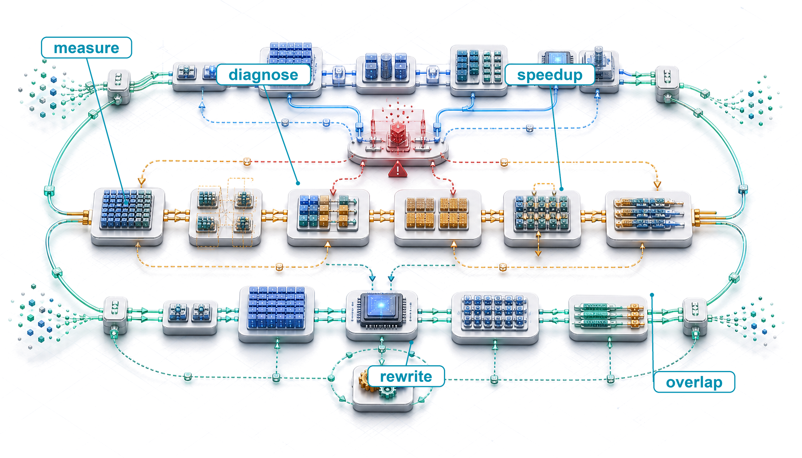
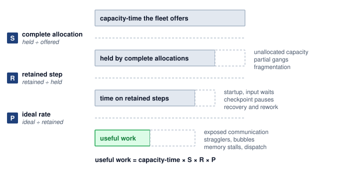
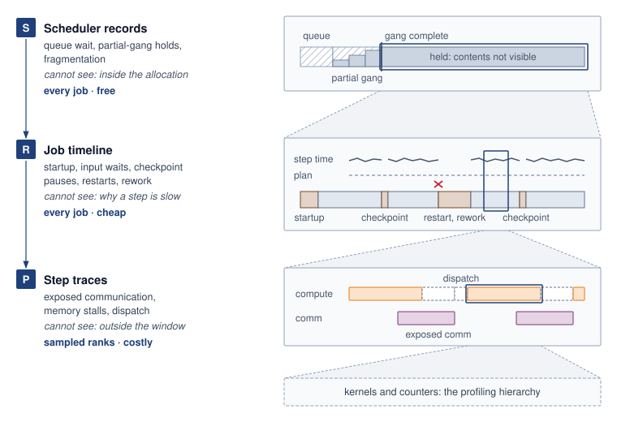
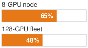
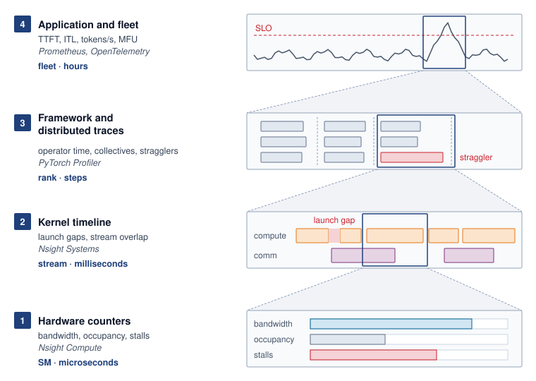
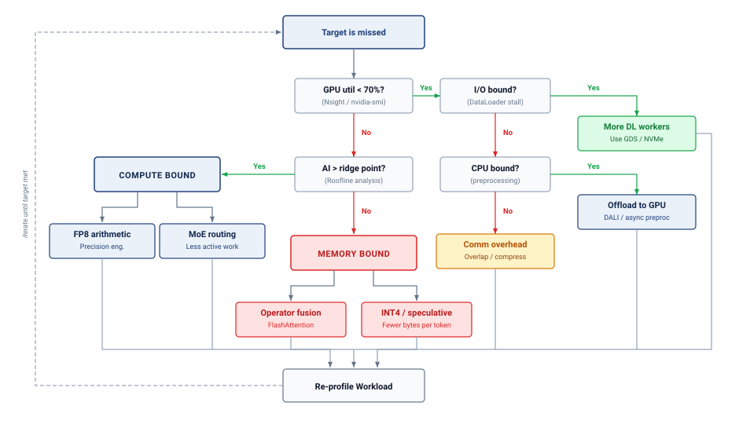
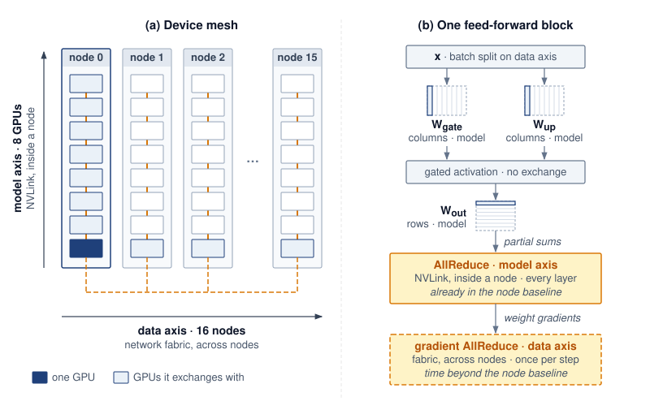
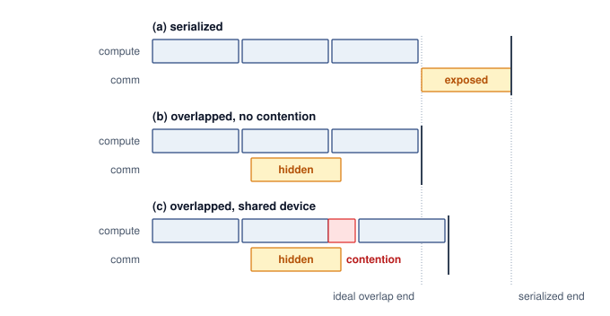

# Fleet Efficiency {#sec-performance-engineering}

::: {layout-narrow}
::: {.column-margin}

\chapterminitoc

:::

::: {.content-visible when-format="pdf"}
\noindent
{fig-alt="Fleet efficiency workbench where a fleet workload is measured, the capacity it loses before, during, and inside its running steps is charged to scheduling, runtime, and the program, and the program's share is recovered."}
:::

::: {.content-visible unless-format="pdf"}
{fig-alt="Fleet efficiency workbench where a fleet workload is measured, the capacity it loses before, during, and inside its running steps is charged to scheduling, runtime, and the program, and the program's share is recovered."}
:::

:::

## Purpose {.unnumbered .unlisted}

::: {.content-visible when-format="pdf"}
\begin{marginfigure}
\mlfleetstack{25}{35}{55}{30}{100}{35}{0}{0}
\end{marginfigure}
:::

::: {.content-visible unless-format="pdf"}
::: {.column-margin}
{width="100%" fig-alt="Fleet Machine Learning Systems Stack"}

*Fleet stack focus for this chapter.*
:::
:::

_Why can a fleet that is fully allocated and visibly busy still turn only a fraction of its compute into training progress and served requests?_

Expensive accelerators can spend much of a training step or a request waiting for data, software dispatch, or communication while their arithmetic units remain underused. Adding more machines may raise cost without removing the delay, and a faster isolated kernel may leave the step's or request's critical path unchanged. The engineering stakes are useful fleet capacity, the training progress and completed service an existing fleet produces while preserving model quality. A dashboard that counts every held accelerator as busy cannot see that waste, so a fleet can look fully used while turning only a fraction of its capacity into useful work. These interactions make optimization a question of measured constraints rather than a search for the fastest component. On one machine, a local improvement can be tested against a relatively contained execution path. Across a fleet, its value also depends on scheduling, recovery, communication, synchronization, and the distribution of work across devices. The cost of a mistaken diagnosis grows when the same inefficient execution repeats across many replicas and many weeks of training, and when the remedy is applied by a team that does not own the loss. A saving that looks large in isolation is worth only the part that survives along the complete step or request path. In C³ terms, fleet efficiency holds every compute gain accountable to the communication and coordination costs that decide how much of a fleet's capacity becomes useful work.

::: {.content-visible when-format="pdf"}

\newpage

:::

::: {.callout-learning-objectives}

- Explain how a job's or fleet's useful output decomposes into scheduling, runtime, and program goodput, with each loss charged to exactly one factor
- Measure goodput under a reproducible contract and localize the lost factor from scheduler records, job timelines, and step traces
- Attribute scheduling and runtime losses using the owners' results, without re-deriving them
- Measure program goodput with MFU and MBU and find the Fleet Law term a fix must shorten
- Select fleet-level program levers (compiler partitioning, overlap under contention, compilation) and recognize kernel-level levers by the term they shorten
- Evaluate a change that trades one factor against another by its effect on the product, and place the result on the efficiency frontier

:::

## Where Fleet Capacity Goes {#sec-performance-engineering-memory-wall}

```{python}
#| echo: false
from mlsysim import *
from mlsysim.core.units import *

# ┌─────────────────────────────────────────────────────────────────────────────
# │ CHAPTER START
# ├─────────────────────────────────────────────────────────────────────────────
# │ Context: Chapter initialization and global imports
# │
# │ Why: Registers this chapter with the mlsys registry and provides shared
# │      imports for all subsequent calculation cells.
# │
# └─────────────────────────────────────────────────────────────────────────────
from mlsysim.physics.quantities import token_throughput
from mlsysim.fmt import check, fmt, fmt_int
from mlsysim.physics import calc_bottleneck, model_memory
```

```{python}
#| echo: false
#| label: fleet-capacity-opening
# ┌─────────────────────────────────────────────────────────────────────────────
# │ FLEET CAPACITY OPENING (LEGO)
# ├─────────────────────────────────────────────────────────────────────────────
# │ Context: @sec-performance-engineering-memory-wall Archetype A lighthouse and
# │          the running-example paragraph.
# │
# │ Goal: Join Llama 3 405B's runtime and program losses into one share of
# │       held capacity, and fix the running example's size and layout in one
# │       place.
# │ Show: 16,384 GPUs; 54-day snapshot; >90 percent effective training time;
# │       41 percent BF16 MFU; ~37 percent of held capacity became progress;
# │       128-GPU (16-node) running example, 8-way tensor parallelism per node.
# │ How: Literature.TrainingRuns (Dubey 2024) for the Llama 3 record;
# │      product of the two fractions; scenario constant for the example.
# │
# └─────────────────────────────────────────────────────────────────────────────
from mlsysim import Literature, Models, Systems
from mlsysim.fmt import check, fmt_count, fmt_percent, fmt_time

class FleetCapacityOpening:
    """Llama 3 405B held-capacity share and the chapter's running-example size and layout."""

    # ┌── 1. LOAD (Constants) ──────────────────────────────────────────────
    llama3_gpus = Models.Language.Llama3_405B.training_accelerators_ref.to(count).magnitude
    snapshot_days = float(Literature.TrainingRuns.Llama3_405B_SnapshotDays)
    effective_time = float(Literature.TrainingRuns.Llama3_405B_EffectiveTrainingTimeFraction)  # stated lower bound
    mfu_16k = float(Literature.TrainingRuns.Llama3_405B_Mfu16K)  # BF16 MFU, Table 4
    replica_gpus = Systems.Nodes.DGX_H100.accelerators_per_node  # serving twin: one node
    example_gpus = 128  # scenario: running training job (single home; FleetEfficiencyCalc should read this)

    # ┌── 2. EXECUTE (The Compute) ────────────────────────────────────────
    held_to_progress = effective_time * mfu_16k  # runtime share x program share
    runtime_loss_share = 1 - effective_time  # held time that kept no progress
    program_loss_share = effective_time * (1 - mfu_16k)  # kept time spent below peak rate
    tp_width = replica_gpus  # tensor parallelism spans one node
    example_nodes = example_gpus // tp_width  # data parallelism spans the nodes

    # ┌── 3. GUARD (Invariants) ──────────────────────────────────────────
    check(llama3_gpus == 16384, f"Llama 3 405B ran on 16,384 GPUs, got {llama3_gpus}")
    check(0.30 < held_to_progress < 0.40, f"Prose says roughly a third, got {held_to_progress:.2f}")
    check(program_loss_share > 0.5 > runtime_loss_share, "Prose says most of the loss came from slow steps, not failures")
    check(replica_gpus == 8, "Prose spells out a serving replica of eight GPUs on one node")
    check(example_gpus % replica_gpus == 0, "Running example must be whole nodes")
    check(tp_width * example_nodes == example_gpus, "Layout: tensor parallelism within a node times data parallelism across nodes")

    # ┌── 4. OUTPUT (Formatting) ──────────────────────────────────────────
    llama3_gpus_str = fmt_count(llama3_gpus, label="H100 GPU", plural_label="H100 GPUs")
    snapshot_days_str = fmt_time(snapshot_days, day, precision=0, style='word', attributive=True)
    effective_time_pct_str = fmt_percent(effective_time, precision=0, style='prose')
    mfu_16k_pct_str = fmt_percent(mfu_16k, precision=0, style='prose')
    held_to_progress_pct_str = fmt_percent(round(held_to_progress, 2), precision=0, style='prose')
    example_gpus_str = fmt_count(example_gpus, commas=False, label="GPU")
    example_nodes_str = fmt_count(example_nodes, commas=False, label="node")
    tp_width_str = fmt_count(tp_width, commas=False)
```

A fleet can be fully allocated and visibly busy while most of its capacity never becomes training progress. The size of that gap is clearest in a run whose engineering is not in doubt.

::: {#lhs-performance-engineering-archetype-a-gpt-4-llama-3-held-capacity .callout-lighthouse title="Archetype A (GPT-4/Llama-3): Held capacity versus progress"}

Meta's pretraining of Llama 3 405B\index{Llama 3!held capacity and progress} on `{python} FleetCapacityOpening.llama3_gpus_str` is one of the best-documented large training runs, and its two most quoted efficiency numbers measure different things. Across a `{python} FleetCapacityOpening.snapshot_days_str` snapshot, the job kept more than `{python} FleetCapacityOpening.effective_time_pct_str` of its elapsed time as effective training time despite hundreds of unexpected interruptions, as @sec-fault-tolerance-reliability-recovery-automation-pipeline records. In the steps it kept, its arithmetic ran at about `{python} FleetCapacityOpening.mfu_16k_pct_str` of the accelerators' peak rate [@dubey2024llama]. Multiplied, the two figures show the run turning roughly `{python} FleetCapacityOpening.held_to_progress_pct_str` of the peak-rate capacity it held into training progress. Because the two figures come from different measurement windows, the product is only an estimate, yet it shows one of the most carefully engineered runs on record losing about two-thirds of the capacity it held, mostly to steps that ran below the hardware's rate rather than to the failures that dominate its reputation. Its two figures therefore bound what a well-run job of this archetype loses at the runtime and program boundaries.

:::

The Llama 3 figures begin when the job already holds its accelerators, so they cannot see capacity that never reached it. A fleet shared by many teams, the setting of @sec-fleet-orchestration, loses capacity there as well. Devices sit unallocated because no queued job fits the free ones, or a job holds part of its group while it waits for the rest and cannot run a single step. The orchestrator's accounting already separates allocated capacity from productive work, but it cannot say where inside a job the missing work went. Allocated capacity is where the accounting of fleet efficiency starts, not evidence that the capacity was used well.

::: {.column-margin .margin-pointer}
↩ The allocated, active, and productive tiers of fleet resource accounting are established in @sec-fleet-orchestration-resource-accounting.
:::

Communication, the parallel division of work, fault tolerance, and orchestration each removed one kind of loss in earlier chapters, measured in its own units. None of those measures says how much capacity remains after all four or which loss to fix first, the question that opens the Serving band of @fig-fleet-stack.

Capacity can be lost in three places, and the order follows the life of a job. A job must first hold its devices, and capacity that sits unallocated, that fragmentation leaves where no queued group fits, or that a group holds while it waits for its remaining members produces nothing however fast the program would have run. Once a job holds a complete allocation, it must keep its progress. Starting up, waiting for input, pausing to write checkpoints, recovering from failures, and redoing steps lost since the last checkpoint all consume held time without leaving a retained step behind. Finally, the kept steps must run at the rate the hardware allows. A step that exposes communication, waits for a straggling peer or a pipeline stage, stalls on memory traffic, or dispatches long chains of small kernels holds working devices that deliver less than they could.

Each place has a name in the accounting. Scheduling goodput\index{Scheduling Goodput!fleet capacity accounting} measures the first, runtime goodput\index{Runtime Goodput!fleet capacity accounting} the second, and program goodput\index{Program Goodput!fleet capacity accounting} the third, and useful output is fleet capacity multiplied by all three [@wongpanich2025fleet]. In the Llama 3 run, effective training time stands in for runtime goodput and model FLOPs utilization (MFU) for program goodput, and a shared fleet multiplies both by a scheduling factor below one.

::: {.column-margin .margin-pointer}
↩ The Fleet Law, where these three factors are first previewed, is established in @sec-vol2-introduction-fleet-law.
:::

One training job carries the accounting through the chapter. It trains Llama 2 70B, a smaller Archetype A model than the archetype's 175B reference, on `{python} FleetCapacityOpening.example_gpus_str` (`{python} FleetCapacityOpening.example_nodes_str` of eight) of that shared fleet. Its layout is `{python} FleetCapacityOpening.tp_width_str`-way tensor parallelism within each node and data parallelism across nodes. The job competes for complete allocations with other teams' jobs, survives the failures and preemptions that fleet sees, and runs steps whose exposed communication grows with its device count, so all three losses apply to one job on one fleet.

::: {.column-margin .margin-pointer}
↩ Archetype A and its 175B-parameter reference model are established in @sec-introduction-archetype-gpt4llama3-b02f.
:::

The same model's serving replica is the running example's twin. The replica runs on one node of eight H100 GPUs, so a single tensor-parallel node forms one complete replica. Like every Archetype A model, it is a dense transformer too large for one accelerator, so each replica exchanges activations among its accelerators in every layer. The scheduler treats a replica as an indivisible group, the replica loads weights and warms up before it serves, and its decode steps can leave most of the node's arithmetic idle while weights stream from memory. Its losses therefore fall in the same three places as the training job's.

The serving twin also marks the boundary of the accounting. A replica's requests share execution in batches, hold key-value cache state, and must each meet a latency target, and @sec-inference-scale develops how a replica handles uneven arrivals under those targets. The boundary test is whether a loss would remain with the request stream switched off. A replica held while it loads, or a decode step that streams weights more slowly than the node's memory bandwidth allows, passes that test and is counted here, averaged over windows of hours to weeks. A request that waits behind a long batch exists only because requests arrive unevenly, so it belongs to serving. Capacity a replica holds in reserve for bursts is counted here as held time that runs below its ideal rate, while how much headroom a latency target requires is a serving decision.

Three places, one running job, and one boundary give the accounting its parts but not yet its rules. Counting an hour lost to a straggler and an hour lost to a restart once each, in exactly one factor, requires the boundaries between factors that ML goodput fixes in @sec-performance-engineering-measurement-scale.

## ML Goodput {#sec-performance-engineering-measurement-scale}

No report a fleet already produces says how much of its capacity became useful work. The scheduler divides held hours by fleet capacity, the job timeline divides kept steps by the hours the job held, and the profiler divides a traced step's arithmetic by the devices' peak rate, so an hour lost to a restart can appear in two of the reports while devices held by a group still waiting for its last members appear in none. One number requires one accounting, in which every hour of capacity is followed from the moment the fleet offers it until it becomes useful work or is lost, and each loss is charged at exactly one place.

### The three goodput factors {#sec-performance-engineering-goodput-factors}

Run-level goodput, introduced with the Coordination dimension in @sec-vol2-introduction-dim-coord, already follows one job over its whole run and discounts work wasted to failures and repeated after restarts. It starts when the job holds its devices and stops at the boundary of the step, so it cannot see capacity the job never received, and it cannot say whether the steps it kept ran at the rate the hardware allows. Extending its window backward to the capacity the fleet offered and forward into the rate of the kept steps turns it into a product of three factors.[^fn-mpg-fleet-origin]

[^fn-mpg-fleet-origin]: **ML productivity goodput origin**\index{ML Productivity Goodput!origin}: Google introduced the three-factor decomposition to measure its Tensor Processing Unit (TPU) fleet, calling it an iron law of performance for ML fleets by analogy with the processor iron law that splits execution time into instructions, cycles per instruction, and time per cycle [@wongpanich2025fleet]. The paper reports the factors across the whole fleet and segmented by job size and by workload phase, with real-time serving and bulk inference alongside training. The boundaries themselves name no accelerator, so this chapter applies them to any accelerator fleet, for serving replicas as well as training jobs.

::: {#dfn-performance-engineering-ml-productivity-goodput .callout-definition title="ML productivity goodput (MPG)"}

***ML productivity goodput (MPG)***\index{ML Productivity Goodput!definition}\index{Goodput!definition} is the fraction of a fleet's capacity-time that becomes useful work at the hardware's ideal rate, expressed as the product of scheduling, runtime, and program goodput, each measured on a fixed accounting boundary so that every lost interval is charged to exactly one factor [@wongpanich2025fleet].

1.  **Significance**: It converts the losses that scheduling, recovery, and execution each report in their own units into one fraction of fleet capacity, so a loss at one boundary can be compared directly with an equal loss at another, and an accelerator-hour's price divided by it is the cost of one ideal-rate hour of useful work.
2.  **Distinction**: Unlike utilization\index{Utilization!vs. ML productivity goodput}, which counts an accelerator as used whenever it is allocated or busy, it counts only retained work at its ideal rate. Unlike run-level goodput, it also charges the capacity a job never received and the rate at which its kept steps ran.
3.  **Common pitfall**: A frequent mistake is to multiply factors measured over different windows or against overlapping denominators, such as a run-averaged MFU that already includes restart time and a runtime factor that charges the same restarts again. The product is meaningful only when each factor divides by exactly what the previous one passed.

:::

The three factors follow the life of a job, and each is a fraction of what the one before it passed. **Scheduling goodput**\index{Scheduling Goodput!definition} ($\SchedulingGoodput$) is the fraction of fleet capacity-time held by complete allocations, intervals in which a job holds every resource its synchronous progress needs. **Runtime goodput**\index{Runtime Goodput!definition} ($\RuntimeGoodput$) is the fraction of that held time spent on steps a checkpoint retains, after initialization, input stalls, checkpoint pauses, recovery, and work lost after the last checkpoint are excluded. **Program goodput**\index{Program Goodput!definition} ($\ProgramGoodput$) is the ratio of the ideal execution time of those retained steps to their actual execution time, so it charges what remains to code, compiler, and communication inefficiency against a named ideal. @Eq-perf-ml-productivity-goodput multiplies them into MPG:

$$\MlProductivityGoodput = \SchedulingGoodput \times \RuntimeGoodput \times \ProgramGoodput$$ {#eq-perf-ml-productivity-goodput}

The product is valid because each factor divides by what the previous one produced. Scheduling goodput divides held time by capacity-time, runtime goodput divides retained step time by held time, and program goodput divides ideal time by retained step time, so each numerator cancels the next denominator and what remains is the ideal-rate time of the useful work over the capacity-time the fleet offered (@fig-performance-engineering-goodput-boundaries). MPG is therefore a fraction of capacity rather than a throughput rate. Useful output is peak capacity multiplied by it, and the cost of a unit of useful work is the cost of capacity divided by it. The cancellation also states when the product holds. If two factors divide by overlapping quantities, a lost interval is subtracted twice, and if a factor's denominator is wider than the previous factor's numerator, an interval is subtracted at neither.

::: {#fig-performance-engineering-goodput-boundaries fig-env="figure" fig-pos="htb" fig-cap="**ML goodput as a chain of three boundaries**: Capacity-time becomes useful work only by crossing three boundaries in the order a job meets them, and each factor divides what crossed its boundary by what reached it. The dashed slice at the end of each row is the capacity-time lost at the boundary above that row, and the losses beside it are charged there and at no other boundary, so the three factors multiply into the share of offered capacity-time that becomes useful work. Widths are schematic, not measured." fig-alt="Four horizontal bars stacked top to bottom, each shorter than the one above and separated by dashed boundary lines. The top bar reads capacity-time the fleet offers. A navy chip S labeled complete allocation, held divided by offered, marks the first boundary; the next bar reads held by complete allocations, with a dashed empty slice at its right end and beside it the losses unallocated capacity, partial gangs, and fragmentation. A chip R labeled retained step, retained divided by held, marks the second boundary; the next bar reads time on retained steps, with a dashed slice and the losses startup, input waits, checkpoint pauses, and recovery and rework. A chip P labeled ideal rate, ideal divided by retained, marks the third boundary; the bottom bar is green and reads useful work, with a dashed slice and the losses exposed communication, stragglers, bubbles, memory stalls, and dispatch. Below the bars a line reads useful work equals capacity-time times S times R times P."}



:::

Each factor loses capacity to the events that @sec-performance-engineering-memory-wall listed for its place in a job's life, and the factors cut across the C$^3$ taxonomy rather than extending the Fleet Law. Communication overlap raises program goodput, while checkpointing and recovery, which the Fleet Law files under Coordination, lower runtime goodput. The factor says where in a job's life the capacity went and C$^3$ says which mechanism took it, so a diagnosis names the factor first and the mechanism inside it second.

Because the factors multiply, the share of capacity lost at each boundary is that factor's own loss weighted by what the earlier boundaries passed. @Eq-perf-goodput-loss-shares splits the whole gap accordingly, with the scheduling loss first, the runtime loss on the capacity that was held, and the program loss on the time that was retained:

$$1 - \SchedulingGoodput\RuntimeGoodput\ProgramGoodput = (1-\SchedulingGoodput) + \SchedulingGoodput(1-\RuntimeGoodput) + \SchedulingGoodput\RuntimeGoodput(1-\ProgramGoodput)$$ {#eq-perf-goodput-loss-shares}

The three terms add to the whole gap, which is the arithmetic form of charging every lost interval to exactly one factor. The factor values do not depend on the order of the boundaries, but the capacity attributed to each one does, so the accounting follows the order in which a job meets the three losses. Applied to the two published figures of the Llama 3 405B run, the equation shows which boundary held most of the gap.

```{python}
#| echo: false
#| label: goodput-loss-shares
# ┌─────────────────────────────────────────────────────────────────────────────
# │ GOODPUT LOSS SHARES (LEGO)
# ├─────────────────────────────────────────────────────────────────────────────
# │ Context: @eq-perf-goodput-loss-shares and the Llama 3 notebook after it
# │          in @sec-performance-engineering-goodput-factors.
# │
# │ Goal: Split the capacity Llama 3 405B held into the share lost at the
# │       runtime boundary, the share lost at the program boundary, and the
# │       share that became ideal-rate progress.
# │ Show: R ~0.90, P ~0.41; ~10 percent runtime loss; ~53 percent program
# │       loss; ~37 percent useful.
# │ How: Literature.TrainingRuns (Dubey 2024); runtime share = 1 - R;
# │      program share = R x (1 - P); useful = R x P. Scheduling goodput is 1
# │      for a dedicated cluster, so it drops out.
# │
# │ Note: The two inputs come from different measurement windows (54-day
# │       snapshot vs. Table 4 configuration); S1 labels the product an
# │       estimate. Replace with GoodputDecomposition when it is registered.
# └─────────────────────────────────────────────────────────────────────────────
from mlsysim import Literature, Models
from mlsysim.core.units import count
from mlsysim.fmt import check, fmt, fmt_count, fmt_percent

class GoodputLossShares:
    """Capacity shares charged to the runtime and program boundaries for Llama 3 405B."""

    # ┌── 1. LOAD (Constants) ──────────────────────────────────────────────
    runtime_goodput = float(Literature.TrainingRuns.Llama3_405B_EffectiveTrainingTimeFraction)  # stated lower bound
    program_goodput = float(Literature.TrainingRuns.Llama3_405B_Mfu16K)  # BF16 MFU at 16K GPUs
    llama_gpus = Models.Language.Llama3_405B.training_accelerators_ref.to(count).magnitude

    # ┌── 2. EXECUTE (The Compute) ────────────────────────────────────────
    runtime_share = 1 - runtime_goodput  # held time that kept no progress
    program_gap = 1 - program_goodput  # retained time below the ideal rate, per unit retained
    program_share = runtime_goodput * program_gap  # kept time spent below the ideal rate
    useful_share = runtime_goodput * program_goodput  # ideal-rate progress

    # ┌── 3. GUARD (Invariants) ──────────────────────────────────────────
    check(abs(runtime_share + program_share + useful_share - 1) < 1e-9, "Loss shares and useful share must account for all held capacity")
    check(0.08 <= runtime_share <= 0.12, f"Prose says about a tenth was lost at the runtime boundary, got {runtime_share:.2f}")
    check(0.50 <= program_share <= 0.56, f"Prose says more than half was lost at the program boundary, got {program_share:.2f}")
    check(program_share > 4 * runtime_share, "Prose says the program loss is several times the runtime loss")
    check(
        abs(round(runtime_goodput, 2) * round(program_gap, 2) - round(program_share, 2)) <= 0.005,
        "Notebook's rounded R x (1 - P) must reproduce the rounded program share",
    )
    check(
        abs(round(runtime_goodput, 2) * round(program_goodput, 2) - round(useful_share, 2)) <= 0.005,
        "Notebook's rounded R x P must reproduce the rounded useful share",
    )
    check(llama_gpus == 16384, f"Llama 3 405B anchor is 16,384 GPUs, got {llama_gpus}")

    # ┌── 4. OUTPUT (Formatting) ──────────────────────────────────────────
    llama_gpus_str = fmt_count(llama_gpus, label="GPU")
    runtime_goodput_pct_str = fmt_percent(runtime_goodput, precision=0, style='prose')
    program_goodput_pct_str = fmt_percent(program_goodput, precision=0, style='prose')
    runtime_goodput_str = fmt(round(runtime_goodput, 2), precision=2)
    program_goodput_str = fmt(round(program_goodput, 2), precision=2)
    program_gap_str = fmt(round(program_gap, 2), precision=2)
    runtime_share_str = fmt(round(runtime_share, 2), precision=2)
    program_share_str = fmt(round(program_share, 2), precision=2)
    useful_share_str = fmt(round(useful_share, 2), precision=2)
    runtime_share_pct_str = fmt_percent(round(runtime_share, 2), precision=0, style='prose')
    program_share_pct_str = fmt_percent(round(program_share, 2), precision=0, style='prose')
    useful_share_pct_str = fmt_percent(round(useful_share, 2), precision=0, style='prose')
```

::: {#nbk-performance-engineering-llama3-loss-split .callout-notebook title="Where Llama 3's held capacity went"}

**Problem**: Llama 3 405B trained on a dedicated cluster of `{python} GoodputLossShares.llama_gpus_str`, kept more than `{python} GoodputLossShares.runtime_goodput_pct_str` of its elapsed time as effective training time, and ran its kept steps at about `{python} GoodputLossShares.program_goodput_pct_str` MFU [@dubey2024llama]. What share of the capacity it held was lost at the runtime boundary, what share at the program boundary, and what share became progress at the ideal rate?

**Variables**:

- Scheduling goodput $\SchedulingGoodput$ is one, because the cluster was dedicated to the run, so the first term of @eq-perf-goodput-loss-shares vanishes.
- Runtime goodput $\RuntimeGoodput$ is about `{python} GoodputLossShares.runtime_goodput_str`, from effective training time (a stated lower bound).
- Program goodput $\ProgramGoodput$ is about `{python} GoodputLossShares.program_goodput_str`, from MFU at full scale.

**Math**:

- Runtime boundary, $1-\RuntimeGoodput$: 1 $-$ `{python} GoodputLossShares.runtime_goodput_str` = `{python} GoodputLossShares.runtime_share_str`.
- Program boundary, $\RuntimeGoodput(1-\ProgramGoodput)$: `{python} GoodputLossShares.runtime_goodput_str` $\times$ `{python} GoodputLossShares.program_gap_str` $\approx$ `{python} GoodputLossShares.program_share_str`.
- Useful work, $\RuntimeGoodput\ProgramGoodput$: `{python} GoodputLossShares.runtime_goodput_str` $\times$ `{python} GoodputLossShares.program_goodput_str` $\approx$ `{python} GoodputLossShares.useful_share_str`.

**Result**: About `{python} GoodputLossShares.runtime_share_pct_str` of the held capacity was lost at the runtime boundary, about `{python} GoodputLossShares.program_share_pct_str` at the program boundary, and about `{python} GoodputLossShares.useful_share_pct_str` became progress at the ideal rate.

**Systems insight**: Removing every interruption would have recovered at most a tenth of the capacity the run held, while the steps it kept left more than half unused, so for one of the most carefully engineered runs on record the program boundary, not reliability, held most of the gap.

:::

The mapping behind the estimate is close but not exact, since effective training time equals runtime goodput only if the allocation was held for the whole elapsed time and input waits count as lost.[^fn-effective-training-window]

[^fn-effective-training-window]: **Effective training time**\index{Effective Training Time!Llama 3 window}: Meta's report defines it as the time spent on useful training over the elapsed time and states only that it exceeded `{python} GoodputLossShares.runtime_goodput_pct_str` over a `{python} FleetCapacityOpening.snapshot_days_str` snapshot [@dubey2024llama]. It is a per-job figure, so it says nothing about capacity the job never held, and the report does not say whether input waits count as useful. Its MFU comes from the scaling-configuration table rather than from that snapshot, which is why the measurement contract (@sec-performance-engineering-measurement-contract) requires every factor to name its window.

### Program goodput and its measure {#sec-performance-engineering-fleet-efficiency-metric-dff4}

Hardware activity counters cannot measure how efficiently a retained step ran, because an accelerator looks equally busy when it waits on a collective, recomputes dropped activations, or runs arithmetic far below its peak rate. Measuring program goodput instead requires a named ideal rate that depends on which resource the work must use. For training steps and for the prefill pass over a prompt, arithmetic dominates, and the ideal time of a step is the time the accelerators would need to perform the model's required operations at their peak rate. MFU\index{MFU!as program goodput} measures against that ideal because it counts only the operations the model requires.[^fn-mfu-hfu-origin]

[^fn-mfu-hfu-origin]: **MFU and HFU**\index{Model FLOPs Utilization!PaLM origin}\index{Hardware FLOPs Utilization!vs. MFU}: The PaLM report proposed MFU in place of hardware FLOPs utilization (HFU), which counts every executed operation, because the executed count depends on implementation and compiler choices, most visibly rematerialization, which recomputes activations to save memory [@chowdhery2022palm]. MFU's reference rate depends only on the model architecture and the published peak rate, so runs of one model on different software stacks compare directly. For goodput accounting, the choice means that recomputation which lets a layout fit in memory is charged to program goodput as lost time rather than credited as work.

::: {#dfn-performance-engineering-model-flops-utilization-mfu .callout-definition title="Model FLOPs utilization (MFU)"}

***Model FLOPs utilization (MFU)***\index{Model FLOPs Utilization!definition} is the fraction of the hardware's theoretical peak throughput ($\PeakRate$) consumed by FLOPs that directly advance model training or inference, excluding overhead from recomputation, padding, and synchronization.

1.  **Significance**: Measured over a job's retained steps against the arithmetic ideal, MFU is that job's program goodput. A one-percentage-point MFU increase across 10,000 identical GPUs adds useful throughput equivalent to 100 GPUs at peak, and whether that saves money depends on whether the recovered capacity displaces hardware or shortens paid runtime.\index{MFU!economic impact}
2.  **Distinction**: Unlike hardware utilization\index{Hardware Utilization}\index{Hardware Utilization!vs. MFU}, which reports how often the accelerator is busy, MFU relates the model's required FLOP rate to hardware peak. It excludes recomputation and padding from useful work even when they make a configuration feasible or faster.
3.  **Common pitfall**: A frequent misconception is that high GPU utilization implies high efficiency. A system can show 90 percent hardware utilization while achieving 30 percent MFU when busy intervals include communication or arithmetic far below peak. MFU exposes the gap but does not explain its cause, which traces must find.

:::

::: {.column-margin .margin-pointer}
↩ The compute axis, where the memory wall limits MFU, is established in @sec-vol2-introduction-dim-compute.
:::

The identity between MFU and program goodput follows from the definition of the ideal. A retained step on $\DeviceCount$ devices performs $\UsefulModelFlops$ of required work, which the devices could finish in $\UsefulModelFlops/(\DeviceCount\PeakRate)$ at peak, and the step actually takes $\DistributedStepTime$. @Eq-perf-program-goodput-mfu writes program goodput as the ratio of the two times:

$$\ProgramGoodput = \frac{\UsefulModelFlops/(\DeviceCount\PeakRate)}{\DistributedStepTime} = \ModelFlopsUtilization$$ {#eq-perf-program-goodput-mfu}

The identity holds only when MFU is measured over the steps that runtime goodput retained, with input waits already removed. An MFU averaged over a whole run, as published figures often are, divides by elapsed time that includes restarts and checkpoint pauses, so multiplying it by a runtime factor charges those losses twice. Hardware FLOPs utilization\index{Hardware FLOPs Utilization!vs. MFU} (HFU), which counts the executed arithmetic including recomputation, is useful evidence beside MFU, because the gap between them is recomputation. That gap is a program goodput loss even when recomputation is the right price for the memory it saves. Capacity planning sizes a run in accelerator-hours from peak throughput scaled by a measured utilization (@sec-compute-infrastructure-peak-vs-sustained-throughput-625a), and a plan that takes retained-step MFU as that utilization still omits the runtime and scheduling losses that the other two factors charge.

```{python}
#| echo: false
# ┌─────────────────────────────────────────────────────────────────────────────
# │ PUBLISHED MFU PROGRESSION (LEGO)
# ├─────────────────────────────────────────────────────────────────────────────
# │ Context: @fig-mfu-progression, its caption, and its lead-in sentence
# │          (moved from ch06 Hybrid Parallelism, 2026-10-15 flow pass).
# │ Goal: Pin every MFU point and system size to Literature.TrainingRuns and
# │       Models.Language (PaLM table for 2020-2022; Llama 3 paper for 2024).
# │ Note: the GPT-3 label names the ~10,000-V100 Microsoft/OpenAI system, which
# │       is a machine size, not the registry's 1,024-GPU run estimate.
# └─────────────────────────────────────────────────────────────────────────────
from mlsysim.fmt import check, fmt, fmt_count, fmt_percent

class MfuProgression:
    # ┌── 1. LOAD ─────────────────────────────────────────
    runs = Literature.TrainingRuns
    gpt3_mfu = float(runs.Gpt3MfuPalmTable)
    mtnlg_mfu = float(runs.MtNlgMfu)
    gopher_mfu = float(runs.GopherMfu)
    palm_mfu = float(runs.PalmMfu)
    llama3_8k_mfu = float(runs.Llama3_405B_Mfu8K)
    llama3_16k_mfu = float(runs.Llama3_405B_Mfu16K)
    gpt3_system_gpus = int(runs.MicrosoftOpenAI2020Gpus)
    palm_chips = int(Models.Language.PaLM_540B.training_accelerators_ref.magnitude)
    llama3_8k_gpus = int(runs.Llama3_405B_Gpus8K)
    llama3_16k_gpus = int(Models.Language.Llama3_405B.training_accelerators_ref.magnitude)

    # ┌── 3. GUARD ────────────────────────────────────────
    check(palm_mfu > 2 * gpt3_mfu, "Prose says MFU more than doubled from GPT-3 to PaLM")
    check(llama3_16k_mfu < llama3_8k_mfu, "Llama 3 MFU should fall from 8K to 16K GPUs")
    check(llama3_16k_gpus == 2 * llama3_8k_gpus, "Llama 3 scaling points are 8K and 16K GPUs")

    # ┌── 4. OUTPUT ───────────────────────────────────────
    gpt3_mfu_str = fmt_percent(round(gpt3_mfu * 100) / 100, precision=0, commas=False, style='prose')
    palm_mfu_str = fmt_percent(round(palm_mfu * 100) / 100, precision=0, commas=False, style='prose')
    llama3_8k_mfu_str = fmt_percent(llama3_8k_mfu, precision=0, commas=False, style='prose')
    llama3_16k_mfu_str = fmt_percent(llama3_16k_mfu, precision=0, commas=False, style='prose')
    llama3_8k_gpus_str = fmt(llama3_8k_gpus, precision=0, commas=True)
    llama3_16k_gpus_str = fmt(llama3_16k_gpus, precision=0, commas=True)
```

The MFU that published training runs report\index{Model FLOPs Utilization!published training runs} stays below half of peak, and for Llama 3 405B it falls when the same model moves to twice as many GPUs (@fig-mfu-progression).

::: {#fig-mfu-progression fig-env="figure" fig-pos="htb" fig-cap="**The MFU progression**: Model FLOPs Utilization across published training systems, ordered chronologically. Reported MFU rises from `{python} MfuProgression.gpt3_mfu_str` (GPT-3, 2020) to `{python} MfuProgression.palm_mfu_str` (PaLM, 2022), with later illustrated runs near 40--45 percent. These systems differ in hardware and workload, so the comparison does not isolate the effect of parallelism or overlap. The Llama 3 data points show lower reported MFU at the larger scale: MFU drops from `{python} MfuProgression.llama3_8k_mfu_str` at `{python} MfuProgression.llama3_8k_gpus_str` GPUs to `{python} MfuProgression.llama3_16k_mfu_str` at `{python} MfuProgression.llama3_16k_gpus_str` GPUs. Interpreting the difference requires the batch, execution configuration, and measurement convention. Data sources: @chowdhery2022palm, @dubey2024llama." fig-alt="Horizontal bar chart of MFU percentages for six training systems from 2020 to 2024 showing progression from 21 percent to 46 percent with a plateau near 41 to 43 percent. Each orange bar sits inside a light gray track that runs to 100 percent of peak, the remainder labeled unused share of peak. A dashed line marks 50 percent of peak, and a bracket notes that the Llama 3 run on twice the GPUs reports lower MFU."}

```{python}
#| echo: false
from mlsysim.solvers import DistributedModel

# ┌─────────────────────────────────────────────────────────────────────────────
# │ MFU PROGRESSION (FIGURE)
# ├─────────────────────────────────────────────────────────────────────────────
# │ Context: @fig-mfu-progression—Model FLOPs Utilization over time
# │
# │ Goal: Barh of MFU for GPT-3, Megatron-Turing, Gopher, PaLM, Llama 3;
# │       show 21 percent→46 percent progression; plateau; Scaling Tax at 16K GPUs.
# │ Show: Six horizontal bars; 50 percent reference line; annotations.
# │ How: Verified systems/mfu_values; book_style.setup_plot().
# │
# └─────────────────────────────────────────────────────────────────────────────
# ┌── 1. CANVAS ────────────────────────────────────────────────────────────────
# │ Barh of MFU for GPT-3, Megatron-Turing, Gopher, PaLM, Llama 3;
import numpy as np
import matplotlib.pyplot as plt
from binder.tools.figures import style as book_style

fig, ax, COLORS, plt = book_style.setup_plot(figsize=(6.1, 4.1))

# VERIFIED DATA (Chowdhery et al., arXiv:2204.02311; Meta, arXiv:2407.21783)

# ┌── 2. ARRAYS ────────────────────────────────────────────────────────────────
_R = MfuProgression
systems = [
    f'GPT-3\n(~{_R.gpt3_system_gpus // 1000}K-V100 system, 2020)',
    'Megatron-Turing NLG\n(A100s, 2021)',
    'Gopher\n(TPU v3, 2021)',
    f'PaLM 540B\n({_R.palm_chips} TPU v4, 2022)',
    f'Llama 3 405B\n({_R.llama3_8k_gpus} H100s, 2024)',
    f'Llama 3 405B\n({_R.llama3_16k_gpus} H100s, 2024)',
]
mfu_values = [round(100 * v, 1) for v in (_R.gpt3_mfu, _R.mtnlg_mfu, _R.gopher_mfu, _R.palm_mfu, _R.llama3_8k_mfu, _R.llama3_16k_mfu)]

y_pos = np.arange(len(systems))
# Each bar is drawn inside a full-length track = 100% of peak, so the unused share of peak is visible.
ax.barh(y_pos, [100] * len(y_pos), color=COLORS['grid'], alpha=0.25, edgecolor=COLORS['grid'], height=0.58, linewidth=0.8, zorder=2)
ax.text(99, 0, 'unused share of peak', va='center', ha='right', fontsize=10, style='italic', color=COLORS['secondary'], zorder=4)
# One series, one color: MFU is compute utilization, so the compute hue (orange);
# the hardware generation is already in each label.
bars = ax.barh(y_pos, mfu_values, color=COLORS['OrangeL'], edgecolor=COLORS['OrangeLine'], height=0.58, linewidth=1.0, zorder=3)

# ┌── 3. RENDER ────────────────────────────────────────────────────────────────
# Value labels sit inside each bar's right end, clear of the reference line.
for i, val in enumerate(mfu_values):
    ax.text(val - 0.8, i, f'{val}%', va='center', ha='right', fontsize=10, fontweight='bold', color=COLORS['primary'], zorder=4)

# ┌── 4. DECORATE ──────────────────────────────────────────────────────────────
# Illustrative 50 percent reference line (not a hardware limit, so neutral gray).
ax.axvline(x=50, color=COLORS['secondary'], linestyle='--', linewidth=1.1, zorder=2)
ax.text(50.6, -0.6, '50% of peak', fontsize=10, color=COLORS['secondary'], va='center', ha='left')
ax.text(99.5, -0.6, 'peak', fontsize=10, color=COLORS['secondary'], va='center', ha='right')

# The two Llama 3 runs: same model, twice the GPUs, lower reported MFU.
ax.plot([43.6, 44.3, 44.3, 41.6], [4, 4, 5, 5], color=COLORS['secondary'], lw=1.0, zorder=3)
# The note sits just right of the bracket it explains, in the gap between the two tracks;
# its white backing breaks the 50% reference line where the two cross.
ax.text(
    45.2,
    4.5,
    f'{_R.llama3_8k_gpus // 1024}K to {_R.llama3_16k_gpus // 1024}K GPUs, lower MFU',
    fontsize=10,
    color=COLORS['secondary'],
    va='center',
    ha='left',
    zorder=4,
    bbox=dict(facecolor='white', edgecolor='none', pad=1.0),
)

ax.set_yticks(y_pos)
ax.set_yticklabels(systems, fontsize=10)
ax.set_xlabel('Model FLOPs Utilization (%)')
ax.set_xlim(0, 100)
for _sp in ('top', 'right'):
    ax.spines[_sp].set_visible(False)
ax.set_ylim(5.5, -0.9)
ax.grid(axis='y', visible=False)

plt.tight_layout()
plt.show()
plt.close()
```

:::

The arithmetic ideal fails for work that the hardware cannot make arithmetic-bound. A decode step that generates one token for a small batch must read every weight of the model to perform a few operations per weight, so memory bandwidth sets its time, and at the bandwidth floor established in @sec-compute-infrastructure-memory-bandwidth-token-latency-1b38 its arithmetic units run at well under 1 percent of peak. Charging that gap to the program would assign it a loss no program change can recover, since only a larger batch raises the work done per byte, and the batch a latency target allows is a serving decision. For bandwidth-bound decode the named ideal is therefore the bandwidth floor, the time to move the bytes the step must read at peak memory bandwidth. Program goodput against that ideal is **model bandwidth utilization**\index{Model Bandwidth Utilization!program goodput for decode} (MBU), the achieved rate of required bytes moved divided by peak memory bandwidth. High MBU with low MFU marks a memory-saturated program, not an inefficient one.

A named ideal also limits what can be multiplied. A fleet that measures training against peak arithmetic and decode against the bandwidth floor cannot average the two into one program factor, because the ideals measure different resources. The fleet-wide product either reports program goodput per workload class or converts every class to the arithmetic ideal and states that decode's large loss belongs to batch size. MFU remains the default because only it composes across workloads, and MBU is reported beside it wherever the ideal is the bandwidth floor.

```{python}
#| echo: false
#| label: fleet-efficiency-calc
# ┌─────────────────────────────────────────────────────────────────────────────
# │ FLEET EFFICIENCY ANALYSIS (LEGO)
# ├─────────────────────────────────────────────────────────────────────────────
# │ Context: running-example paragraph in
# │          @sec-performance-engineering-fleet-efficiency-metric-dff4 (first
# │          read); the scaling notebook in
# │          @sec-performance-engineering-exposed-communication and later
# │          sections (S6, S7, S8, S10) read the same outputs.
# │
# │ Goal: Measure the running example's program goodput (fleet MFU of its
# │       retained steps) and split it into the node baseline and the scaling
# │       efficiency relative to that node.
# │ Show: node MFU ~65%, fleet MFU ~48% (P ~ 0.48); scaling efficiency from
# │       one node ~74%, so ~26% relative loss; 180 ms -> 245 ms per step,
# │       ~65 ms (~27% of the fleet step) spent beyond the node baseline.
# │ How: MFU = useful FLOPs / (N x peak x step time) for both configurations;
# │      scaling efficiency (eq-distributed-training-scaling-efficiency,
# │      measured from the node) = fleet MFU / node MFU, which equals
# │      (t_node / t_fleet) x (tokens per GPU, fleet / node).
# │
# │ Note: Moved from S6 in pass 2 (PRUNE_PASS_FIXES) so S2 can quote the
# │       fleet MFU. Step times and token counts are constructed scenario
# │       assumptions. The GPU count is read from FleetCapacityOpening (S1),
# │       the single home of the running example's size.
# └─────────────────────────────────────────────────────────────────────────────
from mlsysim import Hardware, Models, Systems
from mlsysim.core.units import PFLOP, TFLOP, millisecond, ms, second
from mlsysim.physics import calc_transformer_training_flops
from mlsysim.fmt import MarkdownStr, check, fmt, fmt_count, fmt_flop_rate, fmt_flops, fmt_percent, fmt_time

class FleetEfficiencyCalc:
    """Program goodput of the running example and its node-to-fleet split."""

    # ┌── 1. LOAD (Constants) ──────────────────────────────────────────────
    n_gpus = FleetCapacityOpening.example_gpus  # running example: 128 GPUs (S1 cell)
    node_gpus = Systems.Nodes.DGX_H100.accelerators_per_node  # one 8-GPU node
    r_peak_per_gpu = Hardware.Cloud.H100.compute.peak_flops
    local_tokens_per_step = 2204  # scenario assumption: node baseline tokens per step
    fleet_tokens_per_step = 35446  # scenario assumption: 128-GPU tokens per step

    # Constructed scenario times
    t_local_step = 180.0 * ms  # scenario assumption: 8-GPU node baseline (optimizer state offloaded to host)
    t_fleet_step = 245.0 * ms  # scenario assumption: 128-GPU job on the shared fleet

    # ┌── 2. EXECUTE (The Compute) ────────────────────────────────────────
    # Step 1: Useful FLOPs per step from parameters and tokens processed
    local_flops_per_step = calc_transformer_training_flops(Models.Language.Llama2_70B.parameters, local_tokens_per_step)
    fleet_flops_per_step = calc_transformer_training_flops(Models.Language.Llama2_70B.parameters, fleet_tokens_per_step)

    # Step 2: MFU is useful FLOPs divided by peak cluster FLOPs over wall time
    fleet_peak_flops_per_step = n_gpus * r_peak_per_gpu * t_fleet_step  # the fleet MFU denominator, surfaced in the callout
    local_mfu = (local_flops_per_step / (node_gpus * r_peak_per_gpu * t_local_step)).to("").magnitude
    global_mfu = (fleet_flops_per_step / (n_gpus * r_peak_per_gpu * t_fleet_step)).to("").magnitude

    # Step 3: Scaling efficiency measured from the node, and the time beyond the node baseline
    scaling_eff = global_mfu / local_mfu  # per-device throughput at N relative to the node
    relative_loss = 1 - scaling_eff  # relative MFU loss from node to fleet
    tokens_per_gpu_local = local_tokens_per_step / node_gpus
    tokens_per_gpu_fleet = fleet_tokens_per_step / n_gpus
    extra_step = (t_fleet_step - t_local_step).to(ms)  # time per step the node never spent
    extra_share = (extra_step / t_fleet_step).to("").magnitude
    program_loss = 1 - global_mfu  # share of retained step time below the arithmetic ideal

    # ┌── 3. GUARD (Invariants) ──────────────────────────────────────────
    check(global_mfu < local_mfu, "Fleet MFU must be lower than local node MFU due to scaling overhead.")
    check(abs(tokens_per_gpu_fleet / tokens_per_gpu_local - 1) < 0.02, "Prose treats the scenario as constant work per GPU (weak scaling)")
    check(
        abs(scaling_eff - (t_local_step / t_fleet_step).to("").magnitude * tokens_per_gpu_fleet / tokens_per_gpu_local) < 1e-9,
        "MFU ratio must equal the time ratio times the work-per-GPU ratio",
    )
    check(
        abs(round(local_mfu, 2) * round(scaling_eff, 2) - round(global_mfu, 2)) <= 0.01,
        "Rounded node MFU x scaling efficiency must reproduce rounded fleet MFU in prose",
    )
    check(0.45 <= global_mfu <= 0.50, f"Prose says the job keeps about half its retained step time, got P = {global_mfu:.3f}")

    # ┌── 4. OUTPUT (Formatting) ─────────────────────────────────────────────
    fleet_params_b_str = MarkdownStr("70B")
    fleet_nodes_str = fmt_count(n_gpus, commas=False, label="GPU")
    node_gpus_str = fmt_count(node_gpus, commas=False, label="GPU")
    fleet_t_step_ms_str = fmt_time(t_fleet_step, millisecond, precision=0, commas=False)
    local_t_step_ms_str = fmt_time(t_local_step, millisecond, precision=0, commas=False)
    extra_step_ms_str = fmt_time(extra_step, millisecond, precision=0, commas=False)
    extra_share_pct_str = fmt_percent(round(extra_share, 2), precision=0, commas=False, style='prose')
    fleet_useful_flops_pflop_str = fmt_flops(fleet_flops_per_step, unit=PFLOP, commas=False)
    fleet_r_peak_tflop_per_s_str = fmt_flop_rate(r_peak_per_gpu, unit=TFLOP / second, precision=0, commas=False)
    fleet_peak_budget_pflop_str = fmt_flops(fleet_peak_flops_per_step, unit=PFLOP, commas=False)
    fleet_local_mfu_str = fmt_percent(round(local_mfu * 100) / 100, precision=0, commas=False, style='prose')
    fleet_global_mfu_str = fmt_percent(round(global_mfu * 100) / 100, precision=0, commas=False, style='prose')
    program_goodput_str = fmt(round(global_mfu, 2), precision=2)
    program_loss_pct_str = fmt_percent(round(program_loss, 2), precision=0, commas=False, style='prose')
    scaling_eff_pct_str = fmt_percent(round(scaling_eff, 2), precision=0, commas=False, style='prose')
    scaling_eff_str = fmt(round(scaling_eff, 2), precision=2)
    relative_loss_pct_str = fmt_percent(round(relative_loss, 2), precision=0, commas=False, style='prose')
```

The running example's program goodput is the fleet MFU of its retained steps, their MFU averaged over steps and taken across all `{python} FleetCapacityOpening.example_gpus_str`, about `{python} FleetEfficiencyCalc.fleet_global_mfu_str`, below the `{python} FleetEfficiencyCalc.fleet_local_mfu_str` its node baseline reaches, because steps spread across `{python} FleetCapacityOpening.example_nodes_str` expose communication that one node never sees. @Sec-performance-engineering-exposed-communication locates that loss.

Program goodput also agrees with the volume's earlier efficiency measures. Under the arithmetic idealization, the compute-time fraction of @eq-fleet-efficiency is the program goodput of one step; under the measured-reference convention it exceeds program goodput by the local efficiency of one device. The effective fleet throughput of @sec-appdx-c3-taxonomy-effective-flops multiplies peak capacity by a single-device MFU, a scaling efficiency, and a goodput ratio. Its first two factors together are the job's fleet MFU, which is program goodput, its goodput ratio is runtime goodput, and it has no scheduling factor because it starts from devices the job already holds.

### Accounting boundaries {#sec-performance-engineering-goodput-boundaries}

Without sharp boundaries between the three factors, two teams measuring the same lost hour—such as devices held by a gang still waiting for its members, or a step slowed by a straggling peer—will either charge it to different factors or subtract it twice. An hour of fleet capacity crosses up to three boundaries before it becomes useful work, and a loss is charged to the factor whose boundary it fails to cross, and only to that factor. @Tbl-performance-engineering-goodput-boundaries states each boundary, the losses charged at it, the evidence that measures it, the utilization tier of @sec-fleet-orchestration-resource-accounting it corresponds to, and the chapter that owns its levers. The last three rows apply the same boundaries to the serving replica.

| **Factor**                              | **What ends at its boundary**                                 | **Losses charged**                                                                                                                                                                                                                                         | **Evidence**                                                                                                       | **Utilization tier**                                         | **Lever owner**                                                                                              |
|:----------------------------------------|:--------------------------------------------------------------|:-----------------------------------------------------------------------------------------------------------------------------------------------------------------------------------------------------------------------------------------------------------|:-------------------------------------------------------------------------------------------------------------------|:-------------------------------------------------------------|:-------------------------------------------------------------------------------------------------------------|
| **Scheduling goodput**                  | Fleet capacity-time becomes time held by complete allocations | Unallocated capacity (absent demand, quota limits); devices held by a gang waiting for members; fragmentation; capacity left idle while queued gangs cannot be placed (a job's own queue wait costs only time to result when other jobs hold the capacity) | Scheduler records: allocation intervals with gang-complete timestamps; held capacity per pool; fragmentation index | Allocated, counting complete allocations only                | @sec-fleet-orchestration                                                                                     |
| **Runtime goodput**                     | Held time becomes time on steps a checkpoint retains          | Startup and compilation before the first step; input stalls; synchronous checkpoint pauses; failure detection and recovery; rework after a failure; work lost to preemption; idle reservations                                                             | Job timeline: step log with retained-checkpoint markers; restart, preemption, and input-wait logs                  | Productive, normalized to the job's own fault-free step rate | @sec-fault-tolerance-reliability; @sec-data-storage for input and checkpoint writes                          |
| **Program goodput**                     | Retained step time becomes ideal-rate time                    | Exposed communication and synchronization; stragglers; pipeline bubbles; memory stalls; host dispatch; recomputation; contention from asynchronous checkpoint writes                                                                                       | Step traces and device counters; MFU, or MBU for bandwidth-bound decode                                            | Beyond the three tiers                                       | This chapter; @sec-collective-communication and @sec-distributed-training-systems for collectives and layout |
| **Kernel-active time**                  | None; evidence only                                           | None                                                                                                                                                                                                                                                       | Device activity counters                                                                                           | Active                                                       | None                                                                                                         |
| **Scheduling goodput, serving replica** | Capacity becomes whole-node replicas held                     | Devices that cannot form a complete replica; replicas waiting for placement                                                                                                                                                                                | Scheduler records per replica                                                                                      | Allocated, complete replicas only                            | @sec-fleet-orchestration                                                                                     |
| **Runtime goodput, serving replica**    | Held replica time becomes ready time                          | Weight loading, warmup, and compilation; restart after failure; draining before an update                                                                                                                                                                  | Replica lifecycle log                                                                                              | Productive, at the replica's ideal rate                      | @sec-fault-tolerance-reliability; @sec-inference-scale for cold-start latency                                |
| **Program goodput, serving replica**    | Ready time becomes ideal-rate serving time                    | Decode below its named ideal; headroom held for bursts; cache fragmentation that limits admission                                                                                                                                                          | Per-step traces; tokens served against the named ideal; MBU for decode                                             | Beyond the three tiers                                       | This chapter; @sec-inference-scale decides how much headroom a latency target requires                       |

: **Goodput accounting boundaries**: Each factor ends at one boundary, every loss is charged to the factor whose boundary it fails to cross, and the evidence column names the cheapest record that measures it. Kernel-active time is evidence that helps split runtime and program losses, not a factor. Serving rows apply the same boundaries to a replica, with headroom charged to program goodput and sized by the serving system. {#tbl-performance-engineering-goodput-boundaries tbl-colwidths="[15,17,24,18,12,14]"}

```{python}
#| echo: false
#| label: resource-tiers-example
# ┌─────────────────────────────────────────────────────────────────────────────
# │ RESOURCE TIERS EXAMPLE (LEGO)
# ├─────────────────────────────────────────────────────────────────────────────
# │ Context: tier-narrowing paragraph in
# │          @sec-performance-engineering-goodput-boundaries.
# │
# │ Goal: Quote the orchestration chapter's allocated/active/productive
# │       example and read its productive share as runtime goodput.
# │ Show: 500 allocated, 350 active, 280 productive; 280/500 = 56 percent.
# │ How: productive / allocated.
# │
# │ Note: Scenario from ReferenceStats.UtilizationTierProfile, the same
# │       source ch08's resource-accounting paragraph reads (2026-10-15).
# └─────────────────────────────────────────────────────────────────────────────
from mlsysim import ReferenceStats
from mlsysim.fmt import check, fmt_count, fmt_percent

class ResourceTiersExample:
    """ch08's 500/350/280 tier example, read as runtime goodput."""

    # ┌── 1. LOAD (Constants) ──────────────────────────────────────────────
    tiers = ReferenceStats.UtilizationTierProfile
    allocated_gpus = int(tiers.AllocatedGpus)  # GPUs allocated to the team
    active_equiv = int(tiers.ActiveEquivalents)  # active-device equivalents
    productive_equiv = int(tiers.ProductiveEquivalents)  # useful work at the reference rate, device equivalents

    # ┌── 2. EXECUTE (The Compute) ────────────────────────────────────────
    productive_share = productive_equiv / allocated_gpus

    # ┌── 3. GUARD (Invariants) ──────────────────────────────────────────
    check(productive_equiv < active_equiv < allocated_gpus, "Tiers must narrow from allocated to active to productive")
    check(0.5 < productive_share < 0.6, "Prose reads the productive share as a runtime goodput near 0.56")

    # ┌── 4. OUTPUT (Formatting) ──────────────────────────────────────────
    allocated_str = fmt_count(allocated_gpus, commas=False, label="GPU")
    active_str = fmt_count(active_equiv, commas=False)
    productive_str = fmt_count(productive_equiv, commas=False)
    productive_share_pct_str = fmt_percent(productive_share, precision=0, style='prose')
```

The table narrows two of the orchestrator's tiers to match the factors. Scheduling goodput counts only complete allocations, so devices held by a gang still waiting for its members are allocated on the dashboard but charged here as a scheduling loss, because no step can run on them. The productive tier measures retained work against a declared reference rate. Against the job's own fault-free step rate, with input ready and no interruption, productive over allocated capacity is exactly runtime goodput; against the hardware's peak it is runtime times program goodput, and the two losses can no longer be told apart. The orchestration example of `{python} ResourceTiersExample.allocated_str` allocated, `{python} ResourceTiersExample.active_str` active, and `{python} ResourceTiersExample.productive_str` productive therefore means a runtime goodput of `{python} ResourceTiersExample.productive_share_pct_str` only if the productive count was measured at the job's own step rate.

The active tier marks no boundary, because a kernel-active device may be performing required arithmetic, waiting on a slow peer, recomputing activations, or replaying lost steps, which are useful work, two program losses, and a runtime loss. Activity is evidence for splitting runtime from program losses, not a factor.

The definition of runtime goodput also fixes where a slow step's time is charged. A retained step's time includes any wait for a slow peer, a pipeline stage, or a collective, but excludes waits for the input pipeline to deliver its batch. Input waits are carved out and charged to runtime goodput because the data path lost them, and the data stall ratio of @eq-data-stall in @sec-storage-pipeline-equation estimates their share of the step. Everything else that lengthens a retained step is charged to program goodput, even when its cause lies outside the program.

The boundary decides where a loss is counted, and the cause decides who fixes it. A straggler is the clearest case. @Sec-fault-tolerance-reliability-reliability-distinguishing-stragglers-failures-285d treats a slow device as a reliability problem and decides when replacing the node is worth a restart. In this accounting its cost is a program goodput loss, because the job holds a complete allocation, keeps every step, and runs those steps below their ideal. Charging it there records the loss where it occurs, so program goodput falls when the straggler appears and recovers when the node is replaced, while the decision to replace stays with the reliability layer, which weighs that gain against the runtime goodput a restart costs. Preemption runs the other way. The orchestrator decides it, yet the lost work and the reload are runtime losses because the job held its allocation when they occurred. A synchronous checkpoint that stops the step is a runtime loss, while asynchronous writes that contend with the step for memory and network bandwidth slow it and are a program loss. Compiling before the first step is a runtime loss, and the speed of the compiled code is program goodput.

### One word, several measures {#sec-performance-engineering-goodput-family}

A report that quotes "goodput" without qualifying it leaves a reader unable to tell whether a job kept its steps across restarts, used its fleet allocation well, met its serving latency targets, or made statistical progress per training example. The word goodput now names four distinct measures in the volume, each correct for its own question. Run-level goodput, from @sec-vol2-introduction-dim-coord, is one job's rate of useful training progress after wasted and repeated work are discounted. MPG is the fraction of fleet capacity that becomes useful work at the ideal rate. Service-level objective (SLO) goodput\index{Goodput!SLO-constrained}, developed in @sec-inference-scale-serving-tax-overhead-distribution-5ef3, is the rate of completed requests that meet their latency targets. Statistical goodput\index{Goodput!statistical}, which the Pollux scheduler of @sec-fleet-orchestration-pollux maximizes [@qiao2021pollux], discounts training throughput by the optimization progress each example contributes at the current batch size.

SLO goodput applies after MPG rather than replacing it, so work served at a high fraction of its ideal rate on average can still miss its targets in the tail. Statistical goodput measures against progress per example rather than operations per second, so a larger batch can raise program goodput while lowering statistical goodput. Every efficiency claim must therefore name the measure, the boundary it divides by, and the window over which it was taken.

::: {.column-margin .margin-pointer}
↪ MPG applied across a whole portfolio of jobs, in fleet dashboards and chargeback, is developed in @sec-ml-operations-scale-advanced-fleet-metrics-ml-productivity-goodput-mpg-fabf.
:::

Fixing those three choices for each factor is the measurement contract that opens @sec-performance-engineering-measuring-goodput.

## Measuring Goodput {#sec-performance-engineering-measuring-goodput}

Two measurements of the Llama 2 70B job taken a week apart can report different program goodput because they traced different ranks, spanned a framework upgrade, began before compilation finished, or averaged over a restart, with no change in how well the job used the fleet. A goodput factor guides a decision only when two measurements of it can be compared and a shortfall can be traced to the factor that lost it. Measuring goodput therefore requires a contract that holds everything fixed except the change being judged, an order of evidence that finds the losing factor before its mechanism, and fleet-wide collection at a cost the fleet can afford.

### The measurement contract {#sec-performance-engineering-measurement-contract}

An apparent speedup between two runs can come from different work, a different machine state, timing that missed asynchronous execution, or a relaxed quality target rather than from the change under evaluation. A fleet adds sources of disagreement that one machine lacks, since two runs may land on different topologies, share the network with different neighbors, run under a different scheduler policy, or cover a window too short to contain the failures that a longer one would. Benchmark suites resolve these discrepancies by fixing the workload, the quality target, and the measurement rules before any system is compared [@mattson2020mlperf; @reddi2020], and fleet measurement needs the same discipline for every factor it reports.

::: {#dfn-performance-engineering-measurement-contract .callout-definition title="Measurement contract"}

***Measurement contract***\index{Measurement Contract!definition} is the set of conditions a performance measurement fixes and reports, the workload and its quality gate, the system state and software version, the timing boundary, and the goodput factor measured over a named window with its statistical spread, so that two measurements under the same contract differ only in the change being evaluated.

1.  **Significance**: A contract makes the difference between two results attributable to the change under test, so a gain can be priced in accelerator-hours and repeated on another job.
2.  **Distinction**: Unlike a benchmark score, which reports one configuration under one set of rules, a contract governs every measurement a team takes, including the before and after of each change. Unlike a monitoring threshold, it states what a measurement must hold fixed to support a claim.
3.  **Common pitfall**: A frequent mistake is to fix the workload and hardware while letting the window drift. A runtime goodput measured over a day with no failures describes a better job than the one that runs for weeks on a shared fleet.

:::

The contract fixes the fields of @tbl-performance-engineering-measurement-contract, each paired with the failure it prevents. The workload envelope names the model revision, the input and sequence-length distributions, the global batch, and the quality criterion that useful work must meet. The system state records the device count and topology, clocks and power limits, software, driver, precision, and compiler versions, and, for a scheduling measurement, the pool and the scheduler policy in force. The timing boundary states what setup lies inside the measurement and where it synchronizes with the device. The statistical report names the factor, the denominator it divides by, and the window, with repeated trials, a central value, a dispersion, and a quality check.

| **Contract field**        | **Evidence to report**                                                                                                                                               | **Failure prevented**                                                                                                |
|:--------------------------|:---------------------------------------------------------------------------------------------------------------------------------------------------------------------|:---------------------------------------------------------------------------------------------------------------------|
| Workload and correctness  | Model revision; representative input and sequence-length distributions; global batch or concurrency; quality or output-equivalence gate                              | Comparing different work or accepting an invalid numerical shortcut                                                  |
| System state              | Device count and topology; clocks and power limit; software, compiler, driver, precision, and kernel versions; for scheduling goodput, the pool and scheduler policy | Attributing a hardware, software, or policy change to the optimization                                               |
| Timing boundary           | Included setup; device synchronization; warmup; cold-start and steady-state definitions                                                                              | Under-timing asynchronous execution, or hiding startup and compilation inside a steady-state number                  |
| Statistical report        | Factor measured and its denominator; window; trial or window count; median or mean; dispersion; step-time percentiles                                                | Promoting a favorable single run, or multiplying factors measured over different windows or overlapping denominators |
| Load generation (serving) | As specified for serving measurements in @sec-inference-scale                                                                                                        | Load that eases off while the replica stalls                                                                         |

: **Reproducible performance measurement contract**: Every goodput result fixes workload, correctness, system state, timing, and statistical reporting, and names the factor and window it measures, before two implementations or configurations are compared. {#tbl-performance-engineering-measurement-contract tbl-colwidths="[18,48,34]"}

The window is the field that differs most between the three factors, because each factor charges losses that occur at a different rate. Program goodput charges losses that recur in every step, so a window of warmed steady-state steps estimates it well. Runtime goodput charges losses that are rare and costly, such as a failure that discards the steps since the last checkpoint, so a window shorter than the interval between failures can show almost no loss; its window must span many interruptions, which at fleet scale means days to weeks (@sec-fault-tolerance-reliability). Scheduling goodput follows demand, which fills queues during working hours and drains them overnight and between deadlines, so its window must span whole demand cycles. A product of the three is the job's MPG only when all three describe the same calendar window, although program goodput may still be estimated from steps sampled across that window.

The timing boundary decides which factor a startup cost lands in. Trials that include compilation and cache filling measure the time before the first useful step, which runtime goodput charges, while warmed trials measure the rate of steady steps, which program goodput charges. A comparison that mixes the two can report a faster program when only the compiler cache was warm, so the contract reports cold-start and warmed trials separately. A change that speeds the steady state while lengthening compilation trades one factor against the other, a trade @sec-performance-engineering-frontier-objective prices.

MLPerf is the clearest working model of such a contract. MLPerf Training\index{MLPerf!Training} reports the time to train a reference model to a target quality, and MLPerf Inference\index{MLPerf!Inference} reports throughput and latency under defined serving scenarios, so both measure complete systems rather than silicon alone [@mattson2020mlperf; @reddi2020]. Closed-division results fix the workload and quality target so implementations can be compared, while open-division results allow broader changes and require closer reading. A submission is evidence about one configuration on a dedicated allocation, which is why it measures program goodput and says little about the other two factors (perspective \ref{psp-performance-engineering-hero-run-tax}).

```{python}
#| echo: false
#| label: software-gains
# ┌─────────────────────────────────────────────────────────────────────────────
# │ SOFTWARE-ONLY GAINS ON FIXED HARDWARE (LEGO)
# ├─────────────────────────────────────────────────────────────────────────────
# │ Context: The software-version paragraph in
# │          @sec-performance-engineering-measurement-contract and
# │          @fig-mlperf-software-gains.
# │
# │ Goal: Measure how much delivered performance comes from software alone.
# │ Show: Same 8x H100 system, four MLPerf Inference rounds: GPT-J 2.7×,
# │       Llama 2 70B 1.4×, SDXL 1.2×; ResNet-50 and BERT unchanged.
# │ How: Offline throughput relative to each benchmark's first round in
# │      Literature.Series.MLPerfInferenceDGXH100.
# │
# └─────────────────────────────────────────────────────────────────────────────
from mlsysim import Literature
from mlsysim.fmt import check, fmt_multiple

def _offline(rows, benchmark):
    return sorted([r for r in rows if r["benchmark"] == benchmark and r["scenario"] == "Offline"], key=lambda r: r["pub_month"])

def _gain(rows, benchmark):
    pts = _offline(rows, benchmark)
    return pts[-1]["value"] / pts[0]["value"]

class SoftwareGains:
    """Offline throughput gains of one fixed DGX H100 across MLPerf Inference rounds."""

    # ┌── 1. LOAD (Constants) ───────────────────────────────────────────────
    rows = Literature.Series.MLPerfInferenceDGXH100.entries
    benchmarks = (
        ("gptj-99", "GPT-J 6B"),
        ("llama2-70b-99.9", "Llama 2 70B"),
        ("stable-diffusion-xl", "Stable Diffusion XL"),
        ("bert-99", "BERT-Large"),
        ("resnet50", "ResNet-50"),
    )

    # ┌── 2. EXECUTE (The Compute) ─────────────────────────────────────────
    gptj_gain = _gain(rows, "gptj-99")
    llama_gain = _gain(rows, "llama2-70b-99.9")
    sdxl_gain = _gain(rows, "stable-diffusion-xl")
    resnet_gain = _gain(rows, "resnet50")
    bert_gain = _gain(rows, "bert-99")

    # ┌── 3. GUARD (Invariants) ───────────────────────────────────────────
    check(2.4 <= gptj_gain <= 3.0, f"Prose says GPT-J rose ~2.7x, got {gptj_gain:.2f}.")
    check(1.3 <= llama_gain <= 1.6 and 1.1 <= sdxl_gain <= 1.4, "Prose quotes Llama 2 ~1.4x and SDXL ~1.2x.")
    check(abs(resnet_gain - 1) < 0.01 and abs(bert_gain - 1) < 0.01, "Prose says ResNet-50 and BERT did not move.")
    # 2026-10-15 number pass: the header once said SDXL 1.25x while prose printed 1.2x.
    # Prose and the figure's end label both print one decimal; keep the header at that precision.
    check(f"{sdxl_gain:.1f}" == f"{round(sdxl_gain, 1):.1f}" == "1.2", f"Header, prose, and figure quote SDXL 1.2x, got {sdxl_gain:.3f}")

    # ┌── 4. OUTPUT (Formatting) ──────────────────────────────────────────────
    gptj_gain_mult_str = fmt_multiple(round(gptj_gain, 1))
    llama_gain_mult_str = fmt_multiple(round(llama_gain, 1))
    sdxl_gain_mult_str = fmt_multiple(round(sdxl_gain, 1))
```

Software version belongs in the system state because software alone can move delivered performance by a large multiple on unchanged hardware. NVIDIA submitted the same eight-GPU DGX H100 system to four consecutive MLPerf Inference rounds between September 2023 and April 2025, while its inference software moved from TensorRT 9.0 to 10.8 [@reddi2020; @mlcommons2025inference]. Over those rounds GPT-J throughput rose `{python} SoftwareGains.gptj_gain_mult_str`, Llama 2 70B `{python} SoftwareGains.llama_gain_mult_str`, and Stable Diffusion XL `{python} SoftwareGains.sdxl_gain_mult_str` (@fig-mlperf-software-gains), while ResNet-50 and BERT, whose kernels had long been tuned, did not move. A before-and-after measurement of one job that spans a framework or compiler upgrade therefore measures the upgrade along with the change it was meant to evaluate.

::: {#fig-mlperf-software-gains fig-env="figure" fig-pos="htb" fig-cap="**Software-Only Gains on Fixed Hardware**: Offline throughput of one NVIDIA DGX H100 system (eight H100 SXM GPUs with 80 GB of memory each) across four MLPerf Inference rounds, relative to each benchmark's first submission on that system. The hardware is identical in every round; the software stack changed from TensorRT 9.0 to 10.8. Llama 2 70B uses the 99.9 percent accuracy target. Data from @mlcommons2025inference." fig-alt="Line chart of throughput relative to the first round, from 1 to about 2.8, across MLPerf Inference rounds v3.1 (September 2023), v4.0 (March 2024), v4.1 (August 2024), and v5.0 (April 2025). GPT-J rises from 1 to about 2.3 at v4.0 and 2.7 at v4.1. Llama 2 70B rises from 1 at v4.0 to about 1.1 at v4.1 and 1.4 at v5.0. Stable Diffusion XL rises from 1 to about 1.2. ResNet-50 and BERT stay flat at 1.0 between v3.1 and v4.0."}

```{python}
#| echo: false
# ┌─────────────────────────────────────────────────────────────────────────────
# │ SOFTWARE-ONLY GAINS ON FIXED HARDWARE (FIGURE)
# ├─────────────────────────────────────────────────────────────────────────────
# │ Context: @fig-mlperf-software-gains.
# │
# │ Goal: Plot relative offline throughput per benchmark across rounds.
# │ Show: One line per benchmark, end labels with the gain.
# │ How: SoftwareGains (above); book_style.setup_plot().
# │
# └─────────────────────────────────────────────────────────────────────────────
from binder.tools.figures import style as book_style

fig, ax, COLORS, plt = book_style.setup_plot(figsize=(7.2, 3.6))
_C = SoftwareGains
_rounds = ["v3.1", "v4.0", "v4.1", "v5.0"]
_months = {"v3.1": "Sep 2023", "v4.0": "Mar 2024", "v4.1": "Aug 2024", "v5.0": "Apr 2025"}
_cols = [COLORS["RedLine"], COLORS["BlueLine"], COLORS["VioletLine"], COLORS["GreenLine"], COLORS["OrangeLine"]]
_dy = {"bert-99": -10, "resnet50": -24}
for (_b, _lab), _c in zip(_C.benchmarks, _cols):
    _p = _offline(_C.rows, _b)
    _x = [_rounds.index(r["round"]) for r in _p]
    _y = [r["value"] / _p[0]["value"] for r in _p]
    ax.plot(_x, _y, "-o", ms=5, lw=1.8, color=_c, zorder=3)
    _left = _b == "stable-diffusion-xl"
    ax.annotate(
        f"{_lab} ({_y[-1]:.1f}×)",
        (_x[-1], _y[-1]),
        xytext=(-4 if _left else 8, 14 if _left else _dy.get(_b, 0)),
        textcoords="offset points",
        fontsize=9,
        color=_c,
        va="center",
        ha="right" if _left else "left",
        bbox=dict(facecolor="white", alpha=0.85, edgecolor="none", pad=0.2),
        zorder=5,
    )
ax.set_xticks(range(len(_rounds)))
ax.set_xticklabels([f"{r}\n{_months[r]}" for r in _rounds])
ax.set_xlim(-0.2, len(_rounds) - 0.2)
ax.set_ylim(0.55, 3.0)
ax.set_xlabel("MLPerf Inference round (same eight-H100 system)")
ax.set_ylabel("Throughput relative to first round")
plt.show()
plt.close()
```

:::

### Localizing the lost factor {#sec-performance-engineering-localize-factor}

A shortfall in training progress says nothing about which factor lost it. A team that opens a profiler first will always find some exposed interval inside a step, and may spend a week shortening it while most of the missing capacity was lost before the job held its devices or between its retained steps. Localization reads the cheapest records first, because they cover the whole fleet continuously, and moves to costlier evidence only for the loss that remains. Each of its three records matches one boundary of @tbl-performance-engineering-goodput-boundaries.

Scheduler records\index{Scheduler Records!goodput evidence} are the first rung. For every job they record submission, each device assignment, the moment the gang became complete, release, and the pool, quota, and priority under which the job ran, and pool records add free capacity and the fragmentation index of @sec-fleet-orchestration-resource-accounting. The orchestrator writes them anyway for admission and chargeback, so they cost nothing extra and cover every job. They show scheduling goodput directly, and they supply the held time that runtime goodput divides by. They cannot see inside an allocation, because a job that holds a complete gang and never takes a step looks the same as one that runs at its ideal rate.

The job timeline\index{Job Timeline!runtime goodput evidence} is the second rung, the job's own log from the gang-complete timestamp to release. It records when the first step began, the time of every completed step, which steps each checkpoint retained, every failure, restart, and preemption, and how long each step waited for input. At a few fields per step or event, it is small enough to keep for every job. It shows runtime goodput. The gap before the first step is startup and compilation, gaps at checkpoint commits are synchronous pauses, repeated steps after a restart are rework, and the input-wait field gives the data stall ratio of @eq-data-stall. It also records every retained step's duration, so it detects a program loss as a step time longer than planned, but it cannot say why, since exposed communication, memory stalls, and a straggling rank all record the same duration.

Step traces\index{Step Trace!program goodput evidence} are the third rung and the only one that sees inside a step. For the selected ranks and window, a trace records every kernel, collective, memory transfer, and host-side launch with its timing, along with device counters such as achieved bandwidth. It separates a retained step into computation, exposed communication, waits for a slow peer, memory stalls, and host dispatch, and so names the Fleet Law term a program loss lengthens (@sec-performance-engineering-iron-law). It is also the costly rung. It perturbs what it measures and covers only the chosen window, so a trace from a healthy hour can report a fast program for a job that lost most of its capacity to restarts.

| **Record**            | **Coverage and cost**                                                  | **Establishes**                                                                                                    | **Cannot establish**                                                                                    | **Factor it settles**                                      |
|:----------------------|:-----------------------------------------------------------------------|:-------------------------------------------------------------------------------------------------------------------|:--------------------------------------------------------------------------------------------------------|:-----------------------------------------------------------|
| **Scheduler records** | Every job and pool, continuously; written for admission and chargeback | Capacity not held by complete allocations; queue wait; gang-complete times; held time per job                      | Anything inside a held allocation, including whether any step ran                                       | Scheduling goodput; the denominator of runtime goodput     |
| **Job timeline**      | Every job, for its whole life; a few fields per step or event          | Startup, input waits, checkpoint pauses, restarts, preemptions, rework; retained step time; step-time distribution | Why a retained step takes as long as it does                                                            | Runtime goodput; detects but does not explain program loss |
| **Step traces**       | Selected ranks and short windows; large volume and some perturbation   | Intervals inside a step (computation, exposed communication, peer and stage waits, memory stalls, host dispatch)   | Losses outside the traced window (scheduling waits, restarts, checkpoint pauses, intermittent episodes) | Program goodput, and the Fleet Law term to shorten         |

: **Records that localize a goodput loss**: Each record matches one accounting boundary, and the cheaper records come first because they cover the whole fleet continuously. A loss is traced to its factor before its mechanism is studied, and the step trace is collected only for a program loss the job timeline has already detected. {#tbl-performance-engineering-localization-records tbl-colwidths="[14,22,26,24,14]"}

The order of the rungs (@tbl-performance-engineering-localization-records) is a rule about evidence, not convenience. Each record settles one factor and passes the remainder to the next, so a trace is collected only after the scheduler records and the job timeline show that the retained steps themselves are slow. Reversing the order produces two characteristic errors. A team that starts from a trace can declare a job healthy while it loses a third of its held time to restarts that no trace window contained, and a team that starts from the queue can blame the scheduler for a week whose timeline shows every step slowed by a compiler upgrade. In both cases the evidence was correct and the conclusion wrong, because the record consulted could not see the boundary where the loss occurred.

The records enforce the accounting boundaries of @sec-performance-engineering-goodput-boundaries only if they are instrumented to match. A timeline that logs only step durations folds each input wait into the step, and a runtime loss appears as a program loss. A straggler appears in the timeline only as a longer step on every rank, so finding the slow rank requires per-rank step timers, which are cheap enough to keep in the timeline.

The Llama 2 70B job shows the rungs at work. Over one week it retained noticeably fewer steps than its plan, which assumed it would hold its nodes all week and run every step at the single-node rate. The scheduler records come first and show that its gang became complete only some time after its first nodes were assigned, a scheduling loss that @sec-performance-engineering-scheduling-evidence sizes. The job timeline, read from the gang-complete timestamp, shows the startup gap, the checkpoint pauses, the steps repeated after each restart, and a small data stall ratio, the runtime losses that @sec-performance-engineering-runtime-composition composes. It also shows every retained step running longer than planned from the first day, so part of the shortfall lies in the program. Only then are step traces collected, from one data-parallel group over a short window. Since the per-rank timers showed no consistently slow rank, the traces are read for intervals common to all ranks, and they show collectives no longer hidden behind computation at this device count, the exposed communication of @sec-performance-engineering-exposed-communication. Each record answered one question that the others could not (@fig-performance-engineering-localization-ladder).

::: {#fig-performance-engineering-localization-ladder fig-env="figure" fig-pos="htb" fig-cap="**Localizing a lost factor**: The three records are read from the top, cheapest and most complete first, and each settles one factor of goodput. Scheduler records cover every job and settle scheduling goodput, but they see a held allocation only as a closed block. The job timeline settles runtime goodput and shows that retained steps run slower than planned without showing why. Step traces, collected for sampled ranks over a short window, settle program goodput, and their highlighted window expands into the profiling hierarchy of @fig-optimization-hierarchy. Widths are schematic, not measured." fig-alt="Three rungs stacked top to bottom, each with a navy chip, a name, the losses it shows, a line reading cannot see, and a coverage label on the left, and a small timeline on the right. Chips S, R, and P are joined by downward arrows. Rung S, scheduler records, every job, free: a lane with a hatched queue interval, a hatched partial gang interval with rising gray steps, a marker labeled gang complete, and a long gray block labeled held, contents not visible. Rung R, job timeline, every job, cheap: a lane of gray retained-step blocks broken by tan blocks labeled startup, checkpoint, restart and rework, and checkpoint, with a red cross above the restart; above the lane a wavy step-time line runs above a dashed line labeled plan. Rung P, step traces, sampled ranks, costly: an orange compute lane and a violet comm lane, with dashed empty gaps in the compute lane labeled exposed comm and dispatch. A navy window on each upper timeline opens through a shaded wedge into the rung below, and the window on the step trace opens into a dashed box labeled kernels and counters, the profiling hierarchy."}



:::

The serving replica is localized with the same rungs. Scheduler records show how long it waited for a whole node, its lifecycle log of placement, weight loading, warmup, serving, and restarts gives its runtime goodput, and traces of its decode steps, with achieved bandwidth reported as MBU, show how far its ready time falls below the named ideal.

### Fleet profiling by sampling {#sec-performance-engineering-fleet-sampling}

```{python}
#| echo: false
#| label: measurement-scale-boundary
# ┌─────────────────────────────────────────────────────────────────────────────
# │ MEASUREMENT SCALE BOUNDARY (LEGO)
# ├─────────────────────────────────────────────────────────────────────────────
# │ Context: Opening paragraph of @sec-performance-engineering-fleet-sampling.
# │
# │ Goal: Name the node-to-cluster scaling step with registry-backed counts.
# │ Show: 8 GPUs (one DGX H100 node) to 1,024 GPUs (the reference cluster);
# │       ~512 GB of trace data for one 5-second window across the cluster.
# │ How: Systems.Nodes.DGX_H100.accelerators_per_node and
# │      Scenarios.DenseLLMPretrainingReference.system.total_accelerators.
# └─────────────────────────────────────────────────────────────────────────────
from mlsysim.fmt import check, fmt_count, fmt_memory

class MeasurementScaleBoundary:
    """Node-to-cluster GPU counts for the fleet-measurement opening."""

    # ┌── 1. LOAD (Constants) ──────────────────────────────────────────────
    node_gpus = Systems.Nodes.DGX_H100.accelerators_per_node
    cluster_gpus = Scenarios.DenseLLMPretrainingReference.system.total_accelerators
    trace_per_gpu = 500 * MB  # scenario assumption: 5-second Nsight Systems trace of one GPU

    # ┌── 2. EXECUTE (The Compute) ────────────────────────────────────────
    nodes_in_cluster = cluster_gpus // node_gpus
    trace_fleet = (trace_per_gpu * cluster_gpus).to(GB)

    # ┌── 3. GUARD (Invariants) ──────────────────────────────────────────
    check(nodes_in_cluster >= 100, "Cluster should span over a hundred nodes, so node-local traces miss fabric effects")

    # ┌── 4. OUTPUT (Formatting) ─────────────────────────────────────────────
    node_gpus_str = fmt_count(node_gpus, label="GPU")
    cluster_gpus_str = fmt_count(cluster_gpus, label="GPU")
    trace_per_gpu_str = fmt_memory(trace_per_gpu, unit=MB, precision=0, commas=False)
    trace_fleet_str = fmt_memory(round(trace_fleet.magnitude) * GB, unit=GB, precision=0, commas=False)
```

The two cheaper rungs scale with the fleet, because a scheduler record or timeline entry costs the same few fields on one node or a thousand. Step traces do not. When a job grows from `{python} MeasurementScaleBoundary.node_gpus_str` to `{python} MeasurementScaleBoundary.cluster_gpus_str`, losses appear that no single node's trace contains, such as collectives that cross the fabric and ranks that wait for a slow peer, so the trace must cover many ranks. If a 5-second Nsight Systems trace of one GPU occupies `{python} MeasurementScaleBoundary.trace_per_gpu_str`, the same window across `{python} MeasurementScaleBoundary.cluster_gpus_str` produces about `{python} MeasurementScaleBoundary.trace_fleet_str`, a rate no fleet can store or read continuously, and recording every launch perturbs the step it measures (perspective \ref{psp-performance-engineering-physics-profiling-heisenberg-effect}). Choosing which ranks and windows to trace is therefore part of the measurement.

Production fleets divide the work between always-on metrics that detect a loss and targeted traces that diagnose it, a form of hierarchical profiling\index{Hierarchical Profiling!system metrics}. The always-on layer records, for every job at all times, step time, MFU of retained steps, per-rank step timers, and device telemetry such as memory bandwidth, power, and temperature, within an explicit overhead budget. Its job is to say that a factor has moved and roughly where. Targeted profiling\index{Targeted Profiling!windowed trace analysis} then captures a short window from ranks chosen to test a hypothesis, and comparing a suspected straggler with a similar healthy rank isolates the slow interval better than tracing an arbitrary GPU. MegaScale[^fn-megascale-straggler-heatmap] works this way, recording the critical operations of every step on every rank with low-overhead CUDA-event timers throughout production training, then summarizing them as a heat map of per-rank latency and drilling into a combined timeline for one parallel group [@jiang2024megascale]. Below the step-trace rung, diagnosis descends through framework traces, kernel timelines, and hardware counters in the profiling hierarchy of @fig-optimization-hierarchy (@sec-performance-engineering-roofline).

[^fn-megascale-straggler-heatmap]: **MegaScale stragglers**\index{MegaScale!straggler detection}: The heat map of per-rank forward and backward latency showed about 0.5 percent of machines running substantially slower than the rest, and excluding them made peak MFU consistent across runs [@jiang2024megascale]. Separately, a few hosts took about 10 percent longer on the same forward computation, and removing them raised MFU by about 0.7 percent. A fraction of a percent of machines thus set the step time of every rank that synchronized with them, a program loss that only per-rank timing on every step could locate.

Sampling lets the always-on layer reach inside steps without the cost of full traces. In statistical profiling\index{Statistical Profiling!kernel time distribution}, a policy selects a small fraction of kernels, steps, or ranks for detailed timing, and aggregating the samples estimates where step time goes. Google-Wide Profiling applies the same idea across data centers, sampling a small fraction of machines at a time and aggregating them into fleet-wide profiles [@ren2010google]. Applied to an accelerator fleet, the aggregate ranks kernels and collectives by their share of all retained step time, and a collective that takes a modest share of every job's step can be a larger target than one that dominates a single job.

A sample is only as good as its coverage. The policy must stratify across jobs and architectures, pipeline stages and parallel groups, step phases, and hours of the day, because a sample drawn only from rank 0, which often carries extra logging, or only from a job's first minutes describes a rank or a phase rather than the job. An event that occurs once in thousands of steps can escape a large random sample, so sampling is paired with triggers that capture a trace when an always-on measure crosses a threshold.

Intermittent stragglers are the clearest case for triggered capture. An accelerator can fall behind for short episodes because of thermal throttling, degrading hardware, transient congestion, or host pauses such as memory reclamation. A synchronous step finishes only when its slowest rank does, so a rank running some fraction slower during an episode delays its whole communication group by up to that fraction, and the job's loss is that delay weighted by how often episodes occur. A trace taken between episodes shows nothing. Continuous per-rank timers expose the episodes as outliers, and a timer past its threshold triggers a trace of the slow rank and of a healthy peer. Correlating the slow intervals with device telemetry, network counters, and host logs then separates the rank that caused the delay from the ranks that merely waited for it.

::: {.column-margin .margin-pointer}
↪ How fleet telemetry is organized into monitoring levels that route an alert to the team that owns it is developed in @sec-ml-operations-scale-hierarchical-monitoring-architecture-407d.
:::

### Detecting regressions {#sec-performance-engineering-detecting-scaling-regressions-7c11}

A fleet changes continuously even when no one sets out to change it. Framework and compiler releases alter the kernels a job dispatches, driver and firmware updates alter clocks and collective implementations, storage migrations alter how fast input and checkpoints move, and scheduler policies alter which allocations form. Each change can lower a factor for every job it touches, often only at scale, where a small rise in memory demand crosses an allocation threshold on some ranks or a longer host pause on one rank stalls a synchronized step. Regression detection applies the measurement contract to every change and watches each factor in the record that settles it (@tbl-performance-engineering-scaling-regression-tests).

| **Testing tier**                                               | **Factor** | **What it measures**                                                                                                    | **Regression caught**                                                                                                                                  |
|:---------------------------------------------------------------|:-----------|:------------------------------------------------------------------------------------------------------------------------|:-------------------------------------------------------------------------------------------------------------------------------------------------------|
| **Small-scale canaries**\index{Small-Scale Canaries}           | Program    | Step time and MFU on one node and on a small multi-node allocation, establishing a scaling efficiency curve             | Code changes that look harmless on one GPU but bend the curve before full-fleet launch                                                                 |
| **Fleet baseline comparison**\index{Fleet Baseline Comparison} | Program    | Every production run's MFU of retained steps against the reference baseline for that architecture and software version  | Architecture, compiler, or configuration changes that reduce useful fleet work                                                                         |
| **Gray failure detection**\index{Gray Failure Detection}       | Program    | Distribution of step times and per-rank step timers across the fleet                                                    | Straggler nodes; one node slowed by some fraction can lower synchronous data-parallel MFU by about that fraction                                       |
| **Startup and recovery baselines**                             | Runtime    | Time from gang completion to first step; checkpoint pause per commit; restarts, rework, and data stall ratio per day    | Compiler or framework upgrades that lengthen compilation, storage changes that slow checkpoint writes or input, recovery automation that stops working |
| **Allocation baselines**                                       | Scheduling | Queue wait to gang completion; capacity held in incomplete gangs; fragmentation index per pool over whole demand cycles | Scheduler policy or job-template changes that strand capacity or delay complete allocations                                                            |

: **Regression test tiers by goodput factor**: Program regressions are caught by canaries and fleet baselines of MFU and step time; runtime and scheduling regressions are caught only by baselines kept over long windows in the job timelines and scheduler records, because their losses are rare per step and appear across many jobs. {#tbl-performance-engineering-scaling-regression-tests tbl-colwidths="[20,10,36,34]"}

The program rows catch most of what a code change can do, because a slower step shows up in every step, on a small allocation, within minutes. The runtime and scheduling rows catch what canaries cannot. A compiler upgrade that adds minutes to every startup leaves step time unchanged, and a policy that strands capacity in one pool shows up only in that pool's records over a full demand cycle. Each baseline is kept per software version and per pool, under the same contract as the canary, so that a shift can be dated to the change that caused it. Published benchmark results raise the same question for capacity planning, since a plan built on them inherits whatever losses their runs did not contain.

::: {.column-margin .margin-pointer}
↩ Gray failures, the silent degradations that surface as stragglers rather than crashes, are established in @sec-fault-tolerance-reliability-reliability-distinguishing-stragglers-failures-285d.
:::

```{python}
#| echo: false
#| label: benchmark-run-gap
# ┌─────────────────────────────────────────────────────────────────────────────
# │ BENCHMARK RUN GAP (LEGO)
# ├─────────────────────────────────────────────────────────────────────────────
# │ Context: \ref{psp-performance-engineering-hero-run-tax} in
# │          @sec-performance-engineering-detecting-scaling-regressions-7c11.
# │
# │ Goal: Show how a production throughput shortfall lengthens a training run
# │       that was planned at a benchmark's rate.
# │ Show: 30 days planned; 10–20 percent lower useful throughput;
# │       ~33.3–37.5 days to finish.
# │ How: days = planned_days / (1 - loss). Scenario sensitivity, not a measured
# │      production penalty.
# │
# └─────────────────────────────────────────────────────────────────────────────
from mlsysim.fmt import check, fmt_percent_range, fmt_time, fmt_time_range

class BenchmarkRunGap:
    """Run length when production keeps less useful throughput than a benchmark run."""

    # ┌── 1. LOAD (Constants) ──────────────────────────────────────────────
    planned_days = 30  # scenario assumption: run length planned at the benchmark's rate
    loss_lo = 0.10  # scenario assumption: low end of the combined shortfall
    loss_hi = 0.20  # scenario assumption: high end of the combined shortfall

    # ┌── 2. EXECUTE (The Compute) ────────────────────────────────────────
    days_lo = planned_days / (1 - loss_lo)  # same work at the reduced rate
    days_hi = planned_days / (1 - loss_hi)

    # ┌── 3. GUARD (Invariants) ──────────────────────────────────────────
    check(planned_days < days_lo < days_hi, "Lower useful throughput must lengthen the run")
    check(33 < days_lo < 34 and 37 < days_hi < 38, f"Prose quotes ~33.3 and ~37.5 days, got {days_lo:.1f}, {days_hi:.1f}")

    # ┌── 4. OUTPUT (Formatting) ──────────────────────────────────────────
    planned_days_str = fmt_time(planned_days, day, precision=0, style='word')
    loss_range_str = fmt_percent_range(loss_lo, loss_hi, precision=0)
    days_range_str = fmt_time_range(days_lo, days_hi, day, precision=1, style='word')
```

::: {#psp-performance-engineering-hero-run-tax .callout-perspective title="What a benchmark run measures"}

Benchmark results, including MLPerf\index{MLPerf} submissions, describe one tuned run under a specified protocol on a dedicated allocation. In goodput terms they measure program goodput, and useful work through the quality target, with scheduling goodput equal to one by construction and few of the interruptions a long production run accumulates. They are a reference for the program factor, not a capacity guarantee.

Production adds what the reference leaves out. Startup, checkpoint pauses, failures and rework, preemptions, and input waits are runtime losses, monitoring and contention with neighbors can lower program goodput further, and waiting for complete allocations is a scheduling loss no benchmark sees. As a planning scenario, if useful throughput is `{python} BenchmarkRunGap.loss_range_str` below the rate that implied `{python} BenchmarkRunGap.planned_days_str` of training, the same work takes about `{python} BenchmarkRunGap.days_range_str`. @Sec-performance-engineering-runtime-goodput sizes the runtime share of that gap for a well-run job.

:::

Detecting a regression and verifying an improvement are the same measurement taken in opposite directions. A change is judged at the boundary it targets, in retained step time and MFU for a program change, in the job timeline for a runtime change, and in the allocation records for a scheduling change, and not by the microbenchmark that motivated it. A kernel made twice as fast saves at most half its share of the step, and nothing if its interval was already hidden. All three factors are re-measured under one contract, since a change can raise one while lowering another. A change can also look local and still consume a shared resource once it reaches the whole fleet, which staged rollout guards against (@sec-ml-operations-scale-staged-rollout-strategies-2d1f), and the best-documented escape of this kind came from a web firewall rather than an ML fleet.

::: {#ws-performance-engineering-cloudflare-regex-outage .callout-war-story title="The regex that saturated the edge (2019)"}

**Context**: Cloudflare's web application firewall evaluates rules on HTTP/HTTPS traffic across its global edge [@cloudflare2019outage].

**Mechanism**: A rule deployed on July 2, 2019 caused excessive regular-expression backtracking and drove the CPUs serving HTTP/HTTPS traffic to nearly 100 percent utilization across the network. A previously removed CPU-use protection, missing performance tests, and a global rollout allowed the local computational cost to become a fleet-wide failure.

**Impact**: The resulting 27-minute outage disrupted proxying, content delivery, and firewall service. Traffic through the network dropped by about 82 percent, and users received 502 errors.

**Fix**: Disabling the firewall globally restored traffic; the offending change was then removed and the firewall re-enabled after testing. The postmortem reported restoring CPU-use protection and plans for performance tests, staged rule deployment, and a regular-expression engine with runtime guarantees.

**Systems lesson**: Correct outputs do not establish acceptable execution cost. A change that leaves every result correct can still lower goodput across the whole fleet at once, so performance-sensitive changes to an ML fleet, such as a compiler upgrade, a kernel library, or a new input shape, are measured under the contract, staged on a small share of the fleet, and promoted only when the factors they touch hold.

:::

A contract that fixes each factor's window, records read from the cheapest boundary up, and baselines that date every shift make each factor measurable on its own terms. The first boundary a job meets is the formation of a complete allocation, where capacity is lost before any step can run.

## Scheduling Goodput {#sec-performance-engineering-scheduling-goodput}

Scheduling goodput counts a narrower set of losses than an orchestrator can see. Partial gangs, scattered fragments, and draining reservations waste capacity before any job holds a complete allocation, while zombie jobs, data starvation, exposed collectives, and fragmented serving caches waste capacity a job already holds, so recovering them leaves the scheduling factor where it was. Separating the two sets, and sizing the first, is what the factor adds to the orchestrator's own diagnosis. The levers that recover scheduling losses, gang admission, backfill, bin packing, placement, quotas, and preemption policy, remain with @sec-fleet-orchestration.

### What scheduling goodput counts {#sec-performance-engineering-scheduling-goodput-counts}

A rigid training job that holds half of its requested accelerators while waiting for the rest completes zero steps, not half as many, yet a cluster utilization counter credits every held device as allocated. Scheduling goodput avoids that distortion by dividing two capacity-times taken over the same window. The denominator is the in-service capacity the pool offers, its allocatable accelerators multiplied by the length of the window. The numerator is the capacity-time held by complete allocations, summed over jobs as the devices each job holds multiplied by the interval from the moment its allocation became complete until it released them. A complete allocation is the minimum viable execution group of @sec-fleet-orchestration-gang-scheduling, every accelerator, interconnect domain, and co-scheduled resource that one synchronous step needs. For a rigid job it is the full gang. For an elastic job it is the size at which the job runs between two reconfiguration boundaries, and the devices it gives up count again only when another job's complete allocation takes them. Nothing after completion enters the factor, so a job that holds a complete gang and never takes a step scores as well here as one that runs at its ideal rate.

Every interval of offered capacity outside a complete allocation is a scheduling loss, whatever caused it. Capacity sits unassigned because no job wants it, because the jobs that want it have exhausted their quota, or because the free devices are scattered where no queued gang fits. Capacity is assigned without being complete when a gang holds some members while it waits for the rest, when two partial gangs deadlock, or when freed devices idle as a reservation for the gang at the head of the queue, and it passes through short changeovers between tenants that belong to no allocation. Because an incomplete gang cannot advance its step, @sec-performance-engineering-goodput-boundaries narrowed the allocated tier to complete allocations.

The denominator leaves out accelerators that are out of service for repair or maintenance, because no scheduling policy can allocate them. Their downtime is reported beside the product as the pool's availability, which keeps it visible without charging it to the scheduler. A report that divides by installed capacity instead folds hardware reliability into scheduling goodput, so the measurement contract of @sec-performance-engineering-measurement-contract records which denominator was used, and two reports that differ on it silently cannot be compared.

A low scheduling goodput describes the pool, not the competence of its scheduler, and the scheduler records show which of two causes produced it. Capacity that sat free while the queue was empty means the pool is larger than its demand, a capacity planning question. Capacity that sat free while work waited means placement, quota, or fragmentation stranded it, a policy question. The same value calls for opposite remedies, so queue depth is recorded beside every interval of free capacity.

::: {.column-margin .margin-pointer}
↪ Sizing a fleet against forecast demand, the remedy for capacity that no queued work wants, is developed in @sec-ml-operations-scale-planning.
:::

Scheduling goodput is a property of a pool, because capacity lost while gangs assemble, fragments sit free, or a reservation drains is shared by every job that competes for the pool, so the running example carries the scheduling goodput of the pool it runs in. The job's own queue wait is a different quantity. It lowers scheduling goodput only while capacity sat unheld during the wait. If other jobs held that capacity, the pool lost nothing, and the wait costs time to result, which @sec-performance-engineering-frontier-objective weighs against goodput. Pushing scheduling goodput toward one lengthens those waits steeply, as the queueing analysis in @sec-fleet-orchestration-objectives shows.

### Attributing scheduler losses {#sec-performance-engineering-scheduler-attribution}

Charging a cluster loss to the team whose lever fixes it—such as billing a zombie job to scheduling goodput because orchestrator leases terminate it—subtracts those hours from capacity the scheduling numerator already counted as held, counting the same loss twice. While the debugging analysis of @sec-fleet-orchestration-debugging sorts utilization losses by symptom, goodput accounting sorts the same losses by the first boundary they fail to cross, which groups them differently. Capacity outside a complete allocation is charged to scheduling goodput. Capacity held without producing a retained step is charged to runtime goodput. A retained step that ran slower than its ideal is charged to program goodput. Each interval stops at the first test it fails, so it is charged once. @Tbl-performance-engineering-scheduler-attribution applies the test to the losses that debugging analysis diagnoses, and its last column names the layer whose levers remove each loss, which is often not the owner of the factor the loss is charged to.

::: {.column-margin .margin-pointer}
↩ The utilization anti-patterns and the evidence that diagnoses each one are established in @sec-fleet-orchestration-anti-patterns.
:::

| **Loss pattern**                                        | **What the capacity is doing**                                                                             | **First boundary missed** | **Charged to**     | **Layer that removes it**                                                          |
|:--------------------------------------------------------|:-----------------------------------------------------------------------------------------------------------|:--------------------------|:-------------------|:-----------------------------------------------------------------------------------|
| **Partial-gang hold**, including hold-and-wait deadlock | Assigned to a rigid job still waiting for members, so no step can run                                      | Complete allocation       | Scheduling goodput | Orchestration (atomic group admission)                                             |
| **Reservation for a waiting gang**                      | Freed devices kept idle so the gang at the head of the queue can assemble                                  | Complete allocation       | Scheduling goodput | Orchestration (backfill under enforced runtime bounds)                             |
| **Fragmentation and capability mismatch**               | Free devices scattered so that no queued gang fits, or of a type no queued job requests                    | Complete allocation       | Scheduling goodput | Orchestration (bin packing, capability matching)                                   |
| **Topology mismatch, waiting**                          | Held free while a compact placement assembles                                                              | Complete allocation       | Scheduling goodput | Orchestration (placement policy)                                                   |
| **Topology mismatch, running**                          | Running across slower links than a compact placement would use                                             | Ideal rate                | Program goodput    | Collectives and parallel layout; orchestration (placement policy)                  |
| **Idle reservation**                                    | Reserved block held as an allocation while no job takes steps                                              | Retained step             | Runtime goodput    | Orchestration (quota reclamation and lending)                                      |
| **Zombie job**                                          | Complete allocation kept after execution has stopped                                                       | Retained step             | Runtime goodput    | Fault tolerance (failure propagation); orchestration (leases, progress monitoring) |
| **Preemption**                                          | Steps since the last checkpoint discarded; state reloaded and warmed up                                    | Retained step             | Runtime goodput    | Orchestration (preemption budgets); fault tolerance (checkpoint cadence)           |
| **Data starvation**                                     | Steps waiting for their next input batch                                                                   | Retained step             | Runtime goodput    | Data storage (input pipeline)                                                      |
| **Communication bottleneck**, including noisy neighbors | Retained steps expose collectives that computation does not hide, or that a co-located job's traffic slows | Ideal rate                | Program goodput    | Collectives and parallel layout; orchestration (isolation)                         |
| **Cache fragmentation limiting admission** (serving)    | A ready replica admits fewer concurrent requests than its node could serve                                 | Ideal rate                | Program goodput    | Serving (paged cache allocation)                                                   |

: **Attributing orchestration losses to goodput factors**: Each utilization loss pattern of fleet orchestration is charged to the first accounting boundary its capacity fails to cross. Scheduling goodput receives only the losses that occur before a complete allocation exists, and a topology mismatch lands in scheduling or program goodput depending on whether the job waited or ran. The factor a loss lowers and the layer that removes it are recorded separately. {#tbl-performance-engineering-scheduler-attribution tbl-colwidths="[20,28,14,14,24]"}

Idle devices appear in two rows. A partial gang, a fragment, or a draining reservation leaves devices idle outside any complete allocation, which is a scheduling loss. A reserved block of the kind that @sec-fleet-orchestration-quota-governance describes is granted as an allocation and refused to everyone else, so it crosses the first boundary and fails the second, which makes it a runtime loss. Reclaiming the block therefore moves part of the loss instead of recovering all of it. The share a borrower uses is recovered, and the share no borrower takes becomes free capacity, now a scheduling loss. A lever can move a loss between factors without removing it, and only the product shows whether the fleet gained.

The table charges the interval that defines a pattern, not every interval of a job that shows it. A zombie job loses its whole allocation from the failure until release, so its loss grows with the time the platform takes to notice that progress stopped, which the leases of @sec-fleet-orchestration-deadlock bound. A starved job's input waits are runtime losses read from the job timeline rather than from the sawtooth activity trace, while the busy intervals between them can still run below the ideal rate and lose program goodput.

The communication bottleneck lies wholly beyond the first two boundaries. The quick first bound of @sec-fleet-orchestration-anti-patterns compares a step's time with its compute-only time, and since a step's ideal time is at most its compute-only time, compute-only time divided by step time is an upper bound on program goodput that needs no trace. A step trace then locates the exposed interval in the Fleet Law's communication term (@sec-performance-engineering-exposed-communication).

### Evidence, size, and the serving replica {#sec-performance-engineering-scheduling-evidence}

If a scheduler logs only individual device assignments and leaves the analyst to infer gang completion from the job's first training step, every minute the job spends launching processes and compiling graphs before Step 1 is mischarged from runtime goodput to scheduling goodput. Scheduler records, the first rung of the ladder in @sec-performance-engineering-localize-factor, measure scheduling goodput completely only when the moment an allocation became complete is logged by the scheduler as an event, as group admission of a PodGroup is in @sec-fleet-orchestration-kubernetes. With that timestamp recorded, the numerator sums devices multiplied by the interval from completion to release, the partial-gang loss sums devices multiplied by the interval from first assignment to completion, and free capacity, split by whether queued work could have used it, gives the rest. Without it, the analyst must reconstruct completeness from each job's declared minimum membership, which works for rigid jobs and fails for elastic ones.

The pitfall of treating all GPU-hours as equal (@sec-fleet-orchestration-fallacies) gives one breakdown of a shared fleet's capacity. Read through the boundaries, it sizes the scheduling goodput of the kind of pool the running example draws its nodes from.

```{python}
#| echo: false
#| label: scheduling-goodput-snapshot
# ┌─────────────────────────────────────────────────────────────────────────────
# │ SCHEDULING GOODPUT SNAPSHOT (LEGO)
# ├─────────────────────────────────────────────────────────────────────────────
# │ Context: notebook "Scheduling goodput of a shared pool"
# │          (nbk-performance-engineering-shared-pool-scheduling-goodput) in
# │          @sec-performance-engineering-scheduling-evidence; S5
# │          (RuntimeGoodputComposition) reads input_wait_of_held and S8
# │          (GoodputDecomposition) reads scheduling_goodput and
# │          partial_hold_ceiling.
# │
# │ Goal: Read the orchestration chapter's utilization snapshot through the
# │       accounting boundaries and size the shared pool's scheduling goodput.
# │ Show: 0.80 assigned; 0.15 in incomplete groups; 0.05 waiting for input;
# │       S = 0.80 - 0.15 = 0.65; loss 0.35 = 0.20 + 0.15; partial-hold
# │       ceiling 0.65 + 0.15 = 0.80; loss > 3x Llama 3's runtime loss (<= 0.10).
# │ How: S = assigned share - incomplete-group share; the input-wait share lies
# │      inside complete allocations and is left to the runtime section.
# │      Shares are of in-service capacity (the denominator rule of
# │      @sec-performance-engineering-scheduling-goodput-counts).
# │
# │ Note: The three snapshot shares are ReferenceStats.FleetUtilizationSnapshot,
# │       the source ch08's GPU-hours pitfall also reads (2026-10-15).
# │       GoodputDecomposition reads this cell. ch08's tier example
# │       (500/350/280) lives in ResourceTiersExample (S2) and is not repeated.
# └─────────────────────────────────────────────────────────────────────────────
from mlsysim import Literature, ReferenceStats
from mlsysim.fmt import check, fmt, fmt_percent

class SchedulingGoodputSnapshot:
    """Scheduling goodput of the shared fleet in the orchestration chapter's utilization snapshot."""

    # ┌── 1. LOAD (Constants) ──────────────────────────────────────────────
    snapshot = ReferenceStats.FleetUtilizationSnapshot
    allocated_share = float(snapshot.AssignedShare)  # in-service capacity assigned to jobs
    incomplete_gang_share = float(snapshot.IncompleteGangShare)  # capacity held by groups still waiting for members
    input_wait_share = float(snapshot.InputWaitShare)  # capacity in complete allocations waiting for input
    llama3_effective_time = float(Literature.TrainingRuns.Llama3_405B_EffectiveTrainingTimeFraction)  # stated lower bound

    # ┌── 2. EXECUTE (The Compute) ────────────────────────────────────────
    unallocated_share = 1 - allocated_share
    scheduling_goodput = allocated_share - incomplete_gang_share  # complete allocations only
    scheduling_loss = 1 - scheduling_goodput  # unassigned + incomplete groups
    executing_share = scheduling_goodput - input_wait_share  # ch08's "at most" executing share
    input_wait_of_held = input_wait_share / scheduling_goodput  # runtime-side share, read by S5
    partial_hold_ceiling = scheduling_goodput + incomplete_gang_share  # S if every freed partial-gang device became a complete allocation
    llama3_runtime_loss = 1 - llama3_effective_time  # upper bound on Llama 3's runtime loss (S = 1)
    s_loss_vs_llama3 = scheduling_loss / llama3_runtime_loss

    # ┌── 3. GUARD (Invariants) ──────────────────────────────────────────
    check(abs(unallocated_share + incomplete_gang_share + scheduling_goodput - 1) < 1e-9, "Fleet capacity must be fully accounted")
    check(abs(scheduling_goodput - 0.65) < 1e-9, f"Notebook sizes S at 0.65, got {scheduling_goodput}")
    check(abs(executing_share - 0.60) < 1e-9, "Must reproduce ch08's 'at most 60 percent executing'")
    check(abs(partial_hold_ceiling - allocated_share) < 1e-9, "Ceiling equals the assigned share: freed partial-gang devices refilled")
    check(0.90 <= 1 - input_wait_of_held <= 0.94, f"Runtime section quotes ~0.92 from input waits, got {1 - input_wait_of_held:.3f}")
    check(s_loss_vs_llama3 >= 3, f"Notebook says more than three times, got {s_loss_vs_llama3:.2f}")
    check(partial_hold_ceiling > scheduling_goodput, "Removing partial holds can only raise S")

    # ┌── 4. OUTPUT (Formatting) ──────────────────────────────────────────
    allocated_str = fmt(allocated_share, precision=2)
    unallocated_str = fmt(unallocated_share, precision=2)
    incomplete_gang_str = fmt(incomplete_gang_share, precision=2)
    input_wait_str = fmt(input_wait_share, precision=2)
    allocated_pct_str = fmt_percent(allocated_share, precision=0, style='prose')
    incomplete_gang_pct_str = fmt_percent(incomplete_gang_share, precision=0, style='prose')
    input_wait_pct_str = fmt_percent(input_wait_share, precision=0, style='prose')
    scheduling_goodput_str = fmt(scheduling_goodput, precision=2)
    scheduling_loss_str = fmt(scheduling_loss, precision=2)
    scheduling_loss_pct_str = fmt_percent(scheduling_loss, precision=0, style='prose')
    partial_hold_ceiling_str = fmt(partial_hold_ceiling, precision=2)
    llama3_runtime_loss_str = fmt(llama3_runtime_loss, precision=2)
```

::: {#nbk-performance-engineering-shared-pool-scheduling-goodput .callout-notebook title="Scheduling goodput of a shared pool"}

**Problem**: In a shared fleet's snapshot, `{python} SchedulingGoodputSnapshot.allocated_pct_str` of in-service capacity is assigned to jobs, `{python} SchedulingGoodputSnapshot.incomplete_gang_pct_str` is held by groups still waiting for their remaining members, and another `{python} SchedulingGoodputSnapshot.input_wait_pct_str` sits in complete allocations waiting for input. What is the pool's scheduling goodput, and how far can atomic group admission alone raise it?

**Variables**:

- Assigned share `{python} SchedulingGoodputSnapshot.allocated_str`, which includes the incomplete-group share `{python} SchedulingGoodputSnapshot.incomplete_gang_str`.
- Input-wait share `{python} SchedulingGoodputSnapshot.input_wait_str`, which lies inside complete allocations and is therefore a runtime loss, sized in @sec-performance-engineering-runtime-goodput.

**Math**:

- Scheduling goodput: $\SchedulingGoodput$ = `{python} SchedulingGoodputSnapshot.allocated_str` $-$ `{python} SchedulingGoodputSnapshot.incomplete_gang_str` = `{python} SchedulingGoodputSnapshot.scheduling_goodput_str`.
- Scheduling loss: 1 $-$ `{python} SchedulingGoodputSnapshot.scheduling_goodput_str` = `{python} SchedulingGoodputSnapshot.scheduling_loss_str`, the `{python} SchedulingGoodputSnapshot.unallocated_str` no job holds plus the `{python} SchedulingGoodputSnapshot.incomplete_gang_str` held by incomplete groups.
- Ceiling for removing partial holds: group admission returns the `{python} SchedulingGoodputSnapshot.incomplete_gang_str` to the pool as free capacity, so $\SchedulingGoodput$ rises at most to `{python} SchedulingGoodputSnapshot.scheduling_goodput_str` $+$ `{python} SchedulingGoodputSnapshot.incomplete_gang_str` = `{python} SchedulingGoodputSnapshot.partial_hold_ceiling_str`, and only if other jobs' complete allocations take every freed device.

**Result**: The pool's scheduling goodput is `{python} SchedulingGoodputSnapshot.scheduling_goodput_str`, so `{python} SchedulingGoodputSnapshot.scheduling_loss_pct_str` of its capacity is lost before any step runs, and removing partial holds alone can raise it no higher than `{python} SchedulingGoodputSnapshot.partial_hold_ceiling_str`.

**Systems insight**: The scheduling loss of `{python} SchedulingGoodputSnapshot.scheduling_loss_str` is more than three times the at most `{python} SchedulingGoodputSnapshot.llama3_runtime_loss_str` of held capacity that Llama 3 405B lost to all its interruptions on a dedicated cluster, and because the factors multiply, every later gain in a job's runtime or program goodput reaches this pool at `{python} SchedulingGoodputSnapshot.scheduling_goodput_str` of its value on a dedicated cluster.

:::

The value is illustrative, because the snapshot is a constructed example rather than a measurement of one fleet, and the whole-fleet decomposition of @sec-performance-engineering-whole-fleet carries that label with it. The ceiling makes group admission necessary but not sufficient, because scheduling goodput rises only as far as backfill and packing refill the freed devices, and beyond the ceiling only with work for the capacity no job holds. The queue records decide whether that capacity is stranded by fragmentation and quota, which policy can fix, or unwanted, which only lending or capacity planning can.

The serving replica crosses the first boundary as one indivisible gang, a whole node across which tensor parallelism splits its weights. Whole-node granularity makes replicas sensitive to the fragmentation that small training jobs leave behind, since a pool can hold many free GPUs and no free node, so a replica waiting for a node and serving capacity on which no replica is placed are scheduling losses. Once placed, the replica holds a complete allocation even though it cannot yet serve. Loading weights, warming up, and compiling are runtime losses, and headroom on a ready replica is a program loss. The placement record, the lifecycle log, and decode traces date the three.

Once a complete allocation holds the devices, the question becomes whether the time it holds them leaves progress behind.

## Runtime Goodput {#sec-performance-engineering-runtime-goodput}

A team whose job loses held time to input stalls, checkpoint pauses, hardware restarts, and forced preemptions meets each loss in a different unit: @sec-data-storage prices input waits as a share of one step, @sec-fault-tolerance-reliability prices checkpoints and recovery against fault-free training time, and @sec-fleet-orchestration prices preemption in minutes of allocation per event. Runtime goodput—the share of a job's held time that becomes retained progress—places all of those losses on a single boundary so that the largest is found by measurement rather than by whichever chapter a team read last. The levers that shorten each loss stay with those chapters.

### What runtime goodput counts {#sec-performance-engineering-runtime-goodput-counts}

A job that holds its full gang for an hour can still spend much of that hour launching processes, waiting on a stalled input pipeline, pausing for synchronous checkpoints, or replaying steps erased by a node failure. Runtime goodput measures the share of held time that survives those interruptions by dividing two times taken over the same window for the same allocation. Its denominator is held time, from the moment the job's allocation became complete until the job released its devices, which the scheduler records date (@sec-performance-engineering-scheduling-evidence). Its numerator is the number of retained steps multiplied by the job's fault-free step time. A step is retained when a committed checkpoint contains its result, or when the job ends and saves its final state. The fault-free step time is the job's steady-state step time with the input batch ready and no recovery in progress, measured on the same job and the same allocation. Runtime goodput is the share of held time that this product fills.

Normalizing to the job's own fault-free rate keeps the runtime boundary separate from the program boundary. The fault-free step time already contains exposed communication, pipeline bubbles, memory stalls, and a straggling rank, so those losses pass through this boundary untouched and are charged to program goodput. Steps just after a relaunch are a different case. Caches are cold, kernels are still compiling, and the input pipeline is refilling, so their excess over the fault-free step time belongs to the recovery that caused it and is a runtime loss, while the fault-free part of each step counts as retained progress. A straggler that slows every step for days is therefore a program loss, and the same slowdown confined to the minutes after a restart is a runtime loss.

Everything else that happens during held time is a runtime loss, and the losses fall in the order a job meets them. Startup runs from the complete allocation to the first training step, while processes launch, libraries load, the communication group forms, the initial state is read, and the program compiles and warms up. The scheduler records the gang-complete event and the job timeline records the first step, so startup is measured between two records, which is why @sec-performance-engineering-scheduling-evidence requires the scheduler, never the first step, to date completion. Input waits are the time a retained step spends waiting for its next batch, carved out of the step as @sec-performance-engineering-goodput-boundaries fixed. Synchronous checkpoint pauses are the time steps stop while state is written. Failure recovery runs from a failure until training resumes, through detection, relaunch, reloading, and warmup, and rework is the steps after the last committed checkpoint that a failure erased and the job repeated. A preemption costs the job the work since its last checkpoint, the reload after it is readmitted, and the warmup before it regains its steady rate, all charged here because the work it destroys was done while the job held a complete allocation. Planned interruptions, such as a maintenance drain or an elastic job's change of size, reach the same factor by the same route.

Three nearby losses are charged elsewhere. A preempted job's wait in the queue before readmission is not held time and delays only the result (@sec-performance-engineering-scheduling-goodput-counts). The overlapped writes of an asynchronous checkpoint and the speed of the compiled program are program losses, while the compile time before the first step is startup.

Startup has to be counted here, because the measurement contract of @tbl-performance-engineering-measurement-contract keeps cold-start and warmup trials out of the steady-state step rate, and so out of program goodput.

The window must span many interruptions, as @sec-performance-engineering-measurement-contract set, and its end needs one more convention. Steps after the last committed checkpoint inside the window are neither retained nor yet lost. Closing the window at a checkpoint commit avoids the question, and a window that closes elsewhere counts those steps as retained only if the next commit contains them.

### Composing runtime loss from its owners {#sec-performance-engineering-runtime-composition}

Every interval of held time that runtime goodput charges belongs to exactly one of the losses just listed, so the losses divide the gap between held time and retained progress without overlap. Dividing each loss by held time turns it into a share, and the shares add. Each owning chapter already gives its loss as such a share, or as a rate and a cost per event whose product is one. The startup share is the time $\JobStartupTime$ from the complete allocation to the first step of a launch, divided by the held time $\AllocatedWallTime$ of that launch. The input share is the data stall ratio $\DataStallFraction$ of @eq-data-stall, which @sec-storage-pipeline-equation derives from the delivery rate of the slowest stage of the input pipeline. The checkpoint share is the waste $\CheckpointWasteFraction(\CheckpointInterval)$ of @eq-ft-checkpoint-waste at the interval $\CheckpointInterval$ the job actually uses, synchronous writes plus the expected rework after failures. The failure share is the recovery time $\FailureRecoveryTime$ of @sec-fault-tolerance-reliability-reliability-recovery-procedures-002d, the sum of detection, relaunch, checkpoint loading, and warmup, divided by the system's mean time between failures $\SystemMtbf$. The preemption share is the rate $\PreemptionRate$ of forced preemptions the job experiences multiplied by the preemption tax $\PreemptionTaxTime$ of @sec-fleet-orchestration-preemption-cascades. @Eq-perf-runtime-loss-composition adds the five:

$$1 - \RuntimeGoodput \approx \frac{\JobStartupTime}{\AllocatedWallTime} + \DataStallFraction + \CheckpointWasteFraction(\CheckpointInterval) + \frac{\FailureRecoveryTime}{\SystemMtbf} + \PreemptionRate \, \PreemptionTaxTime$$ {#eq-perf-runtime-loss-composition}

The equation turns raising runtime goodput into a question about one job, which of its five shares is largest, and the answer moves with the job's size, fleet, and priority. Each term also carries its owner's assumptions, and a job that violates one needs the owner's fuller treatment of that term, not a different composition.

::: {.column-margin .margin-pointer}
↩ The checkpoint waste equation, its optimal interval, and the four-term recovery budget are established in @sec-fault-tolerance-reliability.
:::

The sum is approximate. The owners defined their shares against different bases, a share of step time, a share of training time, and rates multiplied by durations, each correct to first order when its event is rare. While every term is small, those differences change the total by a fraction of a fraction. A sum in which one term fills a large share of held time is a signal to stop estimating and measure the job timeline directly.

Adding the terms is safe only if no interval enters two of them, and the owners' results meet at four places where one easily can. Rework belongs to one term per cause. Checkpoint waste already counts the steps a failure erases, so the failure term uses the recovery budget without rework, and a forced preemption's lost work sits in the preemption tax and not again in the checkpoint term. Warmup belongs to the event that caused it. The recovery budget and the preemption tax each include a warmup, so the startup term counts only launches that no interruption caused. The data stall ratio is a steady-state quantity. The pipeline refill after a restart is warmup, and a data stall ratio measured across restarts charges it twice. Only synchronous pauses are runtime losses, because the contention of an asynchronous write lengthens retained steps and is a program loss. Each rule charges an interval to the boundary it fails to cross.

```{python}
#| echo: false
#| label: runtime-goodput-composition
# ┌─────────────────────────────────────────────────────────────────────────────
# │ RUNTIME GOODPUT COMPOSITION (LEGO)
# ├─────────────────────────────────────────────────────────────────────────────
# │ Context: @sec-performance-engineering-runtime-composition (notebook
# │          nbk-performance-engineering-runtime-loss-composition) and
# │          @sec-performance-engineering-runtime-evidence.
# │
# │ Goal: Compose the running example's runtime loss from the owners' terms
# │       on one accounting boundary, and size the references beside it.
# │ Show: 128-GPU 70B job: startup 0.05 percent (9 percent for a 1-hour job),
# │       input wait 7.7 percent, checkpoint waste 0.4 percent (0.2 write +
# │       0.2 rework) at a 77-minute interval, recovery 0.03 percent,
# │       preemption 1.4 percent (15 min lost + 5.2 min startup); R ~ 0.90.
# │       Unbudgeted preemption ~17 percent. Interval with preemptions counted
# │       ~21 minutes. ch07 references at 10,000 GPUs, both on the full
# │       component failure rate: 5.9 and 2.8 percent. Llama 3 R >= 0.90 on
# │       128x the devices. Replica: 5.7 minutes to ready; 0.4 percent of a
# │       day, 9 percent of an hour.
# │ How: eq-perf-runtime-loss-composition. Checkpoint term = eq-ft-checkpoint-
# │      waste at the Young-Daly interval; MTBF by ch07's series-rate
# │      composition (GPU + PCIe + shared NIC); recovery = ch07's four-term
# │      budget with the 70B checkpoint (Recovery.cold_restart_time); startup
# │      = the same budget without detection; input wait = S4's snapshot share
# │      of held time; preemption = rate x (lost work + startup), the tax ch08
# │      PreemptionTax computes from the same two sources.
# │
# │ Note: Shared sources (2026-10-15 number pass): Systems.Reliability.Recovery
# │       (ch07 RecoveryBudget, ch08 PreemptionTax) and
# │       ReferenceStats.ForcedPreemptionProfile (ch08 PreemptionTax). The
# │       checkpoint bandwidth is the per-job share of ch04's 1 TB/s reference
# │       file system shared by ten jobs (guarded). The 10K references put both
# │       terms on the full component failure rate; ch07's recovery notebook
# │       uses the GPU-only rate (2.1 percent). Still mirrored by hand: ch07
# │       CheckpointTradeoffInputs' series-rate composition (registry inputs,
# │       agrees by construction). The serving twin reads
# │       ReferenceStats.ReplicaColdStartProfile, the same source as ch10
# │       ColdStartTimeline (ready time = its cold start without provisioning;
# │       ~5.7 min guarded). Requires FleetCapacityOpening
# │       (S1) and SchedulingGoodputSnapshot (S4) earlier in the chapter.
# │       Read later by S6, S8, S9, S10 (runtime_goodput, input_wait, window,
# │       replica_*, preempt_*, startup_*, tau_*, mtbf_days_str).
# └─────────────────────────────────────────────────────────────────────────────
import math
from mlsysim import Literature, Models, ReferenceStats, Systems
from mlsysim.physics import calc_checkpoint_size, calc_young_daly_interval
from mlsysim.fmt import check, fmt, fmt_bandwidth, fmt_int, fmt_multiple, fmt_percent, fmt_time

class RuntimeGoodputComposition:
    """Runtime loss of the running example, composed from the owners' terms on one boundary."""

    # ┌── 1. LOAD (Constants) ──────────────────────────────────────────────
    n_gpus = FleetCapacityOpening.example_gpus  # running example (S1 cell)
    gpus_per_node = Systems.Nodes.DGX_H100.accelerators_per_node
    ckpt_bytes = calc_checkpoint_size(Models.Language.Llama2_70B.parameters)  # 14 B/param resumable checkpoint
    recovery = Systems.Reliability.Recovery
    ckpt_bw = float(recovery.checkpoint_write_bw_gbs) * (GB / second)  # ch07 aggregate write (and read) rate
    shared_pfs_bw = Systems.Storage.PfsOneTbPerSecond.bandwidth  # ch04 reference PFS, shared by ten jobs
    t_detect = float(recovery.detection_time_s) * second
    t_restart = float(recovery.restart_time_s) * second
    t_warmup = float(recovery.warmup_time_s) * second
    gpu_mttf_h = float(Systems.Reliability.Gpu.mttf_hours)
    pcie_mttf_h = float(Systems.Reliability.PcieSwitch.mttf_hours)
    nic_mttf_h = float(Systems.Reliability.Nic.mttf_hours)
    input_wait = SchedulingGoodputSnapshot.input_wait_of_held  # ch04 data-stall term, via ch08 snapshot (S4 cell)
    window = 7 * day  # scenario: one week of held time (the S3 localization window)
    short_job = 1 * hour  # scenario: a short evaluation or debugging job, held time
    # Forced preemption: same scenario and restart steps as ch08 PreemptionTax.
    preempt_lost = ReferenceStats.ForcedPreemptionProfile.LostWork  # work since the last checkpoint
    preempt_rate_budget = 1 / day  # scenario: running example protected by a per-job preemption budget
    preempt_rate_unbudgeted = ReferenceStats.ForcedPreemptionProfile.UnbudgetedRate  # low-priority run, no budget
    # Owner reference sizes (ch07): 175B checkpoint on the 10,000-GPU cluster.
    ref_ckpt_bytes = calc_checkpoint_size(Models.Language.GPT3.parameters)
    ref_n_gpus = Systems.Clusters.Training_10K.total_accelerators
    # Calibration (Dubey 2024): Llama 3 405B effective training time (lower bound) and scale.
    llama_gpus = Models.Language.Llama3_405B.training_accelerators_ref.to(count).magnitude
    llama_effective = float(Literature.TrainingRuns.Llama3_405B_EffectiveTrainingTimeFraction)  # lower bound
    # Serving twin: same cold-start scenario as ch10 ColdStartTimeline; the replica is already placed.
    replica_cold_start = ReferenceStats.ReplicaColdStartProfile
    replica_artifact = Models.Language.Llama2_70B.size_in_bytes(BYTES_FP16)
    replica_fetch_bw = replica_cold_start.ArtifactFetchBandwidth
    replica_load_warmup = replica_cold_start.LoadWarmupTime
    replica_life_long = 1 * day  # scenario: replica released once a day by diurnal scaling
    replica_life_short = 1 * hour  # scenario: replica added for one burst hour

    # ┌── 2. EXECUTE (The Compute) ────────────────────────────────────────
    # Same series-rate composition as ch07's CheckpointTradeoffInputs (GPU + PCIe + shared NIC).
    rate_per_gpu = (1 / gpu_mttf_h + 1 / pcie_mttf_h + (1 / gpus_per_node) / nic_mttf_h) / hour
    mtbf = (1 / (n_gpus * rate_per_gpu)).to(hour)
    t_write = (ckpt_bytes / ckpt_bw).to(second)
    tau = calc_young_daly_interval(t_write, mtbf).to(minute)
    ckpt_write_share = (t_write / tau).to("").magnitude  # synchronous writes
    ckpt_rework_share = (tau / (2 * mtbf)).to("").magnitude  # expected rework
    ckpt_waste = ckpt_write_share + ckpt_rework_share  # eq-ft-checkpoint-waste
    t_load = (ckpt_bytes / ckpt_bw).to(second)
    t_recovery = recovery.cold_restart_time(ckpt_bytes).to(minute)  # ch07 four-term budget
    failure_term = (t_recovery / mtbf).to("").magnitude
    t_startup = recovery.cold_restart_time(ckpt_bytes, include_detection=False).to(minute)  # launch, load, warm up
    startup_term = (t_startup / window).to("").magnitude
    startup_short = (t_startup / short_job).to("").magnitude
    preempt_tax = (preempt_lost + t_startup).to(minute)  # lost work + one startup (ch08)
    preempt_term = (preempt_rate_budget * preempt_tax).to("").magnitude
    preempt_term_unbudgeted = (preempt_rate_unbudgeted * preempt_tax).to("").magnitude
    runtime_loss = startup_term + input_wait + ckpt_waste + failure_term + preempt_term
    runtime_goodput = 1 - runtime_loss
    failure_side = ckpt_waste + failure_term
    input_preempt = input_wait + preempt_term
    input_vs_failure = input_wait / failure_side  # input lever vs checkpoint + recovery levers
    # Coupling: forced preemptions also discard work since the last checkpoint.
    mtbf_interrupt = (1 / (1 / mtbf + preempt_rate_budget)).to(hour)
    tau_interrupt = calc_young_daly_interval(t_write, mtbf_interrupt).to(minute)
    # Owner reference sizes at 10,000 GPUs, recomputed from ch07's inputs.
    ref_mtbf = (1 / (ref_n_gpus * rate_per_gpu)).to(hour)
    ref_t_write = (ref_ckpt_bytes / ckpt_bw).to(second)
    ref_tau = calc_young_daly_interval(ref_t_write, ref_mtbf)
    ref_ckpt_waste = (ref_t_write / ref_tau + ref_tau / (2 * ref_mtbf)).to("").magnitude
    ref_t_recovery = recovery.cold_restart_time(ref_ckpt_bytes).to(minute)
    # Same failure basis as ref_ckpt_waste (full component series rate), so the two add.
    ref_failure_term = (ref_t_recovery / ref_mtbf).to("").magnitude
    ref_failure_side = ref_ckpt_waste + ref_failure_term
    llama_scale = llama_gpus / n_gpus
    # Serving twin: load and warmup share of a replica's held time.
    replica_fetch = (replica_artifact / replica_fetch_bw).to(minute)
    replica_ready = (replica_fetch + replica_load_warmup).to(minute)
    replica_share_long = (replica_ready / replica_life_long).to("").magnitude
    replica_share_short = (replica_ready / replica_life_short).to("").magnitude

    # ┌── 3. GUARD (Invariants) ──────────────────────────────────────────
    check(n_gpus == 128, "Running example is 128 GPUs (S1)")
    check(
        abs((shared_pfs_bw / 10 - ckpt_bw).to(GB / second).magnitude) < 1e-9,
        "Notebook: the job's checkpoint bandwidth is a tenth of ch04's shared 1 TB/s file system",
    )
    check(
        abs((t_detect + t_restart + t_load + t_warmup - t_recovery).to(second).magnitude) < 1e-9,
        "Recovery budget terms sum to the registry's cold_restart_time",
    )
    check(preempt_lost > t_startup, "Prose: lost work is most of the preemption tax")
    check(0.9 < ckpt_bytes.to(TB).magnitude < 1.0, "70B resumable checkpoint approaches 1 TB (ch07)")
    check(250 < mtbf.magnitude < 350, f"128-GPU MTBF should be ~300 h, got {mtbf.magnitude:.0f}")
    check(
        abs(round(ckpt_write_share, 3) + round(ckpt_rework_share, 3) - round(ckpt_waste, 3)) <= 0.001,
        "Notebook: rounded write and rework shares add to the rounded checkpoint waste",
    )
    check(input_wait > ckpt_waste + failure_term, "Prose: input waits outweigh the failure terms at 128 GPUs")
    check(input_wait > preempt_term > failure_side, "Prose: input > preemption > failure terms for the example")
    check(failure_side < 0.005, "Notebook: checkpoint and recovery together under half a percent")
    check(startup_term < 0.002 and startup_short > 0.05, "Prose: startup negligible over a week, material for a short job")
    check(
        abs(round(runtime_goodput, 2) - llama_effective) <= 0.01,
        f"Prose: example R matches the Llama 3 reference to two places, got {runtime_goodput:.3f}",
    )
    check(
        preempt_term_unbudgeted > max(input_wait, ckpt_waste, failure_term, startup_term) and preempt_term_unbudgeted > 0.1,
        "Prose: unbudgeted preemption is larger than every other term and too large for the first-order sum",
    )
    check(tau_interrupt < tau / 2, "Prose: counting preemptions as interruptions shortens the interval by more than half")
    check(5.5 < ref_ckpt_waste * 100 < 6.3, f"Must match ch07 Young-Daly (~5.9 percent), got {ref_ckpt_waste*100:.2f}")
    check(2.5 < ref_failure_term * 100 < 3.0, f"ch07 recovery budget at 10K on the full failure rate (~2.8 percent), got {ref_failure_term*100:.2f}")
    check(6.0 < ref_t_recovery.magnitude < 7.2, "ch07 recovery budget is ~6.4 min")
    check(0.07 < ref_failure_side < 0.10, "Prose: close to a tenth of held time at 10,000 GPUs")
    check(replica_share_long < 0.01 < replica_share_short, "Prose: <1 percent over a day, several percent over an hour")
    check(5.5 < replica_ready.magnitude < 6.0, f"Prose and quiz quote ~5.7 min to ready, got {replica_ready.magnitude:.2f}")
    check(llama_scale > 100, "Prose: more than a hundred times as many devices")
    check(input_vs_failure > 10, "Prose: input lever worth an order of magnitude more")

    # ┌── 4. OUTPUT (Formatting) ──────────────────────────────────────────
    mtbf_h_str = fmt_time(round(mtbf.magnitude), hour, precision=0, commas=False, style='word')
    mtbf_days_str = fmt_time(round(mtbf.to(day).magnitude), day, precision=0, commas=False, style='word')  # S10
    t_write_s_str = fmt_time(t_write, second, precision=1, commas=False, style='word')
    tau_min_str = fmt_time(round(tau.magnitude), minute, precision=0, commas=False, style='word')
    t_recovery_min_str = fmt_time(t_recovery, minute, precision=1, commas=False, style='word')
    t_startup_min_str = fmt_time(t_startup, minute, precision=1, commas=False, style='word')
    window_days_str = fmt_time(round(window.to(day).magnitude), day, precision=0, commas=False, style='word')
    startup_pct_str = fmt_percent(startup_term, precision=2, commas=False, style='prose')
    startup_short_pct_str = fmt_percent(round(startup_short, 2), precision=0, commas=False, style='prose')
    input_wait_pct_str = fmt_percent(input_wait, precision=1, commas=False, style='prose')
    ckpt_write_pct_str = fmt_percent(ckpt_write_share, precision=1, commas=False, style='prose')
    ckpt_rework_pct_str = fmt_percent(ckpt_rework_share, precision=1, commas=False, style='prose')
    ckpt_waste_pct_str = fmt_percent(ckpt_waste, precision=1, commas=False, style='prose')
    failure_term_pct_str = fmt_percent(failure_term, precision=2, commas=False, style='prose')
    preempt_tax_min_plain_str = fmt_time(preempt_tax, minute, precision=1, commas=False, style='word')
    preempt_lost_min_str = fmt_time(preempt_lost, minute, precision=0, commas=False, style='word')
    ckpt_bw_str = fmt_bandwidth(ckpt_bw, unit=GB / second, precision=0, commas=False)
    preempt_term_pct_str = fmt_percent(preempt_term, precision=1, commas=False, style='prose')
    preempt_unbudgeted_pct_str = fmt_percent(preempt_term_unbudgeted, precision=1, commas=False, style='prose')
    input_preempt_pct_str = fmt_percent(input_preempt, precision=1, commas=False, style='prose')
    runtime_loss_pct_str = fmt_percent(round(runtime_loss, 2), precision=0, commas=False, style='prose')
    runtime_goodput_str = fmt(runtime_goodput, precision=2)
    tau_interrupt_min_str = fmt_time(round(tau_interrupt.magnitude), minute, precision=0, commas=False, style='word')
    ref_ckpt_waste_pct_str = fmt_percent(ref_ckpt_waste, precision=1, commas=False, style='prose')
    ref_failure_pct_str = fmt_percent(ref_failure_term, precision=1, commas=False, style='prose')
    ref_n_gpus_str = fmt(ref_n_gpus, precision=0, commas=True)
    llama_effective_pct_str = fmt_percent(llama_effective, precision=0, commas=False, style='prose')
    llama_effective_str = fmt(llama_effective, precision=2)
    replica_ready_min_str = fmt_time(replica_ready, minute, precision=1, commas=False, style='word')
    replica_share_long_pct_str = fmt_percent(replica_share_long, precision=1, commas=False, style='prose')
    replica_share_short_pct_str = fmt_percent(round(replica_share_short, 2), precision=0, commas=False, style='prose')
    input_vs_failure_mult_str = fmt_multiple(round(input_vs_failure), precision=0, commas=False)
    llama_scale_mult_str = fmt_multiple(round(llama_scale), precision=0, commas=False)
    preempt_budget_per_day_str = fmt_int((preempt_rate_budget * day).to('').magnitude, commas=False)
    preempt_unbudgeted_per_day_str = fmt_int((preempt_rate_unbudgeted * day).to('').magnitude, commas=False)
```

At the `{python} RuntimeGoodputComposition.ref_n_gpus_str`-GPU reference of @sec-fault-tolerance-young-daly, checkpoint waste (about `{python} RuntimeGoodputComposition.ref_ckpt_waste_pct_str`) and recovery (about `{python} RuntimeGoodputComposition.ref_failure_pct_str`) together take close to a tenth of held time. The two shares are taken here at the full component failure rate that sets the Young-Daly interval, so recovery comes out above that section's GPU-only figure. Both grow with device count, while startup, input stalls, and preemption do not, so jobs of different sizes lose runtime goodput to different terms.

The running example is small by the standard of that reference, and its terms come out in a different order.

::: {#nbk-performance-engineering-runtime-loss-composition .callout-notebook title="Runtime loss of the Llama 2 70B job"}

**Problem**: The Llama 2 70B training job holds `{python} FleetCapacityOpening.example_gpus_str` on a shared fleet for a week, under a per-job budget of `{python} RuntimeGoodputComposition.preempt_budget_per_day_str` forced preemption a day. With each owner's model applied to the job's own configuration, what runtime goodput does it keep, and which term costs it the most?

**Variables**:

- Mean time between failures $\SystemMtbf$ is about `{python} RuntimeGoodputComposition.mtbf_h_str`, from the component failure rates of @sec-fault-tolerance-young-daly.
- The resumable checkpoint takes about `{python} RuntimeGoodputComposition.t_write_s_str` to write at the `{python} RuntimeGoodputComposition.ckpt_bw_str` of the recovery budget in @sec-fault-tolerance-reliability-reliability-recovery-procedures-002d, the job's tenth of a parallel file system shared by ten jobs (@sec-storage-checkpointing), so the Young-Daly interval $\CheckpointInterval$ is about `{python} RuntimeGoodputComposition.tau_min_str`.
- Recovery $\FailureRecoveryTime$ is about `{python} RuntimeGoodputComposition.t_recovery_min_str` per failure, and startup $\JobStartupTime$ is about `{python} RuntimeGoodputComposition.t_startup_min_str` per launch, the same steps without detection.
- The data stall ratio $\DataStallFraction$ is `{python} RuntimeGoodputComposition.input_wait_pct_str` of held time, the snapshot's `{python} SchedulingGoodputSnapshot.input_wait_pct_str` of in-service capacity divided by its scheduling goodput of `{python} SchedulingGoodputSnapshot.scheduling_goodput_str` (@sec-performance-engineering-scheduling-evidence).
- The preemption tax $\PreemptionTaxTime$ is about `{python} RuntimeGoodputComposition.preempt_tax_min_plain_str` per forced event, the `{python} RuntimeGoodputComposition.preempt_lost_min_str` of lost work that @sec-fleet-orchestration-preemption-cascades assumes plus one startup.

**Math** (one line per term of @eq-perf-runtime-loss-composition):

- Startup: `{python} RuntimeGoodputComposition.t_startup_min_str` $\div$ `{python} RuntimeGoodputComposition.window_days_str` $\approx$ `{python} RuntimeGoodputComposition.startup_pct_str`.
- Input waits: `{python} RuntimeGoodputComposition.input_wait_pct_str`.
- Checkpoint: `{python} RuntimeGoodputComposition.t_write_s_str` $\div$ `{python} RuntimeGoodputComposition.tau_min_str` for writes, plus `{python} RuntimeGoodputComposition.tau_min_str` $\div$ (2 $\times$ `{python} RuntimeGoodputComposition.mtbf_h_str`) for rework, $\approx$ `{python} RuntimeGoodputComposition.ckpt_write_pct_str` + `{python} RuntimeGoodputComposition.ckpt_rework_pct_str` $\approx$ `{python} RuntimeGoodputComposition.ckpt_waste_pct_str`.
- Recovery: `{python} RuntimeGoodputComposition.t_recovery_min_str` $\div$ `{python} RuntimeGoodputComposition.mtbf_h_str` $\approx$ `{python} RuntimeGoodputComposition.failure_term_pct_str`.
- Preemption: `{python} RuntimeGoodputComposition.preempt_budget_per_day_str` per day $\times$ `{python} RuntimeGoodputComposition.preempt_tax_min_plain_str` $\approx$ `{python} RuntimeGoodputComposition.preempt_term_pct_str`.

**Result**: The five terms add to a runtime loss of about `{python} RuntimeGoodputComposition.runtime_loss_pct_str`, a runtime goodput of about `{python} RuntimeGoodputComposition.runtime_goodput_str`. Input waits and preemption account for `{python} RuntimeGoodputComposition.input_preempt_pct_str` of it, and checkpoint waste and recovery together for under half a percent.

**Systems insight**: On a mid-sized job that shares its fleet, the terms that grow with device count are the smallest, so the lever that reaches the most held time belongs to the input pipeline and the preemption budget rather than to the reliability layer.

:::

```{python}
#| echo: false
#| label: runtime-loss-scaling
# ┌─────────────────────────────────────────────────────────────────────────────
# │ RUNTIME LOSS VERSUS JOB SIZE (LEGO)
# ├─────────────────────────────────────────────────────────────────────────────
# │ Context: @fig-performance-engineering-runtime-scaling, its caption, and
# │          the lesson paragraph after notebook
# │          nbk-performance-engineering-runtime-loss-composition.
# │
# │ Goal: Sweep eq-perf-runtime-loss-composition over device count with every
# │       other input of the running example held fixed, so the figure shows
# │       which terms grow with size and where they overtake input waits.
# │ Show: 128 GPUs reproduces the notebook (loss ~10 percent, R ~ 0.90);
# │       16,384 GPUs: checkpoint ~4.8 and recovery ~4.3 percent, loss ~18
# │       percent (R ~ 0.82), nearly twice the Llama 3 bound of 10 percent.
# │       Checkpoint waste and recovery together pass input waits near
# │       13,000 GPUs.
# │ How: RuntimeGoodputComposition's EXECUTE block re-run per size: system
# │      MTBF = 1 / (N x per-GPU series rate), Young-Daly interval recomputed
# │      at each N with the 70B checkpoint write held fixed, recovery budget
# │      fixed; startup, input wait, and preemption held at the example's.
# │
# │ Note: Holds the 70B checkpoint (and its write and load times) fixed, so
# │       only device count varies (lead decision). Requires
# │       RuntimeGoodputComposition (S5) earlier in the chapter.
# │ Imports: mlsysim.physics, mlsysim.fmt
# │ Exports: sizes, input_wait, preempt_term, startup_term, ckpt_waste,
# │          failure_term, failure_side, runtime_loss (lists over sizes),
# │          crossover_gpus, llama_loss_bound,
# │          *_str for the caption and prose.
# └─────────────────────────────────────────────────────────────────────────────
from mlsysim.physics import calc_young_daly_interval
from mlsysim.fmt import check, fmt, fmt_int, fmt_percent

class RuntimeLossScaling:
    """Runtime-loss terms of the running example swept over device count."""

    # ┌── 1. LOAD (Constants) ──────────────────────────────────────────────
    RG = RuntimeGoodputComposition
    n_min = RG.n_gpus  # running example (S1)
    n_max = RG.llama_gpus  # Llama 3 405B scale (Dubey 2024)
    rate_per_gpu = RG.rate_per_gpu  # ch07 series rate: GPU + PCIe + shared NIC
    t_write = RG.t_write  # 70B checkpoint write, held fixed
    t_recovery = RG.t_recovery  # ch07 four-term budget, 70B checkpoint, held fixed
    llama_loss_bound = 1 - RG.llama_effective  # Llama 3: R >= 0.90, so loss <= 0.10

    # ┌── 2. EXECUTE (The Compute) ────────────────────────────────────────
    def _terms(n, rate=rate_per_gpu, t_write=t_write, t_recovery=t_recovery):
        """Checkpoint waste at the Young-Daly interval and recovery share for n devices."""
        mtbf = (1 / (n * rate)).to(hour)
        tau = calc_young_daly_interval(t_write, mtbf)
        ckpt = (t_write / tau + tau / (2 * mtbf)).to("").magnitude
        fail = (t_recovery / mtbf).to("").magnitude
        return ckpt, fail

    sizes, ckpt_waste, failure_term = [], [], []
    n = n_min
    while n <= n_max:  # each doubling from 128 to 16,384
        c, f = _terms(n)
        sizes.append(int(n))
        ckpt_waste.append(c)
        failure_term.append(f)
        n *= 2
    input_wait = [RG.input_wait] * len(sizes)  # held at the example's (S4 snapshot)
    preempt_term = [RG.preempt_term] * len(sizes)  # held at the example's budget
    startup_term = [RG.startup_term] * len(sizes)  # one launch per week, held
    failure_side = [c + f for c, f in zip(ckpt_waste, failure_term)]
    runtime_loss = [i + p + s + fs for i, p, s, fs in zip(input_wait, preempt_term, startup_term, failure_side)]
    # Smallest size (to the nearest 100 GPUs) at which checkpoint + recovery pass input waits.
    crossover_gpus = n_min
    while sum(_terms(crossover_gpus)) <= RG.input_wait:
        crossover_gpus += 100
    loss_min, loss_max = runtime_loss[0], runtime_loss[-1]

    # ┌── 3. GUARD (Invariants) ──────────────────────────────────────────
    check(sizes[0] == 128 and sizes[-1] == 16384, "Sweep runs from the running example to Llama 3 scale")
    check(
        abs(ckpt_waste[0] - RG.ckpt_waste) < 1e-12 and abs(failure_term[0] - RG.failure_term) < 1e-12,
        "128-GPU bar must reproduce the notebook's checkpoint and recovery terms",
    )
    check(abs(runtime_loss[0] - RG.runtime_loss) < 1e-12, "128-GPU bar must equal the notebook's runtime loss (and the S8 waterfall)")
    check(all(b > a for a, b in zip(failure_side, failure_side[1:])), "Failure-driven terms grow with device count")
    check(failure_side[0] < RG.input_wait < failure_side[-1], "Input waits lead at 128 GPUs; failure terms lead at 16,384")
    check(sizes[-2] < crossover_gpus < sizes[-1], "Crossover lies between the last two sizes")
    check(max(failure_side) < 0.15, "First-order sum still small enough to add at the largest size")
    check(loss_max > llama_loss_bound, "Held inputs lose more than the Llama 3 bound at its scale")

    # ┌── 4. OUTPUT (Formatting) ──────────────────────────────────────────
    n_min_str = fmt(n_min, precision=0, commas=True)
    n_max_str = fmt(n_max, precision=0, commas=True)
    crossover_gpus_str = fmt_int(round(crossover_gpus, -3), commas=True)
    loss_min_pct_str = fmt_percent(round(loss_min, 2), precision=0, commas=False, style='prose')
    loss_max_pct_str = fmt_percent(round(loss_max, 2), precision=0, commas=False, style='prose')
    llama_loss_pct_str = fmt_percent(llama_loss_bound, precision=0, commas=False, style='prose')
```

The total is close to what a well-run job achieves, so the lesson lies in how it divides. A team that consulted only @sec-fault-tolerance-reliability would invest in faster checkpoint writes and warm restart, and on this job those levers could recover at most the `{python} RuntimeGoodputComposition.ckpt_waste_pct_str` and `{python} RuntimeGoodputComposition.failure_term_pct_str` the composition assigns them, while the input pipeline that @sec-storage-pipeline-equation sizes reaches about `{python} RuntimeGoodputComposition.input_vs_failure_mult_str` as much held time. Without the budget, the `{python} RuntimeGoodputComposition.preempt_unbudgeted_per_day_str` forced preemptions a day that @sec-fleet-orchestration-preemption-cascades assumes for a low-priority run would cost `{python} RuntimeGoodputComposition.preempt_unbudgeted_pct_str` of held time, too large for the first-order sum and larger than every other term. Device count reorders the terms, since checkpoint waste and recovery grow with it until together they pass input waits near `{python} RuntimeLossScaling.crossover_gpus_str` GPUs (@fig-performance-engineering-runtime-scaling), and so does the length of the job. The same `{python} RuntimeGoodputComposition.t_startup_min_str` of startup are about `{python} RuntimeGoodputComposition.startup_short_pct_str` of an evaluation job that holds its allocation for an hour. The composition does not choose among these levers. It tells each owner how much held time its lever can reach, a comparison none of them could make alone.

::: {#fig-performance-engineering-runtime-scaling fig-env="figure" fig-pos="htb" fig-cap="**Runtime loss versus job size**: Each bar recomputes the five terms of @eq-perf-runtime-loss-composition for the running example at one job size, from `{python} RuntimeLossScaling.n_min_str` to `{python} RuntimeLossScaling.n_max_str` GPUs, holding the 70B checkpoint, the recovery budget, the data stall ratio, the preemption budget, and the week of held time at the running example's values and recomputing the Young-Daly interval at each size. Input waits and preemption stay flat and dominate small jobs, while checkpoint waste and recovery grow with device count, pass input waits near `{python} RuntimeLossScaling.crossover_gpus_str` GPUs (dotted line), and lift the loss from `{python} RuntimeLossScaling.loss_min_pct_str` to `{python} RuntimeLossScaling.loss_max_pct_str`, above the loss of at most `{python} RuntimeLossScaling.llama_loss_pct_str` implied by the effective training time Llama 3 405B reported on its dedicated cluster (hollow bar) [@dubey2024llama]." fig-alt="Stacked bar chart of runtime loss as a percent of held time against job size, with eight bars at 128, 256, 512, 1,024, 2,048, 4,096, 8,192, and 16,384 GPUs. Each bar stacks, from the bottom, input waits in light tan at about 7.7 percent, preemption in light violet at about 1.4 percent, a gray startup sliver too thin to see, checkpoints in medium brown, and recovery in dark brown. The bottom two segments are the same height in every bar, while the two brown segments on top grow from slivers at 128 GPUs to about 4.8 and 4.3 percent at 16,384. Totals above the bars read 10, 10, 10, 11, 11, 13, 15, and 18 percent; the first bar is labeled running example. A dotted vertical line just left of the 16,384 bar is labeled checkpoints plus recovery pass input waits. Beside the last bar a narrow hollow bar reaches 10 percent, labeled at most 10 percent, Llama 3 405B, dedicated, cited. A key at the upper left names the five terms."}

```{python}
#| echo: false
# ┌─────────────────────────────────────────────────────────────────────────────
# │ RUNTIME LOSS VERSUS JOB SIZE (FIGURE)
# ├─────────────────────────────────────────────────────────────────────────────
# │ Context: @fig-performance-engineering-runtime-scaling and its caption.
# │
# │ Goal: Show how the five terms of eq-perf-runtime-loss-composition divide
# │       a job's runtime loss as its device count grows, everything else
# │       held at the running example's.
# │ Show: One stacked bar per doubling from 128 to 16,384 GPUs; input waits,
# │       preemption, and startup flat at the bottom; checkpoint waste and
# │       recovery growing on top until together they pass input waits;
# │       the running example marked at 128 and Llama 3's loss bound as a
# │       hollow bar at 16,384.
# │ How: Terms from RuntimeLossScaling (no literals); fills and stack order
# │      shared with @fig-performance-engineering-goodput-waterfall's right
# │      panel: input waits BrownL, preemption VioletL (a scheduler action,
# │      vol2's coordination hue), startup neutral gray, and the two
# │      failure-driven terms in darker BrownLine tints;
# │      book_style.setup_plot().
# │
# │ Imports: binder.tools.figures.style
# │ Exports: (figure only)
# └─────────────────────────────────────────────────────────────────────────────
import numpy as np
from matplotlib.colors import to_rgba
from binder.tools.figures import style as book_style

# ┌── 1. DATA (from the chapter's cells) ──────────────────────────────────────
S = RuntimeLossScaling
x = np.arange(len(S.sizes))
# Bottom to top: the flat terms, then the two that grow with device count.
terms = [
    ('input waits', np.array(S.input_wait)),
    ('preemption', np.array(S.preempt_term)),
    ('startup', np.array(S.startup_term)),
    ('checkpoints', np.array(S.ckpt_waste)),
    ('recovery', np.array(S.failure_term)),
]
totals = 100 * sum(v for _, v in terms)
check(np.allclose(totals, 100 * np.array(S.runtime_loss)), "Figure: stacked terms must sum to the runtime loss")
check(abs(totals[0] - 100 * RuntimeGoodputComposition.runtime_loss) < 1e-9, "Figure: the 128-GPU bar must match the notebook and the S8 waterfall")

# ┌── 2. CANVAS ───────────────────────────────────────────────────────────────
fig, ax, COLORS, plt = book_style.setup_plot(figsize=(6.2, 4.0))
fills = [COLORS['BrownL'], COLORS['VioletL'], COLORS['grid'], to_rgba(COLORS['BrownLine'], 0.45), to_rgba(COLORS['BrownLine'], 0.80)]
w = 0.62

# ┌── 3. STACKED BARS ─────────────────────────────────────────────────────────
bottom = np.zeros(len(x))
for (name, v), fc in zip(terms, fills):
    ax.bar(x, 100 * v, bottom=bottom, width=w, color=fc, edgecolor=COLORS['secondary'], linewidth=0.6, zorder=2)
    bottom = bottom + 100 * v

for xi, t in zip(x, totals):
    ax.text(xi, t + 0.3, f'{t:.0f}%', ha='center', va='bottom', fontsize=10, fontweight='bold', color=COLORS['primary'])
ax.text(x[0], totals[0] + 2.0, 'running\nexample', ha='center', va='bottom', fontsize=9, color=COLORS['primary'], linespacing=1.1)

# Llama 3 405B at its own scale: a narrow hollow bar at its loss bound (R >= 0.90).
xl = x[-1] + w / 2 + 0.13
llama = 100 * S.llama_loss_bound
ax.bar(xl, llama, width=0.12, color='white', edgecolor=COLORS['secondary'], linewidth=0.8, zorder=2)
ax.text(
    xl + 0.13,
    llama,
    f'$\\leq${llama:.0f}%\nLlama 3\n405B,\ndedicated\n(cited)',
    ha='left',
    va='top',
    fontsize=9,
    color=COLORS['secondary'],
    linespacing=1.1,
)

# Crossover: checkpoint waste plus recovery pass input waits.
xc = np.log2(S.crossover_gpus / S.sizes[0])
ax.axvline(xc, ymax=0.95, color=COLORS['secondary'], lw=0.8, ls=(0, (2, 2)), zorder=1)
ax.text(xc - 0.08, 25.3, 'checkpoints + recovery\npass input waits', ha='right', va='center', fontsize=9, color=COLORS['secondary'], linespacing=1.1)

# Key, top of stack first so it reads in the bars' order.
from matplotlib.patches import Patch

handles = [Patch(facecolor=fc, edgecolor=COLORS['secondary'], linewidth=0.6, label=name) for (name, _), fc in zip(terms, fills)][::-1]
ax.legend(
    handles=handles,
    loc='upper left',
    bbox_to_anchor=(0.0, 1.0),
    ncol=1,
    fontsize=9,
    frameon=False,
    handlelength=1.2,
    labelspacing=0.3,
    borderaxespad=0.2,
)

ax.set_xticks(x)
ax.set_xticklabels([f'{n:,}' for n in S.sizes])
ax.set_xlabel('Job size (GPUs, each tick doubles)')
ax.set_ylabel('Runtime loss (% of held time)')
ax.set_xlim(-0.5, x[-1] + 1.25)
ax.set_ylim(0, 27)
ax.grid(False)
for s in ('top', 'right'):
    ax.spines[s].set_visible(False)

plt.show()
plt.close()
```

:::

Composing the terms also exposes a coupling that no single owner sees. A forced preemption discards the work since the last checkpoint exactly as a failure does, so for choosing an interval it is another interruption. The running example's `{python} RuntimeGoodputComposition.tau_min_str` came from hardware failures alone, and counting its budgeted preemptions as interruptions too, @eq-ft-young-daly-interval gives about `{python} RuntimeGoodputComposition.tau_interrupt_min_str`. The interval belongs to @sec-fault-tolerance-young-daly and the budget to @sec-fleet-orchestration-preemption-cascades, and only the composition shows that the two decisions are one.[^fn-ettr-meta-composition]

[^fn-ettr-meta-composition]: **Effective training time ratio (ETTR)**\index{Effective Training Time Ratio!failure-driven composition}: @kokolis2025 define a job's ETTR as productive runtime over wallclock time, including time spent queued, and derive its expected value from the failure rate, checkpoint interval, checkpoint write cost, restart overhead, and queue time; they use it to estimate how much large jobs on Meta's research clusters lose to failures. It is the closest published counterpart to this composition for the failure-driven terms. Because its denominator includes queueing, ETTR also spans part of scheduling goodput, so an ETTR and a runtime goodput for the same job are not directly comparable.

The composition describes one job. A pool's runtime goodput is also lowered by reserved blocks that no job uses and by zombie allocations that keep their devices after execution has stopped, intervals that @sec-performance-engineering-scheduler-attribution charged to this factor and that no job's composition contains. They appear only when the pool's held time is compared with the sum of its jobs' held time, and no source used in the chapter sizes them.

### Evidence, size, and the serving replica {#sec-performance-engineering-runtime-evidence}

A job that hangs inside a collective past its detection timeout, warms up much more slowly than its recovery budget assumed, or compiles longer after each software release loses held time that no analytical model predicts. Measuring runtime goodput directly from the job timeline, the second rung of @sec-performance-engineering-localize-factor, catches both the modeled terms and any unmodeled residual. In that timeline, startup runs from the scheduler's gang-complete event to the first step, input stalls are the input-wait field of each retained step, and checkpoint pauses are the gaps at each commit. Each failure or preemption contributes its detection, relaunch, and warmup intervals plus the steps it forced the job to repeat, with the queue wait after an eviction excluded. The retained-checkpoint markers decide which steps count, and the steady-state step times fix the fault-free rate.

The composition of @eq-perf-runtime-loss-composition is then a test of the timeline rather than a substitute for it. When prediction and measurement agree, the largest term names the owner to call. When the measured loss exceeds the prediction, the residual exposes the unmodeled hang, slow warmup, or creeping startup cost, and a residual that grows across many jobs after one change is the regression that the runtime row of @tbl-performance-engineering-scaling-regression-tests catches.

The Llama 3 405B run is the reference for a well-run large job. Meta reported more than `{python} RuntimeGoodputComposition.llama_effective_pct_str` effective training time, which stands in for a runtime goodput of at least `{python} RuntimeGoodputComposition.llama_effective_str` [@dubey2024llama], a level that the failure cadence of @sec-fault-tolerance-reliability-reliability-failure-analysis-scale-6b4b makes demanding.

The running example's `{python} RuntimeGoodputComposition.runtime_goodput_str` matches that reference to two places, and the agreement hides a difference in kind. The Llama 3 run, dedicated and spread over `{python} RuntimeGoodputComposition.llama_scale_mult_str` as many devices, had to hold its loss down in the failure-driven terms. The running example loses almost nothing there and nearly all of its loss to input waits and preemption. The same value of the factor points to different owners, so the terms, not only their sum, belong in the report.

A benchmark run is short, dedicated, and timed apart from its initialization,[^fn-mlperf-training-clock] so of the five terms it contains at most the steady-state input stall (perspective \ref{psp-performance-engineering-hero-run-tax}). A capacity plan built on its rate must add this composition.

[^fn-mlperf-training-clock]: **MLPerf Training timing**\index{MLPerf Training!timing rules}: The rules as first published start the clock when the system first touches training or validation data, leave system initialization untimed, and exclude up to 20 minutes of model creation as well as one-time data reformatting [@mattson2020mlperf]. Startup, compilation, and data preparation therefore never enter a benchmark's time to train, although every production launch pays them in the startup term.

The serving replica crosses the same boundary with a ready replica in place of a retained step, so its runtime goodput is ready time divided by held time, read from the replica's lifecycle log. Provisioning precedes the complete allocation and is not charged here, while the fetch, load, and warmup that follow, about `{python} RuntimeGoodputComposition.replica_ready_min_str` in the cold-start example of @sec-inference-scale-autoscaling-capacity-control, are runtime losses. Lifetime sets their share. A replica released once a day spends about `{python} RuntimeGoodputComposition.replica_share_long_pct_str` of its held time becoming ready, and one added for a single burst hour about `{python} RuntimeGoodputComposition.replica_share_short_pct_str`. A warm pool of loaded, idle replicas does not remove this loss but moves it to program goodput as headroom.

A ready replica and a retained step mark the same boundary, the point at which held time has become work the fleet keeps, and how fast that work runs against its ideal is the remaining factor.

::: {.column-margin .margin-pointer}
↪ Cold-start latency, its decomposition into provisioning, loading, and warmup, and the pre-warming that hides it are developed in @sec-inference-scale-autoscaling-capacity-control.
:::

::: {#chk-performance-engineering-goodput-accounting .callout-checkpoint title="Charging losses to factors"}

Every lost interval is charged once, at the first boundary it fails to cross, and each factor is read from the record that can see its boundary.

- [ ] **Which factor**: For a gang that holds half its devices while it waits, a zombie job, an input wait inside a retained step, and a straggling rank, can you name the factor each lowers and the layer whose lever removes it?
- [ ] **Which record**: A job retains fewer steps than planned. Can you explain why the scheduler records and the job timeline are read before any step trace, and what each can and cannot establish?
- [ ] **Which window**: Why can a one-day measurement report a runtime goodput near one for a job that loses a tenth of its held time over a month?
- [ ] **Composing runtime loss**: Given a data stall ratio, a checkpoint interval, a failure rate with its recovery time, and a preemption budget, can you add the runtime loss terms and name the interval that must not be counted twice?

:::

## Program Goodput {#sec-performance-engineering-profiling}

A job that holds a complete allocation and keeps every step it takes can still waste most of what it holds, because each retained step can run far below the rate its hardware allows. For the Llama 2 70B training job this is the largest loss inside the time the job holds, although on its shared pool scheduling loses a larger share of fleet capacity (@sec-performance-engineering-whole-fleet-decomposition). Its retained steps run at a fleet MFU of `{python} FleetEfficiencyCalc.fleet_global_mfu_str`, so program goodput is about `{python} FleetEfficiencyCalc.program_goodput_str`, and `{python} FleetEfficiencyCalc.program_loss_pct_str` of the time spent on retained steps produces no progress at the ideal rate.

Program goodput is also the only factor whose losses this chapter both locates and recovers, by changing how the step executes. Locating a loss takes two instruments. The iron law and the Fleet Law say which term of a step a loss lengthens, and a step trace, read down a hierarchy from the fleet measure to one device's counters, says which term is actually exposed.

::: {.column-margin .margin-pointer}
↩ Partitioning layouts and their communication patterns, which set most of a large job's step structure, are established in @sec-distributed-training-systems.
:::

### The iron law and the Fleet Law terms {#sec-performance-engineering-iron-law}

Speeding up a kernel on one accelerator often produces a much smaller gain—or none at all—when the job runs across a fleet, because the step spends most of its time moving data, waiting at barriers, or exchanging gradients over the fabric. Separating what a local kernel change can reach from what only a fleet-level change can reach starts with the single-machine iron law\index{Iron law!performance decomposition} in @eq-iron-law-perf, which splits the local execution of each device into the data that crosses its memory boundary, the arithmetic it performs, and the overhead that neither accounts for:

$$
\Time= \frac{\DataVolume}{\Bandwidth} + \frac{\Operations}{\PeakRate \cdot \EfficiencyHw} + \Latency
$$ {#eq-iron-law-perf}

Here $\DataVolume$ is the data volume crossing a chosen memory boundary, $\Bandwidth$ is that boundary's bandwidth, $\Operations$ is the operation count, and $\PeakRate \cdot \EfficiencyHw$ is the realized compute rate. The overhead term $\Latency$ has two parts with different owners. Host dispatch, the kernel launches that keep the device fed, belongs to each device's own execution, while exposed communication and synchronization exist only because the step spans several devices. @Sec-appdx-dam-taxonomy-iron-law-mapping recaps the terms and their overlapped form.

The iron law becomes a fleet instrument through the terms of the Fleet Law in @eq-fleet-law. The data and compute terms, together with the dispatch part of $\Latency$, make up local execution, whose unsharded reference time is $\UnshardedLocalExecutionTime$ and whose share on each of $\DeviceCount$ devices is $\UnshardedLocalExecutionTime/\DeviceCount$. The communication part of $\Latency$ becomes the Fleet Law's $\CommunicationTime(\DeviceCount)$, the synchronization part becomes $\SynchronizationTime(\DeviceCount)$, and whatever communication or synchronization runs concurrently with useful work is credited back through $\OverlappedTime$. For a measured device shard, partitioning has already reduced the local workload, so its execution time must not be divided by the device count again. In the rest of the chapter, overhead means host dispatch unless communication is named. A local optimization therefore reaches the fleet only through the term it shortens, and it shortens the step only by the part of that term that was exposed.

Every program goodput loss of @tbl-performance-engineering-goodput-boundaries lengthens one of these terms: memory stalls, arithmetic below peak, and slow host dispatch all sit inside local execution, whereas exposed communication lengthens $\CommunicationTime(\DeviceCount) - \OverlappedTime$. Stragglers and pipeline bubbles both appear in $\SynchronizationTime(\DeviceCount)$ because healthy devices wait at a barrier or stage boundary for work that is not yet ready, while activation recomputation adds operations the model does not require. Each loss also leaves a characteristic interval in a step trace and has its own lever owner (@tbl-performance-engineering-program-loss-terms).

| **Program goodput loss**  | **Term it lengthens**                                            | **Evidence in a step trace**                                                                     | **Lever owner**                                        |
|:--------------------------|:-----------------------------------------------------------------|:-------------------------------------------------------------------------------------------------|:-------------------------------------------------------|
| **Memory stalls**         | $\DataVolume/\Bandwidth$ in local execution                      | Kernels near the bandwidth ceiling; achieved HBM bandwidth close to peak while arithmetic is low | This chapter (fusion, tiling, compilation)             |
| **Arithmetic below peak** | $\Operations/(\PeakRate \cdot \EfficiencyHw)$ in local execution | Kernels far below both roofline ceilings; low occupancy or poor instruction mix                  | This chapter (kernel selection, compilation)           |
| **Recomputation**         | Added $\Operations$ beyond the model's required work             | Hardware FLOPs utilization above MFU                                                             | @sec-distributed-training-systems (memory feasibility) |
| **Host dispatch**         | Dispatch part of $\Latency$ in local execution                   | Idle gaps between short kernels; long host-side launch intervals                                 | This chapter (graph replay, compilation)               |
| **Exposed communication** | $\CommunicationTime(\DeviceCount) - \OverlappedTime$             | Collective intervals with no concurrent computation on any rank                                  | This chapter and @sec-collective-communication         |
| **Stragglers**            | $\SynchronizationTime(\DeviceCount)$                             | All ranks but one waiting at the same barrier                                                    | @sec-fault-tolerance-reliability (replacement)         |
| **Pipeline bubbles**      | $\SynchronizationTime(\DeviceCount)$                             | Stages idle at the start and end of each step                                                    | @sec-distributed-training-systems (schedule)           |

: **Program goodput losses by Fleet Law term**: Each loss inside a retained step lengthens one term of the iron law or the Fleet Law, and a step trace shows it as a characteristic interval. Only barrier and stage waits of the Fleet Law's coordination term are charged here. {#tbl-performance-engineering-program-loss-terms tbl-colwidths="[18,24,36,22]"}

The coordination term of the Fleet Law also holds checkpoint writes, failure detection, and recovery, but those fall between retained steps, and @sec-performance-engineering-runtime-goodput charged them to runtime goodput. The term therefore splits across two factors. Only the barrier and stage waits inside a retained step lower program goodput, so the Fleet Law term names the mechanism and its lever, while the goodput boundary names the factor.

The mapping also bounds what a local saving can do for the fleet. A kernel change shortens $\UnshardedLocalExecutionTime/\DeviceCount$ and nothing else, and local execution's share of the step shrinks as a job grows, because it divides across more devices while communication and synchronization do not shrink in proportion. The same kernel speedup is therefore worth less to a larger job. Changes can also move cost between terms rather than remove it. Recomputing activations to save memory adds operations, so the displacement of overhead (principle \ref{pri-conservation-overhead}) applies inside a step as much as across the C$^3$ dimensions.

The serving replica applies the same decomposition to one decode step. Each of its eight devices holds a shard of the 70B model's weights, so a small-batch decode step reads its whole shard to perform a few operations per weight, and the data term dominates. The tensor-parallel exchange of activations in every layer is its communication term. The replica's program goodput is therefore set by how close its decode step comes to the time needed to stream its weights, a position the roofline makes measurable in @sec-performance-engineering-roofline.

::: {.column-margin}
{width="100%" fig-alt="Iron-law bar split into three segments for data, compute, and latency. The D segment fills most of the bar in dark blue; the C and L segments are thin light-gray slivers at the right end, labeled just above the bar."}

*In the replica's small-batch decode step, the data-movement term dominates the iron law.*
:::

::: {#chk-performance-engineering-iron-law-performance .callout-checkpoint title="The iron law and the Fleet Law terms"}

Program goodput falls only through the terms of a step, and a change helps only through the term it shortens.

- [ ] **Iron-law estimate**: For a step that is 60 percent data movement, 30 percent compute, and 10 percent overhead, can you estimate which single change buys the most wall-clock time, and what the iron law predicts once that dominant term is halved?
- [ ] **Fleet Law term**: Can you name the Fleet Law term a fused kernel shortens, and explain why its fleet gain shrinks as $\DeviceCount$ grows?
- [ ] **Barrier waits**: Can you explain why a rank that waits at a barrier for a slow peer is charged to program goodput, while a job that waits for a failed node to be replaced is charged to runtime goodput?

:::

### Exposed communication at fleet scale {#sec-performance-engineering-exposed-communication}

A job spread across many nodes exchanges data over the fabric that connects them, which is slower than a node's internal links, shared with other jobs, and crossed by collectives whose size and latency grow with the number of participants. Whatever part of that exchange the schedule cannot hide behind useful work lengthens every retained step. That exposed interval is what distinguishes a fleet job from the same work on one node, and it is a program goodput loss, because the job holds a complete allocation and keeps every step it slows.

::: {.column-margin .margin-pointer}
↩ How much communication a schedule can hide, and why the hidden fraction falls as collectives grow relative to the compute window, are established in @sec-communication-overlap-limits.
:::

The running example measures the loss directly. Its node baseline and its 128-GPU configuration train the same model with the same work on each device, so the ratio of their MFUs isolates what scale costs the program.

::: {.column-margin}
```{=latex}
\vspace*{4mm}
```
{width="100%" fig-alt="Two orange bars, each inside a gray outlined track spanning 0 to 100 percent of peak. The bar labeled 8-GPU node fills 65 percent of its track; the bar labeled 128-GPU fleet fills 48 percent."}

*Fleet MFU falls below the single-node baseline.*
:::

:::: {#nbk-performance-engineering-scaling-tax .callout-notebook title="From one node to 128 GPUs"}

**Problem**: The `{python} FleetEfficiencyCalc.fleet_params_b_str` parameter training job of the running example achieves a node baseline\index{Model FLOPs Utilization!local node baseline} of `{python} FleetEfficiencyCalc.fleet_local_mfu_str` MFU on one `{python} FleetEfficiencyCalc.node_gpus_str` node, with optimizer state offloaded to host memory because the full training state of a 70B model exceeds one node's high-bandwidth memory (HBM). Scaled to `{python} FleetEfficiencyCalc.fleet_nodes_str` with the same work on each device, its step time rises from `{python} FleetEfficiencyCalc.local_t_step_ms_str` to `{python} FleetEfficiencyCalc.fleet_t_step_ms_str`. What program goodput does the job keep at fleet scale, and how much of the node's efficiency does scale cost?

**Math**: Both MFU figures apply @eq-perf-program-goodput-mfu, the useful FLOPs of a step divided by the FLOPs the devices could execute at peak in that step's wall time.

Step 1: Fleet MFU. A step performs `{python} FleetEfficiencyCalc.fleet_useful_flops_pflop_str` of useful work, while `{python} FleetEfficiencyCalc.fleet_nodes_str` $\times$ `{python} FleetEfficiencyCalc.fleet_r_peak_tflop_per_s_str` per GPU $\times$ `{python} FleetEfficiencyCalc.fleet_t_step_ms_str` could execute `{python} FleetEfficiencyCalc.fleet_peak_budget_pflop_str` at peak, so fleet MFU is `{python} FleetEfficiencyCalc.fleet_useful_flops_pflop_str` ÷ `{python} FleetEfficiencyCalc.fleet_peak_budget_pflop_str` $\approx$ `{python} FleetEfficiencyCalc.fleet_global_mfu_str`. The same substitution on the node gives `{python} FleetEfficiencyCalc.fleet_local_mfu_str`.

Step 2: Efficiency relative to the node. Because each device does the same work in both configurations, the ratio of the two MFUs is the ratio of the two step times, `{python} FleetEfficiencyCalc.local_t_step_ms_str` ÷ `{python} FleetEfficiencyCalc.fleet_t_step_ms_str` $\approx$ `{python} FleetEfficiencyCalc.scaling_eff_pct_str`.

Step 3: Time beyond the node. Each fleet step spends `{python} FleetEfficiencyCalc.local_t_step_ms_str` on the node's work plus `{python} FleetEfficiencyCalc.extra_step_ms_str` that the node step did not, about `{python} FleetEfficiencyCalc.extra_share_pct_str` of the fleet step.

**Result**: The job keeps program goodput of about `{python} FleetEfficiencyCalc.program_goodput_str` and `{python} FleetEfficiencyCalc.scaling_eff_pct_str` of the node's efficiency, losing `{python} FleetEfficiencyCalc.relative_loss_pct_str` of it to scale.

**Systems insight**: The `{python} FleetEfficiencyCalc.extra_step_ms_str` per step beyond the node baseline bounds what exposed communication and synchronization can claim, but it does not by itself isolate the fabric, since offload, kernel shapes, and barrier waits can also change between the two configurations. The bound becomes an attribution only when a step trace shows which intervals fill the added time.

::::

The ratio in the notebook is the scaling efficiency of @eq-distributed-training-scaling-efficiency, measured from one node rather than from one device as in @sec-distributed-training-systems-systems-physics-scaling-amdahls-law-communication-4d7f, and it completes the reconciliation of @sec-performance-engineering-fleet-efficiency-metric-dff4. The job's fleet MFU is its node baseline's MFU multiplied by its scaling efficiency from that node, `{python} FleetEfficiencyCalc.fleet_local_mfu_str` $\times$ `{python} FleetEfficiencyCalc.scaling_eff_str` $\approx$ `{python} FleetEfficiencyCalc.fleet_global_mfu_str`, and that product, measured over retained steps, is program goodput. A report may give the fleet MFU, or the node MFU and the scaling efficiency, but never the fleet MFU multiplied by the scaling efficiency, which would charge the exposed time twice. Because the node baseline includes its own intra-node exchanges and offload traffic, the split measures the scale loss relative to the node, the baseline a team can reproduce.

In Fleet Law terms, the added time per step is growth in $\CommunicationTime(\DeviceCount) + \SynchronizationTime(\DeviceCount) - \OverlappedTime$, together with any change in local execution, and only the trace decides how it divides. The localization of the running example in @sec-performance-engineering-localize-factor found no rank consistently slower than its peers and collectives no longer hidden behind computation, so the added time is mostly exposed communication. A trace that had shown every rank but one waiting at the same barrier would have placed the same time in $\SynchronizationTime(\DeviceCount)$, with the same program goodput and a different owner for the fix.

```{python}
#| echo: false
#| label: llama-mfu-scale
# ┌─────────────────────────────────────────────────────────────────────────────
# │ LLAMA 3 MFU ACROSS SCALE (LEGO)
# ├─────────────────────────────────────────────────────────────────────────────
# │ Context: footnote fn-llama3-mfu-scale-drop on the Llama 3 calibration
# │          paragraph in @sec-performance-engineering-exposed-communication.
# │
# │ Goal: Show program goodput falling with device count inside one run.
# │ Show: 43 percent BF16 MFU on 8,192 GPUs, 41 percent on 16,384 (Table 4).
# │ How: Registry values only; the 16K figures come from GoodputLossShares.
# │
# │ Imports: mlsysim.Literature, mlsysim.fmt
# │ Exports: mfu_8k_pct_str, gpus_8k_str
# └─────────────────────────────────────────────────────────────────────────────
from mlsysim import Literature
from mlsysim.fmt import check, fmt_count, fmt_percent

class LlamaMfuScale:
    """Llama 3 405B BF16 MFU at its 8K and 16K GPU configurations (Dubey 2024, Table 4)."""

    # ┌── 1. LOAD ──────────────────────────────────────────
    mfu_8k = float(Literature.TrainingRuns.Llama3_405B_Mfu8K)
    mfu_16k = float(Literature.TrainingRuns.Llama3_405B_Mfu16K)
    gpus_8k = int(float(Literature.TrainingRuns.Llama3_405B_Gpus8K))

    # ┌── 2. EXECUTE ───────────────────────────────────────
    mfu_drop = mfu_8k - mfu_16k  # program goodput lost to doubling data parallelism

    # ┌── 3. GUARD ─────────────────────────────────────────
    check(gpus_8k == 8192, f"Llama 3 first stage is 8,192 GPUs, got {gpus_8k}")
    check(0 < mfu_drop < 0.05, f"Footnote says MFU fell slightly from 8K to 16K GPUs, got {mfu_drop:.3f}")

    # ┌── 4. OUTPUT ────────────────────────────────────────
    mfu_8k_pct_str = fmt_percent(mfu_8k, precision=0, style='prose')
    gpus_8k_str = fmt_count(gpus_8k, label="GPU")
```

The Llama 3 405B run calibrates the number. It ran its retained steps at an MFU of about `{python} GoodputLossShares.program_goodput_pct_str` on `{python} GoodputLossShares.llama_gpus_str`,[^fn-llama3-mfu-scale] with a layout tuned by the team that built the cluster [@dubey2024llama]. The running example keeps somewhat more because of its device count, not better engineering, since on far fewer devices its exposed exchanges are a smaller share of each step. Both jobs lose about half of their retained step time against the arithmetic ideal. That is typical of the two cited runs, not a target, and the question for the program is which term holds the lost half.

[^fn-llama3-mfu-scale]: **MFU across Llama 3 configurations**\index{Llama 3!MFU and device count}: The report's scaling table gives `{python} LlamaMfuScale.mfu_8k_pct_str` BF16 MFU on `{python} LlamaMfuScale.gpus_8k_str` and `{python} GoodputLossShares.program_goodput_pct_str` on `{python} GoodputLossShares.llama_gpus_str`, with the same tensor and pipeline layout and twice the data parallelism [@dubey2024llama]. The report attributes the drop to the smaller batch per data-parallel group needed to hold the global batch constant, so doubling the devices cost program goodput with no change to the model or its kernels.

### Drilling into the step {#sec-performance-engineering-roofline}

Inspecting hardware counters on an arbitrary kernel before knowing which rank or stream delayed the step wastes profiling budget on operations that may not even lie on the critical path. Once the loss has been charged to program goodput, the step trace becomes the evidence, and it is read from the top down. The step-trace rung of @sec-performance-engineering-localize-factor expands into four levels (@fig-optimization-hierarchy). Fleet measures such as step time against plan, MFU of retained steps, and per-rank step timers detect the loss. Framework and distributed traces associate step time with model operations across ranks, where a lagging rank or an exposed collective first appears. Kernel timelines show launch gaps and the overlap of computation and communication streams on one rank, and hardware counters report achieved bandwidth, occupancy, and instruction mix for one kernel. Each level is taken only for the ranks and the window that the level above it selected. The single-device tools at each level are mapped in @sec-appdx-dam-taxonomy-tooling-map.

::: {#fig-optimization-hierarchy fig-env="figure" fig-pos="htb" fig-cap="**The profiling hierarchy**: Diagnosis of a program goodput loss descends from the fleet measure that detected it to the hardware root cause. Each rung names the evidence that level exposes and a representative tool; the navy label under each tool gives the scope and time scale one sample covers, and each highlighted window expands into the trace below it. Each lower level trades breadth for the detail needed to isolate a root cause, and the three lower levels together are the step-trace rung of factor localization." fig-alt="Four numbered levels stacked from 4 at the top to 1 at the bottom, each with a name, its evidence, and a tool on the left and a small illustrative trace on the right. Level 4, job and fleet, showing step time against plan, MFU, and rank timers, with Prometheus and OpenTelemetry: a step-time line over hours that runs just above a dashed gray plan line, then drifts upward and stays high, the gap above plan shaded red and labeled above plan. Level 3, framework and distributed traces, with PyTorch Profiler: bars for three ranks across three steps separated by dashed barriers, one rank's bar in the last step long and red, labeled straggler. Level 2, kernel timeline, with Nsight Systems: orange kernels on a compute stream and violet blocks on a comm stream, with a red-shaded launch gap between two kernels. Level 1, hardware counters, with Nsight Compute: gauges for bandwidth, occupancy, and stalls, the stalls gauge in red. A navy window in each of the upper three traces opens through a shaded wedge into the full trace below it. A navy label under each tool reads job hours, rank steps, stream milliseconds, or SM microseconds."}

:::

The running example's diagnosis descended three of the four levels. Distributed traces across one data-parallel group showed no rank consistently behind the others, which ruled out a straggler, and showed collective intervals that grew with device count. Kernel timelines on one rank then showed those collectives running on their own stream with no computation beside them during part of the backward pass, which made the exposure a matter of how the exchange is ordered against computation rather than a bandwidth limit. Counters were not needed, because the kernels on either side of the exposed interval ran near their expected rates. The descent stopped at the level that named the term.

::: {#psp-performance-engineering-physics-profiling-heisenberg-effect .callout-perspective title="The cost of tracing a step"}

Tracing adds work to the step it measures. Recording every kernel launch, memory allocation, and collective consumes host cycles and memory and can add synchronization, so a traced step can run slower, or with a different overlap between communication and computation, than the untraced steps it is meant to explain. The perturbation grows with the events and options collected. A trace is therefore evidence about the structure of a step, while the step's duration is measured from the untraced job timeline, and comparing an instrumented with an uninstrumented window of the same job shows how much the trace changed.

The window must also describe the job's steady state. A profiler's own warmup steps let the profiler start up before it records, but they do not ensure that the application has finished compiling, allocating memory, and initializing its devices, so the window is chosen from step times that have stopped changing. Startup that falls inside the trace belongs to runtime goodput and is measured from the timeline, not from the trace.

:::

Triage of a slow step starts outside the kernel. A step that misses its time target while its accelerators show low activity points first to waits on input, on host preprocessing, or on communication, because no kernel change helps a device that is waiting for work. Only once the device is busy does the question become whether its kernels are bound by arithmetic or by memory traffic, a test against the ridge point, the intensity at which the bandwidth and compute bounds of the roofline meet. @Fig-iron-law-flowchart arranges these tests in the order they are applied. Its first branches do not lead to the program at all. A device that waits for its next batch, or for preprocessing on the host, is losing runtime goodput at the input boundary, and the diagnosis returns to @sec-performance-engineering-runtime-goodput.

::: {#fig-iron-law-flowchart fig-env="figure" fig-pos="htb" fig-cap="**Iron law diagnostic flowchart**: A triage flow for a job or replica whose retained steps miss their step-time target. Low accelerator activity sends the diagnosis right, toward waits, and high activity sends it down to the roofline. The I/O and CPU branches identify input waits and host preprocessing, which are runtime goodput losses at the input boundary, so a yes on either sends the reader back to @sec-performance-engineering-runtime-goodput rather than to the program. The communication-overhead leaf is exposed communication, a program goodput loss in the Fleet Law's communication term. Only a busy device reaches the roofline panel, whose memory-bound and compute-bound leaves are candidate levers to test, not prescriptions. Fusion and tiling are developed in @sec-performance-engineering-program-goodput, serving precision and speculative decoding in @sec-inference-scale, and expert routing in @sec-distributed-training-systems-systems-expert-parallelism-mixture-experts-bc45. Every path returns to re-profiling." fig-alt="Troubleshooting flowchart starting from a box reading Target is missed. A GPU-utilization check sends its yes branch right along an overhead lane: an I/O-bound check whose yes branch leads to a green More DL workers box, then a CPU-bound check whose yes branch leads to a green Offload preprocessing box, and whose no branch ends at a violet Comm overhead box. The utilization check's no branch leads down into a panel titled Intensity greater than ridge, which draws a small roofline: a blue rising slope over a blue memory-bound region meets a flat orange ceiling over an orange compute-bound region at a dot marked ridge. Below the blue region, a blue group holds operator fusion and INT4 or speculative decoding; below the orange region, an orange group holds FP8 math and MoE routing. Every remedy joins a bus into a Re-profile workload box, and a dashed loop labeled iterate until the target is met returns to the start."}


:::

Every path in the flowchart ends by profiling the step again, because a change counts only if the measured step gets shorter under the contract of @sec-performance-engineering-measurement-contract. Removing one exposed interval often exposes the next, so the bottleneck moves and the diagnosis starts over.

A busy device's kernels are placed against the roofline. A kernel with arithmetic intensity $\ArithmeticIntensity$ attains at most $\min(\PeakRate, \ArithmeticIntensity\times \Bandwidth)$, and the ridge point $\RooflineRidgePoint = \PeakRate/\Bandwidth$\index{Roofline Model!ridge point} separates the memory-bound\index{Memory-Bound} side of that envelope from its compute-bound\index{Compute-Bound} side [@williams2009]. The model itself belongs to @sec-compute-roofline, and here a kernel is placed by what it actually did in the step that lost program goodput.

::: {#dfn-performance-engineering-arithmetic-intensity .callout-definition title="Measured arithmetic intensity"}

***Measured arithmetic intensity***\index{Arithmetic Intensity!measured}\index{Arithmetic Intensity!performance engineering} is the ratio of the floating-point operations a kernel actually executes to the bytes observed crossing a named memory boundary, such as HBM, during that execution (FLOP per byte).

1.  **Significance**: It places a profiled kernel on the same roofline\index{Roofline Model!operational intensity} as the bandwidth ($\Bandwidth$)\index{Roofline Model!memory bandwidth ceiling} and compute ($\PeakRate$)\index{Roofline Model!compute ceiling} ceilings, so its distance below the algorithmic estimate exposes traffic the algorithm did not require.
2.  **Distinction**: Unlike *algorithmic intensity*\index{Arithmetic Intensity!algorithmic}, which counts the data movement an idealized algorithm requires, measured intensity includes tiling, cache behavior, fusion, padding, and redundant transfers.
3.  **Common pitfall**: A roofline point is interpretable only when its FLOP convention and memory boundary match the ceilings on the same plot.

:::

Placement takes three steps. Counters for one kernel give its achieved FLOP rate and its achieved bandwidth at a named memory boundary.\index{Profiling!hardware counters} Their ratio is the kernel's measured arithmetic intensity, which exposes extra traffic when it falls below the algorithmic estimate.\index{Roofline Model!profiling verification} The achieved rate, plotted against the ceiling at that intensity, sorts the kernel into one of three cases.

1. **Far below both ceilings.** The kernel has an execution problem rather than a resource limit, such as dependencies, instruction mix, or too little parallel work, and the remedy is in how the kernel is written or selected.
2. **Near the bandwidth ceiling.** Only moving fewer bytes, through fusion, tiling, or a smaller representation, moves the kernel.
3. **Near the compute ceiling.** Only less arithmetic, or a faster supported execution format or device, helps.

The roofline narrows the search, while the trace decides whether that kernel is a large enough share of the step to matter.

```{python}
#| echo: false
#| label: roofline-diagnostic
# ┌─────────────────────────────────────────────────────────────────────────────
# │ REPLICA DECODE FLOOR (LEGO)
# ├─────────────────────────────────────────────────────────────────────────────
# │ Context: serving-replica paragraph and LayerNorm example in
# │          @sec-performance-engineering-roofline; also read by the kernel
# │          levers in @sec-performance-engineering-program-goodput
# │          (FusionTrafficCalc uses decode_time) and the fallacies
# │          (decode_ms_str, achieved_fp16_util_pct_str).
# │
# │ Goal: State the bandwidth floor of one batch-one decode step on the 70B
# │       serving replica, the named ideal for its program goodput (MBU), and
# │       the H100 ridge and bandwidth the LayerNorm placement uses.
# │ Show: ~5.2 ms per token floor; ~0.3 percent of FP16 peak at the floor
# │       (backs S2's "well under one percent"); FP16 ridge ~295 FLOP/byte;
# │       3.35 TB/s HBM bandwidth.
# │ How: Per-GPU weight shard (TP = one node) streamed once per token;
# │      floor = shard bytes / HBM bandwidth; achieved FLOP rate at the
# │      floor / peak. The floor arithmetic itself is ch02's
# │      (@sec-compute-infrastructure-memory-bandwidth-token-latency-1b38);
# │      prose quotes only the floor and the utilization.
# │
# │ Note: Weight bytes only; KV-cache reads, activation traffic, and the
# │       per-layer tensor-parallel exchange are excluded, so the floor is
# │       a lower bound on step time. Pass 2 removed the unused intensity,
# │       shard-size, tokens/s, and equation-display outputs.
# └─────────────────────────────────────────────────────────────────────────────
from mlsysim import Hardware, Models, Systems
from mlsysim.core.units import BYTES_FP16, GB, TB, TFLOP, byte, flop, ms, millisecond, param, second
from mlsysim.fmt import check, fmt_arithmetic_intensity, fmt_bandwidth, fmt_percent, fmt_time

class RooflineDiagnostic:
    """Bandwidth floor of a batch-one decode step on the 70B 8x H100 replica."""

    # ┌── 1. LOAD ──────────────────────────────────────────
    tensor_parallel_degree = Systems.Nodes.DGX_H100.accelerators_per_node  # one replica = one 8-GPU node
    params_per_gpu = Models.Language.Llama2_70B.parameters / tensor_parallel_degree
    h100_bw = Hardware.Cloud.H100.memory.bandwidth
    h100_fp16_peak = Hardware.Cloud.H100.compute.peak_flops  # FP16 tensor peak (989 TFLOP/s)

    # ┌── 2. EXECUTE ───────────────────────────────────────
    flops = 2 * params_per_gpu * (flop / param)
    weight_qty = params_per_gpu * (BYTES_FP16 / param)
    arith_intensity = (flops / weight_qty).to(flop / byte)
    decode_time = (weight_qty / h100_bw).to(ms)
    achieved_flop_rate = (flops / decode_time).to(TFLOP / second)
    achieved_fp16_util = (achieved_flop_rate / h100_fp16_peak).to("").magnitude
    h100_ridge = (h100_fp16_peak / h100_bw).to(flop / byte)

    # ┌── 3. GUARD ─────────────────────────────────────────
    check(abs(arith_intensity - 1.0 * flop / byte) < 0.01 * flop / byte, f"AI should be 1.0 FLOP/byte, got {arith_intensity:~P}")
    check(5 * ms < decode_time < 6 * ms, f"Decode time should be ~5.2 ms, got {fmt_time(decode_time, millisecond, precision=1, commas=False)}")
    check(achieved_fp16_util < 0.004, f"Decode should use less than 0.4 percent of H100 FP16 peak, got {achieved_fp16_util:.4f}")
    check(achieved_fp16_util < 0.01, f"S2 says decode at the floor runs at well under one percent of peak, got {achieved_fp16_util:.4f}")
    check(290 * flop / byte < h100_ridge < 300 * flop / byte, f"H100 FP16 ridge should be ~295 FLOP/byte, got {h100_ridge:~P}")

    # ┌── 4. OUTPUT ────────────────────────────────────────
    decode_ms_str = fmt_time(decode_time, millisecond, precision=1, commas=False)
    achieved_fp16_util_pct_str = fmt_percent(achieved_fp16_util, precision=1, commas=False, style="prose")
    ridge_str = fmt_arithmetic_intensity(round(h100_ridge.magnitude) * flop / byte, unit=flop / byte, precision=0, commas=False)
    h100_bw_tb_per_s_str = fmt_bandwidth(h100_bw, unit=TB / second, precision=2, commas=False)
```

```{python}
#| echo: false
#| label: layernorm-roofline
# ┌─────────────────────────────────────────────────────────────────────────────
# │ LAYERNORM ROOFLINE PLACEMENT (LEGO)
# ├─────────────────────────────────────────────────────────────────────────────
# │ Context: measured-placement example in @sec-performance-engineering-roofline.
# │
# │ Goal: Place an illustrative profiled LayerNorm kernel on the H100 roofline
# │       from its counter readings.
# │ Show: 5 TFLOP/s and 2.8 TB/s achieved -> ~1.8 FLOP/byte, far below the
# │       ~295 FLOP/byte ridge; ~84% of peak HBM bandwidth.
# │ How: measured intensity = achieved FLOP rate / achieved bandwidth;
# │      bandwidth utilization = achieved / H100 peak bandwidth.
# │
# │ Note: The two readings are scenario assumptions (an illustrative counter
# │       reading), labeled so in the prose. Ridge and peak bandwidth come
# │       from RooflineDiagnostic, which must precede this cell.
# └─────────────────────────────────────────────────────────────────────────────
from mlsysim.core.units import TB, TFLOPs, byte, flop, second
from mlsysim.fmt import (
    check,
    fmt_arithmetic_intensity,
    fmt_bandwidth,
    fmt_flop_rate,
    fmt_percent,
)

class LayerNormRoofline:
    """Measured placement of an illustrative LayerNorm kernel."""

    # ┌── 1. LOAD (Constants) ──────────────────────────────────────────────
    achieved_flops = 5 * (TFLOPs / second)  # scenario assumption: counter reading for the kernel
    achieved_bw = 2.8 * (TB / second)  # scenario assumption: achieved bandwidth reading
    peak_bw = RooflineDiagnostic.h100_bw
    ridge = RooflineDiagnostic.h100_ridge

    # ┌── 2. EXECUTE (The Compute) ────────────────────────────────────────
    arithmetic_intensity_q = (achieved_flops / achieved_bw).to(flop / byte)
    bandwidth_utilization = (achieved_bw / peak_bw).to("").magnitude

    # ┌── 3. GUARD (Invariants) ────────────────────────────────────────────
    check(1.7 < arithmetic_intensity_q.magnitude < 1.9, f"AI: expected ~1.8, got {arithmetic_intensity_q}")
    check(0.8 < bandwidth_utilization < 0.9, f"BW util: expected ~84%, got {bandwidth_utilization}")
    check(arithmetic_intensity_q < ridge / 100, "Prose says the kernel sits far below the ridge")

    # ┌── 4. OUTPUT (Formatting) ──────────────────────────────────────────────
    achieved_tflop_per_s_str = fmt_flop_rate(achieved_flops, unit=TFLOPs / second, precision=0, commas=False)
    achieved_tb_per_s_str = fmt_bandwidth(achieved_bw, unit=TB / second, precision=1, commas=False)
    arithmetic_intensity_str = fmt_arithmetic_intensity(arithmetic_intensity_q, precision=1, commas=False)
    bandwidth_utilization_pct_str = fmt_percent(bandwidth_utilization, precision=1, commas=False, style="prose")
```

A normalization kernel shows the three steps on one reading. Suppose, as an illustration, that counters for a LayerNorm kernel on an H100 report `{python} LayerNormRoofline.achieved_tflop_per_s_str` of achieved arithmetic and `{python} LayerNormRoofline.achieved_tb_per_s_str` of achieved memory bandwidth. Its measured intensity is `{python} LayerNormRoofline.achieved_tflop_per_s_str` ÷ `{python} LayerNormRoofline.achieved_tb_per_s_str` $\approx$ `{python} LayerNormRoofline.arithmetic_intensity_str`, far below the H100's FP16 ridge of about `{python} RooflineDiagnostic.ridge_str`, so its bound lies on the bandwidth slope, and its achieved bandwidth is `{python} LayerNormRoofline.bandwidth_utilization_pct_str` of the `{python} RooflineDiagnostic.h100_bw_tb_per_s_str` peak, already close to that bound. Faster arithmetic cannot help, and a better memory schedule recovers only the small remaining gap. The material gain comes from moving fewer bytes, by fusing the normalization with the operation that produces its input so that the intermediate never makes a round trip to HBM, or by a supported smaller representation.

The running example's step sorts its kernels the same way. Its large matrix multiplications, in the attention projections and the feed-forward layers, sit near the compute ceiling. Normalization, activation functions, softmax, residual additions, and the optimizer update sit on the bandwidth slope like the LayerNorm kernel, performing a small share of the useful FLOPs in a much larger share of the time. The time in matrix multiplications against the time in everything else is therefore a quick test of the local part of a program loss. A step whose time is mostly in fast matrix multiplications has its program loss in exposed communication and synchronization, as the running example did, while a step that spends much of its time outside them has a local loss that fusion can address.

The serving replica's decode step sits farther down the same slope. At batch one each device must stream its whole weight shard to emit a token, and that bandwidth floor, about `{python} RooflineDiagnostic.decode_ms_str` per token for the replica, is the named ideal for its program goodput. At the floor the arithmetic units run at about `{python} RooflineDiagnostic.achieved_fp16_util_pct_str` of their FP16 peak, so MFU says nothing useful about the replica, and its program goodput is MBU, the floor time divided by the measured step time (@sec-performance-engineering-fleet-efficiency-metric-dff4). The floor calculation itself belongs to @sec-compute-infrastructure-memory-bandwidth-token-latency-1b38.

The floor counts only weight bytes, so a measured decode step always runs above it. Reading the key-value cache, the tensor-parallel exchange in every layer, and the dispatch of many small kernels each lower MBU, and each is a program goodput loss of the replica. The batch size that would move the step up the slope toward the ridge is set by the replica's latency target in @sec-inference-scale.

### Common bottleneck patterns {#sec-performance-engineering-bottleneck-patterns}

A device that idles between steps because its next batch is not ready shows the same falling activity as a device that idles inside a step while a collective runs, yet the first loses runtime goodput at the input pipeline and the second loses program goodput in exposed communication. Recurring trace signatures supply hypotheses that the drill-down can test quickly (@tbl-performance-engineering-bottleneck-patterns), and the factor a pattern lowers matters as much as its cause, since a trace that looks like a slow step is not always a program loss.

| **Trace pattern**                                 | **Likely cause**                                                                     | **Factor and term**                                           | **Candidate lever**                                                                                                                                                              | **Trade-off to check**                                                    |
|:--------------------------------------------------|:-------------------------------------------------------------------------------------|:--------------------------------------------------------------|:---------------------------------------------------------------------------------------------------------------------------------------------------------------------------------|:--------------------------------------------------------------------------|
| **Small gaps between many short kernels**         | Host dispatch of each kernel dominates                                               | Program; dispatch part of $\Latency$                          | Graph replay, fusion, or compilation (@sec-performance-engineering-kernel-levers)                                                                                                | Compilation time, charged to runtime goodput; variants per input shape    |
| **Large memory spikes**                           | Unfused operators materialize intermediates in HBM                                   | Program; $\DataVolume/\Bandwidth$ and HBM capacity            | Fusion, or tiled attention that never writes its score matrix (@sec-performance-engineering-kernel-levers)                                                                       | Numerical validation and kernel maintenance                               |
| **Low FLOP/s with high achieved bandwidth**       | Memory-bound operations dominate the step                                            | Program; $\DataVolume/\Bandwidth$                             | Fewer bytes per step, through fusion, a smaller representation, or a larger per-device batch where memory and convergence allow                                                  | Accuracy, cache pressure, and quality guardrails                          |
| **Much of the step in non-GEMM kernels**          | Normalization, activation, softmax, and optimizer kernels sit on the bandwidth slope | Program; $\DataVolume/\Bandwidth$ and dispatch                | Fuse non-GEMM work into neighboring kernels (@sec-performance-engineering-kernel-levers)                                                                                         | Fusion legality and kernel maintenance                                    |
| **Collective bars during device idle gaps**       | Communication serialized rather than overlapped                                      | Program; $\CommunicationTime(\DeviceCount) - \OverlappedTime$ | Overlap collectives with independent work (@sec-performance-engineering-overlap); compiler-chosen partitioning                                                                   | Bucket size, contention for device resources, schedule complexity         |
| **All ranks but one wait at a barrier**           | Uneven work or a degrading device                                                    | Program; $\SynchronizationTime(\DeviceCount)$                 | Even partitioning; expert capacity limits for MoE (@sec-distributed-training-systems-systems-expert-parallelism-mixture-experts-bc45); node replacement by the reliability layer | Restart cost, charged to runtime goodput, against the recovered step time |
| **Stages idle at the start and end of each step** | Pipeline bubbles                                                                     | Program; $\SynchronizationTime(\DeviceCount)$                 | More microbatches or an interleaved schedule (@sec-distributed-training-systems-systems-pipeline-parallelism-8748)                                                               | Activation memory and per-microbatch efficiency                           |
| **Repeated large allocations**                    | Buffers recreated rather than reused                                                 | Program; allocator time in $\Latency$                         | Memory planning by a compiler (@sec-performance-engineering-kernel-levers) or preallocated buffer pools                                                                          | Allocator behavior; recomputation cost if activations are dropped instead |
| **Periodic activity drops between steps**         | Input preparation not pipelined with the step                                        | Runtime; input wait, not a program loss                       | More data workers, preprocessing services, or pretokenized data (@sec-data-storage)                                                                                              | Storage cost and data freshness                                           |

: **Common bottleneck trace patterns**: Each trace signature maps to a likely cause, the goodput factor and term the cause lengthens, a candidate lever, and the trade-off to check before applying it. Levers marked with a section reference are developed there. {#tbl-performance-engineering-bottleneck-patterns tbl-colwidths="[17,19,17,27,20]"}

The last row is the one most often misread, because the per-step input-wait field of the job timeline tells an input stall apart from an exposed collective before any trace is read. The drill-down ends with a named term and its share of the step—exposed communication for the training job and the distance to the bandwidth floor for the serving replica—and @sec-performance-engineering-program-goodput takes up the levers that recover it.

## Recovering Program Goodput {#sec-performance-engineering-program-goodput}

Tuning a single-device kernel when a step is bound by cross-node gradient reductions, or overlapping collectives when the step is bound by host kernel launches, leaves the critical path untouched. A program goodput loss is recovered by changing how a retained step executes, and the change helps only through the term of the step it shortens. Three levers reach different terms. A compiler that derives the program's partitioning decides which collectives a step performs and over which links. Overlap hides part of that communication behind computation, which enlarges the credit $\OverlappedTime$ of the Fleet Law. Kernel-level changes shorten local execution on each device. Because the gain from one lever depends on what the others leave exposed, levers are applied one at a time and the step is measured again after each.

### Compiler-derived partitioning {#sec-performance-engineering-gspmd}

The partitioning of a large training job decides most of what its step communicates. @Sec-distributed-training-systems developed each partitioning strategy as a layout an engineer writes directly. A data-parallel wrapper reduces gradients after the backward pass, and a tensor-parallel layer performs its AllReduce operations where the layer's author placed them. At fleet scale that arrangement has a cost, because the same model must run on allocations of different sizes and shapes, and changing a hand-written layout means changing the program. Compiler-derived partitioning, developed in the Accelerated Linear Algebra (XLA) compiler as the GSPMD partitioner [@xu2021], moves the derivation of the layout, and of the collectives it requires, from the programmer into the compiler.

::: {#dfn-performance-engineering-compiler-derived-partitioning .callout-definition title="Compiler-derived partitioning"}

***Compiler-derived partitioning***\index{Compiler-Derived Partitioning!definition}\index{GSPMD!compiler-derived partitioning} is the division of one program across a mesh of devices in which the programmer annotates how a few tensors are split along named mesh axes and the compiler derives the layout of every other tensor and inserts the collectives those layouts require.

1.  **Significance**: The inserted collectives are the step's communication term, so the annotations and the mapping of mesh axes onto the fleet decide how much of each retained step a job spends communicating. Because the layout is stated apart from the model code, a different layout is a different set of annotations rather than a rewritten program.
2.  **Distinction**: Unlike programmer-specified parallelism, in which the engineer writes or selects each collective through a data-parallel wrapper or a hand-partitioned layer, compiler-derived partitioning leaves the engineer only the key annotations and derives the rest. The partitioning strategies themselves, data, tensor, and pipeline parallelism, are unchanged; what changes is who writes their communication.
3.  **Common pitfall**: A frequent mistake is to read the step's communication from the annotations. Where derived layouts disagree, the compiler inserts resharding collectives that no line of the program names, so the step trace, not the source, is the record of what the step communicates.

:::

The programmer states two things: first, a device mesh\index{Device Mesh!compiler-derived partitioning}, a logical grid of the job's devices whose axes carry names. For the running example, with tensor parallelism inside each node and data parallelism across the `{python} FleetCapacityOpening.example_nodes_str`, the mesh has a model axis of `{python} FleetCapacityOpening.tp_width_str` devices and a data axis across nodes. Second, a set of sharding annotations\index{Sharding Annotation!mesh axes} on a few tensors specifies which tensor dimension is split along which mesh axis: the batch dimension of the input is split along the data axis, while in each feed-forward block the gate and up projections are split by column along the model axis, the output projection is split by row, and the attention projections are split by head, leaving the rest of the model unannotated.

The compiler derives everything else by propagation\index{Sharding Propagation!inserted collectives}, walking the program to infer the layout of each operation's output from the layouts of its inputs. A matrix multiplication whose weight is split by column produces an activation split along its feature dimension, and the element-wise gated activation that follows keeps that layout without communication. When the output projection multiplies that feature-split activation by a row-split weight, each device holds a partial sum, prompting the compiler to insert an AllReduce along the model axis to complete it. The backward pass mirrors this pattern: each device's weight gradients cover only its own shard along the model axis but are partial along the data axis, so the compiler inserts their reduction there, turning it into a ReduceScatter followed by an AllGather of the updated parameters when the optimizer state is also sharded along the data axis. The result reproduces the pattern that the hand-partitioned layer of @sec-distributed-training-systems-systems-tensor-parallelism-d76e writes explicitly, derived from model code that contains no collective (@fig-performance-engineering-device-mesh); wherever two mismatched layouts meet, the same mechanism inserts an AllGather, a ReduceScatter, an AllToAll, or a point-to-point permutation.

::: {#fig-performance-engineering-device-mesh fig-env="figure" fig-pos="htb" fig-cap="**From annotations to collectives**: The running example's mesh places the model axis of `{python} FleetCapacityOpening.tp_width_str` GPUs inside each node and the data axis across the `{python} FleetCapacityOpening.example_nodes_str`. In one feed-forward block, the column-split gate and up projections need no exchange, and the row-split output projection leaves partial sums that propagation completes with a model-axis AllReduce in every layer, over NVLink and already inside the node baseline. The weight gradients are reduced once per step along the data axis across the fabric (a ReduceScatter and an AllGather when the optimizer state is sharded), and that exchange is the time the fleet step spends beyond the node baseline. Schematic; representative nodes only." fig-alt="Two panels. Left panel, device mesh: four tall node frames labeled node 0, node 1, node 2, and node 15, with an ellipsis between node 2 and node 15. Each frame holds eight stacked GPU boxes joined by short solid amber links. An upward arrow on the left is labeled model axis, 8 GPUs, NVLink, inside a node; a rightward arrow below is labeled data axis, 16 nodes, network fabric, across nodes. The bottom GPU of node 0 is solid navy; the other GPUs of node 0 and the bottom GPU of each other node are light blue, and the bottom GPUs connect through a dashed amber line running beneath the frames. A legend reads one GPU and GPUs it exchanges with. Right panel, one feed-forward block, top to bottom: a box x, batch split on data axis; two weight glyphs with one highlighted column strip each, labeled W gate and W up, columns, model; a box gated activation, no exchange; a weight glyph with one highlighted row strip labeled W out, rows, model; an arrow labeled partial sums into a solid amber box reading AllReduce, model axis, NVLink, inside a node, every layer, already in the node baseline; an arrow labeled weight gradients into a dashed amber box reading gradient AllReduce, data axis, fabric, across nodes, once per step, time beyond the node baseline."}



:::

::: {.column-margin .margin-pointer}
↩ Which strategies a training job combines, and the feasibility of each combination, are established in @sec-distributed-training-systems-systems-hybrid-parallelism-12a0.
:::

Every device runs the same partitioned program, and its mesh coordinates select the shard it holds and the peers it exchanges with, the single program, multiple data (SPMD) model from which GSPMD takes its name [@xu2021]. One compilation therefore serves every device, so the compiler's work grows with the program and not with the device count. A new mesh shape or set of annotations still means a new build, whose cost @sec-performance-engineering-compilation-overhead weighs against its speedup.

The mesh is logical, and the job's allocation decides which physical devices form each axis. A model-axis group that lies within one node exchanges over the node's internal links, and the same group scattered across nodes performs the same collectives over the fabric at a fraction of the bandwidth. Three choices therefore set the communication of a step. The annotations decide which collectives exist, the mapping of the mesh onto the allocation decides how long each one takes, and the overlap schedule decides how much of that time is exposed. In Fleet Law terms, compiler-derived partitioning chooses $\CommunicationTime(\DeviceCount)$ and the opportunity for $\OverlappedTime$, and it leaves local execution to the kernel-level levers of @sec-performance-engineering-kernel-levers.

An annotation change is therefore a communication change, invisible in the model code and visible in the step trace, and it is measured under the contract of @sec-performance-engineering-measurement-contract like any other change. The trace also checks the propagation. Counting the collectives of one step by type and by mesh axis, and comparing the count with what the layout predicts, shows whether the compiler did what the annotations intended. An AllGather in every layer that the layout does not predict is the usual signature of a conflict, often a reshape or a single tensor whose annotation disagrees with its neighbors. The compiler's cost model can also choose a layout that exchanges more than a careful hand plan would. A derived layout is a hypothesis about the communication term, confirmed only by the measured step.

The fleet-level value of the approach is that the layout can follow the allocation. When the orchestrator resizes a job under the elastic policies of @sec-fleet-orchestration-elastic-policies, the data axis changes and the program is recompiled from the same annotations. A layout experiment, such as sharding the optimizer state or keeping more of the exchanges inside nodes, is likewise a change of annotations rather than of the model. The running example shows the limit of that freedom. Its layout already keeps every model-axis exchange inside a node, so the time its fleet step spends beyond the node baseline comes from the data-axis gradient exchange, and hiding that exchange is a question of overlap.

### Tensor-parallel collectives under contention {#sec-performance-engineering-overlap}

Once the layout fixes which collectives a step performs, the exposed part of their time is whatever the schedule fails to hide behind computation. The running example performs two kinds of collective, and they differ in the dependency that decides whether they can be hidden. The data-axis gradient exchange has loose dependencies. A gradient bucket can be reduced as soon as the backward pass has produced it, while the backward pass continues on earlier layers, and the bucketed reduction of `DistributedDataParallel` already arranges that readiness and order. How much of such an exchange a schedule can hide is established in @sec-communication-overlap-limits. For the running example, the part that stays exposed is most of the `{python} FleetEfficiencyCalc.extra_step_ms_str` its fleet step spends beyond the node.

The model-axis exchanges have strict dependencies. Each AllReduce completes an activation that the next operation consumes, so no later work in the same layer can start until it finishes. These exchanges never leave the node, so their cost is already part of the node baseline.

```{python}
#| echo: false
#| label: tp-step-budget
# ┌─────────────────────────────────────────────────────────────────────────────
# │ TENSOR-PARALLEL EXCHANGES IN THE NODE BASELINE (LEGO)
# ├─────────────────────────────────────────────────────────────────────────────
# │ Context: @sec-performance-engineering-overlap, the paragraph that sizes the
# │          model-axis exchanges (values inline; the table was cut in pass 2).
# │
# │ Goal: Size the intra-node tensor-parallel AllReduce time of one step of
# │       the running example's node baseline, as an upper bound on how much
# │       of that step the model-axis exchanges could expose.
# │ Show: ~36 MB activation per AllReduce; 320 AllReduces per step;
# │       ~45 ms per step, ~25 percent of the 180 ms node step; inside the
# │       node's non-ideal time (~35 percent of the step at 65 percent MFU).
# │ How: payload = tokens per step x hidden width x 2 bytes (FP16/BF16);
# │      ring AllReduce moves 2(N-1)/N of it per GPU; two exchanges per layer
# │      in the forward pass and two in the backward pass (Megatron-style
# │      layout); bandwidth term only, at NVLink per-direction bandwidth.
# │
# │ Note: Tokens per step and step time come from FleetEfficiencyCalc (S2),
# │       which must precede this cell. Launch and protocol latency and
# │       activation recomputation are excluded, so the total is a
# │       bandwidth-only estimate, not a measurement.
# └─────────────────────────────────────────────────────────────────────────────
from mlsysim.physics import calc_ring_allreduce_data_factor
from mlsysim.fmt import check, fmt_count, fmt_int, fmt_memory, fmt_percent, fmt_time

class TensorParallelStepBudget:
    """Model-axis AllReduce time per step of the running example's node baseline."""

    # ┌── 1. LOAD (Constants) ──────────────────────────────────────────────
    model = Models.Language.Llama2_70B
    d_model = model.hidden_dim
    n_layers = model.layers
    tp_degree = FleetCapacityOpening.tp_width  # model axis = one node (S1 layout)
    nvlink_bw = Hardware.Cloud.H100.nvlink.bandwidth_per_direction
    tokens_per_step = FleetEfficiencyCalc.local_tokens_per_step  # S2 scenario: node baseline tokens per step
    t_node_step = FleetEfficiencyCalc.t_local_step  # S2 scenario: 180 ms
    node_mfu = FleetEfficiencyCalc.local_mfu
    allreduces_fwd_per_layer = 2  # after attention and after the feed-forward block
    allreduces_bwd_per_layer = 2  # the conjugate exchanges of the backward pass

    # ┌── 2. EXECUTE (The Compute) ────────────────────────────────────────
    payload = tokens_per_step * d_model * BYTES_FP16  # one activation tensor, 2-byte values
    per_gpu_bytes = payload * calc_ring_allreduce_data_factor(tp_degree)
    t_one = (per_gpu_bytes / nvlink_bw).to(microsecond)
    allreduces_per_step = (allreduces_fwd_per_layer + allreduces_bwd_per_layer) * n_layers
    t_step_total = (t_one * allreduces_per_step).to(ms)
    share_of_node_step = (t_step_total / t_node_step).to("").magnitude
    non_ideal_share = 1 - node_mfu  # node step time beyond its arithmetic ideal

    # ┌── 3. GUARD (Invariants) ──────────────────────────────────────────
    check(tp_degree == Systems.Nodes.DGX_H100.accelerators_per_node, "Prose says the model axis spans exactly one node")
    check(30 * MB < payload < 40 * MB, f"Expected ~36 MB per AllReduce, got {payload.to(MB).magnitude:.1f} MB")
    check(0.20 <= share_of_node_step <= 0.30, f"Prose says about a quarter of the node step, got {share_of_node_step:.3f}")
    check(share_of_node_step < non_ideal_share, "Prose says even fully exposed exchanges fit inside the node step's non-ideal time")

    # ┌── 4. OUTPUT (Formatting) ──────────────────────────────────────────
    tp_degree_str = fmt_int(tp_degree, commas=False)
    payload_mb_str = fmt_memory(round(payload.to(MB).magnitude) * MB, unit=MB, precision=0, commas=False)
    allreduces_str = fmt_count(allreduces_per_step, commas=False)
    t_step_total_ms_str = fmt_time(round(t_step_total.magnitude) * ms, millisecond, precision=0, commas=False)
    share_pct_str = fmt_percent(round(share_of_node_step, 2), precision=0, commas=False, style='prose')
    non_ideal_pct_str = fmt_percent(round(non_ideal_share, 2), precision=0, commas=False, style='prose')
```

A bandwidth-only estimate, which leaves out launch latency and recomputation, bounds their size. Each exchange point reduces about `{python} TensorParallelStepBudget.payload_mb_str` of activations among the `{python} TensorParallelStepBudget.tp_degree_str` GPUs of the model axis, and the `{python} TensorParallelStepBudget.allreduces_str` exchange points of one step take about `{python} TensorParallelStepBudget.t_step_total_ms_str`. If none were hidden, that would be about `{python} TensorParallelStepBudget.share_pct_str` of the `{python} FleetEfficiencyCalc.local_t_step_ms_str` node step, within the `{python} TensorParallelStepBudget.non_ideal_pct_str` of the step that the node's MFU already places beyond the arithmetic ideal. The model-axis exchanges are therefore a node-level program loss, and they do not grow with the fleet, because the model axis stays one node wide. The data-axis exchange holds most of the loss that scale adds, and a trace of one rank tells the two apart, since they run on separate process groups.

Hiding an exchange whose result the next operation needs requires independent work to run beside it. One source is another microbatch, whose computation does not depend on the exchange in flight. The other is to decompose the operation itself, splitting a matrix multiplication and the collective that completes it into chunks so that the exchange of one chunk proceeds while the next chunk computes, and a compiler that derived the collective can apply that decomposition itself [@wang2023overlap]. Neither source changes the bytes exchanged, only how much of the exchange runs beside useful work.

Overlap on one device is not free, because the two activities share the device. On NVIDIA GPUs, overlap is expressed with CUDA streams\index{CUDA!streams}, ordered queues of kernels, copies, and collectives that execute in order within a stream and may run concurrently with work in other streams. A training step keeps a compute stream for matrix multiplications and element-wise kernels and a communication stream for collectives, and it launches a collective on the second stream while computation continues on the first (@lst-performance-engineering-streams).\index{Asynchronous execution!non-blocking communication}

::: {#lst-performance-engineering-streams lst-cap="**Computation and a collective on separate streams**: Both streams first wait for the stream that produced their inputs, and each tensor is recorded on the stream that uses it so that its storage is not reused while that stream still needs it. The matrix multiplication and the AllReduce may then run concurrently. Concurrency on the timeline does not by itself establish a shorter step."}
```{.python}
compute_stream = torch.cuda.Stream()
comm_stream = torch.cuda.Stream()
producer_stream = torch.cuda.current_stream()
# Inputs are ready on producer_stream; gradients do not alias A or B.
compute_stream.wait_stream(producer_stream)
comm_stream.wait_stream(producer_stream)
A.record_stream(compute_stream)
B.record_stream(compute_stream)
gradients.record_stream(comm_stream)

with torch.cuda.stream(compute_stream):
    output = torch.matmul(A, B)  # Non-blocking compute

with torch.cuda.stream(comm_stream):
    work = dist.all_reduce(gradients, async_op=True)
    work.wait()  # Establish completion on the communication stream

torch.cuda.synchronize()  # Wait for both to complete
```
:::

Separate streams make concurrent execution possible, but they do not reserve independent hardware.\index{SM Partitioning!resource contention} A matrix multiplication and a collective\index{NCCL!communication collectives} compete for the device's streaming multiprocessors, its memory bandwidth, and its cache, because the collective library runs its own kernels on the same processors to move and reduce the data [@pati2024t3]. On a timeline, successful overlap shows the collective's interval moving under computation while the compute kernels beside it grow longer, so the step ends later than the contention-free schedule predicts (@fig-performance-engineering-overlap-contention). The overlap raises program goodput only if the communication time it removes from the critical path exceeds the time it adds to the computation, and only an end-to-end measurement of the step establishes which is larger.

::: {#fig-performance-engineering-overlap-contention fig-env="figure" fig-pos="htb" fig-cap="**Overlap on a shared device**: One step of three kernels and one collective on a compute stream and a communication stream. Serialized, the collective runs after the kernels and is exposed. Overlapped on a device with resources to spare, it hides completely behind the kernels. Overlapped on a real device, the collective's own kernels take streaming multiprocessors and memory bandwidth from the kernel beside it, which runs longer, so the step ends between the two. Only a measured step shows where between them it ends. Durations are schematic, not measured." fig-alt="Three timelines stacked top to bottom, each with a compute lane of blue kernel blocks and a comm lane below it, and a dark vertical bar marking where the step ends. Dotted vertical guides run through all three, labeled ideal overlap end and serialized end at the bottom. In panel a, serialized, three kernels run back to back and an amber block labeled exposed follows them on the comm lane, so the step ends at the serialized guide. In panel b, overlapped, no contention, an amber block labeled hidden runs beneath the second kernel, and the step ends at the ideal overlap guide. In panel c, overlapped, shared device, the same hidden amber block runs beneath the second kernel, whose end is extended by a short red block, with the red word contention beside it; the third kernel starts after the red block, so the step ends between the two guides."}



:::

Overlap that a program arranges for itself must also meet two obligations that a data-parallel wrapper otherwise meets for it. Readiness requires that no consumer read a tensor before its producer finishes, and lifetime requires that no tensor's storage be reused while a side stream still uses it. Both must hold before a shorter step is credited to overlap rather than to a race that skipped work.

```{python}
#| echo: false
#| label: nvlink-h100-bw
# ┌─────────────────────────────────────────────────────────────────────────────
# │ H100 NVLINK SMALL-MESSAGE EXCHANGE (LEGO)
# ├─────────────────────────────────────────────────────────────────────────────
# │ Context: @sec-performance-engineering-overlap, serving-replica paragraph.
# │
# │ Goal: Size one tensor-parallel AllReduce of the 70B serving replica at
# │       batch one and compare its transfer time with a launch cost.
# │ Show: ~32.8 KB per AllReduce; ~73 ns at ~450 GB/s per-direction NVLink;
# │       an assumed 5 us launch cost ~70x the transfer.
# │ How: AllReduce volume = 2 * d_model * B * 2 bytes (FP16); transfer time =
# │      volume / per-direction NVLink bandwidth.
# │
# │ Note: Pass 2 trimmed the batch-64 outputs (the decode-batch overlap window
# │       is ch10's); tensor_parallel_degree reads the S1 layout.
# └─────────────────────────────────────────────────────────────────────────────
from mlsysim.fmt import check, fmt_int, fmt_memory, fmt_multiple

class NvlinkH100:
    """Batch-one tensor-parallel AllReduce of the serving replica: bytes and launch cost."""

    # ┌── 1. LOAD (Constants) ──────────────────────────────────────────────
    bw = Hardware.Cloud.H100.nvlink.bandwidth_per_direction  # one-way rate
    d_model = Models.Language.Llama2_70B.hidden_dim
    tensor_parallel_degree = FleetCapacityOpening.replica_gpus  # one replica = one node
    bytes_per_elem = BYTES_FP16
    batch_small = 1
    launch_overhead = 5 * microsecond  # scenario assumption: collective launch latency

    # ┌── 2. EXECUTE (The Compute) ────────────────────────────────────────
    # Each AllReduce moves 2 * d_model * B activations, 2 bytes each (FP16).
    b1_vol = 2 * d_model * batch_small * bytes_per_elem
    b1_time = (b1_vol / bw).to(nanosecond)
    launch_to_b1_transfer_ratio = (launch_overhead / b1_time).to("").magnitude

    # ┌── 3. GUARD (Invariants) ──────────────────────────────────────────
    check(400 * GB / second < bw < 500 * GB / second, "H100 NVLink per-direction bandwidth should be ~450 GB/s")
    check(30 * KB < b1_vol < 40 * KB, "Prose says each batch-one AllReduce moves tens of kilobytes")
    check(50 < launch_to_b1_transfer_ratio < 100, "Launch latency should exceed the batch-one transfer by roughly 70x")

    # ┌── 4. OUTPUT (Formatting) ──────────────────────────────────────────
    b1_vol_kb_str = fmt_memory(b1_vol, unit=KB, precision=1, commas=False)
    launch_to_b1_transfer_mult_str = fmt_multiple(round(launch_to_b1_transfer_ratio, -1), precision=0, commas=False)
    tp_degree_str = fmt_int(tensor_parallel_degree, commas=False)
```

The serving replica, whose layout is the model axis alone on one node, shows the opposite case.\index{AllReduce!tensor-parallel decode} At batch one, each of its per-layer AllReduce operations moves about `{python} NvlinkH100.b1_vol_kb_str` among its `{python} NvlinkH100.tp_degree_str` devices, far below the message size at which NVLink leaves the latency-bound regime of @sec-communication-collective-operations-collective-operations-network-performance-modeling-0d8e. An assumed launch and protocol cost, roughly `{python} NvlinkH100.launch_to_b1_transfer_mult_str` the transfer itself, sets its duration, and overlap cannot hide it because the next operation needs the result. Fewer exchanges, through the layout, or cheaper launches, through graph replay, shorten it. How a larger decode batch changes that balance is developed in @sec-inference-scale-tensor-parallelism-b29f.

### Kernel-level levers {#sec-performance-engineering-kernel-levers}

Even when communication is well hidden, a device can spend much of its local step time writing short-lived intermediate tensors to HBM and reading them right back, materializing large attention score matrices, or idling between thousands of tiny host kernel launches. Four techniques—fusion, tiling, graph replay, and compilation—remove those local losses without changing the model's mathematics. In the Fleet Law all four act on local execution, $\UnshardedLocalExecutionTime/\DeviceCount$, and none touches $\CommunicationTime(\DeviceCount)$ or $\SynchronizationTime(\DeviceCount)$, so their fleet gain shrinks as those terms take a larger share of the step.

::: {.column-margin .margin-pointer}
↪ Fusion, tiling, graph replay, and compilation are collected for reference in @sec-appdx-dam-taxonomy-kernel-levers.
:::

```{python}
#| echo: false
#| label: fusion-traffic-calc
# ┌─────────────────────────────────────────────────────────────────────────────
# │ FUSION TRAFFIC AND DISPATCH (LEGO)
# ├─────────────────────────────────────────────────────────────────────────────
# │ Context: fusion and graph-replay paragraphs of
# │          @sec-performance-engineering-kernel-levers.
# │
# │ Goal: (a) the full-traffic ratio fusion removes for two FP16 intermediates
# │       of the Llama 2 70B feed-forward shape at a 2048-token batch; (b) the
# │       eager host-dispatch total of one forward pass against the replica's
# │       bandwidth-bound decode floor.
# │ Show: ~1.7x full-traffic ratio; ~12-24 ms per forward pass of eager
# │       submission against a ~5.2 ms decode floor.
# │ How: tensor bytes = hidden x batch x FP16; each intermediate written once
# │      and read once; launch floor from Ops.RuntimeOverheads.KernelLaunch.
# │
# │ Note: Reads RooflineDiagnostic.decode_time (S6), which must precede this
# │       cell.
# └─────────────────────────────────────────────────────────────────────────────
from mlsysim.fmt import check, fmt_int, fmt_multiple, fmt_time_range

class FusionTrafficCalc:
    """HBM traffic from unfused intermediates and eager dispatch per forward pass."""

    # ┌── 1. LOAD (Constants) ──────────────────────────────────────────────
    model = Models.Language.Llama2_70B
    hidden_dim = model.hidden_dim
    num_layers = model.layers
    batch_size = 2048  # scenario assumption: tokens per forward pass
    bytes_fp16 = BYTES_FP16
    intermediates = 2
    launch_low = Ops.RuntimeOverheads.KernelLaunch
    launch_high = 10 * microsecond  # scenario assumption: eager-mode upper end
    kernels_per_layer = 30  # scenario assumption: decoder layer with 30+ kernels

    # ┌── 2. EXECUTE (The Compute) ────────────────────────────────────────
    tensor_bytes = hidden_dim * batch_size * bytes_fp16
    traffic_bytes = 2 * intermediates * tensor_bytes  # each intermediate written once and read once
    weight_bytes = hidden_dim * hidden_dim * bytes_fp16
    fused_bytes = 2 * tensor_bytes + weight_bytes
    unfused_bytes = fused_bytes + traffic_bytes
    traffic_ratio = (unfused_bytes / fused_bytes).to("").magnitude
    launch_layer_low = (kernels_per_layer * launch_low).to(microsecond)
    launch_layer_high = (kernels_per_layer * launch_high).to(microsecond)
    launch_pass_low = (launch_layer_low * num_layers).to(ms)
    launch_pass_high = (launch_layer_high * num_layers).to(ms)
    layer_decode_time = (RooflineDiagnostic.decode_time / num_layers).to(microsecond)  # batch-one, bandwidth-bound

    # ┌── 3. GUARD (Invariants) ──────────────────────────────────────────
    check(1.5 < traffic_ratio < 2.0, f"Fusion should cut full traffic by 1.5-2x, got {traffic_ratio:.2f}")
    check(120 * MB < traffic_bytes < 150 * MB, f"Expected ~134 MB traffic, got {traffic_bytes.to(MB).magnitude:.1f} MB")
    check(launch_low < launch_high, "Launch range must be ordered")
    check(launch_pass_low > 2 * RooflineDiagnostic.decode_time, "Prose says eager dispatch alone exceeds the decode floor several times over")
    check(launch_layer_low > 2 * layer_decode_time, "Per-layer dispatch should exceed the layer's bandwidth-bound decode time")

    # ┌── 4. OUTPUT (Formatting) ─────────────────────────────────────────────
    traffic_ratio_mult_str = fmt_multiple(traffic_ratio, precision=1, commas=False)
    batch_size_str = fmt_int(batch_size, commas=True)
    launch_pass_range_ms_str = fmt_time_range(launch_pass_low, launch_pass_high, ms, precision=0)
```

```{python}
#| echo: false
#| label: flash-attention-savings
# ┌─────────────────────────────────────────────────────────────────────────────
# │ TILED-ATTENTION HBM TRAFFIC (LEGO)
# ├─────────────────────────────────────────────────────────────────────────────
# │ Context: tiling paragraph of @sec-performance-engineering-kernel-levers.
# │
# │ Goal: Compare a simplified naive-attention traffic estimate with an
# │       idealized tiled-attention lower bound for one Llama 2 70B head at an
# │       8,192-token sequence, FP16.
# │ Show: ~65x scenario ratio from never writing the sequence-by-sequence
# │       score and probability matrices to HBM.
# │ How: naive writes and reads the score and probability matrices and moves
# │      Q/K/V/output once; tiled counts one Q/K/V read and one output write.
# │      Tile reload traffic is schedule dependent and excluded.
# │
# │ Note: Trimmed to the ratio and its inputs; label renamed from
# │       flash-attention-savings-refactor.
# └─────────────────────────────────────────────────────────────────────────────
from mlsysim.fmt import check, fmt_int, fmt_multiple

class FlashAttentionSavings:
    """Simplified HBM-traffic ratio for tiled attention against naive attention."""

    # ┌── 1. LOAD (Constants) ──────────────────────────────────────────────
    m = Models.Language.Llama2_70B
    seq_len = 8192  # scenario assumption: long-context training sequence
    head_dim = m.hidden_dim // m.heads
    bytes_per_elem = BYTES_FP16

    # ┌── 2. EXECUTE (The Compute) ────────────────────────────────────────
    naive_bytes_per_head = 4 * seq_len * seq_len * bytes_per_elem + 4 * seq_len * head_dim * bytes_per_elem
    tiled_bytes_per_head = (3 + 1) * seq_len * head_dim * bytes_per_elem
    savings_ratio = (naive_bytes_per_head / tiled_bytes_per_head).to("").magnitude

    # ┌── 3. GUARD (Invariants) ──────────────────────────────────────────
    check(50 < savings_ratio < 80, f"Prose quotes a ratio of about 65x, got {savings_ratio:.1f}x")

    # ┌── 4. OUTPUT (Formatting) ─────────────────────────────────────────────
    savings_mult_str = fmt_multiple(round(savings_ratio), commas=False, precision=0)
    seq_len_str = fmt_int(seq_len, commas=True)
```

Fusion\index{Operator Fusion!fleet gain} combines consecutive operations into one kernel, so the intermediate results between them stay in registers or on-chip memory instead of making a round trip through HBM, and one launch replaces several. It shortens the data volume $\DataVolume$ and the dispatch part of $\Latency$. For a linear layer followed by an activation and a normalization at the hidden width of Llama 2 70B and a batch of `{python} FusionTrafficCalc.batch_size_str` tokens, removing the write and reread of the intermediates cuts modeled HBM traffic by about `{python} FusionTrafficCalc.traffic_ratio_mult_str`. The limit is register and on-chip memory pressure, since every value a fused kernel keeps live lowers the number of threads that can run. The evidence of success is fewer kernels and fewer measured HBM bytes, followed by a shorter step (@sec-appdx-dam-taxonomy-kernel-levers-fusion).

Tiling\index{FlashAttention!fleet gain} sizes the blocks of a computation to on-chip memory, so each operand fetched from HBM feeds many operations before it is evicted. Applied to attention, the computation proceeds block by block with running softmax statistics and never writes the sequence-by-sequence score matrix to HBM [@dao2022]. For one head of the 70B model at `{python} FlashAttentionSavings.seq_len_str` tokens, a simplified traffic model puts the saving at about `{python} FlashAttentionSavings.savings_mult_str`. The lever shortens $\DataVolume$ and frees HBM capacity, which a training job spends on longer sequences or larger microbatches and a serving replica on key-value cache. The cost is extra arithmetic for rescaling and, in the backward pass, recomputation of scores. The evidence is the absence of score-sized allocations and attention traffic in the memory trace (@sec-appdx-dam-taxonomy-kernel-levers-tiling).

Graph replay\index{CUDA Graphs!fleet gain} records a stable sequence of kernels once and resubmits it with a single request, which shortens the host-dispatch part of $\Latency$ and nothing else. Eager submission of one forward pass of the 70B model costs roughly `{python} FusionTrafficCalc.launch_pass_range_ms_str` of host time, several times the `{python} RooflineDiagnostic.decode_ms_str` bandwidth floor of the serving replica's decode step in @sec-performance-engineering-roofline, so eager decode can be dispatch-bound before it is bandwidth-bound. Training reaches the same condition when a job grows while its global batch stays fixed, because each device's kernels get shorter. The limit is that shapes, memory addresses, and control flow must match the capture, so a workload with varying shapes needs one captured variant per shape bucket. The evidence is that launch gaps disappear from the kernel timeline (@sec-appdx-dam-taxonomy-kernel-levers-replay).

Compilation\index{Graph Compilation!fleet gain} captures a region of the program as a graph, rewrites it, fuses its operations, plans its memory, and selects or generates a kernel for each fused group, which automates the three levers above. It shortens $\DataVolume$ and the dispatch part of $\Latency$, and when it selects better kernels it raises the hardware efficiency $\EfficiencyHw$ as well. Its build is paid before the first retained step and again at every recompilation, a runtime cost that @sec-performance-engineering-compilation-overhead weighs against the speedup across the jobs and replicas that reuse it. The evidence of success is fewer, larger kernels in the timeline and a shorter steady-state step, measured after compilation has finished (@sec-appdx-dam-taxonomy-kernel-levers-compilation).

Precision is the remaining lever on local execution, and the volume assigns it to two owners. Lower-precision training formats raise the arithmetic ceiling and shrink the bytes each value moves, under the numeric contract that @sec-distributed-training-fp8 establishes, while precision chosen for serving is developed in @sec-inference-scale-weight-quantization-serving-097b.

The levers matter differently to the two running cases. The training job's matrix multiplications already run near the compute ceiling, so its kernel-level opportunity lies in the non-GEMM kernels on the bandwidth slope, and its largest program loss, the data-axis exchange, is out of their reach. The serving replica's loss is local, in weight bytes and dispatch, so fusion and graph replay reach most of the gap to its floor.

### Composing program fixes {#sec-performance-engineering-playbook}

Applying several kernel and communication optimizations at once—or adding their isolated microbenchmark speedups on paper—often produces a smaller fleet gain than expected, because a faster backward pass can shrink the compute window that previously hid gradient communication. Program fixes are therefore found in a fixed order and applied one at a time, and the order begins with the whole job, not with a kernel.\index{Benchmarking!end-to-end measurement} Program goodput of retained steps is measured under the contract of @sec-performance-engineering-measurement-contract, and the localization of @sec-performance-engineering-localize-factor confirms that the shortfall lies in the program rather than in scheduling or the runtime. The drill-down of @sec-performance-engineering-roofline names the term that holds the loss, and @tbl-performance-engineering-bottleneck-patterns supplies a candidate lever for that term. One lever is applied, the step is measured again under the same contract, and the sequence restarts from the drill-down, because removing one exposed interval usually exposes the next.

Within the program, the cheapest lever that targets the measured interval comes first. For the running example, the drill-down named the data-axis exchange, so the first experiment is overlap of that exchange, through bucket sizing and ordering, or through sharding the optimizer state so that the reduction runs during the backward pass and the parameter gather runs ahead of the next forward pass. The second experiment targets the remaining node-level loss, the model-axis exchanges and the non-GEMM kernels, through a decomposed schedule and fusion.

The speedups of separate fixes do not add.\index{Optimization!systematic ordering} A lever shortens one term, and the step shortens only by the part of that term that was exposed. Once one lever has run, every term's share of the step has changed, so a second lever's gain, measured alone against the original step, no longer describes what it adds. Savings add only when two levers shorten disjoint terms that both stay exposed and neither changes the other, and those conditions fail in three ways. Some combinations reinforce each other. Fusion and tiling free activation memory, the freed memory allows a larger microbatch, and a larger microbatch lengthens the computation available to hide each collective. Some combinations overlap. A compiler that already fuses an element-wise chain leaves nothing for a hand-written fusion of the same chain to remove. Some combinations conflict. Overlapped communication kernels can slow the matrix multiplications they hide behind, and a kernel speedup that shortens the backward pass shrinks the window that hid the gradient exchange, exposing communication that was free before. A fix that worked on the node baseline is therefore measured again on the fleet configuration, and only an end-to-end measurement under the contract of @tbl-performance-engineering-measurement-contract classifies a combination as reinforcing, redundant, or conflicting for the job at hand.

A program fix is also judged by the product rather than by program goodput alone, since a fix that lengthens every job's compilation or waits for a compact placement lowers another factor (@sec-performance-engineering-frontier-objective).

::: {#chk-performance-engineering-optimization-strategy .callout-checkpoint title="Composing program fixes"}

A program fix recovers goodput only through the exposed term it shortens, and only a new measurement shows what it added.

**Choosing the lever**

- [ ] **Decode at low MBU**: The serving replica's decode step runs well above its bandwidth floor. Can you name the trace evidence that would separate a dispatch-bound step, a step that streams more bytes than the weights require, and a step that exposes its tensor-parallel exchanges, and the lever each points to?
- [ ] **FP8 on a communication-bound step**: Can you explain why faster lower-precision arithmetic alone may leave the running example's fleet step nearly unchanged, and identify what would have to be true of its exposed term for lower precision to help?
- [ ] **Annotation change**: After an annotation change, which collectives should a step trace show, on which mesh axis, and what does an unexpected AllGather in every layer indicate?

**Composing and measuring**

- [ ] **Non-additive speedups**: Two fixes each shorten the node step when measured alone. Can you describe how applying both could yield less than the sum of their savings, and one way it could yield more?

:::

## The Whole Fleet {#sec-performance-engineering-whole-fleet}

The Llama 2 70B job keeps `{python} RuntimeGoodputComposition.runtime_goodput_str` of its held time as retained steps, runs those steps at `{python} FleetEfficiencyCalc.program_goodput_str` of the ideal rate, and draws its nodes from a pool that holds `{python} SchedulingGoodputSnapshot.scheduling_goodput_str` of its capacity in complete allocations. Each figure is correct on its own boundary, and none says how much of the fleet's capacity became training progress or which owner's lever is worth pulling first. Those answers exist only in the product of @eq-perf-ml-productivity-goodput, which also turns a fraction of capacity into a price.

### Decomposing the running example {#sec-performance-engineering-whole-fleet-decomposition}

Evaluating the Llama 2 70B job's runtime and program goodput inside its 128-GPU allocation makes the job look nearly half-efficient, yet the shared pool that supplies its nodes loses another third of its capacity before any job holds a complete gang. Composing all three factors on one job and one fleet shows where the whole gap goes.

```{python}
#| echo: false
#| label: goodput-decomposition
# ┌─────────────────────────────────────────────────────────────────────────────
# │ GOODPUT DECOMPOSITION (LEGO)
# ├─────────────────────────────────────────────────────────────────────────────
# │ Context: @sec-performance-engineering-whole-fleet: the whole-fleet
# │          notebook (nbk-performance-engineering-whole-fleet-decomposition),
# │          the decomposition table, the waterfall figure, the per-point and
# │          ceiling rankings, and the cost equation.
# │
# │ Goal: Compose the running example's three factors into the job's R x P
# │       and the pool-level ML productivity goodput, split the gap into loss
# │       shares, rank the owners' levers (per point; at the owners'
# │       ceilings), set the Llama 3 calibration layer beside it, and price a
# │       useful accelerator-hour.
# │ Show: S = 0.65 (illustrative), R ~ 0.90, P ~ 0.48; R x P ~ 0.43;
# │       MPG ~ 0.28; loss shares 35 / 6 / 31 percent of fleet capacity;
# │       per-point value P > S > R; gains at the owners' ceilings
# │       P > S > R; Llama 3 R x P ~ 0.37 (dedicated), ~0.24 on the shared
# │       pool; useful accelerator-hour ~3.6x the capacity price.
# │ How: Reads every factor from the cell that sized it (no re-typed values).
# │      R x P = RuntimeGoodputComposition.runtime_goodput x
# │      FleetEfficiencyCalc.global_mfu. MPG = S x R x P
# │      (eq-perf-ml-productivity-goodput); loss shares by
# │      eq-perf-goodput-loss-shares; value of one point of a factor = the
# │      product of the other two; ceilings = the bounds the owning sections
# │      gave (S: every freed partial-gang device filled; R: input waits
# │      removed; P: every loss beyond the node baseline removed).
# │      Cost per useful accelerator-hour = fleet price / MPG.
# │
# │ Note: Requires FleetCapacityOpening (S1), GoodputLossShares and
# │       FleetEfficiencyCalc (S2), SchedulingGoodputSnapshot (S4), and
# │       RuntimeGoodputComposition (S5) earlier in the chapter. The S layer
# │       inherits S4's scenario snapshot (illustrative); the Llama 3 layer
# │       multiplies factors from different measurement windows (estimate).
# │       Infrastructure.Pricing.Fleet.GpuHourRef is read as the cost of one
# │       in-service (offered) accelerator-hour, so dividing it by S counts the
# │       scheduling loss once; the registry entry's metadata should say so.
# └─────────────────────────────────────────────────────────────────────────────
from mlsysim import Infrastructure
from mlsysim.core.units import USD, hour
from mlsysim.fmt import check, fmt, fmt_multiple, fmt_percent, fmt_usd

class GoodputDecomposition:
    """Running example composed across all three goodput factors, with the Llama 3 layer and the price of useful work."""

    # ┌── 1. LOAD (Constants) ──────────────────────────────────────────────
    sched = SchedulingGoodputSnapshot.scheduling_goodput  # S: pool's, inherited by the job (illustrative)
    runtime = RuntimeGoodputComposition.runtime_goodput  # R: five-term composition (S5)
    program = FleetEfficiencyCalc.global_mfu  # P: fleet MFU of retained steps (S2 cell, S6 notebook)
    sched_ceiling = SchedulingGoodputSnapshot.partial_hold_ceiling  # S if every freed partial-gang device is filled
    input_wait = RuntimeGoodputComposition.input_wait  # largest runtime term (S5)
    program_ceiling = FleetEfficiencyCalc.local_mfu  # P with every loss beyond the node baseline removed
    llama_runtime = GoodputLossShares.runtime_goodput  # Llama 3 R (lower bound, Dubey 2024)
    llama_program = GoodputLossShares.program_goodput  # Llama 3 P (BF16 MFU at 16K GPUs)
    replica_runtime_day = 1 - RuntimeGoodputComposition.replica_share_long  # replica released once a day
    replica_runtime_hour = 1 - RuntimeGoodputComposition.replica_share_short  # replica added for one burst hour
    price = Infrastructure.Pricing.Fleet.GpuHourRef.rate.to(USD / hour).magnitude  # internal fleet rate, per in-service accelerator-hour

    # ┌── 2. EXECUTE (The Compute) ────────────────────────────────────────
    # Products: the job's own R x P and the pool-level MPG.
    job_rp = runtime * program
    mpg = sched * runtime * program
    after_r = sched * runtime  # waterfall level 2 (level 1 = sched, level 3 = mpg)
    # Loss shares of fleet capacity (eq-perf-goodput-loss-shares).
    s_share = 1 - sched
    r_share = sched * (1 - runtime)
    p_share = sched * runtime * (1 - program)
    # Value of one point of each factor = product of the other two.
    s_point = runtime * program
    r_point = sched * program
    p_point = sched * runtime
    # Gain at the ceilings the owning sections gave.
    runtime_ceiling = runtime + input_wait
    s_ceiling_gain = (sched_ceiling - sched) * s_point
    r_ceiling_gain = (runtime_ceiling - runtime) * r_point
    p_ceiling_gain = (program_ceiling - program) * p_point
    s_full_gain = (1 - sched) * s_point  # gain from perfect S (read by the S10 fallacy on fixing the largest loss first)
    s_ceiling_rel = sched_ceiling / sched - 1
    r_ceiling_rel = runtime_ceiling / runtime - 1
    p_ceiling_rel = program_ceiling / program - 1
    p_ceiling_cost_cut = 1 - program / program_ceiling  # cost per useful unit falls by this share at the P ceiling
    # Llama 3 calibration layer: dedicated (S = 1) and on the shared pool.
    llama_rp = llama_runtime * llama_program
    llama_shared = sched * llama_rp
    # Price of useful work.
    cost_mult = 1 / mpg
    job_cost_mult = 1 / job_rp
    useful_price = price / mpg

    # ┌── 3. GUARD (Invariants) ──────────────────────────────────────────
    r2 = lambda x: round(x, 2)
    check(abs(s_share + r_share + p_share + mpg - 1) < 1e-9, "Loss shares and MPG must account for all fleet capacity")
    check(abs(GoodputLossShares.useful_share - llama_rp) < 1e-9, "Llama 3 R x P must agree with S2's GoodputLossShares")
    check(abs(FleetCapacityOpening.held_to_progress - llama_rp) < 1e-9, "Llama 3 R x P must agree with S1's lighthouse")
    # Notebook arithmetic: rounded inputs must reproduce the rounded results shown.
    check(r2(r2(runtime) * r2(program)) == r2(job_rp), "Notebook: 0.90 x 0.48 must round to the job product")
    check(r2(r2(sched) * r2(job_rp)) == r2(mpg), "Notebook: 0.65 x 0.43 must round to MPG")
    # 2026-10-15: 0.65 x 0.10 = 0.065 prints as 0.06 (true share 0.062); allow the half-unit tie.
    check(abs(r2(sched) * r2(1 - runtime) - r2(r_share)) <= 0.005 + 1e-9, "Notebook: runtime loss share arithmetic")
    check(r2(r2(after_r) * r2(1 - program)) == r2(p_share), "Notebook: program loss share arithmetic")
    check(abs(r2(s_share) + r2(r_share) + r2(p_share) + r2(mpg) - 1) < 1e-9, "Notebook: rounded shares must add to one")
    check(r2(r2(sched) * r2(llama_rp)) == r2(llama_shared), "Notebook: 0.65 x 0.37 must round to the shared-pool Llama product")
    # Prose claims.
    check(abs(sched - 0.65) < 1e-9, "Prose: illustrative shared-fleet S of 0.65")
    check(0.25 < mpg < 0.30, f"Prose: a little over a quarter of fleet capacity, got {mpg:.3f}")
    check(s_share > p_share > r_share, "Prose: loss shares rank S, then P, then R")
    check(min(s_share, p_share) > 3 * r_share, "Prose: S and P losses are each several times the R loss")
    check(p_point > s_point > r_point, "Prose: a point of P is worth most, then S, then R")
    check(p_ceiling_gain > s_ceiling_gain > r_ceiling_gain, "Prose: at the owners' ceilings P recovers most, then S, then R")
    check(s_full_gain < s_share / 2, "S10: perfect S recovers less than half its loss share")
    check(job_rp > llama_rp, "Prose: the 128-GPU job's R x P exceeds Llama 3's on its dedicated cluster")
    check(program > llama_program, "Prose: the example's P sits above the Llama 3 reference")
    check(abs(r2(runtime) - llama_runtime) <= 0.01, "Prose: the example's R matches the Llama 3 reference to two places")
    check(0.35 < llama_rp < 0.40 and 0.22 < llama_shared < 0.26, "Llama 3 layer: ~0.37 dedicated, ~0.24 on the shared pool")
    check(3.0 < cost_mult < 4.0, f"Prose: the running example pays 3-4x the capacity price, got {cost_mult:.2f}")
    check(0.2 < p_ceiling_cost_cut < 0.3, "Prose: program ceiling cuts the price of useful work by about a quarter")
    check(replica_runtime_day > 0.99 > 0.92 > replica_runtime_hour, "Table: replica R near one per day, ~0.9 per burst hour")

    # ┌── 4. OUTPUT (Formatting) ──────────────────────────────────────────
    sched_str = fmt(sched, precision=2)
    runtime_str = fmt(runtime, precision=2)
    program_str = fmt(program, precision=2)
    runtime_gap_str = fmt(r2(1 - runtime), precision=2)
    program_gap_str = fmt(r2(1 - program), precision=2)
    after_r_str = fmt(after_r, precision=2)
    job_rp_str = fmt(job_rp, precision=2)
    mpg_str = fmt(mpg, precision=2)
    s_share_str = fmt(r2(s_share), precision=2)
    r_share_str = fmt(r2(r_share), precision=2)
    p_share_str = fmt(r2(p_share), precision=2)
    job_rp_pct_str = fmt_percent(r2(job_rp), precision=0, style='prose')
    mpg_pct_str = fmt_percent(r2(mpg), precision=0, style='prose')
    s_share_pct_str = fmt_percent(r2(s_share), precision=0, style='prose')
    r_share_pct_str = fmt_percent(r2(r_share), precision=0, style='prose')
    p_share_pct_str = fmt_percent(r2(p_share), precision=0, style='prose')
    mpg_table_pct_str = fmt_percent(r2(mpg), precision=0, style='symbol')
    s_share_table_pct_str = fmt_percent(r2(s_share), precision=0, style='symbol')
    r_share_table_pct_str = fmt_percent(r2(r_share), precision=0, style='symbol')
    p_share_table_pct_str = fmt_percent(r2(p_share), precision=0, style='symbol')
    s_point_str = fmt(s_point, precision=2)
    r_point_str = fmt(r_point, precision=2)
    p_point_str = fmt(p_point, precision=2)
    sched_ceiling_str = fmt(sched_ceiling, precision=2)
    runtime_ceiling_str = fmt(runtime_ceiling, precision=2)
    program_ceiling_str = fmt(program_ceiling, precision=2)
    s_ceiling_rel_pct_str = fmt_percent(r2(s_ceiling_rel), precision=0, style='prose')
    r_ceiling_rel_pct_str = fmt_percent(r2(r_ceiling_rel), precision=0, style='prose')
    p_ceiling_rel_pct_str = fmt_percent(r2(p_ceiling_rel), precision=0, style='prose')
    s_full_gain_pct_str = fmt_percent(r2(s_full_gain), precision=0, style='prose')
    p_ceiling_cost_cut_pct_str = fmt_percent(r2(p_ceiling_cost_cut), precision=0, style='prose')
    mpg_s_ceiling_str = fmt(mpg + s_ceiling_gain, precision=2)
    mpg_r_ceiling_str = fmt(mpg + r_ceiling_gain, precision=2)
    mpg_p_ceiling_str = fmt(mpg + p_ceiling_gain, precision=2)
    llama_runtime_str = fmt(llama_runtime, precision=2)
    llama_program_str = fmt(llama_program, precision=2)
    llama_rp_str = fmt(llama_rp, precision=2)
    llama_shared_str = fmt(llama_shared, precision=2)
    replica_runtime_day_str = fmt(replica_runtime_day, precision=3)
    replica_runtime_hour_str = fmt(replica_runtime_hour, precision=2)
    cost_mult_str = fmt_multiple(cost_mult, precision=1)
    job_cost_mult_str = fmt_multiple(job_cost_mult, precision=1)
    price_str = fmt_usd(price, precision=0, commas=False, per="GPU-hour")
    useful_price_str = fmt_usd(useful_price, precision=2, commas=False, per="GPU-hour")
```

::: {#nbk-performance-engineering-whole-fleet-decomposition .callout-notebook title="Where the running example's fleet capacity went"}

**Problem**: The Llama 2 70B job holds `{python} FleetCapacityOpening.example_gpus_str` drawn from a shared pool. What share of the accelerator-hours the job holds becomes progress at the ideal rate, what share of the capacity the pool offers does, and at which boundary is the rest lost?

**Variables**:

- Scheduling goodput $\SchedulingGoodput$ = `{python} GoodputDecomposition.sched_str`, the pool's value from notebook \ref{nbk-performance-engineering-shared-pool-scheduling-goodput}. It comes from a constructed snapshot, so this layer is illustrative.
- Runtime goodput $\RuntimeGoodput$ = `{python} GoodputDecomposition.runtime_str`, composed from five owners' terms in notebook \ref{nbk-performance-engineering-runtime-loss-composition}.
- Program goodput $\ProgramGoodput$ = `{python} GoodputDecomposition.program_str`, the fleet MFU of the retained steps from notebook \ref{nbk-performance-engineering-scaling-tax}.

**Math**:

- Job product, $\RuntimeGoodput\ProgramGoodput$: `{python} GoodputDecomposition.runtime_str` $\times$ `{python} GoodputDecomposition.program_str` $\approx$ `{python} GoodputDecomposition.job_rp_str`.
- Pool product, $\MlProductivityGoodput = \SchedulingGoodput\RuntimeGoodput\ProgramGoodput$: `{python} GoodputDecomposition.sched_str` $\times$ `{python} GoodputDecomposition.job_rp_str` $\approx$ `{python} GoodputDecomposition.mpg_str`.
- Loss shares by @eq-perf-goodput-loss-shares: scheduling 1 $-$ `{python} GoodputDecomposition.sched_str` = `{python} GoodputDecomposition.s_share_str`; runtime `{python} GoodputDecomposition.sched_str` $\times$ `{python} GoodputDecomposition.runtime_gap_str` $\approx$ `{python} GoodputDecomposition.r_share_str`; program `{python} GoodputDecomposition.after_r_str` $\times$ `{python} GoodputDecomposition.program_gap_str` $\approx$ `{python} GoodputDecomposition.p_share_str`, where `{python} GoodputDecomposition.after_r_str` is $\SchedulingGoodput\RuntimeGoodput$. With the `{python} GoodputDecomposition.mpg_str` that became progress, the four parts add to one.
- Calibration: Llama 3 405B's product of about `{python} GoodputDecomposition.llama_rp_str` on its dedicated cluster (notebook \ref{nbk-performance-engineering-llama3-loss-split}) becomes `{python} GoodputDecomposition.sched_str` $\times$ `{python} GoodputDecomposition.llama_rp_str` $\approx$ `{python} GoodputDecomposition.llama_shared_str` on this pool.

**Result**: The job turns about `{python} GoodputDecomposition.job_rp_pct_str` of the accelerator-hours it holds into ideal-rate progress, and the pool about `{python} GoodputDecomposition.mpg_pct_str` of the capacity it offers. Of that capacity, `{python} GoodputDecomposition.s_share_pct_str` is lost before any job holds it, `{python} GoodputDecomposition.r_share_pct_str` is held without producing a retained step, and `{python} GoodputDecomposition.p_share_pct_str` is spent on retained steps that run below the ideal rate.

**Systems insight**: The scheduling layer multiplies every job's product by the same `{python} GoodputDecomposition.sched_str`, so even the best-documented large run on record, moved onto this pool, would deliver only about a quarter of the pool's capacity as progress. No engineering inside a job recovers a loss that occurs before the job holds its devices.

:::

Both products are correct (@tbl-performance-engineering-goodput-decomposition), and they answer different questions. The job's product is what the team running the job can change, because runtime and program losses occur inside its allocation, and a higher job product means fewer held hours per retained step and an earlier result. The pool product is what the fleet's owner pays for, because capacity that never forms a complete allocation is still powered, depreciated, and paid for. Raising the pool's scheduling goodput does little for this job, which already holds its allocation, and the capacity it recovers becomes complete allocations for other jobs in the queue. An accounting that reports only the job's product hides the pool's largest loss from the people who own it, and one that reports only the pool's charges the job a loss its team cannot touch.

The pool product also rests on an assumption the job product does not need. It multiplies the pool's scheduling goodput by this job's runtime and program goodput, so it describes a pool in which every job runs like the running example. The pool-level runtime losses of @sec-performance-engineering-runtime-composition, reserved blocks that no job uses and zombie allocations, lower the pool's real runtime goodput further, so the pool figure is an upper bound.

| **Boundary**                                               |                                                                                                                                                                                                                                                          **Factor value** |                    **Share of fleet capacity lost here** |                                                **Llama 3 405B (cited)** | **Lever owner**                                                               |
|:-----------------------------------------------------------|--------------------------------------------------------------------------------------------------------------------------------------------------------------------------------------------------------------------------------------------------------------------------:|---------------------------------------------------------:|------------------------------------------------------------------------:|:------------------------------------------------------------------------------|
| **Scheduling goodput** (illustrative)                      |                                                                                                                                                                                                                                 `{python} GoodputDecomposition.sched_str` |    `{python} GoodputDecomposition.s_share_table_pct_str` |                                                           1 (dedicated) | @sec-fleet-orchestration                                                      |
| **Runtime goodput**                                        |                                                                                                                                                                                                                               `{python} GoodputDecomposition.runtime_str` |    `{python} GoodputDecomposition.r_share_table_pct_str` |              at least `{python} GoodputDecomposition.llama_runtime_str` | @sec-fault-tolerance-reliability, @sec-data-storage, @sec-fleet-orchestration |
| **Program goodput**                                        |                                                                                                                                                                                                                               `{python} GoodputDecomposition.program_str` |    `{python} GoodputDecomposition.p_share_table_pct_str` |                 about `{python} GoodputDecomposition.llama_program_str` | @sec-performance-engineering-program-goodput                                  |
| **Job product** ($\RuntimeGoodput \times \ProgramGoodput$) |                                                                                                                                                                                                                                `{python} GoodputDecomposition.job_rp_str` |                                                          |                      about `{python} GoodputDecomposition.llama_rp_str` |                                                                               |
| **Pool product** (MPG)                                     |                                                                                                                                                                                                                                   `{python} GoodputDecomposition.mpg_str` | `{python} GoodputDecomposition.mpg_table_pct_str` useful | about `{python} GoodputDecomposition.llama_shared_str` on the same pool |                                                                               |
| **Serving replica** (separate row)                         | Runtime from `{python} GoodputDecomposition.replica_runtime_day_str` (released daily) to about `{python} GoodputDecomposition.replica_runtime_hour_str` (one burst hour); program goodput as MBU against a floor of `{python} RooflineDiagnostic.decode_ms_str` per token |                                    Not added to training |                                                          Not applicable | @sec-inference-scale                                                          |

: **Goodput decomposition of the running example**: The three factors of the Llama 2 70B job and the share of fleet capacity each boundary loses, computed by @eq-perf-goodput-loss-shares in the order a job meets the losses. The scheduling layer comes from a constructed snapshot and is illustrative; the Llama 3 column multiplies factors reported over different measurement windows and is an estimate [@dubey2024llama]. The pool product assumes every job in the pool runs like the running example, so it is an upper bound. The serving replica's program goodput divides by a bandwidth ideal rather than peak arithmetic, so a fleet report carries it as its own row and never averages it with the training job's. {#tbl-performance-engineering-goodput-decomposition tbl-colwidths="[24,22,16,16,22]"}

Read as a map of where the fleet's capacity went, the table shows two boundaries carrying almost all of the loss. The capacity lost before allocation and the capacity lost inside slow steps are each several times the capacity lost to startup, input waits, checkpoints, failures, and preemptions together (@fig-performance-engineering-goodput-waterfall), although those runtime losses are the ones a job's operators see most directly, in its logs and its restarts.

::: {#fig-performance-engineering-goodput-waterfall fig-env="figure" fig-pos="htb" fig-cap="**Where the running example's fleet capacity goes**: Each solid bar is the share of fleet capacity left after one boundary, and each dashed slice is the share lost at that boundary, so the three slices are the terms of @eq-perf-goodput-loss-shares: `{python} GoodputDecomposition.s_share_pct_str` lost to scheduling, `{python} GoodputDecomposition.r_share_pct_str` to runtime, and `{python} GoodputDecomposition.p_share_pct_str` to the program, leaving `{python} GoodputDecomposition.mpg_pct_str` as ideal-rate progress. The hatched scheduling slice comes from a constructed snapshot and is illustrative. The right panel opens the runtime slice into its five terms as shares of the time the job holds, which scheduling goodput scales down to the slice's share of fleet capacity; input waits and preemption carry almost all of it. The hollow bars place Llama 3 405B on its dedicated cluster beside the example, an estimate that multiplies factors reported over different measurement windows [@dubey2024llama]." fig-alt="Two panels. Left, a waterfall of four gray bars against share of fleet capacity in percent, labeled fleet capacity at 100, after scheduling at 65, after runtime at 59, and after program at 28, the last bar light green. Above each later bar a dashed slice reaches up to the previous level and is labeled with its loss: minus 35 percent scheduling, hatched and marked illustrative; minus 6 percent runtime, tinted tan; and minus 31 percent program. Beside each gray bar a narrow hollow bar shows Llama 3 405B on a dedicated cluster at 100, 100, at least 90, and 37. A key above the panel names the running example and Llama 3 405B, dedicated cluster, cited. Right, one stacked bar labeled runtime slice against share of held time in percent, reaching about 9.6: input waits 7.7 percent at the bottom in light tan, preemption 1.4 percent above it in light violet, and three thin slivers at the top labeled by leader lines as startup 0.05 percent in gray, checkpoints 0.4 percent in medium brown, and recovery 0.03 percent in dark brown."}

```{python}
#| echo: false
# ┌─────────────────────────────────────────────────────────────────────────────
# │ GOODPUT WATERFALL (FIGURE)
# ├─────────────────────────────────────────────────────────────────────────────
# │ Context: @fig-performance-engineering-goodput-waterfall and its caption.
# │
# │ Goal: Show where the running example's fleet capacity goes, boundary by
# │       boundary, as the inside of eq-perf-goodput-loss-shares, with the
# │       runtime step opened into its five terms and Llama 3 as calibration.
# │ Show: Levels 100 -> 65 -> ~58 -> ~28 percent of fleet capacity; lost
# │       slices 35 / 7 / 30 percent with owners; the S slice hatched as
# │       illustrative; a lighter Llama 3 405B series (100, 100, >= 90, ~37);
# │       right panel stacking input waits, preemption, startup, checkpoints,
# │       and recovery (bottom to top) as percent of held time.
# │ How: Levels and shares from GoodputDecomposition; Llama 3 factors from
# │      GoodputLossShares; runtime terms from RuntimeGoodputComposition
# │      (no literals); right-panel fills and stack order shared with
# │      @fig-performance-engineering-runtime-scaling; book_style.setup_plot()
# │      plus a second axes.
# │
# │ Imports: binder.tools.figures.style
# │ Exports: (figure only)
# └─────────────────────────────────────────────────────────────────────────────
import numpy as np
from binder.tools.figures import style as book_style

# ┌── 1. DATA (from the chapter's cells) ──────────────────────────────────────
G = GoodputDecomposition
RG = RuntimeGoodputComposition
levels = [100.0, 100 * G.sched, 100 * G.after_r, 100 * G.mpg]
lost = [100 * G.s_share, 100 * G.r_share, 100 * G.p_share]
llama = [100.0, 100.0, 100 * GoodputLossShares.runtime_goodput, 100 * GoodputLossShares.useful_share]
terms = [
    ('input waits', RG.input_wait),
    ('preemption', RG.preempt_term),
    ('startup', RG.startup_term),
    ('checkpoints', RG.ckpt_waste),
    ('recovery', RG.failure_term),
]
terms_pct = [100 * v for _, v in terms]
check(abs(sum(terms_pct) - 100 * (1 - G.runtime)) < 1e-9, "Figure: runtime terms must sum to the runtime loss")
check(abs(levels[1] - levels[2] - lost[1]) < 1e-9, "Figure: runtime slice must equal the S x (1 - R) share")

# ┌── 2. CANVAS ───────────────────────────────────────────────────────────────
fig, ax, COLORS, plt = book_style.setup_plot(figsize=(6.2, 4.3))
fig.clf()
gs = fig.add_gridspec(1, 2, width_ratios=[3.25, 1.45], wspace=0.22)
ax = fig.add_subplot(gs[0])
axr = fig.add_subplot(gs[1])

# ┌── 3. LEFT PANEL: the waterfall ────────────────────────────────────────────
x = np.arange(4)
w = 0.44
face = [COLORS['grid'], COLORS['grid'], COLORS['grid'], COLORS['GreenL']]
edge = [COLORS['secondary'], COLORS['secondary'], COLORS['secondary'], COLORS['GreenLine']]
ax.bar(x, levels, width=w, color=face, edgecolor=edge, linewidth=1.0, zorder=2)

# Lost slices hang from the previous level as dashed ghosts. The scheduling
# slice is hatched (constructed snapshot, illustrative); the runtime slice is
# tinted to match the right panel, which opens it.
ghost_face = ['white', COLORS['BrownL'], 'white']
for i in range(1, 4):
    top, bot = levels[i - 1], levels[i]
    with plt.rc_context({'hatch.color': COLORS['secondary'], 'hatch.linewidth': 0.6}):
        ax.bar(
            x[i],
            top - bot,
            bottom=bot,
            width=w,
            color=ghost_face[i - 1],
            edgecolor=COLORS['secondary'],
            linewidth=0.8,
            linestyle=(0, (3, 2)),
            hatch='///' if i == 1 else None,
            zorder=1,
        )
    ax.plot([x[i - 1] + w / 2, x[i] - w / 2], [top, top], color=COLORS['secondary'], lw=0.8, ls=(0, (2, 2)))

for xi, v in zip(x, levels):
    ax.text(
        xi,
        v - 2,
        f'{v:.0f}%',
        ha='center',
        va='top',
        fontsize=10,
        fontweight='bold',
        color=COLORS['GreenLine'] if xi == 3 else COLORS['primary'],
        zorder=4,
    )

bb = dict(boxstyle='square,pad=0.15', fc='white', ec='none')
ax.text(
    x[1],
    (levels[0] + levels[1]) / 2,
    f'$-${lost[0]:.0f}%\nscheduling\n(illustrative)',
    ha='center',
    va='center',
    fontsize=9,
    color=COLORS['primary'],
    linespacing=1.1,
    bbox=bb,
    zorder=3,
)
ax.text(
    x[2], levels[1] + 1.5, f'$-${lost[1]:.0f}%\nruntime', ha='center', va='bottom', fontsize=9, color=COLORS['primary'], linespacing=1.1, zorder=3
)
ax.text(
    x[3],
    levels[2] - 0.25 * (levels[2] - levels[3]),
    f'$-${lost[2]:.0f}%\nprogram',
    ha='center',
    va='center',
    fontsize=9,
    color=COLORS['primary'],
    linespacing=1.1,
    bbox=bb,
    zorder=3,
)

# Llama 3 405B on its dedicated cluster: a narrow, hollow calibration series.
xl = x + w / 2 + 0.11
ax.bar(xl, llama, width=0.12, color='white', edgecolor=COLORS['secondary'], linewidth=0.8, zorder=2)
llama_lab = [f'{llama[0]:.0f}', f'{llama[1]:.0f}', f'$\\geq${llama[2]:.0f}', f'{llama[3]:.0f}']
for xi, v, s in zip(xl, llama, llama_lab):
    ax.text(xi, v + 1, s, ha='center', va='bottom', fontsize=9, color=COLORS['secondary'])

from matplotlib.patches import Patch

handles = [
    Patch(facecolor=COLORS['grid'], edgecolor=COLORS['secondary'], label='running example'),
    Patch(facecolor='white', edgecolor=COLORS['secondary'], label='Llama 3 405B, dedicated cluster (cited)'),
]
ax.legend(
    handles=handles,
    loc='lower left',
    bbox_to_anchor=(-0.02, 1.0),
    ncol=2,
    fontsize=9,
    frameon=False,
    handlelength=1.2,
    columnspacing=1.2,
    borderaxespad=0.2,
)

ax.set_xticks(x + 0.06)
ax.set_xticklabels(['fleet\ncapacity', 'after\nscheduling', 'after\nruntime', 'after\nprogram'])
ax.set_ylabel('Share of fleet capacity (%)')
ax.set_ylim(0, 112)
ax.set_yticks([0, 20, 40, 60, 80, 100])
ax.set_xlim(-0.4, 3.5)
ax.grid(False)
for s in ('top', 'right'):
    ax.spines[s].set_visible(False)

# ┌── 4. RIGHT PANEL: the runtime slice opened into its five terms ────────────
# Fills and order match @fig-performance-engineering-runtime-scaling: flat terms
# at the bottom, the two failure-driven terms in darker browns on top.
from matplotlib.colors import to_rgba

fills = [COLORS['BrownL'], COLORS['VioletL'], COLORS['grid'], to_rgba(COLORS['BrownLine'], 0.45), to_rgba(COLORS['BrownLine'], 0.80)]
total = sum(terms_pct)
bottom = 0.0
centers = []
for k, v in enumerate(terms_pct):
    axr.bar(0, v, bottom=bottom, width=0.42, color=fills[k], edgecolor=COLORS['secondary'], linewidth=0.6)
    centers.append(bottom + v / 2)
    bottom += v
prec = [1, 1, 2, 1, 2]
# Labels: the two large terms at their centers; the three slivers fanned out above.
ytop = total * 1.24
lab_y = [centers[0], centers[1], total + 0.02 * ytop, total + 0.10 * ytop, total + 0.18 * ytop]
for (name, _), v, p, yc, yl in zip(terms, terms_pct, prec, centers, lab_y):
    axr.annotate(
        f'{name} {v:.{p}f}%',
        xy=(0.21, yc),
        xytext=(0.36, yl),
        textcoords='data',
        ha='left',
        va='center',
        fontsize=9,
        color=COLORS['primary'],
        arrowprops=dict(arrowstyle='-', color=COLORS['secondary'], lw=0.6, shrinkA=0, shrinkB=0, relpos=(0, 0.5)),
    )
axr.set_xlim(-0.3, 1.9)
axr.set_ylim(0, ytop)
axr.set_xticks([0])
axr.set_xticklabels(['runtime\nslice'])
axr.tick_params(axis='x', length=0)
axr.set_ylabel('Share of held time (%)')
axr.grid(False)
for s in ('top', 'right', 'bottom'):
    axr.spines[s].set_visible(False)

plt.show()
plt.close()
```

:::

The Llama 3 column calibrates the constructed layers. The running example's program goodput sits above the reference because a job on `{python} FleetCapacityOpening.example_nodes_str` exposes less communication per step than a run on `{python} FleetCapacityOpening.llama3_gpus_str`, and its runtime goodput matches it, with the different composition that @sec-performance-engineering-runtime-evidence describes. Constructed layers far above the cited ones in either factor would have described an implausibly good job.

Ranked by the share of the pool's capacity each loses, scheduling comes first, program second, and runtime a distant third, but a loss share is not what a lever recovers, because capacity recovered at an early boundary must still cross the later ones.

The product gives the value of a lever directly. One percentage point of any factor is worth the product of the other two, because raising one factor by a small amount raises the product by that amount times the others. For the running example a point of scheduling goodput is worth `{python} GoodputDecomposition.s_point_str` of a point of MPG, a point of runtime goodput `{python} GoodputDecomposition.r_point_str`, and a point of program goodput `{python} GoodputDecomposition.p_point_str`. A point of program goodput is worth the most, because its value is the product of the two highest factors, and a point of runtime goodput the least, because its value is the product of the two lowest. Every factor's lever is worth more on a fleet whose other factors are high.

The points a lever can reach are bounded by its owner's own results, and the bounds change the ranking again. Removing every partial-gang hold and filling every freed device raises scheduling goodput to at most `{python} GoodputDecomposition.sched_ceiling_str`, the ceiling of @sec-performance-engineering-scheduling-evidence. Removing the input waits, the largest runtime term in @sec-performance-engineering-runtime-composition, raises runtime goodput to `{python} GoodputDecomposition.runtime_ceiling_str`. Removing every loss the fleet adds beyond one node's baseline, which @sec-performance-engineering-exposed-communication traced mostly to exposed communication, raises program goodput to the node's `{python} GoodputDecomposition.program_ceiling_str`. Each lever multiplies MPG by its factor's own relative gain,[^fn-goodput-gain-order] so at those ceilings the scheduling lever raises it by `{python} GoodputDecomposition.s_ceiling_rel_pct_str` to `{python} GoodputDecomposition.mpg_s_ceiling_str`, the input pipeline by `{python} GoodputDecomposition.r_ceiling_rel_pct_str` to `{python} GoodputDecomposition.mpg_r_ceiling_str`, and the program by `{python} GoodputDecomposition.p_ceiling_rel_pct_str` to `{python} GoodputDecomposition.mpg_p_ceiling_str`. For this job the program lever is worth the most even though scheduling lost a larger share of the pool's capacity, and the input pipeline, the largest lever inside runtime goodput, is worth the least of the three. The ceilings are optimistic for every owner, since no overlap hides all of the exposed communication and no packing fills every freed device, but the ranking holds unless one owner's practical reach falls far below the others'.

[^fn-goodput-gain-order]: **Relative gains and boundary order**\index{ML Productivity Goodput!relative gain of a lever}: Raising one factor multiplies MPG by the ratio of its new value to its old one, whatever the other two factors are, so the ranking of levers at their ceilings does not depend on the order in which the boundaries are drawn. The loss shares of @eq-perf-goodput-loss-shares do depend on that order, because each later factor's loss is measured on what the earlier factors passed. A ranking by loss share can therefore differ from a ranking by relative gain, and only the second gives what a lever is worth.

The ranking is a property of the job's factors, not of the accounting, and a fleet that trains a different workload computes a different one.

::: {#lhs-performance-engineering-archetype-b-dlrm-at-scale-goodput-profile .callout-lighthouse title="Archetype B (DLRM at Scale): Where a recommendation fleet loses goodput"}

A recommendation model\index{Archetype B!goodput decomposition}\index{DLRM!goodput decomposition} keeps embedding tables far larger than accelerator memory, in host memory or on remote shards (@sec-storage-tier1-dram). Where the rows a batch needs are fetched ahead of the step, they belong to the input path, and when that path cannot keep pace with the step rate the accelerators wait for their batch. The input-wait carve-out of @sec-performance-engineering-goodput-boundaries charges that wait to runtime goodput, and the data stall ratio of @sec-storage-pipeline-equation sizes it. Inside the retained step, the gathered vectors travel to the ranks that need them through an AllToAll exchange whose completion is set by the slowest destination under shard skew or a congested fabric (@sec-communication-alltoall), and the part the dense computation does not hide lengthens the step and is charged to program goodput. Because such a step is bounded more by bytes moved than by arithmetic, its program goodput must name its ideal with the same care as the serving replica's. The levers differ accordingly. Runtime goodput rises with prefetching and caching of hot rows, and program goodput with shard balancing and message coalescing (@sec-distributed-training-systems-systems-parameter-servers-embedding-sharding-8821). The value of one point is still the product of the other two factors, but the ranking must be recomputed from that fleet's own measured factors.

:::

### Cost per useful unit {#sec-performance-engineering-cost-per-useful-unit}

A fleet pays for capacity by the accelerator-hour, whether or not a complete allocation holds it, a retained step uses it, or that step runs at the ideal rate, so every factor of the goodput decomposition directly multiplies the cost of useful work. The price of one accelerator-hour of ideal-rate progress is the capacity price divided by MPG. With the capacity price per accelerator-hour $\AcceleratorHourlyPrice$ and the cost of one useful accelerator-hour $\UsefulAcceleratorHourCost$, @eq-perf-cost-per-useful-unit states the relation:

$$\UsefulAcceleratorHourCost = \frac{\AcceleratorHourlyPrice}{\MlProductivityGoodput} = \frac{\AcceleratorHourlyPrice}{\SchedulingGoodput \times \RuntimeGoodput \times \ProgramGoodput}$$ {#eq-perf-cost-per-useful-unit}

The equation turns each factor into a cost multiplier, so a loss at any boundary raises the price of every useful unit by the same proportion. The price used here is the internal fleet rate of `{python} GoodputDecomposition.price_str` that @sec-ops-scale-fleet-economics adopts as its reference, read as the cost of one in-service accelerator-hour whether or not a job holds it. Under that reading, dividing by scheduling goodput charges the scheduling loss exactly once, consistent with the in-service denominator of @sec-performance-engineering-scheduling-goodput-counts. The running example's pool then pays about `{python} GoodputDecomposition.useful_price_str` for each accelerator-hour of ideal-rate progress, `{python} GoodputDecomposition.cost_mult_str` the capacity price. Any unit of output, a training token or a served one, needs a fixed number of ideal-rate accelerator-hours, so its cost carries the same multiplier. The spot-cost relation of @eq-fleet-orchestration-spot-cost is the special case that divides the price by runtime losses alone.

A chargeback that bills each team for the hours it holds charges the running example `{python} GoodputDecomposition.job_cost_mult_str` the rate per useful accelerator-hour and leaves the scheduling loss unbilled. Who carries that loss is a policy of the cost attribution in @sec-ml-operations-scale-cost-visibility-attribution-3f3a.

Raising any factor lowers the cost of every useful unit in proportion, so lifting the running example's program goodput to its ceiling would cut the price of useful work by `{python} GoodputDecomposition.p_ceiling_cost_cut_pct_str` without buying an accelerator. The multiplier does not say which improvement to buy, because levers that raise one factor often lower another, and @sec-performance-engineering-frontier-objective judges those trades by the product.

::: {.column-margin .margin-pointer}
↪ Lifecycle cost of ownership, chargeback, and utilization as the invariant beneath build-versus-buy are developed in @sec-ops-scale-fleet-economics.
:::

## Trading Between Factors {#sec-performance-engineering-frontier-objective}

A lever that raises one goodput factor often lowers another, so it is judged by the product it leaves behind, not by the factor it was built to raise. A compact placement, a longer compilation, and a tighter preemption policy each move a loss from one boundary to another. That is the fleet-level form of the displacement of overhead (principle \ref{pri-conservation-overhead}), in which an optimization relocates overhead among compute, communication, and coordination rather than removing it. Because every factor multiplies the same product, and a point of any factor is worth the product of the other two (@sec-performance-engineering-whole-fleet-decomposition), a loss moved to one boundary can be weighed in one unit against the gain it bought at another.

### Judging a trade by the product {#sec-performance-engineering-trade-product-rule}

Waiting in the queue for a compact node placement raises program goodput once the job runs, and running an autotuning compiler raises program goodput at the cost of a longer startup, so evaluating either change on program goodput alone ignores the scheduling or runtime loss that paid for it. A change that touches more than one factor multiplies MPG (@eq-perf-ml-productivity-goodput) by the product of each factor's ratio, its value after the change divided by its value before, with every ratio measured on the same boundary and over the same window. The change is worth making only when that product exceeds one, whichever factor the lever was designed to raise. Ratios let separate owners apply the rule. The reliability team measures what a restart policy does to runtime goodput, and the compiler team what a build does to program goodput, each from its own records, and the two ratios multiply. A 1 percent change in any factor is 1 percent of the product, so for small changes the rule reduces to adding percentage gains and subtracting percentage losses. The value of one point of a factor in @sec-performance-engineering-whole-fleet-decomposition, the product of the other two factors, is the same rule written in absolute points, which is why a point of the lowest factor, the largest relative change, was worth the most there.

```{python}
#| echo: false
#| label: trade-product-rule
# ┌─────────────────────────────────────────────────────────────────────────────
# │ TRADE PRODUCT RULE (LEGO)
# ├─────────────────────────────────────────────────────────────────────────────
# │ Context: @sec-performance-engineering-trade-product-rule, the paragraph on
# │          how much runtime goodput a program lever may cost.
# │
# │ Goal: Show the asymmetry of the product rule on the running example: a
# │       program lever that reaches its ceiling can afford to give up a large
# │       share of runtime goodput, while a factor near one has little relative
# │       gain left to offer in return.
# │ Show: P 0.48 -> ceiling 0.65 (+35 percent); runtime goodput may fall by
# │       about 26 percent before the product loses; R has at most ~11 percent
# │       relative gain left.
# │ How: The product rule stated in prose in this H3 (the product of the
# │      factor ratios must exceed one), with the scheduling ratio equal to
# │      one. Break-even when q_R x q_P = 1, so the affordable runtime loss
# │      is 1 - 1/q_P.
# │
# │ Note: Reads every factor from GoodputDecomposition (S8). No new inputs.
# │       runtime_floor stays in EXECUTE for the planned iso-goodput figure;
# │       the prose does not display it.
# └─────────────────────────────────────────────────────────────────────────────
from mlsysim.fmt import check, fmt_percent

class TradeProductRule:
    """How much runtime goodput a program lever may cost on the running example."""

    # ┌── 1. LOAD (Constants) ──────────────────────────────────────────────
    runtime = GoodputDecomposition.runtime  # R of the running example (S5)
    program = GoodputDecomposition.program  # P of the running example (S6)
    program_ceiling = GoodputDecomposition.program_ceiling  # P with every loss beyond the node baseline removed

    # ┌── 2. EXECUTE (The Compute) ────────────────────────────────────────
    q_program = program_ceiling / program  # program ratio of a lever that reaches the ceiling
    runtime_affordable = 1 - 1 / q_program  # runtime loss share at which q_R x q_P = 1
    runtime_floor = runtime * (1 - runtime_affordable)
    runtime_headroom = 1 / runtime - 1  # largest relative gain left in R

    # ┌── 3. GUARD (Invariants) ──────────────────────────────────────────
    check(
        abs(runtime_affordable - GoodputDecomposition.p_ceiling_cost_cut) < 1e-9,
        "Affordable runtime loss equals S8's cost cut at the program ceiling (both 1 - P/P_ceiling)",
    )
    check(0.2 < runtime_affordable < 0.3, f"Prose: about a quarter of runtime goodput, got {runtime_affordable:.3f}")
    check(runtime_headroom < runtime_affordable / 2, "Prose: R's remaining relative gain is far smaller than what a P lever can afford")

    # ┌── 4. OUTPUT (Formatting) ──────────────────────────────────────────
    runtime_affordable_pct_str = fmt_percent(round(runtime_affordable, 2), precision=0, style='prose')
    runtime_headroom_pct_str = fmt_percent(round(runtime_headroom, 2), precision=0, style='prose')
```

The rule is asymmetric because the factors start at different heights. A program lever that took the running example's program goodput from `{python} GoodputDecomposition.program_str` to its ceiling of `{python} GoodputDecomposition.program_ceiling_str` would raise the product by `{python} GoodputDecomposition.p_ceiling_rel_pct_str`, so it would still pay if it cost up to `{python} TradeProductRule.runtime_affordable_pct_str` of the job's runtime goodput (@fig-performance-engineering-iso-goodput). A runtime lever has no such room. With every runtime loss removed, runtime goodput of `{python} GoodputDecomposition.runtime_str` could rise by only `{python} TradeProductRule.runtime_headroom_pct_str`. A factor near one has little relative gain left to sell, so a trade that spends runtime goodput to buy program goodput deserves a measurement, and a trade in the opposite direction deserves suspicion.

::: {#fig-performance-engineering-iso-goodput fig-env="figure" fig-pos="htb" fig-cap="**Iso-goodput curves of the product rule**: Program goodput against runtime goodput for the running example, with scheduling goodput held at `{python} GoodputDecomposition.sched_str`, so each curve of constant R × P is also a curve of constant MPG. A program lever that lifts P from `{python} GoodputDecomposition.program_str` to its ceiling of `{python} GoodputDecomposition.program_ceiling_str` can give up as much as `{python} TradeProductRule.runtime_affordable_pct_str` of runtime goodput before it falls back to the bold curve through the running example, while removing every runtime loss raises R by only `{python} TradeProductRule.runtime_headroom_pct_str`." fig-alt="Line chart with program goodput P from 0.3 to 0.75 on the x axis and runtime goodput R from 0.5 to 1.05 on the y axis. Thin gray hyperbolas mark constant R times P at 0.30, 0.35, 0.50, 0.55, and 0.60, and a bold dark hyperbola marks 0.43, the running example's value; the region above the bold curve is shaded light green and labeled trade raises R times P. A crimson dot at P 0.48, R 0.90 is labeled running example. A horizontal arrow runs right from it to P 0.65, labeled program lever to ceiling, plus 35 percent. From the arrow's tip a dashed arrow drops to a hollow dot on the bold curve at R about 0.67, labeled affordable runtime loss, up to 26 percent, and break-even. A short vertical arrow rises from the running example to a dotted line at R equal to 1, labeled runtime headroom, plus 11 percent at most."}

```{python}
#| echo: false
# ┌─────────────────────────────────────────────────────────────────────────────
# │ ISO-GOODPUT PRODUCT RULE (FIGURE)
# ├─────────────────────────────────────────────────────────────────────────────
# │ Context: @fig-performance-engineering-iso-goodput and its caption.
# │
# │ Goal: Show the product rule's asymmetry on the running example: a
# │       program lever at its ceiling can spend about a quarter of runtime
# │       goodput and still raise the product, while runtime goodput has
# │       little relative gain left to offer.
# │ Show: Program goodput (x) against runtime goodput (y) with curves of
# │       constant R x P (scheduling goodput unchanged by the trade, so it
# │       scales every curve alike); the running example marked; the
# │       program lever to the ceiling, the runtime loss it can afford down
# │       to the break-even curve, and R's headroom up to R = 1.
# │ How: Point, ceiling, and break-even from TradeProductRule (no data
# │      literals; contour levels are a plotting grid); the curve through
# │      the running example bold, the region above it lightly shaded;
# │      book_style.setup_plot().
# │
# │ Imports: binder.tools.figures.style
# │ Exports: (figure only)
# └─────────────────────────────────────────────────────────────────────────────
import numpy as np
from matplotlib.colors import to_rgb
from matplotlib import patheffects
from binder.tools.figures import style as book_style

# ┌── 1. DATA (from the chapter's cells) ──────────────────────────────────────
T = TradeProductRule
p0, r0 = T.program, T.runtime  # the running example
p1 = T.program_ceiling  # program lever at its owners' ceiling
r_floor = T.runtime_floor  # break-even runtime goodput at the ceiling
rp0 = r0 * p0  # the curve every trade must stay above
check(abs(p1 * r_floor - rp0) < 1e-9, "Figure: the break-even point must sit on the example's curve")
check(abs(r0 * (1 + T.runtime_headroom) - 1) < 1e-9, "Figure: R headroom must reach R = 1")

# ┌── 2. CANVAS ───────────────────────────────────────────────────────────────
fig, ax, COLORS, plt = book_style.setup_plot(figsize=(6.2, 4.2))
x_lo, x_hi, y_lo, y_hi = 0.30, 0.76, 0.50, 1.06
shade = 0.55
wins_bg = tuple(shade * c + (1 - shade) for c in to_rgb(COLORS['GreenL']))  # shaded region as drawn, for label backing
P, R = np.meshgrid(np.linspace(x_lo, x_hi, 400), np.linspace(y_lo, y_hi, 400))

# ┌── 3. ISO-CURVES AND THE REGION WHERE A TRADE PAYS ─────────────────────────
ax.contourf(P, R, P * R, levels=[rp0, 1.0], colors=[COLORS['GreenL']], alpha=shade, zorder=0)
levels = [0.30, 0.35, 0.50, 0.55, 0.60]
cs = ax.contour(P, R, P * R, levels=levels, colors=COLORS['grid'], linewidths=0.9, zorder=1)
# Upper labels sit in the band between the lever label (just above R) and R = 1,
# so they clear the lever text wherever the example's R lands (2026-10-15: R 0.89 -> 0.90).
y_cl = 0.975
check(r0 + 0.06 < y_cl - 0.01, "Figure: contour labels must sit above the program-lever label")
ax.clabel(
    cs,
    fmt=lambda v: f'{v:.2f}',
    fontsize=9,
    inline_spacing=3,
    colors=COLORS['secondary'],
    manual=[(0.40, 0.75), (0.45, 0.78)] + [(lv / y_cl, y_cl) for lv in (0.50, 0.55, 0.60)],
)
ax.text(0.31, 0.53, 'curves: constant R × P', ha='left', va='bottom', fontsize=9, color=COLORS['secondary'])
cb = ax.contour(P, R, P * R, levels=[rp0], colors=COLORS['primary'], linewidths=1.8, zorder=2)
ax.clabel(cb, fmt=lambda v: f'{v:.2f}', fontsize=9, inline_spacing=3, manual=[(0.735, 0.58)])
ax.text(0.745, 1.035, 'trade raises R × P', ha='right', va='center', fontsize=10, color=COLORS['GreenLine'], fontweight='bold')

# ┌── 4. THE TRADE ────────────────────────────────────────────────────────────
# Program lever to the ceiling, runtime held.
ax.annotate('', xy=(p1, r0), xytext=(p0, r0), zorder=4, arrowprops=dict(arrowstyle='-|>', color=COLORS['primary'], lw=1.4, shrinkA=5, shrinkB=0))
ax.text(
    (p0 + p1) / 2,
    r0 + 0.012,
    f'program lever to ceiling: +{100 * (T.q_program - 1):.0f}%',
    ha='center',
    va='bottom',
    fontsize=9,
    color=COLORS['primary'],
)
# Runtime loss it can afford: down to the break-even curve.
ax.annotate(
    '',
    xy=(p1, r_floor),
    xytext=(p1, r0),
    zorder=4,
    arrowprops=dict(arrowstyle='-|>', color=COLORS['secondary'], lw=1.2, ls=(0, (3, 2)), shrinkA=0, shrinkB=0),
)
ax.plot(p1, r_floor, 'o', ms=6, mfc='white', mec=COLORS['primary'], mew=1.4, zorder=5)
ax.text(
    p1 + 0.008,
    (r0 + r_floor) / 2,
    f'affordable\nruntime loss:\nup to {100 * T.runtime_affordable:.0f}%',
    ha='left',
    va='center',
    fontsize=9,
    color=COLORS['secondary'],
    linespacing=1.1,
    bbox=dict(fc=wins_bg, ec='none', pad=1.0),
    zorder=3,
)
ax.text(p1 + 0.008, r_floor + 0.004, 'break-even', ha='left', va='bottom', fontsize=9, color=COLORS['secondary'])
# Runtime goodput's headroom: all runtime loss removed.
ax.axhline(1.0, color=COLORS['secondary'], lw=0.8, ls=(0, (1, 2)), zorder=1)
ax.annotate('', xy=(p0, 1.0), xytext=(p0, r0), zorder=4, arrowprops=dict(arrowstyle='-|>', color=COLORS['secondary'], lw=1.2, shrinkA=5, shrinkB=0))
ax.text(
    p0 - 0.008,
    (r0 + 1.0) / 2,
    f'runtime headroom:\n+{100 * T.runtime_headroom:.0f}% at most',
    ha='right',
    va='center',
    fontsize=9,
    color=COLORS['secondary'],
    linespacing=1.1,
    path_effects=[patheffects.withStroke(linewidth=3, foreground='white')],
    zorder=3,
)
# The running example.
ax.plot(p0, r0, 'o', ms=8, color=COLORS['crimson'], zorder=6)
ax.text(
    p0 - 0.008, r0 - 0.012, f'running example\n(P {p0:.2f}, R {r0:.2f})', ha='right', va='top', fontsize=9, color=COLORS['crimson'], linespacing=1.1
)

ax.set_xlim(x_lo, x_hi)
ax.set_ylim(y_lo, y_hi)
ax.set_xlabel('Program goodput, P')
ax.set_ylabel('Runtime goodput, R')
ax.grid(False)
for s in ('top', 'right'):
    ax.spines[s].set_visible(False)

plt.show()
plt.close()
```

:::

Two conditions decide whose product and which window the rule uses. A lever confined to one job's allocation, such as a compilation mode or a checkpoint path, is measured on that job. A lever that moves capacity between jobs, such as a preemption, a placement wait, or a resize that returns devices to the pool, also changes other jobs' factors, so it is judged on the pool's product, the only one that contains both the urgent job's scheduling gain and the victim's runtime loss. Costs paid once, such as a build, a rescale, or a restart, buy gains on every later step, so a ratio measured over an hour and the same ratio measured over a week can fall on opposite sides of one. The measurement contract of @sec-performance-engineering-measurement-contract already requires the window to be reported with the result.

The product does not contain time. Two configurations with the same product can finish the same job days apart, so the product rule decides trades for the fleet, and @sec-performance-engineering-frontier adds the axes on which a job's owner decides.

```{python}
#| echo: false
#| label: elastic-trade-reading
# ┌─────────────────────────────────────────────────────────────────────────────
# │ ELASTIC TRADE READING (LEGO)
# ├─────────────────────────────────────────────────────────────────────────────
# │ Context: @sec-performance-engineering-trade-product-rule, the worked
# │          comparison that re-reads ch08's elastic scaling decision.
# │
# │ Goal: Restate ch08's three elastic strategies factor by factor without
# │       adding any input or result the orchestration chapter does not show.
# │ Show: scaling efficiency 90 percent at 256 GPUs and 80 percent at 512
# │       relative to 128; 10-minute rescale; 4-hour wait; elastic trails the
# │       full allocation by ~38 percent and does ~1.7x the immediate run's
# │       work; rescale break-even ~9 h. Every displayed value is one ch08
# │       displays.
# │ How: Same arithmetic as ch08 ElasticScaling.
# │
# │ Note: Scenario inputs from ReferenceStats.ElasticResizeProfile, the
# │       source ch08 ElasticScaling reads (2026-10-15). Guards reproduce
# │       ch08's guards.
# └─────────────────────────────────────────────────────────────────────────────
from mlsysim import ReferenceStats
from mlsysim.fmt import check, fmt_count, fmt_multiple, fmt_percent, fmt_time

class ElasticTradeReading:
    """ch08's elastic scaling decision, re-read as scheduling, runtime, and program goodput."""

    # ┌── 1. LOAD (Constants) ──────────────────────────────────────────────
    scenario = ReferenceStats.ElasticResizeProfile  # same source as ch08 ElasticScaling
    window_h = scenario.Window.to(hour).magnitude
    wait_h = scenario.QueueWait.to(hour).magnitude
    rescale_min = scenario.RescaleOverhead.to(minute).magnitude
    tp_128 = float(scenario.SmallThroughput)  # epochs/hour at the small allocation (baseline)
    tp_256 = float(scenario.StepUpThroughput)
    tp_512 = float(scenario.FullThroughput)
    gpus_small = int(scenario.SmallGpus)
    gpus_mid = int(scenario.StepUpGpus)
    gpus_full = int(scenario.FullGpus)

    # ┌── 2. EXECUTE (The Compute) ────────────────────────────────────────
    rescale_h = rescale_min / 60
    eff_256 = tp_256 / (2 * tp_128)  # program ratio vs. the 128-GPU baseline
    eff_512 = tp_512 / (4 * tp_128)
    s1_work = window_h * tp_128
    s2_work = (window_h - wait_h) * tp_512
    s3_work = wait_h * tp_128 + (window_h - wait_h - rescale_h) * tp_256
    trails = (s2_work - s3_work) / s2_work
    vs_immediate = s3_work / s1_work
    rescale_break_even_h = window_h - wait_h - (s1_work - wait_h * tp_128) / tp_256
    freed_gpus = gpus_full - gpus_mid  # GPUs Strategy 3 leaves to queued jobs

    # ┌── 3. GUARD (Invariants) ──────────────────────────────────────────
    check(s1_work == 24.0 and s2_work == 64.0, "Must reproduce ch08: 24 and 64 epochs")
    check(abs(s3_work - 39.7) < 0.2, f"Must reproduce ch08: ~39.7 epochs, got {s3_work:.2f}")
    check(round(trails * 100) == 38, f"Must reproduce ch08: trails by 38 percent, got {trails:.3f}")
    check(abs(rescale_break_even_h - 8.9) < 0.05, f"Must reproduce ch08: ~8.9 h break-even, got {rescale_break_even_h:.2f}")
    check(eff_256 > eff_512, "Prose: the smaller allocation runs at the higher scaling efficiency")
    check(freed_gpus == gpus_mid, "Prose: Strategy 3 leaves half of the full allocation to the pool")

    # ┌── 4. OUTPUT (Formatting) ──────────────────────────────────────────
    gpus_small_str = fmt_count(gpus_small, commas=False, label="GPU")
    gpus_mid_str = fmt_count(gpus_mid, commas=False, label="GPU")
    gpus_full_str = fmt_count(gpus_full, commas=False, label="GPU")
    freed_gpus_str = fmt_count(freed_gpus, commas=False, label="GPU")
    eff_256_pct_str = fmt_percent(round(eff_256, 2), precision=0, commas=False, style='prose')
    eff_512_pct_str = fmt_percent(round(eff_512, 2), precision=0, commas=False, style='prose')
    wait_h_str = fmt_time(wait_h, hour, precision=0, commas=False, style='word')
    rescale_min_str = fmt_time(rescale_min, minute, precision=0, commas=False, style='word', attributive=True)
    trails_pct_str = fmt_percent(round(trails, 2), precision=0, commas=False, style='prose')
    vs_immediate_mult_str = fmt_multiple(vs_immediate, precision=1, commas=False)
    rescale_break_even_h_str = fmt_time(round(rescale_break_even_h), hour, precision=0, commas=False, style='word')
```

The elastic scaling decision of @sec-fleet-orchestration-elastic-policies is such a trade, and reading it factor by factor shows what the product decides and what it leaves open. A job whose target batch calls for `{python} ElasticTradeReading.gpus_full_str` starts at once on `{python} ElasticTradeReading.gpus_small_str` and stays there, waits `{python} ElasticTradeReading.wait_h_str` for the full allocation, or starts small and grows to `{python} ElasticTradeReading.gpus_mid_str` when capacity frees, leaving the rest to queued jobs. The global batch is fixed, so an epoch is the same learning in every strategy. Program goodput separates the strategies most. The scaling efficiencies, `{python} ElasticTradeReading.eff_256_pct_str` at `{python} ElasticTradeReading.gpus_mid_str` and `{python} ElasticTradeReading.eff_512_pct_str` at `{python} ElasticTradeReading.gpus_full_str`, are the ratios of each larger allocation's program goodput to the smallest one's. Runtime goodput separates them by one interval, the `{python} ElasticTradeReading.rescale_min_str` pause to checkpoint, reshard, and restart, held time without retained steps (@sec-performance-engineering-runtime-goodput-counts). The step-up strategy keeps its lead over the immediate run unless that pause grows past about `{python} ElasticTradeReading.rescale_break_even_h_str`.

Scheduling goodput is where the choice is made, and it belongs to the pool. The `{python} ElasticTradeReading.freed_gpus_str` that the step-up strategy returns are worth whatever the queue makes of them. If queued jobs form complete allocations on them at once, the pool's product rises, and if they sit in fragments that no queued gang fits, they are a scheduling loss and the full allocation was the better use of them. Time to result points the other way. The step-up strategy makes progress at nearly `{python} ElasticTradeReading.vs_immediate_mult_str` the rate of the immediate run and still trails the full allocation by about `{python} ElasticTradeReading.trails_pct_str`, so a team with a deadline prefers the full allocation and a fleet with a deep queue prefers the step-up.

### Trades the volume has priced {#sec-performance-engineering-priced-trades}

The chapters that own each lever have already priced most trades between factors, each in its own units. @Tbl-performance-engineering-priced-trades reads each result onto the boundaries, naming the factor the lever raises and the factor it lowers, without re-deriving it.

| **Trade**                                  | **Raises**                                                                                                                                  | **Lowers**                                                                                                                           | **Priced in**                                                                                                                    | **What decides it**                                                 |
|:-------------------------------------------|:--------------------------------------------------------------------------------------------------------------------------------------------|:-------------------------------------------------------------------------------------------------------------------------------------|:---------------------------------------------------------------------------------------------------------------------------------|:--------------------------------------------------------------------|
| **Straggler replacement**                  | Program goodput: steps return to the healthy pace                                                                                           | Runtime goodput: restart, state reload, and replay of lost steps; any wait for spare capacity                                        | @sec-fault-tolerance-reliability-reliability-distinguishing-stragglers-failures-285d                                             | How long the slowdown persists, against the restart and replay cost |
| **Priority preemption**                    | Scheduling goodput: the urgent gang forms without draining capacity for it                                                                  | Runtime goodput of every victim, multiplied by the cascade                                                                           | @sec-fleet-orchestration-preemption-cascades                                                                                     | Preemption budget and requeue rule, against admission delay         |
| **Quota lending**                          | Scheduling goodput: unused guaranteed capacity becomes a borrower's complete allocation                                                     | Runtime goodput of the borrower when the owner reclaims                                                                              | @sec-fleet-orchestration-burst-capacity                                                                                          | How quickly a borrower can checkpoint or shrink                     |
| **Placement wait**                         | Program goodput: collectives stay on the fastest links                                                                                      | Scheduling goodput while capacity is held free to assemble the placement; otherwise only time to result                              | @sec-fleet-orchestration-placement-algorithms                                                                                    | End-to-end completion time, including the wait                      |
| **Elastic resizing**                       | Program goodput: a smaller allocation runs at higher scaling efficiency; scheduling goodput when freed devices form other jobs' allocations | Runtime goodput: each rescale pause; the job's own time to result                                                                    | @sec-fleet-orchestration-elastic-policies; @sec-performance-engineering-trade-product-rule                                       | The pool's queue and fragmentation at the resize                    |
| **Asynchronous checkpoint staging**        | Runtime goodput: no synchronous pause per save                                                                                              | Program goodput: background writes contend with steps; runtime goodput again if a failure lands before the new generation is durable | @sec-storage-distributed-checkpoint; @sec-fault-tolerance-reliability-reliability-synchronous-vs-asynchronous-checkpointing-ecc1 | Not priced in this book; measured step time with writes in flight   |
| **Compilation build**                      | Program goodput: faster compiled steps                                                                                                      | Runtime goodput: build time in every startup that compiles                                                                           | @sec-performance-engineering-compilation-overhead                                                                                | Number of executions that reuse the artifact                        |
| **Checkpoint cadence** (within one factor) | Runtime goodput: less rework per interruption                                                                                               | Runtime goodput: more frequent pauses                                                                                                | @eq-ft-checkpoint-waste; @sec-fault-tolerance-young-daly; @sec-performance-engineering-runtime-composition                       | Interruption rate, including preemptions                            |

: **Trades between goodput factors that the volume has priced**: Each row reads an owning chapter's result onto the accounting boundaries, naming the factor the lever raises and the factor it lowers. The owners' results are not re-derived; the product rule of @sec-performance-engineering-trade-product-rule decides each trade from the measured ratios. The last row trades within one factor and is listed because it couples to the preemption rows. {#tbl-performance-engineering-priced-trades tbl-colwidths="[17,21,24,20,18]"}

Three readings recur down the table. A lever that moves capacity between jobs, such as priority preemption or quota lending, is judged on the pool, because its gain lands on one job and its cost on another, and the preemption budget sets the rate at which one is exchanged for the other. A wait costs scheduling goodput only when capacity is held free to assemble the allocation; when other work runs on that capacity meanwhile, the wait costs only time to result, which is why placement and elastic resizing are decided by the state of the pool's queue rather than by the job. A resize also changes the device mesh, so a program the compiler partitioned is rebuilt for it (@sec-performance-engineering-gspmd), and that build joins the rescale pause.

Asynchronous checkpoint staging is the one row whose second side the volume does not price. Staging copies a snapshot to host memory or local storage and writes it out while training continues (@sec-fault-tolerance-reliability-reliability-synchronous-vs-asynchronous-checkpointing-ecc1), which removes most of the synchronous pause that the checkpoint term of @eq-perf-runtime-loss-composition counts. The background write still contends with the steps for pinned host memory, host-to-device transfers, network links, and storage service, so its cost appears as longer retained steps, a program loss. Staging also moves the durability point later. Until every shard reaches a tier that survives the failure, the last committed checkpoint is the older one, so a failure in that window erases more steps, a runtime loss. Whether staging raises the product therefore rests on two measurements under the contract, the retained-step time with and without a write in flight, and the interval from resume to a committed generation.

Checkpoint cadence trades within one factor, the time spent writing checkpoints against the steps a failure erases, so the Young-Daly interval of @eq-ft-young-daly-interval minimizes one runtime term rather than balancing two factors. It couples to the preemption rows through its interruption rate, which is why counting budgeted preemptions as interruptions shortened the running example's interval in @sec-performance-engineering-runtime-composition. Graceful preemption, which saves state on notice instead of losing the steps since the last checkpoint, is likewise an exchange between two runtime losses.

### Compilation builds {#sec-performance-engineering-compilation-overhead}

An autotuning compiler that searches for 15 minutes before the first step shortens every later step by fusing operations, planning memory, and selecting faster kernels, yet the accelerators sit held without retaining a single step while that build runs. Compilation is the cross-factor trade that this chapter owns directly, because both of its charges fall on the job's own execution: the faster steps raise program goodput (@sec-performance-engineering-kernel-levers), while the build and warmup time before the first step is startup and therefore a runtime goodput loss (@sec-performance-engineering-runtime-goodput-counts). A build pays when the time it saves across the executions that reuse its result exceeds the time it took, so the number of those executions, not how long a model stays deployed, decides it.

The boundary rule decides where a recompilation is charged. A build at a job's start, after a restart, or after a resize to a new mesh happens once per launch and is charged to runtime goodput with the rest of that launch's startup. A recompilation triggered repeatedly during steady operation, because the input's shapes vary or the captured graph keeps breaking, recurs inside the job's own fault-free step rate, so it lowers program goodput instead. A shape distribution that forces a recompile every few hundred steps therefore shows up as slow steps, not as a startup cost, and the remedy is a compilation that accepts the distribution, not a faster build.

```{python}
#| echo: false
#| label: compilation-dividend
# ┌─────────────────────────────────────────────────────────────────────────────
# │ COMPILATION DIVIDEND (LEGO)
# ├─────────────────────────────────────────────────────────────────────────────
# │ Context: @sec-performance-engineering-compilation-overhead, the first
# │          Math line of nbk-performance-engineering-compilation-break-even;
# │          input cell for CompilationBreakEven.
# │
# │ Goal: Model the per-token saving that an autotuning compilation buys on
# │       a constructed single-GPU decode budget for a 13B model.
# │ Show: 8.33 ms per token eager; step fraction 0.635 after compilation;
# │       ~5.3 ms per token; ~1.58x speedup.
# │ How: GEMM time unchanged; element-wise time cut by fusion; most exposed
# │      launch overhead removed. All shares are scenario inputs.
# └─────────────────────────────────────────────────────────────────────────────
from mlsysim.core.units import ms
from mlsysim.fmt import check, fmt, fmt_multiple, fmt_percent, fmt_rate, fmt_time

class CompilationDividend:
    """Constructed compilation speedup for a 13B single-GPU decode budget (input to CompilationBreakEven)."""

    # ┌── 1. LOAD (Constants) ──────────────────────────────────────────────
    base_tps = 120  # scenario: eager tokens/second, 13B INT4 weights, one H100
    elementwise_share = 0.35  # scenario: share of step time in element-wise kernels
    launch_share = 0.15  # scenario: share of step time in launch overhead
    gemm_share = 0.50  # scenario: share of step time in GEMM
    fusion_reduction = 0.70  # scenario: element-wise time removed by fusion
    launch_reduction = 0.80  # scenario: launch overhead removed by compilation

    # ┌── 2. EXECUTE (The Compute) ────────────────────────────────────────
    _tpt = round(1000.0 / base_tps, 2)  # ms per token, rounded as the retired notebook displayed it
    elem_keep = 1 - fusion_reduction
    launch_keep = 1 - launch_reduction
    step_fraction = gemm_share + elementwise_share * elem_keep + launch_share * launch_keep
    gemm_ms = _tpt * gemm_share
    elem_ms = _tpt * elementwise_share * elem_keep
    launch_ms = _tpt * launch_share * launch_keep
    new_time_ms = gemm_ms + elem_ms + launch_ms
    new_tps = 1000.0 / new_time_ms
    speedup = new_tps / base_tps

    # ┌── 3. GUARD (Invariants) ──────────────────────────────────────────
    check(abs(elementwise_share + launch_share + gemm_share - 1) < 1e-9, "Budget shares must cover the step")
    check(abs(new_time_ms - _tpt * step_fraction) < 1e-9, "Notebook: compiled step = eager step x step fraction")
    check(1.5 < speedup < 1.7, f"Speedup should be ~1.58, got {speedup:.2f}")

    # ┌── 4. OUTPUT (Formatting) ──────────────────────────────────────────
    base_tps_str = fmt_rate(base_tps, "tokens/s", commas=False)
    tpt_ms_str = fmt_time(_tpt * ms, ms, precision=2, commas=False)
    gemm_share_str = fmt(gemm_share, precision=2, commas=False)
    elementwise_share_str = fmt(elementwise_share, precision=2, commas=False)
    launch_share_str = fmt(launch_share, precision=2, commas=False)
    elem_keep_str = fmt(elem_keep, precision=2, commas=False)
    launch_keep_str = fmt(launch_keep, precision=2, commas=False)
    fusion_reduction_pct_str = fmt_percent(fusion_reduction, precision=0, commas=False, style='prose')
    launch_reduction_pct_str = fmt_percent(launch_reduction, precision=0, commas=False, style='prose')
    step_fraction_str = fmt(step_fraction, precision=3, commas=False)
    new_time_ms_str = fmt_time(new_time_ms * ms, ms, precision=1, commas=False)
    speedup_mult_str = fmt_multiple(speedup, precision=2, commas=False)
```

```{python}
#| echo: false
#| label: compilation-break-even
# ┌─────────────────────────────────────────────────────────────────────────────
# │ COMPILATION BREAK-EVEN (LEGO)
# ├─────────────────────────────────────────────────────────────────────────────
# │ Context: nbk-performance-engineering-compilation-break-even in
# │          @sec-performance-engineering-compilation-overhead.
# │
# │ Goal: Convert the dividend's per-token saving into the executions that
# │       repay a build, for one replica and for a pool of replicas that
# │       share or rebuild the artifact.
# │ Show: ~3 ms saved per token; ~20 k tokens to repay a 1-minute default
# │       build; ~300 k tokens (~26 min) to repay a 15-minute autotuning
# │       build on one replica; ~12 s of pool time when 128 replicas share it;
# │       32 GPU-hours per rollout when each replica rebuilds; a per-replica
# │       build is a quarter of a burst-hour replica's held time.
# │ How: break-even tokens = build time / per-token saving; minutes at the
# │      compiled token rate; shared repayment divides by the replica count;
# │      per-replica builds multiply by it. Build times are scenario inputs.
# │
# │ Note: The 13B budget runs on one GPU, so a replica is one GPU here.
# │       The replica count reads the running example's allocation (S1) and
# │       the burst-hour lifetime reads S5's RuntimeGoodputComposition.
# └─────────────────────────────────────────────────────────────────────────────
from mlsysim.fmt import check, fmt_count, fmt_percent, fmt_time

class CompilationBreakEven:
    """Executions that repay a compilation build, per replica and across a pool."""

    # ┌── 1. LOAD (Constants) ──────────────────────────────────────────────
    build_default = 1 * minute  # scenario assumption: default-mode warmup for the 13B graph
    build_autotune = 15 * minute  # scenario assumption: autotuning search for the same graph
    saved_per_token = (CompilationDividend._tpt - CompilationDividend.new_time_ms) * ms
    compiled_rate = CompilationDividend.new_tps / second
    gpus_per_replica = 1  # the constructed 13B budget runs on one GPU
    replicas = FleetCapacityOpening.example_gpus // gpus_per_replica  # scenario: replicas filling an allocation the size of the running example
    replica_life_hour = RuntimeGoodputComposition.replica_life_short  # replica added for one burst hour (S5)

    # ┌── 2. EXECUTE (The Compute) ────────────────────────────────────────
    tokens_default = (build_default / saved_per_token).to("").magnitude
    tokens_autotune = (build_autotune / saved_per_token).to("").magnitude
    minutes_autotune = (tokens_autotune / compiled_rate).to(minute)
    shared_repay = (minutes_autotune / replicas).to(second)  # one build, savings on every replica
    rollout_build_gpu_h = (build_autotune * gpus_per_replica * replicas).to(hour).magnitude  # every replica rebuilds
    build_share_hour = (build_autotune / replica_life_hour).to("").magnitude

    # ┌── 3. GUARD (Invariants) ──────────────────────────────────────────
    check(tokens_autotune > 10 * tokens_default, "A longer search needs proportionally more replays to repay")
    check(10 * minute < minutes_autotune < 60 * minute, "Autotune build should repay within an hour of single-stream generation")
    check(shared_repay < 1 * minute, "Prose: a shared artifact repays within a minute of pool time")
    check(0.2 < build_share_hour < 0.3, f"Prose: about a quarter of a burst-hour replica, got {build_share_hour:.3f}")

    # ┌── 4. OUTPUT (Formatting) ──────────────────────────────────────────
    saved_per_token_str = fmt_time(saved_per_token, ms, precision=1, commas=False)
    build_default_str = fmt_time(build_default, minute, precision=0, commas=False)
    build_autotune_str = fmt_time(build_autotune, minute, precision=0, commas=False)
    tokens_default_str = fmt_count(round(tokens_default, -3), commas=True)
    tokens_autotune_str = fmt_count(round(tokens_autotune, -4), commas=True)
    minutes_autotune_str = fmt_time(round(minutes_autotune.magnitude) * minute, minute, precision=0, commas=False)
    replicas_str = fmt_count(replicas, commas=False, label="replica")
    shared_repay_str = fmt_time(round(shared_repay.magnitude) * second, second, precision=0, commas=False, style='word')
    rollout_build_gpu_h_str = fmt_count(round(rollout_build_gpu_h), commas=False, label="GPU-hour", plural_label="GPU-hours")
    build_share_hour_pct_str = fmt_percent(round(build_share_hour, 2), precision=0, style='prose')
```

::: {#nbk-performance-engineering-compilation-break-even .callout-notebook title="When a compilation build pays for itself"}

**Problem**: A 13B-parameter model decodes on one H100, a constructed single-GPU replica chosen so that build time and saving per token are easy to read, at `{python} CompilationDividend.base_tps_str` without compilation, and an autotuning compilation of its graph takes about `{python} CompilationBreakEven.build_autotune_str` to build. How many generated tokens repay that build on one replica, and how does the answer change when `{python} CompilationBreakEven.replicas_str` share one artifact or each build their own?

**Variables** (a constructed decode budget, not a measurement):

- The uncompiled step takes `{python} CompilationDividend.tpt_ms_str` per token, of which matrix multiplications are `{python} CompilationDividend.gemm_share_str`, element-wise kernels `{python} CompilationDividend.elementwise_share_str`, and exposed launch overhead `{python} CompilationDividend.launch_share_str`.
- Compilation leaves the matrix multiplications unchanged, removes `{python} CompilationDividend.fusion_reduction_pct_str` of the element-wise time by fusion, and removes `{python} CompilationDividend.launch_reduction_pct_str` of the launch overhead.
- A default-mode build takes about `{python} CompilationBreakEven.build_default_str`; the autotuning search takes about `{python} CompilationBreakEven.build_autotune_str`.

**Math**:

- Compiled step: `{python} CompilationDividend.gemm_share_str` + `{python} CompilationDividend.elementwise_share_str` $\times$ `{python} CompilationDividend.elem_keep_str` + `{python} CompilationDividend.launch_share_str` $\times$ `{python} CompilationDividend.launch_keep_str` = `{python} CompilationDividend.step_fraction_str` of the uncompiled step, about `{python} CompilationDividend.new_time_ms_str` per token, a `{python} CompilationDividend.speedup_mult_str` speedup that saves about `{python} CompilationBreakEven.saved_per_token_str` per token.
- One replica: `{python} CompilationBreakEven.build_autotune_str` $\div$ `{python} CompilationBreakEven.saved_per_token_str` $\approx$ `{python} CompilationBreakEven.tokens_autotune_str` tokens, about `{python} CompilationBreakEven.minutes_autotune_str` of single-stream generation. The default build would need only about `{python} CompilationBreakEven.tokens_default_str` tokens if it captured the same saving.
- Shared artifact: `{python} CompilationBreakEven.minutes_autotune_str` $\div$ `{python} CompilationBreakEven.replicas_str` $\approx$ `{python} CompilationBreakEven.shared_repay_str` of the pool's generation.
- Per-replica builds: `{python} CompilationBreakEven.replicas_str` $\times$ `{python} CompilationBreakEven.build_autotune_str` $\approx$ `{python} CompilationBreakEven.rollout_build_gpu_h_str` per rollout, about `{python} CompilationBreakEven.build_share_hour_pct_str` of the held time of a replica added for one burst hour.

**Systems insight**: A build is amortized over executions, not over time, so the same search that the pool repays in seconds when its artifact is shared takes a quarter of a short-lived replica's held time when every replica repeats it.

:::

A stored artifact, or the tuning results that produced it, is built once for each model version, shape range, and accelerator type, and its saving accrues on every replica that loads it. A per-replica build is instead a runtime loss on every replica, sized against the replica's lifetime in the same way as the load and warmup of @sec-performance-engineering-runtime-evidence. Replicas added for a burst live the shortest, so a per-replica build makes exactly the capacity a fleet adds in a hurry both slower to arrive and less productive once it does.

Training jobs meet the same choice through relaunches rather than replicas. Unless the compiled result persists, a job compiles again after every restart, every preemption, and every resize to a new mesh, so the build hides in three terms of @eq-perf-runtime-loss-composition at once, the startup term and the warmup inside both the recovery and the preemption terms. Startup is negligible for a week-long job and large for an hour-long one (@sec-performance-engineering-runtime-composition), and a fleet runs many short jobs, such as evaluations, debugging runs, and the members of a hyperparameter sweep. A persistent compilation cache[^fn-compile-cache-keys] shared across those launches turns a per-launch runtime loss into one build per program. The cache is keyed by the model revision, the input shapes, the device mesh, the accelerator type, and the compiler version, so a compiler upgrade pays every build again, a cost the startup baselines of @tbl-performance-engineering-scaling-regression-tests catch.

[^fn-compile-cache-keys]: **Persistent compilation caches**\index{Compilation Cache!persistence across launches}: JAX writes compiled executables to a persistent cache directory and keys each entry by the unoptimized program, the jaxlib version, the relevant compiler flags, and the device count and topology. PyTorch's compiler keeps on-disk graph and kernel caches that later processes reuse, and it accepts an entry only for the same PyTorch and Triton versions and the same GPU. TensorRT serializes a built engine so that it can be reloaded, and by default the engine runs only on the GPU model and TensorRT version that built it. In all three frameworks the key is the tuple the text names, so an upgrade to the compiler or the accelerator turns every cached build into a new one.

The common compilation paths differ in build cost, in the shapes a compiled artifact accepts, and in how far it can be reused (@tbl-performance-engineering-compiler-tradeoffs). Deeper specialization pays only when the model version and its shape distribution stay fixed long enough for many executions to share one build.

| **Compilation path**           | **Build cost**                    | **Shape flexibility**                           | **Specialization depth**                       | **Reused across jobs by**                                                     | **Typical fit**                       |
|:-------------------------------|:----------------------------------|:------------------------------------------------|:-----------------------------------------------|:------------------------------------------------------------------------------|:--------------------------------------|
| **`torch.compile` (default)**  | Seconds to minutes                | High; graph breaks and recompiles on new shapes | Element-wise fusion, memory planning           | A cache keyed by graph, shapes, and software version                          | Development and changing models       |
| **`torch.compile` (autotune)** | Minutes to tens of minutes        | Moderate; tuned per shape bucket                | Autotuned tiles and launch configurations      | Stored tuning results per shape bucket and accelerator                        | Stable shapes with long replay        |
| **XLA (JAX)**                  | Minutes per shape signature       | Low; new shapes or dtypes respecialize          | Whole-region fusion, layout, and sharding      | A cache keyed by program, shape signature, and device mesh                    | Static-graph training and TPU serving |
| **TensorRT engine**            | Tens of minutes for a large model | Low; declared shape profiles only               | Per-kernel tactic search, calibrated precision | A serialized engine per shape profile, accelerator model, and library version | Stable, high-volume inference         |

: **Compilation trade-offs**: Deeper specialization raises build cost and narrows the shapes a compiled artifact accepts, so the right path depends on how long a model version and its shape distribution stay fixed and on how many jobs and replicas reuse the artifact. Build costs are orders of magnitude for a large model, not measurements. {#tbl-performance-engineering-compiler-tradeoffs tbl-colwidths="[16,14,18,18,18,16]"}

Graph breaks and shape specialization are the same trade at a finer grain. A graph break, where the compiler cannot trace the program, splits the regions over which it can fuse and plan memory, and it can force a recompilation when nearby code changes. A narrow shape range runs faster but rebuilds on new shapes, while symbolic dimensions accept varied batches and sequence lengths without rebuilding. The boundary rule above charges a wrong choice either as slow steps, when a narrow artifact recompiles in steady operation, or as startup, when a broad search runs at every launch.

### The efficiency frontier {#sec-performance-engineering-frontier}

A trade that raises the product is not yet a decision, because a job's owner also cares when the result arrives and what it costs. The objective is a position on the **efficiency frontier**\index{Efficiency Frontier!definition}\index{Efficiency Frontier!Pareto optimality}, the Pareto-optimal subset of the feasible configurations for a stated workload and resource budget, on which no measured dimension can improve without another getting worse. Quality improvements in deep learning have required rapidly increasing computation [@thompson2021], the appetite that the scaling laws quantify. Fleet efficiency sets how much of that purchased compute becomes progress, which makes the same quality reachable sooner or at lower cost.

::: {.column-margin .margin-pointer}
↩ The power-law relation between compute and model quality that drives fleet growth is established in @sec-vol2-intro-ai-scaling-laws-a043.
:::

For a fleet, three measured dimensions span the frontier. Goodput is the MPG of the pool, or the runtime goodput times program goodput of a job, measured under the contract. Cost per useful unit is the capacity price divided by that goodput, the quantity of @eq-perf-cost-per-useful-unit. Time to result is the wall-clock time from a job's submission until it reaches its target. With the job's queue wait $\JobQueueWaitTime$, its device count $\DeviceCount$, and the accelerator-time its work would take at the ideal rate $\IdealAcceleratorTime$, the time to result $\TimeToResult$ follows from the factors the job carries, as @eq-perf-time-to-result states:

$$\TimeToResult = \JobQueueWaitTime + \frac{\IdealAcceleratorTime}{\DeviceCount \times \RuntimeGoodput \times \ProgramGoodput}$$ {#eq-perf-time-to-result}

Scheduling goodput does not appear in the equation, because the pool's unallocated capacity does not slow a job that already holds its allocation, and the pool enters the job's time only through its queue wait. The device count does appear, but program goodput falls as the device count grows, by the scaling efficiency of the job's layout, so adding devices shortens held time only while their product with program goodput keeps rising, and each added device lowers the pool's goodput. A deadline-driven job buys time by holding more devices at lower program goodput, and a fleet with a deep queue buys goodput by holding the same job to fewer. The elastic strategies of @sec-performance-engineering-trade-product-rule are three such points, and none of them dominates the others.

On one fleet at one price, goodput and cost per useful unit are one dimension seen from two sides, and the frontier reduces to goodput against time to result. The two separate only when the options carry different prices. Preemptible capacity is discounted and interrupted more often, so it lowers runtime goodput along with the price, and the spot-cost relation of @eq-fleet-orchestration-spot-cost decides whether the discount survives the interruptions. On the elastic scenario of @sec-fleet-orchestration-elastic-policies and the spot interruption scenario of @sec-fleet-orchestration-fallacies it survives, so spot capacity holds every point of the frontier except the fastest (@fig-performance-engineering-efficiency-frontier). Reserved against on-demand capacity, older accelerators at a lower internal rate, and a second accelerator type present the same choice, and each is compared by cost per useful unit, not by price per accelerator-hour.

```{python}
#| echo: false
#| label: efficiency-frontier-points
# ┌─────────────────────────────────────────────────────────────────────────────
# │ EFFICIENCY FRONTIER POINTS (LEGO)
# ├─────────────────────────────────────────────────────────────────────────────
# │ Context: @fig-performance-engineering-efficiency-frontier in
# │          @sec-performance-engineering-frontier; input cell for the figure.
# │
# │ Goal: Place ch08's three elastic strategies, on the fleet rate and on
# │       spot capacity, by time to result and cost per useful unit for one
# │       fixed training target.
# │ Show: target 64 epochs (the full allocation's work in ch08's 24-hour
# │       window). Fleet rate: 128 GPUs ~64 h at 1.00x; step-up ~37.5 h at
# │       ~1.11x; wait for 512 GPUs 24 h at 1.25x. Spot (runtime goodput
# │       ~0.73 from ch08's interruption scenario, price 0.35x) lowers every
# │       cost below half and lengthens every run. Figure only; the prose
# │       displays none of these values.
# │ How: Time to result per @eq-perf-time-to-result (queue wait plus work
# │      over the held rate); cost per useful unit per
# │      @eq-perf-cost-per-useful-unit, in relative form: price ratio over
# │      goodput relative to the 128-GPU run on the fleet rate. Spot runtime
# │      goodput = retained / billed time of @eq-fleet-orchestration-spot-cost.
# │
# │ Note: Elastic inputs from ElasticTradeReading (S9); prices from the
# │       registry. The spot interruption scenario is
# │       ReferenceStats.SpotInterruptionProfile, the source ch08
# │       SpotDiscountFallacy reads (2026-10-15).
# │       Spot points keep the fleet-rate queue wait and treat each
# │       interruption as a graceful save with no replay, as ch08 does.
# └─────────────────────────────────────────────────────────────────────────────
from mlsysim import Infrastructure, ReferenceStats
from mlsysim.core.units import USD, hour, minute
from mlsysim.fmt import check, fmt, fmt_count, fmt_percent, fmt_time

class EfficiencyFrontierPoints:
    """ch08's elastic strategies on two capacity tiers, as (time to result, cost per useful unit, goodput)."""

    # ┌── 1. LOAD (Constants) ──────────────────────────────────────────────
    E = ElasticTradeReading
    price_fleet = Infrastructure.Pricing.Fleet.GpuHourRef.rate.to(USD / hour).magnitude
    price_spot = Infrastructure.Pricing.Fleet.SpotGpuHourRef.rate.to(USD / hour).magnitude
    spot = ReferenceStats.SpotInterruptionProfile  # same source as ch08 SpotDiscountFallacy
    spot_ckpt_min = spot.CheckpointOverhead.to(minute).magnitude  # checkpoint overhead per interruption
    spot_restart_min = spot.RestartOverhead.to(minute).magnitude  # restart and reload per interruption
    spot_interval_h = spot.RetainedInterval.to(hour).magnitude  # retained hours between interruptions

    # ┌── 2. EXECUTE (The Compute) ────────────────────────────────────────
    target = E.s2_work  # epochs: the full allocation's 24-hour work
    base_gpu_h_per_epoch = E.gpus_small / E.tp_128  # ideal-rate reference: the 128-GPU run
    spot_lost_h = (spot_ckpt_min + spot_restart_min) / 60
    spot_runtime = spot_interval_h / (spot_interval_h + spot_lost_h)  # retained / billed time
    spot_price_ratio = price_spot / price_fleet

    def _strategy(kind, r, E=E, W=target):
        """(time to result h, held GPU-hours) for one strategy at runtime factor r."""
        if kind == "immediate":
            t = W / (E.tp_128 * r)
            return t, E.gpus_small * t
        if kind == "wait":
            run = W / (E.tp_512 * r)
            return E.wait_h + run, E.gpus_full * run
        done_small = E.wait_h * E.tp_128 * r  # step-up: small phase, then rescale at 256
        run = E.rescale_h + (W - done_small) / (E.tp_256 * r)
        return E.wait_h + run, E.gpus_small * E.wait_h + E.gpus_mid * run

    strategies = ("immediate", "step_up", "wait")
    tiers = {"fleet": (1.0, 1.0), "spot": (spot_runtime, spot_price_ratio)}
    points = {}  # (tier, strategy) -> (hours, rel. cost, rel. goodput)
    for _tier, (_r, _pr) in tiers.items():
        for _s in strategies:
            _t, _gh = _strategy(_s, _r)
            _g = base_gpu_h_per_epoch * target / _gh  # goodput relative to the 128-GPU fleet-rate run
            points[(_tier, _s)] = (_t, _pr * _gh / (base_gpu_h_per_epoch * target), _g)

    def _dominates(a, b):
        return a[0] <= b[0] and a[1] <= b[1] and (a[0] < b[0] or a[1] < b[1])

    frontier = set()  # non-dominated (tier, strategy) keys
    for _k, _v in points.items():
        _beaten = False
        for _w in points.values():
            _beaten = _beaten or (_w is not _v and _dominates(_w, _v))
        if not _beaten:
            frontier.add(_k)

    # ┌── 3. GUARD (Invariants) ──────────────────────────────────────────
    check(abs(points[("fleet", "wait")][0] - E.window_h) < 1e-9, "Full allocation reaches the target at the end of ch08's window")
    check(abs(spot_price_ratio - 0.35) < 1e-9, "Registry: spot price is 35 percent of the fleet rate (ch08's 65 percent discount)")
    check(0.50 < 1 - spot_price_ratio / spot_runtime < 0.54, "Must reproduce ch08: ~52 percent effective savings")
    for _k, (_t, _c, _g) in points.items():
        check(abs(_c - tiers[_k[0]][1] / _g) < 1e-9, f"{_k}: cost per useful unit = price / goodput (eq-perf-cost-per-useful-unit)")
    _fleet_dominated = 0
    for _a in strategies:
        for _b in strategies:
            if _a != _b and _dominates(points[("fleet", _a)], points[("fleet", _b)]):
                _fleet_dominated += 1
    check(_fleet_dominated == 0, "Prose: none of the three elastic strategies dominates another at one price")
    check(len(frontier) >= 3, "Figure: at least three non-dominated points")

    # ┌── 4. OUTPUT (Formatting) ──────────────────────────────────────────
    target_str = fmt_count(round(target), commas=False, label="epoch", plural_label="epochs")
    window_attr_str = fmt_time(E.window_h, hour, precision=0, commas=False, style='word', attributive=True)
    spot_price_pct_str = fmt_percent(round(spot_price_ratio, 2), precision=0, commas=False, style='prose')
    small_gpus_num_str = fmt(E.gpus_small, precision=0, commas=False)
```

::: {#fig-performance-engineering-efficiency-frontier fig-env="figure" fig-pos="htb" fig-cap="**Efficiency frontier of the elastic strategies at two prices**: Time to result and cost per useful unit for one fixed target, the `{python} EfficiencyFrontierPoints.target_str` the full allocation completes in the `{python} EfficiencyFrontierPoints.window_attr_str` window of the elastic scaling decision in @sec-fleet-orchestration-elastic-policies, under its three strategies on the fleet rate and on spot capacity at `{python} EfficiencyFrontierPoints.spot_price_pct_str` of that rate; marker area and the labels' relative goodput give each strategy's useful work per held GPU-hour as a ratio to the `{python} EfficiencyFrontierPoints.small_gpus_num_str`-GPU run on the fleet rate (1.00), not the running example's absolute goodput. At one price, cost per useful unit is the price divided by goodput, so cost and goodput move together and the three fleet-rate points trade time against cost with none dominating another. Spot's discount outlasts its interruption losses here, so the frontier runs through every spot point and only the fastest fleet-rate point; the other two fall behind it (hollow). Values are illustrative, derived from that decision's inputs and the spot interruption scenario of @sec-fleet-orchestration-fallacies; spot points keep the fleet-rate queue wait and count each interruption as a graceful save." fig-alt="Scatter plot with time to result for 64 epochs, 0 to 100 hours, on the x axis and cost per useful unit relative to 128 GPUs at the fleet rate, 0 to 1.5, on the y axis. Dark circles mark three fleet-rate strategies: wait for 512 at 24 hours and 1.25, filled, relative goodput 0.80; step-up 128 to 256 at about 38 hours and 1.11, hollow, relative goodput 0.90; and 128 GPUs now at 64 hours and 1.00, hollow, relative goodput 1.00. Brown squares mark the same strategies on spot capacity, all filled: wait for 512 at about 32 hours and 0.60, relative goodput 0.58; step-up at about 51 hours and 0.53, relative goodput 0.66; and 128 GPUs now at 88 hours and 0.48, relative goodput 0.73. Marker size grows with relative goodput, which is measured against the 128-GPU fleet-rate run at 1.00. A dark line labeled efficiency frontier falls steeply from the filled fleet-rate circle to the spot wait point and then runs nearly flat through the other two spot squares. A key at the top right reads fleet rate, spot at 0.35 times the price, and dominated, hollow."}

```{python}
#| echo: false
# ┌─────────────────────────────────────────────────────────────────────────────
# │ EFFICIENCY FRONTIER (FIGURE)
# ├─────────────────────────────────────────────────────────────────────────────
# │ Context: @fig-performance-engineering-efficiency-frontier and its caption.
# │
# │ Goal: Show that at one price the elastic strategies trade time for cost
# │       with none dominating, and that a second price (spot) moves the
# │       frontier, leaving the fleet-rate full allocation as the only
# │       fleet-rate point on it.
# │ Show: Time to result (x) against cost per useful unit relative to the
# │       128-GPU fleet-rate run (y) for ch08's three elastic strategies on
# │       two capacity tiers; marker area by goodput relative to the 128-GPU
# │       fleet-rate run (not the chapter's absolute goodput), value printed;
# │       non-dominated points filled and joined, dominated points hollow.
# │ How: Points and frontier membership from EfficiencyFrontierPoints (no
# │      data literals; axis limits and label offsets are layout);
# │      book_style.setup_plot().
# │
# │ Imports: binder.tools.figures.style
# │ Exports: (figure only)
# └─────────────────────────────────────────────────────────────────────────────
from matplotlib import patheffects
from matplotlib.lines import Line2D
from binder.tools.figures import style as book_style

# ┌── 1. DATA (from the chapter's cells) ──────────────────────────────────────
F = EfficiencyFrontierPoints
E = ElasticTradeReading
names = {
    "immediate": f"{E.gpus_small} GPUs now",
    "step_up": f"step-up {E.gpus_small}→{E.gpus_mid}",
    "wait": f"wait for {E.gpus_full}",
}
front = sorted((F.points[k][0], F.points[k][1]) for k in F.frontier)
check(all(b[1] < a[1] for a, b in zip(front, front[1:])), "Figure: the frontier falls in cost as time grows")

# ┌── 2. CANVAS ───────────────────────────────────────────────────────────────
fig, ax, COLORS, plt = book_style.setup_plot(figsize=(6.2, 4.2))
halo = [patheffects.withStroke(linewidth=3, foreground='white')]
tier_style = {
    "fleet": dict(marker='o', color=COLORS['primary']),
    "spot": dict(marker='s', color=COLORS['BrownLine']),
}

# ┌── 3. FRONTIER ─────────────────────────────────────────────────────────────
ax.plot([p[0] for p in front], [p[1] for p in front], color=COLORS['primary'], lw=1.4, zorder=2)
mid = ((front[-2][0] + front[-1][0]) / 2, (front[-2][1] + front[-1][1]) / 2)
ax.annotate(
    'efficiency frontier',
    xy=mid,
    xytext=(0, 6),
    textcoords='offset points',
    ha='center',
    va='bottom',
    fontsize=9,
    color=COLORS['primary'],
    fontweight='bold',
    path_effects=halo,
)

# ┌── 4. OPERATING POINTS ─────────────────────────────────────────────────────
# Label offsets (points from the marker; layout only): fleet-rate labels to the
# right, spot labels below, clear of the frontier line that enters from above.
# Fleet labels sit slightly high so the step-up label clears the 128-GPU
# marker; the spot wait label hangs to the left so it clears the step-up label.
offsets = {"fleet": ((13, 4), 'left', 'center'), "spot": ((0, -13), 'center', 'top')}
offsets_by_point = {("spot", "wait"): ((10, -13), 'right', 'top')}
for (tier, strategy), (t, c, g) in F.points.items():
    st = tier_style[tier]
    on = (tier, strategy) in F.frontier
    ax.scatter(t, c, s=260 * g, marker=st['marker'], linewidths=1.5, zorder=4, facecolors=st['color'] if on else 'white', edgecolors=st['color'])
    xy_off, ha, va = offsets_by_point.get((tier, strategy), offsets[tier])
    ax.annotate(
        f'{names[strategy]}\nrelative goodput {g:.2f}',
        xy=(t, c),
        xytext=xy_off,
        textcoords='offset points',
        ha=ha,
        va=va,
        fontsize=9,
        color=st['color'],
        linespacing=1.1,
        path_effects=halo,
        zorder=5,
    )

# ┌── 5. KEY AND AXES ─────────────────────────────────────────────────────────
key = [
    Line2D([], [], ls='none', marker='o', ms=8, mfc=COLORS['primary'], mec=COLORS['primary'], label='fleet rate'),
    Line2D([], [], ls='none', marker='s', ms=8, mfc=COLORS['BrownLine'], mec=COLORS['BrownLine'], label=f'spot ({F.spot_price_ratio:.2f}× price)'),
    Line2D([], [], ls='none', marker='o', ms=8, mfc='white', mec=COLORS['secondary'], label='dominated (hollow)'),
]
ax.legend(handles=key, loc='upper right', fontsize=9, frameon=False, handletextpad=0.4, borderaxespad=0.2, labelspacing=0.5)

ax.set_xlim(0, 100)
ax.set_ylim(0, 1.5)
ax.set_xlabel(f'Time to result for {F.target:.0f} epochs (hours)')
ax.set_ylabel('Cost per useful unit\n(relative to 128 GPUs at fleet rate)')
ax.grid(False)
for s in ('top', 'right'):
    ax.spines[s].set_visible(False)

plt.show()
plt.close()
```

:::

Quality and memory bound the feasible set rather than rank the configurations in it (@tbl-performance-engineering-frontier-dimensions). A configuration that runs faster by lowering precision, enlarging the batch, or relaxing synchronization counts only if it still reaches the contract's quality criterion, which is why time to result is measured to the quality target (@sec-performance-engineering-fallacies). A layout, microbatch, or sequence length that does not fit in device memory is not on the frontier at all, and the levers that make it fit, recomputing activations or sharding state more finely, buy feasibility with program goodput.

| **Dimension**                                                  | **How it is measured**                                                                     | **What it constrains**                                               | **Typical tension**                                                                                         |
|:---------------------------------------------------------------|:-------------------------------------------------------------------------------------------|:---------------------------------------------------------------------|:------------------------------------------------------------------------------------------------------------|
| **Goodput**\index{ML Productivity Goodput!efficiency frontier} | MPG of the pool, or runtime times program goodput of a job, under the measurement contract | How much of the capacity paid for becomes progress at the ideal rate | A lever that raises one factor often lowers another (@tbl-performance-engineering-priced-trades)            |
| **Cost per useful unit**                                       | Capacity price divided by goodput (@eq-perf-cost-per-useful-unit)                          | What each unit of progress costs                                     | Cheaper capacity, such as preemptible or older accelerators, often carries lower runtime or program goodput |
| **Time to result**                                             | Queue wait plus held time to the quality target (@eq-perf-time-to-result)                  | When a job's result is available                                     | More devices shorten held time but lower program goodput and can lengthen the queue wait                    |
| **Quality**                                                    | Accuracy or loss at the target, under the contract's quality criterion                     | Which output counts as useful work                                   | Lower precision, larger batches, and relaxed synchronization need a quality check before their speed counts |
| **Memory**                                                     | Peak device memory per rank                                                                | Which layouts, batch sizes, and sequence lengths are feasible        | Recomputation and finer sharding make a configuration fit at the cost of program goodput                    |
| **Latency under load** (serving)                               | Request latency at a stated offered load                                                   | Whether a replica meets its service-level objective                  | Developed in @sec-inference-scale; enters this accounting as headroom charged to program goodput            |

: **Efficiency frontier dimensions**: Fleet efficiency places a configuration by its goodput, its cost per useful unit, and its time to result, within the set that quality and memory make feasible. On one fleet at one price, goodput and cost per useful unit move together; they separate when options differ in price. Latency under offered load is a serving dimension and is developed with the serving system. {#tbl-performance-engineering-frontier-dimensions tbl-colwidths="[17,29,26,28]"}

Different owners choose different points on the same frontier, so a change states which point it aims at before it is chosen. A training run with a fixed release date accepts a higher cost per useful unit to shorten its time to result, holding more devices and waiting for a compact placement. A research sweep of many short jobs is judged by cost per useful unit, so it favors small allocations, preemptible capacity, and a shared compilation cache. The fleet's owner is judged by the pool's goodput and prefers trades that raise the product even when they lengthen some jobs. The product rule says whether a change moves the fleet toward the frontier, and the owner's stated objective says which way along it to move.

A move along the frontier is verified like any program fix, by measuring every factor it touches before and after under the contract, over a window that contains both its one-time costs and its per-step gains, and by reporting the change in time to result beside the ratio of the product.

::: {#chk-performance-engineering-trading-factors .callout-checkpoint title="Trading between factors"}

A lever that raises one goodput factor and lowers another is judged by the product of the factors' ratios, and the efficiency frontier places the result against cost and time to result.

**Judging the trade**

- [ ] **Ratios, not points**: A change raises program goodput by a tenth of its value and lowers runtime goodput by a twelfth of its value. Can you decide whether the product rose without knowing scheduling goodput, and explain why?
- [ ] **Whose product**: Why must a preemption be judged on the pool's product rather than on the product of the job it admits?
- [ ] **Within one factor**: Why is the checkpoint interval a trade inside runtime goodput, and how does a preemption budget change it?

**Compilation and the frontier**

- [ ] **Compile amortization**: When does a shared compiled artifact repay its build, and when does per-replica or per-launch compilation lower runtime goodput more than the compiled speed raises program goodput?
- [ ] **Time and goodput**: Using the time-to-result equation, explain why holding a job to fewer devices can raise the fleet's goodput while lengthening that job's time to result.

:::

## Fallacies and Pitfalls {#sec-performance-engineering-fallacies}

A team can report a fleet MFU above the best published large runs while its pool turns little more than a quarter of its capacity into training progress. Each misconception below reads one factor, one window, or one kernel as the whole product, and the section that measures what it leaves out corrects it.

::: {.fallacy-pitfall}

**Fallacy**: *A job with high MFU is using the fleet well.*

MFU measures program goodput and nothing else.\index{MFU!fleet efficiency fallacy} It divides by the time spent on retained steps, so it cannot see capacity the job never held or held time that kept no progress. The running example's steps run at a program goodput of `{python} GoodputDecomposition.program_str`, above the `{python} GoodputDecomposition.llama_program_str` of the Llama 3 405B run, yet the pool's scheduling goodput of `{python} GoodputDecomposition.sched_str` and the job's runtime goodput of `{python} GoodputDecomposition.runtime_str` leave an MPG of `{python} GoodputDecomposition.mpg_str`. Only the product of @eq-perf-ml-productivity-goodput, composed in @sec-performance-engineering-whole-fleet-decomposition, states how much of the fleet becomes useful work.

:::

::: {.fallacy-pitfall}

**Pitfall**: *Charging each loss to the team that will fix it.*

Charging losses by owner routes each one to someone who can act, but it breaks the arithmetic that lets the factors multiply. A zombie job's devices are already counted as held in the scheduling numerator, so charging the zombie to scheduling goodput because the orchestrator's leases remove it subtracts the same hours twice. A straggler charged to reliability vanishes from program goodput, which stays flat while every synchronous step runs at the slowest rank's pace. The boundary decides where a loss is counted and the cause decides who fixes it (@sec-performance-engineering-goodput-boundaries), so the report keeps both columns, as @tbl-performance-engineering-scheduler-attribution does.

:::

::: {.fallacy-pitfall}

**Fallacy**: *A single profiling run is sufficient to characterize a job's goodput.*

One run can characterize at most one factor, because the three factors lose time at rates that differ by orders of magnitude. Program goodput loses time in every step, so a window of warmed steady-state steps estimates it well. Runtime goodput loses time in rare, expensive events. On `{python} FleetCapacityOpening.example_gpus_str`, the running example meets a hardware failure about once every `{python} RuntimeGoodputComposition.mtbf_days_str`, so a one-day profile usually contains no failure and no recovery. Scheduling goodput follows demand on the pool, which fills by day and drains overnight. The measurement contract of @sec-performance-engineering-measurement-contract therefore names the factor and its window, and the sampling of @sec-performance-engineering-fleet-sampling spreads program measurements across that window.

:::

::: {.fallacy-pitfall}

**Pitfall**: *Subtracting one overhead budget that mixes factors.*

A planning budget\index{Overhead Budget!mixed factors} that sets aside a few percent each for pipeline bubbles, checkpoints, failure recovery, and scheduling delay and preemption, then subtracts the total from one operational ratio, mixes three factors. Bubbles lie inside retained steps and belong to program goodput, scheduling delay precedes the complete allocation and belongs to scheduling goodput, and only checkpoints, recovery, and preemption are runtime losses. Multiplying the remainder by a fleet MFU that already contains the bubbles charges them twice and hides the scheduling loss in a factor with no scheduling term. A budget in this chapter's terms gives each line its factor first and adds only the lines that share one (@sec-performance-engineering-runtime-composition).

:::

::: {.fallacy-pitfall}

**Fallacy**: *More FLOP/s means a proportionally faster step.*

A higher peak arithmetic rate\index{Memory-Bound!peak FLOP/s fallacy} shortens only the compute term of the iron law, and only where that term is exposed. The serving replica's batch-one decode step uses about `{python} RooflineDiagnostic.achieved_fp16_util_pct_str` of its FP16 peak, so twice the peak at the same bandwidth leaves its `{python} RooflineDiagnostic.decode_ms_str` floor unchanged and only halves its MFU. The running example spends `{python} FleetEfficiencyCalc.extra_step_ms_str` of each `{python} FleetEfficiencyCalc.fleet_t_step_ms_str` fleet step beyond its node baseline, mostly in a gradient exchange that faster arithmetic does not touch, and a lower-precision format reaches the step the same way (@sec-performance-engineering-kernel-levers). Placing the step's time against the roofline and the Fleet Law terms (@sec-performance-engineering-roofline) predicts what a faster device will buy.

:::

::: {.fallacy-pitfall}

**Pitfall**: *Judging a job by its mean step time while ignoring the step-time distribution.*

A mean step time that matches the plan can hide steps that run far longer. A synchronous step ends when its slowest rank finishes, so a rank that falls behind in short episodes, through thermal throttling, a degrading link, or a host pause, delays its whole communication group each time. The mean spreads those episodes into what looks like a small, uniform slowdown. Per-rank step timers expose them as outliers and trigger a trace of the slow rank beside a healthy peer (@sec-performance-engineering-fleet-sampling), and the gray-failure row of @tbl-performance-engineering-scaling-regression-tests watches the same distribution fleet-wide. Each wait lowers program goodput, whoever decides to replace the node.

:::

::: {.fallacy-pitfall}

**Fallacy**: *The largest kernel is where program goodput is lost.*

The largest kernels in a transformer step are usually its matrix multiplications,\index{Profiling!largest-kernel fallacy} and in a well-tuned step they already run near the compute ceiling. Normalization, activation, softmax, and optimizer kernels sit on the bandwidth slope and do a small share of the useful work, yet together they can take a much larger share of the time, and at fleet scale exposed exchanges that no kernel profile ranks can outweigh them all. The running example's drill-down in @sec-performance-engineering-roofline found its largest program loss in exposed communication. Splitting step time into matrix multiplications and everything else, and reading the remainder against @tbl-performance-engineering-bottleneck-patterns, finds the term that holds the loss before any kernel is tuned.

:::

::: {.fallacy-pitfall}

**Pitfall**: *Treating a successful compilation as proof that the program is well optimized.*

A compiler\index{Compiler!cost model limitations} applies the transformations it implements under its own cost model, and a completed build does not say which of them applied. Compiler-derived partitioning inserts a resharding collective wherever two derived layouts disagree, so an AllGather that no line of the program names can appear in every layer (@sec-performance-engineering-gspmd). A shape distribution that forces recompilation every few hundred steps shows up as slow retained steps, a program goodput loss, rather than as startup (@sec-performance-engineering-compilation-overhead). A compiled step is therefore a hypothesis, checked by counting the trace's collectives against the layout's prediction and by measuring program goodput before and after under the contract.

:::

::: {.fallacy-pitfall}

**Fallacy**: *Fixing the largest loss first recovers the most useful work.*

The loss shares of @eq-perf-goodput-loss-shares say where capacity went, not what a lever can return. In the running example, scheduling loses `{python} GoodputDecomposition.s_share_pct_str` of fleet capacity and the program `{python} GoodputDecomposition.p_share_pct_str`, yet a perfect scheduler would turn only about `{python} GoodputDecomposition.s_full_gain_pct_str` of fleet capacity into added useful work, because capacity recovered at the first boundary must still cross the runtime and program boundaries at their current rates. At the owners' ceilings, the scheduling lever raises MPG from `{python} GoodputDecomposition.mpg_str` to `{python} GoodputDecomposition.mpg_s_ceiling_str` and the program lever to `{python} GoodputDecomposition.mpg_p_ceiling_str`. The value of one point of each factor, the product of the other two, and the reachable ceiling of @sec-performance-engineering-whole-fleet-decomposition, not the size of the loss, decide which lever comes first.

:::

::: {.fallacy-pitfall}

**Pitfall**: *Counting retained steps as useful work without checking quality.*

MPG counts steps at the ideal rate and assumes each step advances the model as much as before the change. A configuration that runs faster by lowering precision, enlarging the global batch, or relaxing synchronization can raise program goodput while needing more steps to reach the same quality, so the fleet reports more useful work and delivers its model later. The quality gate of the measurement contract (@sec-performance-engineering-measurement-contract) and the frontier's time to the quality target (@sec-performance-engineering-frontier) expose the loss, and statistical goodput (@sec-performance-engineering-goodput-family) measures it directly. A speed gain counts only after the quality check passes.

:::

Each of these errors measures one boundary correctly and reports it as the whole, which is why every correction returns to the same accounting.

## Summary {#sec-performance-engineering-summary}

A fleet can be fully allocated and visibly busy while most of its capacity never becomes useful work, because capacity is lost in three places along a job's life. It is lost before the job holds a complete allocation, while the job holds devices without retaining progress, and inside retained steps that run below the ideal rate. Scheduling, runtime, and program goodput measure those places, and their product is MPG (@eq-perf-ml-productivity-goodput). The product holds only when each lost interval is charged once, at the first boundary it fails to cross.

Each factor loses time at its own rate, program losses in every step, runtime losses in rare interruptions, and scheduling losses with the cycle of demand, so a measurement contract fixes the window as well as the workload, the system state, and the timing boundary. Sized from their owners' results, the running example's runtime loss came mostly from input waits and preemption rather than from failures, so the same value of a factor can point to different owners.

Composed across the pool, the three factors gave the running example an MPG of `{python} GoodputDecomposition.mpg_str` and a cost per useful accelerator-hour `{python} GoodputDecomposition.cost_mult_str` the capacity price. Scheduling lost the largest share of the pool's capacity and the program the largest share of the job's held time, yet the program was the lever worth the most, and its largest loss, the exposed data-axis gradient exchange, lay beyond the reach of every kernel lever.

::: {.callout-takeaways title="Fleet efficiency is a product of owned factors"}

* **Useful work has three factors, each counted at one boundary**: Scheduling, runtime, and program goodput multiply into the share of fleet capacity that becomes useful work.\index{ML Productivity Goodput!takeaway} Record each loss in the one factor it lowers and, separately, with the layer whose lever removes it, because the two rarely coincide.
* **MFU measures only program goodput**: High MFU says a job runs its retained steps well, not that the fleet is used well. The running example's steps run at `{python} GoodputDecomposition.program_str` of the ideal rate while `{python} GoodputDecomposition.mpg_pct_str` of the fleet's capacity becomes useful work, and bandwidth-bound decode is judged by MBU instead.
* **Localize the factor before the mechanism**: Read scheduler records, then job timelines, then step traces. A trace taken before the factor is known can call a job healthy while its capacity goes to queues or restarts that no trace window contains.
* **Levers act only through the term they shorten**: Kernel levers\index{Fleet Law!lever reach} shorten local execution, partitioning chooses the communication term, and overlap hides part of it, so a local speedup shrinks as exposed communication and synchronization take a larger share of the step.
* **Speedups do not add, so re-measure**: Removing one exposed interval usually exposes the next, and a faster backward pass can uncover communication that overlap used to hide. Measure the fleet step under the same contract after every change.
* **A loss share is not a recoverable gain**: Capacity recovered at an early boundary must still cross the later ones, so a point of any factor is worth the product of the other two. Rank levers by that value and by their owners' ceilings.
* **Judge trades by the product**: A lever that raises one factor and lowers another pays only when the product of the factors' ratios exceeds one. A compiled artifact repays its build only across the jobs and replicas that reuse it, and time to result remains a separate axis.

:::

The chapter's trades are the displacement of overhead (principle \ref{pri-conservation-overhead}) measured in one unit. Inside a step, a faster kernel moves time from local execution into exposed communication. Across a job's life, a compact placement moves loss from the program into the queue, a longer compilation moves it into startup, and a warm pool of serving replicas moves startup into headroom. Overhead relocates rather than disappears, and the goodput product of principle \ref{pri-ml-goodput} says, for each relocation, whether the fleet gained.

::: {.callout-chapter-connection title="From useful work to served requests"}

Everything measured here averaged over windows of hours to weeks and assumed that work was waiting whenever a device was ready. Serving at scale removes that assumption, because requests arrive unevenly and each must finish within a latency target, so queueing, batching, and cache admission decide how much of a replica's measured capacity becomes completed requests. The serving replica measured here, with its bandwidth floor and its time to become ready, is where that analysis starts, and its measure, SLO goodput, counts only the requests that meet their targets and so applies after MPG rather than replacing it.

:::

::: {.column-margin .margin-pointer}
↪ Request admission, batching, cache management, and the capacity a latency target requires are developed in @sec-inference-scale.
:::

<!-- This is here to make sure that quizzes are inserted properly before a part begins. -->

::: { .quiz-end }
:::
