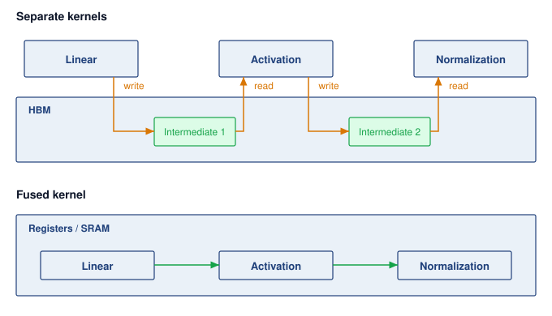
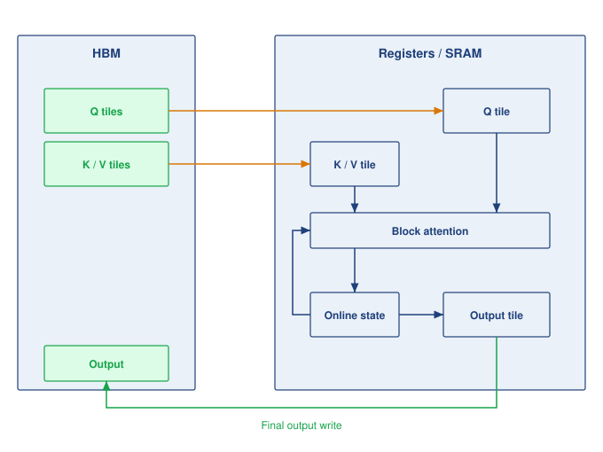

# Fleet Efficiency {#sec-performance-engineering}

::: {layout-narrow}
::: {.column-margin}

\chapterminitoc

:::

::: {.content-visible when-format="pdf"}
\noindent
{fig-alt="Fleet efficiency workbench where a fleet workload is measured, the capacity it loses before, during, and inside its running steps is charged to scheduling, runtime, and the program, and the program's share is recovered."}
:::

::: {.content-visible unless-format="pdf"}
{fig-alt="Fleet efficiency workbench where a fleet workload is measured, the capacity it loses before, during, and inside its running steps is charged to scheduling, runtime, and the program, and the program's share is recovered."}
:::

:::

## Purpose {.unnumbered .unlisted}

::: {.content-visible when-format="pdf"}
\begin{marginfigure}
\mlfleetstack{25}{35}{55}{30}{100}{35}{0}{0}
\end{marginfigure}
:::

::: {.content-visible unless-format="pdf"}
::: {.column-margin}
{width="100%" fig-alt="Fleet Machine Learning Systems Stack"}

*Fleet stack focus for this chapter.*
:::
:::

_Why can a fleet that is fully allocated and visibly busy still turn only a fraction of its compute into training progress and served requests?_

Expensive accelerators can spend much of a training step or a request waiting for data, software dispatch, or communication while their arithmetic units remain underused. Adding more machines may raise cost without removing the delay, and a faster isolated kernel may leave the step's or request's critical path unchanged. The engineering stakes are useful fleet capacity, the training progress and completed service an existing fleet produces while preserving model quality. A dashboard that counts every held accelerator as busy cannot see that waste, so a fleet can look fully used while turning only a fraction of its capacity into useful work. These interactions make optimization a question of measured constraints rather than a search for the fastest component. On one machine, a local improvement can be tested against a relatively contained execution path. Across a fleet, its value also depends on scheduling, recovery, communication, synchronization, and the distribution of work across devices. The cost of a mistaken diagnosis grows when the same inefficient execution repeats across many replicas and many weeks of training, and when the remedy is applied by a team that does not own the loss. A saving that looks large in isolation is worth only the part that survives along the complete step or request path. In C³ terms, fleet efficiency holds every compute gain accountable to the communication and coordination costs that decide how much of a fleet's capacity becomes useful work.

::: {.content-visible when-format="pdf"}

\newpage

:::

::: {.callout-learning-objectives}

- Explain how a job's or fleet's useful output decomposes into scheduling, runtime, and program goodput, with each loss charged to exactly one factor
- Measure goodput under a reproducible contract and localize the lost factor from scheduler records, job timelines, and step traces
- Attribute scheduling and runtime losses using the owners' results, without re-deriving them
- Measure program goodput with MFU and MBU and find the Fleet Law term a fix must shorten
- Select fleet-level program levers (compiler partitioning, overlap under contention, compilation) and recognize kernel-level levers by the term they shorten
- Evaluate a change that trades one factor against another by its effect on the product, and place the result on the efficiency frontier

:::

## Where Fleet Capacity Goes {#sec-performance-engineering-memory-wall}

```{python}
#| echo: false
from mlsysim import *
from mlsysim.core.units import *

# ┌─────────────────────────────────────────────────────────────────────────────
# │ CHAPTER START
# ├─────────────────────────────────────────────────────────────────────────────
# │ Context: Chapter initialization and global imports
# │
# │ Why: Registers this chapter with the mlsys registry and provides shared
# │      imports for all subsequent calculation cells.
# │
# └─────────────────────────────────────────────────────────────────────────────
from mlsysim.physics.quantities import token_throughput
from mlsysim.fmt import check, fmt, fmt_int
from mlsysim.physics import calc_bottleneck, model_memory
```

```{python}
#| echo: false
#| label: fleet-capacity-opening
# ┌─────────────────────────────────────────────────────────────────────────────
# │ FLEET CAPACITY OPENING (LEGO)
# ├─────────────────────────────────────────────────────────────────────────────
# │ Context: @sec-performance-engineering-memory-wall Archetype A lighthouse and
# │          the running-example paragraph.
# │
# │ Goal: Join Llama 3 405B's runtime and program losses into one share of
# │       held capacity, and fix the running example's size and layout in one
# │       place.
# │ Show: 16,384 GPUs; 54-day snapshot; >90 percent effective training time;
# │       41 percent BF16 MFU; ~37 percent of held capacity became progress;
# │       128-GPU (16-node) running example, 8-way tensor parallelism per node.
# │ How: Literature.TrainingRuns (Dubey 2024) for the Llama 3 record;
# │      product of the two fractions; scenario constant for the example.
# │
# └─────────────────────────────────────────────────────────────────────────────
from mlsysim import Literature, Models, Systems
from mlsysim.fmt import check, fmt_count, fmt_percent, fmt_time

class FleetCapacityOpening:
    """Llama 3 405B held-capacity share and the chapter's running-example size and layout."""

    # ┌── 1. LOAD (Constants) ──────────────────────────────────────────────
    llama3_gpus = Models.Language.Llama3_405B.training_accelerators_ref.to(count).magnitude
    snapshot_days = float(Literature.TrainingRuns.Llama3_405B_SnapshotDays)
    effective_time = float(Literature.TrainingRuns.Llama3_405B_EffectiveTrainingTimeFraction)  # stated lower bound
    mfu_16k = float(Literature.TrainingRuns.Llama3_405B_Mfu16K)  # BF16 MFU, Table 4
    replica_gpus = Systems.Nodes.DGX_H100.accelerators_per_node  # serving twin: one node
    example_gpus = 128  # scenario: running training job (single home; FleetEfficiencyCalc should read this)

    # ┌── 2. EXECUTE (The Compute) ────────────────────────────────────────
    held_to_progress = effective_time * mfu_16k  # runtime share x program share
    runtime_loss_share = 1 - effective_time  # held time that kept no progress
    program_loss_share = effective_time * (1 - mfu_16k)  # kept time spent below peak rate
    tp_width = replica_gpus  # tensor parallelism spans one node
    example_nodes = example_gpus // tp_width  # data parallelism spans the nodes

    # ┌── 3. GUARD (Invariants) ──────────────────────────────────────────
    check(llama3_gpus == 16384, f"Llama 3 405B ran on 16,384 GPUs, got {llama3_gpus}")
    check(0.30 < held_to_progress < 0.40, f"Prose says roughly a third, got {held_to_progress:.2f}")
    check(program_loss_share > 0.5 > runtime_loss_share, "Prose says most of the loss came from slow steps, not failures")
    check(replica_gpus == 8, "Prose spells out a serving replica of eight GPUs on one node")
    check(example_gpus % replica_gpus == 0, "Running example must be whole nodes")
    check(tp_width * example_nodes == example_gpus, "Layout: tensor parallelism within a node times data parallelism across nodes")

    # ┌── 4. OUTPUT (Formatting) ──────────────────────────────────────────
    llama3_gpus_str = fmt_count(llama3_gpus, label="H100 GPU", plural_label="H100 GPUs")
    snapshot_days_str = fmt_time(snapshot_days, day, precision=0, style='word', attributive=True)
    effective_time_pct_str = fmt_percent(effective_time, precision=0, style='prose')
    mfu_16k_pct_str = fmt_percent(mfu_16k, precision=0, style='prose')
    held_to_progress_pct_str = fmt_percent(round(held_to_progress, 2), precision=0, style='prose')
    example_gpus_str = fmt_count(example_gpus, commas=False, label="GPU")
    example_nodes_str = fmt_count(example_nodes, commas=False, label="node")
    tp_width_str = fmt_count(tp_width, commas=False)
```

A fleet can be fully allocated and visibly busy while most of its capacity never becomes training progress or completed service. When thousands of accelerators run a single workload, losses accumulate before a job starts, between the steps it executes, and inside the steps it keeps. The size of that gap is clearest in a run whose engineering is not in doubt.

::: {#lhs-performance-engineering-archetype-a-gpt-4-llama-3-held-capacity .callout-lighthouse title="Archetype A (GPT-4/Llama-3): Held capacity versus progress"}

Meta's pretraining of Llama 3 405B\index{Llama 3!held capacity and progress} on `{python} FleetCapacityOpening.llama3_gpus_str` is one of the best-documented large training runs, and its two most quoted efficiency numbers measure different things. Across a `{python} FleetCapacityOpening.snapshot_days_str` snapshot, the job kept more than `{python} FleetCapacityOpening.effective_time_pct_str` of its elapsed time as effective training time despite hundreds of unexpected interruptions, as @sec-fault-tolerance-reliability-recovery-automation-pipeline records. In the steps it kept, its arithmetic achieved a model FLOPs utilization (MFU) of about `{python} FleetCapacityOpening.mfu_16k_pct_str` of the accelerators' peak rate [@dubey2024llama]. Multiplied, the two figures show the run turning roughly `{python} FleetCapacityOpening.held_to_progress_pct_str` of the peak-rate capacity it held into training progress. Because the two figures come from different measurement windows, the product is only an estimate. Yet it shows one of the most carefully engineered runs on record losing about two-thirds of the capacity it held, mostly to steps that ran below the hardware's rate rather than to the failures that dominate its reputation. Its two figures therefore bound what a well-run job of this archetype loses during execution.

:::

Even that one-third figure overstates what a shared cluster delivers, because the Llama 3 numbers begin only after the job holds its accelerators. On a multi-tenant fleet, the setting of @sec-fleet-orchestration, capacity is also lost before a job starts. Accelerators sit unallocated when no queued job fits the free pool, or a job holds part of its gang while waiting for the remaining members and cannot execute a single step. The orchestrator's accounting separates allocated capacity from productive work, yet it cannot see where inside a running job the missing work went. Allocated capacity is where fleet-efficiency accounting begins, not evidence that the fleet used those accelerators well.

::: {.column-margin .margin-pointer}
↩ The allocated, active, and productive tiers of fleet resource accounting are established in @sec-fleet-orchestration-resource-accounting.
:::

Earlier chapters examined the mechanisms of a fleet one layer at a time: data delivery (@sec-data-storage), collective communication (@sec-collective-communication), parallel work partitioning (@sec-distributed-training-systems), fault recovery (@sec-fault-tolerance-reliability), and cluster scheduling (@sec-fleet-orchestration). Each subsystem reports performance in its own local unit—input stall ratio, link bandwidth, scaling efficiency, availability, or cluster occupancy—and none of those isolated metrics tells an organization what fraction of its fleet investment becomes useful progress. Worse, when subsystem reports are read separately, their denominators overlap in some places and leave gaps in others. An hour lost to a restart can be penalized in two reports at once, while accelerators held idle by an incomplete gang vanish between the scheduler's log and the job's step timer. As we enter the Serving band of @fig-fleet-stack, performance engineering requires a single end-to-end accounting framework that follows every accelerator-hour from offered hardware to useful output and ranks every optimization lever across the stack on one common scale.

::: {.column-margin .margin-pointer}
↩ The Fleet Law, where these multiplicative efficiency factors are first previewed, is established in @sec-vol2-introduction-fleet-law.
:::

To make that accounting concrete, one recurring training job carries the numbers through this chapter: pretraining Llama 2 70B, a smaller Archetype A model than the archetype's 175B reference, on `{python} FleetCapacityOpening.example_gpus_str` (`{python} FleetCapacityOpening.example_nodes_str` of eight GPUs each) in a shared cluster. The job uses `{python} FleetCapacityOpening.tp_width_str`-way tensor parallelism within each node and data parallelism across nodes. Because it competes with other teams for complete gang allocations, absorbs cluster failures and preemptions, and executes steps whose exposed communication grows with node count, every stage of fleet loss appears in a single workload on a single pool.

::: {.column-margin .margin-pointer}
↩ Archetype A and its 175B-parameter reference model are established in @sec-introduction-archetype-gpt4llama3-b02f.
:::

A serving replica of the same model provides the running example's inference twin. The replica spans one node of eight H100 GPUs, so a single tensor-parallel node forms one complete serving unit. Because a dense Archetype A transformer cannot fit on one accelerator, the eight GPUs exchange activations in every layer. The cluster scheduler must place the replica as an indivisible gang, the replica must load weights and warm up before taking traffic, and its decode steps can leave most of the node's arithmetic idle while weights stream from high-bandwidth memory (HBM). Its capacity losses therefore arise at the same stages as those of the training job.

The serving twin also marks where fleet-efficiency accounting stops and request-level serving design begins. In production serving, requests share execution across dynamically formed batches, occupy key-value cache memory, and must satisfy tail-latency targets; @sec-inference-scale develops how a serving engine manages uneven arrivals under those constraints. Here, the boundary test is whether a loss would persist even under a steady, uncontended stream of work. A replica held off-line while loading weights, or a decode step that reads weights more slowly than the node's memory bandwidth allows, fails to use held hardware even without arrival bursts and is counted here over windows of hours to weeks. By contrast, a request delayed behind an oversized batch is a queueing phenomenon caused by uneven arrivals and belongs to serving analysis. Headroom that a replica holds in reserve to absorb traffic spikes appears in goodput accounting as ready capacity running below its ideal rate, whereas choosing how much headroom a latency target requires is a serving decision.

This chapter builds the measurement and optimization discipline that turns those scattered losses into one engineering budget. We begin by defining *ML goodput* (@sec-performance-engineering-measurement-scale), which factors useful fleet output into scheduling, runtime, and program goodput on non-overlapping boundaries. We then establish the reproducible measurement contract and hierarchical fleet profiling needed to localize which factor moved without drowning the cluster in trace data (@sec-performance-engineering-measuring-goodput). From there, we trace the three factors in chronological order. We attribute scheduling losses (@sec-performance-engineering-scheduling-goodput) and runtime losses (@sec-performance-engineering-runtime-goodput) to the orchestration and fault-tolerance mechanisms developed in earlier chapters, and then diagnose (@sec-performance-engineering-profiling) and recover (@sec-performance-engineering-program-goodput) the program-goodput losses that this chapter owns directly. Finally, we compose all three factors into a whole-fleet waterfall and cost per useful accelerator-hour (@sec-performance-engineering-whole-fleet) and evaluate optimizations that trade one goodput factor against another along the fleet's efficiency frontier (@sec-performance-engineering-frontier-objective).

## ML Goodput {#sec-performance-engineering-measurement-scale}

Across a fleet, capacity disappears at three successive stages in the life of a job. First, a job must acquire a complete set of devices: an accelerator produces no progress while it sits unallocated, while cluster fragmentation strands it in a shape no queued gang can use, or while a partially allocated gang holds it idle waiting for the rest of its peers. Second, once a job holds a complete allocation, its execution must produce durable progress: initialization, input stalls, synchronous checkpoint pauses, failure recovery, and steps re-executed after a rollback all consume held device-hours without advancing the last saved checkpoint. Third, the steps that do survive in a checkpoint must execute near the rate the hardware can sustain. A step that exposes collective communication, waits on a straggling rank or a pipeline bubble, stalls on memory traffic, or dispatches long chains of tiny kernels occupies healthy accelerators while extracting only a fraction of their capability.

### The three goodput factors {#sec-performance-engineering-goodput-factors}

Run-level goodput, introduced with the Coordination dimension in @sec-vol2-introduction-dim-coord, tracks a single job across its execution and discounts time lost to failures and replayed steps. Because that measure starts only after the job holds its accelerators and stops at the boundary of a completed step, it misses both the capacity the job never received and the execution efficiency of the steps the job kept. Google's fleet-efficiency framework extends the measurement window backward to the capacity offered by the fleet and forward to the ideal execution time of each retained step, factoring useful fleet output into three multiplicative terms [@wongpanich2025fleet].[^fn-mpg-fleet-origin]

[^fn-mpg-fleet-origin]: **ML productivity goodput origin**\index{ML productivity goodput!origin}: Google introduced the three-factor decomposition to measure its Tensor Processing Unit (TPU) fleet, calling it an iron law of performance for ML fleets by analogy with the processor iron law that splits execution time into instructions, cycles per instruction, and time per cycle [@emer1984characterization; @wongpanich2025fleet]. The paper reports the factors across the whole fleet and segmented by job size and by workload phase, with real-time serving and bulk inference alongside training. The boundaries themselves name no accelerator, so this chapter applies them to any accelerator fleet, for serving replicas as well as training jobs.

::: {#dfn-performance-engineering-ml-productivity-goodput .callout-definition title="ML productivity goodput (MPG)"}

***ML productivity goodput (MPG)***\index{ML productivity goodput!definition}\index{Goodput!definition} is the fraction of a fleet's capacity-time that becomes useful work at the hardware's ideal rate, expressed as the product of scheduling, runtime, and program goodput, each measured on a fixed accounting boundary so that every lost interval is charged to exactly one factor [@wongpanich2025fleet].

1.  **Significance**: It converts the losses that scheduling, recovery, and execution each report in their own units into one fraction of fleet capacity, so a loss at one boundary can be compared directly with an equal loss at another, and an accelerator-hour's price divided by it is the cost of one ideal-rate hour of useful work.
2.  **Distinction**: Unlike utilization\index{Utilization!vs. ML productivity goodput}, which counts an accelerator as used whenever it is allocated or busy, it counts only retained work at its ideal rate. Unlike run-level goodput, it also charges the capacity a job never received and the rate at which its kept steps ran.
3.  **Common pitfall**: A frequent mistake is to multiply factors measured over different windows or against overlapping denominators, such as a run-averaged MFU that already includes restart time and a runtime factor that charges the same restarts again. The product is meaningful only when each factor divides by exactly what the previous one passed.

:::

The three factors follow a job chronologically, and each factor takes as its denominator the capacity-time that survived the stage before it. **Scheduling goodput**\index{Scheduling goodput!definition}\index{Scheduling goodput!fleet capacity accounting} ($\SchedulingGoodput$) is the fraction of fleet capacity-time held by complete allocations—intervals in which a job holds every resource its synchronous execution requires, which the fleet-efficiency literature calls all-allocated time [@wongpanich2025fleet]. **Runtime goodput**\index{Runtime goodput!definition}\index{Runtime goodput!fleet capacity accounting} ($\RuntimeGoodput$) is the fraction of that all-allocated time spent on steps that a checkpoint retains, excluding initialization, input stalls, synchronous checkpoint pauses, failure recovery, and work discarded after the last checkpoint; its numerator is productive time. **Program goodput**\index{Program goodput!definition}\index{Program goodput!fleet capacity accounting} ($\ProgramGoodput$) is the ratio of the predicted ideal execution time of those retained steps to their actual productive time, capturing the efficiency of code, compiler, and communication against a named hardware ideal. In the Llama 3 405B run, effective training time serves as runtime goodput and MFU serves as program goodput; on a shared multi-tenant cluster, a scheduling factor below one multiplies both. @Eq-perf-ml-productivity-goodput combines the three factors into MPG:

$$\MlProductivityGoodput = \SchedulingGoodput \times \RuntimeGoodput \times \ProgramGoodput$$ {#eq-perf-ml-productivity-goodput}

The three factors multiply cleanly because each factor's denominator is the preceding factor's numerator. Scheduling goodput divides held all-allocated time by offered capacity-time, runtime goodput divides retained productive step time by all-allocated time, and program goodput divides predicted ideal time by productive step time. Adjacent numerators and denominators cancel, leaving the ideal-rate time of useful work divided by the total capacity-time the fleet offered (@fig-performance-engineering-goodput-boundaries). MPG is therefore a dimensionless fraction of fleet capacity rather than a raw throughput rate: useful fleet output equals peak capacity multiplied by MPG, and the effective cost per unit of useful work equals the cost of raw capacity divided by MPG. That telescoping cancellation also defines when the product is valid. If two factors include the same lost interval in their denominators, that loss is counted twice; if a gap falls between one factor's numerator and the next factor's denominator, the loss goes uncounted in both.

::: {#fig-performance-engineering-goodput-boundaries fig-env="figure" fig-pos="htb" fig-cap="**ML Goodput as a Chain of Three Boundaries**: Capacity-time becomes useful work only by crossing three boundaries in the order a job meets them, and each factor divides what crossed its boundary by what reached it. The dashed slice at the end of each row is the capacity-time lost at the boundary above that row, and the losses beside it are charged there and at no other boundary, so the three factors multiply into the share of offered capacity-time that becomes useful work. Widths are schematic, not measured." fig-alt="Four horizontal bars stacked top to bottom, each shorter than the one above and separated by dashed boundary lines. The top bar reads capacity-time the fleet offers. A navy chip S labeled complete allocation, held divided by offered, marks the first boundary; the next bar reads held by complete allocations, with a dashed empty slice at its right end and beside it the losses unallocated capacity, partial gangs, and fragmentation. A chip R labeled retained step, retained divided by held, marks the second boundary; the next bar reads time on retained steps, with a dashed slice and the losses startup, input waits, checkpoint pauses, and recovery and rework. A chip P labeled ideal rate, ideal divided by retained, marks the third boundary; the bottom bar is green and reads useful work, with a dashed slice and the losses exposed communication, stragglers, bubbles, memory stalls, and dispatch. Below the bars a line reads useful work equals capacity-time times S times R times P."}


:::

Each factor captures the losses from one stage of a job's lifecycle (@sec-performance-engineering-memory-wall), and the three goodput boundaries cut across the C$^3$ taxonomy rather than mapping one-to-one onto its axes. Hiding collective communication behind computation raises program goodput, whereas checkpointing and failure recovery—which the Fleet Law places under Coordination—reduce runtime goodput. Goodput factors identify *when* in a job's execution capacity was lost, while the C$^3$ dimensions identify *which physical mechanism* caused the loss; diagnosing a fleet bottleneck therefore names the goodput factor first and the C$^3$ mechanism inside it second.

Because the three factors multiply, the share of total fleet capacity lost at any boundary equals that boundary's fractional loss weighted by the capacity share that reached it. @Eq-perf-goodput-loss-shares partitions the total efficiency gap $1 - \SchedulingGoodput\RuntimeGoodput\ProgramGoodput$ into three additive shares—the scheduling loss on offered capacity, the runtime loss on held capacity, and the program loss on retained step time:

$$\begin{aligned} 1 - \SchedulingGoodput\RuntimeGoodput\ProgramGoodput &= (1-\SchedulingGoodput) \\ &\quad + \SchedulingGoodput(1-\RuntimeGoodput) \\ &\quad + \SchedulingGoodput\RuntimeGoodput(1-\ProgramGoodput) \end{aligned}$$ {#eq-perf-goodput-loss-shares}

The three right-hand terms sum to the total gap, reflecting the rule that every lost device-hour is charged at exactly one boundary. Although the product $\SchedulingGoodput\RuntimeGoodput\ProgramGoodput$ is commutative, the additive share attributed to each stage depends on the order in which capacity passes through the boundaries. The decomposition therefore follows the chronological order in which a workload encounters the three losses. Applied to the published Llama 3 405B telemetry, @eq-perf-goodput-loss-shares shows immediately which boundary consumed most of the cluster's held capacity.

```{python}
#| echo: false
#| label: goodput-loss-shares
# ┌─────────────────────────────────────────────────────────────────────────────
# │ GOODPUT LOSS SHARES (LEGO)
# ├─────────────────────────────────────────────────────────────────────────────
# │ Context: @eq-perf-goodput-loss-shares and the Llama 3 notebook after it
# │          in @sec-performance-engineering-goodput-factors.
# │
# │ Goal: Split the capacity Llama 3 405B held into the share lost at the
# │       runtime boundary, the share lost at the program boundary, and the
# │       share that became ideal-rate progress.
# │ Show: R ~0.90, P ~0.41; ~10 percent runtime loss; ~53 percent program
# │       loss; ~37 percent useful.
# │ How: Literature.TrainingRuns (Dubey 2024); runtime share = 1 - R;
# │      program share = R x (1 - P); useful = R x P. Scheduling goodput is 1
# │      for a dedicated cluster, so it drops out.
# │
# │ Note: The two inputs come from different measurement windows (54-day
# │       snapshot vs. Table 4 configuration); S1 labels the product an
# │       estimate. Replace with GoodputDecomposition when it is registered.
# └─────────────────────────────────────────────────────────────────────────────
from mlsysim import Literature, Models
from mlsysim.core.units import count
from mlsysim.fmt import check, fmt, fmt_count, fmt_percent

class GoodputLossShares:
    """Capacity shares charged to the runtime and program boundaries for Llama 3 405B."""

    # ┌── 1. LOAD (Constants) ──────────────────────────────────────────────
    runtime_goodput = float(Literature.TrainingRuns.Llama3_405B_EffectiveTrainingTimeFraction)  # stated lower bound
    program_goodput = float(Literature.TrainingRuns.Llama3_405B_Mfu16K)  # BF16 MFU at 16K GPUs
    llama_gpus = Models.Language.Llama3_405B.training_accelerators_ref.to(count).magnitude

    # ┌── 2. EXECUTE (The Compute) ────────────────────────────────────────
    runtime_share = 1 - runtime_goodput  # held time that kept no progress
    program_gap = 1 - program_goodput  # retained time below the ideal rate, per unit retained
    program_share = runtime_goodput * program_gap  # kept time spent below the ideal rate
    useful_share = runtime_goodput * program_goodput  # ideal-rate progress

    # ┌── 3. GUARD (Invariants) ──────────────────────────────────────────
    check(abs(runtime_share + program_share + useful_share - 1) < 1e-9, "Loss shares and useful share must account for all held capacity")
    check(0.08 <= runtime_share <= 0.12, f"Prose says about a tenth was lost at the runtime boundary, got {runtime_share:.2f}")
    check(0.50 <= program_share <= 0.56, f"Prose says more than half was lost at the program boundary, got {program_share:.2f}")
    check(program_share > 4 * runtime_share, "Prose says the program loss is several times the runtime loss")
    check(
        abs(round(runtime_goodput, 2) * round(program_gap, 2) - round(program_share, 2)) <= 0.005,
        "Notebook's rounded R x (1 - P) must reproduce the rounded program share",
    )
    check(
        abs(round(runtime_goodput, 2) * round(program_goodput, 2) - round(useful_share, 2)) <= 0.005,
        "Notebook's rounded R x P must reproduce the rounded useful share",
    )
    check(llama_gpus == 16384, f"Llama 3 405B anchor is 16,384 GPUs, got {llama_gpus}")

    # ┌── 4. OUTPUT (Formatting) ──────────────────────────────────────────
    llama_gpus_str = fmt_count(llama_gpus, label="GPU")
    runtime_goodput_pct_str = fmt_percent(runtime_goodput, precision=0, style='prose')
    program_goodput_pct_str = fmt_percent(program_goodput, precision=0, style='prose')
    runtime_goodput_str = fmt(round(runtime_goodput, 2), precision=2)
    program_goodput_str = fmt(round(program_goodput, 2), precision=2)
    program_gap_str = fmt(round(program_gap, 2), precision=2)
    runtime_share_str = fmt(round(runtime_share, 2), precision=2)
    program_share_str = fmt(round(program_share, 2), precision=2)
    useful_share_str = fmt(round(useful_share, 2), precision=2)
    runtime_share_pct_str = fmt_percent(round(runtime_share, 2), precision=0, style='prose')
    program_share_pct_str = fmt_percent(round(program_share, 2), precision=0, style='prose')
    useful_share_pct_str = fmt_percent(round(useful_share, 2), precision=0, style='prose')
```

::: {#nbk-performance-engineering-llama3-loss-split .callout-notebook title="Where Llama 3's held capacity went"}

**Problem**: Llama 3 405B trained on a dedicated cluster of `{python} GoodputLossShares.llama_gpus_str`, kept more than `{python} GoodputLossShares.runtime_goodput_pct_str` of its elapsed time as effective training time, and ran its kept steps at about `{python} GoodputLossShares.program_goodput_pct_str` MFU [@dubey2024llama]. What share of the capacity it held was lost at the runtime boundary, what share at the program boundary, and what share became progress at the ideal rate?

**Variables**:

- Scheduling goodput $\SchedulingGoodput$ is one, because the cluster was dedicated to the run, so the first term of @eq-perf-goodput-loss-shares vanishes.
- Runtime goodput $\RuntimeGoodput$ is about `{python} GoodputLossShares.runtime_goodput_str`, from effective training time (a stated lower bound).
- Program goodput $\ProgramGoodput$ is about `{python} GoodputLossShares.program_goodput_str`, from MFU at full scale.

**Math**:

- Runtime boundary, $1-\RuntimeGoodput$: 1 $-$ `{python} GoodputLossShares.runtime_goodput_str` = `{python} GoodputLossShares.runtime_share_str`.
- Program boundary, $\RuntimeGoodput(1-\ProgramGoodput)$: `{python} GoodputLossShares.runtime_goodput_str` $\times$ `{python} GoodputLossShares.program_gap_str` $\approx$ `{python} GoodputLossShares.program_share_str`.
- Useful work, $\RuntimeGoodput\ProgramGoodput$: `{python} GoodputLossShares.runtime_goodput_str` $\times$ `{python} GoodputLossShares.program_goodput_str` $\approx$ `{python} GoodputLossShares.useful_share_str`.

**Result**: About `{python} GoodputLossShares.runtime_share_pct_str` of the held capacity was lost at the runtime boundary, about `{python} GoodputLossShares.program_share_pct_str` at the program boundary, and about `{python} GoodputLossShares.useful_share_pct_str` became progress at the ideal rate.

**Systems insight**: Removing every interruption would have recovered at most a tenth of the capacity the run held, while the steps it kept left more than half unused, so for one of the most carefully engineered runs on record the program boundary, not reliability, held most of the gap.

:::

This calculation treats Meta's reported effective training time as runtime goodput.[^fn-effective-training-window] That identification holds when the job retained its full allocation throughout the elapsed window and when input stalls were already excluded from effective time.

[^fn-effective-training-window]: **Effective training time**\index{Effective training time!Llama 3 window}: Meta's report defines it as the time spent on useful training over the elapsed time and states only that it exceeded `{python} GoodputLossShares.runtime_goodput_pct_str` over a `{python} FleetCapacityOpening.snapshot_days_str` snapshot [@dubey2024llama]. It is a per-job figure, so it says nothing about capacity the job never held, and the report does not say whether input waits count as useful. Its MFU comes from the scaling-configuration table rather than from that snapshot, which is why the measurement contract (@sec-performance-engineering-measurement-contract) requires every factor to name its window.

### Program goodput and its measure {#sec-performance-engineering-fleet-efficiency-metric-dff4}

Hardware activity counters cannot measure how efficiently a retained step ran, because an accelerator registers as busy whether it is waiting on a collective, recomputing dropped activations, or executing arithmetic far below its peak rate. Measuring program goodput instead requires comparing actual step time against a named hardware ideal for the resource that limits the workload. For training steps and for the prefill pass over a prompt, arithmetic dominates, so the ideal time of a step is the time the accelerators would need to execute the model's required mathematical operations at their peak rate. MFU\index{MFU!as program goodput} measures against that ideal by counting only the operations the model architecture requires.[^fn-mfu-hfu-origin] In Google's fleet-efficiency methodology, the ideal operation count is fixed before compilation from the program as written—before the compiler fuses kernels or rematerializes activations—so that a compiler optimization that shortens the step raises program goodput instead of shifting its own baseline [@wongpanich2025fleet]. For the same reason, program goodput is not measured against a per-operation roofline. A per-operation roofline rewards kernels that run near their local ceiling and would therefore penalize a rewrite that executes fewer operations at lower utilization while finishing the step sooner. The roofline remains a diagnostic for individual kernels (@sec-performance-engineering-roofline) rather than the efficiency measure of a whole program.

[^fn-mfu-hfu-origin]: **MFU and HFU**\index{Model FLOPs utilization!PaLM origin}\index{Hardware FLOPs utilization!vs. MFU}: The PaLM report proposed MFU in place of hardware FLOPs utilization (HFU), which counts every executed operation, because the executed count depends on implementation and compiler choices, most visibly rematerialization, which recomputes activations to save memory [@chowdhery2022palm]. MFU's reference rate depends only on the model architecture and the published peak rate, so runs of one model on different software stacks compare directly. For goodput accounting, the choice means that recomputation which lets a layout fit in memory is charged to program goodput as lost time rather than credited as work.

::: {#dfn-performance-engineering-model-flops-utilization-mfu .callout-definition title="Model FLOPs utilization (MFU)"}

***Model FLOPs utilization (MFU)***\index{Model FLOPs utilization!definition} is the fraction of the hardware's theoretical peak throughput ($\PeakRate$) consumed by FLOPs that directly advance model training or inference, excluding overhead from recomputation, padding, and synchronization.

1.  **Significance**: Measured over a job's retained steps against the arithmetic ideal, MFU is that job's program goodput. A one-percentage-point MFU increase across 10,000 identical GPUs adds useful throughput equivalent to 100 GPUs at peak, and whether that saves money depends on whether the recovered capacity displaces hardware or shortens paid runtime.\index{MFU!economic impact}
2.  **Distinction**: Unlike hardware utilization\index{Hardware utilization}\index{Hardware utilization!vs. MFU}, which reports how often the accelerator is busy, MFU relates the model's required FLOP rate to hardware peak. It excludes recomputation and padding from useful work even when they make a configuration feasible or faster.
3.  **Common pitfall**: A frequent misconception is that high GPU utilization implies high efficiency. A system can show 90 percent hardware utilization while achieving 30 percent MFU when busy intervals include communication or arithmetic far below peak. MFU exposes the gap but does not explain its cause, which traces must find.

:::

::: {.column-margin .margin-pointer}
↩ The compute axis, where the memory wall limits MFU, is established in @sec-vol2-introduction-dim-compute.
:::

The equality between MFU and program goodput under an arithmetic ideal follows directly from that definition. A retained step across $\DeviceCount$ accelerators performs $\UsefulModelFlops$ of required model work, which would take $\UsefulModelFlops/(\DeviceCount\PeakRate)$ at peak throughput, whereas the step actually runs in wall-clock time $\DistributedStepTime$. @Eq-perf-program-goodput-mfu expresses program goodput as the ratio of ideal step time to actual step time:

$$\ProgramGoodput = \frac{\UsefulModelFlops/(\DeviceCount\PeakRate)}{\DistributedStepTime} = \ModelFlopsUtilization$$ {#eq-perf-program-goodput-mfu}

That identity holds only when MFU is measured over the retained steps that survived the runtime boundary, with input stalls already excluded. Published MFU numbers are often averaged over an entire wall-clock run that includes restarts and synchronous checkpoint pauses; multiplying such a run-averaged MFU by a separate runtime goodput factor would penalize those interruptions twice. Hardware FLOPs utilization\index{Hardware FLOPs utilization!vs. MFU} (HFU), which counts all executed floating-point operations including activation recomputation, remains a useful diagnostic alongside MFU because the gap between HFU and MFU isolates the cost of recomputation. In goodput accounting, that recomputation gap is a program goodput loss even when trading extra compute for memory capacity is the right engineering choice. Similarly, when capacity planners size a training run in accelerator-hours by scaling peak throughput by retained-step MFU (@sec-compute-infrastructure-peak-vs-sustained-throughput-625a), they must still multiply by runtime and scheduling goodput to account for the hours lost outside steady-state steps.

```{python}
#| echo: false
# ┌─────────────────────────────────────────────────────────────────────────────
# │ PUBLISHED MFU PROGRESSION (LEGO)
# ├─────────────────────────────────────────────────────────────────────────────
# │ Context: @fig-mfu-progression, its caption, and its lead-in sentence
# │          (moved from ch06 Hybrid Parallelism, 2026-10-15 flow pass).
# │ Goal: Pin every MFU point and system size to Literature.TrainingRuns and
# │       Models.Language (PaLM table for 2020-2022; Llama 3 paper for 2024).
# │ Note: the GPT-3 label names the ~10,000-V100 Microsoft/OpenAI system, which
# │       is a machine size, not the registry's 1,024-GPU run estimate.
# └─────────────────────────────────────────────────────────────────────────────
from mlsysim.fmt import check, fmt, fmt_count, fmt_percent

class MfuProgression:
    # ┌── 1. LOAD ─────────────────────────────────────────
    runs = Literature.TrainingRuns
    gpt3_mfu = float(runs.Gpt3MfuPalmTable)
    mtnlg_mfu = float(runs.MtNlgMfu)
    gopher_mfu = float(runs.GopherMfu)
    palm_mfu = float(runs.PalmMfu)
    llama3_8k_mfu = float(runs.Llama3_405B_Mfu8K)
    llama3_16k_mfu = float(runs.Llama3_405B_Mfu16K)
    gpt3_system_gpus = int(runs.MicrosoftOpenAI2020Gpus)
    palm_chips = int(Models.Language.PaLM_540B.training_accelerators_ref.magnitude)
    llama3_8k_gpus = int(runs.Llama3_405B_Gpus8K)
    llama3_16k_gpus = int(Models.Language.Llama3_405B.training_accelerators_ref.magnitude)

    # ┌── 3. GUARD ────────────────────────────────────────
    check(palm_mfu > 2 * gpt3_mfu, "Prose says MFU more than doubled from GPT-3 to PaLM")
    check(llama3_16k_mfu < llama3_8k_mfu, "Llama 3 MFU should fall from 8K to 16K GPUs")
    check(llama3_16k_gpus == 2 * llama3_8k_gpus, "Llama 3 scaling points are 8K and 16K GPUs")

    # ┌── 4. OUTPUT ───────────────────────────────────────
    gpt3_mfu_str = fmt_percent(round(gpt3_mfu * 100) / 100, precision=0, commas=False, style='prose')
    palm_mfu_str = fmt_percent(round(palm_mfu * 100) / 100, precision=0, commas=False, style='prose')
    llama3_8k_mfu_str = fmt_percent(llama3_8k_mfu, precision=0, commas=False, style='prose')
    llama3_16k_mfu_str = fmt_percent(llama3_16k_mfu, precision=0, commas=False, style='prose')
    llama3_8k_gpus_str = fmt(llama3_8k_gpus, precision=0, commas=True)
    llama3_16k_gpus_str = fmt(llama3_16k_gpus, precision=0, commas=True)
```

The MFU that published training runs report\index{Model FLOPs utilization!published training runs} stays below half of peak across every generation of frontier hardware (@fig-mfu-progression). Even for the same model architecture, expanding Llama 3 405B onto twice as many GPUs lowers its reported MFU as cross-node communication claims a larger share of each step.

::: {#fig-mfu-progression fig-env="figure" fig-pos="htb" fig-cap="**The MFU Progression**: Model FLOPs Utilization across published training systems, ordered chronologically. Reported MFU rises from `{python} MfuProgression.gpt3_mfu_str` (GPT-3, 2020) to `{python} MfuProgression.palm_mfu_str` (PaLM, 2022), with later illustrated runs near 40--45 percent. These systems differ in hardware and workload, so the comparison does not isolate the effect of parallelism or overlap. The Llama 3 data points show lower reported MFU at the larger scale: MFU drops from `{python} MfuProgression.llama3_8k_mfu_str` at `{python} MfuProgression.llama3_8k_gpus_str` GPUs to `{python} MfuProgression.llama3_16k_mfu_str` at `{python} MfuProgression.llama3_16k_gpus_str` GPUs. Interpreting the difference requires the batch, execution configuration, and measurement convention. Data sources: @chowdhery2022palm, @dubey2024llama." fig-alt="Horizontal bar chart of MFU percentages for six training systems from 2020 to 2024 showing progression from 21 percent to 46 percent with a plateau near 41 to 43 percent. Each orange bar sits inside a light gray track that runs to 100 percent of peak, the remainder labeled unused share of peak. A dashed line marks 50 percent of peak, and a bracket notes that the Llama 3 run on twice the GPUs reports lower MFU."}

```{python}
#| echo: false
from mlsysim.solvers import DistributedModel

# ┌─────────────────────────────────────────────────────────────────────────────
# │ MFU PROGRESSION (FIGURE)
# ├─────────────────────────────────────────────────────────────────────────────
# │ Context: @fig-mfu-progression—Model FLOPs Utilization over time
# │
# │ Goal: Barh of MFU for GPT-3, Megatron-Turing, Gopher, PaLM, Llama 3;
# │       show 21 percent→46 percent progression; plateau; scaling loss at 16K GPUs.
# │ Show: Six horizontal bars; 50 percent reference line; annotations.
# │ How: Verified systems/mfu_values; book_style.setup_plot().
# │
# └─────────────────────────────────────────────────────────────────────────────
# ┌── 1. CANVAS ────────────────────────────────────────────────────────────────
# │ Barh of MFU for GPT-3, Megatron-Turing, Gopher, PaLM, Llama 3;
import numpy as np
import matplotlib.pyplot as plt
from binder.tools.figures import style as book_style

fig, ax, COLORS, plt = book_style.setup_plot(figsize=(6.1, 4.1))

# VERIFIED DATA (Chowdhery et al., arXiv:2204.02311; Meta, arXiv:2407.21783)

# ┌── 2. ARRAYS ────────────────────────────────────────────────────────────────
_R = MfuProgression
systems = [
    f'GPT-3\n(~{_R.gpt3_system_gpus // 1000}K-V100 system, 2020)',
    'Megatron-Turing NLG\n(A100s, 2021)',
    'Gopher\n(TPU v3, 2021)',
    f'PaLM 540B\n({_R.palm_chips} TPU v4, 2022)',
    f'Llama 3 405B\n({_R.llama3_8k_gpus} H100s, 2024)',
    f'Llama 3 405B\n({_R.llama3_16k_gpus} H100s, 2024)',
]
mfu_values = [round(100 * v, 1) for v in (_R.gpt3_mfu, _R.mtnlg_mfu, _R.gopher_mfu, _R.palm_mfu, _R.llama3_8k_mfu, _R.llama3_16k_mfu)]

y_pos = np.arange(len(systems))
# Each bar is drawn inside a full-length track = 100% of peak, so the unused share of peak is visible.
ax.barh(y_pos, [100] * len(y_pos), color=COLORS['grid'], alpha=0.25, edgecolor=COLORS['grid'], height=0.58, linewidth=0.8, zorder=2)
ax.text(99, 0, 'unused share of peak', va='center', ha='right', fontsize=10, style='italic', color=COLORS['secondary'], zorder=4)
# One series, one color: MFU is compute utilization, so the compute hue (orange);
# the hardware generation is already in each label.
bars = ax.barh(y_pos, mfu_values, color=COLORS['OrangeL'], edgecolor=COLORS['OrangeLine'], height=0.58, linewidth=1.0, zorder=3)

# ┌── 3. RENDER ────────────────────────────────────────────────────────────────
# Value labels sit inside each bar's right end, clear of the reference line.
for i, val in enumerate(mfu_values):
    ax.text(val - 0.8, i, f'{val}%', va='center', ha='right', fontsize=10, fontweight='bold', color=COLORS['primary'], zorder=4)

# ┌── 4. DECORATE ──────────────────────────────────────────────────────────────
# Illustrative 50 percent reference line (not a hardware limit, so neutral gray).
ax.axvline(x=50, color=COLORS['secondary'], linestyle='--', linewidth=1.1, zorder=2)
ax.text(50.6, -0.6, '50% of peak', fontsize=10, color=COLORS['secondary'], va='center', ha='left')
ax.text(99.5, -0.6, 'peak', fontsize=10, color=COLORS['secondary'], va='center', ha='right')

# The two Llama 3 runs: same model, twice the GPUs, lower reported MFU.
ax.plot([43.6, 44.3, 44.3, 41.6], [4, 4, 5, 5], color=COLORS['secondary'], lw=1.0, zorder=3)
# The note sits just right of the bracket it explains, in the gap between the two tracks;
# its white backing breaks the 50% reference line where the two cross.
ax.text(
    45.2,
    4.5,
    f'{_R.llama3_8k_gpus // 1024}K to {_R.llama3_16k_gpus // 1024}K GPUs, lower MFU',
    fontsize=10,
    color=COLORS['secondary'],
    va='center',
    ha='left',
    zorder=4,
    bbox=dict(facecolor='white', edgecolor='none', pad=1.0),
)

ax.set_yticks(y_pos)
ax.set_yticklabels(systems, fontsize=10)
ax.set_xlabel('Model FLOPs Utilization (%)')
ax.set_xlim(0, 100)
for _sp in ('top', 'right'):
    ax.spines[_sp].set_visible(False)
ax.set_ylim(5.5, -0.9)
ax.grid(axis='y', visible=False)

plt.tight_layout()
plt.show()
plt.close()
```

:::

An arithmetic ideal does not fit workloads that the hardware cannot make compute bound. An autoregressive decode step generating one token for a small batch must stream every parameter of the model from HBM to perform only a handful of operations per weight. Memory bandwidth therefore sets the step's floor (@sec-compute-infrastructure-memory-bandwidth-token-latency-1b38), and at that bandwidth floor the accelerator's matrix units run at well under 1 percent of peak arithmetic throughput. Charging that arithmetic shortfall to the program would blame kernel implementation for a gap that only a larger batch can close—and maximum batch size is constrained by the serving latency target rather than by the kernel. For bandwidth-bound decode, the natural reference for a single replica is the bandwidth floor: the time required to stream the step's mandatory weight and KV-cache bytes at peak memory bandwidth. Program goodput against that ideal is **model bandwidth utilization**\index{Model bandwidth utilization!definition}\index{Model bandwidth utilization!program goodput for decode} (MBU), defined as the achieved rate of required byte transfers divided by peak memory bandwidth. A decode step with high MBU and low MFU has saturated the limiting hardware resource rather than wasted it.

Choosing a named ideal also determines what can be aggregated across a multi-workload cluster. A fleet that evaluates training against peak arithmetic and decode against peak memory bandwidth cannot average the two into a single program goodput factor, because the two denominators measure different physical resources. Fleet-wide reporting must therefore either keep program goodput segmented by workload class or evaluate every workload against the arithmetic ideal and recognize that small-batch decode carries a structural batch-size penalty. Google's fleet-efficiency framework takes the second path for its fleet-wide aggregate, measuring all workloads against a compute-based ideal [@wongpanich2025fleet], while MBU provides a direct diagnostic for individual bandwidth-bound decode replicas. Throughout this chapter, MFU serves as the default program goodput metric because it composes across the fleet, and MBU is reported alongside it whenever memory bandwidth sets the hardware ceiling.

```{python}
#| echo: false
#| label: fleet-efficiency-calc
# ┌─────────────────────────────────────────────────────────────────────────────
# │ FLEET EFFICIENCY ANALYSIS (LEGO)
# ├─────────────────────────────────────────────────────────────────────────────
# │ Context: running-example paragraph in
# │          @sec-performance-engineering-fleet-efficiency-metric-dff4 (first
# │          read); the scaling notebook in
# │          @sec-performance-engineering-exposed-communication and later
# │          sections (S6, S7, S8, S10) read the same outputs.
# │
# │ Goal: Measure the running example's program goodput (fleet MFU of its
# │       retained steps) and split it into the node baseline and the scaling
# │       efficiency relative to that node.
# │ Show: node MFU ~65%, fleet MFU ~48% (P ~ 0.48); scaling efficiency from
# │       one node ~74%, so ~26% relative loss; 180 ms -> 245 ms per step,
# │       ~65 ms (~27% of the fleet step) spent beyond the node baseline.
# │ How: MFU = useful FLOPs / (N x peak x step time) for both configurations;
# │      scaling efficiency (eq-distributed-training-scaling-efficiency,
# │      measured from the node) = fleet MFU / node MFU, which equals
# │      (t_node / t_fleet) x (tokens per GPU, fleet / node).
# │
# │ Note: Moved from S6 in pass 2 (PRUNE_PASS_FIXES) so S2 can quote the
# │       fleet MFU. Step times and token counts are constructed scenario
# │       assumptions. The GPU count is read from FleetCapacityOpening (S1),
# │       the single home of the running example's size.
# └─────────────────────────────────────────────────────────────────────────────
from mlsysim import Hardware, Models, Systems
from mlsysim.core.units import PFLOP, TFLOP, millisecond, ms, second
from mlsysim.physics import calc_transformer_training_flops
from mlsysim.fmt import MarkdownStr, check, fmt, fmt_count, fmt_flop_rate, fmt_flops, fmt_percent, fmt_time

class FleetEfficiencyCalc:
    """Program goodput of the running example and its node-to-fleet split."""

    # ┌── 1. LOAD (Constants) ──────────────────────────────────────────────
    n_gpus = FleetCapacityOpening.example_gpus  # running example: 128 GPUs (S1 cell)
    node_gpus = Systems.Nodes.DGX_H100.accelerators_per_node  # one 8-GPU node
    r_peak_per_gpu = Hardware.Cloud.H100.compute.peak_flops
    local_tokens_per_step = 2204  # scenario assumption: node baseline tokens per step
    fleet_tokens_per_step = 35446  # scenario assumption: 128-GPU tokens per step

    # Constructed scenario times
    t_local_step = 180.0 * ms  # scenario assumption: 8-GPU node baseline (optimizer state offloaded to host)
    t_fleet_step = 245.0 * ms  # scenario assumption: 128-GPU job on the shared fleet

    # ┌── 2. EXECUTE (The Compute) ────────────────────────────────────────
    # Step 1: Useful FLOPs per step from parameters and tokens processed
    local_flops_per_step = calc_transformer_training_flops(Models.Language.Llama2_70B.parameters, local_tokens_per_step)
    fleet_flops_per_step = calc_transformer_training_flops(Models.Language.Llama2_70B.parameters, fleet_tokens_per_step)

    # Step 2: MFU is useful FLOPs divided by peak cluster FLOPs over wall time
    fleet_peak_flops_per_step = n_gpus * r_peak_per_gpu * t_fleet_step  # the fleet MFU denominator, surfaced in the callout
    local_mfu = (local_flops_per_step / (node_gpus * r_peak_per_gpu * t_local_step)).to("").magnitude
    global_mfu = (fleet_flops_per_step / (n_gpus * r_peak_per_gpu * t_fleet_step)).to("").magnitude

    # Step 3: Scaling efficiency measured from the node, and the time beyond the node baseline
    scaling_eff = global_mfu / local_mfu  # per-device throughput at N relative to the node
    relative_loss = 1 - scaling_eff  # relative MFU loss from node to fleet
    tokens_per_gpu_local = local_tokens_per_step / node_gpus
    tokens_per_gpu_fleet = fleet_tokens_per_step / n_gpus
    extra_step = (t_fleet_step - t_local_step).to(ms)  # time per step the node never spent
    extra_share = (extra_step / t_fleet_step).to("").magnitude
    program_loss = 1 - global_mfu  # share of retained step time below the arithmetic ideal

    # ┌── 3. GUARD (Invariants) ──────────────────────────────────────────
    check(global_mfu < local_mfu, "Fleet MFU must be lower than local node MFU due to scaling overhead.")
    check(abs(tokens_per_gpu_fleet / tokens_per_gpu_local - 1) < 0.02, "Prose treats the scenario as constant work per GPU (weak scaling)")
    check(
        abs(scaling_eff - (t_local_step / t_fleet_step).to("").magnitude * tokens_per_gpu_fleet / tokens_per_gpu_local) < 1e-9,
        "MFU ratio must equal the time ratio times the work-per-GPU ratio",
    )
    check(
        abs(round(local_mfu, 2) * round(scaling_eff, 2) - round(global_mfu, 2)) <= 0.01,
        "Rounded node MFU x scaling efficiency must reproduce rounded fleet MFU in prose",
    )
    check(0.45 <= global_mfu <= 0.50, f"Prose says the job keeps about half its retained step time, got P = {global_mfu:.3f}")

    # ┌── 4. OUTPUT (Formatting) ─────────────────────────────────────────────
    fleet_params_b_str = MarkdownStr("70B")
    fleet_nodes_str = fmt_count(n_gpus, commas=False, label="GPU")
    node_gpus_str = fmt_count(node_gpus, commas=False, label="GPU")
    fleet_t_step_ms_str = fmt_time(t_fleet_step, millisecond, precision=0, commas=False)
    local_t_step_ms_str = fmt_time(t_local_step, millisecond, precision=0, commas=False)
    extra_step_ms_str = fmt_time(extra_step, millisecond, precision=0, commas=False)
    extra_share_pct_str = fmt_percent(round(extra_share, 2), precision=0, commas=False, style='prose')
    fleet_useful_flops_pflop_str = fmt_flops(fleet_flops_per_step, unit=PFLOP, commas=False)
    fleet_r_peak_tflop_per_s_str = fmt_flop_rate(r_peak_per_gpu, unit=TFLOP / second, precision=0, commas=False)
    fleet_peak_budget_pflop_str = fmt_flops(fleet_peak_flops_per_step, unit=PFLOP, commas=False)
    fleet_local_mfu_str = fmt_percent(round(local_mfu * 100) / 100, precision=0, commas=False, style='prose')
    fleet_global_mfu_str = fmt_percent(round(global_mfu * 100) / 100, precision=0, commas=False, style='prose')
    program_goodput_str = fmt(round(global_mfu, 2), precision=2)
    program_loss_pct_str = fmt_percent(round(program_loss, 2), precision=0, commas=False, style='prose')
    scaling_eff_pct_str = fmt_percent(round(scaling_eff, 2), precision=0, commas=False, style='prose')
    scaling_eff_str = fmt(round(scaling_eff, 2), precision=2)
    relative_loss_pct_str = fmt_percent(round(relative_loss, 2), precision=0, commas=False, style='prose')
```

For the chapter's running Llama 2 70B training job, program goodput is the fleet MFU of its retained steps across all `{python} FleetCapacityOpening.example_gpus_str`. That fleet MFU averages about `{python} FleetEfficiencyCalc.fleet_global_mfu_str`, down from the `{python} FleetEfficiencyCalc.fleet_local_mfu_str` achieved by a single-node baseline, because distributing each step across `{python} FleetCapacityOpening.example_nodes_str` introduces inter-node collective communication that a single node never pays. @Sec-performance-engineering-exposed-communication isolates and quantifies that scaling loss.

Program goodput also connects directly to the efficiency expressions derived earlier in the volume. Under the arithmetic ideal, the compute-time fraction in @eq-fleet-efficiency equals the program goodput of a single step; under the measured-reference convention, that fraction exceeds program goodput by the local efficiency of a single device. Similarly, the effective fleet throughput in @sec-appdx-c3-taxonomy-effective-flops multiplies peak cluster capacity by single-device MFU, multi-node scaling efficiency, and runtime goodput. The product of those first two terms equals the job's fleet MFU—its program goodput—while scheduling goodput is absent only because that expression starts from accelerators the job already holds.

### Accounting boundaries {#sec-performance-engineering-goodput-boundaries}

Without sharp boundaries between the three factors, two engineering teams analyzing the same lost accelerator-hour—such as devices held idle by a gang waiting for its remaining ranks, or a step stretched by a straggling peer—will either assign the loss to different factors or subtract it twice. Every hour of fleet capacity must cross three sequential boundaries before it becomes ideal-rate useful work, and a loss is charged to the single factor whose boundary it fails to cross. @Tbl-performance-engineering-goodput-boundaries pairs each factor boundary with the losses charged there, the telemetry that measures it, the corresponding utilization tier from @sec-fleet-orchestration-resource-accounting, and the chapter that owns the engineering levers to recover it. The final three rows apply the same boundaries to a serving replica.

| **Factor**                              | **What ends at its boundary**                                 | **Losses charged**                                                                                                                                                                                                                                         | **Evidence**                                                                                                       | **Utilization tier**                                         | **Lever owner**                                                                                              |
|:----------------------------------------|:--------------------------------------------------------------|:-----------------------------------------------------------------------------------------------------------------------------------------------------------------------------------------------------------------------------------------------------------|:-------------------------------------------------------------------------------------------------------------------|:-------------------------------------------------------------|:-------------------------------------------------------------------------------------------------------------|
| **Scheduling goodput**                  | Fleet capacity-time becomes time held by complete allocations | Unallocated capacity (absent demand, quota limits); devices held by a gang waiting for members; fragmentation; capacity left idle while queued gangs cannot be placed (a job's own queue wait costs only time to result when other jobs hold the capacity) | Scheduler records: allocation intervals with gang-complete timestamps; held capacity per pool; fragmentation index | Allocated, counting complete allocations only                | @sec-fleet-orchestration                                                                                     |
| **Runtime goodput**                     | Held time becomes time on steps a checkpoint retains          | Startup and compilation before the first step; input stalls; synchronous checkpoint pauses; failure detection and recovery; rework after a failure; work lost to preemption; idle reservations                                                             | Job timeline: step log with retained-checkpoint markers; restart, preemption, and input-wait logs                  | Productive, normalized to the job's own fault-free step rate | @sec-fault-tolerance-reliability; @sec-data-storage for input and checkpoint writes                          |
| **Program goodput**                     | Retained step time becomes ideal-rate time                    | Exposed communication and synchronization; stragglers; pipeline bubbles; memory stalls; host dispatch; recomputation; contention from asynchronous checkpoint writes                                                                                       | Step traces and device counters; MFU, or MBU for bandwidth-bound decode                                            | Beyond the three tiers                                       | This chapter; @sec-collective-communication and @sec-distributed-training-systems for collectives and layout |
| **Kernel-active time**                  | None; evidence only                                           | None                                                                                                                                                                                                                                                       | Device activity counters                                                                                           | Active                                                       | None                                                                                                         |
| **Scheduling goodput, serving replica** | Capacity becomes whole-node replicas held                     | Devices that cannot form a complete replica; replicas waiting for placement                                                                                                                                                                                | Scheduler records per replica                                                                                      | Allocated, complete replicas only                            | @sec-fleet-orchestration                                                                                     |
| **Runtime goodput, serving replica**    | Held replica time becomes ready time                          | Weight loading, warmup, and compilation; restart after failure; draining before an update                                                                                                                                                                  | Replica lifecycle log                                                                                              | Productive, at the replica's ideal rate                      | @sec-fault-tolerance-reliability; @sec-inference-scale for cold-start latency                                |
| **Program goodput, serving replica**    | Ready time becomes ideal-rate serving time                    | Decode below its named ideal; headroom held for bursts; cache fragmentation that limits admission                                                                                                                                                          | Per-step traces; tokens served against the named ideal; MBU for decode                                             | Beyond the three tiers                                       | This chapter; @sec-inference-scale decides how much headroom a latency target requires                       |

: **Goodput Accounting Boundaries**: Each factor ends at one boundary, every loss is charged to the factor whose boundary it fails to cross, and the evidence column names the cheapest record that measures it. Kernel-active time is evidence that helps split runtime and program losses, not a factor. Serving rows apply the same boundaries to a replica, with headroom charged to program goodput and sized by the serving system. {#tbl-performance-engineering-goodput-boundaries tbl-colwidths="[15,17,24,18,12,14]"}

```{python}
#| echo: false
#| label: resource-tiers-example
# ┌─────────────────────────────────────────────────────────────────────────────
# │ RESOURCE TIERS EXAMPLE (LEGO)
# ├─────────────────────────────────────────────────────────────────────────────
# │ Context: tier-narrowing paragraph in
# │          @sec-performance-engineering-goodput-boundaries.
# │
# │ Goal: Quote the orchestration chapter's allocated/active/productive
# │       example and read its productive share as runtime goodput.
# │ Show: 500 allocated, 350 active, 280 productive; 280/500 = 56 percent.
# │ How: productive / allocated.
# │
# │ Note: Scenario from ReferenceStats.UtilizationTierProfile, the same
# │       source ch08's resource-accounting paragraph reads (2026-10-15).
# └─────────────────────────────────────────────────────────────────────────────
from mlsysim import ReferenceStats
from mlsysim.fmt import check, fmt_count, fmt_percent

class ResourceTiersExample:
    """ch08's 500/350/280 tier example, read as runtime goodput."""

    # ┌── 1. LOAD (Constants) ──────────────────────────────────────────────
    tiers = ReferenceStats.UtilizationTierProfile
    allocated_gpus = int(tiers.AllocatedGpus)  # GPUs allocated to the team
    active_equiv = int(tiers.ActiveEquivalents)  # active-device equivalents
    productive_equiv = int(tiers.ProductiveEquivalents)  # useful work at the reference rate, device equivalents

    # ┌── 2. EXECUTE (The Compute) ────────────────────────────────────────
    productive_share = productive_equiv / allocated_gpus

    # ┌── 3. GUARD (Invariants) ──────────────────────────────────────────
    check(productive_equiv < active_equiv < allocated_gpus, "Tiers must narrow from allocated to active to productive")
    check(0.5 < productive_share < 0.6, "Prose reads the productive share as a runtime goodput near 0.56")

    # ┌── 4. OUTPUT (Formatting) ──────────────────────────────────────────
    allocated_str = fmt_count(allocated_gpus, commas=False, label="GPU")
    active_str = fmt_count(active_equiv, commas=False)
    productive_str = fmt_count(productive_equiv, commas=False)
    productive_share_pct_str = fmt_percent(productive_share, precision=0, style='prose')
```

These boundary definitions refine two of the orchestrator's utilization tiers from @sec-fleet-orchestration-resource-accounting so that the three factors multiply without overlap. First, scheduling goodput counts only complete allocations. Accelerators held by a gang still waiting for its remaining ranks appear as allocated on a basic cluster dashboard, yet they are charged here as a scheduling loss because no synchronous step can execute on them. Second, the orchestrator's productive tier measures retained work against a declared reference rate. When that reference is the job's own fault-free step rate (with input ready and no interruptions), dividing productive capacity by complete-allocation capacity yields runtime goodput directly. When the reference is hardware peak throughput instead, the same ratio collapses runtime and program goodput into a single number and obscures which boundary lost the capacity. In the orchestration example of `{python} ResourceTiersExample.allocated_str` allocated, `{python} ResourceTiersExample.active_str` active, and `{python} ResourceTiersExample.productive_str` productive, the productive-to-allocated ratio of `{python} ResourceTiersExample.productive_share_pct_str` represents runtime goodput only when the productive tier is normalized to the job's own steady-state step rate.

By contrast, the orchestrator's active tier does not correspond to a goodput boundary. An accelerator whose execution engines are active may be performing required model arithmetic, spinning in a collective while waiting on a straggler, recomputing discarded activations, or re-executing steps lost after a node failure. Those four activities represent useful work, two program goodput losses, and a runtime goodput loss; device activity counters therefore serve as diagnostic evidence for separating runtime from program losses rather than as a goodput factor in their own right.

The boundary between runtime goodput and program goodput also governs how delays inside a step are classified. The duration of a retained step includes any time spent waiting on a slow peer, a pipeline bubble, or a collective operation, but excludes stalls waiting for the storage pipeline to deliver the next batch. Input stalls are carved out and charged to runtime goodput because the data pipeline prevented the step from starting, and the data stall ratio of @eq-data-stall in @sec-storage-pipeline-equation quantifies their share. Every other slowdown within a retained step is charged to program goodput, even when its root cause originates outside the user program.

In short, the accounting boundary determines *where* a loss is counted, whereas the physical cause determines *which system layer* fixes it. Stragglers illustrate why the two must remain distinct. @Sec-fault-tolerance-reliability-reliability-distinguishing-stragglers-failures-285d treats a degraded accelerator as a reliability problem and evaluates when replacing the slow node justifies paying for a restart. In goodput accounting, however, a straggler is charged to program goodput: the job holds a complete allocation and retains every step in its checkpoints, yet those steps execute more slowly than the hardware ideal. Recording the straggler in program goodput captures the slowdown where it manifests. Program goodput drops while the straggler is present and recovers once the node is replaced. The remediation decision stays with the reliability controller, which weighs the recovered program goodput against the runtime goodput lost to draining and restarting the job. Preemption reverses the pairing: the cluster scheduler triggers the eviction, yet the discarded steps since the last checkpoint and the subsequent reload are charged to runtime goodput because the job held a complete allocation while those hours were spent. By the same rule, a synchronous checkpoint that halts step execution is a runtime loss, whereas an asynchronous checkpoint that competes with the running step for memory or network bandwidth slows the retained step and is charged to program goodput. Ahead-of-time compilation before the first step reduces runtime goodput, while the execution speed of the compiled kernels governs program goodput.

### One word, several measures {#sec-performance-engineering-goodput-family}

Quoting "goodput" without qualification leaves a reader unable to tell whether a job preserved its progress across restarts, used its share of the cluster effectively, met its serving latency targets, or extracted statistical progress from each training example. Across this book, the term appears in four distinct forms, each answering a different engineering question:

- *Run-level goodput* (@sec-vol2-introduction-dim-coord) measures a single job's rate of useful training progress after discounting time lost to failures and replayed steps.
- *ML productivity goodput (MPG)* measures the fraction of total fleet capacity-time that becomes useful work at the hardware's ideal rate.
- *Service-level objective (SLO) goodput*\index{Goodput!SLO-constrained} (@sec-inference-scale-serving-tax-overhead-distribution-5ef3) measures the rate of completed inference requests that satisfy both time-to-first-token and per-output-token latency targets.
- *Statistical goodput*\index{Goodput!statistical}, which the Pollux scheduler maximizes in @sec-fleet-orchestration-pollux [@qiao2021pollux], weights raw training throughput by the convergence progress each training example contributes at the current batch size.

These four measures complement rather than replace one another. SLO goodput applies on top of MPG: a serving fleet that operates at a high fraction of its ideal hardware rate on average can still violate latency targets in the tail if batches are formed too aggressively. Similarly, statistical goodput evaluates progress per example rather than operations per second, so enlarging the global batch beyond the critical batch size can raise program goodput while reducing statistical goodput. Any quantitative efficiency claim must therefore state which goodput measure it reports, which denominator defines its boundary, and which time window it spans. The measurement contract of @sec-performance-engineering-measuring-goodput pins down the workload, boundary, and measurement window so that two goodput numbers can be compared fairly.

::: {.column-margin .margin-pointer}
↪ MPG applied across a whole portfolio of jobs, in fleet dashboards and chargeback, is developed in @sec-ml-operations-scale-advanced-fleet-metrics-ml-productivity-goodput-mpg-fabf.
:::

## Measuring Goodput {#sec-performance-engineering-measuring-goodput}

Two measurements of the running Llama 2 70B job taken a week apart can report noticeably different program goodput because they traced different ranks, spanned a framework upgrade, started timing before compilation finished, or averaged across a failure recovery. The job's real efficiency on the cluster need not have changed at all. A goodput factor can guide engineering decisions only when repeated measurements are directly comparable and when a drop can be traced cleanly to the boundary that lost the capacity. Measuring goodput at fleet scale therefore requires three elements: a measurement contract that holds confounding variables fixed, a diagnostic hierarchy that identifies the losing factor before probing its internal mechanism, and a telemetry sampling strategy whose collection overhead the production fleet can afford.

### The measurement contract {#sec-performance-engineering-measurement-contract}

An apparent speedup between two trials can easily stem from altered input distributions, a warmer machine state, host timers that miss asynchronous kernel execution, or a relaxed convergence target rather than from the optimization under test. Distributed fleets introduce further confounding variables that single-machine benchmarks never encounter: two runs may receive placements with different switch hops, share fabric links with different neighbors, execute under different preemption policies, or span a window too brief to capture routine hardware interruptions. Industry benchmark suites prevent these confounds by locking down the workload, quality target, and timing rules before any system comparison begins [@mattson2020mlperf; @reddi2020], and production fleet engineering requires the same discipline for every goodput factor it tracks.

::: {#dfn-performance-engineering-measurement-contract .callout-definition title="Measurement contract"}

***Measurement contract***\index{Measurement contract!definition} is the set of conditions a performance measurement fixes and reports, the workload and its quality gate, the system state and software version, the timing boundary, and the goodput factor measured over a named window with its statistical spread, so that two measurements under the same contract differ only in the change being evaluated.

1.  **Significance**: A contract makes the difference between two results attributable to the change under test, so a gain can be priced in accelerator-hours and repeated on another job.
2.  **Distinction**: Unlike a benchmark score, which reports one configuration under one set of rules, a contract governs every measurement a team takes, including the before and after of each change. Unlike a monitoring threshold, it states what a measurement must hold fixed to support a claim.
3.  **Common pitfall**: A frequent mistake is to fix the workload and hardware while letting the window drift. A runtime goodput measured over a day with no failures describes a better job than the one that runs for weeks on a shared fleet.

:::

A complete measurement contract specifies the five categories in @tbl-performance-engineering-measurement-contract, pairing each required record with the misattribution it prevents. The workload envelope locks down the model revision, input and sequence-length distributions, global batch size, and the convergence or output-quality gate that defines valid work. The system-state record captures accelerator count and placement topology, clock and power limits, software, driver, numerical precision, and compiler versions, and—when evaluating scheduling goodput—the cluster pool and scheduling policy in effect. The timing boundary defines which initialization steps fall inside the timed region and how the host synchronizes with asynchronous device streams. Finally, the statistical report identifies the goodput factor, its denominator, and its calendar window alongside the trial count, central tendency, dispersion, and quality verification.

| **Contract field**        | **Evidence to report**                                                                                                                                               | **Failure prevented**                                                                                                |
|:--------------------------|:---------------------------------------------------------------------------------------------------------------------------------------------------------------------|:---------------------------------------------------------------------------------------------------------------------|
| Workload and correctness  | Model revision; representative input and sequence-length distributions; global batch or concurrency; quality or output-equivalence gate                              | Comparing different work or accepting an invalid numerical shortcut                                                  |
| System state              | Device count and topology; clocks and power limit; software, compiler, driver, precision, and kernel versions; for scheduling goodput, the pool and scheduler policy | Attributing a hardware, software, or policy change to the optimization                                               |
| Timing boundary           | Included setup; device synchronization; warmup; cold-start and steady-state definitions                                                                              | Under-timing asynchronous execution, or hiding startup and compilation inside a steady-state number                  |
| Statistical report        | Factor measured and its denominator; window; trial or window count; median or mean; dispersion; step-time percentiles                                                | Promoting a favorable single run, or multiplying factors measured over different windows or overlapping denominators |
| Load generation (serving) | As specified for serving measurements in @sec-inference-scale                                                                                                        | Load that eases off while the replica stalls                                                                         |

: **Reproducible Performance Measurement Contract**: Every goodput result fixes workload, correctness, system state, timing, and statistical reporting, and names the factor and window it measures, before two implementations or configurations are compared. {#tbl-performance-engineering-measurement-contract tbl-colwidths="[18,48,34]"}

The required measurement window varies sharply across the three factors because each boundary loses capacity on a different timescale. Program goodput captures inefficiencies that repeat on every training step or decode iteration, so a window of several hundred warmed steady-state steps estimates it reliably. Runtime goodput captures episodic events such as node failures and rollbacks to the last checkpoint. A window shorter than the mean time between cluster interruptions can miss those events entirely and report a misleadingly high factor, so its window must span days to weeks at fleet scale (@sec-fault-tolerance-reliability). Scheduling goodput tracks cluster contention, which fills queues during peak working hours and drains them overnight or between project deadlines, requiring a window that spans full demand cycles. Multiplying the three factors yields a job's true MPG only when all three cover the same calendar window, even when program goodput within that window is estimated by sampling representative retained steps.

The timing boundary likewise determines whether startup overhead is attributed to runtime goodput or program goodput. End-to-end trials that start the clock before graph compilation and cache warmup measure the delay before the first productive step, which belongs to runtime goodput, whereas warmed steady-state trials isolate the per-step execution rate, which belongs to program goodput. Mixing cold-start and warmed runs can credit a code change for a speedup when the second trial simply hit a warm compiler cache; the measurement contract therefore reports cold-start duration and steady-state step time separately. When a more aggressive compiler pass speeds steady-state steps at the cost of a longer initial compile, it trades runtime goodput against program goodput—a trade-off that @sec-performance-engineering-frontier-objective prices explicitly.

Industry benchmark suites illustrate how a strict measurement contract operates in practice. MLPerf Training\index{MLPerf!Training} measures wall-clock time to train a reference model to a specified validation target, and MLPerf Inference\index{MLPerf!Inference} measures throughput under explicit latency bounds across standardized serving scenarios, evaluating complete hardware-software systems rather than isolated chips [@mattson2020mlperf; @reddi2020]. Closed-division submissions hold the model architecture and optimizer fixed so that systems can be compared directly, while open-division submissions relax those constraints to showcase algorithmic and systems co-design. Because a benchmark submission runs on a dedicated, pre-warmed cluster allocation without multi-tenant queueing or long-run preemption churn, it primarily measures program goodput and reveals very little about scheduling or runtime goodput (perspective \ref{psp-performance-engineering-hero-run-tax}).

```{python}
#| echo: false
#| label: software-gains
# ┌─────────────────────────────────────────────────────────────────────────────
# │ SOFTWARE-ONLY GAINS ON FIXED HARDWARE (LEGO)
# ├─────────────────────────────────────────────────────────────────────────────
# │ Context: The software-version paragraph in
# │          @sec-performance-engineering-measurement-contract and
# │          @fig-mlperf-software-gains.
# │
# │ Goal: Measure how much delivered performance comes from software alone.
# │ Show: Same 8x H100 system, four MLPerf Inference rounds: GPT-J 2.7×,
# │       Llama 2 70B 1.4×, SDXL 1.2×; ResNet-50 and BERT unchanged.
# │ How: Offline throughput relative to each benchmark's first round in
# │      Literature.Series.MLPerfInferenceDGXH100.
# │
# └─────────────────────────────────────────────────────────────────────────────
from mlsysim import Literature
from mlsysim.fmt import check, fmt_multiple

def _offline(rows, benchmark):
    return sorted([r for r in rows if r["benchmark"] == benchmark and r["scenario"] == "Offline"], key=lambda r: r["pub_month"])

def _gain(rows, benchmark):
    pts = _offline(rows, benchmark)
    return pts[-1]["value"] / pts[0]["value"]

class SoftwareGains:
    """Offline throughput gains of one fixed DGX H100 across MLPerf Inference rounds."""

    # ┌── 1. LOAD (Constants) ───────────────────────────────────────────────
    rows = Literature.Series.MLPerfInferenceDGXH100.entries
    benchmarks = (
        ("gptj-99", "GPT-J 6B"),
        ("llama2-70b-99.9", "Llama 2 70B"),
        ("stable-diffusion-xl", "Stable Diffusion XL"),
        ("bert-99", "BERT-Large"),
        ("resnet50", "ResNet-50"),
    )

    # ┌── 2. EXECUTE (The Compute) ─────────────────────────────────────────
    gptj_gain = _gain(rows, "gptj-99")
    llama_gain = _gain(rows, "llama2-70b-99.9")
    sdxl_gain = _gain(rows, "stable-diffusion-xl")
    resnet_gain = _gain(rows, "resnet50")
    bert_gain = _gain(rows, "bert-99")

    # ┌── 3. GUARD (Invariants) ───────────────────────────────────────────
    check(2.4 <= gptj_gain <= 3.0, f"Prose says GPT-J rose ~2.7x, got {gptj_gain:.2f}.")
    check(1.3 <= llama_gain <= 1.6 and 1.1 <= sdxl_gain <= 1.4, "Prose quotes Llama 2 ~1.4x and SDXL ~1.2x.")
    check(abs(resnet_gain - 1) < 0.01 and abs(bert_gain - 1) < 0.01, "Prose says ResNet-50 and BERT did not move.")
    # 2026-10-15 number pass: the header once said SDXL 1.25x while prose printed 1.2x.
    # Prose and the figure's end label both print one decimal; keep the header at that precision.
    check(f"{sdxl_gain:.1f}" == f"{round(sdxl_gain, 1):.1f}" == "1.2", f"Header, prose, and figure quote SDXL 1.2x, got {sdxl_gain:.3f}")

    # ┌── 4. OUTPUT (Formatting) ──────────────────────────────────────────────
    gptj_gain_mult_str = fmt_multiple(round(gptj_gain, 1))
    llama_gain_mult_str = fmt_multiple(round(llama_gain, 1))
    sdxl_gain_mult_str = fmt_multiple(round(sdxl_gain, 1))
```

Recording exact software versions in the system-state contract is essential because software upgrades alone can shift delivered throughput by a large multiple on identical silicon. Between September 2023 and April 2025, NVIDIA submitted the same eight-GPU DGX H100 node to four consecutive MLPerf Inference rounds while upgrading its inference stack from TensorRT 9.0 to 10.8 [@reddi2020; @mlcommons2025inference]. Across those four rounds, offline throughput rose `{python} SoftwareGains.gptj_gain_mult_str` on GPT-J, `{python} SoftwareGains.llama_gain_mult_str` on Llama 2 70B, and `{python} SoftwareGains.sdxl_gain_mult_str` on Stable Diffusion XL (@fig-mlperf-software-gains), whereas ResNet-50 and BERT—whose kernels were already mature—remained flat. Any before-and-after experiment that straddles a framework or compiler upgrade therefore confounds the upgrade with the optimization under test.

::: {#fig-mlperf-software-gains fig-env="figure" fig-pos="htb" fig-cap="**Software-Only Gains on Fixed Hardware**: Offline throughput of one NVIDIA DGX H100 system (eight H100 SXM GPUs with 80 GB of memory each) across four MLPerf Inference rounds, relative to each benchmark's first submission on that system. The hardware is identical in every round; the software stack changed from TensorRT 9.0 to 10.8. Llama 2 70B uses the 99.9 percent accuracy target. Data from @mlcommons2025inference." fig-alt="Line chart of throughput relative to the first round, from 1 to about 2.8, across MLPerf Inference rounds v3.1 (September 2023), v4.0 (March 2024), v4.1 (August 2024), and v5.0 (April 2025). GPT-J rises from 1 to about 2.3 at v4.0 and 2.7 at v4.1. Llama 2 70B rises from 1 at v4.0 to about 1.1 at v4.1 and 1.4 at v5.0. Stable Diffusion XL rises from 1 to about 1.2. ResNet-50 and BERT stay flat at 1.0 between v3.1 and v4.0."}

```{python}
#| echo: false
# ┌─────────────────────────────────────────────────────────────────────────────
# │ SOFTWARE-ONLY GAINS ON FIXED HARDWARE (FIGURE)
# ├─────────────────────────────────────────────────────────────────────────────
# │ Context: @fig-mlperf-software-gains.
# │
# │ Goal: Plot relative offline throughput per benchmark across rounds.
# │ Show: One line per benchmark, end labels with the gain.
# │ How: SoftwareGains (above); book_style.setup_plot().
# │
# └─────────────────────────────────────────────────────────────────────────────
from binder.tools.figures import style as book_style

fig, ax, COLORS, plt = book_style.setup_plot(figsize=(7.2, 3.6))
_C = SoftwareGains
_rounds = ["v3.1", "v4.0", "v4.1", "v5.0"]
_months = {"v3.1": "Sep 2023", "v4.0": "Mar 2024", "v4.1": "Aug 2024", "v5.0": "Apr 2025"}
_cols = [COLORS["RedLine"], COLORS["BlueLine"], COLORS["VioletLine"], COLORS["GreenLine"], COLORS["OrangeLine"]]
_dy = {"bert-99": -10, "resnet50": -24}
for (_b, _lab), _c in zip(_C.benchmarks, _cols):
    _p = _offline(_C.rows, _b)
    _x = [_rounds.index(r["round"]) for r in _p]
    _y = [r["value"] / _p[0]["value"] for r in _p]
    ax.plot(_x, _y, "-o", ms=5, lw=1.8, color=_c, zorder=3)
    _left = _b == "stable-diffusion-xl"
    ax.annotate(
        f"{_lab} ({_y[-1]:.1f}×)",
        (_x[-1], _y[-1]),
        xytext=(-4 if _left else 8, 14 if _left else _dy.get(_b, 0)),
        textcoords="offset points",
        fontsize=9,
        color=_c,
        va="center",
        ha="right" if _left else "left",
        bbox=dict(facecolor="white", alpha=0.85, edgecolor="none", pad=0.2),
        zorder=5,
    )
ax.set_xticks(range(len(_rounds)))
ax.set_xticklabels([f"{r}\n{_months[r]}" for r in _rounds])
ax.set_xlim(-0.2, len(_rounds) - 0.2)
ax.set_ylim(0.55, 3.0)
ax.set_xlabel("MLPerf Inference round (same eight-H100 system)")
ax.set_ylabel("Throughput relative to first round")
plt.show()
plt.close()
```

:::

### Localizing the lost factor {#sec-performance-engineering-localize-factor}

Knowing that a training run fell behind its schedule does not reveal which goodput boundary lost the capacity. An engineering team that opens a kernel profiler first will always find some exposed gap inside a step. The team can easily spend a week shaving milliseconds off a collective while most of the missing capacity was lost waiting for a complete allocation or recovering from unlogged restarts. Effective localization instead inspects telemetry from the cheapest, broadest record down to the most expensive, narrowest trace, matching each record to one boundary of @tbl-performance-engineering-goodput-boundaries.

At the top of that hierarchy sit scheduler records\index{Scheduler records!goodput evidence}. For every submitted job, the cluster scheduler logs submission time, individual device assignments, the timestamp at which the minimum gang became complete, final release, and the resource pool, quota, and priority class under which the job ran. Pool-level logs add unallocated capacity and the fragmentation index from @sec-fleet-orchestration-resource-accounting. Because the control plane already writes these records for admission control and chargeback, they carry zero extra instrumentation overhead and cover every job in the cluster. Scheduler records establish scheduling goodput directly and supply the all-allocated held time that forms the denominator of runtime goodput. What they cannot see is anything that happens *inside* a complete allocation: a wedged job that holds a full gang without executing a single step looks identical in scheduler logs to a job running at peak efficiency.

The second rung is the job timeline\index{Job timeline!runtime goodput evidence}, the structured lifecycle log emitted by the job itself between its gang-complete timestamp and its release. The timeline records when the first training step began, the completion timestamp of every step, which steps each committed checkpoint retained, every failure, restart, and preemption event, and the time each step spent waiting on the input pipeline. Because it stores only a few scalar fields per step or lifecycle event, the timeline is compact enough to retain for every production job. It settles runtime goodput. The interval before the first step measures startup and compilation, pauses at checkpoint commits measure synchronous write overhead, steps repeated after a rollback measure rework, and the input-wait counter yields the data stall ratio of @eq-data-stall. Because the timeline also logs the wall-clock duration of every retained step, it flags a program goodput loss whenever retained steps run longer than their baseline target. It cannot distinguish, though, whether that slowdown came from exposed communication, memory stalls, or a straggling rank.

The third rung consists of step traces\index{Step trace!program goodput evidence}, the only telemetry that looks inside an individual step. Over a selected time window and set of ranks, a step trace captures every kernel launch, collective operation, memory copy, and host dispatch interval alongside hardware performance counters such as achieved HBM bandwidth. That detail partitions a retained step into computation, exposed communication, peer or pipeline waits, memory stalls, and host dispatch overhead, pinpointing which term of the Fleet Law (@sec-performance-engineering-iron-law) an optimization must shorten. Because full tracing generates gigabytes of data and perturbs execution timing, it is reserved for short windows on sampled ranks; a clean step trace taken during a healthy hour says nothing about whether the job lost half its week to restarts.

| **Record**            | **Coverage and cost**                                                  | **Establishes**                                                                                                    | **Cannot establish**                                                                                    | **Factor it settles**                                      |
|:----------------------|:-----------------------------------------------------------------------|:-------------------------------------------------------------------------------------------------------------------|:--------------------------------------------------------------------------------------------------------|:-----------------------------------------------------------|
| **Scheduler records** | Every job and pool, continuously; written for admission and chargeback | Capacity not held by complete allocations; queue wait; gang-complete times; held time per job                      | Anything inside a held allocation, including whether any step ran                                       | Scheduling goodput; the denominator of runtime goodput     |
| **Job timeline**      | Every job, for its whole life; a few fields per step or event          | Startup, input waits, checkpoint pauses, restarts, preemptions, rework; retained step time; step-time distribution | Why a retained step takes as long as it does                                                            | Runtime goodput; detects but does not explain program loss |
| **Step traces**       | Selected ranks and short windows; large volume and some perturbation   | Intervals inside a step (computation, exposed communication, peer and stage waits, memory stalls, host dispatch)   | Losses outside the traced window (scheduling waits, restarts, checkpoint pauses, intermittent episodes) | Program goodput, and the Fleet Law term to shorten         |

: **Records That Localize a Goodput Loss**: Each record matches one accounting boundary, and the cheaper records come first because they cover the whole fleet continuously. A loss is traced to its factor before its mechanism is studied, and the step trace is collected only for a program loss the job timeline has already detected. {#tbl-performance-engineering-localization-records tbl-colwidths="[14,22,26,24,14]"}

Reading these three records from top to bottom (@tbl-performance-engineering-localization-records) is a methodological requirement, not merely a cost-saving habit. Each rung settles one goodput factor and hands the remaining unexplained gap to the rung below, so engineers collect step traces only after scheduler logs and the job timeline confirm that retained steps themselves are running slowly. Skipping rungs leads to two classic diagnostic blunders. Starting with a step trace can pronounce a job healthy while it loses a third of its held hours to unexamined restarts. Starting and stopping at queue logs can blame the cluster scheduler for a week-long slowdown that the job timeline would immediately trace to a compiler regression. In both failure modes the local data are accurate, yet the diagnosis fails because the chosen telemetry cannot observe the boundary where the loss occurred.

For these three records to enforce the accounting boundaries of @sec-performance-engineering-goodput-boundaries, their instrumentation must align with those boundaries. If a job timeline logs only total step duration without separating data-loader stalls, every input wait is folded into step time and a runtime goodput loss masquerades as a program goodput loss. Similarly, because a single straggling accelerator stretches synchronous step time across every peer in its collective group, identifying which rank caused the slowdown requires lightweight per-rank step timers inside the job timeline.

Our running Llama 2 70B training job illustrates how the three rungs work together. Suppose that after one week on the shared cluster, the job has retained substantially fewer steps than predicted by a plan that assumed full-week allocation at the single-node step rate. Consulting the scheduler records first reveals that the job held partial node allocations before its full 16-node gang assembled—a scheduling loss quantified in @sec-performance-engineering-scheduling-evidence. Reading the job timeline from that gang-complete timestamp next isolates the initial startup delay, synchronous checkpoint pauses, steps re-executed after failures, and a modest input-stall fraction, which @sec-performance-engineering-runtime-composition composes into runtime goodput. The same timeline also shows that every retained step ran longer than the single-node baseline from day one, proving that part of the shortfall lies in program goodput. Only at that point does the team trigger step traces on one data-parallel group over a brief window. Because per-rank timeline counters show no single outlier rank, the team inspects intervals common to all ranks and finds inter-node gradient collectives extending past the backward pass—the exposed communication analyzed in @sec-performance-engineering-exposed-communication. Each rung answers the exact question that the others cannot (@fig-performance-engineering-localization-ladder).

::: {#fig-performance-engineering-localization-ladder fig-env="figure" fig-pos="htb" fig-cap="**Localizing a Lost Factor**: The three records are read from the top, cheapest and most complete first, and each settles one factor of goodput. Scheduler records cover every job and settle scheduling goodput, but they see a held allocation only as a closed block. The job timeline settles runtime goodput and shows that retained steps run slower than planned without showing why. Step traces, collected for sampled ranks over a short window, settle program goodput, and their highlighted window expands into the profiling hierarchy of @fig-optimization-hierarchy. Widths are schematic, not measured." fig-alt="Three rungs stacked top to bottom, each with a navy chip, a name, the losses it shows, a line reading cannot see, and a coverage label on the left, and a small timeline on the right. Chips S, R, and P are joined by downward arrows. Rung S, scheduler records, every job, free: a lane with a hatched queue interval, a hatched partial gang interval with rising gray steps, a marker labeled gang complete, and a long gray block labeled held, contents not visible. Rung R, job timeline, every job, cheap: a lane of gray retained-step blocks broken by tan blocks labeled startup, checkpoint, restart and rework, and checkpoint, with a red cross above the restart; above the lane a wavy step-time line runs above a dashed line labeled plan. Rung P, step traces, sampled ranks, costly: an orange compute lane and a violet comm lane, with dashed empty gaps in the compute lane labeled exposed comm and dispatch. A navy window on each upper timeline opens through a shaded wedge into the rung below, and the window on the step trace opens into a dashed box labeled kernels and counters, the profiling hierarchy."}


:::

Diagnosing the eight-GPU serving replica follows the exact same three-rung progression. Cluster scheduler logs measure how long the replica waited for a full unfragmented node, the replica lifecycle log tracks weight loading, warmup, ready service, and restarts to establish runtime goodput, and decode step traces—evaluated against peak HBM bandwidth via MBU—measure how closely ready execution approaches the hardware ideal.

### Fleet profiling by sampling {#sec-performance-engineering-fleet-sampling}

```{python}
#| echo: false
#| label: measurement-scale-boundary
# ┌─────────────────────────────────────────────────────────────────────────────
# │ MEASUREMENT SCALE BOUNDARY (LEGO)
# ├─────────────────────────────────────────────────────────────────────────────
# │ Context: Opening paragraph of @sec-performance-engineering-fleet-sampling.
# │
# │ Goal: Name the node-to-cluster scaling step with registry-backed counts.
# │ Show: 8 GPUs (one DGX H100 node) to 1,024 GPUs (the reference cluster);
# │       ~512 GB of trace data for one 5-second window across the cluster.
# │ How: Systems.Nodes.DGX_H100.accelerators_per_node and
# │      Scenarios.DenseLLMPretrainingReference.system.total_accelerators.
# └─────────────────────────────────────────────────────────────────────────────
from mlsysim.fmt import check, fmt_count, fmt_memory

class MeasurementScaleBoundary:
    """Node-to-cluster GPU counts for the fleet-measurement opening."""

    # ┌── 1. LOAD (Constants) ──────────────────────────────────────────────
    node_gpus = Systems.Nodes.DGX_H100.accelerators_per_node
    cluster_gpus = Scenarios.DenseLLMPretrainingReference.system.total_accelerators
    trace_per_gpu = 500 * MB  # scenario assumption: 5-second Nsight Systems trace of one GPU

    # ┌── 2. EXECUTE (The Compute) ────────────────────────────────────────
    nodes_in_cluster = cluster_gpus // node_gpus
    trace_fleet = (trace_per_gpu * cluster_gpus).to(GB)

    # ┌── 3. GUARD (Invariants) ──────────────────────────────────────────
    check(nodes_in_cluster >= 100, "Cluster should span over a hundred nodes, so node-local traces miss fabric effects")

    # ┌── 4. OUTPUT (Formatting) ─────────────────────────────────────────────
    node_gpus_str = fmt_count(node_gpus, label="GPU")
    cluster_gpus_str = fmt_count(cluster_gpus, label="GPU")
    trace_per_gpu_str = fmt_memory(trace_per_gpu, unit=MB, precision=0, commas=False)
    trace_fleet_str = fmt_memory(round(trace_fleet.magnitude) * GB, unit=GB, precision=0, commas=False)
```

The first two rungs of the localization ladder scale effortlessly with cluster size because a scheduler log entry or a step-timeline record occupies only a few bytes whether a job spans one node or a thousand. Step traces do not scale in that way. When a job expands from `{python} MeasurementScaleBoundary.node_gpus_str` to `{python} MeasurementScaleBoundary.cluster_gpus_str`, multi-node bottlenecks emerge that no single-node trace can capture—such as fabric-crossing collectives and ranks stalled behind a distant straggler—so profiling must span many ranks at once. Yet if a 5-second Nsight Systems trace on one GPU produces `{python} MeasurementScaleBoundary.trace_per_gpu_str`, capturing that same 5-second window across `{python} MeasurementScaleBoundary.cluster_gpus_str` generates roughly `{python} MeasurementScaleBoundary.trace_fleet_str` of telemetry. No production cluster can ingest or store traces at that rate continuously, and logging every kernel launch perturbs the very step timing under study (perspective \ref{psp-performance-engineering-physics-profiling-heisenberg-effect}). Deciding *which* ranks and time windows to trace is therefore a core part of fleet measurement.

Production fleets resolve this tension through hierarchical profiling\index{Hierarchical profiling!system metrics}, splitting telemetry between lightweight, always-on counters that detect an efficiency drop and targeted traces that diagnose its cause. Within a strict overhead budget, the always-on layer continuously records step duration, retained-step MFU, per-rank step timers, and hardware health telemetry (HBM bandwidth, power draw, and die temperature) across every active job. Once those counters flag that a goodput factor has degraded and narrow down where, targeted profiling\index{Targeted profiling!windowed trace analysis} captures a short trace window from specific ranks chosen to test a hypothesis. Comparing a suspected straggler directly against a healthy peer in the same collective group isolates the stall far more cleanly than tracing an arbitrary rank. ByteDance's MegaScale system[^fn-megascale-straggler-heatmap] exemplifies this workflow. Lightweight CUDA-event timers record critical operations on every rank throughout production training, summarize per-rank latencies as a cluster-wide heat map, and drill into a synchronized timeline only for the parallel group that exhibits an anomaly [@jiang2024megascale]. Below the step-trace rung, diagnosis then descends through framework operators, kernel timelines, and hardware performance counters along the profiling hierarchy of @fig-optimization-hierarchy (@sec-performance-engineering-roofline).

[^fn-megascale-straggler-heatmap]: **MegaScale stragglers**\index{MegaScale!straggler detection}: The heat map of per-rank forward and backward latency showed about 0.5 percent of machines running substantially slower than the rest, and excluding them made peak MFU consistent across runs [@jiang2024megascale]. Separately, a few hosts took about 10 percent longer on the same forward computation, and removing them raised MFU by about 0.7 percent. A fraction of a percent of machines thus set the step time of every rank that synchronized with them, a program loss that only per-rank timing on every step could locate.

To inspect inside steps continuously without paying for full traces, fleets rely on statistical profiling\index{Statistical profiling!kernel time distribution}. A sampling policy selects a small fraction of kernels, steps, or ranks for detailed timing, and aggregating those samples reconstructs where step time is spent across the fleet. Google-Wide Profiling pioneered this approach across warehouse-scale computers by continuously sampling a small fraction of machines and aggregating the results into fleet-wide execution profiles [@ren2010google]. Applied to an ML accelerator fleet, fleet-wide aggregation ranks kernels and collectives by their share of total retained step time across all jobs. A collective primitive that consumes a modest slice of every job's step often represents a far larger fleet-wide optimization target than a specialized kernel that dominates a single workload.

Statistical sampling is only as trustworthy as its stratification. A fleet sampling policy must stratify across job sizes and model architectures, pipeline stages and parallel groups, warmup and steady-state phases, and hours of the day. Sampling only rank 0 (which often performs extra logging and checkpoint coordination) or only the opening minutes of a job characterizes a special rank or phase rather than the fleet. Furthermore, because rare anomalies that occur once every several thousand steps can easily slip between periodic random samples, continuous sampling is paired with threshold triggers that automatically dump a detailed trace whenever an always-on timer crosses an anomaly bound.

Intermittent stragglers illustrate why triggered capture is essential. An accelerator can slow down for brief episodes due to thermal throttling, recoverable memory errors, transient fabric congestion, or host OS pauses such as page reclamation. Because a synchronous step completes only when its slowest participant finishes, a single rank running slower during an episode delays its entire collective group by up to that same fraction. The job's cumulative program goodput loss scales with both the slowdown severity and the episode frequency. A periodic trace captured between episodes sees completely healthy execution. Always-on per-rank step timers catch the episodes as latency spikes, and crossing a duration threshold immediately triggers synchronized traces on both the lagging rank and a healthy peer. Correlating those triggered traces with device telemetry, switch counters, and host kernel logs then separates the rank that originated the stall from the peers that merely waited at the collective barrier.

::: {.column-margin .margin-pointer}
↪ How fleet telemetry is organized into monitoring levels that route an alert to the team that owns it is developed in @sec-ml-operations-scale-hierarchical-monitoring-architecture-407d.
:::

### Detecting regressions {#sec-performance-engineering-detecting-scaling-regressions-7c11}

A production fleet changes continuously even when a model team leaves its training script untouched. Framework and compiler releases alter the kernels a model dispatches, driver and firmware updates modify clock management and collective algorithms, storage migrations shift input and checkpoint bandwidth, and scheduler policy updates reshape how allocations form. Any of those changes can erode a goodput factor across every job it touches—often only at multi-node scale, where a slight increase in peak activation memory triggers allocator defragmentation on one rank or a longer host pause stalls an entire synchronous gang. Systematic regression detection applies the measurement contract to every infrastructure or software change and monitors each goodput factor in the telemetry record that settles it (@tbl-performance-engineering-scaling-regression-tests).

| **Testing tier**                                               | **Factor** | **What it measures**                                                                                                    | **Regression caught**                                                                                                                                  |
|:---------------------------------------------------------------|:-----------|:------------------------------------------------------------------------------------------------------------------------|:-------------------------------------------------------------------------------------------------------------------------------------------------------|
| **Small-scale canaries**\index{Small-scale canaries}           | Program    | Step time and MFU on one node and on a small multi-node allocation, establishing a scaling efficiency curve             | Code changes that look harmless on one GPU but bend the curve before full-fleet launch                                                                 |
| **Fleet baseline comparison**\index{Fleet baseline comparison} | Program    | Every production run's MFU of retained steps against the reference baseline for that architecture and software version  | Architecture, compiler, or configuration changes that reduce useful fleet work                                                                         |
| **Gray failure detection**\index{Gray failure detection}       | Program    | Distribution of step times and per-rank step timers across the fleet                                                    | Straggler nodes; one node slowed by some fraction can lower synchronous data-parallel MFU by about that fraction                                       |
| **Startup and recovery baselines**                             | Runtime    | Time from gang completion to first step; checkpoint pause per commit; restarts, rework, and data stall ratio per day    | Compiler or framework upgrades that lengthen compilation, storage changes that slow checkpoint writes or input, recovery automation that stops working |
| **Allocation baselines**                                       | Scheduling | Queue wait to gang completion; capacity held in incomplete gangs; fragmentation index per pool over whole demand cycles | Scheduler policy or job-template changes that strand capacity or delay complete allocations                                                            |

: **Regression Test Tiers by Goodput Factor**: Program regressions are caught by canaries and fleet baselines of MFU and step time; runtime and scheduling regressions are caught only by baselines kept over long windows in the job timelines and scheduler records, because their losses are rare per step and appear across many jobs. {#tbl-performance-engineering-scaling-regression-tests tbl-colwidths="[20,10,36,34]"}

The program-goodput tiers catch most regressions introduced by model or kernel changes within minutes, because any per-step slowdown repeats on every iteration and manifests on a small multi-node canary. The runtime and scheduling tiers catch regressions that short canary runs cannot observe: a compiler release that adds minutes to graph compilation leaves steady-state step time untouched, and a quota policy that strands nodes in a shared pool surfaces only across a full diurnal demand cycle. Maintaining per-software-version and per-pool baselines under the same measurement contract allows engineers to tie any shift in scheduling, runtime, or program goodput directly to the release or policy change that introduced it. That same gap between short, clean benchmark runs and long production runs also governs capacity planning, because a cluster sized from benchmark numbers inherits every runtime and scheduling loss that the benchmark omitted.

::: {.column-margin .margin-pointer}
↩ Gray failures, the silent degradations that surface as stragglers rather than crashes, are established in @sec-fault-tolerance-reliability-reliability-distinguishing-stragglers-failures-285d.
:::

```{python}
#| echo: false
#| label: benchmark-run-gap
# ┌─────────────────────────────────────────────────────────────────────────────
# │ BENCHMARK RUN GAP (LEGO)
# ├─────────────────────────────────────────────────────────────────────────────
# │ Context: \ref{psp-performance-engineering-hero-run-tax} in
# │          @sec-performance-engineering-detecting-scaling-regressions-7c11.
# │
# │ Goal: Show how a production throughput shortfall lengthens a training run
# │       that was planned at a benchmark's rate.
# │ Show: 30 days planned; 10–20 percent lower useful throughput;
# │       ~33.3–37.5 days to finish.
# │ How: days = planned_days / (1 - loss). Scenario sensitivity, not a measured
# │      production penalty.
# │
# └─────────────────────────────────────────────────────────────────────────────
from mlsysim.fmt import check, fmt_percent_range, fmt_time, fmt_time_range

class BenchmarkRunGap:
    """Run length when production keeps less useful throughput than a benchmark run."""

    # ┌── 1. LOAD (Constants) ──────────────────────────────────────────────
    planned_days = 30  # scenario assumption: run length planned at the benchmark's rate
    loss_lo = 0.10  # scenario assumption: low end of the combined shortfall
    loss_hi = 0.20  # scenario assumption: high end of the combined shortfall

    # ┌── 2. EXECUTE (The Compute) ────────────────────────────────────────
    days_lo = planned_days / (1 - loss_lo)  # same work at the reduced rate
    days_hi = planned_days / (1 - loss_hi)

    # ┌── 3. GUARD (Invariants) ──────────────────────────────────────────
    check(planned_days < days_lo < days_hi, "Lower useful throughput must lengthen the run")
    check(33 < days_lo < 34 and 37 < days_hi < 38, f"Prose quotes ~33.3 and ~37.5 days, got {days_lo:.1f}, {days_hi:.1f}")

    # ┌── 4. OUTPUT (Formatting) ──────────────────────────────────────────
    planned_days_str = fmt_time(planned_days, day, precision=0, style='word')
    loss_range_str = fmt_percent_range(loss_lo, loss_hi, precision=0)
    days_range_str = fmt_time_range(days_lo, days_hi, day, precision=1, style='word')
```

::: {#psp-performance-engineering-hero-run-tax .callout-perspective title="What a benchmark run measures"}

Benchmark results, including MLPerf\index{MLPerf} submissions, describe one tuned run under a specified protocol on a dedicated allocation. In goodput terms they measure program goodput, and useful work through the quality target, with scheduling goodput equal to one by construction and few of the interruptions a long production run accumulates. They are a reference for the program factor, not a capacity guarantee.

Production adds what the reference leaves out. Startup, checkpoint pauses, failures and rework, preemptions, and input waits are runtime losses, monitoring and contention with neighbors can lower program goodput further, and waiting for complete allocations is a scheduling loss no benchmark sees. As a planning scenario, if useful throughput is `{python} BenchmarkRunGap.loss_range_str` below the rate that implied `{python} BenchmarkRunGap.planned_days_str` of training, the same work takes about `{python} BenchmarkRunGap.days_range_str`. @Sec-performance-engineering-runtime-goodput sizes the runtime share of that gap for a well-run job.

:::

Detecting a regression and verifying an optimization are the same measurement performed in opposite directions. Every candidate change must be evaluated at the accounting boundary it targets—in retained step time and MFU for a program change, in the job timeline for a runtime change, and in scheduler logs for an allocation policy change—rather than in an isolated microbenchmark. Doubling the speed of a single kernel saves at most half of that kernel's share of the step, and saves zero wall-clock time if the kernel already ran hidden behind an exposed collective. Because an optimization at one layer can degrade another factor, all three goodput factors are re-measured under the contract before promotion. Even a change that appears purely local can exhaust a shared hardware resource when deployed across thousands of nodes simultaneously, which is why production fleets gate infrastructure changes behind staged rollouts (@sec-ml-operations-scale-staged-rollout-strategies-2d1f). One of the clearest postmortems of a local cost turning into a fleet-wide outage comes from edge networking rather than ML training.

::: {#ws-performance-engineering-cloudflare-regex-outage .callout-war-story title="The regex that saturated the edge (2019)"}

**Context**: Cloudflare's web application firewall evaluates rules on HTTP/HTTPS traffic across its global edge [@cloudflare2019outage].

**Mechanism**: A rule deployed on July 2, 2019 caused excessive regular-expression backtracking and drove the CPUs serving HTTP/HTTPS traffic to nearly 100 percent utilization across the network. A previously removed CPU-use protection, missing performance tests, and a global rollout allowed the local computational cost to become a fleet-wide failure.

**Impact**: The resulting 27-minute outage disrupted proxying, content delivery, and firewall service. Traffic through the network dropped by about 82 percent, and users received 502 errors.

**Fix**: Disabling the firewall globally restored traffic; the offending change was then removed and the firewall re-enabled after testing. The postmortem reported restoring CPU-use protection and plans for performance tests, staged rule deployment, and a regular-expression engine with runtime guarantees.

**Systems lesson**: Correct outputs do not establish acceptable execution cost. A change that leaves every result correct can still lower goodput across the whole fleet at once. Performance-sensitive changes to an ML fleet, such as a compiler upgrade, a kernel library, or a new input shape, are therefore measured under the contract, staged on a small share of the fleet, and promoted only when the factors they touch hold.

:::

With a measurement contract that locks down each factor's window, a three-rung telemetry ladder that localizes losses from the cheapest record downward, and continuous baselines that catch regressions, we can examine each of the three goodput factors in turn. The first boundary a workload encounters is the formation of a complete allocation, where fleet capacity can be lost before a single step begins.

## Scheduling Goodput {#sec-performance-engineering-scheduling-goodput}

Scheduling goodput counts a strictly narrower set of losses than a cluster orchestrator observes in its general health dashboards. Partially assembled gangs, scattered node fragments, and draining reservations waste capacity *before* any workload holds a complete allocation. By contrast, zombie jobs, input starvation, exposed collectives, and fragmented key-value caches waste capacity inside an allocation a job already holds, so fixing them leaves scheduling goodput unchanged. Separating pre-allocation losses from post-allocation losses—and quantifying the former—is what scheduling goodput adds to the orchestrator's own view. The policy levers that recover those scheduling losses (atomic gang admission, backfill, bin packing, topology-aware placement, quota lending, and preemption policy) are developed in @sec-fleet-orchestration.

### What scheduling goodput counts {#sec-performance-engineering-scheduling-goodput-counts}

A rigid distributed training job holding half of its requested accelerators while waiting for the rest completes zero steps, not half as many, yet a naive utilization counter credits every assigned device as busy. Scheduling goodput eliminates that distortion by taking the ratio of two capacity-time integrals over the same calendar window. The denominator is the in-service capacity-time offered by the pool: its allocatable accelerators multiplied by the window duration. The numerator is the all-allocated capacity-time held by complete allocations, summed across jobs as each job's device count multiplied by the interval from the moment its minimum gang became complete until release. A complete allocation corresponds to the minimum viable execution group of @sec-fleet-orchestration-gang-scheduling—every accelerator, interconnect domain, and co-scheduled host resource required to execute one synchronous step. For a rigid job, that group is the full requested gang; for an elastic job, it is the active gang size between two reconfiguration boundaries, and any accelerators the job relinquishes re-enter the numerator only when another complete allocation claims them. Because nothing inside the allocation enters this ratio, a wedged job that holds a complete gang without running a step achieves the same scheduling goodput as a job executing at peak FLOP/s.

Every device-hour of in-service capacity outside a complete allocation is a scheduling loss, regardless of its operational cause. Capacity sits unassigned when offered demand falls below pool size, when waiting jobs have exhausted their team quotas, or when free accelerators are scattered across racks in fragments too small for any queued gang. Capacity is assigned yet incomplete when a gang holds an initial subset of nodes while waiting for the remainder, when two partial gangs deadlock over the last free nodes, when freed accelerators sit idle in a reservation draining for the head-of-line gang, or during brief container teardown and setup transitions between tenants. Because an incomplete gang cannot advance synchronous training, @sec-performance-engineering-goodput-boundaries restricted the orchestrator's allocated tier to complete allocations alone.

Accelerators removed from service for hardware repair or scheduled maintenance are excluded from the scheduling goodput denominator because no scheduling policy can place work on broken nodes. Those out-of-service hours are tracked alongside MPG as cluster availability, keeping hardware downtime visible without blaming the scheduler. If a report instead divides by total installed silicon, hardware unreliability is folded into scheduling goodput. The measurement contract (@sec-performance-engineering-measurement-contract) therefore requires stating whether the denominator is in-service or installed capacity so that two fleet reports are never compared on mismatched baselines.

When scheduling goodput is low, scheduler logs distinguish between two fundamentally different causes that call for opposite remedies. If accelerators sat unallocated while the job queue was empty, the pool exceeds current demand—a capacity-planning and quota-lending problem. If accelerators sat unallocated or trapped in partial gangs while runnable jobs waited in the queue, placement constraints, rigid quotas, or fragmentation stranded the hardware—a scheduling-policy problem. Recording queue depth alongside every interval of unheld capacity separates the two immediately.

::: {.column-margin .margin-pointer}
↪ Sizing a fleet against forecast demand, the remedy for capacity that no queued work wants, is developed in @sec-ml-operations-scale-planning.
:::

Because unallocated fragments, partial gangs, and draining reservations belong to the shared pool rather than to any single workload, scheduling goodput is a property of the resource pool. Our running Llama 2 70B job inherits the scheduling goodput of the pool from which it draws its nodes. A job's own time spent waiting in the queue is a separate metric. Queue wait reduces scheduling goodput only during intervals when pool accelerators actually sat outside complete allocations. While other complete jobs occupy the cluster, a queued job's wait costs zero fleet goodput and instead lengthens that job's time to result, a trade-off priced in @sec-performance-engineering-frontier-objective. As the queueing analysis in @sec-fleet-orchestration-objectives demonstrated, driving pool utilization and scheduling goodput toward one causes queue waiting times to rise steeply.

### Attributing scheduler losses {#sec-performance-engineering-scheduler-attribution}

Attributing a capacity loss to whichever team owns the remediation lever breaks the multiplicative goodput identity. If a zombie job were subtracted from scheduling goodput only because orchestrator lease timeouts clean it up, those wasted hours would be deducted from capacity that the scheduling numerator already counted as a complete allocation, penalizing the same hours twice. Whereas the operational debugging workflow in @sec-fleet-orchestration-debugging groups utilization anti-patterns by their observable symptoms, goodput accounting classifies each loss pattern by the *first boundary its capacity fails to cross*. Capacity outside a complete allocation reduces scheduling goodput; capacity inside a complete allocation that produces no checkpointed step reduces runtime goodput; and capacity in retained steps that execute below the hardware ideal reduces program goodput. Because each lost interval stops at the first boundary it fails, every device-hour is charged once. Applying that boundary test to the orchestration anti-patterns shows that the system layer responsible for fixing a loss often differs from the goodput factor that records it (@tbl-performance-engineering-scheduler-attribution).

::: {.column-margin .margin-pointer}
↩ The utilization anti-patterns and the evidence that diagnoses each one are established in @sec-fleet-orchestration-anti-patterns.
:::

| **Loss pattern**                                        | **What the capacity is doing**                                                                             | **First boundary missed** | **Charged to**     | **Layer that removes it**                                                          |
|:--------------------------------------------------------|:-----------------------------------------------------------------------------------------------------------|:--------------------------|:-------------------|:-----------------------------------------------------------------------------------|
| **Partial-gang hold**, including hold-and-wait deadlock | Assigned to a rigid job still waiting for members, so no step can run                                      | Complete allocation       | Scheduling goodput | Orchestration (atomic group admission)                                             |
| **Reservation for a waiting gang**                      | Freed devices kept idle so the gang at the head of the queue can assemble                                  | Complete allocation       | Scheduling goodput | Orchestration (backfill under enforced runtime bounds)                             |
| **Fragmentation and capability mismatch**               | Free devices scattered so that no queued gang fits, or of a type no queued job requests                    | Complete allocation       | Scheduling goodput | Orchestration (bin packing, capability matching)                                   |
| **Topology mismatch, waiting**                          | Held free while a compact placement assembles                                                              | Complete allocation       | Scheduling goodput | Orchestration (placement policy)                                                   |
| **Topology mismatch, running**                          | Running across slower links than a compact placement would use                                             | Ideal rate                | Program goodput    | Collectives and parallel layout; orchestration (placement policy)                  |
| **Idle reservation**                                    | Reserved block held as an allocation while no job takes steps                                              | Retained step             | Runtime goodput    | Orchestration (quota reclamation and lending)                                      |
| **Zombie job**                                          | Complete allocation kept after execution has stopped                                                       | Retained step             | Runtime goodput    | Fault tolerance (failure propagation); orchestration (leases, progress monitoring) |
| **Preemption**                                          | Steps since the last checkpoint discarded; state reloaded and warmed up                                    | Retained step             | Runtime goodput    | Orchestration (preemption budgets); fault tolerance (checkpoint cadence)           |
| **Data starvation**                                     | Steps waiting for their next input batch                                                                   | Retained step             | Runtime goodput    | Data storage (input pipeline)                                                      |
| **Communication bottleneck**, including noisy neighbors | Retained steps expose collectives that computation does not hide, or that a co-located job's traffic slows | Ideal rate                | Program goodput    | Collectives and parallel layout; orchestration (isolation)                         |
| **Cache fragmentation limiting admission** (serving)    | A ready replica admits fewer concurrent requests than its node could serve                                 | Ideal rate                | Program goodput    | Serving (paged cache allocation)                                                   |

: **Attributing Orchestration Losses to Goodput Factors**: Each utilization loss pattern of fleet orchestration is charged to the first accounting boundary its capacity fails to cross. Scheduling goodput receives only the losses that occur before a complete allocation exists, and a topology mismatch lands in scheduling or program goodput depending on whether the job waited or ran. The factor a loss lowers and the layer that removes it are recorded separately. {#tbl-performance-engineering-scheduler-attribution tbl-colwidths="[20,28,14,14,24]"}

Idle accelerators appear in two different goodput factors, depending on their allocation state. When a partial gang, a stranded fragment, or a draining head-of-line reservation leaves accelerators idle *outside* any complete allocation, the loss belongs to scheduling goodput. By contrast, when a team holds a static capacity reservation (@sec-fleet-orchestration-quota-governance) as a complete allocation while running no steps on it, that capacity crosses the scheduling boundary and fails at the runtime boundary, registering as a runtime goodput loss. Reclaiming an idle quota block and returning it to the shared pool therefore shifts the accounting before it improves fleet output. Whatever fraction of the reclaimed block a borrowing team puts to work is recovered, while any fraction that finds no borrower sits free in the pool and converts from a runtime loss into a scheduling loss. An orchestration policy can shift waste from one boundary to another without increasing useful work; only the product $\SchedulingGoodput \times \RuntimeGoodput \times \ProgramGoodput$ reveals whether the fleet came out ahead.

In every row of @tbl-performance-engineering-scheduler-attribution, the accounting charges the specific time interval that exhibits the loss pattern rather than tainting a job's entire run. A zombie job wastes its complete allocation from the moment progress halts until the lease expires and releases the nodes (@sec-fleet-orchestration-deadlock). An input-starved job's data-loader stalls are charged to runtime goodput from the job timeline's input-wait counter, while the active execution intervals between stalls pass into retained step time and are judged on their program goodput.

Finally, a communication or placement bottleneck on a running job lies entirely past the first two boundaries. The first-order diagnostic bound from @sec-fleet-orchestration-anti-patterns compares total step duration against compute-only step time. Because ideal hardware step time cannot exceed compute-only time, the ratio of compute-only time to actual step time provides an immediate upper bound on program goodput before any trace is collected. A targeted step trace then isolates the exposed collective in the Fleet Law's communication term (@sec-performance-engineering-exposed-communication).

### Evidence, size, and the serving replica {#sec-performance-engineering-scheduling-evidence}

Scheduler logs—the top rung of @sec-performance-engineering-localize-factor—provide everything needed to compute scheduling goodput. Summing each job's device count over the interval from gang completion to release yields the numerator, summing partially assigned gangs from first device assignment to gang completion quantifies partial-hold waste, and tracking unallocated devices alongside queue state accounts for the remainder. One timestamp in that log is critical: the cluster scheduler must explicitly record the instant a gang allocation becomes complete—as Kubernetes `PodGroup` admission does in @sec-fleet-orchestration-kubernetes—rather than inferring completion from the job's first training step. Inferring gang completion from the first step would sweep process launch and compilation into the pre-allocation window, misclassifying a runtime startup loss as a scheduling loss. Likewise, if a scheduler logs only individual node bindings without a gang-complete event, analysts can reconstruct completeness for rigid jobs from their requested gang size, but cannot do so reliably for elastic jobs whose valid size changes over time. The utilization breakdown from @sec-fleet-orchestration-fallacies (the pitfall of treating all allocated GPU-hours as productive) illustrates how these boundaries partition a shared cluster pool of the kind that hosts our running Llama 2 70B job.

```{python}
#| echo: false
#| label: scheduling-goodput-snapshot
# ┌─────────────────────────────────────────────────────────────────────────────
# │ SCHEDULING GOODPUT SNAPSHOT (LEGO)
# ├─────────────────────────────────────────────────────────────────────────────
# │ Context: notebook "Scheduling goodput of a shared pool"
# │          (nbk-performance-engineering-shared-pool-scheduling-goodput) in
# │          @sec-performance-engineering-scheduling-evidence; S5
# │          (RuntimeGoodputComposition) reads input_wait_of_held and S8
# │          (GoodputDecomposition) reads scheduling_goodput and
# │          partial_hold_ceiling.
# │
# │ Goal: Read the orchestration chapter's utilization snapshot through the
# │       accounting boundaries and size the shared pool's scheduling goodput.
# │ Show: 0.80 assigned; 0.15 in incomplete groups; 0.05 waiting for input;
# │       S = 0.80 - 0.15 = 0.65; loss 0.35 = 0.20 + 0.15; partial-hold
# │       ceiling 0.65 + 0.15 = 0.80; loss > 3x Llama 3's runtime loss (<= 0.10).
# │ How: S = assigned share - incomplete-group share; the input-wait share lies
# │      inside complete allocations and is left to the runtime section.
# │      Shares are of in-service capacity (the denominator rule of
# │      @sec-performance-engineering-scheduling-goodput-counts).
# │
# │ Note: The three snapshot shares are ReferenceStats.FleetUtilizationSnapshot,
# │       the source ch08's GPU-hours pitfall also reads (2026-10-15).
# │       GoodputDecomposition reads this cell. ch08's tier example
# │       (500/350/280) lives in ResourceTiersExample (S2) and is not repeated.
# └─────────────────────────────────────────────────────────────────────────────
from mlsysim import Literature, ReferenceStats
from mlsysim.fmt import check, fmt, fmt_percent

class SchedulingGoodputSnapshot:
    """Scheduling goodput of the shared fleet in the orchestration chapter's utilization snapshot."""

    # ┌── 1. LOAD (Constants) ──────────────────────────────────────────────
    snapshot = ReferenceStats.FleetUtilizationSnapshot
    allocated_share = float(snapshot.AssignedShare)  # in-service capacity assigned to jobs
    incomplete_gang_share = float(snapshot.IncompleteGangShare)  # capacity held by groups still waiting for members
    input_wait_share = float(snapshot.InputWaitShare)  # capacity in complete allocations waiting for input
    llama3_effective_time = float(Literature.TrainingRuns.Llama3_405B_EffectiveTrainingTimeFraction)  # stated lower bound

    # ┌── 2. EXECUTE (The Compute) ────────────────────────────────────────
    unallocated_share = 1 - allocated_share
    scheduling_goodput = allocated_share - incomplete_gang_share  # complete allocations only
    scheduling_loss = 1 - scheduling_goodput  # unassigned + incomplete groups
    executing_share = scheduling_goodput - input_wait_share  # ch08's "at most" executing share
    input_wait_of_held = input_wait_share / scheduling_goodput  # runtime-side share, read by S5
    partial_hold_ceiling = scheduling_goodput + incomplete_gang_share  # S if every freed partial-gang device became a complete allocation
    llama3_runtime_loss = 1 - llama3_effective_time  # upper bound on Llama 3's runtime loss (S = 1)
    s_loss_vs_llama3 = scheduling_loss / llama3_runtime_loss

    # ┌── 3. GUARD (Invariants) ──────────────────────────────────────────
    check(abs(unallocated_share + incomplete_gang_share + scheduling_goodput - 1) < 1e-9, "Fleet capacity must be fully accounted")
    check(abs(scheduling_goodput - 0.65) < 1e-9, f"Notebook sizes S at 0.65, got {scheduling_goodput}")
    check(abs(executing_share - 0.60) < 1e-9, "Must reproduce ch08's 'at most 60 percent executing'")
    check(abs(partial_hold_ceiling - allocated_share) < 1e-9, "Ceiling equals the assigned share: freed partial-gang devices refilled")
    check(0.90 <= 1 - input_wait_of_held <= 0.94, f"Runtime section quotes ~0.92 from input waits, got {1 - input_wait_of_held:.3f}")
    check(s_loss_vs_llama3 >= 3, f"Notebook says more than three times, got {s_loss_vs_llama3:.2f}")
    check(partial_hold_ceiling > scheduling_goodput, "Removing partial holds can only raise S")

    # ┌── 4. OUTPUT (Formatting) ──────────────────────────────────────────
    allocated_str = fmt(allocated_share, precision=2)
    unallocated_str = fmt(unallocated_share, precision=2)
    incomplete_gang_str = fmt(incomplete_gang_share, precision=2)
    input_wait_str = fmt(input_wait_share, precision=2)
    allocated_pct_str = fmt_percent(allocated_share, precision=0, style='prose')
    incomplete_gang_pct_str = fmt_percent(incomplete_gang_share, precision=0, style='prose')
    input_wait_pct_str = fmt_percent(input_wait_share, precision=0, style='prose')
    scheduling_goodput_str = fmt(scheduling_goodput, precision=2)
    scheduling_loss_str = fmt(scheduling_loss, precision=2)
    scheduling_loss_pct_str = fmt_percent(scheduling_loss, precision=0, style='prose')
    partial_hold_ceiling_str = fmt(partial_hold_ceiling, precision=2)
    llama3_runtime_loss_str = fmt(llama3_runtime_loss, precision=2)
```

::: {#nbk-performance-engineering-shared-pool-scheduling-goodput .callout-notebook title="Scheduling goodput of a shared pool"}

**Problem**: In a shared fleet's snapshot, `{python} SchedulingGoodputSnapshot.allocated_pct_str` of in-service capacity is assigned to jobs, `{python} SchedulingGoodputSnapshot.incomplete_gang_pct_str` is held by groups still waiting for their remaining members, and another `{python} SchedulingGoodputSnapshot.input_wait_pct_str` sits in complete allocations waiting for input. What is the pool's scheduling goodput, and how far can atomic group admission alone raise it?

**Variables**:

- Assigned share `{python} SchedulingGoodputSnapshot.allocated_str`, which includes the incomplete-group share `{python} SchedulingGoodputSnapshot.incomplete_gang_str`.
- Input-wait share `{python} SchedulingGoodputSnapshot.input_wait_str`, which lies inside complete allocations and is therefore a runtime loss, sized in @sec-performance-engineering-runtime-goodput.

**Math**:

- Scheduling goodput: $\SchedulingGoodput$ = `{python} SchedulingGoodputSnapshot.allocated_str` $-$ `{python} SchedulingGoodputSnapshot.incomplete_gang_str` = `{python} SchedulingGoodputSnapshot.scheduling_goodput_str`.
- Scheduling loss: 1 $-$ `{python} SchedulingGoodputSnapshot.scheduling_goodput_str` = `{python} SchedulingGoodputSnapshot.scheduling_loss_str`, the `{python} SchedulingGoodputSnapshot.unallocated_str` no job holds plus the `{python} SchedulingGoodputSnapshot.incomplete_gang_str` held by incomplete groups.
- Ceiling for removing partial holds: group admission returns the `{python} SchedulingGoodputSnapshot.incomplete_gang_str` to the pool as free capacity, so $\SchedulingGoodput$ rises at most to `{python} SchedulingGoodputSnapshot.scheduling_goodput_str` $+$ `{python} SchedulingGoodputSnapshot.incomplete_gang_str` = `{python} SchedulingGoodputSnapshot.partial_hold_ceiling_str`, and only if other jobs' complete allocations take every freed device.

**Result**: The pool's scheduling goodput is `{python} SchedulingGoodputSnapshot.scheduling_goodput_str`, so `{python} SchedulingGoodputSnapshot.scheduling_loss_pct_str` of its capacity is lost before any step runs, and removing partial holds alone can raise it no higher than `{python} SchedulingGoodputSnapshot.partial_hold_ceiling_str`.

**Systems insight**: The scheduling loss of `{python} SchedulingGoodputSnapshot.scheduling_loss_str` is more than three times the at most `{python} SchedulingGoodputSnapshot.llama3_runtime_loss_str` of held capacity that Llama 3 405B lost to all its interruptions on a dedicated cluster. Because the factors multiply, every later gain in a job's runtime or program goodput reaches this pool at `{python} SchedulingGoodputSnapshot.scheduling_goodput_str` of its value on a dedicated cluster.

:::

This constructed pool snapshot—which also anchors the whole-fleet synthesis in @sec-performance-engineering-whole-fleet—shows why atomic group admission is necessary but not sufficient. Releasing partial-gang holds raises scheduling goodput only insofar as backfill and bin packing refill the freed accelerators with complete gangs, and pushing past the `{python} SchedulingGoodputSnapshot.partial_hold_ceiling_str` ceiling requires runnable demand for the remaining unallocated devices. Queue logs distinguish whether that unheld capacity is stranded by fragmentation and rigid quotas, which scheduling policy can recover, or lacks runnable demand altogether, which only quota lending or capacity planning can address.

A single fleet-wide average also conceals how scheduling policy distributes goodput across job sizes, which is why production fleets track scheduling goodput by size cohort. Across Google's TPU fleet, scheduling goodput exceeds 95 percent for every size cohort, peaking at the smallest and largest jobs while dipping for medium-sized jobs [@wongpanich2025fleet]. Preemption policy explains that U-shaped curve. Evicting a multi-pod training run would discard a long initialization and significant post-checkpoint work, so the scheduler shields the largest gangs from preemption. At the other extreme, single-node jobs finish quickly and pack easily into small gaps when preempted, so the scheduler uses them to defragment the pool and concentrates evictions on medium-sized gangs instead. Raising the scheduling guarantee for one size class therefore lowers it for another—a policy trade-off that a single fleet-wide average hides.

The eight-GPU serving replica crosses the scheduling boundary as a single indivisible gang: one full node across which tensor parallelism partitions the model weights. Because each replica requires a whole node, serving pools are sensitive to the intra-node fragmentation that small training or evaluation jobs leave behind. A pool can have dozens of free GPUs scattered across partial nodes and still have zero whole nodes available. Both a replica waiting in the queue for an unfragmented node and dedicated serving nodes sitting without a placed replica count as scheduling losses. Once placed on a node, however, the replica holds a complete allocation even before it can answer requests: weight loading, warmup, and graph compilation are runtime losses, while spare capacity held on a ready replica for traffic bursts is a program loss. Placement records, replica lifecycle logs, and decode traces separate the three, turning the analysis to how much of a complete allocation's held time actually produces durable progress.

## Runtime Goodput {#sec-performance-engineering-runtime-goodput}

A training job that loses held time to input stalls, synchronous checkpoint pauses, hardware failures, and forced preemptions encounters each loss in a different unit. @Sec-data-storage expresses input stalls as a fraction of step time, @sec-fault-tolerance-reliability expresses checkpointing and recovery overhead against fault-free training time, and @sec-fleet-orchestration prices preemption in wasted minutes per eviction event. Runtime goodput—the fraction of a job's all-allocated held time that becomes retained progress—places all of those losses on a single common denominator. Expressed as shares of held time, every interruption can be compared directly so that engineers attack the largest loss measured on the job timeline rather than whichever subsystem they inspected most recently, while the mechanisms that shorten each loss remain with their owning chapters.

### What runtime goodput counts {#sec-performance-engineering-runtime-goodput-counts}

Holding a complete gang for an hour does not guarantee an hour of retained training steps: the job can spend much of that hour launching processes, waiting on a starved data pipeline, pausing for synchronous checkpoint commits, or re-executing steps erased by a node failure. Runtime goodput measures the fraction of all-allocated time that survives those interruptions as a ratio of two durations over the same calendar window. The denominator is the job's held time from the gang-complete timestamp to release, taken directly from scheduler logs (@sec-performance-engineering-scheduling-evidence). The numerator is productive time: the count of retained steps multiplied by the job's fault-free step duration. A step counts as retained once a committed checkpoint records its state update (or when the job finishes and commits its final weights). The fault-free step duration is the job's steady-state step time with input batches ready and no recovery in progress on that same allocation.

Normalizing the numerator to the job's own fault-free step duration keeps the runtime boundary cleanly separated from the program boundary. Because the fault-free step duration already includes exposed collectives, pipeline bubbles, memory bandwidth stalls, and persistent stragglers, those per-step inefficiencies pass through the runtime boundary unchanged and are evaluated in program goodput. Steps immediately following a restart are handled differently. While instruction caches warm up, just-in-time kernels compile, and data-loader queues refill, any excess step duration above the steady-state fault-free baseline belongs to the recovery event that triggered the restart and is charged to runtime goodput. The fault-free baseline duration of each completed step, by contrast, counts as retained progress. Consequently, a degraded node that slows every step across a multi-day run registers as a program goodput loss, whereas a temporary slowdown confined to the warmup minutes after a restart registers as a runtime goodput loss.

Every other interval of held time that fails to produce retained steps is a runtime loss, ordered chronologically across a job's lifecycle:

- *Startup* spans the interval from gang completion to the first training step while processes launch, libraries load, collective communicators initialize, checkpoint weights load, and compilers warm up. Because scheduler logs timestamp gang completion and the job timeline timestamps the first step, startup is measured directly between those two records—which is why @sec-performance-engineering-scheduling-evidence requires the scheduler, rather than the first step, to mark allocation completion.
- *Input waits* capture the time a retained step spends blocked on the data pipeline for its next batch, carved out of step duration per @sec-performance-engineering-goodput-boundaries.
- *Synchronous checkpoint pauses* capture the intervals during which training halts while accelerators or hosts flush state to persistent storage.
- *Failure recovery and rework* cover both the downtime from a fault through detection, relaunch, state reload, and warmup, and the held time spent earlier on post-checkpoint steps that the failure erased and the job had to repeat.
- *Forced preemption and planned reconfiguration* charge the post-checkpoint work discarded by an eviction, the subsequent reload after readmission, and the warmup before steady-state step times return, along with planned maintenance drains or elastic resizes. All of these belong to runtime goodput because the job held a complete allocation while the discarded or non-step hours were spent.

Three adjacent delays fall outside runtime goodput. Time a preempted job spends waiting in the scheduler queue before readmission is not held time and affects only time to result (@sec-performance-engineering-scheduling-goodput-counts). Background bandwidth contention from asynchronous checkpoint writes and the steady-state execution speed of compiled kernels both lengthen retained steps and belong to program goodput, whereas ahead-of-time compilation before the first step belongs to runtime startup. Keeping cold-start compilation and warmup in runtime goodput matches the measurement contract of @tbl-performance-engineering-measurement-contract, which excludes warmup trials from the steady-state step rate used for program goodput.

Finally, the measurement window for runtime goodput must span many interruption cycles (@sec-performance-engineering-measurement-contract) and requires a clean closing rule: steps executed after the last checkpoint committed inside the window are neither durably retained nor lost yet. Closing the measurement window at a checkpoint commit avoids that ambiguity; if a window closes between commits, those trailing steps count as retained only once the next checkpoint succeeds.

### Composing runtime loss from its owners {#sec-performance-engineering-runtime-composition}

Because every non-productive interval of held time falls into exactly one of the categories above, those categories partition the gap between held time and productive time without overlap. Dividing each category's duration by total held time expresses it as a fractional loss share, and the five shares add directly. Earlier chapters already derived each individual share:

1. The *startup share* is the launch and compilation duration $\JobStartupTime$ from gang completion to first step, divided by the held duration $\AllocatedWallTime$ of that allocation.
2. The *input-stall share* is the data stall ratio $\DataStallFraction$ of @eq-data-stall, which @sec-storage-pipeline-equation derives from the bottleneck stage of the storage pipeline.
3. The *checkpoint share* is the Young-Daly checkpoint waste $\CheckpointWasteFraction(\CheckpointInterval)$ of @eq-ft-checkpoint-waste evaluated at the job's checkpoint interval $\CheckpointInterval$, combining synchronous write pauses with expected post-checkpoint rework after failures.
4. The *failure-recovery share* is the per-fault recovery duration $\FailureRecoveryTime$ from @sec-fault-tolerance-reliability-reliability-recovery-procedures-002d (detection, relaunch, checkpoint load, and warmup) divided by the cluster's mean time between failures $\SystemMtbf$.
5. The *preemption share* is the forced-preemption rate $\PreemptionRate$ multiplied by the per-eviction overhead $\PreemptionTaxTime$ from @sec-fleet-orchestration-preemption-cascades.

@Eq-perf-runtime-loss-composition sums the five shares to give total runtime goodput loss:

$$1 - \RuntimeGoodput \approx \frac{\JobStartupTime}{\AllocatedWallTime} + \DataStallFraction + \CheckpointWasteFraction(\CheckpointInterval) + \frac{\FailureRecoveryTime}{\SystemMtbf} + \PreemptionRate \, \PreemptionTaxTime$$ {#eq-perf-runtime-loss-composition}

Writing runtime loss as an explicit sum turns optimization into a quantitative triage problem for a specific workload: which of the five terms dominates *this* job at *this* scale under *this* cluster policy. Each term carries the modeling assumptions of its owning chapter, so whenever a workload violates one of those assumptions, engineers refine that specific term using the owning chapter's full model while keeping the additive boundary accounting intact.

::: {.column-margin .margin-pointer}
↩ The checkpoint waste equation, its optimal interval, and the four-term recovery budget are established in @sec-fault-tolerance-reliability.
:::

@Eq-perf-runtime-loss-composition is a first-order sum because the individual models normalize their losses against slightly different baselines—step time for data stalls, fault-free compute time for Young-Daly waste, and arrival rates times event durations for recovery and preemption. When every individual loss share is small, those baseline differences alter the sum only to second order (fractions of a percent). Whenever a single term grows large enough to consume a major fraction of held time, the first-order approximation has already served its diagnostic purpose, and engineers measure the exact shares directly from the job timeline.

Summing the five terms is valid only when no lost minute is counted in two terms at once. Four boundary junctions require care so that the owning chapters' formulas do not overlap:

- *Rework is counted once per interruption cause.* Because the checkpoint waste term $\CheckpointWasteFraction(\CheckpointInterval)$ already includes the expected steps lost after a hardware failure, the failure-recovery term $\FailureRecoveryTime / \SystemMtbf$ includes only detection, relaunch, reload, and warmup. Conversely, steps erased by a scheduler eviction belong to $\PreemptionTaxTime$ and must not be folded into $\SystemMtbf$ unless the two terms are solved jointly.
- *Warmup is charged to the event that triggered it.* Both the failure-recovery budget $\FailureRecoveryTime$ and the preemption tax $\PreemptionTaxTime$ already include post-restart warmup, so the initial startup term $\JobStartupTime / \AllocatedWallTime$ counts only cold launches that were not triggered by an in-run failure or preemption.
- *The data stall ratio $\DataStallFraction$ is measured in steady state.* Pipeline refill immediately after a restart is part of post-restart warmup; averaging $\DataStallFraction$ across restart warmup windows would charge that refill delay twice.
- *Only synchronous checkpoint pauses enter $\CheckpointWasteFraction(\CheckpointInterval)$.* When checkpoints are written asynchronously in the background, any memory or fabric contention they inflict on running steps lengthens retained step time and is charged to program goodput instead.

```{python}
#| echo: false
#| label: runtime-goodput-composition
# ┌─────────────────────────────────────────────────────────────────────────────
# │ RUNTIME GOODPUT COMPOSITION (LEGO)
# ├─────────────────────────────────────────────────────────────────────────────
# │ Context: @sec-performance-engineering-runtime-composition (notebook
# │          nbk-performance-engineering-runtime-loss-composition) and
# │          @sec-performance-engineering-runtime-evidence.
# │
# │ Goal: Compose the running example's runtime loss from the owners' terms
# │       on one accounting boundary, and size the references beside it.
# │ Show: 128-GPU 70B job: startup 0.05 percent (9 percent for a 1-hour job),
# │       input wait 7.7 percent, checkpoint waste 0.4 percent (0.2 write +
# │       0.2 rework) at a 77-minute interval, recovery 0.03 percent,
# │       preemption 1.4 percent (15 min lost + 5.2 min startup); R ~ 0.90.
# │       Unbudgeted preemption ~17 percent. Interval with preemptions counted
# │       ~21 minutes. ch07 references at 10,000 GPUs, both on the full
# │       component failure rate: 5.9 and 2.8 percent. Llama 3 R >= 0.90 on
# │       128x the devices. Replica: 5.7 minutes to ready; 0.4 percent of a
# │       day, 9 percent of an hour.
# │ How: eq-perf-runtime-loss-composition. Checkpoint term = eq-ft-checkpoint-
# │      waste at the Young-Daly interval; MTBF by ch07's series-rate
# │      composition (GPU + PCIe + shared NIC); recovery = ch07's four-term
# │      budget with the 70B checkpoint (Recovery.cold_restart_time); startup
# │      = the same budget without detection; input wait = S4's snapshot share
# │      of held time; preemption = rate x (lost work + startup), the tax ch08
# │      PreemptionTax computes from the same two sources.
# │
# │ Note: Shared sources (2026-10-15 number pass): Systems.Reliability.Recovery
# │       (ch07 RecoveryBudget, ch08 PreemptionTax) and
# │       ReferenceStats.ForcedPreemptionProfile (ch08 PreemptionTax). The
# │       checkpoint bandwidth is the per-job share of ch04's 1 TB/s reference
# │       file system shared by ten jobs (guarded). The 10K references put both
# │       terms on the full component failure rate; ch07's recovery notebook
# │       uses the GPU-only rate (2.1 percent). Still mirrored by hand: ch07
# │       CheckpointTradeoffInputs' series-rate composition (registry inputs,
# │       agrees by construction). The serving twin reads
# │       ReferenceStats.ReplicaColdStartProfile, the same source as ch10
# │       ColdStartTimeline (ready time = its cold start without provisioning;
# │       ~5.7 min guarded). Requires FleetCapacityOpening
# │       (S1) and SchedulingGoodputSnapshot (S4) earlier in the chapter.
# │       Read later by S6, S8, S9, S10 (runtime_goodput, input_wait, window,
# │       replica_*, preempt_*, startup_*, tau_*, mtbf_days_str).
# └─────────────────────────────────────────────────────────────────────────────
import math
from mlsysim import Literature, Models, ReferenceStats, Systems
from mlsysim.physics import calc_checkpoint_size, calc_young_daly_interval
from mlsysim.fmt import check, fmt, fmt_bandwidth, fmt_int, fmt_multiple, fmt_percent, fmt_time

class RuntimeGoodputComposition:
    """Runtime loss of the running example, composed from the owners' terms on one boundary."""

    # ┌── 1. LOAD (Constants) ──────────────────────────────────────────────
    n_gpus = FleetCapacityOpening.example_gpus  # running example (S1 cell)
    gpus_per_node = Systems.Nodes.DGX_H100.accelerators_per_node
    ckpt_bytes = calc_checkpoint_size(Models.Language.Llama2_70B.parameters)  # 14 B/param resumable checkpoint
    recovery = Systems.Reliability.Recovery
    ckpt_bw = float(recovery.checkpoint_write_bw_gbs) * (GB / second)  # ch07 aggregate write (and read) rate
    shared_pfs_bw = Systems.Storage.PfsOneTbPerSecond.bandwidth  # ch04 reference PFS, shared by ten jobs
    t_detect = float(recovery.detection_time_s) * second
    t_restart = float(recovery.restart_time_s) * second
    t_warmup = float(recovery.warmup_time_s) * second
    gpu_mttf_h = float(Systems.Reliability.Gpu.mttf_hours)
    pcie_mttf_h = float(Systems.Reliability.PcieSwitch.mttf_hours)
    nic_mttf_h = float(Systems.Reliability.Nic.mttf_hours)
    input_wait = SchedulingGoodputSnapshot.input_wait_of_held  # ch04 data-stall term, via ch08 snapshot (S4 cell)
    window = 7 * day  # scenario: one week of held time (the S3 localization window)
    short_job = 1 * hour  # scenario: a short evaluation or debugging job, held time
    # Forced preemption: same scenario and restart steps as ch08 PreemptionTax.
    preempt_lost = ReferenceStats.ForcedPreemptionProfile.LostWork  # work since the last checkpoint
    preempt_rate_budget = 1 / day  # scenario: running example protected by a per-job preemption budget
    preempt_rate_unbudgeted = ReferenceStats.ForcedPreemptionProfile.UnbudgetedRate  # low-priority run, no budget
    # Owner reference sizes (ch07): 175B checkpoint on the 10,000-GPU cluster.
    ref_ckpt_bytes = calc_checkpoint_size(Models.Language.GPT3.parameters)
    ref_n_gpus = Systems.Clusters.Training_10K.total_accelerators
    # Calibration (Dubey 2024): Llama 3 405B effective training time (lower bound) and scale.
    llama_gpus = Models.Language.Llama3_405B.training_accelerators_ref.to(count).magnitude
    llama_effective = float(Literature.TrainingRuns.Llama3_405B_EffectiveTrainingTimeFraction)  # lower bound
    # Serving twin: same cold-start scenario as ch10 ColdStartTimeline; the replica is already placed.
    replica_cold_start = ReferenceStats.ReplicaColdStartProfile
    replica_artifact = Models.Language.Llama2_70B.size_in_bytes(BYTES_FP16)
    replica_fetch_bw = replica_cold_start.ArtifactFetchBandwidth
    replica_load_warmup = replica_cold_start.LoadWarmupTime
    replica_life_long = 1 * day  # scenario: replica released once a day by diurnal scaling
    replica_life_short = 1 * hour  # scenario: replica added for one burst hour

    # ┌── 2. EXECUTE (The Compute) ────────────────────────────────────────
    # Same series-rate composition as ch07's CheckpointTradeoffInputs (GPU + PCIe + shared NIC).
    rate_per_gpu = (1 / gpu_mttf_h + 1 / pcie_mttf_h + (1 / gpus_per_node) / nic_mttf_h) / hour
    mtbf = (1 / (n_gpus * rate_per_gpu)).to(hour)
    t_write = (ckpt_bytes / ckpt_bw).to(second)
    tau = calc_young_daly_interval(t_write, mtbf).to(minute)
    ckpt_write_share = (t_write / tau).to("").magnitude  # synchronous writes
    ckpt_rework_share = (tau / (2 * mtbf)).to("").magnitude  # expected rework
    ckpt_waste = ckpt_write_share + ckpt_rework_share  # eq-ft-checkpoint-waste
    t_load = (ckpt_bytes / ckpt_bw).to(second)
    t_recovery = recovery.cold_restart_time(ckpt_bytes).to(minute)  # ch07 four-term budget
    failure_term = (t_recovery / mtbf).to("").magnitude
    t_startup = recovery.cold_restart_time(ckpt_bytes, include_detection=False).to(minute)  # launch, load, warm up
    startup_term = (t_startup / window).to("").magnitude
    startup_short = (t_startup / short_job).to("").magnitude
    preempt_tax = (preempt_lost + t_startup).to(minute)  # lost work + one startup (ch08)
    preempt_term = (preempt_rate_budget * preempt_tax).to("").magnitude
    preempt_term_unbudgeted = (preempt_rate_unbudgeted * preempt_tax).to("").magnitude
    runtime_loss = startup_term + input_wait + ckpt_waste + failure_term + preempt_term
    runtime_goodput = 1 - runtime_loss
    failure_side = ckpt_waste + failure_term
    input_preempt = input_wait + preempt_term
    input_vs_failure = input_wait / failure_side  # input lever vs checkpoint + recovery levers
    # Coupling: forced preemptions also discard work since the last checkpoint.
    mtbf_interrupt = (1 / (1 / mtbf + preempt_rate_budget)).to(hour)
    tau_interrupt = calc_young_daly_interval(t_write, mtbf_interrupt).to(minute)
    # Owner reference sizes at 10,000 GPUs, recomputed from ch07's inputs.
    ref_mtbf = (1 / (ref_n_gpus * rate_per_gpu)).to(hour)
    ref_t_write = (ref_ckpt_bytes / ckpt_bw).to(second)
    ref_tau = calc_young_daly_interval(ref_t_write, ref_mtbf)
    ref_ckpt_waste = (ref_t_write / ref_tau + ref_tau / (2 * ref_mtbf)).to("").magnitude
    ref_t_recovery = recovery.cold_restart_time(ref_ckpt_bytes).to(minute)
    # Same failure basis as ref_ckpt_waste (full component series rate), so the two add.
    ref_failure_term = (ref_t_recovery / ref_mtbf).to("").magnitude
    ref_failure_side = ref_ckpt_waste + ref_failure_term
    llama_scale = llama_gpus / n_gpus
    # Serving twin: load and warmup share of a replica's held time.
    replica_fetch = (replica_artifact / replica_fetch_bw).to(minute)
    replica_ready = (replica_fetch + replica_load_warmup).to(minute)
    replica_share_long = (replica_ready / replica_life_long).to("").magnitude
    replica_share_short = (replica_ready / replica_life_short).to("").magnitude

    # ┌── 3. GUARD (Invariants) ──────────────────────────────────────────
    check(n_gpus == 128, "Running example is 128 GPUs (S1)")
    check(
        abs((shared_pfs_bw / 10 - ckpt_bw).to(GB / second).magnitude) < 1e-9,
        "Notebook: the job's checkpoint bandwidth is a tenth of ch04's shared 1 TB/s file system",
    )
    check(
        abs((t_detect + t_restart + t_load + t_warmup - t_recovery).to(second).magnitude) < 1e-9,
        "Recovery budget terms sum to the registry's cold_restart_time",
    )
    check(preempt_lost > t_startup, "Prose: lost work is most of the preemption overhead")
    check(0.9 < ckpt_bytes.to(TB).magnitude < 1.0, "70B resumable checkpoint approaches 1 TB (ch07)")
    check(250 < mtbf.magnitude < 350, f"128-GPU MTBF should be ~300 h, got {mtbf.magnitude:.0f}")
    check(
        abs(round(ckpt_write_share, 3) + round(ckpt_rework_share, 3) - round(ckpt_waste, 3)) <= 0.001,
        "Notebook: rounded write and rework shares add to the rounded checkpoint waste",
    )
    check(input_wait > ckpt_waste + failure_term, "Prose: input waits outweigh the failure terms at 128 GPUs")
    check(input_wait > preempt_term > failure_side, "Prose: input > preemption > failure terms for the example")
    check(failure_side < 0.005, "Notebook: checkpoint and recovery together under half a percent")
    check(startup_term < 0.002 and startup_short > 0.05, "Prose: startup negligible over a week, material for a short job")
    check(
        abs(round(runtime_goodput, 2) - llama_effective) <= 0.01,
        f"Prose: example R matches the Llama 3 reference to two places, got {runtime_goodput:.3f}",
    )
    check(
        preempt_term_unbudgeted > max(input_wait, ckpt_waste, failure_term, startup_term) and preempt_term_unbudgeted > 0.1,
        "Prose: unbudgeted preemption is larger than every other term and too large for the first-order sum",
    )
    check(tau_interrupt < tau / 2, "Prose: counting preemptions as interruptions shortens the interval by more than half")
    check(5.5 < ref_ckpt_waste * 100 < 6.3, f"Must match ch07 Young-Daly (~5.9 percent), got {ref_ckpt_waste*100:.2f}")
    check(2.5 < ref_failure_term * 100 < 3.0, f"ch07 recovery budget at 10K on the full failure rate (~2.8 percent), got {ref_failure_term*100:.2f}")
    check(6.0 < ref_t_recovery.magnitude < 7.2, "ch07 recovery budget is ~6.4 min")
    check(0.07 < ref_failure_side < 0.10, "Prose: close to a tenth of held time at 10,000 GPUs")
    check(replica_share_long < 0.01 < replica_share_short, "Prose: <1 percent over a day, several percent over an hour")
    check(5.5 < replica_ready.magnitude < 6.0, f"Prose and quiz quote ~5.7 min to ready, got {replica_ready.magnitude:.2f}")
    check(llama_scale > 100, "Prose: more than a hundred times as many devices")
    check(input_vs_failure > 10, "Prose: input lever worth an order of magnitude more")

    # ┌── 4. OUTPUT (Formatting) ──────────────────────────────────────────
    mtbf_h_str = fmt_time(round(mtbf.magnitude), hour, precision=0, commas=False, style='word')
    mtbf_days_str = fmt_time(round(mtbf.to(day).magnitude), day, precision=0, commas=False, style='word')  # S10
    t_write_s_str = fmt_time(t_write, second, precision=1, commas=False, style='word')
    tau_min_str = fmt_time(round(tau.magnitude), minute, precision=0, commas=False, style='word')
    t_recovery_min_str = fmt_time(t_recovery, minute, precision=1, commas=False, style='word')
    t_startup_min_str = fmt_time(t_startup, minute, precision=1, commas=False, style='word')
    window_days_str = fmt_time(round(window.to(day).magnitude), day, precision=0, commas=False, style='word')
    startup_pct_str = fmt_percent(startup_term, precision=2, commas=False, style='prose')
    startup_short_pct_str = fmt_percent(round(startup_short, 2), precision=0, commas=False, style='prose')
    input_wait_pct_str = fmt_percent(input_wait, precision=1, commas=False, style='prose')
    ckpt_write_pct_str = fmt_percent(ckpt_write_share, precision=1, commas=False, style='prose')
    ckpt_rework_pct_str = fmt_percent(ckpt_rework_share, precision=1, commas=False, style='prose')
    ckpt_waste_pct_str = fmt_percent(ckpt_waste, precision=1, commas=False, style='prose')
    failure_term_pct_str = fmt_percent(failure_term, precision=2, commas=False, style='prose')
    preempt_tax_min_plain_str = fmt_time(preempt_tax, minute, precision=1, commas=False, style='word')
    preempt_lost_min_str = fmt_time(preempt_lost, minute, precision=0, commas=False, style='word')
    ckpt_bw_str = fmt_bandwidth(ckpt_bw, unit=GB / second, precision=0, commas=False)
    preempt_term_pct_str = fmt_percent(preempt_term, precision=1, commas=False, style='prose')
    preempt_unbudgeted_pct_str = fmt_percent(preempt_term_unbudgeted, precision=1, commas=False, style='prose')
    input_preempt_pct_str = fmt_percent(input_preempt, precision=1, commas=False, style='prose')
    runtime_loss_pct_str = fmt_percent(round(runtime_loss, 2), precision=0, commas=False, style='prose')
    runtime_goodput_str = fmt(runtime_goodput, precision=2)
    tau_interrupt_min_str = fmt_time(round(tau_interrupt.magnitude), minute, precision=0, commas=False, style='word')
    ref_ckpt_waste_pct_str = fmt_percent(ref_ckpt_waste, precision=1, commas=False, style='prose')
    ref_failure_pct_str = fmt_percent(ref_failure_term, precision=1, commas=False, style='prose')
    ref_n_gpus_str = fmt(ref_n_gpus, precision=0, commas=True)
    llama_effective_pct_str = fmt_percent(llama_effective, precision=0, commas=False, style='prose')
    llama_effective_str = fmt(llama_effective, precision=2)
    replica_ready_min_str = fmt_time(replica_ready, minute, precision=1, commas=False, style='word')
    replica_share_long_pct_str = fmt_percent(replica_share_long, precision=1, commas=False, style='prose')
    replica_share_short_pct_str = fmt_percent(round(replica_share_short, 2), precision=0, commas=False, style='prose')
    input_vs_failure_mult_str = fmt_multiple(round(input_vs_failure), precision=0, commas=False)
    llama_scale_mult_str = fmt_multiple(round(llama_scale), precision=0, commas=False)
    preempt_budget_per_day_str = fmt_int((preempt_rate_budget * day).to('').magnitude, commas=False)
    preempt_unbudgeted_per_day_str = fmt_int((preempt_rate_unbudgeted * day).to('').magnitude, commas=False)
```

At the `{python} RuntimeGoodputComposition.ref_n_gpus_str`-GPU scale analyzed in @sec-fault-tolerance-young-daly, checkpoint waste (about `{python} RuntimeGoodputComposition.ref_ckpt_waste_pct_str`) and failure recovery (about `{python} RuntimeGoodputComposition.ref_failure_pct_str`) together consume nearly a tenth of held time. Because both shares are evaluated here at the full component failure rate that governs the Young-Daly interval, the recovery fraction exceeds that section's GPU-only figure. Both failure-driven terms grow with device count, whereas startup, input stalls, and preemption do not. Consequently, jobs of different sizes lose runtime goodput to entirely different mechanisms. Because our running example is much smaller than that frontier reference, its loss terms rank in a different order.

::: {#nbk-performance-engineering-runtime-loss-composition .callout-notebook title="Runtime loss of the Llama 2 70B job"}

**Problem**: The Llama 2 70B training job holds `{python} FleetCapacityOpening.example_gpus_str` on a shared fleet for a week, under a per-job budget of `{python} RuntimeGoodputComposition.preempt_budget_per_day_str` forced preemption a day. With each owner's model applied to the job's own configuration, what runtime goodput does it keep, and which term costs it the most?

**Variables**:

- Mean time between failures $\SystemMtbf$ is about `{python} RuntimeGoodputComposition.mtbf_h_str`, from the component failure rates of @sec-fault-tolerance-young-daly.
- The resumable checkpoint takes about `{python} RuntimeGoodputComposition.t_write_s_str` to write at the `{python} RuntimeGoodputComposition.ckpt_bw_str` of the recovery budget in @sec-fault-tolerance-reliability-reliability-recovery-procedures-002d, the job's tenth of a parallel file system shared by ten jobs (@sec-storage-checkpointing), so the Young-Daly interval $\CheckpointInterval$ is about `{python} RuntimeGoodputComposition.tau_min_str`.
- Recovery $\FailureRecoveryTime$ is about `{python} RuntimeGoodputComposition.t_recovery_min_str` per failure, and startup $\JobStartupTime$ is about `{python} RuntimeGoodputComposition.t_startup_min_str` per launch, the same steps without detection.
- The data stall ratio $\DataStallFraction$ is `{python} RuntimeGoodputComposition.input_wait_pct_str` of held time, the snapshot's `{python} SchedulingGoodputSnapshot.input_wait_pct_str` of in-service capacity divided by its scheduling goodput of `{python} SchedulingGoodputSnapshot.scheduling_goodput_str` (@sec-performance-engineering-scheduling-evidence).
- The preemption overhead $\PreemptionTaxTime$ is about `{python} RuntimeGoodputComposition.preempt_tax_min_plain_str` per forced event, the `{python} RuntimeGoodputComposition.preempt_lost_min_str` of lost work that @sec-fleet-orchestration-preemption-cascades assumes plus one startup.

**Math** (one line per term of @eq-perf-runtime-loss-composition):

- Startup: `{python} RuntimeGoodputComposition.t_startup_min_str` $\div$ `{python} RuntimeGoodputComposition.window_days_str` $\approx$ `{python} RuntimeGoodputComposition.startup_pct_str`.
- Input waits: `{python} RuntimeGoodputComposition.input_wait_pct_str`.
- Checkpoint: `{python} RuntimeGoodputComposition.t_write_s_str` $\div$ `{python} RuntimeGoodputComposition.tau_min_str` for writes, plus `{python} RuntimeGoodputComposition.tau_min_str` $\div$ (2 $\times$ `{python} RuntimeGoodputComposition.mtbf_h_str`) for rework, $\approx$ `{python} RuntimeGoodputComposition.ckpt_write_pct_str` + `{python} RuntimeGoodputComposition.ckpt_rework_pct_str` $\approx$ `{python} RuntimeGoodputComposition.ckpt_waste_pct_str`.
- Recovery: `{python} RuntimeGoodputComposition.t_recovery_min_str` $\div$ `{python} RuntimeGoodputComposition.mtbf_h_str` $\approx$ `{python} RuntimeGoodputComposition.failure_term_pct_str`.
- Preemption: `{python} RuntimeGoodputComposition.preempt_budget_per_day_str` per day $\times$ `{python} RuntimeGoodputComposition.preempt_tax_min_plain_str` $\approx$ `{python} RuntimeGoodputComposition.preempt_term_pct_str`.

**Result**: The five terms add to a runtime loss of about `{python} RuntimeGoodputComposition.runtime_loss_pct_str`, a runtime goodput of about `{python} RuntimeGoodputComposition.runtime_goodput_str`. Input waits and preemption account for `{python} RuntimeGoodputComposition.input_preempt_pct_str` of it, and checkpoint waste and recovery together for under half a percent.

**Systems insight**: On a mid-sized job that shares its fleet, the terms that grow with device count are the smallest, so the lever that reaches the most held time belongs to the input pipeline and the preemption budget rather than to the reliability layer.

:::

```{python}
#| echo: false
#| label: runtime-loss-scaling
# ┌─────────────────────────────────────────────────────────────────────────────
# │ RUNTIME LOSS VERSUS JOB SIZE (LEGO)
# ├─────────────────────────────────────────────────────────────────────────────
# │ Context: @fig-performance-engineering-runtime-scaling, its caption, and
# │          the lesson paragraph after notebook
# │          nbk-performance-engineering-runtime-loss-composition.
# │
# │ Goal: Sweep eq-perf-runtime-loss-composition over device count with every
# │       other input of the running example held fixed, so the figure shows
# │       which terms grow with size and where they overtake input waits.
# │ Show: 128 GPUs reproduces the notebook (loss ~10 percent, R ~ 0.90);
# │       16,384 GPUs: checkpoint ~4.8 and recovery ~4.3 percent, loss ~18
# │       percent (R ~ 0.82), nearly twice the Llama 3 bound of 10 percent.
# │       Checkpoint waste and recovery together pass input waits near
# │       13,000 GPUs.
# │ How: RuntimeGoodputComposition's EXECUTE block re-run per size: system
# │      MTBF = 1 / (N x per-GPU series rate), Young-Daly interval recomputed
# │      at each N with the 70B checkpoint write held fixed, recovery budget
# │      fixed; startup, input wait, and preemption held at the example's.
# │
# │ Note: Holds the 70B checkpoint (and its write and load times) fixed, so
# │       only device count varies (lead decision). Requires
# │       RuntimeGoodputComposition (S5) earlier in the chapter.
# │ Imports: mlsysim.physics, mlsysim.fmt
# │ Exports: sizes, input_wait, preempt_term, startup_term, ckpt_waste,
# │          failure_term, failure_side, runtime_loss (lists over sizes),
# │          crossover_gpus, llama_loss_bound,
# │          *_str for the caption and prose.
# └─────────────────────────────────────────────────────────────────────────────
from mlsysim.physics import calc_young_daly_interval
from mlsysim.fmt import check, fmt, fmt_int, fmt_percent

class RuntimeLossScaling:
    """Runtime-loss terms of the running example swept over device count."""

    # ┌── 1. LOAD (Constants) ──────────────────────────────────────────────
    RG = RuntimeGoodputComposition
    n_min = RG.n_gpus  # running example (S1)
    n_max = RG.llama_gpus  # Llama 3 405B scale (Dubey 2024)
    rate_per_gpu = RG.rate_per_gpu  # ch07 series rate: GPU + PCIe + shared NIC
    t_write = RG.t_write  # 70B checkpoint write, held fixed
    t_recovery = RG.t_recovery  # ch07 four-term budget, 70B checkpoint, held fixed
    llama_loss_bound = 1 - RG.llama_effective  # Llama 3: R >= 0.90, so loss <= 0.10

    # ┌── 2. EXECUTE (The Compute) ────────────────────────────────────────
    def _terms(n, rate=rate_per_gpu, t_write=t_write, t_recovery=t_recovery):
        """Checkpoint waste at the Young-Daly interval and recovery share for n devices."""
        mtbf = (1 / (n * rate)).to(hour)
        tau = calc_young_daly_interval(t_write, mtbf)
        ckpt = (t_write / tau + tau / (2 * mtbf)).to("").magnitude
        fail = (t_recovery / mtbf).to("").magnitude
        return ckpt, fail

    sizes, ckpt_waste, failure_term = [], [], []
    n = n_min
    while n <= n_max:  # each doubling from 128 to 16,384
        c, f = _terms(n)
        sizes.append(int(n))
        ckpt_waste.append(c)
        failure_term.append(f)
        n *= 2
    input_wait = [RG.input_wait] * len(sizes)  # held at the example's (S4 snapshot)
    preempt_term = [RG.preempt_term] * len(sizes)  # held at the example's budget
    startup_term = [RG.startup_term] * len(sizes)  # one launch per week, held
    failure_side = [c + f for c, f in zip(ckpt_waste, failure_term)]
    runtime_loss = [i + p + s + fs for i, p, s, fs in zip(input_wait, preempt_term, startup_term, failure_side)]
    # Smallest size (to the nearest 100 GPUs) at which checkpoint + recovery pass input waits.
    crossover_gpus = n_min
    while sum(_terms(crossover_gpus)) <= RG.input_wait:
        crossover_gpus += 100
    loss_min, loss_max = runtime_loss[0], runtime_loss[-1]

    # ┌── 3. GUARD (Invariants) ──────────────────────────────────────────
    check(sizes[0] == 128 and sizes[-1] == 16384, "Sweep runs from the running example to Llama 3 scale")
    check(
        abs(ckpt_waste[0] - RG.ckpt_waste) < 1e-12 and abs(failure_term[0] - RG.failure_term) < 1e-12,
        "128-GPU bar must reproduce the notebook's checkpoint and recovery terms",
    )
    check(abs(runtime_loss[0] - RG.runtime_loss) < 1e-12, "128-GPU bar must equal the notebook's runtime loss (and the S8 waterfall)")
    check(all(b > a for a, b in zip(failure_side, failure_side[1:])), "Failure-driven terms grow with device count")
    check(failure_side[0] < RG.input_wait < failure_side[-1], "Input waits lead at 128 GPUs; failure terms lead at 16,384")
    check(sizes[-2] < crossover_gpus < sizes[-1], "Crossover lies between the last two sizes")
    check(max(failure_side) < 0.15, "First-order sum still small enough to add at the largest size")
    check(loss_max > llama_loss_bound, "Held inputs lose more than the Llama 3 bound at its scale")

    # ┌── 4. OUTPUT (Formatting) ──────────────────────────────────────────
    n_min_str = fmt(n_min, precision=0, commas=True)
    n_max_str = fmt(n_max, precision=0, commas=True)
    crossover_gpus_str = fmt_int(round(crossover_gpus, -3), commas=True)
    loss_min_pct_str = fmt_percent(round(loss_min, 2), precision=0, commas=False, style='prose')
    loss_max_pct_str = fmt_percent(round(loss_max, 2), precision=0, commas=False, style='prose')
    llama_loss_pct_str = fmt_percent(llama_loss_bound, precision=0, commas=False, style='prose')
```

Because the overall runtime goodput is already close to what a well-run job achieves, the engineering lesson lies in how the loss is divided. A team consulting only @sec-fault-tolerance-reliability might invest in faster checkpoint writes and warm restarts, yet on this 128-GPU job those levers can recover at most the `{python} RuntimeGoodputComposition.ckpt_waste_pct_str` and `{python} RuntimeGoodputComposition.failure_term_pct_str` shares assigned to them by the composition. Meanwhile, the input pipeline sized in @sec-storage-pipeline-equation governs roughly `{python} RuntimeGoodputComposition.input_vs_failure_mult_str` as much held time. Without a preemption cap, the `{python} RuntimeGoodputComposition.preempt_unbudgeted_per_day_str` forced preemptions per day that @sec-fleet-orchestration-preemption-cascades models for a low-priority run would consume `{python} RuntimeGoodputComposition.preempt_unbudgeted_pct_str` of held time—exceeding every other term and breaking the small-loss regime of the first-order sum.

Both job size and job duration reorder these terms. As device count grows, checkpoint waste and failure recovery expand until their combined loss overtakes input waits near `{python} RuntimeLossScaling.crossover_gpus_str` GPUs (@fig-performance-engineering-runtime-scaling). Similarly, the same `{python} RuntimeGoodputComposition.t_startup_min_str` startup cost that is negligible over a week consumes about `{python} RuntimeGoodputComposition.startup_short_pct_str` of an evaluation job that holds its allocation for only an hour. The composition does not pick a universal winner among these levers; rather, it shows each subsystem owner how much held time their lever can actually reach—a comparison no single subsystem can make in isolation.

::: {#fig-performance-engineering-runtime-scaling fig-env="figure" fig-pos="htb" fig-cap="**Runtime Loss versus Job Size**: Each bar recomputes the five terms of @eq-perf-runtime-loss-composition for the running example at one job size, from `{python} RuntimeLossScaling.n_min_str` to `{python} RuntimeLossScaling.n_max_str` GPUs, holding the 70B checkpoint, the recovery budget, the data stall ratio, the preemption budget, and the week of held time at the running example's values and recomputing the Young-Daly interval at each size. Input waits and preemption stay flat and dominate small jobs, while checkpoint waste and recovery grow with device count, pass input waits near `{python} RuntimeLossScaling.crossover_gpus_str` GPUs (dotted line), and lift the loss from `{python} RuntimeLossScaling.loss_min_pct_str` to `{python} RuntimeLossScaling.loss_max_pct_str`, above the loss of at most `{python} RuntimeLossScaling.llama_loss_pct_str` implied by the effective training time Llama 3 405B reported on its dedicated cluster (hollow bar) [@dubey2024llama]." fig-alt="Stacked bar chart of runtime loss as a percent of held time against job size, with eight bars at 128, 256, 512, 1,024, 2,048, 4,096, 8,192, and 16,384 GPUs. Each bar stacks, from the bottom, input waits in light tan at about 7.7 percent, preemption in light violet at about 1.4 percent, a gray startup sliver too thin to see, checkpoints in medium brown, and recovery in dark brown. The bottom two segments are the same height in every bar, while the two brown segments on top grow from slivers at 128 GPUs to about 4.8 and 4.3 percent at 16,384. Totals above the bars read 10, 10, 10, 11, 11, 13, 15, and 18 percent; the first bar is labeled running example. A dotted vertical line just left of the 16,384 bar is labeled checkpoints plus recovery pass input waits. Beside the last bar a narrow hollow bar reaches 10 percent, labeled at most 10 percent, Llama 3 405B, dedicated, cited. A key at the upper left names the five terms."}

```{python}
#| echo: false
# ┌─────────────────────────────────────────────────────────────────────────────
# │ RUNTIME LOSS VERSUS JOB SIZE (FIGURE)
# ├─────────────────────────────────────────────────────────────────────────────
# │ Context: @fig-performance-engineering-runtime-scaling and its caption.
# │
# │ Goal: Show how the five terms of eq-perf-runtime-loss-composition divide
# │       a job's runtime loss as its device count grows, everything else
# │       held at the running example's.
# │ Show: One stacked bar per doubling from 128 to 16,384 GPUs; input waits,
# │       preemption, and startup flat at the bottom; checkpoint waste and
# │       recovery growing on top until together they pass input waits;
# │       the running example marked at 128 and Llama 3's loss bound as a
# │       hollow bar at 16,384.
# │ How: Terms from RuntimeLossScaling (no literals); fills and stack order
# │      shared with @fig-performance-engineering-goodput-waterfall's right
# │      panel: input waits BrownL, preemption VioletL (a scheduler action,
# │      vol2's coordination hue), startup neutral gray, and the two
# │      failure-driven terms in darker BrownLine tints;
# │      book_style.setup_plot().
# │
# │ Imports: binder.tools.figures.style
# │ Exports: (figure only)
# └─────────────────────────────────────────────────────────────────────────────
import numpy as np
from matplotlib.colors import to_rgba
from binder.tools.figures import style as book_style

# ┌── 1. DATA (from the chapter's cells) ──────────────────────────────────────
S = RuntimeLossScaling
x = np.arange(len(S.sizes))
# Bottom to top: the flat terms, then the two that grow with device count.
terms = [
    ('input waits', np.array(S.input_wait)),
    ('preemption', np.array(S.preempt_term)),
    ('startup', np.array(S.startup_term)),
    ('checkpoints', np.array(S.ckpt_waste)),
    ('recovery', np.array(S.failure_term)),
]
totals = 100 * sum(v for _, v in terms)
check(np.allclose(totals, 100 * np.array(S.runtime_loss)), "Figure: stacked terms must sum to the runtime loss")
check(abs(totals[0] - 100 * RuntimeGoodputComposition.runtime_loss) < 1e-9, "Figure: the 128-GPU bar must match the notebook and the S8 waterfall")

# ┌── 2. CANVAS ───────────────────────────────────────────────────────────────
fig, ax, COLORS, plt = book_style.setup_plot(figsize=(6.2, 4.0))
fills = [COLORS['BrownL'], COLORS['VioletL'], COLORS['grid'], to_rgba(COLORS['BrownLine'], 0.45), to_rgba(COLORS['BrownLine'], 0.80)]
w = 0.62

# ┌── 3. STACKED BARS ─────────────────────────────────────────────────────────
bottom = np.zeros(len(x))
for (name, v), fc in zip(terms, fills):
    ax.bar(x, 100 * v, bottom=bottom, width=w, color=fc, edgecolor=COLORS['secondary'], linewidth=0.6, zorder=2)
    bottom = bottom + 100 * v

for xi, t in zip(x, totals):
    ax.text(xi, t + 0.3, f'{t:.0f}%', ha='center', va='bottom', fontsize=10, fontweight='bold', color=COLORS['primary'])
ax.text(x[0], totals[0] + 2.0, 'running\nexample', ha='center', va='bottom', fontsize=9, color=COLORS['primary'], linespacing=1.1)

# Llama 3 405B at its own scale: a narrow hollow bar at its loss bound (R >= 0.90).
xl = x[-1] + w / 2 + 0.13
llama = 100 * S.llama_loss_bound
ax.bar(xl, llama, width=0.12, color='white', edgecolor=COLORS['secondary'], linewidth=0.8, zorder=2)
ax.text(
    xl + 0.13,
    llama,
    f'$\\leq${llama:.0f}%\nLlama 3\n405B,\ndedicated\n(cited)',
    ha='left',
    va='top',
    fontsize=9,
    color=COLORS['secondary'],
    linespacing=1.1,
)

# Crossover: checkpoint waste plus recovery pass input waits.
xc = np.log2(S.crossover_gpus / S.sizes[0])
ax.axvline(xc, ymax=0.95, color=COLORS['secondary'], lw=0.8, ls=(0, (2, 2)), zorder=1)
ax.text(xc - 0.08, 25.3, 'checkpoints + recovery\npass input waits', ha='right', va='center', fontsize=9, color=COLORS['secondary'], linespacing=1.1)

# Key, top of stack first so it reads in the bars' order.
from matplotlib.patches import Patch

handles = [Patch(facecolor=fc, edgecolor=COLORS['secondary'], linewidth=0.6, label=name) for (name, _), fc in zip(terms, fills)][::-1]
ax.legend(
    handles=handles,
    loc='upper left',
    bbox_to_anchor=(0.0, 1.0),
    ncol=1,
    fontsize=9,
    frameon=False,
    handlelength=1.2,
    labelspacing=0.3,
    borderaxespad=0.2,
)

ax.set_xticks(x)
ax.set_xticklabels([f'{n:,}' for n in S.sizes])
ax.set_xlabel('Job size (GPUs, each tick doubles)')
ax.set_ylabel('Runtime loss (% of held time)')
ax.set_xlim(-0.5, x[-1] + 1.25)
ax.set_ylim(0, 27)
ax.grid(False)
for s in ('top', 'right'):
    ax.spines[s].set_visible(False)

plt.show()
plt.close()
```

:::

Composing the terms also exposes a cross-layer coupling that no single owner sees alone. Because a forced preemption discards all work since the last committed checkpoint just as a hardware failure does, it acts as an additional interruption when choosing the checkpoint cadence. Our running example's `{python} RuntimeGoodputComposition.tau_min_str` interval was derived from hardware failures alone; counting its budgeted preemptions as interruptions in @eq-ft-young-daly-interval shortens the optimal interval to about `{python} RuntimeGoodputComposition.tau_interrupt_min_str`. Although the checkpoint cadence belongs to @sec-fault-tolerance-young-daly and the preemption budget belongs to @sec-fleet-orchestration-preemption-cascades, composing runtime goodput reveals that the two parameters are coupled parts of a single decision.[^fn-ettr-meta-composition]

[^fn-ettr-meta-composition]: **Effective training time ratio (ETTR)**\index{Effective training time ratio!failure-driven composition}: @kokolis2025 define a job's ETTR as productive runtime over wallclock time, including time spent queued, and derive its expected value from the failure rate, checkpoint interval, checkpoint write cost, restart overhead, and queue time; they use it to estimate how much large jobs on Meta's research clusters lose to failures. It is the closest published counterpart to this composition for the failure-driven terms. Because its denominator includes queueing, ETTR also spans part of scheduling goodput, so an ETTR and a runtime goodput for the same job are not directly comparable.

While @eq-perf-runtime-loss-composition describes an individual job, a pool's aggregate runtime goodput is also lowered by idle reserved blocks and by zombie allocations that continue to hold devices after execution has stalled. Because @sec-performance-engineering-scheduler-attribution charges both intervals to runtime goodput, they appear only when the pool's total held time is compared against the sum of its active jobs' timelines.

### Evidence, size, and the serving replica {#sec-performance-engineering-runtime-evidence}

A job that hangs inside a collective past its detection timeout, warms up much more slowly than its recovery budget assumed, or compiles longer after each software release loses held time that no analytical model predicts. Measuring runtime goodput directly from the job timeline—the second rung of @sec-performance-engineering-localize-factor—captures both the modeled terms and any unmodeled residual because the timeline's events map directly onto the loss categories. Startup runs from the scheduler's gang-complete event to the first step; input stalls come from the per-step input-wait field of each retained step; and checkpoint pauses appear as the intervals at each commit. Every failure or preemption contributes its detection, relaunch, and warmup intervals together with the steps it forced the job to repeat, while excluding any queue wait after an eviction. Finally, the retained-checkpoint markers establish which steps count toward progress, and the steady-state step times fix the fault-free rate.

Under this workflow, @eq-perf-runtime-loss-composition serves as an analytical check on the job timeline rather than a substitute for it. When prediction and measurement agree, the largest modeled term identifies the subsystem owner to call. When the measured loss exceeds the prediction, the unexplained residual represents held time lost to unmodeled hangs, slow warmups, or creeping initialization overheads. A residual that widens across many jobs after a deployment is precisely the regression caught by the runtime row of @tbl-performance-engineering-scaling-regression-tests.

The Llama 3 405B training run provides the benchmark for a well-run frontier job. Meta reported more than `{python} RuntimeGoodputComposition.llama_effective_pct_str` effective training time, corresponding to a runtime goodput of at least `{python} RuntimeGoodputComposition.llama_effective_str` [@dubey2024llama]—a demanding standard given the hardware failure cadence analyzed in @sec-fault-tolerance-reliability-reliability-failure-analysis-scale-6b4b.

Although our running example's runtime goodput of `{python} RuntimeGoodputComposition.runtime_goodput_str` matches that frontier figure to two decimal places, the agreement masks a difference in mechanism. Running on a dedicated cluster across `{python} RuntimeGoodputComposition.llama_scale_mult_str` as many devices, the Llama 3 job had to fight for its runtime goodput against failure-driven checkpoint and recovery overheads. Our 128-GPU job loses almost nothing to hardware failures and nearly all of its lost tenth to input stalls and preemption. Because the same aggregate factor can point to entirely different owners, a fleet report must record the constituent loss terms alongside their sum.

By contrast, a standard benchmark run is short, dedicated, and timed only after initialization completes,[^fn-mlperf-training-clock] so of the five runtime loss terms it experiences at most the steady-state input stall (perspective \ref{psp-performance-engineering-hero-run-tax}). Any capacity plan extrapolated from a benchmark rate must therefore restore the remaining terms of this composition.

[^fn-mlperf-training-clock]: **MLPerf Training timing**\index{MLPerf Training!timing rules}: The rules as first published start the clock when the system first touches training or validation data, leave system initialization untimed, and exclude up to 20 minutes of model creation as well as one-time data reformatting [@mattson2020mlperf]. Startup, compilation, and data preparation therefore never enter a benchmark's time to train, although every production launch pays them in the startup term.

For a serving replica, the same boundary separates held time from ready time, so its runtime goodput is the ratio of ready time to held time in the replica's lifecycle log. Provisioning precedes the complete allocation and belongs to scheduling goodput, whereas the weight fetch, model load, and warmup that follow—requiring about `{python} RuntimeGoodputComposition.replica_ready_min_str` in the cold-start budget of @sec-inference-scale-autoscaling-capacity-control—are runtime losses. How heavily those minutes weigh on runtime goodput depends on the replica's lifetime: a replica recycled once a day spends about `{python} RuntimeGoodputComposition.replica_share_long_pct_str` of its held time becoming ready, whereas a replica spun up for a single burst hour loses about `{python} RuntimeGoodputComposition.replica_share_short_pct_str`. Maintaining a warm pool of loaded, idle replicas does not eliminate this cost; it shifts the idle capacity from runtime goodput into program goodput as serving headroom.

Whether measured as a ready replica or a retained training step, crossing this boundary means that held time has become retained work. How fast that retained work executes relative to its hardware ideal is the domain of the third factor: program goodput.

::: {.column-margin .margin-pointer}
↪ Cold-start latency, its decomposition into provisioning, loading, and warmup, and the pre-warming that hides it are developed in @sec-inference-scale-autoscaling-capacity-control.
:::

::: {#chk-performance-engineering-goodput-accounting .callout-checkpoint title="Charging losses to factors"}

Every lost interval is charged once, at the first boundary it fails to cross, and each factor is read from the record that can see its boundary.

- [ ] **Which factor**: For a gang that holds half its devices while it waits, a zombie job, an input wait inside a retained step, and a straggling rank, can you name the factor each lowers and the layer whose lever removes it?
- [ ] **Which record**: A job retains fewer steps than planned. Can you explain why the scheduler records and the job timeline are read before any step trace, and what each can and cannot establish?
- [ ] **Which window**: Why can a one-day measurement report a runtime goodput near one for a job that loses a tenth of its held time over a month?
- [ ] **Composing runtime loss**: Given a data stall ratio, a checkpoint interval, a failure rate with its recovery time, and a preemption budget, can you add the runtime loss terms and name the interval that must not be counted twice?

:::

## Program Goodput {#sec-performance-engineering-profiling}

Even when a job holds a complete allocation and retains every step it executes, it can still waste most of its capacity if each retained step runs far below the speed its hardware allows. Within the held time of our Llama 2 70B training job, program goodput is the single largest source of loss—even though scheduling losses consume a larger share of the shared pool as a whole (@sec-performance-engineering-whole-fleet-decomposition). Because the job's retained steps run at a fleet MFU of `{python} FleetEfficiencyCalc.fleet_global_mfu_str`, its program goodput is about `{python} FleetEfficiencyCalc.program_goodput_str`, meaning that `{python} FleetEfficiencyCalc.program_loss_pct_str` of the time spent inside retained steps produces no progress at the ideal rate.

Program goodput is also the only factor whose losses this chapter both diagnoses and recovers directly by changing how the step executes. Diagnosing a program goodput loss requires two complementary instruments: the iron law and the Fleet Law identify which analytical term of a step a loss lengthens, while a hierarchical step trace—read from the fleet metric down to individual hardware counters—shows which term is actually exposed on the critical path.

::: {.column-margin .margin-pointer}
↩ Partitioning layouts and their communication patterns, which set most of a large job's step structure, are established in @sec-distributed-training-systems.
:::

### The iron law and the Fleet Law terms {#sec-performance-engineering-iron-law}

Speeding up a kernel on a single accelerator often yields much less benefit—or none at all—once a job scales across a fleet, because the step also spends time moving data across memory hierarchies, waiting at synchronization barriers, and exchanging tensors over the network fabric. Separating what a local kernel change can reach from what requires a fleet-level change starts with the single-machine iron law\index{Iron law!performance decomposition} (@eq-iron-law-perf). The iron law decomposes the local execution of each device into the data volume crossing a chosen memory boundary, the arithmetic operations performed, and the latency overhead that neither term explains:

$$
\Time= \frac{\DataVolume}{\Bandwidth} + \frac{\Operations}{\PeakRate \cdot \EfficiencyHw} + \Latency
$$ {#eq-iron-law-perf}

Here $\DataVolume$ is the data volume crossing the chosen memory boundary, $\Bandwidth$ is that boundary's bandwidth, $\Operations$ is the operation count, and $\PeakRate \cdot \EfficiencyHw$ is the realized compute rate. At fleet scale, the overhead term $\Latency$ splits into two parts with distinct owners: host dispatch (the kernel launches that keep each accelerator fed) belongs to single-device execution, whereas exposed communication and synchronization exist only because the step spans multiple devices. @Sec-appdx-dam-taxonomy-iron-law-mapping reviews these terms and their overlapped form.

The single-machine iron law connects to the fleet through the terms of the Fleet Law (@eq-fleet-law). The data-movement and compute terms, together with the host-dispatch portion of $\Latency$, constitute local execution, whose unsharded reference time is $\UnshardedLocalExecutionTime$ and whose per-device share across $\DeviceCount$ devices is $\UnshardedLocalExecutionTime/\DeviceCount$. Meanwhile, the communication component of $\Latency$ becomes the Fleet Law's $\CommunicationTime(\DeviceCount)$, the synchronization component becomes $\SynchronizationTime(\DeviceCount)$, and any communication or synchronization hidden behind useful computation is credited back through $\OverlappedTime$. When we measure an already-partitioned device shard, partitioning has already divided the local workload, so its measured execution time must not be divided by $\DeviceCount$ a second time. Throughout the remainder of this chapter, "overhead" refers to host dispatch unless communication is named explicitly. A local kernel optimization therefore improves fleet performance only through the specific term it shortens, and it shortens the overall step only by the portion of that term that was exposed on the critical path.

Every program goodput loss cataloged in @tbl-performance-engineering-goodput-boundaries lengthens one of these Fleet Law terms. Memory stalls, sub-peak arithmetic, and slow host dispatch all lengthen local execution, whereas exposed collectives lengthen $\CommunicationTime(\DeviceCount) - \OverlappedTime$. Stragglers and pipeline bubbles both manifest in $\SynchronizationTime(\DeviceCount)$ as healthy devices wait at a barrier or stage boundary for upstream work to finish, whereas activation recomputation inflates $\Operations$ beyond the work required by the model itself. Each mechanism leaves a distinct signature in a step trace and answers to its own engineering lever (@tbl-performance-engineering-program-loss-terms).

| **Program goodput loss**  | **Term it lengthens**                                            | **Evidence in a step trace**                                                                     | **Lever owner**                                        |
|:--------------------------|:-----------------------------------------------------------------|:-------------------------------------------------------------------------------------------------|:-------------------------------------------------------|
| **Memory stalls**         | $\DataVolume/\Bandwidth$ in local execution                      | Kernels near the bandwidth ceiling; achieved HBM bandwidth close to peak while arithmetic is low | This chapter (fusion, tiling, compilation)             |
| **Arithmetic below peak** | $\Operations/(\PeakRate \cdot \EfficiencyHw)$ in local execution | Kernels far below both roofline ceilings; low occupancy or poor instruction mix                  | This chapter (kernel selection, compilation)           |
| **Recomputation**         | Added $\Operations$ beyond the model's required work             | Hardware FLOPs utilization above MFU                                                             | @sec-distributed-training-systems (memory feasibility) |
| **Host dispatch**         | Dispatch part of $\Latency$ in local execution                   | Idle gaps between short kernels; long host-side launch intervals                                 | This chapter (graph replay, compilation)               |
| **Exposed communication** | $\CommunicationTime(\DeviceCount) - \OverlappedTime$             | Collective intervals with no concurrent computation on any rank                                  | This chapter and @sec-collective-communication         |
| **Stragglers**            | $\SynchronizationTime(\DeviceCount)$                             | All ranks but one waiting at the same barrier                                                    | @sec-fault-tolerance-reliability (replacement)         |
| **Pipeline bubbles**      | $\SynchronizationTime(\DeviceCount)$                             | Stages idle at the start and end of each step                                                    | @sec-distributed-training-systems (schedule)           |

: **Program Goodput Losses by Fleet Law Term**: Each loss inside a retained step lengthens one term of the iron law or the Fleet Law, and a step trace shows it as a characteristic interval. Only barrier and stage waits of the Fleet Law's coordination term are charged here. {#tbl-performance-engineering-program-loss-terms tbl-colwidths="[18,24,36,22]"}

Although the coordination term of the Fleet Law also encompasses checkpoint writes, failure detection, and failure recovery, those intervals occur *between* retained steps and are charged to runtime goodput (@sec-performance-engineering-runtime-goodput). The Fleet Law's coordination term therefore straddles two goodput factors: only the barrier and pipeline-stage waits *inside* a retained step lower program goodput. Put simply, the Fleet Law term identifies the physical mechanism and its engineering lever, while the goodput boundary identifies which factor pays the cost.

This mapping also bounds how much a single-device speedup can help at scale. Because a kernel optimization shortens only $\UnshardedLocalExecutionTime/\DeviceCount$, its share of the total step shrinks as $\DeviceCount$ grows and $\UnshardedLocalExecutionTime$ is divided across more devices, while communication and synchronization do not shrink in proportion. Consequently, the very same kernel speedup delivers a smaller end-to-end gain on a larger job. Optimizations can also shift cost from one term to another rather than eliminating it: recomputing activations to free HBM capacity adds floating-point operations to $\Operations$, illustrating that the conservation and displacement of overhead (principle \ref{pri-conservation-overhead}) operates within a single step just as it does across the C$^3$ dimensions.

The serving replica applies the exact same decomposition to a single decode step. Because each of its eight devices holds one shard of the 70B model's weights, a small-batch decode step must stream its entire weight shard from HBM to perform only a handful of operations per weight, making the data-movement term $\DataVolume/\Bandwidth$ dominant. Meanwhile, the tensor-parallel activation exchange in every transformer layer forms its communication term. The replica's program goodput is therefore governed by how closely its decode step approaches the minimum time required to stream its weights—a relationship that the roofline model makes concrete in @sec-performance-engineering-roofline.

::: {.column-margin}
{width="100%" fig-alt="Iron-law bar split into three segments for data, compute, and latency. The D segment fills most of the bar in dark blue; the C and L segments are thin light-gray slivers at the right end, labeled just above the bar."}

*In the replica's small-batch decode step, the data-movement term dominates the iron law.*
:::

::: {#chk-performance-engineering-iron-law-performance .callout-checkpoint title="The iron law and the Fleet Law terms"}

Program goodput falls only through the terms of a step, and a change helps only through the term it shortens.

- [ ] **Iron-law estimate**: For a step that is 60 percent data movement, 30 percent compute, and 10 percent overhead, can you estimate which single change buys the most wall-clock time, and what the iron law predicts once that dominant term is halved?
- [ ] **Fleet Law term**: Can you name the Fleet Law term a fused kernel shortens, and explain why its fleet gain shrinks as $\DeviceCount$ grows?
- [ ] **Barrier waits**: Can you explain why a rank that waits at a barrier for a slow peer is charged to program goodput, while a job that waits for a failed node to be replaced is charged to runtime goodput?

:::

### Exposed communication at fleet scale {#sec-performance-engineering-exposed-communication}

A job distributed across many nodes must exchange data over the inter-node network fabric, which is slower than intra-node links, shared with competing jobs, and traversed by collectives whose volume and latency grow with participant count. Whatever portion of that exchange the execution schedule cannot hide behind useful computation lengthens every retained step. That exposed communication interval is what separates a multi-node fleet job from the same workload on a single node, and because the job holds a complete allocation and retains every slowed step, the loss belongs entirely to program goodput.

::: {.column-margin .margin-pointer}
↩ How much communication a schedule can hide, and why the hidden fraction falls as collectives grow relative to the compute window, are established in @sec-communication-overlap-limits.
:::

Our running example measures this multi-node penalty directly. Because its single-node baseline and its 128-GPU fleet configuration train the same model with the same per-device workload, the ratio of their MFUs isolates what scaling across the fabric costs the program.

::: {.column-margin}
```{=latex}
\vspace*{4mm}
```
{width="100%" fig-alt="Two orange bars, each inside a gray outlined track spanning 0 to 100 percent of peak. The bar labeled 8-GPU node fills 65 percent of its track; the bar labeled 128-GPU fleet fills 48 percent."}

*Fleet MFU falls below the single-node baseline.*
:::

:::: {#nbk-performance-engineering-scaling-tax .callout-notebook title="From one node to 128 GPUs"}

**Problem**: The `{python} FleetEfficiencyCalc.fleet_params_b_str` parameter training job of the running example achieves a node baseline\index{Model FLOPs utilization!local node baseline} of `{python} FleetEfficiencyCalc.fleet_local_mfu_str` MFU on one `{python} FleetEfficiencyCalc.node_gpus_str` node, with optimizer state offloaded to host memory because the full training state of a 70B model exceeds one node's HBM. Scaled to `{python} FleetEfficiencyCalc.fleet_nodes_str` with the same work on each device, its step time rises from `{python} FleetEfficiencyCalc.local_t_step_ms_str` to `{python} FleetEfficiencyCalc.fleet_t_step_ms_str`. What program goodput does the job keep at fleet scale, and how much of the node's efficiency does scale cost?

**Math**: Both MFU figures apply @eq-perf-program-goodput-mfu, the useful FLOPs of a step divided by the FLOPs the devices could execute at peak in that step's wall time.

Step 1: Fleet MFU. A step performs `{python} FleetEfficiencyCalc.fleet_useful_flops_pflop_str` of useful work, while `{python} FleetEfficiencyCalc.fleet_nodes_str` $\times$ `{python} FleetEfficiencyCalc.fleet_r_peak_tflop_per_s_str` per GPU $\times$ `{python} FleetEfficiencyCalc.fleet_t_step_ms_str` could execute `{python} FleetEfficiencyCalc.fleet_peak_budget_pflop_str` at peak, so fleet MFU is `{python} FleetEfficiencyCalc.fleet_useful_flops_pflop_str` ÷ `{python} FleetEfficiencyCalc.fleet_peak_budget_pflop_str` $\approx$ `{python} FleetEfficiencyCalc.fleet_global_mfu_str`. The same substitution on the node gives `{python} FleetEfficiencyCalc.fleet_local_mfu_str`.

Step 2: Efficiency relative to the node. Because each device does the same work in both configurations, the ratio of the two MFUs is the ratio of the two step times, `{python} FleetEfficiencyCalc.local_t_step_ms_str` ÷ `{python} FleetEfficiencyCalc.fleet_t_step_ms_str` $\approx$ `{python} FleetEfficiencyCalc.scaling_eff_pct_str`.

Step 3: Time beyond the node. Each fleet step spends `{python} FleetEfficiencyCalc.local_t_step_ms_str` on the node's work plus `{python} FleetEfficiencyCalc.extra_step_ms_str` that the node step did not, about `{python} FleetEfficiencyCalc.extra_share_pct_str` of the fleet step.

**Result**: The job keeps program goodput of about `{python} FleetEfficiencyCalc.program_goodput_str` and `{python} FleetEfficiencyCalc.scaling_eff_pct_str` of the node's efficiency, losing `{python} FleetEfficiencyCalc.relative_loss_pct_str` of it to scale.

**Systems insight**: The `{python} FleetEfficiencyCalc.extra_step_ms_str` per step beyond the node baseline bounds what exposed communication and synchronization can claim, but it does not by itself isolate the fabric, since offload, kernel shapes, and barrier waits can also change between the two configurations. The bound becomes an attribution only when a step trace shows which intervals fill the added time.

::::

The ratio computed in the notebook is the scaling efficiency of @eq-distributed-training-scaling-efficiency—referenced here to a single node rather than to a single device as in @sec-distributed-training-systems-systems-physics-scaling-amdahls-law-communication-4d7f—and it completes the metric reconciliation begun in @sec-performance-engineering-fleet-efficiency-metric-dff4. A job's fleet MFU equals its single-node baseline MFU multiplied by its scaling efficiency from that node (`{python} FleetEfficiencyCalc.fleet_local_mfu_str` $\times$ `{python} FleetEfficiencyCalc.scaling_eff_str` $\approx$ `{python} FleetEfficiencyCalc.fleet_global_mfu_str`), and that product, evaluated over retained steps, is its program goodput. An engineering report may quote the fleet MFU directly, or it may quote the single-node MFU alongside the scaling efficiency, but it must never multiply the fleet MFU by the scaling efficiency a second time, which would double-count the multi-node penalty. Because the single-node baseline already includes intra-node NVLink collectives and host-offload traffic, factoring fleet MFU at the node boundary isolates the cross-node scaling tax against a baseline that engineers can easily reproduce.

In the language of the Fleet Law, the additional `{python} FleetEfficiencyCalc.extra_step_ms_str` per step reflects growth in $\CommunicationTime(\DeviceCount) + \SynchronizationTime(\DeviceCount) - \OverlappedTime$ alongside any configuration difference in local execution, and only a step trace can separate those contributions. When @sec-performance-engineering-localize-factor localized the loss on our running example, it found no rank consistently lagging its peers, but it did find cross-node gradient reductions running exposed after backward computation had finished. Had the trace instead shown fifteen nodes waiting at a barrier for one slow node, the very same step-time increase would have belonged to $\SynchronizationTime(\DeviceCount)$—yielding the same program goodput, but pointing to node replacement rather than communication overlap as the remedy.

```{python}
#| echo: false
#| label: llama-mfu-scale
# ┌─────────────────────────────────────────────────────────────────────────────
# │ LLAMA 3 MFU ACROSS SCALE (LEGO)
# ├─────────────────────────────────────────────────────────────────────────────
# │ Context: footnote fn-llama3-mfu-scale-drop on the Llama 3 calibration
# │          paragraph in @sec-performance-engineering-exposed-communication.
# │
# │ Goal: Show program goodput falling with device count inside one run.
# │ Show: 43 percent BF16 MFU on 8,192 GPUs, 41 percent on 16,384 (Table 4).
# │ How: Registry values only; the 16K figures come from GoodputLossShares.
# │
# │ Imports: mlsysim.Literature, mlsysim.fmt
# │ Exports: mfu_8k_pct_str, gpus_8k_str
# └─────────────────────────────────────────────────────────────────────────────
from mlsysim import Literature
from mlsysim.fmt import check, fmt_count, fmt_percent

class LlamaMfuScale:
    """Llama 3 405B BF16 MFU at its 8K and 16K GPU configurations (Dubey 2024, Table 4)."""

    # ┌── 1. LOAD ──────────────────────────────────────────
    mfu_8k = float(Literature.TrainingRuns.Llama3_405B_Mfu8K)
    mfu_16k = float(Literature.TrainingRuns.Llama3_405B_Mfu16K)
    gpus_8k = int(float(Literature.TrainingRuns.Llama3_405B_Gpus8K))

    # ┌── 2. EXECUTE ───────────────────────────────────────
    mfu_drop = mfu_8k - mfu_16k  # program goodput lost to doubling data parallelism

    # ┌── 3. GUARD ─────────────────────────────────────────
    check(gpus_8k == 8192, f"Llama 3 first stage is 8,192 GPUs, got {gpus_8k}")
    check(0 < mfu_drop < 0.05, f"Footnote says MFU fell slightly from 8K to 16K GPUs, got {mfu_drop:.3f}")

    # ┌── 4. OUTPUT ────────────────────────────────────────
    mfu_8k_pct_str = fmt_percent(mfu_8k, precision=0, style='prose')
    gpus_8k_str = fmt_count(gpus_8k, label="GPU")
```

The Llama 3 405B training run provides a production reference point: it sustained an MFU of about `{python} GoodputLossShares.program_goodput_pct_str` across `{python} GoodputLossShares.llama_gpus_str`[^fn-llama3-mfu-scale] under a 4D parallelism layout tuned by the team that built the cluster [@dubey2024llama]. Our 128-GPU running example achieves a slightly higher program goodput because it spans far fewer devices, so its cross-node collectives occupy a smaller fraction of each step, not because of superior kernel engineering. Both runs surrender roughly half of their retained step time relative to the peak arithmetic ceiling; the task of performance diagnosis is to determine which specific Fleet Law terms hold that lost half.

[^fn-llama3-mfu-scale]: **MFU across Llama 3 configurations**\index{Llama 3!MFU and device count}: The report's scaling table gives `{python} LlamaMfuScale.mfu_8k_pct_str` BF16 MFU on `{python} LlamaMfuScale.gpus_8k_str` and `{python} GoodputLossShares.program_goodput_pct_str` on `{python} GoodputLossShares.llama_gpus_str`, with the same tensor and pipeline layout and twice the data parallelism [@dubey2024llama]. The report attributes the drop to the smaller batch per data-parallel group needed to hold the global batch constant, so doubling the devices cost program goodput with no change to the model or its kernels.

### Drilling into the step {#sec-performance-engineering-roofline}

Inspecting hardware counters on an arbitrary kernel before knowing which rank or stream delayed the step wastes engineering effort on operations that may not even lie on the critical path. Once a loss has been localized to program goodput, the step trace becomes the primary evidence, and it must be read from the top down. The step-trace rung of @sec-performance-engineering-localize-factor expands into four hierarchical levels (@fig-optimization-hierarchy):

1. **Job and fleet metrics** (step time against plan, MFU of retained steps, and per-rank step timers) detect that a program goodput loss exists.
2. **Framework and distributed traces** correlate step time with model operations across ranks, revealing whether a lagging rank or an exposed collective is lengthening the step.
3. **Kernel timelines** expose host launch gaps and the stream-level overlap between computation and communication on a single rank.
4. **Hardware performance counters** measure achieved memory bandwidth, SM occupancy, and instruction mix for an individual kernel.

Each lower level is collected only for the specific ranks and time windows flagged by the level above it. @Sec-appdx-dam-taxonomy-tooling-map maps the single-device profiling tools used at each rung.

::: {#fig-optimization-hierarchy fig-env="figure" fig-pos="htb" fig-cap="**The Profiling Hierarchy**: Diagnosis of a program goodput loss descends from the fleet measure that detected it to the hardware root cause. Each rung names the evidence that level exposes and a representative tool; the navy label under each tool gives the scope and time scale one sample covers, and each highlighted window expands into the trace below it. Each lower level trades breadth for the detail needed to isolate a root cause, and the three lower levels together are the step-trace rung of factor localization." fig-alt="Four numbered levels stacked from 4 at the top to 1 at the bottom, each with a name, its evidence, and a tool on the left and a small illustrative trace on the right. Level 4, job and fleet, showing step time against plan, MFU, and rank timers, with Prometheus and OpenTelemetry: a step-time line over hours that runs just above a dashed gray plan line, then drifts upward and stays high, the gap above plan shaded red and labeled above plan. Level 3, framework and distributed traces, with PyTorch Profiler: bars for three ranks across three steps separated by dashed barriers, one rank's bar in the last step long and red, labeled straggler. Level 2, kernel timeline, with Nsight Systems: orange kernels on a compute stream and violet blocks on a comm stream, with a red-shaded launch gap between two kernels. Level 1, hardware counters, with Nsight Compute: gauges for bandwidth, occupancy, and stalls, the stalls gauge in red. A navy window in each of the upper three traces opens through a shaded wedge into the full trace below it. A navy label under each tool reads job hours, rank steps, stream milliseconds, or SM microseconds."}

:::

Diagnosing our running example required descending three of the four levels. First, distributed traces across a data-parallel group showed that no rank lagged consistently behind its peers—ruling out a hardware straggler—while revealing collective intervals that widened with device count. Next, a kernel timeline on a representative rank showed those collectives executing on the communication stream with no concurrent kernels on the compute stream during the latter part of the backward pass. That timeline proved that the bottleneck stemmed from collective scheduling rather than fabric bandwidth. Hardware counters at Level 1 were unnecessary because the compute kernels flanking the exposed collective were already running at their expected rates; the descent stopped as soon as the responsible Fleet Law term was identified.

::: {#psp-performance-engineering-physics-profiling-heisenberg-effect .callout-perspective title="The cost of tracing a step"}

Tracing adds work to the step it measures. Recording every kernel launch, memory allocation, and collective consumes host cycles and memory and can add synchronization, so a traced step can run slower, or with a different overlap between communication and computation, than the untraced steps it is meant to explain. The perturbation grows with the events and options collected. A trace is therefore evidence about the structure of a step, while the step's duration is measured from the untraced job timeline, and comparing an instrumented with an uninstrumented window of the same job shows how much the trace changed.

The window must also describe the job's steady state. A profiler's own warmup steps let the profiler start up before it records, but they do not ensure that the application has finished compiling, allocating memory, and initializing its devices, so the window is chosen from step times that have stopped changing. Startup that falls inside the trace belongs to runtime goodput and is measured from the timeline, not from the trace.

:::

Systematic triage of a slow step begins outside the accelerator kernels. If a step misses its duration target while accelerator utilization is low, the bottleneck lies in input stalls, host preprocessing, or exposed communication—because optimizing a kernel cannot speed up a device that is waiting for work to arrive. Only when the accelerator is actively executing kernels does diagnosis turn to whether those kernels are bound by arithmetic throughput or memory bandwidth, evaluated against the roofline's ridge point (the operational intensity where the memory-bandwidth slope meets the compute ceiling). Organized in order of application, these checks form a diagnostic decision tree (@fig-iron-law-flowchart) whose initial branches exit program goodput altogether. A device waiting for its next batch or for host-side preprocessing is losing runtime goodput at the input boundary, which returns the investigation to @sec-performance-engineering-runtime-goodput.

::: {#fig-iron-law-flowchart fig-env="figure" fig-pos="htb" fig-cap="**Iron Law Diagnostic Flowchart**: A triage flow for a job or replica whose retained steps miss their step-time target. Low accelerator activity sends the diagnosis right, toward waits, and high activity sends it down to the roofline. The I/O and CPU branches identify input waits and host preprocessing, which are runtime goodput losses at the input boundary, so a yes on either sends the reader back to @sec-performance-engineering-runtime-goodput rather than to the program. The communication-overhead leaf is exposed communication, a program goodput loss in the Fleet Law's communication term. Only a busy device reaches the roofline panel, whose memory-bound and compute-bound leaves are candidate levers to test, not prescriptions. Fusion and tiling are developed in @sec-performance-engineering-program-goodput, serving precision and speculative decoding in @sec-inference-scale, and expert routing in @sec-distributed-training-systems-systems-expert-parallelism-mixture-experts-bc45. Every path returns to re-profiling." fig-alt="Troubleshooting flowchart starting from a box reading Target is missed. A GPU-utilization check sends its yes branch right along an overhead lane: an I/O-bound check whose yes branch leads to a green More DL workers box, then a CPU-bound check whose yes branch leads to a green Offload preprocessing box, and whose no branch ends at a violet Comm overhead box. The utilization check's no branch leads down into a panel titled Intensity greater than ridge, which draws a small roofline: a blue rising slope over a blue memory-bound region meets a flat orange ceiling over an orange compute-bound region at a dot marked ridge. Below the blue region, a blue group holds operator fusion and INT4 or speculative decoding; below the orange region, an orange group holds FP8 math and MoE routing. Every remedy joins a bus into a Re-profile workload box, and a dashed loop labeled iterate until the target is met returns to the start."}


<!--
```{=latex}
\begin{tikzpicture}[
    >=Stealth,
    font=\small,
    box/.style={
        rectangle, rounded corners=4pt,
        align=center, inner sep=5pt,
        line width=0.9pt
    },
    root_box/.style={
        box, draw=NavyBlue!80, fill=NavyBlue!8!white,
        line width=1.1pt, minimum width=4.0cm, minimum height=0.95cm
    },
    decision_box/.style={
        box, draw=SlateGrey!75, fill=SlateGrey!6!white,
        minimum width=3.3cm, minimum height=1.0cm
    },
    compute_box/.style={
        box, draw=NavyBlue!85, fill=NavyBlue!8!white,
        line width=1.1pt, minimum width=3.6cm, minimum height=0.95cm
    },
    memory_box/.style={
        box, draw=Crimson!85, fill=Crimson!6!white,
        line width=1.1pt, minimum width=3.6cm, minimum height=0.95cm
    },
    action_green/.style={
        box, draw=ForestGreen!80, fill=ForestGreen!6!white,
        minimum width=3.3cm, minimum height=0.9cm
    },
    action_blue/.style={
        box, draw=NavyBlue!75, fill=NavyBlue!5!white,
        minimum width=3.3cm, minimum height=0.9cm
    },
    action_amber/.style={
        box, draw=Amber!85, fill=Amber!8!white,
        minimum width=3.3cm, minimum height=0.9cm
    },
    action_crimson/.style={
        box, draw=Crimson!75, fill=Crimson!5!white,
        minimum width=3.0cm, minimum height=0.9cm
    },
    action_purple/.style={
        box, draw=violet!75, fill=violet!5!white,
        minimum width=3.0cm, minimum height=0.9cm
    },
    action_sub/.style={
        box, draw=NavyBlue!70, fill=NavyBlue!4!white,
        minimum width=2.8cm, minimum height=0.9cm
    },
    reprofile_box/.style={
        box, draw=NavyBlue!80, fill=white,
        line width=1.0pt, minimum width=4.2cm, minimum height=0.85cm
    }
]

    % Provide colors if not defined
    \providecolor{ForestGreen}{RGB}{34,139,34}
    \providecolor{NavyBlue}{RGB}{20,45,110}
    \providecolor{Amber}{RGB}{217,119,6}
    \providecolor{BurntOrange}{RGB}{210,105,30}
    \providecolor{BrickRed}{RGB}{180,30,30}
    \providecolor{Crimson}{RGB}{180,30,30}
    \providecolor{SlateGrey}{RGB}{112,128,144}

    % -------------------------------------------------------------------------
    % NODES
    % -------------------------------------------------------------------------

    % Root
    \node[root_box] (root) at (0, 0) {
        \bfseries\color{NavyBlue!90!black} Training is slow
    };

    % Level 1: GPU util
    \node[decision_box] (gpu_util) at (0, -1.6) {
        \textbf{GPU util $<$ 70\%?}\\[2pt]
        {\tiny\color{black!70}(Nsight / nvidia-smi)}
    };

    % Level 2 (Left path from GPU util = No): AI > ridge point?
    \node[decision_box] (ridge) at (0, -3.5) {
        \textbf{AI $>$ ridge point?}\\[2pt]
        {\tiny\color{black!70}(Roofline analysis)}
    };

    % Level 3 (Left path from ridge = Yes): COMPUTE BOUND
    \node[compute_box] (compute_bound) at (-5.6, -3.5) {
        \bfseries\color{NavyBlue!90!black} COMPUTE BOUND
    };

    % Sub-actions under COMPUTE BOUND
    \node[action_sub] (fp8) at (-7.1, -5.1) {
        \textbf{\scriptsize\color{NavyBlue!90!black} FP8 / INT4}\\[2pt]
        {\tiny\color{black!70}Precision eng.}
    };
    \node[action_sub] (moe) at (-4.1, -5.1) {
        \textbf{\scriptsize\color{NavyBlue!90!black} MoE / Speculative}\\[2pt]
        {\tiny\color{black!70}Algorithmic opt.}
    };

    % Level 3 (Down from ridge = No): MEMORY BOUND
    \node[memory_box] (mem_bound) at (0, -5.3) {
        \bfseries\color{Crimson} MEMORY BOUND
    };

    % Sub-actions under MEMORY BOUND
    \node[action_crimson] (fusion) at (-1.7, -6.8) {
        \textbf{\scriptsize\color{Crimson} Operator fusion}\\[2pt]
        {\tiny\color{black!70}FlashAttention}
    };
    \node[action_purple] (compile) at (1.7, -6.8) {
        \textbf{\scriptsize\color{violet!90!black} torch.compile}\\[2pt]
        {\tiny\color{black!70}Graph compilation}
    };

    % Right branches from GPU util = Yes:
    \node[decision_box] (io_bound) at (4.0, -1.6) {
        \textbf{I/O bound?}\\[2pt]
        {\tiny\color{black!70}(DataLoader stall)}
    };

    \node[action_green] (dl_workers) at (8.0, -2.5) {
        \textbf{\scriptsize\color{ForestGreen!85!black} More DL workers}\\[2pt]
        {\tiny\color{black!70}Use GDS / NVMe}
    };

    \node[decision_box] (cpu_bound) at (4.0, -3.5) {
        \textbf{CPU bound?}\\[2pt]
        {\tiny\color{black!70}(preprocessing)}
    };

    \node[action_blue] (offload_gpu) at (8.0, -4.4) {
        \textbf{\scriptsize\color{NavyBlue!90!black} Offload to GPU}\\[2pt]
        {\tiny\color{black!70}DALI / async preproc}
    };

    \node[action_amber] (comm_overhead) at (4.0, -5.3) {
        \textbf{\scriptsize\color{Amber!90!black} Comm overhead}\\[2pt]
        {\tiny\color{black!70}Overlap / compress}
    };

    % Bottom: Re-profile Workload
    \node[reprofile_box] (reprofile) at (0, -8.6) {
        \bfseries\color{NavyBlue!90!black} Re-profile Workload
    };

    % -------------------------------------------------------------------------
    % EDGES
    % -------------------------------------------------------------------------

    % Root -> GPU util
    \draw[->, line width=0.9pt, SlateGrey!90!black] (root) -- (gpu_util);

    % GPU util -> Ridge (No)
    \draw[->, line width=0.9pt, Crimson] (gpu_util) -- node[right=1pt, font=\scriptsize\bfseries\color{Crimson}] {No} (ridge);

    % GPU util -> I/O bound (Yes)
    \draw[->, line width=0.9pt, ForestGreen!85!black] (gpu_util) -- node[above=2pt, font=\scriptsize\bfseries\color{ForestGreen!85!black}] {Yes} (io_bound);

    % I/O bound -> DL workers (Yes)
    \draw[->, line width=0.9pt, ForestGreen!85!black] (io_bound.east) -| node[above, pos=0.2, font=\scriptsize\bfseries\color{ForestGreen!85!black}] {Yes} (dl_workers.north);

    % I/O bound -> CPU bound (No)
    \draw[->, line width=0.9pt, Crimson] (io_bound) -- node[right=1pt, font=\scriptsize\bfseries\color{Crimson}] {No} (cpu_bound);

    % CPU bound -> Offload to GPU (Yes)
    \draw[->, line width=0.9pt, ForestGreen!85!black] (cpu_bound.east) -| node[above, pos=0.2, font=\scriptsize\bfseries\color{ForestGreen!85!black}] {Yes} (offload_gpu.north);

    % CPU bound -> Comm overhead (No)
    \draw[->, line width=0.9pt, Crimson] (cpu_bound) -- node[right=1pt, font=\scriptsize\bfseries\color{Crimson}] {No} (comm_overhead);

    % Ridge -> COMPUTE BOUND (Yes)
    \draw[->, line width=0.9pt, ForestGreen!85!black] (ridge) -- node[above=2pt, font=\scriptsize\bfseries\color{ForestGreen!85!black}] {Yes} (compute_bound);

    % Ridge -> MEMORY BOUND (No)
    \draw[->, line width=0.9pt, Crimson] (ridge) -- node[right=1pt, font=\scriptsize\bfseries\color{Crimson}] {No} (mem_bound);

    % Under COMPUTE BOUND: fork to fp8 and moe
    \draw[line width=0.9pt, SlateGrey!80!black] (compute_bound.south) -- ++(0, -0.35) coordinate (c_split);
    \draw[->, line width=0.9pt, SlateGrey!80!black] (c_split) -| (fp8.north);
    \draw[->, line width=0.9pt, SlateGrey!80!black] (c_split) -| (moe.north);

    % Under MEMORY BOUND: fork to fusion and compile
    \draw[line width=0.9pt, SlateGrey!80!black] (mem_bound.south) -- ++(0, -0.35) coordinate (m_split);
    \draw[->, line width=0.9pt, SlateGrey!80!black] (m_split) -| (fusion.north);
    \draw[->, line width=0.9pt, SlateGrey!80!black] (m_split) -| (compile.north);

    % -------------------------------------------------------------------------
    % Convergence bus to Re-profile Workload
    % -------------------------------------------------------------------------
    \coordinate (bus_y) at (0, -7.7);

    % Drops to the horizontal bus
    \draw[line width=0.8pt, SlateGrey!70] (fp8.south) -- (fp8.south |- bus_y);
    \draw[line width=0.8pt, SlateGrey!70] (moe.south) -- (moe.south |- bus_y);
    \draw[line width=0.8pt, SlateGrey!70] (fusion.south) -- (fusion.south |- bus_y);
    \draw[line width=0.8pt, SlateGrey!70] (compile.south) -- (compile.south |- bus_y);
    \draw[line width=0.8pt, SlateGrey!70] (comm_overhead.south) -- (comm_overhead.south |- bus_y);
    \draw[line width=0.8pt, SlateGrey!70] (offload_gpu.south) |- (bus_y);
    \draw[line width=0.8pt, SlateGrey!70] (dl_workers.east) -- ++(0.4, 0) |- (bus_y);

    % The continuous horizontal bus line
    \draw[line width=0.8pt, SlateGrey!70] (-7.1, -7.7) -- (10.0, -7.7);

    % Three arrows from the bus into Re-profile Workload
    \draw[->, line width=0.9pt, SlateGrey!80!black] (-0.7, -7.7) -- (-0.7, -8.6);
    \draw[->, line width=0.9pt, SlateGrey!80!black] (0.0, -7.7) -- (0.0, -8.6);
    \draw[->, line width=0.9pt, SlateGrey!80!black] (0.7, -7.7) -- (0.7, -8.6);

    % Return loop to Root
    \draw[dashed, ->, line width=0.9pt, SlateGrey!70]
        (reprofile.west) -- ++(-6.7, 0) coordinate (loop_left)
        -- node[left, font=\scriptsize\itshape\color{black!70}, rotate=90, anchor=south, pos=0.5] {iterate until target met}
           (loop_left |- root.west)
        -- (root.west);

\end{tikzpicture}
```
-->

:::

Every path in the flowchart concludes by re-profiling the workload, because an optimization counts only if the measured step becomes shorter under the contract of @sec-performance-engineering-measurement-contract. Removing one exposed interval frequently uncovers the next, shifting the critical path and restarting the diagnostic cycle.

Once the flowchart confirms that an accelerator is busy, its kernels are evaluated against the roofline model. A kernel with arithmetic intensity $\ArithmeticIntensity$ can achieve at most $\min(\PeakRate, \ArithmeticIntensity\times \Bandwidth)$, and the ridge point $\RooflineRidgePoint = \PeakRate/\Bandwidth$\index{Roofline model!ridge point} divides the memory-bound\index{Memory-bound} slope of that envelope from its compute-bound\index{Compute-bound} plateau [@williams2009]. Whereas @sec-compute-roofline introduced the Roofline Model from hardware specifications and algorithmic bounds, performance engineering places each kernel on the roofline using the operations and memory traffic measured during the actual step that lost program goodput.

::: {#dfn-performance-engineering-arithmetic-intensity .callout-definition title="Measured arithmetic intensity"}

***Measured arithmetic intensity***\index{Arithmetic intensity!measured}\index{Arithmetic intensity!performance engineering} is the ratio of the floating-point operations a kernel actually executes to the bytes observed crossing a named memory boundary, such as HBM, during that execution (FLOP per byte).

1.  **Significance**: It places a profiled kernel on the same roofline\index{Roofline model!operational intensity} as the bandwidth ($\Bandwidth$)\index{Roofline model!memory bandwidth ceiling} and compute ($\PeakRate$)\index{Roofline model!compute ceiling} ceilings, so its distance below the algorithmic estimate exposes traffic the algorithm did not require.
2.  **Distinction**: Unlike *algorithmic intensity*\index{Arithmetic intensity!algorithmic}, which counts the data movement an idealized algorithm requires, measured intensity includes tiling, cache behavior, fusion, padding, and redundant transfers.
3.  **Common pitfall**: A roofline point is interpretable only when its FLOP convention and memory boundary match the ceilings on the same plot.

:::

Placing a profiled kernel on the roofline proceeds in three steps. First, hardware counters for the kernel report its achieved FLOP rate and its achieved bandwidth across a named memory boundary.\index{Profiling!hardware counters} Second, dividing the achieved FLOP rate by the achieved bandwidth yields the kernel's measured arithmetic intensity, which reveals excess memory traffic whenever it falls below the algorithmic estimate.\index{Roofline model!profiling verification} Third, comparing the achieved FLOP rate against the roofline ceiling at that measured intensity classifies the kernel into one of three regimes:

1. **Far below both ceilings.** The kernel suffers from an execution inefficiency rather than a hardware resource limit—such as serial dependencies, poor instruction mix, or insufficient parallelism—and the remedy lies in how the kernel is written or selected.
2. **Near the bandwidth ceiling.** The kernel is saturating memory bandwidth; only transferring fewer bytes (through operator fusion, tiling, or a narrower numeric representation) can speed it up.
3. **Near the compute ceiling.** The kernel is saturating the arithmetic units; only performing fewer operations or switching to a faster supported numeric format or accelerator can reduce its duration.

Whereas the roofline narrows the set of candidate levers for an individual kernel, the step trace determines whether that kernel occupies enough of the critical path to warrant optimization.

```{python}
#| echo: false
#| label: roofline-diagnostic
# ┌─────────────────────────────────────────────────────────────────────────────
# │ REPLICA DECODE FLOOR (LEGO)
# ├─────────────────────────────────────────────────────────────────────────────
# │ Context: serving-replica paragraph and LayerNorm example in
# │          @sec-performance-engineering-roofline; also read by the kernel
# │          levers in @sec-performance-engineering-program-goodput
# │          (FusionTrafficCalc uses decode_time) and the fallacies
# │          (decode_ms_str, achieved_fp16_util_pct_str).
# │
# │ Goal: State the bandwidth floor of one batch-one decode step on the 70B
# │       serving replica, the named ideal for its program goodput (MBU), and
# │       the H100 ridge and bandwidth the LayerNorm placement uses.
# │ Show: ~5.2 ms per token floor; ~0.3 percent of FP16 peak at the floor
# │       (backs S2's "well under one percent"); FP16 ridge ~295 FLOP/byte;
# │       3.35 TB/s HBM bandwidth.
# │ How: Per-GPU weight shard (TP = one node) streamed once per token;
# │      floor = shard bytes / HBM bandwidth; achieved FLOP rate at the
# │      floor / peak. The floor arithmetic itself is ch02's
# │      (@sec-compute-infrastructure-memory-bandwidth-token-latency-1b38);
# │      prose quotes only the floor and the utilization.
# │
# │ Note: Weight bytes only; KV-cache reads, activation traffic, and the
# │       per-layer tensor-parallel exchange are excluded, so the floor is
# │       a lower bound on step time. Pass 2 removed the unused intensity,
# │       shard-size, tokens/s, and equation-display outputs.
# └─────────────────────────────────────────────────────────────────────────────
from mlsysim import Hardware, Models, Systems
from mlsysim.core.units import BYTES_FP16, GB, TB, TFLOP, byte, flop, ms, millisecond, param, second
from mlsysim.fmt import check, fmt_arithmetic_intensity, fmt_bandwidth, fmt_percent, fmt_time

class RooflineDiagnostic:
    """Bandwidth floor of a batch-one decode step on the 70B 8x H100 replica."""

    # ┌── 1. LOAD ──────────────────────────────────────────
    tensor_parallel_degree = Systems.Nodes.DGX_H100.accelerators_per_node  # one replica = one 8-GPU node
    params_per_gpu = Models.Language.Llama2_70B.parameters / tensor_parallel_degree
    h100_bw = Hardware.Cloud.H100.memory.bandwidth
    h100_fp16_peak = Hardware.Cloud.H100.compute.peak_flops  # FP16 tensor peak (989 TFLOP/s)

    # ┌── 2. EXECUTE ───────────────────────────────────────
    flops = 2 * params_per_gpu * (flop / param)
    weight_qty = params_per_gpu * (BYTES_FP16 / param)
    arith_intensity = (flops / weight_qty).to(flop / byte)
    decode_time = (weight_qty / h100_bw).to(ms)
    achieved_flop_rate = (flops / decode_time).to(TFLOP / second)
    achieved_fp16_util = (achieved_flop_rate / h100_fp16_peak).to("").magnitude
    h100_ridge = (h100_fp16_peak / h100_bw).to(flop / byte)

    # ┌── 3. GUARD ─────────────────────────────────────────
    check(abs(arith_intensity - 1.0 * flop / byte) < 0.01 * flop / byte, f"AI should be 1.0 FLOP/byte, got {arith_intensity:~P}")
    check(5 * ms < decode_time < 6 * ms, f"Decode time should be ~5.2 ms, got {fmt_time(decode_time, millisecond, precision=1, commas=False)}")
    check(achieved_fp16_util < 0.004, f"Decode should use less than 0.4 percent of H100 FP16 peak, got {achieved_fp16_util:.4f}")
    check(achieved_fp16_util < 0.01, f"S2 says decode at the floor runs at well under one percent of peak, got {achieved_fp16_util:.4f}")
    check(290 * flop / byte < h100_ridge < 300 * flop / byte, f"H100 FP16 ridge should be ~295 FLOP/byte, got {h100_ridge:~P}")

    # ┌── 4. OUTPUT ────────────────────────────────────────
    decode_ms_str = fmt_time(decode_time, millisecond, precision=1, commas=False)
    achieved_fp16_util_pct_str = fmt_percent(achieved_fp16_util, precision=1, commas=False, style="prose")
    ridge_str = fmt_arithmetic_intensity(round(h100_ridge.magnitude) * flop / byte, unit=flop / byte, precision=0, commas=False)
    h100_bw_tb_per_s_str = fmt_bandwidth(h100_bw, unit=TB / second, precision=2, commas=False)
```

```{python}
#| echo: false
#| label: layernorm-roofline
# ┌─────────────────────────────────────────────────────────────────────────────
# │ LAYERNORM ROOFLINE PLACEMENT (LEGO)
# ├─────────────────────────────────────────────────────────────────────────────
# │ Context: measured-placement example in @sec-performance-engineering-roofline.
# │
# │ Goal: Place an illustrative profiled LayerNorm kernel on the H100 roofline
# │       from its counter readings.
# │ Show: 5 TFLOP/s and 2.8 TB/s achieved -> ~1.8 FLOP/byte, far below the
# │       ~295 FLOP/byte ridge; ~84% of peak HBM bandwidth.
# │ How: measured intensity = achieved FLOP rate / achieved bandwidth;
# │      bandwidth utilization = achieved / H100 peak bandwidth.
# │
# │ Note: The two readings are scenario assumptions (an illustrative counter
# │       reading), labeled so in the prose. Ridge and peak bandwidth come
# │       from RooflineDiagnostic, which must precede this cell.
# └─────────────────────────────────────────────────────────────────────────────
from mlsysim.core.units import TB, TFLOPs, byte, flop, second
from mlsysim.fmt import (
    check,
    fmt_arithmetic_intensity,
    fmt_bandwidth,
    fmt_flop_rate,
    fmt_percent,
)

class LayerNormRoofline:
    """Measured placement of an illustrative LayerNorm kernel."""

    # ┌── 1. LOAD (Constants) ──────────────────────────────────────────────
    achieved_flops = 5 * (TFLOPs / second)  # scenario assumption: counter reading for the kernel
    achieved_bw = 2.8 * (TB / second)  # scenario assumption: achieved bandwidth reading
    peak_bw = RooflineDiagnostic.h100_bw
    ridge = RooflineDiagnostic.h100_ridge

    # ┌── 2. EXECUTE (The Compute) ────────────────────────────────────────
    arithmetic_intensity_q = (achieved_flops / achieved_bw).to(flop / byte)
    bandwidth_utilization = (achieved_bw / peak_bw).to("").magnitude

    # ┌── 3. GUARD (Invariants) ────────────────────────────────────────────
    check(1.7 < arithmetic_intensity_q.magnitude < 1.9, f"AI: expected ~1.8, got {arithmetic_intensity_q}")
    check(0.8 < bandwidth_utilization < 0.9, f"BW util: expected ~84%, got {bandwidth_utilization}")
    check(arithmetic_intensity_q < ridge / 100, "Prose says the kernel sits far below the ridge")

    # ┌── 4. OUTPUT (Formatting) ──────────────────────────────────────────────
    achieved_tflop_per_s_str = fmt_flop_rate(achieved_flops, unit=TFLOPs / second, precision=0, commas=False)
    achieved_tb_per_s_str = fmt_bandwidth(achieved_bw, unit=TB / second, precision=1, commas=False)
    arithmetic_intensity_str = fmt_arithmetic_intensity(arithmetic_intensity_q, precision=1, commas=False)
    bandwidth_utilization_pct_str = fmt_percent(bandwidth_utilization, precision=1, commas=False, style="prose")
```

A normalization kernel illustrates this three-step placement. Suppose hardware counters for a LayerNorm kernel on an H100 report `{python} LayerNormRoofline.achieved_tflop_per_s_str` of achieved compute and `{python} LayerNormRoofline.achieved_tb_per_s_str` of achieved HBM bandwidth. Its measured arithmetic intensity is `{python} LayerNormRoofline.achieved_tflop_per_s_str` ÷ `{python} LayerNormRoofline.achieved_tb_per_s_str` $\approx$ `{python} LayerNormRoofline.arithmetic_intensity_str`—more than two orders of magnitude below the H100's FP16 ridge point of about `{python} RooflineDiagnostic.ridge_str`. The kernel therefore sits squarely on the memory-bandwidth slope, and its achieved bandwidth is already `{python} LayerNormRoofline.bandwidth_utilization_pct_str` of the `{python} RooflineDiagnostic.h100_bw_tb_per_s_str` hardware peak. Faster arithmetic units cannot speed it up at all, and tuning its memory access pattern can recover at most the remaining sixth of headroom to the ceiling. Any substantial speedup must come from reducing $\DataVolume$: either by fusing the normalization into the preceding operator so the intermediate tensor never round-trips through HBM, or by adopting a narrower numeric format.

The kernels of our 70B training job divide along the same line. Large matrix multiplications in the attention projections and feed-forward blocks operate above the ridge point near the compute ceiling. By contrast, normalization, activation functions, softmax, residual additions, and the optimizer update sit far down the memory-bandwidth slope just like LayerNorm, executing a tiny fraction of the step's useful FLOPs while consuming a disproportionate share of local execution time. Comparing the time spent in matrix multiplications against the time spent in all other kernels therefore provides a rapid check on local program goodput losses. A step dominated by fast matrix multiplications loses its program goodput primarily to exposed communication and synchronization (as in our running example). A step spending substantial time in non-GEMM kernels, by contrast, has a local memory-traffic loss that operator fusion can recover.

The serving replica's decode step sits even farther down the bandwidth slope. At batch size one, each of its eight accelerators must stream its entire weight shard from HBM to emit a single token. That minimum streaming time, about `{python} RooflineDiagnostic.decode_ms_str` per token (@sec-compute-infrastructure-memory-bandwidth-token-latency-1b38), serves as the named ideal for the replica's program goodput. Even at that ideal floor, the H100 tensor cores run at only `{python} RooflineDiagnostic.achieved_fp16_util_pct_str` of their FP16 peak, rendering MFU uninformative. Instead, the replica's program goodput is measured by MBU: the ratio of the weight-streaming floor time to the measured step time (@sec-performance-engineering-fleet-efficiency-metric-dff4).

Because the weight-streaming floor counts only model parameters, a measured decode step always takes longer. Reading the key-value cache, executing the per-layer tensor-parallel AllReduce, and dispatching dozens of small kernels per layer all lengthen the step and lower MBU, appearing as program goodput losses of the replica. How large a batch the replica can accumulate to climb the roofline slope toward the ridge point is governed by its latency service-level objective in @sec-inference-scale.

### Common bottleneck patterns {#sec-performance-engineering-bottleneck-patterns}

An accelerator that idles *between* steps waiting for its next input batch shows the same drop in utilization as an accelerator that idles *within* a step waiting for a collective to finish. Yet the first is losing runtime goodput and answers to the data pipeline, whereas the second is losing program goodput and answers to communication overlap. Recognizing recurring trace signatures provides fast diagnostic hypotheses (@tbl-performance-engineering-bottleneck-patterns), and identifying which goodput factor a signature lowers is just as important as identifying its mechanism, since not every slow-step symptom is a program loss.

| **Trace pattern**                                 | **Likely cause**                                                                     | **Factor and term**                                           | **Candidate lever**                                                                                                                                                              | **Trade-off to check**                                                    |
|:--------------------------------------------------|:-------------------------------------------------------------------------------------|:--------------------------------------------------------------|:---------------------------------------------------------------------------------------------------------------------------------------------------------------------------------|:--------------------------------------------------------------------------|
| **Small gaps between many short kernels**         | Host dispatch of each kernel dominates                                               | Program; dispatch part of $\Latency$                          | Graph replay, fusion, or compilation (@sec-performance-engineering-kernel-levers)                                                                                                | Compilation time, charged to runtime goodput; variants per input shape    |
| **Large memory spikes**                           | Unfused operators materialize intermediates in HBM                                   | Program; $\DataVolume/\Bandwidth$ and HBM capacity            | Fusion, or tiled attention that never writes its score matrix (@sec-performance-engineering-kernel-levers)                                                                       | Numerical validation and kernel maintenance                               |
| **Low FLOP/s with high achieved bandwidth**       | Memory-bound operations dominate the step                                            | Program; $\DataVolume/\Bandwidth$                             | Fewer bytes per step, through fusion, a smaller representation, or a larger per-device batch where memory and convergence allow                                                  | Accuracy, cache pressure, and quality guardrails                          |
| **Much of the step in non-GEMM kernels**          | Normalization, activation, softmax, and optimizer kernels sit on the bandwidth slope | Program; $\DataVolume/\Bandwidth$ and dispatch                | Fuse non-GEMM work into neighboring kernels (@sec-performance-engineering-kernel-levers)                                                                                         | Fusion legality and kernel maintenance                                    |
| **Collective bars during device idle gaps**       | Communication serialized rather than overlapped                                      | Program; $\CommunicationTime(\DeviceCount) - \OverlappedTime$ | Overlap collectives with independent work (@sec-performance-engineering-overlap); compiler-chosen partitioning                                                                   | Bucket size, contention for device resources, schedule complexity         |
| **All ranks but one wait at a barrier**           | Uneven work or a degrading device                                                    | Program; $\SynchronizationTime(\DeviceCount)$                 | Even partitioning; expert capacity limits for MoE (@sec-distributed-training-systems-systems-expert-parallelism-mixture-experts-bc45); node replacement by the reliability layer | Restart cost, charged to runtime goodput, against the recovered step time |
| **Stages idle at the start and end of each step** | Pipeline bubbles                                                                     | Program; $\SynchronizationTime(\DeviceCount)$                 | More microbatches or an interleaved schedule (@sec-distributed-training-systems-systems-pipeline-parallelism-8748)                                                               | Activation memory and per-microbatch efficiency                           |
| **Repeated large allocations**                    | Buffers recreated rather than reused                                                 | Program; allocator time in $\Latency$                         | Memory planning by a compiler (@sec-performance-engineering-kernel-levers) or preallocated buffer pools                                                                          | Allocator behavior; recomputation cost if activations are dropped instead |
| **Periodic activity drops between steps**         | Input preparation not pipelined with the step                                        | Runtime; input wait, not a program loss                       | More data workers, preprocessing services, or pretokenized data (@sec-data-storage)                                                                                              | Storage cost and data freshness                                           |

: **Common Bottleneck Trace Patterns**: Each trace signature maps to a likely cause, the goodput factor and term the cause lengthens, a candidate lever, and the trade-off to check before applying it. Levers marked with a section reference are developed there. {#tbl-performance-engineering-bottleneck-patterns tbl-colwidths="[17,19,17,27,20]"}

The final row of @tbl-performance-engineering-bottleneck-patterns is the most frequently misdiagnosed in practice; checking the per-step input-wait field in the job timeline distinguishes an input stall from an exposed collective before any profiler trace is opened. Once the hierarchical drill-down concludes, it hands off a specific Fleet Law term and its measured share of the step—exposed cross-node communication for our training job, and the gap above the weight-streaming floor for our serving replica—which @sec-performance-engineering-program-goodput now recovers through targeted engineering levers.

## Recovering Program Goodput {#sec-performance-engineering-program-goodput}

Tuning a single-device kernel when a step is bound by cross-node gradient reductions, or overlapping collectives when the step is bound by host kernel launches, leaves the critical path untouched. Recovering program goodput requires changing how a retained step executes, and an optimization helps only to the extent that it shortens an exposed term of the step. Three families of levers target distinct Fleet Law terms:

1. **Compiler-derived partitioning** determines which collectives a step executes and across which physical links they travel ($\CommunicationTime(\DeviceCount)$).
2. **Communication overlap** hides a portion of those collectives behind independent computation, enlarging the overlap credit ($\OverlappedTime$).
3. **Kernel-level optimizations** (fusion, tiling, graph replay, and compilation) compress single-device execution ($\UnshardedLocalExecutionTime/\DeviceCount$).

Because the speedup from any one lever depends on what the others leave exposed on the critical path, engineers apply these levers one at a time and re-measure the step after each change.

### Compiler-derived partitioning {#sec-performance-engineering-gspmd}

How a large training job is partitioned across devices determines most of the communication its step performs. @Sec-distributed-training-systems introduced each parallelism strategy as a communication pattern written directly into the model or framework. A data-parallel wrapper launches gradient reductions during the backward pass, and a tensor-parallel module places AllReduce calls directly inside the forward and backward methods of each layer. At fleet scale, hard-coding communication into model layers carries a heavy maintenance cost because the same model must run across allocations of varying sizes and topologies, and changing a hand-written layout requires modifying the model code itself. Compiler-derived partitioning—pioneered in the Accelerated Linear Algebra (XLA) compiler's GSPMD partitioner [@xu2021]—shifts the derivation of tensor layouts and the insertion of collective operations from the model author to the compiler.

::: {#dfn-performance-engineering-compiler-derived-partitioning .callout-definition title="Compiler-derived partitioning"}

***Compiler-derived partitioning***\index{Compiler-derived partitioning!definition}\index{GSPMD!compiler-derived partitioning} is the division of one program across a mesh of devices in which the programmer annotates how a few tensors are split along named mesh axes and the compiler derives the layout of every other tensor and inserts the collectives those layouts require.

1.  **Significance**: The inserted collectives are the step's communication term, so the annotations and the mapping of mesh axes onto the fleet decide how much of each retained step a job spends communicating. Because the layout is stated apart from the model code, a different layout is a different set of annotations rather than a rewritten program.
2.  **Distinction**: Unlike programmer-specified parallelism, in which the engineer writes or selects each collective through a data-parallel wrapper or a hand-partitioned layer, compiler-derived partitioning leaves the engineer only the key annotations and derives the rest. The partitioning strategies themselves, data, tensor, and pipeline parallelism, are unchanged; what changes is who writes their communication.
3.  **Common pitfall**: A frequent mistake is to read the step's communication from the annotations. Where derived layouts disagree, the compiler inserts resharding collectives that no line of the program names, so the step trace, not the source, is the record of what the step communicates.

:::

Under this model, the engineer specifies only two inputs. The first is a logical device mesh\index{Device mesh!compiler-derived partitioning} whose axes carry symbolic names. For our running example, which uses tensor parallelism within each node and data parallelism across the `{python} FleetCapacityOpening.example_nodes_str`, the mesh has a `model` axis of `{python} FleetCapacityOpening.tp_width_str` devices and a `data` axis spanning the sixteen nodes. The second input is a small set of sharding annotations\index{Sharding annotation!mesh axes} on key tensors, declaring which tensor dimension is partitioned along which mesh axis. The input batch dimension is split along the `data` axis. Within each feed-forward block, the gate and up projection weights are split column-wise along the `model` axis while the output projection weight is split row-wise. The attention projections are split by head along the `model` axis. Every other intermediate tensor in the program remains unannotated.

From those few seeds, the compiler derives the rest of the parallel program through sharding propagation\index{Sharding propagation!inserted collectives}, walking the computation graph to infer the output layout of each operator from the layouts of its inputs. Multiplying an input activation by a column-split weight matrix yields an activation split along its feature dimension; the subsequent element-wise gated activation preserves that layout without communication. Next, multiplying that feature-split activation by a row-split output weight produces a partial sum on each device, prompting the compiler to insert an AllReduce along the `model` axis to complete the projection. The backward pass mirrors this derivation. Each device's weight gradients cover only its local shard along the `model` axis but represent partial sums across the `data` axis, so the compiler automatically inserts a cross-node gradient reduction along the `data` axis (or a ReduceScatter paired with a forward AllGather when optimizer state is sharded). The resulting communication schedule matches the hand-partitioned Megatron-style layer of @sec-distributed-training-systems-systems-tensor-parallelism-d76e, yet it is synthesized automatically from single-device model code that contains no explicit collective calls (@fig-performance-engineering-device-mesh). Wherever two incompatible tensor layouts meet in the graph, propagation resolves the mismatch by inserting an AllGather, ReduceScatter, AllToAll, or point-to-point permutation.

::: {#fig-performance-engineering-device-mesh fig-env="figure" fig-pos="htb" fig-cap="**From Annotations to Collectives**: The running example's mesh places the model axis of `{python} FleetCapacityOpening.tp_width_str` GPUs inside each node and the data axis across the `{python} FleetCapacityOpening.example_nodes_str`. In one feed-forward block, the column-split gate and up projections need no exchange, and the row-split output projection leaves partial sums that propagation completes with a model-axis AllReduce in every layer, over NVLink and already inside the node baseline. The weight gradients are reduced once per step along the data axis across the fabric (a ReduceScatter and an AllGather when the optimizer state is sharded), and that exchange is the time the fleet step spends beyond the node baseline. Schematic; representative nodes only." fig-alt="Two panels. Left panel, device mesh: four tall node frames labeled node 0, node 1, node 2, and node 15, with an ellipsis between node 2 and node 15. Each frame holds eight stacked GPU boxes joined by short solid amber links. An upward arrow on the left is labeled model axis, 8 GPUs, NVLink, inside a node; a rightward arrow below is labeled data axis, 16 nodes, network fabric, across nodes. The bottom GPU of node 0 is solid navy; the other GPUs of node 0 and the bottom GPU of each other node are light blue, and the bottom GPUs connect through a dashed amber line running beneath the frames. A legend reads one GPU and GPUs it exchanges with. Right panel, one feed-forward block, top to bottom: a box x, batch split on data axis; two weight glyphs with one highlighted column strip each, labeled W gate and W up, columns, model; a box gated activation, no exchange; a weight glyph with one highlighted row strip labeled W out, rows, model; an arrow labeled partial sums into a solid amber box reading AllReduce, model axis, NVLink, inside a node, every layer, already in the node baseline; an arrow labeled weight gradients into a dashed amber box reading gradient AllReduce, data axis, fabric, across nodes, once per step, time beyond the node baseline."}


:::

::: {.column-margin .margin-pointer}
↩ Which strategies a training job combines, and the feasibility of each combination, are established in @sec-distributed-training-systems-systems-hybrid-parallelism-12a0.
:::

Every accelerator executes the same compiled binary, using its own mesh coordinates at runtime to index its local weight shard and select its collective peers—the single program, multiple data (SPMD) execution model from which GSPMD takes its name [@xu2021]. Because a single compilation serves all ranks, compilation time scales with the size of the model graph rather than the number of devices in the fleet. Changing the mesh dimensions or sharding annotations still triggers a fresh compilation, whose runtime goodput cost is weighed against its program goodput gain in @sec-performance-engineering-compilation-overhead.

Because the device mesh is a logical abstraction, the cluster scheduler's physical placement determines which hardware links carry each mesh axis. When an eight-device `model` axis maps onto a single node, its per-layer AllReduce collectives traverse high-bandwidth NVLink; if that same axis is scattered across nodes, those identical collectives traverse the inter-node fabric at a fraction of the bandwidth. Three distinct mechanisms therefore govern a step's communication cost: sharding annotations determine *which* collectives are synthesized, physical mesh placement determines *how fast* each collective runs, and stream scheduling determines *how much* of that duration remains exposed. In Fleet Law terms, compiler-derived partitioning sets $\CommunicationTime(\DeviceCount)$ and shapes the opportunity for $\OverlappedTime$, while leaving single-device execution ($\UnshardedLocalExecutionTime/\DeviceCount$) to the kernel levers of @sec-performance-engineering-kernel-levers.

Consequently, modifying a sharding annotation alters the step's communication pattern without changing a single line of mathematical model code, and its effect must be verified under the measurement contract of @sec-performance-engineering-measurement-contract. The step trace provides the necessary audit: counting the collectives in one step by operation type and mesh axis, and checking that count against the intended layout, confirms whether propagation behaved as expected. An unexpected AllGather appearing in every layer is the classic symptom of an annotation conflict—typically caused by an intermediate reshape or a single misannotated tensor that forces the compiler to reshard back and forth. Because a compiler's internal cost model can also pick a suboptimal propagation path, any compiler-derived layout should be treated as a hypothesis about $\CommunicationTime(\DeviceCount)$ until confirmed by the step trace.

At the fleet level, decoupling layout from model code allows the partitioning to adapt seamlessly to the allocation. When the fleet orchestrator resizes an elastic job (@sec-fleet-orchestration-elastic-policies), only the `data` axis length changes, and the compiler regenerates the executable from the existing annotations. Exploring layout trade-offs—such as sharding optimizer states or shifting communication onto intra-node links—likewise reduces to editing annotations rather than rewriting layers. At the same time, our running example illustrates the boundary of what partitioning alone can achieve. Its mesh already confines every `model`-axis collective within a single node, so the extra time its 128-GPU step spends beyond the single-node baseline comes from cross-node `data`-axis gradient reductions. Hiding those reductions is a problem of communication overlap.

### Tensor-parallel collectives under contention {#sec-performance-engineering-overlap}

Once the partitioning layout fixes which collectives a step must execute, the exposed communication time is whatever fraction of those collectives the schedule fails to hide behind independent computation. Our running example executes two classes of collectives that differ in their data dependencies. Cross-node gradient reductions along the `data` axis have loose dependencies. As soon as the backward pass finishes computing the gradients for one bucket of layers, that bucket can be reduced across nodes while backward computation continues on earlier layers. This is the standard bucketed overlap implemented by `DistributedDataParallel`. The analytical limits on hiding such loosely coupled exchanges are established in @sec-communication-overlap-limits; for our 128-GPU job, the unhidden remainder accounts for most of the `{python} FleetEfficiencyCalc.extra_step_ms_str` that each fleet step spends beyond the single-node baseline.

By contrast, intra-node collectives along the `model` axis have strict serial dependencies: each AllReduce completes an activation tensor that the very next operator in the same transformer layer consumes immediately, preventing subsequent operations in that layer from starting until the collective finishes. Because these `model`-axis exchanges never leave the node, their duration is already embedded inside the single-node baseline.

```{python}
#| echo: false
#| label: tp-step-budget
# ┌─────────────────────────────────────────────────────────────────────────────
# │ TENSOR-PARALLEL EXCHANGES IN THE NODE BASELINE (LEGO)
# ├─────────────────────────────────────────────────────────────────────────────
# │ Context: @sec-performance-engineering-overlap, the paragraph that sizes the
# │          model-axis exchanges (values inline; the table was cut in pass 2).
# │
# │ Goal: Size the intra-node tensor-parallel AllReduce time of one step of
# │       the running example's node baseline, as an upper bound on how much
# │       of that step the model-axis exchanges could expose.
# │ Show: ~36 MB activation per AllReduce; 320 AllReduces per step;
# │       ~45 ms per step, ~25 percent of the 180 ms node step; inside the
# │       node's non-ideal time (~35 percent of the step at 65 percent MFU).
# │ How: payload = tokens per step x hidden width x 2 bytes (FP16/BF16);
# │      ring AllReduce moves 2(N-1)/N of it per GPU; two exchanges per layer
# │      in the forward pass and two in the backward pass (Megatron-style
# │      layout); bandwidth term only, at NVLink per-direction bandwidth.
# │
# │ Note: Tokens per step and step time come from FleetEfficiencyCalc (S2),
# │       which must precede this cell. Launch and protocol latency and
# │       activation recomputation are excluded, so the total is a
# │       bandwidth-only estimate, not a measurement.
# └─────────────────────────────────────────────────────────────────────────────
from mlsysim.physics import calc_ring_allreduce_data_factor
from mlsysim.fmt import check, fmt_count, fmt_int, fmt_memory, fmt_percent, fmt_time

class TensorParallelStepBudget:
    """Model-axis AllReduce time per step of the running example's node baseline."""

    # ┌── 1. LOAD (Constants) ──────────────────────────────────────────────
    model = Models.Language.Llama2_70B
    d_model = model.hidden_dim
    n_layers = model.layers
    tp_degree = FleetCapacityOpening.tp_width  # model axis = one node (S1 layout)
    nvlink_bw = Hardware.Cloud.H100.nvlink.bandwidth_per_direction
    tokens_per_step = FleetEfficiencyCalc.local_tokens_per_step  # S2 scenario: node baseline tokens per step
    t_node_step = FleetEfficiencyCalc.t_local_step  # S2 scenario: 180 ms
    node_mfu = FleetEfficiencyCalc.local_mfu
    allreduces_fwd_per_layer = 2  # after attention and after the feed-forward block
    allreduces_bwd_per_layer = 2  # the conjugate exchanges of the backward pass

    # ┌── 2. EXECUTE (The Compute) ────────────────────────────────────────
    payload = tokens_per_step * d_model * BYTES_FP16  # one activation tensor, 2-byte values
    per_gpu_bytes = payload * calc_ring_allreduce_data_factor(tp_degree)
    t_one = (per_gpu_bytes / nvlink_bw).to(microsecond)
    allreduces_per_step = (allreduces_fwd_per_layer + allreduces_bwd_per_layer) * n_layers
    t_step_total = (t_one * allreduces_per_step).to(ms)
    share_of_node_step = (t_step_total / t_node_step).to("").magnitude
    non_ideal_share = 1 - node_mfu  # node step time beyond its arithmetic ideal

    # ┌── 3. GUARD (Invariants) ──────────────────────────────────────────
    check(tp_degree == Systems.Nodes.DGX_H100.accelerators_per_node, "Prose says the model axis spans exactly one node")
    check(30 * MB < payload < 40 * MB, f"Expected ~36 MB per AllReduce, got {payload.to(MB).magnitude:.1f} MB")
    check(0.20 <= share_of_node_step <= 0.30, f"Prose says about a quarter of the node step, got {share_of_node_step:.3f}")
    check(share_of_node_step < non_ideal_share, "Prose says even fully exposed exchanges fit inside the node step's non-ideal time")

    # ┌── 4. OUTPUT (Formatting) ──────────────────────────────────────────
    tp_degree_str = fmt_int(tp_degree, commas=False)
    payload_mb_str = fmt_memory(round(payload.to(MB).magnitude) * MB, unit=MB, precision=0, commas=False)
    allreduces_str = fmt_count(allreduces_per_step, commas=False)
    t_step_total_ms_str = fmt_time(round(t_step_total.magnitude) * ms, millisecond, precision=0, commas=False)
    share_pct_str = fmt_percent(round(share_of_node_step, 2), precision=0, commas=False, style='prose')
    non_ideal_pct_str = fmt_percent(round(non_ideal_share, 2), precision=0, commas=False, style='prose')
```

A bandwidth-floor estimate (excluding launch latency and activation recomputation) bounds how much of the single-node step those intra-node collectives can occupy. Each exchange point reduces roughly `{python} TensorParallelStepBudget.payload_mb_str` of activations across the `{python} TensorParallelStepBudget.tp_degree_str` GPUs of the node, and the `{python} TensorParallelStepBudget.allreduces_str` exchange points in a full forward-and-backward step require about `{python} TensorParallelStepBudget.t_step_total_ms_str` of NVLink transfer time. Even if none of that transfer were hidden, it would represent about `{python} TensorParallelStepBudget.share_pct_str` of the `{python} FleetEfficiencyCalc.local_t_step_ms_str` single-node step—well within the `{python} TensorParallelStepBudget.non_ideal_pct_str` gap between the node's `{python} FleetEfficiencyCalc.fleet_local_mfu_str` MFU and the arithmetic ideal. Consequently, `model`-axis collectives represent a local, node-level program loss that does not grow with fleet size so long as the `model` axis remains confined to a single node. The cross-node `data`-axis reduction carries the scaling penalty, and a single-rank trace easily separates the two because they execute on distinct process groups.

Hiding a collective whose output is needed by the next operation requires finding independent computation to execute concurrently. One approach interleaves work from a second microbatch that has no dependency on the collective in flight. The alternative is fine-grained compute-communication decomposition. It splits both the matrix multiplication and the collective that consumes its output into smaller tiles, so that one tile's collective transfer runs concurrently with the next tile's matrix multiplication. A partitioning compiler can synthesize this transformation automatically [@wang2023overlap]. Neither strategy reduces the byte volume $\CommunicationTime(\DeviceCount)$; both work purely by enlarging the overlap credit $\OverlappedTime$.

However, overlapping communication and computation on the same accelerator is never contention-free. On NVIDIA GPUs, concurrent execution is orchestrated through CUDA streams\index{CUDA!streams}—ordered queues of kernels, memory copies, and collectives that execute sequentially within a stream but may run concurrently across distinct streams. A distributed training step typically assigns matrix multiplications and element-wise ops to a compute stream while dispatching NCCL collectives to a separate communication stream (@lst-performance-engineering-streams).\index{Asynchronous execution!non-blocking communication}

::: {#lst-performance-engineering-streams lst-cap="**Computation and a Collective on Separate Streams**: Both streams first wait for the stream that produced their inputs, and each tensor is recorded on the stream that uses it so that its storage is not reused while that stream still needs it. The matrix multiplication and the AllReduce may then run concurrently. Concurrency on the timeline does not by itself establish a shorter step."}
```{.python}
compute_stream = torch.cuda.Stream()
comm_stream = torch.cuda.Stream()
producer_stream = torch.cuda.current_stream()
# Inputs are ready on producer_stream; gradients do not alias A or B.
compute_stream.wait_stream(producer_stream)
comm_stream.wait_stream(producer_stream)
A.record_stream(compute_stream)
B.record_stream(compute_stream)
gradients.record_stream(comm_stream)

with torch.cuda.stream(compute_stream):
    output = torch.matmul(A, B)  # Non-blocking compute

with torch.cuda.stream(comm_stream):
    work = dist.all_reduce(gradients, async_op=True)
    work.wait()  # Establish completion on the communication stream

torch.cuda.synchronize()  # Wait for both to complete
```
:::

Placing work on separate streams enables concurrency, but it does not partition the underlying hardware resources.\index{SM partitioning!resource contention} Because collective libraries such as NCCL\index{NCCL!communication collectives} launch their own GPU kernels to copy, pack, and reduce buffers across NVLink and network interfaces, an overlapped collective competes directly with concurrent matrix multiplications for streaming multiprocessors (SMs), L2 cache, and HBM bandwidth [@pati2024t3]. In a kernel timeline, successful stream overlap shifts the collective bar underneath the compute kernels, but resource contention stretches the duration of those compute kernels, causing the step to finish later than an idealized contention-free model would predict (@fig-performance-engineering-overlap-contention). Overlapping a collective improves program goodput only if the communication time removed from the critical path exceeds the contention delay added to the concurrent computation—a net balance that only an end-to-end step measurement can verify.

::: {#fig-performance-engineering-overlap-contention fig-env="figure" fig-pos="htb" fig-cap="**Overlap on a Shared Device**: One step of three kernels and one collective on a compute stream and a communication stream. Serialized, the collective runs after the kernels and is exposed. Overlapped on a device with resources to spare, it hides completely behind the kernels. Overlapped on a real device, the collective's own kernels take streaming multiprocessors and memory bandwidth from the kernel beside it, which runs longer, so the step ends between the two. Only a measured step shows where between them it ends. Durations are schematic, not measured." fig-alt="Three timelines stacked top to bottom, each with a compute lane of blue kernel blocks and a comm lane below it, and a dark vertical bar marking where the step ends. Dotted vertical guides run through all three, labeled ideal overlap end and serialized end at the bottom. In panel a, serialized, three kernels run back to back and an amber block labeled exposed follows them on the comm lane, so the step ends at the serialized guide. In panel b, overlapped, no contention, an amber block labeled hidden runs beneath the second kernel, and the step ends at the ideal overlap guide. In panel c, overlapped, shared device, the same hidden amber block runs beneath the second kernel, whose end is extended by a short red block, with the red word contention beside it; the third kernel starts after the red block, so the step ends between the two guides."}


:::

When a program manages multi-stream overlap manually rather than relying on a tested wrapper, it must also enforce two correctness invariants. Data readiness ensures that no consumer stream reads a tensor before its producer stream finishes writing it, via `wait_stream`. Storage lifetime ensures that the caching allocator does not recycle a tensor's buffer while a side stream is still reading it, via `record_stream`. Both invariants must be verified before crediting a shorter step time to communication overlap rather than to a data race that silently corrupted or skipped work.

```{python}
#| echo: false
#| label: nvlink-h100-bw
# ┌─────────────────────────────────────────────────────────────────────────────
# │ H100 NVLINK SMALL-MESSAGE EXCHANGE (LEGO)
# ├─────────────────────────────────────────────────────────────────────────────
# │ Context: @sec-performance-engineering-overlap, serving-replica paragraph.
# │
# │ Goal: Size one tensor-parallel AllReduce of the 70B serving replica at
# │       batch one and compare its transfer time with a launch cost.
# │ Show: ~32.8 KB per AllReduce; ~73 ns at ~450 GB/s per-direction NVLink;
# │       an assumed 5 us launch cost ~70x the transfer.
# │ How: AllReduce volume = 2 * d_model * B * 2 bytes (FP16); transfer time =
# │      volume / per-direction NVLink bandwidth.
# │
# │ Note: Pass 2 trimmed the batch-64 outputs (the decode-batch overlap window
# │       is ch10's); tensor_parallel_degree reads the S1 layout.
# └─────────────────────────────────────────────────────────────────────────────
from mlsysim.fmt import check, fmt_int, fmt_memory, fmt_multiple

class NvlinkH100:
    """Batch-one tensor-parallel AllReduce of the serving replica: bytes and launch cost."""

    # ┌── 1. LOAD (Constants) ──────────────────────────────────────────────
    bw = Hardware.Cloud.H100.nvlink.bandwidth_per_direction  # one-way rate
    d_model = Models.Language.Llama2_70B.hidden_dim
    tensor_parallel_degree = FleetCapacityOpening.replica_gpus  # one replica = one node
    bytes_per_elem = BYTES_FP16
    batch_small = 1
    launch_overhead = 5 * microsecond  # scenario assumption: collective launch latency

    # ┌── 2. EXECUTE (The Compute) ────────────────────────────────────────
    # Each AllReduce moves 2 * d_model * B activations, 2 bytes each (FP16).
    b1_vol = 2 * d_model * batch_small * bytes_per_elem
    b1_time = (b1_vol / bw).to(nanosecond)
    launch_to_b1_transfer_ratio = (launch_overhead / b1_time).to("").magnitude

    # ┌── 3. GUARD (Invariants) ──────────────────────────────────────────
    check(400 * GB / second < bw < 500 * GB / second, "H100 NVLink per-direction bandwidth should be ~450 GB/s")
    check(30 * KB < b1_vol < 40 * KB, "Prose says each batch-one AllReduce moves tens of kilobytes")
    check(50 < launch_to_b1_transfer_ratio < 100, "Launch latency should exceed the batch-one transfer by roughly 70x")

    # ┌── 4. OUTPUT (Formatting) ──────────────────────────────────────────
    b1_vol_kb_str = fmt_memory(b1_vol, unit=KB, precision=1, commas=False)
    launch_to_b1_transfer_mult_str = fmt_multiple(round(launch_to_b1_transfer_ratio, -1), precision=0, commas=False)
    tp_degree_str = fmt_int(tensor_parallel_degree, commas=False)
```

Our 8-GPU serving replica, partitioned purely along the `model` axis within a single node, illustrates the opposite regime.\index{AllReduce!tensor-parallel decode} At batch size one, each per-layer AllReduce transfers only about `{python} NvlinkH100.b1_vol_kb_str` across the `{python} NvlinkH100.tp_degree_str` GPUs—orders of magnitude below the message size required to exit the latency-bound regime of @sec-communication-collective-operations-collective-operations-network-performance-modeling-0d8e. At this scale, fixed collective launch and protocol overhead (roughly `{python} NvlinkH100.launch_to_b1_transfer_mult_str` the wire transfer time itself) dominates the exchange, and stream overlap cannot hide it because the immediately following layer operator awaits the reduced activation. Shortening this term requires either reducing the number of exchanges through the partitioning layout or cutting per-launch overhead via CUDA Graph replay. How larger decode batches alter this balance is analyzed in @sec-inference-scale-tensor-parallelism-b29f.

### Kernel-level levers {#sec-performance-engineering-kernel-levers}

Even when inter-device communication is well hidden, an accelerator can waste much of its local execution time writing short-lived intermediate tensors out to HBM and reading them immediately back, materializing quadratic attention score matrices, or sitting idle between thousands of small host-dispatched kernels. Four single-device optimization techniques—operator fusion, tiling, graph replay, and graph compilation—recover these local losses without altering the model's mathematical semantics. In the Fleet Law, all four techniques compress only the local execution term $\UnshardedLocalExecutionTime/\DeviceCount$; because none of them directly reduces $\CommunicationTime(\DeviceCount)$ or $\SynchronizationTime(\DeviceCount)$, their end-to-end fleet impact diminishes whenever exposed communication or barrier waits dominate the step.

::: {.column-margin .margin-pointer}
↪ Fusion, tiling, graph replay, and compilation are collected for reference in @sec-appdx-dam-taxonomy-kernel-levers.
:::

```{python}
#| echo: false
#| label: fusion-traffic-calc
# ┌─────────────────────────────────────────────────────────────────────────────
# │ FUSION TRAFFIC AND DISPATCH (LEGO)
# ├─────────────────────────────────────────────────────────────────────────────
# │ Context: fusion and graph-replay paragraphs of
# │          @sec-performance-engineering-kernel-levers.
# │
# │ Goal: (a) the full-traffic ratio fusion removes for two FP16 intermediates
# │       of the Llama 2 70B feed-forward shape at a 2048-token batch; (b) the
# │       eager host-dispatch total of one forward pass against the replica's
# │       bandwidth-bound decode floor.
# │ Show: ~1.7x full-traffic ratio; ~12-24 ms per forward pass of eager
# │       submission against a ~5.2 ms decode floor.
# │ How: tensor bytes = hidden x batch x FP16; each intermediate written once
# │      and read once; launch floor from Ops.RuntimeOverheads.KernelLaunch.
# │
# │ Note: Reads RooflineDiagnostic.decode_time (S6), which must precede this
# │       cell.
# └─────────────────────────────────────────────────────────────────────────────
from mlsysim.fmt import check, fmt_int, fmt_multiple, fmt_time_range

class FusionTrafficCalc:
    """HBM traffic from unfused intermediates and eager dispatch per forward pass."""

    # ┌── 1. LOAD (Constants) ──────────────────────────────────────────────
    model = Models.Language.Llama2_70B
    hidden_dim = model.hidden_dim
    num_layers = model.layers
    batch_size = 2048  # scenario assumption: tokens per forward pass
    bytes_fp16 = BYTES_FP16
    intermediates = 2
    launch_low = Ops.RuntimeOverheads.KernelLaunch
    launch_high = 10 * microsecond  # scenario assumption: eager-mode upper end
    kernels_per_layer = 30  # scenario assumption: decoder layer with 30+ kernels

    # ┌── 2. EXECUTE (The Compute) ────────────────────────────────────────
    tensor_bytes = hidden_dim * batch_size * bytes_fp16
    traffic_bytes = 2 * intermediates * tensor_bytes  # each intermediate written once and read once
    weight_bytes = hidden_dim * hidden_dim * bytes_fp16
    fused_bytes = 2 * tensor_bytes + weight_bytes
    unfused_bytes = fused_bytes + traffic_bytes
    traffic_ratio = (unfused_bytes / fused_bytes).to("").magnitude
    launch_layer_low = (kernels_per_layer * launch_low).to(microsecond)
    launch_layer_high = (kernels_per_layer * launch_high).to(microsecond)
    launch_pass_low = (launch_layer_low * num_layers).to(ms)
    launch_pass_high = (launch_layer_high * num_layers).to(ms)
    layer_decode_time = (RooflineDiagnostic.decode_time / num_layers).to(microsecond)  # batch-one, bandwidth-bound

    # ┌── 3. GUARD (Invariants) ──────────────────────────────────────────
    check(1.5 < traffic_ratio < 2.0, f"Fusion should cut full traffic by 1.5-2x, got {traffic_ratio:.2f}")
    check(120 * MB < traffic_bytes < 150 * MB, f"Expected ~134 MB traffic, got {traffic_bytes.to(MB).magnitude:.1f} MB")
    check(launch_low < launch_high, "Launch range must be ordered")
    check(launch_pass_low > 2 * RooflineDiagnostic.decode_time, "Prose says eager dispatch alone exceeds the decode floor several times over")
    check(launch_layer_low > 2 * layer_decode_time, "Per-layer dispatch should exceed the layer's bandwidth-bound decode time")

    # ┌── 4. OUTPUT (Formatting) ─────────────────────────────────────────────
    traffic_ratio_mult_str = fmt_multiple(traffic_ratio, precision=1, commas=False)
    batch_size_str = fmt_int(batch_size, commas=True)
    launch_pass_range_ms_str = fmt_time_range(launch_pass_low, launch_pass_high, ms, precision=0)
```

```{python}
#| echo: false
#| label: flash-attention-savings
# ┌─────────────────────────────────────────────────────────────────────────────
# │ TILED-ATTENTION HBM TRAFFIC (LEGO)
# ├─────────────────────────────────────────────────────────────────────────────
# │ Context: tiling paragraph of @sec-performance-engineering-kernel-levers.
# │
# │ Goal: Compare a simplified naive-attention traffic estimate with an
# │       idealized tiled-attention lower bound for one Llama 2 70B head at an
# │       8,192-token sequence, FP16.
# │ Show: ~65x scenario ratio from never writing the sequence-by-sequence
# │       score and probability matrices to HBM.
# │ How: naive writes and reads the score and probability matrices and moves
# │      Q/K/V/output once; tiled counts one Q/K/V read and one output write.
# │      Tile reload traffic is schedule dependent and excluded.
# │
# │ Note: Trimmed to the ratio and its inputs; label renamed from
# │       flash-attention-savings-refactor.
# └─────────────────────────────────────────────────────────────────────────────
from mlsysim.fmt import check, fmt_int, fmt_multiple

class FlashAttentionSavings:
    """Simplified HBM-traffic ratio for tiled attention against naive attention."""

    # ┌── 1. LOAD (Constants) ──────────────────────────────────────────────
    m = Models.Language.Llama2_70B
    seq_len = 8192  # scenario assumption: long-context training sequence
    head_dim = m.hidden_dim // m.heads
    bytes_per_elem = BYTES_FP16

    # ┌── 2. EXECUTE (The Compute) ────────────────────────────────────────
    naive_bytes_per_head = 4 * seq_len * seq_len * bytes_per_elem + 4 * seq_len * head_dim * bytes_per_elem
    tiled_bytes_per_head = (3 + 1) * seq_len * head_dim * bytes_per_elem
    savings_ratio = (naive_bytes_per_head / tiled_bytes_per_head).to("").magnitude

    # ┌── 3. GUARD (Invariants) ──────────────────────────────────────────
    check(50 < savings_ratio < 80, f"Prose quotes a ratio of about 65x, got {savings_ratio:.1f}x")

    # ┌── 4. OUTPUT (Formatting) ─────────────────────────────────────────────
    savings_mult_str = fmt_multiple(round(savings_ratio), commas=False, precision=0)
    seq_len_str = fmt_int(seq_len, commas=True)
```

Operator fusion\index{Operator fusion!fleet gain} merges a chain of consecutive operations into a single GPU kernel so that intermediate activations remain in registers or shared memory (SRAM) instead of round-tripping through HBM, while replacing multiple host kernel launches with one. It therefore reduces both the memory traffic volume $\DataVolume$ and the host-dispatch portion of $\Latency$. For a linear layer followed by an activation and normalization at the hidden dimension of Llama 2 70B and a batch of `{python} FusionTrafficCalc.batch_size_str` tokens, eliminating the HBM write-and-read of the two intermediates cuts total modeled HBM traffic by a factor of about `{python} FusionTrafficCalc.traffic_ratio_mult_str`. The hardware limit on fusion is register and SRAM pressure: keeping too many live intermediates per thread reduces SM occupancy and can eventually slow the kernel down. In a profile, successful fusion manifests as fewer kernel launches, fewer measured HBM bytes transferred, and a shorter step duration (@sec-appdx-dam-taxonomy-kernel-levers-fusion).

The boundary comparison in @fig-fusion-before-after shows which intermediate transfers fusion can remove.

::: {#fig-fusion-before-after data-explore="mechanism-scene" data-explore-key="vol2:fig-fusion-before-after" fig-env="figure" fig-pos="htb" fig-cap="**Fusion Across the HBM Boundary**: Separate kernels write each intermediate tensor to HBM and read it back for the next operation. A fused kernel keeps these intermediates in registers or SRAM as it executes the same chain. The diagram isolates intermediate traffic; common input, weight, and final-output transfers remain outside the drawing. The fused schedule assumes compatible operations and enough on-chip storage for the live working set, including normalization state." fig-alt="Top: separate linear, activation, and normalization kernels connect through two intermediate tensors in an HBM region. Amber arrows mark a write and read for each intermediate. Bottom: the same three operations connect directly inside one registers and SRAM region labeled fused kernel."}

:::

A profile must confirm that the intermediate transfers disappear. Fewer launches alone establish a dispatch change, not a reduction in HBM traffic.

Tiling\index{FlashAttention!fleet gain} partitions a computation into blocks sized to fit in on-chip SRAM so that each operand fetched from HBM is reused across many arithmetic operations before eviction. Applied to self-attention (as in FlashAttention [@dao2022]), tiling evaluates attention block by block using online softmax rescaling, avoiding ever materializing the quadratic sequence-by-sequence score matrix in HBM. For a single attention head of our 70B model at a sequence length of `{python} FlashAttentionSavings.seq_len_str` tokens, an idealized traffic bound shows that eliminating the score and probability matrix round-trips reduces HBM traffic by roughly `{python} FlashAttentionSavings.savings_mult_str`. Beyond cutting $\DataVolume$, tiling frees substantial HBM capacity, which training jobs reinvest in longer context lengths or larger microbatches and serving replicas reinvest in larger key-value caches. The trade-off is extra arithmetic for online rescaling and, during backpropagation, recomputing attention scores on the fly rather than storing them. Success is verified by the disappearance of quadratic score-matrix allocations and HBM traffic in the memory trace (@sec-appdx-dam-taxonomy-kernel-levers-tiling).

The working set in @fig-performance-engineering-flashattention-tiling stays local while attention consumes successive key/value tiles.

::: {#fig-performance-engineering-flashattention-tiling data-explore="mechanism-scene" data-explore-key="vol2:fig-performance-engineering-flashattention-tiling" fig-env="figure" fig-pos="htb" fig-cap="**Tiled Attention and Online State**: For one query tile, the kernel reads relevant key/value tiles from HBM and updates on-chip state after each block. This state contains running row maxima, normalization sums, and output accumulators; the feedback path carries it into the next block. After the last required block, the kernel normalizes and writes the output tile. Score tiles remain temporary on-chip values rather than a sequence-by-sequence HBM allocation. Another query tile can require reading the same key/value tiles again; the diagram does not imply one global read." fig-alt="An HBM region holds query tiles, key/value tiles, and output. Read arrows enter query and key/value tiles in a registers and SRAM region. Both feed block attention, which updates online state. A feedback arrow returns that state to block attention. The state connects to an output tile with a final write arrow returning to HBM."}

:::

The memory saving comes from the allocation that never crosses the HBM boundary, not from omitting attention pairs. Tile size must leave room for the retained state as well as the operands.

Graph replay\index{CUDA Graphs!fleet gain} captures a fixed sequence of GPU kernel launches once and replays the entire subgraph with a single host API call, compressing the host-dispatch portion of $\Latency$ while leaving kernel execution itself unchanged. In eager execution, dispatching the kernels of a single forward pass of our 70B model consumes roughly `{python} FusionTrafficCalc.launch_pass_range_ms_str` of host CPU overhead—several times longer than the `{python} RooflineDiagnostic.decode_ms_str` weight-streaming floor of the serving replica's decode step (@sec-performance-engineering-roofline). Eager small-batch decode therefore becomes host-dispatch bound long before it saturates HBM bandwidth. Distributed training encounters the same regime under strong scaling: when a job expands across more accelerators at a fixed global batch size, per-device kernel durations shrink while the number of kernel launches per step stays constant. The constraint of graph replay is static structure: tensor shapes, memory addresses, and control flow must remain fixed across replays, requiring serving engines with dynamic batch sizes to capture and cache a separate graph for each padded shape bucket. Success is verified when inter-kernel launch gaps vanish from the kernel timeline (@sec-appdx-dam-taxonomy-kernel-levers-replay).

Graph compilation\index{Graph compilation!fleet gain} traces a region of the model into an intermediate computation graph, rewrites the graph, fuses compatible operators, plans static buffer reuse, and generates or autotunes specialized kernels for each fused subgraph—automating fusion, memory planning, and kernel selection in a single pass. Compilation reduces $\DataVolume$ and host dispatch $\Latency$, and when autotuning selects superior tile shapes it increases hardware compute efficiency $\EfficiencyHw$ as well. Because compilation runs before the first retained step (and re-runs whenever dynamic shapes trigger a guard failure), its build duration is a runtime goodput cost that must be amortized across subsequent execution, a cross-factor trade-off quantified in @sec-performance-engineering-compilation-overhead. Success is verified by fewer, larger kernels in the timeline and a shorter steady-state step measured after compilation completes (@sec-appdx-dam-taxonomy-kernel-levers-compilation).

Numeric precision is the final lever acting on local execution. This book divides its mechanics between two domain chapters: reduced-precision training (such as FP8), which raises the compute ceiling $\PeakRate$ and halves activation and weight traffic under the numerical stability contract of @sec-distributed-training-fp8, and post-training weight quantization for inference, which reduces weight-streaming bytes $\DataVolume$ in @sec-inference-scale-weight-quantization-serving-097b.

These single-device levers pay off very differently across our two running workloads. In the 128-GPU training job, large matrix multiplications already run near the H100 compute ceiling, so kernel-level levers can compress only the non-GEMM kernels on the bandwidth slope while leaving the job's primary program loss—exposed cross-node gradient communication—untouched. In the 8-GPU serving replica, by contrast, the program loss is overwhelmingly local (weight-streaming traffic and host kernel dispatch), allowing operator fusion, weight quantization, and CUDA Graph replay to close most of the gap to the bandwidth floor.

### Composing program fixes {#sec-performance-engineering-playbook}

Applying several kernel and communication optimizations simultaneously—or adding their isolated microbenchmark speedups on a spreadsheet—almost always overpredicts the fleet gain, because speeding up backward compute kernels shrinks the execution window that previously hid gradient communication. Effective performance engineering therefore follows a disciplined, sequential loop that starts from the whole job rather than an individual kernel:\index{Benchmarking!end-to-end measurement}

1. Measure the program goodput of retained steps under the measurement contract (@sec-performance-engineering-measurement-contract), and use factor localization (@sec-performance-engineering-localize-factor) to confirm that the bottleneck lies in program goodput rather than scheduling or runtime goodput.
2. Descend the profiling hierarchy (@sec-performance-engineering-roofline) to identify which Fleet Law term holds the exposed time on the critical path, and select the lowest-cost candidate lever targeting that term (@tbl-performance-engineering-bottleneck-patterns).
3. Apply a single lever, re-measure the end-to-end step under the exact same contract, and restart the drill-down from the new trace—because compressing one exposed term routinely exposes another.

For our 128-GPU training example, the hierarchical drill-down identified exposed cross-node gradient reductions along the `data` axis as the primary bottleneck. The first experiment therefore targets communication overlap—either by tuning gradient bucket sizes and launch order, or by sharding the optimizer state so that ReduceScatter overlaps with backpropagation and AllGather prefetches parameters ahead of the forward pass. Only after re-profiling that change does the second experiment target the remaining node-level losses (intra-node `model`-axis collectives and memory-bound non-GEMM kernels) via fine-grained compute-communication decomposition and operator fusion.

Isolated speedups fail to add linearly because every optimization alters the step's critical path.\index{Optimization!systematic ordering} A lever shortens a single Fleet Law term, and end-to-end step time decreases only by the portion of that term that was exposed. Once the first lever takes effect, every term's share of the step shifts, invalidating isolated speedup estimates for subsequent levers. In practice, pairs of optimizations interact in three ways:

- **Reinforcing combinations.** Operator fusion and tiled attention free HBM activation memory; reinvesting that freed memory in a larger microbatch lengthens the compute window per step, which in turn hides a larger fraction of collective communication.
- **Redundant combinations.** Enabling a graph compiler that automatically fuses element-wise operator chains leaves nothing for a hand-written fused kernel on the same chain to recover.
- **Conflicting combinations.** Overlapping NCCL communication kernels steals SMs and HBM bandwidth from concurrent matrix multiplications, lengthening local compute. Conversely, speeding up backward compute kernels via FP8 or fusion shrinks the compute window that hid cross-node gradient reductions, exposing communication that was previously hidden for free.

Because of these interactions, an optimization validated on a single-node baseline must always be re-evaluated on the full fleet configuration. Only an end-to-end measurement under @tbl-performance-engineering-measurement-contract can establish whether a combination of levers is reinforcing, redundant, or conflicting—and whether a rise in program goodput came at the expense of scheduling or runtime goodput (@sec-performance-engineering-frontier-objective).

::: {#chk-performance-engineering-optimization-strategy .callout-checkpoint title="Composing program fixes"}

A program fix recovers goodput only through the exposed term it shortens, and only a new measurement shows what it added.

**Choosing the lever**

- [ ] **Decode at low MBU**: The serving replica's decode step runs well above its bandwidth floor. Can you name the trace evidence that would separate a dispatch-bound step, a step that streams more bytes than the weights require, and a step that exposes its tensor-parallel exchanges, and the lever each points to?
- [ ] **FP8 on a communication-bound step**: Can you explain why faster lower-precision arithmetic alone may leave the running example's fleet step nearly unchanged, and identify what would have to be true of its exposed term for lower precision to help?
- [ ] **Annotation change**: After an annotation change, which collectives should a step trace show, on which mesh axis, and what does an unexpected AllGather in every layer indicate?

**Composing and measuring**

- [ ] **Non-additive speedups**: Two fixes each shorten the node step when measured alone. Can you describe how applying both could yield less than the sum of their savings, and one way it could yield more?

:::

## The Whole Fleet {#sec-performance-engineering-whole-fleet}

The Llama 2 70B job keeps `{python} RuntimeGoodputComposition.runtime_goodput_str` of its held time as retained steps, runs those steps at `{python} FleetEfficiencyCalc.program_goodput_str` of the ideal rate, and draws its nodes from a pool that holds `{python} SchedulingGoodputSnapshot.scheduling_goodput_str` of its capacity in complete allocations. Each figure is accurate on its own boundary, yet none states alone how much of the fleet's capacity becomes training progress or which engineering lever yields the largest return. Those answers emerge only from the product of @eq-perf-ml-productivity-goodput, which also converts a fraction of fleet capacity into the unit cost of useful work.

### Decomposing the running example {#sec-performance-engineering-whole-fleet-decomposition}

Evaluated solely by its runtime and program goodput inside its own allocation, the Llama 2 70B job appears nearly half efficient, yet the shared pool that supplies its nodes loses roughly another third of its capacity before any job holds a complete gang. Composing all three factors for one job on one fleet reveals where the entire efficiency gap goes across the cluster.

```{python}
#| echo: false
#| label: goodput-decomposition
# ┌─────────────────────────────────────────────────────────────────────────────
# │ GOODPUT DECOMPOSITION (LEGO)
# ├─────────────────────────────────────────────────────────────────────────────
# │ Context: @sec-performance-engineering-whole-fleet: the whole-fleet
# │          notebook (nbk-performance-engineering-whole-fleet-decomposition),
# │          the decomposition table, the waterfall figure, the per-point and
# │          ceiling rankings, and the cost equation.
# │
# │ Goal: Compose the running example's three factors into the job's R x P
# │       and the pool-level ML productivity goodput, split the gap into loss
# │       shares, rank the owners' levers (per point; at the owners'
# │       ceilings), set the Llama 3 calibration layer beside it, and price a
# │       useful accelerator-hour.
# │ Show: S = 0.65 (illustrative), R ~ 0.90, P ~ 0.48; R x P ~ 0.43;
# │       MPG ~ 0.28; loss shares 35 / 6 / 31 percent of fleet capacity;
# │       per-point value P > S > R; gains at the owners' ceilings
# │       P > S > R; Llama 3 R x P ~ 0.37 (dedicated), ~0.24 on the shared
# │       pool; useful accelerator-hour ~3.6x the capacity price.
# │ How: Reads every factor from the cell that sized it (no re-typed values).
# │      R x P = RuntimeGoodputComposition.runtime_goodput x
# │      FleetEfficiencyCalc.global_mfu. MPG = S x R x P
# │      (eq-perf-ml-productivity-goodput); loss shares by
# │      eq-perf-goodput-loss-shares; value of one point of a factor = the
# │      product of the other two; ceilings = the bounds the owning sections
# │      gave (S: every freed partial-gang device filled; R: input waits
# │      removed; P: every loss beyond the node baseline removed).
# │      Cost per useful accelerator-hour = fleet price / MPG.
# │
# │ Note: Requires FleetCapacityOpening (S1), GoodputLossShares and
# │       FleetEfficiencyCalc (S2), SchedulingGoodputSnapshot (S4), and
# │       RuntimeGoodputComposition (S5) earlier in the chapter. The S layer
# │       inherits S4's scenario snapshot (illustrative); the Llama 3 layer
# │       multiplies factors from different measurement windows (estimate).
# │       Infrastructure.Pricing.Fleet.GpuHourRef is read as the cost of one
# │       in-service (offered) accelerator-hour, so dividing it by S counts the
# │       scheduling loss once; the registry entry's metadata should say so.
# └─────────────────────────────────────────────────────────────────────────────
from mlsysim import Infrastructure
from mlsysim.core.units import USD, hour
from mlsysim.fmt import check, fmt, fmt_multiple, fmt_percent, fmt_usd

class GoodputDecomposition:
    """Running example composed across all three goodput factors, with the Llama 3 layer and the price of useful work."""

    # ┌── 1. LOAD (Constants) ──────────────────────────────────────────────
    sched = SchedulingGoodputSnapshot.scheduling_goodput  # S: pool's, inherited by the job (illustrative)
    runtime = RuntimeGoodputComposition.runtime_goodput  # R: five-term composition (S5)
    program = FleetEfficiencyCalc.global_mfu  # P: fleet MFU of retained steps (S2 cell, S6 notebook)
    sched_ceiling = SchedulingGoodputSnapshot.partial_hold_ceiling  # S if every freed partial-gang device is filled
    input_wait = RuntimeGoodputComposition.input_wait  # largest runtime term (S5)
    program_ceiling = FleetEfficiencyCalc.local_mfu  # P with every loss beyond the node baseline removed
    llama_runtime = GoodputLossShares.runtime_goodput  # Llama 3 R (lower bound, Dubey 2024)
    llama_program = GoodputLossShares.program_goodput  # Llama 3 P (BF16 MFU at 16K GPUs)
    replica_runtime_day = 1 - RuntimeGoodputComposition.replica_share_long  # replica released once a day
    replica_runtime_hour = 1 - RuntimeGoodputComposition.replica_share_short  # replica added for one burst hour
    price = Infrastructure.Pricing.Fleet.GpuHourRef.rate.to(USD / hour).magnitude  # internal fleet rate, per in-service accelerator-hour

    # ┌── 2. EXECUTE (The Compute) ────────────────────────────────────────
    # Products: the job's own R x P and the pool-level MPG.
    job_rp = runtime * program
    mpg = sched * runtime * program
    after_r = sched * runtime  # waterfall level 2 (level 1 = sched, level 3 = mpg)
    # Loss shares of fleet capacity (eq-perf-goodput-loss-shares).
    s_share = 1 - sched
    r_share = sched * (1 - runtime)
    p_share = sched * runtime * (1 - program)
    # Value of one point of each factor = product of the other two.
    s_point = runtime * program
    r_point = sched * program
    p_point = sched * runtime
    # Gain at the ceilings the owning sections gave.
    runtime_ceiling = runtime + input_wait
    s_ceiling_gain = (sched_ceiling - sched) * s_point
    r_ceiling_gain = (runtime_ceiling - runtime) * r_point
    p_ceiling_gain = (program_ceiling - program) * p_point
    s_full_gain = (1 - sched) * s_point  # gain from perfect S (read by the S10 fallacy on fixing the largest loss first)
    s_ceiling_rel = sched_ceiling / sched - 1
    r_ceiling_rel = runtime_ceiling / runtime - 1
    p_ceiling_rel = program_ceiling / program - 1
    p_ceiling_cost_cut = 1 - program / program_ceiling  # cost per useful unit falls by this share at the P ceiling
    # Llama 3 calibration layer: dedicated (S = 1) and on the shared pool.
    llama_rp = llama_runtime * llama_program
    llama_shared = sched * llama_rp
    # Price of useful work.
    cost_mult = 1 / mpg
    job_cost_mult = 1 / job_rp
    useful_price = price / mpg

    # ┌── 3. GUARD (Invariants) ──────────────────────────────────────────
    r2 = lambda x: round(x, 2)
    check(abs(s_share + r_share + p_share + mpg - 1) < 1e-9, "Loss shares and MPG must account for all fleet capacity")
    check(abs(GoodputLossShares.useful_share - llama_rp) < 1e-9, "Llama 3 R x P must agree with S2's GoodputLossShares")
    check(abs(FleetCapacityOpening.held_to_progress - llama_rp) < 1e-9, "Llama 3 R x P must agree with S1's lighthouse")
    # Notebook arithmetic: rounded inputs must reproduce the rounded results shown.
    check(r2(r2(runtime) * r2(program)) == r2(job_rp), "Notebook: 0.90 x 0.48 must round to the job product")
    check(r2(r2(sched) * r2(job_rp)) == r2(mpg), "Notebook: 0.65 x 0.43 must round to MPG")
    # 2026-10-15: 0.65 x 0.10 = 0.065 prints as 0.06 (true share 0.062); allow the half-unit tie.
    check(abs(r2(sched) * r2(1 - runtime) - r2(r_share)) <= 0.005 + 1e-9, "Notebook: runtime loss share arithmetic")
    check(r2(r2(after_r) * r2(1 - program)) == r2(p_share), "Notebook: program loss share arithmetic")
    check(abs(r2(s_share) + r2(r_share) + r2(p_share) + r2(mpg) - 1) < 1e-9, "Notebook: rounded shares must add to one")
    check(r2(r2(sched) * r2(llama_rp)) == r2(llama_shared), "Notebook: 0.65 x 0.37 must round to the shared-pool Llama product")
    # Prose claims.
    check(abs(sched - 0.65) < 1e-9, "Prose: illustrative shared-fleet S of 0.65")
    check(0.25 < mpg < 0.30, f"Prose: a little over a quarter of fleet capacity, got {mpg:.3f}")
    check(0.40 <= job_rp < 0.50, f"Section opening: the job looks 'nearly half efficient', got R x P = {job_rp:.3f}")
    check(0.30 <= 1 - sched < 0.40, f"Section opening: the pool loses 'about another third', got 1 - S = {1 - sched:.3f}")
    check(s_share > p_share > r_share, "Prose: loss shares rank S, then P, then R")
    check(min(s_share, p_share) > 3 * r_share, "Prose: S and P losses are each several times the R loss")
    check(p_point > s_point > r_point, "Prose: a point of P is worth most, then S, then R")
    check(p_ceiling_gain > s_ceiling_gain > r_ceiling_gain, "Prose: at the owners' ceilings P recovers most, then S, then R")
    check(s_full_gain < s_share / 2, "S10: perfect S recovers less than half its loss share")
    check(job_rp > llama_rp, "Prose: the 128-GPU job's R x P exceeds Llama 3's on its dedicated cluster")
    check(program > llama_program, "Prose: the example's P sits above the Llama 3 reference")
    check(abs(r2(runtime) - llama_runtime) <= 0.01, "Prose: the example's R matches the Llama 3 reference to two places")
    check(0.35 < llama_rp < 0.40 and 0.22 < llama_shared < 0.26, "Llama 3 layer: ~0.37 dedicated, ~0.24 on the shared pool")
    check(3.0 < cost_mult < 4.0, f"Prose: the running example pays 3-4x the capacity price, got {cost_mult:.2f}")
    check(0.2 < p_ceiling_cost_cut < 0.3, "Prose: program ceiling cuts the price of useful work by about a quarter")
    check(replica_runtime_day > 0.99 > 0.92 > replica_runtime_hour, "Table: replica R near one per day, ~0.9 per burst hour")

    # ┌── 4. OUTPUT (Formatting) ──────────────────────────────────────────
    sched_str = fmt(sched, precision=2)
    runtime_str = fmt(runtime, precision=2)
    program_str = fmt(program, precision=2)
    runtime_gap_str = fmt(r2(1 - runtime), precision=2)
    program_gap_str = fmt(r2(1 - program), precision=2)
    after_r_str = fmt(after_r, precision=2)
    job_rp_str = fmt(job_rp, precision=2)
    mpg_str = fmt(mpg, precision=2)
    s_share_str = fmt(r2(s_share), precision=2)
    r_share_str = fmt(r2(r_share), precision=2)
    p_share_str = fmt(r2(p_share), precision=2)
    job_rp_pct_str = fmt_percent(r2(job_rp), precision=0, style='prose')
    mpg_pct_str = fmt_percent(r2(mpg), precision=0, style='prose')
    s_share_pct_str = fmt_percent(r2(s_share), precision=0, style='prose')
    r_share_pct_str = fmt_percent(r2(r_share), precision=0, style='prose')
    p_share_pct_str = fmt_percent(r2(p_share), precision=0, style='prose')
    mpg_table_pct_str = fmt_percent(r2(mpg), precision=0, style='symbol')
    s_share_table_pct_str = fmt_percent(r2(s_share), precision=0, style='symbol')
    r_share_table_pct_str = fmt_percent(r2(r_share), precision=0, style='symbol')
    p_share_table_pct_str = fmt_percent(r2(p_share), precision=0, style='symbol')
    s_point_str = fmt(s_point, precision=2)
    r_point_str = fmt(r_point, precision=2)
    p_point_str = fmt(p_point, precision=2)
    sched_ceiling_str = fmt(sched_ceiling, precision=2)
    runtime_ceiling_str = fmt(runtime_ceiling, precision=2)
    program_ceiling_str = fmt(program_ceiling, precision=2)
    s_ceiling_rel_pct_str = fmt_percent(r2(s_ceiling_rel), precision=0, style='prose')
    r_ceiling_rel_pct_str = fmt_percent(r2(r_ceiling_rel), precision=0, style='prose')
    p_ceiling_rel_pct_str = fmt_percent(r2(p_ceiling_rel), precision=0, style='prose')
    s_full_gain_pct_str = fmt_percent(r2(s_full_gain), precision=0, style='prose')
    p_ceiling_cost_cut_pct_str = fmt_percent(r2(p_ceiling_cost_cut), precision=0, style='prose')
    mpg_s_ceiling_str = fmt(mpg + s_ceiling_gain, precision=2)
    mpg_r_ceiling_str = fmt(mpg + r_ceiling_gain, precision=2)
    mpg_p_ceiling_str = fmt(mpg + p_ceiling_gain, precision=2)
    llama_runtime_str = fmt(llama_runtime, precision=2)
    llama_program_str = fmt(llama_program, precision=2)
    llama_rp_str = fmt(llama_rp, precision=2)
    llama_shared_str = fmt(llama_shared, precision=2)
    replica_runtime_day_str = fmt(replica_runtime_day, precision=3)
    replica_runtime_hour_str = fmt(replica_runtime_hour, precision=2)
    cost_mult_str = fmt_multiple(cost_mult, precision=1)
    job_cost_mult_str = fmt_multiple(job_cost_mult, precision=1)
    price_str = fmt_usd(price, precision=0, commas=False, per="GPU-hour")
    useful_price_str = fmt_usd(useful_price, precision=2, commas=False, per="GPU-hour")
```

::: {#nbk-performance-engineering-whole-fleet-decomposition .callout-notebook title="Where the running example's fleet capacity went"}

**Problem**: The Llama 2 70B job holds `{python} FleetCapacityOpening.example_gpus_str` drawn from a shared pool. What share of the accelerator-hours the job holds becomes progress at the ideal rate, what share of the capacity the pool offers becomes progress, and at which boundary is the rest lost?

**Variables**:

- Scheduling goodput $\SchedulingGoodput$ = `{python} GoodputDecomposition.sched_str`, the pool's value from notebook \ref{nbk-performance-engineering-shared-pool-scheduling-goodput}.
- Runtime goodput $\RuntimeGoodput$ = `{python} GoodputDecomposition.runtime_str`, composed from five owners' terms in notebook \ref{nbk-performance-engineering-runtime-loss-composition}.
- Program goodput $\ProgramGoodput$ = `{python} GoodputDecomposition.program_str`, the fleet MFU of the retained steps from notebook \ref{nbk-performance-engineering-scaling-tax}.

**Math**:

- Job product, $\RuntimeGoodput\ProgramGoodput$: `{python} GoodputDecomposition.runtime_str` $\times$ `{python} GoodputDecomposition.program_str` $\approx$ `{python} GoodputDecomposition.job_rp_str`.
- Pool product, $\MlProductivityGoodput = \SchedulingGoodput\RuntimeGoodput\ProgramGoodput$: `{python} GoodputDecomposition.sched_str` $\times$ `{python} GoodputDecomposition.job_rp_str` $\approx$ `{python} GoodputDecomposition.mpg_str`.
- Loss shares by @eq-perf-goodput-loss-shares: scheduling 1 $-$ `{python} GoodputDecomposition.sched_str` = `{python} GoodputDecomposition.s_share_str`; runtime `{python} GoodputDecomposition.sched_str` $\times$ `{python} GoodputDecomposition.runtime_gap_str` $\approx$ `{python} GoodputDecomposition.r_share_str`; program `{python} GoodputDecomposition.after_r_str` $\times$ `{python} GoodputDecomposition.program_gap_str` $\approx$ `{python} GoodputDecomposition.p_share_str`, where `{python} GoodputDecomposition.after_r_str` is $\SchedulingGoodput\RuntimeGoodput$. With the `{python} GoodputDecomposition.mpg_str` that became progress, the four parts add to one.
- Calibration: Llama 3 405B's product of about `{python} GoodputDecomposition.llama_rp_str` on its dedicated cluster (notebook \ref{nbk-performance-engineering-llama3-loss-split}) becomes `{python} GoodputDecomposition.sched_str` $\times$ `{python} GoodputDecomposition.llama_rp_str` $\approx$ `{python} GoodputDecomposition.llama_shared_str` on this pool.

**Result**: The job turns about `{python} GoodputDecomposition.job_rp_pct_str` of the accelerator-hours it holds into ideal-rate progress, and the pool turns about `{python} GoodputDecomposition.mpg_pct_str` of its offered capacity into progress. Of that offered capacity, `{python} GoodputDecomposition.s_share_pct_str` is lost before any job holds it, `{python} GoodputDecomposition.r_share_pct_str` is held without producing a retained step, and `{python} GoodputDecomposition.p_share_pct_str` is spent on retained steps that run below the ideal rate.

**Systems insight**: The scheduling layer multiplies every job's product by the same `{python} GoodputDecomposition.sched_str`, so even the best-documented large run on record, moved onto this pool, would deliver only about a quarter of the pool's capacity as progress. No engineering inside a job recovers a loss that occurs before the job holds its devices.

:::

Both products are meaningful (@tbl-performance-engineering-goodput-decomposition), and they answer different questions. The job's product ($\RuntimeGoodput \times \ProgramGoodput$) measures what the team running the job can improve directly: runtime and program losses occur inside its allocation, and a higher job product means fewer held hours per retained step and an earlier result. The pool product ($\MlProductivityGoodput$) measures what the fleet's owner pays for: capacity that never forms a complete allocation is still powered, depreciated, and billed. Raising the pool's scheduling goodput does little for an individual job that already holds its allocation, because the capacity it recovers becomes complete allocations for other jobs waiting in the queue. Reporting only the job's product hides the pool's largest loss from the infrastructure team, whereas reporting only the pool's product charges the workload team for a scheduling loss it cannot control.

The pool product also rests on an assumption that the job product does not require. Because it multiplies the pool's scheduling goodput by this job's runtime and program goodput, it describes a pool in which every workload runs like the running example. The pool-level runtime losses identified in @sec-performance-engineering-runtime-composition—reserved blocks that no job uses and zombie allocations—lower the pool's effective runtime goodput further, making the pool figure an upper bound.

| **Boundary**                                               |                                                                                                                                                                                                                                                          **Factor value** |                    **Share of fleet capacity lost here** |                                                **Llama 3 405B (cited)** | **Lever owner**                                                               |
|:-----------------------------------------------------------|--------------------------------------------------------------------------------------------------------------------------------------------------------------------------------------------------------------------------------------------------------------------------:|---------------------------------------------------------:|------------------------------------------------------------------------:|:------------------------------------------------------------------------------|
| **Scheduling goodput** (illustrative)                      |                                                                                                                                                                                                                                 `{python} GoodputDecomposition.sched_str` |    `{python} GoodputDecomposition.s_share_table_pct_str` |                                                           1 (dedicated) | @sec-fleet-orchestration                                                      |
| **Runtime goodput**                                        |                                                                                                                                                                                                                               `{python} GoodputDecomposition.runtime_str` |    `{python} GoodputDecomposition.r_share_table_pct_str` |              at least `{python} GoodputDecomposition.llama_runtime_str` | @sec-fault-tolerance-reliability, @sec-data-storage, @sec-fleet-orchestration |
| **Program goodput**                                        |                                                                                                                                                                                                                               `{python} GoodputDecomposition.program_str` |    `{python} GoodputDecomposition.p_share_table_pct_str` |                 about `{python} GoodputDecomposition.llama_program_str` | @sec-performance-engineering-program-goodput                                  |
| **Job product** ($\RuntimeGoodput \times \ProgramGoodput$) |                                                                                                                                                                                                                                `{python} GoodputDecomposition.job_rp_str` |                                                          |                      about `{python} GoodputDecomposition.llama_rp_str` |                                                                               |
| **Pool product** (MPG)                                     |                                                                                                                                                                                                                                   `{python} GoodputDecomposition.mpg_str` | `{python} GoodputDecomposition.mpg_table_pct_str` useful | about `{python} GoodputDecomposition.llama_shared_str` on the same pool |                                                                               |
| **Serving replica** (separate row)                         | Runtime from `{python} GoodputDecomposition.replica_runtime_day_str` (released daily) to about `{python} GoodputDecomposition.replica_runtime_hour_str` (one burst hour); program goodput as MBU against a floor of `{python} RooflineDiagnostic.decode_ms_str` per token |                                    Not added to training |                                                          Not applicable | @sec-inference-scale                                                          |

: **Goodput Decomposition of the Running Example**: The three factors of the Llama 2 70B job and the share of fleet capacity each boundary loses, computed by @eq-perf-goodput-loss-shares in the order a job meets the losses. The scheduling layer comes from a constructed snapshot and is illustrative; the Llama 3 column multiplies factors reported over different measurement windows and is an estimate [@dubey2024llama]. The pool product assumes every job in the pool runs like the running example, so it is an upper bound. The serving replica's program goodput divides by a bandwidth ideal rather than peak arithmetic, so a fleet report carries it as its own row and never averages it with the training job's. {#tbl-performance-engineering-goodput-decomposition tbl-colwidths="[24,22,16,16,22]"}

Read as a map of where the fleet's capacity went, @tbl-performance-engineering-goodput-decomposition shows that two boundaries carry almost all of the loss. The capacity lost before allocation and the capacity lost inside slow steps are each several times larger than the capacity lost to startup, input waits, checkpoints, failures, and preemptions combined (@fig-performance-engineering-goodput-waterfall). Those runtime interruptions are nevertheless the losses that operators see most directly in job logs and restart alerts.

::: {#fig-performance-engineering-goodput-waterfall fig-env="figure" fig-pos="htb" fig-cap="**Where the Running Example's Fleet Capacity Goes**: Each solid bar is the share of fleet capacity left after one boundary, and each dashed slice is the share lost at that boundary, so the three slices are the terms of @eq-perf-goodput-loss-shares: `{python} GoodputDecomposition.s_share_pct_str` lost to scheduling, `{python} GoodputDecomposition.r_share_pct_str` to runtime, and `{python} GoodputDecomposition.p_share_pct_str` to the program, leaving `{python} GoodputDecomposition.mpg_pct_str` as ideal-rate progress. The hatched scheduling slice comes from a constructed snapshot and is illustrative. The right panel opens the runtime slice into its five terms as shares of the time the job holds, which scheduling goodput scales down to the slice's share of fleet capacity; input waits and preemption carry almost all of it. The hollow bars place Llama 3 405B on its dedicated cluster beside the example, an estimate that multiplies factors reported over different measurement windows [@dubey2024llama]." fig-alt="Two panels. Left, a waterfall of four gray bars against share of fleet capacity in percent, labeled fleet capacity at 100, after scheduling at 65, after runtime at 59, and after program at 28, the last bar light green. Above each later bar a dashed slice reaches up to the previous level and is labeled with its loss: minus 35 percent scheduling, hatched and marked illustrative; minus 6 percent runtime, tinted tan; and minus 31 percent program. Beside each gray bar a narrow hollow bar shows Llama 3 405B on a dedicated cluster at 100, 100, at least 90, and 37. A key above the panel names the running example and Llama 3 405B, dedicated cluster, cited. Right, one stacked bar labeled runtime slice against share of held time in percent, reaching about 9.6: input waits 7.7 percent at the bottom in light tan, preemption 1.4 percent above it in light violet, and three thin slivers at the top labeled by leader lines as startup 0.05 percent in gray, checkpoints 0.4 percent in medium brown, and recovery 0.03 percent in dark brown."}

```{python}
#| echo: false
# ┌─────────────────────────────────────────────────────────────────────────────
# │ GOODPUT WATERFALL (FIGURE)
# ├─────────────────────────────────────────────────────────────────────────────
# │ Context: @fig-performance-engineering-goodput-waterfall and its caption.
# │
# │ Goal: Show where the running example's fleet capacity goes, boundary by
# │       boundary, as the inside of eq-perf-goodput-loss-shares, with the
# │       runtime step opened into its five terms and Llama 3 as calibration.
# │ Show: Levels 100 -> 65 -> ~59 -> ~28 percent of fleet capacity; lost
# │       slices 35 / 6 / 31 percent with owners; the S slice hatched as
# │       illustrative; a lighter Llama 3 405B series (100, 100, >= 90, ~37);
# │       right panel stacking input waits, preemption, startup, checkpoints,
# │       and recovery (bottom to top) as percent of held time.
# │ How: Levels and shares from GoodputDecomposition; Llama 3 factors from
# │      GoodputLossShares; runtime terms from RuntimeGoodputComposition
# │      (no literals); right-panel fills and stack order shared with
# │      @fig-performance-engineering-runtime-scaling; book_style.setup_plot()
# │      plus a second axes.
# │
# │ Imports: binder.tools.figures.style
# │ Exports: (figure only)
# └─────────────────────────────────────────────────────────────────────────────
import numpy as np
from binder.tools.figures import style as book_style

# ┌── 1. DATA (from the chapter's cells) ──────────────────────────────────────
G = GoodputDecomposition
RG = RuntimeGoodputComposition
levels = [100.0, 100 * G.sched, 100 * G.after_r, 100 * G.mpg]
lost = [100 * G.s_share, 100 * G.r_share, 100 * G.p_share]
llama = [100.0, 100.0, 100 * GoodputLossShares.runtime_goodput, 100 * GoodputLossShares.useful_share]
terms = [
    ('input waits', RG.input_wait),
    ('preemption', RG.preempt_term),
    ('startup', RG.startup_term),
    ('checkpoints', RG.ckpt_waste),
    ('recovery', RG.failure_term),
]
terms_pct = [100 * v for _, v in terms]
check(abs(sum(terms_pct) - 100 * (1 - G.runtime)) < 1e-9, "Figure: runtime terms must sum to the runtime loss")
check(abs(levels[1] - levels[2] - lost[1]) < 1e-9, "Figure: runtime slice must equal the S x (1 - R) share")

# ┌── 2. CANVAS ───────────────────────────────────────────────────────────────
fig, ax, COLORS, plt = book_style.setup_plot(figsize=(6.2, 4.3))
fig.clf()
gs = fig.add_gridspec(1, 2, width_ratios=[3.25, 1.45], wspace=0.22)
ax = fig.add_subplot(gs[0])
axr = fig.add_subplot(gs[1])

# ┌── 3. LEFT PANEL: the waterfall ────────────────────────────────────────────
x = np.arange(4)
w = 0.44
face = [COLORS['grid'], COLORS['grid'], COLORS['grid'], COLORS['GreenL']]
edge = [COLORS['secondary'], COLORS['secondary'], COLORS['secondary'], COLORS['GreenLine']]
ax.bar(x, levels, width=w, color=face, edgecolor=edge, linewidth=1.0, zorder=2)

# Lost slices hang from the previous level as dashed ghosts. The scheduling
# slice is hatched (constructed snapshot, illustrative); the runtime slice is
# tinted to match the right panel, which opens it.
ghost_face = ['white', COLORS['BrownL'], 'white']
for i in range(1, 4):
    top, bot = levels[i - 1], levels[i]
    with plt.rc_context({'hatch.color': COLORS['secondary'], 'hatch.linewidth': 0.6}):
        ax.bar(
            x[i],
            top - bot,
            bottom=bot,
            width=w,
            color=ghost_face[i - 1],
            edgecolor=COLORS['secondary'],
            linewidth=0.8,
            linestyle=(0, (3, 2)),
            hatch='///' if i == 1 else None,
            zorder=1,
        )
    ax.plot([x[i - 1] + w / 2, x[i] - w / 2], [top, top], color=COLORS['secondary'], lw=0.8, ls=(0, (2, 2)))

for xi, v in zip(x, levels):
    ax.text(
        xi,
        v - 2,
        f'{v:.0f}%',
        ha='center',
        va='top',
        fontsize=10,
        fontweight='bold',
        color=COLORS['GreenLine'] if xi == 3 else COLORS['primary'],
        zorder=4,
    )

bb = dict(boxstyle='square,pad=0.15', fc='white', ec='none')
ax.text(
    x[1],
    (levels[0] + levels[1]) / 2,
    f'$-${lost[0]:.0f}%\nscheduling\n(illustrative)',
    ha='center',
    va='center',
    fontsize=9,
    color=COLORS['primary'],
    linespacing=1.1,
    bbox=bb,
    zorder=3,
)
ax.text(
    x[2], levels[1] + 1.5, f'$-${lost[1]:.0f}%\nruntime', ha='center', va='bottom', fontsize=9, color=COLORS['primary'], linespacing=1.1, zorder=3
)
ax.text(
    x[3],
    levels[2] - 0.25 * (levels[2] - levels[3]),
    f'$-${lost[2]:.0f}%\nprogram',
    ha='center',
    va='center',
    fontsize=9,
    color=COLORS['primary'],
    linespacing=1.1,
    bbox=bb,
    zorder=3,
)

# Llama 3 405B on its dedicated cluster: a narrow, hollow calibration series.
xl = x + w / 2 + 0.11
ax.bar(xl, llama, width=0.12, color='white', edgecolor=COLORS['secondary'], linewidth=0.8, zorder=2)
llama_lab = [f'{llama[0]:.0f}', f'{llama[1]:.0f}', f'$\\geq${llama[2]:.0f}', f'{llama[3]:.0f}']
for xi, v, s in zip(xl, llama, llama_lab):
    ax.text(xi, v + 1, s, ha='center', va='bottom', fontsize=9, color=COLORS['secondary'])

from matplotlib.patches import Patch

handles = [
    Patch(facecolor=COLORS['grid'], edgecolor=COLORS['secondary'], label='running example'),
    Patch(facecolor='white', edgecolor=COLORS['secondary'], label='Llama 3 405B, dedicated cluster (cited)'),
]
ax.legend(
    handles=handles,
    loc='lower left',
    bbox_to_anchor=(-0.02, 1.0),
    ncol=2,
    fontsize=9,
    frameon=False,
    handlelength=1.2,
    columnspacing=1.2,
    borderaxespad=0.2,
)

ax.set_xticks(x + 0.06)
ax.set_xticklabels(['fleet\ncapacity', 'after\nscheduling', 'after\nruntime', 'after\nprogram'])
ax.set_ylabel('Share of fleet capacity (%)')
ax.set_ylim(0, 112)
ax.set_yticks([0, 20, 40, 60, 80, 100])
ax.set_xlim(-0.4, 3.5)
ax.grid(False)
for s in ('top', 'right'):
    ax.spines[s].set_visible(False)

# ┌── 4. RIGHT PANEL: the runtime slice opened into its five terms ────────────
# Fills and order match @fig-performance-engineering-runtime-scaling: flat terms
# at the bottom, the two failure-driven terms in darker browns on top.
from matplotlib.colors import to_rgba

fills = [COLORS['BrownL'], COLORS['VioletL'], COLORS['grid'], to_rgba(COLORS['BrownLine'], 0.45), to_rgba(COLORS['BrownLine'], 0.80)]
total = sum(terms_pct)
bottom = 0.0
centers = []
for k, v in enumerate(terms_pct):
    axr.bar(0, v, bottom=bottom, width=0.42, color=fills[k], edgecolor=COLORS['secondary'], linewidth=0.6)
    centers.append(bottom + v / 2)
    bottom += v
prec = [1, 1, 2, 1, 2]
# Labels: the two large terms at their centers; the three slivers fanned out above.
ytop = total * 1.24
lab_y = [centers[0], centers[1], total + 0.02 * ytop, total + 0.10 * ytop, total + 0.18 * ytop]
for (name, _), v, p, yc, yl in zip(terms, terms_pct, prec, centers, lab_y):
    axr.annotate(
        f'{name} {v:.{p}f}%',
        xy=(0.21, yc),
        xytext=(0.36, yl),
        textcoords='data',
        ha='left',
        va='center',
        fontsize=9,
        color=COLORS['primary'],
        arrowprops=dict(arrowstyle='-', color=COLORS['secondary'], lw=0.6, shrinkA=0, shrinkB=0, relpos=(0, 0.5)),
    )
axr.set_xlim(-0.3, 1.9)
axr.set_ylim(0, ytop)
axr.set_xticks([0])
axr.set_xticklabels(['runtime\nslice'])
axr.tick_params(axis='x', length=0)
axr.set_ylabel('Share of held time (%)')
axr.grid(False)
for s in ('top', 'right', 'bottom'):
    axr.spines[s].set_visible(False)

plt.show()
plt.close()
```

:::

Comparing the running example against the Llama 3 405B column highlights how cluster scale shifts the balance between factors. The running example's program goodput sits above the Llama 3 reference because a job on `{python} FleetCapacityOpening.example_nodes_str` exposes less communication per step than a run across `{python} FleetCapacityOpening.llama3_gpus_str`, whereas its runtime goodput matches the reference through the different mix of losses analyzed in @sec-performance-engineering-runtime-evidence.

Ranked by the share of the pool's capacity lost at each boundary, scheduling comes first, program goodput comes second, and runtime goodput comes a distant third. However, a boundary's loss share is not what an engineering lever recovers, because capacity recovered at an early boundary must still survive the later boundaries.

Instead, the product equation gives the marginal value of a lever directly. One percentage point of any factor is worth the product of the other two factors, because raising one factor by a small increment increases the overall product by that increment times the remaining two factors. For the running example, one point of scheduling goodput is worth `{python} GoodputDecomposition.s_point_str` of a point of MPG, one point of runtime goodput is worth `{python} GoodputDecomposition.r_point_str`, and one point of program goodput is worth `{python} GoodputDecomposition.p_point_str`. A point of program goodput is worth the most because its multiplier is the product of the two highest factors, whereas a point of runtime goodput is worth the least because its multiplier is the product of the two lowest factors. Consequently, every factor's lever is worth more on a fleet whose other two factors are already high.

The gains a lever can achieve are also bounded by its own structural ceiling, and those ceilings reinforce the ranking. Removing every partial-gang hold and filling every freed device raises scheduling goodput to at most `{python} GoodputDecomposition.sched_ceiling_str` (@sec-performance-engineering-scheduling-evidence). Eliminating input waits—the largest runtime term in @sec-performance-engineering-runtime-composition—raises runtime goodput to `{python} GoodputDecomposition.runtime_ceiling_str`. Eliminating every loss the fleet adds beyond a single node's baseline—mostly exposed communication (@sec-performance-engineering-exposed-communication)—raises program goodput to the single-node baseline of `{python} GoodputDecomposition.program_ceiling_str`. Because each lever multiplies MPG by its factor's relative gain,[^fn-goodput-gain-order] reaching those ceilings raises MPG by `{python} GoodputDecomposition.s_ceiling_rel_pct_str` (to `{python} GoodputDecomposition.mpg_s_ceiling_str`) for the scheduling lever, by `{python} GoodputDecomposition.r_ceiling_rel_pct_str` (to `{python} GoodputDecomposition.mpg_r_ceiling_str`) for the input pipeline, and by `{python} GoodputDecomposition.p_ceiling_rel_pct_str` (to `{python} GoodputDecomposition.mpg_p_ceiling_str`) for the program lever. For this workload, the program lever yields the largest gain even though scheduling loses a larger share of the pool's total capacity, and the input pipeline yields the smallest gain of the three. Although these ceilings are optimistic—no communication overlap hides all exposed transfers and no packer fills every freed device—the priority order holds unless one team's practical reach falls far short of the others'. Still, this ranking is a property of the workload's measured factors rather than a universal law of the accounting; a fleet running a different model archetype will arrive at a different priority order.

[^fn-goodput-gain-order]: **Relative gains and boundary order**\index{ML productivity goodput!relative gain of a lever}: Raising one factor multiplies MPG by the ratio of its new value to its old one, whatever the other two factors are, so the ranking of levers at their ceilings does not depend on the order in which the boundaries are drawn. The loss shares of @eq-perf-goodput-loss-shares do depend on that order, because each later factor's loss is measured on what the earlier factors passed. A ranking by loss share can therefore differ from a ranking by relative gain, and only the second gives what a lever is worth.

::: {#lhs-performance-engineering-archetype-b-dlrm-at-scale-goodput-profile .callout-lighthouse title="Archetype B (DLRM at Scale): Where a recommendation fleet loses goodput"}

A recommendation model\index{Archetype B!goodput decomposition}\index{DLRM!goodput decomposition} stores embedding tables that far exceed accelerator memory in host DRAM or across remote shards (@sec-storage-tier1-dram). When the embedding rows required by a batch are fetched ahead of the training step, they belong to the input path; if that path cannot keep pace with the step rate, the accelerators stall waiting for their batch. The input-wait rule of @sec-performance-engineering-goodput-boundaries charges that stall to runtime goodput, and the data stall ratio of @sec-storage-pipeline-equation sizes it. Inside a retained step, the gathered embedding vectors travel to their destination ranks through an AllToAll collective whose completion time is governed by the slowest destination under shard skew or fabric congestion (@sec-communication-alltoall). Whatever portion of that exchange is not hidden by dense computation lengthens the retained step and is charged to program goodput. Because a recommendation step is bounded more by memory and network bytes moved than by dense arithmetic, its program goodput must define its ideal denominator with the same care as a bandwidth-bound serving replica. The engineering levers shift accordingly: runtime goodput rises with prefetching and hot-row caching, whereas program goodput rises with shard load balancing and message coalescing (@sec-distributed-training-systems-systems-parameter-servers-embedding-sharding-8821). The marginal value of one point of any factor remains the product of the other two factors, but the lever ranking must be computed from the recommendation fleet's own measured numbers.

:::

### Cost per useful unit {#sec-performance-engineering-cost-per-useful-unit}

An organization pays for fleet capacity by the accelerator-hour regardless of whether a complete allocation holds it, whether a retained step uses it, or whether that step runs at the ideal rate. Every factor of the goodput decomposition therefore divides directly into the cost of useful work. Specifically, the price of one accelerator-hour of ideal-rate progress equals the raw capacity price divided by MPG. With the capacity price per accelerator-hour $\AcceleratorHourlyPrice$ and the cost of one useful accelerator-hour $\UsefulAcceleratorHourCost$, @eq-perf-cost-per-useful-unit states this relationship:

$$\UsefulAcceleratorHourCost = \frac{\AcceleratorHourlyPrice}{\MlProductivityGoodput} = \frac{\AcceleratorHourlyPrice}{\SchedulingGoodput \times \RuntimeGoodput \times \ProgramGoodput}$$ {#eq-perf-cost-per-useful-unit}

This relation turns each goodput factor into an inverse cost multiplier: a loss at any boundary raises the price of every unit of useful output in exact proportion. Using the internal fleet reference rate of `{python} GoodputDecomposition.price_str` from @sec-ops-scale-fleet-economics as the cost of one in-service accelerator-hour, dividing by scheduling goodput charges the scheduling loss once, consistent with the in-service denominator defined in @sec-performance-engineering-scheduling-goodput-counts. Under this accounting, the running example's pool pays roughly `{python} GoodputDecomposition.useful_price_str` for each accelerator-hour of ideal-rate progress, or `{python} GoodputDecomposition.cost_mult_str` the raw capacity price. Because any unit of useful output—whether a training token or a served token—requires a fixed number of ideal-rate accelerator-hours, its unit cost carries the exact same multiplier. The spot-instance cost equation (@eq-fleet-orchestration-spot-cost) is the special case that divides the instance price by runtime goodput alone.

A chargeback policy that bills each workload team only for the accelerator-hours its jobs hold charges the running example `{python} GoodputDecomposition.job_cost_mult_str` the raw rate per useful accelerator-hour and leaves the pool's scheduling loss unbilled. How an organization assigns that unallocated pool cost is a matter of cost-attribution policy (@sec-ml-operations-scale-cost-visibility-attribution-3f3a).

Raising any goodput factor lowers the cost of every useful unit in proportion. Lifting the running example's program goodput to its single-node ceiling would reduce the cost of useful work by `{python} GoodputDecomposition.p_ceiling_cost_cut_pct_str` without purchasing a single additional accelerator. However, the cost multiplier alone does not dictate which improvement to pursue, because levers that raise one factor frequently lower another; @sec-performance-engineering-frontier-objective evaluates those cross-boundary trade-offs using the full goodput product.

::: {.column-margin .margin-pointer}
↪ Lifecycle cost of ownership, chargeback, and utilization as the invariant beneath build-versus-buy are developed in @sec-ops-scale-fleet-economics.
:::

## Trading Between Factors {#sec-performance-engineering-frontier-objective}

An engineering lever that raises one goodput factor frequently lowers another, so any cross-boundary change must be judged by the product it leaves behind rather than by the single factor it was built to improve. Waiting for a compact placement, running a longer autotuning compilation, and enforcing a tighter preemption policy each shift loss from one boundary to another. This trade-off is the fleet-level manifestation of the conservation of overhead (principle \ref{pri-conservation-overhead}), in which an optimization relocates overhead among compute, communication, and coordination rather than eliminating it outright. Because every factor multiplies the same goodput product—and one point of any factor is worth the product of the other two (@sec-performance-engineering-whole-fleet-decomposition)—a loss displaced to one boundary can be weighed in a common currency against the gain it purchases at another.

### Judging a trade by the product {#sec-performance-engineering-trade-product-rule}

Waiting in the scheduler queue for a compact node placement raises program goodput once the job runs, and running an autotuning compiler raises program goodput at the cost of a longer startup phase. Evaluating either change on program goodput alone ignores the scheduling or runtime loss that paid for it. A change that touches more than one boundary multiplies MPG (@eq-perf-ml-productivity-goodput) by the product of each factor's before-and-after ratio, with every ratio measured on the same boundary and over the same time window. The change improves fleet efficiency only when that product of ratios exceeds one, regardless of which individual factor the lever was designed to raise. Expressing the rule in ratios allows separate engineering teams to evaluate a trade from their own telemetry: the reliability team measures what a restart policy does to runtime goodput, the compiler team measures what an autotuned build does to program goodput, and the two relative ratios multiply directly. Because a 1 percent relative gain in any factor produces a 1 percent gain in the overall product, small changes reduce to adding percentage gains and subtracting percentage losses. The marginal value of one absolute percentage point derived in @sec-performance-engineering-whole-fleet-decomposition—the product of the other two factors—is the exact same rule expressed in percentage points. A point added to the lowest factor therefore represents the largest relative change and carries the highest marginal value.

Even so, every factor's ratio must be re-measured after the same change, because a lever aimed at one factor mechanically shifts the others across their shared boundaries. Shortening the time spent on one side of a boundary alters the denominator on the other side. The fleet-goodput study measured this coupling on production clusters, and @tbl-performance-engineering-factor-coupling summarizes the directional effects [@wongpanich2025fleet]. A compiler optimization that shortens the time a step spends on the accelerators raises program goodput, yet it simultaneously lowers runtime goodput because the productive device time shrinks while fixed startup, checkpoint, and recovery durations remain unchanged. For a device-bound job, the total run finishes earlier, scheduling goodput also dips slightly as the allocation turns over sooner, and total MPG rises. For a host-bound job stalled on its input pipeline, shortening on-device execution does not shorten the step at all: the program gain and the runtime loss cancel out, leaving MPG unchanged. Similarly, eliminating runtime waste raises runtime goodput while slightly lowering scheduling goodput, and only shortening partial-gang holding raises scheduling goodput in isolation. Consequently, a monitoring dashboard that shows one factor dipping after an optimization does not indicate a regression until the full product has been evaluated.

| **Lever**                              | **Program goodput** | **Runtime goodput** | **Scheduling goodput**                | **MPG**                               |
|:---------------------------------------|:--------------------|:--------------------|:--------------------------------------|:--------------------------------------|
| **Compiler shortens on-device step**   | Rises               | Falls               | Falls if device-bound; else no change | Rises if device-bound; else no change |
| **Runtime removes idle or lost time**  | No change           | Rises               | Falls                                 | Rises                                 |
| **Scheduler shortens partial holding** | No change           | No change           | Rises                                 | Rises                                 |

: **How a Lever Moves All Three Factors**: Each row is a change made at one layer of the fleet stack and each column a factor's direction afterward. Program and runtime goodput share the productive-time boundary, so a faster step that raises one lowers the other, and only the product says whether the fleet gained. Adapted from @wongpanich2025fleet. {#tbl-performance-engineering-factor-coupling}

```{python}
#| echo: false
#| label: trade-product-rule
# ┌─────────────────────────────────────────────────────────────────────────────
# │ TRADE PRODUCT RULE (LEGO)
# ├─────────────────────────────────────────────────────────────────────────────
# │ Context: @sec-performance-engineering-trade-product-rule, the paragraph on
# │          how much runtime goodput a program lever may cost.
# │
# │ Goal: Show the asymmetry of the product rule on the running example: a
# │       program lever that reaches its ceiling can afford to give up a large
# │       share of runtime goodput, while a factor near one has little relative
# │       gain left to offer in return.
# │ Show: P 0.48 -> ceiling 0.65 (+35 percent); runtime goodput may fall by
# │       about 26 percent before the product loses; R has at most ~11 percent
# │       relative gain left.
# │ How: The product rule stated in prose in this H3 (the product of the
# │      factor ratios must exceed one), with the scheduling ratio equal to
# │      one. Break-even when q_R x q_P = 1, so the affordable runtime loss
# │      is 1 - 1/q_P.
# │
# │ Note: Reads every factor from GoodputDecomposition (S8). No new inputs.
# │       runtime_floor stays in EXECUTE for the planned iso-goodput figure;
# │       the prose does not display it.
# └─────────────────────────────────────────────────────────────────────────────
from mlsysim.fmt import check, fmt_percent

class TradeProductRule:
    """How much runtime goodput a program lever may cost on the running example."""

    # ┌── 1. LOAD (Constants) ──────────────────────────────────────────────
    runtime = GoodputDecomposition.runtime  # R of the running example (S5)
    program = GoodputDecomposition.program  # P of the running example (S6)
    program_ceiling = GoodputDecomposition.program_ceiling  # P with every loss beyond the node baseline removed

    # ┌── 2. EXECUTE (The Compute) ────────────────────────────────────────
    q_program = program_ceiling / program  # program ratio of a lever that reaches the ceiling
    runtime_affordable = 1 - 1 / q_program  # runtime loss share at which q_R x q_P = 1
    runtime_floor = runtime * (1 - runtime_affordable)
    runtime_headroom = 1 / runtime - 1  # largest relative gain left in R

    # ┌── 3. GUARD (Invariants) ──────────────────────────────────────────
    check(
        abs(runtime_affordable - GoodputDecomposition.p_ceiling_cost_cut) < 1e-9,
        "Affordable runtime loss equals S8's cost cut at the program ceiling (both 1 - P/P_ceiling)",
    )
    check(0.2 < runtime_affordable < 0.3, f"Prose: about a quarter of runtime goodput, got {runtime_affordable:.3f}")
    check(runtime_headroom < runtime_affordable / 2, "Prose: R's remaining relative gain is far smaller than what a P lever can afford")

    # ┌── 4. OUTPUT (Formatting) ──────────────────────────────────────────
    runtime_affordable_pct_str = fmt_percent(round(runtime_affordable, 2), precision=0, style='prose')
    runtime_headroom_pct_str = fmt_percent(round(runtime_headroom, 2), precision=0, style='prose')
```

This ratio rule is strongly asymmetric when the factors start at different levels. A program optimization that lifted the running example's program goodput from `{python} GoodputDecomposition.program_str` to its single-node ceiling of `{python} GoodputDecomposition.program_ceiling_str` would increase the product by `{python} GoodputDecomposition.p_ceiling_rel_pct_str`. It would therefore still yield a net gain even if it sacrificed up to `{python} TradeProductRule.runtime_affordable_pct_str` of the job's runtime goodput (@fig-performance-engineering-iso-goodput). A runtime lever has no comparable margin to spend: even if every runtime loss were eliminated, a runtime goodput of `{python} GoodputDecomposition.runtime_str` could rise by at most `{python} TradeProductRule.runtime_headroom_pct_str`. Because a factor already near one has little relative headroom left to offer, a trade that spends runtime goodput to purchase program goodput merits careful measurement, whereas a trade in the opposite direction warrants immediate skepticism.

::: {#fig-performance-engineering-iso-goodput fig-env="figure" fig-pos="htb" fig-cap="**Iso-goodput Curves of the Product Rule**: Program goodput against runtime goodput for the running example, with scheduling goodput held at `{python} GoodputDecomposition.sched_str`, so each curve of constant $\RuntimeGoodput \times \ProgramGoodput$ is also a curve of constant MPG. A program lever that lifts P from `{python} GoodputDecomposition.program_str` to its ceiling of `{python} GoodputDecomposition.program_ceiling_str` can give up as much as `{python} TradeProductRule.runtime_affordable_pct_str` of runtime goodput before it falls back to the bold curve through the running example, while removing every runtime loss raises R by only `{python} TradeProductRule.runtime_headroom_pct_str`." fig-alt="Line chart with program goodput P from 0.3 to 0.75 on the x axis and runtime goodput R from 0.5 to 1.05 on the y axis. Thin gray hyperbolas mark constant R times P at 0.30, 0.35, 0.50, 0.55, and 0.60, and a bold dark hyperbola marks 0.43, the running example's value; the region above the bold curve is shaded light green and labeled trade raises R times P. A crimson dot at P 0.48, R 0.90 is labeled running example. A horizontal arrow runs right from it to P 0.65, labeled program lever to ceiling, plus 35 percent. From the arrow's tip a dashed arrow drops to a hollow dot on the bold curve at R about 0.67, labeled affordable runtime loss, up to 26 percent, and break-even. A short vertical arrow rises from the running example to a dotted line at R equal to 1, labeled runtime headroom, plus 11 percent at most."}

```{python}
#| echo: false
# ┌─────────────────────────────────────────────────────────────────────────────
# │ ISO-GOODPUT PRODUCT RULE (FIGURE)
# ├─────────────────────────────────────────────────────────────────────────────
# │ Context: @fig-performance-engineering-iso-goodput and its caption.
# │
# │ Goal: Show the product rule's asymmetry on the running example: a
# │       program lever at its ceiling can spend about a quarter of runtime
# │       goodput and still raise the product, while runtime goodput has
# │       little relative gain left to offer.
# │ Show: Program goodput (x) against runtime goodput (y) with curves of
# │       constant R x P (scheduling goodput unchanged by the trade, so it
# │       scales every curve alike); the running example marked; the
# │       program lever to the ceiling, the runtime loss it can afford down
# │       to the break-even curve, and R's headroom up to R = 1.
# │ How: Point, ceiling, and break-even from TradeProductRule (no data
# │      literals; contour levels are a plotting grid); the curve through
# │      the running example bold, the region above it lightly shaded;
# │      book_style.setup_plot().
# │
# │ Imports: binder.tools.figures.style
# │ Exports: (figure only)
# └─────────────────────────────────────────────────────────────────────────────
import numpy as np
from matplotlib.colors import to_rgb
from matplotlib import patheffects
from binder.tools.figures import style as book_style

# ┌── 1. DATA (from the chapter's cells) ──────────────────────────────────────
T = TradeProductRule
p0, r0 = T.program, T.runtime  # the running example
p1 = T.program_ceiling  # program lever at its owners' ceiling
r_floor = T.runtime_floor  # break-even runtime goodput at the ceiling
rp0 = r0 * p0  # the curve every trade must stay above
check(abs(p1 * r_floor - rp0) < 1e-9, "Figure: the break-even point must sit on the example's curve")
check(abs(r0 * (1 + T.runtime_headroom) - 1) < 1e-9, "Figure: R headroom must reach R = 1")

# ┌── 2. CANVAS ───────────────────────────────────────────────────────────────
fig, ax, COLORS, plt = book_style.setup_plot(figsize=(6.2, 4.2))
x_lo, x_hi, y_lo, y_hi = 0.30, 0.76, 0.50, 1.06
shade = 0.55
wins_bg = tuple(shade * c + (1 - shade) for c in to_rgb(COLORS['GreenL']))  # shaded region as drawn, for label backing
P, R = np.meshgrid(np.linspace(x_lo, x_hi, 400), np.linspace(y_lo, y_hi, 400))

# ┌── 3. ISO-CURVES AND THE REGION WHERE A TRADE PAYS ─────────────────────────
ax.contourf(P, R, P * R, levels=[rp0, 1.0], colors=[COLORS['GreenL']], alpha=shade, zorder=0)
levels = [0.30, 0.35, 0.50, 0.55, 0.60]
cs = ax.contour(P, R, P * R, levels=levels, colors=COLORS['grid'], linewidths=0.9, zorder=1)
# Upper labels sit in the band between the lever label (just above R) and R = 1,
# so they clear the lever text wherever the example's R lands (2026-10-15: R 0.89 -> 0.90).
y_cl = 0.975
check(r0 + 0.06 < y_cl - 0.01, "Figure: contour labels must sit above the program-lever label")
ax.clabel(
    cs,
    fmt=lambda v: f'{v:.2f}',
    fontsize=9,
    inline_spacing=3,
    colors=COLORS['secondary'],
    manual=[(0.40, 0.75), (0.45, 0.78)] + [(lv / y_cl, y_cl) for lv in (0.50, 0.55, 0.60)],
)
ax.text(0.31, 0.53, 'curves: constant R × P', ha='left', va='bottom', fontsize=9, color=COLORS['secondary'])
cb = ax.contour(P, R, P * R, levels=[rp0], colors=COLORS['primary'], linewidths=1.8, zorder=2)
ax.clabel(cb, fmt=lambda v: f'{v:.2f}', fontsize=9, inline_spacing=3, manual=[(0.735, 0.58)])
ax.text(0.745, 1.035, 'trade raises R × P', ha='right', va='center', fontsize=10, color=COLORS['GreenLine'], fontweight='bold')

# ┌── 4. THE TRADE ────────────────────────────────────────────────────────────
# Program lever to the ceiling, runtime held.
ax.annotate('', xy=(p1, r0), xytext=(p0, r0), zorder=4, arrowprops=dict(arrowstyle='-|>', color=COLORS['primary'], lw=1.4, shrinkA=5, shrinkB=0))
ax.text(
    (p0 + p1) / 2,
    r0 + 0.012,
    f'program lever to ceiling: +{100 * (T.q_program - 1):.0f}%',
    ha='center',
    va='bottom',
    fontsize=9,
    color=COLORS['primary'],
)
# Runtime loss it can afford: down to the break-even curve.
ax.annotate(
    '',
    xy=(p1, r_floor),
    xytext=(p1, r0),
    zorder=4,
    arrowprops=dict(arrowstyle='-|>', color=COLORS['secondary'], lw=1.2, ls=(0, (3, 2)), shrinkA=0, shrinkB=0),
)
ax.plot(p1, r_floor, 'o', ms=6, mfc='white', mec=COLORS['primary'], mew=1.4, zorder=5)
ax.text(
    p1 + 0.008,
    (r0 + r_floor) / 2,
    f'affordable\nruntime loss:\nup to {100 * T.runtime_affordable:.0f}%',
    ha='left',
    va='center',
    fontsize=9,
    color=COLORS['secondary'],
    linespacing=1.1,
    bbox=dict(fc=wins_bg, ec='none', pad=1.0),
    zorder=3,
)
ax.text(p1 + 0.008, r_floor + 0.004, 'break-even', ha='left', va='bottom', fontsize=9, color=COLORS['secondary'])
# Runtime goodput's headroom: all runtime loss removed.
ax.axhline(1.0, color=COLORS['secondary'], lw=0.8, ls=(0, (1, 2)), zorder=1)
ax.annotate('', xy=(p0, 1.0), xytext=(p0, r0), zorder=4, arrowprops=dict(arrowstyle='-|>', color=COLORS['secondary'], lw=1.2, shrinkA=5, shrinkB=0))
ax.text(
    p0 - 0.008,
    (r0 + 1.0) / 2,
    f'runtime headroom:\n+{100 * T.runtime_headroom:.0f}% at most',
    ha='right',
    va='center',
    fontsize=9,
    color=COLORS['secondary'],
    linespacing=1.1,
    path_effects=[patheffects.withStroke(linewidth=3, foreground='white')],
    zorder=3,
)
# The running example.
ax.plot(p0, r0, 'o', ms=8, color=COLORS['crimson'], zorder=6)
ax.text(
    p0 - 0.008, r0 - 0.012, f'running example\n(P {p0:.2f}, R {r0:.2f})', ha='right', va='top', fontsize=9, color=COLORS['crimson'], linespacing=1.1
)

ax.set_xlim(x_lo, x_hi)
ax.set_ylim(y_lo, y_hi)
ax.set_xlabel('Program goodput, P')
ax.set_ylabel('Runtime goodput, R')
ax.grid(False)
for s in ('top', 'right'):
    ax.spines[s].set_visible(False)

plt.show()
plt.close()
```

:::

Two conditions determine whose product and which measurement window the product rule requires. First, a lever confined to a single job's allocation—such as a compiler flag or a local checkpoint strategy—is measured on that job's own product ($\RuntimeGoodput \times \ProgramGoodput$). By contrast, a lever that moves capacity between jobs—such as priority preemption, a placement wait, or an elastic resize that returns devices to the pool—also alters other jobs' factors. It must therefore be judged on the pool's MPG, the only quantity that captures both the urgent job's scheduling gain and the preempted victim's runtime loss. Second, one-time costs such as a compilation build, a mesh rescale, or a restart purchase gains across every subsequent step, so a ratio measured over one hour and the same ratio measured over one week can fall on opposite sides of unity. For that reason, the measurement contract of @sec-performance-engineering-measurement-contract requires the observation window to be reported alongside the result.

The goodput product itself does not measure wall-clock completion time: two configurations with the exact same product can finish a job days apart. The product rule evaluates capacity efficiency for the fleet, whereas @sec-performance-engineering-frontier introduces the additional dimensions on which a job's owner chooses an operating point.

```{python}
#| echo: false
#| label: elastic-trade-reading
# ┌─────────────────────────────────────────────────────────────────────────────
# │ ELASTIC TRADE READING (LEGO)
# ├─────────────────────────────────────────────────────────────────────────────
# │ Context: @sec-performance-engineering-trade-product-rule, the worked
# │          comparison that re-reads ch08's elastic scaling decision.
# │
# │ Goal: Restate ch08's three elastic strategies factor by factor without
# │       adding any input or result the orchestration chapter does not show.
# │ Show: scaling efficiency 90 percent at 256 GPUs and 80 percent at 512
# │       relative to 128; 10-minute rescale; 4-hour wait; elastic trails the
# │       full allocation by ~38 percent and does ~1.7x the immediate run's
# │       work; rescale break-even ~9 h. Every displayed value is one ch08
# │       displays.
# │ How: Same arithmetic as ch08 ElasticScaling.
# │
# │ Note: Scenario inputs from ReferenceStats.ElasticResizeProfile, the
# │       source ch08 ElasticScaling reads (2026-10-15). Guards reproduce
# │       ch08's guards.
# └─────────────────────────────────────────────────────────────────────────────
from mlsysim import ReferenceStats
from mlsysim.fmt import check, fmt_count, fmt_multiple, fmt_percent, fmt_time

class ElasticTradeReading:
    """ch08's elastic scaling decision, re-read as scheduling, runtime, and program goodput."""

    # ┌── 1. LOAD (Constants) ──────────────────────────────────────────────
    scenario = ReferenceStats.ElasticResizeProfile  # same source as ch08 ElasticScaling
    window_h = scenario.Window.to(hour).magnitude
    wait_h = scenario.QueueWait.to(hour).magnitude
    rescale_min = scenario.RescaleOverhead.to(minute).magnitude
    tp_128 = float(scenario.SmallThroughput)  # epochs/hour at the small allocation (baseline)
    tp_256 = float(scenario.StepUpThroughput)
    tp_512 = float(scenario.FullThroughput)
    gpus_small = int(scenario.SmallGpus)
    gpus_mid = int(scenario.StepUpGpus)
    gpus_full = int(scenario.FullGpus)

    # ┌── 2. EXECUTE (The Compute) ────────────────────────────────────────
    rescale_h = rescale_min / 60
    eff_256 = tp_256 / (2 * tp_128)  # program ratio vs. the 128-GPU baseline
    eff_512 = tp_512 / (4 * tp_128)
    s1_work = window_h * tp_128
    s2_work = (window_h - wait_h) * tp_512
    s3_work = wait_h * tp_128 + (window_h - wait_h - rescale_h) * tp_256
    trails = (s2_work - s3_work) / s2_work
    vs_immediate = s3_work / s1_work
    rescale_break_even_h = window_h - wait_h - (s1_work - wait_h * tp_128) / tp_256
    freed_gpus = gpus_full - gpus_mid  # GPUs Strategy 3 leaves to queued jobs

    # ┌── 3. GUARD (Invariants) ──────────────────────────────────────────
    check(s1_work == 24.0 and s2_work == 64.0, "Must reproduce ch08: 24 and 64 epochs")
    check(abs(s3_work - 39.7) < 0.2, f"Must reproduce ch08: ~39.7 epochs, got {s3_work:.2f}")
    check(round(trails * 100) == 38, f"Must reproduce ch08: trails by 38 percent, got {trails:.3f}")
    check(abs(rescale_break_even_h - 8.9) < 0.05, f"Must reproduce ch08: ~8.9 h break-even, got {rescale_break_even_h:.2f}")
    check(eff_256 > eff_512, "Prose: the smaller allocation runs at the higher scaling efficiency")
    check(freed_gpus == gpus_mid, "Prose: Strategy 3 leaves half of the full allocation to the pool")

    # ┌── 4. OUTPUT (Formatting) ──────────────────────────────────────────
    gpus_small_str = fmt_count(gpus_small, commas=False, label="GPU")
    gpus_mid_str = fmt_count(gpus_mid, commas=False, label="GPU")
    gpus_full_str = fmt_count(gpus_full, commas=False, label="GPU")
    freed_gpus_str = fmt_count(freed_gpus, commas=False, label="GPU")
    eff_256_pct_str = fmt_percent(round(eff_256, 2), precision=0, commas=False, style='prose')
    eff_512_pct_str = fmt_percent(round(eff_512, 2), precision=0, commas=False, style='prose')
    wait_h_str = fmt_time(wait_h, hour, precision=0, commas=False, style='word')
    rescale_min_str = fmt_time(rescale_min, minute, precision=0, commas=False, style='word', attributive=True)
    trails_pct_str = fmt_percent(round(trails, 2), precision=0, commas=False, style='prose')
    vs_immediate_mult_str = fmt_multiple(vs_immediate, precision=1, commas=False)
    rescale_break_even_h_str = fmt_time(round(rescale_break_even_h), hour, precision=0, commas=False, style='word')
```

The elastic scaling decision analyzed in @sec-fleet-orchestration-elastic-policies illustrates this trade-off across boundaries. Consider a job whose target batch is designed for `{python} ElasticTradeReading.gpus_full_str` under three strategies. The first starts immediately on `{python} ElasticTradeReading.gpus_small_str` and remains at that size. The second waits `{python} ElasticTradeReading.wait_h_str` in the queue for the full `{python} ElasticTradeReading.gpus_full_str` allocation. The last starts immediately on `{python} ElasticTradeReading.gpus_small_str` and steps up to `{python} ElasticTradeReading.gpus_mid_str` when capacity frees, leaving the remaining devices to queued jobs. Because the global batch size is held fixed across all three strategies, each epoch delivers identical statistical progress. Program goodput separates the three options most strongly: the scaling efficiencies—`{python} ElasticTradeReading.eff_256_pct_str` at `{python} ElasticTradeReading.gpus_mid_str` and `{python} ElasticTradeReading.eff_512_pct_str` at `{python} ElasticTradeReading.gpus_full_str`—are the exact ratios of each larger allocation's program goodput to that of the `{python} ElasticTradeReading.gpus_small_str` baseline. Runtime goodput separates them by a single non-productive interval: the `{python} ElasticTradeReading.rescale_min_str` pause required to checkpoint, reshard, and restart during the step-up transition (@sec-performance-engineering-runtime-goodput-counts). The step-up strategy retains its throughput advantage over the immediate small run unless that rescale pause exceeds roughly `{python} ElasticTradeReading.rescale_break_even_h_str`.

Scheduling goodput—which belongs to the shared pool—determines which strategy serves the cluster best. The `{python} ElasticTradeReading.freed_gpus_str` that the step-up strategy leaves in the pool are worth whatever the queue can do with them. If waiting jobs form complete allocations on those devices immediately, the pool's MPG rises. If those devices sit in unallocated fragments that no queued gang can use, they become a scheduling loss, and giving the full allocation to the first job would have been more productive. Wall-clock completion time pulls in the opposite direction: the step-up strategy advances at nearly `{python} ElasticTradeReading.vs_immediate_mult_str` the rate of the immediate small run yet still trails the full allocation by roughly `{python} ElasticTradeReading.trails_pct_str` over the window. Consequently, a team facing a hard deadline prefers waiting for the full allocation, whereas a fleet operator managing a deep queue prefers the elastic step-up.

### Trades the volume has priced {#sec-performance-engineering-priced-trades}

Earlier chapters in this book have already priced the primary trade-offs across boundaries, each in the units of its own subsystem. Mapping those results onto the three goodput boundaries identifies which factor each lever raises and which factor it lowers, allowing cross-layer trade-offs to be compared on a single scale (@tbl-performance-engineering-priced-trades).

| **Trade**                                  | **Raises**                                                                                                                                  | **Lowers**                                                                                                                           | **Priced in**                                                                                                                    | **What decides it**                                                 |
|:-------------------------------------------|:--------------------------------------------------------------------------------------------------------------------------------------------|:-------------------------------------------------------------------------------------------------------------------------------------|:---------------------------------------------------------------------------------------------------------------------------------|:--------------------------------------------------------------------|
| **Straggler replacement**                  | Program goodput: steps return to the healthy pace                                                                                           | Runtime goodput: restart, state reload, and replay of lost steps; any wait for spare capacity                                        | @sec-fault-tolerance-reliability-reliability-distinguishing-stragglers-failures-285d                                             | How long the slowdown persists, against the restart and replay cost |
| **Priority preemption**                    | Scheduling goodput: the urgent gang forms without draining capacity for it                                                                  | Runtime goodput of every victim, multiplied by the cascade                                                                           | @sec-fleet-orchestration-preemption-cascades                                                                                     | Preemption budget and requeue rule, against admission delay         |
| **Quota lending**                          | Scheduling goodput: unused guaranteed capacity becomes a borrower's complete allocation                                                     | Runtime goodput of the borrower when the owner reclaims                                                                              | @sec-fleet-orchestration-burst-capacity                                                                                          | How quickly a borrower can checkpoint or shrink                     |
| **Placement wait**                         | Program goodput: collectives stay on the fastest links                                                                                      | Scheduling goodput while capacity is held free to assemble the placement; otherwise only time to result                              | @sec-fleet-orchestration-placement-algorithms                                                                                    | End-to-end completion time, including the wait                      |
| **Elastic resizing**                       | Program goodput: a smaller allocation runs at higher scaling efficiency; scheduling goodput when freed devices form other jobs' allocations | Runtime goodput: each rescale pause; the job's own time to result                                                                    | @sec-fleet-orchestration-elastic-policies; @sec-performance-engineering-trade-product-rule                                       | The pool's queue and fragmentation at the resize                    |
| **Asynchronous checkpoint staging**        | Runtime goodput: no synchronous pause per save                                                                                              | Program goodput: background writes contend with steps; runtime goodput again if a failure lands before the new generation is durable | @sec-storage-distributed-checkpoint; @sec-fault-tolerance-reliability-reliability-synchronous-vs-asynchronous-checkpointing-ecc1 | Not priced in this book; measured step time with writes in flight   |
| **Compilation build**                      | Program goodput: faster compiled steps                                                                                                      | Runtime goodput: build time in every startup that compiles                                                                           | @sec-performance-engineering-compilation-overhead                                                                                | Number of executions that reuse the artifact                        |
| **Checkpoint cadence** (within one factor) | Runtime goodput: less rework per interruption                                                                                               | Runtime goodput: more frequent pauses                                                                                                | @eq-ft-checkpoint-waste; @sec-fault-tolerance-young-daly; @sec-performance-engineering-runtime-composition                       | Interruption rate, including preemptions                            |

: **Trades between Goodput Factors That the Volume Has Priced**: Each row reads an owning chapter's result onto the accounting boundaries, naming the factor the lever raises and the factor it lowers. The owners' results are not re-derived; the product rule of @sec-performance-engineering-trade-product-rule decides each trade from the measured ratios. The last row trades within one factor and is listed because it couples to the preemption rows. {#tbl-performance-engineering-priced-trades tbl-colwidths="[17,21,24,20,18]"}

Three structural patterns recur across @tbl-performance-engineering-priced-trades. First, any lever that transfers capacity between jobs—such as priority preemption or quota lending—must be evaluated at the pool level because its gain lands on one job while its cost lands on another. The orchestrator's preemption budget sets the rate at which one is exchanged for the other. Second, waiting in the queue costs scheduling goodput only when capacity is held idle to assemble the target allocation. If other jobs run on those devices in the meantime, the wait costs only wall-clock time to result, which is why placement waits and elastic resizing depend on the state of the pool's queue rather than on the job alone. Third, an elastic resize changes the device mesh, forcing a compiler-partitioned program to recompile for the new topology (@sec-performance-engineering-gspmd) and adding that build time to the rescale pause.

Asynchronous checkpoint staging is the one trade in the table whose program-goodput cost must be measured empirically on the target system. Staging copies a state snapshot to host memory or local flash and flushes it to durable storage in the background while training continues (@sec-fault-tolerance-reliability-reliability-synchronous-vs-asynchronous-checkpointing-ecc1), removing most of the synchronous pause counted by the checkpoint term of @eq-perf-runtime-loss-composition. However, the background flush still contends with active training steps for pinned host memory, PCIe transfers, network links, and storage bandwidth, so its overhead surfaces as slightly longer retained steps—a program goodput loss. Staging also delays the durability point: until every shard reaches persistent storage, a failure rolls the job back to the previous checkpoint generation, increasing runtime rework if a fault occurs during the flush. Whether asynchronous staging raises the overall product therefore depends on two measurements under the contract: the retained-step duration with and without a background flush in flight, and the time required to commit a checkpoint generation.

By contrast, checkpoint cadence trades two losses within a single factor—the time spent writing checkpoints versus the steps lost when an interruption occurs—so the Young-Daly interval (@eq-ft-young-daly-interval) minimizes total runtime loss rather than balancing two separate goodput factors. It couples to the orchestration rows through the total interruption rate, which is why including budgeted preemptions shortened the running example's optimal checkpoint interval in @sec-performance-engineering-runtime-composition. Graceful preemption, which saves state upon preemption notice rather than discarding the steps since the last periodic checkpoint, similarly trades rework against a synchronous save within runtime goodput.

### Compilation builds {#sec-performance-engineering-compilation-overhead}

An autotuning compiler that searches for many minutes before the first step shortens every subsequent step by fusing operations, planning memory layouts, and selecting faster kernels, yet the accelerators sit allocated without retaining a single step while that search runs. Compilation is the cross-factor trade owned directly by performance engineering because both of its effects land inside the job's own allocation. The faster compiled steps raise program goodput (@sec-performance-engineering-kernel-levers), whereas the build and warmup that precede them are held time without retained progress, which counts as startup and lowers runtime goodput (@sec-performance-engineering-runtime-goodput-counts). A compilation build pays off when the cumulative time it saves across all executions that reuse the compiled artifact exceeds the build time itself; the break-even point therefore depends on the number of executions that share the artifact rather than on wall-clock deployment duration alone.

The boundary rule determines where a recompilation is charged. A build that runs at job launch, after a failure restart, or after an elastic resize to a new mesh occurs once per launch and is charged to runtime goodput along with the rest of startup. Conversely, a recompilation triggered repeatedly during steady-state execution—because input shapes vary or the captured graph keeps breaking—recurs inside the job's fault-free step loop and lowers program goodput instead. A dynamic shape distribution that forces a recompile every few hundred steps therefore manifests as slow retained steps rather than as startup overhead, and its remedy is a shape-polymorphic compilation strategy rather than a faster compiler build.

```{python}
#| echo: false
#| label: compilation-dividend
# ┌─────────────────────────────────────────────────────────────────────────────
# │ COMPILATION DIVIDEND (LEGO)
# ├─────────────────────────────────────────────────────────────────────────────
# │ Context: @sec-performance-engineering-compilation-overhead, the first
# │          Math line of nbk-performance-engineering-compilation-break-even;
# │          input cell for CompilationBreakEven.
# │
# │ Goal: Model the per-token saving that an autotuning compilation buys on
# │       a constructed single-GPU decode budget for a 13B model.
# │ Show: 8.33 ms per token eager; step fraction 0.635 after compilation;
# │       ~5.3 ms per token; ~1.58x speedup.
# │ How: GEMM time unchanged; element-wise time cut by fusion; most exposed
# │      launch overhead removed. All shares are scenario inputs.
# └─────────────────────────────────────────────────────────────────────────────
from mlsysim.core.units import ms
from mlsysim.fmt import check, fmt, fmt_multiple, fmt_percent, fmt_rate, fmt_time

class CompilationDividend:
    """Constructed compilation speedup for a 13B single-GPU decode budget (input to CompilationBreakEven)."""

    # ┌── 1. LOAD (Constants) ──────────────────────────────────────────────
    base_tps = 120  # scenario: eager tokens/second, 13B INT4 weights, one H100
    elementwise_share = 0.35  # scenario: share of step time in element-wise kernels
    launch_share = 0.15  # scenario: share of step time in launch overhead
    gemm_share = 0.50  # scenario: share of step time in GEMM
    fusion_reduction = 0.70  # scenario: element-wise time removed by fusion
    launch_reduction = 0.80  # scenario: launch overhead removed by compilation

    # ┌── 2. EXECUTE (The Compute) ────────────────────────────────────────
    _tpt = round(1000.0 / base_tps, 2)  # ms per token, rounded as the retired notebook displayed it
    elem_keep = 1 - fusion_reduction
    launch_keep = 1 - launch_reduction
    step_fraction = gemm_share + elementwise_share * elem_keep + launch_share * launch_keep
    gemm_ms = _tpt * gemm_share
    elem_ms = _tpt * elementwise_share * elem_keep
    launch_ms = _tpt * launch_share * launch_keep
    new_time_ms = gemm_ms + elem_ms + launch_ms
    new_tps = 1000.0 / new_time_ms
    speedup = new_tps / base_tps

    # ┌── 3. GUARD (Invariants) ──────────────────────────────────────────
    check(abs(elementwise_share + launch_share + gemm_share - 1) < 1e-9, "Budget shares must cover the step")
    check(abs(new_time_ms - _tpt * step_fraction) < 1e-9, "Notebook: compiled step = eager step x step fraction")
    check(1.5 < speedup < 1.7, f"Speedup should be ~1.58, got {speedup:.2f}")

    # ┌── 4. OUTPUT (Formatting) ──────────────────────────────────────────
    base_tps_str = fmt_rate(base_tps, "tokens/s", commas=False)
    tpt_ms_str = fmt_time(_tpt * ms, ms, precision=2, commas=False)
    gemm_share_str = fmt(gemm_share, precision=2, commas=False)
    elementwise_share_str = fmt(elementwise_share, precision=2, commas=False)
    launch_share_str = fmt(launch_share, precision=2, commas=False)
    elem_keep_str = fmt(elem_keep, precision=2, commas=False)
    launch_keep_str = fmt(launch_keep, precision=2, commas=False)
    fusion_reduction_pct_str = fmt_percent(fusion_reduction, precision=0, commas=False, style='prose')
    launch_reduction_pct_str = fmt_percent(launch_reduction, precision=0, commas=False, style='prose')
    step_fraction_str = fmt(step_fraction, precision=3, commas=False)
    new_time_ms_str = fmt_time(new_time_ms * ms, ms, precision=1, commas=False)
    speedup_mult_str = fmt_multiple(speedup, precision=2, commas=False)
```

```{python}
#| echo: false
#| label: compilation-break-even
# ┌─────────────────────────────────────────────────────────────────────────────
# │ COMPILATION BREAK-EVEN (LEGO)
# ├─────────────────────────────────────────────────────────────────────────────
# │ Context: nbk-performance-engineering-compilation-break-even in
# │          @sec-performance-engineering-compilation-overhead.
# │
# │ Goal: Convert the dividend's per-token saving into the executions that
# │       repay a build, for one replica and for a pool of replicas that
# │       share or rebuild the artifact.
# │ Show: ~3 ms saved per token; ~20 k tokens to repay a 1-minute default
# │       build; ~300 k tokens (~26 min) to repay a 15-minute autotuning
# │       build on one replica; ~12 s of pool time when 128 replicas share it;
# │       32 GPU-hours per rollout when each replica rebuilds; a per-replica
# │       build is a quarter of a burst-hour replica's held time.
# │ How: break-even tokens = build time / per-token saving; minutes at the
# │      compiled token rate; shared repayment divides by the replica count;
# │      per-replica builds multiply by it. Build times are scenario inputs.
# │
# │ Note: The 13B budget runs on one GPU, so a replica is one GPU here.
# │       The replica count reads the running example's allocation (S1) and
# │       the burst-hour lifetime reads S5's RuntimeGoodputComposition.
# └─────────────────────────────────────────────────────────────────────────────
from mlsysim.fmt import check, fmt_count, fmt_percent, fmt_time

class CompilationBreakEven:
    """Executions that repay a compilation build, per replica and across a pool."""

    # ┌── 1. LOAD (Constants) ──────────────────────────────────────────────
    build_default = 1 * minute  # scenario assumption: default-mode warmup for the 13B graph
    build_autotune = 15 * minute  # scenario assumption: autotuning search for the same graph
    saved_per_token = (CompilationDividend._tpt - CompilationDividend.new_time_ms) * ms
    compiled_rate = CompilationDividend.new_tps / second
    gpus_per_replica = 1  # the constructed 13B budget runs on one GPU
    replicas = FleetCapacityOpening.example_gpus // gpus_per_replica  # scenario: replicas filling an allocation the size of the running example
    replica_life_hour = RuntimeGoodputComposition.replica_life_short  # replica added for one burst hour (S5)

    # ┌── 2. EXECUTE (The Compute) ────────────────────────────────────────
    tokens_default = (build_default / saved_per_token).to("").magnitude
    tokens_autotune = (build_autotune / saved_per_token).to("").magnitude
    minutes_autotune = (tokens_autotune / compiled_rate).to(minute)
    shared_repay = (minutes_autotune / replicas).to(second)  # one build, savings on every replica
    rollout_build_gpu_h = (build_autotune * gpus_per_replica * replicas).to(hour).magnitude  # every replica rebuilds
    build_share_hour = (build_autotune / replica_life_hour).to("").magnitude

    # ┌── 3. GUARD (Invariants) ──────────────────────────────────────────
    check(tokens_autotune > 10 * tokens_default, "A longer search needs proportionally more replays to repay")
    check(10 * minute < minutes_autotune < 60 * minute, "Autotune build should repay within an hour of single-stream generation")
    check(shared_repay < 1 * minute, "Prose: a shared artifact repays within a minute of pool time")
    check(0.2 < build_share_hour < 0.3, f"Prose: about a quarter of a burst-hour replica, got {build_share_hour:.3f}")

    # ┌── 4. OUTPUT (Formatting) ──────────────────────────────────────────
    saved_per_token_str = fmt_time(saved_per_token, ms, precision=1, commas=False)
    build_default_str = fmt_time(build_default, minute, precision=0, commas=False)
    build_autotune_str = fmt_time(build_autotune, minute, precision=0, commas=False)
    tokens_default_str = fmt_count(round(tokens_default, -3), commas=True)
    tokens_autotune_str = fmt_count(round(tokens_autotune, -4), commas=True)
    minutes_autotune_str = fmt_time(round(minutes_autotune.magnitude) * minute, minute, precision=0, commas=False)
    replicas_str = fmt_count(replicas, commas=False, label="replica")
    shared_repay_str = fmt_time(round(shared_repay.magnitude) * second, second, precision=0, commas=False, style='word')
    rollout_build_gpu_h_str = fmt_count(round(rollout_build_gpu_h), commas=False, label="GPU-hour", plural_label="GPU-hours")
    build_share_hour_pct_str = fmt_percent(round(build_share_hour, 2), precision=0, style='prose')
```

::: {#nbk-performance-engineering-compilation-break-even .callout-notebook title="When a compilation build pays for itself"}

**Problem**: A 13B-parameter model decodes on a single H100 replica at `{python} CompilationDividend.base_tps_str` without compilation, and an autotuning compilation of its graph takes about `{python} CompilationBreakEven.build_autotune_str` to build. How many generated tokens repay that build on one replica, and how does the answer change when `{python} CompilationBreakEven.replicas_str` share one compiled artifact versus when each replica builds its own?

**Variables**:

- The uncompiled step takes `{python} CompilationDividend.tpt_ms_str` per token, of which matrix multiplications account for `{python} CompilationDividend.gemm_share_str`, element-wise kernels account for `{python} CompilationDividend.elementwise_share_str`, and exposed launch overhead accounts for `{python} CompilationDividend.launch_share_str`.
- Compilation leaves the matrix multiplications unchanged, removes `{python} CompilationDividend.fusion_reduction_pct_str` of the element-wise time through fusion, and removes `{python} CompilationDividend.launch_reduction_pct_str` of the launch overhead.
- A default-mode build takes about `{python} CompilationBreakEven.build_default_str`; the autotuning search takes about `{python} CompilationBreakEven.build_autotune_str`.

**Math**:

- Compiled step: `{python} CompilationDividend.gemm_share_str` + `{python} CompilationDividend.elementwise_share_str` $\times$ `{python} CompilationDividend.elem_keep_str` + `{python} CompilationDividend.launch_share_str` $\times$ `{python} CompilationDividend.launch_keep_str` = `{python} CompilationDividend.step_fraction_str` of the uncompiled step, about `{python} CompilationDividend.new_time_ms_str` per token, a `{python} CompilationDividend.speedup_mult_str` speedup that saves about `{python} CompilationBreakEven.saved_per_token_str` per token.
- One replica: `{python} CompilationBreakEven.build_autotune_str` $\div$ `{python} CompilationBreakEven.saved_per_token_str` $\approx$ `{python} CompilationBreakEven.tokens_autotune_str` tokens, about `{python} CompilationBreakEven.minutes_autotune_str` of single-stream generation. The default build would need only about `{python} CompilationBreakEven.tokens_default_str` tokens if it captured the same saving.
- Shared artifact: `{python} CompilationBreakEven.minutes_autotune_str` $\div$ `{python} CompilationBreakEven.replicas_str` $\approx$ `{python} CompilationBreakEven.shared_repay_str` of the pool's generation.
- Per-replica builds: `{python} CompilationBreakEven.replicas_str` $\times$ `{python} CompilationBreakEven.build_autotune_str` $\approx$ `{python} CompilationBreakEven.rollout_build_gpu_h_str` per rollout, about `{python} CompilationBreakEven.build_share_hour_pct_str` of the held time of a replica added for one burst hour.

**Systems insight**: A compilation build is amortized over executions rather than over elapsed time, so the same autotuning search that the pool repays in seconds when its artifact is shared consumes a quarter of a short-lived replica's held time when every replica repeats it independently.

:::

A stored compilation artifact—or the autotuning cache that produced it—is built once for each combination of model version, shape range, and accelerator type, and its step-time savings accrue across every replica that loads it. By contrast, a per-replica build imposes a runtime loss on every replica, sized against the replica's lifetime in the same manner as the weight load and warmup analyzed in @sec-performance-engineering-runtime-evidence. Because replicas added for a traffic burst have the shortest lifetimes, per-replica compilation makes the exact capacity a fleet adds under urgency both slower to come online and less productive while it runs.

Training jobs face the same trade-off across relaunches rather than across serving replicas. Unless compiled artifacts are cached persistently, a training job recompiles after every failure restart, every preemption, and every elastic resize to a new mesh, embedding compilation overhead into three terms of @eq-perf-runtime-loss-composition at once: initial startup, failure recovery warmup, and preemption warmup. Whereas startup is negligible for a week-long pretraining run, it represents a substantial fraction of held time for hour-long jobs (@sec-performance-engineering-runtime-composition)—and production fleets run large numbers of short jobs, including evaluations, debugging runs, and hyperparameter sweeps. A persistent compilation cache[^fn-compile-cache-keys] shared across launches turns a recurring per-launch runtime loss into a single build per program revision. Because the cache is keyed by the model revision, input shapes, device mesh, accelerator model, and compiler version, a compiler or hardware upgrade invalidates cached artifacts and pays every build anew, a cost caught by the startup regression checks of @tbl-performance-engineering-scaling-regression-tests.

[^fn-compile-cache-keys]: **Persistent compilation caches**\index{Compilation cache!persistence across launches}: JAX writes compiled executables to a persistent cache directory and keys each entry by the unoptimized program, the jaxlib version, the relevant compiler flags, and the device count and topology. PyTorch's compiler keeps on-disk graph and kernel caches that later processes reuse, and it accepts an entry only for the same PyTorch and Triton versions and the same GPU. TensorRT serializes a built engine so that it can be reloaded, and by default the engine runs only on the GPU model and TensorRT version that built it. In all three frameworks the key is the tuple the text names, so an upgrade to the compiler or the accelerator turns every cached build into a new one.

Production compilation stacks differ in build cost, in the shape variations a compiled artifact tolerates, and in how broadly artifacts can be reused across launches (@tbl-performance-engineering-compiler-tradeoffs). Deeper hardware specialization pays off only when the model revision and its shape distribution remain stable long enough for many executions to amortize a single build.

| **Compilation path**           | **Build cost**                    | **Shape flexibility**                           | **Specialization depth**                       | **Reused across jobs by**                                                     | **Typical fit**                       |
|:-------------------------------|:----------------------------------|:------------------------------------------------|:-----------------------------------------------|:------------------------------------------------------------------------------|:--------------------------------------|
| **`torch.compile` (default)**  | Seconds to minutes                | High; graph breaks and recompiles on new shapes | Element-wise fusion, memory planning           | A cache keyed by graph, shapes, and software version                          | Development and changing models       |
| **`torch.compile` (autotune)** | Minutes to tens of minutes        | Moderate; tuned per shape bucket                | Autotuned tiles and launch configurations      | Stored tuning results per shape bucket and accelerator                        | Stable shapes with long replay        |
| **XLA (JAX)**                  | Minutes per shape signature       | Low; new shapes or dtypes respecialize          | Whole-region fusion, layout, and sharding      | A cache keyed by program, shape signature, and device mesh                    | Static-graph training and TPU serving |
| **TensorRT engine**            | Tens of minutes for a large model | Low; declared shape profiles only               | Per-kernel tactic search, calibrated precision | A serialized engine per shape profile, accelerator model, and library version | Stable, high-volume inference         |

: **Compilation Trade-Offs**: Deeper specialization raises build cost and narrows the shapes a compiled artifact accepts, so the right path depends on how long a model version and its shape distribution stay fixed and on how many jobs and replicas reuse the artifact. Build costs are orders of magnitude for a large model, not measurements. {#tbl-performance-engineering-compiler-tradeoffs tbl-colwidths="[16,14,18,18,18,16]"}

Graph breaks and shape specialization express the same trade-off at a finer granularity. A graph break—where dynamic control flow or unsupported host operations prevent the compiler from tracing a single graph—partitions the regions over which the compiler can fuse kernels and plan memory, and it can trigger recompilation when surrounding code paths change. Similarly, specializing to a narrow shape profile yields faster kernels but triggers a rebuild whenever a new shape arrives, whereas symbolic dimensions accept variable batch sizes and sequence lengths without rebuilding. Under the boundary rule, a poorly matched specialization strategy shows up either as slow retained steps (when a narrowly specialized artifact recompiles repeatedly during steady-state operation) or as inflated startup overhead (when an expensive autotuning search runs anew at every launch).

### The efficiency frontier {#sec-performance-engineering-frontier}

A cross-factor trade that raises the goodput product is still only part of an operational decision, because a workload's owner also cares when the result finishes and what it costs. The broader engineering objective is to choose a position on the **efficiency frontier**\index{Efficiency frontier!definition}\index{Efficiency frontier!Pareto optimality}: the Pareto-optimal subset of feasible configurations for a stated workload and resource budget on which no measured dimension can improve without degrading another. As scaling laws drive rapid growth in the computation required for model quality improvements [@thompson2021], fleet efficiency determines how much of that purchased compute becomes useful progress, making a target quality reachable sooner or at lower cost.

::: {.column-margin .margin-pointer}
↩ The power-law relation between compute and model quality that drives fleet growth is established in @sec-vol2-intro-ai-scaling-laws-a043.
:::

Three measured dimensions span the efficiency frontier of a training fleet. First, goodput is the pool's MPG—or the job's product $\RuntimeGoodput \times \ProgramGoodput$—measured under the contract. Second, cost per useful unit is the raw capacity price divided by that goodput (@eq-perf-cost-per-useful-unit). Third, time to result is the wall-clock duration from job submission until the workload reaches its target quality. With the job's queue wait $\JobQueueWaitTime$, its allocated device count $\DeviceCount$, and the ideal accelerator-time $\IdealAcceleratorTime$ required to complete the work at the ideal rate, the time to result $\TimeToResult$ follows directly from the job's goodput factors (@eq-perf-time-to-result):

$$\TimeToResult = \JobQueueWaitTime + \frac{\IdealAcceleratorTime}{\DeviceCount \times \RuntimeGoodput \times \ProgramGoodput}$$ {#eq-perf-time-to-result}

Scheduling goodput does not appear explicitly in the denominator of @eq-perf-time-to-result because unallocated capacity elsewhere in the pool does not slow a job that already holds its gang. The pool's contention enters the job's completion time solely through the initial queue wait $\JobQueueWaitTime$. The allocated device count $\DeviceCount$ does appear in the denominator, but program goodput $\ProgramGoodput$ declines as $\DeviceCount$ grows according to the layout's scaling efficiency. Adding devices therefore shortens held execution time only while the product $\DeviceCount \times \ProgramGoodput$ continues to rise, and each additional device lowers per-device program goodput. Consequently, a deadline-driven job purchases shorter completion time by holding more devices at lower program goodput, whereas a heavily loaded fleet maximizes total useful output by holding that job to a smaller, more efficient allocation. The three elastic scaling strategies analyzed in @sec-performance-engineering-trade-product-rule occupy three distinct points along this trade-off curve, and none of them Pareto-dominates the others.

On a homogeneous fleet with a single capacity price, goodput and cost per useful unit are reciprocals of each other, reducing the frontier to a two-dimensional trade-off between goodput and time to result. The two dimensions separate whenever capacity tiers carry different prices. Preemptible spot capacity is discounted relative to reserved capacity but experiences more frequent interruptions, lowering runtime goodput alongside the hourly price; the spot-cost equation (@eq-fleet-orchestration-spot-cost) determines whether the price discount outweighs the runtime rework. Under the elastic scaling parameters of @sec-fleet-orchestration-elastic-policies and the spot interruption profile of @sec-fleet-orchestration-fallacies, the price discount more than compensates for the interruptions, placing spot configurations on every point of the cost-time frontier except the single fastest completion time (@fig-performance-engineering-efficiency-frontier). Choosing between reserved and on-demand instances, retaining older accelerator generations at a lower internal chargeback rate, or introducing a second accelerator family all pose the exact same trade-off, and each option must be evaluated by cost per useful unit rather than by raw price per accelerator-hour.

```{python}
#| echo: false
#| label: efficiency-frontier-points
# ┌─────────────────────────────────────────────────────────────────────────────
# │ EFFICIENCY FRONTIER POINTS (LEGO)
# ├─────────────────────────────────────────────────────────────────────────────
# │ Context: @fig-performance-engineering-efficiency-frontier in
# │          @sec-performance-engineering-frontier; input cell for the figure.
# │
# │ Goal: Place ch08's three elastic strategies, on the fleet rate and on
# │       spot capacity, by time to result and cost per useful unit for one
# │       fixed training target.
# │ Show: target 64 epochs (the full allocation's work in ch08's 24-hour
# │       window). Fleet rate: 128 GPUs ~64 h at 1.00x; step-up ~37.5 h at
# │       ~1.11x; wait for 512 GPUs 24 h at 1.25x. Spot (runtime goodput
# │       ~0.73 from ch08's interruption scenario, price 0.35x) lowers every
# │       cost below half and lengthens every run. Figure only; the prose
# │       displays none of these values.
# │ How: Time to result per @eq-perf-time-to-result (queue wait plus work
# │      over the held rate); cost per useful unit per
# │      @eq-perf-cost-per-useful-unit, in relative form: price ratio over
# │      goodput relative to the 128-GPU run on the fleet rate. Spot runtime
# │      goodput = retained / billed time of @eq-fleet-orchestration-spot-cost.
# │
# │ Note: Elastic inputs from ElasticTradeReading (S9); prices from the
# │       registry. The spot interruption scenario is
# │       ReferenceStats.SpotInterruptionProfile, the source ch08
# │       SpotDiscountFallacy reads (2026-10-15).
# │       Spot points keep the fleet-rate queue wait and treat each
# │       interruption as a graceful save with no replay, as ch08 does.
# └─────────────────────────────────────────────────────────────────────────────
from mlsysim import Infrastructure, ReferenceStats
from mlsysim.core.units import USD, hour, minute
from mlsysim.fmt import check, fmt, fmt_count, fmt_percent, fmt_time

class EfficiencyFrontierPoints:
    """ch08's elastic strategies on two capacity tiers, as (time to result, cost per useful unit, goodput)."""

    # ┌── 1. LOAD (Constants) ──────────────────────────────────────────────
    E = ElasticTradeReading
    price_fleet = Infrastructure.Pricing.Fleet.GpuHourRef.rate.to(USD / hour).magnitude
    price_spot = Infrastructure.Pricing.Fleet.SpotGpuHourRef.rate.to(USD / hour).magnitude
    spot = ReferenceStats.SpotInterruptionProfile  # same source as ch08 SpotDiscountFallacy
    spot_ckpt_min = spot.CheckpointOverhead.to(minute).magnitude  # checkpoint overhead per interruption
    spot_restart_min = spot.RestartOverhead.to(minute).magnitude  # restart and reload per interruption
    spot_interval_h = spot.RetainedInterval.to(hour).magnitude  # retained hours between interruptions

    # ┌── 2. EXECUTE (The Compute) ────────────────────────────────────────
    target = E.s2_work  # epochs: the full allocation's 24-hour work
    base_gpu_h_per_epoch = E.gpus_small / E.tp_128  # ideal-rate reference: the 128-GPU run
    spot_lost_h = (spot_ckpt_min + spot_restart_min) / 60
    spot_runtime = spot_interval_h / (spot_interval_h + spot_lost_h)  # retained / billed time
    spot_price_ratio = price_spot / price_fleet

    def _strategy(kind, r, E=E, W=target):
        """(time to result h, held GPU-hours) for one strategy at runtime factor r."""
        if kind == "immediate":
            t = W / (E.tp_128 * r)
            return t, E.gpus_small * t
        if kind == "wait":
            run = W / (E.tp_512 * r)
            return E.wait_h + run, E.gpus_full * run
        done_small = E.wait_h * E.tp_128 * r  # step-up: small phase, then rescale at 256
        run = E.rescale_h + (W - done_small) / (E.tp_256 * r)
        return E.wait_h + run, E.gpus_small * E.wait_h + E.gpus_mid * run

    strategies = ("immediate", "step_up", "wait")
    tiers = {"fleet": (1.0, 1.0), "spot": (spot_runtime, spot_price_ratio)}
    points = {}  # (tier, strategy) -> (hours, rel. cost, rel. goodput)
    for _tier, (_r, _pr) in tiers.items():
        for _s in strategies:
            _t, _gh = _strategy(_s, _r)
            _g = base_gpu_h_per_epoch * target / _gh  # goodput relative to the 128-GPU fleet-rate run
            points[(_tier, _s)] = (_t, _pr * _gh / (base_gpu_h_per_epoch * target), _g)

    def _dominates(a, b):
        return a[0] <= b[0] and a[1] <= b[1] and (a[0] < b[0] or a[1] < b[1])

    frontier = set()  # non-dominated (tier, strategy) keys
    for _k, _v in points.items():
        _beaten = False
        for _w in points.values():
            _beaten = _beaten or (_w is not _v and _dominates(_w, _v))
        if not _beaten:
            frontier.add(_k)

    # ┌── 3. GUARD (Invariants) ──────────────────────────────────────────
    check(abs(points[("fleet", "wait")][0] - E.window_h) < 1e-9, "Full allocation reaches the target at the end of ch08's window")
    check(abs(spot_price_ratio - 0.35) < 1e-9, "Registry: spot price is 35 percent of the fleet rate (ch08's 65 percent discount)")
    check(0.50 < 1 - spot_price_ratio / spot_runtime < 0.54, "Must reproduce ch08: ~52 percent effective savings")
    for _k, (_t, _c, _g) in points.items():
        check(abs(_c - tiers[_k[0]][1] / _g) < 1e-9, f"{_k}: cost per useful unit = price / goodput (eq-perf-cost-per-useful-unit)")
    _fleet_dominated = 0
    for _a in strategies:
        for _b in strategies:
            if _a != _b and _dominates(points[("fleet", _a)], points[("fleet", _b)]):
                _fleet_dominated += 1
    check(_fleet_dominated == 0, "Prose: none of the three elastic strategies dominates another at one price")
    check(len(frontier) >= 3, "Figure: at least three non-dominated points")

    # ┌── 4. OUTPUT (Formatting) ──────────────────────────────────────────
    target_str = fmt_count(round(target), commas=False, label="epoch", plural_label="epochs")
    window_attr_str = fmt_time(E.window_h, hour, precision=0, commas=False, style='word', attributive=True)
    spot_price_pct_str = fmt_percent(round(spot_price_ratio, 2), precision=0, commas=False, style='prose')
    small_gpus_num_str = fmt(E.gpus_small, precision=0, commas=False)
```

::: {#fig-performance-engineering-efficiency-frontier fig-env="figure" fig-pos="htb" fig-cap="**Efficiency Frontier of the Elastic Strategies at Two Prices**: Time to result and cost per useful unit for one fixed target, the `{python} EfficiencyFrontierPoints.target_str` the full allocation completes in the `{python} EfficiencyFrontierPoints.window_attr_str` window of the elastic scaling decision in @sec-fleet-orchestration-elastic-policies, under its three strategies on the fleet rate and on spot capacity at `{python} EfficiencyFrontierPoints.spot_price_pct_str` of that rate; marker area and the labels' relative goodput give each strategy's useful work per held GPU-hour as a ratio to the `{python} EfficiencyFrontierPoints.small_gpus_num_str`-GPU run on the fleet rate (1.00), not the running example's absolute goodput. At one price, cost per useful unit is the price divided by goodput, so cost and goodput move together and the three fleet-rate points trade time against cost with none dominating another. Spot's discount outlasts its interruption losses here, so the frontier runs through every spot point and only the fastest fleet-rate point; the other two fall behind it (hollow). Values are illustrative, derived from that decision's inputs and the spot interruption scenario of @sec-fleet-orchestration-fallacies; spot points keep the fleet-rate queue wait and count each interruption as a graceful save." fig-alt="Scatter plot with time to result for 64 epochs, 0 to 100 hours, on the x axis and cost per useful unit relative to 128 GPUs at the fleet rate, 0 to 1.5, on the y axis. Dark circles mark three fleet-rate strategies: wait for 512 at 24 hours and 1.25, filled, relative goodput 0.80; step-up 128 to 256 at about 38 hours and 1.11, hollow, relative goodput 0.90; and 128 GPUs now at 64 hours and 1.00, hollow, relative goodput 1.00. Brown squares mark the same strategies on spot capacity, all filled: wait for 512 at about 32 hours and 0.60, relative goodput 0.58; step-up at about 51 hours and 0.53, relative goodput 0.66; and 128 GPUs now at 88 hours and 0.48, relative goodput 0.73. Marker size grows with relative goodput, which is measured against the 128-GPU fleet-rate run at 1.00. A dark line labeled efficiency frontier falls steeply from the filled fleet-rate circle to the spot wait point and then runs nearly flat through the other two spot squares. A key at the top right reads fleet rate, spot at 0.35 times the price, and dominated, hollow."}

```{python}
#| echo: false
# ┌─────────────────────────────────────────────────────────────────────────────
# │ EFFICIENCY FRONTIER (FIGURE)
# ├─────────────────────────────────────────────────────────────────────────────
# │ Context: @fig-performance-engineering-efficiency-frontier and its caption.
# │
# │ Goal: Show that at one price the elastic strategies trade time for cost
# │       with none dominating, and that a second price (spot) moves the
# │       frontier, leaving the fleet-rate full allocation as the only
# │       fleet-rate point on it.
# │ Show: Time to result (x) against cost per useful unit relative to the
# │       128-GPU fleet-rate run (y) for ch08's three elastic strategies on
# │       two capacity tiers; marker area by goodput relative to the 128-GPU
# │       fleet-rate run (not the chapter's absolute goodput), value printed;
# │       non-dominated points filled and joined, dominated points hollow.
# │ How: Points and frontier membership from EfficiencyFrontierPoints (no
# │      data literals; axis limits and label offsets are layout);
# │      book_style.setup_plot().
# │
# │ Imports: binder.tools.figures.style
# │ Exports: (figure only)
# └─────────────────────────────────────────────────────────────────────────────
from matplotlib import patheffects
from matplotlib.lines import Line2D
from binder.tools.figures import style as book_style

# ┌── 1. DATA (from the chapter's cells) ──────────────────────────────────────
F = EfficiencyFrontierPoints
E = ElasticTradeReading
names = {
    "immediate": f"{E.gpus_small} GPUs now",
    "step_up": f"step-up {E.gpus_small}→{E.gpus_mid}",
    "wait": f"wait for {E.gpus_full}",
}
front = sorted((F.points[k][0], F.points[k][1]) for k in F.frontier)
check(all(b[1] < a[1] for a, b in zip(front, front[1:])), "Figure: the frontier falls in cost as time grows")

# ┌── 2. CANVAS ───────────────────────────────────────────────────────────────
fig, ax, COLORS, plt = book_style.setup_plot(figsize=(6.2, 4.2))
halo = [patheffects.withStroke(linewidth=3, foreground='white')]
tier_style = {
    "fleet": dict(marker='o', color=COLORS['primary']),
    "spot": dict(marker='s', color=COLORS['BrownLine']),
}

# ┌── 3. FRONTIER ─────────────────────────────────────────────────────────────
ax.plot([p[0] for p in front], [p[1] for p in front], color=COLORS['primary'], lw=1.4, zorder=2)
mid = ((front[-2][0] + front[-1][0]) / 2, (front[-2][1] + front[-1][1]) / 2)
ax.annotate(
    'efficiency frontier',
    xy=mid,
    xytext=(0, 6),
    textcoords='offset points',
    ha='center',
    va='bottom',
    fontsize=9,
    color=COLORS['primary'],
    fontweight='bold',
    path_effects=halo,
)

# ┌── 4. OPERATING POINTS ─────────────────────────────────────────────────────
# Label offsets (points from the marker; layout only): fleet-rate labels to the
# right, spot labels below, clear of the frontier line that enters from above.
# Fleet labels sit slightly high so the step-up label clears the 128-GPU
# marker; the spot wait label hangs to the left so it clears the step-up label.
offsets = {"fleet": ((13, 4), 'left', 'center'), "spot": ((0, -13), 'center', 'top')}
offsets_by_point = {("spot", "wait"): ((10, -13), 'right', 'top')}
for (tier, strategy), (t, c, g) in F.points.items():
    st = tier_style[tier]
    on = (tier, strategy) in F.frontier
    ax.scatter(t, c, s=260 * g, marker=st['marker'], linewidths=1.5, zorder=4, facecolors=st['color'] if on else 'white', edgecolors=st['color'])
    xy_off, ha, va = offsets_by_point.get((tier, strategy), offsets[tier])
    ax.annotate(
        f'{names[strategy]}\nrelative goodput {g:.2f}',
        xy=(t, c),
        xytext=xy_off,
        textcoords='offset points',
        ha=ha,
        va=va,
        fontsize=9,
        color=st['color'],
        linespacing=1.1,
        path_effects=halo,
        zorder=5,
    )

# ┌── 5. KEY AND AXES ─────────────────────────────────────────────────────────
key = [
    Line2D([], [], ls='none', marker='o', ms=8, mfc=COLORS['primary'], mec=COLORS['primary'], label='fleet rate'),
    Line2D([], [], ls='none', marker='s', ms=8, mfc=COLORS['BrownLine'], mec=COLORS['BrownLine'], label=f'spot ({F.spot_price_ratio:.2f}× price)'),
    Line2D([], [], ls='none', marker='o', ms=8, mfc='white', mec=COLORS['secondary'], label='dominated (hollow)'),
]
ax.legend(handles=key, loc='upper right', fontsize=9, frameon=False, handletextpad=0.4, borderaxespad=0.2, labelspacing=0.5)

ax.set_xlim(0, 100)
ax.set_ylim(0, 1.5)
ax.set_xlabel(f'Time to result for {F.target:.0f} epochs (hours)')
ax.set_ylabel('Cost per useful unit\n(relative to 128 GPUs at fleet rate)')
ax.grid(False)
for s in ('top', 'right'):
    ax.spines[s].set_visible(False)

plt.show()
plt.close()
```

:::

Model quality and device memory bound the set of feasible configurations rather than ranking the points within it (@tbl-performance-engineering-frontier-dimensions). A configuration that runs faster by lowering numerical precision, enlarging the global batch size, or relaxing gradient synchronization is valid only if it still reaches the measurement contract's quality target, which is why time to result is always measured to a fixed quality criterion (@sec-performance-engineering-fallacies). Similarly, a parallelism layout, microbatch size, or sequence length that exceeds device memory does not lie on the feasible frontier at all. The mechanisms that make it fit, such as recomputing activations or sharding model state more finely, purchase feasibility at the expense of program goodput.

| **Dimension**                                                  | **How it is measured**                                                                     | **What it constrains**                                               | **Typical tension**                                                                                         |
|:---------------------------------------------------------------|:-------------------------------------------------------------------------------------------|:---------------------------------------------------------------------|:------------------------------------------------------------------------------------------------------------|
| **Goodput**\index{ML productivity goodput!efficiency frontier} | MPG of the pool, or runtime times program goodput of a job, under the measurement contract | How much of the capacity paid for becomes progress at the ideal rate | A lever that raises one factor often lowers another (@tbl-performance-engineering-priced-trades)            |
| **Cost per useful unit**                                       | Capacity price divided by goodput (@eq-perf-cost-per-useful-unit)                          | What each unit of progress costs                                     | Cheaper capacity, such as preemptible or older accelerators, often carries lower runtime or program goodput |
| **Time to result**                                             | Queue wait plus held time to the quality target (@eq-perf-time-to-result)                  | When a job's result is available                                     | More devices shorten held time but lower program goodput and can lengthen the queue wait                    |
| **Quality**                                                    | Accuracy or loss at the target, under the contract's quality criterion                     | Which output counts as useful work                                   | Lower precision, larger batches, and relaxed synchronization need a quality check before their speed counts |
| **Memory**                                                     | Peak device memory per rank                                                                | Which layouts, batch sizes, and sequence lengths are feasible        | Recomputation and finer sharding make a configuration fit at the cost of program goodput                    |
| **Latency under load** (serving)                               | Request latency at a stated offered load                                                   | Whether a replica meets its service-level objective                  | Developed in @sec-inference-scale; enters this accounting as headroom charged to program goodput            |

: **Efficiency Frontier Dimensions**: Fleet efficiency places a configuration by its goodput, its cost per useful unit, and its time to result, within the set that quality and memory make feasible. On one fleet at one price, goodput and cost per useful unit move together; they separate when options differ in price. Latency under offered load is a serving dimension and is developed with the serving system. {#tbl-performance-engineering-frontier-dimensions tbl-colwidths="[17,29,26,28]"}

Because different stakeholders value different points along the same frontier, an engineering proposal should state which frontier dimension it targets before being evaluated. A flagship training run facing a hard release deadline accepts a higher cost per useful unit to shorten its time to result, holding a larger allocation and waiting for a compact placement. A research sweep comprising hundreds of short jobs optimizes for cost per useful unit, favoring smaller allocations, preemptible spot capacity, and a shared compilation cache. The cluster infrastructure team optimizes for the pool's overall MPG and favors policies that raise the fleet-wide product even when they lengthen individual jobs. The product rule determines whether a change moves the system toward the efficiency frontier, while the stakeholder's operational priority determines where along that frontier to operate.

Any move along the frontier is verified using the same discipline as a single-step optimization. Engineers measure every affected goodput factor before and after the move under the measurement contract, over an observation window that captures both one-time setup costs and recurring per-step gains. They report the change in time to result alongside the ratio of the goodput product.

::: {#chk-performance-engineering-trading-factors .callout-checkpoint title="Trading between factors"}

A lever that raises one goodput factor and lowers another is judged by the product of the factors' ratios, and the efficiency frontier places the result against cost and time to result.

**Judging the trade**

- [ ] **Ratios, not points**: A change raises program goodput by a tenth of its value and lowers runtime goodput by a twelfth of its value. Can you decide whether the product rose without knowing scheduling goodput, and explain why?
- [ ] **Whose product**: Why must a preemption be judged on the pool's product rather than on the product of the job it admits?
- [ ] **Within one factor**: Why is the checkpoint interval a trade inside runtime goodput, and how does a preemption budget change it?

**Compilation and the frontier**

- [ ] **Compile amortization**: When does a shared compiled artifact repay its build, and when does per-replica or per-launch compilation lower runtime goodput more than the compiled speed raises program goodput?
- [ ] **Time and goodput**: Using the time-to-result equation, explain why holding a job to fewer devices can raise the fleet's goodput while lengthening that job's time to result.

:::

## Fallacies and Pitfalls {#sec-performance-engineering-fallacies}

An organization can report a fleet MFU above the best published flagship runs while its shared cluster turns little more than a quarter of its offered capacity into training progress. Each misconception below treats a single factor, a single observation window, or a single kernel as the entire efficiency story; the corresponding goodput boundary exposes what that narrow view leaves out.

::: {.fallacy-pitfall}

**Fallacy**: *A job with high MFU is using the fleet well.*

MFU measures program goodput and nothing else.\index{MFU!fleet efficiency fallacy} Because it divides only by the time spent inside retained steps, it is blind to capacity that the job never held and to held time that produced no retained progress. In our running example, retained steps execute at a program goodput of `{python} GoodputDecomposition.program_str`—above the `{python} GoodputDecomposition.llama_program_str` reported for the Llama 3 405B pretraining run—yet the pool's scheduling goodput of `{python} GoodputDecomposition.sched_str` and the job's runtime goodput of `{python} GoodputDecomposition.runtime_str` leave a pool-level MPG of only `{python} GoodputDecomposition.mpg_str`. Only the full product of @eq-perf-ml-productivity-goodput, composed in @sec-performance-engineering-whole-fleet-decomposition, states how much of the fleet's capacity becomes useful work.

:::

::: {.fallacy-pitfall}

**Fallacy**: *A fleet with high capacity, occupancy, and duty cycle is productive.*

The three traditional cluster metrics count whether accelerators are available, allocated, or electrically active, but none of them counts useful model progress.\index{Occupancy!vs. goodput}\index{Duty cycle!vs. goodput} Availability counts free accelerators without regard to network topology, so a distributed job requiring a contiguous mesh can sit blocked in the queue beside a large but fragmented pool. Occupancy counts accelerators assigned to jobs, so a device stalled on input data, executing unoptimized kernels, or repeating steps lost to preemption still registers as fully occupied. Duty cycle counts whether a device's execution engines are active, not what fraction of peak throughput they achieve or whether their operations advance the model. The fleet-goodput framework replaces all three metrics with the goodput factors precisely because each factor tracks capacity-time across the next boundary of useful progress rather than stopping as soon as the hardware appears busy [@wongpanich2025fleet].

:::

::: {.fallacy-pitfall}

**Pitfall**: *Charging each loss to the team that will fix it.*

Assigning losses by engineering team routes each problem to someone who can act on it, but doing so inside the goodput factors breaks the identity that allows those factors to multiply. Because a zombie job's accelerators are already counted as held in the scheduling numerator, charging zombie time to scheduling goodput—on the grounds that the orchestrator's lease mechanism will clean it up—subtracts the same lost hours twice. Similarly, charging a slow straggler node to reliability makes the slowdown vanish from program goodput, even though every synchronous step runs at the pace of that slowest rank. To preserve multiplicative accounting, the boundary where time is lost determines which factor records the loss, while the root cause determines which engineering team owns the fix (@sec-performance-engineering-goodput-boundaries); a complete attribution table therefore carries both columns side by side (@tbl-performance-engineering-scheduler-attribution).

:::

::: {.fallacy-pitfall}

**Fallacy**: *A single profiling run is sufficient to characterize a job's goodput.*

A single short run can characterize at most one factor, because the three goodput factors lose time on timescales that differ by orders of magnitude. Program goodput loses time inside every step, so a window of a few dozen warmed steady-state steps estimates it reliably. Runtime goodput, by contrast, loses time in rare, expensive interruptions: on `{python} FleetCapacityOpening.example_gpus_str`, the running example encounters a hardware fault roughly once every `{python} RuntimeGoodputComposition.mtbf_days_str`, meaning a single-day profile typically captures no failure and no recovery. Scheduling goodput varies with cluster-wide demand, which fills queues during peak hours and drains overnight. For this reason, the measurement contract (@sec-performance-engineering-measurement-contract) specifies both the factor and its required observation window, and fleet sampling (@sec-performance-engineering-fleet-sampling) spreads short program traces across that longer window.

:::

::: {.fallacy-pitfall}

**Pitfall**: *Subtracting one overhead budget that mixes factors.*

A spreadsheet planning budget\index{Overhead budget!mixed factors} that reserves a few percent each for pipeline bubbles, checkpoints, failure recovery, scheduling delay, and preemption—and then subtracts their sum from one operational ratio—conflates all three goodput factors. Pipeline bubbles occur inside retained steps and belong to program goodput; scheduling delay precedes gang allocation and belongs to scheduling goodput; only checkpoints, failure recovery, and preemption belong to runtime goodput. Multiplying the remainder of such a mixed budget by a measured fleet MFU double-counts pipeline bubbles and folds scheduling losses into a factor that has no scheduling term. A sound capacity budget assigns each loss to its proper boundary first and sums only the terms that share the same factor (@sec-performance-engineering-runtime-composition).

:::

::: {.fallacy-pitfall}

**Fallacy**: *More FLOP/s means a proportionally faster step.*

Raising peak arithmetic throughput\index{Memory-bound!peak FLOP/s fallacy} shortens only the compute-bound portion of the iron law, and only where that computation is exposed on the critical path. The serving replica's batch-one decode step uses roughly `{python} RooflineDiagnostic.achieved_fp16_util_pct_str` of its FP16 arithmetic peak; doubling peak FLOP/s at the same HBM bandwidth leaves its `{python} RooflineDiagnostic.decode_ms_str` latency floor untouched and merely cuts its numerical MFU in half. Likewise, the running training example spends `{python} FleetEfficiencyCalc.extra_step_ms_str` of each `{python} FleetEfficiencyCalc.fleet_t_step_ms_str` fleet step above its single-node baseline—primarily in an exposed gradient reduction that faster arithmetic does not accelerate—and adopting a lower-precision number format encounters the exact same Amdahl limit (@sec-performance-engineering-kernel-levers). Evaluating a step against the roofline model and the Fleet Law terms (@sec-performance-engineering-roofline) predicts how much speedup a faster accelerator will actually deliver.

:::

::: {.fallacy-pitfall}

**Pitfall**: *Judging a job by its mean step time while ignoring the step-time distribution.*

A healthy mean step time can mask severe tail episodes. Because a synchronous distributed step completes only when its slowest rank finishes, a single device that experiences intermittent slowdowns—from thermal throttling, link bit-error retries, or host OS pauses—delays its entire collective group on every episode. Averaging across thousands of steps smears those stalls into what looks like a minor, uniform slowdown. Per-rank step-time percentiles expose those episodes as tail outliers and trigger targeted traces comparing the slow rank against a healthy peer (@sec-performance-engineering-fleet-sampling), while the gray-failure regression check of @tbl-performance-engineering-scaling-regression-tests monitors the same tail ratio across the fleet. Every such tail stall lowers program goodput regardless of which subsystem team eventually replaces the degraded node.

:::

::: {.fallacy-pitfall}

**Fallacy**: *The largest kernel is where program goodput is lost.*

The largest kernels in a transformer step are typically its dense matrix multiplications,\index{Profiling!largest-kernel fallacy} and in a well-tuned implementation they already execute near the accelerator's arithmetic ceiling. Normalization, activation, softmax, and optimizer kernels sit on the memory-bandwidth slope and perform a tiny fraction of the arithmetic, yet together they can consume a substantial share of on-device step time. At fleet scale, exposed inter-node collectives that do not appear in a single-GPU kernel ranking can outweigh them all. Indeed, the step drill-down for our running example (@sec-performance-engineering-roofline) found its largest program loss in exposed data-parallel communication. Partitioning step time into matrix multiplications versus everything else, and matching the remainder against @tbl-performance-engineering-bottleneck-patterns, identifies which Fleet Law term holds the recoverable loss before any individual kernel is tuned.

:::

::: {.fallacy-pitfall}

**Pitfall**: *Treating a successful compilation as proof that the program is well optimized.*

A compiler\index{Compiler!cost model limitations} applies only the transformations its passes implement under its internal cost model, and a completed build does not guarantee that those passes succeeded. Automatic sharding propagation inserts a resharding collective wherever two inferred tensor layouts conflict, allowing an unintended AllGather to appear inside every transformer layer (@sec-performance-engineering-gspmd). Likewise, a dynamic shape distribution that triggers recompilation every few hundred steps surfaces as slow retained steps—lowering program goodput—rather than as a one-time startup cost (@sec-performance-engineering-compilation-overhead). A compiled step should therefore be treated as a testable hypothesis, verified by checking the profiler trace's collective count against the intended layout and by measuring program goodput before and after under the measurement contract.

:::

::: {.fallacy-pitfall}

**Fallacy**: *Fixing the largest loss first recovers the most useful work.*

The loss shares of @eq-perf-goodput-loss-shares describe where fleet capacity went in the past, not how much useful work an engineering lever will recover in the future. In the running example, scheduling loses `{python} GoodputDecomposition.s_share_pct_str` of fleet capacity and program execution loses `{python} GoodputDecomposition.p_share_pct_str`, yet a hypothetical perfect scheduler would convert only about `{python} GoodputDecomposition.s_full_gain_pct_str` of fleet capacity into additional useful progress. Capacity recovered at the scheduling boundary must still pass through the runtime and program boundaries at their current rates. At the subsystem ceilings, the scheduling lever raises MPG from `{python} GoodputDecomposition.mpg_str` to `{python} GoodputDecomposition.mpg_s_ceiling_str`, whereas the program lever raises it to `{python} GoodputDecomposition.mpg_p_ceiling_str`. Engineering priority is governed by the marginal value of one point of each factor—the product of the other two factors—and by each lever's reachable ceiling (@sec-performance-engineering-whole-fleet-decomposition), not by the raw size of the historical loss slice.

:::

::: {.fallacy-pitfall}

**Pitfall**: *Counting retained steps as useful work without checking quality.*

MPG counts retained steps at the ideal rate under the assumption that each step advances model quality as much as it did before an optimization. A change that accelerates steps by lowering numerical precision, inflating the global batch size, or relaxing synchronization can raise program goodput while requiring more steps to reach the target loss, causing the fleet to report higher goodput while delivering the trained model later. Both the quality gate of the measurement contract (@sec-performance-engineering-measurement-contract) and the efficiency frontier's time-to-quality-target metric (@sec-performance-engineering-frontier) catch this degradation, and statistical goodput (@sec-performance-engineering-goodput-family) quantifies it directly. A throughput speedup counts as useful work only after the quality gate passes.

:::

Each of these pitfalls measures a single boundary in isolation and mistakes it for the whole system. Returning every diagnosis and every trade-off to the full multiplicative accounting prevents local optimizations from masking fleet-level losses.

## Summary {#sec-performance-engineering-summary}

A machine learning fleet can be fully allocated and electrically busy while most of its capacity never becomes useful model progress. Capacity leaks away at three distinct boundaries across a workload's lifecycle: before a job holds a complete gang allocation, while the job holds accelerators without retaining progress, and inside retained steps that execute below the ideal rate. Scheduling goodput, runtime goodput, and program goodput measure what survives each boundary, and their product defines ML productivity goodput (@eq-perf-ml-productivity-goodput). This multiplicative identity holds without double-counting only when every lost interval is charged once, at the first boundary it fails to cross.

Because the three factors lose time on different timescales—program losses inside every step, runtime losses during intermittent interruptions, and scheduling losses across diurnal demand cycles—a reproducible measurement contract must fix the observation window alongside the workload, the system state, and the timing boundary. When composed from subsystem telemetry, the running example's runtime loss came primarily from input stalls and preemptions rather than from hardware faults, demonstrating that identical headline factor values can point to entirely different subsystem owners.

Across the shared pool, the three factors gave our running example an MPG of `{python} GoodputDecomposition.mpg_str` and a cost per useful accelerator-hour equal to `{python} GoodputDecomposition.cost_mult_str` the raw capacity price. Although scheduling lost the largest share of the pool's total capacity and program execution lost the largest share of the job's held time, the program boundary offered the highest-leverage engineering return. Its single largest loss, the exposed data-parallel gradient reduction, lay beyond the reach of any single-GPU kernel optimization.

::: {.callout-takeaways title="Fleet efficiency is a product of owned factors"}

* **Useful work has three factors, each counted at one boundary**: Scheduling, runtime, and program goodput multiply into the share of fleet capacity that becomes useful work.\index{ML productivity goodput!takeaway} Record each loss in the single factor whose boundary it fails to cross, and record the subsystem whose lever removes it in a separate attribution column, because boundary and owner rarely coincide.
* **MFU measures only program goodput**: High MFU proves that a job executes its retained steps efficiently, not that the fleet is used well. The running example's retained steps run at `{python} GoodputDecomposition.program_str` of the ideal rate while only `{python} GoodputDecomposition.mpg_pct_str` of the pool's capacity becomes useful work, and bandwidth-bound decode workloads must be judged by MBU against a bandwidth floor instead.
* **Localize the factor before the mechanism**: Inspect scheduler logs first, job timelines second, and step traces third. Profiling a single step before localizing the lost factor can pronounce a job healthy while its capacity drains away in queue fragmentation or restart cascades that no step trace ever captures.
* **Levers act only through the term they shorten**: Kernel optimizations\index{Fleet law!lever reach} shorten local execution, sharding layouts set the communication volume, and overlap hides part of that transfer time; consequently, any single-node kernel speedup is diluted at fleet scale as exposed communication and synchronization claim a larger share of the step.
* **Speedups do not add, so re-measure**: Shortening one exposed interval frequently uncovers the next bottleneck, and accelerating the backward pass can expose collective transfers that computation previously hid. Re-measure the distributed step under the same contract after every change.
* **A loss share is not a recoverable gain**: Capacity recovered at an early boundary must still pass through later boundaries, so one percentage point of any factor is worth the product of the other two. Rank engineering levers by their marginal product value and their reachable subsystem ceilings rather than by raw loss shares.
* **Judge trades by the product**: A lever that raises one factor while lowering another improves fleet efficiency only when the product of the factors' before-and-after ratios exceeds unity. Because adjacent factors share boundaries, a faster step raises program goodput while mechanically lowering runtime goodput, meaning a dip in one factor is not a regression if the product rises. A compilation build pays off only across the executions that reuse its cached artifact, and wall-clock time to result remains a distinct operational dimension on the efficiency frontier.

:::

Ultimately, the cross-layer trade-offs in this chapter express the conservation of overhead (principle \ref{pri-conservation-overhead}) in a single quantitative currency. Inside a training step, a faster compute kernel shifts exposure from local execution onto inter-node communication. Across a job's lifecycle, waiting for a compact placement shifts loss from program execution into the scheduler queue, an autotuning compilation shifts loss from step execution into startup, and maintaining a warm pool of serving replicas shifts cold-start latency into idle headroom. Overhead relocates across boundaries rather than vanishing, and the goodput product of principle \ref{pri-ml-goodput} determines, for every relocation, whether the fleet came out ahead.

::: {.callout-chapter-connection title="From useful work to served requests"}

Everything measured in this chapter averaged capacity over windows of hours to weeks and assumed that batches were waiting whenever an accelerator became ready. Serving at scale removes that assumption: user requests arrive stochastically and each must complete within a strict latency SLO, so queueing dynamics, continuous batching, and KV-cache admission determine how much of a replica's measured capacity becomes compliant responses. The serving replica analyzed here—characterized by its HBM bandwidth floor and its cold-start readiness time—provides the foundation for that analysis, and its governing metric, SLO goodput, filters capacity after MPG by counting only the requests that meet their latency targets.

:::

::: {.column-margin .margin-pointer}
↪ Request admission, batching, cache management, and the capacity a latency target requires are developed in @sec-inference-scale.
:::

<!-- This is here to make sure that quizzes are inserted properly before a part begins. -->

::: { .quiz-end }
:::
