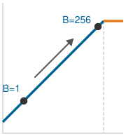
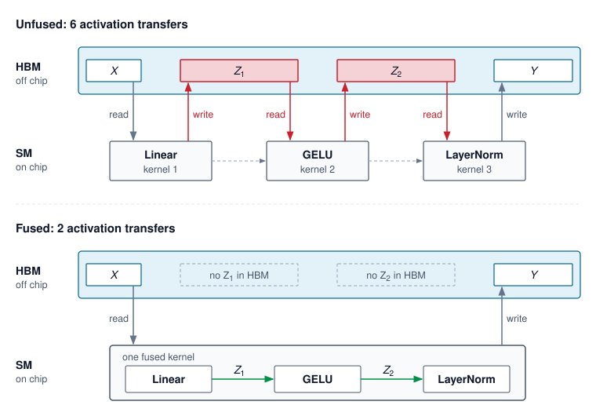
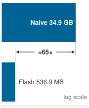
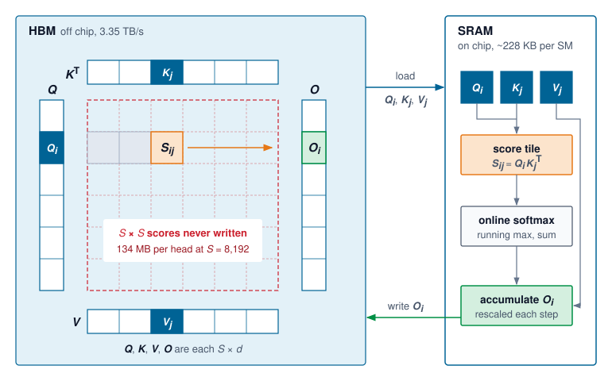
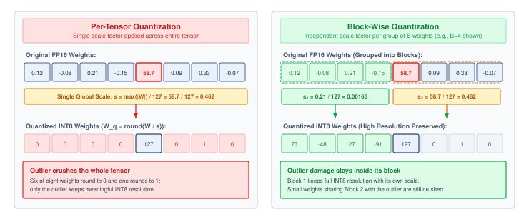
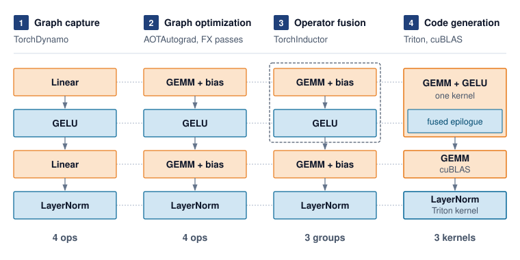
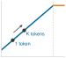

# Performance Engineering {#sec-performance-engineering}

::: {layout-narrow}
::: {.column-margin}

\chapterminitoc

:::

::: {.content-visible when-format="pdf"}
\noindent
{fig-alt="Performance engineering workbench where a fleet workload is measured, bottlenecks are diagnosed, and tiling, fusion, memory, and scheduling rewrites improve the path."}
:::

::: {.content-visible unless-format="pdf"}
{fig-alt="Performance engineering workbench where a fleet workload is measured, bottlenecks are diagnosed, and tiling, fusion, memory, and scheduling rewrites improve the path."}
:::

:::

## Purpose {.unnumbered .unlisted}

\begin{marginfigure}
\mlfleetstack{25}{35}{55}{30}{100}{35}{0}{0}
\end{marginfigure}

_Why can a fleet with abundant compute still fail to serve requests fast enough?_

Expensive accelerators can spend much of a request waiting for data, software dispatch, or communication while their arithmetic units remain underused. Adding more machines may raise cost without removing the delay, and a faster isolated kernel may leave the request's critical path unchanged. The engineering stakes are useful serving capacity: how much work the existing fleet can complete while preserving latency and model quality. A configuration that answers one short request quickly may behave differently when many requests arrive with varied lengths and memory demands. Sharing work can improve throughput, but the extra state competes for memory and individual requests may wait longer. Reducing that state can admit more work only if the resulting computation remains accurate and the execution path can use the freed capacity. These interactions make optimization a question of measured constraints rather than a search for the fastest component. On one machine, a local improvement can be tested against a relatively contained execution path. Across a fleet, its value also depends on communication, synchronization, and the distribution of work across devices. The cost of a mistaken diagnosis grows when the same inefficient execution repeats across many replicas. Reaching useful capacity therefore requires matching numerical representations and execution schedules to the workload, then checking whether local savings survive along the complete request path. In C³ terms, performance engineering makes compute gains accountable to the communication and coordination costs that determine sustained fleet throughput.

::: {.content-visible when-format="pdf"}

\newpage

:::

::: {.callout-learning-objectives}

- Apply roofline analysis and execution traces to distinguish compute, memory, and launch limits
- Analyze prefill, decode, and batch-size regimes to predict latency-throughput behavior in LLM serving
- Diagnose serving bottlenecks using reproducible measurements at kernel, replica, and fleet boundaries
- Evaluate fusion, tiling, and graph replay against memory traffic, launch overhead, and resource limits
- Select precision, compilation, and runtime optimizations from bandwidth, quality, and deployment constraints
- Evaluate speculative decoding and sparse expert routing against acceptance, communication, and load-imbalance costs
- Construct a serving optimization plan that tests compute, communication, coordination, and quality trade-offs

:::

```{python}
#| echo: false
from mlsysim import *
from mlsysim.core.units import *

# ┌─────────────────────────────────────────────────────────────────────────────
# │ CHAPTER START
# ├─────────────────────────────────────────────────────────────────────────────
# │ Context: Chapter initialization and global imports
# │
# │ Why: Registers this chapter with the mlsys registry and provides shared
# │      imports for all subsequent calculation cells.
# │
# └─────────────────────────────────────────────────────────────────────────────
from mlsysim.physics.quantities import token_throughput
from mlsysim.fmt import check, fmt, fmt_int
from mlsysim.physics import calc_bottleneck, model_memory
```

## The Memory Wall and Roofline Diagnosis {#sec-performance-engineering-memory-wall}

```{python}
#| echo: false
#| label: memory-wall-opening
# ┌─────────────────────────────────────────────────────────────────────────────
# │ MEMORY WALL OPENING HOOK (LEGO)
# ├─────────────────────────────────────────────────────────────────────────────
# │ Context: @sec-performance-engineering-memory-wall opening paragraph.
# │
# │ Goal: Pin the chapter-opening H100 FP16 peak-compute claim to the registry.
# │ Show: ~989 TFLOP/s FP16 dense Tensor Core peak—inline prose.
# │ How: Read Hardware.Cloud.H100.compute.peak_flops (FP16/BF16 headline rate).
# │
# └─────────────────────────────────────────────────────────────────────────────
from mlsysim.fmt import check, fmt_qty_int

class MemoryWallOpening:
    """H100 headline FP16 peak compute for the chapter-opening hook."""

    # ┌── 1. LOAD (Constants) ──────────────────────────────────────────────
    peak_flops = Hardware.Cloud.H100.compute.peak_flops  # FP16/BF16 dense Tensor Core peak

    # ┌── 3. GUARD (Invariants) ──────────────────────────────────────────
    check(peak_flops > 900 * TFLOP / second, "H100 FP16 peak should exceed 900 TFLOP/s")

    # ┌── 4. OUTPUT (Formatting) ──────────────────────────────────────────────
    h100_fp16_tflop_per_s_str = fmt_qty_int(peak_flops, TFLOP / second, commas=False)
```

An H100 GPU capable of `{python} MemoryWallOpening.h100_fp16_tflop_per_s_str` of dense FP16 Tensor Core compute can leave more than 99 percent of that compute idle during batch-one language-model decode. The processor is not short on arithmetic; it is starving for data, the autoregressive bottleneck (principle \ref{pri-autoregressive-bottleneck}) in its most direct form. Performance engineering\index{Performance Engineering!discipline definition} operates inside that constraint: the memory wall, where moving bytes from memory to compute units can cap throughput long before Tensor Cores reach their advertised peak.

Placement, synchronization, recovery, and scheduling can put the workload on the right hardware and keep it alive. They cannot guarantee that each allocated replica completes enough useful work to justify its capacity. Across the multi-tier hierarchy of @fig-fleet-stack, performance engineering connects execution inside the Runtime & Serving row of the Serving band to the compute, communication, and coordination costs established across the physical and distribution tiers. A faster kernel matters when it shortens the request's critical path, releases memory for concurrent requests, or reduces the capacity needed to meet a service objective. The governing question is therefore which execution constraint limits useful fleet throughput, not which kernel can achieve the highest isolated speedup.

The recurring workload is an autoregressive language-model service. A request first processes its input prompt in a prefill pass, then generates output tokens through successive decode passes. The key-value (KV) cache retains attention keys and values from the prompt and generated tokens so later passes can reuse them rather than recomputing them, though this shifts the bottleneck from compute to memory capacity and bandwidth as the cache grows. A serving replica may span several accelerators through tensor parallelism; several replicas can serve different requests. Time-to-first-token measures the delay from request arrival to the first output token, while inter-token latency measures the gaps between subsequent tokens. Batching shares execution across active requests, but each request still consumes cache capacity and must meet its latency objective.

Before comparing implementations, we fix the model and quality criterion, prompt and output-length distributions, offered request load, hardware topology, and timing boundary. We measure completed throughput and latency percentiles under that workload, separating cold-start costs from warmed execution. An end-to-end trace then distinguishes waiting for input or scheduling from exposed communication, memory movement, computation, and host dispatch. Only after locating the limiting interval do we use kernel counters and rooflines to choose among fusion, precision, compilation, or changes to the algorithm. Repeating the same measurement after each change establishes whether a local improvement survives at the replica and fleet boundaries.

### The single-machine iron law {#sec-performance-engineering-efficiency-frontier}

The memory wall is one term in a larger budget. @Eq-iron-law-perf restates, for one replica, the single-machine iron law that the Fleet Law extends across many devices\index{Iron law!performance decomposition}. It decomposes execution time into three competing costs:

$$
T = \frac{\DataVolume}{\Bandwidth} + \frac{O}{\PeakRate \cdot \EfficiencyHw} + \Latency
$$ {#eq-iron-law-perf}

In overlapped execution, the roofline-style simplification replaces the sum of compute and data movement with the slower exposed term:

$$
T \approx \max\left( \frac{O}{\PeakRate \cdot \EfficiencyHw}, \; \frac{\DataVolume}{\Bandwidth} \right) + \Latency
$$

Here, $\DataVolume$ is the data volume crossing the chosen memory boundary, $\Bandwidth$ is its bandwidth, $O$ is the operation count, and $\PeakRate \cdot \EfficiencyHw$ is the realized compute rate after accounting for hardware execution efficiency. The overhead term $\Latency$ includes exposed launch, synchronization, communication, and software costs outside those compute and memory terms. This local execution budget supplies the service time of a replica; request queueing and routing add time outside that boundary. The roofline approximation asks which exposed term dominates at a given operating point: increasing compute throughput for a memory-bound workload does not materially improve performance until the memory term is reduced. Eager framework execution can expose a large slice of the overhead term when a Python loop and the framework dispatcher submit many short kernels, but not every launch traverses the Python global interpreter lock (GIL); asynchronous runtime threads, compiled regions, and native extensions can submit work outside that path. `torch.compile(mode="reduce-overhead")` and CUDA Graphs target repeated host-submission costs by capturing a stable region and replaying its GPU work with fewer CPU interactions. They amortize or avoid repeated dispatch within that region rather than removing all runtime overhead.

::: {.column-margin .margin-pointer}
↩ The Fleet Law, which extends this single-machine iron law across $N$ devices, is established in @sec-vol2-introduction-fleet-law.
:::

::: {.column-margin}
{width="100%" fig-alt="Iron-law bar split into three segments, Data, Compute, and Latency. The Data segment is the widest and shaded; Compute and Latency are narrow and gray."}

*Autoregressive transformer decode is often memory-bound: the data-movement term dominates the iron law.*
:::

Model compression\index{Model Compression!vs. performance engineering} changes the work or its representation. Pruning and distillation can reduce the operations a model requires, while quantization reduces the bytes used to represent values without necessarily reducing the operation count. System optimization changes how that work executes, keeping data in fast memory and reducing dispatch and synchronization costs. The two approaches interact because a smaller representation saves execution time only when the implementation can use it efficiently.

Several levers map directly to those terms. When memory traffic dominates, operator fusion and tiling reduce the exposed data-volume term by eliminating intermediate high-bandwidth memory (HBM) round-trips. A fused sequence that keeps its intermediates in SRAM can shrink the exposed memory-access term dramatically; for long-sequence attention the traffic reduction can exceed an order of magnitude, as @sec-performance-engineering-flashattention works out. Precision engineering attacks the same numerator from a different angle: FP8, INT4, and KV-cache compression (storing the per-token attention keys and values in fewer bytes) represent each value in fewer bytes, so the same physical bandwidth carries more useful model state.

Other levers change the overhead or compute terms. Graph compilation, including `torch.compile`, Accelerated Linear Algebra (XLA), and TensorRT, can reduce repeated host dispatch, fuse eligible operations, and plan memory across captured regions. Communication-computation overlap makes communication concurrent with independent useful work. Full hiding requires $T_{\text{comm}} \leq \IronlawTermTimesCompute$, but the duration comparison alone is insufficient. The schedule must make that independent work ready in time, and resource contention must not erase the gain. When the whole communication interval is hidden, $T_{\text{comm}} - \OverlappedTime \leq 0$. The overlap term of the Fleet Law (@eq-fleet-law) also credits partial hiding when communication lasts longer than the available compute window. Algorithmic changes affect the work itself. Speculative decoding, in which a small draft model proposes several tokens that the full model verifies in one pass, preserves the target sampling distribution under its verification rule; mixture of experts (MoE) changes the model architecture and requires a trained model plus quality validation before its compute savings are usable.

Each technique attacks a different term, and this taxonomy guides optimization strategy: diagnose which term dominates (using the roofline model from @sec-performance-engineering-roofline), then apply the technique targeting that term. A technique targeting a smaller exposed term can still help, but its end-to-end benefit is bounded by that term’s share of execution time.

Before using this diagnostic process, check how each term in the iron law maps to a practical optimization lever.

::: {#chk-performance-engineering-iron-law-performance .callout-checkpoint title="The single-machine iron law"}

Verify understanding of system-level performance diagnosis:

- [ ] **Memory-bound limit**: determine whether increasing the GPU's clock frequency (increasing FLOP/s) improves a memory-bound workload.
- [ ] **Quantization term**: identify which term in @eq-iron-law-perf changes when quantization moves the representation from FP16 to INT4.
- [ ] **Overhead term**: define the "Overhead" term in the iron law and explain why graph compilation targets it specifically.
- [ ] **Compute-bound bandwidth**: evaluate the claim that memory bandwidth is irrelevant to the performance of a compute-bound system.
- [ ] **Iron-law decomposition**: for a step that is 60 percent data movement, 30 percent compute, and 10 percent latency, estimate which single optimization buys the most wall-clock time, and what the iron law predicts once that dominant term is halved.

:::

The same diagnostic process can be codified into a structured triage framework. @Fig-iron-law-flowchart formalizes this diagnostic triage: starting from a missed latency or throughput target, the decision tree screens for low accelerator utilization to isolate I/O, CPU, and communication overheads before adjudicating whether kernel execution is compute-bound or memory-bound. For instance, if GPU utilization is high and the workload's arithmetic intensity is below the machine's ridge point, the flow routes to memory-bound remedies like operator fusion or weight quantization.

::: {#fig-iron-law-flowchart fig-env="figure" fig-pos="htb" fig-cap="**Iron law diagnostic flowchart**: A troubleshooting flow that starts from a missed step-time or token-latency target and low accelerator utilization, branches through I/O, CPU, and communication-overhead checks, and classifies the workload as compute-bound or memory-bound at the leaves. Compute-bound paths point to lower-precision arithmetic and to reductions in active work such as MoE routing; memory-bound paths point to operator fusion, tiling, weight quantization, and speculative decoding. Overhead-bound symptoms (data loading, preprocessing, communication) are surfaced earlier in the flow and addressed before the final compute/memory classification." fig-alt="Troubleshooting flowchart starting from a box reading Target is missed. A GPU-utilization check branches right through I/O-bound and CPU-bound checks, whose yes branches lead to data-pipeline remedies and whose final no branch leads to communication overhead. Its no branch leads down to an intensity-versus-ridge check that splits into compute-bound, with FP8 math and MoE routing below it, and memory-bound, with operator fusion and INT4 or speculative decoding below it. Every remedy joins a bus into a Re-profile workload box, and a dashed loop returns to the start."}


<!--
```{=latex}
\begin{tikzpicture}[
    >=Stealth,
    font=\small,
    box/.style={
        rectangle, rounded corners=4pt,
        align=center, inner sep=5pt,
        line width=0.9pt
    },
    root_box/.style={
        box, draw=NavyBlue!80, fill=NavyBlue!8!white,
        line width=1.1pt, minimum width=4.0cm, minimum height=0.95cm
    },
    decision_box/.style={
        box, draw=SlateGrey!75, fill=SlateGrey!6!white,
        minimum width=3.3cm, minimum height=1.0cm
    },
    compute_box/.style={
        box, draw=NavyBlue!85, fill=NavyBlue!8!white,
        line width=1.1pt, minimum width=3.6cm, minimum height=0.95cm
    },
    memory_box/.style={
        box, draw=Crimson!85, fill=Crimson!6!white,
        line width=1.1pt, minimum width=3.6cm, minimum height=0.95cm
    },
    action_green/.style={
        box, draw=ForestGreen!80, fill=ForestGreen!6!white,
        minimum width=3.3cm, minimum height=0.9cm
    },
    action_blue/.style={
        box, draw=NavyBlue!75, fill=NavyBlue!5!white,
        minimum width=3.3cm, minimum height=0.9cm
    },
    action_amber/.style={
        box, draw=Amber!85, fill=Amber!8!white,
        minimum width=3.3cm, minimum height=0.9cm
    },
    action_crimson/.style={
        box, draw=Crimson!75, fill=Crimson!5!white,
        minimum width=3.0cm, minimum height=0.9cm
    },
    action_purple/.style={
        box, draw=violet!75, fill=violet!5!white,
        minimum width=3.0cm, minimum height=0.9cm
    },
    action_sub/.style={
        box, draw=NavyBlue!70, fill=NavyBlue!4!white,
        minimum width=2.8cm, minimum height=0.9cm
    },
    reprofile_box/.style={
        box, draw=NavyBlue!80, fill=white,
        line width=1.0pt, minimum width=4.2cm, minimum height=0.85cm
    }
]

    % Provide colors if not defined
    \providecolor{ForestGreen}{RGB}{34,139,34}
    \providecolor{NavyBlue}{RGB}{20,45,110}
    \providecolor{Amber}{RGB}{217,119,6}
    \providecolor{BurntOrange}{RGB}{210,105,30}
    \providecolor{BrickRed}{RGB}{180,30,30}
    \providecolor{Crimson}{RGB}{180,30,30}
    \providecolor{SlateGrey}{RGB}{112,128,144}

    % -------------------------------------------------------------------------
    % NODES
    % -------------------------------------------------------------------------

    % Root
    \node[root_box] (root) at (0, 0) {
        \bfseries\color{NavyBlue!90!black} Training is slow
    };

    % Level 1: GPU util
    \node[decision_box] (gpu_util) at (0, -1.6) {
        \textbf{GPU util $<$ 70\%?}\\[2pt]
        {\tiny\color{black!70}(Nsight / nvidia-smi)}
    };

    % Level 2 (Left path from GPU util = No): AI > ridge point?
    \node[decision_box] (ridge) at (0, -3.5) {
        \textbf{AI $>$ ridge point?}\\[2pt]
        {\tiny\color{black!70}(Roofline analysis)}
    };

    % Level 3 (Left path from ridge = Yes): COMPUTE BOUND
    \node[compute_box] (compute_bound) at (-5.6, -3.5) {
        \bfseries\color{NavyBlue!90!black} COMPUTE BOUND
    };

    % Sub-actions under COMPUTE BOUND
    \node[action_sub] (fp8) at (-7.1, -5.1) {
        \textbf{\scriptsize\color{NavyBlue!90!black} FP8 / INT4}\\[2pt]
        {\tiny\color{black!70}Precision eng.}
    };
    \node[action_sub] (moe) at (-4.1, -5.1) {
        \textbf{\scriptsize\color{NavyBlue!90!black} MoE / Speculative}\\[2pt]
        {\tiny\color{black!70}Algorithmic opt.}
    };

    % Level 3 (Down from ridge = No): MEMORY BOUND
    \node[memory_box] (mem_bound) at (0, -5.3) {
        \bfseries\color{Crimson} MEMORY BOUND
    };

    % Sub-actions under MEMORY BOUND
    \node[action_crimson] (fusion) at (-1.7, -6.8) {
        \textbf{\scriptsize\color{Crimson} Operator fusion}\\[2pt]
        {\tiny\color{black!70}FlashAttention}
    };
    \node[action_purple] (compile) at (1.7, -6.8) {
        \textbf{\scriptsize\color{violet!90!black} torch.compile}\\[2pt]
        {\tiny\color{black!70}Graph compilation}
    };

    % Right branches from GPU util = Yes:
    \node[decision_box] (io_bound) at (4.0, -1.6) {
        \textbf{I/O bound?}\\[2pt]
        {\tiny\color{black!70}(DataLoader stall)}
    };

    \node[action_green] (dl_workers) at (8.0, -2.5) {
        \textbf{\scriptsize\color{ForestGreen!85!black} More DL workers}\\[2pt]
        {\tiny\color{black!70}Use GDS / NVMe}
    };

    \node[decision_box] (cpu_bound) at (4.0, -3.5) {
        \textbf{CPU bound?}\\[2pt]
        {\tiny\color{black!70}(preprocessing)}
    };

    \node[action_blue] (offload_gpu) at (8.0, -4.4) {
        \textbf{\scriptsize\color{NavyBlue!90!black} Offload to GPU}\\[2pt]
        {\tiny\color{black!70}DALI / async preproc}
    };

    \node[action_amber] (comm_overhead) at (4.0, -5.3) {
        \textbf{\scriptsize\color{Amber!90!black} Comm overhead}\\[2pt]
        {\tiny\color{black!70}Overlap / compress}
    };

    % Bottom: Re-profile Workload
    \node[reprofile_box] (reprofile) at (0, -8.6) {
        \bfseries\color{NavyBlue!90!black} Re-profile Workload
    };

    % -------------------------------------------------------------------------
    % EDGES
    % -------------------------------------------------------------------------

    % Root -> GPU util
    \draw[->, line width=0.9pt, SlateGrey!90!black] (root) -- (gpu_util);

    % GPU util -> Ridge (No)
    \draw[->, line width=0.9pt, Crimson] (gpu_util) -- node[right=1pt, font=\scriptsize\bfseries\color{Crimson}] {No} (ridge);

    % GPU util -> I/O bound (Yes)
    \draw[->, line width=0.9pt, ForestGreen!85!black] (gpu_util) -- node[above=2pt, font=\scriptsize\bfseries\color{ForestGreen!85!black}] {Yes} (io_bound);

    % I/O bound -> DL workers (Yes)
    \draw[->, line width=0.9pt, ForestGreen!85!black] (io_bound.east) -| node[above, pos=0.2, font=\scriptsize\bfseries\color{ForestGreen!85!black}] {Yes} (dl_workers.north);

    % I/O bound -> CPU bound (No)
    \draw[->, line width=0.9pt, Crimson] (io_bound) -- node[right=1pt, font=\scriptsize\bfseries\color{Crimson}] {No} (cpu_bound);

    % CPU bound -> Offload to GPU (Yes)
    \draw[->, line width=0.9pt, ForestGreen!85!black] (cpu_bound.east) -| node[above, pos=0.2, font=\scriptsize\bfseries\color{ForestGreen!85!black}] {Yes} (offload_gpu.north);

    % CPU bound -> Comm overhead (No)
    \draw[->, line width=0.9pt, Crimson] (cpu_bound) -- node[right=1pt, font=\scriptsize\bfseries\color{Crimson}] {No} (comm_overhead);

    % Ridge -> COMPUTE BOUND (Yes)
    \draw[->, line width=0.9pt, ForestGreen!85!black] (ridge) -- node[above=2pt, font=\scriptsize\bfseries\color{ForestGreen!85!black}] {Yes} (compute_bound);

    % Ridge -> MEMORY BOUND (No)
    \draw[->, line width=0.9pt, Crimson] (ridge) -- node[right=1pt, font=\scriptsize\bfseries\color{Crimson}] {No} (mem_bound);

    % Under COMPUTE BOUND: fork to fp8 and moe
    \draw[line width=0.9pt, SlateGrey!80!black] (compute_bound.south) -- ++(0, -0.35) coordinate (c_split);
    \draw[->, line width=0.9pt, SlateGrey!80!black] (c_split) -| (fp8.north);
    \draw[->, line width=0.9pt, SlateGrey!80!black] (c_split) -| (moe.north);

    % Under MEMORY BOUND: fork to fusion and compile
    \draw[line width=0.9pt, SlateGrey!80!black] (mem_bound.south) -- ++(0, -0.35) coordinate (m_split);
    \draw[->, line width=0.9pt, SlateGrey!80!black] (m_split) -| (fusion.north);
    \draw[->, line width=0.9pt, SlateGrey!80!black] (m_split) -| (compile.north);

    % -------------------------------------------------------------------------
    % Convergence bus to Re-profile Workload
    % -------------------------------------------------------------------------
    \coordinate (bus_y) at (0, -7.7);

    % Drops to the horizontal bus
    \draw[line width=0.8pt, SlateGrey!70] (fp8.south) -- (fp8.south |- bus_y);
    \draw[line width=0.8pt, SlateGrey!70] (moe.south) -- (moe.south |- bus_y);
    \draw[line width=0.8pt, SlateGrey!70] (fusion.south) -- (fusion.south |- bus_y);
    \draw[line width=0.8pt, SlateGrey!70] (compile.south) -- (compile.south |- bus_y);
    \draw[line width=0.8pt, SlateGrey!70] (comm_overhead.south) -- (comm_overhead.south |- bus_y);
    \draw[line width=0.8pt, SlateGrey!70] (offload_gpu.south) |- (bus_y);
    \draw[line width=0.8pt, SlateGrey!70] (dl_workers.east) -- ++(0.4, 0) |- (bus_y);

    % The continuous horizontal bus line
    \draw[line width=0.8pt, SlateGrey!70] (-7.1, -7.7) -- (10.0, -7.7);

    % Three arrows from the bus into Re-profile Workload
    \draw[->, line width=0.9pt, SlateGrey!80!black] (-0.7, -7.7) -- (-0.7, -8.6);
    \draw[->, line width=0.9pt, SlateGrey!80!black] (0.0, -7.7) -- (0.0, -8.6);
    \draw[->, line width=0.9pt, SlateGrey!80!black] (0.7, -7.7) -- (0.7, -8.6);

    % Return loop to Root
    \draw[dashed, ->, line width=0.9pt, SlateGrey!70]
        (reprofile.west) -- ++(-6.7, 0) coordinate (loop_left)
        -- node[left, font=\scriptsize\itshape\color{black!70}, rotate=90, anchor=south, pos=0.5] {iterate until target met}
           (loop_left |- root.west)
        -- (root.west);

\end{tikzpicture}
```
-->

:::

The iterative diagnostic loop in @fig-iron-law-flowchart reinforces why profiling must precede optimization: every remediation pathway routes back into re-profiling the workload, ensuring that an engineering intervention targets the active limiter rather than an unexposed cost. A technique that changes a small or hidden term has limited influence on end-to-end time even if it produces a large local speedup. For serving, the missed target is a request-latency or throughput objective; for training, it is step time. Misdiagnosis is not only wasted effort; a performance change shipped blind can move the system to the wrong point on its operating boundary.

That boundary is the **efficiency frontier**\index{Efficiency Frontier!definition}\index{Efficiency Frontier!Pareto optimality}, the Pareto-optimal curve of model quality vs. system throughput for a stated workload, resource budget, and set of feasible configurations. A configuration on this frontier cannot improve one dimension without sacrificing the other within that set. @thompson2021 show why efficiency matters for deep learning: quality improvements have required rapidly increasing compute. Performance engineering can expand the feasible set by making a quality level achievable at higher throughput. The deployment decision then selects an operating point that meets the application's latency, cost, and quality requirements.

The multi-dimensional nature of this frontier makes optimization challenging. @Tbl-performance-engineering-frontier-dimensions identifies the five dimensions that performance engineers must balance before choosing an optimization target.

| **Dimension**                    | **How it is measured**                              | **What it constrains**                                 | **Typical tension**                                                 |
|:---------------------------------|:----------------------------------------------------|:-------------------------------------------------------|:--------------------------------------------------------------------|
| **Throughput**\index{Throughput} | Tokens/second or requests/second                    | How much work the system completes per unit time       | Larger batches improve throughput but often degrade latency         |
| **Latency**\index{Latency}       | Time-to-first-token and inter-token latency         | How quickly the system responds to individual requests | Lower latency can require smaller batches and higher per-token cost |
| **Cost**                         | Dollars per million tokens                          | Economic efficiency of the system                      | Cheapest configurations may miss latency or quality targets         |
| **Quality**                      | Perplexity, benchmark accuracy, or human preference | Accuracy and usefulness of model outputs               | Precision reduction and speculation require quality guardrails      |
| **Memory**                       | Peak GPU memory                                     | Feasible batch size and sequence length                | Larger contexts and batches consume capacity needed for model state |

: **Efficiency frontier dimensions**: Performance optimization balances measurable throughput, latency, cost, quality, and memory constraints rather than a single hardware-utilization number. {#tbl-performance-engineering-frontier-dimensions tbl-colwidths="[18,28,27,27]"}

The dimensions in @tbl-performance-engineering-frontier-dimensions interact in nonobvious ways. Increasing batch size can improve throughput and cost efficiency while degrading latency. Reducing precision can lower memory demand and improve throughput but may degrade quality. Speculative decoding can improve latency but may increase per-token cost. The performance engineer's task is to navigate these trade-offs guided by the application's specific requirements.

An interactive chatbot might target time-to-first-token under 200 ms and inter-token latency under 50 ms, accepting a higher per-token cost to meet those illustrative limits. An offline document-summarization pipeline may instead prioritize completed work per dollar, subject to a deadline and a quality threshold. A quality-sensitive application can impose a stricter acceptance criterion while retaining its own latency constraints. These requirements select different feasible operating points; performance engineering must make the trade-off explicit before choosing an optimization.

For the same 70B language model, a latency-oriented configuration might use small batches and speculative decoding to reduce the time a request waits for tokens. A throughput-oriented configuration might use larger batches and INT4 weights to amortize weight reads and free memory for concurrent requests. These are candidate operating points, not guaranteed improvements. The larger batch can increase aggregate throughput while lengthening each request's token intervals, and reduced precision is usable only if the model still meets its quality criterion.

```{python}
#| echo: false
#| label: frontier-operating-points
# ┌─────────────────────────────────────────────────────────────────────────────
# │ EFFICIENCY-FRONTIER OPERATING POINTS (LEGO)
# ├─────────────────────────────────────────────────────────────────────────────
# │ Context: efficiency-frontier paragraph in
# │          @sec-performance-engineering-efficiency-frontier.
# │
# │ Goal: Put numbers on the latency-oriented and throughput-oriented operating
# │       points of the recurring 70B deployment.
# │ Show: bandwidth-only decode step, aggregate token rate, and cost per million
# │       output tokens at batch 1 and at the serving profile's batch limit.
# │ How: per-GPU bytes per step = FP16 weight shard + B x per-GPU KV cache at the
# │      profile context length; step = bytes / HBM bandwidth; cost = replica
# │      GPU-hours / tokens. Floors on latency, ceilings on throughput.
# │
# └─────────────────────────────────────────────────────────────────────────────
from mlsysim.fmt import check, fmt_memory, fmt_multiple, fmt_rate, fmt_time, fmt_usd

class FrontierOperatingPoints:
    """Bandwidth-only latency, throughput, and cost at two batch sizes."""

    # ┌── 1. LOAD (Constants) ──────────────────────────────────────────────
    model = Models.Language.Llama2_70B
    profile = ReferenceStats.ServingProfiles
    tensor_parallel_degree = int(profile.PrecisionDividendTensorParallelDegree)
    context_tokens = int(profile.PrecisionDividendContextLengthTokens)
    batch_latency = 1
    batch_throughput = int(profile.PrecisionDividendOptimizedPolicyBatchLimit)
    hbm_bw = Hardware.Cloud.H100.memory.bandwidth
    gpu_hour = Infrastructure.Pricing.Cloud.GpuInferencePerHour.rate

    # ┌── 2. EXECUTE (The Compute) ────────────────────────────────────────
    weight_shard = model.size_in_bytes(BYTES_FP16) / tensor_parallel_degree
    kv_request = calc_kv_cache_size(model.layers, model.kv_heads, model.hidden_dim // model.heads, context_tokens, 1, bytes_per_elem=BYTES_FP16)
    kv_request_per_gpu = kv_request / tensor_parallel_degree
    bytes_lat = weight_shard + batch_latency * kv_request_per_gpu
    bytes_thr = weight_shard + batch_throughput * kv_request_per_gpu
    step_lat = (bytes_lat / hbm_bw).to(ms)
    step_thr = (bytes_thr / hbm_bw).to(ms)
    tps_lat = (batch_latency / step_lat).to(1 / second).magnitude
    tps_thr = (batch_throughput / step_thr).to(1 / second).magnitude
    replica_rate = (tensor_parallel_degree * gpu_hour).to(USD / hour).magnitude
    cost_lat = replica_rate / (tps_lat * 3600) * 1e6  # dollars per million output tokens
    cost_thr = replica_rate / (tps_thr * 3600) * 1e6
    cost_ratio = cost_lat / cost_thr
    latency_ratio = (step_thr / step_lat).to("").magnitude

    # ┌── 3. GUARD (Invariants) ───────────────────────────────────────────
    check(batch_throughput == 32, "Throughput point should use the profile's 32-request batch limit")
    check(cost_ratio > 10, "Batching should cut cost per token by more than an order of magnitude")
    check(1 < latency_ratio < 2, "Batching should lengthen each token interval by less than 2x here")

    # ┌── 4. OUTPUT (Formatting) ──────────────────────────────────────────
    context_tokens_str = fmt_int(context_tokens, commas=True)
    batch_throughput_str = fmt_int(batch_throughput, commas=False)
    bytes_lat_gb_str = fmt_memory(bytes_lat, unit=GB, precision=1, commas=False)
    bytes_thr_gb_str = fmt_memory(bytes_thr, unit=GB, precision=1, commas=False)
    step_lat_ms_str = fmt_time(step_lat, ms, precision=1, commas=False)
    step_thr_ms_str = fmt_time(step_thr, ms, precision=1, commas=False)
    tps_lat_str = fmt_rate(round(tps_lat), "tokens/s", precision=0, commas=True)
    tps_thr_str = fmt_rate(round(tps_thr, -1), "tokens/s", precision=0, commas=True)
    gpu_hour_str = fmt_usd(gpu_hour.to(USD / hour).magnitude, precision=2, commas=False)
    cost_lat_str = fmt_usd(round(cost_lat), precision=0, commas=False)
    cost_thr_str = fmt_usd(cost_thr, precision=2, commas=False)
    cost_ratio_mult_str = fmt_multiple(round(cost_ratio), precision=0, commas=False)
    latency_ratio_mult_str = fmt_multiple(latency_ratio, precision=1, commas=False)
```

A bandwidth-only estimate illustrates the trade-off between those two points. Take the FP16 weights of the chapter's recurring 70B deployment, sharded across eight GPUs, and let every request hold a full `{python} FrontierOperatingPoints.context_tokens_str`-token KV cache. At batch one, each GPU streams about `{python} FrontierOperatingPoints.bytes_lat_gb_str` per decode step, so a step takes at least `{python} FrontierOperatingPoints.step_lat_ms_str` and the replica emits at most `{python} FrontierOperatingPoints.tps_lat_str`. At a batch of `{python} FrontierOperatingPoints.batch_throughput_str` requests, each GPU streams `{python} FrontierOperatingPoints.bytes_thr_gb_str`, giving a step-time lower bound of `{python} FrontierOperatingPoints.step_thr_ms_str` and an aggregate output upper bound of `{python} FrontierOperatingPoints.tps_thr_str`. At `{python} FrontierOperatingPoints.gpu_hour_str` per GPU-hour, the corresponding cost lower bounds per million output tokens are `{python} FrontierOperatingPoints.cost_lat_str` and `{python} FrontierOperatingPoints.cost_thr_str`. Their ratio is roughly `{python} FrontierOperatingPoints.cost_ratio_mult_str`, while the step-time bounds differ by `{python} FrontierOperatingPoints.latency_ratio_mult_str`. These ratios compare idealized bounds; they do not predict the measured cost or latency ratios. Exposed launch overhead and communication can lengthen execution, while queueing adds request delay outside the decode step.

The real comparison therefore requires completed throughput and per-request latency measured together under the same request-length distribution and a stated offered load. Cost per output token then follows from the occupied replica's hourly cost and its measured aggregate output rate. A tensor-parallel replica produces one shared output stream per request, so its aggregate token rate must not be counted once for every participating GPU. Only this consistent accounting can establish whether lower cost compensates for higher latency at the application's chosen operating point.

### The memory wall {#sec-performance-engineering-memory-wall-physics}

The efficiency frontier establishes the optimization objective; memory bandwidth supplies a first bound for weight-streaming decode. Consider a dense language model generating one token for one request, with weights too large to remain in on-chip cache. Its matrix-vector operations stream the active weights from HBM\index{HBM!memory hierarchy}, performing approximately one multiply-accumulate per weight. This low reuse limits arithmetic throughput even when the implementation uses memory efficiently. Batching, sparse activation, and cache reuse change the traffic model and must be accounted for before applying the same bound.

```{python}
#| echo: false
#| label: memory-wall-scenario
# ┌─────────────────────────────────────────────────────────────────────────────
# │ MEMORY WALL HARDWARE SPECS (LEGO)
# ├─────────────────────────────────────────────────────────────────────────────
# │ Context: @sec-performance-engineering-memory-wall-physics
# │
# │ Goal: Provide H100 hardware specs for memory wall discussion.
# │ Show: ~1,979 TFLOP/s FP8; ~3.35 TB/s BW.
# │ How: pulling constants from mlsysim.core.units.
# │
# └─────────────────────────────────────────────────────────────────────────────
from mlsysim.fmt import fmt, fmt_bandwidth, fmt_int, fmt_power

class MemoryWallScenario:
    """H100 specs for memory wall discussion."""

    # ┌── 1. LOAD (Constants) ──────────────────────────────────────────────
    flops_fp8 = Hardware.Cloud.H100.compute.precision_flops["fp8"]
    bw = Hardware.Cloud.H100.memory.bandwidth
    mem = Hardware.Cloud.H100.memory.capacity
    l2_cache = Hardware.Cloud.H100.memory.l2_cache
    sm_count = Hardware.Cloud.H100.compute.sm_count
    reg_per_sm = Hardware.Cloud.H100.memory.register_file_per_sm
    shared_per_sm = Hardware.Cloud.H100.memory.shared_memory_per_sm
    tdp = Hardware.Cloud.H100.tdp
    hbm_latency = Hardware.Tech.Memory.DRAM.latency
    smem_tier = Hardware.Tech.Memory.HopperSharedMemory  # Luo et al. (2024) microbenchmark
    l2_tier = Hardware.Tech.Memory.HopperL2

    # ┌── 2. EXECUTE (The Compute) ────────────────────────────────────────
    ridge_fp8 = (flops_fp8 / bw).to(flop / byte)
    full_read_time = (mem / bw).to(ms)
    # Register file is quoted in binary (KiB/MiB) and labeled with decimal units
    # in prose, matching the branded-hardware-label convention (e.g., 80 GiB -> "80 GB").
    register_total = sm_count * reg_per_sm

    # ┌── 3. GUARD (Invariants) ──────────────────────────────────────────
    from mlsysim.fmt import check, fmt_memory_capacity, fmt_time, fmt_qty_int, fmt_multiple

    check(200 * KiB <= reg_per_sm <= 300 * KiB, "H100 register file/SM should be ~256 KiB")
    check(200 * KiB <= shared_per_sm <= 256 * KiB, "H100 shared memory/SM should be ~228 KiB")
    check(30 * MiB <= register_total <= 36 * MiB, "H100 register file total should be ~33 MiB")
    check(40 * MB <= l2_cache <= 60 * MB, "H100 L2 cache should be ~50 MB")
    check(250 * nanosecond <= hbm_latency <= 350 * nanosecond, "HBM3 access latency should be ~300 ns")
    check(smem_tier.latency_cycles < l2_tier.latency_cycles, "Shared memory must be faster than L2")
    check(20 * ms < full_read_time < 30 * ms, "Full-HBM read should take tens of ms, far above inference latency targets")
    # The TikZ roofline in @fig-roofline-model is static: its labels read
    # "2,000 TFLOP/s FP8", "3.35 TB/s", and "Ridge ~600 FLOP/B". Guard them here.
    check(abs(flops_fp8.to(TFLOP / second).magnitude - 2000) / 2000 < 0.02, "TikZ roofline FP8 ceiling label (2,000 TFLOP/s) drifted")
    check(abs(bw.to(TB / second).magnitude - 3.35) < 0.005, "TikZ roofline slope label (3.35 TB/s) drifted")
    check(550 < ridge_fp8.magnitude < 650, "TikZ roofline ridge label (~600 FLOP/B) drifted")

    # ┌── 4. OUTPUT (Formatting) ──────────────────────────────────────────────
    h100_fp8_tflop_per_s_str = fmt_qty_int(flops_fp8, TFLOP / second, commas=False)
    h100_hbm_bw_tb_per_s_str = fmt_bandwidth(bw, unit=TB / second, precision=2, commas=False)
    h100_ridge_fp8_str = fmt_arithmetic_intensity(ridge_fp8, unit=flop / byte, precision=1, commas=False)
    h100_mem_gb_str = fmt_memory_capacity(mem, unit=GiB, precision=0, commas=False)
    h100_tdp_w_str = fmt_power(tdp, unit=watt, precision=0, commas=False)
    register_total_mib_str = fmt_memory_capacity(register_total, unit=MiB, precision=0, commas=False)
    l2_cache_mb_str = fmt_qty_int(l2_cache, MB, commas=False)
    hbm_latency_ns_str = fmt_time(hbm_latency, nanosecond, precision=0, commas=False)
    sm_count_str = fmt_int(sm_count, commas=False)
    reg_per_sm_kib_str = fmt_memory_capacity(reg_per_sm, unit=KiB, precision=0, commas=False)
    shared_mem_per_sm_kib_str = fmt_memory_capacity(shared_per_sm, unit=KiB, precision=0, commas=False)
    smem_latency_cycles_str = fmt_int(round(smem_tier.latency_cycles), commas=False)
    smem_latency_ns_str = fmt_time(round(smem_tier.latency.to(nanosecond).magnitude) * nanosecond, nanosecond, precision=0, commas=False)
    l2_latency_cycles_str = fmt_int(round(l2_tier.latency_cycles), commas=False)
    l2_latency_ns_str = fmt_time(round(l2_tier.latency.to(nanosecond).magnitude, -1) * nanosecond, nanosecond, precision=0, commas=False)
    full_read_ms_str = fmt_time(round(full_read_time.magnitude) * ms, ms, precision=0, commas=False)
```

An NVIDIA H100\index{H100!memory hierarchy} has a peak FP8 compute rate of `{python} MemoryWallScenario.h100_fp8_tflop_per_s_str` at a `{python} MemoryWallScenario.h100_tdp_w_str` thermal design power budget and a peak memory bandwidth of `{python} MemoryWallScenario.h100_hbm_bw_tb_per_s_str`. Below an arithmetic intensity of `{python} MemoryWallScenario.h100_ridge_fp8_str`, that bandwidth cannot feed arithmetic at the FP8 peak rate, even under ideal scheduling. The memory wall therefore bounds the compute capacity a low-reuse workload can exploit. Profiling must still establish whether the implementation approaches that bandwidth bound or encounters another limit first.

For performance engineering, what matters about the accelerator memory hierarchy behind this gap is the constraint each level places on a kernel's schedule, which @tbl-performance-engineering-memory-hierarchy summarizes for the H100.

::: {.column-margin .margin-pointer}
↪ The accelerator memory hierarchy, from registers and SRAM to HBM, is developed as background in @sec-appdx-dam-taxonomy-memory-hierarchy.
:::

| **Level**                            | **Scale on H100**                                                                                                                                                               | **Access cost**                                                                                                               | **Optimization constraint**                                                                                                                                                                                                                          |
|:-------------------------------------|:--------------------------------------------------------------------------------------------------------------------------------------------------------------------------------|:------------------------------------------------------------------------------------------------------------------------------|:-----------------------------------------------------------------------------------------------------------------------------------------------------------------------------------------------------------------------------------------------------|
| **Registers**\index{Register File}   | `{python} MemoryWallScenario.reg_per_sm_kib_str` per SM across `{python} MemoryWallScenario.sm_count_str` SMs, about `{python} MemoryWallScenario.register_total_mib_str` total | One clock cycle                                                                                                               | Private to each thread; FP32 accumulators can force register spilling\index{Register File!register spilling} to device-backed local memory, with cost determined by cache hits and misses; shared-memory spilling requires explicit compiler support |
| **Shared memory (SRAM)**\index{SRAM} | Up to `{python} MemoryWallScenario.shared_mem_per_sm_kib_str` configurable shared memory per SM                                                                                 | About `{python} MemoryWallScenario.smem_latency_cycles_str` clock cycles (~`{python} MemoryWallScenario.smem_latency_ns_str`) | Shared within a thread block; operator fusion is profitable when intermediates fit here instead of returning to HBM                                                                                                                                  |
| **L2 cache**                         | `{python} MemoryWallScenario.l2_cache_mb_str` on-chip buffer                                                                                                                    | About `{python} MemoryWallScenario.l2_latency_cycles_str` clock cycles (~`{python} MemoryWallScenario.l2_latency_ns_str`)     | Captures reuse automatically across SMs but cannot be explicitly managed by kernel authors                                                                                                                                                           |
| **HBM**                              | `{python} MemoryWallScenario.h100_mem_gb_str` at `{python} MemoryWallScenario.h100_hbm_bw_tb_per_s_str` bandwidth                                                               | About `{python} MemoryWallScenario.hbm_latency_ns_str` per access                                                             | Supplies model and activation capacity, but reading the full device takes about `{python} MemoryWallScenario.full_read_ms_str`, far longer than real-time inference latency targets                                                                  |

: **GPU memory hierarchy constraints**: Faster GPU storage is smaller, closer to the compute units, and more explicitly managed, while HBM supplies capacity at much higher latency and energy cost. {#tbl-performance-engineering-memory-hierarchy tbl-colwidths="[17,24,24,35]"}

@Tbl-performance-engineering-memory-hierarchy makes register pressure a first-class design constraint in custom GPU kernels, whether written in CUDA or in a tile-level language such as Triton (@sec-performance-engineering-triton), because tile size controls both arithmetic intensity and register demand. It also explains why shared memory and L2 reuse matter so much for attention. If KV cache entries or fused intermediates remain on chip, the kernel avoids the slow, high-energy HBM round trip that dominates low-arithmetic-intensity operations.

When HBM traffic limits execution, data placement becomes an optimization target. Keeping reused values in faster memory can reduce the transfers on the critical path. Operator fusion\index{Memory Wall!bandwidth bottleneck} removes intermediate trips when a legal kernel schedule can retain the values on chip; tiling organizes reuse within limited SRAM; precision engineering reduces payload bytes by representing values in FP8 or INT4 instead of FP16. Graph compilers can apply supported transformations automatically. Each intervention must still be checked against launch overhead, dependencies, and on-chip resource limits, which can constrain a low-intensity kernel before it saturates HBM bandwidth.

### The roofline model {#sec-performance-engineering-roofline}

The memory wall becomes a diagnostic instrument once each kernel is placed on the roofline model[^fn-roofline-williams-origin] [@williams2009]. A kernel with arithmetic intensity $I$ attains at most $\min(\PeakRate, I \times \Bandwidth)$, and the ridge point $\RooflineRidgePoint = \PeakRate/\Bandwidth$\index{Roofline Model!ridge point} separates the memory-bound\index{Memory-Bound} side of this ideal envelope from its compute-bound\index{Compute-Bound} side. The tighter ceiling bounds performance; a measurement below that ceiling still requires investigation of latency, dependencies, and implementation limits. Performance engineering needs four refinements of that bound: the distinction between algorithmic and measured intensity, the movement of the ridge with precision and hardware generation, the placement of production kernels relative to the ridge, and the way batch size walks decode across it.

::: {.column-margin .margin-pointer}
↩ The roofline model and the H100 ridge point are established in @sec-compute-roofline.
:::

[^fn-roofline-williams-origin]: **Roofline model**\index{Roofline Model!performance engineering}: The original paper framed the model for multicore CPUs [@williams2009]; the same two-ceiling diagram extends directly to accelerators.

::: {#dfn-performance-engineering-arithmetic-intensity .callout-definition title="Arithmetic intensity"}

***Arithmetic intensity***\index{Arithmetic Intensity!performance engineering} $(I)$ is the ML workload ratio of floating-point operations performed to the number of bytes transferred from memory (FLOP per byte).

1.  **Significance**: It characterizes the computational density of a workload. It is the independent variable in the roofline model\index{Roofline Model!operational intensity}, identifying whether the bandwidth bound ($\Bandwidth$)\index{Roofline Model!memory bandwidth ceiling} or compute bound\index{Roofline Model!compute ceiling}\index{Compute-Bound} ($\PeakRate$) sets the tighter ideal ceiling. Measured execution can encounter other limits below that ceiling.
2.  **Distinction**: Unlike peak throughput (a hardware property), arithmetic intensity has two useful forms. *Algorithmic intensity* counts the data movement required by an idealized algorithm under a stated memory model; *measured intensity* divides executed FLOPs by observed traffic at a named memory boundary, such as HBM. The latter includes tiling, cache behavior, fusion, padding, and redundant transfers.
3.  **Common pitfall**: Arithmetic intensity is not a fixed property of a model. Batch size can change algorithmic reuse, while fusion and tiling primarily change measured HBM intensity by keeping intermediates on chip. A roofline point is interpretable only when its FLOP convention and memory boundary match the ceilings on the same plot.

:::

```{python}
#| echo: false
#| label: widening-gap-table
# ┌─────────────────────────────────────────────────────────────────────────────
# │ WIDENING MEMORY WALL TABLE (LEGO)
# ├─────────────────────────────────────────────────────────────────────────────
# │ Context: @tbl-widening-gap, its caption, @fig-roofline-model caption, and the
# │          ridge-point prose in @sec-performance-engineering-roofline.
# │
# │ Goal: Compute the per-generation FP16 peak, HBM bandwidth, and ridge point
# │       (ridge = peak_flops / bandwidth), plus the V100->B200 compute-growth,
# │       bandwidth-growth, and ridge-ratio figures used in the caption and prose.
# │ Show: V100/A100/H100/B200 peak (TFLOP/s), bandwidth (TB/s), ridge (FLOP/byte);
# │       18x compute growth, 8.9x bandwidth growth, ~2x ridge increase.
# │ How: Read each chip's compute.peak_flops (FP16/BF16 dense Tensor Core peak)
# │      and memory.bandwidth from the registry; ridge = peak/bandwidth.
# │
# └─────────────────────────────────────────────────────────────────────────────
from mlsysim.fmt import check, fmt_bandwidth, fmt_display_math, fmt_flop_rate, fmt_int, fmt_magnitude, fmt_multiple

class WideningGap:
    """Generational FP16 peak, bandwidth, and ridge point for V100 through B200."""

    # ┌── 1. LOAD (Constants) ──────────────────────────────────────────────
    v100 = Hardware.Cloud.V100
    a100 = Hardware.Cloud.A100
    h100 = Hardware.Cloud.H100
    b200 = Hardware.Cloud.B200

    # ┌── 2. EXECUTE (The Compute) ────────────────────────────────────────
    # Ridge point = peak FP16 compute / HBM bandwidth (FLOP/byte).
    v100_ridge = (v100.compute.peak_flops / v100.memory.bandwidth).to(flop / byte).magnitude
    a100_ridge = (a100.compute.peak_flops / a100.memory.bandwidth).to(flop / byte).magnitude
    h100_ridge = (h100.compute.peak_flops / h100.memory.bandwidth).to(flop / byte).magnitude
    b200_ridge = (b200.compute.peak_flops / b200.memory.bandwidth).to(flop / byte).magnitude

    compute_growth = (b200.compute.peak_flops / v100.compute.peak_flops).to("").magnitude
    bw_growth = (b200.memory.bandwidth / v100.memory.bandwidth).to("").magnitude
    ridge_ratio = b200_ridge / v100_ridge

    # ┌── 3. GUARD (Invariants) ──────────────────────────────────────────
    check(h100_ridge > a100_ridge > v100_ridge, "Ridge point should rise V100 -> A100 -> H100")
    check(compute_growth > bw_growth, "Compute should outgrow bandwidth across generations")
    check(1.9 < ridge_ratio < 2.1, f"Ridge should roughly double V100 -> B200, got {ridge_ratio:.2f}")

    # ┌── 4. OUTPUT (Formatting) ─────────────────────────────────────────────
    # Table cells are number-only; the column headers carry the units.
    v100_peak_tflop_per_s_str = fmt_int(round(v100.compute.peak_flops.to(TFLOP / second).magnitude))
    a100_peak_tflop_per_s_str = fmt_int(round(a100.compute.peak_flops.to(TFLOP / second).magnitude))
    h100_peak_tflop_per_s_str = fmt_int(round(h100.compute.peak_flops.to(TFLOP / second).magnitude))
    b200_peak_tflop_per_s_str = fmt_int(round(b200.compute.peak_flops.to(TFLOP / second).magnitude))
    h100_peak_value_str = h100_peak_tflop_per_s_str

    v100_bw_tb_per_s_str = fmt_magnitude(v100.memory.bandwidth, unit=TB / second, precision=1, commas=False)
    a100_bw_tb_per_s_str = fmt_magnitude(a100.memory.bandwidth, unit=TB / second, precision=2, commas=False)
    h100_bw_tb_per_s_str = fmt_magnitude(h100.memory.bandwidth, unit=TB / second, precision=2, commas=False)
    b200_bw_tb_per_s_str = fmt_int(round(b200.memory.bandwidth.to(TB / second).magnitude))
    h100_bw_value_str = h100_bw_tb_per_s_str
    h100_peak_flops_str = fmt_flop_rate(h100.compute.peak_flops, unit=TFLOP / second, precision=0, commas=False)
    h100_bw_str = fmt_bandwidth(h100.memory.bandwidth, unit=TB / second, precision=2, commas=False)

    v100_ridge_str = fmt_int(round(v100_ridge))
    a100_ridge_str = fmt_int(round(a100_ridge))
    h100_ridge_str = fmt_int(round(h100_ridge))
    b200_ridge_str = fmt_int(round(b200_ridge))

    compute_growth_mult_str = fmt_multiple(compute_growth, precision=0, commas=False)
    bw_growth_mult_str = fmt_multiple(bw_growth, precision=1, commas=False)
    ridge_ratio_mult_str = fmt_multiple(round(ridge_ratio), precision=0, commas=False)
    h100_ridge_display_math = fmt_display_math(
        rf"I_{{\text{{ridge}}}}^{{\text{{H100, FP16}}}} = "
        rf"\frac{{{h100_peak_value_str}\text{{ TFLOP/s}}}}{{{h100_bw_value_str}\text{{ TB/s}}}} "
        rf"\approx {h100_ridge_str}\text{{ FLOP/byte}}"
    )
```

@Fig-roofline-model charts attainable throughput against arithmetic intensity on log-log axes for an H100 GPU, plotting the diagonal HBM bandwidth slope against the horizontal FP16 Tensor Core ceiling. Their intersection marks the ridge point. The illustrative workload markers place batch-one decode and unfused prefill on the bandwidth side, and tiled prefill and large general matrix multiply (GEMM) operations on the compute side. These positions identify the tighter ideal bound, not measured performance at that bound. A kernel below the envelope may benefit from improved scheduling, locality, or parallelism before either peak resource rate becomes limiting.

::: {#fig-roofline-model fig-env="figure" fig-pos="htb" fig-cap="**The roofline model**: Attainable throughput versus arithmetic intensity on log-log axes for an H100. The blue slope is the HBM bandwidth bound (`{python} WideningGap.h100_bw_str`) and the orange ceiling is FP16 Tensor Core peak (`{python} WideningGap.h100_peak_flops_str`); they meet at the ridge point, roughly `{python} WideningGap.h100_ridge_str` FLOP/byte. Markers place four operations from the workload comparison later in this section at their FP16 intensities: batch-1 decode and unfused attention prefill sit on the slope, while tiled attention prefill and a large GEMM reach the ceiling. Markers show ideal bounds at the stated FP16 intensities, not achieved throughput." fig-alt="Log-log roofline plot. A blue diagonal memory-bandwidth line labeled 3.35 TB/s rises to a ridge point near 295 FLOP per byte, where it meets an orange horizontal compute ceiling labeled FP16 peak 989 TFLOP/s. The region left of the ridge is labeled memory-bound and the region right of it compute-bound. Four markers: LLM decode at batch 1 and unfused attention prefill on the blue slope; tiled attention prefill and a 4096 by 4096 GEMM on the orange ceiling."}
```{.tikz}
\begin{tikzpicture}[
    >=Stealth,
    font=\small
]

    % Semantic roofline palette: blue = memory-bound slope, orange = compute ceiling
    \providecolor{BlueLine}{HTML}{006395}
    \providecolor{OrangeLine}{HTML}{E67817}
    \providecolor{SlateGrey}{RGB}{112,128,144}
    \providecolor{BorderGrey}{RGB}{203,213,225}

    % =========================================================================
    % COORDINATE MAPPING (log-log)
    % x_canvas = 2.0 * (log10(x) + 1)   for x in [0.1, 10^4] FLOP/byte
    % y_canvas = 1.1 * (log10(y) + 1)   for y in TFLOP/s
    % Slope: y = 3.35 x (H100 HBM3); ceiling: 989 TFLOP/s FP16.
    % Ridge: x = 295.2 -> x_c = 6.940; y = 989 -> y_c = 4.395
    % Workload markers use the FP16 intensities of @tbl-arithmetic-intensity
    % (guarded in the workload-intensity-calc cell):
    %   decode B=1 ~1 (x_c 2.00), unfused attention prefill ~60 (x_c 5.56),
    %   tiled attention prefill ~1,024 (x_c 8.02), GEMM 4096^2 ~1,365 (x_c 8.27)
    % =========================================================================

    % Regime shading
    \fill[BlueLine!5!white] (0, 0) rectangle (6.940, 5.35);
    \fill[OrangeLine!7!white] (6.940, 0) rectangle (10.2, 5.35);

    % Grid lines (subtle, one per decade)
    \foreach \x in {2, 4, 6, 8, 10} {
        \draw[BorderGrey!60, line width=0.4pt] (\x, 0) -- (\x, 5.35);
    }
    \foreach \y in {1.1, 2.2, 3.3, 4.4} {
        \draw[BorderGrey!60, line width=0.4pt] (0, \y) -- (10.2, \y);
    }

    % Region labels
    \node[draw=BlueLine!60, fill=white, rounded corners=4pt, line width=0.7pt,
          inner sep=3.5pt, font=\scriptsize\bfseries\color{BlueLine}]
        at (3.0, 5.75) {MEMORY-BOUND};
    \node[draw=OrangeLine!70, fill=white, rounded corners=4pt, line width=0.7pt,
          inner sep=3.5pt, font=\scriptsize\bfseries\color{OrangeLine!85!black}]
        at (8.87, 5.75) {COMPUTE-BOUND};

    % Ridge vertical dashed line
    \draw[SlateGrey!80, line width=0.8pt, dash pattern=on 4pt off 3pt]
        (6.940, 0) -- (6.940, 4.395);

    % Memory-bandwidth slope and compute ceiling
    \draw[BlueLine, line width=1.8pt] (0, 0.578) -- (6.940, 4.395);
    \draw[OrangeLine, line width=1.8pt] (6.940, 4.395) -- (10.2, 4.395);
    \fill[black!75] (6.940, 4.395) circle (2.4pt);

    % Slope and ceiling labels
    \node[font=\scriptsize\bfseries\color{BlueLine}, rotate=28.8, anchor=south]
        at (3.2, 2.50) {HBM3 bandwidth: 3.35 TB/s};
    \node[font=\scriptsize\bfseries\color{OrangeLine!85!black}, anchor=south east]
        at (10.2, 4.465) {FP16 peak: 989 TFLOP/s};
    \node[font=\scriptsize\bfseries\color{black!75}, anchor=south east]
        at (6.840, 0.18) {ridge $\approx$ 295 FLOP/B};

    % =========================================================================
    % WORKLOAD POINTS (attainable bound at each intensity)
    % =========================================================================
    % 1. LLM decode, batch 1 (~1 FLOP/B)
    \fill[black!75] (2.00, 1.678) circle (2.6pt);
    \node[font=\scriptsize\color{black!85}, anchor=north west, align=left]
        at (2.12, 1.55) {LLM decode\\[-1pt]{\tiny\color{black!65}batch 1}};

    % 2. Attention prefill, unfused (~60 FLOP/B)
    \fill[black!75] (5.56, 3.635) circle (2.6pt);
    \node[font=\scriptsize\color{black!85}, anchor=north west, align=left]
        at (5.68, 3.50) {Attention prefill\\[-1pt]{\tiny\color{black!65}unfused}};

    % 3. Attention prefill, tiled (~1,024 FLOP/B)
    \fill[black!75] (8.02, 4.395) circle (2.6pt);
    \draw[black!50, line width=0.5pt] (8.02, 4.295) -- (8.02, 3.95);
    \node[font=\scriptsize\color{black!85}, anchor=north, align=center]
        at (8.02, 3.92) {Attention prefill\\[-1pt]{\tiny\color{black!65}tiled}};

    % 4. GEMM 4096 x 4096 (~1,365 FLOP/B)
    \fill[black!75] (8.27, 4.395) circle (2.6pt);
    \draw[black!50, line width=0.5pt] (8.27, 4.295) -- (8.27, 4.065) -- (9.05, 4.065) -- (9.05, 3.20);
    \node[font=\scriptsize\color{black!85}, anchor=north, align=center]
        at (9.05, 3.17) {GEMM\\[-1pt]{\tiny\color{black!65}4096$\times$4096}};

    % =========================================================================
    % AXES
    % =========================================================================
    \draw[->, SlateGrey!90!black, line width=0.9pt] (0, 0) -- (10.5, 0);
    \draw[->, SlateGrey!90!black, line width=0.9pt] (0, 0) -- (0, 5.5);

    \foreach \y/\val in {0/0.1, 1.1/1, 2.2/10, 3.3/100, 4.4/1{,}000} {
        \draw[SlateGrey!90!black, line width=0.7pt] (0, \y) -- (-0.1, \y);
        \node[font=\scriptsize\color{black!85}, anchor=east] at (-0.14, \y) {\val};
    }
    \foreach \x/\val in {0/0.1, 2/1, 4/10, 6/100, 8/1{,}000, 10/10{,}000} {
        \draw[SlateGrey!90!black, line width=0.7pt] (\x, 0) -- (\x, -0.1);
        \node[font=\scriptsize\color{black!85}, anchor=north] at (\x, -0.14) {\val};
    }

    % Axis titles
    \node[font=\small\bfseries\color{black!90}, rotate=90] at (-1.05, 2.7) {Attainable throughput (TFLOP/s)};
    \node[font=\small\bfseries\color{black!90}] at (5.1, -0.8) {Arithmetic intensity (FLOP/byte)};

\end{tikzpicture}
```
:::

The ridge point of the NVIDIA H100 at FP16 precision follows directly from the peak-compute and bandwidth values that @tbl-widening-gap lists for it:

`{python} WideningGap.h100_ridge_display_math`

Below that intensity, the HBM bandwidth bound is tighter than the H100's FP16 compute bound. FP8 doubles the Tensor Core rate to `{python} MemoryWallScenario.h100_fp8_tflop_per_s_str` while bandwidth stays at `{python} MemoryWallScenario.h100_hbm_bw_tb_per_s_str`, so the ridge rises to about `{python} MemoryWallScenario.h100_ridge_fp8_str`. If all counted operand traffic halves while the operation count stays fixed, arithmetic intensity doubles as well, preserving the kernel's position relative to the ridge. In that ideal comparison, lower precision raises the bandwidth-limited ceiling by moving more values per second. Actual gains depend on which tensors change precision and on conversion, scaling, and kernel costs.

The ridge also moves across hardware generations. In the accelerator generations of @tbl-widening-gap, compute throughput has grown faster than off-chip memory bandwidth, because the physics of off-chip signaling and the economics of HBM manufacturing limit how fast data can leave the chip. As the ridge rises, more operators need higher arithmetic intensity just to remain compute-bound.

| **GPU**  | **Year** |             **Peak FP16 (TFLOP/s)**              |              **HBM BW (TB/s)**              |      **Ridge Point (FLOP/byte)**      |
|:---------|:--------:|:------------------------------------------------:|:-------------------------------------------:|:-------------------------------------:|
| **V100** |   2017   | `{python} WideningGap.v100_peak_tflop_per_s_str` | `{python} WideningGap.v100_bw_tb_per_s_str` | `{python} WideningGap.v100_ridge_str` |
| **A100** |   2020   | `{python} WideningGap.a100_peak_tflop_per_s_str` | `{python} WideningGap.a100_bw_tb_per_s_str` | `{python} WideningGap.a100_ridge_str` |
| **H100** |   2022   | `{python} WideningGap.h100_peak_tflop_per_s_str` | `{python} WideningGap.h100_bw_tb_per_s_str` | `{python} WideningGap.h100_ridge_str` |
| **B200** |   2024   | `{python} WideningGap.b200_peak_tflop_per_s_str` | `{python} WideningGap.b200_bw_tb_per_s_str` | `{python} WideningGap.b200_ridge_str` |

: **The widening memory wall**: Compute throughput has increased `{python} WideningGap.compute_growth_mult_str` from V100 to B200 over seven years, while memory bandwidth has increased only `{python} WideningGap.bw_growth_mult_str`. The ridge point has roughly doubled overall (V100 to B200), pulling more workloads into the memory-bound regime over time, though the per-generation movement is not monotonic (B200 sits slightly below H100). {#tbl-widening-gap}

In @tbl-widening-gap, the ridge point increased from `{python} WideningGap.v100_ridge_str` FLOP/byte on the V100 to `{python} WideningGap.b200_ridge_str` FLOP/byte on the B200, about a `{python} WideningGap.ridge_ratio_mult_str` increase. At 200 FLOP/byte, an operation lies on the compute side of the V100 and A100 envelopes but on the bandwidth side for the H100 and B200. That comparison holds intensity fixed; a different cache hierarchy or kernel can change the measured traffic as well. Reducing exposed memory traffic becomes more valuable when compute grows faster than bandwidth, but the applicable intervention still follows the measured limit. A hardware upgrade therefore calls for re-profiling rather than an assumed speedup.

### Workload placement on the roofline {#sec-performance-engineering-workload-placement}

The following operations span three orders of magnitude in estimated arithmetic intensity. Their roofline positions identify candidate limits; the traffic assumptions explain what must be checked against a real implementation.

```{python}
#| echo: false
#| label: workload-intensity-calc
# ┌─────────────────────────────────────────────────────────────────────────────
# │ WORKLOAD ARITHMETIC INTENSITY
# ├─────────────────────────────────────────────────────────────────────────────
# │ Context: @sec-performance-engineering-workload-placement—classify ML ops
# │
# │ Goal: Compute arithmetic intensity (FLOP/byte) for a 4096×4096 FP16 GEMM,
# │       a GELU element-wise op, and single-request LLM decode on a 4096-wide model
# │       to show why inference is predominantly memory-bound.
# │ Show: ~1365 FLOP/byte (GEMM, compute-bound), ~1.25 (GELU, memory-bound),
# │       ~1 (single-request LLM decode, deeply memory-bound)—inline prose.
# │ How: Compare FLOPs to bytes moved for each case; GEMM counts matrix multiply
# │       work and operand traffic;
# │       element-wise uses ~5 FLOPs per element / (load + store) bytes.
# │
# └─────────────────────────────────────────────────────────────────────────────
from mlsysim.fmt import check, fmt, fmt_arithmetic_intensity, fmt_memory

class WorkloadIntensityCalc:
    """Arithmetic intensity for GEMM, GELU, and LLM decode operations."""

    # ┌── 1. LOAD (Constants) ──────────────────────────────────────────────
    bytes_per_elem = BYTES_FP16
    # GEMM: C = A*B where A is M_dim x K_dim, B is K_dim x C_dim
    M_dim, K_dim, C_dim = 4096, 4096, 4096
    # Element-wise (e.g., GELU): ~5 ops per element
    elem_flops_per_val = 5
    elem_count = M_dim * K_dim
    # LLM decode: one request, 4096-wide hidden state
    decode_batch = 1
    decode_hidden = 4096
    # Attention: one head of the Llama 2 70B shape at the table's 2,048-token sequence
    attn_model = Models.Language.Llama2_70B
    attn_head_dim = attn_model.hidden_dim // attn_model.heads
    attn_seq = 2048  # scenario assumption: sequence length of the table row

    # ┌── 2. EXECUTE (The Compute) ────────────────────────────────────────
    # GEMM: 2*M*C*K FLOPs, load A + B, then store C
    gemm_flops = 2 * M_dim * C_dim * K_dim * flop
    gemm_bytes = (M_dim * K_dim + K_dim * C_dim + M_dim * C_dim) * bytes_per_elem
    gemm_intensity = (gemm_flops / gemm_bytes).to(flop / byte).magnitude

    # Element-wise: load+store
    elem_flops = elem_flops_per_val * elem_count * flop
    elem_bytes = 2 * elem_count * bytes_per_elem  # load + store
    elem_intensity = (elem_flops / elem_bytes).to(flop / byte).magnitude

    # LLM decode step: one request times a square hidden-state weight matrix
    decode_flops_val = 2 * decode_batch * decode_hidden * decode_hidden * flop
    decode_bytes_val = (decode_hidden * decode_hidden + decode_batch * decode_hidden) * bytes_per_elem
    decode_intensity_val = (decode_flops_val / decode_bytes_val).to(flop / byte).magnitude

    # Attention per head: QK^T and PV each cost 2 * S^2 * d_h FLOPs.
    # Unfused prefill writes and rereads the S x S score and probability matrices
    # (4 S^2 elements) and moves Q, K, V, and the output once (4 S d_h elements),
    # the same accounting as FlashAttentionSavings. Tiled prefill keeps the scores
    # on chip; decode reads the K and V caches (2 S d_h elements) for one query.
    S_attn, d_h = attn_seq, attn_head_dim
    attn_prefill_flops = 4 * S_attn * S_attn * d_h * flop
    attn_unfused_bytes = (4 * S_attn * S_attn + 4 * S_attn * d_h) * bytes_per_elem
    attn_tiled_bytes = 4 * S_attn * d_h * bytes_per_elem
    attn_decode_flops = 4 * S_attn * d_h * flop
    attn_decode_bytes = 2 * S_attn * d_h * bytes_per_elem
    attn_unfused_intensity = (attn_prefill_flops / attn_unfused_bytes).to(flop / byte).magnitude
    attn_tiled_intensity = (attn_prefill_flops / attn_tiled_bytes).to(flop / byte).magnitude
    attn_decode_intensity = (attn_decode_flops / attn_decode_bytes).to(flop / byte).magnitude
    # Grouped-query attention: query heads sharing one cached K/V head reuse each byte read.
    attn_gqa_group = attn_model.heads // attn_model.kv_heads
    attn_decode_gqa_intensity = attn_gqa_group * attn_decode_intensity
    h100_ridge = Hardware.Cloud.H100.ridge_point().to(flop / byte).magnitude

    # ┌── 3. GUARD (Invariants) ──────────────────────────────────────────
    check(gemm_intensity > 100, f"GEMM should have high AI, got {gemm_intensity:.1f}")
    check(elem_intensity < 5, f"Element-wise should have low AI, got {elem_intensity:.1f}")
    check(decode_intensity_val < 5, f"Decode should be memory-bound, got {decode_intensity_val:.1f}")
    check(attn_head_dim == 128, "Llama 2 70B head dimension should be 128")
    check(
        attn_decode_intensity < 2 < attn_unfused_intensity < h100_ridge < attn_tiled_intensity,
        "Attention should be memory-bound unfused and in decode, compute-bound when tiled",
    )
    check(attn_decode_gqa_intensity < h100_ridge / 10, "GQA decode attention should stay far below the ridge")
    # The TikZ roofline in @fig-roofline-model places static markers at these intensities.
    check(1300 < gemm_intensity < 1430, "Roofline GEMM marker (~1,365 FLOP/B) drifted")
    check(55 < attn_unfused_intensity < 66, "Roofline unfused-attention marker (~60 FLOP/B) drifted")
    check(1000 < attn_tiled_intensity < 1050, "Roofline tiled-attention marker (~1,024 FLOP/B) drifted")
    check(0.9 < decode_intensity_val < 1.1, "Roofline decode marker (~1 FLOP/B) drifted")

    # ┌── 4. OUTPUT (Formatting) ─────────────────────────────────────────────
    gemm_intensity_str = fmt_arithmetic_intensity(gemm_flops / gemm_bytes, precision=1, commas=False)
    elem_intensity_str = fmt_arithmetic_intensity(elem_flops / elem_bytes, precision=1, commas=False)
    decode_intensity_str = fmt_arithmetic_intensity(decode_flops_val / decode_bytes_val, precision=None, commas=False)
    # Table cell (@tbl-arithmetic-intensity): comma-grouped integer with the unit.
    gemm_intensity_table_str = fmt_arithmetic_intensity(round(gemm_intensity) * flop / byte, unit=flop / byte, precision=0, commas=True)
    attn_seq_str = fmt_int(attn_seq, commas=True)
    attn_head_dim_str = fmt_int(attn_head_dim, commas=False)
    attn_unfused_str = fmt_arithmetic_intensity(round(attn_unfused_intensity) * flop / byte, unit=flop / byte, precision=0, commas=False)
    attn_tiled_str = fmt_arithmetic_intensity(round(attn_tiled_intensity) * flop / byte, unit=flop / byte, precision=0, commas=True)
    attn_decode_str = fmt_arithmetic_intensity(round(attn_decode_intensity) * flop / byte, unit=flop / byte, precision=0, commas=False)
    attn_gqa_group_str = fmt_int(attn_gqa_group, commas=False)
    attn_decode_gqa_str = fmt_arithmetic_intensity(round(attn_decode_gqa_intensity) * flop / byte, unit=flop / byte, precision=0, commas=False)
    # GEMM work and operand traffic for the prose above.
    gemm_flops_billion_str = fmt(gemm_flops.to(flop).magnitude / 1e9, precision=1, commas=False)
    gemm_bytes_mb_str = fmt_memory(gemm_bytes, unit=MB, precision=1, commas=False)
```

Large GEMM\index{GEMM!arithmetic intensity} operations expose substantial opportunities for data reuse. A square matrix multiplication of dimension $4096{\times}4096$ in FP16 performs approximately `{python} WorkloadIntensityCalc.gemm_flops_billion_str` billion FLOPs. Counting one read of each input matrix and one write of the output gives roughly `{python} WorkloadIntensityCalc.gemm_bytes_mb_str` of traffic and an arithmetic intensity of approximately `{python} WorkloadIntensityCalc.gemm_intensity_str`. This idealized intensity sits above the H100's ridge point. Reaching the compute ceiling still requires a kernel whose tiling, instruction mix, and parallelism exploit that reuse; tile reloads can increase measured HBM traffic.

Element-wise operations\index{Element-wise operation!memory-bound bottleneck} expose much less reuse. For a Gaussian error linear unit (GELU) activation applied to a $4096{\times}4096$ tensor, the illustrative accounting assumes 5 operations per element and one load and store, yielding an arithmetic intensity of approximately `{python} WorkloadIntensityCalc.elem_intensity_str`. The operation count depends on the activation approximation and is not an instruction count for a specific kernel. The low intensity makes HBM traffic a candidate limit, while launch cost, nonlinear-function execution, and memory-access efficiency determine how closely the kernel approaches that bound.

Autoregressive large language model (LLM) decoding\index{LLM!autoregressive decoding bottleneck} at batch size one exposes the low reuse of dense matrix-vector multiplication. For a weight matrix with hidden dimension 4096 and batch size 1, the estimate gives approximately `{python} WorkloadIntensityCalc.decode_intensity_str`. Streaming many such matrices can limit useful arithmetic to a small fraction of peak FLOP/s even before cache reads, communication, and dispatch add time. The estimate describes the weight-streaming component, not every operation in a decode step. Recommendation serving in the style of Archetype B (DLRM at Scale) has a different low-intensity component: embedding lookups gather rows from large tables and perform little arithmetic on them. Memory-access latency, bandwidth, and any remote communication then matter more than Tensor Core peak throughput for that component.

Attention's intensity depends on phase, implementation, and the traffic boundary. Counting the full score matrix, each head performs $4S^2 \AttentionHeadDimension$ FLOPs for its two matrix products. For the Llama 2 70B head dimension $\AttentionHeadDimension =$ `{python} WorkloadIntensityCalc.attn_head_dim_str` and a sequence of $S =$ `{python} WorkloadIntensityCalc.attn_seq_str` tokens, the unfused accounting writes and rereads the $S{\times}S$ score and probability matrices in FP16, giving about `{python} WorkloadIntensityCalc.attn_unfused_str`. An ideal tiled accounting retains scores on chip and counts one read each of $\mathbf{Q}$, $\mathbf{K}$, $\mathbf{V}$, and one output write, yielding $S/2$, about `{python} WorkloadIntensityCalc.attn_tiled_str`. Finite SRAM and the tile schedule can require additional reads, so this value is an upper bound on intensity under that accounting rather than a prediction for every tiled kernel. For decode, counting one full KV-cache read per query head gives approximately `{python} WorkloadIntensityCalc.attn_decode_str`. Grouped-query attention, which Llama 2 70B uses, lets `{python} WorkloadIntensityCalc.attn_gqa_group_str` query heads share each cached head. If the implementation realizes that reuse, the corresponding estimate rises to about `{python} WorkloadIntensityCalc.attn_decode_gqa_str`, still below the ridge.

@Tbl-arithmetic-intensity summarizes the ideal limits under these traffic assumptions. Batched GEMM and tiled prefill attention can expose enough reuse to approach the compute-bound regime, while the lower-intensity examples have bandwidth ceilings below peak arithmetic throughput. That placement identifies where reducing bytes may help; profiling determines whether memory traffic is the exposed cost.

| **Operation**                      |                  **Arithmetic Intensity**                  | **H100 FP16 Regime** | **Primary Bottleneck** |
|:-----------------------------------|:----------------------------------------------------------:|:--------------------:|:----------------------:|
| **GEMM ($4096{\times}4096$)**      | ~`{python} WorkloadIntensityCalc.gemm_intensity_table_str` |    Compute-bound     | Tensor core throughput |
| **Attention prefill, unfused**     |     ~`{python} WorkloadIntensityCalc.attn_unfused_str`     |     Memory-bound     |     HBM bandwidth      |
| **Attention prefill, tiled**       |      ~`{python} WorkloadIntensityCalc.attn_tiled_str`      |    Compute-bound     | Tensor core throughput |
| **Attention decode (KV read)**     |     ~`{python} WorkloadIntensityCalc.attn_decode_str`      |     Memory-bound     |     HBM bandwidth      |
| **Element-wise (GELU, LayerNorm)** |                      ~1--3 FLOP/byte                       |     Memory-bound     |     HBM bandwidth      |
| **LLM Decode (batch=1)**           |                      ~1--2 FLOP/byte                       |     Memory-bound     |     HBM bandwidth      |

: **Arithmetic intensity of common ML operations**: Many transformer inference operations, aside from large batched GEMMs and tiled prefill attention, fall below the H100's ridge point, placing their ideal bound on the bandwidth slope. Attention rows use one head at a `{python} WorkloadIntensityCalc.attn_seq_str`-token sequence with head dimension `{python} WorkloadIntensityCalc.attn_head_dim_str` in FP16. Performance engineering focuses on reducing the memory traffic of the memory-bound operations. {#tbl-arithmetic-intensity}

The workload comparison explains why peak FLOP/s alone cannot predict small-batch decode performance. When weight streaming dominates, memory bandwidth limits token generation, while memory capacity constrains the requests that can be batched. Larger batches can reuse weights across requests and move the workload toward the compute ceiling; the serving regime determines how far that shift remains useful.

## Serving Regimes, Batch Size, and Prefill-Decode {#sec-performance-engineering-serving-regimes-9f2c}

Serving LLM requests individually at batch size 1 can leave most of an accelerator's compute capacity unused when each decode step must stream the model's weights. Batching requests amortizes those reads, but combining prompt processing and token generation without accounting for their different costs can increase latency. The serving regime, meaning how a system manages the batch dimension and divides prompt processing from token generation, shapes both weight reuse and interference between requests. These two features establish the workload conditions under which subsequent optimization techniques must be evaluated.

### Batch size as the universal control knob {#sec-performance-engineering-batch-size}

For memory-bound LLM serving, batch size\index{Batching!arithmetic intensity effect} is often the first performance lever to test, and also one of the most constrained. Increasing the batch size raises arithmetic intensity where requests reuse the same weights. For the weight-dominated portion of an LLM decode step, the following estimate is approximately linear in batch size:

$$
I_{\text{decode}}(B) = \frac{2PB}{P \ElementStorageSize + B d\, \ElementStorageSize}
$$

Here, $P$ is parameter count, $B$ is batch size, $d$ is hidden width, and $\ElementStorageSize$ is bytes per element, assuming weights and activations share one precision. This simplified weight-reuse estimate excludes KV-cache traffic and inter-device communication; it describes why batching helps before those other costs become binding. At batch size 1, the denominator is dominated by the weight term $(P \ElementStorageSize)$, and $I \approx 2/\ElementStorageSize \approx 1$ FLOP/byte for FP16. At batch size 256, the weight term still dominates, but the same weight bytes are amortized across more requests, so $I \approx 2 \times 256/\ElementStorageSize \approx 256$ FLOP/byte, approaching the compute-bound regime.

::: {.column-margin}
{width="100%" fig-alt="Roofline thumbnail with a B equals 1 point on the memory-bound slope and a B equals 256 point near the compute plateau."}

*Larger batches raise arithmetic intensity toward the ridge.*
:::

```{python}
#| echo: false
#| label: performance-engineering-batch-mfu-anchors

# ┌─────────────────────────────────────────────────────────────────────────────
# │ BATCH-SIZE MFU ANCHORS
# ├─────────────────────────────────────────────────────────────────────────────
# │ Context: the memory-bound-to-compute-bound transition prose below.
# │
# │ Goal: Pin the batch-1 vs batched inference utilization claim to the
# │       package's cited anchors (the old prose hand-typed 2%/60%/30x,
# │       matching no registry value; canon is 5%/40% -> 8x).
# │ Show: MFU at batch 1, MFU at large batch, and the cost-per-token multiple.
# │       These are end-to-end serving anchors that include prefill; a pure
# │       batch-1 decode step is bounded near BW/R_peak (~0.34%, see
# │       RooflineDiagnostic), and the prose labels the anchors accordingly.
# │ How: Literature.Training.MfuInferenceBatch1 / MfuInferenceBatched.
# │
# └─────────────────────────────────────────────────────────────────────────────
from mlsysim.fmt import check, fmt_multiple, fmt_percent

class BatchMfuAnchors:
    # ┌── 1. LOAD (Constants) ──────────────────────────────────────────────
    mfu_b1 = float(Literature.Training.MfuInferenceBatch1)
    mfu_batched = float(Literature.Training.MfuInferenceBatched)

    # ┌── 2. EXECUTE (The Compute) ────────────────────────────────────────
    cost_mult = mfu_batched / mfu_b1

    # ┌── 3. GUARD (Invariants) ───────────────────────────────────────────
    check(cost_mult > 5, "Batched inference should improve utilization by at least 5x over batch 1")

    # ┌── 4. OUTPUT (Formatting) ──────────────────────────────────────────
    mfu_b1_pct_str = fmt_percent(mfu_b1, precision=0, commas=False, style="prose")
    mfu_batched_pct_str = fmt_percent(mfu_batched, precision=0, commas=False, style="prose")
    cost_mult_str = fmt_multiple(cost_mult, precision=0, commas=False)
```

Batching can move weight-dominated execution toward the compute ceiling, although cache traffic and capacity can limit that movement. Consider end-to-end serving model FLOPs utilization (MFU) reference values of `{python} BatchMfuAnchors.mfu_b1_pct_str` at batch size 1 and `{python} BatchMfuAnchors.mfu_batched_pct_str` for large batches. The latter is an illustrative value, not a hardware ceiling or the result of a controlled before-and-after measurement. A pure batch-one decode calculation yields a smaller fraction of peak compute, as notebook \ref{nbk-performance-engineering-roofline-diagnostic} demonstrates; it excludes the prefill work included in an end-to-end service. The reference MFU ratio implies a `{python} BatchMfuAnchors.cost_mult_str` cost-per-token improvement only if useful work per counted token, hardware peak, and allocation price remain fixed. A deployed service must measure the prompt/decode mix, completed throughput, and latency together before using that ratio for capacity planning.

```{python}
#| echo: false
#| label: serving-node-weights
# ┌─────────────────────────────────────────────────────────────────────────────
# │ SERVING-NODE WEIGHT FOOTPRINT (LEGO)
# ├─────────────────────────────────────────────────────────────────────────────
# │ Context: batch-size paragraph introducing the recurring 70B deployment.
# │
# │ Goal: State the 70B FP16 weight total and per-GPU shard before the
# │       precision dividend computes the freed capacity.
# │ Show: ~140 GB FP16 weights; ~17.5 GB per GPU at tensor-parallel degree 8.
# │ How: Model size from the registry at FP16, divided by the serving profile's
# │      tensor-parallel degree (the same inputs KVCacheAnalysis uses later).
# │
# └─────────────────────────────────────────────────────────────────────────────
from mlsysim.fmt import check, fmt_memory

class ServingNodeWeights:
    """FP16 weight footprint of the recurring 70B serving node."""

    # ┌── 1. LOAD (Constants) ──────────────────────────────────────────────
    model = Models.Language.Llama2_70B
    tensor_parallel_degree = int(ReferenceStats.ServingProfiles.PrecisionDividendTensorParallelDegree)

    # ┌── 2. EXECUTE (The Compute) ────────────────────────────────────────
    weight_fp16_total = model.size_in_bytes(BYTES_FP16)
    weight_fp16_shard = weight_fp16_total / tensor_parallel_degree

    # ┌── 3. GUARD (Invariants) ───────────────────────────────────────────
    check(tensor_parallel_degree == 8, "Recurring serving node should use eight-way tensor parallelism")

    # ┌── 4. OUTPUT (Formatting) ──────────────────────────────────────────
    weight_fp16_total_gb_str = fmt_memory(round(weight_fp16_total.to(GB).magnitude) * GB, unit=GB, precision=0, commas=False)
    weight_fp16_shard_gb_str = fmt_memory(weight_fp16_shard, unit=GB, precision=1, commas=False)
```

Memory limits that reuse: active requests need KV cache for prompt and generated tokens, alongside model weights and runtime state. The chapter's recurring deployment is a 70B-parameter model on one node of eight H100 GPUs, a smaller instance of Archetype A (GPT-4/Llama-3) than its 175B reference model. The precision dividend (@sec-performance-engineering-quant-strategies) and case study (@sec-performance-engineering-case-study) revisit this deployment quantitatively. Its `{python} ServingNodeWeights.weight_fp16_total_gb_str` of FP16 weights exceed one H100's memory; sharding across the node leaves a `{python} ServingNodeWeights.weight_fp16_shard_gb_str` weight shard per GPU. Remaining capacity must cover cache, workspace, and runtime overhead. INT4 reduces the weight payload to a quarter of its FP16 size before metadata, and notebook \ref{nbk-performance-engineering-precision-dividend} estimates how that saving and a compressed cache change batch-capacity bounds.

::: {.column-margin .margin-pointer}
↩ Archetype A and its 175B-parameter reference model are established in @sec-introduction-archetype-gpt4llama3-b02f.
:::

A serving scheduler can add new requests as others finish, provided demand and available memory permit admission. Local performance engineering supplies the capacity and execution-time measurements that make those decisions feasible. Weight quantization reduces shared model storage, while cache compression and allocation efficiency reduce the capacity needed for active requests. @Sec-inference-scale-continuous-batching-llm-inference-f8e6 develops the scheduler; the local point here is that memory savings can expand its feasible batch range without guaranteeing that the largest batch meets latency targets.

PagedAttention\index{PagedAttention!memory allocation} [@kwon2023] reduces allocation waste by storing KV cache in fixed-size blocks allocated on demand, rather than reserving contiguous space for the longest sequence each request might reach. Reserving 4,096 tokens for requests that average 500 leaves much of that reserved capacity unused. Block allocation lets other requests use capacity that would otherwise remain reserved, although partially filled blocks and runtime headroom still consume memory. The benefit is a larger feasible active-request set when allocation waste is the limiting factor.

::: {.column-margin .margin-pointer}
↪ The PagedAttention allocator, its block table, and the KV-cache capacity it recovers from fragmentation are developed in @sec-inference-scale-pagedattention-3c94.
:::

PagedAttention and KV cache quantization address complementary sources of memory pressure. PagedAttention reduces memory waste from fragmentation, while quantization reduces memory usage from precision. Their joint batch-size gain depends on the model-weight footprint, request-length distribution, and scheduler headroom, so it cannot be inferred by multiplying a published paging throughput result by the 2$\times$ precision reduction.

### The prefill-decode decomposition {#sec-performance-engineering-prefill-decode}

Modern LLM serving systems decompose each request into two distinct phases with fundamentally different performance characteristics. The distinction between these phases drives system architecture and optimization strategy.

The prefill phase\index{Prefill Phase!compute intensity} processes the entire input prompt in parallel. If the prompt contains $S$ tokens, the prefill phase executes a single forward pass over all $S$ tokens simultaneously. The GEMM operations have shape $[S,d]{\times}[d,d]$, making the batch dimension equal to $S$. For a prompt of 1024 tokens, this is arithmetically intensive: the arithmetic intensity is approximately $2 \times 1024/2 = 1024$ FLOP/byte for FP16 weights, well into the compute-bound regime. This weight-reuse estimate places the example GEMM above the FP16 ridge point; it omits activation and output traffic. Short prompts, kernel shapes, and other operators can produce different limits, so prefill as a whole still requires profiling.

The decode phase\index{Decode Phase!memory bandwidth bottleneck} generates output tokens one at a time, autoregressively. Each step has a batch dimension of 1 for a single request or the number of requests scheduled together for batched serving. The weight-streaming analysis in @sec-performance-engineering-workload-placement explains why dense batch-one decode often has a bandwidth limit, while cache traffic, launches, and communication can add further exposed costs.

The prefill-decode decomposition connects serving design to the two operational regimes mapped in @fig-roofline-model. Long-prompt prefill GEMMs can have enough arithmetic intensity to place their roofline bound on the compute ceiling, while weight-dominated, low-batch decode usually has a bandwidth ceiling. Neither placement establishes the achieved performance. Prompt length, batch size, and kernel implementation determine how closely execution approaches those bounds. A real serving system must handle both phases, often simultaneously across different active requests, so their competition for accelerator resources also matters.

Disaggregated serving\index{Disaggregated Serving!prefill-decode disaggregation} addresses this interference by running prefill and decode on separate hardware pools. Each pool can use a hardware configuration, batch size, and parallelism strategy suited to its workload and latency target. The KV cache computed during prefill is transferred to a decode server, which handles the subsequent autoregressive generation. Separation therefore introduces a communication cost as it removes competition between the phases. Its benefit depends on whether the reduced interference and independent tuning outweigh cache-transfer time and waiting for capacity in either pool.

::: {.column-margin .margin-pointer}
↪ Disaggregated prefill and decode pools, joined by a KV-cache transfer on the critical path, are developed in @sec-inference-scale-tensorrtllm-architecture-2794.
:::

The performance characteristics of each phase guide the choice of optimization. FlashAttention reduces the memory traffic associated with attention during prefill; its effect on total latency depends on how much of the forward pass attention consumes. Speculative decoding targets the decode phase. KV cache quantization reduces decode storage and read traffic, while its encoding cost begins when prefill creates the cache. Precision engineering can help both phases through different mechanisms. Supported FP8 kernels offer a higher compute ceiling for compute-bound prefill, while FP8 or INT4 weights reduce the bytes streamed during weight-dominated decode. The resulting speedup depends on format support, conversion overhead, and the costs left unchanged by the precision reduction; the model must also retain the required output quality.

```{python}
#| echo: false
#| label: roofline-diagnostic
from mlsysim.fmt import (
    check,
    fmt,
    fmt_arithmetic_intensity,
    fmt_count,
    fmt_math,
    fmt_memory,
    fmt_percent,
    fmt_rate,
    fmt_time,
    sci_latex,
)

class RooflineDiagnostic:
    """Roofline analysis for 70B LLM decode on 8× H100."""

    # ┌── 1. LOAD ──────────────────────────────────────────
    tensor_parallel_degree = 8
    params_per_gpu = Models.Language.Llama2_70B.parameters / tensor_parallel_degree
    h100_bw = Hardware.Cloud.H100.memory.bandwidth
    h100_fp16_peak = Hardware.Cloud.H100.compute.peak_flops  # FP16 tensor peak (989 TFLOP/s)

    # ┌── 2. EXECUTE ───────────────────────────────────────
    flops = 2 * params_per_gpu * (flop / param)
    weight_qty = params_per_gpu * (BYTES_FP16 / param)
    arith_intensity = (flops / weight_qty).to(flop / byte)
    decode_time = (weight_qty / h100_bw).to(ms)
    tokens_per_sec = token_throughput(1 * count, decode_time)
    achieved_flop_rate = (flops / decode_time).to(TFLOP / second)
    achieved_fp16_util = (achieved_flop_rate / h100_fp16_peak).to("").magnitude
    h100_ridge = (h100_fp16_peak / h100_bw).to(flop / byte)
    # Scalar magnitudes for the worked-math operands and equation displays.
    _ppg = params_per_gpu.to("").magnitude  # 8.75e9
    _flops_mag = flops.to(flop).magnitude  # 1.75e10
    _weight_gb = weight_qty.to(GB).magnitude  # 17.5
    _bytes_mag = weight_qty.to(byte).magnitude  # 1.75e10
    _bw_tb = h100_bw.to(TB / second).magnitude  # 3.35

    # ┌── 3. GUARD ─────────────────────────────────────────
    check(abs(arith_intensity - 1.0 * flop / byte) < 0.01 * flop / byte, f"AI should be 1.0 FLOP/byte, got {arith_intensity:~P}")
    check(5 * ms < decode_time < 6 * ms, f"Decode time should be ~5.2 ms, got {fmt_time(decode_time, millisecond, precision=1, commas=False)}")
    check(180 / second < tokens_per_sec < 200 / second, f"Token rate should be ~191 tokens/s, got {tokens_per_sec:~P}")
    check(achieved_fp16_util < 0.004, f"Decode should use less than 0.4 percent of H100 FP16 peak, got {achieved_fp16_util:.4f}")
    check(290 * flop / byte < h100_ridge < 300 * flop / byte, f"H100 FP16 ridge should be ~295 FLOP/byte, got {h100_ridge:~P}")

    # ┌── 4. OUTPUT ────────────────────────────────────────
    flops_str = fmt_count(flops.to(flop).magnitude, scale="B", precision=1, commas=False, label="FLOP")
    weight_gb_str = fmt_memory(weight_qty, unit=GB, precision=1, commas=False)
    ai_str = fmt_arithmetic_intensity(arith_intensity, unit=flop / byte, commas=False)
    decode_ms_str = fmt_time(decode_time, millisecond, precision=1, commas=False)
    tps_tokens_per_s_str = fmt_rate(tokens_per_sec.to(1 / second).magnitude, "tokens/s", precision=1, commas=False)
    achieved_fp16_util_pct_str = fmt_percent(achieved_fp16_util, precision=1, commas=False, style="prose")
    ridge_str = fmt_arithmetic_intensity(round(h100_ridge.magnitude) * flop / byte, unit=flop / byte, precision=0, commas=False)
    params_per_gpu_b_str = fmt(_ppg / 1e9, precision=2, commas=False)
    # Worked-math operand and equation displays (no hand-typed literals in prose).
    flops_math = fmt_math(rf"2 \times {sci_latex(_ppg)}")
    bytes_math = fmt_math(rf"{sci_latex(_ppg)} \times 2 \text{{ bytes}}")
    ai_eq_math = fmt_math(
        rf"I = \frac{{{sci_latex(_flops_mag)} \text{{ FLOP}}}}{{{sci_latex(_bytes_mag)} \text{{ bytes}}}} = "
        rf"{fmt_int(round(arith_intensity.magnitude), commas=False)} \text{{ FLOP/byte}}"
    )
    decode_eq_math = fmt_math(
        rf"T_{{\text{{decode}}}} = \frac{{{fmt(_weight_gb, precision=1, commas=False)}\,\text{{GB}}}}"
        rf"{{{fmt(_bw_tb, precision=2, commas=False)}\,\text{{TB/s}}}} \approx "
        rf"{fmt(decode_time.magnitude, precision=1, commas=False)}\,\text{{ms per token}}"
    )
```

A quick decode calculation shows why the memory wall dominates even when the accelerator has abundant unused FLOP/s.

::: {#nbk-performance-engineering-roofline-diagnostic .callout-notebook title="The Roofline diagnostic"}

**Problem**: A 70B parameter LLM is deployed on 8$\times$ H100 GPUs with tensor parallelism. At batch size 1, each GPU holds approximately `{python} RooflineDiagnostic.params_per_gpu_b_str`B parameters in FP16 (`{python} RooflineDiagnostic.weight_gb_str` of weights). Each decode step reads its weight shard to produce one token. What is the achieved arithmetic intensity, and what is the theoretical maximum token generation rate?

**Math**:

Step 1: Arithmetic intensity.
Each decode step per GPU: FLOPs $=$ `{python} RooflineDiagnostic.flops_math` $=$ `{python} RooflineDiagnostic.flops_str`. Bytes loaded $=$ `{python} RooflineDiagnostic.bytes_math` $=$ `{python} RooflineDiagnostic.weight_gb_str`.

`{python} RooflineDiagnostic.ai_eq_math`

At `{python} RooflineDiagnostic.ai_str`, the operation sits far below the H100 ridge point of ~`{python} RooflineDiagnostic.ridge_str`: deeply memory-bound.

Step 2: Token rate.
Since the operation is memory-bound, performance is limited by bandwidth, not compute:

`{python} RooflineDiagnostic.decode_eq_math`

Because all eight shards stream their weights in parallel and together emit one token per step, the bandwidth-only ceiling is approximately `{python} RooflineDiagnostic.tps_tokens_per_s_str` for the whole replica, not per GPU. In practice, overheads from KV cache reads and NVLink synchronization reduce this substantially below the ideal bandwidth-only limit.

**Systems insight**: At batch size 1, the bandwidth-only calculation reaches about `{python} RooflineDiagnostic.achieved_fp16_util_pct_str` of the H100's FP16 peak FLOP/s; this is a bound under the stated assumptions, not measured utilization. Larger batches amortize weight reads across requests, quantization reduces the weight payload, and speculative decoding seeks multiple accepted tokens per target-model pass. Each changes the weight-streaming budget, with additional costs to evaluate before claiming a speedup.

:::

The decode calculation identifies weight streaming as a possible limit, while the prefill analysis exposes a different opportunity in attention intermediates. These are distinct sources of HBM traffic, and neither estimate establishes which dominates the deployed service. Profiling must locate the exposed cost and establish a reproducible baseline before an optimization can be selected.

## Diagnosis & Observability {#sec-performance-engineering-profiling}

An engineer spends two weeks rewriting a PyTorch module into a custom CUDA kernel to make it 5$\times$ faster, only to discover the overall model latency did not budge because the system was entirely I/O bound. Performance engineering without measurement is expensive guesswork. System profiling identifies where execution waits and which intervals an intervention could shorten. The candidate remedies mapped across the branches of @fig-iron-law-flowchart are hypotheses: fusion removes intermediate transfers, graph replay reduces repeated host submission, and precision reduction moves fewer bytes. Their detailed mechanisms follow the measurement method; selecting one first requires evidence that its target cost is exposed.

::: {#psp-performance-engineering-physics-profiling-heisenberg-effect .callout-perspective title="The physics of profiling (the Heisenberg effect)"}

Instrumentation adds work to a distributed ML system. Gathering high-resolution telemetry, such as tracking every CUDA kernel launch or memory allocation, consumes host cycles and memory and can introduce additional transfers or synchronization. In heavily optimized serving pipelines, profiling can induce the very latency spikes the engineer is trying to diagnose. This observer effect favors low-overhead telemetry for continuous monitoring and short, targeted traces for diagnosis. Detailed tracing in production requires a bounded collection window and an overhead budget; isolated runs are useful when they reproduce the relevant workload and contention.

The cost must be measured for the selected workload and collection settings. The PyTorch profiler\index{Profiling!observer effect} and Nsight Systems can both perturb execution; neither has a fixed overhead independent of the events collected. In PyTorch, recording tensor shapes can retain tensor references, inhibit optimizations that depend on reference counts, and introduce extra copies. Allocation-history recording instead tracks allocator events and carries its own metadata overhead; it should not be assumed to preserve every activation tensor. An engineer should record the enabled options, compare instrumented and uninstrumented runs, and use traces to explain execution structure while measuring production latency with instrumentation overhead controlled.

:::

### The profiling hierarchy {#sec-performance-engineering-profiling-hierarchy}

Profiling levels are useful only if they guide the drill-down from symptom to intervention. ML system profiling partitions observability across four tiers, trading observational breadth for diagnostic detail. @Fig-optimization-hierarchy structures this descent from top-level application symptoms down to hardware root causes, tracing how diagnostic scope narrows from fleet-wide metrics over hours to streaming multiprocessor counters over microseconds.

::: {#fig-optimization-hierarchy fig-env="figure" fig-pos="htb" fig-cap="**The profiling hierarchy**: Diagnosis descends from the application symptom to the hardware root cause. Each rung names the evidence that level exposes and a representative tool; the right column gives the scope and time scale one sample covers. Each lower level trades breadth for the detail needed to isolate a root cause." fig-alt="Four stacked level cards that narrow from top to bottom, joined by short vertical lines. Level 4, application and fleet: TTFT, ITL, tokens per second, MFU, with Prometheus and OpenTelemetry. Level 3, framework and distributed traces: operator time, collectives, stragglers, with PyTorch Profiler. Level 2, kernel timeline: launch gaps, stream overlap, with Nsight Systems. Level 1, hardware counters: bandwidth, occupancy, stalls, with Nsight Compute. A left arrow runs from symptom at the top to root cause at the bottom. A right column lists scope and time scale per level: fleet over hours, rank over steps, stream over milliseconds, SM over microseconds."}

:::

The drill-down starts at the application level, where end-to-end metrics\index{Metric!system vs. algorithmic} such as tokens per second, time-to-first-token, p99 latency, and GPU utilization reveal whether the user-facing system meets its target. Framework profiling then associates time with model operations and exposes scheduling, data-transfer, and collective-communication dependencies. Kernel profiling narrows the diagnosis to execution intervals, launch gaps, and overlap opportunities. Hardware counters complete the chain: tools such as NVIDIA Nsight Compute\index{Nsight Compute} report achieved memory bandwidth, occupancy, and instruction mix for a selected kernel. Distributed scope cuts across these levels. Application metrics describe the fleet outcome, while synchronized traces across ranks identify imbalance before an engineer drills into one rank's kernels.

For example, an application trace may reveal missed token-latency targets; framework traces across ranks may then expose a lagging collective. Kernel timelines distinguish late arrival from slow communication, and hardware counters test whether the preceding computation suffered from memory stalls or register pressure. Tensor Core use is also a measurement question: matrix alignment can affect kernel efficiency, but a misaligned shape does not universally force a fallback to scalar CUDA Core instructions. Library version, datatype, hardware, and kernel selection determine the executed path. Inspecting the instruction mix is more reliable than inferring that path from tensor dimensions alone.

### Key performance metrics {#sec-performance-engineering-metrics}

Metrics are not interchangeable; each answers a different bottleneck question. MFU and model bandwidth utilization (MBU) diagnose useful hardware work, time-to-first-token (TTFT) and inter-token latency (ITL) diagnose serving latency, and throughput exposes capacity under batching. Understanding their relationships and trade-offs is essential for performance engineering.

@Tbl-performance-engineering-key-metrics maps the common metrics to the bottleneck question each one answers.

| **Metric**                                                               | **Definition**                                                               | **Best diagnostic use**                                                                              | **Caveat or target**                                                                                                                                              |
|:-------------------------------------------------------------------------|:-----------------------------------------------------------------------------|:-----------------------------------------------------------------------------------------------------|:------------------------------------------------------------------------------------------------------------------------------------------------------------------|
| **MFU**                                                                  | Fraction of hardware peak FLOP/s productively used by model computation      | Training efficiency across memory limits, launch overhead, communication wait, and software overhead | 40--60% is common in well-tuned LLM training; above 60% is excellent                                                                                              |
| **Hardware FLOPs Utilization (HFU)**                                     | Executed arithmetic rate, including recomputation, divided by peak FLOP/s    | Separating useful model work from overhead such as activation recomputation                          | Usually exceeds MFU; the gap includes recomputation that may be necessary for memory feasibility                                                                  |
| **Time-to-first-token (TTFT)**\index{Time to First Token}                | Latency from request arrival to the first generated token                    | Interactive serving responsiveness, including queueing, prefill, and initialization                  | Below 500 ms is generally acceptable; below 200 ms feels responsive                                                                                               |
| **Inter-token latency (ITL)**\index{Inter-Token Latency}                 | Time between consecutive generated tokens during decode                      | Perceived generation speed after the first token                                                     | Below 50 ms supports comfortable reading; real-time speech may require below 25 ms                                                                                |
| **Throughput**                                                           | Tokens/second for the system, or tokens/second/GPU for per-device efficiency | Aggregate serving or training capacity under batching                                                | Large batches improve throughput but increase per-request latency; @sec-appdx-inference-scale-queuing-theory-batched-inference-bbf0 covers the queueing trade-off |
| **Model Bandwidth Utilization (MBU)**\index{Model Bandwidth Utilization} | Achieved memory bandwidth divided by hardware peak bandwidth                 | Memory-bound inference, especially decode workloads                                                  | A small-batch H100 decode step can show 2% MFU but 85% MBU, which indicates a memory-saturated and well-optimized path                                            |

: **Performance metrics and their diagnostic use**: Each metric measures a different layer of the system, so choosing the wrong metric can hide the real bottleneck. {#tbl-performance-engineering-key-metrics tbl-colwidths="[18,32,28,22]"}

### Using the roofline for diagnosis {#sec-performance-engineering-roofline-diagnosis}

The metric choice in @tbl-performance-engineering-key-metrics reflects the fundamental bottleneck shift between training and inference. MFU is usually the right training-efficiency lens, while MBU is often the right inference-efficiency lens when decode is limited by HBM traffic. The roofline model from @sec-performance-engineering-roofline becomes a diagnostic tool when combined with profiling data. Diagnosis follows three steps:

1. Measure the achieved FLOP/s and memory bandwidth for a kernel using Nsight Compute.\index{Profiling!Nsight Compute}
2. Compute measured arithmetic intensity from executed FLOPs and observed bytes at the same memory boundary used for the bandwidth ceiling (FLOP/byte). Compare it with the algorithmic estimate to expose extra traffic.\index{Roofline Model!profiling verification}
3. Plot the measured performance against the roofline ceiling.

A kernel that falls far below both ceilings requires further diagnosis. Dependencies, instruction mix, memory-access latency, or insufficient parallel work can limit execution even when neither peak resource rate is reached; the selected ceilings must also match the kernel's datatype and operations. A kernel near its bandwidth ceiling has little room to benefit from faster arithmetic alone, making reduced memory traffic a promising target. A kernel near its compute ceiling instead motivates reducing arithmetic work or using a faster supported execution format or device. The roofline narrows the search, while the trace and counters establish which cost an intervention can actually remove.

```{python}
#| echo: false
from mlsysim.fmt import (
    check,
    fmt_arithmetic_intensity,
    fmt_bandwidth,
    fmt_flop_rate,
    fmt_percent,
)

# ┌── LEGO ───────────────────────────────────────────────
# │ Context: Roofline diagnosis — LayerNorm profiling example.
class LayerNormRoofline:
    # ┌── 1. LOAD (Constants) ──────────────────────────────────────────────
    achieved_flops = 5 * (
        TFLOPs / second
    )  # scenario assumption: Nsight Compute reading; ~1.8 FLOP/byte at 2.8 TB/s, consistent with @tbl-arithmetic-intensity
    achieved_bw = 2.8 * (TB / second)  # scenario assumption: achieved bandwidth reading

    # ┌── 2. EXECUTE (The Compute) ────────────────────────────────────────
    arithmetic_intensity_q = achieved_flops / achieved_bw
    bandwidth_utilization = (achieved_bw / Hardware.Cloud.H100.memory.bandwidth).to("").magnitude

    # ┌── 3. GUARD (Invariants) ────────────────────────────────────────────
    check(1.7 < arithmetic_intensity_q.to("flop / byte").magnitude < 1.9, f"AI: expected ~1.8, got {arithmetic_intensity_q}")
    check(0.8 < bandwidth_utilization < 0.9, f"BW util: expected ~84%, got {bandwidth_utilization}")

    # ┌── 4. OUTPUT (Formatting) ──────────────────────────────────────────────
    achieved_tflop_per_s_str = fmt_flop_rate(achieved_flops, unit=TFLOPs / second, precision=0, commas=False)
    achieved_tb_per_s_str = fmt_bandwidth(achieved_bw, unit=TB / second, precision=1, commas=False)
    arithmetic_intensity_str = fmt_arithmetic_intensity(arithmetic_intensity_q, precision=1, commas=False)
    bandwidth_utilization_pct_str = fmt_percent(bandwidth_utilization, precision=1, commas=False, style="prose")
```
Consider an illustrative profiling result: a LayerNorm kernel on an H100 reports `{python} LayerNormRoofline.achieved_tflop_per_s_str` of achieved compute and `{python} LayerNormRoofline.achieved_tb_per_s_str` of achieved memory bandwidth. Its arithmetic intensity is `{python} LayerNormRoofline.achieved_tflop_per_s_str` / `{python} LayerNormRoofline.achieved_tb_per_s_str` $\approx$ `{python} LayerNormRoofline.arithmetic_intensity_str`. The H100's ridge point is approximately `{python} RooflineDiagnostic.ridge_str` at FP16. Since `{python} LayerNormRoofline.arithmetic_intensity_str` is far below `{python} RooflineDiagnostic.ridge_str`, the roofline places the kernel's bound on the bandwidth slope. Its achieved `{python} LayerNormRoofline.achieved_tb_per_s_str` (`{python} LayerNormRoofline.bandwidth_utilization_pct_str` of the H100's `{python} MemoryWallScenario.h100_hbm_bw_tb_per_s_str` peak bandwidth) provides the additional evidence that memory bandwidth is heavily used. Together, these observations favor reducing data movement over optimizing arithmetic alone. Fusion may eliminate an intermediate HBM round-trip, while a supported lower-precision representation may reduce bytes per element; either intervention must preserve the required numerical behavior.

### PyTorch profiler workflow {#sec-performance-engineering-pytorch-profiler}

The PyTorch Profiler\index{PyTorch Profiler} is most useful when application metrics show a slowdown but the responsible layer is still unknown. Its role is to narrow a global symptom to a layer, kernel family, or synchronization point before a heavier tool is used. It integrates with the training loop to capture detailed traces with minimal code modification:

```python
import torch
from torch.profiler import (
    profile,
    schedule,
    tensorboard_trace_handler,
)

# Profile 2 warmup steps + 3 active steps
with profile(
    activities=[
        torch.profiler.ProfilerActivity.CPU,
        torch.profiler.ProfilerActivity.CUDA,
    ],
    schedule=schedule(wait=1, warmup=2, active=3, repeat=1),
    on_trace_ready=tensorboard_trace_handler("./profiler_logs"),
    record_shapes=True,
    profile_memory=True,
    with_stack=True,
) as prof:
    for step, (batch, labels) in enumerate(dataloader):
        if step >= 6:  # 1 wait + 2 warmup + 3 active
            break
        output = model(batch)
        loss = criterion(output, labels)
        loss.backward()
        optimizer.step()
        optimizer.zero_grad()
        prof.step()
```

The `schedule` parameter defines a warmup period during which the profiler collects events but discards the results, reducing the influence of profiler startup on the retained trace. Application warmup is a separate requirement: just-in-time (JIT) compilation, memory allocation, and CUDA context initialization must settle before a steady-state measurement. A fixed number of profiler warmup steps does not guarantee that this has happened. Check iteration times and compilation activity before choosing the measurement window; include startup costs separately when they matter to the deployment.

The resulting trace, viewable in TensorBoard or Chrome's trace viewer, matters only insofar as each view maps to an intervention. @Tbl-performance-engineering-profiler-views turns those views into a diagnostic checklist.

| **Trace view**                                               | **Diagnostic signal**                                                        | **Likely intervention**                                                          |
|:-------------------------------------------------------------|:-----------------------------------------------------------------------------|:---------------------------------------------------------------------------------|
| **Kernel timeline**\index{Kernel!timeline}                   | CUDA kernels, their duration, GPU idle gaps, and unexpectedly long kernels   | Fuse operators, use CUDA Graphs, or investigate long kernels with Nsight Compute |
| **Memory timeline**\index{Memory!timeline}                   | Allocation and deallocation spikes or gradual memory growth                  | Reuse buffers, plan allocations, or investigate leaks                            |
| **CPU-GPU synchronization**\index{CPU-GPU Synchronization}   | Points where the CPU waits for the GPU, or the GPU waits for CPU launch work | Remove blocking synchronization and reduce launch overhead                       |
| **Communication events**\index{Communication!event timeline} | NCCL collective duration relative to compute kernels                         | Tune overlap, bucket sizing, or parallelization strategy                         |

: **Profiler views and interventions**: PyTorch profiler views are useful when each visual signal points to a concrete next experiment. {#tbl-performance-engineering-profiler-views tbl-colwidths="[24,38,38]"}

### Timeline analysis with Nsight Systems {#sec-performance-engineering-nsight-systems}

NVIDIA Nsight Systems\index{Nsight Systems}\index{Profiling!Nsight Systems} narrows a profiler's layer-level finding to the CPU, GPU, and communication timeline. A short trace of training or inference iterations reveals whether host submission leaves launch gaps, whether communication serializes execution, and which kernels warrant deeper inspection:

```bash
nsys profile --trace=cuda,nvtx,osrt,cudnn,cublas \
    --output=llm_profile \
    --force-overwrite=true \
    python3 inference_server.py --num-steps=5
```

The `--trace` flags control which activities are recorded. The `cuda` flag captures kernel launches and memory operations. The `nvtx` flag captures NVIDIA Tools Extension (NVTX) ranges emitted by application instrumentation or an enabled framework profiling context; it does not itself add module annotations. The `cublas` and `cudnn` flags capture library-level operations, which helps identify whether a GEMM is using cuBLAS or a custom kernel. The command is useful because these rows expose whether the bottleneck is launch overhead, communication serialization, or kernel implementation.

The resulting `.nsys-rep` file is opened in the Nsight Systems graphical user interface, which presents a multi-row timeline.\index{Nsight Systems!timeline analysis} Four rows carry the most diagnostic weight.

The CUDA HW row shows the actual kernel execution on the GPU. Each colored bar represents a kernel, with width proportional to execution time. A gap without kernel activity is a reason to inspect the surrounding transfers, host work, dependencies, and request arrivals. It represents a recoverable delay only if useful work could have run during that interval. For a saturated inference pipeline, unexplained gaps can expose an optimization opportunity; under light load, waiting for the next request may be expected.

The CUDA API row shows CPU-side CUDA API calls (kernel launches, memory allocations, synchronization). A long API interval may reflect launch overhead, a blocking synchronization, allocation, or waiting on device work. Identify the API and correlate its interval with GPU activity before diagnosing a CPU launch bottleneck. Graph replay helps when repeated host submission creates exposed launch gaps.

The NCCL row (for distributed workloads) shows collective communication operations. Comparing the NCCL row with compute-kernel intervals reveals whether communication overlaps with useful computation. Concurrent bars establish overlap in time, but not a net speedup: communication can contend with compute for device resources. Compare end-to-end duration with the baseline to establish whether concurrency actually removed exposed time.

The NVTX row shows the ranges emitted by the selected instrumentation. Explicit module-level annotations can associate intervals with names such as `Linear`, `LayerNorm`, or `Attention`. This connects low-level kernel names (often cryptic strings like `volta_fp16_s1688gemm_fp16_256x128_ldg8_f2f_nn`) to the model-level operations that produced them.

Five patterns reveal the most diagnostic information from an Nsight Systems trace. @Tbl-performance-engineering-nsight-patterns maps each visual pattern to the bottleneck question it answers.

| **Timeline pattern**             | **Diagnostic question**                                            | **Optimization direction**                                     |
|:---------------------------------|:-------------------------------------------------------------------|:---------------------------------------------------------------|
| Kernel execution vs. idle gaps   | How much of the trace is useful GPU execution rather than waiting? | Investigate launch overhead, CPU stalls, or input starvation   |
| Distribution of kernel durations | Are many short kernels fragmenting the workload?                   | Try fusion, CUDA Graphs, or compiler capture                   |
| NCCL alignment with CUDA HW rows | Does communication overlap with computation?                       | Tune bucket sizes, scheduling, or parallelization layout       |
| Memory allocation spikes         | Are tensors being materialized or allocated repeatedly?            | Add memory planning, buffer reuse, or fused kernels            |
| GEMM vs. non-GEMM time           | How much execution is useful matrix arithmetic vs. overhead?       | Move non-GEMM work into fused kernels or reduce memory traffic |

: **Nsight timeline diagnostic patterns**: Timeline patterns connect visual structure to utilization, fusion, overlap, allocation, and arithmetic-efficiency questions. {#tbl-performance-engineering-nsight-patterns tbl-colwidths="[34,33,33]"}

### Common bottleneck patterns {#sec-performance-engineering-bottleneck-patterns}

Recurring trace patterns provide hypotheses that profiling can test. @Tbl-performance-engineering-bottleneck-patterns connects each visual signature to a likely cause and a candidate intervention. Before applying the intervention, verify that the suspected cost lies on the execution path that determines the missed target; similar-looking traces can arise from different dependencies.

| **Trace Pattern**               | **Likely Cause**                                   | **Primary Intervention**                                                       | **Trade-Off to Check**                                |
|:--------------------------------|:---------------------------------------------------|:-------------------------------------------------------------------------------|:------------------------------------------------------|
| Small gaps between many kernels | Kernel launch overhead dominates                   | Graph compilation with `torch.compile`, CUDA Graphs, or fusion                 | Compilation warmup and debugging complexity           |
| Large memory spikes             | Unfused operators materialize intermediate tensors | FlashAttention or custom Triton fusion                                         | Numerical validation and kernel maintenance           |
| Low FLOP/s with high bandwidth  | Memory-bound operations dominate                   | Precision reduction, batching, or algorithmic changes                          | Accuracy, cache pressure, and quality guardrails      |
| NCCL bars during GPU idle gaps  | Communication is serialized rather than overlapped | DistributedDataParallel (DDP) gradient overlap or pipeline restructuring       | Bucket size, schedule complexity, and synchronization |
| Some GPUs wait for stragglers   | Uneven work distribution or MoE load imbalance     | MoE capacity tuning, auxiliary loss adjustment, or even tensor-parallel splits | Routing quality and utilization balance               |
| Repeated large allocations      | Buffers are recreated rather than reused           | Memory planning, preallocated buffer pools, or activation recomputation        | Recompute cost and allocator behavior                 |
| Periodic GPU utilization drops  | CPU preprocessing or tokenization is not pipelined | More data workers, preprocessing services, or pretokenized datasets            | Storage cost and data freshness                       |

: **Common bottleneck trace patterns**: Diagnostic map from trace signature to likely cause, intervention, and trade-off. The table is most useful after the profiler has already localized the bottleneck to launch overhead, memory movement, communication, load balance, allocation behavior, or input preparation. {#tbl-performance-engineering-bottleneck-patterns}

A full decode trace shows how several of these smaller bottlenecks can combine into the dominant loss.

```{python}
#| echo: false
from mlsysim.fmt import check, fmt, fmt_bandwidth, fmt_int, fmt_percent, fmt_qty_int, fmt_rate

# ┌── LEGO ───────────────────────────────────────────────
# │ Goal: Profiler-detective decode bottleneck scenario for callout below.
# │ How: Bandwidth-only ceiling = H100 HBM bandwidth / FP16 weight bytes of a
# │      7B model (streamed once per token). The observed rate follows from the
# │      scenario's measured GEMM bandwidth and GEMM share of step time, so the
# │      "below the ceiling" gap is derived rather than hand-typed.
class ProfilerDetective:
    # ┌── 1. LOAD (Constants) ──────────────────────────────────────────────
    model = Models.Language.Llama2_7B
    hbm_bw = Hardware.Cloud.H100.memory.bandwidth
    gemm_bandwidth = 2.8 * (TB / second)  # scenario: Nsight Compute reading for the weight GEMMs
    gemm_time_share_pct = 42  # scenario: GEMM share of decode step time in the trace
    kernels_per_layer = 120  # scenario: unfused launches per layer in the trace

    # ┌── 2. EXECUTE (The Compute) ────────────────────────────────────────
    decode_traffic = (model.parameters * (BYTES_FP16 / param)).to(GB)  # weights streamed once per token
    ceiling_tps = (hbm_bw / decode_traffic).to(1 / second).magnitude  # bandwidth-only decode ceiling
    gemm_time = (decode_traffic / gemm_bandwidth).to(ms)
    step_time = gemm_time / (gemm_time_share_pct / 100)
    observed_tps = (1 / step_time).to(1 / second).magnitude
    non_gemm_share_pct = 100 - gemm_time_share_pct

    # ┌── 3. GUARD (Invariants) ───────────────────────────────────────────
    check(200 < ceiling_tps < 280, f"7B FP16 decode ceiling on H100 should be ~240-250 tokens/s, got {ceiling_tps:.0f}")
    check(observed_tps < ceiling_tps / 2, "Observed rate should sit well below the bandwidth ceiling")

    # ┌── 4. OUTPUT (Formatting) ──────────────────────────────────────────
    observed_tps_tokens_per_s_str = fmt_rate(round(observed_tps), 'tokens/s', precision=0, commas=False)
    ceiling_tps_tokens_per_s_str = fmt_rate(round(ceiling_tps), 'tokens/s', precision=0, commas=False)
    gemm_bandwidth_tb_per_s_str = fmt_bandwidth(gemm_bandwidth, unit=TB / second, precision=1, commas=False)
    kernels_per_layer_str = fmt_int(kernels_per_layer, commas=False)
    non_gemm_share_pct_str = fmt_percent(round(non_gemm_share_pct) / 100, precision=0, commas=False, style='prose')
```

::: {#exmp-performance-engineering-profiler-detective .callout-example title="The profiler detective"}

**Scenario**: A 7B parameter LLM running autoregressive generation on an H100 GPU at batch size 1 achieves `{python} ProfilerDetective.observed_tps_tokens_per_s_str`, falling below the `{python} ProfilerDetective.ceiling_tps_tokens_per_s_str` memory-bandwidth decode ceiling.

**Diagnosis**: Nsight Compute shows the primary FP16 GEMM operates efficiently\index{Nsight Compute!kernel roofline} (`{python} ProfilerDetective.gemm_bandwidth_tb_per_s_str` bandwidth), but Nsight Systems reveals that `{python} ProfilerDetective.non_gemm_share_pct_str` of step time is spent in unfused LayerNorm/GELU kernels, sampling, and CPU launch gaps across `{python} ProfilerDetective.kernels_per_layer_str` launches per layer. Some of this interval performs required model work; the trace must distinguish that work from avoidable launches and intermediate transfers.

**Systems lesson**: Systematic profiling reveals bottlenecks where intuition fails. Optimizing GEMM kernels yields diminishing returns when accumulated launch overhead and unfused element-wise operations consume over half the step duration;\index{Amdahl's law!optimization target} kernel fusion via `torch.compile` or Triton is a candidate for reducing the exposed launches and transfers. The end-to-end measurement must establish how much time it saves, since fusion does not eliminate all non-GEMM work or guarantee attainment of the decode roofline.

:::

### The profiling feedback loop {#sec-performance-engineering-profiling-loop}

Effective performance engineering follows an iterative cycle: profile, diagnose, optimize, verify. The verification step is critical and often skipped. After applying an optimization, reprofile to confirm that the targeted bottleneck was addressed and that no new bottleneck emerged. Performance optimization is a waterbed problem: fixing one bottleneck often exposes the next.

A common trap is optimizing based on microbenchmarks rather than end-to-end traces. A kernel that appears 2$\times$ faster in isolation may deliver only 5 percent improvement in end-to-end throughput if it was not the bottleneck, or if the surrounding code cannot take advantage of its speedup due to data dependencies. Always measure impact at the application level (tokens/second, step time, p99 latency) in addition to kernel-level metrics. The same measurement discipline governs rollout risk: a change that looks local can consume a global resource once it reaches production traffic.

::: {#ws-performance-engineering-cloudflare-regex-outage .callout-war-story title="The regex that saturated the edge (2019)"}

**Context**: Cloudflare's web application firewall evaluates rules on HTTP/HTTPS traffic across its global edge [@cloudflare2019outage].

**Mechanism**: A rule deployed on July 2, 2019 caused excessive regular-expression backtracking and exhausted the CPUs handling HTTP/HTTPS traffic. A previously removed CPU-use protection, missing performance tests, and a global rollout allowed the local computational cost to become a fleet-wide failure.

**Impact**: The resulting 27-minute outage disrupted proxying, content delivery, and firewall service, with users receiving 502 errors.

**Fix**: Disabling the firewall globally restored traffic; the offending change was then removed and the firewall re-enabled after testing. The postmortem reported restoring CPU-use protection and plans for performance tests, staged rule deployment, and a regular-expression engine with runtime guarantees.

**Systems lesson**: Correct outputs do not establish acceptable execution cost. For ML serving, the analogous discipline is to test expensive input shapes, bound admitted work, and stage performance-sensitive changes so a regression can be detected before it reaches the fleet.

:::

Profiling turns optimization from guesswork into a discipline guided by quantitative evidence. A trace from one device, however, cannot show how a fleet behaves.

### Measurement at Scale {#sec-performance-engineering-measurement-scale}

```{python}
#| echo: false
#| label: measurement-scale-boundary
# ┌─────────────────────────────────────────────────────────────────────────────
# │ MEASUREMENT SCALE BOUNDARY (LEGO)
# ├─────────────────────────────────────────────────────────────────────────────
# │ Context: Opening paragraphs of @sec-performance-engineering-measurement-scale.
# │
# │ Goal: Name the node-to-cluster scaling step with registry-backed counts.
# │ Show: 8 GPUs (one DGX H100 node) to 1,024 GPUs (the reference cluster);
# │       ~512 GB of trace data for one 5-second window across the cluster.
# │ How: Systems.Nodes.DGX_H100.accelerators_per_node and
# │      Scenarios.DenseLLMPretrainingReference.system.total_accelerators.
# └─────────────────────────────────────────────────────────────────────────────
from mlsysim.fmt import check, fmt_count, fmt_memory

class MeasurementScaleBoundary:
    """Node-to-cluster GPU counts for the fleet-measurement opening."""

    # ┌── 1. LOAD (Constants) ──────────────────────────────────────────────
    node_gpus = Systems.Nodes.DGX_H100.accelerators_per_node
    cluster_gpus = Scenarios.DenseLLMPretrainingReference.system.total_accelerators
    trace_per_gpu = 500 * MB  # scenario assumption: 5-second Nsight Systems trace of one GPU

    # ┌── 2. EXECUTE (The Compute) ────────────────────────────────────────
    nodes_in_cluster = cluster_gpus // node_gpus
    trace_fleet = (trace_per_gpu * cluster_gpus).to(GB)

    # ┌── 3. GUARD (Invariants) ──────────────────────────────────────────
    check(nodes_in_cluster >= 100, "Cluster should span over a hundred nodes, so node-local traces miss fabric effects")

    # ┌── 4. OUTPUT (Formatting) ─────────────────────────────────────────────
    node_gpus_str = fmt_count(node_gpus, label="GPU")
    cluster_gpus_str = fmt_count(cluster_gpus, label="GPU")
    trace_per_gpu_str = fmt_memory(trace_per_gpu, unit=MB, precision=0, commas=False)
    trace_fleet_str = fmt_memory(round(trace_fleet.magnitude) * GB, unit=GB, precision=0, commas=False)
```

When scaling from `{python} MeasurementScaleBoundary.node_gpus_str` to `{python} MeasurementScaleBoundary.cluster_gpus_str`, new sources of overhead emerge that are invisible in local traces. Fleet measurements determine whether optimizing a local kernel is warranted in the first place. A profiler can explain why one kernel stalls; it cannot by itself say whether thousands of accelerators are converting power, memory bandwidth, and network time into useful model progress.

Collecting detailed traces from every GPU makes the measurement itself a scaling concern. At a fixed event rate and collection configuration, trace volume grows with the number of GPUs. If a 5-second Nsight Systems trace for one GPU occupies `{python} MeasurementScaleBoundary.trace_per_gpu_str`, the same window across `{python} MeasurementScaleBoundary.cluster_gpus_str` would produce about `{python} MeasurementScaleBoundary.trace_fleet_str`. This illustrative volume motivates selecting the ranks and intervals needed to answer a diagnostic question rather than collecting every event continuously.

Production systems address this through hierarchical profiling\index{Hierarchical Profiling!system metrics}. At the top level, application metrics such as MFU, throughput, and step time detect degradation, while per-rank timing and device telemetry help locate it. Their collection frequency must keep monitoring overhead within budget. Targeted profiling\index{Targeted Profiling!windowed trace analysis} then captures a short window from ranks selected to test a hypothesis, including different pipeline stages or data-parallel groups when relevant. Comparing a suspected straggler with an otherwise similar rank is often more informative than tracing an arbitrary representative GPU.

Another approach is statistical profiling\index{Statistical Profiling!kernel time distribution}, where a sampling policy selects a small fraction of kernels for detailed timing. Aggregating samples across training steps can estimate the kernel-time distribution with less collection overhead than full tracing. The estimate depends on adequate coverage of ranks and execution phases; rare stalls can remain absent even from a large sample. The approach is analogous to the sampling profilers (like Linux `perf`) used in traditional systems engineering, adapted for the GPU context.

Intermittent stragglers challenge both short traces and sampled profiles: a GPU may usually run at the expected speed but occasionally fall behind because of thermal throttling, hardware errors, or network congestion. The throughput loss depends on how often the delay occurs and whether it holds up synchronized work. Continuous per-rank timing can reveal these outliers and guide a targeted trace. Correlating the slow intervals with device and network telemetry then helps distinguish the cause from the ranks that merely wait for it.

Fleet measurement also needs a reproducible measurement contract, one that covers both the local execution boundary and the global efficiency metrics that capture computation, communication, and hardware variability. Without a shared contract, two measurements cannot support an optimization claim. Benchmark suites formalize this principle by fixing workload, quality, and measurement rules before comparing systems [@mattson2020mlperf; @reddi2020]. The contract, whose fields @tbl-performance-engineering-measurement-contract pairs with the failure each one prevents, fixes the workload envelope, including model, input and output length distributions, batch or concurrency, data distribution, and quality criterion; records hardware topology, accelerator clocks and power limits, software versions, precision, and compiler settings; and states the timing and synchronization boundaries. Cold-start compilation and cache-filling trials must remain separate from warmed steady-state trials. Each reported point needs repeated trials with a dispersion statistic, an output-equivalence or quality check, and latency percentiles at a named offered load. Without those controls, a speedup can come from different work, different machine state, asynchronous timing, or a shifted quality or service-level objective (SLO) rather than from the proposed optimization.

| **Contract field**       | **Evidence to report**                                                                                                           | **Failure prevented**                                               |
|:-------------------------|:---------------------------------------------------------------------------------------------------------------------------------|:--------------------------------------------------------------------|
| Workload and correctness | Model revision; representative input/output distributions; batch or concurrency; quality or output-equivalence gate              | Comparing different work or accepting an invalid numerical shortcut |
| System state             | Device and topology; clocks and power limit; software, compiler, precision, and kernel versions                                  | Attributing a hardware or configuration change to the optimization  |
| Timing boundary          | Included setup; device synchronization; warmup; cold-start and steady-state definitions                                          | Under-timing asynchronous execution or hiding compilation           |
| Load generation          | Open- or closed-loop mode; intended and achieved arrival rates; completed throughput; concurrency; errors and timeouts; duration | Hiding overload when the generator reduces arrivals during a stall  |
| Statistical report       | Trial count; median or mean; dispersion; tail percentiles                                                                        | Promoting a favorable single run                                    |

: **Reproducible performance measurement contract**: Every optimization result fixes workload, correctness, system state, timing, and statistical reporting before comparing implementations. {#tbl-performance-engineering-measurement-contract tbl-colwidths="[22,45,33]"}

```{python}
#| echo: false
#| label: coordinated-omission-example
# ┌────────────────────────────────────────────────────────────────────────────
# │ COORDINATED OMISSION EXAMPLE (LEGO)
# ├────────────────────────────────────────────────────────────────────────────
# │ Context: Systems Perspective \ref{psp-performance-engineering-load-generation}.
# │
# │ Goal:    Quantify how a response-paced generator suppresses samples during a stall.
# │ Show:    Intended arrivals and unobserved waiting-time samples for a simple workload.
# │ How:     Multiply the external request rate by the stall duration, then compare
# │          it with the single slow completion observed at fixed concurrency one.
# └─────────────────────────────────────────────────────────────────────────────
from mlsysim.fmt import check, fmt_count, fmt_rate, fmt_time

class CoordinatedOmissionExample:
    """Illustrative request accounting during a one-second service stall."""

    # ┌── 1. LOAD (Scenario assumptions) ──────────────────────────────────────
    intended_requests_per_second = 100
    stall_duration = 1 * second
    closed_loop_completions = 1

    # ┌── 2. EXECUTE (Request accounting) ────────────────────────────────────
    intended_arrivals = round(intended_requests_per_second * stall_duration.to(second).magnitude)
    suppressed_samples = intended_arrivals - closed_loop_completions

    # ┌── 3. GUARD (Invariants) ───────────────────────────────────────────
    check(intended_arrivals == 100, "open-loop schedule should contain 100 arrivals")
    check(suppressed_samples == 99, "closed-loop generator should suppress 99 samples")

    # ┌── 4. OUTPUT (Formatting) ───────────────────────────────────────────
    intended_rate_str = fmt_rate(intended_requests_per_second, "requests/s", commas=False)
    stall_duration_str = fmt_time(stall_duration, second, precision=0, commas=False)
    intended_arrivals_str = fmt_count(intended_arrivals, label="request")
    slow_completion_str = fmt_count(closed_loop_completions, label="slow completion")
    suppressed_samples_str = fmt_count(suppressed_samples, label="waiting-time sample")
```

::: {#psp-performance-engineering-load-generation .callout-perspective title="The load generator is part of the measurement"}

An open-loop load generator\index{Open-loop load generation!uncoordinated arrival schedule} schedules requests independently of responses. A closed-loop load generator\index{Closed-loop load generation!concurrency-bounded dispatch} issues replacements only as earlier requests finish. The modes hold attempted arrivals and outstanding work fixed, respectively.

At `{python} CoordinatedOmissionExample.intended_rate_str`, a `{python} CoordinatedOmissionExample.stall_duration_str` open-loop schedule contains `{python} CoordinatedOmissionExample.intended_arrivals_str`. At concurrency one, the closed loop records `{python} CoordinatedOmissionExample.slow_completion_str` but issues no replacements, omitting `{python} CoordinatedOmissionExample.suppressed_samples_str`. This coordinated omission\index{Coordinated omission!latency underestimation} makes overload look less severe.

The correct mode reproduces the target workload. Reporting intended load, achieved arrivals, completed throughput, concurrency, latency, errors, timeouts, and duration together exposes any generator feedback that conceals the queue.

:::

#### The fleet efficiency metric {#sec-performance-engineering-fleet-efficiency-metric-dff4}

Hardware utilization reports how often GPUs are busy, but it does not distinguish model arithmetic from recomputation or time spent waiting within communication operations. Fleet measurement therefore needs a useful-work utilization metric. Counting the "useful" FLOPs\index{MFU!useful FLOP metric} required by the model architecture provides a measure of system efficiency\index{MFU!derivation and measurement} that can support comparisons across software stacks and parallelization strategies when the workload, FLOP-counting convention, and hardware peak definition remain fixed. MFU measures the rate of this reference computation; it does not establish convergence or output quality. Recomputation is excluded from its numerator even when it is necessary to fit the model in memory.

::: {#dfn-performance-engineering-model-flops-utilization-mfu .callout-definition title="MFU"}

***MFU***\index{Model FLOPs Utilization!fleet-scale behavior} is the fraction of the hardware's theoretical peak throughput ($\PeakRate$) consumed by FLOPs that directly advance model training or inference, excluding overhead from recomputation, padding, and synchronization. The new content here is its fleet-scale behavior: how the per-node figure aggregates across thousands of accelerators and how the scaling tax pulls it down.

1.  **Significance**: At fleet scale, MFU aggregates across all nodes. Communication overhead, load imbalance, and pipeline bubbles tend to lower it relative to a comparable local run, although changes in batch size or memory feasibility can alter that comparison. A one-percentage-point MFU increase across 10,000 identical GPUs adds useful throughput equivalent to 100 GPUs at peak. Realized cost savings depend on whether the recovered capacity displaces hardware or shortens paid runtime.\index{MFU!economic impact}
2.  **Distinction**: Unlike hardware utilization\index{Hardware Utilization}\index{Hardware Utilization!vs. MFU} (which reports how often the accelerator is "busy"), MFU relates the model's reference FLOP rate to hardware peak. It excludes recomputation and padding from useful work even when they support a feasible or faster implementation; quality and convergence require separate checks.
3.  **Common pitfall**: A frequent misconception is that high GPU utilization implies high efficiency. A system can show 90 percent hardware utilization while achieving 30 percent MFU when busy intervals include communication or arithmetic that runs far below peak. MFU exposes the gap but does not explain its cause; traces and other metrics must guide the optimization decision.

:::

::: {.column-margin .margin-pointer}
↩ Model FLOPs utilization is established as the compute-axis efficiency measure in @sec-vol2-introduction-dim-compute.
:::

```{python}
#| echo: false
#| label: fleet-efficiency-calc
# ┌─────────────────────────────────────────────────────────────────────────────
# │ FLEET EFFICIENCY ANALYSIS (LEGO)
# ├─────────────────────────────────────────────────────────────────────────────
# │ Context: @sec-performance-engineering-measurement-scale
# │
# │ Goal: Calculate MFU for a 70B model distributed across a 128-GPU cluster.
# │ Show: How the "Scaling Tax" reduces MFU from a 65% local peak to 48% fleet avg.
# │ How: Compute useful training FLOPs and divide by peak cluster FLOPs over wall time.
# │
# └─────────────────────────────────────────────────────────────────────────────
from mlsysim.physics import calc_transformer_training_flops
from mlsysim.fmt import MarkdownStr, check, fmt_count, fmt_flop_rate, fmt_flops, fmt_percent, fmt_time

class FleetEfficiencyCalc:
    """Calculates Fleet MFU and identifies the Scaling Tax."""

    # ┌── 1. LOAD (Constants) ──────────────────────────────────────────────
    n_gpus = 128
    r_peak_per_gpu = Hardware.Cloud.H100.compute.peak_flops
    local_tokens_per_step = 2204
    fleet_tokens_per_step = 35446

    # Constructed scenario times
    t_local_step = 180.0 * ms  # scenario assumption: 8-GPU node baseline
    t_fleet_step = 245.0 * ms  # scenario assumption: 128-GPU cluster

    # ┌── 2. EXECUTE (The Compute) ────────────────────────────────────────
    # Step 1: Useful FLOPs per step from parameters and tokens processed
    local_flops_per_step = calc_transformer_training_flops(Models.Language.Llama2_70B.parameters, local_tokens_per_step)
    fleet_flops_per_step = calc_transformer_training_flops(Models.Language.Llama2_70B.parameters, fleet_tokens_per_step)

    # Step 2: MFU is useful FLOPs divided by peak cluster FLOPs over wall time
    fleet_peak_flops_per_step = n_gpus * r_peak_per_gpu * t_fleet_step  # the fleet MFU denominator, surfaced in the callout
    local_mfu = (local_flops_per_step / (8 * r_peak_per_gpu * t_local_step)).to("").magnitude
    global_mfu = (fleet_flops_per_step / (n_gpus * r_peak_per_gpu * t_fleet_step)).to("").magnitude

    scaling_tax = 1 - (global_mfu / local_mfu)

    # ┌── 3. GUARD (Invariants) ──────────────────────────────────────────
    check(global_mfu < local_mfu, "Fleet MFU must be lower than local node MFU due to scaling overhead.")

    # ┌── 4. OUTPUT (Formatting) ─────────────────────────────────────────────
    fleet_params_b_str = MarkdownStr("70B")
    fleet_nodes_str = fmt_count(n_gpus, commas=False, label="GPU")
    fleet_t_step_ms_str = fmt_time(t_fleet_step, millisecond, precision=0, commas=False)
    fleet_useful_flops_pflop_str = fmt_flops(fleet_flops_per_step, unit=PFLOP, commas=False)
    fleet_r_peak_tflop_per_s_str = fmt_flop_rate(r_peak_per_gpu, unit=TFLOP / second, precision=0, commas=False)
    fleet_peak_budget_pflop_str = fmt_flops(fleet_peak_flops_per_step, unit=PFLOP, commas=False)
    fleet_local_mfu_str = fmt_percent(round(local_mfu * 100) / 100, precision=0, commas=False, style='prose')
    fleet_global_mfu_str = fmt_percent(round(global_mfu * 100) / 100, precision=0, commas=False, style='prose')
    fleet_scaling_tax_str = fmt_percent(scaling_tax, precision=1, commas=False, style='prose')
```

::: {.column-margin}
```{=latex}
\vspace*{4mm}
```
{width="100%" fig-alt="Two-point trend showing high kernel efficiency falling to lower fleet efficiency because of synchronization tax."}

*The communication tax erodes local MFU into fleet MFU.*
:::

With MFU defined as useful work rather than raw busyness, the scaling-tax calculation shows how distributed overhead turns a strong single-node number into a weaker fleet-wide result.

:::: {#nbk-performance-engineering-scaling-tax .callout-notebook title="The scaling tax"}

**Problem**: A `{python} FleetEfficiencyCalc.fleet_params_b_str` parameter model achieves a local node baseline\index{Model FLOPs Utilization!local node baseline} of `{python} FleetEfficiencyCalc.fleet_local_mfu_str` MFU on a single 8-GPU node. When training scales to `{python} FleetEfficiencyCalc.fleet_nodes_str`, the step time increases to `{python} FleetEfficiencyCalc.fleet_t_step_ms_str`, dropping fleet performance\index{Model FLOPs Utilization!fleet performance} to `{python} FleetEfficiencyCalc.fleet_global_mfu_str` MFU. What relative MFU loss appears at fleet scale under these constructed assumptions? The timings include a memory-feasible state/offload configuration in each step budget; they are not a claim that conventional full-state training fits on the single node.

**Math**: Both MFU figures come from the same ratio, the useful FLOPs a step performs divided by the FLOPs the cluster could execute at peak in that step's wall time:

$$\ModelFlopsUtilization = \frac{\UsefulModelFlops}{N \times \PeakRate \times T_{\text{step}}}$$

For the fleet case, a step performs `{python} FleetEfficiencyCalc.fleet_useful_flops_pflop_str` of useful work, while `{python} FleetEfficiencyCalc.fleet_nodes_str` $\times$ `{python} FleetEfficiencyCalc.fleet_r_peak_tflop_per_s_str` per GPU $\times$ `{python} FleetEfficiencyCalc.fleet_t_step_ms_str` of wall time could execute `{python} FleetEfficiencyCalc.fleet_peak_budget_pflop_str` at peak; the quotient `{python} FleetEfficiencyCalc.fleet_useful_flops_pflop_str` ÷ `{python} FleetEfficiencyCalc.fleet_peak_budget_pflop_str` $\approx$ `{python} FleetEfficiencyCalc.fleet_global_mfu_str`. The same substitution on the single node yields `{python} FleetEfficiencyCalc.fleet_local_mfu_str`, and the scaling tax is $1 - \text{Fleet MFU}/\text{Local MFU}$, giving `{python} FleetEfficiencyCalc.fleet_scaling_tax_str`.

**Systems insight**: The `{python} FleetEfficiencyCalc.fleet_scaling_tax_str` scaling tax\index{MFU!fleet scaling tax} measures the relative efficiency change under these assumptions. It does not isolate network cost: workload shape, parallelism, offload, kernel efficiency, and synchronization can all change the ratio. A scaling regression\index{Scaling!regression} therefore requires a matched measurement contract and trace evidence before attributing the loss to the network.

::::

### Detecting scaling regressions {#sec-performance-engineering-detecting-scaling-regressions-7c11}

Local resource costs can become exposed delays at scale. A small increase in memory demand may cross an allocation threshold, while a longer host pause on one rank can hold up a synchronized step across the fleet. Communication changes can separately increase network contention. These mechanisms require different evidence, so a local memory regression alone does not diagnose a network-buffer problem. @Tbl-performance-engineering-scaling-regression-tests organizes the tests that connect local changes to distributed behavior before a full-fleet rollout.

| **Testing tier**                                               | **What it measures**                                                                  | **Regression caught**                                                                             |
|:---------------------------------------------------------------|:--------------------------------------------------------------------------------------|:--------------------------------------------------------------------------------------------------|
| **Small-scale canaries**\index{Small-Scale Canaries}           | Model behavior on 8 and 64 GPUs to establish a scaling efficiency curve               | Code changes that look harmless on one GPU but bend the curve before full-fleet launch            |
| **Fleet baseline comparison**\index{Fleet Baseline Comparison} | Every production run's MFU against the reference baseline for that model architecture | Architecture, compiler, or configuration changes that reduce useful fleet work                    |
| **Gray failure detection**\index{Gray Failure Detection}       | Distribution of step times across the fleet                                           | Straggler nodes, such as one 10% slower node that can reduce synchronous data-parallel MFU by 10% |

: **Scaling regression test tiers**: Fleet performance testing moves from small canaries to production baselines and gray-failure detection so that local changes are checked against distributed behavior. {#tbl-performance-engineering-scaling-regression-tests tbl-colwidths="[24,38,38]"}

Those same measurements also explain why benchmark numbers cannot be copied directly into production capacity plans.

::: {#psp-performance-engineering-hero-run-tax .callout-perspective title="Benchmark vs. reality: The hero run tax"}

Benchmark results, including MLPerf\index{MLPerf} submissions, describe performance under a specified workload and measurement protocol. A carefully tuned result is a useful reference, but its operating conditions may differ from those of a production service. Capacity planning requires comparing those conditions with the intended deployment rather than treating the reported throughput as an unconditional capacity guarantee.

Production capacity must account for costs that the reference measurement does not already include. Metrics collection, logging, checkpointing, and health monitoring can consume resources; contention and hardware variability can add further delays. Their combined effect must be measured without counting costs already present in the benchmark a second time. As a planning scenario, if useful throughput is 10--20 percent below the rate that implied 30 days of training, the same work takes approximately 33.3--37.5 days. This is a sensitivity calculation, not a universal production penalty.

:::

The measurement contract makes optimization results comparable across the node and fleet boundaries. A trace dominated by intermediate transfers or repeated host launches motivates fusion and replay; dominant weight traffic motivates precision reduction. The following mechanisms each change one part of that measured budget, and their value must be checked against the same workload, quality criterion, and service objective.

## Operator Fusion and Kernel Engineering {#sec-performance-engineering-fusion}

Consider the simple sequence of operations $\mathbf{Y} = \text{LayerNorm}(\text{GELU}(\mathbf{X}\mathbf{W} + \mathbf{b}))$. Separate kernels write and reread intermediate tensors through global memory, creating traffic that can dominate the element-wise and normalization work. Operator fusion\index{Operator Fusion!intermediate memory reduction}\index{Kernel Fusion!memory bandwidth reduction} combines compatible operations so that intermediate values remain in registers or shared memory. The opportunity is to remove transfers and launches; whether the entire sequence fits profitably into one kernel depends on its reduction dependencies and on-chip resource requirements.

::: {#psp-performance-engineering-analogy-short-order-cook .callout-perspective title="Analogy: The short-order cook"}

Imagine a kitchen where one chef chops vegetables, puts them in the fridge (HBM), then another chef takes them out to boil them, puts them back in the fridge, and a third chef takes them out to plate them. This is unfused execution\index{Unfused Execution}: the bottleneck is not the cooking but the constant walking to the fridge.

Operator fusion assigns the recipe to a single chef who keeps the ingredients on their cutting board (SRAM/Registers) and performs all three steps consecutively without ever returning to the fridge until the final dish is ready.

:::

### The kernel launch problem {#sec-performance-engineering-kernel-launch}

Each GPU kernel launch involves overhead: the CPU must prepare launch parameters, dispatch to the GPU command queue, and the GPU must schedule thread blocks across its streaming multiprocessors (SMs). For a small element-wise operation on an accelerator such as an H100, this overhead runs to several microseconds per launch, a time during which a memory-bound kernel might have already completed its useful work. When a transformer layer comprises dozens of small operations (add, multiply, normalize, activate), the cumulative launch overhead becomes significant.

Each unfused kernel also materializes an output in global memory. For the sequence $\mathbf{Y} = \text{LayerNorm}(\text{GELU}(\mathbf{X}\mathbf{W} + \mathbf{b}))$, a simplified traffic model assumes these reads and writes reach HBM; cache reuse can reduce the actual off-chip traffic. The GEMM kernel\index{GEMM!kernel} reads $\mathbf{X}$ and $\mathbf{W}$ from HBM, computes $\mathbf{X}\mathbf{W} + \mathbf{b}$, and writes the intermediate result $\mathbf{Z}_1$ back to memory. The GELU kernel\index{GELU!kernel} then reads $\mathbf{Z}_1$, evaluates $\text{GELU}(\mathbf{Z}_1)$, and writes a second intermediate tensor $\mathbf{Z}_2$. Finally, the LayerNorm kernel\index{LayerNorm!kernel} reads $\mathbf{Z}_2$, applies normalization, and writes the final output $\mathbf{Y}$.

```{python}
#| echo: false
#| label: fusion-traffic-calc
# ┌─────────────────────────────────────────────────────────────────────────────
# │ FUSION INTERMEDIATE TRAFFIC (LEGO)
# ├─────────────────────────────────────────────────────────────────────────────
# │ Context: @sec-performance-engineering-kernel-launch unfused intermediate
# │          tensor traffic example.
# │
# │ Goal: Compute the per-layer HBM traffic caused by materializing two FP16
# │       intermediates for the Llama 2 70B shape (hidden width 8192, 80
# │       layers) at a 2048-token batch.
# │ Show: ~34 MB per tensor, ~67 MB materialized, ~134 MB write/read traffic,
# │       ~1.7x full-traffic ratio; also the launch-overhead budget used by
# │       the CUDA Graphs prose (@sec-performance-engineering-cuda-graphs).
# │ How: Hidden width and layer count from Models.Language.Llama2_70B; tensor
# │      bytes = hidden x batch x FP16; each intermediate is written once and
# │      read once before the next kernel consumes it. Launch cost floor from
# │      Ops.RuntimeOverheads.KernelLaunch.
# │
# └─────────────────────────────────────────────────────────────────────────────
from mlsysim.fmt import check, fmt, fmt_int, fmt_memory, fmt_multiple, fmt_time, fmt_time_range

class FusionTrafficCalc:
    """HBM traffic from unfused intermediate tensors."""

    # ┌── 1. LOAD (Constants) ──────────────────────────────────────────────
    model = Models.Language.Llama2_70B
    hidden_dim = model.hidden_dim
    num_layers = model.layers
    batch_size = 2048  # scenario assumption: tokens per forward pass
    bytes_fp16 = BYTES_FP16
    intermediates = 2
    # Launch-overhead budget (CUDA Graphs prose).
    launch_low = Ops.RuntimeOverheads.KernelLaunch
    launch_high = 10 * microsecond  # scenario assumption: eager-mode upper end
    kernels_per_layer = 30  # scenario assumption: decoder layer with 30+ kernels

    # ┌── 2. EXECUTE (The Compute) ────────────────────────────────────────
    tensor_bytes = hidden_dim * batch_size * bytes_fp16
    materialized_bytes = intermediates * tensor_bytes
    traffic_bytes = 2 * materialized_bytes
    traffic_bytes_all_layers = traffic_bytes * num_layers
    weight_bytes = hidden_dim * hidden_dim * bytes_fp16
    fused_bytes = 2 * tensor_bytes + weight_bytes
    unfused_bytes = fused_bytes + traffic_bytes
    traffic_ratio = (unfused_bytes / fused_bytes).to("").magnitude
    launch_layer_low = (kernels_per_layer * launch_low).to(microsecond)
    launch_layer_high = (kernels_per_layer * launch_high).to(microsecond)
    launch_pass_low = (launch_layer_low * num_layers).to(ms)
    launch_pass_high = (launch_layer_high * num_layers).to(ms)
    layer_decode_time = (RooflineDiagnostic.decode_time / num_layers).to(microsecond)  # batch-one, bandwidth-bound

    # ┌── 3. GUARD (Invariants) ──────────────────────────────────────────
    check(1.5 < traffic_ratio < 2.0, f"Fusion should cut full traffic by 1.5-2x, got {traffic_ratio:.2f}")
    check(30 * MB < tensor_bytes < 40 * MB, f"Expected ~34 MB tensor, got {tensor_bytes.to(MB).magnitude:.1f} MB")
    check(120 * MB < traffic_bytes < 150 * MB, f"Expected ~134 MB traffic, got {traffic_bytes.to(MB).magnitude:.1f} MB")
    check(launch_low < launch_high, "Launch range must be ordered")
    check(launch_pass_low > 2 * RooflineDiagnostic.decode_time, "Launch total should be several times the bandwidth-bound decode step")
    check(launch_layer_low > 2 * layer_decode_time, "Per-layer dispatch should exceed the layer's bandwidth-bound decode time")

    # ┌── 4. OUTPUT (Formatting) ─────────────────────────────────────────────
    traffic_ratio_mult_str = fmt_multiple(traffic_ratio, precision=1, commas=False)
    tensor_mb_str = fmt_memory(tensor_bytes, unit=MB, precision=1, commas=False)
    materialized_mb_str = fmt_memory(materialized_bytes, unit=MB, precision=1, commas=False)
    traffic_mb_str = fmt_memory(traffic_bytes, unit=MB, precision=1, commas=False)
    traffic_gb_str = fmt_memory(traffic_bytes_all_layers, unit=GB, precision=1, commas=False)
    num_layers_str = fmt_int(num_layers, commas=False)
    hidden_dim_str = fmt_int(hidden_dim, commas=False)
    batch_size_str = fmt_int(batch_size, commas=False)
    kernels_per_layer_str = fmt_int(kernels_per_layer, commas=False)
    launch_range_us_str = fmt_time_range(launch_low, launch_high, microsecond, precision=0)
    launch_layer_range_us_str = fmt_time_range(launch_layer_low, launch_layer_high, microsecond, precision=0)
    launch_pass_range_ms_str = fmt_time_range(launch_pass_low, launch_pass_high, ms, precision=0)
    layer_decode_us_str = fmt_time(round(layer_decode_time.magnitude) * microsecond, microsecond, precision=0, commas=False)
```

Intermediate tensors $\mathbf{Z}_1$ and $\mathbf{Z}_2$ each occupy the same memory as the output $\mathbf{Y}$.\index{Intermediate tensor!materialization overhead} For the Llama 2 70B shape (hidden dimension `{python} FusionTrafficCalc.hidden_dim_str`) at a batch of `{python} FusionTrafficCalc.batch_size_str` tokens in FP16, each intermediate tensor is `{python} FusionTrafficCalc.tensor_mb_str`. The unfused execution materializes `{python} FusionTrafficCalc.materialized_mb_str` of intermediate tensors, corresponding to `{python} FusionTrafficCalc.traffic_mb_str` of HBM traffic if each write and reread reaches that boundary. A fused kernel can avoid these transfers by keeping the needed tiles of $\mathbf{Z}_1$ and $\mathbf{Z}_2$ in registers or shared memory within the SM. @Fig-fusion-before-after illustrates this idealized contrast; it does not require the complete intermediate tensors to fit on chip at once.

::: {#fig-fusion-before-after fig-env="figure" fig-pos="htb" fig-cap="**Operator fusion before and after**: The diagram counts activation transfers. Separate kernels write and reread the intermediates $\mathbf{Z}_1$ and $\mathbf{Z}_2$ (red), while the fused kernel passes them between stages on chip, leaving only the read of $\mathbf{X}$ and the write of $\mathbf{Y}$. Weight reads and small parameter vectors are not drawn. Transfer counts alone do not determine total byte savings when tensors differ in size." fig-alt="Two stacked panels, each below an HBM bar. Top, unfused: Linear, GELU, and LayerNorm run as kernels 1 to 3, with six arrows to and from HBM: read X, write Z1, read Z1, write Z2, read Z2, and write Y, the four Z arrows drawn in red. Bottom, fused: one kernel box contains Linear, GELU, and LayerNorm joined by arrows labeled Z1 and Z2, with only read X and write Y crossing to HBM."}


:::

By retaining intermediates within registers and shared memory, the fused pipeline in @fig-fusion-before-after eliminates four one-way transfers between the SM and HBM (the red write and read passes for $\mathbf{Z}_1$ and $\mathbf{Z}_2$). Including one read each of $\mathbf{X}$ and $\mathbf{W}$ and one write of $\mathbf{Y}$, the stated dimensions yield a `{python} FusionTrafficCalc.traffic_ratio_mult_str` byte reduction\index{Kernel Fusion!bandwidth scaling}, ignoring the small bias and normalization vectors. Cache reuse, tile reloads, and workspace can change actual traffic.

Launch overhead creates a second opportunity. Suppose an eager transformer decoder layer issues `{python} FusionTrafficCalc.kernels_per_layer_str` separate kernels at `{python} FusionTrafficCalc.launch_range_us_str` per launch. The host then spends `{python} FusionTrafficCalc.launch_layer_range_us_str` on dispatch. The same layer's bandwidth-only GPU time in the batch-one 70B example is about `{python} FusionTrafficCalc.layer_decode_us_str`, making exposed submission time a plausible limiter. Host dispatch can overlap GPU execution, so these totals alone do not establish the length or placement of launch gaps. A launch-bound\index{Kernel Launch!launch-bound regime} trace must show that submission leaves useful device work waiting. Fusion reduces the number of launches, while graph replay (@sec-performance-engineering-cuda-graphs) reduces repeated submission overhead for the kernels that remain.

Fusion nevertheless has a resource ceiling. A larger fused kernel keeps more live values in registers and often reserves more shared memory per thread block.\index{Register!register pressure in fusion} Either demand can reduce the number of resident warps, lowering occupancy and the latency-hiding capacity of the SM; excessive register demand can also spill values into local memory\index{Register!spill to local memory} backed by the cache hierarchy or HBM. Fusion is profitable only when the avoided launches and HBM intermediates outweigh this loss of occupancy, spill traffic, and any duplicated computation. Kernel evaluation must therefore compare measured HBM bytes, register and shared-memory use, achieved occupancy, spill transactions, and end-to-end time rather than treating fewer launches as sufficient evidence.

### Fusion categories {#sec-performance-engineering-fusion-categories}

Fusion is profitable when the HBM traffic it removes is worth the kernel complexity it introduces. The three common categories differ by that trade-off: how much data movement they eliminate, how much synchronization they require, and how often a compiler can apply them automatically.

Element-wise fusion\index{Operator Fusion!element-wise} sits at the low-complexity end: consecutive element-wise operations (add, multiply, activation functions) combine into a single kernel. For pure operations with compatible iteration spaces, fusion can preserve the same per-element dependencies. Aliasing, side effects, multiple consumers, and numerical requirements can constrain legality or profitability. Deep learning frameworks commonly perform element-wise fusion automatically for supported patterns.

When the sequence includes a reduction, the fusion decision becomes more constrained. Reduction fusion\index{Operator Fusion!reduction}\index{Operator Fusion!reduction} combines an element-wise operation with a subsequent reduction (such as summing elements for a loss function, or computing mean and variance for layer normalization). Threads can use warp-level shuffle instructions or shared memory to combine partial results within a block. Reductions that span blocks may need additional synchronization or an intermediate buffer. When the reduction and its producer fit a compatible schedule, fusion can avoid writing and rereading the prenormalization tensor; that saving depends on the reduction shape and kernel design.

Operator-specific fusion\index{Operator Fusion!operator-specific} uses custom kernels designed for a particular sequence of operations, such as fused attention or fused GEMM-bias-activation. The kernel architect must reason about data flow, shared memory allocation, and thread scheduling simultaneously. This specialization can remove an intermediate representation that dominates memory demand: FlashAttention, for example, avoids materializing the quadratic attention workspace and keeps the online softmax state linear in sequence length.

To estimate the opportunity, consider each category applied to a transformer layer with hidden dimension `{python} FusionTrafficCalc.hidden_dim_str`, a batch of `{python} FusionTrafficCalc.batch_size_str` tokens, and FP16 values. Fusing a bias-GELU-dropout chain can eliminate two intermediate tensors of `{python} FusionTrafficCalc.tensor_mb_str` each, avoiding `{python} FusionTrafficCalc.traffic_mb_str` of traffic per layer under the same HBM accounting assumptions. Across `{python} FusionTrafficCalc.num_layers_str` layers, the modeled saving is about `{python} FusionTrafficCalc.traffic_gb_str` per forward pass. Reduction fusion targets prenormalization tensors and intermediate statistics when their dependencies permit it. Operator-specific attention fusion removes the quadratic score and probability matrices, making it especially valuable when those matrices dominate memory demand. These savings cannot simply be added when candidate fusions eliminate overlapping intermediates. The resulting end-to-end speedup must be measured because remaining traffic and kernel resource use can change the bottleneck.

### CUDA graphs for launch overhead amortization {#sec-performance-engineering-cuda-graphs}

An orthogonal technique for reducing the overhead term in the iron law is CUDA graphs\index{CUDA Graphs!launch overhead elimination}.[^fn-cuda-graphs-constraint] While operator fusion combines multiple operations into fewer kernels, CUDA Graphs amortize repeated CPU submission of a stable kernel sequence.

[^fn-cuda-graphs-constraint]: **CUDA graphs**\index{CUDA Graphs!definition}: Graph capture records a sequence of GPU work and its dependencies for later replay [@nvidia2026cudaGraphs]. Replay requires a capture-compatible operation graph and valid referenced storage; it does not require numerically identical results. Dynamic control flow, shapes, or allocations can instead require graph variants, graph updates, or uncaptured regions. Repetitive decode shapes are often easier to capture than heterogeneous prefill shapes.

In standard PyTorch execution, each kernel launch requires the CPU to push a command to the GPU's command queue, and @sec-performance-engineering-kernel-launch put that cost at `{python} FusionTrafficCalc.launch_layer_range_us_str` per decoder layer. For the `{python} FusionTrafficCalc.num_layers_str`-layer 70B example, host-side kernel submission alone totals roughly `{python} FusionTrafficCalc.launch_pass_range_ms_str` per forward pass, and whatever part of it the GPU cannot hide behind running kernels lands on the critical path. That total is several times the `{python} RooflineDiagnostic.decode_ms_str` bandwidth-bound decode step computed in notebook \ref{nbk-performance-engineering-roofline-diagnostic}, which is why eager decode, submitted one kernel at a time, can be launch-bound before it is bandwidth-bound.

CUDA Graphs address this by recording a sequence of GPU operations (kernel launches and memory copies) into a replayable graph. The recording happens once during a warmup phase. On subsequent iterations, one replay request submits the recorded graph and avoids rebuilding the launch sequence operation by operation. Replay still incurs host, driver, graph-launch, synchronization, and device scheduling costs, so the saved fraction must be measured for the captured region.

The benefit can be substantial when short kernels leave visible CPU launch gaps, but it shrinks when long kernels or data movement already dominate wall time. The relevant comparison is the end-to-end captured region before and after replay, including warmup and any uncaptured work, rather than the number of launches alone.

The constraint is structural rather than numerical. A graph executable replays captured nodes and dependencies against referenced storage, while supported graph updates can change a bounded set of node parameters [@nvidia2026cudaGraphs]. Variable sequence shapes, changing batches, conditional expert routes, and allocation patterns may therefore require multiple graph variants or leave dynamic regions in ordinary stream execution. Decode often presents more reusable operation shapes than prefill, but that advantage depends on the runtime's bucketing and capture strategy.

Operator fusion and CUDA Graphs attack different sources of exposed time: fusion removes kernels and intermediate traffic, while graph replay reduces repeated host submission for the kernels that remain.\index{CUDA Graphs!kernel replay} When a trace attributes a material fraction of end-to-end time to CPU launch gaps and the workload admits stable capture, replay becomes a candidate intervention; profiling after capture must confirm that the gap moved rather than assuming all noncompute overhead disappeared.

### FlashAttention and tiled attention primitives {#sec-performance-engineering-flashattention}

Standard self-attention computes $\text{Softmax}(\mathbf{Q}\mathbf{K}^T / \sqrt{\AttentionHeadDimension})\mathbf{V}$, where $\mathbf{Q}$, $\mathbf{K}$, and $\mathbf{V}$ are matrices of shape $[\text{sequence length}{\times}\text{head dimension}]$. The naive implementation materializes the full $S{\times}S$ attention matrix $\mathbf{A} = \mathbf{Q}\mathbf{K}^T$ in HBM, where $S$ is the sequence length. For $S = 8192$ and FP16 precision, this matrix alone consumes $8192 \times 8192 \times 2 \approx 134$ MB per attention head, so the quadratic score tensors run to several gigabytes per layer. The simplified HBM-traffic accounting compares HBM-visible bytes for a 64-head Llama-style layer under explicit traffic assumptions.

```{python}
#| echo: false
#| label: flash-attention-savings-refactor
# ┌─────────────────────────────────────────────────────────────────────────────
# │ FLASHATTENTION HBM-TRAFFIC SCENARIO (LEGO)
# ├─────────────────────────────────────────────────────────────────────────────
# │ Context: @sec-performance-engineering-flashattention FlashAttention prose
# │
# │ Goal: Compare a simplified naive-attention traffic estimate with an idealized tiled-attention lower bound for a 64-head,
# │       8192-token sequence and 128-wide attention head, FP16 configuration.
# │ Show: ~65x scenario ratio from avoiding sequence-by-sequence HBM traffic.
# │ How: Naive writes and reads score/probability matrices and moves Q/K/V/output once;
# │      Flash counts one Q/K/V read and one output write. Kernel tile reload traffic is
# │      schedule dependent and is intentionally excluded.
# │
# └─────────────────────────────────────────────────────────────────────────────
from mlsysim.fmt import check, fmt, fmt_memory

# ┌── LEGO ───────────────────────────────────────────────
class FlashAttentionSavings:
    """Simplified HBM-traffic scenario for tiled attention vs naive."""

    # ┌── 1. LOAD (Constants) ──────────────────────────────────────────────
    from mlsysim import Models

    m = Models.Language.Llama2_70B  # Representative transformer
    seq_len = 8192
    head_dim = m.hidden_dim // m.heads
    num_heads = m.heads
    bytes_per_elem = BYTES_FP16

    # ┌── 2. EXECUTE (The Compute) ────────────────────────────────────────
    # Step 1: Naive attention HBM traffic per head:
    # Write/read score and probability matrices; move Q, K, V, and output once.
    naive_attn_bytes_per_head = 4 * seq_len * seq_len * bytes_per_elem + 4 * seq_len * head_dim * bytes_per_elem
    naive_attn_bytes_total = naive_attn_bytes_per_head * num_heads

    # FlashAttention persistent HBM-visible tensors per head:
    # Read Q, K, V once and write output once.
    flash_attn_bytes_per_head = (3 + 1) * seq_len * head_dim * bytes_per_elem
    flash_attn_bytes_total = flash_attn_bytes_per_head * num_heads

    # Step 4: Savings ratio
    savings_ratio = (naive_attn_bytes_per_head / flash_attn_bytes_per_head).to("").magnitude

    # ┌── 3. GUARD (Invariants) ──────────────────────────────────────────
    from mlsysim.fmt import check

    check(savings_ratio > 10, f"FlashAttention should save >10x materialized state, got {savings_ratio:.1f}x")

    # ┌── 4. OUTPUT (Formatting) ─────────────────────────────────────────────
    from mlsysim.fmt import fmt, fmt_int

    naive_gb_str = fmt_memory(naive_attn_bytes_total, unit=GB, precision=1, commas=False)
    flash_mb_str = fmt_memory(flash_attn_bytes_total, unit=MB, precision=1, commas=False)
    savings_mult_str = fmt_multiple(round(savings_ratio), commas=False, precision=0)

    head_n_str = fmt_int(seq_len, commas=False)
    head_d_str = fmt_int(head_dim, commas=False)
    naive_head_traffic_mb_str = fmt_memory(naive_attn_bytes_per_head, unit=MB, precision=1, commas=False)
    flash_head_traffic_mb_str = fmt_memory(flash_attn_bytes_per_head, unit=MB, precision=1, commas=False)
```

FlashAttention\index{FlashAttention}\index{FlashAttention!I/O-aware design} [@dao2022] reformulates attention using tiling\index{Tiling}. Instead of materializing the full $S{\times}S$ attention matrix\index{Attention!quadratic I/O complexity}, it processes $\mathbf{Q}$, $\mathbf{K}$, and $\mathbf{V}$ in small blocks that fit in on-chip SRAM\index{FlashAttention!SRAM tiling}. The algorithm loads tiles of $\mathbf{Q}$, $\mathbf{K}$, and $\mathbf{V}$, computes partial attention scores, and maintains running statistics (online softmax) to produce the exact result without ever storing the full attention matrix in HBM.

::: {.column-margin}
{width="100%" fig-alt="A two-rung magnitude ladder on a log scale, in blue. Under the chapter's simplified traffic assumptions, the naive attention rung is about 35 GB and the FlashAttention rung is about 537 MB. The ratio is roughly 65."}

*An illustrative HBM-traffic accounting gives a ratio of about 65.*
:::

The reduction in HBM traffic can be dramatic. For a sequence length of `{python} FlashAttentionSavings.head_n_str`, 64 heads, and head dimension `{python} FlashAttentionSavings.head_d_str` in FP16, the simplified naive estimate writes and reads the score and probability matrices and moves $\mathbf{Q}$, $\mathbf{K}$, $\mathbf{V}$, and output once, totaling approximately `{python} FlashAttentionSavings.naive_gb_str` for the full layer, or `{python} FlashAttentionSavings.naive_head_traffic_mb_str` per head. The idealized FlashAttention lower bound counts one read of $\mathbf{Q}$, $\mathbf{K}$, and $\mathbf{V}$ and one output write, totaling approximately `{python} FlashAttentionSavings.flash_mb_str` for the full layer, or `{python} FlashAttentionSavings.flash_head_traffic_mb_str` per head. The resulting `{python} FlashAttentionSavings.savings_mult_str` ratio is a scenario comparison, not a claim about allocated memory or realized kernel traffic; actual traffic depends on tile reloads and the implementation schedule.

The key insight behind FlashAttention is the online softmax\index{Online Softmax!FlashAttention}\index{FlashAttention!tiled softmax} trick, which processes scores incrementally in a single pass and so makes tiling possible for an operation that appears to require global information. Standard softmax computes $\text{softmax}(s_i) = e^{s_i} / \sum_j e^{s_j}$, but for numerical stability it first subtracts the global maximum: $\text{softmax}(s_i) = e^{s_i - m} / \sum_j e^{s_j - m}$ where $m = \max_j s_j$. Finding this global maximum seems to require seeing all scores first, which would force materializing the full $S{\times}S$ matrix.

The online algorithm avoids this by maintaining running statistics that are updated incrementally as each tile is processed. When processing tile $t$, the algorithm executes four steps:

1. Computes a local block of scores $A_t = Q_{\text{block}} K_t^T$.
2. Updates the running maximum\index{Online Softmax!running statistics}: $m_{\text{new}} = \max(m_{\text{old}}, \max(A_t))$.
3. Rescales the previous running sum and output: multiply by $e^{m_{\text{old}} - m_{\text{new}}}$ to correct for the updated maximum.
4. Computes the local softmax contribution using $m_{\text{new}}$ and accumulates into the running output.

After processing all tiles, divide the accumulated weighted numerator by the running softmax denominator. This normalization yields the same mathematical attention result as the standard algorithm, up to floating-point roundoff. The rescaling step (step 3) is the critical innovation\index{Online Softmax!numerical stability}: it allows the algorithm to "fix up" previous partial results when a new tile reveals a larger maximum value. The algorithm is exact in the mathematical sense, but floating-point execution order can still change the last few bits relative to an unfused implementation.

The cost of tiling includes additional rescaling, reductions, and scheduling work. Avoiding HBM traffic can outweigh those costs when transfers are exposed on the critical path, but a memory-bound baseline does not make extra arithmetic free. Scalar throughput, reduction dependencies, register pressure, and occupancy can become the new limits. The kernel must therefore be evaluated on its measured traffic and complete execution time.

```{python}
#| echo: false
#| label: flash-attention-tiling
# ┌─────────────────────────────────────────────────────────────────────────────
# │ FLASHATTENTION TILE SIZING (LEGO)
# ├─────────────────────────────────────────────────────────────────────────────
# │ Context: @sec-performance-engineering-flashattention tiling paragraph below.
# │
# │ Goal: Size one FlashAttention tile's Q/K/V SRAM footprint and the tile-loop
# │       counts for a 128x128 tile over an 8192-token sequence in FP16, and
# │       confirm the footprint fits the H100 shared-memory-per-SM budget.
# │ Show: ~32.8 KB per Q/K/V block, ~98.3 KB total, 228 KB shared/SM, 64 tiles.
# │ How: tile_dim^2 * BYTES_FP16 per block; shared memory from the registry;
# │      tile counts = seq_len / tile_dim.
# │
# └─────────────────────────────────────────────────────────────────────────────
from mlsysim.fmt import check, fmt_int, fmt_memory, fmt_memory_capacity

class FlashAttentionTiling:
    """One-tile SRAM footprint and tile-loop counts for FlashAttention."""

    # ┌── 1. LOAD (Constants) ──────────────────────────────────────────────
    tile_dim = 128  # scenario assumption: FlashAttention tile size on H100
    seq_len = 8192  # sequence length (matches the traffic scenario above)
    bytes_per_elem = BYTES_FP16
    shared_per_sm = Hardware.Cloud.H100.memory.shared_memory_per_sm

    # ┌── 2. EXECUTE (The Compute) ────────────────────────────────────────
    block_bytes = tile_dim * tile_dim * bytes_per_elem  # Q (or K, or V) tile
    total_bytes = 3 * block_bytes  # Q + K + V resident together
    tiles_per_dim = seq_len // tile_dim

    # ┌── 3. GUARD (Invariants) ──────────────────────────────────────────
    check(total_bytes < shared_per_sm, "Q/K/V tiles must fit in shared memory per SM")
    check(tiles_per_dim == 64, f"8192/128 should be 64 tiles, got {tiles_per_dim}")

    # ┌── 4. OUTPUT (Formatting) ─────────────────────────────────────────────
    block_kb_str = fmt_memory(block_bytes, unit=KB, precision=1, commas=False)
    total_kb_str = fmt_memory(total_bytes, unit=KB, precision=1, commas=False)
    shared_kb_str = fmt_memory_capacity(shared_per_sm, unit=KiB, precision=0, commas=False)
    tiles_per_dim_str = fmt_int(tiles_per_dim, commas=False)
```

FlashAttention achieves this traffic reduction by staging matrix blocks across the memory hierarchy, as mapped in @fig-performance-engineering-flashattention-tiling: instead of materializing the quadratic $S \times S$ intermediate score matrix in off-chip HBM (which would require 134 MB per head at $S = 8{,}192$), the kernel streams $\mathbf{Q}$, $\mathbf{K}$, and $\mathbf{V}$ tiles into on-chip storage and evaluates softmax statistics online. Consider illustrative $128{\times}128$ tiles. The input payload includes a block of $\mathbf{Q}$ ($128 \times 128 \times 2 \approx$ `{python} FlashAttentionTiling.block_kb_str`), a block of $\mathbf{K}$ ($128 \times 128 \times 2 \approx$ `{python} FlashAttentionTiling.block_kb_str`), and a block of $\mathbf{V}$ (`{python} FlashAttentionTiling.block_kb_str`), totaling approximately `{python} FlashAttentionTiling.total_kb_str`. This input payload is smaller than the H100's `{python} FlashAttentionTiling.shared_kb_str` of shared memory per SM, but it is not the complete kernel working set: accumulators, softmax state, and buffering also consume registers or shared memory. The tile score $\mathbf{S}_{ij} = \mathbf{Q}_i \mathbf{K}_j^T$ is computed and consumed on chip;\index{Tiling!on-chip SRAM blocks} it is never materialized as a full HBM tensor. The illustrative schedule iterates over $8192/128 =$ `{python} FlashAttentionTiling.tiles_per_dim_str` column tiles for each of `{python} FlashAttentionTiling.tiles_per_dim_str` row tiles, reloading tiles as required. The quadratic $S{\times}S$ score and probability matrices are never materialized: the persistent per-head tensors are $\mathbf{Q}$, $\mathbf{K}$, $\mathbf{V}$, $\mathbf{Y}$, and $\mathcal{O}(S)$ softmax statistics.

::: {#fig-performance-engineering-flashattention-tiling fig-env="figure" fig-pos="htb" fig-cap="**FlashAttention memory hierarchy tiling**: Block-by-block scheduling of Q, K, and V matrices loaded into on-chip shared memory (SRAM). Attention scores are computed and rescaled online without materializing the quadratic $S \times S$ intermediate matrix in off-chip HBM, keeping persistent attention workspace linear in sequence length for fixed head dimension. HBM traffic still depends on SRAM capacity and tile reloads." fig-alt="Two horizontal bands. The upper HBM band holds Q, K, and V matrices of size S by d, a dashed red box for the S by S score matrix labeled never written, 134 MB per head at S = 8,192, and a green output matrix Y. Arrows load Q, K, and V tiles down into the lower SRAM band, where Q and K tiles feed a score tile, and the V tile joins the online softmax box that keeps a running max and sum; a green arrow writes Y tiles back up to HBM."}


<!--
```{=latex}
\begin{tikzpicture}[
    >=Stealth,
    font=\small,
    pill/.style={
        rectangle, rounded corners=3pt,
        line width=0.85pt, inner sep=3.5pt
    },
    colbox/.style={
        rectangle, rounded corners=4pt,
        line width=0.85pt, align=center
    }
]

    % Color palette
    \providecolor{ForestGreen}{RGB}{34,139,34}
    \providecolor{NavyBlue}{RGB}{20,45,110}
    \providecolor{Amber}{RGB}{217,119,6}
    \providecolor{BurntOrange}{RGB}{210,105,30}
    \providecolor{BrickRed}{RGB}{180,30,30}
    \providecolor{Crimson}{RGB}{180,30,30}
    \providecolor{SlateGrey}{RGB}{112,128,144}
    \providecolor{LightGrey}{RGB}{245,247,250}
    \providecolor{BorderGrey}{RGB}{203,213,225}

    % =========================================================================
    % TOP CONTAINER: HIGH BANDWIDTH MEMORY (HBM)
    % =========================================================================
    \node[rectangle, rounded corners=5pt, draw=SlateGrey!60, fill=white,
          line width=0.9pt, minimum width=15.0cm, minimum height=4.2cm,
          anchor=north west] (hbm_frame) at (0.5, 7.8) {};

    % HBM Frame Label Pill
    \node[pill, draw=ForestGreen!80, fill=ForestGreen!10!white,
          font=\footnotesize\bfseries\color{ForestGreen!90!black}, anchor=north west]
        at (0.7, 7.6) {High Bandwidth Memory (Off-Chip HBM3 $\cdot$ 3.35~TB/s)};

    % Column 1: Q (center = 2.0)
    \node[colbox, draw=NavyBlue!80, fill=NavyBlue!5!white,
          minimum width=2.2cm, minimum height=3.0cm, anchor=north] (box_q) at (2.0, 7.0) {};
    \node[rectangle, rounded corners=3pt, draw=NavyBlue!90, fill=NavyBlue!90!black,
          minimum width=2.2cm, minimum height=0.65cm,
          font=\scriptsize\bfseries\color{white}, align=center, anchor=north]
        at (2.0, 7.0) {Q tile ($T_r \times d$)};
    \node[font=\Large\bfseries\color{NavyBlue!95!black}] at (2.0, 5.5) {Q};
    \node[font=\tiny\color{black!70}, align=center] at (2.0, 4.6) {$S \times d_{\mathrm{model}}$\\[1pt](queries)};

    % Column 2: K (center = 4.6)
    \node[colbox, draw=NavyBlue!80, fill=NavyBlue!5!white,
          minimum width=2.2cm, minimum height=3.0cm, anchor=north] (box_k) at (4.6, 7.0) {};
    \node[rectangle, rounded corners=3pt, draw=NavyBlue!90, fill=NavyBlue!90!black,
          minimum width=2.2cm, minimum height=0.65cm,
          font=\scriptsize\bfseries\color{white}, align=center, anchor=north]
        at (4.6, 7.0) {K tile ($T_c \times d$)};
    \node[font=\Large\bfseries\color{NavyBlue!95!black}] at (4.6, 5.5) {K};
    \node[font=\tiny\color{black!70}, align=center] at (4.6, 4.6) {$S \times d_{\mathrm{model}}$\\[1pt](keys)};

    % Column 3: V (center = 7.2)
    \node[colbox, draw=NavyBlue!80, fill=NavyBlue!5!white,
          minimum width=2.2cm, minimum height=3.0cm, anchor=north] (box_v) at (7.2, 7.0) {};
    \node[rectangle, rounded corners=3pt, draw=NavyBlue!90, fill=NavyBlue!90!black,
          minimum width=2.2cm, minimum height=0.65cm,
          font=\scriptsize\bfseries\color{white}, align=center, anchor=north]
        at (7.2, 7.0) {V tile ($T_c \times d$)};
    \node[font=\Large\bfseries\color{NavyBlue!95!black}] at (7.2, 5.5) {V};
    \node[font=\tiny\color{black!70}, align=center] at (7.2, 4.6) {$S \times d_{\mathrm{model}}$\\[1pt](values)};

    % Column 4: A (Never Materialized, center = 10.3)
    \node[colbox, draw=Crimson!90, dashed, fill=Crimson!4!white,
          line width=1.1pt, minimum width=3.2cm, minimum height=3.0cm, anchor=north]
        (box_a) at (10.3, 7.0) {};
    \node[align=center, anchor=north] at (10.3, 6.9) {
        {\scriptsize\bfseries\color{Crimson} $A = QK^T$ ($S \times S$)}\\[2pt]
        {\tiny\bfseries\color{Crimson} NEVER MATERIALIZED}
    };
    % Big Red X (vertically centered in open middle)
    \draw[Crimson, line width=2.0pt] (9.3, 5.75) -- (11.3, 4.85);
    \draw[Crimson, line width=2.0pt] (9.3, 4.85) -- (11.3, 5.75);
    \node[align=center, anchor=south] at (10.3, 4.05) {
        {\tiny\color{black!70} Naive Attention Matrix:}\\[1.5pt]
        {\tiny\bfseries\color{Crimson} 128~MB/head at $S=8\text{K}$}
    };

    % Column 5: Y (Accumulated Tile, center = 13.7)
    \node[colbox, draw=ForestGreen!80, fill=ForestGreen!6!white,
          minimum width=2.5cm, minimum height=3.0cm, anchor=north] (box_y) at (13.7, 7.0) {};
    \node[rectangle, rounded corners=3pt, draw=ForestGreen!90!black, fill=ForestGreen!85!black,
          minimum width=2.5cm, minimum height=0.65cm,
          font=\scriptsize\bfseries\color{white}, align=center, anchor=north]
        at (13.7, 7.0) {Accumulated Tile $Y_i$};
    \node[font=\Large\bfseries\color{ForestGreen!90!black}] at (13.7, 5.5) {Y};
    \node[font=\tiny\color{black!70}, align=center] at (13.7, 4.6) {$S \times d_{\mathrm{model}}$\\[1pt](final output)};

    % =========================================================================
    % TRANSFER ARROWS (HBM <-> SRAM)
    % =========================================================================
    % Q Load
    \draw[->, NavyBlue!90!black, line width=1.2pt] (2.0, 3.6) -- (2.0, 2.2);
    \node[pill, draw=NavyBlue!70, fill=white, font=\scriptsize\bfseries\color{NavyBlue!90!black}]
        at (2.0, 2.9) {Load $Q_i$};

    % K Load
    \draw[->, NavyBlue!90!black, line width=1.2pt] (4.6, 3.6) -- (4.6, 2.2);
    \node[pill, draw=NavyBlue!70, fill=white, font=\scriptsize\bfseries\color{NavyBlue!90!black}]
        at (4.6, 2.9) {Load $K_j$};

    % V Load
    \draw[->, NavyBlue!90!black, line width=1.2pt] (7.2, 3.6) -- (7.2, 2.2);
    \node[pill, draw=NavyBlue!70, fill=white, font=\scriptsize\bfseries\color{NavyBlue!90!black}]
        at (7.2, 2.9) {Load $V_j$};

    % Y Write
    \draw[<-, ForestGreen, line width=1.2pt] (13.7, 3.6) -- (13.7, 2.2);
    \node[pill, draw=ForestGreen!70, fill=white, font=\scriptsize\bfseries\color{ForestGreen!90!black}]
        at (13.7, 2.9) {Write partial $Y_i$};

    % =========================================================================
    % BOTTOM CONTAINER: SRAM / SHARED MEMORY
    % =========================================================================
    \node[rectangle, rounded corners=5pt, draw=NavyBlue!80, fill=NavyBlue!4!white,
          line width=1.0pt, minimum width=15.0cm, minimum height=3.35cm,
          anchor=north west] (sram_frame) at (0.5, 2.2) {};

    % SRAM Label Pill
    \node[pill, draw=NavyBlue!60, fill=white,
          font=\footnotesize\bfseries\color{NavyBlue!90!black}, anchor=north west]
        at (0.7, 2.0) {SRAM / Shared Memory (On-Chip SM $\cdot$ $\sim$228~KB $\cdot$ $\sim$20~ns)};

    % Card 1: Q tile in SRAM (center = 2.0)
    \node[rectangle, rounded corners=4pt, draw=NavyBlue!90, fill=NavyBlue!90!black,
          minimum width=2.2cm, minimum height=1.25cm,
          align=center, inner sep=3pt, anchor=north]
        at (2.0, 1.35) {
        {\scriptsize\bfseries\color{white} Q tile in SRAM}\\[3pt]
        {\tiny\color{white!85} $T_r \times d$ block}
    };

    % Card 2: K tile in SRAM (center = 4.6)
    \node[rectangle, rounded corners=4pt, draw=NavyBlue!90, fill=NavyBlue!90!black,
          minimum width=2.2cm, minimum height=1.25cm,
          align=center, inner sep=3pt, anchor=north]
        at (4.6, 1.35) {
        {\scriptsize\bfseries\color{white} K tile in SRAM}\\[3pt]
        {\tiny\color{white!85} $T_c \times d$ block}
    };

    % Card 3: V tile in SRAM (center = 7.2)
    \node[rectangle, rounded corners=4pt, draw=NavyBlue!90, fill=NavyBlue!90!black,
          minimum width=2.2cm, minimum height=1.25cm,
          align=center, inner sep=3pt, anchor=north]
        at (7.2, 1.35) {
        {\scriptsize\bfseries\color{white} V tile in SRAM}\\[3pt]
        {\tiny\color{white!85} $T_c \times d$ block}
    };

    % Card 4: Tile S_ij (center = 10.3)
    \node[rectangle, rounded corners=4pt, draw=NavyBlue!80, fill=white, line width=0.85pt,
          minimum width=3.2cm, minimum height=1.25cm,
          align=center, inner sep=3pt, anchor=north]
        at (10.3, 1.35) {
        {\scriptsize\bfseries\color{NavyBlue!95!black} Tile $S_{ij} = Q_i K_j^T$}\\[2pt]
        {\tiny\color{NavyBlue!80!black} Computed in SRAM ($T_r \times T_c$)}\\[1pt]
        {\fontsize{5}{6}\selectfont\color{black!60} (never written to HBM)}
    };

    % Card 5: Online Softmax (center = 13.7)
    \node[rectangle, rounded corners=4pt, draw=Amber!90!black, fill=Amber!12!white, line width=0.85pt,
          minimum width=2.5cm, minimum height=1.25cm,
          align=center, inner sep=3pt, anchor=north]
        at (13.7, 1.35) {
        {\scriptsize\bfseries\color{BurntOrange!90!black} Online Softmax}\\[2pt]
        {\tiny\color{BurntOrange!90!black} Running $\max m$, $\sum \ell$}\\[1pt]
        {\tiny\color{BurntOrange!90!black} Rescale \& accumulate $Y_i$}
    };

    % Footer explanation inside SRAM box
    \node[font=\scriptsize\color{NavyBlue!90!black}, align=center, text width=14.0cm]
        at (8.0, -0.6) {FlashAttention processes $Q, K, V$ in $T_r \times T_c$ tiles on-chip $\cdot$ Online softmax computes exact attention with zero HBM intermediate writes};

    % =========================================================================
    % BOTTOM SUMMARY CARD
    % =========================================================================
    \node[rectangle, rounded corners=5pt, draw=BorderGrey, fill=LightGrey!50!white,
          line width=0.85pt, minimum width=15.0cm, minimum height=1.25cm,
          anchor=north west] (summary_card) at (0.5, -1.35) {};

    \node[align=left, anchor=west, text width=9.2cm] at (0.8, -1.98) {
        {\scriptsize\bfseries\color{black!90} Key Algorithmic Principle: Tile-Based Online Softmax}\\[2pt]
        {\tiny\color{black!70} Load tiles into fast on-chip SRAM $\cdot$ Maintain running normalization statistics $\cdot$ Avoid all $\mathcal{O}(S^2)$ HBM memory round-trips}
    };

    \node[pill, draw=ForestGreen!80, fill=ForestGreen!10!white,
          font=\scriptsize\bfseries\color{ForestGreen!90!black}, anchor=east]
        at (15.2, -1.98) {$\mathcal{O}(S^2) \rightarrow \mathcal{O}(S)$ HBM $\cdot$ 2--4$\times$ Speedup};

\end{tikzpicture}
```
-->

:::

FlashAttention-2\index{FlashAttention-2!parallelism across sequence length} [@dao2023flashattention2] further optimizes the algorithm for GPU architectures with many streaming multiprocessors by restructuring the parallelism pattern. The original FlashAttention parallelizes over batch and head dimensions, meaning each thread block handles one (batch, head) pair and iterates over the full sequence. FlashAttention-2 additionally parallelizes over the sequence dimension of the query matrix, distributing work across thread blocks more efficiently and achieving better occupancy. It also reduces the number of non-GEMM FLOPs by restructuring the rescaling operations and exploiting the asymmetry between the Q loop (outer) and K/V loop (inner).

Newer FlashAttention-family kernels target Hopper-era hardware features such as FP8 Tensor Cores\index{Tensor Core!FP8 arithmetic} and the Tensor Memory Accelerator\index{Tensor Memory Accelerator!asynchronous data movement}\index{FlashAttention-3!Hopper architecture features}, a hardware path for asynchronous bulk tensor movement between HBM and shared memory. The systems principle is the same as the original algorithm: as the hardware exposes faster movement and lower-precision execution paths, the attention schedule must be rewritten to use those paths without materializing the quadratic workspace.

The original breakthrough made memory movement part of the algorithmic cost model. Attention still requires matrix multiplication, but reducing its arithmetic alone does not address the cost of materializing and rereading large intermediate tensors.

::: {#exmp-performance-engineering-flashattention-breakthrough .callout-example title="The FlashAttention breakthrough"}

**Scenario**: Standard Transformer attention materializes a full $S \times S$ attention score matrix in high-latency GPU HBM, creating a quadratic memory and bandwidth bottleneck as sequence length $S$ grows [@dao2022].

**Diagnosis**: Materializing attention intermediates creates memory traffic that an arithmetic-only analysis misses. FlashAttention restructures attention via block-by-block tiling and online softmax, holding intermediate state on chip to compute attention without writing the $S \times S$ matrix to global memory.

**Systems lesson**: FlashAttention demonstrates I/O-aware algorithm design: eliminating quadratic HBM intermediates can improve runtime even when backward execution recomputes values. A 2–4$\times$ speedup is not a general prediction for long-context workloads; measured gains depend on sequence length, hardware, the baseline kernel, and whether the timing covers attention alone or the complete model.

:::

Before turning to the scaling plot, pause on the mechanism: FlashAttention trades a small amount of extra arithmetic for the elimination of quadratic HBM-resident state.

::: {#chk-performance-engineering-flashattention-mechanics .callout-checkpoint title="FlashAttention mechanics"}

Verify understanding of memory-aware attention:

- [ ] **Sequence-length scaling**: explain why FlashAttention provides a larger speedup for longer sequences (for example, 32K) than for short sequences (for example, 512).
- [ ] **Online softmax storage**: identify whether the "online softmax" statistics in the FlashAttention algorithm reside in HBM, L2 Cache, or SM SRAM.
- [ ] **FLOPs unchanged**: evaluate the claim that FlashAttention reduces the total number of floating-point operations (FLOPs) required for attention.
- [ ] **Memory to batch size**: explain how reducing the attention memory from $\mathcal{O}(S^2)$ to $\mathcal{O}(S)$ enables larger batch sizes for serving.

:::

The `{python} FlashAttentionSavings.savings_mult_str` ratio belongs only to its stated traffic scenario. On log-log axes, @fig-flashattention-memory-savings charts how this workspace gap widens across sequence lengths from 512 to 128K tokens: standard attention's quadratic curve ($\mathcal{O}(S^2)$) rises much faster than FlashAttention's linear trajectory ($\mathcal{O}(S)$). Linear growth still consumes increasing memory; eliminating the quadratic workspace frees capacity that the deployment can allocate to KV cache or larger batches. The plot uses a narrower workspace boundary, so its ratios are not directly comparable to the traffic scenario; the takeaway is how the gap grows, not a predicted throughput gain at a given length.

::: {#fig-flashattention-memory-savings fig-env="figure" fig-pos="htb" fig-cap="**FlashAttention memory savings**: Attention workspace for 32 FP16 heads grows as $\mathcal{O}(S^2)$ when standard attention materializes the $S{\times}S$ score matrix in HBM, but only as $\mathcal{O}(S)$ when FlashAttention keeps running softmax statistics instead. The green gap is memory freed for KV cache, activations, or larger batches, and it widens with every doubling of context. This comparison uses a narrower boundary than the traffic scenario in the text; its point is the shape of the gap, not a headline ratio." fig-alt="Log-log plot of attention workspace in gigabytes versus sequence length from 512 to 128K tokens. A red standard-attention line rises steeply; a blue FlashAttention line rises slowly; the region between them is shaded green. Dashed vertical lines mark 8K and 65K contexts, with callouts reading 4,096 times smaller and 32,768 times smaller."}

```{python}
#| echo: false
# ┌─────────────────────────────────────────────────────────────────────────────
# │ FLASHATTENTION MEMORY SAVINGS (FIGURE)
# ├─────────────────────────────────────────────────────────────────────────────
# │ Context: @fig-flashattention-memory-savings—quadratic vs linear memory
# │
# │ Goal: Plot standard attention (S²) vs FlashAttention (S) memory vs seq len;
# │       show 4+ orders magnitude savings at 64K+.
# │ Show: Two curves on log scale; shaded savings region.
# │ How: S_vals = logspace(512, 131072); bytes = 2*S^2 vs 2*S*...; matplotlib.
# │
# └─────────────────────────────────────────────────────────────────────────────
# ┌── 1. CANVAS ────────────────────────────────────────────────────────────────
# │ Plot standard attention (S²) vs FlashAttention (S) memory vs seq len;
import numpy as np
from binder.tools.figures import style as book_style

fig, ax, COLORS, plt = book_style.setup_plot(figsize=(10, 5))

# ┌── 2. ARRAYS ────────────────────────────────────────────────────────────────
S_vals = np.logspace(np.log2(512), np.log2(131072), num=200, base=2.0)

bytes_per_element_fp16 = BYTES_FP16.to(byte).magnitude
num_heads = 32
batch_size = 1

mem_standard = (S_vals**2 * bytes_per_element_fp16 * num_heads * batch_size * byte).to(GB).magnitude
mem_flash = (S_vals * 4 * num_heads * batch_size * byte).to(GB).magnitude

# ┌── 3. RENDER ────────────────────────────────────────────────────────────────
# Quadratic growth is the threat series (red); the linear FlashAttention
# workspace is the memory series (blue); the gap is memory returned (green).
ax.fill_between(S_vals, mem_flash, mem_standard, color=COLORS['GreenFill'], alpha=0.8, label='Memory freed')
ax.plot(S_vals, mem_standard, label=r'Standard attention, $\mathcal{O}(S^2)$', color=COLORS['RedLine'], linewidth=2.2)
ax.plot(S_vals, mem_flash, label=r'FlashAttention, $\mathcal{O}(S)$', color=COLORS['BlueLine'], linewidth=2.2)

ax.set_xscale('log', base=2)
ax.set_yscale('log')
ax.set_xticks([512, 2048, 8192, 32768, 131072])
ax.set_xticklabels(['512', '2K', '8K', '32K', '128K'])
ax.set_xlabel('Sequence length $S$ (tokens)')
ax.set_ylabel('Attention workspace (GB, 32 heads, FP16)')
y_top = 8e3
ax.set_ylim(3e-5, y_top)

for n_val, name in [(8192, '8K context'), (65536, '65K context')]:
    ax.axvline(x=n_val, color=COLORS['primary'], linestyle='--', linewidth=1.0, alpha=0.7)
    ax.text(n_val * 0.93, y_top * 0.55, name, ha='right', va='top', fontsize=9, color=COLORS['primary'])

def annotate_ratio(n_val):
    ratio = n_val * bytes_per_element_fp16 / 4
    mem_val = (n_val**2 * bytes_per_element_fp16 * num_heads * byte).to(GB).magnitude
    ax.annotate(
        f'{int(ratio):,}$\\times$ smaller',
        xy=(n_val, mem_val),
        xytext=(n_val, mem_val * 0.02),
        arrowprops=dict(arrowstyle='->', color=COLORS['primary'], lw=1.0),
        ha='center',
        va='top',
        fontsize=9,
        bbox=dict(boxstyle="round,pad=0.3", fc="white", ec=COLORS['grid'], lw=0.6),
    )

annotate_ratio(8192)
annotate_ratio(65536)

ax.legend(loc='upper left', fontsize=9, frameon=True, facecolor='white', framealpha=0.95, edgecolor=COLORS['grid'])
plt.tight_layout()
plt.show()
plt.close()

# ┌── 4. DECORATE ──────────────────────────────────────────────────────────────
```

:::

FlashAttention reduces the memory wall within a single GPU by tiling across the SRAM-HBM boundary. For sequence lengths that exceed the memory capacity of a single GPU, the same tiling principle extends across multiple GPUs via Ring Attention\index{Ring Attention} [@liu2023ringAttention]. Distributing the sequence blocks across a ring of accelerators and overlapping communication with computation enables Ring Attention to handle context windows that would be impractical on single-GPU configurations.

::: {.column-margin .margin-pointer}
↩ Ring Attention's rotation of key/value blocks around a ring of accelerators, and its overlap condition, are established in @sec-distributed-training-context-parallelism-ring-ulysses-8b1f.
:::

## Precision Engineering {#sec-performance-engineering-precision}

Fusion reduces the number of trips through HBM; precision engineering\index{Precision Engineering!bandwidth multiplication} reduces the payload of each trip. Moving FP16 weights through HBM consumes twice as many bytes as FP8. For bandwidth-bound kernels, shrinking weights from 2 bytes to 1 byte can roughly halve weight-read traffic and increase effective memory bandwidth. The engineering decision is where numerical noise can be tolerated to reduce bandwidth pressure and where quality demands higher precision. The quantization techniques in this section apply reduced precision to efficient inference at scale.

::: {.column-margin .margin-pointer}
↩ FP8 as a training-time format, with distinct roles for E4M3 and E5M2, is established in @sec-distributed-training-fp8.
:::

### Block-wise quantization {#sec-performance-engineering-block-quant}

The first inference-side precision decision is how to shrink weights while preserving the information needed for model quality. INT8 uses the same payload width as FP8, while INT4 reduces that payload further; their numerical ranges and supported execution paths differ. LLM quantization must also account for outlier features\index{Outlier Feature!quantization challenge}. In the models studied by @dettmers2022llmint8, a small number of hidden dimensions\index{Outlier Feature!activation magnitude} (about 0.1 percent of features) exhibited activation magnitudes roughly 3--20$\times$ larger than the rest. Uniform per-tensor quantization can either clip large values or widen the range to include them, reducing resolution for smaller values. Weight tensors face a related problem when a few large weights determine the scale for the entire tensor. Block-wise quantization limits that weight-side effect, while the runtime and calibration techniques that follow address activation outliers.

::: {#dfn-performance-engineering-block-wise-quantization .callout-definition title="Block-wise quantization"}

***Block-wise quantization***\index{Block-wise Quantization!definition}\index{Quantization!block-wise} is an ML quantization scheme that partitions a weight tensor into nonoverlapping groups of $G_{\text{block}}$ elements and assigns each group its own scale. An affine scheme uses $s_i = (x_{\max,i} - x_{\min,i}) / (2^b - 1)$ together with an offset or zero point; a symmetric scheme centers the range at zero and needs only scale metadata. The metadata examples below assume symmetric scale-only quantization.

1.  **Significance**: With block size $G_{\text{block}} = 64$ and $b = 4$ bits, weights compress from 16 bits to 4 bits (a 4$\times$ memory reduction) while each FP16 scale adds $16/64 = 0.25$ bits per weight. This yields an effective bit-width of $4.25$ bits per weight: 6.25 percent overhead relative to the INT4 payload, or about 1.6 percent of the original FP16 weight size.
2.  **Distinction**: Unlike per-tensor quantization\index{Quantization!per-tensor}, which applies a single scale across the entire weight matrix and forces that scale to accommodate outlier values at the cost of wasting precision on the majority of near-zero weights, block-wise quantization contains outlier damage within individual blocks, preventing a single extreme value from degrading quantization fidelity for the whole tensor.
3.  **Common pitfall**: A frequent misconception is that block size is a free hyperparameter. Smaller blocks ($G_{\text{block}} = 32$) can improve local range resolution but double the scale metadata overhead vs. $G_{\text{block}} = 64$. At $G_{\text{block}} = 16$, the scale adds 1 bit per weight: 25 percent overhead relative to the INT4 payload, or 6.25 percent of the original FP16 weight size. The effect on model quality and kernel speed must be evaluated rather than inferred from block size alone.

:::

The metadata price stays small across formats\index{Block-wise Quantization!storage overhead}. An INT8 scheme with one FP32 scale per 128 weights adds $32/128 = 0.25$ bits per weight, about 3 percent of its payload, so block-wise scaling isolates outliers without the bandwidth penalty of a higher-precision format. @Fig-performance-engineering-block-quantization isolates this dynamic-range protection across an eight-weight sample containing a single outlier ($58.7$). Under per-tensor scaling (left), the outlier dictates a coarse scale factor ($s \approx 0.462$) that forces six of the seven small weights to round to zero. Partitioning the tensor into four-element blocks (right) confines that coarse scale to the second block, allowing the uncorrupted first block to adopt a fine scale ($s_1 \approx 0.00165$) that preserves full INT8 resolution.

::: {#fig-performance-engineering-block-quantization fig-env="figure" fig-pos="htb" fig-cap="**Block-wise versus per-tensor quantization**: Under per-tensor scaling (left), one outlier weight sets the scale for the whole tensor, so six of the seven small weights round to zero and the seventh rounds to one. Under block-wise quantization (right), each group of weights gets its own scale: the block without the outlier keeps full INT8 resolution, while the small weights that share the outlier's block are still crushed. Smaller blocks confine the damage further at the cost of more scale metadata." fig-alt="Two side-by-side panels quantize the same eight FP16 weights, one of which is an outlier of 58.7. Left, per-tensor: a single scale of about 0.462 maps six weights to 0, one to 1, and the outlier to 127, with the collapsed cells shaded red. Right, block-wise with blocks of four outlined by dashed boxes: the first block's scale of about 0.00165 maps its weights to 73, -48, 127, and -91, shaded green, while the second block, containing the outlier, maps to 127, 0, 1, and 0."}


<!--
```{=latex}
\begin{tikzpicture}[
    >=Stealth,
    font=\small,
    pill/.style={
        rectangle, rounded corners=3.5pt,
        line width=0.85pt, align=center
    },
    cell/.style={
        rectangle, rounded corners=2.5pt,
        draw=NavyBlue!80, fill=NavyBlue!4!white,
        line width=0.75pt, minimum width=0.72cm, minimum height=0.55cm,
        font=\scriptsize\bfseries\color{NavyBlue!95!black}, align=center,
        inner sep=0pt
    },
    cell_outlier/.style={
        rectangle, rounded corners=2.5pt,
        draw=Crimson!90, fill=Crimson!8!white,
        line width=0.9pt, minimum width=0.72cm, minimum height=0.55cm,
        font=\scriptsize\bfseries\color{Crimson}, align=center,
        inner sep=0pt
    },
    cell_crushed/.style={
        rectangle, rounded corners=2.5pt,
        draw=Crimson!50, fill=Crimson!4!white,
        line width=0.75pt, minimum width=0.72cm, minimum height=0.55cm,
        font=\scriptsize\bfseries\color{Crimson!80!black}, align=center,
        inner sep=0pt
    },
    cell_green/.style={
        rectangle, rounded corners=2.5pt,
        draw=ForestGreen!80, fill=ForestGreen!6!white,
        line width=0.75pt, minimum width=0.72cm, minimum height=0.55cm,
        font=\scriptsize\bfseries\color{ForestGreen!90!black}, align=center,
        inner sep=0pt
    }
]

    % Color palette
    \providecolor{ForestGreen}{RGB}{34,139,34}
    \providecolor{NavyBlue}{RGB}{20,45,110}
    \providecolor{Amber}{RGB}{217,119,6}
    \providecolor{BurntOrange}{RGB}{210,105,30}
    \providecolor{BrickRed}{RGB}{180,30,30}
    \providecolor{Crimson}{RGB}{180,30,30}
    \providecolor{SlateGrey}{RGB}{112,128,144}
    \providecolor{LightGrey}{RGB}{245,247,250}
    \providecolor{BorderGrey}{RGB}{203,213,225}

    % =========================================================================
    % LEFT PANEL: PER-TENSOR QUANTIZATION (center = 3.7)
    % =========================================================================
    \node[rectangle, rounded corners=6pt, draw=BorderGrey, fill=white, line width=0.85pt,
          minimum width=7.4cm, minimum height=10.2cm, anchor=north west] (panel_left) at (0, 10.3) {};

    % Header Pill
    \node[pill, draw=Crimson!70, fill=Crimson!8!white, minimum width=6.8cm, minimum height=0.85cm,
          anchor=north] at (3.7, 10.0) {
        {\footnotesize\bfseries\color{Crimson} Per-Tensor Quantization}\\[2pt]
        {\tiny\color{Crimson!85!black} Single scale factor applied across entire tensor}
    };

    % Section 1: Original FP16 Weights
    \node[anchor=west, font=\scriptsize\bfseries\color{black!80}] at (0.4, 8.8) {Original FP16 Weights:};

    % 8 Cells
    \node[cell] at (0.85, 8.2) {0.12};
    \node[cell] at (1.65, 8.2) {-0.08};
    \node[cell] at (2.45, 8.2) {0.21};
    \node[cell] at (3.25, 8.2) {-0.15};
    \node[cell_outlier] at (4.05, 8.2) {58.7};
    \node[cell] at (4.85, 8.2) {0.09};
    \node[cell] at (5.65, 8.2) {0.33};
    \node[cell] at (6.45, 8.2) {-0.07};

    % Scale Box (Amber)
    \node[pill, draw=Amber!80, fill=Amber!10!white, minimum width=6.6cm, minimum height=0.55cm]
        at (3.7, 7.3) {
        {\scriptsize\bfseries\color{Amber!90!black} Single Global Scale: $s = \frac{\max(|W|)}{127} = \frac{58.7}{127} \approx 0.462$}
    };

    % Down Arrow
    \draw[->, Crimson, line width=1.1pt] (3.7, 6.9) -- (3.7, 6.45);

    % Section 2: Quantized INT8 Weights
    \node[anchor=west, font=\scriptsize\bfseries\color{black!80}] at (0.4, 6.25) {Quantized INT8 Weights ($W_q = \text{round}(W / s)$):};

    % 8 Cells
    \node[cell_crushed] at (0.85, 5.65) {0};
    \node[cell_crushed] at (1.65, 5.65) {0};
    \node[cell_crushed] at (2.45, 5.65) {0};
    \node[cell_crushed] at (3.25, 5.65) {0};
    \node[cell] at (4.05, 5.65) {127};
    \node[cell_crushed] at (4.85, 5.65) {0};
    \node[cell_crushed] at (5.65, 5.65) {1};
    \node[cell_crushed] at (6.45, 5.65) {0};

    % Red Banner: Outlier Crushes Dynamic Range
    \node[pill, draw=Crimson!80, fill=Crimson!6!white, line width=0.85pt,
          minimum width=6.6cm, minimum height=1.05cm, text width=6.2cm, align=left,
          anchor=north] at (3.7, 5.2) {
        {\scriptsize\bfseries\color{Crimson} Outlier Crushes Dynamic Range}\\[1.5pt]
        {\tiny\color{black!75} Normal weights round to 0 or 1, collapsing representational capacity across the entire tensor and causing severe accuracy drops.}
    };

    % Red Callout: Catastrophic Perplexity Degradation
    \node[pill, draw=Crimson!60, fill=white, line width=0.85pt,
          minimum width=6.6cm, minimum height=1.05cm, anchor=north] (callout_left) at (3.7, 2.8) {};
    % Circled X icon
    \node[circle, draw=Crimson, fill=Crimson!10!white, line width=0.85pt, minimum size=0.52cm]
        at ([xshift=0.50cm] callout_left.west) (x_icon) {};
    \draw[Crimson, line width=1.1pt] ([shift={(-0.09,-0.09)}] x_icon.center) -- ([shift={(0.09,0.09)}] x_icon.center);
    \draw[Crimson, line width=1.1pt] ([shift={(-0.09,0.09)}] x_icon.center) -- ([shift={(0.09,-0.09)}] x_icon.center);
    \node[anchor=north west, text width=5.5cm, align=left] at ([shift={(0.85cm, -0.20cm)}] callout_left.north west) {
        {\scriptsize\bfseries\color{Crimson} Catastrophic Perplexity Degradation}\\[2.5pt]
        {\tiny\color{black!65} No scale overhead, but severe accuracy collapse}
    };

    % Bottom Summary Card
    \node[pill, draw=BorderGrey, fill=LightGrey!50!white, line width=0.85pt,
          minimum width=6.6cm, minimum height=0.95cm, anchor=north] (sum_left) at (3.7, 1.45) {};
    \node[anchor=center, align=center] at (sum_left.center) {
        {\scriptsize\bfseries\color{NavyBlue!95!black} Effective Bit-Depth: $\sim$1 bit (7 of 8 zeroed)}\\[2pt]
        {\tiny\color{black!60} Metadata: 1 FP16 scale per tensor ($\sim$0\% storage overhead)}
    };

    % =========================================================================
    % RIGHT PANEL: BLOCK-WISE QUANTIZATION (center = 11.7)
    % =========================================================================
    \node[rectangle, rounded corners=6pt, draw=BorderGrey, fill=white, line width=0.85pt,
          minimum width=7.4cm, minimum height=10.2cm, anchor=north west] (panel_right) at (8.0, 10.3) {};

    % Header Pill
    \node[pill, draw=ForestGreen!80, fill=ForestGreen!8!white, minimum width=6.8cm, minimum height=0.85cm,
          anchor=north] at (11.7, 10.0) {
        {\footnotesize\bfseries\color{ForestGreen!90!black} Block-Wise Quantization}\\[2pt]
        {\tiny\color{ForestGreen!80!black} Independent scale factor per group of $G_{\text{block}}$ weights (e.g., $G_{\text{block}}=4$ shown)}
    };

    % Section 1: Original FP16 Weights (Grouped)
    \node[anchor=west, font=\scriptsize\bfseries\color{black!80}] at (8.4, 8.8) {Original FP16 Weights (Grouped into Blocks):};

    % Group 1 Dashed Box
    \draw[dashed, ForestGreen!90, line width=0.85pt, rounded corners=3pt] (8.4, 7.85) rectangle (11.7, 8.55);
    % Group 2 Dashed Box
    \draw[dashed, Amber!90!black, line width=0.85pt, rounded corners=3pt] (11.75, 7.85) rectangle (15.05, 8.55);

    % 8 Cells
    \node[cell_green] at (8.85, 8.2) {0.12};
    \node[cell_green] at (9.65, 8.2) {-0.08};
    \node[cell_green] at (10.45, 8.2) {0.21};
    \node[cell_green] at (11.25, 8.2) {-0.15};

    \node[cell_outlier] at (12.2, 8.2) {58.7};
    \node[cell] at (13.0, 8.2) {0.09};
    \node[cell] at (13.8, 8.2) {0.33};
    \node[cell] at (14.6, 8.2) {-0.07};

    % Two Scale Boxes
    \node[pill, draw=ForestGreen!80, fill=ForestGreen!10!white, minimum width=3.2cm, minimum height=0.55cm]
        at (10.05, 7.3) {
        {\scriptsize\bfseries\color{ForestGreen!90!black} $s_1 = \frac{0.21}{127} \approx 0.00165$}
    };
    \node[pill, draw=Amber!80, fill=Amber!10!white, minimum width=3.2cm, minimum height=0.55cm]
        at (13.4, 7.3) {
        {\scriptsize\bfseries\color{Amber!90!black} $s_2 = \frac{58.7}{127} \approx 0.462$}
    };

    % Down Arrows
    \draw[->, ForestGreen, line width=1.1pt] (10.05, 6.9) -- (10.05, 6.45);
    \draw[->, ForestGreen, line width=1.1pt] (13.4, 6.9) -- (13.4, 6.45);

    % Section 2: Quantized INT8 Weights
    \node[anchor=west, font=\scriptsize\bfseries\color{black!80}] at (8.4, 6.25) {Quantized INT8 Weights (High Resolution Preserved):};

    % 8 Cells (Preserved Resolution)
    \node[cell_green] at (8.85, 5.65) {73};
    \node[cell_green] at (9.65, 5.65) {-48};
    \node[cell_green] at (10.45, 5.65) {127};
    \node[cell_green] at (11.25, 5.65) {-91};

    \node[cell] at (12.2, 5.65) {127};
    \node[cell] at (13.0, 5.65) {0};
    \node[cell] at (13.8, 5.65) {1};
    \node[cell] at (14.6, 5.65) {0};

    % Green Banner: Outlier Damage Strictly Contained
    \node[pill, draw=ForestGreen!80, fill=ForestGreen!6!white, line width=0.85pt,
          minimum width=6.6cm, minimum height=1.05cm, text width=6.2cm, align=left,
          anchor=north] at (11.7, 5.2) {
        {\scriptsize\bfseries\color{ForestGreen!90!black} Outlier Damage Strictly Contained}\\[1.5pt]
        {\tiny\color{black!75} Block 1 retains full INT8 resolution across normal weights. Only Block 2 absorbs the outlier; adjacent blocks remain unaffected.}
    };

    % Green Callout: Lossless Dynamic Range Preservation
    \node[pill, draw=ForestGreen!70, fill=white, line width=0.85pt,
          minimum width=6.6cm, minimum height=1.05cm, anchor=north] (callout_right) at (11.7, 2.8) {};
    % Checkmark icon
    \node[circle, draw=ForestGreen, fill=ForestGreen!10!white, line width=0.85pt, minimum size=0.52cm]
        at ([xshift=0.50cm] callout_right.west) (check_icon) {};
    \draw[ForestGreen, line width=1.2pt] ([shift={(-0.09,-0.01)}] check_icon.center) -- ([shift={(0.0, -0.09)}] check_icon.center) -- ([shift={(0.11,0.09)}] check_icon.center);
    \node[anchor=north west, text width=5.7cm, align=left] at ([shift={(0.85cm, -0.20cm)}] callout_right.north west) {
        {\scriptsize\bfseries\color{ForestGreen!90!black} Lossless Dynamic Range Preservation}\\[2.5pt]
        {\tiny\color{black!65} Standard in AWQ, GPTQ, FP4/FP8 ($B=32$ or $64$)}
    };

    % Bottom Summary Card
    \node[pill, draw=BorderGrey, fill=LightGrey!50!white, line width=0.85pt,
          minimum width=6.6cm, minimum height=0.95cm, anchor=north] (sum_right) at (11.7, 1.45) {};
    \node[anchor=center, align=center] at (sum_right.center) {
        {\scriptsize\bfseries\color{ForestGreen!90!black} Effective Bit-Depth: 7.8+ bits (unimpaired)}\\[2pt]
        {\tiny\color{black!60} Metadata: 1 FP16 scale per 64 weights (+3.1\% overhead)}
    };

\end{tikzpicture}
```
-->

:::

LLM.int8() handles outliers at runtime by decomposing a matrix multiplication into two parts: selected outlier dimensions processed in FP16 and the remaining dimensions processed in INT8. A magnitude threshold identifies the outlier dimensions, and the two matrix products are combined to produce the output. This mixed path preserves higher precision where uniform quantization would introduce disproportionate error. Its quality benefit must be weighed against the runtime cost of identifying outliers and executing the separate paths.

Generative Pre-trained Transformer Quantization (GPTQ) [@frantar2023gptq]\index{GPTQ}\index{GPTQ!second-order error compensation} moves error compensation into weight calibration. It uses second-order information from calibration activations to guide layer-wise reconstruction, adjusting remaining unquantized weights to compensate for errors introduced by weights already quantized. The result can support low-bit representations, including INT4, without treating each weight's error independently. Its quality depends on the model, bit width, grouping, and calibration data; the reconstruction objective is a proxy for the eventual task-level quality criterion.

Activation-Aware Weight Quantization (AWQ) [@lin2023awq]\index{AWQ}\index{AWQ!activation-aware scaling} uses activation magnitudes to guide weight scaling rather than GPTQ-style second-order reconstruction. Weights associated with large activations can contribute disproportionately to output error. AWQ protects these salient weights\index{AWQ!salient weight protection} through channel scaling before group quantization, using calibration activations to choose the scales. This provides another route to low-bit weight storage; comparison with GPTQ requires the same model, bit budget, calibration conditions, and held-out quality evaluation.

SmoothQuant\index{SmoothQuant}\index{SmoothQuant!activation-weight migration} [@xiao2023smoothquant] redistributes quantization difficulty between activations and weights before inference. Its calibration exploits activation outliers that concentrate in particular channels. A per-channel scaling transformation\index{SmoothQuant!per-channel scaling} divides activations by a smoothing factor and multiplies the corresponding weights by that factor, preserving the matrix product before rounding. Reducing activation range can make the weights harder to quantize, so the smoothing choice balances the two errors. This enables W8A8 (weight-8-bit, activation-8-bit) execution with compatible INT8 kernels; quality and speed still depend on calibration and the target implementation.

These techniques place the outlier-handling cost in different stages: runtime decomposition, weight calibration, or a preprocessing transformation. The choice must satisfy both the quality budget and the execution path available on the target hardware. An INT4 weight representation can save HBM traffic even when a GPU kernel dequantizes it for FP16 arithmetic; an INT8 representation\index{Quantization!INT8 representation} can also use integer arithmetic when a compatible kernel and device support it. The later weight-only and weight-activation comparison separates these bandwidth and compute benefits.

Every method in this survey trades some calibration or runtime cost for bandwidth, and at the extreme end of the deployment spectrum quantization moves from an optimization to a physical necessity. A mobile or federated deployment provides that limiting case. When the device has only a few gigabytes of memory shared with the rest of the phone, or far less below that, precision is no longer a tuning knob after the model is chosen; it is part of the feasibility test.

::: {#lhs-performance-engineering-archetype-c-federated-mobilenet-tinyml-survival .callout-lighthouse title="Archetype C (Federated MobileNet): Precision as feasibility"}

```{python}
#| echo: false
#| label: archetype-c-precision-envelope
# ┌─────────────────────────────────────────────────────────────────────────────
# │ ARCHETYPE C DEVICE ENVELOPE (LEGO)
# ├─────────────────────────────────────────────────────────────────────────────
# │ Context: Archetype C lighthouse callout (precision as feasibility).
# │
# │ Goal: Pin the smartphone power envelope and the microcontroller SRAM
# │       budget quoted in the callout to registry anchors.
# │ Show: 2--10 W phone envelope, ~3 W sustained, 10 W bursts; 256 KB MCU SRAM.
# │ How: ReferenceStats.MobilePower sustained/burst anchors (the sustained high
# │      end is the FederatedMobileVision scenario budget) and
# │      ReferenceStats.EdgeDeviceSpectrum.MicrocontrollerSram.
# └─────────────────────────────────────────────────────────────────────────────
from mlsysim.fmt import check, fmt_memory_capacity, fmt_power, fmt_qty_range

class ArchetypeCEnvelope:
    """Archetype C power envelope and microcontroller SRAM budget."""

    # ┌── 1. LOAD (Constants) ──────────────────────────────────────────────
    sustained_low = ReferenceStats.MobilePower.MobileMlSustainedLow
    sustained_high = Scenarios.FederatedMobileVision.power_budget
    burst_high = ReferenceStats.MobilePower.MobileMlBurstHigh
    mcu_sram = ReferenceStats.EdgeDeviceSpectrum.MicrocontrollerSram

    # ┌── 2. EXECUTE (The Compute) ────────────────────────────────────────
    burst_to_sustained = (burst_high / sustained_high).to("").magnitude

    # ┌── 3. GUARD (Invariants) ──────────────────────────────────────────
    check(sustained_low < sustained_high < burst_high, "Sustained power must sit below the burst ceiling")
    check(burst_to_sustained > 2, "Bursts should be well above the few-watt sustained budget")
    check(mcu_sram < 1 * MiB, "MCU SRAM budget must be sub-megabyte")

    # ┌── 4. OUTPUT (Formatting) ─────────────────────────────────────────────
    envelope_range_w_str = fmt_qty_range(sustained_low, burst_high, watt, precision=0)
    sustained_high_w_str = fmt_power(sustained_high, unit=watt, precision=0, commas=False)
    burst_high_w_str = fmt_power(burst_high, unit=watt, precision=0, commas=False)
    mcu_sram_kb_str = fmt_memory_capacity(mcu_sram, unit=KiB, precision=0, commas=False)
```

For Archetype C (Federated MobileNet), smartphone-class devices with power budgets of roughly `{python} ArchetypeCEnvelope.envelope_range_w_str`, about `{python} ArchetypeCEnvelope.sustained_high_w_str` sustained with brief bursts toward `{python} ArchetypeCEnvelope.burst_high_w_str`, precision is part of the feasibility test: the model's weights, activations, and any local training state must fit beside the rest of the phone's workload, and INT8 or INT4 weights often decide whether an on-device model fits at all. Microcontroller-class sensors sit at an extreme below Archetype C, where a live FP16 working set that exceeds a `{python} ArchetypeCEnvelope.mcu_sram_kb_str` SRAM budget cannot reside on the device at all; smaller models or weights streamed from nonvolatile storage require a different accounting. Binary neural networks\index{Binary Neural Network!edge quantization} and 1-bit quantization\index{1-bit Quantization!edge quantization} push this to the extreme, representing weights as single bits (+1/-1). While this trades significant accuracy, it reduces the weight memory footprint by 16$\times$ relative to FP16 (32$\times$ relative to FP32). These storage ratios exclude metadata and activations; device energy savings require a supported execution path and measurement of the complete workload.

:::

### Post-training vs. quantization-aware training {#sec-performance-engineering-ptq-qat}

When a post-training recipe misses the quality budget, the precision decision shifts from calibration to training cost. The trade-off between Post-Training Quantization (PTQ)\index{Post-Training Quantization!calibration} and Quantization-Aware Training (QAT)\index{Quantization-Aware Training!simulated rounding error} centers on the balance between engineering effort and model fidelity. PTQ starts from trained weights and avoids a gradient-based retraining loop. Methods such as GPTQ and AWQ use calibration activations to guide weight quantization, although they optimize different criteria. Their cost depends on model size, calibration data, and implementation. Reducing precision further can increase quality loss, so a recipe that works at INT8 does not establish that INT4 or INT3 will meet the same requirement. Evaluation must cover the intended tasks and input distribution, using held-out data rather than the calibration set alone.

When PTQ fails to meet quality thresholds, QAT offers another way to adapt the model to the target precision. Simulating low-precision rounding during the forward pass and approximating gradients during the backward pass via the straight-through estimator (STE)[^fn-ste-straight-through] allows the network to adjust its weights in response to quantization error. The training recipe must match the intended inference representation closely enough for that adaptation to transfer, and the resulting model still needs to pass the quality gate.

[^fn-ste-straight-through]: **Straight-through estimator (STE)**\index{Straight-Through Estimator!quantization}: Rounding has zero gradient almost everywhere, so backpropagation through a quantized layer would otherwise stall. The STE, discussed by @bengio2013estimating for hard stochastic neurons, passes the upstream gradient through the rounding step as if rounding had not happened. It is a heuristic that works well in QAT practice, not a convergence guarantee.

QAT introduces training costs: forward and backward passes, trainable state, and data suitable for adapting the model. The hardware and runtime requirements depend on which parameters are updated and how long training continues. Adapter-based quantized fine-tuning can reduce trainable state by freezing a quantized base model and updating small low-rank adapter matrices. It can improve task performance under that representation, but using a quantized base does not by itself make the procedure QAT for the final deployed model. Merging or requantizing adapters can change the numerical path, so quality must be checked after the intended deployment conversion.

In many deployment environments, a practical workflow follows a two-stage approach: deploy with PTQ first when it meets quality requirements, then apply QAT or adapter-based quantized fine-tuning if the PTQ model fails at the target precision. This sequence minimizes engineering effort while preserving the option of higher quality when needed.

### Weight-only vs. weight-activation quantization {#sec-performance-engineering-quant-strategies}

The final precision choice is whether the optimization should stop at the weights or include activations as well. Weight-only quantization\index{Quantization!weight-only}, as used by GPTQ and AWQ, stores weights at reduced precision while retaining higher-precision activations. In a common INT4 implementation, the kernel dequantizes weights to FP16 during the GEMM and performs matrix arithmetic on FP16 Tensor Cores. The storage format therefore reduces weight capacity and read traffic without implying INT4 arithmetic throughput. This is a useful candidate for weight-dominated, small-batch decode, provided the saved traffic outweighs unpacking and dequantization costs.

Weight-activation quantization (SmoothQuant, FP8 training\index{Quantization!FP8 formats}) reduces both weights and activations to lower precision, enabling the GEMM to execute using lower-precision arithmetic (INT8 Tensor Cores, FP8 Tensor Cores). This provides both bandwidth and compute benefits but is more challenging to implement without quality degradation, because activation distributions are more dynamic and harder to quantize than weight distributions.

The operational regime determines which benefit is exposed. Weight-only INT4 is a candidate when weight reads dominate; weight-activation FP8 can raise the arithmetic ceiling when compatible kernels are compute-bound. Neither format has a universal advantage in speed per unit of quality loss. Hardware support, matrix shapes, cache traffic, and calibration quality all affect the comparison. A serving system can use different formats at different operating points, but each configuration must be evaluated against the same quality criterion and its own latency and throughput requirements.

The same precision problem extends to the key-value (KV) cache, which determines whether weight savings become larger batches. In decode, weights may be compressed aggressively while per-request cache state still grows with sequence length, so a precision change that leaves the cache untouched may fail to move the serving bottleneck. Numerical compression\index{KV Cache!quantization} reduces the bytes stored per cached key or value, while grouped query attention (GQA)\index{GQA!KV cache memory reduction} reduces how many key-value heads must be cached for each layer. GQA is a model-architecture choice, not a precision switch that can be applied unchanged to any checkpoint. Both mechanisms matter because the scheduler admits requests against the combined memory footprint of weights plus active cache state. The KV cache capacity calculation isolates the local capacity effect, holding serving policy fixed and excluding quantization metadata, runtime workspace, and admission headroom. Its batch sizes are capacity bounds under those assumptions.

::: {.column-margin .margin-pointer}
↪ KV cache quantization and grouped query attention as serving-memory techniques are developed in @sec-inference-scale-kv-cache-compression-943a.
:::

```{python}
#| echo: false
#| label: kv-cache-size
# ┌─────────────────────────────────────────────────────────────────────────────
# │ KV CACHE MEMORY PER REQUEST (LEGO)
# ├─────────────────────────────────────────────────────────────────────────────
# │ Context: Precision Dividend callout—@sec-performance-engineering-quant-strategies
# │
# │ Goal: Compute KV cache memory per request for a 70B model (Llama-style GQA)
# │       at FP16, then derive max batch sizes before/after quantization.
# │ Scope: chapter-anchor — precision callout and deployment walkthrough share one scenario.
# │ Show: total FP16 KV cache (~1.34 GB), sharded FP16 (~0.17 GB/GPU),
# │       sharded INT8 (~0.08 GB/GPU), and max batch FP16 vs INT8.
# │ How: Load the model, H100 memory budget, and serving-shape profile from
# │      MLSysIM; compute KV cache bytes from layers, KV heads, head width,
# │      sequence length, and element size.
# │
# └─────────────────────────────────────────────────────────────────────────────
from mlsysim import *

# ┌── LEGO ───────────────────────────────────────────────
class KVCacheAnalysis:
    """KV cache sizing and max batch capacity."""

    # ┌── 1. LOAD (Constants) ──────────────────────────────────────────────
    model = Models.Language.Llama2_70B
    profile = ReferenceStats.ServingProfiles
    seq_len = int(profile.PrecisionDividendContextLengthTokens)
    tensor_parallel_degree = int(profile.PrecisionDividendTensorParallelDegree)
    baseline_policy_batch = int(profile.PrecisionDividendBaselinePolicyBatchLimit)
    optimized_policy_batch = int(profile.PrecisionDividendOptimizedPolicyBatchLimit)
    speculation_policy_batch = int(profile.PrecisionDividendSpeculationBatchThreshold)
    gpu_total = profile.H100VendorMemoryBudget
    int4_bits = BYTES_INT4.to(byte).magnitude * 8
    fp16_bits = BYTES_FP16.to(byte).magnitude * 8

    # ┌── 2. EXECUTE (The Compute) ────────────────────────────────────────
    # Base size per request (full model)
    kv_cache_qty_f16 = calc_kv_cache_size(
        model.layers,
        model.kv_heads,
        model.hidden_dim // model.heads,
        seq_len,
        1,
        bytes_per_elem=BYTES_FP16,
    )

    kv_cache_qty_i8 = calc_kv_cache_size(
        model.layers,
        model.kv_heads,
        model.hidden_dim // model.heads,
        seq_len,
        1,
        bytes_per_elem=BYTES_INT8,
    )

    # Shard weights by the profile tensor-parallel degree.
    weight_fp16_shard = model.size_in_bytes(BYTES_FP16) / tensor_parallel_degree
    weight_int4_shard = model.size_in_bytes(BYTES_INT4) / tensor_parallel_degree

    # Max batch calculations
    avail_fp16 = gpu_total - weight_fp16_shard
    kv_fp16_per_gpu = kv_cache_qty_f16 / tensor_parallel_degree
    max_batch_fp16_val = int((avail_fp16 / kv_fp16_per_gpu).to("").magnitude)

    avail_int8 = gpu_total - weight_int4_shard
    kv_int8_per_gpu = kv_cache_qty_i8 / tensor_parallel_degree
    max_batch_int8_val = int((avail_int8 / kv_int8_per_gpu).to("").magnitude)

    batch_ratio = max_batch_int8_val / max_batch_fp16_val

    # ┌── 3. GUARD (Invariants) ──────────────────────────────────────────
    check(abs(kv_cache_qty_f16.to(GB).magnitude - 1.34) < 0.05, f"Expected ~1.34 GB KV cache, got {kv_cache_qty_f16.to(GB).magnitude:.2f}")
    check(max_batch_int8_val > max_batch_fp16_val, "INT8 should increase batch size")

    # ┌── 4. OUTPUT (Formatting) ──────────────────────────────────────────────
    kv_fp16_gb_str = fmt_memory(kv_cache_qty_f16, unit=GB, precision=2, commas=False)
    kv_fp16_per_gpu_gb_str = fmt_memory(kv_cache_qty_f16 / tensor_parallel_degree, unit=GB, precision=2, commas=False)
    kv_int8_total_gb_str = fmt_memory(kv_cache_qty_i8, unit=GB, precision=2, commas=False)
    kv_int8_per_gpu_gb_str = fmt_memory(kv_cache_qty_i8 / tensor_parallel_degree, unit=GB, precision=2, commas=False)
    max_batch_fp16_str = fmt_int(max_batch_fp16_val, commas=False)
    max_batch_int8_str = fmt_int(max_batch_int8_val, commas=False)
    batch_ratio_mult_str = fmt_multiple(batch_ratio, precision=1, commas=False)
    avail_fp16_gb_str = fmt_memory(avail_fp16, unit=GB, precision=1, commas=False)
    weight_int4_gb_str = fmt_memory(weight_int4_shard, unit=GB, precision=1, commas=False)
    avail_int8_gb_str = fmt_memory(avail_int8, unit=GB, precision=1, commas=False)
    weight_fp16_shard_gb_str = fmt_memory(weight_fp16_shard, unit=GB, precision=1, commas=False)
    weight_fp16_total_gb_str = fmt_memory(round(weight_fp16_shard.to(GB).magnitude * tensor_parallel_degree) * GB, unit=GB, precision=0, commas=False)
    tensor_parallel_degree_str = fmt_count(tensor_parallel_degree, commas=False)
    # The nameplate in honest decimal, for displayed equations whose other
    # operands are decimal. Mixing the two printed 80 - 4.4 = 81.5.
    gpu_total_decimal_gb_str = fmt_memory(gpu_total, unit=GB, precision=1, commas=False)
    int4_scale_num_str = fmt_int(int4_bits, commas=False)
    int4_scale_den_str = fmt_int(fp16_bits, commas=False)
```

A capacity calculation makes the serving impact of precision choices concrete.

::: {#nbk-performance-engineering-precision-dividend .callout-notebook title="The precision dividend"}

**Problem**: A 70B parameter model is served on `{python} KVCacheAnalysis.tensor_parallel_degree_str`$\times$ H100 GPUs. The model weights in FP16 consume `{python} KVCacheAnalysis.weight_fp16_total_gb_str` (`{python} KVCacheAnalysis.weight_fp16_shard_gb_str` per GPU). KV cache at FP16 consumes `{python} KVCacheAnalysis.kv_fp16_gb_str` per request. How does quantizing weights to INT4 and KV cache to INT8 change the maximum batch size?

**Math**:

Step 1: Baseline capacity in FP16.
Before optimization, weights consume `{python} KVCacheAnalysis.weight_fp16_shard_gb_str` per GPU, leaving `{python} KVCacheAnalysis.gpu_total_decimal_gb_str` minus `{python} KVCacheAnalysis.weight_fp16_shard_gb_str` = `{python} KVCacheAnalysis.avail_fp16_gb_str` per GPU for the KV cache. With an FP16 KV cache requiring `{python} KVCacheAnalysis.kv_fp16_gb_str` total per request (approximately `{python} KVCacheAnalysis.kv_fp16_per_gpu_gb_str` per GPU), the system supports a maximum batch size of approximately `{python} KVCacheAnalysis.max_batch_fp16_str` requests.

Step 2: Optimized capacity with INT4 weights and INT8 KV cache.
Quantizing weights to INT4 compresses the per-GPU footprint by `{python} KVCacheAnalysis.int4_scale_num_str`/`{python} KVCacheAnalysis.int4_scale_den_str` to `{python} KVCacheAnalysis.weight_int4_gb_str`, expanding available cache memory to `{python} KVCacheAnalysis.gpu_total_decimal_gb_str` minus `{python} KVCacheAnalysis.weight_int4_gb_str` = `{python} KVCacheAnalysis.avail_int8_gb_str` per GPU. Compressing the KV cache to INT8 simultaneously reduces the per-request footprint to approximately `{python} KVCacheAnalysis.kv_int8_total_gb_str` total (`{python} KVCacheAnalysis.kv_int8_per_gpu_gb_str` per GPU). Dividing the expanded cache capacity by the halved footprint yields a maximum batch size of approximately `{python} KVCacheAnalysis.max_batch_int8_str` requests.

**Systems insight**: Precision engineering changes serving economics by enabling larger batch sizes. Larger batches amortize the fixed cost of weight loading, shifting operations from memory-bound toward compute-bound. The calculated capacity gain is `{python} KVCacheAnalysis.batch_ratio_mult_str`; converting that headroom into throughput requires measuring the larger batch against compute, cache-read bandwidth, and latency limits.

:::

Precision engineering reduces the payload needed to represent values; operator fusion can eliminate transfers of intermediate values altogether. Their combined memory savings can make a configuration feasible even when either technique alone is insufficient. For example, FlashAttention avoids quadratic attention intermediates, while INT8 KV cache compression reduces the remaining cache payload relative to FP16. Their latency gains need not multiply: conversion costs and a shift to a different bottleneck can limit the combined speedup. Because these patterns recur across stable layer structures, the next question is when a compiler can apply the transformations across the whole model graph.

## Graph Compilation {#sec-performance-engineering-compilation}

After precision and fusion expose repeatable optimization patterns, graph compilation asks whether those patterns are stable enough for the compiler to own. Manually writing fused CUDA kernels for every possible combination of layers in a massive neural network is a Sisyphean task for human engineers. A graph compiler analyzes the model's computational graph and generates optimized, hardware-aware machine instructions, transforming high-level PyTorch code into specialized kernels when shape stability and replay volume justify the compilation cost.

::: {#psp-performance-engineering-hardware-software-co-design .callout-perspective title="Hardware-software co-design"}

Compilation also determines where values live and which execution units perform the work. A target-specific backend chooses matrix tiles, places intermediates within the memory hierarchy, and maps operations to supported arithmetic units. Different accelerator backends make different choices because their arrays, instruction sets, and storage resources differ. These mappings implement the model's numerical contract; any precision changes or reordered reductions must remain within that contract. Hardware-aware compilation therefore joins algorithmic structure to the resource limits established by profiling.

:::

### The compilation pipeline {#sec-performance-engineering-compilation-pipeline}

A graph compiler\index{Graph Compilation!pipeline stages} transforms high-level model definitions into optimized hardware instructions across four progressive tiers: graph capture, graph-level optimization, target-aware operator fusion, and code generation. The transformer feed-forward network block in @fig-performance-engineering-compilation-pipeline illustrates one possible lowering: TorchDynamo captures the subgraph, decomposition exposes GEMM-bias primitives, TorchInductor groups the first GEMM with GELU, and code generation selects a fused epilogue alongside separate GEMM and normalization kernels. The diagram's four-operation, three-kernel path is illustrative. Actual eager and compiled launch counts depend on the operators, shapes, library implementations, and available fusion patterns; they must be checked in the trace.

::: {#fig-performance-engineering-compilation-pipeline fig-env="figure" fig-pos="htb" fig-cap="**Deep learning compilation pipeline**: The four-stage lowering flow from eager Python bytecode through graph capture (TorchDynamo), graph-level optimization (AOTAutograd), target-aware operator fusion (TorchInductor), and code generation with autotuned GPU kernels (Triton and cuBLAS). Each column traces the same feed-forward block: bias additions fold into the GEMMs, GELU fuses into the first GEMM as an epilogue, and four captured operations lower to three kernels." fig-alt="Four stage header cards joined by arrows: graph capture with TorchDynamo, graph optimization with AOTAutograd and FX passes, operator fusion with TorchInductor, and code generation with Triton and cuBLAS. Below each header, a vertical chain traces one feed-forward block. Stage 1 shows Linear, GELU, Linear, LayerNorm. Stage 2 shows GEMM plus bias, GELU, GEMM plus bias, LayerNorm. Stage 3 encloses the first GEMM plus bias and GELU in a dashed group above GEMM plus bias and LayerNorm. Stage 4 shows three kernels: GEMM plus GELU as a CUTLASS epilogue, GEMM with cuBLAS, and LayerNorm as a Triton kernel. Counts under the columns read 4 ops, 4 ops, 3 groups, and 3 kernels."}


<!--
```{=latex}
\begin{tikzpicture}[
    font=\sffamily,
    >=Stealth,
    stage/.style={
        rounded corners=4pt,
        line width=0.85pt,
        inner sep=6pt,
        minimum width=3.45cm,
        minimum height=7.2cm,
        anchor=north west
    },
    subpill/.style={
        rounded corners=3pt,
        line width=0.8pt,
        font=\fontsize{6.4pt}{7.5pt}\selectfont\bfseries,
        inner xsep=5pt,
        inner ysep=3.5pt,
        align=center
    }
]

    \providecolor{DarkNavy}{RGB}{20, 35, 60}
    \providecolor{OceanBlue}{RGB}{21, 101, 192}
    \providecolor{SoftBlue}{RGB}{235, 243, 250}
    \providecolor{BorderBlue}{RGB}{170, 205, 235}
    \providecolor{PurpleStage}{RGB}{124, 58, 237}
    \providecolor{SoftPurple}{RGB}{245, 240, 255}
    \providecolor{BorderPurple}{RGB}{195, 170, 240}
    \providecolor{AmberStage}{RGB}{217, 119, 6}
    \providecolor{SoftAmber}{RGB}{254, 247, 235}
    \providecolor{BorderAmber}{RGB}{245, 195, 130}
    \providecolor{GreenStage}{RGB}{22, 145, 65}
    \providecolor{SoftGreen}{RGB}{236, 250, 240}
    \providecolor{BorderGreen}{RGB}{160, 220, 180}
    \providecolor{BorderGrey}{RGB}{210, 218, 228}
    \providecolor{BgCard}{RGB}{250, 252, 255}

    % =========================================================================
    % 1. TOP CONTAINER: 4-STAGE PIPELINE
    % =========================================================================
    \node[rounded corners=6pt, draw=BorderBlue!90, fill=BgCard, line width=0.9pt,
          minimum width=16.0cm, minimum height=8.7cm, anchor=north west] (topbox) at (0, 0) {};

    % Top Banner Pill
    \node[rounded corners=4pt, draw=BorderBlue, fill=SoftBlue!90, line width=0.8pt,
          anchor=north west] (topbanner) at ([shift={(0.3cm, -0.3cm)}] topbox.north west) {
        \bfseries\footnotesize\color{DarkNavy} ML Compilation Pipeline: Eager PyTorch to Tuned GPU Kernels
    };

    % ---- Stage 1: Graph Capture ----
    \node[stage, draw=BorderPurple, fill=white] (s1) at ([shift={(0.3cm, -1.05cm)}] topbox.north west) {};
    \node[subpill, draw=PurpleStage!80, fill=SoftPurple, anchor=north] (s1_pill) at ([shift={(1.725cm, -0.22cm)}] s1.north west) {
        \color{PurpleStage!90!black} Stage 1: Graph Capture
    };
    \node[anchor=north, align=center, text width=3.2cm] (s1_sub) at ([shift={(1.725cm, -0.88cm)}] s1.north west) {
        \scriptsize\bfseries\color{PurpleStage!90!black} TorchDynamo $\cdot$ FX Tracing
    };
    \node[anchor=north west, text width=3.2cm, align=left] at ([shift={(0.15cm, -1.72cm)}] s1.north west) {
        \tiny\color{black!80}
        $\bullet$ Intercepts Python frame\\
        \hspace*{5pt}bytecode evaluation\\[4pt]
        $\bullet$ Extracts pure tensor DAG\\[4pt]
        $\bullet$ Installs guards on dynamic\\
        \hspace*{5pt}shapes and object types\\[4pt]
        $\bullet$ Emits symbolic FX graph
    };
    \node[subpill, draw=PurpleStage!60, fill=SoftPurple!60, minimum width=3.1cm, anchor=south] at ([shift={(1.725cm, 0.22cm)}] s1.south west) {
        \tiny\bfseries\color{PurpleStage!95!black} Output: Symbolic Graph
    };

    % ---- Stage 2: Graph Opt ----
    \node[stage, draw=DarkNavy!70, fill=white] (s2) at ([shift={(4.20cm, -1.05cm)}] topbox.north west) {};
    \node[subpill, draw=DarkNavy!80, fill=SoftBlue!80, anchor=north] (s2_pill) at ([shift={(1.725cm, -0.22cm)}] s2.north west) {
        \color{DarkNavy} Stage 2: Graph Opt
    };
    \node[anchor=north, align=center, text width=3.2cm] (s2_sub) at ([shift={(1.725cm, -0.88cm)}] s2.north west) {
        \scriptsize\bfseries\color{DarkNavy} AOTAutograd $\cdot$ FX Passes
    };
    \node[anchor=north west, text width=3.2cm, align=left] at ([shift={(0.15cm, -1.72cm)}] s2.north west) {
        \tiny\color{black!80}
        $\bullet$ Dead code elimination\\[4pt]
        $\bullet$ Common subexpression\\
        \hspace*{5pt}elimination (CSE)\\[4pt]
        $\bullet$ Constant folding \& baking\\[4pt]
        $\bullet$ Memory layout propagation\\[4pt]
        $\bullet$ 10--30\% fewer total ops
    };
    \node[subpill, draw=DarkNavy!60, fill=SoftBlue!60, minimum width=3.1cm, anchor=south] at ([shift={(1.725cm, 0.22cm)}] s2.south west) {
        \tiny\bfseries\color{DarkNavy} Output: Clean Target DAG
    };

    % ---- Stage 3: Operator Fusion ----
    \node[stage, draw=AmberStage!80, fill=white] (s3) at ([shift={(8.10cm, -1.05cm)}] topbox.north west) {};
    \node[subpill, draw=AmberStage!90, fill=SoftAmber, anchor=north] (s3_pill) at ([shift={(1.725cm, -0.22cm)}] s3.north west) {
        \color{AmberStage!95!black} Stage 3: Operator Fusion
    };
    \node[anchor=north, align=center, text width=3.2cm] (s3_sub) at ([shift={(1.725cm, -0.88cm)}] s3.north west) {
        \scriptsize\bfseries\color{AmberStage!95!black} TorchInductor Fusion Pass
    };
    \node[anchor=north west, text width=3.2cm, align=left] at ([shift={(0.15cm, -1.72cm)}] s3.north west) {
        \tiny\color{black!80}
        $\bullet$ Fuses elementwise ops\\
        \hspace*{5pt}(Bias + GELU + Add)\\[4pt]
        $\bullet$ Fuses reductions \& norms\\[4pt]
        $\bullet$ Eliminates intermediate\\
        \hspace*{5pt}HBM buffer allocations\\[4pt]
        $\bullet$ 30--50\% fewer DRAM trips
    };
    \node[subpill, draw=AmberStage!60, fill=SoftAmber!70, minimum width=3.1cm, anchor=south] at ([shift={(1.725cm, 0.22cm)}] s3.south west) {
        \tiny\bfseries\color{AmberStage!95!black} Output: Fused Loop Kernels
    };

    % ---- Stage 4: Codegen & Tuning ----
    \node[stage, draw=GreenStage!85, fill=white] (s4) at ([shift={(12.0cm, -1.05cm)}] topbox.north west) {};
    \node[subpill, draw=GreenStage!90, fill=SoftGreen, anchor=north] (s4_pill) at ([shift={(1.725cm, -0.22cm)}] s4.north west) {
        \color{GreenStage!90!black} Stage 4: Codegen \& Tuning
    };
    \node[anchor=north, align=center, text width=3.2cm] (s4_sub) at ([shift={(1.725cm, -0.88cm)}] s4.north west) {
        \scriptsize\bfseries\color{GreenStage!90!black} Triton $\cdot$ CUTLASS $\cdot$ cuBLAS
    };
    \node[anchor=north west, text width=3.2cm, align=left] at ([shift={(0.15cm, -1.72cm)}] s4.north west) {
        \tiny\color{black!80}
        $\bullet$ Generates Triton / C++ code\\[4pt]
        $\bullet$ Autotunes tile dimensions,\\
        \hspace*{5pt}num\_warps, \& num\_stages\\[4pt]
        $\bullet$ Selects optimal GEMM kernel\\[4pt]
        $\bullet$ Compiles directly to PTX/SASS\\[4pt]
        $\bullet$ Maximizes register occupancy
    };
    \node[subpill, draw=GreenStage!60, fill=SoftGreen!70, minimum width=3.1cm, anchor=south] at ([shift={(1.725cm, 0.22cm)}] s4.south west) {
        \tiny\bfseries\color{GreenStage!95!black} Output: Tuned Machine Code
    };

    % Arrows between stages
    \draw[->, line width=1.3pt, DarkNavy!85] (s1.east) -- (s2.west);
    \draw[->, line width=1.3pt, DarkNavy!85] (s2.east) -- (s3.west);
    \draw[->, line width=1.3pt, DarkNavy!85] (s3.east) -- (s4.west);

    % =========================================================================
    % 2. MIDDLE ROW: IR FLOW & RUNTIME BOTTLENECKS
    % =========================================================================
    % Left Card: IR Flow
    \node[rounded corners=6pt, draw=BorderBlue!80, fill=BgCard, line width=0.85pt,
          minimum width=7.85cm, minimum height=3.5cm, anchor=north west] (irbox) at (0, -8.95cm) {};
    \node[rounded corners=4pt, draw=BorderBlue, fill=SoftBlue!85, line width=0.8pt,
          anchor=north west] at ([shift={(0.25cm, -0.25cm)}] irbox.north west) {
        \bfseries\scriptsize\color{DarkNavy} Intermediate Representation (IR) Flow
    };
    \node[anchor=north west, text width=7.4cm, align=left] at ([shift={(0.25cm, -0.85cm)}] irbox.north west) {
        \scriptsize
        \makebox[2.45cm][l]{\textbf{1. Python Source:}}\texttt{\color{OceanBlue!90!black}y = gelu(linear(norm(x)))}\\[4.5pt]
        \makebox[2.45cm][l]{\textbf{2. FX Graph:}}\texttt{\color{PurpleStage!90!black}\%node\_3 = call\_function[gelu](...)}\\[4.5pt]
        \makebox[2.45cm][l]{\textbf{3. Inductor IR:}}\texttt{\color{AmberStage!95!black}LoopLevelIR: fused\_gemm\_gelu()}\\[4.5pt]
        \makebox[2.45cm][l]{\textbf{4. Target Code:}}\texttt{\color{GreenStage!90!black}@triton.jit def kernel(in\_ptr, ...)}
    };

    % Right Card: Runtime Bottlenecks
    \node[rounded corners=6pt, draw=BorderGreen!80, fill=BgCard, line width=0.85pt,
          minimum width=7.85cm, minimum height=3.5cm, anchor=north east] (botbox) at (16.0cm, -8.95cm) {};
    \node[rounded corners=4pt, draw=BorderGreen, fill=SoftGreen!85, line width=0.8pt,
          anchor=north west] at ([shift={(0.25cm, -0.25cm)}] botbox.north west) {
        \bfseries\scriptsize\color{GreenStage!90!black} Runtime Bottlenecks Eliminated
    };
    \node[anchor=north west, text width=7.4cm, align=left] at ([shift={(0.25cm, -0.85cm)}] botbox.north west) {
        \scriptsize
        \textbf{Python Interpreter:} Bypasses GIL \& eval loop ($\sim$5--10\,\textmu s/op)\\[3.5pt]
        \textbf{Kernel Launches:} 50+ dispatches reduced to 5--10 macro-kernels\\[3.5pt]
        \textbf{Off-Chip HBM Traffic:} Fused activations held on-chip in SRAM\\[4.5pt]
        \textbf{\color{GreenStage!90!black}Net Acceleration:} \textbf{1.4$\times$--2.0$\times$ end to end}
    };

    % =========================================================================
    % 3. BOTTOM CONTAINER: COMPILATION TIME VS RUNTIME SPEEDUP
    % =========================================================================
    \node[rounded corners=6pt, draw=BorderGrey!90, fill=BgCard, line width=0.85pt,
          minimum width=16.0cm, minimum height=3.30cm, anchor=north west] (tradebox) at (0, -12.75cm) {};

    % Header Title
    \node[anchor=north west] at ([shift={(0.3cm, -0.25cm)}] tradebox.north west) {
        \bfseries\footnotesize\color{DarkNavy} Compilation Time vs.\ Runtime Speedup Trade-Off Across Systems
    };

    % 3 Subcards
    % Subcard 1: torch.compile
    \node[rounded corners=4pt, draw=BorderBlue!75, fill=white, line width=0.75pt,
          minimum width=5.05cm, minimum height=2.25cm, anchor=north west] (subc1)
          at ([shift={(0.3cm, -0.70cm)}] tradebox.north west) {};
    \node[rounded corners=3pt, fill=SoftBlue, minimum width=5.01cm, minimum height=0.45cm, anchor=north]
          at (subc1.north) {
        \scriptsize\bfseries\color{DarkNavy} torch.compile (Inductor)
    };
    \node[anchor=north west, text width=4.85cm, align=left] at ([shift={(0.18cm, -0.58cm)}] subc1.north west) {
        \scriptsize
        \textbf{Compile Time:} 5--30\,s (JIT warm-up)\\[4pt]
        \textbf{\color{GreenStage!90!black}Speedup:} \textbf{1.3$\times$--1.8$\times$}\\(rapid iteration)
    };

    % Subcard 2: OpenXLA / JAX AOT
    \node[rounded corners=4pt, draw=BorderAmber!75, fill=white, line width=0.75pt,
          minimum width=5.05cm, minimum height=2.25cm, anchor=north] (subc2)
          at ([shift={(0cm, -0.70cm)}] tradebox.north) {};
    \node[rounded corners=3pt, fill=SoftAmber, minimum width=5.01cm, minimum height=0.45cm, anchor=north]
          at (subc2.north) {
        \scriptsize\bfseries\color{AmberStage!95!black} OpenXLA / JAX AOT
    };
    \node[anchor=north west, text width=4.85cm, align=left] at ([shift={(0.18cm, -0.58cm)}] subc2.north west) {
        \scriptsize
        \textbf{Compile Time:} 1--10\,min (AOT graph)\\[4pt]
        \textbf{\color{GreenStage!90!black}Speedup:} \textbf{1.4$\times$--2.0$\times$}\\(cluster training)
    };

    % Subcard 3: TensorRT-LLM / TVM
    \node[rounded corners=4pt, draw=BorderGreen!75, fill=white, line width=0.75pt,
          minimum width=5.05cm, minimum height=2.25cm, anchor=north east] (subc3)
          at ([shift={(-0.3cm, -0.70cm)}] tradebox.north east) {};
    \node[rounded corners=3pt, fill=SoftGreen, minimum width=5.01cm, minimum height=0.45cm, anchor=north]
          at (subc3.north) {
        \scriptsize\bfseries\color{GreenStage!90!black} TensorRT-LLM / TVM
    };
    \node[anchor=north west, text width=4.85cm, align=left] at ([shift={(0.18cm, -0.58cm)}] subc3.north west) {
        \scriptsize
        \textbf{Compile Time:} 15--60\,min (autotuned)\\[4pt]
        \textbf{\color{GreenStage!90!black}Speedup:} \textbf{1.8$\times$--2.8$\times$}\\(serving engine)
    };

\end{tikzpicture}
```
-->

:::

In the graph capture\index{Graph Capture!intermediate representation} stage, the compiler constructs a representation of operations and tensor dependencies. The illustrated FFN block forms a directed acyclic graph with four primary nodes and associated parameter tensors. Capturing a Python execution path may specialize the graph to assumptions that must be checked on later calls. Symbolic dimensions can accommodate changing tensor sizes, but do not by themselves represent arbitrary data-dependent branches or loops. Those require supported control-flow constructs, separate captured regions, or execution outside the compiled region.

During graph-level optimization\index{Graph Compilation!graph-level optimization}, the compiler applies algebraic simplifications and operation rewriting. It identifies that the bias addition in the first `Linear` layer is a candidate for folding into the matrix multiplication kernel. It also recognizes that the `GELU` activation is an element-wise operation that depends only on the output of the first `Linear`. Exposing these dependencies prepares the graph for fusion and kernel selection. A smaller graph alone does not establish a speedup, because its nodes may represent operations with very different costs.

The operator fusion pass\index{Compiler!operator fusion pass} identifies compatible operations that can share a kernel and avoid intermediate transfers. For the FFN block, the compiler can fuse the `GELU` activation into the tail of the first `Linear` kernel when the GEMM supports that epilogue. The second `Linear` lies between `GELU` and `LayerNorm`, so those two operations are not an adjacent fusion pair. Instead of materializing the intermediate result of the first `Linear` and rereading it for `GELU`, the fused epilogue consumes the values on chip. The HBM saving depends on tensor sizes and cache behavior, while profitability also depends on the fused kernel's resource use.

The memory planning pass\index{Memory Management!compilation planning} determines when to allocate and free tensors. Without optimization, a transformer might allocate separate buffers for every intermediate activation. The compiler analyzes tensor lifetimes, recognizing that, absent a residual connection, the input to the first `Linear` is dead once that `Linear` has consumed it, and reuses the same physical memory addresses. For inference and other forward-only workloads, this buffer reuse can turn peak temporary memory from the sum of many layer-local buffers into the maximum live working set. Training activations that must be saved for the backward pass require checkpointing or rematerialization; ordinary buffer reuse cannot make those saved tensors disappear. Memory planning also interacts with operator fusion: fusing two operations eliminates the intermediate tensor between them, which both removes the HBM traffic and removes the memory allocation. The compiler must reason about both effects jointly to make profitable decisions.

The kernel selection pass maps each fused operation to an available implementation. For the first `Linear-GELU`, the compiler may select a cuBLAS or CUTLASS GEMM with a compatible activation epilogue; the second `Linear` remains a GEMM, and `LayerNorm` requires reduction and normalization work. The illustrated path reduces 4 kernels to 3 by eliminating one intermediate materialization. Other shapes or backends may choose different boundaries, including separate kernels when fusion is unavailable or unprofitable.

### torch.compile {#sec-performance-engineering-torch-compile}

For workloads already written in PyTorch, `torch.compile` is the least disruptive compiler intervention: it tries to capture enough static graph to fuse memory-bound regions while preserving PyTorch's dynamic Python execution model. It operates through three components: TorchDynamo\index{TorchDynamo!graph capture} for graph capture, TorchInductor\index{TorchInductor!code generation} for code generation, and AOTAutograd\index{AOTAutograd!backward graph construction} for ahead-of-time backward graph construction when training workloads need compiled backward passes.

TorchDynamo operates at the Python bytecode level,[^fn-torchdynamo-python-bytecode] a design choice that distinguishes it from earlier tracing approaches. `torch.jit.trace` records tensor operations executed on example inputs, while `torch.fx` symbolic tracing executes with proxy values. Each has restrictions on the Python behavior it can represent. TorchDynamo intercepts Python frame evaluation\index{TorchDynamo!bytecode interception} to capture supported tensor computation. Python constructs it cannot capture, including some data-dependent control flow and unsupported operations,\index{Graph Break!causes and remedies} can cause a **graph break**\index{Graph Break!definition}. In the default configuration, execution may return to Python and resume capture in a later region. Requiring a single full graph instead makes an unsupported break an error. Larger captured regions create more optimization opportunities, but preserving program behavior takes precedence over capture size.

[^fn-torchdynamo-python-bytecode]: **TorchDynamo bytecode interception**\index{TorchDynamo!bytecode tracing}: CPython's frame-evaluation hook (`PEP 523`, introduced in Python 3.6) lets TorchDynamo intercept Python execution and capture supported tensor operations. Capture still depends on supported program behavior and guards that validate specialization assumptions. Its integration with CPython makes interpreter-version compatibility part of the deployment contract.

TorchInductor lowers the captured graph into generated kernels and calls to existing libraries.\index{TorchInductor!Triton kernel generation} Common paths include Triton for GPU kernels and C++/OpenMP for CPU kernels. Triton provides a Python-like language that exposes tiling and fusion while its compiler maps the specified work onto GPU execution resources. TorchInductor can fuse supported element-wise patterns and select implementations using heuristics or autotuning, depending on the operation and configuration. These choices make the generated code and its measured behavior the evidence for which optimizations occurred.

A minimal example illustrates the usage:

```python
import torch

def transformer_block(x, w1, w2, ln_weight, ln_bias):
    """Unfused transformer FFN block."""
    h = x @ w1  # Linear projection
    h = torch.nn.functional.gelu(h)  # Activation
    h = h @ w2  # Output projection
    # Layer normalization
    mean = h.mean(dim=-1, keepdim=True)
    var = h.var(dim=-1, keepdim=True, unbiased=False)
    h = (h - mean) / torch.sqrt(var + 1e-5)
    h = h * ln_weight + ln_bias
    return h

# Compile the function—TorchDynamo traces, TorchInductor optimizes
compiled_block = torch.compile(transformer_block)

# First call triggers compilation; subsequent calls use compiled code
output = compiled_block(x, w1, w2, ln_weight, ln_bias)
```

In this example, `torch.compile` exposes opportunities to fuse GELU with compatible surrounding work and to combine normalization steps. The actual kernel boundaries depend on shapes, backend support, and compiler decisions. Model code remains standard PyTorch; inspecting the generated kernels and comparing warmed execution against the eager baseline establishes what the compiler achieved.

### XLA and TPU optimization {#sec-performance-engineering-xla}

XLA\index{XLA!Accelerated Linear Algebra}\index{XLA!whole-program compilation} pays for performance with static structure. Used as the backend for JAX and TensorFlow, it generates the high-level optimizer intermediate representation that targets multiple backends, including Google Tensor Processing Units (TPUs), NVIDIA GPUs, and CPUs. Within a selected compilation region, XLA can optimize across operations and layers rather than preserving eager execution boundaries. Whole-program compilation\index{Whole-Program Compilation!global optimization} describes the scope available to those optimizations; it does not require every host-side activity in an application to enter one graph.

That view also supports compiler-directed partitioning through General and Scalable Parallelization for ML Computation Graphs (GSPMD)\index{GSPMD!automatic graph partitioning}, where SPMD denotes the single program, multiple data execution model. Sharding annotations describe how tensors are distributed, and the compiler propagates those choices through the graph and inserts communication such as AllReduce or AllGather. PyTorch interfaces such as `DistributedDataParallel` or `FullyShardedDataParallel` expose another way to express distributed execution; they are not the only available interfaces. The important distinction is which partitioning and communication decisions the programmer specifies and which the compiler derives. Compiler assistance reduces implementation work, but the resulting communication volume and layout still require evaluation.

For TPU hardware, XLA maps matrix multiplication onto systolic arrays and chooses layouts and schedules suited to the target generation. Hardware units of $128{\times}128$, as used in several TPU generations, motivate alignment and padding choices; array dimensions are generation-specific. Padding can improve hardware mapping while adding arithmetic, so useful model throughput remains the relevant outcome. Comparing a tuned TPU run with a less-tuned GPU run does not isolate a compiler benefit: workload, precision, topology, and optimization effort must also be controlled.

The trade-off for XLA's performance is compilation latency and rigidity. Compilation cost depends on the size and structure of the compiled region in either stack. In JAX, new argument shapes, dtypes, or static argument values can require a new specialization; previously compiled signatures can reuse cached executables. This makes XLA excellent for steady-state production workloads where the graph is static and the model runs for days or weeks, but challenging for research environments involving dynamic shapes or rapid experimental iteration. The choice between `torch.compile` and XLA often follows the hardware and software stack: NVIDIA GPU workflows commonly start from PyTorch, while TPU workflows commonly use JAX or TensorFlow with XLA.

### TensorRT inference optimization {#sec-performance-engineering-tensorrt}

NVIDIA TensorRT specializes an inference graph for a target device and a declared range of inputs. The absence of a backward pass lets it plan tensor lifetimes without retaining activations for gradients, while the inference graph exposes opportunities for fusion and kernel selection. Quantization is a separate choice within that workflow. A quantized model may arrive with explicit scales and conversion operations; calibration on representative data can supply scales when the selected quantization path requires them. Calibration is therefore not a mandatory step for every TensorRT engine.

Mixed-precision quantization\index{Mixed-Precision Quantization!layer-wise calibration} requires deciding which tensors and operations can use reduced precision without exceeding the quality budget. Representative calibration data helps select ranges, but does not prove that every layer tolerates the same format. Explicit quantization encodes the intended conversions in the graph, and TensorRT optimizes within that numerical contract. The input graph must also represent inference behavior, with training-time dropout and running-statistic updates disabled. Shape profiles and tensor lifetimes then guide kernel specialization and memory planning.

TensorRT uses kernel autotuning\index{Kernel Autotuning!hardware benchmarking} to compare available implementations, called tactics, under the builder's settings and resource constraints. The search depends on the operation and shape profile; timing caches can reuse prior results rather than benchmarking every candidate again. The selected tactics form part of the TensorRT\index{TensorRT!inference engine optimization} engine's specialization to its deployment. That specialization can improve performance, but its advantage over another compiler must be established on the same workload and quality contract, including shapes away from the tuning point.

The trade-off for TensorRT's aggressive optimization is reduced flexibility and high compilation cost. Build time depends on model size, tactic search, and hardware. By default, an engine targets a particular hardware and shape profile; compatibility modes can broaden supported hardware, and dynamic-shape profiles admit a declared range. Changes outside the engine’s supported contract require a new build. This makes TensorRT a common fit for stable, high-volume production deployments, while `torch.compile` is often a better fit for development and lower-volume services where rapid iteration matters more than extracting the last percentage of throughput.

### The Triton language {#sec-performance-engineering-triton}

Between hand-written CUDA and fully automated graph compilers sits Triton\index{Triton!kernel programming},[^fn-triton-tiled-compiler] a Python-based language for writing GPU kernels. Triton occupies a middle ground: the programmer specifies the algorithm (tiling strategy, fusion pattern) while Triton handles low-level concerns (thread block scheduling, memory coalescing, shared memory management).

[^fn-triton-tiled-compiler]: **Triton**\index{Triton!definition}: Introduced by @tillet2019 as an intermediate language and compiler for tiled neural-network computations, and later developed at OpenAI; the key design decision was making the tile, not the thread, the fundamental programming abstraction.\index{Triton!tile abstraction} This choice directly mirrors the tiling strategy of FlashAttention: the programmer reasons about blocks of data that fit in SRAM, and the compiler maps those blocks to GPU threads and shared memory. This abstraction reduces exposure to low-level CUDA concerns such as warp divergence, bank conflicts, and coalescing while preserving control over the memory hierarchy decisions that determine ML kernel performance.

A Triton kernel for fused GELU activation illustrates the programming model:

```python
import triton
import triton.language as tl

@triton.jit
def fused_gelu_kernel(
    input_ptr,
    output_ptr,
    n_elements,
    BLOCK_SIZE: tl.constexpr,
):
    # Each program instance handles BLOCK_SIZE elements
    pid = tl.program_id(0)
    offsets = pid * BLOCK_SIZE + tl.arange(0, BLOCK_SIZE)
    mask = offsets < n_elements

    # Load input tile from HBM into registers
    x = tl.load(input_ptr + offsets, mask=mask)

    # Fused GELU computation (tanh approximation)
    # GELU(x) = 0.5 * x * (1 + tanh(sqrt(2/pi) * (x + 0.044715 *
    # x^3)))
    x_cubed = x * x * x
    inner = 0.7978845608 * (x + 0.044715 * x_cubed)
    gelu = 0.5 * x * (1.0 + tl.math.tanh(inner))

    # Store result back to HBM
    tl.store(output_ptr + offsets, gelu, mask=mask)
```

The programmer thinks in terms of tiles (`BLOCK_SIZE` elements)\index{Triton!block-level programming}, not individual threads. Triton compiles this to Parallel Thread Execution and streaming assembly instructions, handling thread-to-data mapping, memory coalescing, and register allocation automatically. This makes it feasible for ML engineers (rather than GPU specialists) to write custom fused kernels when the automatic compiler misses a fusion opportunity.

Fusion can also remove intermediate traffic between operations. For `y = LayerNorm(GELU(x))`, separate GELU and LayerNorm kernels write and then reread the GELU output. A fused implementation can avoid that round trip when the normalization reduction and its temporary state fit the selected tile schedule. Actual HBM traffic depends on the reduction implementation, cache reuse, and register pressure; the runtime benefit must be measured rather than equated directly with the byte reduction.

The performance-engineering consequence is that Triton turns many custom fusion opportunities into compiler output. When `torch.compile` identifies a fusion opportunity that requires a custom kernel, TorchInductor automatically generates Triton code for the fused operation. Many fusion benefits therefore come through a single `torch.compile` call, without hand-written Triton code. For advanced cases where the compiler's heuristics miss the bottleneck, hand-written Triton kernels provide a middle ground between the accessibility of PyTorch and the performance of hand-tuned CUDA.

```{python}
#| echo: false
#| label: compilation-dividend
from mlsysim.fmt import check, fmt, fmt_int, fmt_math, fmt_multiple, fmt_percent, fmt_rate, fmt_time

class CompilationDividend:
    """torch.compile speedup analysis for 13B model."""

    # ┌── 1. LOAD ──────────────────────────────────────────
    base_tps = 120  # baseline tokens/second (eager mode)
    elementwise_share = 0.35  # fraction of time in element-wise kernels
    launch_share = 0.15  # fraction of time in launch overhead
    gemm_share = 0.50  # fraction of time in GEMM
    fusion_reduction = 0.70  # element-wise time reduction from fusion
    launch_reduction = 0.80  # launch overhead reduction from compilation
    elementwise_remaining = 1 - fusion_reduction
    launch_remaining = 1 - launch_reduction

    # ┌── 2. EXECUTE ───────────────────────────────────────
    time_per_token_ms = 1000.0 / base_tps
    _tpt = round(time_per_token_ms, 2)  # 8.33—rounded for step-by-step display
    gemm_ms = _tpt * gemm_share
    elem_ms = _tpt * elementwise_share * elementwise_remaining
    launch_ms = _tpt * launch_share * launch_remaining
    new_time_ms = gemm_ms + elem_ms + launch_ms
    new_tps = 1000.0 / new_time_ms
    new_tps_rounded = round(new_tps)
    speedup = new_tps / base_tps
    gemm_share_post = gemm_ms / new_time_ms * 100

    # ┌── 3. GUARD ─────────────────────────────────────────
    check(new_tps > base_tps, "Compilation should improve throughput")
    check(1.5 < speedup < 1.7, f"Speedup should be ~1.58, got {speedup:.2f}")

    # ┌── 4. OUTPUT ────────────────────────────────────────
    tpt_ms_str = fmt_time(_tpt, 'millisecond', precision=2, commas=False)
    gemm_ms_str = fmt_time(gemm_ms, 'millisecond', precision=2, commas=False)
    elem_ms_str = fmt_time(elem_ms, 'millisecond', precision=2, commas=False)
    launch_ms_str = fmt_time(launch_ms, 'millisecond', precision=2, commas=False)
    new_time_ms_str = fmt_time(new_time_ms, 'millisecond', precision=2, commas=False)
    new_tps_str = fmt_rate(new_tps_rounded, "tokens/s", precision=0, commas=False)
    speedup_mult_str = fmt_multiple(speedup, precision=2, commas=False)
    gemm_share_str = fmt_percent(round(gemm_share_post) / 100, precision=0, commas=False, style='prose')
    base_tps_str = fmt_rate(base_tps, "tokens/s", commas=False)
    elementwise_share_pct_str = fmt_percent(round(elementwise_share * 100) / 100, precision=0, commas=False, style='prose')
    launch_share_pct_str = fmt_percent(round(launch_share * 100) / 100, precision=0, commas=False, style='prose')
    fusion_reduction_pct_str = fmt_percent(round(fusion_reduction * 100) / 100, precision=0, commas=False, style='prose')
    launch_reduction_pct_str = fmt_percent(round(launch_reduction * 100) / 100, precision=0, commas=False, style='prose')
    addressable_share_pct_str = fmt_percent(round((elementwise_share + launch_share) * 100) / 100, precision=0, commas=False, style='prose')
    tpt_eq_math = fmt_math(rf"1 / {fmt_int(round(base_tps), commas=False)} = {fmt(_tpt, precision=2, commas=False)}\,\text{{ms}}")
    gemm_eq_math = fmt_math(
        rf"{fmt(_tpt, precision=2, commas=False)} \times {fmt(gemm_share, precision=2, commas=False)} = {fmt(gemm_ms, precision=2, commas=False)}\,\text{{ms}}"
    )
    elem_eq_math = fmt_math(
        rf"{fmt(_tpt, precision=2, commas=False)} \times {fmt(elementwise_share, precision=2, commas=False)} "
        rf"\times {fmt(elementwise_remaining, precision=2, commas=False)} = {fmt(elem_ms, precision=2, commas=False)}\,\text{{ms}}"
    )
    launch_eq_math = fmt_math(
        rf"{fmt(_tpt, precision=2, commas=False)} \times {fmt(launch_share, precision=2, commas=False)} "
        rf"\times {fmt(launch_remaining, precision=2, commas=False)} = {fmt(launch_ms, precision=2, commas=False)}\,\text{{ms}}"
    )
    new_time_eq_math = fmt_math(
        rf"{fmt(gemm_ms, precision=2, commas=False)} + {fmt(elem_ms, precision=2, commas=False)} + "
        rf"{fmt(launch_ms, precision=2, commas=False)} = {fmt(new_time_ms, precision=2, commas=False)}\,\text{{ms}}"
    )
```

A simple profile breakdown shows how compiler optimizations convert overhead into useful throughput.

::: {#nbk-performance-engineering-compilation-dividend .callout-notebook title="The compilation dividend"}

**Problem**: Consider an illustrative batch-one inference budget for a 13B-parameter model stored in INT4, with FP16 arithmetic after dequantization. Assume the eager implementation processes `{python} CompilationDividend.base_tps_str` on a single H100. The constructed time budget assigns `{python} CompilationDividend.elementwise_share_pct_str` of step time to element-wise kernels (LayerNorm, GELU, residual additions) and `{python} CompilationDividend.launch_share_pct_str` to launch overhead. These are scenario inputs, not measured performance; the INT4 weight footprint avoids implying a physically impossible full-FP16 streaming rate. Applying `torch.compile` with the `max-autotune` mode, estimate the new throughput.

**Math**:

Step 1: Identify the addressable overhead.
Element-wise kernels (`{python} CompilationDividend.elementwise_share_pct_str`) and launch overhead (`{python} CompilationDividend.launch_share_pct_str`) total `{python} CompilationDividend.addressable_share_pct_str` of execution time. The scenario assumes that `torch.compile` reduces element-wise time by `{python} CompilationDividend.fusion_reduction_pct_str` through fusion and removes most exposed launch overhead. These assumed reductions define a candidate outcome to verify with profiling.

Step 2: Estimate postcompilation time.
Starting from an original time per token of `{python} CompilationDividend.tpt_eq_math`, compilation leaves the GEMM time unchanged at `{python} CompilationDividend.gemm_eq_math`. Fusion reduces element-wise execution time by `{python} CompilationDividend.fusion_reduction_pct_str` to `{python} CompilationDividend.elem_eq_math`, while launch optimizations eliminate `{python} CompilationDividend.launch_reduction_pct_str` of launch overhead down to `{python} CompilationDividend.launch_eq_math`. Summing these components yields a new time per token of `{python} CompilationDividend.new_time_eq_math`, or approximately `{python} CompilationDividend.new_tps_str`.

**Systems insight**: Under these assumptions, `torch.compile` yields a `{python} CompilationDividend.speedup_mult_str` modeled speedup without changing GEMM time. The GEMM then accounts for `{python} CompilationDividend.gemm_share_str` of the step, making it the next interval to inspect. Its measured compute, bandwidth, and shape efficiency determine whether precision, batching, kernel selection, or another intervention can shorten it. In short, compiling the model merges small operations and cuts out launch delays, letting the accelerator spend a much higher percentage of its time on the core matrix multiplications.

:::

### Compilation overhead and trade-offs {#sec-performance-engineering-compilation-overhead}

Compilation is worthwhile when repeated executions recover the build and warmup cost before the model or its execution shapes change. Build costs span orders of magnitude, from seconds or minutes of `torch.compile` warmup to tens of minutes for a TensorRT engine of a 70B model, so the break-even replay count differs just as widely. Long-running training jobs and high-volume services offer many reuses; short-lived model versions and heterogeneous requests may not. The compilation dividend above makes the break-even concrete.

```{python}
#| echo: false
#| label: compilation-break-even
# ┌─────────────────────────────────────────────────────────────────────────────
# │ COMPILATION BREAK-EVEN (LEGO)
# ├─────────────────────────────────────────────────────────────────────────────
# │ Context: @sec-performance-engineering-compilation-overhead, following the
# │          compilation dividend notebook.
# │
# │ Goal: Convert the dividend's per-token saving into the number of tokens,
# │       and minutes of single-stream generation, that repay a build.
# │ Show: ~3 ms saved per token; ~20 k tokens to repay a 1-minute default
# │       build; ~300 k tokens (~26 min) to repay a 15-minute max-autotune build.
# │ How: break-even tokens = build time / per-token saving; minutes at the
# │      compiled token rate. Build times are scenario assumptions.
# │
# └─────────────────────────────────────────────────────────────────────────────
from mlsysim.fmt import check, fmt_count, fmt_time

class CompilationBreakEven:
    """Tokens and minutes of generation needed to repay a compilation cost."""

    # ┌── 1. LOAD (Constants) ──────────────────────────────────────────────
    build_default = 1 * minute  # scenario assumption: default-mode warmup for the 13B graph
    build_autotune = 15 * minute  # scenario assumption: max-autotune search for the same graph
    saved_per_token = (CompilationDividend._tpt - CompilationDividend.new_time_ms) * ms
    compiled_rate = CompilationDividend.new_tps / second

    # ┌── 2. EXECUTE (The Compute) ────────────────────────────────────────
    tokens_default = (build_default / saved_per_token).to("").magnitude
    tokens_autotune = (build_autotune / saved_per_token).to("").magnitude
    minutes_autotune = (tokens_autotune / compiled_rate).to(minute)

    # ┌── 3. GUARD (Invariants) ───────────────────────────────────────────
    check(tokens_autotune > 10 * tokens_default, "A longer search needs proportionally more replays to repay")
    check(10 * minute < minutes_autotune < 60 * minute, "Autotune build should repay within an hour of single-stream generation")

    # ┌── 4. OUTPUT (Formatting) ──────────────────────────────────────────
    saved_per_token_str = fmt_time(saved_per_token, ms, precision=1, commas=False)
    build_default_str = fmt_time(build_default, minute, precision=0, commas=False)
    build_autotune_str = fmt_time(build_autotune, minute, precision=0, commas=False)
    tokens_default_str = fmt_count(round(tokens_default, -3), commas=True)
    tokens_autotune_str = fmt_count(round(tokens_autotune, -4), commas=True)
    minutes_autotune_str = fmt_time(round(minutes_autotune.magnitude) * minute, minute, precision=0, commas=False)
```

In that scenario, compilation saves about `{python} CompilationBreakEven.saved_per_token_str` per generated token. A `max-autotune` search of about `{python} CompilationBreakEven.build_autotune_str`, the mode the dividend assumed, is repaid after roughly `{python} CompilationBreakEven.tokens_autotune_str` tokens, or about `{python} CompilationBreakEven.minutes_autotune_str` of continuous single-stream generation at the compiled rate. A default-mode build of about `{python} CompilationBreakEven.build_default_str` would need only about `{python} CompilationBreakEven.tokens_default_str` tokens if it captured the same saving. Repayment depends on the number of executions that reuse the artifact, not simply on how many days the model remains deployed. Frequent recompilation or low demand can prevent the longer search from paying back. @Tbl-performance-engineering-compiler-tradeoffs summarizes how the common compilation paths trade build cost against shape flexibility.

| **Compilation path**           | **Build cost**                    | **Shape flexibility**                           | **Specialization depth**                       | **Typical fit**                       |
|:-------------------------------|:----------------------------------|:------------------------------------------------|:-----------------------------------------------|:--------------------------------------|
| **`torch.compile` (default)**  | Seconds to minutes                | High; graph breaks and recompiles on new shapes | Element-wise fusion, memory planning           | Development and changing models       |
| **`torch.compile` (autotune)** | Minutes to tens of minutes        | Moderate; tuned per shape bucket                | Autotuned tiles and launch configurations      | Stable shapes with long replay        |
| **XLA (JAX)**                  | Minutes per shape signature       | Low; new shapes or dtypes respecialize          | Whole-region fusion, layout, and sharding      | Static-graph training and TPU serving |
| **TensorRT engine**            | Tens of minutes for a large model | Low; declared shape profiles only               | Per-kernel tactic search, calibrated precision | Stable, high-volume inference         |

: **Compilation trade-offs**: Deeper specialization raises build cost and narrows the shapes a compiled artifact accepts, so the right path depends on how long a model version and its shape distribution stay fixed. Build costs are orders of magnitude for a large model, not measurements. {#tbl-performance-engineering-compiler-tradeoffs tbl-colwidths="[20,18,22,22,18]"}

Graph breaks, the capture interruptions introduced by unsupported program behavior, divide the regions over which a compiler can fuse operators and plan memory. Many small regions can therefore retain the launch and transfer costs that motivated compilation. Refactoring unsupported control flow can enlarge those regions, but the maintenance cost belongs in the optimization decision.

Shape specialization creates a related trade-off. Kernels specialized for a narrow shape range can exploit more fixed information, while symbolic dimensions or a broader supported range accommodate variable batches and sequence lengths. The appropriate choice follows the production shape distribution and replay frequency, which also determine how much autotuning effort is justified.

### Compilation modes and backends {#sec-performance-engineering-compilation-modes}

`torch.compile` mode selection is an amortization decision\index{torch.compile!mode selection}: additional search is useful only when repeated execution recovers its cost. The `default` mode provides a baseline for comparing compilation time and warmed performance. The `reduce-overhead` mode targets eligible launch-bound regions and can use CUDA Graphs (@sec-performance-engineering-cuda-graphs) to reduce repeated submission, sometimes at additional memory cost. The `max-autotune` mode expands the search over supported kernel implementations; it does not guarantee that every operation is tuned or that the resulting graph is faster for every input. Compare build time, memory demand, and execution across the expected shape distribution before choosing a mode.

Backend choice follows the same constraint: the more stable and deployment-specific the workload, the more specialization it can support. TorchInductor combines generated kernels with library calls. Export through `torch.export` produces a graph with an explicit contract, but deployment runtimes require compatible conversion paths and supported operators. TensorRT integrations and Open Neural Network Exchange (ONNX) Runtime use their respective import workflows; an exported graph is not automatically interchangeable among them. Correctness, shape coverage, and measured performance must be checked after conversion.

Graph compilation applies supported rewrites and hardware mappings across captured regions. Its scope depends on the transformations it implements and the numerical contract it must preserve. Larger changes to model execution, such as proposing several tokens before verification or activating only selected experts, introduce additional algorithmic choices. Their benefits and correctness conditions must be understood before a compiler can implement them effectively.

::: {.content-visible when-format="pdf"}

:::

## Algorithmic Performance Transformations {#sec-performance-engineering-algorithmic-transformations}

Fusion, precision engineering, and graph compilation optimize the same dense computation by moving fewer bytes, using narrower formats, or letting compilers reorganize kernels. Algorithmic transformations change the work itself. Speculative decoding attacks the memory-bound decode loop by trying to accept multiple tokens per target-model pass, while MoE attacks dense-model cost by activating only the experts a token needs. Both techniques can improve the iron-law budget, but both can also create new bottlenecks if their extra control logic, communication, or imbalance exceeds the work they remove.

### Mixture of experts {#sec-performance-engineering-moe}

A mixture-of-experts architecture\index{MoE!performance engineering} can increase total parameter capacity without activating every feed-forward parameter for every token [@fedus2022switch; @lepikhin2021gshard]. Sparse activation changes the relation between total parameters and per-token arithmetic, but it does not guarantee higher quality or lower latency than a dense model at a fixed resource budget. The comparison must hold model quality, batch and sequence distributions, hardware topology, and service objectives constant.

A standard MoE transformer layer replaces the feed-forward network with multiple parallel "expert" FFNs\index{MoE!conditional computation} and a lightweight Router\index{Router!mixture of experts} (also called a gating network) that selects which experts process each token. That architecture shifts the performance problem from dense matrix throughput to routing, memory residency, and load balance. When experts are distributed across GPUs, expert parallelism\index{MoE!expert parallelism} places different experts on different devices, and an AllToAll exchange\index{MoE!all-to-all communication} moves each token's hidden state to its assigned expert before returning the result. The active-parameter savings are valuable only if that routing traffic and any expert imbalance\index{MoE!expert load imbalance} remain smaller than the dense compute they replace.

```{python}
#| echo: false
#| label: moe-napkin
# ┌─────────────────────────────────────────────────────────────────────────────
# │ MOE ROUTING NAPKIN MATH (LEGO)
# ├─────────────────────────────────────────────────────────────────────────────
# │ Context: @sec-performance-engineering-moe, before the metrics paragraph.
# │
# │ Goal: Compare the FFN FLOPs that top-k routing skips per token and layer
# │       with the AllToAll dispatch/combine bytes it adds, then with the fixed
# │       per-collective launch cost.
# │ Show: ~176 M params per expert per layer; ~2.1 GFLOP skipped per token per
# │       layer; ~33 KB moved; ~2.1 us of peak compute vs ~73 ns of NVLink
# │       transfer; ~10 us of launch per layer, repaid only at ~5 tokens.
# │ How: expert size = (total - active) / (E - k) / layers from the registry's
# │      Mixtral 8x7B; FLOPs = 2 x params; bytes = 2 x k x d x 2 (dispatch +
# │      combine, FP16); launch from Ops.RuntimeOverheads.KernelLaunch.
# │
# └─────────────────────────────────────────────────────────────────────────────
from mlsysim.fmt import check, fmt, fmt_count, fmt_flops, fmt_memory, fmt_multiple, fmt_time

class MoeNapkin:
    """Per-token FLOPs skipped by top-k routing versus AllToAll cost."""

    # ┌── 1. LOAD (Constants) ──────────────────────────────────────────────
    m = Models.Language.Mixtral_8x7B
    experts = m.experts
    top_k = m.active_experts_per_token
    layers = m.layers
    d_model = m.hidden_dim
    peak = Hardware.Cloud.H100.compute.peak_flops
    link_bw = Hardware.Cloud.H100.nvlink.bandwidth_per_direction
    launch = Ops.RuntimeOverheads.KernelLaunch
    alltoalls_per_layer = 2  # dispatch and combine

    # ┌── 2. EXECUTE (The Compute) ────────────────────────────────────────
    expert_params = (m.parameters - m.active_parameters) / (experts - top_k) / layers
    skipped_flops = 2 * (experts - top_k) * expert_params.to(param).magnitude * flop
    routed_bytes = 2 * top_k * d_model * BYTES_FP16  # dispatch + combine, FP16
    skipped_time = (skipped_flops / peak).to(microsecond)
    transfer_time = (routed_bytes / link_bw).to(nanosecond)
    launch_per_layer = (alltoalls_per_layer * launch).to(microsecond)
    breakeven_tokens = (launch_per_layer / (skipped_time - transfer_time)).to("").magnitude

    # ┌── 3. GUARD (Invariants) ───────────────────────────────────────────
    check(experts == 8 and top_k == 2, "Mixtral routes each token to 2 of 8 experts")
    check((skipped_time / transfer_time).to("").magnitude > 10, "Skipped compute should dwarf the transfer time")
    check(2 < breakeven_tokens < 10, "Fixed launch cost should need a handful of tokens to repay")

    # ┌── 4. OUTPUT (Formatting) ──────────────────────────────────────────
    experts_str = fmt_count(experts, commas=False)
    top_k_str = fmt_count(top_k, commas=False)
    expert_params_m_str = fmt_int(round(expert_params.to(param).magnitude / 1e6), commas=False)
    skipped_gflop_str = fmt_flops(skipped_flops, unit=GFLOP, precision=1, commas=False)
    routed_kb_str = fmt_memory(routed_bytes, unit=KB, precision=1, commas=False)
    skipped_time_us_str = fmt_time(skipped_time, microsecond, precision=1, commas=False)
    transfer_time_ns_str = fmt_time(round(transfer_time.magnitude) * nanosecond, nanosecond, precision=0, commas=False)
    ratio_mult_str = fmt_multiple(round((skipped_time / transfer_time).to("").magnitude), precision=0, commas=False)
    launch_per_layer_us_str = fmt_time(launch_per_layer, microsecond, precision=0, commas=False)
    breakeven_tokens_str = fmt_count(round(breakeven_tokens), commas=False)
```

A per-token estimate separates arithmetic savings from routing costs. Mixtral 8x7B [@jiang2024mixtral] routes each token to `{python} MoeNapkin.top_k_str` of `{python} MoeNapkin.experts_str` experts, and each expert holds about `{python} MoeNapkin.expert_params_m_str` million parameters per layer. Compared with evaluating every expert, this skips about `{python} MoeNapkin.skipped_gflop_str` per token per layer, equivalent to `{python} MoeNapkin.skipped_time_us_str` at H100 FP16 peak compute. The modeled dispatch-and-combine payload is `{python} MoeNapkin.routed_kb_str` in FP16. Dividing by peak NVLink bandwidth gives `{python} MoeNapkin.transfer_time_ns_str`, roughly `{python} MoeNapkin.ratio_mult_str` less than the peak-compute equivalent. These idealized ratios do not establish actual AllToAll time or compare against a dense model of matched quality. With the scenario's assumed two-launch cost of `{python} MoeNapkin.launch_per_layer_us_str`, the arithmetic comparison crosses over at about `{python} MoeNapkin.breakeven_tokens_str` tokens; achieved bandwidth, topology, and expert imbalance can move that point. In weight-dominated batch-one decode, the relevant saving is instead the expert weights that need not be read, so the comparison must account for skipped bytes as well as routing.

For performance engineering, the local question is whether active-parameter savings exceed the costs of routing and communication over the workload envelope. Report the number of experts, experts selected per token, expert capacity, token distribution, routing imbalance, dispatch and combine bytes, AllToAll time, dropped or rerouted tokens, and the achieved quality and latency target. Sparse activation improves the iron-law budget only when inactive experts stay off the critical path and routing does not create a larger communication or straggler term.

### Speculative decoding {#sec-performance-engineering-speculative}

::: {.column-margin}
{width="100%" fig-alt="A roofline thumbnail: a blue memory-bound slope rising to a dashed ridge line, then an orange compute-bound ceiling. A dot labeled 1 token and a higher dot labeled K tokens sit on the slope left of the ridge, with an arrow pointing from the first toward the second."}

*Verifying K draft tokens in one pass moves decode up the slope toward the ridge.*
:::

Speculative decoding\index{Speculative Decoding!bandwidth optimization}\index{Speculative Decoding!draft model verification} is a latency optimization that breaks the sequential bottleneck of autoregressive generation by using a smaller draft model to predict multiple tokens, which are then verified in parallel by the target model [@leviathan2023speculative; @chen2023accelerating]. The performance-engineering relevance is arithmetic intensity: a single target-model forward pass can process $K$ candidate tokens for roughly the same weight-streaming cost as one token,\index{Speculative Decoding!candidate verification} shifting the decode operating point from the memory-bound slope toward the roofline ridge.

@Fig-speculative-decoding aligns the execution timelines of standard and speculative generation along a shared time axis. Where standard decoding uses four separate target-model passes to generate four tokens, the smaller draft model proposes tokens $\SingledeviceTimeOne$ through $T_4$ sequentially, and the target evaluates those positions in a single forward pass. In the illustrated round, three tokens ($\SingledeviceTimeOne$--$T_3$) are accepted, while the first rejected token ($T_4$) is replaced by $T_4'$ via residual sampling. The shorter timeline assumes that drafting, verification, and correction together cost less than the target passes they replace.

The transformation is useful only when the draft model is accurate enough and cheap enough. If too many draft tokens are rejected, the target model still loads its weights but accepts little useful work. If the draft model is too expensive, its own sequential passes consume the time that one-pass verification saved. Batching changes the calculation as well: at large batch sizes the decode phase is already closer to compute-bound, so the marginal benefit of speculation shrinks. This chapter uses speculative decoding to show how an algorithm can alter the performance equation; @sec-inference-scale-speculative-decoding-c438 treats it as a serving policy with admission control and service level agreement (SLA) consequences.

::: {#fig-speculative-decoding fig-env="figure" fig-pos="htb" fig-cap="**Speculative decoding process**: Instead of generating tokens sequentially with the large target model, a small draft model proposes a sequence of $K$ tokens. The target model verifies all $K$ tokens in a single parallel forward pass. Drafted tokens that pass the acceptance test are emitted together; the first rejected token triggers a corrected sample and discards the remaining draft." fig-alt="Two timelines on a shared time axis. Top: standard decoding with four sequential target-model passes, one per token T1 to T4. Bottom: speculative decoding with a short draft step for T1 to T4 and one target-model verify pass. Below it, tokens T1 to T3 are marked accepted in green, draft T4 is crossed out in pink and replaced by a resampled token T4 prime. A double arrow between the lanes marks the time saved."}

```{.tikz}
\begin{tikzpicture}[font=\small\sffamily]
  \definecolor{DraftColor}{HTML}{FCE4CC}
  \definecolor{VerifyColor}{HTML}{D1E6F3}
  \definecolor{AcceptColor}{HTML}{D4EFDF}
  \definecolor{RejectColor}{HTML}{F5D2D5}

  \tikzset{
     stepbox/.style={draw=black!50, rounded corners=2pt, minimum height=0.75cm, inner sep=2pt,
                     font=\scriptsize\sffamily, align=center, anchor=south west},
     tokbox/.style={draw=black!50, rounded corners=2pt, minimum height=0.55cm, minimum width=0.62cm,
                    inner sep=1pt, font=\scriptsize\sffamily, anchor=south west}
  }

  % ---------------------------------------------------------------- Standard
  \node[anchor=west, font=\small\bfseries\sffamily] at (0, 4.55) {Standard decoding};
  \node[anchor=west, font=\scriptsize\sffamily\color{black!65}] at (3.05, 4.55) {one token per target-model pass};
  \foreach \i in {1,...,4} {
    \node[stepbox, fill=VerifyColor, minimum width=2.1cm] at ({(\i-1)*2.2}, 3.35) {Target model\\token T\i};
  }
  \draw[->, black!60] (0, 3.25) -- (9.6, 3.25) node[right, font=\scriptsize\sffamily] {time};

  % ------------------------------------------------------------- Speculative
  \node[anchor=west, font=\small\bfseries\sffamily] at (0, 2.15) {Speculative decoding};
  \node[anchor=west, font=\scriptsize\sffamily\color{black!65}] at (3.6, 2.15) {draft four tokens, verify them in one pass};
  \node[stepbox, fill=DraftColor, minimum width=1.3cm] (draft) at (0, 0.95) {Draft\\T1--T4};
  \node[stepbox, fill=VerifyColor, minimum width=2.1cm] (verify) at (1.4, 0.95) {Target model\\verify T1--T4};
  \draw[->, black!60] (0, 0.85) -- (9.6, 0.85) node[right, font=\scriptsize\sffamily] {time};

  % Emitted tokens, shown below the axis at the end of the verify pass
  \node[anchor=east, font=\tiny\sffamily\color{black!70}] at (1.35, 0.33) {emitted};
  \node[tokbox, fill=AcceptColor] (a1) at (1.45, 0.05) {T1};
  \node[tokbox, fill=AcceptColor] (a2) at (2.15, 0.05) {T2};
  \node[tokbox, fill=AcceptColor] (a3) at (2.85, 0.05) {T3};
  \node[tokbox, fill=RejectColor] (r4) at (3.75, 0.05) {T4};
  \draw[black!70, line width=0.7pt] ($(r4.south west)+(0.08,0.08)$) -- ($(r4.north east)+(-0.08,-0.08)$);
  \node[tokbox, fill=VerifyColor] (c4) at (4.75, 0.05) {T4$'$};
  \draw[->, black!55] (r4.east) -- (c4.west);
  \node[anchor=north, font=\tiny\sffamily\color{black!70}] at ($(a2.south)+(0,-0.05)$) {accepted};
  \node[anchor=north, font=\tiny\sffamily\color{black!70}] at ($(r4.south)!0.5!(c4.south)+(0,-0.05)$) {rejected, then resampled};

  % --------------------------------------------------------------- Time saved
  \draw[black!45, dash pattern=on 2pt off 2pt] (3.5, 0.85) -- (3.5, 3.25);
  \draw[black!45, dash pattern=on 2pt off 2pt] (8.7, 0.85) -- (8.7, 3.25);
  \draw[<->, black!75, line width=0.6pt] (3.5, 2.75) -- (8.7, 2.75)
      node[midway, fill=white, inner sep=2pt, font=\scriptsize\sffamily\color{black!85}] {time saved for the same four tokens};

\end{tikzpicture}
```

:::

@Algo-speculative-decoding makes the acceptance test precise: after the single target-model pass, each drafted token is accepted with probability $\min(1, p_\theta/q_\phi)$, and a rejection resamples from the normalized positive residual $(p_\theta - q_\phi)_+$, so the emitted sequence is distributed exactly as the target model would have produced unaided. That correctness guarantee is what lets speculative decoding trade draft-model compute for latency without shifting the output distribution.

```pseudocode
#| label: algo-speculative-decoding
#| pdf-line-number: true
#| pdf-right-comment: false
#| html-comment-delimiter: "▷"
\begin{algorithm}
\caption{Speculative decoding}
\begin{algorithmic}
\Require target distribution $p_\theta(\cdot \mid \cdot)$; draft distribution $q_\phi(\cdot \mid \cdot)$; prefix $y_{1:t}$; draft length $K$
\Ensure one or more new tokens distributed as $p_\theta$
\For{$i = 1$ to $K$}
    \State draft $\hat{y}_{t+i}$ from $q_\phi(\cdot \mid y_{1:t}, \hat{y}_{t+1:t+i-1})$
\EndFor
\State run $p_\theta$ once on the prefix plus all $K$ drafts to obtain target distributions for the drafted positions and final next-token position
\For{$i = 1$ to $K$}
    \State $a_i \gets \min\!\left(1,\frac{p_\theta(\hat{y}_{t+i}\mid y_{1:t},\hat{y}_{t+1:t+i-1})}{q_\phi(\hat{y}_{t+i}\mid y_{1:t},\hat{y}_{t+1:t+i-1})}\right)$
    \State accept $\hat{y}_{t+i}$ with probability $a_i$
    \If{$\hat{y}_{t+i}$ is rejected}
        \State sample one corrected token from the normalized positive residual $(p_\theta-q_\phi)_+$
        \State emit accepted draft tokens and the corrected token; discard the remaining draft; start a new round
    \EndIf
\EndFor
\State if all $K$ drafts were accepted, emit them and sample one extra token from the target distribution
\end{algorithmic}
\end{algorithm}
```

```{python}
#| echo: false
#| label: speculative-expected-tokens
# ┌─────────────────────────────────────────────────────────────────────────────
# │ SPECULATIVE DECODING EXPECTED EMITTED TOKENS (LEGO)
# ├─────────────────────────────────────────────────────────────────────────────
# │ Context: @eq-speculative-expected-tokens worked example; reused by the
# │          case study in @sec-performance-engineering-case-round3.
# │
# │ Goal: Evaluate E[N_emit] = (1 - a^(K+1)) / (1 - a) for K = 5 draft tokens at
# │       a high and a low per-token acceptance probability.
# │ Show: ~3.5 tokens per round at a = 0.78; ~2.0 at a = 0.5.
# │ How: Closed-form geometric sum; acceptance values are scenario inputs.
# │
# └─────────────────────────────────────────────────────────────────────────────
from mlsysim.fmt import check, fmt, fmt_int

class SpeculativeExpectation:
    """Expected emitted tokens per verification round."""

    # ┌── 1. LOAD (Scenario assumptions) ──────────────────────────────────
    draft_len = 5
    alpha_high = 0.78
    alpha_low = 0.5

    # ┌── 2. EXECUTE (The Compute) ────────────────────────────────────────
    emitted_high = (1 - alpha_high ** (draft_len + 1)) / (1 - alpha_high)
    emitted_low = (1 - alpha_low ** (draft_len + 1)) / (1 - alpha_low)

    # ┌── 3. GUARD (Invariants) ───────────────────────────────────────────
    check(1 < emitted_low < emitted_high < draft_len + 1, "Expected output must lie between 1 and K + 1 tokens")

    # ┌── 4. OUTPUT (Formatting) ──────────────────────────────────────────
    draft_len_str = fmt_int(draft_len, commas=False)
    alpha_high_str = fmt(alpha_high, precision=2, commas=False)
    alpha_low_str = fmt(alpha_low, precision=1, commas=False)
    emitted_high_str = fmt(emitted_high, precision=1, commas=False)
    emitted_low_str = fmt_int(round(emitted_low), commas=False)
```

The payoff can be stated in one quantity. Under a simplified model in which each drafted position is accepted independently with probability $\alpha_{\text{acc}}$, a round emits its accepted prefix plus one target-sampled token (the correction at the first rejection, or the extra token after full acceptance). @Eq-speculative-expected-tokens gives the expected output of one verification round with $K$ drafted tokens:

$$
\mathbb{E}[N_{\text{emit}}] = \sum_{i=0}^{K} \alpha_{\text{acc}}^{\,i} = \frac{1-\alpha_{\text{acc}}^{K+1}}{1-\alpha_{\text{acc}}}
$$ {#eq-speculative-expected-tokens}

With $K =$ `{python} SpeculativeExpectation.draft_len_str`, an acceptance probability of `{python} SpeculativeExpectation.alpha_high_str` yields about `{python} SpeculativeExpectation.emitted_high_str` tokens per target pass, while an acceptance probability of `{python} SpeculativeExpectation.alpha_low_str` yields only about `{python} SpeculativeExpectation.emitted_low_str`. The target model streams its weights once per round in both cases, so the amortized weight traffic per emitted token differs by nearly a factor of two before draft cost is even counted.

Speculative decoding pays off when the complete draft-and-verify round costs less per emitted token than ordinary target decoding. Rejections shorten the accepted prefix, but acceptance rate alone does not determine that cost: drafting, verification, cache management, and sampling all contribute. The serving system must therefore tune draft length and draft-model choice against measured latency and throughput under the same output-distribution requirement.

## Distributed Optimization Interventions
### Communication-Computation Overlap {#sec-performance-engineering-overlap}

In a multi-GPU training step or tensor-parallel inference pass, an accelerator can finish local computation and then wait for an AllReduce collective to transfer gradients or activations. Communication-computation overlap can shorten this exposed wait by running communication alongside independent computation. CUDA streams and gradient-bucket hooks provide scheduling mechanisms, but concurrency helps only when dependencies permit it and resource contention does not consume the saved time. The performance question is how much communication remains on the critical path after those constraints are accounted for.

::: {.column-margin .margin-pointer}
↩ Layer-by-layer gradient overlap and bucket fusion are established in @sec-communication-overlap.
:::

```{python}
#| echo: false
#| label: nvlink-h_h100-bw
# ┌─────────────────────────────────────────────────────────────────────────────
# │ H100 NVLINK BANDWIDTH (LEGO)
# ├─────────────────────────────────────────────────────────────────────────────
# │ Context: @sec-performance-engineering-overlap—70B TP AllReduce example
# │
# │ Goal: Provide H100 NVLink 4.0 bandwidth and the per-AllReduce data volume +
# │       transfer time for the 70B tensor-parallel example at batch size 1 and 64.
# │ Show: ~450 GB/s per-direction NVLink; ~32.8 KB / ~73 ns at B=1; ~2.1 MB / ~4.7 us
# │       at B=64; ~33 us of weight streaming per AllReduce interval at B=64.
# │ How: one-way rate from Hardware.Cloud.H100.nvlink.bandwidth_per_direction
# │      (matching OverlapCalc); AllReduce volume = 2 * d_model * B * 2 bytes
# │      (FP16); transfer time = volume / bandwidth. The compute window is the
# │      time to stream one layer's per-GPU FP16 weight shard from HBM, split
# │      across the layer's two AllReduce intervals (weight reads still bound
# │      a batch-64 decode layer).
# │
# └─────────────────────────────────────────────────────────────────────────────

class NvlinkH100:
    """H100 NVLink 4.0 bandwidth and per-AllReduce data volume / transfer time."""

    # ┌── 1. LOAD (Constants) ──────────────────────────────────────────────
    bw = Hardware.Cloud.H100.nvlink.bandwidth_per_direction  # one-way rate, matching OverlapCalc
    hbm_bw = Hardware.Cloud.H100.memory.bandwidth
    model = Models.Language.Llama2_70B
    d_model = model.hidden_dim
    n_layers = model.layers
    tensor_parallel_degree = 8
    allreduces_per_layer = 2  # one after attention, one after the FFN
    bytes_per_elem = BYTES_FP16
    batch_small = 1
    batch_large = 64
    launch_overhead = 5 * microsecond  # scenario assumption: NCCL launch latency

    # ┌── 2. EXECUTE (The Compute) ────────────────────────────────────────
    # Each AllReduce moves 2 * d_model * B activations, 2 bytes each (FP16).
    b1_vol = 2 * d_model * batch_small * bytes_per_elem
    b64_vol = 2 * d_model * batch_large * bytes_per_elem
    b1_time = (b1_vol / bw).to(nanosecond)
    b64_time = (b64_vol / bw).to(microsecond)
    b64_comm_time = b64_time + launch_overhead
    launch_to_b1_transfer_ratio = (launch_overhead / b1_time).to("").magnitude
    # Per-layer, per-GPU FP16 weight shard, streamed once per decode step.
    layer_shard_bytes = model.parameters * (BYTES_FP16 / param) / n_layers / tensor_parallel_degree
    layer_stream_time = (layer_shard_bytes / hbm_bw).to(microsecond)
    b64_compute_time = layer_stream_time / allreduces_per_layer
    b64_compute_to_comm_ratio = (b64_compute_time / b64_comm_time).to("").magnitude

    # ┌── 3. GUARD (Invariants) ──────────────────────────────────────────
    from mlsysim.fmt import check, fmt, fmt_int, fmt_math, fmt_memory, fmt_multiple, fmt_qty_int, fmt_time

    check(400 * GB / second < bw < 500 * GB / second, "H100 NVLink per-direction bandwidth should be ~450 GB/s")
    check(b64_vol == 64 * b1_vol, "Batch-64 volume should be 64x the batch-1 volume")
    check(2.5 < b64_compute_to_comm_ratio < 4.5, f"Batch-64 compute/communication ratio should be about 3.4x, got {b64_compute_to_comm_ratio:.2f}")
    check(50 < launch_to_b1_transfer_ratio < 100, "Launch latency should exceed the batch-1 transfer by roughly 70x")

    # ┌── 4. OUTPUT (Formatting) ──────────────────────────────────────────────
    bw_gb_per_s_str = fmt_qty_int(bw, GB / second, commas=False)
    b1_vol_kb_str = fmt_memory(b1_vol, unit=KB, precision=1, commas=False)
    b1_time_ns_str = fmt_time(b1_time, nanosecond, precision=1, commas=False)
    b64_vol_mb_str = fmt_memory(b64_vol, unit=MB, precision=1, commas=False)
    b64_time_us_str = fmt_time(b64_time, microsecond, precision=1, commas=False)
    launch_overhead_us_str = fmt_time(launch_overhead, microsecond, precision=0, commas=False)
    b64_comm_time_us_str = fmt_time(b64_comm_time, microsecond, precision=1, commas=False)
    b64_compute_time_us_str = fmt_time(round(b64_compute_time.magnitude) * microsecond, microsecond, precision=0, commas=False)
    layer_stream_time_us_str = fmt_time(round(layer_stream_time.magnitude) * microsecond, microsecond, precision=0, commas=False)
    layer_shard_mb_str = fmt_memory(round(layer_shard_bytes.to(MB).magnitude) * MB, unit=MB, precision=0, commas=False)
    b64_compute_to_comm_mult_str = fmt_multiple(b64_compute_to_comm_ratio, precision=1, commas=False)
    launch_to_b1_transfer_mult_str = fmt_multiple(round(launch_to_b1_transfer_ratio, -1), precision=0, commas=False)
    tp_degree_str = fmt_int(tensor_parallel_degree, commas=False)
    d_model_math = fmt_math(rf"d = {d_model}")
    b1_vol_math = fmt_math(rf"2 \times {d_model} \times {batch_small} \times 2 =")
    b64_vol_math = fmt_math(rf"2 \times {d_model} \times {batch_large} \times 2 =")
```

Consider a 70B model with tensor parallelism across `{python} NvlinkH100.tp_degree_str` H100 GPUs, using two AllReduce\index{AllReduce} operations per layer in the forward pass, one after attention and one after the FFN. Approximate per-rank collective traffic as $2 \times d \times B \times 2$ bytes at FP16 (where `{python} NvlinkH100.d_model_math` for Llama 2 70B and $B$ is batch size). At batch size 1, this gives `{python} NvlinkH100.b1_vol_math` `{python} NvlinkH100.b1_vol_kb_str` per AllReduce. Dividing by `{python} NvlinkH100.bw_gb_per_s_str` of per-direction NVLink bandwidth yields an ideal transfer term of `{python} NvlinkH100.b1_time_ns_str`. The assumed launch overhead of `{python} NvlinkH100.launch_overhead_us_str` is roughly `{python} NvlinkH100.launch_to_b1_transfer_mult_str` larger. The comparison shows why peak bandwidth alone poorly predicts small-message collective latency: launch, protocol, and synchronization costs must also be measured, and overlap requires independent work ready to run.

At batch size 64, the modeled traffic per AllReduce grows to `{python} NvlinkH100.b64_vol_math` `{python} NvlinkH100.b64_vol_mb_str`, giving a bandwidth-only term of `{python} NvlinkH100.b64_time_us_str`. Adding the assumed launch overhead gives `{python} NvlinkH100.b64_comm_time_us_str` before other collective costs. The scenario estimates local execution from weight streaming: each GPU reads its `{python} NvlinkH100.layer_shard_mb_str` share of a layer's FP16 weights in `{python} NvlinkH100.layer_stream_time_us_str` at peak HBM bandwidth, then assigns half that time, `{python} NvlinkH100.b64_compute_time_us_str`, to each interval between AllReduces. This modeled interval is about `{python} NvlinkH100.b64_compute_to_comm_mult_str` the communication estimate. It suggests an overlap opportunity to test; achieved kernel time, unequal layer components, and dependencies determine whether such a window exists in execution.

The duration comparison gives an upper bound on the overlap opportunity. A consumer cannot use an activation before its reduction completes, so a tensor-parallel schedule also needs independent work or a legal chunking scheme to fill that interval. Total compute time alone does not prove that the communication can be hidden. Training gradient synchronization supplies a useful contrast: completed gradient buckets can communicate while later backward kernels compute other gradients, so the next calculation switches from activation exchanges to ring AllReduce over the gradient tensor.

### Quantifying the overlap opportunity {#sec-performance-engineering-overlap-quantify}

The potential benefit of communication-computation overlap depends on the relative magnitudes of communication and computation time, which vary dramatically across system configurations.

```{python}
#| echo: false
#| label: overlap-calc
# ┌─────────────────────────────────────────────────────────────────────────────
# │ COMMUNICATION-COMPUTATION OVERLAP ANALYSIS
# ├─────────────────────────────────────────────────────────────────────────────
# │ Context: @sec-performance-engineering-overlap-quantify overlap analysis prose
# │
# │ Goal: Quantify training step speedup from overlapping ring-AllReduce with
# │       backward pass for an 8B model on 8 H100 GPUs over NVLink (450 GB/s
# │       per direction), at 40% MFU, to show when overlap hides communication.
# │ Show: ~16 GB gradients; ~83 ms forward; ~166 ms backward; ~62 ms AllReduce;
# │       ~1.25x speedup from overlap—inline.
# │ How: AllReduce time = 2*(N-1)/N * gradient_bytes/nvlink_bw; backward time =
# │       backward_flops / (h100_tflop_per_s * MFU); overlap removes min(back, AR).
# │
# └─────────────────────────────────────────────────────────────────────────────
from mlsysim.physics import calc_ring_allreduce_time
from mlsysim.fmt import MarkdownStr, check, fmt, fmt_memory

# ┌── LEGO ───────────────────────────────────────────────
class OverlapCalc:
    """Communication-computation overlap speedup for 8B model on 8 H100s."""

    # ┌── 1. LOAD (Constants) ──────────────────────────────────────────────
    from mlsysim import Models, Hardware
    from mlsysim.physics import (
        calc_ring_allreduce_time,
        calc_ring_allreduce_data_factor,
    )

    m = Models.Language.Llama3_8B
    h = Hardware.Cloud.H100
    num_gpus = 8
    # Per-direction NVLink rate (one-way beta for the ring AllReduce); the
    # datasheet 900 GB/s is the bidirectional total. Used for both the timing
    # math and the displayed rate so the worked example stays self-consistent.
    nvlink_bw = h.nvlink.bandwidth_per_direction

    # Backward pass compute: ~2 * forward FLOPs (gradient computation)
    # Forward FLOPs ≈ 2 * P * tokens_per_gpu, where tokens_per_gpu = S * B_per_gpu
    tokens_per_gpu = 2048  # sequence length * per-GPU batch
    forward_flops = 2 * m.parameters.to(param).magnitude * tokens_per_gpu * flop
    backward_flops = 2 * forward_flops  # backward is ~2x forward
    mfu = (Literature.Training.MfuLow + Literature.Training.MfuHigh) / 2

    # ┌── 2. EXECUTE (The Compute) ────────────────────────────────────────
    # Step 1: Gradient size (FP16)
    gradient_qty = m.parameters.to(param).magnitude * 2 * byte

    # Step 2: AllReduce time (ring)
    allreduce_time = calc_ring_allreduce_time(
        gradient_qty,
        num_gpus,
        nvlink_bw,
        0 * second,
    )
    allreduce_time = allreduce_time.to(second)
    ring_allreduce_factor = calc_ring_allreduce_data_factor(num_gpus)

    # Step 3: Backward pass compute time
    peak_flops = h.compute.precision_flops.get('fp16', h.compute.peak_flops)
    backward_time = (backward_flops / (peak_flops * mfu)).to(second)

    # Step 4: Forward pass compute time
    forward_time = (forward_flops / (peak_flops * mfu)).to(second)

    # Step time without overlap
    step_no_overlap = forward_time + backward_time + allreduce_time

    # Step time with overlap
    step_with_overlap = forward_time + max(backward_time, allreduce_time)

    # Step 5: Speedup
    overlap_speedup = (step_no_overlap / step_with_overlap).to("").magnitude

    # Step 6: Can we fully overlap?
    can_overlap = backward_time > allreduce_time

    # ┌── 3. GUARD (Invariants) ──────────────────────────────────────────
    from mlsysim.fmt import check

    check(overlap_speedup > 1.0, f"Overlap should provide speedup, got {overlap_speedup:.2f}x")
    check(h.interconnect.bandwidth < nvlink_bw / 5, "PCIe must be several times slower than NVLink per direction")

    # ┌── 4. OUTPUT (Formatting) ─────────────────────────────────────────────
    from mlsysim.fmt import fmt_int, fmt_multiple, MarkdownStr, fmt_percent, fmt_time, fmt_qty_int

    gradient_gb_str = fmt_memory(gradient_qty, unit=GB, precision=1, commas=False)
    ring_allreduce_factor_mult_str = fmt_multiple(ring_allreduce_factor, precision=2, commas=False)
    allreduce_ms_str = fmt_time(allreduce_time, ms, precision=1, commas=False)
    forward_ms_str = fmt_time(forward_time, ms, precision=1, commas=False)
    backward_ms_str = fmt_time(backward_time, ms, precision=1, commas=False)
    step_no_overlap_ms_str = fmt_time(step_no_overlap, ms, precision=1, commas=False)
    step_overlap_ms_str = fmt_time(step_with_overlap, ms, precision=1, commas=False)
    overlap_speedup_mult_str = fmt_multiple(overlap_speedup, precision=2, commas=False)
    overlap_status_str = MarkdownStr("fully hidden" if can_overlap else "partially hidden")
    num_gpus_str = fmt_int(num_gpus, commas=False)
    nvlink_bw_gb_per_s_str = fmt_qty_int(h.nvlink.bandwidth, GB / second, commas=False)
    per_dir_bw_gb_per_s_str = fmt_qty_int(nvlink_bw, GB / second, commas=False)
    pcie_bw_gb_per_s_str = fmt_qty_int(h.interconnect.bandwidth, GB / second, commas=False)
    mfu_pct_str = fmt_percent(mfu, precision=0, commas=False, style="prose")
```

Consider an 8-billion-parameter model trained on `{python} OverlapCalc.num_gpus_str` H100 GPUs within a single node connected by NVLink at `{python} OverlapCalc.nvlink_bw_gb_per_s_str` aggregate bidirectional bandwidth (`{python} OverlapCalc.per_dir_bw_gb_per_s_str` per direction). Assume data-parallel replicas with optimizer state offloaded so that each device can hold its weights, gradients, and activation working set. The timing window below includes forward, backward, and gradient synchronization only; optimizer updates and offload transfers require additional accounting. The gradient tensor contains `{python} OverlapCalc.gradient_gb_str` of FP16 values. Per the ring AllReduce analysis in @sec-communication-collective-operations-collective-operations-ring-allreduce-ffce, synchronization transfers $2 \times (N-1)/N =$ `{python} OverlapCalc.ring_allreduce_factor_mult_str` the gradient volume, taking approximately `{python} OverlapCalc.allreduce_ms_str` at NVLink bandwidth. The forward pass computation takes `{python} OverlapCalc.forward_ms_str` and the backward pass computation (at `{python} OverlapCalc.mfu_pct_str` MFU) takes approximately `{python} OverlapCalc.backward_ms_str`.

Without overlap, the modeled timing window requires `{python} OverlapCalc.step_no_overlap_ms_str` (`{python} OverlapCalc.forward_ms_str` + `{python} OverlapCalc.backward_ms_str` + `{python} OverlapCalc.allreduce_ms_str`). Under ideal overlap, with gradient buckets ready early enough and no resource interference, the AllReduce is `{python} OverlapCalc.overlap_status_str` behind the backward pass, reducing that window to `{python} OverlapCalc.step_overlap_ms_str` (`{python} OverlapCalc.forward_ms_str` + `{python} OverlapCalc.backward_ms_str`), a `{python} OverlapCalc.overlap_speedup_mult_str` improvement. Sufficient independent backward work provides the time in which communication can be hidden. The separate normalized scenario in @fig-overlap-budget holds computation at 100 units while increasing assumed communication cost as GPU count rises from 8 to 1,024. Its hidden fraction falls from roughly 90 percent to roughly 18 percent, and the exposed communication makes the modeled window roughly five times longer. These are constructed operating points, not a measured scaling curve or a claim that crossing a node boundary necessarily increases collective payload. Slower effective communication, whether from topology, contention, or a lower-bandwidth link such as PCIe Gen5 at `{python} OverlapCalc.pcie_bw_gb_per_s_str` per direction instead of NVLink at `{python} OverlapCalc.per_dir_bw_gb_per_s_str`, can exhaust the overlap window even when the payload is unchanged.

::: {#fig-overlap-budget fig-env="figure" fig-pos="htb" fig-cap="**The overlap budget**: This illustrative normalized scenario holds the computation budget at 100 units as GPU count increases from 8 to 1,024. Communication overhead grows with scale, leaving more communication exposed above the fixed compute budget. The black line reports the fraction of communication hidden behind computation, which falls from roughly 90 percent to roughly 18 percent." fig-alt="Stacked bar chart of normalized step-time contribution versus GPU count. Overlapped communication and pure computation fill a fixed 100-unit compute budget, while exposed communication grows above it. A black line shows overlap efficiency falling from roughly 90 percent to roughly 18 percent."}

```{python}
#| echo: false
# ┌─────────────────────────────────────────────────────────────────────────────
# │ OVERLAP BUDGET (FIGURE)
# ├─────────────────────────────────────────────────────────────────────────────
# │ Context: @fig-overlap-budget—communication-computation overlap
# │
# │ Goal: Plot compute budget, comm overhead, overlap efficiency vs GPU count;
# │       show degradation from ~90% to ~18% at scale.
# │ Show: Bar/line chart; 8–1024 GPUs; overlap % curve.
# │ How: comm_scale_factor; overlap = compute/(compute+comm); matplotlib.
# │
# └─────────────────────────────────────────────────────────────────────────────
# ┌── 1. CANVAS ────────────────────────────────────────────────────────────────
# │ Plot compute budget, comm overhead, overlap efficiency vs GPU count;
import numpy as np
from binder.tools.figures import style as book_style

fig, ax1, COLORS, plt = book_style.setup_plot(figsize=(10, 5))

# ┌── 2. ARRAYS ────────────────────────────────────────────────────────────────
gpus = np.array([8, 16, 32, 64, 128, 256, 512, 1024])
x = np.arange(len(gpus))
compute_budget = 100.0

comm_scale_factor = np.logspace(0, 1.2, len(gpus))
total_comm_cost = 35.0 * comm_scale_factor

target_efficiency = np.linspace(0.92, 0.38, len(gpus))

hidden_comm = total_comm_cost * target_efficiency
hidden_comm = np.minimum(hidden_comm, compute_budget)

realized_efficiency = hidden_comm / total_comm_cost
exposed_comm = total_comm_cost - hidden_comm

comp_overlapped = hidden_comm
comp_pure = compute_budget - comp_overlapped
comm_exposed = exposed_comm

c_pure = COLORS['OrangeLine']
c_overlap = COLORS['VioletLine']
c_exposed = COLORS['RedLine']

# ┌── 3. RENDER ────────────────────────────────────────────────────────────────
p1 = ax1.bar(x, comp_overlapped, label='Overlapped communication', color=c_overlap, alpha=0.8, edgecolor='white')
p2 = ax1.bar(x, comp_pure, bottom=comp_overlapped, label='Pure computation', color=c_pure, alpha=0.7, edgecolor='white')
p3 = ax1.bar(
    x, comm_exposed, bottom=comp_overlapped + comp_pure, label='Exposed communication', color=c_exposed, alpha=0.8, hatch='//', edgecolor='white'
)

ax2 = ax1.twinx()
line = ax2.plot(x, realized_efficiency * 100, color='black', marker='o', linewidth=2, linestyle='--', label='Overlap efficiency')
ax2.set_ylabel('Overlap efficiency (%)', color='black', fontsize=12, labelpad=10)
ax2.set_ylim(0, 110)
ax2.grid(False)

ax1.set_xlabel('Number of GPUs', fontsize=12)
ax1.set_ylabel('Step-time contribution (normalized)', fontsize=12)
ax1.set_xticks(x)
ax1.set_xticklabels([f'{g:,}' for g in gpus])

lines, labels = ax1.get_legend_handles_labels()
lines2, labels2 = ax2.get_legend_handles_labels()
ax1.legend(
    lines + lines2,
    labels + labels2,
    loc='lower center',
    bbox_to_anchor=(0.5, 1.01),
    ncol=4,
    fontsize=9,
    frameon=True,
    facecolor='white',
    framealpha=0.95,
    edgecolor='gray',
    fancybox=True,
    borderpad=0.6,
)

ax1.text(0, compute_budget + 9, 'NVLink\nIntra-node', ha='center', fontsize=9, color='#555')
ax1.axvline(x=0.5, color=COLORS['primary'], linestyle=':', linewidth=1.0, alpha=0.6)
ax1.text(1.0, compute_budget + 25, 'InfiniBand\nInter-node', ha='center', fontsize=9, color='#555')

plt.tight_layout()
plt.show()
plt.close()

# ┌── 4. DECORATE ──────────────────────────────────────────────────────────────
```

:::

### CUDA streams and asynchronous execution {#sec-performance-engineering-cuda-streams}

The mechanism enabling overlap on NVIDIA GPUs is CUDA streams\index{CUDA!streams}. A CUDA stream is an ordered sequence of GPU operations (kernel launches, memory copies, NCCL collectives) that execute sequentially within the stream but can execute concurrently with operations in other streams. The application maintains two distinct streams: a compute stream\index{Asynchronous execution!CUDA stream concurrency} for matrix multiplications and element-wise kernels, and a communication stream for NCCL operations. The workflow proceeds by launching a compute kernel on the first stream and immediately triggering an asynchronous communication call on the second:\index{Asynchronous execution!non-blocking communication}

```python
compute_stream = torch.cuda.Stream()
comm_stream = torch.cuda.Stream()
producer_stream = torch.cuda.current_stream()
# Inputs are ready on producer_stream; gradients do not alias A or B.
compute_stream.wait_stream(producer_stream)
comm_stream.wait_stream(producer_stream)
A.record_stream(compute_stream)
B.record_stream(compute_stream)
gradients.record_stream(comm_stream)

with torch.cuda.stream(compute_stream):
    output = torch.matmul(A, B)  # Non-blocking compute

with torch.cuda.stream(comm_stream):
    work = dist.all_reduce(gradients, async_op=True)
    work.wait()  # Establish completion on the current communication stream

torch.cuda.synchronize()  # Wait for both to complete
```

Separate streams make concurrent execution possible, but do not reserve independent hardware resources.\index{AllReduce!pipelined communication} A GEMM and an NCCL operation\index{NCCL!communication collectives} can compete for SM execution capacity, memory bandwidth, and cache while the interconnect carries data. Their allocation across SMs\index{SM Partitioning!resource contention} depends on the kernels, collective implementation, and launch configuration. A fixed count of communication blocks therefore does not imply an equal fractional loss of compute throughput. Compare any slowdown in computation with the communication time removed from the critical path; temporal overlap alone does not establish a net gain.

Effective overlap requires both timely submission and correct dependencies. In backward passes, DistributedDataParallel (DDP) can launch a ready bucket's AllReduce while later kernels compute other gradients, creating an opportunity to hide communication. The opportunity depends on bucket readiness, collective ordering, and the remaining independent work. Remove unnecessary synchronization, but retain the waits that ensure producers finish before consumers use their results.

In an ordinary synchronized backward pass, PyTorch's DDP module uses autograd hooks to track gradient readiness and launches bucket reductions in a consistent order across ranks. A bucket becomes eligible once its gradients are ready, allowing its communication to overlap later backward work. DDP arranges the dependencies needed for subsequent optimizer operations to consume reduced gradients; this does not require all device activity to have completed when the host returns from backward. Custom streams or communication hooks must preserve that ordering, and the amount of hidden communication still depends on bucket readiness and available independent computation.

Custom side streams require explicit reasoning about readiness and storage lifetime. PyTorch enqueues operations on the current stream, which is the default stream unless another has been selected. A producer-consumer dependency can be enforced with `event.record()` / `event.wait()` or an appropriate stream wait; without that ordering, a consumer may read an unfinished tensor. For copies, `non_blocking=True` can avoid a host-side wait where supported, but does not by itself guarantee device-side overlap. Memory type, transfer direction, and dependencies still matter. An explicit `record_event()` can mark producer completion, while allocator stream tracking or equivalent lifetime management prevents storage reuse before side-stream consumers finish. Readiness and lifetime are separate obligations, and both must hold before interpreting the timing as a valid optimization.

Fusion, precision, compilation, speculative decoding, MoE, and communication overlap each predict a different change in the execution trace. A shorter kernel, fewer bytes, or overlapping streams counts as an improvement only if the end-to-end measurement confirms useful work completed sooner under the same constraints. The optimization playbook combines these mechanisms into experiments ordered by the bottleneck that the current trace exposes.

## Optimization Playbook for Large Language Models {#sec-performance-engineering-playbook}

Consider a raw, unoptimized 70-billion parameter PyTorch model that must meet a per-token decode-latency objective in production by next week. The optimization sequence begins with baseline measurement, followed by roofline classification to identify the dominant bottleneck. A memory-bound decode path and a launch-bound path need different first interventions. The playbook therefore orders experiments by the exposed time each can remove, with a new measurement after every change; the worked deployment below illustrates one such sequence.

### The diagnostic sequence {#sec-performance-engineering-diagnostic-sequence}

Optimization begins by measuring the whole workload\index{Benchmarking!end-to-end measurement} before touching individual kernels. End-to-end throughput, an Nsight Systems trace, and MFU from @sec-performance-engineering-measurement-scale identify where execution falls short of its target. Roofline placement then estimates the compute and bandwidth limits for dominant kernels, while counters and dependency traces test which cost is exposed. For memory-bound\index{Memory-Bound!optimization path}, compute-bound\index{Compute-Bound!optimization path}, and communication-bound\index{Communication-Bound!optimization path} workloads, @tbl-performance-engineering-bottleneck-paths maps the diagnosis to candidate interventions. Select one that addresses the measured constraint, then reprofile before choosing the next; a typical workload label alone is insufficient evidence.

| **Primary bottleneck**  | **Typical setting**                | **Candidate interventions**                                                                                                                                                                                                                                                   |
|:------------------------|:-----------------------------------|:------------------------------------------------------------------------------------------------------------------------------------------------------------------------------------------------------------------------------------------------------------------------------|
| **Memory-bound**        | Inference, especially token decode | Reduce precision to raise effective bandwidth; fuse operators to eliminate intermediate HBM traffic; compile the graph to expose fusion opportunities; consider an algorithmic change only when its workload and quality trade-offs fit the diagnosis.                        |
| **Compute-bound**       | Large-batch training               | Ensure Tensor Cores are in use; apply graph compilation for kernel selection and memory planning; consider FP8 for 2$\times$ compute throughput; overlap communication so compute does not idle.                                                                              |
| **Communication-bound** | Distributed training at scale      | Overlap gradient communication with the backward pass; compress gradients or use reduced-precision communication; restructure pipeline schedules so stage-to-stage communication is hidden under useful compute; use topology-aware placement to minimize cross-node traffic. |

: **Optimization paths by primary bottleneck**: Diagnostic map from bottleneck class to candidate interventions. Apply one change, validate its result, and reprofile before selecting another. {#tbl-performance-engineering-bottleneck-paths tbl-colwidths="[14,16,70]"}

The triage pathways in @fig-iron-law-flowchart provide a starting sequence for screening these bottleneck classes—checking data-loading stalls, host preprocessing bottlenecks, and communication overheads alongside kernel execution regimes—while @tbl-performance-engineering-bottleneck-paths catalogs the candidate interventions to deploy once the limiting regime is confirmed.

The diagnostic sequence closes by applying and verifying the selected intervention. Implement the highest-impact optimization, reprofile, and verify improvement. Then iterate from the roofline classification step with the new profile, as the bottleneck may have shifted.

## End-to-End Case Study {#sec-performance-engineering-end-to-end}

### Combining techniques {#sec-performance-engineering-combining}

Production systems combine techniques because no single intervention covers every term in the iron law. An optimized language-model kernel path may combine tiled attention, lower-precision weight or cache representations, graph compilation, and replay. The durable question is which intervention changes measured bytes, operations, or launch time at the active bottleneck; named frameworks are implementations of those mechanisms rather than the organizing principle.

The serving layer adds admission, cache-state, routing, batching, and SLO controls. This chapter retains only their physical inputs: how batch and sequence shape change arithmetic intensity, how speculative verification changes exposed work, and how precision or kernel structure changes memory capacity and execution time. The distinction prevents a favorable local kernel result from being mistaken for a serving-policy result at a named offered load.

The speedups from these techniques are not additive; they interact in ways that demand careful sequencing.\index{Optimization!systematic ordering} For instance, INT4 reduces the weight payload relative to FP16 by 4$\times$ before metadata, while leaving other traffic unchanged. That reduction may shift weight-dominated execution toward a compute limit. Further cache compression could still help capacity or attention traffic, but its latency benefit must be measured at the new operating point. The profile-optimize-verify loop is essential because each intervention changes which cost remains exposed.

The interaction between optimizations creates a dependency graph that the performance engineer must navigate. Some combinations are synergistic: tiled attention removes intermediates, and lower-precision cache storage frees memory for larger batches. Other combinations overlap: a compiler mode may already use graph capture for eligible regions, so an additional capture layer may save little while complicating memory management. Still other combinations conflict: speculative decoding often benefits low-batch, memory-bound decode, whereas larger batches consume the compute headroom that makes verification inexpensive. Only an end-to-end measurement under the contract in @tbl-performance-engineering-measurement-contract can classify a combination as synergistic, redundant, or conflicting for the target workload.

A practical heuristic is to try a low-cost intervention that addresses the measured bottleneck before adding new algorithmic machinery. In the batch-one 70B scenario that follows, precision comes first because the weight-reading GEMM interval is the largest item in the budget. When stable-shape execution instead exposes launch overhead, `torch.compile`\index{torch.compile!bottleneck remediation} is a candidate; when weight capacity or traffic dominates, INT4 or FP8 weights may address the limit. Calibration prepares the representation, while held-out evaluation establishes whether its output quality is acceptable. FlashAttention-family kernels\index{FlashAttention!library substitution} target attention traffic when they support the model's attention variant and precision. INT8 cache entries\index{KV Cache!compression} halve the FP16 cache payload before metadata, potentially admitting larger batches. Speculative decoding\index{Speculative Decoding!deployment complexity} is another candidate when verification can use spare compute, with added costs for drafting and serving integration. Implementation effort varies with the existing stack, so this sequence is a hypothesis to test rather than a universal ranking.

This candidate sequence favors lower implementation cost when multiple interventions address the same bottleneck. A measured capacity or bandwidth limit takes precedence over that convenience, and reprofiling can change the order or eliminate a later step entirely.

::: {#chk-performance-engineering-optimization-strategy .callout-checkpoint title="Optimization strategy"}

Test the ability to design an optimization plan:

- [ ] **Top optimizations**: given an LLM serving workload at batch size 1 that achieves 25 percent of peak bandwidth, identify the additional trace evidence needed to choose among precision reduction, fusion, and launch-overhead reduction.
- [ ] **FP8 on comm-bound**: explain why faster FP8 arithmetic alone may leave the dominant communication cost unchanged, and identify when reducing communication payload precision would change that conclusion.
- [ ] **Profiling workflow**: describe the iterative profiling workflow and explain why verifying each optimization is as important as applying it.
- [ ] **Compile pitfalls**: identify a scenario where applying `torch.compile` would degrade performance.

:::

### Optimization of a 70B LLM serving pipeline {#sec-performance-engineering-case-study}

Consider a 70B-parameter model on a node of eight H100 GPUs connected by NVLink. This constructed example illustrates budget accounting, not benchmark results. The scenario assumes batch size one, a fixed context length, and a decode step that emits one token. All intervals are exposed, nonoverlapping contributions on the same request critical path. The illustrative objective is a decode step below 50 ms; prefill latency, quality, and loaded throughput require separate measurements before deployment.

```{python}
#| echo: false
# ┌── LEGO ────────────────────────────────────────────────────────────────
# │ Context: Constructed decode budget; assumptions, not measured timings.
# │ Shares and cuts are chosen so every interval is exact to 0.1 ms.
# │ The interval split is a scenario input. The cell also exposes how far the
# │ budget sits above the bandwidth-only floor (RooflineDiagnostic) and how
# │ its AllReduce interval compares with the per-collective estimate
# │ (NvlinkH100), so the prose can explain both gaps. Speculation reuses
# │ SpeculativeExpectation (@eq-speculative-expected-tokens).
from mlsysim.fmt import check, fmt, fmt_int, fmt_multiple, fmt_percent, fmt_time

def _budget_cell(value_ms):
    """Millisecond table cell: whole values bare, otherwise one decimal (exact for this budget)."""
    value_ms = round(value_ms, 1)
    if float(value_ms).is_integer():
        return fmt_int(int(value_ms), commas=False)
    return fmt(value_ms, precision=1, commas=False)

class DecodeBudgetExample:
    # ┌── 1. LOAD (Scenario assumptions) ──────────────────────────────────
    baseline_ms = 85.0
    baseline_shares = [0.40, 0.24, 0.12, 0.12, 0.12]  # GEMM, attention, element-wise, AllReduce, launch/runtime
    baseline = [total * share for total, share in zip([baseline_ms] * len(baseline_shares), baseline_shares)]
    gemm_cut = 0.45  # round 1: assumed reduction in exposed GEMM time from INT4 weights
    attention_cut = 0.25  # round 2: assumed reduction in exposed attention time from tiling
    fused_elementwise_ms = 3.4  # round 2: assumed fused element-wise interval
    replay_overhead_ms = 2.0  # round 2: assumed graph-replay launch and runtime interval
    draft_ms = 4.0
    acceptance = SpeculativeExpectation.alpha_high
    candidates = SpeculativeExpectation.draft_len
    n_layers = NvlinkH100.n_layers
    allreduces_per_step = NvlinkH100.allreduces_per_layer * n_layers
    floor_ms = RooflineDiagnostic.decode_time.to(ms).magnitude

    # ┌── 2. EXECUTE (The Compute) ────────────────────────────────────────
    round1 = baseline.copy()
    round1[0] *= 1 - gemm_cut
    round2 = round1.copy()
    round2[1] *= 1 - attention_cut
    round2[2] = fused_elementwise_ms
    round2[4] = replay_overhead_ms
    totals = [sum(baseline), sum(round1), sum(round2)]
    emitted = SpeculativeExpectation.emitted_high
    speculative_ms = (draft_ms + totals[2]) / emitted
    speedup = totals[2] / speculative_ms
    baseline_over_floor = totals[0] / floor_ms
    final_over_floor = totals[2] / floor_ms
    allreduce_per_collective_us = baseline[3] * 1000 / allreduces_per_step
    collective_estimate_us = (NvlinkH100.launch_overhead + NvlinkH100.b1_time).to(microsecond).magnitude
    allreduce_estimate_ms = collective_estimate_us * allreduces_per_step / 1000

    # ┌── 3. GUARD (Invariants) ───────────────────────────────────────────
    check(abs(totals[0] - 85.0) < 1e-9, "Baseline budget should total 85 ms")
    check(abs(totals[1] - 69.7) < 1e-9, "Round-one budget should total 69.7 ms")
    check(abs(totals[2] - 49.6) < 1e-9, "Round-two budget should total 49.6 ms")
    check(totals[2] < 50, "Round two should meet the 50 ms illustrative objective")
    check(
        all(abs(round(sum(round(v, 1) for v in col), 1) - round(t, 1)) < 1e-9 for col, t in zip([baseline, round1, round2], totals)),
        "Displayed one-decimal cells must sum to each displayed total",
    )
    check(baseline_over_floor > 10, "Baseline should sit more than an order of magnitude above the bandwidth floor")
    check(allreduce_per_collective_us > 10 * collective_estimate_us, "Budgeted AllReduce should exceed the launch-plus-transfer estimate")
    check(baseline[4] * ms < FusionTrafficCalc.launch_pass_low, "Exposed launch interval should sit below the eager submission total")

    # ┌── 4. OUTPUT (Formatting) ──────────────────────────────────────────
    baseline_ms_str = fmt_time(round(totals[0]) * ms, millisecond, precision=0, commas=False)
    allreduce_ms_str = fmt_time(baseline[3] * ms, millisecond, precision=1, commas=False)
    baseline_over_floor_mult_str = fmt_multiple(round(baseline_over_floor), precision=0, commas=False)
    final_over_floor_mult_str = fmt_multiple(round(final_over_floor), precision=0, commas=False)
    allreduces_per_step_str = fmt_int(allreduces_per_step, commas=False)
    n_layers_str = fmt_int(n_layers, commas=False)
    allreduce_per_collective_us_str = fmt_time(round(allreduce_per_collective_us) * microsecond, microsecond, precision=0, commas=False)
    collective_estimate_us_str = fmt_time(round(collective_estimate_us) * microsecond, microsecond, precision=0, commas=False)
    allreduce_estimate_ms_str = fmt_time(allreduce_estimate_ms * ms, millisecond, precision=1, commas=False)
    launch_ms_str = fmt_time(baseline[4] * ms, millisecond, precision=1, commas=False)
    gemm_cut_pct_str = fmt_percent(gemm_cut, precision=0, commas=False, style="prose")
    attention_cut_pct_str = fmt_percent(attention_cut, precision=0, commas=False, style="prose")
    fused_elementwise_ms_str = fmt_time(fused_elementwise_ms * ms, millisecond, precision=1, commas=False)
    replay_overhead_ms_str = fmt_time(replay_overhead_ms * ms, millisecond, precision=0, commas=False)
    draft_ms_str = fmt_time(draft_ms * ms, millisecond, precision=0, commas=False)
    round1_total_ms_str = fmt_time(round(totals[1], 1) * ms, millisecond, precision=1, commas=False)
    round2_total_ms_str = fmt_time(round(totals[2], 1) * ms, millisecond, precision=1, commas=False)
    emitted_str = fmt(emitted, precision=2, commas=False)
    speculative_ms_str = fmt_time(speculative_ms * ms, millisecond, precision=2, commas=False)
    speedup_str = fmt(speedup, precision=2, commas=False)
    # Constructed-budget table cells (milliseconds, one decimal; the guard above checks each column sums to its total).
    _b_cells = [_budget_cell(v) for v in baseline]
    _r1_cells = [_budget_cell(v) for v in round1]
    _r2_cells = [_budget_cell(v) for v in round2]
    _total_cells = [_budget_cell(v) for v in totals]

DecodeBudgetExample.b_cells = DecodeBudgetExample._b_cells
DecodeBudgetExample.r1_cells = DecodeBudgetExample._r1_cells
DecodeBudgetExample.r2_cells = DecodeBudgetExample._r2_cells
DecodeBudgetExample.total_cells = DecodeBudgetExample._total_cells
```

#### Baseline measurement {#sec-performance-engineering-case-baseline}

The deployment uses FP16 weights and tensor parallelism across `{python} KVCacheAnalysis.tensor_parallel_degree_str` GPUs. Its weights occupy `{python} KVCacheAnalysis.weight_fp16_total_gb_str`, or approximately `{python} KVCacheAnalysis.weight_fp16_shard_gb_str` per GPU. The maximum batch size\index{Batch Size!maximum} also depends on cache capacity and serving policy; it cannot be inferred from weight storage alone.

The assumed baseline decode budget is `{python} DecodeBudgetExample.baseline_ms_str`, about `{python} DecodeBudgetExample.baseline_over_floor_mult_str` the bandwidth-only step of `{python} RooflineDiagnostic.decode_ms_str` computed in notebook \ref{nbk-performance-engineering-roofline-diagnostic}. That gap, not the weight-streaming floor, is what eager dispatch, unfused kernels, and exposed synchronization must explain; the intervals below apportion the whole budget among those causes. The budget assumes a runtime that already hides part of host submission behind running kernels, so its exposed launch and runtime interval of `{python} DecodeBudgetExample.launch_ms_str` sits below the `{python} FusionTrafficCalc.launch_pass_range_ms_str` that one-kernel-at-a-time submission would cost per forward pass (@sec-performance-engineering-cuda-graphs). @Tbl-performance-engineering-case-budget keeps every round on that same absolute-time boundary. In an actual Nsight Systems trace\index{Nsight Systems!decode trace breakdown}, overlapping work must not be counted twice when constructing this budget.

| **Exposed interval (ms)**   |                                      **Baseline** |                               **After precision** |                       **After fusion and replay** |
|:----------------------------|--------------------------------------------------:|--------------------------------------------------:|--------------------------------------------------:|
| GEMM                        |         `{python} DecodeBudgetExample.b_cells[0]` |        `{python} DecodeBudgetExample.r1_cells[0]` |        `{python} DecodeBudgetExample.r2_cells[0]` |
| Attention                   |         `{python} DecodeBudgetExample.b_cells[1]` |        `{python} DecodeBudgetExample.r1_cells[1]` |        `{python} DecodeBudgetExample.r2_cells[1]` |
| Element-wise operations     |         `{python} DecodeBudgetExample.b_cells[2]` |        `{python} DecodeBudgetExample.r1_cells[2]` |        `{python} DecodeBudgetExample.r2_cells[2]` |
| AllReduce                   |         `{python} DecodeBudgetExample.b_cells[3]` |        `{python} DecodeBudgetExample.r1_cells[3]` |        `{python} DecodeBudgetExample.r2_cells[3]` |
| Launch and runtime overhead |         `{python} DecodeBudgetExample.b_cells[4]` |        `{python} DecodeBudgetExample.r1_cells[4]` |        `{python} DecodeBudgetExample.r2_cells[4]` |
| **Total**                   | **`{python} DecodeBudgetExample.total_cells[0]`** | **`{python} DecodeBudgetExample.total_cells[1]`** | **`{python} DecodeBudgetExample.total_cells[2]`** |

: **Constructed decode budget**: Assumed nonoverlapping critical-path intervals for one request. Each column sums to its decode-step duration; none is an empirical performance claim. {#tbl-performance-engineering-case-budget}

#### Optimization round 1 precision engineering {#sec-performance-engineering-case-round1}

The first experiment targets weight-read traffic. INT4 quantization reduces the raw weight representation relative to FP16, although scale metadata, dequantization, and kernel choice affect runtime. Assume that quality validation succeeds and that exposed GEMM time falls by `{python} DecodeBudgetExample.gemm_cut_pct_str`, with all other intervals unchanged. The resulting step takes `{python} DecodeBudgetExample.round1_total_ms_str`, still above the objective. A large local reduction has removed only the corresponding fraction of the baseline's GEMM interval.

INT8 KV cache compression is a separate candidate. The capacity calculation in @sec-performance-engineering-quant-strategies estimates its storage benefit, but that benefit does not establish an attention speedup. Applying it requires another quality check and a new profile; the first-round column grants it no unmeasured latency benefit.

#### Optimization round 2 operator fusion {#sec-performance-engineering-case-round2}

The second experiment targets\index{Operator Fusion!case study} exposed attention, element-wise work, and launch gaps. Assume a validated tiled-attention implementation reduces the attention interval by `{python} DecodeBudgetExample.attention_cut_pct_str`, fusion reduces element-wise work to `{python} DecodeBudgetExample.fused_elementwise_ms_str`, and graph replay reduces launch and runtime overhead to `{python} DecodeBudgetExample.replay_overhead_ms_str`. These are explicit scenario assumptions, not guaranteed effects of FlashAttention or `torch.compile`. In practice, each intervention would be tested separately before the combined configuration is retained.

The total becomes `{python} DecodeBudgetExample.round2_total_ms_str`, meeting the illustrative batch-one decode objective while still sitting about `{python} DecodeBudgetExample.final_over_floor_mult_str` above the bandwidth-only floor, so the objective is met with most of the original gap still in place. Communication remains `{python} DecodeBudgetExample.allreduce_ms_str`, unchanged in absolute time even though its share of the shorter step grows. Spread across the `{python} DecodeBudgetExample.allreduces_per_step_str` AllReduces of an `{python} DecodeBudgetExample.n_layers_str`-layer step, that interval implies about `{python} DecodeBudgetExample.allreduce_per_collective_us_str` of exposed time per collective, against roughly `{python} DecodeBudgetExample.collective_estimate_us_str` of launch and transfer in the estimate of @sec-performance-engineering-overlap, or about `{python} DecodeBudgetExample.allreduce_estimate_ms_str` per step. In this constructed budget the difference stands for host synchronization around each eager-mode collective, which leaves communication as a candidate for a later experiment. A shifted percentage alone does not establish that communication became slower. This result says nothing yet about time to first token or throughput under concurrent arrivals.

#### Optimization round 3 speculative decoding {#sec-performance-engineering-case-round3}

Speculation offers a different way to amortize target-model execution. Assume a draft model proposes $K =$ `{python} SpeculativeExpectation.draft_len_str` tokens in `{python} DecodeBudgetExample.draft_ms_str`, target verification takes the round-two decode duration, and each candidate is independently accepted with probability $\alpha_{\text{acc}} =$ `{python} SpeculativeExpectation.alpha_high_str`. Verification cost and acceptance are workload assumptions that must be measured for a real draft/target pair.

Applying @eq-speculative-expected-tokens, the scenario emits `{python} DecodeBudgetExample.emitted_str` tokens per round on average. Dividing draft-plus-verification time by that expectation gives `{python} DecodeBudgetExample.speculative_ms_str` per emitted token, an amortized `{python} DecodeBudgetExample.speedup_str`-fold improvement over the round-two duration. Tokens arrive in blocks; this average does not establish the longest visible pause or an inter-token latency percentile.

Batching can consume the spare compute that made verification economical. No batch-size crossover follows from the batch-one budget.

#### Case study synthesis {#sec-performance-engineering-case-lessons}

The budget exposes bottleneck displacement\index{Bottleneck!displacement} without attributing a system improvement to an isolated kernel speedup. Precision changes one interval; fusion and replay change others; speculation changes the amount of output per round. Their benefits must be composed on a shared accounting boundary, with quality preserved.

This sequence produces candidate execution configurations for the serving fleet. To accept one for production, the engineer must replace the illustrative intervals with measurements, preserve the request-length distribution and offered load, and verify latency and completed throughput together. Memory capacity can permit a larger batch, but neither that capacity nor a faster batch-one path demonstrates that the service meets every objective simultaneously.

## Fallacies and Pitfalls {#sec-performance-engineering-fallacies}

A team upgrades their inference cluster from A100s to H100s, expecting a 3$\times$ latency reduction based on the spec sheet's teraFLOP/s rating, only to find that small-batch decode speeds up by roughly the ratio of the two memory bandwidths, not the ratio of their peak FLOP/s. The trap is pervasive: assuming that raw compute capacity dictates inference speed when the workload is entirely bound by memory bandwidth.

::: {.fallacy-pitfall}

**Fallacy**: *More FLOP/s means faster inference.*

Weight-dominated, small-batch decode often has a memory-bandwidth limit\index{Memory-Bound!inference pitfall}. A GPU with 2$\times$ the peak FLOP/s and unchanged memory bandwidth leaves that roofline bound unchanged. Actual inference performance also depends on achieved bandwidth, cache behavior, kernel efficiency, launch overhead, and communication. Equal advertised bandwidth therefore does not guarantee equal throughput, just as higher peak FLOP/s does not guarantee faster decode. Hardware comparisons must use the intended workload and its measured bottleneck.

:::

::: {.fallacy-pitfall}

**Pitfall**: *Planning FP8 adoption as an automatic training-time halving.*

On the chapter's H100 example, FP8 offers twice the FP16 peak arithmetic rate and halves the payload of values converted from FP16.\index{FP8!training pitfalls} Those are opportunities, not a prediction that the full training step becomes twice as fast. Conversion and scaling add work, some tensors retain higher precision, and launch or communication costs may remain exposed. A communication-bound step can still benefit from shorter exposed computation, but its unchanged communication floor limits the gain. The trace must establish which intervals the precision change actually shortens.

:::

::: {.fallacy-pitfall}

**Fallacy**: *The largest kernel is the whole performance problem.*

The profiler detective in example \ref{exmp-performance-engineering-profiler-detective} illustrates this pitfall. Engineers naturally focus on the single largest kernel, which is often the GEMM in a transformer layer. When the GEMM is already near-optimal, however, the remaining performance budget is distributed across dozens of smaller operations: normalization, activation, attention scoring, KV cache management, and kernel launch overhead. Collectively, these "small" operations can consume more than half of total execution time. Graph compilation and systematic fusion address this long tail more effectively than further GEMM optimization.

:::

::: {.fallacy-pitfall}

**Pitfall**: *Applying speculative decoding without considering batch dynamics.*

Speculative decoding can reduce latency in a measured low-batch, memory-bound regime when the draft model is cheap, its proposals achieve a high acceptance rate, and the target has spare compute for batched verification. Verification is never free; its exposed cost depends on draft length, acceptance, batch and sequence distributions, and the target kernel's operating point. As batching consumes compute headroom, the same configuration can cross from a gain to a loss, while variable accepted lengths introduce additional scheduler work. This chapter establishes how to measure that crossover for a fixed workload and machine; applying the resulting curve under changing offered load and service objectives is a matter of admission policy.

:::

::: {.fallacy-pitfall}

**Fallacy**: *MoE expert count is a free scaling knob.*

Increasing the number of experts in an MoE model can increase total parameters without proportionally increasing active per-token arithmetic, which resembles a free scaling knob. More experts still increase parameter memory and placement pressure, and a distributed placement exposes dispatch and combine communication. The realized cost depends on experts selected per token, token-to-expert skew, expert capacity, topology, and batching; no universal expert-count threshold determines when the design loses. The optimization is justified only when a matched-quality comparison shows that active-compute savings exceed routing, imbalance, and communication costs over the intended workload envelope.

:::

::: {.fallacy-pitfall}

**Pitfall**: *Using graph compilers as a substitute for kernel analysis.*

Graph compilers remain limited by their implemented transformations, cost models, and fusion heuristics.\index{Compiler!cost model limitations} FlashAttention illustrates why an engineer must understand the algorithm and memory hierarchy even when a compiler generates the final kernels. Speculative decoding and MoE routing likewise introduce choices about verification, quality, and communication that ordinary fusion does not settle. Inspecting generated execution and evaluating those choices remain necessary; successful compilation alone does not establish that the workload is well optimized.

:::

::: {.fallacy-pitfall}

**Fallacy**: *The lowest supported precision is always the best precision.*

Aggressive quantization (INT4 weights, INT4 KV cache, FP8 activations)\index{Quantization!quality trade-offs} can degrade model quality in ways that are difficult to detect with standard benchmarks but visible to users. Perplexity on a held-out dataset may change by less than 1 percent, but the model may produce subtly worse responses for edge cases, rare languages, or complex reasoning tasks. The correct approach is targeted quantization: identify sensitivity for the selected model and workload, then apply lower precision where the quality budget permits it. KV caches, intermediate activations, endpoint layers, and attention logits all require evaluation rather than a fixed sensitivity ranking. Calibration on a representative dataset, followed by evaluation on diverse quality benchmarks, is essential before deploying any quantized model to production.

:::

::: {.fallacy-pitfall}

**Pitfall**: *Measuring throughput without measuring quality.*

A model serving system that generates 200 tokens/second is not twice as good as one generating 100 tokens/second if the first system achieves that throughput by using INT4 quantization that degrades answer quality by 15 percent. Performance metrics must always be reported alongside quality metrics. The correct optimization target is the Pareto frontier of throughput vs. quality, not throughput alone.

:::

::: {.fallacy-pitfall}

**Fallacy**: *A single profiling run is sufficient to characterize performance.*

ML system performance can change over time. Thermal or power limits can reduce sustained clock speeds, changing allocation patterns can increase memory fragmentation, and cluster traffic can alter network contention. These effects are workload- and configuration-dependent rather than inevitable penalties of a fixed size. Cold-start behavior also differs from warmed execution. Reliable characterization measures the relevant phases separately and samples sustained operation often enough to capture variability that affects the service or training objective.

:::

::: {.fallacy-pitfall}

**Pitfall**: *Optimizing for average case while ignoring tail latency.*

A serving system might report mean inter-token latency of 30 ms and p99 inter-token latency of 500 ms over the same measurement window and request mix. The mean hides the slow intervals, while p99 describes a percentile rather than a worst-case bound. Traces should test whether those intervals arise from host pauses, allocation stalls, collective delays, or queueing. Preallocated buffers, graph replay, or scheduling changes help only when they address the observed cause. Measure the resulting latency distribution at the same offered load and verify that improving one request class does not make another miss its target.

:::

## Summary {#sec-performance-engineering-summary}

Performance engineering closes the gap between a model's theoretical efficiency and its hardware implementation\index{Performance Engineering!hardware-software efficiency gap} by systematically optimizing the terms of the single-machine iron law (@eq-iron-law-perf): total execution time $T$ is governed by data movement ($\DataVolume / \Bandwidth$), compute execution ($O / (\PeakRate \cdot \EfficiencyHw)$), and latency overhead ($\Latency$). On modern accelerators like the NVIDIA H100, where the FP16 ridge point of the roofline model sits at `{python} RooflineDiagnostic.ridge_str`, small-batch autoregressive decode is often bound by the memory wall ($\DataVolume / \Bandwidth$).

Fusion and precision act on data movement ($\DataVolume/\Bandwidth$) through different mechanisms. Operator fusion avoids intermediate HBM transfers, while FlashAttention tiles attention into SRAM without materializing the quadratic $\mathcal{O}(S^2)$ score and probability matrices. Its persistent workspace grows as $\mathcal{O}(S)$, but actual HBM traffic includes tile reloads. The simplified 8K sequence example gives a `{python} FlashAttentionSavings.savings_mult_str` traffic ratio under its idealized accounting assumptions. Lower-precision weights and cache state reduce payload size $\DataVolume$ and can expand feasible batch capacity.

Overhead ($\Latency$) requires a different intervention. Graph compilers fuse eligible operations and plan memory, while CUDA Graphs amortize host submission for stable captured regions. Communication-computation overlap can hide inter-GPU AllReduce latency only when independent work is ready and resource interference does not erase the gain.

Algorithmic transformations change the work behind the compute term ($O/\PeakRate$). Speculative decoding can obtain multiple emitted tokens from one target-model verification pass; mixture-of-experts routing limits active per-token FLOPs $O$ while expanding parameter capacity. Their benefit depends on whether draft work, routing, communication, and imbalance cost less than the work they remove.

The case study in @sec-performance-engineering-case-study combines these mechanisms as a sequence of hypotheses, each requiring a new profile. Precision savings can enable larger batches, which change arithmetic intensity and the opportunity for speculation. The useful result is a measured execution envelope at a stated workload and quality level; separate low-batch latency and batched-throughput measurements do not establish simultaneous service-objective compliance. That envelope, a replica's measured capacity at a stated workload mix and latency target, is also the quantity the fleet orchestrator uses to size and place serving replicas.

::: {.column-margin .margin-pointer}
↩ The serving replica's measured capacity as the fleet orchestrator's unit of placement is established in @sec-fleet-orchestration-serving.
:::

In the Fleet Law's terms (@eq-fleet-law), fusion, precision, compilation, and algorithmic change shrink the per-replica compute term $\IronlawTermTimesCompute/N$, while communication-computation overlap enlarges $\OverlappedTime$. The chapter therefore spends its effort on the Compute ($C_1$) axis and its Co-Design boundary with Communication, and those gains reach the fleet only when the Communication and Coordination terms do not absorb them.

::: {.callout-takeaways title="Match the software to the silicon"}

* **Bytes often bind small-batch decode**: The chapter's weight-streaming example sits below the FP16 ridge point\index{Memory Wall!bytes per FLOP} of `{python} RooflineDiagnostic.ridge_str`. Larger batches and prefill can change that regime, so the active workload determines whether reducing HBM traffic or improving compute execution helps.
* **Locality and replay address different costs**: Operator fusion\index{Locality!operator fusion} and FlashAttention avoid intermediate transfers; CUDA Graphs reduce repeated host submission. The 8K attention example gives a `{python} FlashAttentionSavings.savings_mult_str` ratio under simplified traffic assumptions, while actual traffic and speedup depend on the implementation.
* **Precision buys bandwidth with risk**: FP8, INT8, and INT4 increase effective bandwidth and batch capacity only when outliers, scale factors, and quality checks are managed.\index{Quantization!bandwidth multiplication} Quantization is a systems contract between numerical format, kernel implementation, serving memory, and acceptable model behavior.
* **Algorithms change the workload's operating point**: Speculative decoding and mixture-of-experts change the work performed per emitted token,\index{Roofline Model!algorithmic shift} but add draft, routing, AllToAll, and load-balancing costs. Savings count only when useful work completes sooner under the same quality and service constraints.
* **Reprofiling tests whether gains survive**: Bottleneck displacement\index{Profiling!iterative discipline} makes each optimization a new experiment. Compare the same workload, timing boundary, quality criterion, and offered load before and after a change; kernel gains become fleet gains only when the complete execution path improves.

:::

Hardware is sold by its theoretical peak ($\PeakRate$) but paid for by the sustained throughput it achieves under memory bandwidth ($\Bandwidth$) and software overhead ($\Latency$) constraints. Closing that gap requires performance engineers to treat memory hierarchy, kernel dispatch, and algorithm structure as a single interdependent system. The hardware architecture sets the absolute performance ceiling; systematic optimization determines how closely production software approaches it.

::: {.callout-chapter-connection title="From execution limits to serving policy"}

The measured execution envelope gives a serving controller the costs and capacities of its available replicas. It still must decide which requests to admit, where to route them, how much cache state to retain, and when to change batch size as offered load varies. Those decisions determine whether gains from fusion, precision, compilation, and speculation become useful fleet throughput while preserving service objectives.

:::

::: {.column-margin .margin-pointer}
↪ Fleet-scale serving policies, cache retention, and SLO protection are developed in @sec-inference-scale.
:::

<!-- This is here to make sure that quizzes are inserted properly before a part begins. -->

::: { .quiz-end }
:::
