# Inference at Scale {#sec-inference-scale}

::: {layout-narrow}
::: {.column-margin}

\chapterminitoc

:::

::: {.content-visible when-format="pdf"}
\noindent
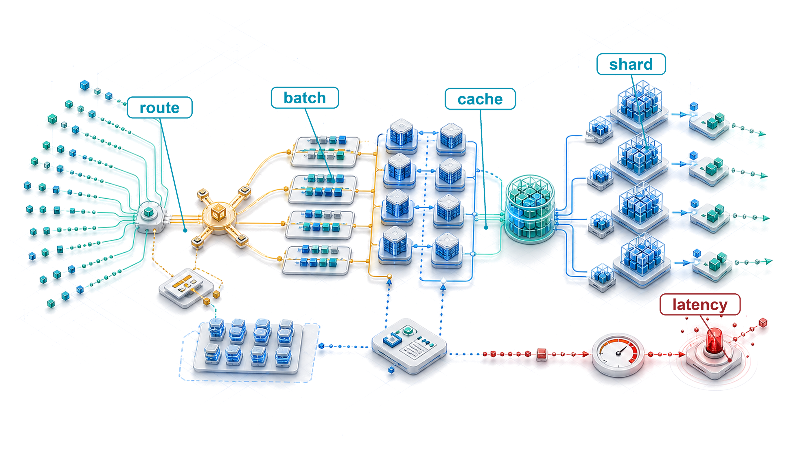{fig-alt="Global inference blueprint where requests route through regional gateways, batching systems, cache pages, model shards, and fleet serving workers."}
:::

::: {.content-visible unless-format="pdf"}
{fig-alt="Global inference blueprint where requests route through regional gateways, batching systems, cache pages, model shards, and fleet serving workers."}
:::

:::

## Purpose {.unnumbered .unlisted}

\begin{marginfigure}
\mlfleetstack{15}{20}{35}{20}{100}{45}{5}{0}
\end{marginfigure}

_Why can lifetime inference cost dwarf training cost?_

Training is paid for each model version; serving continues throughout that version's operational lifetime. A model trained for millions of dollars may serve billions of requests, each consuming compute, memory, network, and energy. At high traffic, recurring inference expense can exceed the original training cost by orders of magnitude. Milliseconds of latency and small differences in accelerator utilization then compound across the service's lifetime. A fast prediction measured on an otherwise idle machine does not reveal how the same model behaves when requests arrive together, vary in length, and compete for memory. Work can spend longer waiting than executing, while an apparently busy fleet produces responses that arrive too late to be useful. Keeping extra machines ready protects response time but incurs cost during quiet periods; admitting more work improves utilization only while the service can still meet its promises. Failures sharpen this tension because displaced requests consume the spare capacity intended to absorb demand changes. Continuing to accept work during overload can worsen the shortage when delayed requests trigger retries that compete for capacity. The engineering decision is therefore how much useful work the fleet can sustain at an acceptable cost while preserving response quality and timeliness. The answer depends on the request mix and service requirements, so a gain for one workload may become a loss for another. In C³ terms, compute reuse must pay for communication and coordination without exhausting the user's latency budget.

::: {.content-visible when-format="pdf"}

\newpage

:::

::: {.callout-learning-objectives}

- Estimate lifetime serving cost from traffic volume, deployment duration, and measured per-request cost
- Select batching, scheduling, and per-request compute-budget policies for vision, LLM, recommender, and streaming workloads
- Analyze attention-cache capacity, fragmentation, and decode-time policies under workload-dependent serving constraints
- Compare sharding, disaggregation, and quantized serving designs using communication, memory, and quality constraints
- Evaluate routing, load balancing, and isolation controls against tail latency and noisy-neighbor risks
- Design autoscaling and multi-region routing policies that balance cold starts, cost, and SLO compliance
- Synthesize serving architectures that manage C³ trade-offs across request, replica, service, and platform layers

:::

```{python}
#| echo: false
from mlsysim import *
from mlsysim.core.units import *

# ┌─────────────────────────────────────────────────────────────────────────────
# │ CHAPTER START
# ├─────────────────────────────────────────────────────────────────────────────
# │ Context: Chapter initialization and global imports
# │
# │ Why: Registers this chapter with the mlsys registry and provides shared
# │      imports for all subsequent calculation cells.
# │
# └─────────────────────────────────────────────────────────────────────────────
from mlsysim.physics.quantities import token_throughput
from mlsysim.fmt import check, fmt
```

```{python}
#| echo: false
#| label: inference-setup
# ┌─────────────────────────────────────────────────────────────────────────────
# │ INFERENCE CHAPTER SETUP (LEGO)
# ├─────────────────────────────────────────────────────────────────────────────
# │ Context: @sec-inference-scale—initial hardware reference values
# │
# │ Goal: Establish H100 and A100 memory/bandwidth for the 'Memory Exhaustion'
# │       section and initial footnotes, plus the recurring 70B FP16/INT4
# │       weight footprints quoted throughout the chapter.
# │ Show: "80" GB, "3.35" TB/s, 140 GB (70B FP16), 35 GB (70B INT4),
# │       26 GB (13B FP16), 500 ms LLM TTFT target.
# │ How: Hardware.Cloud.{H100,A100}; Models.Language.{Llama2_70B,Llama2_13B}
# │      size_in_bytes; Scenarios.ChatbotServing.sla_latency.
# │
# └─────────────────────────────────────────────────────────────────────────────
from mlsysim.fmt import check, fmt_bandwidth, fmt_memory, fmt_memory_capacity, fmt_qty_int, fmt_time

class InferenceSetup:
    """Namespace for localized inference hardware reference values."""

    # ┌── 1. LOAD (Constants) ──────────────────────────────────────────────
    mem_h_h100 = Hardware.Cloud.H100.memory.capacity
    bw_h_h100 = Hardware.Cloud.H100.memory.bandwidth
    bw_a100 = Hardware.Cloud.A100.memory.bandwidth
    nvlink = Hardware.Cloud.H100.nvlink.bandwidth
    nvlink_per_dir = Hardware.Cloud.H100.nvlink.bandwidth_per_direction
    gpt4 = Models.Language.GPT4
    mem_a100 = Hardware.Cloud.A100.memory.capacity
    llama70b = Models.Language.Llama2_70B
    llama13b = Models.Language.Llama2_13B
    llm_ttft_slo = Scenarios.ChatbotServing.sla_latency

    # ┌── 2. EXECUTE (The Compute) ────────────────────────────────────────
    h100_mem = mem_h_h100
    h100_bw = bw_h_h100
    a100_bw = bw_a100
    gpt4_weights_fp16 = gpt4.size_in_bytes(BYTES_FP16)
    llama70b_fp16 = llama70b.size_in_bytes(BYTES_FP16)
    llama70b_int4 = llama70b.size_in_bytes(BYTES_INT4)
    llama13b_fp16 = llama13b.size_in_bytes(BYTES_FP16)

    # ┌── 3. GUARD (Invariants) ──────────────────────────────────────────
    check(h100_bw > a100_bw, "H100 bandwidth should exceed A100 bandwidth")
    check(abs((nvlink / nvlink_per_dir).to("").magnitude - 2) < 1e-9, "Per-direction NVLink must be half the bidirectional total")
    check(gpt4_weights_fp16 > 40 * h100_mem, "GPT-4-class FP16 weights should dwarf a single H100's HBM")
    check(h100_mem < llama70b_fp16 < 2 * h100_mem, "70B FP16 weights must exceed one 80 GB GPU but fit on two")
    check(llama70b_int4 < mem_a100, "70B INT4 weights must fit on a single A100")
    check(llama13b_fp16 < mem_a100, "13B FP16 weights must fit on a single A100")

    # ┌── 4. OUTPUT (Formatting) ──────────────────────────────────────────────
    h100_mem_gb_str = fmt_memory_capacity(h100_mem, unit=GiB, precision=0, commas=False)
    h100_mem_bw_tb_per_s_str = fmt_bandwidth(h100_bw, unit=TB / second, precision=2, commas=False)
    a100_mem_bw_tb_per_s_str = fmt_bandwidth(a100_bw, unit=TB / second, precision=2, commas=False)
    nvlink_h100_gb_per_s_str = fmt_bandwidth(nvlink, unit=GB / second, precision=0, commas=False)
    nvlink_h100_per_dir_gb_per_s_str = fmt_bandwidth(nvlink_per_dir, unit=GB / second, precision=0, commas=False)
    gpt4_params_t_str = fmt_params(gpt4.parameters, scale="T", precision=1, commas=False)
    gpt4_weights_tb_str = fmt_memory(gpt4_weights_fp16, unit=TB, precision=1, commas=False, approx=True)
    llama70b_fp16_gb_str = fmt_memory(llama70b_fp16, unit=GB, precision=0, commas=False)
    llama70b_int4_gb_str = fmt_memory(llama70b_int4, unit=GB, precision=0, commas=False)
    llama13b_fp16_gb_str = fmt_memory(llama13b_fp16, unit=GB, precision=0, commas=False)
    llm_ttft_slo_ms_str = fmt_time(llm_ttft_slo, ms, precision=0, commas=False)
```

## The Economics and Architecture of Inference {#sec-inference-scale-scaling-inference-beyond-single-machines-54e6}

Imagine a language model that costs \$5 million to train over two months. Once deployed to a global user base serving thousands of queries per second, that same model can consume \$5 million in inference compute every week. Inference is no longer a temporary batch job. It is a continuous, latency-sensitive service.

Performance engineering ends with a measured execution envelope, the cost and deliverable capacity of one replica once operator fusion, precision engineering, and graph compilation have done their work. Serving policy determines how that execution capacity is shared under externally arriving work. A faster forward pass supplies a better service rate, but it does not determine how long requests wait to join a batch, which replica receives them, which requests receive scarce cache space, or when the fleet needs another replica. These decisions connect the local execution toolkit to user-visible performance under load.

::: {.column-margin .margin-pointer}
↩ The replica's measured execution envelope, and the fusion, precision, compilation, and speculation levers that shape it, are established in @sec-performance-engineering.
:::

The service contract makes that distinction measurable. Offered load is the work arriving at the endpoint, including requests the service may reject; admitted load is the work it accepts. A service-level objective (SLO) specifies the required outcome over a measurement window, such as a latency percentile or successful-request fraction. For language models, request rate alone is insufficient because prompt and output lengths determine different amounts of work. Capacity comparisons must therefore hold the request mix and SLO fixed while measuring how much offered work completes successfully within the targets.

An admitted request passes through routing, preprocessing, queueing, batch formation, model execution, and response delivery. @Fig-inference-lifecycle traces this traversal across the host CPU and accelerator boundaries: the host manages admission, tokenization, and detokenization, while the GPU executes the prompt prefill pass and iterative KV-cache decode loop, mapping noncompute serving overhead against the time-to-first-token (TTFT) and time-per-output-token (TPOT, the average gap between streamed tokens) latency budgets. For an autoregressive model, prefill processes the prompt and builds cached attention keys and values; decode extends that KV cache as it generates subsequent tokens. Waiting before prefill delays the first token, while competition during decode delays the stream. The scheduler must budget both delays alongside execution time. Batching and cache management govern work within a replica, sharding changes the replica's capacity, and routing and autoscaling distribute demand across replicas.

::: {.column-margin .margin-pointer}
↩ The prefill-decode decomposition, with prefill's high arithmetic intensity and decode's weight-streaming regime, is established in @sec-performance-engineering-prefill-decode.
:::

::: {#fig-inference-lifecycle fig-env="figure" fig-pos="htb" fig-cap="**End-to-end inference pipeline**: One language-model request crosses between CPU and GPU twice. The load balancer routes and admits it and the CPU tokenizes it; prefill then processes the whole prompt in one pass and writes its keys and values to the KV cache, and decode reads and appends that cache one token per step before the CPU detokenizes the stream. The strip orders one request's latency, with illustrative segment widths. Everything up to the end of prefill counts against time to first token, and the routing and CPU segments are serving-tax work that spends latency budget outside GPU compute." fig-alt="Two regions labeled CPU and GPU. In the CPU region, requests flow down through a load balancer and a tokenizer. Token IDs pass right to a prefill box in the GPU region, which writes to a KV cache box. A decode box reads from and appends to the KV cache, loops on itself, and sends generated token IDs left to a detokenize box that feeds a response stream. Below, a horizontal strip divides one request's latency into route, pre, prefill, decode steps, and post segments, the decode segment ticked into per-token steps, with brackets marking time to first token and TPOT times output tokens."}
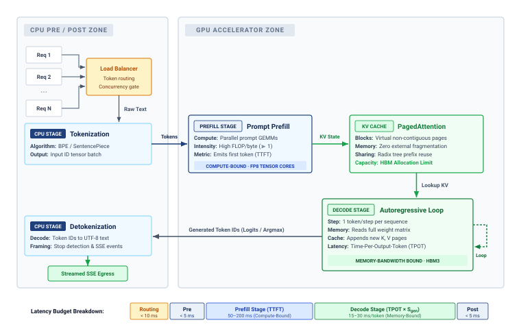

<!--
```{.tikz}
\providecolor{DarkNavy}{HTML}{1E293B}
\providecolor{OceanBlue}{HTML}{2563EB}
\providecolor{ForestGreen}{HTML}{166534}
\providecolor{AmberStage}{HTML}{D97706}
\providecolor{CrimsonSLA}{HTML}{991B1B}
\providecolor{SlateGrey}{HTML}{475569}
\providecolor{SoftGrey}{HTML}{F8FAFC}
\providecolor{SlateTeal}{HTML}{0F766E}
\providecolor{BorderGrey}{HTML}{CBD5E1}
\providecolor{BorderBlue}{HTML}{2563EB}
\providecolor{BorderGreen}{HTML}{166534}
\providecolor{BorderAmber}{HTML}{D97706}
\providecolor{BorderCrimson}{HTML}{991B1B}
\providecolor{Crimson}{HTML}{991B1B}
\providecolor{SoftBlue}{HTML}{F0F6FE}
\providecolor{SoftGreen}{HTML}{ECFAF0}
\providecolor{SoftAmber}{HTML}{FEF8EE}
\providecolor{SoftCrimson}{HTML}{FFF1F2}
\providecolor{BgCard}{HTML}{FFFFFF}
\providecolor{CardBg}{HTML}{FFFFFF}
\providecolor{GrayL}{HTML}{E0E0E0}
\providecolor{GrayLine}{HTML}{666666}
\providecolor{BlueLine}{HTML}{006395}
\providecolor{BlueFill}{HTML}{D6EAF8}
\providecolor{GreenLine}{HTML}{008F45}
\providecolor{GreenFill}{HTML}{D5F5E3}
\providecolor{OrangeLine}{HTML}{E67817}
\providecolor{OrangeFill}{HTML}{FDEBD0}
\providecolor{RedLine}{HTML}{D9534F}
\providecolor{RedFill}{HTML}{F2D7D5}
\providecolor{TextBlack}{HTML}{333333}
\providecolor{VioletLine}{HTML}{7E317B}
\providecolor{VioletFill}{RGB}{243,243,255}
\colorlet{mlsysblue}{OceanBlue}
\colorlet{mlsysgreen}{ForestGreen}
\colorlet{mlsysred}{CrimsonSLA}
\colorlet{mlsysamber}{AmberStage}
\colorlet{mlsysdarkgray}{DarkNavy}
\colorlet{mlsysteal}{SlateTeal}
\scalebox{0.57}{%
\begin{tikzpicture}[
    font=\sffamily,
    >=Stealth,
    zonecard/.style={
        draw=BorderGrey,
        fill=SoftGrey!35,
        rounded corners=4pt,
        line width=0.8pt
    },
    zoneheader/.style={
        fill=SoftBlue!60,
        draw=BorderGrey,
        rounded corners=2pt,
        font=\scriptsize\bfseries\color{SlateGrey},
        inner xsep=7pt,
        inner ysep=3pt
    },
    card/.style={
        fill=white,
        rounded corners=3pt,
        line width=0.7pt,
        inner sep=7pt,
        align=left
    },
    badge/.style={
        rounded corners=2pt,
        font=\tiny\bfseries,
        text=white,
        inner xsep=4pt,
        inner ysep=2pt
    }
]

    % --- ZONE BACKGROUNDS ---
    % CPU Zone (width 6.4cm, x from 0 to 6.4)
    \node[zonecard, minimum width=6.4cm, minimum height=9.8cm, anchor=north west] (cpuzone) at (0, 0) {};
    \node[zoneheader, anchor=north west] at ([xshift=8pt, yshift=-8pt]cpuzone.north west) {CPU PRE / POST ZONE};

    % GPU Zone (width 13.8cm, x from 7.6 to 21.4)
    \node[zonecard, minimum width=13.8cm, minimum height=9.8cm, anchor=north west] (gpuzone) at (7.6, 0) {};
    \node[zoneheader, anchor=north west] at ([xshift=8pt, yshift=-8pt]gpuzone.north west) {GPU ACCELERATOR ZONE};

    % --- CPU ZONE ELEMENTS ---
    % Reqs
    \node[card, draw=BorderGrey, text width=1.1cm, align=center, inner sep=4pt] (r1) at (0.9, -1.6) {\scriptsize Req 1};
    \node[card, draw=BorderGrey, text width=1.1cm, align=center, inner sep=4pt] (r2) at (0.9, -2.3) {\scriptsize Req 2};
    \node at (0.9, -2.85) {\scriptsize $\dots$};
    \node[card, draw=BorderGrey, text width=1.1cm, align=center, inner sep=4pt] (rn) at (0.9, -3.4) {\scriptsize Req N};

    % Load Balancer
    \node[card, draw=BorderAmber, fill=SoftAmber!60, text width=2.6cm, align=center] (lb) at (3.8, -2.5) {
        \textbf{\textcolor{AmberStage}{Load Balancer}}\\[3pt]
        \scriptsize Token routing\\Concurrency gate
    };

    % Clean orthogonal distribution bus
    \coordinate (bus_lb) at (2.05, -2.5);
    \draw[line width=0.85pt, color=DarkNavy] (r1.east) -- ++(0.35, 0) |- (bus_lb);
    \draw[line width=0.85pt, color=DarkNavy] (r2.east) -- (bus_lb);
    \draw[line width=0.85pt, color=DarkNavy] (rn.east) -- ++(0.35, 0) |- (bus_lb);
    \draw[->, line width=0.85pt, color=DarkNavy, shorten >=2pt] (bus_lb) -- (lb.west);

    % Tokenization
    \node[card, draw=BorderBlue, text width=4.8cm] (tok) at (3.8, -4.5) {
        \tikz[baseline=-0.5ex]{\node[badge, fill=DarkNavy] {CPU STAGE};}\hspace{5pt}\textbf{\textcolor{DarkNavy}{Tokenization}}\\[4pt]
        \scriptsize
        \textbf{Algorithm:} BPE / SentencePiece\\[1pt]
        \textbf{Output:} Input ID tensor batch
    };

    \draw[->, line width=1.0pt, color=DarkNavy, shorten >=2pt, shorten <=2pt] (lb.south) -- node[right=4pt, font=\scriptsize\bfseries, text=DarkNavy!80] {Raw Text} (tok.north);

    % Detokenization
    \node[card, draw=BorderBlue, text width=4.8cm] (detok) at (3.8, -7.8) {
        \tikz[baseline=-0.5ex]{\node[badge, fill=DarkNavy] {CPU STAGE};}\hspace{5pt}\textbf{\textcolor{DarkNavy}{Detokenization}}\\[4pt]
        \scriptsize
        \textbf{Decode:} Token IDs to UTF-8 text\\[1pt]
        \textbf{Framing:} Stop detection \& SSE events
    };

    % Streamed SSE Egress
    \node[draw=BorderGreen, fill=SoftGreen, rounded corners=2.5pt, line width=0.75pt, inner sep=5pt, text width=3.4cm, align=center] (egress) at (3.8, -9.1) {
        \scriptsize\bfseries\textcolor{ForestGreen}{Streamed SSE Egress}
    };
    \draw[->, line width=1.0pt, color=ForestGreen, shorten >=2pt, shorten <=2pt] (detok.south) -- (egress.north);

    % --- GPU ZONE ELEMENTS ---
    % Prompt Prefill
    \node[card, draw=BorderBlue, text width=4.8cm] (prefill) at (10.6, -4.5) {
        \tikz[baseline=-0.5ex]{\node[badge, fill=BorderBlue] {PREFILL STAGE};}\hspace{5pt}\textbf{\textcolor{DarkNavy}{Prompt Prefill}}\\[4pt]
        \scriptsize
        \textbf{Compute:} Parallel prompt GEMMs\\[1pt]
        \textbf{Intensity:} High FLOP/byte ($>> 1$)\\[1pt]
        \textbf{Metric:} Emits first token (TTFT)\\[5pt]
        \centering
        \colorbox{SoftBlue}{\parbox{4.0cm}{\centering\tiny\bfseries\textcolor{BorderBlue}{COMPUTE-BOUND $\cdot$ FP8 TENSOR CORES}}}
    };

    % Arrow across container gap: Tokens
    \draw[->, line width=1.1pt, color=BorderBlue, shorten >=2pt, shorten <=2pt] (tok.east) -- node[above=2pt, font=\scriptsize\bfseries, text=DarkNavy] {Tokens} (prefill.west);

    % PagedAttention (KV Cache)
    \node[card, draw=BorderGreen, text width=5.0cm] (paged) at (17.4, -4.5) {
        \tikz[baseline=-0.5ex]{\node[badge, fill=ForestGreen] {KV CACHE};}\hspace{5pt}\textbf{\textcolor{DarkNavy}{PagedAttention}}\\[4pt]
        \scriptsize
        \textbf{Blocks:} Virtual non-contiguous pages\\[1pt]
        \textbf{Memory:} Zero external fragmentation\\[1pt]
        \textbf{Sharing:} Radix tree prefix reuse\\[1pt]
        \textbf{\textcolor{ForestGreen}{Capacity:}} \textcolor{ForestGreen}{\textbf{HBM Allocation Limit}}
    };

    \draw[->, line width=1.1pt, color=ForestGreen, shorten >=2pt, shorten <=2pt] (prefill.east) -- node[above=2pt, font=\scriptsize\bfseries, text=ForestGreen] {KV State} (paged.west);

    % Autoregressive Loop (Decode Stage)
    \node[card, draw=BorderCrimson, text width=5.5cm] (decode) at (17.4, -7.8) {
        \tikz[baseline=-0.5ex]{\node[badge, fill=CrimsonSLA] {DECODE STAGE};}\hspace{5pt}\textbf{\textcolor{DarkNavy}{Autoregressive Loop}}\\[4pt]
        \scriptsize
        \textbf{Step:} 1 token/step per sequence\\[1pt]
        \textbf{Memory:} Reads full weight matrix\\[1pt]
        \textbf{Cache:} Appends new K, V pages\\[1pt]
        \textbf{Latency:} Time-Per-Output-Token (TPOT)\\[5pt]
        \centering
        \colorbox{SoftCrimson}{\tiny\bfseries\textcolor{CrimsonSLA}{MEMORY-BANDWIDTH BOUND $\cdot$ HBM3}}
    };

    \draw[->, line width=1.1pt, color=ForestGreen, shorten >=2pt, shorten <=2pt] (paged.south) -- node[right=3pt, font=\scriptsize\bfseries, text=DarkNavy] {Lookup KV} (decode.north);

    % Clean orthogonal feedback loop on Decode Stage completely within gpuzone
    \draw[->, dashed, line width=1.0pt, color=CrimsonSLA, shorten >=2pt] ([yshift=10pt]decode.east) -- ++(0.45, 0) -- node[right=2pt, font=\scriptsize\bfseries, text=CrimsonSLA] {Loop} ++(0, -0.85) -| ([yshift=-12pt]decode.east);

    % Output arrow from Decode to Detokenization
    \draw[->, line width=1.1pt, color=DarkNavy, shorten >=2pt, shorten <=2pt] (decode.west) -- node[above=2pt, font=\scriptsize\bfseries, text=DarkNavy] {Generated Token IDs (Logits / Argmax)} (detok.east);

    % --- BOTTOM LATENCY BUDGET BREAKDOWN ---
    \node[anchor=west, font=\footnotesize\bfseries, text=DarkNavy] (breakdown_lbl) at (0.2, -10.5) {Latency Budget Breakdown:};

    \begin{scope}[shift={(6.2, -10.5)}]
        % Routing
        \node[draw=BorderAmber, fill=SoftAmber, rounded corners=2.5pt, line width=0.6pt, text width=1.4cm, align=center, inner sep=3.5pt] (b_route) at (0, 0) {
            \scriptsize\bfseries\textcolor{AmberStage}{Routing}\\[1pt]
            \tiny\textcolor{DarkNavy}{$<$ 10 ms}
        };
        % Pre
        \node[draw=BorderGrey, fill=SoftGrey, rounded corners=2.5pt, line width=0.6pt, text width=1.2cm, align=center, inner sep=3.5pt, right=3pt of b_route] (b_pre) {
            \scriptsize\bfseries\textcolor{DarkNavy}{Pre}\\[1pt]
            \tiny\textcolor{DarkNavy}{$<$ 5 ms}
        };
        % Prefill Stage
        \node[draw=BorderBlue, fill=SoftBlue, rounded corners=2.5pt, line width=0.6pt, text width=4.0cm, align=center, inner sep=3.5pt, right=3pt of b_pre] (b_prefill) {
            \scriptsize\bfseries\textcolor{OceanBlue}{Prefill Stage (TTFT)}\\[1pt]
            \tiny\textcolor{DarkNavy}{50--200 ms (Compute-Bound)}
        };
        % Decode Stage
        \node[draw=BorderCrimson, fill=SoftCrimson, rounded corners=2.5pt, line width=0.6pt, text width=5.0cm, align=center, inner sep=3.5pt, right=3pt of b_prefill] (b_decode) {
            \scriptsize\bfseries\textcolor{CrimsonSLA}{Decode Stage (TPOT $\times$ $S_{\text{gen}}$)}\\[1pt]
            \tiny\textcolor{DarkNavy}{15--30 ms/token (Memory-Bound)}
        };
        % Post
        \node[draw=BorderGrey, fill=SoftGrey, rounded corners=2.5pt, line width=0.6pt, text width=1.2cm, align=center, inner sep=3.5pt, right=3pt of b_decode] (b_post) {
            \scriptsize\bfseries\textcolor{DarkNavy}{Post}\\[1pt]
            \tiny\textcolor{DarkNavy}{$<$ 5 ms}
        };
    \end{scope}

\end{tikzpicture}
}
```
-->

:::

Distribution adds placement and coordination decisions to the local serving problem. Load balancing[^fn-load-balancing-inference] must distribute requests across replicas with different amounts of unfinished work and available memory. Request routing must also account for model-specific characteristics: recommendation systems with large sharded embedding tables require different placement strategies than language models that generate responses token by token. When demand changes faster than new replicas can become ready, routing alone cannot restore capacity. Autoscaling, spare capacity, and admission limits must work together to protect the service's latency targets.

[^fn-load-balancing-inference]: **Load balancing for inference**\index{Load Balancing!inference}: Request service times can span milliseconds to tens of seconds as models, prompt lengths, and generated outputs vary. Queue-aware routing exposes that remaining work more directly than assignment counts alone.

Training and serving place costs on different timelines. A model version's training expense can be amortized over its deployment, while serving capacity must follow recurring demand. An e-commerce recommendation service, for example, must accommodate peak shopping traffic without paying for an unnecessarily large idle fleet during quiet periods. Both training efficiency and serving efficiency matter, but the serving decision must also account for when requests arrive and how long they can wait. Building such a service requires three linked decisions: when distribution becomes necessary, how the architecture meets latency targets under varying load, and how resource utilization stays high enough that serving cost does not erode the value the model creates. The worked scenarios that follow size these decisions with stated inputs: registry values for real hardware and models, and labeled scenario assumptions for traffic, prices, and latency budgets. They show how a mechanism scales, not what any named deployment measured.

### Limits of single-machine serving {#sec-inference-scale-singlemachine-serving-insufficient-3f13}

Memory, throughput, and latency limits motivate different forms of distribution. Exceeding one device's capacity may require several devices within one machine; crossing the machine boundary adds network costs. @Tbl-distribution-triggers categorizes these constraints and candidate strategies, whose necessity depends on the permitted precision, placement, and service contract.

The first signal is memory exhaustion, which occurs when model parameters, key-value caches, or embedding tables exceed single-device capacity. A single NVIDIA H100 GPU provides `{python} InferenceSetup.h100_mem_gb_str` of HBM3[^fn-hbm3-memory-bandwidth] memory; @sec-appdx-fleet-assumption-provenance records the provenance of this capacity figure and the other canonical hardware constants used throughout the analysis that follows. For an illustrative mixture-of-experts model with ~`{python} InferenceSetup.gpt4_params_t_str` parameters, FP16 weights alone require `{python} InferenceSetup.gpt4_weights_tb_str`. Keeping all those weights resident on accelerators requires multiple devices regardless of request volume; quantization and offloading change that placement constraint. Recommendation systems with trillion-parameter embedding tables face similar constraints: Meta's DLRM architecture[^fn-dlrm-recommendation-scale] stores embedding tables that require multiple terabytes of memory.

[^fn-hbm3-memory-bandwidth]: **HBM3 capacity and bandwidth**\index{HBM3!bandwidth}: The H100 combines `{python} InferenceSetup.h100_mem_gb_str` of 3D-stacked DRAM with `{python} InferenceSetup.h100_mem_bw_tb_per_s_str` of bandwidth, compared with `{python} InferenceSetup.a100_mem_bw_tb_per_s_str` for HBM2e on the A100. Capacity determines whether model and cache state fit; bandwidth bounds memory-bound decode throughput.

[^fn-dlrm-recommendation-scale]: **DLRM (Deep Learning Recommendation Model)**\index{DLRM!scale}: Meta's 2019 reference architecture combines dense features processed by multilayer perceptrons (MLPs) with sparse features represented by embedding lookups [@naumov2019deep]. This separation permits different placement strategies; it does not require embeddings on CPUs and MLPs on GPUs. Production recommendation characterizations show why this structure matters for serving: embedding-heavy recommendation models create memory-access and capacity constraints that differ from dense convolutional neural network (CNN), recurrent neural network (RNN), or large language model (LLM) inference [@gupta2020architectural].

Beyond memory constraints, throughput limitations emerge when request volume exceeds single-machine capacity even with optimal batching. Consider a recommendation system serving 100,000 queries per second with a 10 ms latency budget. If single-machine throughput peaks at 10,000 QPS, no amount of optimization on that machine can satisfy demand. Horizontal scaling\index{Horizontal scaling!inference replicas} across multiple replicas becomes mandatory.

Finally, latency requirements can motivate distribution even when memory is sufficient. A 70-billion parameter model requires approximately `{python} InferenceSetup.llama70b_fp16_gb_str` of weight memory in FP16, exceeding a single `{python} InferenceSetup.h100_mem_gb_str` H100-class GPU before KV cache is considered. Quantization or larger-memory hardware can make a single-device configuration feasible, yet its execution time may still exceed the request budget. Sharding the model\index{Model sharding!latency reduction} across multiple GPUs can divide computation and weight traffic, but it adds communication and synchronization. Because sharding shortens compute-bound prefill and bandwidth-bound decode by different amounts, the latency benefit must be measured for each phase against its own target.

| **Constraint** |             **Single-Machine Limit**             |                          **Example Workload**                         |  **Distribution Strategy**  |
|:---------------|:------------------------------------------------:|:---------------------------------------------------------------------:|:---------------------------:|
| **Memory**     | `{python} InferenceSetup.h100_mem_gb_str` (H100) | Illustrative MoE (`{python} InferenceSetup.gpt4_weights_tb_str` FP16) | Tensor/pipeline parallelism |
| **Throughput** |                ~10K QPS (vision)                 |                            100K QPS RecSys                            |    Horizontal replication   |
| **Latency**    |           Forward pass $> \text{SLO}$            |         `{python} InferenceSetup.llm_ttft_slo_ms_str` LLM TTFT        |        Model sharding       |

: **Triggers for distributed inference**: Each constraint type indicates different distribution strategies. Memory constraints require model sharding; throughput constraints require replication; latency constraints may require either depending on whether the bottleneck is compute or memory bandwidth. {#tbl-distribution-triggers}

Memory, throughput, and latency triggers all become user-visible once an interactive endpoint starts streaming. Time to first token (TTFT)\index{Time to First Token}\index{TTFT!time to first token SLO} determines when the user sees a response begin, while time per output token (TPOT)\index{Time Per Output Token}\index{TPOT!time per output token SLO} determines whether the rest of the response arrives at a readable pace. TPOT is the average of the time between tokens (TBT)\index{Time Between Tokens!definition}\index{TBT!time between tokens}, the gap between successive streamed tokens, which is the per-gap quantity @sec-performance-engineering called inter-token latency (ITL). A stream can meet its TPOT target while a single long TBT gap still stalls the reader, so this chapter states average cadence as TPOT and per-gap tail targets as TBT. Protecting both first-token delay and stream cadence is why inference reverses many of the optimization priorities from training.

::: {#chk-inference-distribution-strategy-selection .callout-checkpoint title="Distribution strategy selection"}

Verify your understanding of when to move from single-machine to distributed inference:

- [ ] **Shard vs. replicate**: for a 13B model (`{python} InferenceSetup.llama13b_fp16_gb_str` weights) that fits on a single A100, select model sharding or horizontal replication when throughput requirements double.
- [ ] **Latency floor**: for a real-time speech-to-text service where TBT is the primary bottleneck, determine whether data-parallel replication reduces this latency.
- [ ] **Mandatory sharding**: explain why a 175B model requires multiple `{python} InferenceSetup.h100_mem_gb_str` GPUs when all FP16 weights must remain accelerator-resident, regardless of request volume.
- [ ] **Latency trigger**: identify when a latency target forces distribution and when added network, serialization, coordination, or queuing overhead can erase the benefit.

:::

### Training versus inference fundamental inversion {#sec-inference-scale-fundamental-inversion-training-vs-inference-8834}

The contrast between training and inference\index{Training!vs. inference requirements} centers on the unit of useful progress. Training evaluates throughput together with convergence over a run; interactive serving evaluates completed requests against quality and latency targets. Offline inference can also prioritize throughput, while training still loses progress to stragglers and stalls. The distinction is therefore which delays violate the workload's contract, not whether one activity cares about time and the other does not. @Tbl-training-inference-inversion summarizes the priorities of long-running training and interactive serving across six system aspects.

| **Aspect**              |    **Distributed Training**   |      **Distributed Inference**       |
|:------------------------|:-----------------------------:|:------------------------------------:|
| **Primary metric**      |   Throughput (samples/hour)   |           Latency (p99 ms)           |
| **Acceptable variance** |             Hours             |             Milliseconds             |
| **State management**    |     Checkpoints (periodic)    |      Session state (continuous)      |
| **Batch formation**     |       Large, controlled       |       Request-driven, variable       |
| **Failure tolerance**   |    Restart from checkpoint    | Redirect if capacity and state allow |
| **Cost structure**      | Fixed duration, variable rate |     Variable duration, fixed SLO     |

: **Training vs. inference system requirements**: The fundamental inversion from throughput to latency optimization ripples through system design, state management, batch formation, and failure recovery. {#tbl-training-inference-inversion}

A training iteration that takes 2 seconds instead of the usual 1 second delays progress; repeated slow iterations can materially extend the run. An interactive request that takes 2 seconds against a 100-millisecond target misses its contract immediately, even if later requests finish quickly. Aggregate training progress and per-request serving deadlines expose different consequences of the same delay. The serving architecture must therefore control individual waiting times as well as total completed work.

State management differs fundamentally. Training maintains model state (parameters, optimizer states) that evolves gradually and can be captured in periodic checkpoints. Inference may maintain session state\index{State management!session state in inference} across requests, but authoritative conversation history and user context differ from derived key-value caches. The history must survive according to the service contract; a lost KV cache can be rebuilt from that history at the cost of repeated prefill. Retaining the cache across turns is a performance choice, developed in the architecture dimensions that follow.

Failure handling follows those different contracts. Training can restore a checkpoint and repeat lost work, with recovery time charged against the run's completion target. Interactive serving has less time to recover an individual request. Redirecting work to a healthy replica requires spare capacity and recoverable request state; substituting a smaller model requires an acceptable quality fallback. SLOs\index{SLO!inference latency bounds}\index{SLA!service-level objective} define which failures and delays the service may tolerate. Recovery mechanisms reduce user-visible disruption only when their added work fits within that contract.

### The serving tax of distributed execution {#sec-inference-scale-serving-tax-overhead-distribution-5ef3}

Distributing inference adds transfers and coordination to a request that already spends time in host processing and queues. This "serving tax" is the exposed work outside model execution that consumes the request's latency budget. Its size depends on which components the request crosses and which costs can overlap.

Network communication contributes setup and transfer time at each cross-machine dependency. Synchronization between GPUs\index{Synchronization!multi-node latency overhead} can expose that cost when the next operation needs a remote result. For an illustrative path with four sequential exchanges taking 50–500 microseconds each, the exposed contribution is 200 microseconds to 2 milliseconds. Actual collective time also depends on payload, topology, contention, and the number of communication rounds; a generic network round-trip time cannot be charged once per collective without checking its implementation.

::: {.column-margin .margin-pointer}
↩ The $\MessageStartupLatency$-$\LinkBandwidth$ model, which splits each transfer into a fixed startup latency plus a bandwidth-dependent term, is established in @sec-network-fabrics-performance-model.
:::

Serialization can add host work when a service converts structured data into a wire representation and reconstructs it at the receiver. Protocol Buffers, JSON, and Python's `pickle` provide different representations and implementation paths, so their cost must be measured for the actual payload and runtime. Tensor transfers within a sharded model need not pass through the same object-serialization path as a service request. Formats such as FlatBuffers and Cap'n Proto[^fn-serialization-zerocopy-buffer] permit access to wire-format data in place, avoiding a separate unpacking step when the consumer supports that representation. They do not eliminate network transfer or every downstream copy.

[^fn-serialization-zerocopy-buffer]: **Zero-copy serialization**\index{Zero-Copy!serialization}\index{Serialization!zero-copy}: Formats such as FlatBuffers and Cap'n Proto can access wire-format data in place, avoiding a separate parse-allocate-copy cycle. The benefit depends on payload size, language runtime, and whether downstream operators can consume the same buffer representation.

Load balancing adds a routing decision and sometimes another forwarding hop. Examining request metadata, consulting replica state, and forwarding to the selected backend consume time before execution begins. The measurement must separate decision time from waiting and transport so that a slow routing path is not mistaken for a slow model.

Coordination overhead emerges when a request fans out to several services and joins their results. Independent feature or model calls can run concurrently, but a dependent ranking stage must wait for the inputs it needs. The critical path therefore includes exposed coordination and the slowest required branch rather than the sum of every branch's runtime. Queuing delay ($\QueueingLatency$) adds another cost whenever work arrives while the required resources are busy, even when average arrival rate remains below average service capacity.

The serving tax\index{Serving tax!latency breakdown} must be measured on the same request boundary as model execution. @Eq-serving-tax decomposes that latency, with each term counting an exposed contribution so concurrent work is not counted twice:

$$\EndToEndRequestLatency= \InferenceLatency+ \NetworkLatency+ \SerializationLatency+ \CoordinationLatency+ \QueueingLatency$$ {#eq-serving-tax}

An illustrative budget shows why the decomposition matters. If an interactive request has a 100 ms target and model execution takes 70 ms on an idle replica, routing, transfers, serialization, coordination, and queueing must all fit in the remaining 30 ms; the four sequential exchanges above can already claim up to 2 ms of it before any request waits for a busy replica. The measured contribution determines the intervention. Co-location can remove a network hop, fewer dependent exchanges can reduce startup costs, and a faster link can shorten large transfers. Queueing instead requires controlling admitted work or increasing usable capacity. Each choice spends resources to recover latency budget, connecting the request-level diagnosis to lifetime serving cost.

### Serving cost dominance in production {#sec-inference-scale-serving-cost-dominates-training-cost-576a}

::: {.column-margin}
{width="100%" fig-alt="Two horizontal bars comparing lifetime cost terms. The recurring serving-cost bar is wide and shaded orange; the per-version training-cost bar is a narrow gray sliver."}

*Lifetime serving cost dwarfs one-time training.*
:::

The serving tax quantified in @eq-serving-tax consumes a fraction of the latency budget per request. The true economic impact of inference emerges when evaluating cost over a model's entire operational lifetime. The serving cost dominance principle\index{Serving Cost Dominance} (\ref{pri-serving-cost-dominance}) states that serving cost\index{Serving cost!upfront vs. recurring expense} can dominate training cost by orders of magnitude because a model version incurs training expense before deployment while serving expense recurs with traffic. Both activities can consume purchased or rented infrastructure; the distinction here is expense timing, not financial capitalization. A quick cost calculation makes the multiplier concrete.

```{python}
#| echo: false
#| label: serving-cost-multiplier-simple
# ┌─────────────────────────────────────────────────────────────────────────────
# │ SERVING-COST MULTIPLIER (Upfront vs Recurring)
# ├─────────────────────────────────────────────────────────────────────────────
# │ Context: @nbk-inference-serving-cost-multiplier worked-example callout —
# │          the "Problem", "Math", and "Systems insight" prose immediately below.
# │
# │ Goal:    Compare annual serving expense with training expense for one model version.
# │ Show:    Annual request volume, cost/request, annual serving cost, the
# │          serving/training ratio, and the savings from an efficiency gain.
# │ How:     Scenario assumptions (DAU, reqs/day, cost/request, efficiency gain)
# │          combine with DAYS_PER_YEAR to derive annual volume and cost.
# │
# └─────────────────────────────────────────────────────────────────────────────
from mlsysim.fmt import check, fmt, fmt_count, fmt_int, fmt_math, fmt_percent, fmt_usd

class ServingCostSimple:
    # ┌── 1. LOAD ──────────────────────────────────────────
    training_cost = 2_000_000  # scenario assumption: one-time training spend
    dau = 1_000_000  # scenario assumption: daily active users
    reqs_per_day = 50  # scenario assumption: requests per user per day
    days_per_year = DAYS_PER_YEAR
    cost_per_request = 0.001  # scenario assumption: serving cost per request
    efficiency_gain = 0.10  # scenario assumption: efficiency improvement
    dau_exp = 6  # 10^6 users, displayed in scientific form
    # ┌── 2. EXECUTE ───────────────────────────────────────
    annual_reqs = dau * reqs_per_day * days_per_year
    annual_reqs_b = annual_reqs / BILLION
    annual_serving_cost = annual_reqs * cost_per_request
    serving_training_ratio = annual_serving_cost / training_cost
    efficiency_savings = annual_serving_cost * efficiency_gain
    # ┌── 3. GUARD ─────────────────────────────────────────
    check(annual_reqs > 10e9, "Should be >10B annual requests")
    check(round(serving_training_ratio) == 9, "Serving/training ratio should round to 9x")
    check(10**dau_exp == dau, "dau_exp must match dau in scientific form")
    # ┌── 4. OUTPUT ────────────────────────────────────────
    annual_reqs_calc_math = fmt_math(
        rf"10^{{{dau_exp}}}\,\text{{users}} \times {reqs_per_day}\,\text{{reqs}} " rf"\times {days_per_year}\,\text{{days}} \approx"
    )
    annual_reqs_b_str = fmt_count(annual_reqs, scale="B", precision=2, commas=False)
    annual_serving_cost_str = fmt_usd(annual_serving_cost)
    serving_training_ratio_mult_str = fmt_multiple(serving_training_ratio, precision=1, commas=False)
    efficiency_savings_str = fmt_usd(efficiency_savings, precision=1, commas=False, scale="M")
    training_cost_str = fmt_usd(training_cost)
    dau_str = fmt_int(dau)
    reqs_per_day_str = fmt_int(reqs_per_day, commas=False)
    cost_per_request_usd_str = fmt_usd(
        cost_per_request,
        precision=3,
        commas=False,
        per="request",
    )
    efficiency_gain_pct_str = fmt_percent(round(efficiency_gain * 100) / 100, precision=0, commas=False, style='prose')
```

::: {#nbk-inference-serving-cost-multiplier .callout-notebook title="The serving cost multiplier"}

**Problem**: A team has spent `{python} ServingCostSimple.training_cost_str` training a 70B parameter model and now serves it to `{python} ServingCostSimple.dau_str` daily active users, each making `{python} ServingCostSimple.reqs_per_day_str` requests/day. Is training or serving the dominant cost over 1 year?

**Math**:

1.  **Training Cost**\index{Training Cost}: `{python} ServingCostSimple.training_cost_str` (One-time).
2.  **Metric**: Annual inference volume is `{python} ServingCostSimple.annual_reqs_calc_math` `{python} ServingCostSimple.annual_reqs_b_str` requests/year.
3.  **Cost per Request**\index{Serving Cost!cost per request}: Assume a 70B model on H100 costs $\approx$ `{python} ServingCostSimple.cost_per_request_usd_str` (input + output).
4.  **Annual Serving Cost**\index{Serving Cost!annual serving cost}: `{python} ServingCostSimple.annual_reqs_b_str` requests $\times$ `{python} ServingCostSimple.cost_per_request_usd_str` = `{python} ServingCostSimple.annual_serving_cost_str`.

**Systems insight**: Serving costs `{python} ServingCostSimple.serving_training_ratio_mult_str` more than training in the first year alone. A `{python} ServingCostSimple.efficiency_gain_pct_str` reduction in cost per request, at unchanged request volume and service quality, saves about `{python} ServingCostSimple.efficiency_savings_str` in the first year, nearly paying for the original training run.

:::

For one model version at a fixed query rate and average cost per served query, @eq-total-cost combines training expense with recurring serving expense:

$$\ModelLifetimeCost= \TrainingCost + \ServingCostPerQuery\times \DeploymentDuration\times \ArrivalRate$$ {#eq-total-cost}

where $\TrainingCost$ is the one-time cost to train the model, $\ServingCostPerQuery$ is the cost per query served, $\DeploymentDuration$ is the deployment duration in appropriate time units, and $\ArrivalRate$ is the query rate. The rate must count the same served queries used to estimate unit cost. That cost must include the chosen serving boundary, including idle or reserved capacity when it is billed. Changing traffic mix, fleet size, or price requires evaluating separate intervals rather than treating one unit cost as constant throughout deployment.

```{python}
#| echo: false
#| label: inference-economics-refactor
# ┌─────────────────────────────────────────────────────────────────────────────
# │ INFERENCE ECONOMICS AND TCO (LEGO)
# ├─────────────────────────────────────────────────────────────────────────────
# │ Context: @sec-inference-scale-serving-cost-dominates-training-cost-576a—training vs serving costs
# │
# │ Goal: Quantify the dominance of serving cost over training cost.
# │ Show: ~500x leverage for serving optimization in high-traffic RecSys.
# │ How: Lifetime_cost = Traffic * Duration * Cost_per_query.
# │
# └─────────────────────────────────────────────────────────────────────────────
import math
from mlsysim import Infrastructure
from mlsysim.fmt import MarkdownStr, check, fmt, fmt_count, fmt_int, fmt_math, fmt_rate, fmt_usd
from mlsysim.core.units import USD, hour

# ┌── LEGO ───────────────────────────────────────────────
class InferenceEconomics:
    """Namespace for inference vs training cost analysis."""

    # ┌── 1. LOAD (Constants) ──────────────────────────────────────────────
    # Training
    n_gpu_hours = 1000
    cost_per_gpu_hour = Infrastructure.Pricing.Cloud.GpuTrainingUtilityScenarioPerHour.rate.to(USD / hour).magnitude
    engineering_multiplier = 3.0

    # Serving
    qps = 10000
    serve_duration_days = 730  # 2 years
    cost_per_query = 1e-5  # $10 per million

    # ┌── 2. EXECUTE (The Compute) ────────────────────────────────────────
    training_hardware_cost = n_gpu_hours * cost_per_gpu_hour
    training_total_cost = training_hardware_cost * (1 + engineering_multiplier)

    lifetime_queries_val = qps * SEC_PER_DAY * serve_duration_days
    serving_total_cost_val = lifetime_queries_val * cost_per_query

    leverage_ratio = serving_total_cost_val / training_total_cost

    # ┌── 3. GUARD (Invariants) ──────────────────────────────────────────
    check(leverage_ratio > 100, f"Leverage ratio ({leverage_ratio:.1f}) should be > 100x")

    # ┌── 4. OUTPUT (Formatting) ─────────────────────────────────────────────
    # LaTeX-safe form: "6.31e+11" breaks as 6\.31e\+11; use \times 10^{11}.
    # Wrap in fmt_math() so Quarto re-parses the inline {python} substitution
    # through the markdown pipeline; otherwise the literal "$...$" bypasses
    # Pandoc's math parser and renders as raw text.
    if lifetime_queries_val >= 1e9:
        exp = int(math.floor(math.log10(lifetime_queries_val)))
        mantissa = lifetime_queries_val / 10**exp
        lifetime_queries_latex_math = fmt_math(f"{mantissa:.2f} \\times 10^{{{exp}}}")
    else:
        lifetime_queries_latex_math = fmt_math(f"{lifetime_queries_val:,.0f}")
    training_hardware_cost_str = fmt_usd(training_hardware_cost, commas=False)
    serving_cost_total_str = fmt_usd(serving_total_cost_val)
    training_cost_total_str = fmt_usd(training_total_cost)
    leverage_ratio_mult_str = fmt_multiple(leverage_ratio, precision=1, commas=False)
    qps_str = fmt_rate(qps, "QPS")
    serve_duration_days_str = fmt_int(serve_duration_days, commas=False)
    cost_per_million_queries_usd_str = fmt_usd(
        cost_per_query * MILLION,
        commas=False,
        per="million queries",
    )
    n_gpu_hours_str = fmt_count(n_gpu_hours, label="GPU-hour", plural_label="GPU-hours")
    cost_per_gpu_hour_usd_str = fmt_usd(
        cost_per_gpu_hour,
        commas=False,
        per="GPU-hour",
    )
    engineering_mult_str = fmt_multiple(engineering_multiplier, commas=False, precision=0)
```

The same leverage can hold across application categories with different cost structures. In the chapter's illustrative recommendation scenario, a DLRM trained for `{python} InferenceEconomics.training_cost_total_str` (`{python} InferenceEconomics.training_hardware_cost_str` hardware for `{python} InferenceEconomics.n_gpu_hours_str` at `{python} InferenceEconomics.cost_per_gpu_hour_usd_str`, plus `{python} InferenceEconomics.engineering_mult_str` additional engineering cost for data and experimentation) and served at `{python} InferenceEconomics.qps_str` for `{python} InferenceEconomics.serve_duration_days_str` days accumulates `{python} InferenceEconomics.lifetime_queries_latex_math` lifetime queries. At the assumed `{python} InferenceEconomics.cost_per_million_queries_usd_str`, those queries cost `{python} InferenceEconomics.serving_cost_total_str` to serve, producing a `{python} InferenceEconomics.leverage_ratio_mult_str` ratio in this scenario. @Tbl-cost-ratios gives sensitivity ranges for several illustrative workload envelopes rather than market-price estimates:

| **Application**               | **Training Cost** | **Annual Serving Cost** |
|:------------------------------|:------------------|:------------------------|
| **Recommendation (high QPS)** | \$10K--\$100K     | \$1M--\$10M             |
| **Search ranking**            | \$100K--\$1M      | \$10M--\$100M           |
| **LLM API**                   | \$1M--\$100M      | \$10M--\$1B             |
| **Internal analytics**        | \$1K--\$10K       | \$10K--\$100K           |

: **Illustrative training and serving cost ranges**: Independent sensitivity ranges for training a model version and serving it for a year. A cost ratio requires a paired training-and-serving scenario; it cannot be inferred from matching endpoints of independent ranges. A deployment must substitute measured traffic and a consistent accounting boundary. {#tbl-cost-ratios}

The cost structure motivates serving optimization: a reduction in cost per completed request yields recurring savings if workload volume and service quality remain fixed. Lower latency alone does not ensure that billed capacity or other costs fall. @Fig-serving-cost-curve uses constructed cost curves to illustrate how unit cost can change with daily request volume. Against its assumed price of \$0.05 per 1,000 tokens, the optimized curve crosses near $2 \times 10^5$ requests per day, while the unbatched single-GPU curve crosses beyond $3 \times 10^7$ requests. These crossings follow from the assumed curves, not measured profitability or guaranteed effects of INT4 and continuous batching. A deployment needs its own token mix, occupied capacity, and complete cost boundary to establish a break-even point.

::: {#fig-serving-cost-curve fig-env="figure" fig-pos="htb" fig-cap="**The serving cost curve**: Illustrative cost model. Cost per 1000 tokens decreases with scale and optimization. Single-GPU serving reaches break-even only at high volume. Multi-GPU batching breaks even at moderate volume. Fully optimized serving (INT4 quantization, continuous batching) achieves profitability at much lower volumes, fundamentally changing the economics of inference." fig-alt="Log-log plot of cost per 1000 tokens vs. daily request volume for single-GPU, multi-GPU, and optimized serving, drawn as three gray lines that grow heavier with optimization, the optimized line darkest, each labeled at its right end. A dashed horizontal price line divides a shaded region above it, where cost exceeds price, from a shaded region below it, and an open circle marks where each of the three curves crosses the line."}

```{python}
#| echo: false
# ┌─────────────────────────────────────────────────────────────────────────────
# │ SERVING COST CURVE (FIGURE)
# ├─────────────────────────────────────────────────────────────────────────────
# │ Context: @fig-serving-cost-curve—inference economics
# │
# │ Goal: Plot cost per 1000 tokens vs daily volume for single-GPU, multi-GPU,
# │       optimized; show break-even vs typical pricing.
# │ Show: Log-log; three curves; break-even line; shaded regions.
# │ How: Power-law cost models; matplotlib.
# │
# └─────────────────────────────────────────────────────────────────────────────
# ┌── 1. CANVAS ────────────────────────────────────────────────────────────────
# │ Plot cost per 1000 tokens vs daily volume for single-GPU, multi-GPU,
from binder.tools.figures import style as book_style
import numpy as np

fig, ax, COLORS, plt = book_style.setup_plot(figsize=(5.6, 3.9))
FS = 10.5  # prints at >= 9 pt when the figure is scaled to 5 in

# ┌── 2. ARRAYS ────────────────────────────────────────────────────────────────
volume = np.logspace(3, 8, 200)
typical_pricing = 0.05

cost_single_gpu = 0.15 * (1e6 / volume) ** 0.3
cost_multi_gpu = 0.08 * (1e6 / volume) ** 0.45
cost_optimized = 0.02 * (1e6 / volume) ** 0.55

# ┌── 3. RENDER ────────────────────────────────────────────────────────────────
# The three deployments are ordinal (naive -> batched -> optimized), so they
# share one neutral hue at stepped stroke weight; green and red belong only to
# the profit and loss regions. Every stroke is opaque so labels stay legible.
series = (
    (cost_single_gpu, COLORS['secondary'], 1.3, 'Single-GPU\n(naive)'),
    (cost_multi_gpu, COLORS['secondary'], 2.3, 'Multi-GPU\nbatching'),
    (cost_optimized, COLORS['primary'], 2.8, 'Fully\noptimized'),
)
for cost, col, lw, _ in series:
    ax.plot(volume, cost, color=col, linewidth=lw, solid_capstyle='butt')

ax.axhline(y=typical_pricing, color=COLORS['primary'], linestyle='--', linewidth=1.1)

# ┌── 4. DECORATE ──────────────────────────────────────────────────────────────
# Regions are defined by the price line alone: above it each request loses
# money, below it each request is profitable.
y_lo, y_hi = 1e-3, 3.0
ax.axhspan(typical_pricing, y_hi, color=COLORS['RedL'], alpha=0.35, lw=0, zorder=0)
ax.axhspan(y_lo, typical_pricing, color=COLORS['GreenL'], alpha=0.45, lw=0, zorder=0)
ax.text(
    1.3e3,
    typical_pricing / 1.2,
    "Typical price\n(break-even)",
    fontsize=FS,
    linespacing=1.05,
    fontweight='bold',
    color=COLORS['primary'],
    ha='left',
    va='top',
)
ax.text(8e7, 2.3, "cost above price", fontsize=FS, color=COLORS['RedLine'], ha='right', va='top', style='italic')
ax.text(1.3e3, 1.4e-3, "cost below price", fontsize=FS, color=COLORS['GreenLine'], ha='left', va='bottom', style='italic')

# Break-even point of each curve (where it meets the price line) and a
# direct label at the curve's right end in place of a legend.
for cost, col, lw, name in series:
    idx = np.argmax(cost <= typical_pricing)
    if cost[idx] <= typical_pricing:
        ax.plot(volume[idx], typical_pricing, 'o', ms=7, mfc='white', mec=col, mew=2, zorder=5)
    ax.text(volume[-1] * 1.35, cost[-1], name, fontsize=FS, color=col, fontweight='bold', ha='left', va='center', clip_on=False, linespacing=1.0)

ax.set_xscale('log')
ax.set_yscale('log')
ax.set_xlabel('Daily request volume', fontsize=FS + 0.5)
ax.set_ylabel('Cost per 1,000 tokens ($)', fontsize=FS + 0.5)
ax.tick_params(labelsize=FS)
ax.set_xlim(1e3, 1e8)
ax.set_ylim(y_lo, y_hi)
plt.tight_layout()
fig.subplots_adjust(right=0.80)
plt.show()
plt.close()
```

:::

The cost ranges in @tbl-cost-ratios give a static comparison; @fig-serving-cost-crossover instead accumulates assumed monthly serving expense over a 36-month deployment. Its crossover occurs when the serving portion equals the initial training expense, not when total deployment cost first exceeds training cost. In the plotted recommendation scenario, that happens within days; in the 70B LLM scenario, it takes roughly six weeks. These timings follow from the specified expenses, not from model size or user count alone. A larger training expense, lower traffic, or shorter deployment can change which activity dominates. The comparison motivates evaluating serving efficiency early while keeping workload and quality fixed. For generative LLM services, serving-specific designs can improve throughput, cost, and power use [@patel2024].

::: {#fig-serving-cost-crossover fig-env="figure" fig-pos="htb" fig-cap="**The serving cost crossover**: Cumulative total deployment cost (initial training plus ongoing serving) for three scenarios. Vertical markers (scenarios A and B) indicate when the serving portion equals the one-time training cost. For high-traffic LLMs, serving cost matches training cost within weeks. For recommendation systems at 100M daily active users, serving dominates within days. Only low-traffic, expensive-to-train models see training cost dominate for extended periods." fig-alt="Line chart on a log cost axis showing cumulative total deployment cost over 36 months for three scenarios, drawn as gray lines of different weights and labeled at their right ends with each scenario's training and monthly serving cost. Dotted horizontal lines mark each scenario's training cost, open circles mark where each total reaches twice its training cost, and for scenarios A and B a short dashed vertical segment rises from the training baseline to that circle."}

```{python}
#| echo: false
# ┌─────────────────────────────────────────────────────────────────────────────
# │ SERVING COST CROSSOVER (FIGURE)
# ├─────────────────────────────────────────────────────────────────────────────
# │ Context: @fig-serving-cost-crossover—training vs serving cost dynamics
# │
# │ Goal: Plot cumulative cost over 36 months for three scenarios; show
# │       crossover where serving overtakes training.
# │ Show: Three lines; fill_between; crossover markers.
# │ How: total_cost = train + serve_per_month*months; vertical markers show
# │      where the serving portion equals the one-time training cost.
# │
# └─────────────────────────────────────────────────────────────────────────────
# ┌── 1. CANVAS ────────────────────────────────────────────────────────────────
# │ Plot cumulative cost over 36 months for three scenarios; show
import numpy as np
import matplotlib.pyplot as plt
from binder.tools.figures import style as book_style

fig, ax, COLORS, plt = book_style.setup_plot(figsize=(5.6, 4.1))
FS = 10.5  # prints at >= 9 pt when the figure is scaled to 5 in

# ┌── 2. ARRAYS ────────────────────────────────────────────────────────────────
months = np.linspace(0, 36, 500)

# Scenario A: Small model, low traffic
train_a = 0.05  # $50K = $0.05M
serve_per_month_a = 0.005  # $5K/month = $0.005M
cum_a_train = np.full_like(months, train_a)
cum_a_serve = train_a + serve_per_month_a * months
crossover_a = train_a / serve_per_month_a  # 10 months

# Scenario B: 70B LLM, 1M DAU
train_b = 2.0  # $2M
serve_per_month_b = 1.5  # $1.5M/month
cum_b_train = np.full_like(months, train_b)
cum_b_serve = train_b + serve_per_month_b * months
crossover_b = train_b / serve_per_month_b  # ~1.33 months

# Scenario C: RecSys, 100M DAU
train_c = 0.012  # $12K = $0.012M
serve_per_month_c = 0.250  # $250K/month = $0.250M
cum_c_train = np.full_like(months, train_c)
cum_c_serve = train_c + serve_per_month_c * months
crossover_c = train_c / serve_per_month_c  # ~0.048 months

# Plot cumulative total cost (training + serving) for each scenario

# ┌── 3. RENDER ────────────────────────────────────────────────────────────────
# Scenarios are categories, not resources: one neutral hue at stepped weight
# (matching the serving cost curve), with direct labels at the right end.
col_a, lw_a = COLORS["secondary"], 1.4
col_b, lw_b = COLORS["primary"], 2.6
col_c, lw_c = COLORS["secondary"], 2.4
# (curve, training cost, crossover month, color, stroke, label, label y, va)
scen = (
    (cum_a_serve, train_a, crossover_a, col_a, lw_a, "A: small model, low traffic\n\\$50K train, \\$5K/mo serve", 0.30, "bottom"),
    (cum_b_serve, train_b, crossover_b, col_b, lw_b, "B: 70B LLM, 1M DAU\n\\$2M train, \\$1.5M/mo serve", 70, "bottom"),
    (cum_c_serve, train_c, crossover_c, col_c, lw_c, "C: RecSys, 100M DAU\n\\$12K train, \\$250K/mo serve", 10.5, "bottom"),
)
for cum, train, xc, col, lw, name, ly, va in scen:
    ax.plot(months, cum, color=col, linewidth=lw)
    # Training cost baseline (flat dotted line): the gap between a baseline
    # and its curve is the cumulative serving portion.
    ax.axhline(y=train, color=col, alpha=0.8, linestyle=":", linewidth=1.0)
    # Crossover point: total cost = 2 x training cost
    ax.plot(xc, 2 * train, "o", ms=7, mfc="white", mec=col, mew=2, zorder=5, clip_on=False)
    # Direct label inside the plot, beside the curve's right end.
    ax.text(35.6, ly, name, fontsize=FS, color=col, ha="right", va=va, linespacing=1.1)

# Vertical markers for scenarios A and B: a dashed segment from the training
# baseline up to the crossover point, where the serving portion has grown to
# equal the one-time training cost.
for xc, train, col in ((crossover_a, train_a, col_a), (crossover_b, train_b, col_b)):
    ax.plot([xc, xc], [train, 2 * train], color=col, linestyle="--", linewidth=1.2)

# ┌── 4. DECORATE ──────────────────────────────────────────────────────────────
ax.annotate(
    "Crossover: month 10",
    xy=(crossover_a, 2 * train_a),
    fontsize=FS,
    color=col_a,
    fontweight="bold",
    ha="left",
    va="center",
    xytext=(12.0, 0.033),
    arrowprops=dict(arrowstyle="->", color=col_a, lw=0.9, shrinkB=5),
)

ax.annotate(
    "LLM: serving exceeds\ntraining in ~6 weeks",
    xy=(crossover_b, 2 * train_b),
    fontsize=FS,
    color=col_b,
    fontweight="bold",
    ha="left",
    va="center",
    xytext=(3.0, 110),
    arrowprops=dict(arrowstyle="->", color=col_b, lw=0.9, shrinkB=5),
)

ax.annotate(
    "RecSys: serving dominates within days",
    xy=(crossover_c, 2 * train_c),
    fontsize=FS,
    color=col_c,
    fontweight="bold",
    ha="left",
    va="center",
    xytext=(2.2, 0.0072),
    arrowprops=dict(arrowstyle="->", color=col_c, lw=0.9, shrinkB=5),
)
ax.set_yscale("log")
ax.set_xlabel("Months since deployment", fontsize=FS + 0.5)
ax.set_ylabel("Cumulative cost ($M)", fontsize=FS + 0.5)
ax.tick_params(labelsize=FS)
ax.set_xlim(-0.8, 36)
ax.set_ylim(0.005, 300)

plt.tight_layout()
plt.show()
plt.close()
```

:::

### Inference beyond LLMs {#sec-inference-scale-inference-landscape-beyond-llms-9560}

Large language models present distinctive serving challenges, but they are only one part of production inference. In large consumer platforms, recommendation and ranking workloads\index{Recommendation system!inference traffic volume} can dominate AI inference cycles and capacity [@gupta2020architectural; @hazelwood2018]. Vision and image processing\index{Vision model!serving characteristics}, NLP and LLM workloads, fraud detection, ads, and other classification tasks create additional serving demands. @Tbl-inference-landscape compares representative pressures: sparse lookup for recommendation, batch efficiency for fixed-shape vision, weight and cache traffic for LLM decode, and incremental deadlines for speech. These are starting points for diagnosis; the active bottleneck still depends on the model, input shape, and deployment.

Recommendation traffic illustrates why request volume must be derived from application behavior. A page load, scroll, or click can trigger ranking or retrieval, so one browsing session can produce many inference requests. A language-model application may likewise issue several model calls for one user action or run background tasks without an explicit query. Capacity planning therefore counts the model work triggered by each interaction rather than treating user count as request rate.

Workload structure also determines which techniques can help. Embedding sharding addresses the memory demands of large recommendation models, while their sparse access patterns make lookup locality a central design concern [@naumov2019deep; @gupta2020architectural]. Feature store architectures\index{Feature store!recommendation systems} add a related requirement: the serving path must retrieve the inputs the model expects within its latency budget. Continuous batching and KV cache management instead address variable-length autoregressive work. Text-to-image systems such as DALL-E provide one multimodal model example [@ramesh2021zero], but multimodal serving volume and latency targets remain product-specific.

| **Model Type**               |        **Serving Pressure**       |  **Latency Target** |    **Key Challenge**     |
|:-----------------------------|:---------------------------------:|:-------------------:|:------------------------:|
| **Recommendation/ranking**   | High volume in consumer platforms | $<10\text{ ms}$ p99 |     Embedding lookup     |
| **Vision (CNN)**             |         Workload-dependent        |      20--100 ms     |     Batch efficiency     |
| **LLM**                      |       High cost per request       |     100 ms--10s     |     Memory bandwidth     |
| **Speech/Audio**             |           Stream-driven           |      Real-time      |    Sequential decode     |
| **Multimodal/text-to-image** |   Emerging and product-specific   |        Varies       | Cross-modal coordination |

: **Production inference landscape**: Different model types create different serving pressure, latency requirements, and optimization challenges. The table is a qualitative workload map rather than a universal traffic-share distribution. Technique selection must match the specific workload. {#tbl-inference-landscape}

### The serving hierarchy {#sec-inference-scale-serving-hierarchy-fe8c}

The optimization techniques organize into a serving hierarchy\index{Serving!hierarchy} ordered by scope, from one request up to a shared multi-tenant platform. Each level owns a different bottleneck and measurement boundary, so an optimization that helps one level can leave another unchanged. The request level follows one request through preprocessing, batch-formation waiting, response caching, and model execution, where the target is the latency a user sees. The replica level looks inside one model instance, where GPU utilization, KV-cache memory management, kernel efficiency, and model optimization determine how much useful throughput that replica can deliver before it saturates. The service level then works across many replicas of the same model, using load balancing, request routing, and autoscaling to turn individual replicas into aggregate capacity. The platform level works across services and tenants, where resource allocation, multi-tenancy, scheduling, and placement decide whether a shared serving fleet remains efficient without allowing one workload to degrade another.

Each level supplies a different measurement boundary. @Tbl-serving-hierarchy associates request latency, replica throughput, aggregate service capacity, and cross-tenant efficiency with the controls most directly responsible for them. Their effects still cross boundaries: batching can increase replica throughput while adding request delay, and replica placement can change both communication cost and service capacity. The hierarchy helps locate the decision without treating its metric in isolation. In C³ terms, batching and cache management improve compute reuse, sharding introduces communication, and routing, isolation, and autoscaling coordinate the resources that make those gains usable.

| **Level**    | **Optimization Target** | **Key Techniques**                   |
|:-------------|:-----------------------:|:-------------------------------------|
| **Request**  |   Per-request latency   | Dynamic batching, response caching   |
| **Replica**  | Throughput, utilization | KV-cache paging, kernel fusion       |
| **Service**  |    Aggregate capacity   | Load balancing, routing, autoscaling |
| **Platform** |   Resource efficiency   | Multi-tenancy, scheduling, placement |

: **Serving hierarchy optimization targets**: Each level of the serving hierarchy targets distinct performance metrics, from per-request latency at the request tier to aggregate resource efficiency at the platform tier. {#tbl-serving-hierarchy}

::: {#chk-inference-serving-hierarchy .callout-checkpoint title="The serving hierarchy"}

Verify your understanding of where specific optimizations sit within the serving hierarchy:

- [ ] **Replica level**: identify the hierarchy level at which KV-cache paging reduces GPU memory waste, and explain why that raises concurrent request capacity rather than single-request latency.
- [ ] **Caching level**: distinguish response caching, which shortens one request's path, from KV-cache paging, which raises a replica's capacity, and place each in the hierarchy.
- [ ] **Load balancing**: explain why service-level load balancing targets aggregate capacity across replicas rather than the latency of any single request.
- [ ] **Isolation level**: evaluate the claim that multi-tenancy and resource isolation are primarily request-level concerns.

:::

The chapter climbs the hierarchy in that order, while allowing a few techniques to cross levels. A survey of the architectural dimensions along which serving systems differ comes first. Batching then sets how long each request waits to share execution, the request-level decision that also feeds replica throughput. KV-cache layout, decode-time optimizations, and the disaggregation of prefill and decode into separate pools decide how many requests a replica can hold, and adapter state, weight quantization, and model sharding change the replica's memory and compute budget. Load balancing turns replicas into a service, multi-tenancy and isolation govern the shared platform, autoscaling changes how much capacity the platform holds, and global placement extends the same decisions across regions. Precision is an input to every capacity calculation that follows: reducing weight precision frees resident memory, whereas reducing KV precision lowers the memory required per active sequence. These are separate budgets. @Sec-inference-scale-weight-quantization-serving-097b compares the serving trade-offs of these representation choices before sharding divides a replica across devices.

::: {.column-margin .margin-pointer}
↩ Reduced-precision representations for weights, activations, and the KV cache, and the quantization methods that produce them, are established in @sec-performance-engineering-precision.
:::

## Serving Architecture Dimensions {#sec-inference-scale-serving-framework-selection-45d3}

A recommendation system that processes 100,000 embedding lookups per second across a sharded feature store requires a different serving architecture from a 70-billion-parameter language model generating tokens one at a time. Framework choice alone does not explain the difference. The workloads impose distinct constraints on batching, memory management, scheduling, and deployment topology. This section lays those dimensions out as a map, naming each decision and its alternatives briefly and using specific frameworks as examples rather than as the subject of study. The sections that follow develop the mechanisms behind each entry (continuous batching, paged KV memory, chunked prefill, disaggregation, session caches) together with their costs, and return to this map when they choose among them.

### Throughput-latency trade-offs in batching {#sec-inference-scale-framework-categories-172a}

Batch formation sets the throughput-latency operating point. Static batching\index{Static Batching} groups a fixed number of requests and suits predictable, fixed-shape inputs. For autoregressive language models\index{Autoregressive generation!variable sequence length}, iteration-level admission lets new requests replace completed sequences instead of waiting for the longest sequence in a batch; Orca introduced this scheduling approach [@yu2022orca], and vLLM\index{vLLM!paged KV cache} combines it with paged KV-cache management [@kwon2023]. Recommendation systems with sharded embeddings can use feature-parallel batching\index{Feature-Parallel Batching} to group sparse lookups by destination while also batching whole requests for dense computation. The common decision is which unit of work to group: whole requests, decode iterations, or feature lookups. @Sec-inference-scale-batching-strategies-scale-6733 develops the mechanisms and their capacity trade-offs.

### Memory management evolution from preallocation to paging {#sec-inference-scale-framework-selection-criteria-6c20}

Serving systems differ fundamentally in how they manage accelerator memory, and this difference determines the maximum concurrent request capacity.

::: {#dfn-inference-kv-cache .callout-definition title="KV cache"}

***KV cache***\index{KV Cache!definition} is a per-request LLM inference memory buffer that stores key and value attention tensors for processed prompt and generated tokens. It avoids recomputing those tensors for the prefix; each new query still performs attention against the cached state.

1.  **Significance**: Compared with recomputing full-prefix attention for each new token, caching changes the attention work from $\mathcal{O}(\SequenceLength^2)$ to $\mathcal{O}(\SequenceLength)$ in sequence length for full attention with fixed model dimensions. Retaining that state costs memory proportional to context length and the number of active sequences, potentially exceeding the weight footprint. @Sec-appdx-inference-scale-kv-cache-fundamentals-2ccd derives the fundamental sizing math.
2.  **Distinction**: Model weights are shared across requests using the same model, while each sequence has its own logical KV state. Physical storage can still be shared for compatible common prefixes. The scheduler must budget for distinct retained state and its growth, rather than assume every request needs a wholly separate copy or that sharing removes the capacity limit.
3.  **Common pitfall**: A frequent misconception is that reducing model size proportionally reduces serving memory. In practice, the KV cache dominates HBM at long contexts, so a quantized 70B model can still be capacity-bound at batch sizes the weights alone would easily admit.

:::

Preallocated memory management\index{Preallocated Memory Management}\index{KV Cache!preallocated memory} can reserve a fixed cache budget at admission for the prompt plus the permitted output. With a 4,096-token output allowance, a maximum-size reservation sets aside room for those additional tokens even if generation stops after 50. Prompt state consumes capacity as well. This policy makes future growth predictable, but the unused reservation cannot serve another request until it is released. Its waste depends on the gap between reserved and realized total sequence lengths.

Paged memory management\index{Paged Memory Management}\index{KV Cache!paged memory allocation}, inspired by operating system virtual memory, allocates memory in fixed-size blocks (pages) and maps logical sequence positions to physical memory locations through a block table\index{Block table!virtual memory mapping}. As a request generates tokens, new physical blocks are allocated on demand. When generation completes, blocks no longer referenced by another request or retained for later reuse can return to the free pool. PagedAttention is the canonical design, and @sec-inference-scale-pagedattention-3c94 develops what removing contiguous per-sequence reservations does to fragmentation.

The memory management strategy changes admissible batch capacity by reclaiming space that contiguous preallocation leaves unused. Lower cost per request follows only when the recovered capacity produces more completed requests within the same latency and quality contract.

### Scheduling policies across FCFS, preemption, and priority {#sec-inference-scale-vllm-architecture-9b84}

The scheduling policy determines which requests receive GPU time and in what order. This decision matters when some requests require 50 output tokens and others require 4,000. First-come-first-served (FCFS) scheduling\index{First-Come-First-Served Scheduling} orders admission by arrival time, but that order does not require executing each request to completion before starting another. In a serial or full-batch-barrier implementation, long requests can cause head-of-line blocking\index{Head-of-line blocking!FCFS scheduling}. An iteration-level scheduler can admit requests in FCFS order while advancing several sequences together. Tail latency then depends on available slots, cache capacity, and the amount of work admitted ahead of a request.

Preemptive scheduling\index{Preemptive Scheduling} allows the system to stop allocating decode iterations to one request so that another can run. Preemption is practical at token boundaries, but it is not free. The scheduler must retain the request's KV pages in high-bandwidth memory (HBM), swap them to host memory, or discard them and repeat prefill when the request resumes. A useful victim policy\index{Preemption!victim policy} compares those three costs with the waiting request's remaining deadline rather than preempting at a fixed generation length. Retaining state consumes scarce capacity, swapping consumes interconnect bandwidth, and recomputation consumes prefill compute; under heavy load, rejecting low-priority work can cost less than repeatedly moving or rebuilding its state.

Priority-aware scheduling\index{Priority-Aware Scheduling} gives eligible high-priority requests precedence at scheduling boundaries. A production API might classify revenue-generating customer requests as critical, internal batch processing as standard, and free-tier traffic as best-effort. Already-running kernels and shared resources can still delay critical work; admission limits and reserved capacity must complement priority ordering.

### Deployment topologies from single GPU to disaggregation {#sec-inference-scale-tensorrtllm-architecture-2794}

The deployment topology maps model computation and state to physical hardware. A single-GPU deployment keeps execution local and avoids inter-device communication, provided weights, cache, and runtime state fit together. A 13B model's FP16 weights (`{python} InferenceSetup.llama13b_fp16_gb_str`) leave most of an `{python} InferenceSetup.h100_mem_gb_str` H100 for KV state, whereas a 70B model's `{python} InferenceSetup.llama70b_fp16_gb_str` cannot be resident on one device at FP16. That makes a single device a useful baseline for models of the first kind, but not necessarily the lowest-latency design. Multiple devices can shorten execution enough to repay communication, while a model that fits at a short context may exceed one device's capacity at higher concurrency. Topology selection therefore needs both a memory budget and measured execution times for the intended workload.

Multi-GPU tensor parallelism shards each layer's weight matrices across multiple GPUs connected by high-bandwidth interconnect (NVLink at `{python} InferenceSetup.nvlink_h100_gb_per_s_str` bidirectional [`{python} InferenceSetup.nvlink_h100_per_dir_gb_per_s_str` per direction] on H100). Each GPU computes a partial result for every layer, and an AllReduce operation synchronizes the partial results before the next layer. This topology distributes an accelerator-resident model that exceeds one device's memory. Ideal compute time falls with parallelism degree, but communication, imbalance, and kernel efficiency limit realized latency reduction. The model sharding section (@sec-inference-scale-model-sharding-inference-82b3) analyzes the communication overhead quantitatively.

A third topology separates the two phases of a request. Prefill and decode can run on different pools of accelerators, each sized for its own token rate, with the prompt's KV cache transferred from the prefill pool to the decode pool [@zhong2024distserve]. Whether that separation pays depends on how many bytes the transfer moves, so @sec-inference-scale-prefill-decode-disaggregation develops it once KV-cache sizing is in hand. Chunked prefill\index{Chunked Prefill!prefill-decode disaggregation} (@sec-inference-chunked-prefill) is the colocated alternative, interleaving slices of a long prompt with ongoing decode steps on the same worker [@agrawal2024sarathi].

Every topology is judged by the same capacity metric. **SLO goodput**\index{Goodput!SLO-constrained} is the rate of completed requests that meet the stated TTFT and TPOT targets. It is the serving counterpart of the useful-progress goodput that coordination protects in training (@sec-vol2-introduction-dim-coord). A request that misses its contract counts for nothing, however busy the accelerators were while serving it, so increasing arrivals without completing more requests within those targets does not increase useful capacity.

### Stateful versus stateless architectural trade-offs {#sec-inference-scale-triton-inference-server-f0ba}

A serving system's statefulness determines what must be preserved when requests move between replicas. Vision inference and individual embedding lookups can expose stateless\index{Stateless serving!horizontal scaling} interfaces because they need no session history from an earlier request. A ready replica with the required model and data can then accept a rerouted request. Adding replicas still requires loading that state, distributing traffic, and checking downstream capacity; failure recovery also requires spare capacity and a policy for retrying interrupted work. Statelessness removes session-state migration from these operations, but does not remove their resource costs.

::: {.column-margin .margin-pointer}
↩ Stateless and stateful failure recovery mechanics are established in @sec-fault-tolerance-reliability-reliability-stateless-vs-stateful-serving-0a60.
:::

An autoregressive request is stateful\index{Stateful serving!KV cache lifetime} while it is generating because its KV cache belongs to that in-flight sequence. Cross-request statefulness is optional. An API may send the full conversation history with every turn and rebuild KV state during prefill, making any replica eligible for the next request. A serving platform may instead retain a completed turn's KV state as a session cache\index{Session caching!conversation history}, reducing repeated prefill at the cost of replica affinity, cache lifetime management, and recovery complexity. Sticky routing\index{Sticky routing!session affinity} is an optimization for that retained cache, not a correctness requirement of autoregressive models.

The scaling divide is therefore an interface and cache-policy decision. Every live generation needs request-scoped state, but the service decides whether state survives the request boundary. Stateless cross-turn service can rebuild state from the supplied history, paying repeated prefill rather than requiring the previous replica's cache. Session-cached service saves prefill work but must drain, migrate, or rebuild cached state during scaling and failure. Neither interface makes an interrupted generation free to recover. The architecture should choose affinity only when measured cache-reuse value exceeds the resulting imbalance and recovery costs.

### Architectural comparison {#sec-inference-scale-framework-selection-decision-tree-734b}

@Tbl-serving-architecture-dimensions summarizes how the batching, memory, scheduling, topology, and state dimensions interact across the major workload types. Its entries are candidate combinations for the illustrated constraint regimes. A model class alone does not prescribe a scheduler or topology; the choice also depends on model size, request mix, available hardware, and service targets.

| **Dimension**  |       **Vision/Embedding**      |        **LLM (Autoregressive)**       | **Recommendation**                    |
|:---------------|:-------------------------------:|:-------------------------------------:|:--------------------------------------|
| **Batching**   | Static/dynamic (uniform inputs) |     Continuous (variable outputs)     | Feature-parallel (sharded embeddings) |
| **Memory**     |    Preallocated (predictable)   |       Paged (variable KV cache)       | Distributed (embedding tables)        |
| **Scheduling** |       FCFS (uniform cost)       |       Preemptive (high variance)      | Priority-aware (SLO tiers)            |
| **Topology**   |       Single-GPU replicas       |        Tensor/pipeline parallel       | Hybrid CPU-GPU sharding               |
| **State**      |            Stateless            | Request state; optional session cache | Stateless or session features         |

: **Serving architecture dimensions by workload type**: Each workload's constraint profile determines the optimal design point along five architectural dimensions. Selecting a serving system amounts to choosing the combination that matches the workload's constraints. {#tbl-serving-architecture-dimensions}

::: {#chk-inference-serving-dimensions .callout-checkpoint title="Serving dimensions"}

Verify your understanding of how workload constraints drive architectural choices:

- [ ] **LLM vs. vision**: explain when variable request lengths make preemptive scheduling useful and which KV-state costs can outweigh its benefit.
- [ ] **State boundary**: distinguish request-scoped KV state from an optional cross-turn session cache and explain when sticky routing earns its imbalance cost.
- [ ] **RecSys standard**: identify the lookup and placement characteristics that favor feature-parallel batching for a recommendation workload.
- [ ] **Memory pressure**: identify which dimension (batching, memory, scheduling, topology, state) is primarily affected when quantization reduces model or KV-cache size.

:::

The architectural dimensions determine which serving system to select for a given workload. Rather than comparing frameworks feature by feature, an engineer identifies the workload's position along each dimension (batching pattern, memory profile, scheduling requirements, deployment topology, and statefulness) and selects the system that matches. The optimization techniques in this chapter operate within this architectural framework, each addressing a specific dimension.

## Batching Strategies at Scale {#sec-inference-scale-batching-strategies-scale-6733}

A stream of hundreds of disparate chat requests arrives at an inference server every second. Processing them one by one leaves much of the GPU idle, starved for work between small decode steps. Waiting to gather a large static batch forces the first request in line to endure unacceptable latency. Batching at scale therefore needs policies that group requests as they arrive without violating tail-latency deadlines.

Processing multiple requests together shares weight reads and kernel launch overhead across more useful work. The resulting service-rate gain can reduce queueing, but waiting to form a batch adds delay; the net effect on request latency depends on load. Single-machine serving applies this insight through dynamic batching\index{Dynamic Batching}, which collects requests within a time window before processing them together.

At scale, batching must also account for workload structure. A policy suited to uniform vision inputs can leave slots unused during variable-length generation, while grouping sparse embedding lookups solves a different problem from batching dense execution. The unit of reusable work determines which policy is worth evaluating.

Although recommendation workloads often dominate consumer inference volume (@sec-inference-scale-inference-landscape-beyond-llms-9560), batching strategies are presented in order of conceptual complexity: vision (straightforward batching), LLMs (continuous batching with KV cache), and recommendation (feature-parallel batching with distributed embedding). This ordering builds understanding progressively, even though production systems frequently encounter recommendation workloads first. The taxonomy that follows matches batching strategies to model characteristics, providing quantitative analysis of when each approach applies and what performance to expect.

### Batching characteristics across model architectures {#sec-inference-scale-batching-differs-across-model-types-2026}

Batching efficiency depends on how computation scales with batch size relative to memory and communication constraints. The execution timeline in @fig-batching-strategies separates waiting to form a batch from waiting for the accelerator to become available. Unbatched serving adds no batch-formation delay, but later requests can still queue behind earlier forward passes. Static batching consolidates all four illustrated requests into one pass, adding formation delay and padding to accommodate different input lengths. Dynamic batching closes formation windows at fixed time intervals ($\FiniteChange \TimeInstant$), producing two passes with two requests each in this example. The window limits intentional formation delay; it does not bound total queueing when ready batches arrive faster than the server can execute them.

::: {#fig-batching-strategies fig-env="figure" fig-pos="htb" fig-cap="**Batching strategies compared**: Four requests of different lengths arrive one time unit apart under three policies; the timings are illustrative. (a) Without batching, each request receives its own forward pass, so later arrivals queue behind earlier ones and the GPU runs four passes. (b) Static batching holds every request until the batch of four is full, then runs one pass padded to the longest request; early arrivals pay the longest wait. (c) Dynamic batching dispatches whatever has arrived when a short window closes, bounding each wait while still sharing each pass between two requests." fig-alt="Three stacked timelines labeled (a) no batching, (b) static batching, and (c) dynamic batching. Each shows four request rows R1 to R4 with arrival ticks, gray wait segments, blue forward-pass segments, and hatched padding, above a GPU row. The GPU row shows four single-request passes in (a), one four-request pass in (b), and two two-request passes in (c). Dashed violet lines mark when each batch is dispatched."}
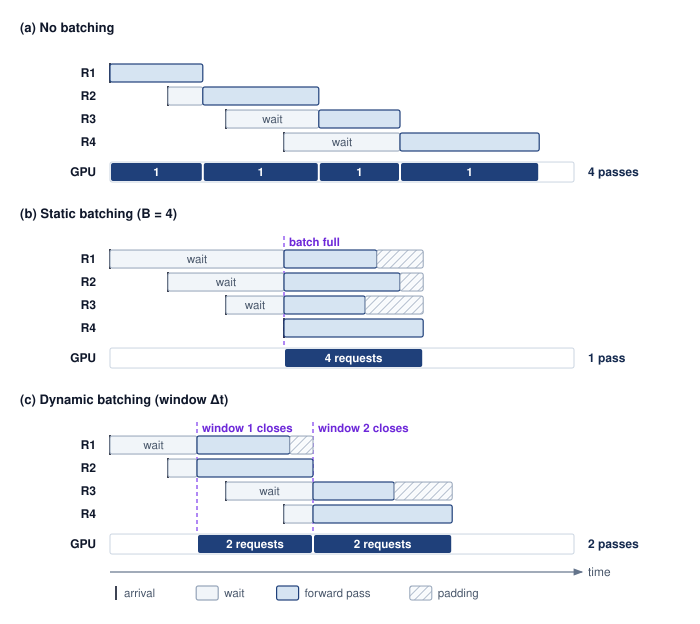{width="100%"}

<!--
```{.tikz}
\providecolor{DarkNavy}{HTML}{1E293B}
\providecolor{OceanBlue}{HTML}{2563EB}
\providecolor{ForestGreen}{HTML}{166534}
\providecolor{AmberStage}{HTML}{D97706}
\providecolor{CrimsonSLA}{HTML}{991B1B}
\providecolor{SlateGrey}{HTML}{475569}
\providecolor{SoftGrey}{HTML}{F8FAFC}
\providecolor{SlateTeal}{HTML}{0F766E}
\providecolor{BorderGrey}{HTML}{CBD5E1}
\providecolor{BorderBlue}{HTML}{2563EB}
\providecolor{BorderGreen}{HTML}{166534}
\providecolor{BorderAmber}{HTML}{D97706}
\providecolor{BorderCrimson}{HTML}{991B1B}
\providecolor{Crimson}{HTML}{991B1B}
\providecolor{SoftBlue}{HTML}{F0F6FE}
\providecolor{SoftGreen}{HTML}{ECFAF0}
\providecolor{SoftAmber}{HTML}{FEF8EE}
\providecolor{SoftCrimson}{HTML}{FFF1F2}
\providecolor{BgCard}{HTML}{FFFFFF}
\providecolor{CardBg}{HTML}{FFFFFF}
\providecolor{GrayL}{HTML}{E0E0E0}
\providecolor{GrayLine}{HTML}{666666}
\providecolor{BlueLine}{HTML}{006395}
\providecolor{BlueFill}{HTML}{D6EAF8}
\providecolor{GreenLine}{HTML}{008F45}
\providecolor{GreenFill}{HTML}{D5F5E3}
\providecolor{OrangeLine}{HTML}{E67817}
\providecolor{OrangeFill}{HTML}{FDEBD0}
\providecolor{RedLine}{HTML}{D9534F}
\providecolor{RedFill}{HTML}{F2D7D5}
\providecolor{TextBlack}{HTML}{333333}
\providecolor{VioletLine}{HTML}{7E317B}
\providecolor{VioletFill}{RGB}{243,243,255}
\colorlet{mlsysblue}{OceanBlue}
\colorlet{mlsysgreen}{ForestGreen}
\colorlet{mlsysred}{CrimsonSLA}
\colorlet{mlsysamber}{AmberStage}
\colorlet{mlsysdarkgray}{DarkNavy}
\colorlet{mlsysteal}{SlateTeal}
\scalebox{0.80}{%
\begin{tikzpicture}[
    x=1cm, y=1cm,
    >=Stealth,
    font=\small\sffamily
]

    % Style definitions
    \tikzset{
        panel/.style={
            draw=BorderGrey,
            fill=white,
            line width=0.7pt,
            rounded corners=3.5pt,
            inner sep=0pt
        },
        pill/.style={
            fill=#1,
            text=DarkNavy,
            font=\footnotesize\bfseries,
            rounded corners=2.5pt,
            inner xsep=6pt,
            inner ysep=2.5pt
        },
        computebox/.style={
            draw=OceanBlue!80,
            fill=SoftBlue!70,
            line width=0.6pt,
            rounded corners=2pt,
            font=\scriptsize\bfseries\color{DarkNavy},
            inner xsep=5pt,
            inner ysep=2.5pt,
            minimum height=0.38cm,
            align=center
        },
        waitbox/.style={
            draw=BorderAmber!90,
            fill=SoftAmber,
            line width=0.6pt,
            rounded corners=2pt,
            font=\fontsize{6.5}{8}\selectfont\color{AmberStage!90!black},
            inner xsep=5pt,
            inner ysep=2.5pt,
            minimum height=0.38cm,
            align=center
        },
        padbox/.style={
            draw=Crimson!80,
            fill=white,
            pattern=north east lines,
            pattern color=Crimson!35,
            line width=0.6pt,
            rounded corners=2pt,
            font=\fontsize{6.5}{8}\selectfont\bfseries\color{Crimson},
            inner xsep=2pt,
            inner ysep=2.5pt,
            minimum height=0.38cm,
            align=center
        },
        utilbadge/.style={
            draw=#1!75,
            fill=#1!8!white,
            line width=0.65pt,
            rounded corners=2.5pt,
            font=\scriptsize\bfseries\color{#1!90!black},
            inner xsep=7pt,
            inner ysep=4pt,
            align=center
        }
    }

    % =========================================================================
    % PANEL (a): NO BATCHING
    % =========================================================================
    \node[panel, minimum width=15.6cm, minimum height=4.1cm, anchor=north west] (pA) at (0, 0) {};

    % Header
    \node[pill=BorderGrey!40, anchor=north west] (pA_tag) at ([shift={(0.35cm, -0.3cm)}] pA.north west) {(a) No Batching};
    \node[anchor=west, font=\scriptsize\color{DarkNavy!75}] at ([shift={(0.3cm, 0)}] pA_tag.east) {
        Sequential execution: GPU is memory-bandwidth starved during decode; idle between requests
    };

    % Request labels
    \node[font=\scriptsize\bfseries\color{DarkNavy!85}] at (1.0, -1.0) {R1};
    \node[font=\scriptsize\bfseries\color{DarkNavy!85}] at (1.0, -1.5) {R2};
    \node[font=\scriptsize\bfseries\color{DarkNavy!85}] at (1.0, -2.0) {R3};
    \node[font=\scriptsize\bfseries\color{DarkNavy!85}] at (1.0, -2.5) {R4};

    % Compute boxes
    \node[computebox, anchor=west, minimum width=2.0cm] (r1_a) at (1.5, -1.0) {Compute R1};
    \node[computebox, anchor=west, minimum width=2.8cm] (r2_a) at (4.0, -1.5) {Compute R2};
    \node[computebox, anchor=west, minimum width=1.6cm] (r3_a) at (7.3, -2.0) {Compute R3};
    \node[computebox, anchor=west, minimum width=2.2cm] (r4_a) at (9.4, -2.5) {Compute R4};

    % GPU Active track
    \node[anchor=east, font=\scriptsize\bfseries\color{DarkNavy}] at (1.4, -3.1) {GPU Active};
    \draw[draw=BorderGrey, fill=CardBg, rounded corners=1.5pt, line width=0.6pt] (1.5, -3.28) rectangle (12.2, -2.92);
    % Active blocks
    \fill[OceanBlue!85] (r1_a.west |- 0, -3.28) rectangle (r1_a.east |- 0, -2.92);
    \fill[OceanBlue!85] (r2_a.west |- 0, -3.28) rectangle (r2_a.east |- 0, -2.92);
    \fill[OceanBlue!85] (r3_a.west |- 0, -3.28) rectangle (r3_a.east |- 0, -2.92);
    \fill[OceanBlue!85] (r4_a.west |- 0, -3.28) rectangle (r4_a.east |- 0, -2.92);

    % Timeline arrow
    \draw[->, line width=0.7pt, DarkNavy!70, shorten >=2pt] (1.5, -3.6) -- (12.2, -3.6)
          node[midway, below=1pt, font=\fontsize{6.5}{8}\selectfont\color{DarkNavy!75}] {Time ($t$)};

    % Utilization badge
    \node[utilbadge=Crimson, anchor=east] at ([shift={(-0.4cm, 0)}] pA.east |- 0, -3.1) {$\sim$38\% GPU Util};

    % =========================================================================
    % PANEL (b): STATIC BATCHING
    % =========================================================================
    \node[panel, minimum width=15.6cm, minimum height=4.8cm, anchor=north west] (pB) at (0, -4.4) {};

    % Header
    \node[pill=BorderGrey!40, anchor=north west] (pB_tag) at ([shift={(0.35cm, -0.3cm)}] pB.north west) {(b) Static Batching};
    \node[anchor=west, font=\scriptsize\color{DarkNavy!75}] at ([shift={(0.3cm, 0)}] pB_tag.east) {
        Fixed barrier: requests wait until batch size $B$ is filled; tail padding wastes Tensor Core cycles
    };

    % Barrier line & dispatch pill
    \node[draw=BorderAmber!90, fill=SoftAmber, rounded corners=2pt, line width=0.55pt,
          font=\fontsize{6.5}{7.5}\selectfont\bfseries\color{AmberStage!90!black}, inner xsep=4.5pt, inner ysep=1.8pt]
          at (3.6, -5.45) {Batch Dispatch};
    \draw[dashed, line width=0.8pt, AmberStage] (3.6, -5.65) -- (3.6, -7.65);

    % Request labels
    \node[font=\scriptsize\bfseries\color{DarkNavy!85}] at (1.0, -5.85) {R1};
    \node[font=\scriptsize\bfseries\color{DarkNavy!85}] at (1.0, -6.35) {R2};
    \node[font=\scriptsize\bfseries\color{DarkNavy!85}] at (1.0, -6.85) {R3};
    \node[font=\scriptsize\bfseries\color{DarkNavy!85}] at (1.0, -7.35) {R4};

    % R2 (Max Len) sets the batch right edge
    \node[waitbox, anchor=east] at (3.6, -6.35) {Wait (80\,ms)};
    \node[computebox, anchor=west, minimum width=3.8cm] (r2_b) at (3.6, -6.35) {Compute R2 (Max Len)};

    % R1: Wait -> Compute -> Pad to r2_b.east
    \node[waitbox, anchor=east] at (3.6, -5.85) {Wait (110\,ms)};
    \node[computebox, anchor=west, minimum width=2.0cm] (r1_b) at (3.6, -5.85) {Compute R1};
    \path let \p1 = (r1_b.east), \p2 = (r2_b.east) in
          node[padbox, anchor=west, minimum width=\x2-\x1] at (r1_b.east) {Pad};

    % R3: Wait -> Compute -> Pad (Waste) to r2_b.east
    \node[waitbox, anchor=east] at (3.6, -6.85) {Wait};
    \node[computebox, anchor=west, minimum width=1.6cm] (r3_b) at (3.6, -6.85) {Compute R3};
    \path let \p1 = (r3_b.east), \p2 = (r2_b.east) in
          node[padbox, anchor=west, minimum width=\x2-\x1] at (r3_b.east) {Pad (Waste)};

    % R4: Wait -> Compute -> Pad to r2_b.east
    \node[waitbox, anchor=east, minimum width=0.35cm] at (3.6, -7.35) {};
    \node[computebox, anchor=west, minimum width=2.5cm] (r4_b) at (3.6, -7.35) {Compute R4};
    \path let \p1 = (r4_b.east), \p2 = (r2_b.east) in
          node[padbox, anchor=west, minimum width=\x2-\x1] at (r4_b.east) {Pad};

    % GPU Active track
    \node[anchor=east, font=\scriptsize\bfseries\color{DarkNavy}] at (1.4, -7.95) {GPU Active};
    \draw[draw=BorderGrey, fill=CardBg, rounded corners=1.5pt, line width=0.6pt] (1.5, -8.13) rectangle (12.2, -7.77);
    % Active block: from 3.6 to r2_b.east
    \fill[OceanBlue!85] (3.6, -8.13) rectangle (r2_b.east |- 0, -7.77);

    % Timeline arrow
    \draw[->, line width=0.7pt, DarkNavy!70, shorten >=2pt] (1.5, -8.45) -- (12.2, -8.45)
          node[midway, below=1pt, font=\fontsize{6.5}{8}\selectfont\color{DarkNavy!75}] {Time ($t$)};

    % Utilization badge
    \node[utilbadge=AmberStage, anchor=east] at ([shift={(-0.4cm, 0)}] pB.east |- 0, -7.95) {$\sim$68\% GPU Util};

    % =========================================================================
    % PANEL (c): DYNAMIC BATCHING
    % =========================================================================
    \node[panel, minimum width=15.6cm, minimum height=5.0cm, anchor=north west] (pC) at (0, -9.5) {};

    % Header
    \node[pill=BorderGrey!40, anchor=north west] (pC_tag) at ([shift={(0.35cm, -0.3cm)}] pC.north west) {(c) Dynamic Batching};
    \node[anchor=west, font=\scriptsize\color{DarkNavy!75}] at ([shift={(0.3cm, 0)}] pC_tag.east) {
        Timeout-bounded window: batch dispatches when \texttt{max\_queue\_delay} expires OR batch size reached
    };

    % Window pills & barrier lines
    \node[draw=BorderGreen!90, fill=SoftGreen, rounded corners=2pt, line width=0.55pt,
          font=\fontsize{6.5}{7.5}\selectfont\bfseries\color{ForestGreen!90!black}, inner xsep=5pt, inner ysep=1.8pt]
          at (2.5, -10.45) {Window 1 $\Delta t$};
    \draw[dashed, line width=0.8pt, ForestGreen] (2.5, -10.65) -- (2.5, -12.75);

    \node[draw=BorderGreen!90, fill=SoftGreen, rounded corners=2pt, line width=0.55pt,
          font=\fontsize{6.5}{7.5}\selectfont\bfseries\color{ForestGreen!90!black}, inner xsep=5pt, inner ysep=1.8pt]
          at (6.2, -10.45) {Window 2 $\Delta t$};
    \draw[dashed, line width=0.8pt, ForestGreen] (6.2, -10.65) -- (6.2, -12.75);

    % Request labels
    \node[font=\scriptsize\bfseries\color{DarkNavy!85}] at (1.0, -10.95) {R1};
    \node[font=\scriptsize\bfseries\color{DarkNavy!85}] at (1.0, -11.45) {R2};
    \node[font=\scriptsize\bfseries\color{DarkNavy!85}] at (1.0, -11.95) {R3};
    \node[font=\scriptsize\bfseries\color{DarkNavy!85}] at (1.0, -12.45) {R4};

    % Window 1: R1 and R2
    \node[waitbox, anchor=east, minimum width=0.9cm] at (2.5, -10.95) {Wait};
    \node[computebox, anchor=west, minimum width=2.0cm] (r1_c) at (2.5, -10.95) {Compute R1};

    \node[waitbox, anchor=east, minimum width=0.9cm] at (2.5, -11.45) {Wait};
    \node[computebox, anchor=west, minimum width=2.8cm] (r2_c) at (2.5, -11.45) {Compute R2};

    % Pad R1 to r2_c.east
    \path let \p1 = (r1_c.east), \p2 = (r2_c.east) in
          node[padbox, anchor=west, minimum width=\x2-\x1] at (r1_c.east) {Pad};

    % Window 2: R3 and R4
    \node[waitbox, anchor=east, minimum width=0.9cm] at (6.2, -11.95) {Wait};
    \node[computebox, anchor=west, minimum width=2.1cm] (r3_c) at (6.2, -11.95) {Compute R3};

    \node[waitbox, anchor=east, minimum width=0.9cm] at (6.2, -12.45) {Wait};
    \node[computebox, anchor=west, minimum width=2.5cm] (r4_c) at (6.2, -12.45) {Compute R4};

    % Pad R3 to r4_c.east
    \path let \p1 = (r3_c.east), \p2 = (r4_c.east) in
          node[padbox, anchor=west, minimum width=\x2-\x1] at (r3_c.east) {Pad};

    % GPU Active track
    \node[anchor=east, font=\scriptsize\bfseries\color{DarkNavy}] at (1.4, -13.15) {GPU Active};
    \draw[draw=BorderGrey, fill=CardBg, rounded corners=1.5pt, line width=0.6pt] (1.5, -13.33) rectangle (12.2, -12.97);
    % Active blocks: Window 1 (2.5 to r2_c.east) & Window 2 (6.2 to r4_c.east)
    \fill[OceanBlue!85] (2.5, -13.33) rectangle (r2_c.east |- 0, -12.97);
    \fill[OceanBlue!85] (6.2, -13.33) rectangle (r4_c.east |- 0, -12.97);

    % Timeline arrow
    \draw[->, line width=0.7pt, DarkNavy!70, shorten >=2pt] (1.5, -13.65) -- (12.2, -13.65)
          node[midway, below=1pt, font=\fontsize{6.5}{8}\selectfont\color{DarkNavy!75}] {Time ($t$)};

    % Utilization badge
    \node[utilbadge=ForestGreen, anchor=east] at ([shift={(-0.4cm, 0)}] pC.east |- 0, -13.15) {$\sim$86\% GPU Util};

\end{tikzpicture}
}
```
-->

:::

For vision models\index{Vision Models}, including convolutional neural networks (CNNs) and vision transformers (ViTs) processing fixed-size images, arithmetic work grows approximately in proportion to batch size. Requests share model weights, but activations and other per-request state still grow with the batch. Increasing batch size can therefore improve weight reuse and GPU utilization until compute capacity, memory capacity, or the latency budget becomes limiting. Static or dynamic batching exploits this reuse; the largest feasible batch is not necessarily the best operating point for an interactive service.

For LLMs in the decode phase\index{Decode phase!memory bandwidth bound}, small batches perform little computation relative to the bytes required to load active model weights. In this regime, memory bandwidth binds. Larger batches reuse each weight load across more tokens, increasing arithmetic intensity until compute, KV-cache traffic, or the latency budget limits further throughput gains. For the same reason, small-batch decode does not inherit a new accelerator generation's headline compute improvement. Across the generations from Volta to Blackwell, peak compute climbs 18$\times$ while memory bandwidth expands by only 8.9$\times$; @fig-gpu-memory-wall shows what that hardware divergence means for serving, where generation throughput tracks the slower curve whenever weight streaming dominates at small batch sizes.

::: {.column-margin .margin-pointer}
↩ The accelerator trajectory behind this divergence, with compute outpacing memory bandwidth from one generation to the next, is established in @sec-compute-infrastructure-evolution-gpu-architectures-566b.
:::

For recommendation systems, embedding lookup\index{Recommendation system!embedding lookup bottleneck} can limit throughput before dense computation does. Grouping sparse accesses can improve locality and distribute lookup work across shards, while batching the dense stages can improve matrix multiplication throughput. The serving policy must account for both stages and the communication between them rather than infer the bottleneck from the model category alone.

::: {#fig-gpu-memory-wall fig-env="figure" fig-pos="htb" fig-cap="**Decode inherits the bandwidth deficit**: Peak compute and memory bandwidth for four accelerator generations, normalized to the V100. Compute rises 18$\times$ against bandwidth's 8.9$\times$. In weight-bandwidth-bound decode, each iteration loads the active weights and reuses them across its output tokens; at fixed batch size, bandwidth growth constrains the gain. These hardware ratios are not measured workload speedups. Specifications come from the MLSysIM hardware registry." fig-alt="Line chart normalized to the V100 across V100, A100, H100, and B200, showing peak compute reaching 18 times and memory bandwidth 8.9 times by the B200, with the widening gap between the two lines shaded and labeled bandwidth deficit."}

```{python}
#| echo: false
import pandas as pd
from binder.tools.figures import style as book_style

data = pd.read_csv("vol2/10_inference/data/gpu_memory_wall.csv")
base = data.iloc[0]
data["Compute"] = data["Peak_TFLOPS"] / base["Peak_TFLOPS"]
data["Bandwidth"] = data["Memory_Bandwidth_GBps"] / base["Memory_Bandwidth_GBps"]

fig, ax, COLORS, plt = book_style.setup_plot(figsize=(5.6, 3.7))
FS = 10.5  # prints at >= 9 pt when the figure is scaled to 5 in
labels = data["Accelerator"] + "\n" + data["Year"].astype(str)
x = range(len(data))
# The widening gap between the two curves is the bandwidth deficit decode
# inherits. It is a gap, not a failure, so it takes a neutral gray wash (red is
# reserved for danger, orange means compute). Compute is the reference series
# (dark neutral); memory bandwidth is a GB/s quantity, so it takes violet.
ax.fill_between(x, data["Bandwidth"], data["Compute"], color=COLORS["grid"], alpha=0.45, lw=0)
ax.plot(x, data["Compute"], marker="o", color=COLORS["primary"], linewidth=2.2)
ax.plot(x, data["Bandwidth"], marker="s", color=COLORS["VioletLine"], linewidth=2.6)

def _mult(v):
    return f"{v:.1f}".rstrip("0").rstrip(".") + "×"

last = len(data) - 1
for col, name, colour in [("Compute", "Peak compute", COLORS["primary"]), ("Bandwidth", "Memory\nbandwidth", COLORS["VioletLine"])]:
    ax.annotate(
        f"{name}\n{_mult(data[col].iloc[-1])}",
        xy=(last, data[col].iloc[-1]),
        xytext=(9, 0),
        textcoords="offset points",
        va="center",
        ha="left",
        fontweight="bold",
        fontsize=FS,
        color=colour,
        linespacing=1.05,
    )
# Placed inside the widest part of the wedge, clear of both lines.
gap_x = last - 0.41
gap_y = 0.515 * data["Compute"].iloc[-1]
ax.text(gap_x, gap_y, "bandwidth\ndeficit", ha="center", va="center", fontsize=FS, style="italic", color=COLORS["secondary"])

ax.set_xticks(list(x))
ax.set_xticklabels(labels)
ax.tick_params(labelsize=FS)
ax.set_ylabel(f'Growth relative to {base["Accelerator"]} ({int(base["Year"])})', fontsize=FS + 0.5)
ax.set_xlabel("NVIDIA data center accelerator", fontsize=FS + 0.5)
ax.set_xlim(-0.3, last + 1.25)
ax.set_ylim(0, 1.12 * data["Compute"].max())
fig.tight_layout()
```

:::

### The physics and efficiency curves of batching {#sec-inference-scale-physics-batching-efficiency-curve-021c}

Batch size is the single-replica control knob that moves a workload along the roofline, raising arithmetic intensity by reusing each weight read across more requests. At fleet scale the same knob also sets how long arriving work waits. Batching trades the reuse of weights and execution overhead against longer service times and additional request state. A model relating batch size $(\BatchSize)$, batch service time $(\BatchServiceTime(\BatchSize))$, and batched service rate $(\EffectiveServiceRate(\BatchSize))$ exposes that trade-off. Selecting an operating point also requires the arrival pattern, memory budget, and latency target.

::: {.column-margin .margin-pointer}
↩ Batch size as the control knob that moves decode toward the ridge point on one replica is established in @sec-performance-engineering-batch-size.
:::

The first model isolates batch execution. Here $\BatchServiceTime(\BatchSize)$ is the service time once a batch begins execution; it excludes queueing and batch formation. Keeping the measurement boundary explicit prevents an execution-time improvement from being mistaken for an end-to-end SLO guarantee.

The service-time equation decomposes batch execution time into fixed overheads (kernel launch, memory loading) and variable costs (compute per sample):

$$\BatchServiceTime(\BatchSize) = \BatchFixedOverheadTime+ \BatchSize\times \MarginalRequestServiceTime$$

In this formulation, $\BatchFixedOverheadTime$ captures costs paid once per batch, such as loading weights from HBM and kernel launch latency, while $\MarginalRequestServiceTime$ denotes the marginal cost of adding one request, such as the compute time for that sample. Treating these terms as constants is a local approximation for a fixed workload and execution regime. Kernel changes, cache traffic, and resource saturation can alter the measured curve as batch size grows.

The throughput equation describes the system's capacity:

$$\EffectiveServiceRate(\BatchSize) = \frac{\BatchSize}{\BatchServiceTime(\BatchSize)} = \frac{\BatchSize}{\BatchFixedOverheadTime+ \BatchSize\times \MarginalRequestServiceTime}$$

The resulting batching efficiency curve\index{Batching!efficiency curve} shows diminishing returns from amortizing overhead. For small batch sizes ($\BatchSize$), $\BatchFixedOverheadTime$ dominates service time, so increasing $\BatchSize$ shares that cost and raises throughput substantially. As $\BatchSize$ grows, the relative contribution of $\BatchFixedOverheadTime$ shrinks and the model approaches its asymptotic rate $1/\MarginalRequestServiceTime$. This limit alone does not identify whether compute or bandwidth binds on the actual device. The knee of the curve\index{Batching!knee of the curve}, where fixed and variable costs become comparable, is a useful candidate operating point. It is not an optimum independent of the service contract; a tight latency budget may require a smaller batch, while a throughput-oriented workload may benefit from a larger one.

::: {.column-margin}
```{=latex}
\vspace*{-1mm}
```
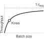{width="100%" fig-alt="A curve that stays nearly flat and then climbs steeply, with a red dot at the knee and a red wash shading the region past it."}

*Past the knee, bigger batches spend latency without buying throughput.*
:::

The execution-only feasibility condition is $\BatchServiceTime(\BatchSize) \le \text{SLO}$\index{SLO!batch size trade-off}. In a live service, execution receives only the budget remaining after routing, queueing, batch formation, and response delivery. The batch-size decision must therefore use that remaining budget rather than consume the full SLO. The following example contrasts a vision workload with a relatively high $\MarginalRequestServiceTime$ and an LLM decode workload with a high $\BatchFixedOverheadTime$ from weight loading, showing how those measured costs change the tuning decision.

```{python}
#| echo: false
#| label: batching-efficiency-notebook
# ┌─────────────────────────────────────────────────────────────────────────────
# │ BATCHING EFFICIENCY CURVE (NOTEBOOK)
# ├─────────────────────────────────────────────────────────────────────────────
# │ Context: "Batching Efficiency Curve" .callout-notebook
# │
# │ Goal: Quantify throughput-latency trade-offs for vision vs LLM batching.
# │ Show: LLM knee at B=80; Vision knee at B=2.
# │ How: X(B) = B / (T_fixed + B * T_var).
# │
# └─────────────────────────────────────────────────────────────────────────────
from mlsysim.fmt import check, fmt, fmt_int

class BatchingEfficiency:
    # ┌── 1. LOAD ──────────────────────────────────────────
    # LLM (Weights limited)
    t_fixed_llm = 40  # ms
    t_var_llm = 0.5  # ms
    # Vision (Compute limited)
    t_fixed_vis = 2  # ms
    t_var_vis = 1.0  # ms

    # ┌── 2. EXECUTE ───────────────────────────────────────
    def get_x(b, tf, tv):
        return b / (tf + b * tv) * THOUSAND  # req/s

    # Knee occurs where marginal throughput gain slows significantly
    # Approximate: B where B*T_var ≈ T_fixed
    b_knee_llm = int(t_fixed_llm / t_var_llm)
    b_knee_vis = int(t_fixed_vis / t_var_vis)

    x_knee_llm = get_x(b_knee_llm, t_fixed_llm, t_var_llm)
    x_knee_vis = get_x(b_knee_vis, t_fixed_vis, t_var_vis)
    # ┌── 3. GUARD ─────────────────────────────────────────
    check(b_knee_llm == 80, f"LLM knee mismatch: {b_knee_llm}")
    check(b_knee_vis == 2, f"Vision knee mismatch: {b_knee_vis}")
    # ┌── 4. OUTPUT ────────────────────────────────────────
    bec_llm_knee_str = fmt_int(b_knee_llm, commas=False)
    bec_vision_knee_str = fmt_int(b_knee_vis, commas=False)
```

::: {#nbk-inference-batching-efficiency-curve .callout-notebook title="The batching efficiency curve"}

**Problem**: An engineer optimizes two services: a vision model (ResNet) and an LLM (70B). At what batch size does each hit the "knee" of its efficiency curve?

**Math**:
The knee occurs where the variable compute cost $(\BatchSize\times \MarginalRequestServiceTime)$ starts to exceed the fixed overhead $(\BatchFixedOverheadTime)$.

1. **Vision Model** $(\BatchFixedOverheadTime= 2\text{ ms}, \MarginalRequestServiceTime= 1\text{ ms})$:
   - Knee: $\BatchSize\approx 2\text{ ms}/1\text{ ms} =$ `{python} BatchingEfficiency.bec_vision_knee_str`.
   - **Result**: This simplified latency model reaches its first overhead-amortization knee at a small batch. It does not locate hardware saturation; measuring throughput at larger batches tests whether additional concurrency still helps.
2. **LLM Decode** $(\BatchFixedOverheadTime= 40\text{ ms}, \MarginalRequestServiceTime= 0.5\text{ ms})$:
   - Knee: $\BatchSize\approx 40\text{ ms}/0.5\text{ ms} =$ `{python} BatchingEfficiency.bec_llm_knee_str`.
   - **Result**: The larger fixed cost in this decode example moves the overhead-amortization knee to a larger batch.
   - **Where 0.5 ms comes from**: It is an assumed marginal cost per added sequence, dominated by reading that sequence's own KV state at a moderate context length. Unlike the weight stream, that read is private to each sequence, so it grows with batch size instead of being shared.
   - **Where 40 ms comes from**: It is roughly the time to stream the model's `{python} InferenceSetup.llama70b_fp16_gb_str` of FP16 weights through one H100's `{python} InferenceSetup.h100_mem_bw_tb_per_s_str` of HBM bandwidth, the aggregate weight traffic of one decode step expressed in single-device time. No single H100 holds those weights. The reference replica of @sec-performance-engineering-batch-size spreads them over eight GPUs, which divides both $\BatchFixedOverheadTime$ and $\MarginalRequestServiceTime$ by the tensor-parallel degree and leaves their ratio, and therefore the knee, unchanged.

**Systems insight**: Because streaming the weights is the dominant per-step cost of decode, the system has not reached the efficiency knee until batch size `{python} BatchingEfficiency.bec_llm_knee_str`. The knee depends on the ratio of fixed to per-request cost, not on how many devices share them, which is why sharing weight reads across concurrent requests matters at every replica size. The batch a service actually runs also depends on context length, cache capacity, kernel efficiency, and the latency target; continuous batching and paged allocation are the mechanisms that let a replica reach it.

:::

Across model architectures, @tbl-batching-by-model summarizes candidate batching strategies and representative constraints. Vision and long-prompt prefill can emphasize compute utilization, small-batch decode can emphasize weight bandwidth, and sharded recommendation can emphasize embedding access. Speech introduces deadlines tied to the input stream. These are starting points for measurement, not fixed bottlenecks or batch-size requirements for every model in a category.

| **Model Type**    | **Batching Strategy** |   **Typical Batch Size**   | **Key Constraint** | **Throughput Scaling** |
|:------------------|:---------------------:|:--------------------------:|:------------------:|:----------------------:|
| **Vision (CNN)**  |     Static/Dynamic    |           32–256           |    GPU compute     |   Near-linear to 64+   |
| **LLM (prefill)** |        Dynamic        |            1–64            |    GPU compute     |       Sub-linear       |
| **LLM (decode)**  |       Continuous      | Tens–hundreds (KV-limited) |  Memory bandwidth  |       Log-linear       |
| **RecSys**        |    Feature-parallel   |        1000–10000s         |  Embedding lookup  |  Depends on sharding   |
| **Speech**        |       Streaming       |             1              |     Real-time      |  N/A (latency-bound)   |

: **Batching strategy by model type**: Each model class requires a distinct batching policy (from static/dynamic in vision to continuous in LLM decode and feature-parallel in recommendation) matched to its dominant hardware bottleneck. Typical batch sizes are operating ranges set by latency budgets and KV-cache capacity; they may fall below or above the workload-specific overhead-amortization knees illustrated in notebook \ref{nbk-inference-batching-efficiency-curve}, which mark where fixed costs stop dominating rather than where batching stops paying. {#tbl-batching-by-model}

Translating these batch-level equations into system-wide capacity planning requires a classical result from queuing theory: Little's Law\index{Little's Law!capacity planning},[^fn-littles-law-queuing] which relates concurrency, throughput, and latency in any stable system.

[^fn-littles-law-queuing]: **Little's Law**\index{Little's Law!serving concurrency}: The identity holds for any stable system regardless of the arrival or service distribution, which is why it survives the bursty, variable-length traffic of inference. Because it relates averages, it bounds neither maximum service capacity nor tail latency.

```{python}
#| echo: false
#| label: littles-law-example
# ┌─────────────────────────────────────────────────────────────────────────────
# │ LITTLE'S LAW — CONCURRENCY AND CAPACITY PLANNING
# ├─────────────────────────────────────────────────────────────────────────────
# │ Context: @thrm-inference-littles-law-inference theorem callout —
# │          the Application, Capacity Planning, and Verification prose below.
# │
# │ Goal:    Apply Little's Law (Q = λ·T) to size a serving fleet against an SLO.
# │ Show:    Required concurrency, per-replica throughput, throughput-only lower
# │          bound, SLO-sized replica count, and resulting headroom.
# │ How:     Scenario throughput target and latency SLO give required concurrency;
# │          replica batch/latency give per-replica throughput and replica count.
# │
# └─────────────────────────────────────────────────────────────────────────────
import math
from mlsysim.fmt import check, fmt_int, fmt_math, fmt_percent, fmt_time

class LittlesLawExample:
    # ┌── 1. LOAD ──────────────────────────────────────────
    target_throughput = 1000  # scenario assumption: target requests/sec
    latency_slo = 0.1 * second  # scenario assumption: per-request latency SLO
    batch_size = 8  # scenario assumption: per-replica batch size
    replica_latency = 0.08 * second  # scenario assumption: per-replica latency
    # ┌── 2. EXECUTE ───────────────────────────────────────
    latency_slo_s = latency_slo.to(second).magnitude
    replica_latency_s = replica_latency.to(second).magnitude
    required_concurrency = int(target_throughput * latency_slo_s)
    replica_throughput = int(batch_size / replica_latency_s)
    throughput_floor = math.ceil(target_throughput / replica_throughput)
    slo_replicas = math.ceil(required_concurrency / batch_size)
    replicas_needed = max(throughput_floor, slo_replicas)
    total_concurrency = replicas_needed * batch_size
    concurrency_headroom = total_concurrency - required_concurrency
    service_utilization = target_throughput / (replicas_needed * replica_throughput)
    # ┌── 3. GUARD ─────────────────────────────────────────
    check(required_concurrency == 100, "required concurrency should be 100")
    check(throughput_floor == 10, "Throughput-only lower bound should be 10 replicas")
    check(replicas_needed == 13, "SLO-sized replica count should be 13")
    check(concurrency_headroom == 4, "concurrency headroom should be 4")
    # ┌── 4. OUTPUT ────────────────────────────────────────
    required_concurrency_math = fmt_math(rf"\RequestConcurrency = {target_throughput} \times {latency_slo_s} =")
    required_concurrency_str = fmt_int(required_concurrency, commas=False)
    replica_throughput_calc_math = fmt_math(rf"{batch_size}/{replica_latency_s} =")
    replica_throughput_str = fmt_int(replica_throughput, commas=False)
    throughput_floor_calc_math = fmt_math(rf"\lceil {target_throughput}/{replica_throughput}\rceil =")
    throughput_floor_str = fmt_int(throughput_floor, commas=False)
    slo_replicas_calc_math = fmt_math(rf"\lceil {required_concurrency}/{batch_size}\rceil =")
    replicas_needed_str = fmt_int(replicas_needed, commas=False)
    total_concurrency_calc_math = fmt_math(rf"{replicas_needed}\text{{ replicas}} \times {batch_size}\text{{ batch}} =")
    total_concurrency_str = fmt_int(total_concurrency, commas=False)
    concurrency_headroom_str = fmt_int(concurrency_headroom, commas=False)
    service_utilization_pct_str = fmt_percent(service_utilization, precision=1, commas=False, style="prose")
    target_throughput_str = fmt_int(target_throughput)
    latency_slo_ms_str = fmt_time(latency_slo, millisecond, precision=0, commas=False)
    latency_slo_s_str = fmt_time(latency_slo, second, precision=1, commas=False)
    batch_size_str = fmt_int(batch_size, commas=False)
    replica_latency_ms_str = fmt_time(replica_latency, millisecond, precision=0, commas=False)
```

::: {#thrm-inference-littles-law-inference .callout-theorem title="Little's Law for inference"}

**Concept**: In any stable queuing system, the average number of requests in the system $(\RequestConcurrency)$ equals the arrival rate $(\ArrivalRate)$ multiplied by the average time a request spends in the system $(\RequestTimeInSystem)$.

$$ \RequestConcurrency = \ArrivalRate \cdot \RequestTimeInSystem $$

**Application**: Concurrency planning. For this illustrative estimate, assume the mean end-to-end latency equals the numerical latency target below. A percentile SLO cannot generally be substituted for the mean in Little's Law.

- **Target Throughput** $(\ArrivalRate)$: `{python} LittlesLawExample.target_throughput_str` requests/sec
- **Assumed mean latency** $(\RequestTimeInSystem)$: `{python} LittlesLawExample.latency_slo_ms_str` (`{python} LittlesLawExample.latency_slo_s_str`)

**Required Concurrency** $(\RequestConcurrency)$: `{python} LittlesLawExample.required_concurrency_math` `{python} LittlesLawExample.required_concurrency_str` concurrent requests

**Capacity Planning**\index{Capacity Planning}:
If a single GPU replica handles batch size `{python} LittlesLawExample.batch_size_str` with `{python} LittlesLawExample.replica_latency_ms_str` latency:

1. Replica Throughput $=$ `{python} LittlesLawExample.replica_throughput_calc_math` `{python} LittlesLawExample.replica_throughput_str` req/s
2. Throughput-only lower bound $=$ `{python} LittlesLawExample.throughput_floor_calc_math` `{python} LittlesLawExample.throughput_floor_str` replicas
3. Illustrative headroom-sized replica count $=$ `{python} LittlesLawExample.slo_replicas_calc_math` `{python} LittlesLawExample.replicas_needed_str` replicas

**Verification**:
Total system concurrency $=$ `{python} LittlesLawExample.total_concurrency_calc_math` `{python} LittlesLawExample.total_concurrency_str`, which leaves `{python} LittlesLawExample.concurrency_headroom_str` request slots above the `{python} LittlesLawExample.required_concurrency_str` required by Little's Law. The throughput-only lower bound would run at the stability boundary; the headroom-sized fleet runs at about `{python} LittlesLawExample.service_utilization_pct_str` service utilization, leaving finite headroom for queueing variance. This arithmetic does not prove a percentile latency SLO; that requires an arrival/service model or a measured load test.

:::

This stability boundary can be measured faithfully only when the load generator preserves the workload claim. The contract in @sec-performance-engineering-measurement-scale distinguishes a fixed external arrival process from fixed-concurrency testing because response-paced generation can reduce arrivals during a stall and make the system appear to have more headroom than it does. The distinction between throughput capacity and latency capacity is exactly what queuing theory formalizes.

::: {.column-margin .margin-pointer}
↪ The mean queuing delay under a batched M/G/1 surrogate, and how utilization headroom and batch size trade against latency, is developed in @sec-appdx-inference-scale-queuing-theory-batched-inference-bbf0.
:::

### Static and dynamic batching for vision models {#sec-inference-scale-static-dynamic-batching-vision-models-4623}

Vision models represent the simplest batching case because inputs have uniform size (after preprocessing) and computation follows a predictable pattern. Single-machine batching principles apply directly, with scale introducing considerations of batch formation across multiple replicas.

Static batching collects exactly $\BatchSize$ requests before processing. A full batch can improve weight reuse and kernel efficiency, but fullness alone does not establish maximum GPU utilization. Without a timeout or partial-batch dispatch policy, the first request can wait indefinitely if too few additional requests arrive.

Dynamic batching collects requests for a maximum time window $\BatchingWindow$ or until reaching maximum batch size $\MaxBatchSize$, whichever occurs first. For Poisson arrivals with rate $\ArrivalRate$, @eq-dynamic-batch-latency organizes expected request latency into queueing, formation, and execution contributions:

$$\mathbb{E}[\RequestTimeInSystem] = \mathbb{E}[\QueueingLatency] + \BatchFormationDelay + \BatchServiceTime(\BatchSize)$$ {#eq-dynamic-batch-latency}

where $\mathbb{E}[\QueueingLatency]$ is the expected queuing delay, $\BatchFormationDelay$ represents mean batch formation delay (up to $\BatchingWindow$), and $\BatchServiceTime(\BatchSize)$ represents mean inference time over the realized batch sizes $\BatchSize$. Queueing here excludes time already counted as batch formation. The two waiting terms respond differently to load. Under Poisson arrivals the mean inter-arrival gap is $1/\ArrivalRate$, so a higher arrival rate fills a batch faster and reduces formation delay. Queueing for a busy replica can nevertheless grow as arrival rate approaches service capacity; the batching timeout does not cap that queueing delay. The worked example that follows evaluates the capacity gained by spending part of the latency budget on batch formation.

```{python}
#| echo: false
#| label: dynamic-batching-resnet50
# ┌─────────────────────────────────────────────────────────────────────────────
# │ DYNAMIC BATCHING — RESNET-50 VISION SERVICE
# ├─────────────────────────────────────────────────────────────────────────────
# │ Context: @exmp-dynamic-batching-resnet50 worked-example callout immediately
# │          below — Options A/B/C utilization analysis and the trade-off.
# │
# │ Goal:    Show how dynamic batching converts latency headroom into throughput,
# │          driving per-replica utilization from overloaded (>1) to sustainable.
# │ Show:    Per-replica arrival rate, service times, expected batch sizes, and
# │          the resulting utilization for no-batching vs two batching windows.
# │ How:     Utilization rho_serv = lambda_arr*T_svc; expected batch E[B] = lambda_arr*T_window; per-request
# │          compute = inference_time / batch; capacity gain and utilization drop.
# │
# └─────────────────────────────────────────────────────────────────────────────
from mlsysim.fmt import check, fmt_int, fmt_math, fmt_percent, fmt_rate, fmt_ratio, fmt_time

class DynamicBatchingResNet50:
    # ┌── 1. LOAD ──────────────────────────────────────────
    arrival_qps = 5000  # scenario assumption: total arrival rate
    replicas = 10  # scenario assumption: replica count
    latency_slo_ms = 50  # scenario assumption: P99 latency SLO
    svc_b1_ms = 5  # scenario assumption: per-image time at batch=1
    # Option B / C serving-policy knobs
    twindow_b_ms = 10
    inf_b_ms = 8  # interpolated inference time
    twindow_c_ms = 20
    inf_c_ms = 12  # interpolated inference time
    # ┌── 2. EXECUTE ───────────────────────────────────────
    per_replica_qps = arrival_qps / replicas
    twindow_b_s = (twindow_b_ms * millisecond).to(second).magnitude
    twindow_c_s = (twindow_c_ms * millisecond).to(second).magnitude
    svc_b1_s = (svc_b1_ms * millisecond).to(second).magnitude
    # Option A: no batching
    rho_a = per_replica_qps * svc_b1_s
    # Option B
    eb_b = per_replica_qps * twindow_b_s
    per_req_b_ms = inf_b_ms / eb_b
    rho_b = per_replica_qps * (per_req_b_ms * millisecond).to(second).magnitude
    # Option C
    eb_c = per_replica_qps * twindow_c_s
    per_req_c_ms = inf_c_ms / eb_c
    rho_c = per_replica_qps * (per_req_c_ms * millisecond).to(second).magnitude
    # Trade-off
    capacity_gain = rho_b / rho_c - 1
    # ┌── 3. GUARD ─────────────────────────────────────────
    check(rho_a > 1, "Option A must be overloaded")
    check(rho_b < 1 and rho_c < 1, "Batching options must be sustainable")
    check(rho_c < rho_b, "Wider window must lower utilization")
    # ┌── 4. OUTPUT ────────────────────────────────────────
    arrival_qps_str = fmt_rate(arrival_qps, "QPS")
    replicas_str = fmt_int(replicas, commas=False)
    latency_slo_ms_str = fmt_time(latency_slo_ms * millisecond, millisecond, precision=0, commas=False)
    twindow_b_ms_str = fmt_time(twindow_b_ms * millisecond, millisecond, precision=0, commas=False)
    twindow_c_ms_str = fmt_time(twindow_c_ms * millisecond, millisecond, precision=0, commas=False)
    rho_a_eq_math = fmt_math(
        rf"\ServingUtilization = \ArrivalRate \times \BatchServiceTime "
        rf"= {int(per_replica_qps)} \times {svc_b1_s} = {fmt_ratio(rho_a, precision=1)}"
    )
    rho_b_eq_math = fmt_math(
        rf"\ServingUtilization = {int(per_replica_qps)} \times {round(per_req_b_ms / 1000, 4)} " rf"= {fmt_ratio(rho_b, precision=1)}"
    )
    rho_c_eq_math = fmt_math(
        rf"\ServingUtilization = {int(per_replica_qps)} \times {round(per_req_c_ms / 1000, 4)} " rf"= {fmt_ratio(rho_c, precision=1)}"
    )
    capacity_gain_pct_str = fmt_percent(round(capacity_gain * 100) / 100, precision=0, commas=False, style="prose")
    per_replica_qps_str = fmt_rate(per_replica_qps, "QPS")
    svc_b1_ms_str = fmt_time(svc_b1_ms * millisecond, millisecond, precision=0, commas=False)
    inf_b_ms_str = fmt_time(inf_b_ms * millisecond, millisecond, precision=0, commas=False)
    inf_c_ms_str = fmt_time(inf_c_ms * millisecond, millisecond, precision=0, commas=False)
    eb_b_str = fmt_int(round(eb_b), commas=False)
    eb_c_str = fmt_int(round(eb_c), commas=False)
    per_req_b_ms_str = fmt_time(per_req_b_ms * millisecond, millisecond, precision=1, commas=False)
    per_req_c_ms_str = fmt_time(per_req_c_ms * millisecond, millisecond, precision=1, commas=False)
```

::: {#exmp-dynamic-batching-resnet50 .callout-example title="Dynamic batching for ResNet-50"}

**Scenario**: A vision classification service receives requests at `{python} DynamicBatchingResNet50.arrival_qps_str` with a `{python} DynamicBatchingResNet50.latency_slo_ms_str` p99 latency SLO across `{python} DynamicBatchingResNet50.replicas_str` replicas, so each replica sees `{python} DynamicBatchingResNet50.per_replica_qps_str`. One image served alone takes `{python} DynamicBatchingResNet50.svc_b1_ms_str`. The scenario assumes that a batch of about `{python} DynamicBatchingResNet50.eb_b_str` images executes in `{python} DynamicBatchingResNet50.inf_b_ms_str` and a batch of about `{python} DynamicBatchingResNet50.eb_c_str` in `{python} DynamicBatchingResNet50.inf_c_ms_str`, because a batch shares weight reads and kernel launches across its images.

**Diagnosis**: Each utilization below is the per-replica arrival rate multiplied by the service time one request consumes. Option A serves every image alone, which overloads the replica (`{python} DynamicBatchingResNet50.rho_a_eq_math` utilization). Option B holds a `{python} DynamicBatchingResNet50.twindow_b_ms_str` batching window, which collects about `{python} DynamicBatchingResNet50.eb_b_str` requests (arrival rate $\times$ window). Their batch runs in `{python} DynamicBatchingResNet50.inf_b_ms_str`, so each request consumes `{python} DynamicBatchingResNet50.per_req_b_ms_str` of execution, and utilization falls to `{python} DynamicBatchingResNet50.rho_b_eq_math`. The wider `{python} DynamicBatchingResNet50.twindow_c_ms_str` window of Option C collects about `{python} DynamicBatchingResNet50.eb_c_str` requests whose batch runs in `{python} DynamicBatchingResNet50.inf_c_ms_str`, or `{python} DynamicBatchingResNet50.per_req_c_ms_str` each, reaching `{python} DynamicBatchingResNet50.rho_c_eq_math` and a further `{python} DynamicBatchingResNet50.capacity_gain_pct_str` of per-replica capacity. Both options leave service headroom. Whether they also meet the p99 SLO depends on the window plus the queueing delay each utilization implies under the service's real arrival pattern, which utilization alone does not determine.

**Systems lesson**: Dynamic batching is effective when the latency budget has unused slack. The serving policy converts latency headroom into throughput, but requires careful tuning to prevent SLO violations.

:::

::: {.column-margin .margin-pointer}
↪ A procedure for this tuning, from fitting the service-time model to checking the p99 target, is developed in @sec-appdx-inference-scale-decision-framework-batch-size-selection-given-sla-8e4e.
:::

At scale with multiple replicas, batch formation can occur either at individual replicas or at a centralized batching layer. Replica-local batching has each replica independently form batches from its assigned traffic. This avoids a shared batching stage, but splitting a light arrival stream among many replicas can leave each waiting to fill its batch. Centralized batching pools arrivals before dispatching formed batches, potentially shortening formation waits, at the cost of an additional network hop and a shared scheduling bottleneck. Load balancing helps local batching, but equal request counts do not guarantee equal work or reproduce the formation benefit of pooling arrivals. The choice depends on arrival density, request compatibility, and replica service times.

### Continuous batching for large language model (LLM) inference {#sec-inference-scale-continuous-batching-llm-inference-f8e6}

The autoregressive bottleneck\index{Autoregressive bottleneck!memory bandwidth bound} (principle \ref{pri-autoregressive-bottleneck}) governs this regime: at small batch sizes, decode is typically bandwidth-bound because each iteration streams active model weights while generating only one token per sequence. Batching shares those weight reads across multiple requests. As the batch grows, compute or KV-cache traffic can become the binding constraint, so bandwidth-bound decode is an operating regime rather than a property of every serving configuration.

::: {#dfn-inference-continuous-batching .callout-definition title="Continuous batching"}

***Continuous batching***\index{Continuous Batching!definition} is a serving strategy that updates batch membership at iteration boundaries, allowing new requests to enter without waiting for every request in the original batch to finish.

1.  **Significance**: It reduces padding waste\index{Batching!padding waste} by refilling completed slots at iteration boundaries. Throughput gains require waiting requests, available KV-cache capacity, and scheduling overhead small enough to preserve the benefit.
2.  **Distinction**: Unlike static or dynamic batching (which group requests at the request level), continuous batching operates at the Iteration Level\index{Continuous Batching!iteration-level scheduling}, reshaping the active batch between decode iterations.
3.  **Common pitfall**: Continuous admission must coordinate scheduling with KV-state ownership and lifetime. A Dynamic Memory Manager\index{Memory management!dynamic memory manager} such as PagedAttention improves space utilization, but paging is not required: an implementation can recycle fixed-capacity request slots, at the cost of unused reserved space.

:::

Autoregressive language models expose the limitation of fixed-membership batching. If new sequences cannot join until the entire batch finishes, completed requests leave capacity unavailable to waiting work. The Orca system\index{Orca!iteration-level scheduling} [@yu2022orca] removed that barrier. Updating membership at iteration boundaries enables slot reuse\index{Continuous Batching!slot reuse}. Once a request completes, another can enter if its prompt has been processed and sufficient cache capacity is available. The scheduler must account for that preparation rather than treat every replacement as a decode-only operation.

Consider a fixed-width batch of 8 sequences. If one sequence completes after 10 tokens while others require 100 tokens, its slot contributes no useful output for 90 iterations. If the kernel continues executing padded work for that slot, the fraction of wasted compute attributable to it is:

$$\text{Wasted compute} = \frac{(100 - 10) \times 1}{100 \times 8} = 11.25\%$$

The waste grows with the spread of output lengths, a dependence that @sec-inference-scale-continuous-batching-throughput-analysis-ecd2 turns into a formula. A kernel that skips completed sequences avoids their padded arithmetic, but a fixed-membership policy still prevents waiting requests from using the vacated capacity. @Algo-continuous-batching-decode-scheduler states the continuous-batching scheduler as a decode loop with a prefilled waiting queue. Completed requests release their pages in this simplified policy, eligible waiting requests enter freed slots, and the next kernel runs over the updated active set. For Archetype A workloads (GPT-4/Llama-3), refilling slots lets more useful tokens share each weight read. The gain comes from reusing transferred weights, not merely from saturating bandwidth, which a smaller batch may already do.

::: {.column-margin .margin-pointer}
↩ Archetype A (GPT-4/Llama-3), the autoregressive transformer whose serving must stream billions of weights for every generated token, is established in @sec-introduction-archetype-gpt4llama3-b02f.
:::

```pseudocode
#| label: algo-continuous-batching-decode-scheduler
#| pdf-line-number: true
#| pdf-right-comment: false
#| html-comment-delimiter: "▷"
\begin{algorithm}
\caption{Continuous batching decode scheduler}
\begin{algorithmic}
\Require prefilled waiting queue $Q$; active set $A$; KV-cache page allocator; active-token capacity $C_{\text{tok}}$; batched decode kernel
\Ensure generated tokens for completed requests; a continually refreshed active batch
\While{the service is running}
    \State admit requests from $Q$ while capacity and free KV-cache pages remain; allocate state, append to $A$
    \State reserve pages for the next decode step; preempt requests that do not fit
    \State run one batched decode kernel over the remaining sequences in $A$
    \State append each sampled token; extend its KV-cache pages
    \State remove completed or length-limited sequences from $A$; return their pages to the allocator
    \If{HBM pressure exceeds the policy threshold}
        \State move low-priority sequences from $A$ to the paused set; page their KV-cache to CPU DRAM
    \EndIf
    \State fill freed capacity from $Q$, or resume paused sequences whose pages now fit
\EndWhile
\end{algorithmic}
\end{algorithm}
```

Admitting, completing, and refilling slots on every iteration lets waiting work use capacity released before the longest sequence finishes. The illustrated preemption path adds HBM-to-CPU-DRAM transfers under memory pressure, so recovered capacity must repay both scheduling and state-movement costs. @Fig-continuous-batching-comparison depicts the opportunity in slot-iterations: fixed membership leaves only 20 of 32 productive, while continuous admission fills all 32 under the illustrated arrival and capacity assumptions. Prefill and decode cells do not necessarily take equal time. Slot occupancy therefore measures the opportunity; the realized throughput gain depends on how much longer the inserted prefill cells take than the decode steps they share an iteration with.

::: {#fig-continuous-batching-comparison fig-env="figure" fig-pos="htb" fig-cap="**Static vs. continuous batching**: In static batching (a), completed slots cannot be reused until the longest request finishes, although completed responses may already be released. Continuous batching (b) admits waiting requests into freed slots at iteration boundaries, starting each with a prefill step. Over the eight iterations shown, 20 of 32 slot-iterations do useful work under static batching and all 32 under continuous batching; the hatched idle slots are the capacity recovered when arrivals and cache capacity permit." fig-alt="Two stacked grids of four slots by eight iterations. Top: static batching, where requests R1 to R4 end at iterations 3, 8, 5, and 4, and every later cell in the finished slots is hatched as idle; a note reads 20 of 32 slots busy. Bottom: continuous batching, where requests R5, R6, and R7 enter the freed slots with a dark prefill cell and continue decoding, leaving no idle cells; a note reads 32 of 32 slots busy. Final-token cells are green."}
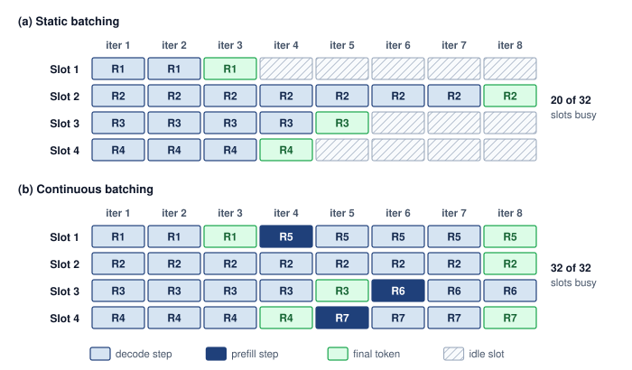

<!--
```{.tikz}
\providecolor{DarkNavy}{HTML}{1E293B}
\providecolor{OceanBlue}{HTML}{2563EB}
\providecolor{ForestGreen}{HTML}{166534}
\providecolor{AmberStage}{HTML}{D97706}
\providecolor{CrimsonSLA}{HTML}{991B1B}
\providecolor{SlateGrey}{HTML}{475569}
\providecolor{SoftGrey}{HTML}{F8FAFC}
\providecolor{SlateTeal}{HTML}{0F766E}
\providecolor{BorderGrey}{HTML}{CBD5E1}
\providecolor{BorderBlue}{HTML}{2563EB}
\providecolor{BorderGreen}{HTML}{166534}
\providecolor{BorderAmber}{HTML}{D97706}
\providecolor{BorderCrimson}{HTML}{991B1B}
\providecolor{Crimson}{HTML}{991B1B}
\providecolor{SoftBlue}{HTML}{F0F6FE}
\providecolor{SoftGreen}{HTML}{ECFAF0}
\providecolor{SoftAmber}{HTML}{FEF8EE}
\providecolor{SoftCrimson}{HTML}{FFF1F2}
\providecolor{BgCard}{HTML}{FFFFFF}
\providecolor{CardBg}{HTML}{FFFFFF}
\providecolor{GrayL}{HTML}{E0E0E0}
\providecolor{GrayLine}{HTML}{666666}
\providecolor{BlueLine}{HTML}{006395}
\providecolor{BlueFill}{HTML}{D6EAF8}
\providecolor{GreenLine}{HTML}{008F45}
\providecolor{GreenFill}{HTML}{D5F5E3}
\providecolor{OrangeLine}{HTML}{E67817}
\providecolor{OrangeFill}{HTML}{FDEBD0}
\providecolor{RedLine}{HTML}{D9534F}
\providecolor{RedFill}{HTML}{F2D7D5}
\providecolor{TextBlack}{HTML}{333333}
\providecolor{VioletLine}{HTML}{7E317B}
\providecolor{VioletFill}{RGB}{243,243,255}
\colorlet{mlsysblue}{OceanBlue}
\colorlet{mlsysgreen}{ForestGreen}
\colorlet{mlsysred}{CrimsonSLA}
\colorlet{mlsysamber}{AmberStage}
\colorlet{mlsysdarkgray}{DarkNavy}
\colorlet{mlsysteal}{SlateTeal}
\scalebox{0.79}{%
\begin{tikzpicture}[
    x=1cm, y=1cm,
    >=Stealth,
    font=\small\sffamily
]

    % Styles
    \tikzset{
        panel/.style={
            draw=BorderGrey,
            fill=white,
            line width=0.7pt,
            rounded corners=3.5pt,
            inner sep=0pt
        },
        pill/.style={
            draw=#1,
            fill=white,
            text=DarkNavy,
            font=\footnotesize\bfseries,
            rounded corners=2.5pt,
            inner xsep=6pt,
            inner ysep=2.5pt
        },
        tok_norm/.style={
            draw=OceanBlue!80,
            fill=white,
            line width=0.55pt,
            rounded corners=2pt,
            font=\fontsize{6.0}{7.5}\selectfont\color{DarkNavy},
            minimum width=1.14cm,
            minimum height=0.52cm,
            inner sep=0pt,
            align=center
        },
        tok_eos/.style={
            draw=ForestGreen!90,
            fill=SoftGreen!80,
            line width=0.55pt,
            rounded corners=2pt,
            font=\fontsize{6.0}{7.5}\selectfont\bfseries\color{ForestGreen!90!black},
            minimum width=1.14cm,
            minimum height=0.52cm,
            inner sep=0pt,
            align=center
        },
        tok_prefill/.style={
            draw=BorderAmber!95,
            fill=SoftAmber,
            line width=0.6pt,
            rounded corners=2pt,
            font=\fontsize{5.2}{6.6}\selectfont\bfseries\color{AmberStage!95!black},
            minimum width=1.14cm,
            minimum height=0.52cm,
            inner sep=0pt,
            align=center
        },
        tok_idle/.style={
            draw=Crimson!75,
            fill=white,
            pattern=north east lines,
            pattern color=Crimson!40,
            line width=0.55pt,
            rounded corners=2pt,
            minimum width=1.14cm,
            minimum height=0.52cm,
            inner sep=0pt,
            align=center
        },
        effcard/.style={
            draw=#1,
            fill=white,
            rounded corners=3pt,
            line width=0.65pt,
            inner sep=0pt
        }
    }

    % =========================================================================
    % PANEL (a): STATIC REQUEST BATCHING
    % =========================================================================
    \node[panel, minimum width=16.0cm, minimum height=4.2cm, anchor=north west] (pA) at (0, 0) {};

    % Header
    \node[pill=BorderGrey!70, anchor=north west] (pA_tag) at ([shift={(0.35cm, -0.3cm)}] pA.north west) {(a) Static Request Batching};
    \node[anchor=west, font=\fontsize{6.5}{8}\selectfont\color{DarkNavy!75}] at ([shift={(0.3cm, 0)}] pA_tag.east) {
        Coarse barrier: all requests held until longest sequence (R2) completes; early finishes cause idle bubbles
    };

    % Iteration headers (Iter 1 to Iter 8)
    \foreach \col/\x in {1/3.05, 2/4.25, 3/5.45, 4/6.65, 5/7.85, 6/9.05, 7/10.25, 8/11.45} {
        \node[font=\fontsize{6.5}{8}\selectfont\color{DarkNavy!80}] at (\x, -0.95) {Iter \col};
    }

    % Slot labels
    \node[anchor=east, font=\scriptsize\bfseries\color{DarkNavy}] at (2.35, -1.45) {Slot 1 (R1)};
    \node[anchor=east, font=\scriptsize\bfseries\color{DarkNavy}] at (2.35, -2.10) {Slot 2 (R2)};
    \node[anchor=east, font=\scriptsize\bfseries\color{DarkNavy}] at (2.35, -2.75) {Slot 3 (R3)};
    \node[anchor=east, font=\scriptsize\bfseries\color{DarkNavy}] at (2.35, -3.40) {Slot 4 (R4)};

    % Slot 1: R1 tok 1, R1 tok 2, R1 (EOS), then 5 idle bubbles
    \node[tok_norm] at (3.05, -1.45) {R1 tok 1};
    \node[tok_norm] at (4.25, -1.45) {R1 tok 2};
    \node[tok_eos]  at (5.45, -1.45) {R1 (EOS)};
    \node[tok_idle] at (6.65, -1.45) {};
    \node[tok_idle] at (7.85, -1.45) {};
    \node[tok_idle] at (9.05, -1.45) {};
    \node[tok_idle] at (10.25, -1.45) {};
    \node[tok_idle] at (11.45, -1.45) {};

    % Slot 2: R2 tok 1 to 7, R2 (EOS)
    \node[tok_norm] at (3.05, -2.10) {R2 tok 1};
    \node[tok_norm] at (4.25, -2.10) {R2 tok 2};
    \node[tok_norm] at (5.45, -2.10) {R2 tok 3};
    \node[tok_norm] at (6.65, -2.10) {R2 tok 4};
    \node[tok_norm] at (7.85, -2.10) {R2 tok 5};
    \node[tok_norm] at (9.05, -2.10) {R2 tok 6};
    \node[tok_norm] at (10.25, -2.10) {R2 tok 7};
    \node[tok_eos]  at (11.45, -2.10) {R2 (EOS)};

    % Slot 3: R3 tok 1 to 4, R3 (EOS), then 3 idle bubbles
    \node[tok_norm] at (3.05, -2.75) {R3 tok 1};
    \node[tok_norm] at (4.25, -2.75) {R3 tok 2};
    \node[tok_norm] at (5.45, -2.75) {R3 tok 3};
    \node[tok_norm] at (6.65, -2.75) {R3 tok 4};
    \node[tok_eos]  at (7.85, -2.75) {R3 (EOS)};
    \node[tok_idle] at (9.05, -2.75) {};
    \node[tok_idle] at (10.25, -2.75) {};
    \node[tok_idle] at (11.45, -2.75) {};

    % Slot 4: R4 tok 1 to 3, R4 (EOS), then 4 idle bubbles
    \node[tok_norm] at (3.05, -3.40) {R4 tok 1};
    \node[tok_norm] at (4.25, -3.40) {R4 tok 2};
    \node[tok_norm] at (5.45, -3.40) {R4 tok 3};
    \node[tok_eos]  at (6.65, -3.40) {R4 (EOS)};
    \node[tok_idle] at (7.85, -3.40) {};
    \node[tok_idle] at (9.05, -3.40) {};
    \node[tok_idle] at (10.25, -3.40) {};
    \node[tok_idle] at (11.45, -3.40) {};

    % Right Card: Batch Efficiency (Panel A) - Anchor at west, clear of Iter 8
    \node[effcard=BorderGrey, minimum width=3.35cm, minimum height=2.45cm, anchor=north west] (effA)
          at (12.35, -1.20) {};
    \node[anchor=north west, font=\scriptsize\bfseries\color{DarkNavy}]
          at ([shift={(0.25cm, -0.22cm)}] effA.north west) {Batch Efficiency};
    \node[anchor=north west, font=\fontsize{6.2}{7.8}\selectfont\color{DarkNavy!85}]
          at ([shift={(0.25cm, -0.65cm)}] effA.north west) {Active Slots: 20 / 32};
    \node[anchor=north west, font=\fontsize{6.2}{7.8}\selectfont\bfseries\color{Crimson}]
          at ([shift={(0.25cm, -1.05cm)}] effA.north west) {Idle Bubbles: 12 / 32};
    \node[draw=Crimson!80, fill=Crimson!8!white, rounded corners=2pt, line width=0.65pt,
          minimum width=2.85cm, minimum height=0.55cm, anchor=south, align=center]
          at ([shift={(0, 0.22cm)}] effA.south) {
        \fontsize{7.5}{9}\selectfont\bfseries\color{Crimson} 62.5\% Slot Util
    };

    % =========================================================================
    % PANEL (b): CONTINUOUS ITERATION BATCHING
    % =========================================================================
    \node[panel, draw=BorderGreen, fill=SoftGreen!30, minimum width=16.0cm, minimum height=4.2cm, anchor=north west]
          (pB) at (0, -4.6) {};

    % Header
    \node[pill=BorderGreen, anchor=north west] (pB_tag) at ([shift={(0.35cm, -0.3cm)}] pB.north west) {
        \color{ForestGreen!90!black} (b) Continuous Iteration Batching
    };
    \node[anchor=west, font=\fontsize{6.5}{8}\selectfont\color{DarkNavy!75}] at ([shift={(0.3cm, 0)}] pB_tag.east) {
        Fine-grained recycling: completed sequences immediately yield slots to incoming requests
    };

    % Iteration headers (Iter 1 to Iter 8)
    \foreach \col/\x in {1/3.05, 2/4.25, 3/5.45, 4/6.65, 5/7.85, 6/9.05, 7/10.25, 8/11.45} {
        \node[font=\fontsize{6.5}{8}\selectfont\color{DarkNavy!80}] at (\x, -5.55) {Iter \col};
    }

    % Slot labels
    \node[anchor=east, font=\scriptsize\bfseries\color{DarkNavy}] at (2.35, -6.05) {Slot 1 (R1$\to$R5)};
    \node[anchor=east, font=\scriptsize\bfseries\color{DarkNavy}] at (2.35, -6.70) {Slot 2 (R2)};
    \node[anchor=east, font=\scriptsize\bfseries\color{DarkNavy}] at (2.35, -7.35) {Slot 3 (R3$\to$R6)};
    \node[anchor=east, font=\scriptsize\bfseries\color{DarkNavy}] at (2.35, -8.00) {Slot 4 (R4$\to$R7)};

    % Slot 1: R1 tok 1, 2, EOS; then R5 (Prefill), R5 tok 1, 2, 3, EOS
    \node[tok_norm]    at (3.05, -6.05) {R1 tok 1};
    \node[tok_norm]    at (4.25, -6.05) {R1 tok 2};
    \node[tok_eos]     at (5.45, -6.05) {R1 (EOS)};
    \node[tok_prefill] at (6.65, -6.05) {R5 (Prefill)};
    \node[tok_norm]    at (7.85, -6.05) {R5 tok 1};
    \node[tok_norm]    at (9.05, -6.05) {R5 tok 2};
    \node[tok_norm]    at (10.25, -6.05) {R5 tok 3};
    \node[tok_eos]     at (11.45, -6.05) {R5 (EOS)};

    % Slot 2: R2 tok 1 to 7, EOS
    \node[tok_norm]    at (3.05, -6.70) {R2 tok 1};
    \node[tok_norm]    at (4.25, -6.70) {R2 tok 2};
    \node[tok_norm]    at (5.45, -6.70) {R2 tok 3};
    \node[tok_norm]    at (6.65, -6.70) {R2 tok 4};
    \node[tok_norm]    at (7.85, -6.70) {R2 tok 5};
    \node[tok_norm]    at (9.05, -6.70) {R2 tok 6};
    \node[tok_norm]    at (10.25, -6.70) {R2 tok 7};
    \node[tok_eos]     at (11.45, -6.70) {R2 (EOS)};

    % Slot 3: R3 tok 1 to 4, EOS; R6 (Prefill), R6 tok 1, 2
    \node[tok_norm]    at (3.05, -7.35) {R3 tok 1};
    \node[tok_norm]    at (4.25, -7.35) {R3 tok 2};
    \node[tok_norm]    at (5.45, -7.35) {R3 tok 3};
    \node[tok_norm]    at (6.65, -7.35) {R3 tok 4};
    \node[tok_eos]     at (7.85, -7.35) {R3 (EOS)};
    \node[tok_prefill] at (9.05, -7.35) {R6 (Prefill)};
    \node[tok_norm]    at (10.25, -7.35) {R6 tok 1};
    \node[tok_norm]    at (11.45, -7.35) {R6 tok 2};

    % Slot 4: R4 tok 1 to 3, EOS; R7 (Prefill), R7 tok 1, 2, EOS
    \node[tok_norm]    at (3.05, -8.00) {R4 tok 1};
    \node[tok_norm]    at (4.25, -8.00) {R4 tok 2};
    \node[tok_norm]    at (5.45, -8.00) {R4 tok 3};
    \node[tok_eos]     at (6.65, -8.00) {R4 (EOS)};
    \node[tok_prefill] at (7.85, -8.00) {R7 (Prefill)};
    \node[tok_norm]    at (9.05, -8.00) {R7 tok 1};
    \node[tok_norm]    at (10.25, -8.00) {R7 tok 2};
    \node[tok_eos]     at (11.45, -8.00) {R7 (EOS)};

    % Right Card: Batch Efficiency (Panel B) - Anchor at west, clear of Iter 8
    \node[effcard=BorderGreen, minimum width=3.35cm, minimum height=2.45cm, anchor=north west] (effB)
          at (12.35, -5.80) {};
    \node[anchor=north west, font=\scriptsize\bfseries\color{DarkNavy}]
          at ([shift={(0.25cm, -0.22cm)}] effB.north west) {Batch Efficiency};
    \node[anchor=north west, font=\fontsize{6.2}{7.8}\selectfont\color{DarkNavy!85}]
          at ([shift={(0.25cm, -0.65cm)}] effB.north west) {Active Slots: 32 / 32};
    \node[anchor=north west, font=\fontsize{6.2}{7.8}\selectfont\bfseries\color{ForestGreen!90!black}]
          at ([shift={(0.25cm, -1.05cm)}] effB.north west) {Idle Bubbles: 0 (Zero)};
    \node[draw=ForestGreen!80, fill=SoftGreen, rounded corners=2pt, line width=0.65pt,
          minimum width=2.85cm, minimum height=0.55cm, anchor=south, align=center]
          at ([shift={(0, 0.22cm)}] effB.south) {
        \fontsize{7.5}{9}\selectfont\bfseries\color{ForestGreen!90!black} 100\% Slot Util
    };

\end{tikzpicture}
}
```
-->

:::

### Quantifying continuous batching {#sec-inference-scale-continuous-batching-throughput-analysis-ecd2}

The execution schedules contrasted in @fig-continuous-batching-comparison raise a quantitative question: how much capacity can slot reuse recover? Static batching leaves slots idle until the longest sequence in a batch finishes, while continuous batching can refill those slots at iteration boundaries. Counting useful and unused sequence-iterations in a fixed batch bounds that opportunity; arrivals, KV-cache admission, prefill scheduling, and scheduler overhead determine how much of it a continuous batch actually recovers.

#### The waste function for traditional batching {#sec-inference-scale-waste-function-traditional-batching-1fb8}

The 11.25 percent example of one early-finishing sequence generalizes to any mix of output lengths. For this waste model, traditional batching\index{Static batching!waste function} (also called static batching) retains a fixed batch width through all decode iterations until the longest sequence completes. Assume equal compute cost per sequence-iteration, including padded work for completed requests. For batch size $\BatchSize$ with output lengths $\{\RequestOutputLength_1, \RequestOutputLength_2, ..., \RequestOutputLength_{\BatchSize}\}$, the total compute performed under those assumptions is:

$$\StaticBatchingOperations= \BatchSize\times \BatchMaxOutputLength\times \SequenceIterationOperations$$

where $\BatchMaxOutputLength= \max_i(\RequestOutputLength_i)$ and $\SequenceIterationOperations$ is the compute cost per decode iteration per sequence. However, the useful compute is only:

$$\UsefulModelFlops = \sum_{i=1}^{\BatchSize} \RequestOutputLength_i \times \SequenceIterationOperations$$

@Eq-waste-ratio defines the waste ratio\index{Waste Ratio} that quantifies the inefficiency:

$$\PaddingWasteFraction= 1 - \frac{\UsefulModelFlops}{\StaticBatchingOperations} = 1 - \frac{\sum_{i=1}^{\BatchSize} \RequestOutputLength_i}{\BatchSize\times \BatchMaxOutputLength} = 1 - \frac{\BatchMeanOutputLength}{\BatchMaxOutputLength}$$ {#eq-waste-ratio}

where $\BatchMeanOutputLength$ is the mean output sequence length. This reveals that waste depends entirely on the ratio of mean to maximum output length within the batch. For uniform output lengths $(\BatchMeanOutputLength= \BatchMaxOutputLength)$, waste is zero. For highly variable lengths, waste can exceed 50 percent.

#### Serving variable-length outputs in LLMs {#sec-inference-scale-worked-example-llm-serving-variablelength-outputs-5e38}

Consider a GPT-class model serving four concurrent requests with the generation lengths shown in @tbl-batching-request-lengths (in tokens):

```{python}
#| echo: false
#| label: batching-request-totals
# ┌─────────────────────────────────────────────────────────────────────────────
# │ BATCHING REQUEST TOTAL TOKENS (LEGO)
# ├─────────────────────────────────────────────────────────────────────────────
# │ Context: @tbl-batching-request-lengths — Total Tokens column.
# │
# │ Goal: Compute Total Tokens = Prompt Length + Output Length for each request.
# │ Show: R1=150, R2=280, R3=220, R4=240 in table.
# │ How: Simple addition per row.
# │
# └─────────────────────────────────────────────────────────────────────────────
from mlsysim.fmt import check, fmt_int

class BatchingRequestTotals:
    """Compute total tokens per request (prompt + output)."""

    # ┌── 1. LOAD (Constants) ──────────────────────────────────────────────
    prompt_lengths = [100, 80, 120, 90]
    output_lengths = [50, 200, 100, 150]

    # ┌── 2. EXECUTE (The Compute) ─────────────────────────────────────────
    totals = [p + o for p, o in zip(prompt_lengths, output_lengths)]

    # ┌── 3. GUARD (Invariants) ────────────────────────────────────────────
    check(totals == [150, 280, 220, 240], f"Total tokens mismatch: {totals}")

    # ┌── 4. OUTPUT (Formatting) ───────────────────────────────────────────
    r1_total_str = fmt_int(totals[0])
    r2_total_str = fmt_int(totals[1])
    r3_total_str = fmt_int(totals[2])
    r4_total_str = fmt_int(totals[3])
```

| **Request** | **Prompt Length** | **Output Length** |                **Total Tokens**               |
|:------------|:-----------------:|:-----------------:|:---------------------------------------------:|
| **R1**      |        100        |         50        | `{python} BatchingRequestTotals.r1_total_str` |
| **R2**      |         80        |        200        | `{python} BatchingRequestTotals.r2_total_str` |
| **R3**      |        120        |        100        | `{python} BatchingRequestTotals.r3_total_str` |
| **R4**      |         90        |        150        | `{python} BatchingRequestTotals.r4_total_str` |

: **Concurrent request generation lengths**: Four concurrent requests on a GPT-class model with varying prompt and output lengths. The 4$\times$ spread in output length (50 to 200 tokens) drives the batching waste analyzed in this section: a static batch of four pads every request to the longest, wasting compute on the three shorter requests until the longest finishes generating. Prompt length sets each request's prefill work, and the total is the number of tokens its KV cache holds when it finishes; both matter for admission, while the decode-slot accounting below uses only the output lengths. {#tbl-batching-request-lengths}

```{python}
#| echo: false
#| label: batching-worked-example
# ┌─────────────────────────────────────────────────────────────────────────────
# │ BATCHING WORKED EXAMPLE (LEGO)
# ├─────────────────────────────────────────────────────────────────────────────
# │ Context: "Traditional vs. Continuous Batching" worked example in
# │   §Continuous Batching for LLMs.
# │
# │ Goal: Quantify latency difference between traditional and continuous batching
# │   for 4 LLM requests with variable output lengths (50, 200, 100, 150 tokens),
# │   showing the latency reduction percentage and per-request improvement factors.
# │ Show: trad_lat_ms_str="4,000" ms, cont_avg_lat_str="2,500" ms,
# │   latency_red_str="37.5"%—inline in worked-example prose.
# │ How: Compute max-output iteration count for traditional; per-output iteration
# │   count for continuous; derive reduction % and per-request improvement ratios.
# │
# └─────────────────────────────────────────────────────────────────────────────
from mlsysim.fmt import MarkdownStr, fmt, fmt_int, fmt_math, fmt_percent, fmt_time

# ┌── LEGO ───────────────────────────────────────────────
class BatchingWorkedExample:
    """Quantify latency difference between traditional and continuous batching."""

    # ┌── 1. LOAD (Constants) ──────────────────────────────────────────────
    output_lengths = [50, 200, 100, 150]  # R1, R2, R3, R4 output tokens
    n_requests = len(output_lengths)
    decode_time_ms = 20  # ms per iteration for batch of 4

    # ┌── 2. EXECUTE (The Compute) ────────────────────────────────────────
    mean_output = sum(output_lengths) / n_requests
    max_output = max(output_lengths)

    total_iterations = max_output
    total_batch_time_ms = total_iterations * decode_time_ms
    total_seq_iters = n_requests * max_output
    useful_seq_iters = sum(output_lengths)

    # Step 1: Continuous batching latencies
    r1_latency_ms = output_lengths[0] * decode_time_ms
    r2_latency_ms = output_lengths[1] * decode_time_ms
    r3_latency_ms = output_lengths[2] * decode_time_ms
    r4_latency_ms = output_lengths[3] * decode_time_ms

    # Step 2: Traditional: all requests wait for max
    trad_latency_ms = max_output * decode_time_ms

    # Step 3: Continuous: average of individual latencies
    cont_avg_latency_ms = (r1_latency_ms + r3_latency_ms + r4_latency_ms + r2_latency_ms) / n_requests
    latency_reduction_pct = (1 - cont_avg_latency_ms / trad_latency_ms) * 100

    # Step 4: Improvement factors
    r1_improvement = trad_latency_ms / r1_latency_ms
    r3_improvement = trad_latency_ms / r3_latency_ms
    r4_improvement = trad_latency_ms / r4_latency_ms

    # Step 5: Waste ratio (mean / max), per @eq-waste-ratio
    waste_ratio = mean_output / max_output  # 125 / 200 = 0.625

    # ┌── 3. GUARD (Invariants) ──────────────────────────────────────────
    check(latency_reduction_pct == 37.5, f"Expected 37.5% reduction, got {latency_reduction_pct}")
    check(total_iterations == max_output, "total iterations equals the longest output")

    # ┌── 4. OUTPUT (Formatting) ──────────────────────────────────────────────
    total_iterations_str = fmt_int(total_iterations, commas=False)
    max_output_str = fmt_count(max_output, commas=False, label="token")
    decode_time_ms_str = fmt_time(decode_time_ms * millisecond, millisecond, precision=0, commas=False)
    mean_output_eq_math = fmt_math(r"(" + " + ".join(str(v) for v in output_lengths) + rf") / {n_requests} =")
    total_batch_time_calc_math = fmt_math(rf"{total_iterations} \times {decode_time_ms}\text{{ ms}} =")
    total_seq_iters_calc_math = fmt_math(rf"{n_requests} \times {max_output} =")
    latency_reduction_pct_math_str = fmt(latency_reduction_pct, precision=1, commas=False, suffix=r"\%")
    waste_eq_math = fmt_math(
        rf"\PaddingWasteFraction = 1 - \frac{{{int(mean_output)}}}{{{max_output}}} = 1 - {waste_ratio} = " + str(latency_reduction_pct_math_str)
    )
    r1_lat_calc_math = fmt_math(rf"{output_lengths[0]} \times {decode_time_ms}\text{{ ms}} =")
    r2_lat_calc_math = fmt_math(rf"{output_lengths[1]} \times {decode_time_ms}\text{{ ms}} =")
    r3_lat_calc_math = fmt_math(rf"{output_lengths[2]} \times {decode_time_ms}\text{{ ms}} =")
    r4_lat_calc_math = fmt_math(rf"{output_lengths[3]} \times {decode_time_ms}\text{{ ms}} =")
    mean_output_str = fmt_count(mean_output, commas=False, label="token")
    total_batch_time_ms_str = fmt_time(round(total_batch_time_ms), 'millisecond', precision=0, commas=True)
    total_seq_iters_str = fmt_int(total_seq_iters)
    useful_seq_iters_str = fmt_int(useful_seq_iters)
    r1_lat_ms_str = fmt_time(round(r1_latency_ms), 'millisecond', precision=0, commas=True)
    r2_lat_str = fmt_int(r2_latency_ms)
    r3_lat_str = fmt_int(r3_latency_ms)
    r4_lat_str = fmt_int(r4_latency_ms)
    trad_lat_ms_str = fmt_time(round(trad_latency_ms), 'millisecond', precision=0, commas=True)
    cont_avg_lat_str = fmt_int(cont_avg_latency_ms)
    latency_red_str = fmt_percent(latency_reduction_pct / 100, precision=1, commas=False, style='prose')
    r1_imp_mult_str = fmt_multiple(r1_improvement, precision=0, commas=False)
    r3_imp_mult_str = fmt_multiple(r3_improvement, precision=0, commas=False)
    r4_imp_mult_str = fmt_multiple(r4_improvement, precision=2, commas=False)
```

:::: {#nbk-inference-continuous-batching-worked-example .callout-notebook title="Continuous batching waste calculation"}

**Problem**: Four LLM requests with unequal output lengths share a four-slot batch. Assume fixed decode-iteration time and no queueing. How much of the batch's slot time does fixed membership leave unused, how much of it can continuous admission hand to new requests, and what happens to the original requests' latencies?

**Variables**:

- Decode time per iteration (batch of 4): `{python} BatchingWorkedExample.decode_time_ms_str`
- Maximum output length in batch: `{python} BatchingWorkedExample.max_output_str` (R2)
- Mean output length: `{python} BatchingWorkedExample.mean_output_eq_math` `{python} BatchingWorkedExample.mean_output_str`

**Slot accounting under fixed membership**: The batch keeps all four slots until R2, the longest request, finishes.

- Total decode iterations: `{python} BatchingWorkedExample.total_iterations_str`
- Total batch time: `{python} BatchingWorkedExample.total_batch_time_calc_math` `{python} BatchingWorkedExample.total_batch_time_ms_str`

The waste ratio in @eq-waste-ratio, one minus the ratio of mean to maximum output length, measures the slot time that finished requests leave idle:

`{python} BatchingWorkedExample.waste_eq_math`

The fixed-width schedule contains `{python} BatchingWorkedExample.total_seq_iters_calc_math` `{python} BatchingWorkedExample.total_seq_iters_str` "sequence-iterations" but only `{python} BatchingWorkedExample.useful_seq_iters_str` are useful. These counts measure executed work only if the kernel continues processing completed slots; otherwise they measure useful work relative to the schedule's available slots.

**Continuous admission**: Sequences depart at the iteration where they complete, and eligible new requests take their slots without delaying the original requests under the fixed-iteration-time assumption.

- Iteration 50: R1 completes → slot freed, new request R5 can join
- Iteration 100: R3 completes → slot freed, new request R6 can join
- Iteration 150: R4 completes → slot freed, new request R7 can join
- Iteration 200: R2 completes

**Response latency, a separate effect**: The fixed-membership schedule in this comparison deliberately withholds all four responses until R2 completes its 200 tokens. Static batch membership alone does not require that barrier.

- Completion times with the barrier:
  - R1 completes useful work at iteration 50, but waits until iteration 200 → latency = `{python} BatchingWorkedExample.trad_lat_ms_str`
  - R2 completes at iteration 200 → latency = `{python} BatchingWorkedExample.trad_lat_ms_str`
  - R3 completes useful work at iteration 100, but waits until iteration 200 → latency = `{python} BatchingWorkedExample.trad_lat_ms_str`
  - R4 completes useful work at iteration 150, but waits until iteration 200 → latency = `{python} BatchingWorkedExample.trad_lat_ms_str`

Latencies with immediate release under continuous admission (assuming no queuing delay):

- R1: `{python} BatchingWorkedExample.r1_lat_calc_math` `{python} BatchingWorkedExample.r1_lat_ms_str` (`{python} BatchingWorkedExample.r1_imp_mult_str` improvement over traditional)
- R3: `{python} BatchingWorkedExample.r3_lat_calc_math` `{python} BatchingWorkedExample.r3_lat_str` (`{python} BatchingWorkedExample.r3_imp_mult_str` improvement)
- R4: `{python} BatchingWorkedExample.r4_lat_calc_math` `{python} BatchingWorkedExample.r4_lat_str` (`{python} BatchingWorkedExample.r4_imp_mult_str` improvement)
- R2: `{python} BatchingWorkedExample.r2_lat_calc_math` `{python} BatchingWorkedExample.r2_lat_str` (no improvement for longest request)

Average latency comparison

- Traditional: `{python} BatchingWorkedExample.trad_lat_ms_str` (all requests)
- Continuous: (`{python} BatchingWorkedExample.r1_lat_ms_str` + `{python} BatchingWorkedExample.r3_lat_str` + `{python} BatchingWorkedExample.r4_lat_str` + `{python} BatchingWorkedExample.r2_lat_str`) / 4 = `{python} BatchingWorkedExample.cont_avg_lat_str`

**Result**: Under fixed membership, only `{python} BatchingWorkedExample.useful_seq_iters_str` of the `{python} BatchingWorkedExample.total_seq_iters_str` sequence-iterations do useful work. Continuous admission hands the rest to R5, R6, and R7, which start generating at iterations 50, 100, and 150 instead of waiting for a new batch, so the same 200 iterations now advance seven requests rather than four. Releasing each response on completion separately reduces the original requests' average latency by `{python} BatchingWorkedExample.latency_red_str`, numerically matching the unused-slot ratio, and static batching that released responses on completion would obtain the same original-request latencies.

**Systems insight**: Response release and slot reuse are separate decisions. Removing a response barrier helps the requests already in the batch; only continuous admission recovers the stranded iteration capacity diagrammed in @fig-continuous-batching-comparison, and that recovered capacity is what raises a replica's throughput.

::::

#### Efficiency regimes for continuous batching {#sec-inference-scale-continuous-batching-provides-maximum-benefit-a406}

The continuous-batching analysis relates recoverable slot capacity to the gap between a batch's longest and average output lengths. Let $\text{CV} = \OutputLengthStandardDeviation/ \WorkloadMeanOutputLength$ be the coefficient of variation of output lengths. For the idealized fixed-width schedule, suppose the longest request in a batch is roughly $\BatchMaximumDeviationMultiple$ standard deviations above the mean. The factor $\BatchMaximumDeviationMultiple$ is an assumption about the batch rather than a property of the workload, because a larger batch draws more samples and pushes its maximum further into the tail. With immediate refill and unchanged iteration time, the corresponding capacity ratio is:

$$\text{Improvement} \approx \frac{\BatchMaxOutputLength}{\BatchMeanOutputLength} = \frac{\WorkloadMeanOutputLength+ \BatchMaximumDeviationMultiple\OutputLengthStandardDeviation}{\WorkloadMeanOutputLength} = 1 + \BatchMaximumDeviationMultiple\cdot \text{CV}$$

where $\BatchMaximumDeviationMultiple$ specifies how far the batch maximum lies above the mean. The expression is therefore a scenario ceiling, set jointly by the workload's CV and the assumed $\BatchMaximumDeviationMultiple$, on the opportunity from filling otherwise unused slots. Scheduler overhead, KV-cache pressure, and refill gaps reduce the recovered fraction; changes in kernel efficiency or memory policy require a broader comparison. In the table that follows, the CV and $\BatchMaximumDeviationMultiple$ columns are the inputs, and $1 + \BatchMaximumDeviationMultiple\cdot \text{CV}$ is the ceiling they set. The speedup column is an assumed realized fraction of that ceiling, chosen to sit below it, and the waste column restates that assumed speedup as the equivalent effective waste through $\text{speedup} \approx 1/(1 - \EffectiveWasteFraction)$. Neither column is a measurement or an independent result. Together they show how much of the ceiling a scheduler would have to recover to reach a given gain, which is the quantity a load test should measure.

@Tbl-continuous-batching-benefit applies this accounting across workload types, including retrieval-augmented generation (RAG) [@lewis2020retrieval]:

```{python}
#| echo: false
#| label: continuous-batching-benefit
# ┌─────────────────────────────────────────────────────────────────────────────
# │ CONTINUOUS BATCHING BENEFIT TABLE (LEGO)
# ├─────────────────────────────────────────────────────────────────────────────
# │ Context: @tbl-continuous-batching-benefit in §Continuous batching.
# │
# │ Goal: Keep the table's effective waste and speedup values synchronized.
# │ Show: conservative effective speedups bounded by 1 + k * CV.
# │ How: Treat 1 + k * CV as a theoretical ceiling; compute effective waste from
# │      the assumed realized speedup via W = 1 - 1 / speedup.
# │
# └─────────────────────────────────────────────────────────────────────────────
from mlsysim.fmt import check, fmt, fmt_int, fmt_multiple, fmt_percent

class ContinuousBatchingBenefit:
    """Conservative realized-speedup table for continuous batching."""

    # ┌── 1. LOAD (Constants) ──────────────────────────────────────────────
    code_cv = 0.3
    code_k = 2.5
    code_speedup = 1.2

    chat_cv = 0.6
    chat_k = 2.0
    chat_speedup = 1.5

    text_cv = 1.0
    text_k = 2.5
    text_speedup = 2.0

    creative_cv = 1.5
    creative_k = 3.0
    creative_speedup = 2.8

    rag_cv = 2.0
    rag_k = 2.5
    rag_speedup = 3.5

    # ┌── 2. EXECUTE (The Compute) ────────────────────────────────────────
    code_upper = 1 + code_k * code_cv
    chat_upper = 1 + chat_k * chat_cv
    text_upper = 1 + text_k * text_cv
    creative_upper = 1 + creative_k * creative_cv
    rag_upper = 1 + rag_k * rag_cv

    code_waste_pct = (1 - 1 / code_speedup) * 100
    chat_waste_pct = (1 - 1 / chat_speedup) * 100
    text_waste_pct = (1 - 1 / text_speedup) * 100
    creative_waste_pct = (1 - 1 / creative_speedup) * 100
    rag_waste_pct = (1 - 1 / rag_speedup) * 100

    # ┌── 3. GUARD (Invariants) ──────────────────────────────────────────
    check(code_speedup <= code_upper, "Code speedup should not exceed upper bound")
    check(chat_speedup <= chat_upper, "Chat speedup should not exceed upper bound")
    check(text_speedup <= text_upper, "Text speedup should not exceed upper bound")
    check(creative_speedup <= creative_upper, "Creative-writing speedup should not exceed upper bound")
    check(rag_speedup <= rag_upper, "RAG speedup should not exceed upper bound")
    check(round(text_waste_pct) == 50, "2x speedup should imply 50 percent waste")

    # ┌── 4. OUTPUT (Formatting) ─────────────────────────────────────────────
    code_cv_str = fmt(code_cv, precision=1, commas=False)
    code_k_str = fmt(code_k, precision=1, commas=False)
    code_waste_pct_str = fmt_percent(code_waste_pct / 100, precision=1, commas=False, style='symbol')
    code_speedup_mult_str = fmt_multiple(code_speedup, precision=1, commas=False)

    chat_cv_str = fmt(chat_cv, precision=1, commas=False)
    chat_k_str = fmt_int(chat_k, commas=False)
    chat_waste_pct_str = fmt_percent(chat_waste_pct / 100, precision=1, commas=False, style='symbol')
    chat_speedup_mult_str = fmt_multiple(chat_speedup, precision=1, commas=False)

    text_cv_str = fmt_int(text_cv, commas=False)
    text_k_str = fmt(text_k, precision=1, commas=False)
    text_waste_pct_str = fmt_percent(round(text_waste_pct) / 100, precision=0, commas=False, style='symbol')
    text_speedup_mult_str = fmt_multiple(text_speedup, commas=False, precision=0)

    creative_cv_str = fmt(creative_cv, precision=1, commas=False)
    creative_k_str = fmt_int(creative_k, commas=False)
    creative_waste_pct_str = fmt_percent(creative_waste_pct / 100, precision=1, commas=False, style='symbol')
    creative_speedup_mult_str = fmt_multiple(creative_speedup, precision=1, commas=False)

    rag_cv_str = fmt_int(rag_cv, commas=False)
    rag_k_str = fmt(rag_k, precision=1, commas=False)
    rag_waste_pct_str = fmt_percent(rag_waste_pct / 100, precision=1, commas=False, style='symbol')
    rag_speedup_mult_str = fmt_multiple(rag_speedup, precision=1, commas=False)
```

| **Workload Type**           |                        **CV**                        |                        **k**                        |                      **Waste (Trad.)**                      |                    **Speedup (Continuous)**                    |
|:----------------------------|:----------------------------------------------------:|:---------------------------------------------------:|:-----------------------------------------------------------:|:--------------------------------------------------------------:|
| **Code completion**         |   `{python} ContinuousBatchingBenefit.code_cv_str`   |   `{python} ContinuousBatchingBenefit.code_k_str`   |   `{python} ContinuousBatchingBenefit.code_waste_pct_str`   |   `{python} ContinuousBatchingBenefit.code_speedup_mult_str`   |
| **Chat (short responses)**  |   `{python} ContinuousBatchingBenefit.chat_cv_str`   |   `{python} ContinuousBatchingBenefit.chat_k_str`   |   `{python} ContinuousBatchingBenefit.chat_waste_pct_str`   |   `{python} ContinuousBatchingBenefit.chat_speedup_mult_str`   |
| **General text generation** |   `{python} ContinuousBatchingBenefit.text_cv_str`   |   `{python} ContinuousBatchingBenefit.text_k_str`   |   `{python} ContinuousBatchingBenefit.text_waste_pct_str`   |   `{python} ContinuousBatchingBenefit.text_speedup_mult_str`   |
| **Creative writing**        | `{python} ContinuousBatchingBenefit.creative_cv_str` | `{python} ContinuousBatchingBenefit.creative_k_str` | `{python} ContinuousBatchingBenefit.creative_waste_pct_str` | `{python} ContinuousBatchingBenefit.creative_speedup_mult_str` |
| **RAG with variable docs**  |   `{python} ContinuousBatchingBenefit.rag_cv_str`    |    `{python} ContinuousBatchingBenefit.rag_k_str`   |    `{python} ContinuousBatchingBenefit.rag_waste_pct_str`   |   `{python} ContinuousBatchingBenefit.rag_speedup_mult_str`    |

: **Continuous batching benefit by workload type**: Higher output-length variance (CV) raises the ceiling on improvement from continuous batching. The $\BatchMaximumDeviationMultiple$ values are assumed, so each $1 + \BatchMaximumDeviationMultiple\cdot \text{CV}$ ceiling is a scenario value, and the speedups are assumed values held below it rather than measurements; the waste column is the effective waste those speedups imply. Workloads with predictable output lengths (code completion) have little to recover, while highly variable workloads (RAG with documents of varying length) have the most. {#tbl-continuous-batching-benefit}

The systems pattern is straightforward: continuous batching is most valuable when output lengths are unpredictable, mixed workload types share the same cluster, request volume is high enough to refill vacated slots, and latency SLOs make early completion valuable. It provides minimal benefit when output lengths are uniform, as in classification or embedding generation, when batch sizes are too small for slot reuse to matter, or when request volume is too low to refill vacated slots.

The ceiling depends on $\BatchMaximumDeviationMultiple$, which the coefficient of variation alone does not set. The full length distribution and batch size determine how far a batch's maximum lies above its mean, while arrivals, KV-cache admission, prefill scheduling, and scheduler overhead determine how much vacated capacity can be recovered. Serving teams must therefore compare policies under the same arrival trace, latency objective, and memory budget. Example \ref{exmp-inference-continuous-batching-vllm} connects slot reuse to the memory-management choices of a published system.

::: {#exmp-inference-continuous-batching-vllm .callout-example title="Continuous batching in vLLM"}

**Scenario**: An LLM serving engine (vLLM) manages autoregressive generation for incoming requests with highly variable output sequence lengths [@kwon2023].

**Diagnosis**: Fixed batch membership leaves completed slots unavailable to waiting requests. Continuous admission reuses that capacity, while paged allocation reduces unused cache reservations. The published vLLM design uses arrival order to prioritize requests, preempting later arrivals first under memory pressure. It considers both swapping cache state to CPU memory and recomputing that state when a request resumes.

**Systems lesson**: Continuous batching decouples batch membership from request-level boundaries. The paper reports 2–4$\times$ higher throughput at comparable latency than FasterTransformer and Orca in its evaluated workloads. This is a system comparison, not an isolated measurement of slot reuse. Paged cache management contributes by reducing memory waste and permitting larger active batches.

:::

#### Implementation complexity trade-offs {#sec-inference-scale-implementation-complexity-tradeoffs-e055}

The same variability that makes continuous batching valuable also makes it harder to operate. Its performance benefits come with implementation complexity that systems engineers must weigh.

Memory management must support overlapping request lifetimes. A simple fixed-membership implementation can reserve cache regions when a batch forms and release them together. Continuous admission must instead track which request owns each region and when that space becomes reusable. Fixed-capacity slots can support this policy, but they retain unused reservations; paging allocates space more incrementally at the cost of block tables and allocation bookkeeping. Completed state may also remain cached for reuse, so request completion and physical deallocation need not coincide.

Scheduler decisions also become more frequent. A simple fixed-membership policy checks whether a batch is full or its timeout has expired; continuous admission additionally tracks completions, available cache capacity, and eligible waiting requests at iteration boundaries. A constant-time readiness check is $\mathcal{O}(1)$, while scanning all active sequences is $\mathcal{O}(\BatchSize)$ per iteration. These describe particular operations, not the total complexity of either scheduler. Both policies must manage request metadata, and the cost of priority selection or preemption depends on the data structures and policy used. Because continuous admission repeats this work at every decode iteration, it must stay small relative to a decode step or it erodes the throughput that slot reuse recovers. Engines therefore keep the per-iteration path short and can prepare the next iteration's batch on the host while the accelerator executes the current one.

Kernel design must also adapt. Batched GPU kernels traditionally assume fixed batch composition. Continuous batching requires kernels that handle variable-length sequences efficiently, often through techniques like packing multiple short sequences into shared attention masks or using specialized memory layouts that support dynamic batch membership.

@Tbl-batching-tradeoffs summarizes these trade-offs:

| **Dimension**             |  **Traditional Batching** | **Continuous Batching**                                   |
|:--------------------------|:-------------------------:|:----------------------------------------------------------|
| **Implementation effort** | Low (standard frameworks) | High (custom scheduler, kernels)                          |
| **Memory overhead**       |      Fixed allocation     | Dynamic + fragmentation mgmt                              |
| **Scheduler work**        |       Once per batch      | Every decode iteration                                    |
| **Debugging complexity**  |   Deterministic behavior  | State-dependent, harder to trace                          |
| **Throughput (variable)** |          Baseline         | Up to $1 + \BatchMaximumDeviationMultiple\cdot \text{CV}$ |
| **Throughput (uniform)**  |          Baseline         | ~1.0$\times$ (no improvement)                             |

: **Traditional vs. continuous batching trade-offs**: Continuous batching provides significant throughput gains for variable-length workloads at the cost of implementation complexity. For uniform-length workloads, the complexity overhead may not justify adoption. {#tbl-batching-tradeoffs}

For new LLM serving deployments, continuous batching frameworks like vLLM, TensorRT-LLM\index{TensorRT-LLM!continuous batching}, or Text Generation Inference\index{Text Generation Inference!continuous batching} provide mature implementation paths. The decision becomes whether to adopt these frameworks or build custom serving infrastructure. For organizations with existing traditional batching systems, the migration cost must be weighed against the workload's output length variance using @tbl-continuous-batching-benefit.

Even with mature serving frameworks, diagnosing tail latency anomalies requires systematic investigation across the system stack. The following constructed p99 regression illustrates how to investigate infrastructure, execution, and serving layers. Its latency observations and mitigation outcome are scenario assumptions; only the transfer-time estimates are computed from payload and bandwidth.

```{python}
#| echo: false
#| label: a100-hardware-scenario
# ┌─────────────────────────────────────────────────────────────────────────────
# │ A100 HARDWARE SPECS (LEGO)
# ├─────────────────────────────────────────────────────────────────────────────
# │ Context: @sec-inference-scale—multi-GPU hardware comparison
# │
# │ Goal: Provide A100 memory, bandwidth, and interconnect specs.
# │ Show: "80" GB, "2" TB/s, "600" GB/s NVLink, "32" GB/s PCIe Gen4.
# │ How: pulling constants from mlsysim.core.units.
# │
# └─────────────────────────────────────────────────────────────────────────────
from mlsysim import *

class A100HardwareScenario:
    """A100 hardware reference."""

    # ┌── 1. LOAD (Constants) ──────────────────────────────────────────────
    mem = Hardware.Cloud.A100.memory.capacity
    bw = Hardware.Cloud.A100.memory.bandwidth
    nvlink = Hardware.Cloud.A100.nvlink.bandwidth
    pcie = Hardware.Cloud.A100.interconnect.bandwidth
    num_gpus = 4  # scenario topology
    p50_latency = 100 * millisecond  # scenario latency observation
    p95_latency = 180 * millisecond  # scenario latency observation
    p99_latency = 500 * millisecond  # scenario latency observation
    p99_target = 200 * millisecond  # scenario SLO target
    gpu_utilization = 0.85  # scenario utilization observation
    activation_transfer = 100 * MB  # scenario payload
    max_batch_size = 32  # scenario batching policy
    batch_timeout = 50 * millisecond  # scenario batching policy
    affected_batch_share = 0.05  # scenario tail fraction
    short_token_threshold = 50  # scenario classification threshold
    medium_token_threshold = 200  # scenario classification threshold
    short_batch_size = 8  # scenario revised policy
    medium_batch_size = 16  # scenario revised policy
    long_batch_size = 32  # scenario revised policy
    p99_after = 185 * millisecond  # scenario post-mitigation result

    # ┌── 2. EXECUTE (The Compute) ────────────────────────────────────────
    pcie_transfer = (activation_transfer / pcie).to(millisecond)
    nvlink_transfer = (activation_transfer / nvlink).to(millisecond)

    # ┌── 3. GUARD (Invariants) ──────────────────────────────────────────
    check(nvlink > pcie, "NVLink should be faster than PCIe")
    check(pcie_transfer > nvlink_transfer, "PCIe transfer should be slower than NVLink")

    # ┌── 4. OUTPUT (Formatting) ──────────────────────────────────────────────
    pcie_gen4_gb_per_s_str = fmt_bandwidth(pcie, unit=GB / second, precision=0, commas=False)
    num_gpus_str = fmt_count(num_gpus, precision=0, commas=False)
    p50_latency_ms_str = fmt_time(p50_latency, millisecond, precision=0, commas=False)
    p95_latency_ms_str = fmt_time(p95_latency, millisecond, precision=0, commas=False)
    p99_latency_ms_str = fmt_time(p99_latency, millisecond, precision=0, commas=False)
    p99_target_ms_str = fmt_time(p99_target, millisecond, precision=0, commas=False)
    gpu_utilization_pct_str = fmt_percent(gpu_utilization, precision=0, commas=False, style='prose')
    activation_transfer_mb_str = fmt_memory(activation_transfer, unit=MB, precision=0, commas=False)
    pcie_transfer_ms_str = fmt_time(pcie_transfer, millisecond, precision=1, commas=False)
    nvlink_transfer_ms_str = fmt_time(nvlink_transfer, millisecond, precision=2, commas=False)
    max_batch_size_str = fmt_count(max_batch_size, precision=0, commas=False)
    batch_timeout_ms_str = fmt_time(batch_timeout, millisecond, precision=0, commas=False)
    affected_batch_share_pct_str = fmt_percent(affected_batch_share, precision=0, commas=False, style='prose')
    short_token_threshold_str = fmt_count(short_token_threshold, precision=0, commas=False)
    medium_token_threshold_str = fmt_count(medium_token_threshold, precision=0, commas=False)
    short_batch_size_str = fmt_count(short_batch_size, precision=0, commas=False)
    medium_batch_size_str = fmt_count(medium_batch_size, precision=0, commas=False)
    long_batch_size_str = fmt_count(long_batch_size, precision=0, commas=False)
    p99_after_ms_str = fmt_time(p99_after, millisecond, precision=0, commas=False)
```

::: {#exmp-inference-debugging-high-p99-latency .callout-example title="Debugging high p99 latency"}

**Scenario**: An LLM serving system exhibits high tail latency: p50 = `{python} A100HardwareScenario.p50_latency_ms_str` and p95 = `{python} A100HardwareScenario.p95_latency_ms_str` maintain SLO, but p99 spikes to $\TailRequestLatency =$ `{python} A100HardwareScenario.p99_latency_ms_str` against a `{python} A100HardwareScenario.p99_target_ms_str` target despite a monitored GPU utilization of `{python} A100HardwareScenario.gpu_utilization_pct_str`.

**Diagnosis**: The system runs across `{python} A100HardwareScenario.num_gpus_str` A100 GPUs linked via PCIe Gen4 (`{python} A100HardwareScenario.pcie_gen4_gb_per_s_str` per GPU) rather than NVLink. For a `{python} A100HardwareScenario.activation_transfer_mb_str` payload, the bandwidth-only transfer estimate is $\CommunicationTime(\DeviceCount) \approx$ `{python} A100HardwareScenario.pcie_transfer_ms_str` over PCIe versus `{python} A100HardwareScenario.nvlink_transfer_ms_str` over NVLink. Collective startup, topology, and contention can add time. The service still runs an older request-level batching server rather than an iteration-level engine, with max batch size `{python} A100HardwareScenario.max_batch_size_str` and timeout `{python} A100HardwareScenario.batch_timeout_ms_str`, so a batch holds its members until its longest generation finishes. The scenario assumes that `{python} A100HardwareScenario.affected_batch_share_pct_str` of batches experience head-of-line queuing delay $\QueueingLatency$ as short requests wait behind long generations.

**Systems lesson**: The latency distribution motivates tracing both candidates. A transfer paid by every request contributes to every latency percentile, but its service-time cost can also amplify tail queueing near saturation. In this scenario, traces showing stable transfer times too small to explain the additional delay, together with short requests waiting behind long generations, identify the fixed-membership barrier as the immediate cause. Continuous admission removes that barrier; prefill scheduling, cache capacity, and other waits still require measurement. Until the server can be replaced, the following policy reduces output-length variation within request-level batches:

1. **Request classification**: Classify requests by expected output length (short: under `{python} A100HardwareScenario.short_token_threshold_str` tokens, medium: `{python} A100HardwareScenario.short_token_threshold_str` to `{python} A100HardwareScenario.medium_token_threshold_str` tokens, long: over `{python} A100HardwareScenario.medium_token_threshold_str` tokens)
2. **Differentiated batching**: Limit short batches to `{python} A100HardwareScenario.short_batch_size_str`, medium to `{python} A100HardwareScenario.medium_batch_size_str`, long to `{python} A100HardwareScenario.long_batch_size_str`

Grouping requests by expected length shrinks the spread of output lengths inside each batch, which is the quantity @eq-waste-ratio says drives both waste and waiting. The scenario assumes a post-mitigation p99 latency of $\TailRequestLatency =$ `{python} A100HardwareScenario.p99_after_ms_str`; a real service confirms it by replaying the same arrival workload and measuring the tail.

:::

### Chunked prefill and prompt-decode interleaving {#sec-inference-chunked-prefill}

Continuous batching admits work at iteration boundaries, but in production workloads, requests arrive with widely disparate prompt lengths. The prefill-decode decomposition already placed the two phases on opposite sides of the ridge point. Once continuous batching admits new prompts onto a worker that is decoding other streams, that difference stops being a property of each phase and becomes a scheduling conflict between them. Recalling the weight-traffic approximation makes the size of the conflict explicit.

::: {.column-margin .margin-pointer}
↩ The ridge point that separates compute-bound from bandwidth-bound execution is established in @sec-compute-roofline.
:::

During the prefill phase, the engine computes key-value representations across all prompt tokens ($\PromptLength$) concurrently. Because all prompt tokens are processed in parallel, the linear projection general matrix multiply (GEMM) operations operate on large sequence dimensions ($\GemmRowDimension= \PromptLength$). For a projection layer with hidden dimension $\HiddenDimension$, arithmetic intensity scales with prompt length:
$$\PrefillArithmeticIntensity\approx \frac{2 \cdot \PromptLength\cdot \HiddenDimension^2}{2 \cdot \HiddenDimension^2} = \PromptLength\quad \left[\frac{\text{FLOPs}}{\text{byte of weights loaded}}\right]$$
Under this weight-traffic-only approximation, increasing $\PromptLength$ beyond the accelerator's ridge point moves the projection's roofline ceiling to the compute limit. Reaching that ceiling still depends on kernel efficiency; attention, other memory traffic, and communication can limit the complete prefill phase.

In contrast, the subsequent decode phase generates a single token per sequence sequentially. At the decode batch sizes this chapter considers, from tens of sequences up to the knee near `{python} BatchingEfficiency.bec_llm_knee_str` in notebook \ref{nbk-inference-batching-efficiency-curve}, the arithmetic intensity $\DecodeArithmeticIntensity\approx \DecodeBatchSize$ stays below the ridge point, placing the weight projections in a memory-bandwidth-bound regime under this approximation. Each decode iteration streams the active weights from HBM and reuses them across the batch. Larger batches and growing KV-cache traffic change that balance.

::: {#dfn-inference-chunked-prefill .callout-definition title="Chunked prefill"}

***Chunked prefill***\index{Chunked prefill!definition} is an LLM serving mechanism that divides long prompt evaluations into discrete token chunks of size at most $\PrefillChunkSize$, interleaving prefill computation with ongoing decode iterations within a shared token budget.

1.  **Significance**: It limits the prompt-decode interference\index{Prompt-decode interference!head-of-line blocking} problem where monolithic prefills stall active decode streams for hundreds of milliseconds, giving the scheduler control over how much prefill work can lengthen the TBT of active streams. Meeting interactive streaming service-level objectives (SLOs) still requires measuring the resulting tail latency.
2.  **Distinction**: Unlike continuous batching with monolithic prefill (which prefills each prompt in one uninterrupted pass before the worker returns to decoding), chunked prefill treats prefill as a multi-step iterative process co-scheduled alongside memory-bound decode tokens.
3.  **Common pitfall**: Sizing the chunk budget $\PrefillChunkSize$ too small incurs kernel launch and attention mask overheads, degrading overall prefill throughput. Sizing it too large allows prefill compute to monopolize execution time, causing TBT tail spikes.

:::

With an unchunked prefill policy, the scheduler processes an incoming prompt through the model before returning to decode work. A full prefill comprises many layer kernels; the interference arises from scheduling that whole operation without interleaving other requests' decode steps, not from assuming one indivisible kernel spans the entire prompt evaluation.

This delay lands in the TBT of requests already decoding on the same worker\index{Time Between Tokens!prefill interference}. A long response can dilute an isolated stall in its average TPOT, even though the user experiences a conspicuous gap. Repeated prefills or short responses can make the average deteriorate as well. Prioritizing the incoming prompt's time to first token can therefore consume the streaming-latency budget of requests already decoding. The measured prefill duration and the endpoint's TBT target determine whether interleaving is necessary.

#### The chunked prefill scheduling mechanism {#sec-inference-chunked-prefill-scheduling}

To limit this interference, chunked prefill (definition \ref{dfn-inference-chunked-prefill}, used by Sarathi-Serve\index{Sarathi-Serve!chunked prefill} [@agrawal2024sarathi]) partitions prompts into chunks of at most $\PrefillChunkSize$ tokens. A candidate range such as $256\text{--}512$ tokens must be tested against the model, hardware, and streaming deadline rather than treated as a universal setting. A prompt of length $\PromptLength$ requires at least $\lceil \PromptLength/ \PrefillChunkSize\rceil$ scheduling iterations; a smaller residual token budget can require more.

In each iteration, the scheduler constructs a hybrid batch combining active decode requests with prefill chunks under a global iteration token budget $\IterationTokenBudget$, a count of tokens rather than a time, as formulated in @eq-chunked-prefill-budget:

$$\DecodeBatchSize+ \sum_{\PrefillRequestIndex \in \ActivePrefillRequestSet} \PrefillAllocatedTokenCount_{\PrefillRequestIndex} \le \IterationTokenBudget$$ {#eq-chunked-prefill-budget}

where $\DecodeBatchSize$ is the number of active decode tokens and $\PrefillAllocatedTokenCount_{\PrefillRequestIndex}$ is the number of prompt tokens allocated to waiting prefill request $\PrefillRequestIndex$, so every term counts tokens. The simplified loop assumes admission control reserves sufficient KV-cache capacity and a future decode slot for each admitted request, keeping the decode count within the iteration budget even after prefills are promoted. Each waiting request contributes at most one chunk per iteration, with its committed prompt offset unchanged until execution completes. @Algo-chunked-prefill-scheduler formalizes this iteration-level hybrid scheduling loop.

```pseudocode
#| label: algo-chunked-prefill-scheduler
#| pdf-line-number: true
#| pdf-right-comment: false
#| html-comment-delimiter: "▷"
\begin{algorithm}
\caption{Chunked prefill and hybrid batch scheduler}
\begin{algorithmic}
\Require waiting prefill queue $\mathcal{Q}_{\text{prefill}}$; active decode set $\mathcal{D}$; iteration token budget $N_{\text{budget}}$; maximum chunk size $C_{\text{chunk}}$
\Ensure generated tokens for decode requests; incremental KV-cache construction for prefills
\While{serving engine is active}
    \State $B_{\text{dec}} \gets |\mathcal{D}|$
    \State $N_{\text{rem}} \gets N_{\text{budget}} - B_{\text{dec}}$
    \State $\mathcal{B}_{\text{prefill}} \gets \emptyset$
    \For{each $R_i$ in a snapshot of $\mathcal{Q}_{\text{prefill}}$, in queue order}
        \If{$N_{\text{rem}} > 0$}
            \State $o_i \gets R_i.\text{offset}$
            \State $C_i \gets \min(C_{\text{chunk}}, N_{\text{rem}}, R_i.\text{prompt\_length} - o_i)$
            \State $\mathcal{B}_{\text{prefill}} \gets \mathcal{B}_{\text{prefill}} \cup \{(R_i, o_i, C_i)\}$
            \State $N_{\text{rem}} \gets N_{\text{rem}} - C_i$
        \EndIf
    \EndFor
    \State run hybrid forward pass using each prefill slice $R_i[o_i:o_i+C_i]$ and the decode set $\mathcal{D}$
    \State append newly generated tokens for all $R \in \mathcal{D}$
    \State remove completed decode requests from $\mathcal{D}$ and release their KV blocks
    \For{$(R_i, o_i, C_i) \in \mathcal{B}_{\text{prefill}}$}
        \State update prompt offset: $R_i.\text{offset} \gets o_i + C_i$
        \If{$R_i.\text{offset} = R_i.\text{prompt\_length}$}
            \State promote $R_i$ from $\mathcal{Q}_{\text{prefill}}$ to $\mathcal{D}$
        \EndIf
    \EndFor
\EndWhile
\end{algorithmic}
\end{algorithm}
```

#### Weight-loading amortization via decode piggybacking {#sec-inference-chunked-prefill-piggybacking}

Executing prefill and decode tokens together in shared projection operations amortizes weight loading across both phases, an effect termed **decode piggybacking**\index{Decode piggybacking!definition}\index{Decode piggybacking!weight loading amortization}. Alternating separate prefill and decode operations limits scheduling interference but does not by itself establish this weight reuse.

In a small-batch isolated decode step, streaming the model parameters ($\WeightMemory$ bytes) from HBM to registers achieves low arithmetic intensity\index{Arithmetic intensity!decode phase} because only $\DecodeBatchSize$ tokens share the weight reads. Memory bandwidth then limits how much work the compute units can sustain, leaving arithmetic capacity available for a larger shared projection.

In a hybrid iteration, the model weights loaded from HBM into on-chip cache and registers are simultaneously reused for both the compute-dense prefill chunks ($\sum_{\PrefillRequestIndex} \PrefillAllocatedTokenCount_{\PrefillRequestIndex}$ tokens in total) and the memory-bound decode tokens ($\DecodeBatchSize$ tokens). Ignoring attention-state traffic, communication, and scheduling overhead gives the projection-only lower-bound estimate in @eq-chunked-prefill-step-time:

$$\HybridIterationTime\gtrsim \max\left(\frac{\WeightMemory}{\SustainedMemoryBandwidth}, \frac{2 \cdot (\DecodeBatchSize+ \sum_{\PrefillRequestIndex} \PrefillAllocatedTokenCount_{\PrefillRequestIndex}) \cdot \ActiveParameterCount}{\PeakRate}\right)$$ {#eq-chunked-prefill-step-time}

where $\ActiveParameterCount$ is the active parameter count, $\SustainedMemoryBandwidth$ is HBM memory bandwidth, and $\PeakRate$ is peak accelerator compute throughput. These quantities must describe the same device or shard. Balancing the total prefill token allocation against weight streaming can amortize weight-loading cost across both phases, but this lower bound cannot guarantee $\HybridIterationTime\le \text{SLO}_{\text{TBT}}$. Chunk sizing must leave room for the omitted costs and be validated against measured tail latency under the intended workload.

::: {#exmp-inference-sarathi-chunked-prefill-implementation .callout-example title="Sarathi: Chunked prefill implementation"}

**Scenario**: An LLM inference server receives a mix of long input prompts ($10{,}000+$ tokens) and interactive short decode requests [@agrawal2024sarathi].

**Diagnosis**: Un-chunked prompt prefills monopolize GPU compute engines for hundreds of milliseconds, blocking decode steps for concurrent requests and triggering severe TBT spikes.

**Systems lesson**: Chunking moves the cost of a long prompt rather than removing it. At $512$ tokens per chunk, a $10{,}000$-token prompt needs at least $\lceil 10{,}000/512 \rceil = 20$ iterations to finish its prefill. Active streams then see at most one chunk of prefill work per decode step, while the long request's own time to first token stretches across those 20 iterations. The chunk budget sets that exchange between other streams' TBT and the long prompt's TTFT, so it must be tuned against both measured tails.

:::

The batching strategies examined so far expose different sources of reusable capacity. Fixed-shape vision inputs make request grouping straightforward, although execution capacity and deadlines still limit batch size. Autoregressive generation adds variable request lifetimes and growing KV state, requiring the scheduler to coordinate iteration membership with memory admission. The binding resource can change within either workload. What changes the batching policy is the combination of work shape, state lifetime, and service contract.

Recommendation systems add the placement of sparse state to this decision. *Sparse embedding lookups* can dominate memory access and communication in an embedding-heavy workload even when *dense matrix multiplications* account for much of the arithmetic. A single request may issue thousands of lookups across shards of tables holding billions of entries before the ranking head combines the results. Grouping those accesses by feature type and destination can improve locality, complementing request batching in the dense stages.

### Feature-parallel batching for recommendation systems {#sec-inference-scale-featureparallel-batching-recommendation-systems-2a3f}

Recommendation batching starts by grouping work around embedding locality rather than request shape. @Fig-feature-parallel-pipeline traces this feature-parallel pipeline: an incoming request splits across user, item, and context feature types to query sharded embedding tables concurrently, after which a gather barrier concatenates the retrieved representations for the dense MLP ranking head.

::: {#fig-feature-parallel-pipeline fig-env="figure" fig-pos="htb" fig-cap="**Feature-parallel batching pipeline**: Requests are batched by feature type (Users, Items, Context) and dispatched to specialized embedding servers in parallel. The retrieved embeddings are then concatenated and processed by the dense ranking head. This architecture enables scaling to trillions of parameters by decoupling embedding storage from dense compute." fig-alt="Left to right: a request enters a feature split box, by type, which fans out to three embedding tables labeled user, item, and context embeddings. Each table is drawn as rows split across two side-by-side shards, shard 0 and shard 1, with the one looked-up row filled solid: the user row in shard 0, the item row in shard 1, and the context row in shard 0. Amber lines labeled gather, concatenate carry the three rows into one stacked vector of segments U, I, and C. The vector feeds a ranking head, dense MLP, drawn as three narrowing layers, which produces a ranked output drawn as four green bars of decreasing length."}
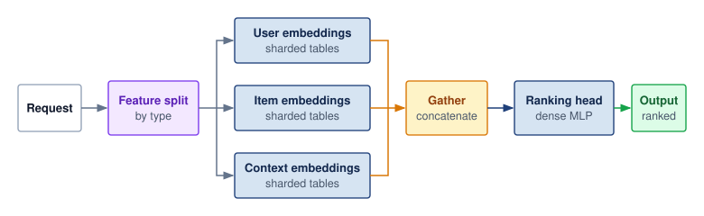

<!--
```{.tikz}
\providecolor{DarkNavy}{HTML}{1E293B}
\providecolor{OceanBlue}{HTML}{2563EB}
\providecolor{ForestGreen}{HTML}{166534}
\providecolor{AmberStage}{HTML}{D97706}
\providecolor{CrimsonSLA}{HTML}{991B1B}
\providecolor{SlateGrey}{HTML}{475569}
\providecolor{SoftGrey}{HTML}{F8FAFC}
\providecolor{SlateTeal}{HTML}{0F766E}
\providecolor{BorderGrey}{HTML}{CBD5E1}
\providecolor{BorderBlue}{HTML}{2563EB}
\providecolor{BorderGreen}{HTML}{166534}
\providecolor{BorderAmber}{HTML}{D97706}
\providecolor{BorderCrimson}{HTML}{991B1B}
\providecolor{Crimson}{HTML}{991B1B}
\providecolor{SoftBlue}{HTML}{F0F6FE}
\providecolor{SoftGreen}{HTML}{ECFAF0}
\providecolor{SoftAmber}{HTML}{FEF8EE}
\providecolor{SoftCrimson}{HTML}{FFF1F2}
\providecolor{BgCard}{HTML}{FFFFFF}
\providecolor{CardBg}{HTML}{FFFFFF}
\providecolor{GrayL}{HTML}{E0E0E0}
\providecolor{GrayLine}{HTML}{666666}
\providecolor{BlueLine}{HTML}{006395}
\providecolor{BlueFill}{HTML}{D6EAF8}
\providecolor{GreenLine}{HTML}{008F45}
\providecolor{GreenFill}{HTML}{D5F5E3}
\providecolor{OrangeLine}{HTML}{E67817}
\providecolor{OrangeFill}{HTML}{FDEBD0}
\providecolor{RedLine}{HTML}{D9534F}
\providecolor{RedFill}{HTML}{F2D7D5}
\providecolor{TextBlack}{HTML}{333333}
\providecolor{VioletLine}{HTML}{7E317B}
\providecolor{VioletFill}{RGB}{243,243,255}
\colorlet{mlsysblue}{OceanBlue}
\colorlet{mlsysgreen}{ForestGreen}
\colorlet{mlsysred}{CrimsonSLA}
\colorlet{mlsysamber}{AmberStage}
\colorlet{mlsysdarkgray}{DarkNavy}
\colorlet{mlsysteal}{SlateTeal}
\scalebox{0.54}{%
\begin{tikzpicture}[
    font=\sffamily,
    >=Stealth,
    coltitle/.style={
        rounded corners=2.5pt,
        font=\footnotesize\bfseries,
        inner xsep=10pt,
        inner ysep=4pt,
        anchor=north
    },
    infocard/.style={
        draw=BorderBlue,
        fill=white,
        rounded corners=3pt,
        line width=0.7pt,
        align=left
    },
    gpuheader/.style={
        rounded corners=2pt,
        font=\scriptsize\bfseries,
        fill=OceanBlue,
        text=white,
        inner xsep=5pt,
        inner ysep=2.5pt
    }
]

    % Column headers (centered over respective columns)
    \node[coltitle, fill=SoftBlue!50, draw=BorderGrey, text=DarkNavy] (h1) at (2.4, 4.4) {INGRESS \& PARSING};
    \node[coltitle, fill=SoftBlue, draw=BorderBlue!40, text=DarkNavy] (h2) at (9.6, 4.4) {PARALLEL EMBEDDINGS (MEMORY)};
    \node[coltitle, fill=SoftAmber, draw=BorderAmber!40, text=AmberStage] (h3) at (15.5, 4.4) {ALLGATHER / POOL};
    \node[coltitle, fill=SoftGreen, draw=BorderGreen!40, text=ForestGreen] (h4) at (20.8, 4.4) {DENSE RANKING (COMPUTE)};

    % Vertical dividers
    \draw[dashed, color=BorderGrey, line width=0.8pt] (5.2, 4.5) -- (5.2, -4.8);
    \draw[dashed, color=BorderGrey, line width=0.8pt] (13.6, 4.5) -- (13.6, -4.8);
    \draw[dashed, color=BorderGrey, line width=0.8pt] (17.5, 4.5) -- (17.5, -4.8);

    % Column 1: Request and Extractor
    \node[draw=BorderGrey, fill=SoftGrey, rounded corners=3pt, line width=0.7pt, inner sep=6pt, text width=1.8cm, align=center] (req) at (0.9, 0) {
        \colorbox{BorderGrey!40}{\scriptsize\bfseries\textcolor{DarkNavy}{Request}}\\[5pt]
        \footnotesize User + Items\\+ Context
    };

    \node[draw=BorderBlue!70, fill=white, rounded corners=3pt, line width=0.7pt, inner sep=7pt, text width=2.1cm, align=center] (ext) at (3.7, 0) {
        \colorbox{SoftBlue}{\small\bfseries\textcolor{DarkNavy}{Extractor}}\\[5pt]
        \footnotesize
        Parse sparse IDs\\[2pt]
        Split by domain\\[2pt]
        \scriptsize User $\cdot$ Item $\cdot$ Ctx\\[5pt]
        \bfseries\textcolor{OceanBlue}{\footnotesize Fan-out Shards}
    };

    \draw[->, line width=1.0pt, color=DarkNavy, shorten >=2pt, shorten <=2pt] (req.east) -- (ext.west);

    % Column 2: GPU Embeddings
    % GPU 0
    \node[infocard, text width=5.9cm, inner sep=7pt] (gpu0) at (9.6, 2.3) {
        \tikz[baseline=-0.5ex]{\node[gpuheader] {GPU 0};}\hspace{5pt}\textbf{\textcolor{DarkNavy}{User Embeddings}}\\[4pt]
        \footnotesize
        \textbf{Features:} user\_id, age, demographics\\[1pt]
        \textbf{Capacity:} 100M+ entry table (HBM bound)
    };

    % GPU 1
    \node[infocard, text width=5.9cm, inner sep=7pt] (gpu1) at (9.6, 0) {
        \tikz[baseline=-0.5ex]{\node[gpuheader] {GPU 1};}\hspace{5pt}\textbf{\textcolor{DarkNavy}{Item Embeddings}}\\[4pt]
        \footnotesize
        \textbf{Features:} item\_id, category, price\\[1pt]
        \textbf{Capacity:} High-cardinality catalog table
    };

    % GPU 2
    \node[infocard, text width=5.9cm, inner sep=7pt] (gpu2) at (9.6, -2.3) {
        \tikz[baseline=-0.5ex]{\node[gpuheader] {GPU 2};}\hspace{5pt}\textbf{\textcolor{DarkNavy}{Context Embeddings}}\\[4pt]
        \footnotesize
        \textbf{Features:} Timestamp, geo, device OS\\[1pt]
        \textbf{Interactions:} Dense cross-feature terms
    };

    % Memory Callout
    \node[draw=CrimsonSLA, fill=SoftCrimson, rounded corners=3pt, line width=0.7pt, inner sep=6pt, text width=5.9cm, align=center] (callout) at (9.6, -3.9) {
        \footnotesize\bfseries\textcolor{CrimsonSLA}{Memory-Capacity Dominant}\\[2pt]
        \scriptsize\textcolor{DarkNavy}{Embedding tables consume $>$80\% of total GPU HBM}
    };

    % Fan-out trunk from Extractor to GPUs
    \coordinate (trunk_in) at (5.8, 0);
    \draw[line width=1.1pt, color=DarkNavy, shorten <=2pt] (ext.east) -- (trunk_in);
    \draw[->, line width=1.0pt, color=DarkNavy, shorten >=2pt] (trunk_in) |- (gpu0.west);
    \draw[->, line width=1.0pt, color=DarkNavy, shorten >=2pt] (trunk_in) -- (gpu1.west);
    \draw[->, line width=1.0pt, color=DarkNavy, shorten >=2pt] (trunk_in) |- (gpu2.west);

    % Column 3: Gather & Pool
    \node[draw=BorderAmber, fill=SoftAmber!70, rounded corners=3pt, line width=0.8pt, inner sep=8pt, text width=3.5cm, align=center] (pool) at (15.5, 0) {
        \colorbox{BorderAmber!25}{\small\bfseries\textcolor{AmberStage!90!black}{Gather \& Pool}}\\[6pt]
        \footnotesize
        Concatenate vectors\\[2pt]
        NVLink / PCIe fabric\\[2pt]
        Feature normalization\\[5pt]
        \bfseries\textcolor{AmberStage!90!black}{\footnotesize Unified Feature Tensor}
    };

    % Fan-in connections from GPUs to Gather & Pool
    \draw[->, line width=1.0pt, color=BorderAmber, shorten >=2pt, shorten <=2pt] (gpu0.east) -- ++(0.7, 0) |- ([yshift=14pt]pool.west);
    \draw[->, line width=1.0pt, color=BorderAmber, shorten >=2pt, shorten <=2pt] (gpu1.east) -- (pool.west);
    \draw[->, line width=1.0pt, color=BorderAmber, shorten >=2pt, shorten <=2pt] (gpu2.east) -- ++(0.7, 0) |- ([yshift=-14pt]pool.west);

    % Column 4: Dense Ranking & Output
    \node[draw=BorderGreen, fill=white, rounded corners=3pt, line width=0.8pt, inner sep=7pt, text width=4.5cm, align=left] (dense) at (20.8, 0) {
        \tikz[baseline=-0.5ex]{\node[font=\scriptsize\bfseries, fill=ForestGreen, text=white, rounded corners=2pt, inner xsep=5pt, inner ysep=2.5pt] {GPU 3};}\hspace{5pt}\textbf{\textcolor{DarkNavy}{Dense Ranking}}\\[4pt]
        \footnotesize
        \textbf{Architecture:} Deep MLP layers\\[1pt]
        \textbf{Compute:} Tensor Core GEMMs\\[1pt]
        \textbf{Objective:} CTR / CVR scoring\\[6pt]
        \centering
        \colorbox{SoftGreen}{\parbox{3.7cm}{\centering\tiny\bfseries\textcolor{ForestGreen}{COMPUTE-BOUND (TENSOR CORES)}}}
    };

    \node[draw=BorderGreen, fill=SoftGreen, rounded corners=3pt, line width=0.7pt, inner sep=6pt, text width=4.1cm, align=center] (out) at (20.8, -2.6) {
        \small\bfseries\textcolor{ForestGreen}{Ranked Output}\\[3pt]
        \footnotesize\textcolor{DarkNavy}{Top-K scored candidate items}
    };

    % Connections to Dense and Output
    \draw[->, line width=1.0pt, color=BorderGreen, shorten >=2pt, shorten <=2pt] (pool.east) -- (dense.west);
    \draw[->, line width=1.0pt, color=ForestGreen, shorten >=2pt, shorten <=2pt] (dense.south) -- (out.north);

\end{tikzpicture}
}
```
-->

:::

Recommendation systems expose the same scheduling principle through sparse and dense computation paths. Sparse feature lookup\index{Sparse Feature Lookup}\index{Embedding table!sparse feature lookup} retrieves embeddings for user, item, and context features, while dense feature processing transforms continuous inputs. These paths can execute concurrently before feature interaction\index{Feature Interaction}\index{Feature interaction!recommendation systems} combines their representations, often through attention or factorization. A ranking head\index{Ranking Head}\index{Ranking head!recommendation systems} then produces final scores. The interaction stage must wait for its required inputs, making a slow embedding shard part of the request's critical path.

When sparse embedding access dominates latency, feature-parallel batching groups lookups by feature type and destination across requests. This organization exposes parallel work at the embedding shards while preserving the association needed to reconstruct each request for ranking:

```
Request 1: [user_id_1, item_ids_1, context_1]
Request 2: [user_id_2, item_ids_2, context_2]
Request 3: [user_id_3, item_ids_3, context_3]

Feature-parallel view:
User embeddings:  [lookup(user_1), lookup(user_2), lookup(user_3)]  → parallel
Item embeddings:  [lookup(items_1), lookup(items_2), lookup(items_3)]  → parallel
Context features: [process(ctx_1), process(ctx_2), process(ctx_3)]  → parallel

Then: Combine features per request for ranking
```

Feature-parallel batching is natural when embeddings are sharded across servers: each embedding server handles lookups for its shard across all requests in the batch. At hyperscale request volumes, this turns feature sharding into a serving strategy rather than a storage detail.

```{python}
#| echo: false
#| label: recsys-latency-breakdown-calc
# ┌─────────────────────────────────────────────────────────────────────────────
# │ RECSYS LATENCY BREAKDOWN (LEGO)
# ├─────────────────────────────────────────────────────────────────────────────
# │ Context: RecSys batching-at-hyperscale example callout.
# │
# │ Goal: Compute total latency and the embedding lookup rate used by the
# │       Meta-scale batching example.
# │ Show: Total = 5.2 ms; 50 million lookups/sec per shard; 50K lookups/batch.
# │ How: Sum phase durations and divide request-level lookup volume across
# │      embedding shards. Platform QPS from
# │      ReferenceStats.RecommenderAtScaleProfile.PlatformQps (Archetype B).
# │
# └─────────────────────────────────────────────────────────────────────────────
from mlsysim import *

class RecsysLatencyBreakdown:
    """Compute total latency from phase durations."""

    # ┌── 1. LOAD (Constants) ──────────────────────────────────────────────
    routing = 0.2 * ms  # scenario table row
    accumulation = 0.5 * ms  # scenario table row
    embedding = 2.0 * ms  # scenario table row
    feature = 1.0 * ms  # scenario table row
    ranking = 1.5 * ms  # scenario table row
    platform_qps = ReferenceStats.RecommenderAtScaleProfile.PlatformQps.to(count / second).magnitude
    candidate_items = 100  # scenario assumption: candidates ranked per request
    lookups_per_item = 50  # scenario assumption: sparse features per candidate
    embedding_shards = 1_000  # scenario assumption: embedding shard count
    accumulation_window = 1 * millisecond  # scenario batching window

    # ┌── 2. EXECUTE (The Compute) ─────────────────────────────────────────
    total = routing + accumulation + embedding + feature + ranking
    lookups_per_request = candidate_items * lookups_per_item
    lookups_per_shard_per_second = platform_qps * lookups_per_request / embedding_shards
    requests_per_batch = platform_qps * accumulation_window.to(second).magnitude
    lookups_per_shard_per_batch = lookups_per_shard_per_second * accumulation_window.to(second).magnitude

    # ┌── 3. GUARD (Invariants) ────────────────────────────────────────────
    check(abs(total.to(ms).magnitude - 5.2) < 1e-9, f"Total latency mismatch: {total.to(ms).magnitude}")
    check(lookups_per_request == 5000, "RecSys lookup count should remain 5,000 per request")
    check(lookups_per_shard_per_second == 50_000_000, "Expected 50M lookups/sec per shard")
    check(requests_per_batch == 10_000, "Expected 10K requests per 1 ms batch")

    # ┌── 4. OUTPUT (Formatting) ───────────────────────────────────────────
    total_ms_str = fmt_time(total, millisecond, precision=1, commas=False)
    platform_qps_str = fmt_rate(platform_qps, "QPS", scale="million", precision=0, commas=False)
    lookups_per_request_str = fmt_count(lookups_per_request, precision=0, commas=True, label="embedding lookup")
    embedding_shards_str = fmt_count(embedding_shards, precision=0, commas=True, label="shard")
    accumulation_window_ms_str = fmt_time(accumulation_window, millisecond, precision=0, commas=False)
    lookups_per_shard_per_second_million_str = fmt_count(
        lookups_per_shard_per_second,
        scale="million",
        precision=0,
        commas=False,
        scale_style="word",
        label="lookup",
    )
    lookups_per_shard_per_batch_k_str = fmt_count(
        lookups_per_shard_per_batch,
        scale="K",
        precision=0,
        commas=False,
        label="lookup",
    )
```

::: {#exmp-inference-recsys-batching-at-meta-scale .callout-example title="RecSys batching at hyperscale"}

**Scenario**: A hyperscale recommendation service handles `{python} RecsysLatencyBreakdown.platform_qps_str`, querying `{python} RecsysLatencyBreakdown.lookups_per_request_str` per request across `{python} RecsysLatencyBreakdown.embedding_shards_str`.

**Diagnosis**: The assumed distribution of requests requires `{python} RecsysLatencyBreakdown.lookups_per_shard_per_second_million_str`/sec per shard. That rate is the capacity target each shard's lookup service must sustain. Accumulating requests over a `{python} RecsysLatencyBreakdown.accumulation_window_ms_str` window forms batches of `{python} RecsysLatencyBreakdown.lookups_per_shard_per_batch_k_str` per shard, creating an opportunity to deduplicate, reorder, or coalesce lookups. Batching alone does not make random addresses sequential.

**Systems lesson**: Shard-level batching exploits sparse feature locality, but its benefit depends on cache hits, access distribution, and the amount of work each shard receives. The formation window spends part of the `{python} RecsysLatencyBreakdown.total_ms_str` end-to-end latency budget; measured lookup and communication times must fit in what remains alongside the dense stages.

:::

### Streaming inference for real-time applications {#sec-inference-scale-streaming-inference-realtime-applications-906c}

Streaming workloads constrain how long batching may delay new input. Speech recognition, video analysis, and robotics process an ongoing sequence of observations, so each result must arrive in time for its application. Batching across ready streams can still improve efficiency if it respects those deadlines.

Streaming inference\index{Streaming inference!incremental processing} processes inputs incrementally rather than waiting for the complete recording or interaction. Illustrative input cadences include 10--20 ms audio chunks for speech recognition, 30--60 FPS video, and 100--1000 Hz sensor or control updates in robotics. These rates specify how often work arrives, not a universal inference deadline. Buffering, frame selection, and batching must follow the application's latency and freshness requirements.

A streaming service must sustain the arrival rate while meeting the latency budget for each accepted input. The end-to-end processing path includes:

$$\StreamingEndToEndLatency= \InputCaptureTime+ \TransferTimeForPayload+ \InferenceLatency + \ResultActionTime$$

where the sum must fit the end-to-end latency budget. A pipelined implementation must also sustain the input arrival rate; its slowest stage must process frames at least as quickly as they arrive. The end-to-end budget may span several frame intervals, as the speech example illustrates.

::: {#exmp-inference-streaming-speech-recognition-pipeline .callout-example title="Streaming speech recognition pipeline"}

**Scenario**: A real-time streaming speech-to-text pipeline processes 20 ms audio frames under a strict 100 ms end-to-end latency budget (5 frames max delay).

**Diagnosis**: Waiting for a large batch from one stream can consume its latency budget before inference begins. The pipeline processes frames incrementally ($\StreamingEndToEndLatency= \InputCaptureTime+ \TransferTimeForPayload+ \InferenceLatency + \ResultActionTime$), overlapping audio capture with acoustic model evaluation. Ready frames from independent streams can share execution if the additional waiting and service time still fit the budget.

**Systems lesson**: Streaming inference requires both timely results and enough throughput to prevent accumulating backlog. Incremental pipelining supports these goals; whether batching helps depends on the available deadline slack and the number of ready streams.

:::

### Adaptive batching strategies {#sec-inference-scale-adaptive-batching-strategies-4fc1}

Once batching is workload-specific, fixed parameters become fragile. Production systems therefore adapt batching behavior to current conditions.

Traffic-adaptive batching\index{Adaptive batching!traffic-adaptive window} adjusts the batch window based on arrival rate:

$$\BatchingWindow= \min\left(\MaxBatchingWindow, \frac{\TargetBatchSize}{\ArrivalRate}\right)$$

When traffic is high, the window shrinks because the target batch size fills quickly. When traffic is low, the window extends but is capped to bound batch-formation delay. This cap does not bound the separate wait for a busy replica.

SLO-adaptive batching\index{Adaptive batching!SLO-adaptive feedback} takes a complementary approach, monitoring latency percentiles and adjusting parameters aggressively:

```
if P99_latency > 0.9 * SLO:
    reduce B_max by 20%
    reduce T_window by 20%
elif P99_latency < 0.5 * SLO:
    increase B_max by 10%
    increase T_window by 10%
```

The feedback loop is a tuning heuristic, not a guarantee of latency headroom. Reducing batch size can shorten execution while also reducing service capacity and increasing queueing under heavy load. Feedback delay and noisy percentile estimates can cause oscillation, so the controller must be evaluated with the intended arrival trace and overload policy. Request-aware batching\index{Adaptive batching!request-aware grouping} adds another dimension by considering request characteristics. For LLMs, prompt length can guide padding and prefill budgets, while estimated output length can guide grouping. Prediction errors and priority choices must be included when evaluating tail latency.

Production runtimes expose controls for this trade-off. NVIDIA Triton Inference Server\index{Triton Inference Server!adaptive batching} uses `max_batch_size`\index{Batching!max batch size} to cap batches, `max_queue_delay_microseconds`\index{Batching!timeout parameter} to bound additional waiting for batch formation, and optional `preferred_batch_size`\index{Batching!preferred batch size} values for particularly efficient execution profiles. Preferred sizes do not create a separate queue for each batch size. The runtime forms a supported batch from queued requests when an instance is available; priority queues and overload policy are separate controls.

@Tbl-inference-triton-adaptive-batching gives an illustrative load-test pattern. Larger batches can absorb rising traffic until offered load approaches execution capacity; after that, longer queues need an admission or scaling response.

| **Traffic Level** | **Assumed Avg Batch Size** | **Assumed Avg Latency** | **Assumed Throughput** |
|:------------------|:--------------------------:|:-----------------------:|:----------------------:|
| **100 QPS**       |            2.1             |           8 ms          |        100 QPS         |
| **500 QPS**       |            6.3             |          12 ms          |        500 QPS         |
| **1000 QPS**      |            12.4            |          18 ms          |        1000 QPS        |
| **2000 QPS**      |            24.1            |          28 ms          |        1980 QPS        |

: **Illustrative dynamic-batching load test**: Scenario assumptions demonstrate rising batch size and the onset of overload. At the last row, completions fall below arrivals; those operating conditions cannot sustain a stationary queue without admission control. {#tbl-inference-triton-adaptive-batching}

The batching strategies to this point focus on scheduling work under a chosen request budget. Output length remains uncertain, but the service can already cap generation. Reasoning-heavy inference makes that budget an explicit quality-cost decision: the service may allocate additional tokens or candidate evaluations when the expected benefit justifies their latency and capacity costs. This extends the scheduling question from when requests run to how much work they may consume.

### The logic wall and test-time compute scaling {#sec-inference-logic-wall}

::: {.column-margin}
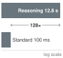{width="100%" fig-alt="A two-rung magnitude ladder on a log scale. The reasoning response rung is about 12.8 seconds; the fast pattern-match rung is about 0.1 seconds. The gap is roughly 128 times."}

*Reasoning expands latency about 128 times over fast pattern-matching.*
:::

Test-time scaling turns reasoning into a serving resource. The scaling laws that motivate the fleet were first measured for pretraining, where quality improves as a power law in parameters, data, and training compute. The same pattern has a third regime in which quality rises with the compute spent on each query at inference time. For a serving fleet that regime moves the scaling curve out of the training cluster and into the request path. Every increment of quality bought this way is paid on every request for the lifetime of the deployment, the recurring cost that the serving cost dominance law (principle \ref{pri-serving-cost-dominance}) already prices. A request may issue more generated tokens, internal chain-of-thought (CoT) tokens, or search steps before producing the answer. Whether that extra work buys quality is an empirical question. Capability studies describe abilities that appear abruptly with scale [@wei2022emergent], while later analysis cautions that some apparent jumps are artifacts of the metric chosen [@schaeffer2023mirage], so a serving budget should rest on measured quality gains for the workload rather than on the expectation of a jump.

From a serving-systems perspective, the relevant shift is the work issued per request. Additional reasoning consumes accelerator time and can extend both latency and KV-cache residency. Increasing test-time work\index{Test-Time Compute} does not necessarily change the bottleneck of each decode step. It instead requires a policy for the number of generated tokens, candidate solutions, or search steps a request may consume. The logic wall\index{Logic Wall} is the point at which serial reasoning tokens exhaust a request's latency budget, or its share of fleet capacity, before additional reasoning stops improving the answer. A harder task may justify more work, but additional work does not guarantee a correct answer. Adaptive batching decides when requests run together; test-time compute allocation decides how much work each request is allowed to issue.

::: {.column-margin .margin-pointer}
↩ Test-time scaling, the lifecycle regime that spends compute per request rather than per training run, is established alongside the empirical scaling laws in @sec-vol2-intro-resourceconstrained-scaling-regimes-062d.
:::

```{python}
#| echo: false
#| label: logic-scaling-calc
from mlsysim.fmt import check, fmt, fmt_int, fmt_time

class LogicScaling:
    """The latency tax of test-time reasoning."""

    # ┌── 1. LOAD ──────────────────────────────────────────
    LOGIC_WALL_REASONING_STEPS_EXAMPLE = 128  # pedagogical reasoning-steps example
    t_std = 100 * ms  # pedagogical standard 1-token decode
    reasoning_steps = LOGIC_WALL_REASONING_STEPS_EXAMPLE  # tokens of 'thought' before the answer
    # ┌── 2. EXECUTE ───────────────────────────────────────
    t_reasoning = (t_std * reasoning_steps).to(second)
    latency_expansion = reasoning_steps
    # ┌── 3. GUARD ─────────────────────────────────────────
    check(latency_expansion == 128, f"Exp {latency_expansion} unexpected")
    # ┌── 4. OUTPUT ────────────────────────────────────────
    steps_str = fmt_int(reasoning_steps, commas=False)
    t_std_ms_str = fmt_time(t_std, ms, precision=0, commas=False)
    time_s_str = fmt_time(t_reasoning, second, precision=1, commas=False, style='word')

    @classmethod
    def plot(cls):
        """Visualizes the Logic Wall latency expansion."""
        from binder.tools.figures import style as book_style

        return book_style.bar_compare(
            labels=["Fast (Pattern)", "Slow (Reasoning)"],
            values=[cls.t_std.to(second).magnitude, cls.t_reasoning.to(second).magnitude],
            title="Inference Scaling: Reasoning Depth",
            ylabel="Latency (Seconds)",
        )
```

::: {#nbk-inference-napkin-math-scaling-reasoning-depth .callout-notebook title="Scaling reasoning depth"}

**Problem**: Calculate the latency impact of a model that uses `{python} LogicScaling.steps_str` "Thinking Tokens" to solve a complex math proof vs. a standard answer.

1. **Standard response**: 1 token answer = `{python} LogicScaling.t_std_ms_str`.
2. **Reasoning response**: `{python} LogicScaling.steps_str` of internal search/CoT before the answer.
3. **The latency**: `{python} LogicScaling.steps_str` $\times$ `{python} LogicScaling.t_std_ms_str` = `{python} LogicScaling.time_s_str`.

**Systems insight**: The per-token time is a round figure chosen for easy arithmetic, more than ten times the batch-one decode step of the reference 70B replica in @sec-performance-engineering-batch-size. What the calculation teaches does not depend on it. Serial reasoning tokens multiply latency by the ratio of reasoning tokens to answer tokens, whatever each token costs, so a faster replica shortens both responses in proportion and leaves the `{python} LogicScaling.steps_str`-fold expansion intact. Against a direct answer of many tokens rather than one, the ratio shrinks accordingly; against a one-token answer it is largest. A search step that evaluates several candidates in parallel adds compute and KV residency without adding the same serial latency, which is why reasoning budgets must be stated in both time and capacity. At fleet scale, compute allocation weighs the measured quality gain against both the request deadline and the capacity the additional work consumes.

:::

Variable work per request closes the batching story: continuous and adaptive batching handle variation the system observes, while test-time compute is variation the system chooses. **Dynamic compute allocation**\index{Dynamic Compute Allocation!definition} assigns per-request compute budgets based on task difficulty, latency tolerance, and fleet load rather than applying a fixed decode budget to every prompt. With both the batching mechanism and the per-request compute budget now on the table, the remaining task is to decide which combination a given workload should run.

### Selecting a batching strategy {#sec-inference-scale-quantitative-summary-batching-strategy-selection-d5af}

The selection problem is to match the batching mechanism to model shape, traffic variance, and latency budget. That match depends on where in the request path the latency budget is spent.

::: {#chk-inference-batching-strategy-trade-offs .callout-checkpoint title="Batching strategy trade-offs"}

Verify your understanding of different batching mechanics:

- [ ] **Static vs. continuous**: for a vision service with highly uniform input sizes and predictable traffic, select static batching or continuous batching.
- [ ] **Waste ratio**: explain when refilling completed slots can eliminate the static-batch padding waste ($1 - \BatchMeanOutputLength/\BatchMaxOutputLength$), and why low arrivals or KV-cache pressure prevent perfect slot reuse.
- [ ] **Adaptive batching**: explain when shrinking the formation window reduces waiting without sacrificing throughput, and why it cannot resolve overload when arrivals exceed service capacity.
- [ ] **RecSys bottleneck**: in feature-parallel batching for RecSys, identify whether the primary fleet-stack bottleneck is the GPU's Tensor Cores or the distributed Embedding Store's memory bandwidth.
- [ ] **Batching limit**: explain why free HBM, not Tensor Core compute, often caps the achievable batch size for long-context LLM serving.

:::

The end-to-end traversal diagrammed in @fig-inference-lifecycle provides the final operational check on batching selection: noncompute stages such as host serialization, queuing, and network routing consume a substantial fraction of the latency budget, so batch formation and execution must be budgeted across the full pipeline rather than against accelerator runtime alone. A decision framework guides strategy selection:

```
Is it autoregressive text generation?
|- Yes → Continuous batching with chunked prefill
`- No → Is it real-time streaming speech/video/robotics?
        |- Yes → Streaming pipeline with minimal or no batching
        `- No → Do embedding lookups dominate latency?
                |- Yes → Feature-parallel batching (RecSys)
                `- No → Dynamic batching with adaptive parameters
```

The strategies in @tbl-batching-parameters expose different tuning decisions: batch size for static execution, waiting time for dynamic batching, admission and iteration work for continuous batching, lookup grouping for sharded embeddings, and deadline-compatible grouping for streaming. Continuous batching responds to variable completion times; it does not make output lengths uniform. Each policy must be evaluated against both useful throughput and its latency budget.

| **Strategy**         |   **Key Parameters**  | **Tuning Goal**                  |
|:---------------------|:---------------------:|:---------------------------------|
| **Static**           |       Batch size      | Maximize throughput              |
| **Dynamic**          |   Window, max batch   | Balance latency vs. throughput   |
| **Continuous**       | Chunk size, max batch | Minimize decode latency variance |
| **Feature-parallel** |  Accumulation window  | Match embedding shard capacity   |
| **Streaming**        |     Pipeline depth    | Meet real-time deadline          |

: **Batching strategy parameters**: The parameter each strategy tunes (batch size, formation window, chunk size, accumulation window, or pipeline depth) follows from its goal, from raw throughput for static batching to the real-time deadline for streaming. {#tbl-batching-parameters}

Batching policy and memory admission are coupled. In a full-attention deployment that retains active KV state on the GPU, every admitted sequence consumes cache capacity as its context grows. A schedule with room for more decode work can therefore run out of memory before it reaches its execution limit. Managing that state is the next step in determining useful concurrency.

## Memory and Decode-Time Management {#sec-inference-scale-kv-cache-management-04ed}

As a full-attention LLM generates a 2,000-word essay, each new token attends to representations of earlier tokens. The KV cache\index{KV Cache!memory footprint} retains the keys and values needed for that attention, with a per-request footprint that grows as generation proceeds. Large contiguous reservations can leave HBM reserved but unused or create gaps too small for another reservation. Admission can then fail even though the stored attention state occupies less than the available capacity.

Two classes of techniques meet at this boundary. KV-state capacity techniques, such as PagedAttention\index{PagedAttention!virtual memory mapping} and prefix caching, decide where attention state lives and how much fragmentation the memory manager tolerates. Decode-time latency techniques, such as speculative decoding, change how much target-model work is needed per emitted token. Speculative decoding is not KV-cache compression; it trades extra draft-model state, target-model verification, and scheduler complexity for lower TPOT under the same memory budget. Prefill-decode disaggregation treats the attention state as a payload, because separating the two phases means moving each request's cache between pools. Capacity accounting and adapter locality then determine how retained KV state and task-specific weights share the remaining memory budget.

Wherever they can, the calculations that follow share one reference replica, the 70B model on one eight-GPU H100 node that performance engineering established, with FP16 weights split eight ways. A few leave it on purpose to make a single point, and each says so where it does. The attention layout matters even more, because it sets the bytes cached per token. Grouped query attention with eight KV heads, the layout of the Llama-family 70B models, caches one eighth the state of a 64-head multi-head attention baseline, so each calculation names its hardware and attention layout, and numbers from different calculations compare only after conversion to the same configuration.

::: {.column-margin .margin-pointer}
↩ The reference serving replica, a 70B model on one eight-GPU H100 node, is established in @sec-performance-engineering-memory-wall.
:::

### The KV cache wall and memory capacity {#sec-inference-scale-kv-cache-wall}

Increasing batch size in LLM serving can encounter the KV cache wall\index{KV Cache!capacity wall} before execution resources are fully used. The capacity model in @fig-kv-cache-wall leaves the reference replica to show the wall on a single device. It combines an idealized 35 GB weight payload for a quantized 70B model with its full-attention, eight-KV-head GQA state on one H100, using a conservative decimal budget matching its nameplate label. This illustrative budget differs from the registered byte capacity used in the node estimator below. With the illustrated cache dimensions and precision, a batch of 8 reaches the memory boundary at roughly 17K tokens per sequence. Quantization metadata, runtime buffers, and other allocations reduce the capacity available in an actual deployment, so the plotted boundary is an optimistic sizing limit.

```{python}
#| echo: false
#| label: kv-cache-wall-inputs
# ┌─────────────────────────────────────────────────────────────────────────────
# │ KV CACHE WALL INPUTS (LEGO)
# ├─────────────────────────────────────────────────────────────────────────────
# │ Context: @fig-kv-cache-wall caption and plotting cell.
# │
# │ Goal: Size the INT4 70B weights, the GQA KV cache per 1,000 tokens, and the
# │       H100 capacity line, and check the caption's batch-2 128K claim.
# │ Show: 35 GB weights; ~0.33 GB KV per 1K tokens; batch 2 at 128K = ~84 GB;
# │       80 GB H100 capacity.
# │ How: Models.Language.Llama2_70B.size_in_bytes(BYTES_INT4) and
# │      get_kv_cache_size (80 layers x 8 KV heads x 128 head dim, FP16);
# │      ServingProfiles.H100VendorMemoryBudget (decimal 80 GB).
# └─────────────────────────────────────────────────────────────────────────────
from mlsysim.fmt import check, fmt_memory

class KVCacheWallInputs:
    """Inputs for the KV cache wall figure (70B INT4 on one H100)."""

    # ┌── 1. LOAD (Constants) ──────────────────────────────────────────────
    model = Models.Language.Llama2_70B
    # Vendor nameplate kept in decimal GB, like PrecisionDividend: the axis,
    # weights, and KV lines are decimal GB, so the dashed line must sit at 80.
    hbm = ReferenceStats.ServingProfiles.H100VendorMemoryBudget.to(GiB).magnitude * GB
    long_context_k = 128  # scenario assumption: x-axis end, in 1,000-token units
    batch_example = 2  # scenario assumption: caption's infeasible batch
    batch_largest = 8  # scenario assumption: largest plotted batch

    # ┌── 2. EXECUTE (The Compute) ────────────────────────────────────────
    weights = model.size_in_bytes(BYTES_INT4)
    kv_per_1k = model.get_kv_cache_size(1000, 1)
    weights_gb = weights.to(GB).magnitude
    hbm_cap_gb = hbm.to(GB).magnitude
    gb_per_1k_tokens = kv_per_1k.to(GB).magnitude
    batch_example_kv = batch_example * long_context_k * kv_per_1k
    batch_largest_wall_k = ((hbm - weights) / (batch_largest * kv_per_1k)).to("").magnitude

    # ┌── 3. GUARD (Invariants) ──────────────────────────────────────────
    check(weights < hbm, "INT4 70B weights must fit on one H100")
    check(weights + batch_example_kv > hbm, "Batch 2 at 128K context must exceed one H100")
    check(15 < batch_largest_wall_k < 20, "fig-alt says batch 8 hits the capacity line near 17K tokens")

    # ┌── 4. OUTPUT (Formatting) ─────────────────────────────────────────────
    weights_gb_str = fmt_memory(weights, unit=GB, precision=0, commas=False)
    batch_example_kv_gb_str = fmt_memory(round(batch_example_kv.to(GB).magnitude) * GB, unit=GB, precision=0, commas=False)
    hbm_gb_str = fmt_memory(hbm, unit=GB, precision=0, commas=False)
```

::: {#fig-kv-cache-wall fig-env="figure" fig-pos="H" fig-cap="**The KV cache wall**: Total GPU memory usage for a 4-bit quantized 70B model (`{python} KVCacheWallInputs.weights_gb_str` weights) on an `{python} KVCacheWallInputs.hbm_gb_str` H100. While the model fits easily at small context lengths, the KV cache (sloped lines) eventually consumes all remaining HBM. At 128K context, a batch size of 2 is physically impossible on a single GPU (`{python} KVCacheWallInputs.weights_gb_str` + `{python} KVCacheWallInputs.batch_example_kv_gb_str` exceeds `{python} KVCacheWallInputs.hbm_gb_str`), forcing the system to either reduce batch size, change the state representation, or distribute the state across devices." fig-alt="Memory usage plot against sequence length. A red dashed line at 80 GB marks HBM capacity, with the region above it shaded red. A light blue band at the bottom is the 35 GB of model weights. Sloped lines for batch 1, 2, 4, and 8 rise from the weights line; batches 8, 4, and 2 stop at open circles where they meet the capacity line, batch 8 earliest at about 17K tokens, while batch 1 stays below the line out to 128K tokens."}

```{python}
#| echo: false
# ┌─────────────────────────────────────────────────────────────────────────────
# │ KV CACHE WALL (FIGURE)
# ├─────────────────────────────────────────────────────────────────────────────
# │ Context: @fig-kv-cache-wall—KV cache memory bottleneck
# │
# │ Goal: Plot total GPU memory (weights + KV cache) vs sequence length for
# │       batch 1/2/4/8; show 80 GB HBM limit; OOM zone.
# │ Show: fill_between weights; sloped KV lines; capacity dashed line.
# │ How: Inputs from KVCacheWallInputs (registry-backed); book_style.set_book_style().
# │
# └─────────────────────────────────────────────────────────────────────────────
# ┌── 1. CANVAS ────────────────────────────────────────────────────────────────
# │ Plot total GPU memory (weights + KV cache) vs sequence length for
import numpy as np
from binder.tools.figures import style as book_style

# ┌── 2. ARRAYS ────────────────────────────────────────────────────────────────
fig, ax, COLORS, plt = book_style.setup_plot(figsize=(5.6, 3.7))
FS = 10.5  # prints at >= 9 pt when the figure is scaled to 5 in

# Llama 2 70B (GQA) inputs from the registry-backed LEGO cell above.
weights_gb = KVCacheWallInputs.weights_gb
hbm_cap_gb = KVCacheWallInputs.hbm_cap_gb
gb_per_1k_tokens = KVCacheWallInputs.gb_per_1k_tokens  # seq_len_k is in 1k-token units

seq_len_k = np.linspace(0, KVCacheWallInputs.long_context_k, 100)

# ┌── 3. RENDER ────────────────────────────────────────────────────────────────
# Base weights
ax.fill_between(seq_len_k, 0, weights_gb, color=COLORS['BlueL'], alpha=0.9, lw=0)
ax.axhline(y=weights_gb, color=COLORS['BlueLine'], linestyle='-', linewidth=1.2)
ax.text(
    KVCacheWallInputs.long_context_k / 2,
    weights_gb / 2,
    f'Model weights ({KVCacheWallInputs.weights_gb_str})',
    ha='center',
    va='center',
    fontsize=FS,
    fontweight='bold',
    color=COLORS['BlueLine'],
)

# Above HBM capacity nothing fits: the red wall region.
y_top = 100
ax.axhspan(hbm_cap_gb, y_top, color=COLORS['RedL'], alpha=0.45, lw=0, zorder=0)
ax.axhline(y=hbm_cap_gb, color=COLORS['RedLine'], linestyle='--', linewidth=1.8)

# Each batch line climbs until it meets the wall; the dot marks the
# longest sequence that batch can hold.
for b in [1, 2, 4, 8]:
    total_mem = weights_gb + (b * seq_len_k * gb_per_1k_tokens)
    fits = total_mem <= hbm_cap_gb
    x_wall = (hbm_cap_gb - weights_gb) / (b * gb_per_1k_tokens)
    xs = np.append(seq_len_k[fits], min(x_wall, seq_len_k[-1]))
    ys = weights_gb + b * xs * gb_per_1k_tokens
    ax.plot(xs, ys, color=COLORS['primary'], linewidth=2.0)
    if x_wall <= seq_len_k[-1]:
        ax.plot(x_wall, hbm_cap_gb, 'o', ms=7, mfc='white', mec=COLORS['RedLine'], mew=2, zorder=5)
        ax.text(x_wall, hbm_cap_gb + 3, f'batch {b}', ha='center', va='bottom', fontsize=FS, fontweight='bold', color=COLORS['primary'])
    else:
        # Label sits well below the line, clear of the stroke and the right spine.
        x_lab = 0.875 * seq_len_k[-1]
        y_lab = weights_gb + b * x_lab * gb_per_1k_tokens - 6
        ax.text(x_lab, y_lab, f'batch {b}', ha='center', va='top', fontsize=FS, fontweight='bold', color=COLORS['primary'])

# ┌── 4. DECORATE ──────────────────────────────────────────────────────────────
ax.text(
    KVCacheWallInputs.long_context_k - 2,
    hbm_cap_gb + 3,
    f'HBM capacity ({KVCacheWallInputs.hbm_gb_str})',
    color=COLORS['RedLine'],
    fontsize=FS,
    fontweight='bold',
    ha='right',
    va='bottom',
)
ax.text(
    0.75 * KVCacheWallInputs.long_context_k,
    weights_gb + 10,
    'KV cache',
    ha='center',
    va='center',
    fontsize=FS,
    style='italic',
    color=COLORS['secondary'],
)

ax.set_xlabel('Sequence length (1,000s of tokens)', fontsize=FS + 0.5)
ax.set_ylabel('Total GPU memory (GB)', fontsize=FS + 0.5)
ax.tick_params(labelsize=FS)
ax.set_ylim(0, y_top)
ax.set_xlim(0, KVCacheWallInputs.long_context_k)

plt.tight_layout()
plt.show()
plt.close()
```

:::

The visualization explains why weight fit alone does not establish serving capacity. A long-context request can consume nearly all remaining memory in the illustrated configuration, leaving little space for other active sequences. Sharding can add headroom, but its communication cost must be weighed against alternatives such as lower concurrency or a smaller cache representation. The effect of a 128K context depends on the model's cache dimensions and precision, not on context length alone.

The capacity model behind the figure, weight bytes plus per-token KV bytes multiplied by every token held, turns into an explicit batch-size limit for a production node.

```{python}
#| echo: false
#| label: kv-cache-capacity-estimator
# ┌─────────────────────────────────────────────────────────────────────────────
# │ KV CACHE CAPACITY ESTIMATOR (LEGO)
# ├─────────────────────────────────────────────────────────────────────────────
# │ Context: "KV-cache capacity estimator" callout in §KV cache fundamentals.
# │
# │ Goal: Compute per-token KV bytes, per-request KV GB, and max batch size for
# │       a Llama-3-70B-style GQA model at 128K context on an 8xH100 node.
# │ Show: 327,680 bytes/token, ~43 GB/request, max batch 11.
# │ How: 2 * layers * KV_heads * head_dim * bytes_per_elem * context_tokens.
# │
# └─────────────────────────────────────────────────────────────────────────────
from mlsysim.fmt import MarkdownStr, check, fmt_count, fmt_int, fmt_memory, fmt_memory_capacity, fmt_qty_int

class KVCacheCapacityEstimator:
    """KV-cache capacity estimator for a long-context 70B GQA deployment."""

    # ┌── 1. LOAD (Constants) ──────────────────────────────────────────────
    _model = Models.Language.Llama3_70B
    n_layers = _model.layers
    n_kv_heads = _model.kv_heads or _model.heads
    d_head = _model.hidden_dim // _model.heads
    bytes_per_elem = 2
    context_tokens = 131_072
    node_gpus = Systems.Nodes.DGX_H100.accelerators_per_node
    h100_vendor_capacity = ReferenceStats.ServingProfiles.H100VendorMemoryBudget
    total_hbm = node_gpus * h100_vendor_capacity
    weight = _model.size_in_bytes(BYTES_FP16)
    system_reserved = 20 * GB  # scenario reserve

    # ┌── 2. EXECUTE (The Compute) ────────────────────────────────────────
    from mlsysim.physics import calc_kv_cache_size

    # Use library formula for per-token KV bytes
    kv_cache_one_token = calc_kv_cache_size(n_layers, n_kv_heads, d_head, 1, 1, bytes_per_elem)
    kv_bytes_per_token = int(kv_cache_one_token.to(byte).magnitude)

    kv_cache_full = calc_kv_cache_size(n_layers, n_kv_heads, d_head, context_tokens, 1, bytes_per_elem)

    available_kv = total_hbm - weight - system_reserved
    max_batch = int((available_kv / kv_cache_full).to("").magnitude)
    kv_mb_per_token_display = kv_cache_one_token.to(MB).magnitude
    kv_gb_per_request_display = kv_cache_full.to(GB).magnitude
    available_kv_display = available_kv.to(GB).magnitude

    # ┌── 3. GUARD (Invariants) ──────────────────────────────────────────
    check(kv_bytes_per_token == 327_680, "KV bytes/token should match GQA formula")
    # 12 (not 11) since HBM capacity is now read in binary GiB: an 80 GiB H100
    # is 85.9 GB of true bytes, a 7.4% larger KV pool than the old decimal read.
    check(max_batch == 12, f"Expected max batch 12, got {max_batch}")

    # ┌── 4. OUTPUT (Formatting) ─────────────────────────────────────────────
    available_kv_gb_str = fmt_memory(available_kv, unit=GB, precision=1, commas=False)
    weight_gb_str = fmt_memory(weight, unit=GB, precision=1, commas=False)
    total_hbm_gb_str = fmt_memory_capacity(total_hbm, unit=GiB, precision=0, commas=False)
    # The same nameplate in honest decimal, for the displayed subtraction whose
    # other operands are decimal. Mixing the two printed 640 - 141.2 - 20 = 526.0.
    total_hbm_decimal_gb_str = fmt_memory(total_hbm, unit=GB, precision=1, commas=False)
    system_gb_str = fmt_memory(system_reserved, unit=GB, precision=0, commas=False)
    node_gpus_str = fmt_int(node_gpus, commas=False)

    # Display-math expressions for the three step equations (pre-compute LaTeX
    # in Python to avoid `{python}` refs inside $$..$$ — §7 anti-pattern).
    step1_kv_per_token_math = fmt_display_math(
        f" m_{{\\text{{token}}}} = 2 \\times {n_layers} \\times {n_kv_heads} \\times {d_head} \\times {bytes_per_elem} "
        f"= {kv_bytes_per_token:,} \\text{{ bytes}} \\approx "
        f"{kv_mb_per_token_display:.2f} \\text{{ MB/token}} "
    )
    step2_cache_per_request_math = fmt_display_math(
        f" {context_tokens:,} \\text{{ tokens}} \\times {kv_mb_per_token_display:.2f} \\text{{ MB/token}} \\approx "
        f"{kv_gb_per_request_display:.1f} \\text{{ GB/request}} "
    )
    step3_max_batch_math = fmt_display_math(
        f" \\text{{Max Batch}} = \\left\\lfloor \\frac{{{available_kv_display:.1f}}}{{{kv_gb_per_request_display:.1f}}} \\right\\rfloor "
        f"= {max_batch} "
    )
```

::: {#nbk-inference-kv-cache-capacity-estimator .callout-notebook title="KV-cache capacity estimator"}

Unlike the conservative decimal budgets used in the illustrative comparisons, this estimator retains the registered byte capacity when summing the node's HBM. Converting its display units does not change that byte count.

**Problem**: A deployment serves an illustrative 70B-class GQA model with 128K context support (FP16 weights $\approx$ `{python} KVCacheCapacityEstimator.weight_gb_str`) on an `{python} KVCacheCapacityEstimator.node_gpus_str`$\times$ H100 node (`{python} KVCacheCapacityEstimator.total_hbm_gb_str` total HBM). The goal is to determine the maximum batch size for a context length of 128K tokens.

**Formula**:
$$ \KvCacheBytesPerToken = 2 \times \LayerCount \times \KvHeadCount \times \AttentionHeadDimension \times \ElementStorageSize $$
$$ \TotalMemoryFootprint = \WeightMemory + \KvCacheMemory, \qquad \KvCacheMemory = \BatchSize\times \SequenceLength\times \KvCacheBytesPerToken $$

**Parameters**:

*   $\LayerCount = 80$, $\KvHeadCount = 8$ for the assumed GQA architecture, $\AttentionHeadDimension = 128$.
*   $\ElementStorageSize = 2$ bytes (FP16).
*   Context $= 131{,}072$ tokens.

**Step 1**: Calculate memory per token.
`{python} KVCacheCapacityEstimator.step1_kv_per_token_math`

**Step 2**: Calculate cache per request.
`{python} KVCacheCapacityEstimator.step2_cache_per_request_math`

**Step 3**: Determine max batch size.
Available Memory for KV = `{python} KVCacheCapacityEstimator.total_hbm_decimal_gb_str` (Total) - `{python} KVCacheCapacityEstimator.weight_gb_str` (Weights) - `{python} KVCacheCapacityEstimator.system_gb_str` (System) = `{python} KVCacheCapacityEstimator.available_kv_gb_str`.
`{python} KVCacheCapacityEstimator.step3_max_batch_math`

**Systems insight**: Even with grouped query attention (GQA), whose shared key-value heads the 8-head count in this calculation already reflects, each 128K-context request consumes tens of gigabytes of KV state. This configuration therefore admits only a limited number of concurrent long-context requests. PagedAttention can recover allocation waste, but cannot shrink the attention tensors counted here. Increasing concurrency beyond that limit requires changing the memory budget, cache representation, or placement of state.

:::

::: {.column-margin}
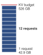{width="100%" fig-alt="A three-rung log-scale memory ladder under a red ceiling line: KV budget 526 GB at top, one 128K-token request at 43 GB, and a single token at 0.33 MB."}

*A dozen 128K-token requests exhaust the whole KV budget.*
:::

### The fragmentation problem {#sec-inference-scale-fragmentation-problem-28be}

Traditional memory allocation for KV cache preallocates contiguous memory for each sequence based on maximum expected length. This creates two forms of waste.

```{python}
#| echo: false
#| label: internal-fragmentation
# ┌── LEGO ───────────────────────────────────────────────
# │ Context: internal-fragmentation example in the fragmentation section.
# │ Show: share of a 4,096-token reservation left idle by a 100-token output.
from mlsysim.fmt import check, fmt_int, fmt_percent

class InternalFragmentation:
    # ┌── 1. LOAD (Constants) ──────────────────────────────────────────────
    max_tokens = 4096  # scenario assumption: reserved maximum length
    avg_tokens = 100  # scenario assumption: realized average output

    # ┌── 2. EXECUTE (The Compute) ────────────────────────────────────────
    idle_share = 1 - avg_tokens / max_tokens

    # ┌── 3. GUARD (Invariants) ──────────────────────────────────────────
    check(0.9 < idle_share < 1, "Short outputs should leave most of the reservation idle")

    # ┌── 4. OUTPUT (Formatting) ─────────────────────────────────────────────
    max_tokens_str = fmt_int(max_tokens, commas=True)
    avg_tokens_str = fmt_int(avg_tokens, commas=False)
    idle_share_pct_str = fmt_percent(idle_share, precision=1, commas=False, style="prose")
```

Internal fragmentation\index{Memory fragmentation!internal fragmentation} wastes memory within each allocation. Sequences shorter than the reserved capacity leave the unused portion idle. If the output reservation holds `{python} InternalFragmentation.max_tokens_str` tokens but the average output uses `{python} InternalFragmentation.avg_tokens_str` tokens, `{python} InternalFragmentation.idle_share_pct_str` of that output reservation goes unused. Prompt state consumes additional space; this calculation does not give the unused fraction of the combined prompt-and-output allocation.

External fragmentation\index{Memory fragmentation!external fragmentation} compounds this problem across allocations. As sequences complete and new ones start, memory becomes fragmented into noncontiguous free blocks. Even with sufficient total free memory, no single block may be large enough for a new maximum-length allocation.

Consider a simplified example with 8 memory slots and maximum sequence length of 4. Fixed-size reservations first create internal fragmentation:

```
Time 0: Allocate Seq A (slots 0-3), Seq B (slots 4-7)
        [A][A][a][a][B][B][B][b]
        lowercase = reserved but unused
```

External fragmentation can arise when the allocator also permits smaller contiguous reservations. In a later state, two sequences occupy two slots each, leaving separated gaps:

```
Time 1: Active Seq C and Seq D leave two 2-slot gaps
        [ ][ ][C][C][ ][ ][D][D]

Time 2: Try to allocate Seq E (needs 4 contiguous slots)
        [ ][ ][C][C][ ][ ][D][D]  <- Total free slots = 4, largest block = 2

Result: enough total free capacity exists, but no contiguous block is large enough.
```

Under variable sequence lengths, the two effects compound. The vLLM authors measured roughly 60 to 80 percent of reserved KV-cache memory going unused in the prior serving systems they studied, capacity that could otherwise have admitted more sequences [@kwon2023].

### PagedAttention {#sec-inference-scale-pagedattention-3c94}

The fragmentation example exposes the allocator failure: enough KV-cache capacity can exist in aggregate while no contiguous block is available for the next sequence. PagedAttention fixes that serving problem by treating KV-cache storage like virtual memory rather than a single preallocated slab.

The shift changes the allocation problem, because capacity no longer has to be reserved as one contiguous block before the request starts, and that change alone can multiply the number of requests that fit before any byte of state is compressed.

::: {#psp-inference-analogy-inefficient-hotel .callout-perspective title="Analogy: The inefficient hotel"}

Imagine a hotel storage room with 100 lockers. Each guest may bring up to 10 suitcases, but currently every guest has only one suitcase.

Under maximum-size reservation, the manager reserves 10 lockers for each guest. Ten guests exhaust the 100-locker budget while occupying only 10 lockers; the other 90 remain reserved but unused.

With on-demand allocation, each suitcase receives any free locker, and a directory records which lockers belong to each guest. At the current one-suitcase occupancy, the room can accommodate 100 guests. Additional suitcases still consume real capacity; allocation does not remove the storage limit.

:::

::: {#dfn-inference-pagedattention .callout-definition title="PagedAttention"}

***PagedAttention***\index{PagedAttention!definition}\index{PagedAttention!block table} is an LLM serving memory management technique that applies virtual memory principles to KV cache allocation, storing attention states in noncontiguous, fixed-size physical blocks.

1.  **Significance**: It eliminates external fragmentation within the fixed-block pool and bounds internal waste to the unused portion of each sequence's final block. Recovering capacity from contiguous preallocation permits larger concurrent batches; the throughput gain depends on sequence lengths, demand, and the serving bottleneck.
2.  **Distinction**: A contiguous allocation must find a sufficiently large free region; supporting later growth may require reserving extra space or relocating the allocation. PagedAttention uses a block table\index{Block table!logical to physical mapping} to map logical sequence indices to physical memory pages, allocating blocks as the sequence grows without requiring adjacent free space.
3.  **Common pitfall**: A frequent misconception is that PagedAttention speeds up *individual token math*. In reality, it is a capacity optimization: it improves *system-level efficiency* by allowing larger batch sizes, though it adds a small indirection overhead for the block-table lookups.

:::

PagedAttention [@kwon2023], introduced in vLLM\index{vLLM!PagedAttention integration}, applies virtual memory concepts to KV cache management. Instead of contiguous allocation, the KV cache is divided into fixed-size pages, using 16-token blocks in the original paper's default configuration, and sequences are allocated pages on demand. @Fig-paged-attention contrasts this physical fragmentation against virtualized memory management: whereas contiguous reservation strands non-adjacent free slots when earlier sequences finish, PagedAttention uses a per-sequence block table to map logical token pages to scattered physical HBM slots on demand. The block size\index{PagedAttention!block size trade-off} fixes how many tokens each page holds, so a sequence's pages need not form one contiguous allocation run.

::: {#fig-paged-attention fig-env="figure" fig-pos="htb" fig-cap="**KV cache fragmentation and the PagedAttention solution**: The panels replay the eight-slot example from the text. (a) Contiguous reservation holds the maximum length of four slots per sequence, so the slots Seq A and Seq B never fill sit idle (internal fragmentation). (b) After sequences finish, four slots are free but the largest contiguous gap is two, so Seq E, which needs four contiguous slots, cannot be admitted (external fragmentation). (c) PagedAttention maps Seq E's logical pages through a block table onto any free physical blocks, so the same memory now holds it; only the unfilled tail of its final block remains unused." fig-alt="Three panels built from eight memory slots. Panel a: Seq A uses two of its four reserved slots and Seq B uses three of four; the unused reserved slots are hatched. Panel b: slots 2 and 3 hold Seq C and slots 6 and 7 hold Seq D, leaving two 2-slot gaps; four dashed red cells for Seq E, which needs four contiguous slots, do not fit. Panel c: Seq E's logical pages 0 to 3 pass through a block table mapping them to physical slots 0, 1, 4 and 5 among the C and D slots; page 3's slot is only partly filled. A legend identifies in-use entries, reserved but unused slots, free slots and other sequences."}
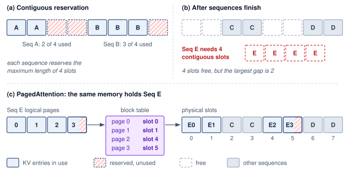

<!--
```{.tikz}
\providecolor{DarkNavy}{HTML}{1E293B}
\providecolor{OceanBlue}{HTML}{2563EB}
\providecolor{ForestGreen}{HTML}{166534}
\providecolor{AmberStage}{HTML}{D97706}
\providecolor{CrimsonSLA}{HTML}{991B1B}
\providecolor{SlateGrey}{HTML}{475569}
\providecolor{SoftGrey}{HTML}{F8FAFC}
\providecolor{SlateTeal}{HTML}{0F766E}
\providecolor{BorderGrey}{HTML}{CBD5E1}
\providecolor{BorderBlue}{HTML}{2563EB}
\providecolor{BorderGreen}{HTML}{166534}
\providecolor{BorderAmber}{HTML}{D97706}
\providecolor{BorderCrimson}{HTML}{991B1B}
\providecolor{Crimson}{HTML}{991B1B}
\providecolor{SoftBlue}{HTML}{F0F6FE}
\providecolor{SoftGreen}{HTML}{ECFAF0}
\providecolor{SoftAmber}{HTML}{FEF8EE}
\providecolor{SoftCrimson}{HTML}{FFF1F2}
\providecolor{BgCard}{HTML}{FFFFFF}
\providecolor{CardBg}{HTML}{FFFFFF}
\providecolor{GrayL}{HTML}{E0E0E0}
\providecolor{GrayLine}{HTML}{666666}
\providecolor{BlueLine}{HTML}{006395}
\providecolor{BlueFill}{HTML}{D6EAF8}
\providecolor{GreenLine}{HTML}{008F45}
\providecolor{GreenFill}{HTML}{D5F5E3}
\providecolor{OrangeLine}{HTML}{E67817}
\providecolor{OrangeFill}{HTML}{FDEBD0}
\providecolor{RedLine}{HTML}{D9534F}
\providecolor{RedFill}{HTML}{F2D7D5}
\providecolor{TextBlack}{HTML}{333333}
\providecolor{VioletLine}{HTML}{7E317B}
\providecolor{VioletFill}{RGB}{243,243,255}
\colorlet{mlsysblue}{OceanBlue}
\colorlet{mlsysgreen}{ForestGreen}
\colorlet{mlsysred}{CrimsonSLA}
\colorlet{mlsysamber}{AmberStage}
\colorlet{mlsysdarkgray}{DarkNavy}
\colorlet{mlsysteal}{SlateTeal}
\scalebox{0.62}{%
\begin{tikzpicture}[
    font=\sffamily,
    >=Stealth,
    panelcard/.style={
        draw=BorderGrey,
        fill=SoftGrey!30,
        rounded corners=3.5pt,
        line width=0.7pt
    },
    panelheader/.style={
        draw=BorderCrimson,
        fill=SoftCrimson,
        rounded corners=2pt,
        line width=0.55pt,
        font=\small\bfseries\color{CrimsonSLA},
        inner xsep=7pt,
        inner ysep=3.5pt
    },
    greenheader/.style={
        draw=BorderGreen,
        fill=SoftGreen,
        rounded corners=2pt,
        line width=0.55pt,
        font=\small\bfseries\color{ForestGreen},
        inner xsep=7pt,
        inner ysep=3.5pt
    },
    tbox/.style={
        draw=BorderBlue,
        fill=white,
        rounded corners=2pt,
        line width=0.6pt,
        minimum width=0.75cm,
        minimum height=0.65cm,
        font=\footnotesize\bfseries\color{DarkNavy},
        align=center
    },
    wastedbox/.style={
        draw=BorderCrimson,
        fill=SoftCrimson!50,
        pattern=north east lines,
        pattern color=BorderCrimson!40,
        rounded corners=2pt,
        line width=0.6pt,
        minimum height=0.65cm,
        font=\scriptsize\bfseries\color{CrimsonSLA},
        align=center
    },
    pblk/.style={
        draw=BorderGrey,
        fill=white,
        rounded corners=2pt,
        line width=0.6pt,
        minimum width=1.6cm,
        minimum height=0.8cm,
        font=\tiny,
        align=center
    },
    pblkactive/.style={
        draw=ForestGreen,
        fill=SoftGreen,
        rounded corners=2pt,
        line width=0.85pt,
        minimum width=1.6cm,
        minimum height=0.8cm,
        font=\tiny,
        align=center
    }
]

    % ==========================================
    % TOP LEFT: INTERNAL FRAGMENTATION
    % ==========================================
    \node[panelcard, minimum width=9.8cm, minimum height=6.0cm, anchor=north west] (p1) at (0, 0) {};
    \node[panelheader, anchor=north west] (h_p1) at ([xshift=10pt, yshift=-10pt]p1.north west) {Internal Fragmentation};
    \node[anchor=west, font=\scriptsize\color{SlateGrey}] at ([xshift=6pt]h_p1.east) {Pre-allocating max seq length ($S_{\text{max}}$)};

    % Seq A (3 active, 5 wasted = 8 total)
    \node[anchor=west, font=\scriptsize\bfseries\color{DarkNavy}] (l_seqa) at (0.4, -1.6) {Seq A};
    \node[tbox, anchor=west] (a_t1) at (1.4, -1.6) {T1};
    \node[tbox, anchor=west] (a_t2) at ([xshift=3pt]a_t1.east) {T2};
    \node[tbox, anchor=west] (a_t3) at ([xshift=3pt]a_t2.east) {T3};
    \path let \p1 = (a_t3.east) in node[wastedbox, anchor=west, minimum width=9.2cm-\x1-3pt] (a_waste) at ([xshift=3pt]a_t3.east) {5 Blocks Unused (62.5\% Wasted)};

    % Seq B (5 active, 3 wasted = 8 total)
    \node[anchor=west, font=\scriptsize\bfseries\color{DarkNavy}] (l_seqb) at (0.4, -2.4) {Seq B};
    \node[tbox, anchor=west] (b_t1) at (1.4, -2.4) {T1};
    \node[tbox, anchor=west] (b_t2) at ([xshift=3pt]b_t1.east) {T2};
    \node[tbox, anchor=west] (b_t3) at ([xshift=3pt]b_t2.east) {T3};
    \node[tbox, anchor=west] (b_t4) at ([xshift=3pt]b_t3.east) {T4};
    \node[tbox, anchor=west] (b_t5) at ([xshift=3pt]b_t4.east) {T5};
    \path let \p1 = (b_t5.east) in node[wastedbox, anchor=west, minimum width=9.2cm-\x1-3pt] (b_waste) at ([xshift=3pt]b_t5.east) {3 Blocks (37.5\%)};

    % Seq C (1 active, 7 wasted = 8 total)
    \node[anchor=west, font=\scriptsize\bfseries\color{DarkNavy}] (l_seqc) at (0.4, -3.2) {Seq C};
    \node[tbox, anchor=west] (c_t1) at (1.4, -3.2) {T1};
    \path let \p1 = (c_t1.east) in node[wastedbox, anchor=west, minimum width=9.2cm-\x1-3pt] (c_waste) at ([xshift=3pt]c_t1.east) {7 Blocks Unused (87.5\% Wasted)};

    % Callout Box Internal
    \node[draw=BorderCrimson, fill=SoftCrimson, rounded corners=2.5pt, line width=0.7pt, inner sep=6pt, text width=8.6cm, align=center] (callout_int) at (4.9, -4.7) {
        \footnotesize\bfseries\textcolor{CrimsonSLA}{Total Capacity Waste: 60\% -- 80\%}\\[2pt]
        \scriptsize\textcolor{DarkNavy}{Memory reserved for tokens that are never generated restricts batch concurrency.}
    };

    % ==========================================
    % TOP RIGHT: EXTERNAL FRAGMENTATION
    % ==========================================
    \node[panelcard, minimum width=9.8cm, minimum height=6.0cm, anchor=north west] (p2) at (10.4, 0) {};
    \node[panelheader, anchor=north west] (h_p2) at ([xshift=10pt, yshift=-10pt]p2.north west) {External Fragmentation};
    \node[anchor=west, font=\scriptsize\color{SlateGrey}] at ([xshift=6pt]h_p2.east) {Dispersed non-contiguous memory gaps};

    % Linear HBM Strip
    \node[anchor=west, font=\scriptsize\bfseries\color{DarkNavy}] (l_linear) at (10.8, -1.4) {Linear HBM Space};
    \node[anchor=west, font=\tiny\color{SlateGrey}] at (10.8, -1.7) {After requests terminate and free disparate ranges:};

    % Strip blocks
    \node[draw=BorderBlue, fill=white, rounded corners=2pt, font=\tiny\bfseries\color{DarkNavy}, minimum width=1.5cm, minimum height=0.6cm, anchor=west] (s_x) at (10.8, -2.2) {Seq X (3b)};
    \node[draw=SlateGrey, dashed, fill=SoftGrey, rounded corners=2pt, font=\tiny\color{SlateGrey}, minimum width=1.1cm, minimum height=0.6cm, anchor=west] (s_f1) at ([xshift=2pt]s_x.east) {Free (2b)};
    \node[draw=BorderBlue, fill=white, rounded corners=2pt, font=\tiny\bfseries\color{DarkNavy}, minimum width=1.7cm, minimum height=0.6cm, anchor=west] (s_y) at ([xshift=2pt]s_f1.east) {Seq Y (4b)};
    \node[draw=SlateGrey, dashed, fill=SoftGrey, rounded corners=2pt, font=\tiny\color{SlateGrey}, minimum width=1.1cm, minimum height=0.6cm, anchor=west] (s_f2) at ([xshift=2pt]s_y.east) {Free (2b)};
    \node[draw=BorderBlue, fill=white, rounded corners=2pt, font=\tiny\bfseries\color{DarkNavy}, minimum width=2.4cm, minimum height=0.6cm, anchor=west] (s_w) at ([xshift=2pt]s_f2.east) {Seq W (6b)};

    % Request Z arrives
    \node[anchor=west, font=\scriptsize\bfseries\color{CrimsonSLA}] (l_reqz) at (10.8, -3.0) {New Request Seq Z Arrives (Requires 4 contiguous blocks):};

    % Fail Box
    \node[draw=BorderCrimson, fill=SoftCrimson, rounded corners=2.5pt, line width=0.7pt, inner sep=5pt, text width=8.6cm, align=center] (box_fail) at (15.3, -3.8) {
        \scriptsize\bfseries\textcolor{CrimsonSLA}{Total Free HBM = 4 Blocks (2 + 2), but Non-Contiguous!}\\[1pt]
        \tiny\textcolor{DarkNavy}{Allocation Fails: Request Z rejected or preempted despite sufficient total bytes.}
    };

    % Collapse Box
    \node[draw=BorderCrimson, fill=SoftCrimson, rounded corners=2.5pt, line width=0.7pt, inner sep=5pt, text width=8.6cm, align=center] (box_col) at (15.3, -4.9) {
        \scriptsize\bfseries\textcolor{CrimsonSLA}{Admission Collapse Under High Concurrency}\\[1pt]
        \tiny\textcolor{DarkNavy}{Frequent compaction causes severe GPU synchronization latency spikes.}
    };

    % ==========================================
    % BOTTOM: PAGEDATTENTION MAPPING
    % ==========================================
    \node[draw=BorderGreen, fill=SoftGreen!25, rounded corners=3.5pt, line width=0.8pt, minimum width=20.2cm, minimum height=5.8cm, anchor=north west] (p3) at (0, -6.5) {};
    \node[greenheader, anchor=north west] (h_p3) at ([xshift=10pt, yshift=-10pt]p3.north west) {PagedAttention Mapping};
    \node[anchor=west, font=\scriptsize\color{SlateGrey}] at ([xshift=6pt]h_p3.east) {OS-style paging decouples contiguous logical tokens from non-contiguous physical HBM blocks};

    % Logical Blocks
    \node[align=center, font=\scriptsize\bfseries\color{DarkNavy}] (l_log) at (3.5, -7.8) {Logical Sequence Blocks\\[2pt]{\tiny\color{SlateGrey}(Virtual Contiguous Space)}};

    \node[draw=BorderBlue, fill=white, rounded corners=2pt, line width=0.7pt, minimum width=1.1cm, minimum height=0.7cm, font=\scriptsize\bfseries\color{DarkNavy}] (p_0) at (1.6, -9.0) {Page 0};
    \node[draw=BorderBlue, fill=white, rounded corners=2pt, line width=0.7pt, minimum width=1.1cm, minimum height=0.7cm, font=\scriptsize\bfseries\color{DarkNavy}, right=4pt of p_0] (p_1) {Page 1};
    \node[draw=BorderBlue, fill=white, rounded corners=2pt, line width=0.7pt, minimum width=1.1cm, minimum height=0.7cm, font=\scriptsize\bfseries\color{DarkNavy}, right=4pt of p_1] (p_2) {Page 2};
    \node[draw=BorderBlue, fill=white, rounded corners=2pt, line width=0.7pt, minimum width=1.1cm, minimum height=0.7cm, font=\scriptsize\bfseries\color{DarkNavy}, right=4pt of p_2] (p_3) {Page 3};

    % Page Table Mapping (Amber card)
    \node[draw=BorderAmber, fill=SoftAmber, rounded corners=3pt, line width=0.8pt, inner sep=6pt, text width=3.2cm, align=center] (ptable) at (9.4, -9.0) {
        \scriptsize\bfseries\textcolor{AmberStage}{Page Table Mapping}\\[4pt]
        \tiny
        Page 0 $\to$ Blk 12\\[2pt]
        Page 1 $\to$ Blk 3\\[2pt]
        Page 2 $\to$ Blk 47\\[2pt]
        Page 3 $\to$ Blk 19
    };

    % Arrow Logical -> Table
    \draw[->, line width=1.0pt, color=AmberStage, shorten >=2pt, shorten <=2pt] (p_3.east) -- (ptable.west);

    % Physical Blocks
    \node[align=center, font=\scriptsize\bfseries\color{DarkNavy}] (l_phy) at (16.2, -7.8) {Physical GPU HBM Blocks\\[2pt]{\tiny\color{SlateGrey}(Dynamically Allocated Scattered Pages)}};

    % Grid of physical blocks (2 rows x 4 cols)
    \node[pblkactive] (blk12) at (13.5, -8.55) {\textbf{Blk 12}\\\textcolor{ForestGreen}{(Page 0)}};
    \node[pblk, right=5pt of blk12] (blk15) {Blk 15\\\textcolor{SlateGrey}{(Seq 2)}};
    \node[pblkactive, right=5pt of blk15] (blk3) {\textbf{Blk 3}\\\textcolor{ForestGreen}{(Page 1)}};
    \node[pblk, right=5pt of blk3] (blk8) {Blk 8\\\textcolor{SlateGrey}{(Free)}};

    \node[pblk, below=5pt of blk12] (blk21) {Blk 21\\\textcolor{SlateGrey}{(Seq 3)}};
    \node[pblkactive, below=5pt of blk15] (blk47) {\textbf{Blk 47}\\\textcolor{ForestGreen}{(Page 2)}};
    \node[pblkactive, below=5pt of blk3] (blk19) {\textbf{Blk 19}\\\textcolor{ForestGreen}{(Page 3)}};
    \node[pblk, below=5pt of blk8] (blk50) {Blk 50\\\textcolor{SlateGrey}{(Free)}};

    % Clean orthogonal pointer to physical blocks
    \draw[->, line width=1.0pt, color=ForestGreen, shorten >=2pt, shorten <=2pt] (ptable.east) -- (blk12.west |- ptable.east);

    % Bottom Summary Banner
    \node[draw=BorderGreen, fill=white, rounded corners=3pt, line width=0.7pt, inner sep=5pt, text width=19.0cm, align=center] (banner) at (10.1, -11.4) {
        \footnotesize\bfseries\textcolor{ForestGreen}{Near-Zero Memory Waste ($<$4\%) $\cdot$ 2$\times$ -- 4$\times$ Serving Throughput Improvement}\\[2pt]
        \scriptsize\textcolor{DarkNavy}{Eliminates external fragmentation completely; internal fragmentation restricted to at most the final block in each sequence.}
    };

\end{tikzpicture}
}
```
-->

:::

Beyond the fragmentation bounds in the definition, paging gives two further capacity advantages. Sequences grow page by page without worst-case preallocation, and common prefixes across requests can share physical pages directly in memory. Together, these properties turn KV cache capacity into a schedulable resource rather than a fixed per-request reservation. The price is indirection, because custom attention kernels must gather keys and values from noncontiguous blocks through each sequence's block table. Recovered capacity also raises throughput only when demand fills it. Allocator occupancy is not a throughput measurement, since throughput still depends on decode work, prefill interference, and the latency budget.

### Prefix caching {#sec-inference-scale-prefix-caching-8e8b}

Many LLM workloads share common prefixes\index{Prefix Caching!prompt sharing} across requests. System prompts like "You are a helpful assistant..." are prepended to every request. Few-shot examples use the same examples for many queries. Document context involves multiple questions about the same document. Recomputing these shared prefixes wastes both compute (prefill) and memory (duplicate KV cache entries).

Prefix caching shares KV cache entries across requests with compatible common prefixes. Reuse requires the same token prefix and the same model computation, including any task-specific weight adapter and other inputs that affect the cached state. The cache key must distinguish those conditions, and the service must restrict sharing to the permitted users or tenants. Matching visible text alone is insufficient. @Fig-prefix-caching diagrams valid block-level sharing: logical tables for independent requests map common prefix tokens to physical blocks B0–B5, skipping their repeated prefill work while storing request-specific suffix state separately.

::: {#fig-prefix-caching fig-env="figure" fig-pos="htb" fig-cap="**Prefix caching via block sharing**: PagedAttention enables efficient prefix caching by allowing multiple sequences' block tables to point to the same physical blocks for shared content. In this example, the System Prompt is stored in blocks 0-5. Request A and Request B map their first 6 logical pages to these same physical blocks, storing only their unique suffixes in new blocks. This dramatically reduces memory usage and prefill computation for workloads with shared context." fig-alt="Three rows. Request A logical pages at top and Request B logical pages at bottom each begin with green shared-prefix pages P0, P1, P2, and P5, separated by an ellipsis, and green arrows from both rows point to the same green physical blocks B0 to B5 in the GPU HBM panel in the middle. Request A's gray suffix pages P6 and P7 point to private blocks B10 and B11, and Request B's gray suffix pages P6 to P8 point to private blocks B12 to B14."}

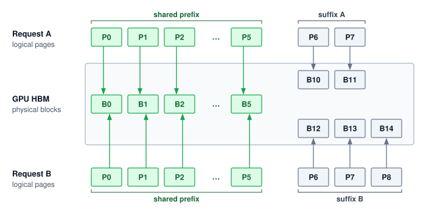{width="100%"}

:::

With PagedAttention, prefix caching uses copy-on-write\index{Copy-on-write!prefix caching} semantics, in which shared blocks stay shared until a request must write into one, and that request then receives a private copy. Three requests that share a system prompt map their first six logical pages to the same physical blocks:

```
System prompt → Physical blocks [0, 1, 2, 3, 4, 5]

Request A page table: [0, 1, 2, 3, 4, 5, 10, 11]  <- shares prefix blocks
Request B page table: [0, 1, 2, 3, 4, 5, 12, 13, 14]  <- shares prefix blocks
Request C page table: [0, 1, 2, 3, 4, 5, 15]  <- shares prefix blocks
```

All three requests reference the same physical blocks for the system prompt. In this block-aligned example, their distinct suffixes occupy new blocks. If a shared prefix ends partway through a block, appending a different suffix writes into a shared block, which is exactly the copy-on-write case, so that request receives a private copy or another representation that preserves the shared contents. The savings can be substantial when many concurrent requests share a compatible system prompt; notebook \ref{nbk-inference-prefix-caching-at-scale} quantifies them for a typical chatbot deployment.

```{python}
#| echo: false
#| label: prefix-caching-calc
# ┌─────────────────────────────────────────────────────────────────────────────
# │ PREFIX CACHING CALCULATION (LEGO)
# ├─────────────────────────────────────────────────────────────────────────────
# │ Context: "Prefix Caching at Scale" callout in §Prefix Caching.
# │
# │ Goal: Quantify KV cache memory savings from prefix caching for a 70B-class
# │   LLM chatbot with 2000-token system prompt and 1000 concurrent users,
# │   motivating why prefix caching enables order-of-magnitude concurrency gains.
# │ Show: kv_tb_no_cache_str="~6.6" TB (without), kv_tb_cached_str="~1.3" TB
# │   (with), memory_reduction_pct_str="80"%, concurrent_mult_str="5"—
# │   inline in the "Prefix Caching at Scale" callout.
# │ How: Use full-width MHA with Llama-70B layer/hidden dimensions (not its GQA);
# │   divide by 1e12 for TB; compare shared-prefix vs per-user-token totals.
# │
# └─────────────────────────────────────────────────────────────────────────────
from mlsysim.fmt import check, fmt_count, fmt_int, fmt_math, fmt_memory, fmt_percent

# ┌── LEGO ───────────────────────────────────────────────
class PrefixCachingAnalysis:
    """Quantify KV cache memory savings from prefix caching for a 70B-class LLM chatbot."""

    # ┌── 1. LOAD (Constants) ──────────────────────────────────────────────
    system_prompt_tokens = 2000
    concurrent_users = 1000
    avg_response_tokens = 500
    _model = Models.Language.Llama2_70B
    n_kv_pairs = 2  # key + value
    n_layers = _model.layers
    hidden_dim = _model.hidden_dim
    bytes_per_element = 2  # FP16

    # ┌── 2. EXECUTE (The Compute) ────────────────────────────────────────
    # Step 1: Without prefix caching: every user stores full system_prompt + response tokens
    tokens_per_user = system_prompt_tokens + avg_response_tokens  # 2500
    total_tokens_no_cache = tokens_per_user * concurrent_users
    kv_no_cache = calc_kv_cache_size(n_layers, 1, hidden_dim, total_tokens_no_cache, 1, bytes_per_element)

    # Step 2: With prefix caching: system prompt stored once; only response tokens per user
    shared_tokens = system_prompt_tokens  # stored once
    unique_tokens = avg_response_tokens * concurrent_users
    total_tokens_cached = shared_tokens + unique_tokens
    kv_cached = calc_kv_cache_size(n_layers, 1, hidden_dim, total_tokens_cached, 1, bytes_per_element)

    # Step 3: Savings
    memory_reduction_pct_val = (1 - (kv_cached / kv_no_cache).to("").magnitude) * 100
    concurrent_multiplier_val = (kv_no_cache / kv_cached).to("").magnitude

    # ┌── 3. GUARD (Invariants) ──────────────────────────────────────────
    check(kv_cached < kv_no_cache, "Cached must be smaller than uncached")
    check(memory_reduction_pct_val > 70, "Prefix caching should give substantial savings (>70%)")

    # ┌── 4. OUTPUT (Formatting) ─────────────────────────────────────────────
    tokens_per_user_str = fmt_count(tokens_per_user, label="token")
    kv_tb_no_cache_str = fmt_memory(kv_no_cache, unit=TB, precision=1, commas=False)
    total_tokens_cached_str = fmt_int(total_tokens_cached)
    kv_tb_cached_str = fmt_memory(kv_cached, unit=TB, precision=1, commas=False)
    memory_reduction_pct_str = fmt_percent(memory_reduction_pct_val / 100, precision=1, commas=False, style='prose')
    concurrent_mult_str = fmt_multiple(round(concurrent_multiplier_val), commas=False, precision=0)
    system_prompt_tokens_str = fmt_int(system_prompt_tokens)
    concurrent_users_str = fmt_int(concurrent_users)
    avg_response_tokens_str = fmt_int(avg_response_tokens)
    tokens_per_user_eq_math = fmt_math(rf"{system_prompt_tokens} + {avg_response_tokens}\text{{ (avg response)}} =")
    kv_no_cache_factors_math = fmt_math(
        rf"\times {concurrent_users} \times {n_kv_pairs} \times {n_layers} " rf"\times {hidden_dim} \times {bytes_per_element} ="
    )
    total_tokens_cached_eq_math = fmt_math(rf"({system_prompt_tokens} \times 1) + ({avg_response_tokens} \times {concurrent_users}) =")
    kv_cached_factors_math = fmt_math(rf"\times {n_kv_pairs} \times {n_layers} \times {hidden_dim} \times {bytes_per_element} =")
```

::: {#nbk-inference-prefix-caching-at-scale .callout-notebook title="Prefix caching at scale"}

**Scenario**: A chatbot service uses a `{python} PrefixCachingAnalysis.system_prompt_tokens_str`-token system prompt and serves `{python} PrefixCachingAnalysis.concurrent_users_str` concurrent users. The illustrative model uses multi-head attention with 80 layers, 64 KV heads of dimension 128, and FP16 state. These full-width KV assumptions differ from the grouped-query attention of Llama-70B.

**Without prefix caching**:

- KV cache per user: `{python} PrefixCachingAnalysis.tokens_per_user_eq_math` `{python} PrefixCachingAnalysis.tokens_per_user_str`
- Total KV cache: `{python} PrefixCachingAnalysis.tokens_per_user_str` `{python} PrefixCachingAnalysis.kv_no_cache_factors_math` `{python} PrefixCachingAnalysis.kv_tb_no_cache_str`

**With prefix caching**:

- Shared prefix: `{python} PrefixCachingAnalysis.system_prompt_tokens_str` tokens (once)
- Unique per user: `{python} PrefixCachingAnalysis.avg_response_tokens_str` tokens
- Total: `{python} PrefixCachingAnalysis.total_tokens_cached_eq_math` `{python} PrefixCachingAnalysis.total_tokens_cached_str`
- Memory: `{python} PrefixCachingAnalysis.total_tokens_cached_str` `{python} PrefixCachingAnalysis.kv_cached_factors_math` `{python} PrefixCachingAnalysis.kv_tb_cached_str`

**Result**: Prefix caching yields a `{python} PrefixCachingAnalysis.memory_reduction_pct_str` memory reduction in KV cache, a roughly `{python} PrefixCachingAnalysis.concurrent_mult_str` capacity ratio for this fixed request population. Actual admitted concurrency also depends on other memory use, generation lengths, and latency limits.

**Systems insight**: Prefix caching pays off when the prefix hit rate is high because many requests share a long prefix. @Tbl-inference-prefix-caching-workloads uses illustrative hit-rate envelopes to show where the technique changes serving capacity and where it does not; production sizing must derive the distribution from a request trace.

| **Workload**                     | **Prefix Hit Rate** | **Memory Savings** |
|:---------------------------------|:-------------------:|:------------------:|
| **Chatbot (same system prompt)** |         95%+        |       70-80%       |
| **Document QA (same doc)**       |        80-90%       |       50-70%       |
| **General API (diverse)**        |       20--40%       |      10--30%       |

: **Illustrative prefix-caching sensitivity**: Assumed prefix hit rates and resulting KV-cache memory savings for three workload shapes. The values demonstrate sensitivity rather than population-wide norms; a serving team must measure exact-prefix reuse and prefix length on its own traffic. {#tbl-inference-prefix-caching-workloads}

:::

### KV cache compression and architectural optimization {#sec-inference-scale-kv-cache-compression-943a}

Paged allocation in @sec-inference-scale-pagedattention-3c94 reduces unused reservations, while prefix sharing in @sec-inference-scale-prefix-caching-8e8b avoids duplicate state. The next techniques reduce the bytes needed to represent that state. The calculation here uses a 64-KV-head multi-head attention (MHA)\index{Multi-head attention!KV cache overhead} baseline so the grouped query attention subsection can isolate the head-count reduction as a separate architectural lever. For a 70B parameter model with 80 layers, 64 heads, head dimension 128, and sequence length 4096 in FP16, the KV cache requires:

```{python}
#| echo: false
#| label: kv-cache-calc-inf
# ┌─────────────────────────────────────────────────────────────────────────────
# │ KV CACHE MEMORY CALCULATION
# ├─────────────────────────────────────────────────────────────────────────────
# │ Context: @sec-inference-scale-kv-cache-compression-943a KV cache compression prose
# │
# │ Goal: Compute FP16 and INT4 KV cache footprint for a 70B MHA baseline (80 layers,
# │       64 KV heads, head_dim=128, seq_len=4096) to quantify memory pressure.
# │       NOTE: 64 KV heads is the MHA baseline used to motivate GQA later in this
# │       section; do not "correct" to Llama-3's 8 GQA heads — that breaks the
# │       pedagogical 8x MHA→GQA comparison in the prose below.
# │ Show: ~10.7 GB FP16 vs ~2.7 GB INT4 → 4x precision compression (FP16→INT4).
# │       A separate 8x reduction comes later from MHA→GQA head count (64→8).
# │ How: 2 * layers * heads * head_dim * seq_len * bytes_per_elem.
# │
# └─────────────────────────────────────────────────────────────────────────────

# ┌── LEGO ───────────────────────────────────────────────
class KVCacheCalc:
    """KV cache memory footprint: FP16 vs INT4 for a 70B MHA model."""

    # ┌── 1. LOAD (Constants) ──────────────────────────────────────────────
    _model = Models.Language.Llama2_70B
    kv_layers = _model.layers
    kv_heads = _model.heads  # MHA baseline; GQA heads are introduced as the reduction below
    gqa_kv_heads = 8
    kv_head_dim = _model.hidden_dim // _model.heads
    kv_seq_len = int(ReferenceStats.ServingProfiles.PrecisionDividendContextLengthTokens)
    h100_mem = Hardware.Cloud.H100.memory.capacity

    # ┌── 2. EXECUTE (The Compute) ────────────────────────────────────────
    kv_fp16 = calc_kv_cache_size(kv_layers, kv_heads, kv_head_dim, kv_seq_len, 1, BYTES_FP16)
    kv_int4 = calc_kv_cache_size(kv_layers, kv_heads, kv_head_dim, kv_seq_len, 1, BYTES_INT4)
    kv_savings = kv_fp16 - kv_int4
    kv_compression = (kv_fp16 / kv_int4).to("").magnitude
    batch8_kv_fp16 = kv_fp16 * 8
    gqa_kv_fp16 = kv_fp16 * (8 / kv_heads)

    # ┌── 3. GUARD (Invariants) ──────────────────────────────────────────
    from mlsysim.fmt import check, fmt_display_math, fmt_int, fmt_memory, fmt_memory_capacity

    check(kv_fp16 > 5 * GB, f"KV cache should be substantial, got {kv_fp16.to(GB).magnitude:.1f} GB")
    check(abs((gqa_kv_fp16 / (kv_fp16 / 8)).to("").magnitude - 1) < 1e-6, "GQA cache should be 8x smaller than MHA baseline")

    # ┌── 4. OUTPUT (Formatting) ─────────────────────────────────────────────
    kv_fp16_gb_str = fmt_memory(kv_fp16, unit=GB, precision=1, commas=False)
    kv_int4_gb_str = fmt_memory(kv_int4, unit=GB, precision=1, commas=False)
    kv_compression_mult_str = fmt_multiple(kv_compression, precision=0, commas=False)
    h100_mem_gb_str = fmt_memory_capacity(h100_mem, unit=GiB, precision=0, commas=False)
    batch8_kv_fp16_gb_str = fmt_memory(batch8_kv_fp16, unit=GB, precision=1, commas=False)
    gqa_kv_fp16_gb_str = fmt_memory(gqa_kv_fp16, unit=GB, precision=1, commas=False)
    kv_fp16_display_math = fmt_display_math(
        rf"\text{{KV cache}} = 2 \times {kv_layers} \times {kv_heads} \times {kv_head_dim} \times {kv_seq_len} \times 2 "
        rf"\approx {kv_fp16.to(GB).magnitude:.1f}\text{{ GB (FP16)}}"
    )
    gqa_kv_fp16_display_math = fmt_display_math(
        rf"\text{{KV cache (GQA)}} = 2 \times {kv_layers} \times {gqa_kv_heads} \times {kv_head_dim} \times {kv_seq_len} \times 2 "
        rf"\approx {gqa_kv_fp16.to(GB).magnitude:.1f}\text{{ GB (FP16)}}"
    )
```

`{python} KVCacheCalc.kv_fp16_display_math`

A single request's KV cache alone consumes a substantial fraction of the H100's `{python} KVCacheCalc.h100_mem_gb_str` of HBM. For a batch of 8 concurrent requests, the KV cache would require `{python} KVCacheCalc.batch8_kv_fp16_gb_str`, leaving no room for model weights or runtime state. Quantization reduces bytes per cached element, while architectural optimization can reduce the number of cached elements. These complementary levers change different factors in the capacity calculation.

#### KV cache quantization {#sec-inference-scale-kv-quantization}

Reducing the size of cached values through lower precision provides direct memory savings. Weight-only quantization reduces weight precision while keeping activations in high precision. While effective for storage, this does not reduce the KV cache. KV cache quantization\index{KV Cache!quantization} explicitly targets the activations, storing cached keys and values in INT8\index{KV Cache!INT8 quantization}, FP8, or even INT4.

Storing the cache payload in INT4 reduces it to approximately `{python} KVCacheCalc.kv_int4_gb_str` per request, a `{python} KVCacheCalc.kv_compression_mult_str` reduction before quantization metadata and any higher-precision residual state. Recovered memory can admit more sequences, but throughput depends on kernel support, conversion costs, and the latency target. Quality must also be evaluated for the intended contexts. Cached keys and values also have different distributions from the model weights and from each other. Keys tend to carry channel-wise outliers, which favors quantizing them per channel, while values lack that channel pattern and can be quantized per token.

#### Grouped query attention (GQA) {#sec-inference-scale-gqa}

Grouped query attention\index{Grouped-query attention!KV cache reduction} [@ainslie2023] changes the number of key-value heads cached per layer, while quantization changes bytes per cached element. GQA is a model architecture choice established through training or checkpoint adaptation, not a serving switch that discards heads from an unchanged model. Holding the other cache dimensions fixed, the representative comparison of 64 KV heads under MHA with 8 under GQA gives an 8$\times$ reduction:

`{python} KVCacheCalc.gqa_kv_fp16_display_math`

At `{python} KVCacheCalc.gqa_kv_fp16_gb_str`, the GQA cache occupies less memory than the `{python} KVCacheCalc.kv_fp16_gb_str` required by MHA in this comparison. Combining GQA with INT8 KV cache quantization reduces the payload further, but per-request size still grows with context length. The architectural and numerical changes each require quality evaluation; recovered capacity permits additional sequences only while their execution remains within the service budget.
```{python}
#| echo: false
#| label: precision-dividend
from mlsysim.fmt import check, fmt_int, fmt_memory

class PrecisionDividend:
    # ┌── 1. LOAD ──────────────────────────────────────────
    int4_bits = BYTES_INT4.to(byte).magnitude * 8
    fp16_bits = BYTES_FP16.to(byte).magnitude * 8
    # Same recurring deployment as the performance-engineering precision
    # dividend: registry serving profile (eight-way tensor parallelism).
    tensor_parallel_degree = int(ReferenceStats.ServingProfiles.PrecisionDividendTensorParallelDegree)
    # vendor nameplate magnitude kept in decimal GB: every other number in
    # this example (weights, KV cache) is decimal, so the printed budget
    # arithmetic only holds if the budget shares their unit space
    h100_mem = ReferenceStats.ServingProfiles.H100VendorMemoryBudget.to(GiB).magnitude * GB
    fp16_weight_total = Models.Language.Llama2_70B.size_in_bytes(BYTES_FP16)
    fp16_weight_per_gpu = fp16_weight_total / tensor_parallel_degree
    # ┌── 2. EXECUTE ───────────────────────────────────────
    avail_kv_fp16 = h100_mem - fp16_weight_per_gpu
    int4_weight_per_gpu = fp16_weight_per_gpu * (int4_bits / fp16_bits)
    avail_kv_int4 = h100_mem - int4_weight_per_gpu
    # MHA baseline shape, matching KVCacheCalc.kv_fp16 quoted in the problem statement.
    _model = Models.Language.Llama2_70B
    kv_layers = _model.layers
    kv_heads = _model.heads
    kv_head_dim = _model.hidden_dim // _model.heads
    kv_seq_len = int(ReferenceStats.ServingProfiles.PrecisionDividendContextLengthTokens)
    kv_fp16 = calc_kv_cache_size(kv_layers, kv_heads, kv_head_dim, kv_seq_len, 1, BYTES_FP16)
    kv_fp16_per_gpu = kv_fp16 / tensor_parallel_degree
    kv_int8_total = kv_fp16 / 2
    kv_int8_per_gpu = kv_int8_total / tensor_parallel_degree
    max_batch_fp16 = int((avail_kv_fp16 / kv_fp16_per_gpu).to("").magnitude)
    max_batch_int8 = int((avail_kv_int4 / kv_int8_per_gpu).to("").magnitude)
    # ┌── 3. GUARD ─────────────────────────────────────────
    check(abs((avail_kv_fp16 - 62.5 * GB).to(GB).magnitude) < 1e-9, f"Expected 62.5 GB, got {avail_kv_fp16.to(GB).magnitude:.1f} GB")
    check(abs((int4_weight_per_gpu - 4.375 * GB).to(GB).magnitude) < 0.01, f"Expected 4.375 GB, got {int4_weight_per_gpu.to(GB).magnitude:.3f} GB")
    check(kv_fp16 == KVCacheCalc.kv_fp16, "Per-request FP16 KV must match the KVCacheCalc figure quoted in the problem")
    check(max_batch_int8 > max_batch_fp16, "INT4 weights plus INT8 KV should increase max batch")
    # ┌── 4. OUTPUT ────────────────────────────────────────
    h100_mem_gb_str = fmt_memory_capacity(h100_mem, unit=GB, precision=0, commas=False)
    fp16_weight_per_gpu_gb_str = fmt_memory(fp16_weight_per_gpu, unit=GB, precision=1, commas=False)
    avail_kv_fp16_gb_str = fmt_memory(avail_kv_fp16, unit=GB, precision=1, commas=False)
    int4_weight_per_gpu_gb_str = fmt_memory(int4_weight_per_gpu, unit=GB, precision=2, commas=False)
    avail_kv_int4_gb_str = fmt_memory(avail_kv_int4, unit=GB, precision=2, commas=False)
    kv_fp16_per_gpu_gb_str = fmt_memory(kv_fp16_per_gpu, unit=GB, precision=2, commas=False)
    kv_int8_total_gb_str = fmt_memory(kv_int8_total, unit=GB, precision=1, commas=False)
    kv_int8_per_gpu_gb_str = fmt_memory(kv_int8_per_gpu, unit=GB, precision=2, commas=False)
    max_batch_fp16_str = fmt_int(max_batch_fp16, commas=False)
    max_batch_int8_str = fmt_int(max_batch_int8, commas=False)
    fp16_weight_total_gb_str = fmt_memory(fp16_weight_total, unit=GB, precision=0, commas=False)
    tensor_parallel_degree_str = fmt_count(tensor_parallel_degree, precision=0, commas=False)
```

::: {#nbk-inference-precision-dividend .callout-notebook title="The precision dividend with a full-width cache"}

Notebook \ref{nbk-performance-engineering-precision-dividend} computed this dividend for the reference replica's eight-head GQA cache. Repeating it with the 64-head MHA baseline, whose requests carry eight times more KV state, separates what the attention layout changes from what precision changes.

This comparison uses a conservative decimal HBM budget of `{python} PrecisionDividend.h100_mem_gb_str` per GPU, matching the nameplate label rather than the registered byte capacity used by the node estimator.

**Problem**: A team serves a 70B model on `{python} PrecisionDividend.tensor_parallel_degree_str`$\times$ H100 GPUs. Weights in FP16 consume `{python} PrecisionDividend.fp16_weight_total_gb_str` (`{python} PrecisionDividend.fp16_weight_per_gpu_gb_str`/GPU). KV cache at FP16 consumes `{python} KVCacheCalc.kv_fp16_gb_str` per request. How does quantizing weights to INT4 and KV cache to INT8 change the maximum batch size?

**Before optimization** (all FP16):

- Weights: `{python} PrecisionDividend.fp16_weight_per_gpu_gb_str`/GPU
- Available for KV cache: `{python} PrecisionDividend.h100_mem_gb_str` $-$ `{python} PrecisionDividend.fp16_weight_per_gpu_gb_str` = `{python} PrecisionDividend.avail_kv_fp16_gb_str`/GPU
- KV cache per request: `{python} KVCacheCalc.kv_fp16_gb_str` $\div$ `{python} PrecisionDividend.tensor_parallel_degree_str` $\approx$ `{python} PrecisionDividend.kv_fp16_per_gpu_gb_str`/GPU
- Maximum batch size: $\lfloor$ `{python} PrecisionDividend.avail_kv_fp16_gb_str` divided by `{python} PrecisionDividend.kv_fp16_per_gpu_gb_str` $\rfloor$ $\approx$ `{python} PrecisionDividend.max_batch_fp16_str` requests

**After optimization** (INT4 weights, INT8 KV cache):

- Weights: `{python} PrecisionDividend.fp16_weight_per_gpu_gb_str` $\times (4/16) =$ `{python} PrecisionDividend.int4_weight_per_gpu_gb_str`/GPU (INT4)
- Available for KV cache: `{python} PrecisionDividend.h100_mem_gb_str` $-$ `{python} PrecisionDividend.int4_weight_per_gpu_gb_str` = `{python} PrecisionDividend.avail_kv_int4_gb_str`/GPU
- KV cache per request (INT8): `{python} PrecisionDividend.kv_int8_total_gb_str` $\div$ `{python} PrecisionDividend.tensor_parallel_degree_str` $\approx$ `{python} PrecisionDividend.kv_int8_per_gpu_gb_str`/GPU
- Maximum batch size: $\lfloor$ `{python} PrecisionDividend.avail_kv_int4_gb_str` divided by `{python} PrecisionDividend.kv_int8_per_gpu_gb_str` $\rfloor$ $\approx$ `{python} PrecisionDividend.max_batch_int8_str` requests

**Systems insight**: The two layouts yield the same multiplicative dividend, because each maximum batch is free memory divided by per-request cache, and precision changes both quantities by the same factors whatever the head count. The layout sets the absolute count, and at either precision the MHA replica admits roughly an eighth as many requests. In both layouts, compressing the cache does more for admission than compressing the weights, since halving per-request state doubles the count while INT4 weights free only the weight share of each GPU. At serving scale the recovered headroom is an admission budget, not yet throughput. The scheduler converts it into completed requests only while the larger batch still meets TPOT, and the counts here omit runtime allocations and headroom, so they are optimistic upper bounds on what admission control should allow.

:::

### Speculative decoding as a serving policy {#sec-inference-scale-speculative-decoding-c438}

Speculative decoding pairs a small draft model\index{Speculative Decoding!draft model} proposing $\SpeculativeDraftLength$ tokens with a target model verifying them\index{Speculative Decoding!verification step} in one parallel forward pass. With the exact acceptance-and-correction sampling procedure, the emitted sequence preserves the target distribution. Approximate verification rules do not inherit that guarantee. The draft acceptance rate\index{Speculative Decoding!acceptance rate} $\DraftTokenAcceptanceProbability$ determines how much proposed work survives, while drafting and verification costs determine whether it saves time. At fleet scale, the scheduler must also decide when to enable speculation, how its memory cost interacts with admission, and whether it improves the endpoint's SLO-compliant capacity.

::: {.column-margin .margin-pointer}
↩ The draft-and-verify mechanics of speculative decoding are established in @sec-performance-engineering-speculative.
:::

::: {.column-margin}
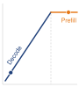{width="100%" fig-alt="A roofline silhouette: a blue memory-bound slope rising to a dashed ridge line, then an orange compute-bound ceiling. A workload dot sits deep on the memory-bound slope, the regime batch-1 decode occupies before parallel verification raises its arithmetic intensity toward the ridge."}

*Small-batch decode is memory-bound; parallel verification raises arithmetic intensity.*
:::

The latency benefit depends on accepted progress relative to drafting and verification time. When the draft model proposes $\SpeculativeDraftLength$ tokens, high acceptance rates allow the target model to verify and emit multiple tokens in a single forward pass. When acceptance drops, rejected tokens are discarded while drafting and verification still cost time; generation can become slower than ordinary decoding. With the simplified constant, independent acceptance probability at each draft position used in that analysis, the expected number of tokens emitted per round, including the correction token, is $\frac{1 - \DraftTokenAcceptanceProbability^{\SpeculativeDraftLength+1}}{1 - \DraftTokenAcceptanceProbability}$, which collapses toward 1 as acceptance falls. The following calculation assumes $\SpeculativeDraftLength= 5$ draft tokens, a draft step 20$\times$ faster than a target decode step, and a verification pass costing the same as one target decode step. Holding those costs fixed isolates sensitivity to acceptance:

```{python}
#| echo: false
#| label: speculative-speedup-analysis
# ┌─────────────────────────────────────────────────────────────────────────────
# │ SPECULATIVE DECODING SPEEDUP ANALYSIS
# ├─────────────────────────────────────────────────────────────────────────────
# │ Context: @sec-inference-scale-speculative-decoding-c438 acceptance-sensitivity bullets
# │
# │ Goal: Compute expected latency speedup from speculative decoding at K=5 draft
# │       tokens with a 20x-faster draft model, across three acceptance rates
# │       (alpha_acc=0.9 high, 0.7 medium, 0.5 low), to show acceptance sensitivity.
# │ Show: ~3.7x (alpha_acc=0.9), ~2.4x (alpha_acc=0.7), ~1.6x (alpha_acc=0.5).
# │ How: E[accepted tokens] = sum alpha_acc^i for i in 0..K; speedup =
# │       (E[tokens] * t_target) / (t_draft_total + t_target).
# │
# └─────────────────────────────────────────────────────────────────────────────

# ┌── LEGO ───────────────────────────────────────────────
class SpeculativeSpeedup:
    """Speculative decoding latency speedup across acceptance rates."""

    # ┌── 1. LOAD (Constants) ──────────────────────────────────────────────
    from mlsysim.solvers import ServingModel
    from mlsysim import Models, Hardware

    alpha_high = 0.9  # acceptance rate for "easy" text
    alpha_med = 0.7  # medium-difficulty text
    alpha_low = 0.5  # "hard" text
    K = 5  # draft length

    # ┌── 2. EXECUTE (The Compute) ────────────────────────────────────────
    # Use ServingModel to calculate speedup (logic from library)
    def _speedup(alpha, k):
        et = sum(alpha**i for i in range(k + 1))
        # Logic consistent with ServingModel: T = (T_draft*K + T_target) / (E[tokens] * T_target)
        # Here we use normalized units for simplicity as in original block
        t_target = 1.0
        t_draft = 0.05
        time_per_round = t_draft * k + t_target
        baseline_time = et * t_target
        return baseline_time / time_per_round

    sp_high = _speedup(alpha_high, K)
    sp_med = _speedup(alpha_med, K)
    sp_low = _speedup(alpha_low, K)

    et_high = (1 - alpha_high ** (K + 1)) / (1 - alpha_high)
    et_med = (1 - alpha_med ** (K + 1)) / (1 - alpha_med)
    et_low = (1 - alpha_low ** (K + 1)) / (1 - alpha_low)

    # ┌── 3. GUARD (Invariants) ──────────────────────────────────────────
    from mlsysim.fmt import check, fmt

    check(sp_high > 2.0, f"High acceptance speedup should be >2x, got {sp_high:.1f}x")

    # ┌── 4. OUTPUT (Formatting) ─────────────────────────────────────────────
    sp_high_mult_str = fmt_multiple(sp_high, precision=1, commas=False)
    sp_med_mult_str = fmt_multiple(sp_med, precision=1, commas=False)
    sp_low_mult_str = fmt_multiple(sp_low, precision=1, commas=False)
    et_high_str = fmt_count(et_high, precision=2, commas=False, label="token", allow_fractional=True)
    et_med_str = fmt_count(et_med, precision=2, commas=False, label="token", allow_fractional=True)
    et_low_str = fmt_count(et_low, precision=2, commas=False, label="token", allow_fractional=True)
```

Evaluating this model across representative acceptance regimes illustrates how sharply returns depend on draft accuracy: high acceptance ($\DraftTokenAcceptanceProbability= 0.9$) yields an expected `{python} SpeculativeSpeedup.et_high_str` per verification round for a `{python} SpeculativeSpeedup.sp_high_mult_str` speedup, medium acceptance ($\DraftTokenAcceptanceProbability= 0.7$) delivers `{python} SpeculativeSpeedup.et_med_str` per round for a `{python} SpeculativeSpeedup.sp_med_mult_str` speedup, and low acceptance ($\DraftTokenAcceptanceProbability= 0.5$) drops progress to `{python} SpeculativeSpeedup.et_low_str` per round, yielding a modest speedup of `{python} SpeculativeSpeedup.sp_low_mult_str`.

::: {.column-margin}
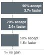{width="100%" fig-alt="Three horizontal bars on a linear scale: 90 percent acceptance gives 3.7 times faster decoding, 70 percent gives 2.4 times, and 50 percent gives 1.6 times."}

*Speedup shrinks quickly as draft acceptance falls.*
:::

Acceptance depends on the draft-target pair, sampling policy, and request distribution. The preceding calculations are sensitivity cases, not fixed acceptance rates for chat, reasoning, or code generation. A serving fleet must measure acceptance and useful token throughput for its actual traffic before selecting a speculation policy, and that policy must answer three serving concerns: memory, the SLO, and change over time.

```{python}
#| echo: false
#| label: speculation-draft-weights
# ┌─────────────────────────────────────────────────────────────────────────────
# │ SPECULATION TAX: DRAFT-MODEL WEIGHTS (LEGO)
# ├─────────────────────────────────────────────────────────────────────────────
# │ Context: "speculation tax" paragraph in
# │          @sec-inference-scale-speculative-decoding-c438.
# │
# │ Goal: Size the resident FP16 weights of a 7B draft model paired with a 70B target.
# │ Show: ~14 GB of draft weights per replica.
# │ How: Models.Language.Llama2_7B.size_in_bytes(BYTES_FP16).
# └─────────────────────────────────────────────────────────────────────────────
from mlsysim.fmt import check, fmt_memory

class SpeculationDraftWeights:
    """Resident FP16 weight cost of a 7B draft model."""

    # ┌── 1. LOAD (Constants) ──────────────────────────────────────────────
    draft = Models.Language.Llama2_7B
    target = Models.Language.Llama2_70B

    # ┌── 2. EXECUTE (The Compute) ────────────────────────────────────────
    draft_fp16 = draft.size_in_bytes(BYTES_FP16)
    draft_share = (draft_fp16 / target.size_in_bytes(BYTES_FP16)).to("").magnitude

    # ┌── 3. GUARD (Invariants) ──────────────────────────────────────────
    check(0.05 < draft_share < 0.15, "Draft weights should be about a tenth of the target's")

    # ┌── 4. OUTPUT (Formatting) ─────────────────────────────────────────────
    draft_fp16_gb_str = fmt_memory(draft_fp16, unit=GB, precision=0, commas=False)
```

The first concern is memory. The draft model is not free state. It requires memory for weights, and each in-flight request that uses it reserves additional draft KV state. Pairing a 7B draft model with a 70B target adds roughly `{python} SpeculationDraftWeights.draft_fp16_gb_str` of FP16 weights per replica plus per-request draft cache. When colocated with the target, this *speculation tax*\index{Speculative Decoding!speculation tax} competes directly with the KV-cache admission budget developed in @sec-inference-scale-kv-cache-wall: every gigabyte reserved for the draft is unavailable to target requests. Under a binding memory limit, that reservation lowers maximum concurrency. Placing the draft on separate devices preserves target memory at the cost of additional hardware and communication. The admission controller and the speculation policy therefore require a joint capacity and latency evaluation.

The second concern is which service-level objective the endpoint must meet. At sufficient acceptance, speculation can reduce TPOT; draft execution and cache residency can also reduce admission capacity. Neither latency nor aggregate-throughput benefit follows from the endpoint label alone. The scheduler should compare SLO-compliant goodput with and without speculation under the intended load\index{Speculative Decoding!SLA trade-offs}. TTFT needs separate measurement because draft setup and prefill can add work before the first response token.

The third concern is that acceptance and load change over time. A scheduler can enable speculation when measured TPOT or goodput improves, then disable it when verification cost outweighs accepted-token progress. Disabling draft execution alone does not free resident draft weights; recovering that capacity requires unloading them, and releasing draft KV pages requires ending or migrating the associated speculative state. Alternative draft mechanisms change this budget: self-speculative decoding\index{Self-Speculative Decoding} reuses the target model, Medusa\index{Medusa} [@cai2024medusa] adds prediction heads, and lookahead decoding\index{Lookahead Decoding} avoids a separate draft model. Each requires its own quality, acceptance, and resource evaluation.

### Prefill-decode disaggregation {#sec-inference-scale-prefill-decode-disaggregation}

Chunked prefill keeps prefill and decode on one worker and bounds how much prompt work lands between decode steps. Disaggregation takes the other route and gives each phase its own hardware. The KV-cache sizing of @sec-inference-scale-kv-cache-wall now supplies what that choice costs, because the cache a prefill builds is exactly the payload the decode pool must receive.

@Fig-disaggregated-serving partitions the serving pipeline into specialized physical tiers. In the illustrated long-prompt, small-decode-batch regime, prefill is compute bound while decode is memory-bandwidth bound. Separate pools can therefore emphasize compute throughput for prefill and memory bandwidth for decode, with a remote direct memory access (RDMA) KV-cache transfer connecting the phases [@zhong2024distserve]. Separation prevents the two phases from competing on the same accelerator and permits independent parallelism and capacity plans. The transfer and queueing at each pool still contribute to request latency, and different batch or context sizes can change which resources bind.

::: {#fig-disaggregated-serving fig-env="figure" fig-pos="htb" fig-cap="**Disaggregated Serving Architecture**: A long-prompt, small-decode-batch regime separates compute-bound prefill instances from memory-bandwidth-bound decode instances, mediated by RDMA KV-cache transfer. Because prefill sets time to first token and decode sets time per output token, each pool is sized for its own token rate. Other batch and context sizes can change the binding resources." fig-alt="Left to right: a prompt enters a prefill pool labeled compute-bound, sets TTFT, and sized for prompt tokens per second. Each of its three workers, Prefill 0 to 2, shows its work as two wide solid blocks, each a whole-prompt pass. An amber arrow carrying four small KV-cache page tiles, labeled KV cache transfer (RDMA), crosses to a decode pool labeled bandwidth-bound, sets TPOT, and sized for output tokens per second. Each of its three workers, Decode 0 to 2, shows its work as a row of eight narrow cells, each a one-token decode step. The decode pool emits a token stream. A key below names the wide block a whole-prompt pass and the narrow cell a one-token decode step."}
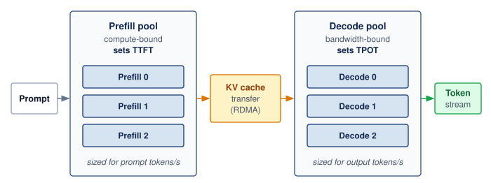

<!--
```{.tikz}
\providecolor{DarkNavy}{HTML}{1E293B}
\providecolor{OceanBlue}{HTML}{2563EB}
\providecolor{ForestGreen}{HTML}{166534}
\providecolor{AmberStage}{HTML}{D97706}
\providecolor{CrimsonSLA}{HTML}{991B1B}
\providecolor{SlateGrey}{HTML}{475569}
\providecolor{SoftGrey}{HTML}{F8FAFC}
\providecolor{SlateTeal}{HTML}{0F766E}
\providecolor{BorderGrey}{HTML}{CBD5E1}
\providecolor{BorderBlue}{HTML}{2563EB}
\providecolor{BorderGreen}{HTML}{166534}
\providecolor{BorderAmber}{HTML}{D97706}
\providecolor{BorderCrimson}{HTML}{991B1B}
\providecolor{Crimson}{HTML}{991B1B}
\providecolor{SoftBlue}{HTML}{F0F6FE}
\providecolor{SoftGreen}{HTML}{ECFAF0}
\providecolor{SoftAmber}{HTML}{FEF8EE}
\providecolor{SoftCrimson}{HTML}{FFF1F2}
\providecolor{BgCard}{HTML}{FFFFFF}
\providecolor{CardBg}{HTML}{FFFFFF}
\providecolor{GrayL}{HTML}{E0E0E0}
\providecolor{GrayLine}{HTML}{666666}
\providecolor{BlueLine}{HTML}{006395}
\providecolor{BlueFill}{HTML}{D6EAF8}
\providecolor{GreenLine}{HTML}{008F45}
\providecolor{GreenFill}{HTML}{D5F5E3}
\providecolor{OrangeLine}{HTML}{E67817}
\providecolor{OrangeFill}{HTML}{FDEBD0}
\providecolor{RedLine}{HTML}{D9534F}
\providecolor{RedFill}{HTML}{F2D7D5}
\providecolor{TextBlack}{HTML}{333333}
\providecolor{VioletLine}{HTML}{7E317B}
\providecolor{VioletFill}{RGB}{243,243,255}
\colorlet{mlsysblue}{OceanBlue}
\colorlet{mlsysgreen}{ForestGreen}
\colorlet{mlsysred}{CrimsonSLA}
\colorlet{mlsysamber}{AmberStage}
\colorlet{mlsysdarkgray}{DarkNavy}
\colorlet{mlsysteal}{SlateTeal}
\scalebox{0.58}{%
\begin{tikzpicture}[
    x=1cm, y=1cm,
    >=Stealth,
    font=\small\sffamily
]

    % Styles
    \tikzset{
        poolbox/.style={
            rounded corners=3.5pt,
            line width=0.8pt,
            inner sep=0pt
        },
        card/.style={
            rounded corners=2.5pt,
            line width=0.6pt,
            draw=BorderGrey,
            fill=white,
            inner sep=4pt
        },
        minibadge/.style={
            rounded corners=2pt,
            fill=#1,
            text=white,
            font=\fontsize{6}{7}\selectfont\bfseries,
            inner xsep=3.5pt,
            inner ysep=1.8pt
        }
    }

    % 1. USER REQUEST (LEFT)
    \node[draw=BorderBlue!90, fill=SoftBlue!70, rounded corners=3pt, line width=0.7pt,
          minimum width=2.0cm, minimum height=1.6cm, align=center] (req) at (-2.2, -4.5) {
        \textbf{\color{DarkNavy} User Request}\\[4pt]
        \scriptsize\color{DarkNavy!80} Prompt Tokens\\
        \fontsize{7}{8}\selectfont\color{DarkNavy!65} ($S_{\text{prompt}}$ tokens)
    };

    % 2. PREFILL WORKER POOL (MIDDLE LEFT)
    \node[poolbox, draw=OceanBlue!80, fill=SoftBlue!30,
          minimum width=6.6cm, minimum height=10.1cm, anchor=north west] (prefill_pool) at (0, 0) {};

    % Header
    \node[draw=OceanBlue!70, fill=white, rounded corners=2.5pt, line width=0.65pt,
          minimum width=6.0cm, minimum height=0.95cm, align=center, anchor=north]
          (pf_hdr) at ([shift={(0, -0.25cm)}] prefill_pool.north) {
        \bfseries\color{OceanBlue!90!black} Prefill Worker Pool\\[2pt]
        \scriptsize\bfseries\color{OceanBlue} Compute-Bound $\cdot$ High FP8 TFLOP/s $\cdot$ TTFT Critical
    };

    % 2x2 GPU Grid
    % PF-0
    \node[card, minimum width=2.85cm, minimum height=1.90cm, anchor=north west] (pf0)
          at ([shift={(0.3cm, -1.35cm)}] prefill_pool.north west) {};
    \node[minibadge=OceanBlue, anchor=north west] at ([shift={(0.12cm, -0.12cm)}] pf0.north west) {PF-0};
    \node[anchor=west, font=\scriptsize\bfseries\color{DarkNavy}] at ([shift={(1.05cm, -0.22cm)}] pf0.north west) {H100 SXM5};
    \node[anchor=north west, font=\fontsize{6.0}{8.0}\selectfont, text width=2.65cm, align=left]
          at ([shift={(0.12cm, -0.52cm)}] pf0.north west) {
        \textbf{Arch:} $8\times$ H100 (FP8)\\[2pt]
        \textbf{Exec:} Prompt GEMM\\[2pt]
        \textbf{Bound:} Compute
    };

    % PF-1
    \node[card, minimum width=2.85cm, minimum height=1.90cm, anchor=north east] (pf1)
          at ([shift={(-0.3cm, -1.35cm)}] prefill_pool.north east) {};
    \node[minibadge=OceanBlue, anchor=north west] at ([shift={(0.12cm, -0.12cm)}] pf1.north west) {PF-1};
    \node[anchor=west, font=\scriptsize\bfseries\color{DarkNavy}] at ([shift={(1.05cm, -0.22cm)}] pf1.north west) {H100 SXM5};
    \node[anchor=north west, font=\fontsize{6.0}{8.0}\selectfont, text width=2.65cm, align=left]
          at ([shift={(0.12cm, -0.52cm)}] pf1.north west) {
        \textbf{Arch:} $8\times$ H100 (FP8)\\[2pt]
        \textbf{Exec:} Prompt GEMM\\[2pt]
        \textbf{Bound:} Compute
    };

    % PF-2
    \node[card, minimum width=2.85cm, minimum height=1.90cm, anchor=north west] (pf2)
          at ([shift={(0.3cm, -3.45cm)}] prefill_pool.north west) {};
    \node[minibadge=OceanBlue, anchor=north west] at ([shift={(0.12cm, -0.12cm)}] pf2.north west) {PF-2};
    \node[anchor=west, font=\scriptsize\bfseries\color{DarkNavy}] at ([shift={(1.05cm, -0.22cm)}] pf2.north west) {H100 SXM5};
    \node[anchor=north west, font=\fontsize{6.0}{8.0}\selectfont, text width=2.65cm, align=left]
          at ([shift={(0.12cm, -0.52cm)}] pf2.north west) {
        \textbf{Arch:} $8\times$ H100 (FP8)\\[2pt]
        \textbf{Exec:} Prompt GEMM\\[2pt]
        \textbf{Bound:} Compute
    };

    % PF-3
    \node[card, minimum width=2.85cm, minimum height=1.90cm, anchor=north east] (pf3)
          at ([shift={(-0.3cm, -3.45cm)}] prefill_pool.north east) {};
    \node[minibadge=OceanBlue, anchor=north west] at ([shift={(0.12cm, -0.12cm)}] pf3.north west) {PF-3};
    \node[anchor=west, font=\scriptsize\bfseries\color{DarkNavy}] at ([shift={(1.05cm, -0.22cm)}] pf3.north west) {H100 SXM5};
    \node[anchor=north west, font=\fontsize{6.0}{8.0}\selectfont, text width=2.65cm, align=left]
          at ([shift={(0.12cm, -0.52cm)}] pf3.north west) {
        \textbf{Arch:} $8\times$ H100 (FP8)\\[2pt]
        \textbf{Exec:} Prompt GEMM\\[2pt]
        \textbf{Bound:} Compute
    };

    % Phase Characteristics Box (Prefill)
    \node[draw=BorderBlue!90, fill=white, rounded corners=2.5pt, line width=0.6pt,
          minimum width=6.0cm, minimum height=2.25cm, anchor=north] (pf_char)
          at ([shift={(0, -5.55cm)}] prefill_pool.north) {};
    \node[anchor=north west, font=\scriptsize\bfseries\color{OceanBlue!90!black}]
          at ([shift={(0.15cm, -0.12cm)}] pf_char.north west) {Phase Characteristics:};
    \node[anchor=north west, font=\fontsize{6.0}{8.2}\selectfont, text width=5.7cm, align=left]
          at ([shift={(0.15cm, -0.42cm)}] pf_char.north west) {
        \textbf{Compute:} Full prompt in single parallel pass\\
        \textbf{Intensity:} High arithmetic intensity (saturates FLOPs)\\
        \textbf{Output:} Emits first token, initializes KV cache\\
        \textbf{\color{OceanBlue!90!black}Scaling Metric: Arrival rate (tokens/s)}
    };

    % Independent Sizing Box (Prefill)
    \node[draw=BorderBlue!70, fill=white, rounded corners=2.5pt, line width=0.6pt,
          minimum width=6.0cm, minimum height=1.65cm, anchor=north, align=center] (pf_size)
          at ([shift={(0, -8.10cm)}] prefill_pool.north) {
        \scriptsize\bfseries\color{DarkNavy} Independent Capacity Sizing\\[2pt]
        \fontsize{6.0}{7.5}\selectfont\color{DarkNavy!85} Smaller pool footprint (e.g., 20\% of GPUs)\\[1.5pt]
        \fontsize{6.0}{7.5}\selectfont\color{DarkNavy!85} Zero interference from slow decode token generation\\[2pt]
        \fontsize{6.2}{7.6}\selectfont\bfseries\color{OceanBlue!90!black} Deterministic Time-to-First-Token (TTFT)
    };

    % Arrow: User Request -> Prefill Pool
    \draw[->, line width=1.1pt, OceanBlue, shorten >=2pt, shorten <=2pt] (req.east) -- (prefill_pool.west |- req.east);

    % 3. KV CACHE TRANSFER (MIDDLE) - Interconnect Card
    \node[dashed, draw=AmberStage, fill=SoftAmber!70, rounded corners=3.5pt, line width=0.9pt,
          minimum width=2.4cm, minimum height=3.0cm, align=center] (kv_xfer) at (7.9, -4.5) {
        \bfseries\color{AmberStage!95!black} KV Cache\\[1pt]
        \bfseries\color{AmberStage!95!black} Transfer\\[5pt]
        \scriptsize\color{DarkNavy} RDMA / RoCE\\[2pt]
        \fontsize{6.5}{7.5}\selectfont\bfseries\color{DarkNavy} 400 Gb/s Fabric\\[5pt]
        \footnotesize\bfseries\color{AmberStage!95!black} $<$ 5--10\,ms
    };

    % 4. DECODE WORKER POOL (MIDDLE RIGHT)
    \node[poolbox, draw=ForestGreen!80, fill=SoftGreen!25,
          minimum width=6.6cm, minimum height=10.1cm, anchor=north west] (decode_pool) at (9.2, 0) {};

    % Arrows for KV Transfer with clearance (now that decode_pool is defined!)
    \draw[->, line width=1.2pt, AmberStage, shorten >=3pt, shorten <=2pt] (prefill_pool.east |- kv_xfer.center) -- (kv_xfer.west);
    \draw[->, line width=1.2pt, AmberStage, shorten >=2pt, shorten <=3pt] (kv_xfer.east) -- (decode_pool.west |- kv_xfer.center);

    % Header
    \node[draw=ForestGreen!70, fill=white, rounded corners=2.5pt, line width=0.65pt,
          minimum width=6.0cm, minimum height=0.95cm, align=center, anchor=north]
          (dc_hdr) at ([shift={(0, -0.25cm)}] decode_pool.north) {
        \bfseries\color{ForestGreen!90!black} Decode Worker Pool\\[2pt]
        \scriptsize\bfseries\color{ForestGreen} Memory-Bound $\cdot$ High HBM Bandwidth $\cdot$ TPOT Critical
    };

    % 3x2 GPU Grid
    % DC-0 & DC-1
    \node[card, minimum width=2.85cm, minimum height=1.25cm, anchor=north west] (dc0)
          at ([shift={(0.3cm, -1.35cm)}] decode_pool.north west) {};
    \node[minibadge=ForestGreen, anchor=north west] at ([shift={(0.12cm, -0.12cm)}] dc0.north west) {DC-0};
    \node[anchor=west, font=\scriptsize\bfseries\color{DarkNavy}] at ([shift={(1.05cm, -0.22cm)}] dc0.north west) {Large HBM};
    \node[anchor=north west, font=\fontsize{6.0}{7.5}\selectfont\color{DarkNavy!75}] at ([shift={(0.12cm, -0.58cm)}] dc0.north west) {PagedAttention KV};

    \node[card, minimum width=2.85cm, minimum height=1.25cm, anchor=north east] (dc1)
          at ([shift={(-0.3cm, -1.35cm)}] decode_pool.north east) {};
    \node[minibadge=ForestGreen, anchor=north west] at ([shift={(0.12cm, -0.12cm)}] dc1.north west) {DC-1};
    \node[anchor=west, font=\scriptsize\bfseries\color{DarkNavy}] at ([shift={(1.05cm, -0.22cm)}] dc1.north west) {Large HBM};
    \node[anchor=north west, font=\fontsize{6.0}{7.5}\selectfont\color{DarkNavy!75}] at ([shift={(0.12cm, -0.58cm)}] dc1.north west) {PagedAttention KV};

    % DC-2 & DC-3
    \node[card, minimum width=2.85cm, minimum height=1.25cm, anchor=north west] (dc2)
          at ([shift={(0.3cm, -2.75cm)}] decode_pool.north west) {};
    \node[minibadge=ForestGreen, anchor=north west] at ([shift={(0.12cm, -0.12cm)}] dc2.north west) {DC-2};
    \node[anchor=west, font=\scriptsize\bfseries\color{DarkNavy}] at ([shift={(1.05cm, -0.22cm)}] dc2.north west) {Large HBM};
    \node[anchor=north west, font=\fontsize{6.0}{7.5}\selectfont\color{DarkNavy!75}] at ([shift={(0.12cm, -0.58cm)}] dc2.north west) {PagedAttention KV};

    \node[card, minimum width=2.85cm, minimum height=1.25cm, anchor=north east] (dc3)
          at ([shift={(-0.3cm, -2.75cm)}] decode_pool.north east) {};
    \node[minibadge=ForestGreen, anchor=north west] at ([shift={(0.12cm, -0.12cm)}] dc3.north west) {DC-3};
    \node[anchor=west, font=\scriptsize\bfseries\color{DarkNavy}] at ([shift={(1.05cm, -0.22cm)}] dc3.north west) {Large HBM};
    \node[anchor=north west, font=\fontsize{6.0}{7.5}\selectfont\color{DarkNavy!75}] at ([shift={(0.12cm, -0.58cm)}] dc3.north west) {PagedAttention KV};

    % DC-4 & DC-5
    \node[card, minimum width=2.85cm, minimum height=1.25cm, anchor=north west] (dc4)
          at ([shift={(0.3cm, -4.15cm)}] decode_pool.north west) {};
    \node[minibadge=ForestGreen, anchor=north west] at ([shift={(0.12cm, -0.12cm)}] dc4.north west) {DC-4};
    \node[anchor=west, font=\scriptsize\bfseries\color{DarkNavy}] at ([shift={(1.05cm, -0.22cm)}] dc4.north west) {Large HBM};
    \node[anchor=north west, font=\fontsize{6.0}{7.5}\selectfont\color{DarkNavy!75}] at ([shift={(0.12cm, -0.58cm)}] dc4.north west) {PagedAttention KV};

    \node[card, minimum width=2.85cm, minimum height=1.25cm, anchor=north east] (dc5)
          at ([shift={(-0.3cm, -4.15cm)}] decode_pool.north east) {};
    \node[minibadge=ForestGreen, anchor=north west] at ([shift={(0.12cm, -0.12cm)}] dc5.north west) {DC-5};
    \node[anchor=west, font=\scriptsize\bfseries\color{DarkNavy}] at ([shift={(1.05cm, -0.22cm)}] dc5.north west) {Large HBM};
    \node[anchor=north west, font=\fontsize{6.0}{7.5}\selectfont\color{DarkNavy!75}] at ([shift={(0.12cm, -0.58cm)}] dc5.north west) {PagedAttention KV};

    % Phase Characteristics Box (Decode)
    \node[draw=BorderGreen!90, fill=white, rounded corners=2.5pt, line width=0.6pt,
          minimum width=6.0cm, minimum height=2.25cm, anchor=north] (dc_char)
          at ([shift={(0, -5.55cm)}] decode_pool.north) {};
    \node[anchor=north west, font=\scriptsize\bfseries\color{ForestGreen!90!black}]
          at ([shift={(0.15cm, -0.12cm)}] dc_char.north west) {Phase Characteristics:};
    \node[anchor=north west, font=\fontsize{6.0}{8.2}\selectfont, text width=5.7cm, align=left]
          at ([shift={(0.15cm, -0.42cm)}] dc_char.north west) {
        \textbf{Generation:} Autoregressive token emission\\
        \textbf{Memory Bound:} Reads full weights per token\\
        \textbf{Batching:} Continuous with PagedAttention\\
        \textbf{\color{ForestGreen!90!black}Scaling Metric: Active concurrent sequences}
    };

    % Independent Sizing Box (Decode)
    \node[draw=BorderGreen!70, fill=white, rounded corners=2.5pt, line width=0.6pt,
          minimum width=6.0cm, minimum height=1.65cm, anchor=north, align=center] (dc_size)
          at ([shift={(0, -8.10cm)}] decode_pool.north) {
        \scriptsize\bfseries\color{DarkNavy} Independent Capacity Sizing\\[2pt]
        \fontsize{6.0}{7.5}\selectfont\color{DarkNavy!85} Larger pool footprint (e.g., 80\% of GPUs)\\[1.5pt]
        \fontsize{6.0}{7.5}\selectfont\color{DarkNavy!85} Quantized FP8/INT4 weights maximize throughput\\[2pt]
        \fontsize{6.2}{7.6}\selectfont\bfseries\color{ForestGreen!90!black} Bounded Time-Per-Output-Token (TPOT)
    };

    % 5. RESPONSE (RIGHT)
    \node[draw=BorderGreen!90, fill=SoftGreen!70, rounded corners=3pt, line width=0.7pt,
          minimum width=2.0cm, minimum height=1.6cm, align=center] (resp) at (17.5, -4.5) {
        \textbf{\color{ForestGreen!90!black} Response}\\[4pt]
        \scriptsize\color{DarkNavy!80} Streamed\\
        \scriptsize\color{DarkNavy!80} Tokens
    };

    % Arrow: Decode Pool -> Response
    \draw[->, line width=1.1pt, ForestGreen, shorten >=2pt, shorten <=2pt] (decode_pool.east |- resp.center) -- (resp.west);

    % 6. BOTTOM TAKEAWAY CARD
    \node[draw=BorderGrey, fill=CardBg, rounded corners=3.5pt, line width=0.65pt,
          minimum width=21.0cm, minimum height=1.35cm, anchor=north] (summary)
          at (7.65, -10.4) {};
    \node[anchor=north west, font=\scriptsize\bfseries\color{DarkNavy}]
          at ([shift={(0.3cm, -0.18cm)}] summary.north west) {Key Systems Advantage of Disaggregated Serving:};
    \node[anchor=north west, font=\fontsize{6.5}{8.8}\selectfont, text width=20.4cm, align=left]
          at ([shift={(0.3cm, -0.52cm)}] summary.north west) {
        \textbf{Contention Decoupling:} Compute-intensive prompt prefill bursts never starve memory-bound decode loops.\\
        \textbf{Hardware Specialization:} Prefill scales on high-compute FLOPs; decode scales on high-bandwidth HBM capacity.
    };

\end{tikzpicture}
}
```
-->

:::

The disaggregation decision therefore depends on a quantitative contract, not on the phase labels alone. If prefill produces $\KvCacheMemory$ bytes of attention state and the usable inter-pool bandwidth is $\LinkBandwidth$, then the handoff consumes at least

$$\KvCacheHandoffTime= \MessageStartupLatency+ \frac{\KvCacheMemory}{\LinkBandwidth},$$ {#eq-prefill-decode-handoff}

where $\MessageStartupLatency$ includes transfer setup and queueing for the operating point being evaluated; it is not a fixed network latency once load changes. The payload term sets the scale. A 128K-token request on the GQA model of notebook \ref{nbk-inference-kv-cache-capacity-estimator} carries tens of gigabytes of KV state, so moving it over a single `{python} InferenceSetup.nvlink_h100_per_dir_gb_per_s_str` NVLink direction takes on the order of a hundred milliseconds, and an inter-node link takes longer still. Spreading the transfer across a tensor-parallel group divides that time only when each device has its own path to its counterpart in the decode pool. Because $\KvCacheMemory$ grows linearly with prompt length, the long prompts that make disaggregation attractive are also the prompts whose handoff costs most, and that cost lands on TTFT.

@Eq-prefill-decode-handoff therefore makes placement part of the service contract. The prefill pool must sustain the admitted prompt-token rate, the decode pool must sustain the admitted output-token rate, and both pools need headroom for the request-length distribution. Disaggregation earns its transfer tax only when eliminating phase interference and balancing the two pools raises SLO goodput. Otherwise, colocated chunked prefill avoids the additional handoff and pool coordination.

### Memory management best practices {#sec-inference-scale-memory-management-best-practices-67e2}

Effective KV-cache management begins with capacity accounting rather than an eviction policy. The serving process first reserves memory for weights, activations, runtime overhead, and safety headroom, then treats the remaining HBM as a managed pool for active sequences:

```
Available GPU memory = Total - Weights - Activations - Overhead
KV pool size = 0.9 * Available  # Leave 10% headroom

Max concurrent sequences = KV pool size / (avg_seq_length * per_token_cache)
```

That budget estimates how many sequences can coexist, but an average length does not reserve space for future growth. Admission must account for the admitted requests' remaining budgets. LRU eviction\index{Cache eviction!least recently used (LRU)} can reclaim retained prefix blocks that no active request references. Reclaiming an active sequence's state instead requires a preemption decision, made with the victim policy of @sec-inference-scale-vllm-architecture-9b84. What capacity accounting adds is the observation that freeing the most bytes is not necessarily the cheapest recovery, because the largest sequence is also the most expensive to swap or rebuild.

::: {#exmp-inference-kv-cache-memory-hierarchy .callout-example title="KV cache memory hierarchy"}

**Scenario**: A multi-tenant LLM serving system experiences KV-cache HBM exhaustion (`{python} InferenceSetup.h100_mem_gb_str` limit) during peak concurrency.

**Diagnosis**: Pure HBM allocation limits node concurrency to 50 active sequences in this scenario. Implementing a 3-tier memory hierarchy\index{KV Cache!hierarchical tiering} (HBM $\to$ CPU DRAM $\to$ Non-Volatile Memory Express (NVMe) SSD) allows swapping inactive sequence pages to CPU DRAM or NVMe. The illustrative swap budgets of 1–5 ms and 10–50 ms, respectively, require validation for the bytes transferred, effective bandwidth, and contention; they are not fixed properties of the storage tiers.

**Systems lesson**: In this scenario, multi-tier paging raises retained sequence capacity from 50 to 500, while the active HBM-resident set remains limited to 50. Suspended sequences must be restored before execution resumes under this policy. The extra retention does not establish a throughput gain; restoration costs must fit the affected requests' deadlines. Streaming active state from another tier would be a different execution policy with transfer costs on the decode path.

:::

### Adapter state and locality {#sec-inference-scale-lora-multi-tenancy}

KV-cache management accounts for the attention state of concurrent sequences; adapter serving adds another claim on the same memory budget. A low-rank adaptation (LoRA) adapter is a user- or task-specific weight delta that must be available when its request executes. LoRA\index{LoRA!multi-tenant serving} modifies a shared base model without copying all of its weights. For 10,000 users with distinct adapters to the same `{python} InferenceSetup.llama70b_fp16_gb_str` base model, sharing the base avoids storing a complete model per user. The serving process can keep the base resident while loading the adapters needed by active requests. Whether adapter storage or transfer becomes limiting depends on the active adapter mix, ranks, and reuse.

::: {#psp-inference-context-switch-machine-learning .callout-perspective title="The context switch of machine learning"}

Adapter locality\index{LoRA!adapter locality} becomes a performance constraint when a scheduled request needs weights that are not resident. Loading those weights from host memory resembles part of an operating-system context switch: execution must wait for the required state unless transfer overlaps other useful work. An adapter already in HBM need not be transferred from the host on every generation step. Coordinating admission with adapter placement can reduce these stalls, while grouping requests by adapter can improve reuse at the cost of waiting for compatible work. The policy must balance locality against the latency and fairness of less frequent adapters.

:::

#### Multi-LoRA serving and batched adapter execution {#sec-inference-multi-lora-serving}

In multi-tenant environments, thousands of fine-tuned adapters share a single base foundation model. For a linear projection layer with base weights $\WeightMatrix_0 \in \mathbb{R}^{\LayerOutputWidth \times \LayerInputWidth}$, an adapter $\AdapterIndex$ parameterizes the forward transformation using low-rank decomposition matrices $\AdapterDownProjectionMatrix_k \in \mathbb{R}^{\AdapterRank_k \times \LayerInputWidth}$ and $\AdapterUpProjectionMatrix_k \in \mathbb{R}^{\LayerOutputWidth \times \AdapterRank_k}$ with rank $\AdapterRank_k \ll \min(\LayerInputWidth, \LayerOutputWidth)$ (typically $\AdapterRank\in \{8, 16, 64\}$), as formulated in @eq-lora-forward:

$$\LayerOutputVector= \LayerInputVector\WeightMatrix_0^T + \frac{\AdapterScalingFactor_k}{\AdapterRank_k} \LayerInputVector\AdapterDownProjectionMatrix_k^T \AdapterUpProjectionMatrix_k^T$$ {#eq-lora-forward}

where $\LayerInputVector\in \mathbb{R}^{1 \times \LayerInputWidth}$ is a row vector, $\LayerOutputVector\in \mathbb{R}^{1 \times \LayerOutputWidth}$, and $\AdapterScalingFactor_k$ is a fixed scaling factor, the hyperparameter usually written $\Glyph{\alpha}$ in LoRA papers and renamed here because $\Glyph{\alpha}$ already denotes startup latency and draft acceptance in this chapter. Each adapted projection adds $\AdapterRank_k(\LayerInputWidth + \LayerOutputWidth)$ parameters instead of a full $\LayerInputWidth\LayerOutputWidth$ weight matrix. The resident adapter budget therefore depends on which layers are adapted, their dimensions and ranks, precision, and the number of simultaneously loaded tenants.

However, serving requests with heterogeneous adapters in a single continuous batch introduces a critical execution dilemma between batch efficiency and kernel dispatch overhead.

Grouping requests by adapter reduces the distinct adapter state needed for a batch. For low-traffic adapters, however, waiting for a large compatible group increases formation delay, while dispatching immediately can leave a small batch. An adapter receiving dense traffic may benefit from grouping. The difficulty is retaining that locality without preventing requests for different adapters from sharing base-model execution.

Packing requests with different adapters into one batch allows the base projection $\LayerInputMatrix\WeightMatrix_0^T$ to execute as a shared dense GEMM. A naive implementation then dispatches separate small kernels for each request's adapter $(\AdapterDownProjectionMatrix, \AdapterUpProjectionMatrix)$. Hundreds of such launches per layer can make host dispatch and launch latency significant; an illustrative per-kernel cost ($\sim 3\text{--}5\ \MicroUnitPrefix\text{s}$ per kernel) accumulates even when each adapter performs little arithmetic. Small kernels can also leave GPU streaming multiprocessors (SMs) underused. The following batched operation removes the need for one launch per request.

::: {#dfn-inference-multi-lora-bgmv .callout-definition title="Batched gather-matrix-vector multiplication (BGMV)"}

***Batched gather-matrix-vector multiplication (BGMV)***\index{Batched Gather-Matrix-Vector multiplication!definition}\index{BGMV!definition} is a GPU kernel operation that batches matrix-vector products across heterogeneous adapters, dynamically gathering adapter weights from a memory pool according to a per-token adapter index vector.

1.  **Significance**: It reduces per-request kernel launch overhead in multi-adapter serving, allowing heterogeneous adapters to share kernel launches. The remaining overhead depends on adapter ranks, batch composition, and memory locality.
2.  **Distinction**: A single dense GEMM applies one weight matrix across its input rows. BGMV gathers the adapter-specific weight slice for each element, combining heterogeneous matrix-vector products in one kernel operation.
3.  **Common pitfall**: Batched execution does not itself solve allocation waste. Loading and unloading differently sized adapters can fragment a contiguous allocator. Paged adapter storage addresses that separate problem, provided the execution kernels support its layout.

:::

Systems such as Punica\index{Punica!multi-tenant LoRA} [@chen2023punica] and S-LoRA\index{S-LoRA!multi-tenant LoRA} [@lin2023slora] resolve the execution dilemma through two architectural mechanisms (definition \ref{dfn-inference-multi-lora-bgmv}):

##### Batched gather-matrix-vector (BGMV) kernels {#sec-inference-bgmv-kernel}

Instead of launching separate kernels for every request, batched or segmented gather-matrix-vector operations\index{BGMV!kernel launch} group heterogeneous adapters within each projection. Down-projection and up-projection can use separate kernels; Punica distinguishes shrink and expand operators [@chen2023punica].

For input activations $\LayerInputMatrix= [\LayerInputVector_1; \LayerInputVector_2; \dots; \LayerInputVector_{\BatchSize}] \in \mathbb{R}^{\BatchSize\times \LayerInputWidth}$, the scheduler constructs an integer mapping vector $\AdapterAssignmentVector\in \mathbb{Z}^\BatchSize$ where $\AdapterAssignmentVector[\ExampleIndex] = \AdapterIndex(\ExampleIndex)$ denotes the adapter ID assigned to request $\ExampleIndex$. The mathematical dataflow for each token is:

1.  **Gather**: Select token activation $\LayerInputVector_i$ and the adapter pointer from $\AdapterAssignmentVector[\ExampleIndex]$.
2.  **Down-projection**: Compute the vector-matrix product $\FactoredIntermediateActivation_i = \LayerInputVector_i \AdapterDownProjectionMatrix^T \in \mathbb{R}^{1 \times \AdapterRank}$. Because $\AdapterRank\ll \LayerInputWidth$, this intermediate is smaller than the input activation; its physical placement depends on the kernel.
3.  **Up-projection**: Multiply $\FactoredIntermediateActivation_i$ by $\AdapterUpProjectionMatrix^T \in \mathbb{R}^{\AdapterRank \times \LayerOutputWidth}$, yielding the adapter delta $\FiniteChange\LayerOutputVector_i = \frac{\AdapterScalingFactor}{\AdapterRank} \FactoredIntermediateActivation_i \AdapterUpProjectionMatrix^T$.
4.  **Accumulation**: Add $\FiniteChange\LayerOutputVector_i$ to the output of the base model projection $\LayerOutputVector_i = \LayerInputVector_i \WeightMatrix_0^T + \FiniteChange\LayerOutputVector_i$.

By gathering adapter weights within batched kernels, BGMV avoids dispatching a separate kernel for each request's adapter. The gain must be measured against the actual adapter mix; irregular access and small ranks can still limit achieved bandwidth.

##### Unified paged adapter memory management {#sec-inference-paged-adapter-memory}

S-LoRA [@lin2023slora] jointly manages adapter weights and KV state in a unified GPU memory pool. Its page holds a vector along the shared hidden dimension, rather than a fixed operating-system-sized byte allocation. Adapter matrices $\AdapterDownProjectionMatrix_k$ and $\AdapterUpProjectionMatrix_k$ occupy noncontiguous pages, allowing adapters of varying ranks ($\AdapterRank\in \{8, 16, 32, 64\}$) to share capacity with growing KV caches. Paging reduces fragmentation; both kinds of state still consume the same finite pool.

The published design keeps adapters in host memory and uses the waiting queue to predict which weights the next batch will need. Prefetching overlaps adapter transfers with current execution when sufficient time and free GPU memory are available. A cache miss whose transfer cannot be hidden still delays the affected request.

When scaling across multiple devices, S-LoRA aligns adapter inputs and outputs with the base layer while communicating low-rank intermediates [@lin2023slora]. With the weight orientation in @eq-lora-forward, Megatron's column-parallel and row-parallel conventions describe $\WeightMatrix_0^T$. Two meanings of "rank" meet here, so *device* below means a tensor-parallel GPU, and the LoRA rank stays $\AdapterRank_k$.

In a column-parallel layer, $\WeightMatrix_0$ and $\AdapterUpProjectionMatrix_k$ are split across devices along their output rows, and $\AdapterDownProjectionMatrix_k$ along its $\AdapterRank_k$ rows. Each device computes its slice of the $\AdapterRank_k$-dimensional intermediate $\LayerInputVector\AdapterDownProjectionMatrix_k^T$, an AllGather assembles the full intermediate on every device, and each device multiplies it by its local slice of $\AdapterUpProjectionMatrix_k^T$ to produce its share of the output.

In a row-parallel layer, $\WeightMatrix_0$ and $\AdapterDownProjectionMatrix_k$ are split along their input columns, and $\AdapterUpProjectionMatrix_k$ along its output rows. Each device computes a partial $\AdapterRank_k$-dimensional intermediate from its input slice, and an AllReduce sums those partials. Each device then computes its slice of the adapter output, adds it into the matching positions of its base-layer partial output, and joins the base layer's final AllReduce.

This layout reduces adapter replication but does not eliminate communication. Its additional collectives operate on rank-dimensional intermediates; the final output assembly shares the base layer's collective. The trade-off is lower adapter memory per rank against added synchronization.

KV pages and adapter deltas share HBM with the base weights. Even when long contexts make the cache larger than the weights, reducing the weight footprint can release capacity for those other allocations. Weight quantization addresses this part of the budget, with numerical quality and execution cost determining how much of the storage saving becomes useful serving capacity.

## Weight Quantization for Serving {#sec-inference-scale-weight-quantization-serving-097b}

::: {.column-margin}
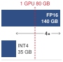{width="100%" fig-alt="Memory ladder comparing a 140 GB FP16 70B model with a 35 GB INT4 70B model, with the 4x capacity reduction marked as a ratio annotation."}

*INT4 turns a two-GPU model into a one-GPU candidate.*
:::

Weight quantization for serving is a bottleneck-selection decision. Reducing precision can turn a `{python} InferenceSetup.llama70b_fp16_gb_str` FP16 weight payload into a `{python} InferenceSetup.llama70b_int4_gb_str` INT4 payload, potentially making a model that previously needed multiple GPUs resident on one. The ideal payload reduction is 4$\times$; metadata, runtime buffers, and KV state still enter the deployment's memory budget. Quality loss is not fixed by bit width, and reduced storage does not guarantee proportional speedup. Both must be measured for the deployed representation and workload.

::: {#psp-inference-quantization-serving-constraint .callout-perspective title="Quantization as a serving constraint"}

In serving systems, quantization is not merely a model-compression technique; it changes the binding resource. Post-training quantization can shrink a deployed model without retraining, while quantization-aware training spends training effort to preserve accuracy at lower precision. The systems question is which constraint the lower-precision representation relaxes: GPU memory capacity, HBM bandwidth during decode, accelerator instruction support, or cost per served token.

:::

::: {.column-margin .margin-pointer}
↩ The trade-off between post-training quantization and quantization-aware training is established in @sec-performance-engineering-ptq-qat.
:::

Quantization reduces numerical precision of model weights and activations, decreasing their memory footprint by 2--4$\times$. Reducing weight traffic can improve bandwidth-bound decode, provided kernel support and dequantization overhead preserve the saving. The serving decision is which quantity should shrink: resident weights for fit, bytes moved per decode step for bandwidth, activations for prefill throughput, or the precision path supported by target hardware. Serving at scale also introduces distinct challenges: a deployment team may need post-training quantization without the original training corpus, quality must be preserved across diverse inputs, and hardware deployment targets vary from data center GPUs to edge accelerators. Lack of the original corpus does not imply data-free calibration; the methods that follow may still require representative deployment inputs. Production inference therefore starts from a decision model rather than from the methods. @Tbl-serving-quantization-decision-model ties each method family to the serving constraint it relaxes, and the subsections that follow take the methods in that order, recording for each only what changes when it is deployed: calibration cost, kernel path, and the evaluation a serving team must run.

| **Binding serving constraint** | **Representation change**                       | **Method family**       | **Risk to test before rollout**             |
|:-------------------------------|:------------------------------------------------|:------------------------|:--------------------------------------------|
| Model does not fit in memory   | Quantize weights only                           | GPTQ, AWQ               | Calibration mismatch and quality regression |
| Decode is bandwidth-bound      | Reduce bytes read per token                     | W4A16 weight-only paths | Kernel support and KV-cache headroom        |
| Prefill is compute-bound       | Quantize weights and activations                | SmoothQuant W8A8        | Activation outliers and INT8 hardware path  |
| Outliers block low precision   | Change the coordinate basis before quantization | Rotation-based methods  | Transform overhead and limited runtime path |

: **Serving quantization decision model**: Quantization methods are useful only when they relax the resource that binds the serving system. The method family follows from the bottleneck: fit, bandwidth, prefill compute, or outlier robustness. {#tbl-serving-quantization-decision-model tbl-colwidths="[24,28,22,26]"}

### LLM-specific quantization challenges {#sec-inference-scale-llmspecific-quantization-challenges-b7a2}

Large language models can exhibit activation ranges that make low-precision deployment difficult. The outlier activation problem\index{Activation outliers!quantization degradation} arises when a few hidden-dimension channels carry magnitudes far larger than typical values [@xiao2023smoothquant]. A coarse scale loses resolution for smaller values, while a narrow range clips large ones. This trade-off is not unique to language models, but its channel structure motivates the methods below. @Sec-performance-engineering-block-quant develops the outlier mechanism and the algorithms that answer it (LLM.int8(), GPTQ, AWQ, and SmoothQuant); the subsections that follow keep only what each method changes for a serving deployment.

For a serving deployment the consequence is that no single INT8 scale suits both the outlier channels and the typical values, which is why the methods that follow differ, each protecting a different part of the serving contract.

### GPTQ layer-by-layer weight quantization {#sec-inference-scale-gptq-layerbylayer-weight-quantization-9284}

GPTQ\index{GPTQ!layer-by-layer quantization} [@frantar2023gptq], which uses second-order error compensation, is the weight-only choice when deployment needs 4-bit compression after training and can afford calibration data. Its serving value is that the model gets smaller without a full retraining run.

GPTQ rounds weight columns while compensating the remaining columns using statistics collected from calibration inputs. Calibration and error compensation are offline costs paid when producing the quantized artifact, rather than on each serving request. Their duration depends on model size, calibration workload, hardware, and implementation; a fixed sample count is not a general deployment requirement. The resulting artifact still requires suitable inference kernels, and its quality must be tested when production inputs differ from the calibration distribution.

@Tbl-gptq-performance identifies the measurements needed to evaluate a GPTQ deployment:

| **Measurement**         | **Comparison contract**                                             |
|:------------------------|:--------------------------------------------------------------------|
| **Quality change**      | Same model, task, and evaluation data before and after quantization |
| **Memory reduction**    | Include scales, zero points, packing, and runtime buffers           |
| **Quantization time**   | State calibration data, hardware, and implementation                |
| **Serving performance** | Compare SLO-compliant throughput at the same workload               |

: **GPTQ evaluation contract**: Nominal bit width alone does not determine quality, compression, or speed. Report the deployed representation and measured workload rather than extrapolating fixed values across model sizes. {#tbl-gptq-performance}

GPTQ provides weight compression without a full retraining run, using a layer-local reconstruction objective to control error. That objective does not guarantee task quality after errors propagate through the complete model. Calibration coverage, quantization settings, and the deployed kernel path therefore belong in the evaluation alongside artifact size.

### AWQ activation-aware weight quantization {#sec-inference-scale-awq-activationaware-weight-quantization-abec}

Activation-aware weight quantization (AWQ)\index{AWQ!salient weight protection} [@lin2023awq] approaches weight-only compression through activation statistics. It scales selected weight channels before quantization, applying the inverse scale to their inputs, often through a preceding operation. This protects salient channels without GPTQ's sequential error-compensation procedure. Calibration cost and quality still depend on the model and data. If the scale cannot be fused into the deployed graph, an additional runtime operation spends some of the latency saving; it does not by itself erase the smaller weight footprint.

@Tbl-awq-vs-gptq compares the methods' error-control mechanisms and calibration roles, then the deployment check each requires; both need the same quality evaluation on the target model and task.

| **Aspect**           | **GPTQ**                                    | **AWQ**                                      |
|:---------------------|:--------------------------------------------|:---------------------------------------------|
| **Error control**    | Approximate second-order error compensation | Activation-guided channel scaling            |
| **Calibration role** | Estimate layer-input statistics             | Identify salient channels and select scales  |
| **Deployment check** | Supported packing and inference kernels     | Supported packing, fused scales, and kernels |

: **AWQ vs. GPTQ**: The methods use different calibration mechanisms. Quality, calibration time, and serving speed require comparison on the same model, data, precision, and runtime; neither column implies a universal ranking. {#tbl-awq-vs-gptq}

The engineering choice follows the measured quality budget and deployed kernel path, not a fixed quality or calibration-speed ordering.

### SmoothQuant activation-weight migration {#sec-inference-scale-smoothquant-migrating-quantization-difficulty-f37f}

SmoothQuant\index{SmoothQuant!activation-to-weight scaling} [@xiao2023smoothquant] targets W8A8 deployments where activation quantization matters, especially compute-bound prefill. Its per-channel rescaling transfers part of the activation range into the weights while preserving the full-precision layer calculation. Subsequent rounding to INT8 still introduces error. Folding scales into existing operations can avoid separate scaling kernels, but realized overhead depends on the deployed graph and kernels. Calibration must test the resulting ranges because production activation extremes can differ from those used to choose the scales.

```{python}
#| echo: false
#| label: w8a8-ceilings
# ┌─────────────────────────────────────────────────────────────────────────────
# │ W8A8 VS WEIGHT-ONLY CEILINGS (LEGO)
# ├─────────────────────────────────────────────────────────────────────────────
# │ Context: @tbl-smoothquant-w8a8 and the prefill/decode paragraph after it.
# │
# │ Goal: Bound what 8-bit weights and 8-bit activations can buy in each phase.
# │ Show: 2x weight-byte reduction for both schemes; 2x INT8/FP16 peak ratio
# │       on the H100 as the prefill ceiling for W8A8 only.
# │ How: bytes per weight ratio; Hardware.Cloud.H100 int8 vs dense FP16 peak.
# └─────────────────────────────────────────────────────────────────────────────
from mlsysim.fmt import check, fmt_multiple

class W8A8Ceilings:
    """Upper bounds, not measured speedups, for 8-bit serving paths."""

    # ┌── 1. LOAD (Constants) ──────────────────────────────────────────────
    h100 = Hardware.Cloud.H100
    fp16_peak = h100.compute.peak_flops
    int8_peak = h100.compute.precision_flops["int8"]

    # ┌── 2. EXECUTE (The Compute) ────────────────────────────────────────
    weight_byte_ratio = (BYTES_FP16 / BYTES_INT8).magnitude
    int8_compute_ratio = int8_peak.magnitude / fp16_peak.magnitude

    # ┌── 3. GUARD (Invariants) ──────────────────────────────────────────
    check(abs(weight_byte_ratio - 2) < 1e-9, "8-bit weights halve FP16 weight bytes")
    check(1.9 < int8_compute_ratio < 2.1, "INT8 peak should be about twice dense FP16 peak")

    # ┌── 4. OUTPUT (Formatting) ─────────────────────────────────────────────
    weight_ratio_mult_str = fmt_multiple(weight_byte_ratio, precision=0, commas=False)
    int8_ratio_mult_str = fmt_multiple(round(int8_compute_ratio), precision=0, commas=False)
```

In the W8A8 deployment regime, SmoothQuant enables INT8 quantization for both weights and activations. @Tbl-smoothquant-w8a8 bounds what each 8-bit path can buy relative to the FP16 baseline:

| **Configuration**        |                    **Weight bytes**                   |                      **Prefill compute ceiling**                      |          **Decode weight-traffic ceiling**          |   **Quality**    |
|:-------------------------|:-----------------------------------------------------:|:---------------------------------------------------------------------:|:---------------------------------------------------:|:----------------:|
| **FP16 (baseline)**      |                       1$\times$                       |                               1$\times$                               |                      1$\times$                      |     Baseline     |
| **W8A16 (weights only)** | Reduced `{python} W8A8Ceilings.weight_ratio_mult_str` |                         1$\times$ (FP16 math)                         | Up to `{python} W8A8Ceilings.weight_ratio_mult_str` | Measure vs. FP16 |
| **W8A8 (SmoothQuant)**   | Reduced `{python} W8A8Ceilings.weight_ratio_mult_str` | Up to `{python} W8A8Ceilings.int8_ratio_mult_str` (INT8 Tensor Cores) | Up to `{python} W8A8Ceilings.weight_ratio_mult_str` | Measure vs. FP16 |

: **W8A8 SmoothQuant vs. weight-only quantization**: Ceilings derived from bytes per weight and the H100's INT8-to-FP16 peak ratio, not measured speedups. Both schemes halve weight bytes, so both can at most halve weight traffic in bandwidth-bound decode. Only W8A8 moves prefill onto INT8 Tensor Cores. Realized gains and quality loss depend on kernels, calibration, and the request mix. {#tbl-smoothquant-w8a8}

The critical distinction is which ceiling binds. Among these configurations, W8A8 enables INT8 matrix multiplication, with the illustrated `{python} W8A8Ceilings.int8_ratio_mult_str` peak ratio providing a compute ceiling rather than a measured prefill speedup. Both quantized schemes halve the weight payload. If weight reads dominate decode, activation quantization does not further reduce that traffic, although it can change other memory and compute costs. Quantization and dequantization also add work. The end-to-end benefit therefore depends on the prompt/output mix, batch sizes, and measured execution path.

### Rotation-based quantization {#sec-inference-scale-rotationbased-quantization-8bee}

Traditional quantization methods (GPTQ, AWQ, SmoothQuant) address quantization error through compensation or rescaling. Rotation-based quantization\index{Quantization!rotation-based} [@ashkboos2024quarot] changes the coordinate basis so large values are less concentrated in a few channels. This can make lower precision viable without retaining designated outlier channels in higher precision.

The magnitude of an individual coordinate depends on the chosen basis. An appropriate rotation can redistribute a large coordinate across many components while preserving the full-precision computation through corresponding weight transformations. This redistribution does not guarantee uniform values or negligible rounding error for every input; the resulting quantized model still requires quality evaluation.

#### QuaRot (quantization with rotation) {#sec-inference-quarot-rotation-quantization-7a02}

QuaRot\index{QuaRot!rotation-based quantization} uses orthogonal Hadamard transforms to redistribute large coordinates before low-bit quantization.[^fn-quarot-hadamard-transform] The transform can be chosen without calibration data, but the full weight-quantization pipeline may use calibrated GPTQ. Orthogonal transformations preserve the full-precision calculation when corresponding weight and activation transforms are applied consistently; quantization still introduces approximation. Runtime rotations add work, so the serving decision compares measured quality and goodput on the target kernel path.

[^fn-quarot-hadamard-transform]: **Hadamard Rotation in QuaRot (Quantized Rotation)**\index{QuaRot!Hadamard rotation}: QuaRot transforms activations as $\RotatedActivationMatrix = \LayerInputMatrix \cdot \HadamardRotationMatrix$ and weights as $\RotatedWeightMatrix= \HadamardRotationMatrix^T \cdot \WeightMatrix$, where $\HadamardRotationMatrix$ is an orthogonal Hadamard matrix, computed structurally without being stored. Orthogonality preserves $\LayerInputMatrix\WeightMatrix= \RotatedActivationMatrix\RotatedWeightMatrix$, so the layer output is unchanged. The outlier-spreading effect is concrete: a vector $[1000, 1, 1, 1]$ with one extreme value becomes roughly $[502, 500, 500, 500]$ after the transform, so no single coordinate dominates the quantization range.

@Tbl-quarot-vs-smoothquant contrasts two outlier-management mechanisms. The listed precision targets are evaluated operating points, not universal limits or guarantees.

| **Aspect**           | **SmoothQuant**                                 | **QuaRot**                                                       |
|:---------------------|:------------------------------------------------|:-----------------------------------------------------------------|
| **Calibration**      | Activation statistics for scales                | Rotation is data-free; GPTQ weight quantization uses calibration |
| **Evaluated target** | W8A8                                            | W4A4                                                             |
| **Runtime work**     | Scaling can be fused                            | Some rotations remain online                                     |
| **Outlier handling** | Transfers scale between activations and weights | Redistributes coordinates                                        |

: **QuaRot vs. SmoothQuant**: Calibration requirements belong to the complete quantization pipeline. Quality and speed must be measured for the selected model, bit widths, and implementation. {#tbl-quarot-vs-smoothquant}

@Tbl-quarot-perplexity lists what a like-for-like quality comparison across these precision choices must report for a 70B-class model:

| **Method**      | **Precision** | **Report against the FP16 baseline**                      |
|:----------------|:-------------:|:----------------------------------------------------------|
| **FP16**        |     W16A16    | Baseline perplexity and task accuracy on the target data  |
| **SmoothQuant** |      W8A8     | Quality change, with the calibration set stated           |
| **GPTQ**        |     W4A16     | Quality change, group size, and kernel path               |
| **QuaRot**      |      W4A4     | Quality change, online-rotation overhead, and kernel path |

: **Quantization quality comparison contract**: Perplexity or task-accuracy change must be measured on the same model, evaluation data, and runtime for every precision choice. The rows record what each comparison must report, not results. {#tbl-quarot-perplexity}

The QuaRot authors report that rotation keeps W4A4 quality close to FP16 on the models they evaluate, which is what makes 4-bit activation quantization a serving candidate at all [@ashkboos2024quarot]. Its 4-bit weights *and* 4-bit activations cut memory for the quantized tensors by roughly 4$\times$ relative to FP16, but its quality relative to GPTQ's 4-bit weight-only path must still be measured on the deployment's own model and task. Learned-rotation variants optimize the rotation matrices themselves to reduce quantization error, adding offline optimization cost; the learned rotations are not a guarantee of globally optimal quality. Rotation methods extend low-precision choices, but the useful trade-off depends on measured quality, transform overhead, and the deployed kernel path.

### Hardware-deployment co-design {#sec-inference-scale-hardwaredeployment-codesign-617f}

Hardware and software support determine which quantization savings reach the serving workload\index{Quantization!hardware-software co-design}. Native low-precision arithmetic can raise compute throughput, but a weight-only kernel can also save HBM capacity and traffic by reading packed weights and converting them on chip. The arithmetic format and the resident storage format need not be identical.

@Tbl-tensor-core-precision-support summarizes NVIDIA Tensor Core precision support across Ampere and Hopper:

| **Format**     |     **Ampere (A100)**     | **Hopper (H100)**                                                       | **Peak ratio vs. FP16** |
|:---------------|:-------------------------:|:------------------------------------------------------------------------|:-----------------------:|
| **FP16**       |            Yes            | Yes                                                                     |        1$\times$        |
| **BF16**       |            Yes            | Yes                                                                     |        1$\times$        |
| **INT8**       |            Yes            | Yes                                                                     |        2$\times$        |
| **FP8 (E4M3)** |             No            | Yes                                                                     |        2$\times$        |
| **INT4**       | Yes (native Tensor Cores) | Software/framework-dependent on H100; native FP4 is a Blackwell feature |    workload-dependent   |

: **Tensor core precision support and peak ratios**: Native precision support across NVIDIA Ampere and Hopper Tensor Cores. The 2$\times$ ratio at INT8 and FP8 compares peak arithmetic throughput on those native paths, not measured serving speed. A100 provides native INT4 Tensor Core operations, although realized LLM speedup still depends on framework and kernel support; H100 INT4 deployment remains software/framework-dependent, and native FP4 first appears in Blackwell. {#tbl-tensor-core-precision-support}

For batch-one decode dominated by weight reads, the following proportionality estimates throughput using the active model weights as the byte count. It omits KV-cache traffic and execution overhead and does not describe aggregate throughput at arbitrary batch size:

$$\text{Decode throughput} \propto \frac{\text{Memory bandwidth}}{\text{Model size in bytes}}$$

In the ideal memory-bound case, reducing FP16 weights to 4-bit values cuts weight traffic by 4$\times$, but realized decode throughput depends on kernel support, dequantization overhead, KV-cache precision, batch shape, and whether HBM bandwidth is truly the bottleneck. The value of 4-bit serving is therefore strongest when it increases model residency or batch capacity, and throughput gains should be validated on the target serving workload.

The mapping in @tbl-quantization-deployment-configurations gives candidate configurations based on runtime support and the resource being constrained. W4A16 can reduce resident weight memory, W8A8 can exploit INT8 arithmetic, and FP8 can use a supported native path. Hardware capability narrows the choices but does not select the winner; the quality target and measured workload determine which representation is useful.

| **Quantization**       | **Best For**                       |                 **Framework Support**                 |
|:-----------------------|:-----------------------------------|:-----------------------------------------------------:|
| **W4A16 (GPTQ/AWQ)**   | Consumer GPUs, memory-constrained  |             vLLM, TensorRT-LLM, llama.cpp             |
| **W8A8 (SmoothQuant)** | INT8 accelerators, high throughput |               TensorRT-LLM, ONNX Runtime              |
| **FP8**                | H100/H200 deployments              | TensorRT-LLM\index{TensorRT-LLM!quantization support} |
| **W4A4**               | Research, extreme compression      |                        Limited                        |

: **Quantization deployment configurations**: Mapping from quantization scheme to deployment target and supporting frameworks. W4A16 is common for consumer and memory-constrained deployments; W8A8 unlocks INT8 Tensor Core throughput; FP8 is the native low-precision path on H100/H200-class deployments; W4A4 is an aggressive compression target with more limited framework support. {#tbl-quantization-deployment-configurations}

### Runtime contract for quantized serving {#sec-inference-scale-framework-integration-945c}

Production serving frameworks\index{Serving framework!runtime contract} determine whether a quantized artifact retains its intended memory and execution advantages. Expanding the entire model into resident FP16 weights can forfeit capacity savings, while converting packed weights inside a kernel can preserve reduced HBM storage and traffic. The serving stack must therefore report the resident representation and kernel path, budget KV state around actual allocations, and expose quality and latency regressions. @Tbl-quantized-serving-runtime-contract summarizes these responsibilities; the distinction between full-model expansion and on-chip conversion is essential when interpreting its dequantization warning.

| **Runtime responsibility**              | **Why it matters**                                                                       |
|:----------------------------------------|:-----------------------------------------------------------------------------------------|
| Preserve the quantized artifact         | Full-model expansion into resident FP16 forfeits the reduced weight storage and traffic. |
| Select compatible low-precision kernels | Unsupported operators fall back to slower or higher-precision execution.                 |
| Plan memory around weights and KV cache | The capacity gain matters only if the freed memory becomes useful batch headroom.        |
| Validate quality and latency together   | A lower-bit path that meets latency but fails task quality is not a serving win.         |

: **Quantized serving runtime contract**: Framework-specific APIs differ, but every production path has to preserve representation, choose supported kernels, plan memory, and validate quality under the deployed traffic mix. {#tbl-quantized-serving-runtime-contract tbl-colwidths="[34,66]"}

Weight quantization reduces the weight allocation, while PagedAttention reduces waste in allocating KV state. Ignoring other allocations gives the following optimistic concurrency estimate. A usable integer limit must round down after reserving runtime buffers, quantization metadata, and safety headroom; sharded deployments must satisfy the budget on every device:

$$\text{Max batch} = \frac{\text{GPU Memory} - \text{Quantized Weights}}{\text{KV Cache per Sequence}}$$

```{python}
#| echo: false
#| label: quantized-serving-capacity
# ┌─────────────────────────────────────────────────────────────────────────────
# │ QUANTIZED SERVING CAPACITY (LEGO)
# ├─────────────────────────────────────────────────────────────────────────────
# │ Context: "Quantization + PagedAttention" prose in §Framework integration.
# │
# │ Goal: Compute A100 KV headroom after 4-bit weight quantization and estimate
# │       the number of 1K-token MHA-baseline sequences it can hold.
# │ Show: 80 GB A100, 35 GB weights, 45 GB KV headroom, ~2.6 GB per 1K sequence.
# │ How: 70B * 0.5 bytes for INT4 weights; KV from KVCacheCalc normalized to 1K.
# │
# └─────────────────────────────────────────────────────────────────────────────
from mlsysim.fmt import check, fmt, fmt_int, fmt_memory, fmt_memory_capacity, fmt_qty_int

class QuantizedServingCapacity:
    """Estimate single-A100 batch capacity after 4-bit weight quantization."""

    # ┌── 1. LOAD (Constants) ──────────────────────────────────────────────
    # nameplate magnitude in decimal GB: the prose subtracts a decimal
    # 35 GB weight from this budget, so both must share a unit space
    a100_mem = Hardware.Cloud.A100.memory.capacity.to(GiB).magnitude * GB
    a100_kv_budget = a100_mem  # scenario capacity budget
    llama70b = Models.Language.Llama2_70B
    gpt3 = Models.Language.GPT3  # 175B dense reference model
    h100_mem = Hardware.Cloud.H100.memory.capacity

    # ┌── 2. EXECUTE (The Compute) ────────────────────────────────────────
    weight_int4 = llama70b.size_in_bytes(BYTES_INT4)
    gpt3_int4 = gpt3.size_in_bytes(BYTES_INT4)
    kv_headroom = a100_kv_budget - weight_int4
    kv_layers = llama70b.layers
    kv_heads = llama70b.heads  # MHA baseline, as in KVCacheCalc
    kv_head_dim = llama70b.hidden_dim // llama70b.heads
    kv_seq_len = int(ReferenceStats.ServingProfiles.PrecisionDividendContextLengthTokens)
    kv_fp16 = calc_kv_cache_size(kv_layers, kv_heads, kv_head_dim, kv_seq_len, 1, BYTES_FP16)
    kv_per_1k_sequence = kv_fp16 / (kv_seq_len / THOUSAND)
    max_1k_sequences = int((kv_headroom / kv_per_1k_sequence).to("").magnitude)

    # ┌── 3. GUARD (Invariants) ──────────────────────────────────────────
    check(abs((weight_int4 - 35 * GB).to(GB).magnitude) < 1e-9, "70B INT4 weights should be 35 GB")
    check(max_1k_sequences > 10, "Quantized model should leave room for multiple 1K sequences")
    check(gpt3_int4 > h100_mem, "175B INT4 weights must exceed one H100 before KV cache")

    # ┌── 4. OUTPUT (Formatting) ─────────────────────────────────────────────
    a100_mem_gb_str = fmt_memory_capacity(a100_mem, unit=GB, precision=0, commas=False)
    weight_int4_gb_str = fmt_memory(weight_int4, unit=GB, precision=0, commas=False)
    kv_headroom_gb_str = fmt_memory(kv_headroom, unit=GB, precision=0, commas=False)
    kv_per_1k_sequence_gb_str = fmt_memory(kv_per_1k_sequence, unit=GB, precision=1, commas=False)
    max_1k_sequences_str = fmt_int(max_1k_sequences, commas=False)
    gpt3_int4_gb_str = fmt_memory(gpt3_int4, unit=GB, precision=1, commas=False)
```

This comparison uses a conservative decimal HBM budget matching the A100 nameplate label, rather than the registered byte capacity used by the node estimator. A 70B model with 4-bit weights requires approximately `{python} QuantizedServingCapacity.weight_int4_gb_str`, leaving `{python} QuantizedServingCapacity.kv_headroom_gb_str` on an `{python} QuantizedServingCapacity.a100_mem_gb_str` A100 for KV cache. With FP16 KV cache at about `{python} QuantizedServingCapacity.kv_per_1k_sequence_gb_str` per 1K-token sequence for the MHA baseline, this supports about `{python} QuantizedServingCapacity.max_1k_sequences_str` concurrent 1K-token sequences before other runtime overheads. With FP16 weights, the same 70B model would not fit on one A100 at all, so weight-only quantization changes both feasibility and batch capacity.

### Quantization selection guidelines {#sec-inference-scale-quantization-selection-guidelines-24fb}

The final selection must satisfy memory, quality, and latency requirements together. Native support makes a precision path a candidate; it does not establish the model's quality at that precision. Nor is there a universal quality ordering between 4-bit weight-only and 8-bit weight-and-activation quantization. Evaluate both against the same task baseline, retaining the reference representation when alternatives fail the quality budget. For compute-bound prefill, W8A8 offers the illustrated `{python} W8A8Ceilings.int8_ratio_mult_str` INT8 compute ceiling. For decode dominated by weight reads, W4A16 can cut the weight payload by up to 4$\times$, provided conversion and other costs leave a useful saving. Latency-sensitive and throughput-oriented services can benefit from either path under suitable workloads.

These precision choices affect cost per million useful tokens. The residency calculation above is what makes fewer GPUs possible at all, because INT4 weights shrink the resident payload enough for a 70B replica to fit on fewer devices. @Tbl-quantization-serving-cost isolates the effect of GPU count by assuming equal per-GPU prices and the same completed token rate across three configurations. Under that contract, reducing the number of billed GPUs reduces cost proportionally. The calculation does not establish that the smaller replicas sustain the same rate or meet the same quality and latency targets:

```{python}
#| echo: false
#| label: quantization-serving-cost
# ┌─────────────────────────────────────────────────────────────────────────────
# │ QUANTIZATION IMPACT ON SERVING COST
# ├─────────────────────────────────────────────────────────────────────────────
# │ Context: @tbl-quantization-serving-cost cost-per-1M-tokens table below.
# │
# │ Goal:    Show that 4-bit quantization cuts serving cost in proportion to the
# │          GPU count it removes, not from per-GPU throughput gains.
# │ Show:    Cost per 1M tokens for FP16 (8 GPUs), AWQ 4-bit (4 GPUs), AWQ 4-bit
# │          (2 GPUs), scaled linearly from the FP16 baseline.
# │ How:     cost = baseline_cost × (gpu_count / baseline_gpus).
# │
# └─────────────────────────────────────────────────────────────────────────────
from mlsysim.fmt import check, fmt_usd

class QuantizationServingCost:
    # ┌── 1. LOAD ──────────────────────────────────────────
    baseline_cost = 2.40  # scenario assumption: FP16 cost per 1M tokens (estimated)
    baseline_gpus = 8  # FP16 on 8x A100
    gpus_awq_4 = 4  # AWQ 4-bit on 4x A100
    gpus_awq_2 = 2  # AWQ 4-bit on 2x A100
    # ┌── 2. EXECUTE ───────────────────────────────────────
    cost_fp16_8 = baseline_cost
    cost_awq_4 = baseline_cost * gpus_awq_4 / baseline_gpus
    cost_awq_2 = baseline_cost * gpus_awq_2 / baseline_gpus
    # ┌── 3. GUARD ─────────────────────────────────────────
    check(abs(cost_awq_4 - 1.20) < 1e-9, "AWQ 4-bit (4 GPU) cost should be \\$1.20")
    check(abs(cost_awq_2 - 0.60) < 1e-9, "AWQ 4-bit (2 GPU) cost should be \\$0.60")
    # ┌── 4. OUTPUT ────────────────────────────────────────
    cost_fp16_8_str = fmt_usd(cost_fp16_8, precision=2, commas=False)
    cost_awq_4_str = fmt_usd(cost_awq_4, precision=2, commas=False)
    cost_awq_2_str = fmt_usd(cost_awq_2, precision=2, commas=False)
```

| **Configuration**               |         **Cost per 1M tokens (estimated)**         |
|:--------------------------------|:--------------------------------------------------:|
| **FP16 on 8$\times$ A100**      | `{python} QuantizationServingCost.cost_fp16_8_str` |
| **AWQ 4-bit on 4$\times$ A100** | `{python} QuantizationServingCost.cost_awq_4_str`  |
| **AWQ 4-bit on 2$\times$ A100** | `{python} QuantizationServingCost.cost_awq_2_str`  |

: **Quantization impact on serving cost**: Estimated cost per million tokens at three configurations. At equal unit prices and unchanged useful token throughput, halving the GPU count halves the cost; halving it again brings the per-million-token cost to one quarter of the FP16 baseline. The cost savings come almost entirely from fewer GPUs rather than from per-GPU throughput gains. {#tbl-quantization-serving-cost tbl-colwidths="[58,42]"}

The illustrated 2--4$\times$ cost reduction follows from the assumed device-count reduction at unchanged useful throughput. If the smaller replica completes fewer qualifying tokens per second, cost per token falls by less and can increase. A deployment comparison must therefore combine billed replica cost with measured SLO-compliant output under the same quality contract.

Precision moves the capacity wall without removing it. A 175-billion-parameter model still needs about `{python} QuantizedServingCapacity.gpt3_int4_gb_str` for its 4-bit weight payload alone, more than one `{python} InferenceSetup.h100_mem_gb_str` H100 holds before KV state and runtime allocations. Keeping that representation accelerator-resident requires distributing it across devices. Offloading to host memory is another placement choice, but introduces transfers that must fit the latency budget. Sharding addresses the capacity problem while adding communication and coordination to each replica.

## Model Sharding for Inference {#sec-inference-scale-model-sharding-inference-82b3}

Quantization shrinks the representation; sharding keeps it and divides it instead. When a deployment must retain the 70B model's FP16 weights in accelerator memory, or when even the quantized state exceeds one device, multiple GPUs hold partitions and execute together as one logical replica. The resulting design adapts tensor and pipeline parallelism from training, but must evaluate their communication and scheduling costs against inference deadlines.

```{python}
#| echo: false
#| label: hardware-setup-sharding
# ┌─────────────────────────────────────────────────────────────────────────────
# │ HARDWARE SETUP: SHARDING (LEGO)
# ├─────────────────────────────────────────────────────────────────────────────
# │ Context: @sec-inference-scale-model-sharding-inference-82b3
# │
# │ Goal: Provide H100 memory capacity and the 70B FP16 weight footprint for
# │       the sharding-trigger calculation.
# │ Show: "80" GB; 70e9 x 16/8 = 140 GB; minimum 2-way sharding.
# │ How: Hardware.Cloud.H100.memory.capacity; Models.Language.Llama2_70B.
# │
# └─────────────────────────────────────────────────────────────────────────────
import math
from mlsysim.fmt import check, fmt, fmt_display_math, fmt_int, fmt_memory_capacity, sci_latex

class HardwareSetupSharding:
    """Localized hardware reference for sharding."""

    # ┌── 1. LOAD (Constants) ──────────────────────────────────────────────
    h100_mem = Hardware.Cloud.H100.memory.capacity
    model = Models.Language.Llama2_70B
    fp16_bits = int(BYTES_FP16.to(byte).magnitude * 8)

    # ┌── 2. EXECUTE (The Compute) ────────────────────────────────────────
    params = model.parameters.to(param).magnitude
    weights = model.size_in_bytes(BYTES_FP16)
    min_shards = math.ceil((weights / h100_mem).to("").magnitude)

    # ┌── 3. GUARD (Invariants) ──────────────────────────────────────────
    check(min_shards == 2, "70B FP16 weights should need exactly 2-way sharding on 80 GB GPUs")

    # ┌── 4. OUTPUT (Formatting) ──────────────────────────────────────────────
    h100_mem_gb_str = fmt_memory_capacity(h100_mem, unit=GiB, precision=0, commas=False)
    min_shards_str = fmt_int(min_shards, commas=False)
    weight_display_math = fmt_display_math(
        rf"M_{{\text{{weights}}}} = {sci_latex(params, precision=0)} \times \frac{{{fp16_bits}}}{{8}} = "
        rf"{fmt(weights.to(GB).magnitude, precision=0, commas=False)} \text{{ GB}}"
    )
```

### Memory and latency triggers for model sharding {#sec-inference-scale-sharding-becomes-necessary-81d4}

Model sharding for inference addresses memory capacity and execution latency through different mechanisms. @Tbl-sharding-triggers identifies the constraints that motivate each candidate strategy; the timing analysis determines whether parallel execution repays its communication cost.

The first driver is memory capacity. If the selected representation must remain in accelerator memory but does not fit on one device, the replica needs multiple devices. For a model with $\Parameters$ parameters at precision $\NumericBitWidth$ bits, @eq-weight-memory gives the weight payload before metadata and runtime state:

$$\WeightMemory = \Parameters\times \frac{\NumericBitWidth}{8} \text{ bytes}$$ {#eq-weight-memory}

Applied to the 70B model in FP16 (16 bits), @eq-weight-memory recovers the payload quoted since @sec-inference-scale-singlemachine-serving-insufficient-3f13:

`{python} HardwareSetupSharding.weight_display_math`

The result exceeds the `{python} HardwareSetupSharding.h100_mem_gb_str` capacity of an H100 GPU, establishing a weight-only lower bound of `{python} HardwareSetupSharding.min_shards_str` shards for an accelerator-resident replica. KV state, buffers, replication within the chosen partition, and uneven placement can require a larger degree.

The second driver is latency. Even when a model fits in memory, sharding can reduce latency by parallelizing computation. @Eq-parallel-time is the Fleet Law (@eq-fleet-law) applied to a single inference request, separating the compute term that sharding divides from the communication and synchronization terms it adds:

$$\DistributedStepTime(\DeviceCount) = \frac{\IronLawComputeTime}{\DeviceCount} + \CommunicationTime(\DeviceCount) + \SynchronizationTime(\DeviceCount) - \OverlappedTime$$ {#eq-parallel-time}

where $\DeviceCount$ is the number of devices in the sharding group, $\CommunicationTime(\DeviceCount)$ is the communication overhead, $\SynchronizationTime(\DeviceCount)$ is synchronization overhead, and $\OverlappedTime$ is communication hidden behind useful compute. In the common no-overlap simplification with negligible extra synchronization, this reduces to $\IronLawComputeTime/\DeviceCount+ \CommunicationTime(\DeviceCount)$. Sharding provides latency benefit only when the nonoverlapped overhead is smaller than the time saved through parallelization.

| **Sharding Trigger**    | **Capacity or timing contract**                                         | **Candidate strategy**    |
|:------------------------|:------------------------------------------------------------------------|:--------------------------|
| **Memory (weights)**    | FP16 weight bytes plus runtime state exceed one device                  | Tensor or pipeline        |
| **Memory (KV cache)**   | Context, concurrency, KV heads, and precision exceed cache budget       | Tensor/cache partitioning |
| **Memory (embeddings)** | Resident table state exceeds one storage/serving shard                  | Embedding sharding        |
| **Latency**             | Parallel compute savings exceed added communication and synchronization | Tensor parallelism        |

: **Sharding triggers**: Minimum degree follows from the actual state representation, per-device capacity, and workload. A model family name alone does not determine the required number of shards. {#tbl-sharding-triggers}

### Tensor parallelism {#sec-inference-scale-tensor-parallelism-b29f}

Tensor parallelism\index{Tensor Parallelism!inference} [@shoeybi2019megatron] distributes individual layers across multiple devices, enabling parallel computation within each layer. The column-row partitioning\index{Tensor Parallelism!column-row partitioning} scheme introduced for training applies here: splitting the first feed-forward linear layer by columns and the second by rows requires one AllReduce for that feed-forward sublayer. The attention output requires another, giving two AllReduce operations per transformer block in the scheme analyzed here. For transformer models, the primary target is the attention mechanism and feed-forward layers, which contain the majority of computation.

::: {.column-margin .margin-pointer}
↩ Column-row tensor partitioning and its two AllReduce operations per transformer block are established in @sec-distributed-training-systems-systems-tensor-parallelism-d76e.
:::

The multi-head attention computation naturally partitions across attention heads. For a model with $\AttentionHeadCount$ attention heads and tensor-parallel degree $\TensorParallelDegree$, an even partition assigns $\AttentionHeadCount/\TensorParallelDegree$ heads per device when the head count is divisible by that degree. With GQA, the smaller number of KV heads can require a different partition or replicated KV state. The local attention calculation for the evenly partitioned case is:

$$\text{Attention}_i = \text{softmax}\left(\frac{\AttentionQueryMatrix_i \AttentionKeyMatrix_i^T}{\sqrt{\AttentionHeadDimension}}\right) \AttentionValuesMatrix_i \text{ for heads } \AttentionHeadIndex\in \{1, \dots, \AttentionHeadCount/\TensorParallelDegree\}$$

Each device applies its shard of the attention output projection to its local heads. An AllReduce operation\index{AllReduce!tensor parallelism synchronization} then sums those projected partial outputs across devices. The reduction combines contributions to the same output coordinates, rather than summing unrelated head outputs directly. Its latency includes collective startup and coordination as well as payload transfer over the interconnect.

The feed-forward layer (typically two linear transformations with activation) partitions along the hidden dimension, with the first linear layer split by columns and the second by rows, so the activation between them never leaves its device.

The communication pattern for tensor-parallel inference follows a two-phase synchronization per layer. @Fig-tensor-parallel-flow diagrams this execution flow across two GPU ranks, isolating how column-row GEMM decompositions confine cross-device synchronization to two AllReduce barriers over NVLink, one after the multi-head attention projection and one after the feed-forward layer.

::: {#fig-tensor-parallel-flow fig-env="figure" fig-pos="htb" fig-cap="**Tensor parallelism for inference**: Computation is distributed across devices by splitting tensor operations. Attention heads are partitioned across GPUs, requiring an AllReduce operation to synchronize results. Feed-forward networks use a column-row splitting strategy that requires only one AllReduce synchronization per block. This approach reduces latency for large models but adds two collectives per layer, which in latency-critical decode keep tensor-parallel groups on high-bandwidth, low-latency interconnects such as NVLink." fig-alt="Two columns labeled GPU 0 and GPU 1, separated by a dashed divider. In the attention stage, each GPU shows eight head tiles: GPU 0 holds the first four as solid tiles and draws the other four dashed, and GPU 1 holds the second four. From the bottom of each GPU's solid head tiles, labeled first or second half of heads, an amber arrow carries a partial output down into an AllReduce over NVLink bar. In the feed-forward stage, each GPU draws the matrix W1 split down the middle into columns, with its own column slice solid and the other dashed, labeled column slice of W1 plus activation. The matrix W2 is split across the middle into rows, with GPU 0 holding the top rows and GPU 1 the bottom rows, labeled row slice of W2 partial sum; on each GPU a blue arrow marked no communication runs from its column slice of W1 to the row slice of W2 it holds, GPU 1's arrow routing around the dashed top rows to enter its bottom rows from the side. Both partial sums feed a second AllReduce bar that leads to the next layer. A key reads held on this GPU for solid tiles and held on the other GPU for dashed tiles."}

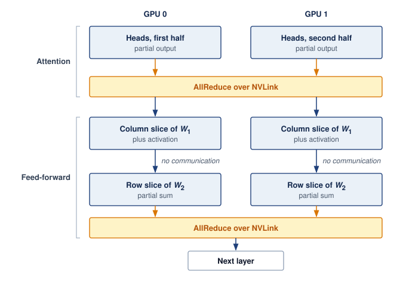{width="100%"}

:::

The inference time with tensor parallelism follows @eq-tensor-parallel-time:

$$\TensorParallelLayerTime= \frac{\IronLawComputeTime}{\TensorParallelDegree} + 2 \times \AllReduceCompletionTime(\CollectivePayloadSize)$$ {#eq-tensor-parallel-time}

@Eq-tensor-parallel-time is the per-layer instance of @eq-parallel-time. Here $\IronLawComputeTime$ is the sequential compute time of one layer rather than of the whole request, $\TensorParallelDegree$ is the tensor-parallel degree, and $\CollectivePayloadSize$ is the full activation payload contributed by each rank to each AllReduce (the message size $\CollectivePayloadSize$ of the ring AllReduce cost model derived in @sec-communication-collective-operations-collective-operations-ring-allreduce-ffce and recalled with the other collective costs in @sec-inference-scale-communication-overhead-analysis-c1cf). Compute is ideally divided across ranks; the partial activation output still has the full reduced shape, (tokens in the step) $\times$ (hidden width) $\times$ (bytes per element). The factor of 2 accounts for the two AllReduce operations per transformer layer (attention and feed-forward).

::: {.column-margin .margin-pointer}
↩ Hiding tensor-parallel collectives behind compute on one node, and what that overlap can and cannot recover, is established in @sec-performance-engineering-overlap.
:::

```{python}
#| echo: false
#| label: tp-speedup-calc
# ┌─────────────────────────────────────────────────────────────────────────────
# │ TENSOR PARALLELISM SPEEDUP CALCULATION
# ├─────────────────────────────────────────────────────────────────────────────
# │ Context: "Tensor Parallelism for Llama-70B" callout in
# │   §Tensor Parallelism for Inference.
# │
# │ Goal: Compute realized speedup (6.9×) vs theoretical (8×) for 8-way tensor
# │   parallelism on 8×H100, quantifying the communication overhead cost of
# │   AllReduce ops vs linear scaling.
# │ Show: tp_speedup_mult_str="6.9"x, seq_total_ms_str="2,400" ms,
# │   tp8_total_ms_str="348" ms, inline in the callout prose.
# │ How: Divide per-layer prefill-pass compute times; multiply by n_layers
# │   for full-model timing. This is not decode TPOT.
# │
# └─────────────────────────────────────────────────────────────────────────────

class TpSpeedupCalc:
    """Compute realized speedup vs theoretical for 8-way tensor parallelism on 8xH100."""

    # ┌── 1. LOAD (Constants) ──────────────────────────────────────────────
    _model = Models.Language.Llama2_70B
    # scenario assumption: per-layer phase timings (1 GPU vs 8-way TP)
    att_seq_ms = 12.0  # attention compute, sequential (1 GPU)
    att_tp_ms = 1.5  # attention compute, 8-way TP
    ff_seq_ms = 18.0  # feed-forward compute, sequential (1 GPU)
    ff_tp_ms = 2.25  # feed-forward compute, 8-way TP
    allreduce_tp_ms = 0.3  # AllReduce overhead per collective, 8-way TP
    tp_theoretical = 8  # linear scaling limit
    n_layers = _model.layers
    weight_fp16 = _model.size_in_bytes(BYTES_FP16)

    # ┌── 2. EXECUTE (The Compute) ────────────────────────────────────────
    # Per-layer totals from the phase breakdown (two AllReduce ops per layer)
    seq_per_layer_ms = att_seq_ms + ff_seq_ms
    tp8_per_layer_ms = att_tp_ms + ff_tp_ms + 2 * allreduce_tp_ms
    tp_speedup = seq_per_layer_ms / tp8_per_layer_ms

    # Step 1: Full-model prefill-pass timing
    seq_total_ms = seq_per_layer_ms * n_layers
    tp8_total_ms = tp8_per_layer_ms * n_layers

    # ┌── 3. GUARD (Invariants) ──────────────────────────────────────────
    from mlsysim.fmt import check, fmt_memory, fmt_multiple, fmt_params, fmt_time

    check(tp_speedup < tp_theoretical, f"Realized speedup ({tp_speedup:.2f}) must be less than theoretical ({tp_theoretical})")
    check(abs(seq_per_layer_ms - 30.0) < 1e-9, "per-layer sequential must sum to 30 ms")
    check(abs(tp8_per_layer_ms - 4.35) < 1e-9, "per-layer 8-way TP must sum to 4.35 ms")

    # ┌── 4. OUTPUT (Formatting) ─────────────────────────────────────────────
    tp_speedup_mult_str = fmt_multiple(tp_speedup, precision=1, commas=False)
    seq_total_ms_str = fmt_time(round(seq_total_ms), 'millisecond', precision=0, commas=True)
    tp8_total_ms_str = fmt_time(round(tp8_total_ms), 'millisecond', precision=0, commas=True)
    parameters_b_str = fmt_params(_model.parameters, scale="B", precision=0, commas=False)
    weight_fp16_gb_str = fmt_memory(weight_fp16, unit=GB, precision=0, commas=False)
    seq_per_layer_ms_str = fmt_time(seq_per_layer_ms * millisecond, millisecond, precision=0, commas=False)
    tp8_per_layer_ms_str = fmt_time(tp8_per_layer_ms * millisecond, millisecond, precision=2, commas=False)
    att_seq_ms_str = fmt_time(att_seq_ms * millisecond, millisecond, precision=0, commas=False)
    ff_seq_ms_str = fmt_time(ff_seq_ms * millisecond, millisecond, precision=0, commas=False)
    att_tp_ms_str = fmt_time(att_tp_ms * millisecond, millisecond, precision=1, commas=False)
    ff_tp_ms_str = fmt_time(ff_tp_ms * millisecond, millisecond, precision=2, commas=False)
    allreduce_tp_ms_str = fmt_time(allreduce_tp_ms * millisecond, millisecond, precision=1, commas=False)
```

::: {#exmp-inference-tensor-parallelism-llama-70b .callout-example title="Tensor parallelism for Llama-70B"}

**Scenario**: An engineering team deploys Llama-70B (`{python} TpSpeedupCalc.parameters_b_str` parameters, FP16 footprint `{python} TpSpeedupCalc.weight_fp16_gb_str`) across an 8-GPU H100 node with NVLink [@touvron2023llama2].

**Diagnosis**: The calculation assumes `{python} TpSpeedupCalc.seq_per_layer_ms_str` of serial layer compute as a reference, independent of the devices required to hold the weights: `{python} TpSpeedupCalc.att_seq_ms_str` for attention and `{python} TpSpeedupCalc.ff_seq_ms_str` for the feed-forward block. That reference describes a long-prompt prefill, in which every prompt token passes through the layer in one step, so it is far larger than one layer's share of a decode step on the reference replica. Ideal eight-way division gives `{python} TpSpeedupCalc.att_tp_ms_str` and `{python} TpSpeedupCalc.ff_tp_ms_str`, and the two AllReduce operations of @eq-tensor-parallel-time add an assumed `{python} TpSpeedupCalc.allreduce_tp_ms_str` each, for `{python} TpSpeedupCalc.tp8_per_layer_ms_str` per layer.

**Systems lesson**: The illustrative eight-way model gives a `{python} TpSpeedupCalc.tp_speedup_mult_str` reduction relative to its serial-compute reference (prefill time reduced from `{python} TpSpeedupCalc.seq_total_ms_str` to `{python} TpSpeedupCalc.tp8_total_ms_str`). The entire shortfall from the ideal 8$\times$ is the two collectives, a fixed cost per layer that dividing compute cannot shrink. Their share of the layer therefore grows as per-device compute falls, which is why a decode step, with far less compute per layer than this prefill reference, feels the collective cost most.

:::

### Pipeline parallelism for inference {#sec-inference-scale-pipeline-parallelism-inference-7ee3}

Pipeline parallelism distributes layers across devices sequentially, with each device handling a subset of layers. Unlike tensor parallelism, there is no synchronization within a layer, only between pipeline stages.

For inference, pipeline parallelism creates bubbles\index{Pipeline Parallelism!bubble overhead} differently than in training. @Fig-pipeline-bubbles contrasts single-request latency against pipelined throughput: executing an isolated request serially across four GPU stages leaves three accelerators idle at every step, whereas maintaining multiple in-flight requests fills the pipeline and amortizes the initial bubble across steady-state token delivery.

::: {#fig-pipeline-bubbles fig-env="figure" fig-pos="htb" fig-cap="**Pipeline parallelism bubbles**: (a) An 80-layer model split into four stages passes one request's activations from stage to stage, so splitting the layers alone does not shorten its sequential computation; it must still traverse all four stages. (b) With many requests in flight, later stages idle during the fill bubble, and from slot t4 onward every stage is busy and one request leaves the pipeline per slot. Pipeline parallelism therefore suits throughput-oriented serving better than latency-critical interactive serving." fig-alt="Two panels. Top: a request box, four stage boxes labeled GPU 0 to GPU 3 with layer ranges 1 to 20, 21 to 40, 41 to 60, and 61 to 80, and an output box, joined by activation arrows. Bottom: a grid of four GPU rows and seven time slots in which requests R1 to R7 enter GPU 0 one slot apart and shift one GPU down per slot. Hatched fill-bubble cells precede the first request on GPUs 1 to 3, and a dashed line at slot t4 marks the pipeline as full."}
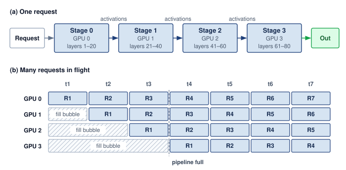

<!--
```{.tikz}
\providecolor{DarkNavy}{HTML}{1E293B}
\providecolor{OceanBlue}{HTML}{2563EB}
\providecolor{ForestGreen}{HTML}{166534}
\providecolor{AmberStage}{HTML}{D97706}
\providecolor{CrimsonSLA}{HTML}{991B1B}
\providecolor{SlateGrey}{HTML}{475569}
\providecolor{SoftGrey}{HTML}{F8FAFC}
\providecolor{SlateTeal}{HTML}{0F766E}
\providecolor{BorderGrey}{HTML}{CBD5E1}
\providecolor{BorderBlue}{HTML}{2563EB}
\providecolor{BorderGreen}{HTML}{166534}
\providecolor{BorderAmber}{HTML}{D97706}
\providecolor{BorderCrimson}{HTML}{991B1B}
\providecolor{Crimson}{HTML}{991B1B}
\providecolor{SoftBlue}{HTML}{F0F6FE}
\providecolor{SoftGreen}{HTML}{ECFAF0}
\providecolor{SoftAmber}{HTML}{FEF8EE}
\providecolor{SoftCrimson}{HTML}{FFF1F2}
\providecolor{BgCard}{HTML}{FFFFFF}
\providecolor{CardBg}{HTML}{FFFFFF}
\providecolor{GrayL}{HTML}{E0E0E0}
\providecolor{GrayLine}{HTML}{666666}
\providecolor{BlueLine}{HTML}{006395}
\providecolor{BlueFill}{HTML}{D6EAF8}
\providecolor{GreenLine}{HTML}{008F45}
\providecolor{GreenFill}{HTML}{D5F5E3}
\providecolor{OrangeLine}{HTML}{E67817}
\providecolor{OrangeFill}{HTML}{FDEBD0}
\providecolor{RedLine}{HTML}{D9534F}
\providecolor{RedFill}{HTML}{F2D7D5}
\providecolor{TextBlack}{HTML}{333333}
\providecolor{VioletLine}{HTML}{7E317B}
\providecolor{VioletFill}{RGB}{243,243,255}
\colorlet{mlsysblue}{OceanBlue}
\colorlet{mlsysgreen}{ForestGreen}
\colorlet{mlsysred}{CrimsonSLA}
\colorlet{mlsysamber}{AmberStage}
\colorlet{mlsysdarkgray}{DarkNavy}
\colorlet{mlsysteal}{SlateTeal}
\scalebox{0.59}{%
\begin{tikzpicture}[
    x=1cm, y=1cm,
    font=\sffamily,
    >=Stealth
]
\tikzset{
    panelcard/.style={
        draw=BorderGrey,
        fill=white,
        line width=0.7pt,
        rounded corners=4pt
    },
    panelheader/.style={
        fill=SoftBlue!80,
        draw=BorderBlue,
        rounded corners=3pt,
        line width=0.6pt,
        font=\small\bfseries\color{DarkNavy},
        inner xsep=8pt,
        inner ysep=3.5pt
    },
    stagecard/.style={
        draw=BorderBlue,
        fill=white,
        line width=0.7pt,
        rounded corners=3pt,
        inner sep=6pt,
        align=left
    },
    reqbox/.style={
        draw=BorderBlue,
        fill=SoftBlue!40,
        line width=0.7pt,
        rounded corners=2.5pt,
        minimum width=1.65cm,
        minimum height=0.72cm,
        font=\scriptsize\bfseries\color{DarkNavy},
        align=center
    },
    bubblebox/.style={
        draw=BorderCrimson,
        fill=SoftCrimson,
        pattern=north east lines,
        pattern color=BorderCrimson!60,
        line width=0.7pt,
        rounded corners=2.5pt,
        minimum height=0.72cm,
        font=\scriptsize\bfseries\color{CrimsonSLA},
        align=center
    },
    pill_green/.style={
        draw=BorderGreen,
        fill=SoftGreen,
        rounded corners=2pt,
        line width=0.6pt,
        text=ForestGreen,
        font=\fontsize{6.5}{7.5}\selectfont\bfseries,
        inner xsep=5pt,
        inner ysep=2.5pt
    }
}

    % =========================================================================
    % PANEL (a): SINGLE REQUEST FLOW
    % =========================================================================
    \node[panelcard, minimum width=21.2cm, minimum height=3.6cm, anchor=north west] (pa) at (0, 0) {};
    \node[panelheader, anchor=north west] (ha) at ([xshift=10pt, yshift=-10pt]pa.north west) {(a) Single Request Flow};
    \node[anchor=west, font=\scriptsize\color{SlateGrey}] at ([xshift=8pt]ha.east) {Sequential propagation: P2P activation transfers across stages; latency equals sum of all stage times};

    % Stages
    \node[draw=BorderGrey, fill=SoftGrey, rounded corners=3pt, line width=0.7pt, inner sep=6pt, text width=1.4cm, align=center] (req0) at (1.4, -2.1) {
        \scriptsize\bfseries\textcolor{DarkNavy}{Request}\\[3pt]
        {\fontsize{6.5}{7.5}\selectfont\textcolor{SlateGrey}{Tokens}}
    };

    % GPU 0 Stage 0
    \node[stagecard, text width=3.3cm] (st0) at (4.6, -2.1) {
        \colorbox{DarkNavy}{\textcolor{white}{\fontsize{6.5}{7.5}\selectfont\textbf{GPU 0}}}\hspace{4pt}\textbf{\textcolor{DarkNavy}{Stage 0}}\\[3pt]
        {\fontsize{7}{8.5}\selectfont
        \textbf{Layers:} 1--20 (Input + Blocks)\\[1pt]
        \textbf{State:} Weights + KV Cache}
    };

    % GPU 1 Stage 1
    \node[stagecard, text width=3.3cm] (st1) at (9.1, -2.1) {
        \colorbox{DarkNavy}{\textcolor{white}{\fontsize{6.5}{7.5}\selectfont\textbf{GPU 1}}}\hspace{4pt}\textbf{\textcolor{DarkNavy}{Stage 1}}\\[3pt]
        {\fontsize{7}{8.5}\selectfont
        \textbf{Layers:} 21--40 (Mid Blocks)\\[1pt]
        \textbf{State:} Weights + KV Cache}
    };

    % GPU 2 Stage 2
    \node[stagecard, text width=3.3cm] (st2) at (13.6, -2.1) {
        \colorbox{DarkNavy}{\textcolor{white}{\fontsize{6.5}{7.5}\selectfont\textbf{GPU 2}}}\hspace{4pt}\textbf{\textcolor{DarkNavy}{Stage 2}}\\[3pt]
        {\fontsize{7}{8.5}\selectfont
        \textbf{Layers:} 41--60 (Mid Blocks)\\[1pt]
        \textbf{State:} Weights + KV Cache}
    };

    % GPU 3 Stage 3
    \node[stagecard, text width=3.3cm] (st3) at (18.1, -2.1) {
        \colorbox{DarkNavy}{\textcolor{white}{\fontsize{6.5}{7.5}\selectfont\textbf{GPU 3}}}\hspace{4pt}\textbf{\textcolor{DarkNavy}{Stage 3}}\\[3pt]
        {\fontsize{7}{8.5}\selectfont
        \textbf{Layers:} 61--80 (Output + LM)\\[1pt]
        \textbf{State:} Weights + Vocab}
    };

    % Out box
    \node[draw=BorderGreen, fill=SoftGreen, rounded corners=3pt, line width=0.7pt, inner sep=6pt, minimum height=1.3cm, font=\scriptsize\bfseries\color{ForestGreen}, align=center] (out0) at (20.5, -2.1) {Out};

    \draw[->, line width=0.85pt, color=DarkNavy, shorten >=2pt, shorten <=2pt] (req0.east) -- (st0.west);
    \draw[->, line width=0.85pt, color=OceanBlue, shorten >=2pt, shorten <=2pt] (st0.east) -- node[above=2pt, font=\fontsize{6.5}{7.5}\selectfont\bfseries\color{OceanBlue}] {Acts} (st1.west);
    \draw[->, line width=0.85pt, color=OceanBlue, shorten >=2pt, shorten <=2pt] (st1.east) -- node[above=2pt, font=\fontsize{6.5}{7.5}\selectfont\bfseries\color{OceanBlue}] {Acts} (st2.west);
    \draw[->, line width=0.85pt, color=OceanBlue, shorten >=2pt, shorten <=2pt] (st2.east) -- node[above=2pt, font=\fontsize{6.5}{7.5}\selectfont\bfseries\color{OceanBlue}] {Acts} (st3.west);
    \draw[->, line width=0.85pt, color=ForestGreen, shorten >=2pt, shorten <=2pt] (st3.east) -- (out0.west);

    % =========================================================================
    % PANEL (b): PIPELINED CONCURRENCY ({N_{\text{PP}}} = 4)
    % =========================================================================
    \node[panelcard, minimum width=21.2cm, minimum height=6.6cm, anchor=north west] (pb) at (0, -4.1) {};
    \node[panelheader, anchor=north west] (hb) at ([xshift=10pt, yshift=-10pt]pb.north west) {(b) Pipelined Concurrency (${N_{\text{PP}}} = 4$)};
    \node[anchor=north east, font=\scriptsize\color{SlateGrey}] at ([shift={(-12pt, -10pt)}]pb.north east) {Multiple requests overlap across pipeline stages; throughput scales $4\times$ in steady state};

    % Steady state pill above divider
    \node[pill_green, align=center] (steady_pill) at (8.3, -5.15) {
        \textbf{Steady State}\\[1pt]Pipeline Full
    };
    \draw[dashed, color=ForestGreen, line width=0.9pt] (8.3, -5.6) -- (8.3, -9.9);

    % Slot Column Headers
    \node[font=\scriptsize\bfseries\color{SlateGrey}] at (3.3, -5.8) {Slot $t_1$};
    \node[font=\scriptsize\bfseries\color{SlateGrey}] at (5.3, -5.8) {Slot $t_2$};
    \node[font=\scriptsize\bfseries\color{SlateGrey}] at (7.3, -5.8) {Slot $t_3$};
    \node[font=\scriptsize\bfseries\color{SlateGrey}] at (9.3, -5.8) {Slot $t_4$};
    \node[font=\scriptsize\bfseries\color{SlateGrey}] at (11.3, -5.8) {Slot $t_5$};
    \node[font=\scriptsize\bfseries\color{SlateGrey}] at (13.3, -5.8) {Slot $t_6$};

    % Row GPU 0
    \node[font=\scriptsize\bfseries\color{DarkNavy}, anchor=east] at (2.2, -6.5) {GPU 0};
    \node[reqbox] at (3.3, -6.5) {Req 1};
    \node[reqbox] at (5.3, -6.5) {Req 2};
    \node[reqbox] at (7.3, -6.5) {Req 3};
    \node[reqbox] at (9.3, -6.5) {Req 4};
    \node[reqbox] at (11.3, -6.5) {Req 5};
    \node[reqbox] at (13.3, -6.5) {Req 6};

    % Row GPU 1
    \node[font=\scriptsize\bfseries\color{DarkNavy}, anchor=east] at (2.2, -7.4) {GPU 1};
    \node[bubblebox, minimum width=1.65cm] at (3.3, -7.4) {Fill Bubble};
    \node[reqbox] at (5.3, -7.4) {Req 1};
    \node[reqbox] at (7.3, -7.4) {Req 2};
    \node[reqbox] at (9.3, -7.4) {Req 3};
    \node[reqbox] at (11.3, -7.4) {Req 4};
    \node[reqbox] at (13.3, -7.4) {Req 5};

    % Row GPU 2
    \node[font=\scriptsize\bfseries\color{DarkNavy}, anchor=east] at (2.2, -8.3) {GPU 2};
    \node[bubblebox, minimum width=3.65cm] at (4.3, -8.3) {Fill Bubble};
    \node[reqbox] at (7.3, -8.3) {Req 1};
    \node[reqbox] at (9.3, -8.3) {Req 2};
    \node[reqbox] at (11.3, -8.3) {Req 3};
    \node[reqbox] at (13.3, -8.3) {Req 4};

    % Row GPU 3
    \node[font=\scriptsize\bfseries\color{DarkNavy}, anchor=east] at (2.2, -9.2) {GPU 3};
    \node[bubblebox, minimum width=5.65cm] at (5.3, -9.2) {Fill Bubble};
    \node[reqbox] at (9.3, -9.2) {Req 1};
    \node[reqbox] at (11.3, -9.2) {Req 2};
    \node[reqbox] at (13.3, -9.2) {Req 3};

    % Throughput Scaling Card
    \node[draw=BorderGreen, fill=white, line width=0.75pt, rounded corners=3pt, inner sep=8pt, text width=3.4cm, align=center] (scale_card) at (17.5, -7.85) {
        \small\bfseries\textcolor{DarkNavy}{Throughput Scaling}\\[4pt]
        {\fontsize{7.5}{9}\selectfont
        Pipeline Depth: ${N_{\text{PP}}} = 4$\\[2pt]
        \textcolor{ForestGreen}{\textbf{Output: 1 req / step}}}\\[6pt]
        \colorbox{SoftGreen}{\fontsize{7.5}{9}\selectfont\bfseries\textcolor{ForestGreen}{4$\times$ Peak Throughput}}
    };

    % =========================================================================
    % BOTTOM SUMMARY CARD
    % =========================================================================
    \node[panelcard, fill=SoftGrey!40, minimum width=21.2cm, inner sep=8pt, anchor=north west] (p_foot) at (0, -11.1) {
        \begin{minipage}{20.7cm}
        \scriptsize
        \textbf{\textcolor{DarkNavy}{Key Operational Trade-offs of Pipeline Parallelism (PP):}}\\[2pt]
        \textbf{\textcolor{OceanBlue}{Decoupled Interconnect:}} Activations pass peer-to-peer across stage boundaries without requiring all-reduce collectives.\\
        \textbf{\textcolor{OceanBlue}{Latency vs.\ Throughput:}} PP maintains single-request latency ($L_{\text{lat,total}} = \sum T_{\text{stage}}$) while scaling throughput linearly with concurrent requests.
        \end{minipage}
    };

\end{tikzpicture}
}
```
-->

:::

For a single request, pipeline staging does not parallelize the dependent layers. If stage execution times are unchanged, the request still pays their sum plus transfers, so staging alone provides no execution-latency reduction. A comparison against a memory-constrained implementation that offloads weights can differ because keeping stages resident changes those execution costs.

Pipeline parallelism instead scales throughput\index{Pipeline Parallelism!throughput scaling} by sustaining multiple concurrent requests across execution stages, as tracked in the steady-state schedule of @fig-pipeline-bubbles(b). Once the pipeline reaches saturation, throughput is limited by the slowest stage. For $\PipelineParallelDegree$ balanced stages with negligible transfer overhead, this is $\PipelineParallelDegree$ times the throughput of executing the whole model sequentially on one device, not $\PipelineParallelDegree$ times a single stage's throughput. An individual request still traverses every stage, so its execution latency remains approximately the sum of the stage times.

Pipeline parallelism is particularly appropriate for inference when memory constraints require sharding across devices but latency targets are relaxed, when aggregate throughput matters more than individual request latency, or when inter-device network bandwidth is limited to point-to-point communication rather than high-speed AllReduce fabrics.

@Tbl-pipeline-tensor-comparison captures the trade-offs between these two sharding approaches:

| **Aspect**                 |                  **Tensor Parallelism**                  |              **Pipeline Parallelism**             |
|:---------------------------|:--------------------------------------------------------:|:-------------------------------------------------:|
| **Single-request latency** | Compute term reduced up to $\TensorParallelDegree\times$ |  No reduction from overlapping this request alone |
| **Throughput**             |   Below $\TensorParallelDegree\times$ (AllReduce cost)   | Up to $\PipelineParallelDegree\times$ (pipelined) |
| **Communication pattern**  |             AllReduce (bandwidth-intensive)              |         Point-to-point (latency-sensitive)        |
| **Memory efficiency**      |                  Activations replicated                  |              Activations passed along             |
| **Complexity**             |             Higher (requires custom kernels)             |          Lower (layer-level partitioning)         |

: **Pipeline vs. tensor parallelism**: Key trade-offs between layer-internal tensor splitting (can reduce single-request latency when compute savings exceed collective cost) and inter-layer pipeline staging (overlaps concurrent requests but introduces pipeline bubbles). Throughput is relative to sequential execution of the whole model on one device; per-layer AllReduces keep tensor parallelism below the $\TensorParallelDegree\times$ ideal, and balanced, full pipelines approach $\PipelineParallelDegree\times$. {#tbl-pipeline-tensor-comparison}

The decision starts with capacity feasibility, then compares latency and throughput on the available topology. Tensor parallelism can shorten layer execution when that saving exceeds its collective cost. Pipeline parallelism distributes resident layers with transfers between stages, but needs concurrent work and balanced stage times for high throughput. Neither a fast interconnect nor a relaxed deadline alone establishes the best choice; the request mix and measured execution costs determine the useful partition.

### Expert parallelism for MoE models {#sec-inference-scale-expert-parallelism-moe-models-55f6}

Mixture-of-experts (MoE)\index{MoE!mixture-of-experts architecture} models, such as DeepSeek-V3 or Mixtral, introduce unique serving challenges beyond those of dense models. In an MoE transformer layer, the feed-forward network is replaced by multiple parallel "expert" sub-networks and a lightweight router that selects a subset of experts for each token.

With fixed expert dimensions and a fixed number selected per token, adding experts grows total parameter capacity without proportionally increasing expert arithmetic per token. Routing, shared layers, and communication still contribute work. Expert parallelism\index{Expert Parallelism} places different experts on different GPUs to distribute their storage and execution. It is a placement choice when the model and workload require multiple devices, rather than an intrinsic requirement of every MoE model.

#### MoE economics and capacity planning {#sec-inference-scale-moe-economics}

MoE serving separates two capacity measures. The *total parameter count* sets the weight-storage requirement at the chosen precision, while the *active parameter count* estimates the weight-related arithmetic and traffic for each token. Neither count includes all runtime costs. An accelerator-resident deployment must accommodate inactive experts as well as active ones, even though each token uses only a subset.

```{python}
#| echo: false
#| label: moe-economics-calc-inf
# ┌─────────────────────────────────────────────────────────────────────────────
# │ MOE ECONOMICS: SPARSE VS DENSE
# ├─────────────────────────────────────────────────────────────────────────────
# │ Context: @sec-inference-scale-moe-economics MoE capacity planning prose
# │
# │ Goal: Compare memory and bandwidth requirements for a 400B dense model vs.
# │       a 671B MoE model (37B active) to quantify the sparse advantage.
# │ Show: ~800 GB (Dense) vs ~1342 GB (MoE) weight memory; ~74 GB (MoE active)
# │       vs ~800 GB (Dense active) bandwidth per token.
# │ How: Memory = params * 2 bytes (FP16). Active BW = active_params * 2 bytes.
# │
# └─────────────────────────────────────────────────────────────────────────────

# ┌── LEGO ───────────────────────────────────────────────
class MoEEconomics:
    """Memory and bandwidth comparison: Dense vs MoE."""

    # ┌── 1. LOAD (Constants) ──────────────────────────────────────────────
    from mlsysim.physics import memory_from_params

    _moe = Models.Language.DeepSeek_V3
    _mixtral = Models.Language.Mixtral_8x7B
    dense_params = 400 * Bparam  # illustrative dense baseline
    moe_active_params = _moe.active_parameters

    # ┌── 2. EXECUTE (The Compute) ────────────────────────────────────────
    dense_mem_fp16 = memory_from_params(dense_params, BYTES_FP16)  # 800 GB
    moe_mem_fp16 = _moe.size_in_bytes(BYTES_FP16)  # 1342 GB

    compute_ratio = (dense_params / moe_active_params).to("").magnitude  # ~10.8x

    dense_decode_bytes = dense_mem_fp16
    moe_decode_bytes = memory_from_params(moe_active_params, BYTES_FP16)  # 74 GB
    bw_ratio = (dense_decode_bytes / moe_decode_bytes).to("").magnitude
    mixtral_resident_ratio = (_mixtral.parameters / _mixtral.active_parameters).to("").magnitude
    deepseek_resident_ratio = (_moe.parameters / _moe.active_parameters).to("").magnitude

    # ┌── 3. GUARD (Invariants) ──────────────────────────────────────────
    from mlsysim.fmt import check, fmt, fmt_int, fmt_memory

    check(compute_ratio > 5, f"MoE should give >5x compute reduction, got {compute_ratio:.1f}x")

    # ┌── 4. OUTPUT (Formatting) ─────────────────────────────────────────────
    dense_mem_gb_str = fmt_memory(dense_mem_fp16, unit=GB, precision=0, commas=False)
    moe_mem_gb_str = fmt_memory(moe_mem_fp16, unit=GB, precision=0, commas=False)
    compute_ratio_mult_str = fmt_multiple(compute_ratio, precision=1, commas=False)
    bw_ratio_mult_str = fmt_multiple(bw_ratio, precision=1, commas=False)
    moe_active_params_str = fmt_params(moe_active_params, scale="B", precision=0)
    moe_decode_gb_str = fmt_memory(moe_decode_bytes, unit=GB, precision=0, commas=False)
    mixtral_resident_mult_str = fmt_multiple(mixtral_resident_ratio, precision=1, commas=False)
    deepseek_resident_mult_str = fmt_multiple(round(deepseek_resident_ratio), precision=0, commas=False)
    mixtral_experts_str = fmt_int(_mixtral.experts, commas=False)
    mixtral_active_experts_str = fmt_int(_mixtral.active_experts_per_token, commas=False)
    deepseek_experts_str = fmt_int(_moe.experts, commas=False)
    deepseek_active_experts_str = fmt_int(_moe.active_experts_per_token, commas=False)
```

The following comparison isolates weight-related costs at batch size 1. Streaming all weights of a dense 400B FP16 model moves `{python} MoEEconomics.dense_mem_gb_str` per step. Counting only DeepSeek-V3's `{python} MoEEconomics.moe_active_params_str` active parameters gives approximately `{python} MoEEconomics.moe_decode_gb_str` in FP16, a `{python} MoEEconomics.bw_ratio_mult_str` reduction in weight bytes per token. The proportional estimate of weight-related arithmetic is `{python} MoEEconomics.compute_ratio_mult_str` lower. These are payload and arithmetic comparisons, not equivalent-quality model comparisons or measured speedups; cache traffic, expert placement, routing, and communication affect realized latency.

::: {.column-margin}
{width="100%" fig-alt="Memory ladder comparing MoE resident weights at 1342 GB, dense resident weights at 800 GB, and MoE active read at 74 GB."}

*MoE keeps every expert resident but activates few per token.*
:::

The trade-off is resident capacity: keeping all experts on accelerators avoids fetching inactive experts when routing changes. Offloading can reduce that resident footprint but adds transfer and scheduling costs. DeepSeek-V3's full model in FP16 requires approximately `{python} MoEEconomics.moe_mem_gb_str`, requiring many devices if the entire FP16 weight set remains accelerator-resident.

```{python}
#| echo: false
#| label: moe-capacity-planning
from math import ceil
from mlsysim.fmt import check, fmt_bandwidth, fmt_count, fmt_int, fmt_memory, fmt_params, fmt_rate, fmt_time
from mlsysim.physics import memory_from_params

class MoECapacityPlan:
    # ┌── 1. LOAD ──────────────────────────────────────────
    _moe = Models.Language.DeepSeek_V3
    moe_total_params = _moe.parameters
    moe_active_params = _moe.active_parameters
    bytes_fp8 = BYTES_INT8  # FP8 = 1 byte
    node_gpus = Systems.Nodes.DGX_H100.accelerators_per_node
    # vendor nameplate magnitude kept in decimal GB: every other number in
    # this example (weights, KV cache) is decimal, so the printed budget
    # arithmetic only holds if the budget shares their unit space
    h100_mem = ReferenceStats.ServingProfiles.H100VendorMemoryBudget.to(GiB).magnitude * GB
    n_gpus = 16
    alltoall_overhead = 0.3 * millisecond  # scenario routing overhead
    h100_bw = Hardware.Cloud.H100.memory.bandwidth
    # ┌── 2. EXECUTE ───────────────────────────────────────
    total_weight = _moe.size_in_bytes(bytes_fp8)
    node_capacity = node_gpus * h100_mem
    nodes_needed = ceil((total_weight / node_capacity).to("").magnitude)
    cluster_capacity = nodes_needed * node_capacity
    active_mem = memory_from_params(moe_active_params, bytes_fp8)
    read_per_gpu = active_mem / n_gpus
    t_read = (read_per_gpu / h100_bw).to(millisecond)
    total_decode = t_read + alltoall_overhead
    decode_rate = token_throughput(1 * count, total_decode)
    tokens_per_sec = round(decode_rate.magnitude, -2)
    # ┌── 3. GUARD ─────────────────────────────────────────
    check(nodes_needed == 2, f"Expected two nodes, got {nodes_needed}")
    check(0.5 * millisecond < total_decode < 2.0 * millisecond, f"Expected ~1ms, got {total_decode.to(millisecond).magnitude:.2f} ms")
    # ┌── 4. OUTPUT ────────────────────────────────────────
    read_per_gpu_gb_str = fmt_memory(read_per_gpu, unit=GB, precision=1, commas=False)
    t_read_ms_str = fmt_time(t_read, millisecond, precision=2, commas=False)
    total_decode_ms_str = fmt_time(total_decode, millisecond, precision=1, commas=False)
    tokens_per_s_str = fmt_rate(tokens_per_sec, "tokens/s", precision=0, commas=True)
    total_weight_gb_str = fmt_memory(total_weight, unit=GB, precision=0, commas=False)
    node_capacity_gb_str = fmt_memory_capacity(node_capacity, unit=GB, precision=0, commas=False)
    nodes_needed_str = fmt_int(nodes_needed, commas=False)
    cluster_capacity_gb_str = fmt_memory_capacity(cluster_capacity, unit=GB, precision=0, commas=True)
    active_mem_gb_str = fmt_memory(active_mem, unit=GB, precision=0, commas=False)
    moe_active_params_b_str = fmt_params(moe_active_params, scale="B", precision=0, commas=False)
    n_gpus_str = fmt_count(n_gpus, commas=False, label="GPU")
    alltoall_overhead_ms_str = fmt_time(alltoall_overhead, millisecond, precision=1, commas=False)
    h100_bw_tb_per_s_str = fmt_bandwidth(h100_bw, unit=TB / second, precision=2, commas=False)
    h100_mem_gb_str = fmt_memory_capacity(h100_mem, unit=GB, precision=0, commas=False)
    moe_total_params_b_str = fmt_params(moe_total_params, scale="B", precision=0, commas=False)
    node_gpus_str = fmt_int(node_gpus, commas=False)
```

::: {#nbk-inference-moe-capacity-planning .callout-notebook title="MoE capacity planning"}

This comparison uses a conservative decimal budget of `{python} MoECapacityPlan.h100_mem_gb_str` per GPU, matching the H100 nameplate label rather than the registered byte capacity used by the node estimator.

**Problem**: A team deploys DeepSeek-V3 (`{python} MoECapacityPlan.moe_total_params_b_str` total parameters, `{python} MoECapacityPlan.moe_active_params_b_str` active per token) for a chatbot application. The model uses FP8 weights (1 byte per parameter). The cluster has `{python} MoECapacityPlan.node_gpus_str`-GPU nodes, each with `{python} MoECapacityPlan.node_gpus_str`$\times$ H100 GPUs (`{python} MoECapacityPlan.h100_mem_gb_str` HBM per GPU, `{python} MoECapacityPlan.node_capacity_gb_str` per node). How many nodes are needed, and what is the per-token decode latency?

**Math**:

1.  **Memory**: Total weight memory = `{python} MoECapacityPlan.total_weight_gb_str`. A single node (`{python} MoECapacityPlan.node_capacity_gb_str`) is insufficient. `{python} MoECapacityPlan.nodes_needed_str` provide `{python} MoECapacityPlan.cluster_capacity_gb_str` in aggregate. The remaining capacity must still accommodate KV state, metadata, buffers, and any replicated weights on each device.
2.  **Latency**: Count `{python} MoECapacityPlan.moe_active_params_b_str` active parameters (`{python} MoECapacityPlan.active_mem_gb_str`) per decode step. If their reads were evenly distributed across `{python} MoECapacityPlan.n_gpus_str`, each would read about `{python} MoECapacityPlan.read_per_gpu_gb_str`. At the stated `{python} MoECapacityPlan.h100_bw_tb_per_s_str` HBM bandwidth, $\PerDeviceWeightReadTime\approx$ `{python} MoECapacityPlan.t_read_ms_str`. The scenario adds `{python} MoECapacityPlan.alltoall_overhead_ms_str` for routing. Expert placement and token routing do not guarantee this balance, especially at batch size 1.
3.  **Floor**: The simplified sum is $\approx$ `{python} MoECapacityPlan.total_decode_ms_str`/token, corresponding to `{python} MoECapacityPlan.tokens_per_s_str` at batch size 1 under these assumptions. It is an optimistic estimate, not a measured rate or a rigorous latency bound; compute, KV traffic, synchronization, and imbalance remain unmodeled.

**Systems insight**: Sparse activation separates resident parameter capacity from the work selected for one token. Planning an accelerator-resident 671B model therefore requires both a per-device memory budget and a timing model for the actual expert placement. Dividing total active bytes by device count does not establish that every device can contribute bandwidth equally.

:::

#### Expert parallelism and load balancing {#sec-inference-scale-moe-parallelism}

Distributing MoE models across GPUs introduces expert parallelism: each GPU holds a subset of experts, and tokens are routed to the GPU holding their assigned expert. In an MoE layer, a gating network selects $\RoutedExpertCount$ experts (out of $\ExpertCount$ total) for each token:

$$\text{Output} = \sum_{i \in \text{top-}k} {\RouterGateProbability}_i \cdot \text{Expert}_i(\text{input})$$

::: {.column-margin .margin-pointer}
↩ Top-$\RoutedExpertCount$ gating, and why sparse activation separates parameter count from per-token work, are established in @sec-performance-engineering-moe.
:::

An even expert placement assigns each device $\ExpertCount/\DeviceCount$ experts, where $\DeviceCount$ is the number of expert-parallel devices. @Fig-moe-routing traces the path for a token: a top-2 softmax gating router selects expert destinations, an AllToAll dispatch sends the token representations to those ranks, and an AllToAll gather returns outputs for weighted recombination. An expert not selected by this token may process another token in the batch, so the illustration does not imply that every unselected device is idle.

::: {#fig-moe-routing fig-env="figure" fig-pos="htb" fig-cap="**Mixture-of-experts (MoE) routing**: Expert parallelism distributes \"experts\" across different devices. For each token, a gating mechanism selects the top-$\RoutedExpertCount$ experts. An AllToAll communication step dispatches tokens to the devices hosting their selected experts, the selected experts process the tokens in parallel while experts unselected by this token may serve other tokens, and a second AllToAll step gathers the results for the weighted sum. This pattern enables massive model capacity but introduces all-to-all communication overhead." fig-alt="Diagram of MoE token routing for a batch of four tokens, t1 to t4, with t1 drawn solid as the traced token. The batch enters a gate that selects the top two experts per token. Amber lines labeled AllToAll dispatch fan out to three expert cards, one per device: Expert A on device 0 receives t1 and t2, Expert B on device 1 receives t1, t3, and t4, and Expert C on device 2 receives t2, t3, and t4 but not t1. The lines on t1's path, to Experts A and B, are drawn heavier than the thin line to Expert C. Amber lines labeled AllToAll gather return the expert outputs to a weighted-sum box that applies the gate weights and produces the output."}

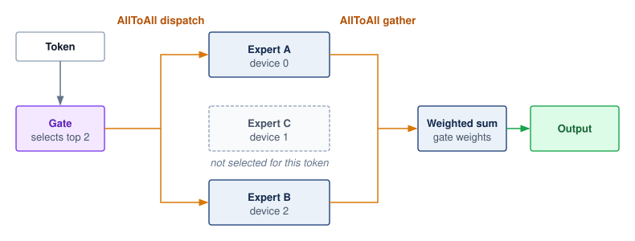{width="100%"}

:::

The communication pattern differs from tensor parallelism. AllReduce delivers a combined reduction result (*same data to all devices*) and maps onto ring or tree schedules whose per-link traffic is fixed by the message size. Expert parallelism instead uses AllToAll\index{All-to-All!expert parallelism} to deliver routed token representations (*different data to different devices* based on routing), so the bytes each link and receiver carries depend on which experts the router selects; the host of a popular expert can become an incast point for many senders. If some experts receive more work, their hosts can determine completion time while less-loaded hosts wait. Balancing the number of stored experts does not guarantee balanced token traffic.

Training and serving offer different controls over this imbalance. An auxiliary loss\index{Auxiliary Loss} can encourage more balanced expert use during training without guaranteeing balance on future traffic. An expert capacity factor\index{Capacity Factor} limits accepted tokens relative to an even allocation; 1.25$\times$ is an illustrative setting, not a universal requirement. Dropping excess work or rerouting it to another expert changes the model computation and requires quality validation. Expert buffering\index{Expert Buffering} instead retains excess work for later execution, spending latency and queue capacity. These controls trade quality, waiting, and utilization rather than guaranteeing that routing remains balanced.

#### Routing failure modes {#sec-inference-scale-moe-routing-failures}

Router behavior affects both system performance and model quality. Expert collapse\index{Expert collapse!routing failure} concentrates training traffic on a small subset of experts, leaving other experts undertrained despite their storage cost. Unstable assignments can also hinder specialization. At serving time, a changed input distribution can alter expert popularity and create hotspots without any change to the stored model. Token dropping\index{Token dropping!capacity factor overflow} skips selected expert work when a capacity limit is exceeded; in implementations that retain only the residual path for dropped assignments, the resulting computation differs from the uncapped model. Its quality impact must be evaluated along with any throughput improvement.

These failure modes follow from the basic MoE serving trade-off:[^fn-moe-expert-serving] computation is dynamically routed to different experts based on input, so the routing pattern becomes a systems workload rather than only a model-internal choice. Popular models like Mixtral [@jiang2024mixtral] use MoE to achieve high capacity with lower inference cost.

[^fn-moe-expert-serving]: **MoE (Mixture-of-Experts) Serving Trade-Off**\index{MoE!serving}: Only a subset of experts activates per token (`{python} MoEEconomics.mixtral_active_experts_str` of `{python} MoEEconomics.mixtral_experts_str` in Mixtral, `{python} MoEEconomics.deepseek_active_experts_str` of `{python} MoEEconomics.deepseek_experts_str` routed experts in DeepSeek-V3). Keeping all weights accelerator-resident gives a total-to-active weight ratio of roughly `{python} MoEEconomics.mixtral_resident_mult_str` (Mixtral) to `{python} MoEEconomics.deepseek_resident_mult_str` (DeepSeek-V3). Expert parallelism distributes that storage while adding token-routing communication; offloading is an alternative that trades resident capacity for weight transfers.

```{python}
#| echo: false
#| label: mixtral-8x7b-registry-spec
from mlsysim import Bparam, Models
from mlsysim.fmt import check, fmt_int, fmt_memory, fmt_memory_capacity, fmt_params

class Mixtral8x7BSpec:
    """Mixtral expert-parallel memory arithmetic sourced from the model registry."""

    # ┌── 1. LOAD (Constants) ──────────────────────────────────────────────
    _model = Models.Language.Mixtral_8x7B
    ep_degree = 4  # scenario assumption: expert-parallel group size
    h100_mem = Hardware.Cloud.H100.memory.capacity

    # ┌── 2. EXECUTE (The Compute) ────────────────────────────────────────
    # scenario simplification: all non-shared parameters sit in equal experts
    per_expert = (_model.parameters - _model.active_parameters) / (_model.experts - _model.active_experts_per_token)
    shared = _model.active_parameters - _model.active_experts_per_token * per_expert
    experts_per_gpu = _model.experts // ep_degree
    replicated_bytes = _model.size_in_bytes(BYTES_FP16)
    ep_params_per_gpu = shared + experts_per_gpu * per_expert
    ep_bytes_per_gpu = (ep_params_per_gpu.to(param).magnitude * BYTES_FP16.magnitude) * byte

    # ┌── 3. GUARD (Invariants) ──────────────────────────────────────────
    check(replicated_bytes > h100_mem, "Replicated FP16 Mixtral must exceed one H100")
    check(ep_bytes_per_gpu < h100_mem / 2, "4-way expert parallelism must leave room for KV cache")

    # ┌── 4. OUTPUT (Formatting) ─────────────────────────────────────────────
    total_params_b_str = fmt_params(_model.parameters, scale="B", precision=1, commas=False)
    active_params_b_str = fmt_params(_model.active_parameters, scale="B", precision=1, commas=False)
    experts_str = fmt_int(_model.experts, commas=False)
    active_experts_str = fmt_int(_model.active_experts_per_token, commas=False)
    ep_degree_str = fmt_int(ep_degree, commas=False)
    experts_per_gpu_str = fmt_int(experts_per_gpu, commas=False)
    replicated_gb_str = fmt_memory(replicated_bytes, unit=GB, precision=1, commas=False)
    ep_per_gpu_gb_str = fmt_memory(ep_bytes_per_gpu, unit=GB, precision=1, commas=False)
    h100_mem_gb_str = fmt_memory_capacity(h100_mem, unit=GiB, precision=0, commas=False)
```

::: {#exmp-inference-expert-parallelism-mixtral-8x7b .callout-example title="Expert parallelism for Mixtral-8x7B"}

**Scenario**: Mixtral-8x7B (`{python} Mixtral8x7BSpec.total_params_b_str` total parameters, ~`{python} Mixtral8x7BSpec.active_params_b_str` active per token) is served across a `{python} Mixtral8x7BSpec.ep_degree_str`-GPU group using top-`{python} Mixtral8x7BSpec.active_experts_str` routing.

**Diagnosis**: Replicating all `{python} Mixtral8x7BSpec.experts_str` experts on every GPU requires the full `{python} Mixtral8x7BSpec.replicated_gb_str` FP16 weight set per device, more than one `{python} Mixtral8x7BSpec.h100_mem_gb_str` H100 holds. Placing `{python} Mixtral8x7BSpec.experts_per_gpu_str` experts on each GPU (`{python} Mixtral8x7BSpec.ep_degree_str`-way expert parallelism) cuts each device's share to about `{python} Mixtral8x7BSpec.ep_per_gpu_gb_str`, the shared attention layers plus its local experts, but every MoE layer now needs an AllToAll dispatch and gather to move tokens to the devices that hold their selected experts.

**Systems lesson**: Expert parallelism trades AllToAll communication for per-GPU parameter memory. The trade pays only when the collective, repeated at every MoE layer, fits inside the decode budget that the smaller resident footprint makes possible.

:::

Expert parallelism couples state placement to input-dependent access. Embedding-heavy recommendation models face a related problem: entity popularity determines which stored vectors receive traffic. Their sharding strategy must therefore balance storage and lookup load, just as expert placement must account for both resident weights and routed tokens.

### Embedding sharding for recommendation systems {#sec-inference-scale-embedding-sharding-recommendation-systems-afde}

Recommendation systems typically contain embedding tables\index{Embedding table!recommendation scale} that dwarf dense model weights in size. Meta's DLRM reference architecture uses model parallelism over embedding tables to mitigate memory constraints while scaling dense layers separately [@naumov2019deep]. At production scale, this embedding-heavy structure requires sharding strategies distinct from tensor or pipeline parallelism.

Row-wise sharding\index{Embedding sharding!row-wise} partitions embedding tables by row (entity ID):

$$\text{Shard}_{\ShardIndex} = \{\EntityEmbedding_j : \text{hash}(\EntityIndex) \bmod \EmbeddingShardCount= \ShardIndex\}$$

Each shard contains approximately $\EntityCount/\EmbeddingShardCount$ embeddings, where $\EntityCount$ is the total number of entities and $\EmbeddingShardCount$ is the shard count.

Column-wise sharding\index{Embedding sharding!column-wise} partitions each embedding vector across devices:

$$\EntityEmbedding_j = [\EntityEmbedding_j^{(0)}, \EntityEmbedding_j^{(1)}, ..., \EntityEmbedding_j^{(\EmbeddingShardCount-1)}]$$

Each device stores a slice of every embedding. Hybrid sharding\index{Embedding sharding!hybrid} combines both approaches: the hottest embeddings are replicated or column-sharded to spread their heavy access, while the long tail uses row sharding. The choice of embedding sharding strategy depends on lookup patterns and communication overhead. @Tbl-embedding-sharding compares row-wise, column-wise, and hybrid approaches:

| **Sharding Strategy** |    **Lookup Pattern**    | **Communication** |       **Best For**      |
|:----------------------|:------------------------:|:-----------------:|:-----------------------:|
| **Row-wise**          | Single device per lookup |  AllToAll gather  | Uniform access patterns |
| **Column-wise**       |  All devices per lookup  |     AllGather     |      Hot embeddings     |
| **Hybrid**            |   Varies by embedding    |       Mixed       |    Production RecSys    |

: **Embedding sharding strategies**: Comparison of row-wise, column-wise, and hybrid embedding placement strategies, balancing lookup locality against network communication collectives and memory load balancing. {#tbl-embedding-sharding}

The trade-off is locality against load balance. Row-wise sharding keeps each embedding vector whole on one device, while column-wise sharding spreads its dimensions across devices. Both require returning the pieces needed by the consuming request, but placement alone does not prescribe a collective: the runtime can use shard RPCs or collectives according to where inputs and outputs reside. @Fig-embedding-sharding illustrates AllToAll and AllGather realizations of these layouts. Hybrid placement can replicate or column-partition hot embeddings while row-sharding the cold tail, trading additional storage and communication against concentrated lookup load.

::: {#fig-embedding-sharding fig-env="figure" fig-pos="H" fig-cap="**Embedding sharding strategies**: Row-wise sharding places complete embedding vectors on specific servers based on entity ID, requiring a network gather for lookup. Column-wise sharding splits each vector across all servers, allowing parallel local lookups followed by an AllGather, which is efficient for popular \"hot\" embeddings. Hybrid sharding combines these approaches, using replication or column sharding for hot items and row sharding for the \"cold\" long tail to balance load and memory." fig-alt="Three panels, each drawing an embedding table as a grid of rows (one row per ID, numbered 0 to 7 at the left) and columns (dimensions). Panel a, row-wise: server 1 holds whole rows 0 to 3 and server 2 holds whole rows 4 to 7, labeled IDs split, AllToAll, whole vectors. Panel b, column-wise: server 1 and server 2 each hold a tall block of columns spanning all rows 0 to 7, labeled dimensions split, AllGather, slices of each vector. Panel c, hybrid: both servers hold the same shaded hot rows 0 and 1, while server 1 holds cold rows 2 to 4 and server 2 holds cold rows 5 to 7, labeled hot rows replicated, AllToAll, cold tail only."}

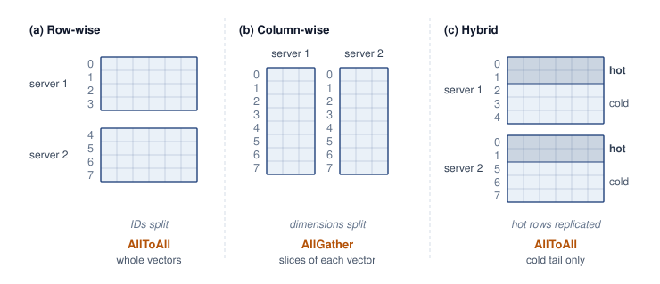{width="100%"}

:::

```{python}
#| echo: false
#| label: meta-embedding-scale-check
# ┌─────────────────────────────────────────────────────────────────────────────
# │ META EMBEDDING SCALE CHECK (LEGO)
# ├─────────────────────────────────────────────────────────────────────────────
# │ Context: Archetype B embedding-sharding lighthouse callout and the paragraph
# │          that introduces it.
# │
# │ Goal: Prevent the scale bullets from implying one dense resident table that
# │       simultaneously has 10T entities, 128d vectors, and only 100 TB total.
# │ Show: 10T * 128 INT8 dimensions would be 1,280 TB; 100 TB averages 10 B/entity.
# │ How: Dense lower-bound storage = entities * dimensions * bytes per dimension.
# │      Resident footprint, table size, and entity catalog from
# │      ReferenceStats.RecommenderAtScaleProfile.
# │
# └─────────────────────────────────────────────────────────────────────────────
from mlsysim.fmt import check, fmt, fmt_int, fmt_memory, fmt_percent

class MetaEmbeddingScaleCheck:
    """Dense lower-bound check for the Meta embedding scale bullets."""

    # ┌── 1. LOAD (Constants) ──────────────────────────────────────────────
    profile = ReferenceStats.RecommenderAtScaleProfile
    storage = profile.PlatformResidentEmbeddingFootprint  # platform-wide resident tier
    table_size = profile.EmbeddingTableSize  # one Archetype B model's tables
    entity_count = profile.EntityCatalogIds
    min_dimension = 128
    bytes_per_dimension_int8 = BYTES_INT8

    # ┌── 2. EXECUTE (The Compute) ────────────────────────────────────────
    entity_count_t = entity_count.to(count).magnitude / TRILLION
    dense_int8 = entity_count * min_dimension * bytes_per_dimension_int8
    effective_bytes_per_entity = (storage / entity_count).to(byte / count).magnitude

    # ┌── 3. GUARD (Invariants) ──────────────────────────────────────────
    check(dense_int8 > storage, "Dense INT8 lower bound should exceed the stated storage total")
    check(effective_bytes_per_entity < min_dimension, "100 TB over 10T entities cannot hold a dense 128d INT8 vector per entity")
    check(storage >= 5 * table_size, "Platform resident tier should sit well above one model's embedding tables")

    # ┌── 4. OUTPUT (Formatting) ─────────────────────────────────────────────
    storage_tb_str = fmt_memory(storage, unit=TB, precision=0, commas=False)
    entity_count_t_str = fmt_int(entity_count_t, commas=False)
    table_size_tb_str = fmt_memory(table_size, unit=TB, precision=0, commas=False)
    min_dimension_str = fmt_int(min_dimension, commas=False)
    dense_int8_tb_str = fmt_memory(dense_int8, unit=TB, precision=0, commas=True)
    effective_bytes_per_entity_str = fmt_int(effective_bytes_per_entity, commas=False)
    n_shards_str = fmt_int(1_000)
    warm_pct_str = fmt_percent(round(10) / 100, precision=0, commas=False, style='prose')
    cold_pct_str = fmt_percent(round(89) / 100, precision=0, commas=False, style='prose')
    lookups_per_request_str = fmt_int(5_000)
    tp_parallelism_str = fmt_int(8, commas=False)
```

The following Archetype B scenario combines row-wise, column-wise, and hybrid sharding. The `{python} MetaEmbeddingScaleCheck.storage_tb_str` platform-wide resident budget deliberately sits well above the `{python} MetaEmbeddingScaleCheck.table_size_tb_str`-plus embedding tables of a single Archetype B model, so that the sharding arithmetic is stressed at the upper end of the regime.

::: {#lhs-inference-embedding-sharding-at-meta .callout-lighthouse title="Archetype B (DLRM at Scale): Embedding sharding budget"}

Consider an Archetype B recommendation workload with a large entity catalog and a smaller resident embedding tier:

**Scale**:

- Resident embedding budget (platform-wide): `{python} MetaEmbeddingScaleCheck.storage_tb_str`
- Entity catalog: `{python} MetaEmbeddingScaleCheck.entity_count_t_str` trillion identifiers
- Embedding dimension: 128–256
- Shards: `{python} MetaEmbeddingScaleCheck.n_shards_str`+ servers

The arithmetic of these bullets is the design constraint. A dense INT8 table with `{python} MetaEmbeddingScaleCheck.entity_count_t_str` trillion entities and `{python} MetaEmbeddingScaleCheck.min_dimension_str` dimensions would require at least `{python} MetaEmbeddingScaleCheck.dense_int8_tb_str`, while `{python} MetaEmbeddingScaleCheck.storage_tb_str` across the same entity count averages only `{python} MetaEmbeddingScaleCheck.effective_bytes_per_entity_str` bytes per entity, a fraction of one `{python} MetaEmbeddingScaleCheck.min_dimension_str`-byte vector. Most entities therefore cannot hold a resident vector at all. The resident tier keeps the frequently accessed subset, and the long tail lives in another tier or a compressed representation, which is exactly the split the sharding strategy below is built around.

**Sharding strategy**:

The tier percentages below describe the admitted resident population, not the full entity catalog. Replica bytes count against the platform-wide resident budget, so the admitted population and replication scope must be chosen together.

- **Hot embeddings** (top 1 percent by access frequency): Replicated within selected shard groups
- **Warm embeddings** (next `{python} MetaEmbeddingScaleCheck.warm_pct_str`): Column-sharded with `{python} MetaEmbeddingScaleCheck.tp_parallelism_str`-way parallelism
- **Cold embeddings** (remaining `{python} MetaEmbeddingScaleCheck.cold_pct_str`): Row-sharded with consistent hashing

Each inference request requires approximately `{python} MetaEmbeddingScaleCheck.lookups_per_request_str` embedding lookups. A deliberately naive sequential implementation would issue one RPC per lookup; the batched design instead applies several optimizations. Batch accumulation collects lookups for 1 ms. Lookup deduplication removes duplicate entities across requests. Shard-aware batching groups lookups by destination shard. Parallel dispatch sends batched requests to all shards simultaneously. Streaming assembly reconstructs embeddings as responses arrive.

Illustrative before-and-after assumptions for sequential dispatch versus parallel shard batching appear in @tbl-inference-meta-embedding-perf:

| **Metric**                    | **Without Optimization** |         **With Optimization**          |
|:------------------------------|:------------------------:|:--------------------------------------:|
| **Sequential dispatch waves** |  5,000 individual RPCs   | One parallel wave; multiple shard RPCs |
| **Lookup latency**            |          50 ms           |                  2 ms                  |
| **Network bandwidth**         |         10 Gbps          |            40 Gbps (burst)             |

: **Illustrative embedding lookup comparison**: Assumed latency and bandwidth compare sequential per-lookup RPCs with shard-batched parallel dispatch. One dispatch wave still contains multiple network requests; it does not mean one RPC to the entire fleet. {#tbl-inference-meta-embedding-perf}

The lighthouse lesson is that sparse embedding placement and lookup coordination can dominate DLRM-scale serving even when dense arithmetic has spare capacity. The illustrated workload motivates measuring shard traffic and lookup latency before adding dense compute.

:::

### Hybrid sharding strategies {#sec-inference-scale-hybrid-sharding-strategies-e605}

Production systems often combine multiple sharding strategies because no single axis satisfies every inference constraint. Hybrid sharding\index{Hybrid sharding!TP and PP combination} composes memory capacity, latency, and communication requirements: one axis may keep weights resident, another may reduce per-token latency, and a third may route sparse components without forcing dense layers onto the wrong device. Three recurring combinations illustrate the pattern:

Tensor and pipeline parallelism combine when models require both memory distribution and latency reduction:

```
8 GPUs organized as 2 by 4 (pipeline stages by tensor parallel):

Stage 0 (Layers 1-40):  TP across GPUs 0,1,2,3
Stage 1 (Layers 41-80): TP across GPUs 4,5,6,7
```

The four-way tensor split can cut per-layer compute time by up to 4$\times$, while the two pipeline stages complete the eight-way memory distribution; pipelining adds no per-request latency benefit of its own.

Expert and tensor parallelism combine for MoE models where individual experts are large:

```
Mixtral with large experts:

- Expert parallelism: Distribute 8 experts across 8 GPU groups
- Tensor parallelism: Each expert spread across 2 GPUs
- Total GPUs: 16
```

Embedding and dense parallelism serve recommendation models with both large embeddings and large dense components:

```
DLRM-scale model:

- Embedding sharding: 1,000 shards across CPU servers
- Dense model: 8-way tensor parallel across GPUs
- Communication: Embeddings gathered to GPU, processed, returned
```

Hybrid sharding buys fit or latency by adding new communication patterns at every boundary between shards. The next question is whether the communication tax stays inside the latency and throughput budget.

### Communication overhead analysis {#sec-inference-scale-communication-overhead-analysis-c1cf}

The practical speedup from sharding depends critically on communication efficiency\index{Communication overhead!interconnect bandwidth}. Each sharding strategy has characteristic communication patterns with different bandwidth and latency requirements.

@Eq-allreduce-time quantifies AllReduce communication time for tensor parallelism, where data is combined from all devices with the result available on all devices.

$$\AllReduceCompletionTime\approx 2(\DeviceCount-1)\MessageStartupLatency+ \frac{2(\DeviceCount-1)}{\DeviceCount} \times \frac{\CollectivePayloadSize}{\LinkBandwidth}$$ {#eq-allreduce-time}

where $\DeviceCount$ is the number of devices, $\CollectivePayloadSize$ is the collective payload size, $\MessageStartupLatency$ is startup latency, and $\LinkBandwidth$ is the interconnect bandwidth. The factor of 2 accounts for the ReduceScatter and AllGather phases. @Sec-communication-collective-operations-collective-operations-ring-allreduce-ffce derives this ring-AllReduce cost from its two-phase schedule and shows its bandwidth-optimal $2(\DeviceCount-1)/\DeviceCount$ scaling, showing that the per-rank bandwidth volume approaches a constant multiple of the payload while the ring startup term still grows with device count.

@Eq-p2p-time expresses the simpler point-to-point communication for pipeline parallelism, where data flows from one device to the next.

$$\PointToPointTransferTime(\PointToPointMessageSize) = \MessageStartupLatency+ \frac{\PointToPointMessageSize}{\LinkBandwidth}$$ {#eq-p2p-time}

where $\PointToPointMessageSize$ is the point-to-point payload size, $\MessageStartupLatency$ is the network latency, and $\PointToPointMessageSize/\LinkBandwidth$ is the transfer time. @Eq-alltoall-time captures the more complex AllToAll communication for expert parallelism, where each device exchanges distinct data with every other device.

$$\AllToAllCompletionTime= (\DeviceCount-1) \times \left(\MessageStartupLatency+ \frac{\CollectivePayloadSize/\DeviceCount}{\LinkBandwidth}\right)$$ {#eq-alltoall-time}

::: {.column-margin .margin-pointer}
↩ AllToAll schedules, and why skewed destination traffic makes them harder to bound than AllReduce, are established in @sec-communication-alltoall.
:::

The AllToAll expression assumes equal-size peer exchanges scheduled in pairwise rounds. Skewed expert traffic, network contention, or a different collective algorithm can change its timing. Across all three models, usable bandwidth $\LinkBandwidth$ and startup latency $\MessageStartupLatency$ provide an initial communication budget, not a complete prediction of request latency. The chosen topology and collective implementation must sustain that budget under the intended concurrent load.

```{python}
#| echo: false
#| label: allreduce-interconnect-calc
# ┌─────────────────────────────────────────────────────────────────────────────
# │ ALLREDUCE INTERCONNECT CALCULATION (LEGO)
# ├─────────────────────────────────────────────────────────────────────────────
# │ Context: @tbl-inference-allreduce-interconnect
# │
# │ Goal: Compute raw AllReduce time for an 8 MB activation across common
# │       interconnects and express it as a fraction of a 30 ms layer budget.
# │ Show: ~0.02 ms NVLink, ~0.56 ms InfiniBand HDR, ~1.12 ms 100G Ethernet.
# │ How: Use the alpha-beta AllReduce estimate for N=8 devices.
# │
# └─────────────────────────────────────────────────────────────────────────────
from mlsysim.fmt import check, fmt_bandwidth, fmt_int, fmt_memory, fmt_percent, fmt_time
from mlsysim.physics import calc_ring_allreduce_time, calc_ring_allreduce_data_factor

class AllReduceInterconnect:
    """Raw AllReduce timing for an 8 MB activation payload."""

    # ┌── 1. LOAD (Constants) ──────────────────────────────────────────────
    NETWORK_100G_BW = Systems.Fabrics.Ethernet_100G.bandwidth
    n_devices = Systems.Nodes.DGX_H100.accelerators_per_node
    message = 8 * MB  # scenario payload
    layer_budget = 30 * millisecond  # scenario layer budget
    nvlink_bw = Hardware.Cloud.H100.nvlink.bandwidth  # datasheet bidirectional total (for display)
    nvlink_bw_beta = Hardware.Cloud.H100.nvlink.bandwidth_per_direction  # one-way rate for ring math
    ib_hdr_bw = Systems.Fabrics.InfiniBand_HDR.bandwidth
    eth_100g_bw = NETWORK_100G_BW

    # ┌── 2. EXECUTE (The Compute) ────────────────────────────────────────
    allreduce_factor = calc_ring_allreduce_data_factor(n_devices)
    nvlink_time = calc_ring_allreduce_time(message, n_devices, nvlink_bw_beta, 0 * second).to(millisecond)
    ib_time = calc_ring_allreduce_time(message, n_devices, ib_hdr_bw, 0 * second).to(millisecond)
    eth_time = calc_ring_allreduce_time(message, n_devices, eth_100g_bw, 0 * second).to(millisecond)

    nvlink_pct = (nvlink_time / layer_budget).to("").magnitude * 100
    ib_pct = (ib_time / layer_budget).to("").magnitude * 100
    eth_pct = (eth_time / layer_budget).to("").magnitude * 100

    # ┌── 3. GUARD (Invariants) ──────────────────────────────────────────
    check(nvlink_time < ib_time < eth_time, "Interconnect timing should follow bandwidth order")
    check(eth_pct < 5, f"Raw 100G Ethernet share should remain under 5%, got {eth_pct:.1f}%")

    # ┌── 4. OUTPUT (Formatting) ─────────────────────────────────────────────
    nvlink_ms_str = fmt_time(nvlink_time, millisecond, precision=2, commas=False)
    ib_ms_str = fmt_time(ib_time, millisecond, precision=2, commas=False)
    eth_ms_str = fmt_time(eth_time, millisecond, precision=2, commas=False)
    nvlink_pct_str = fmt_percent(nvlink_pct / 100, precision=2, commas=False, style="symbol")
    ib_pct_str = fmt_percent(ib_pct / 100, precision=1, commas=False, style="symbol")
    eth_pct_str = fmt_percent(eth_pct / 100, precision=1, commas=False, style="symbol")
    message_mb_str = fmt_memory(message, unit=MB, precision=0, commas=False)
```

```{python}
#| echo: false
#| label: inference-interconnect-specs

# ┌─────────────────────────────────────────────────────────────────────────────
# │ INTERCONNECT PHYSICAL SPECS
# ├─────────────────────────────────────────────────────────────────────────────
# │ Context: @tbl-inference-interconnect-specs in the tensor-parallel
# │          interconnect comparison.
# │
# │ Goal: Pin the interconnect spec table to the registry (the old table
# │       hand-typed latencies that contradicted every registry anchor:
# │       NVLink 1 us vs 500 ns, PCIe Gen5 5 us vs 1 us, IB HDR 2-5 us vs
# │       7 us, Eth 100G 10 us vs 50 us).
# │ Show: Physical bandwidth and latency for the four candidate fabrics.
# │ How: H100.nvlink (instance link), H100.interconnect + Tech PCIeGen5
# │      latency, Systems.Fabrics.InfiniBand_HDR / Ethernet_100G.
# │
# └─────────────────────────────────────────────────────────────────────────────
from mlsysim.fmt import check, fmt_bandwidth, fmt_time

class InterconnectSpecs:
    # ┌── 1. LOAD (Constants) ──────────────────────────────────────────────
    nvlink = Hardware.Cloud.H100.nvlink
    pcie_bw = Hardware.Cloud.H100.interconnect.bandwidth
    pcie_latency = Hardware.Tech.Interconnect.PCIeGen5.latency
    ib_hdr = Systems.Fabrics.InfiniBand_HDR
    eth_100g = Systems.Fabrics.Ethernet_100G

    # ┌── 3. GUARD (Invariants) ───────────────────────────────────────────
    check(nvlink.bandwidth > 10 * pcie_bw, "NVLink should be an order of magnitude above PCIe Gen5")

    # ┌── 4. OUTPUT (Formatting) ──────────────────────────────────────────
    nvlink_bw_str = fmt_bandwidth(nvlink.bandwidth, unit=GB / second, precision=0, commas=False)
    nvlink_latency_str = fmt_time(nvlink.latency, nanosecond, precision=0, commas=False)
    pcie_bw_str = fmt_bandwidth(pcie_bw, unit=GB / second, precision=0, commas=False)
    pcie_latency_str = fmt_time(pcie_latency, microsecond, precision=0, commas=False)
    ib_hdr_gbit_str = fmt_bandwidth(ib_hdr.bandwidth, unit=Gbps, precision=0, commas=False)
    ib_hdr_gb_str = fmt_bandwidth(ib_hdr.bandwidth, unit=GB / second, precision=0, commas=False)
    ib_hdr_latency_str = fmt_time(ib_hdr.latency, microsecond, precision=0, commas=False)
    eth_gbit_str = fmt_bandwidth(eth_100g.bandwidth, unit=Gbps, precision=0, commas=False)
    eth_gb_str = fmt_bandwidth(eth_100g.bandwidth, unit=GB / second, precision=1, commas=False)
    eth_latency_str = fmt_time(eth_100g.latency, microsecond, precision=0, commas=False)
```

Communication overhead depends heavily on the interconnect technology. @Tbl-inference-interconnect-specs records the physical bandwidth, latency, and intended scope of each candidate interconnect:

| **Interconnect**   |                                       **Bandwidth**                                       |                   **Latency**                   |      **Use Case**      |
|:-------------------|:-----------------------------------------------------------------------------------------:|:-----------------------------------------------:|:----------------------:|
| **NVLink (H100)**  |                         `{python} InterconnectSpecs.nvlink_bw_str`                        | `{python} InterconnectSpecs.nvlink_latency_str` |     Intra-node TP      |
| **PCIe Gen5**      |                          `{python} InterconnectSpecs.pcie_bw_str`                         |  `{python} InterconnectSpecs.pcie_latency_str`  | Intra-node (no NVLink) |
| **InfiniBand HDR** | `{python} InterconnectSpecs.ib_hdr_gbit_str` (`{python} InterconnectSpecs.ib_hdr_gb_str`) | `{python} InterconnectSpecs.ib_hdr_latency_str` |       Inter-node       |
| **Ethernet 100G**  |    `{python} InterconnectSpecs.eth_gbit_str` (`{python} InterconnectSpecs.eth_gb_str`)    |   `{python} InterconnectSpecs.eth_latency_str`  | Inter-node (commodity) |

: **Datacenter interconnect specs**: Bandwidth, latency, and intended scope for NVLink, PCIe Gen5, InfiniBand HDR, and 100G Ethernet, establishing the physical limits that bound achievable sharding speedups. {#tbl-inference-interconnect-specs}

@Tbl-inference-allreduce-interconnect translates those bandwidths into AllReduce time for an 8-way tensor-parallel layer (an illustrative `{python} AllReduceInterconnect.message_mb_str` payload per AllReduce, independent of a particular batch or sequence shape) as a fraction of the 30 ms serial prefill-layer reference from example \ref{exmp-inference-tensor-parallelism-llama-70b}. In a real step the payload is the layer's output activation, so it grows with the number of tokens in the step just as the layer's compute does; the table holds both fixed so that only the interconnect changes the share:

| **Interconnect**  |               **AllReduce Time**               |             **Share of 30 ms Layer**            |
|:------------------|:----------------------------------------------:|:-----------------------------------------------:|
| **NVLink**        | `{python} AllReduceInterconnect.nvlink_ms_str` | `{python} AllReduceInterconnect.nvlink_pct_str` |
| **InfiniBand**    |   `{python} AllReduceInterconnect.ib_ms_str`   |   `{python} AllReduceInterconnect.ib_pct_str`   |
| **100G Ethernet** |  `{python} AllReduceInterconnect.eth_ms_str`   |   `{python} AllReduceInterconnect.eth_pct_str`  |

: **AllReduce cost by interconnect**: AllReduce time for an 8 MB activation across NVLink, InfiniBand, and 100G Ethernet, with each as a fraction of a 30 ms transformer-layer budget, using a bandwidth-only ring model with startup latency omitted. The percentages concern one collective, not the full layer or end-to-end request. {#tbl-inference-allreduce-interconnect}

The table isolates bandwidth cost, and against a 30 ms prefill layer even commodity Ethernet looks affordable. Two omissions reverse that impression. First, the startup and synchronization terms are absent. The `{python} TpSpeedupCalc.allreduce_tp_ms_str` per collective assumed in example \ref{exmp-inference-tensor-parallelism-llama-70b} is an order of magnitude above the bandwidth-only NVLink time here, so if that assumption holds, nearly all of it comes from startup, synchronization, and launch costs rather than transfer. Second, decode divides a much smaller per-layer compute time across the group while still paying two collectives per layer for every generated token. In that regime the fixed per-collective latency in @tbl-inference-interconnect-specs, not bandwidth, sets the overhead share, and that decode regime is why tensor-parallel groups are normally kept inside one NVLink domain.

Each NVLink generation[^fn-nvlink-bandwidth-inf] has raised this intra-node ceiling.

[^fn-nvlink-bandwidth-inf]: **NVLink and tensor-parallel overhead**\index{NVLink!tensor-parallel overhead}: A faster NVLink generation raises the local communication ceiling, but the realized tensor-parallel overhead still depends on message size, collective implementation, topology, and how much computation can overlap the transfer.

### Sharding strategy selection {#sec-inference-scale-sharding-strategy-selection-f69c}

The choice of sharding strategy depends on model architecture and deployment priorities. @Tbl-sharding-selection evaluates each approach across four critical factors:

| **Factor**                |        **Tensor Parallel**         |   **Pipeline Parallel**   |   **Expert Parallel**   | **Embedding Shard**  |
|:--------------------------|:----------------------------------:|:-------------------------:|:-----------------------:|:--------------------:|
| **Latency priority**      | Compute savings exceed collectives | No staging-only reduction |    Routing-dependent    |   Lookup-dependent   |
| **Throughput priority**   |         Collective-limited         |  Full, balanced pipeline  | Balanced expert traffic | Balanced lookup load |
| **Interconnect limited**  |              Poor fit              |          Good fit         |         Moderate        |       Good fit       |
| **Implementation effort** |                High                |            Low            |         Moderate        |         High         |

: **Sharding strategy selection guide**: Evaluation of tensor, pipeline, expert, and embedding sharding across latency targets, throughput priorities, interconnect constraints, and implementation complexity. {#tbl-sharding-selection}

Strategy selection starts from the deployment bottleneck. Tensor parallelism is a candidate when reduced layer execution can repay frequent collectives; pipeline parallelism distributes layers and can sustain throughput when enough concurrent work fills the stages. Expert and embedding sharding distribute sparse state while adding routed communication. These choices can be combined, but each must fit the per-device memory budget and the measured latency contract.

Once a replica's memory footprint and execution capacity are established, demand determines how many replicas the service needs. The next decision is where to send each arriving request. Routing must account for work already in progress and reusable state, so that replica capacity becomes useful fleet capacity.

## Load Balancing and Request Routing {#sec-inference-scale-load-balancing-request-routing-4997}

Suppose ten model replicas are serving traffic when a request for a 5,000-word document summary arrives. Assigning it to an overloaded replica adds waiting and can increase interference for work already admitted there. The effect depends on admission, batching, and priority policies. Round-robin assignment does not inspect those differences in remaining work. A state-aware router uses memory and queue information to choose a feasible destination, while limiting the cost and staleness of its observations.

::: {#lhs-inference-archetype-b-dlrm-at-scale-tail-at-scale .callout-lighthouse title="Archetype B (DLRM at Scale): The tail at scale"}

```{python}
#| echo: false
#| label: archetype-b-tail-at-scale
# ┌─────────────────────────────────────────────────────────────────────────────
# │ ARCHETYPE B TAIL AT SCALE (LEGO)
# ├─────────────────────────────────────────────────────────────────────────────
# │ Context: "The tail at scale" Archetype B lighthouse callout; the P99 target
# │          is reused in the embedding-heavy recommendation case study.
# │
# │ Goal: Show how a platform request rate turns a rare tail event into a
# │       steady stream of slow requests.
# │ Show: P99 <= 100 ms; 10^7 QPS; 10^-4 tail events -> 1,000 per second.
# │ How: ReferenceStats.RecommenderAtScaleProfile P99LatencySlo and PlatformQps;
# │      the 10^-4 tail probability is a scenario assumption.
# └─────────────────────────────────────────────────────────────────────────────
import math
from mlsysim.fmt import check, fmt_int, fmt_math, fmt_time

class ArchetypeBTailAtScale:
    """Tail-event rate for Archetype B at platform request rates."""

    # ┌── 1. LOAD (Constants) ──────────────────────────────────────────────
    profile = ReferenceStats.RecommenderAtScaleProfile
    p99_slo = profile.P99LatencySlo
    qps = profile.PlatformQps.to(count / second).magnitude
    tail_probability = 1e-4  # scenario assumption: rare slow-request event

    # ┌── 2. EXECUTE (The Compute) ────────────────────────────────────────
    tail_events_per_s = qps * tail_probability

    # ┌── 3. GUARD (Invariants) ──────────────────────────────────────────
    check(tail_events_per_s >= 100, "Rare tail events should still occur hundreds of times per second")

    # ┌── 4. OUTPUT (Formatting) ─────────────────────────────────────────────
    p99_slo_ms_str = fmt_time(p99_slo, ms, precision=0, commas=False)
    p99_slo_math = fmt_math(rf"\text{{p99}} \le {p99_slo.to(ms).magnitude:.0f}\text{{ ms}}")
    qps_math = fmt_math(rf"10^{{{round(math.log10(qps))}}}")
    tail_probability_math = fmt_math(rf"10^{{{round(math.log10(tail_probability))}}}")
    tail_events_per_s_str = fmt_int(round(tail_events_per_s), commas=True)
```

Archetype B (DLRM at Scale) uses `{python} ArchetypeBTailAtScale.p99_slo_math` as its illustrative latency target. At `{python} ArchetypeBTailAtScale.qps_math` QPS, an event probability of `{python} ArchetypeBTailAtScale.tail_probability_math` implies an expected `{python} ArchetypeBTailAtScale.tail_events_per_s_str` such events per second. This count motivates examining the tail, but does not identify its cause. Two-choice routing can reduce imbalanced queuing delay $\QueueingLatency$; traces must establish whether queueing, inference time $\InferenceLatency$, or another component drives the misses.

:::

### Load balancing principles {#sec-inference-scale-load-balancing-principles-63ec}

::: {.column-margin}
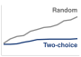{width="100%" fig-alt="Two slowly rising curves of maximum load as the fleet grows: a red random-assignment curve grows slowly but stays above a still flatter blue two-choice curve."}

*Two-choice routing flattens the tail imbalance of random placement.*
:::

Load balancing serves two primary goals that sometimes conflict: latency minimization and utilization maximization. Latency minimization routes requests to the replicas that can serve them fastest, considering current queue depth and processing time; utilization maximization spreads load evenly to avoid both idle replicas and overloaded replicas. The tension arises because latency-optimal routing may concentrate load on fast replicas, reducing their performance and leaving other replicas underutilized.

Evaluation therefore requires complementary signals for latency and fleet balance. Queue lengths reveal accumulated requests, but service times and scheduling order determine how long those requests wait. Estimated work per replica and its variance are more informative when request costs differ. Utilization spread reveals idle and saturated replicas, while decision overhead measures the cost of computing the routing choice. These signals must be evaluated alongside completed-request tail latency and admission outcomes; balanced counts alone do not establish a healthy service.

### Round-robin and random assignment {#sec-inference-scale-roundrobin-random-assignment-f374}

The simplest load-balancing strategies assign requests without considering server state. Round-robin\index{Round-robin load balancing} sends request 1 to server 1, request 2 to server 2, and so on, which gives perfect distribution only when servers are homogeneous and request processing times are identical. Random assignment\index{Random assignment!load balancing} selects a server uniformly at random for each request; with many requests it converges to an even mean distribution, but its variance is higher than round-robin. Both strategies are reasonable baselines for identical servers, yet production serving rarely satisfies that assumption. Heterogeneous GPU generations, different memory configurations, variable request sizes, warmup behavior, and replicas nearing memory limits all make the state of the server fleet matter.

A static placement model isolates the imbalance caused by random choice: place $\ReplicaCount$ equal-size jobs sequentially into $\ReplicaCount$ initially empty bins, without departures. With uniform independent choices, the expected maximum bin occupancy follows the classical balls-into-bins\index{Balls-into-bins!queue length bound} result [@mitzenmacher2001] in @eq-random-max-queue:

$$\mathbb{E}[\text{max bin occupancy}] =\AsymptoticTightBound\left(\frac{\log \ReplicaCount}{\log \log \ReplicaCount}\right)$$ {#eq-random-max-queue}

Here $\ReplicaCount$ counts both jobs and bins. The asymptotic expression does not predict a finite serving queue at a given fleet size: arrivals, departures, job sizes, and service rates are absent from this model. The power of two choices (principle \ref{pri-power-two-choices}) changes the occupancy tail using one additional probe.

### The power of two choices {#sec-inference-scale-power-two-choices-ffdd}

A foundational result in load balancing theory [@mitzenmacher2001] shows that querying just two random servers before making a routing decision provides exponentially better load distribution than random assignment.[^fn-balls-bins-routing]

[^fn-balls-bins-routing]: **Balls into bins (power of two choices)**\index{Power of Two Choices!routing}: The quoted bounds concern $\ReplicaCount$ equal jobs placed in $\ReplicaCount$ empty bins without departures. Dynamic serving requires a queueing model or workload measurements.

The procedure is deliberately small, but the load signal must match the serving workload. The destination must atomically admit or reject the request because probe results can become stale; a rejection requires bounded retry or overload handling. For a homogeneous vision fleet, current queue length may be enough. For an LLM fleet, active tokens\index{Load balancing!work signals}, estimated remaining decode work, and KV-cache pressure better approximate the work a replica has already accepted. @Algo-power-two-choices-routing states a representative routing loop: probe two replicas, compare normalized work, and route without polling the whole fleet.

```pseudocode
#| label: algo-power-two-choices-routing
#| pdf-line-number: true
#| pdf-right-comment: false
#| html-comment-delimiter: "▷"
\begin{algorithm}
\caption{Power-of-two choices request routing}
\begin{algorithmic}
\Require replica set $\mathcal{S}$; request $r$; capacity weights $w_s$; per-replica work signal $W_s$ (queue length, active tokens, predicted work, or KV-cache occupancy)
\Ensure a selected replica for $r$
\State sample two candidate replicas $s_a, s_b$ from $\mathcal{S}$ \Comment{capacity-weighted}
\State query $W_{s_a}, W_{s_b}$; estimate incremental work $\hat{c}(r)$ (expected output tokens or KV pages)
\State $u_s \gets (W_s + \hat{c}(r)) / w_s$ for $s \in \{s_a, s_b\}$ \Comment{post-admission load}
\State $s^\star \gets$ candidate with smaller $u_s$ \Comment{ties: cache affinity}
\State route $r$ to $s^\star$
\State update $s^\star$'s local admission state
\State \Return $s^\star$
\end{algorithmic}
\end{algorithm}
```

Two probes avoid an all-replica scan. The practical algorithm uses predicted work and capacity weights; it is a serving heuristic, not the uniform static placement process. For the latter process, choosing the less occupied of two independently sampled bins gives @eq-two-choices-max-queue:

$$\mathbb{E}[\text{max bin occupancy}]_{\text{two choices}} = \AsymptoticTightBound(\log \log \ReplicaCount)$$ {#eq-two-choices-max-queue}

This asymptotic contrast motivates limited probing. It supplies neither an exact queue length for a finite fleet nor a latency guarantee for variable-length inference requests.

::: {#thrm-inference-power-of-two-choices .callout-theorem title="Power-of-two choices load-balancing bound"}

For $\ReplicaCount$ equal-size jobs placed sequentially into $\ReplicaCount$ initially empty bins, without departures, uniform random placement has maximum occupancy $\mathcal{O}(\log \ReplicaCount/ \log \log \ReplicaCount)$ with high probability. Choosing the less occupied of two independent uniform candidates reduces this to $\mathcal{O}(\log \log \ReplicaCount)$.

The bound shows that limited probing substantially improves maximum occupancy in this static model. Two probes avoid the $\ReplicaCount$-probe cost of examining every bin. Applying the idea to serving requires a load signal that reflects remaining work and available capacity; the theorem does not establish near-optimal latency for changing queues, heterogeneous replicas, or stale measurements.

:::

The mechanism is the suppression of repeated unlucky placement. If $\HighOccupancyBinCount$ of $\ReplicaCount$ bins have occupancy at least $\OccupancyThreshold$, one uniform probe hits that set with probability $\HighOccupancyBinCount/\ReplicaCount$, whereas two independent probes both hit it with probability $(\HighOccupancyBinCount/\ReplicaCount)^2$. This observation explains the static tail improvement; it does not remove the need to account for service times and stale load signals in a live fleet.

### Weighted and adaptive load balancing {#sec-inference-scale-weighted-adaptive-load-balancing-1c03}

When replicas have different service capacities, equal request rates produce different utilization. In a mixed A100 and T4 fleet, the lower-capacity replicas reach saturation first as demand increases; equal routing does not imply overload at every arrival rate. Weighted assignment accounts for measured capacity by allocating the following long-run request share to each server:

$$\Pr(\text{route to server } \ServerIndex) = \frac{\ServerRoutingWeight_i}{\sum_j \ServerRoutingWeight_j}$$

where $\ServerRoutingWeight_i$ is the weight, or capacity, of server $\ServerIndex$. Weighted two-choices applies the same idea to tail control: sample two servers with probability proportional to their weights, compare current load relative to capacity, and route to the lower relative load. The weighted-routing example makes this policy concrete for mixed GPU hardware.

```{python}
#| echo: false
#| label: heterogeneous-gpu-cluster
# ┌─────────────────────────────────────────────────────────────────────────────
# │ HETEROGENEOUS GPU CLUSTER WEIGHTED ROUTING
# ├─────────────────────────────────────────────────────────────────────────────
# │ Context: "Heterogeneous GPU Cluster" callout in §Weighted Load Balancing.
# │
# │ Goal: Demonstrate that capacity-proportional weighting equalizes utilization
# │   across H100 (1,000 QPS) and A100 (600 QPS) servers at 15,000 QPS target,
# │   versus equal-share routing that reduces A100 latency headroom.
# │ Show: total_cap_qps_str="22,000 QPS",
# │   h100_util_pct_str="68.2 percent",
# │   a100_util_pct_str="68.2 percent",
# │   a100_util_equal_pct_str="83.3 percent"
# │   (reduced headroom)—inline in the callout.
# │ How: Weight each server type by capacity/total_cap; compute per-type load
# │   and utilization; compare with naive equal-share routing.
# │
# └─────────────────────────────────────────────────────────────────────────────
from mlsysim import *

class HeterogeneousGpuCluster:
    """Demonstrate capacity-proportional weighting equalizes utilization across H100 and A100 servers."""

    # ┌── 1. LOAD (Constants) ──────────────────────────────────────────────
    h100 = Hardware.Cloud.H100
    a100 = Hardware.Cloud.A100
    profile = ReferenceStats.ServingProfiles
    n_h100 = int(profile.HeterogeneousRoutingH100Servers)
    n_a100 = int(profile.HeterogeneousRoutingA100Servers)
    h100_cap_qps = int(profile.HeterogeneousRoutingH100CapacityQps)
    a100_cap_qps = int(profile.HeterogeneousRoutingA100CapacityQps)
    target_qps = int(profile.HeterogeneousRoutingTargetQps)

    # ┌── 2. EXECUTE (The Compute) ────────────────────────────────────────
    total_cap = n_h100 * h100_cap_qps + n_a100 * a100_cap_qps
    total_servers = n_h100 + n_a100

    # Step 1: Capacity-proportional weights
    h100_weight = h100_cap_qps / total_cap
    a100_weight = a100_cap_qps / total_cap

    # Step 2: Weighted routing: each server receives weight × total_qps
    h100_load = target_qps * h100_weight
    a100_load = target_qps * a100_weight
    h100_util = h100_load / h100_cap_qps * 100
    a100_util = a100_load / a100_cap_qps * 100

    # Step 3: Equal routing: each server receives target_qps/total_servers
    equal_load = target_qps / total_servers
    h100_util_equal = equal_load / h100_cap_qps * 100
    a100_util_equal = equal_load / a100_cap_qps * 100

    # ┌── 3. GUARD (Invariants) ──────────────────────────────────────────
    check(target_qps <= total_cap, "Target QPS must not exceed total cluster capacity")
    check(abs(h100_util - a100_util) < 1.0, "Weighted routing must equalize utilization")

    # ┌── 4. OUTPUT (Formatting) ─────────────────────────────────────────────
    h100_weight_pct_str = fmt_percent(h100_weight, precision=1, commas=False, style='prose')
    a100_weight_pct_str = fmt_percent(a100_weight, precision=1, commas=False, style='prose')
    h100_util_pct_str = fmt_percent(h100_util / 100, precision=1, commas=False, style='prose')
    a100_util_pct_str = fmt_percent(a100_util / 100, precision=1, commas=False, style='prose')
    equal_load_qps_str = fmt_rate(equal_load, "QPS", precision=0, commas=False)
    h100_util_equal_pct_str = fmt_percent(h100_util_equal / 100, precision=0, commas=False, style='prose')
    a100_util_equal_pct_str = fmt_percent(a100_util_equal / 100, precision=1, commas=False, style='prose')
    n_h100_str = fmt_int(n_h100, commas=False)
    n_a100_str = fmt_int(n_a100, commas=False)
    h100_cap_qps_str = fmt_rate(h100_cap_qps, "QPS", commas=False)
    a100_cap_qps_str = fmt_rate(a100_cap_qps, "QPS", commas=False)
    target_qps_str = fmt_rate(target_qps, "QPS")
```

::: {#exmp-inference-heterogeneous-gpu-cluster .callout-example title="Heterogeneous GPU cluster"}

**Scenario**: A serving cluster mixes `{python} HeterogeneousGpuCluster.n_h100_str` H100 GPUs (`{python} HeterogeneousGpuCluster.h100_cap_qps_str` each) and `{python} HeterogeneousGpuCluster.n_a100_str` A100 GPUs (`{python} HeterogeneousGpuCluster.a100_cap_qps_str` each), processing `{python} HeterogeneousGpuCluster.target_qps_str` target traffic.

**Diagnosis**: Unweighted round-robin routes equal request counts (`{python} HeterogeneousGpuCluster.equal_load_qps_str`) to all nodes, leaving H100s underutilized (`{python} HeterogeneousGpuCluster.h100_util_equal_pct_str`) while leaving less latency headroom on A100s (`{python} HeterogeneousGpuCluster.a100_util_equal_pct_str`). Weighted routing assigns H100s a weight of `{python} HeterogeneousGpuCluster.h100_weight_pct_str` and A100s a weight of `{python} HeterogeneousGpuCluster.a100_weight_pct_str`, balancing utilization across tiers (`{python} HeterogeneousGpuCluster.h100_util_pct_str` vs. `{python} HeterogeneousGpuCluster.a100_util_pct_str`).

**Systems lesson**: Heterogeneous inference clusters require capacity-weighted routing. Equal request volumes produce unbalanced load when hardware tiers have different service rates.

:::

Static weights handle known capacity differences, but production replicas also change over time. Adaptive load balancing adjusts weights dynamically based on observed performance:

```
For each server i:
    latency[i] = exponential_moving_average(observed_latency)
    weight[i] = 1 / latency[i]  # Inverse latency weighting
```

Inverse latency weighting reduces traffic to replicas whose observed latency rises. That observation mixes server condition with request cost: a replica receiving longer generations can appear slow even when its hardware is healthy. Delayed measurements can also make weights oscillate as traffic shifts. The heuristic therefore needs evaluation against comparable request classes, measurement lag, and overload behavior before its weights can be treated as capacity estimates.

### Least-connections load balancing {#sec-inference-scale-leastconnections-load-balancing-3f21}

An alternative to random selection is routing to the server with the fewest active connections or requests. Least-connections\index{Least-connections load balancing} uses an active-request count in the model considered here, incrementing on dispatch and decrementing on completion. This accounts for unfinished requests that round-robin does not inspect, but a connection carrying multiple requests needs different bookkeeping. The policy improves routing only to the extent that the count represents the work and capacity competing at each replica.

The challenge is maintaining accurate connection counts in a distributed system. A centralized counter gives a single source of truth but can become a bottleneck. Distributed counters with gossip scale better but may route using stale information. Sampled least-connections combines the idea with two choices by probing only a subset of servers and choosing the minimum. Connection counts are themselves a proxy. Two in-flight LLM requests can differ fiftyfold in remaining decode work, from a 10-token reply to a 500-token essay, so active tokens or estimated remaining work track load more faithfully than the count of open requests.

No routing policy wins on every axis. Random and round-robin assignment have low decision overhead but ignore work in progress. Two-choice routing samples load state, while least-connections tracks outstanding requests at the cost of maintaining current counts. Neither counts nor limited probes fully describe remaining work when request costs vary widely. Which policy meets a tail target is an empirical question, evaluated with the same arrival trace, request-length mix, and replica capacities.

### Consistent hashing for stateful routing {#sec-inference-scale-consistent-hashing-stateful-routing-ae5b}

Many inference workloads maintain state that benefits from routing affinity\index{Consistent Hashing!stateful routing}. An LLM service may retain completed-turn KV state as a session cache, recommendation sessions may carry user context and recent interactions, and streaming inference may depend on model state from previous frames. For these workloads, routing the same user or session to the same server can avoid cache misses and state reconstruction. A stateless LLM API that receives the full conversation on every request does not require this affinity; it may still use prefix-aware routing when a reusable prefix happens to be cached.

Consistent hashing\index{Consistent Hashing!KV cache}[^fn-consistent-hashing-kv] [@karger1997] maps requests to servers based on a hash of the routing key (user ID, session ID):

[^fn-consistent-hashing-kv]: **Consistent hashing**\index{Consistent Hashing!cache locality}: The ring-based algorithm was introduced for distributed caching [@karger1997] and later used in large-scale content delivery. Its limited-remapping property later made it useful wherever membership changes should preserve cache locality.

$$\text{server}(\text{request}) = \operatorname{arg\,min}_{\HashRingServer\in \HashRingServerSet} \text{distance}(\text{hash}(\text{key}), \text{hash}(\HashRingServer))$$

where $\HashRingServerSet$ is the set of servers mapped onto the ring, and each request routes to the nearest server clockwise.

For fixed ring membership, consistent hashing sends the same key to the same server. Membership changes affect only part of the ring. With balanced equal-capacity assignments and uniformly distributed keys, adding a server moves an expected $1/(\HashRingServerCount+1)$ fraction of keys, while removing one affects its expected $1/\HashRingServerCount$ share. Virtual nodes help smooth uneven ranges, but popular keys can still concentrate traffic even when key counts are balanced. For session-cached LLM serving, affinity increases the chance of reaching reusable state. That benefit must outweigh additional waiting; overload routing, failure, eviction, and remapping can still require repeated prefill.

::: {#exmp-inference-consistent-hashing-kv-cache-affinity .callout-example title="Consistent hashing for KV cache affinity"}

**Scenario**: A multi-turn LLM chat service routes user queries across a cluster of inference replicas without session affinity.

**Diagnosis**: A subsequent turn sent to a replica without compatible cached history must repeat prefill for the uncached prefix. Routing without affinity increases that risk but does not force a miss on every turn. With fixed membership, consistent hashing maps a user ID to the same replica and preserves unaffected mappings when membership changes. Retaining valid cached state on that replica is a separate requirement.

**Systems lesson**: Consistent hashing improves KV-cache locality across multi-turn sessions without requiring a full key remap during scaling. It reduces redundant prefill when the preferred replica remains healthy and timely, but overload routing, eviction, failure, and the remapped fraction still require cache transfer or reconstruction.

:::

The same stateful routing machinery becomes a correctness boundary when cached state is user-specific.

::: {#ws-inference-openai-redis-client-bug .callout-war-story title="When cache state crossed users (2023)"}

**Context**: ChatGPT used Redis Cluster through the redis-py client to cache user information and conversation titles in a high-volume serving system [@openai2023chatgptoutage].

**Mechanism**: Under an Asyncio connection-pooling race condition, canceled requests left unread responses in recycled connection buffers, causing subsequent requests to receive cache data belonging to previous users.

**Impact**: On March 20, 2023, OpenAI took ChatGPT offline after a bug allowed some users to see another active user's conversation titles. Further investigation found possible exposure of payment-related information for a subset of active Plus subscribers during a nine-hour window; full credit card numbers were not exposed.

**Fix**: OpenAI sent the Redis maintainers a patch for the redis-py cancellation path and added redundant checks that the data returned from the cache belongs to the requesting user.

**Systems lesson**: Stateful inference infrastructure needs isolation guarantees around caches, connection pools, and routing keys. A cache is part of the serving correctness boundary, not merely an optimization.

:::

### Request routing for sharded models {#sec-inference-scale-request-routing-sharded-models-6432}

A sharded replica is one routing destination even though several devices execute the request. The external router selects the shard group; the group's execution plan determines the internal communication established in @sec-inference-scale-model-sharding-inference-82b3. A tensor-parallel group runs every layer on all of its devices and joins their partial results with AllReduce (@fig-tensor-parallel-flow), presenting one destination whose latency already includes those collectives. Pipeline groups instead admit requests at the first stage and forward activations along the fixed stage sequence diagrammed in @fig-pipeline-bubbles; the router must account for the group's service capacity rather than treat each stage as an independent replica. In expert-parallel architectures, the gating network in @fig-moe-routing routes tokens dynamically across internal expert destinations after the external router has selected the replica, so expert imbalance and replica imbalance require different controls.

@Fig-shard-group-scaling diagrams this two-tier scaling topology: an external load balancer distributes incoming queries across independent multi-GPU shard groups using round-robin, two-choice, or session-affinity policies, while intra-node NVLink AllReduce synchronization remains strictly encapsulated within each replica node.

::: {#fig-shard-group-scaling fig-env="figure" fig-pos="htb" fig-cap="**Horizontal scaling with shard groups**: The load balancer treats each shard group as a single logical inference server and chooses among groups by round-robin, two-choice, or session-affinity routing. Within a group, eight GPUs hold the tensor-parallel weight shards and join partial results with an NVLink AllReduce inside every layer, which the router never sees. Adding groups raises aggregate throughput; the group's internal parallelism sets per-request latency." fig-alt="Requests 1, 2, through N feed a violet Load balancer box listing round-robin, two-choice, or session affinity. One arrow per group fans out to Shard group 0, drawn in full detail, and to lighter dashed outlines for Shard groups 1 through N. Shard group 0, labeled one replica, TP = 8, one node, shows eight numbered GPU tiles, each attached by a short link to an amber ring labeled NVLink AllReduce every layer; the other groups repeat the same ring in miniature. Beneath group 0 a note reads TP inside the group sets latency, and an arrow beneath the other groups reads add groups: more aggregate throughput."}
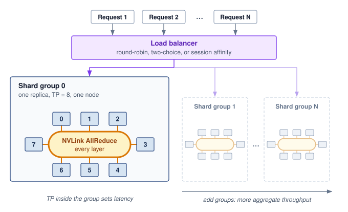

<!--
```{.tikz}
\providecolor{DarkNavy}{HTML}{1E293B}
\providecolor{OceanBlue}{HTML}{2563EB}
\providecolor{ForestGreen}{HTML}{166534}
\providecolor{AmberStage}{HTML}{D97706}
\providecolor{CrimsonSLA}{HTML}{991B1B}
\providecolor{SlateGrey}{HTML}{475569}
\providecolor{SoftGrey}{HTML}{F8FAFC}
\providecolor{SlateTeal}{HTML}{0F766E}
\providecolor{BorderGrey}{HTML}{CBD5E1}
\providecolor{BorderBlue}{HTML}{2563EB}
\providecolor{BorderGreen}{HTML}{166534}
\providecolor{BorderAmber}{HTML}{D97706}
\providecolor{BorderCrimson}{HTML}{991B1B}
\providecolor{Crimson}{HTML}{991B1B}
\providecolor{SoftBlue}{HTML}{F0F6FE}
\providecolor{SoftGreen}{HTML}{ECFAF0}
\providecolor{SoftAmber}{HTML}{FEF8EE}
\providecolor{SoftCrimson}{HTML}{FFF1F2}
\providecolor{BgCard}{HTML}{FFFFFF}
\providecolor{CardBg}{HTML}{FFFFFF}
\providecolor{GrayL}{HTML}{E0E0E0}
\providecolor{GrayLine}{HTML}{666666}
\providecolor{BlueLine}{HTML}{006395}
\providecolor{BlueFill}{HTML}{D6EAF8}
\providecolor{GreenLine}{HTML}{008F45}
\providecolor{GreenFill}{HTML}{D5F5E3}
\providecolor{OrangeLine}{HTML}{E67817}
\providecolor{OrangeFill}{HTML}{FDEBD0}
\providecolor{RedLine}{HTML}{D9534F}
\providecolor{RedFill}{HTML}{F2D7D5}
\providecolor{TextBlack}{HTML}{333333}
\providecolor{VioletLine}{HTML}{7E317B}
\providecolor{VioletFill}{RGB}{243,243,255}
\colorlet{mlsysblue}{OceanBlue}
\colorlet{mlsysgreen}{ForestGreen}
\colorlet{mlsysred}{CrimsonSLA}
\colorlet{mlsysamber}{AmberStage}
\colorlet{mlsysdarkgray}{DarkNavy}
\colorlet{mlsysteal}{SlateTeal}
\scalebox{0.60}{%
\begin{tikzpicture}[
    x=1cm, y=1cm,
    font=\sffamily,
    >=Stealth
]
\tikzset{
    box/.style={
        draw=BorderGrey,
        fill=white,
        line width=0.7pt,
        rounded corners=3pt,
        align=center
    },
    gpunode/.style={
        draw=BorderBlue,
        fill=white,
        line width=0.65pt,
        rounded corners=2.5pt,
        minimum width=1.42cm,
        minimum height=1.05cm,
        align=center,
        inner sep=2pt
    },
    req_chip/.style={
        draw=BorderBlue,
        fill=SoftBlue,
        line width=0.65pt,
        rounded corners=2.5pt,
        minimum width=2.1cm,
        minimum height=0.72cm,
        font=\fontsize{7.5}{9}\selectfont\bfseries\color{DarkNavy},
        align=center
    }
}

    % -------------------------------------------------------------------------
    % Top: Concurrent Client Ingress Stream
    % -------------------------------------------------------------------------
    \node[draw=BorderBlue, fill=SoftBlue, rounded corners=2pt, inner xsep=8pt, inner ysep=3pt, font=\fontsize{7.5}{9}\selectfont\bfseries\color{DarkNavy}] (ingress_label) at (0, 7.8) {
        CONCURRENT CLIENT INGRESS STREAM
    };

    \node[req_chip] (reqA) at (-5.4, 6.85) {Request A};
    \node[req_chip] (reqB) at (-2.3, 6.85) {Request B};
    \node[req_chip] (reqC) at (0.8, 6.85) {Request C};
    \node[font=\bfseries\color{SlateGrey}] (dots) at (2.6, 6.85) {\dots};
    \node[req_chip] (reqN) at (4.5, 6.85) {Request N};

    % -------------------------------------------------------------------------
    % Inference Load Balancer
    % -------------------------------------------------------------------------
    \node[box, draw=BorderAmber, fill=SoftAmber, line width=0.85pt, rounded corners=3.5pt, minimum width=13.0cm, minimum height=1.9cm] (lb) at (0, 4.8) {};

    \node[draw=BorderAmber, fill=white, rounded corners=2pt, font=\fontsize{6.5}{7.5}\selectfont\bfseries\color{AmberStage}, anchor=north west, inner xsep=6pt, inner ysep=2.5pt]
        at ([shift={(10pt,-6pt)}] lb.north west) {INFERENCE LOAD BALANCER};

    \node[box, draw=BorderAmber, fill=white, rounded corners=2.5pt, font=\fontsize{7}{8.5}\selectfont\bfseries\color{DarkNavy}, inner xsep=7pt, inner ysep=4.5pt] (p2c) at (-4.1, 4.45) {Power-of-Two (P2C)};
    \node[box, draw=BorderAmber, fill=white, rounded corners=2.5pt, font=\fontsize{7}{8.5}\selectfont\bfseries\color{DarkNavy}, inner xsep=7pt, inner ysep=4.5pt] (lor) at (0, 4.45) {Least-Outstanding-Reqs};
    \node[box, draw=BorderAmber, fill=white, rounded corners=2.5pt, font=\fontsize{7}{8.5}\selectfont\bfseries\color{DarkNavy}, inner xsep=7pt, inner ysep=4.5pt] (kvh) at (4.1, 4.45) {KV-Affinity Hash};

    % Clean Ingress orthogonal collection bus
    \coordinate (ing_bus) at (0, 6.15);
    \draw[line width=0.85pt, color=OceanBlue] (-5.4, 6.15) -- (4.5, 6.15);
    \draw[line width=0.85pt, color=OceanBlue] (reqA.south) -- (-5.4, 6.15);
    \draw[line width=0.85pt, color=OceanBlue] (reqB.south) -- (-2.3, 6.15);
    \draw[line width=0.85pt, color=OceanBlue] (reqC.south) -- (0.8, 6.15);
    \draw[line width=0.85pt, color=OceanBlue] (reqN.south) -- (4.5, 6.15);
    \draw[->, line width=0.9pt, color=OceanBlue, shorten >=2pt] (ing_bus) -- (lb.north);

    % -------------------------------------------------------------------------
    % Shard Groups (3 groups: x = -7.0, 0, 7.0)
    % -------------------------------------------------------------------------
    \foreach \grp/\xcenter/\nodename in {0/-7.0/Host Node A, 1/0.0/Host Node B, 2/7.0/Host Node C} {
        % Outer container
        \node[box, draw=BorderGrey, fill=SoftGrey!40, line width=0.75pt, rounded corners=4pt, minimum width=6.6cm, minimum height=5.2cm] (sg\grp) at (\xcenter, 0.2) {};

        % Header pill & node name
        \node[fill=DarkNavy, text=white, rounded corners=2pt, font=\fontsize{6.5}{7.5}\selectfont\bfseries, anchor=north west, inner xsep=7pt, inner ysep=3pt]
            at ([shift={(8pt,-7pt)}] sg\grp.north west) (sg_pill_\grp) {Shard Group \grp\ (TP=8)};

        \node[anchor=west, font=\fontsize{7}{8}\selectfont\color{SlateGrey}] at ([xshift=6pt] sg_pill_\grp.east) {\nodename};

        % 2 x 4 GPU grid
        % Row 1: GPUs 0, 1, 2, 3
        \node[gpunode] (gpu_\grp_0) at (\xcenter - 2.25, 1.25) {\textbf{\fontsize{7}{8}\selectfont GPU 0}\\[1pt]\fontsize{6}{7}\selectfont\color{SlateGrey}{Shard 0/8}};
        \node[gpunode] (gpu_\grp_1) at (\xcenter - 0.75, 1.25) {\textbf{\fontsize{7}{8}\selectfont GPU 1}\\[1pt]\fontsize{6}{7}\selectfont\color{SlateGrey}{Shard 1/8}};
        \node[gpunode] (gpu_\grp_2) at (\xcenter + 0.75, 1.25) {\textbf{\fontsize{7}{8}\selectfont GPU 2}\\[1pt]\fontsize{6}{7}\selectfont\color{SlateGrey}{Shard 2/8}};
        \node[gpunode] (gpu_\grp_3) at (\xcenter + 2.25, 1.25) {\textbf{\fontsize{7}{8}\selectfont GPU 3}\\[1pt]\fontsize{6}{7}\selectfont\color{SlateGrey}{Shard 3/8}};

        % Row 2: GPUs 4, 5, 6, 7
        \node[gpunode] (gpu_\grp_4) at (\xcenter - 2.25, 0.0) {\textbf{\fontsize{7}{8}\selectfont GPU 4}\\[1pt]\fontsize{6}{7}\selectfont\color{SlateGrey}{Shard 4/8}};
        \node[gpunode] (gpu_\grp_5) at (\xcenter - 0.75, 0.0) {\textbf{\fontsize{7}{8}\selectfont GPU 5}\\[1pt]\fontsize{6}{7}\selectfont\color{SlateGrey}{Shard 5/8}};
        \node[gpunode] (gpu_\grp_6) at (\xcenter + 0.75, 0.0) {\textbf{\fontsize{7}{8}\selectfont GPU 6}\\[1pt]\fontsize{6}{7}\selectfont\color{SlateGrey}{Shard 6/8}};
        \node[gpunode] (gpu_\grp_7) at (\xcenter + 2.25, 0.0) {\textbf{\fontsize{7}{8}\selectfont GPU 7}\\[1pt]\fontsize{6}{7}\selectfont\color{SlateGrey}{Shard 7/8}};

        % Green logical replica card
        \node[box, draw=BorderGreen, fill=SoftGreen, line width=0.75pt, rounded corners=3pt, minimum width=6.1cm, inner ysep=6pt, anchor=south]
            at (\xcenter, -2.15) {
            \fontsize{7.5}{9}\selectfont\textbf{\textcolor{ForestGreen}{Single Logical Replica (vLLM / TRT-LLM)}}\\[3pt]
            \fontsize{6.5}{8}\selectfont\textcolor{ForestGreen}{Intra-Node NVLink / NVSwitch Domain ($900\text{ GB/s}$)}\\[2pt]
            \fontsize{6.5}{8}\selectfont\textcolor{ForestGreen}{AllReduce latency bounded $< 5\ \mu\text{s}$}
        };
    }

    % -------------------------------------------------------------------------
    % Orthogonal Distribution Bus from LB to Shard Groups
    % -------------------------------------------------------------------------
    \coordinate (lb_bus_y) at (0, 3.4);
    \draw[line width=0.85pt, color=AmberStage] (lb.south) -- (lb_bus_y);
    \draw[line width=0.85pt, color=AmberStage] (-7.0, 3.4) -- (7.0, 3.4);
    \draw[->, line width=0.85pt, color=AmberStage, shorten >=2pt] (-7.0, 3.4) -- (sg0.north);
    \draw[->, line width=0.85pt, color=AmberStage, shorten >=2pt] (0.0, 3.4) -- (sg1.north);
    \draw[->, line width=0.85pt, color=AmberStage, shorten >=2pt] (7.0, 3.4) -- (sg2.north);

    % Badge on distribution bus
    \node[draw=BorderAmber, fill=white, rounded corners=2pt, inner xsep=5pt, inner ysep=2pt, font=\fontsize{6.5}{7.5}\selectfont\bfseries\color{AmberStage}]
        at (3.5, 3.4) {Dispatched Request Streams};

    % -------------------------------------------------------------------------
    % Bottom Callout Card: Scaling Duality: TP vs. DP
    % -------------------------------------------------------------------------
    \node[box, draw=BorderGrey, fill=white, line width=0.75pt, rounded corners=4pt, text width=20.0cm, align=left, anchor=north, inner sep=11pt] (duality) at (0, -3.1) {
        \colorbox{SoftBlue}{\fontsize{6.5}{7.5}\selectfont\bfseries\textcolor{OceanBlue}{SCALING DUALITY: TP VS. DP}}\\[7pt]
        \fontsize{7.5}{9}\selectfont\textbf{\textcolor{OceanBlue}{Horizontal Scaling (DP):}} \textcolor{DarkNavy}{Replicates shard groups to scale aggregate query throughput linearly without cross-node synchronization.}\\[3pt]
        \fontsize{7.5}{9}\selectfont\textbf{\textcolor{ForestGreen}{Vertical Scaling (TP):}} \textcolor{DarkNavy}{Partitions weights across 8 GPUs via $900\text{ GB/s}$ NVLink to fit massive models and bound token latency.}
    };

\end{tikzpicture}
}
```
-->

:::

### KV cache in distributed settings {#sec-inference-scale-kv-cache-distributed-settings-712e}

Routing a request to a shard group, or moving a conversation to a different group, decides where its KV state lives. The sharding strategies of @sec-inference-scale-model-sharding-inference-82b3 fix that placement inside a group. Pipeline parallelism keeps each layer's cache on the stage that owns that layer, so tensor parallelism is the case that reshapes cache management, and migration is the case that moves it between groups.

Under tensor parallelism, the KV cache is sharded\index{KV Cache!tensor parallel sharding} across devices along with attention heads. Each device stores cache for its subset of heads. A multi-head attention layout spreads many KV heads across the group, while grouped-query attention with eight KV heads leaves one per device in an eight-way group.

```
8-way tensor parallelism, 64 KV heads (MHA):
Device 0: KV cache for heads 0-7
Device 1: KV cache for heads 8-15
...
Device 7: KV cache for heads 56-63
```

Cross-device reuse requires compatible cache content and placement. Matching tensor-parallel configurations can align the head partitions, but the receiver must also use the same model state, prefix inputs, cache representation, and logical token positions. A different partition requires redistribution rather than direct shard reuse. Equal parallelism degree alone does not establish cache validity.

KV cache migration\index{KV Cache!migration} presents a further challenge. When the router moves a conversation to a different replica because of failure or rebalancing (routing keyed on a hash of the session ID, the consistent-hashing scheme developed in @sec-inference-scale-consistent-hashing-stateful-routing-ae5b), the service must either transfer available KV state or rebuild it. Transfer requires a reachable source or a saved copy; after an unrecoverable replica failure, the service rebuilds from authoritative conversation history:

```
Migration options:
1. Rebuild: Re-run prefill on new replica (cost grows with context length)
2. Transfer: Send KV cache over network (cache bytes / link bandwidth)
3. Hybrid: Transfer if small, rebuild if large

Decision threshold:
if cache_size_bytes/network_bandwidth < prefill_time:
    transfer()
else:
    rebuild()
```

```{python}
#| echo: false
#| label: kv-migration-cost
# ┌─────────────────────────────────────────────────────────────────────────────
# │ KV CACHE MIGRATION: TRANSFER VS REBUILD (LEGO)
# ├─────────────────────────────────────────────────────────────────────────────
# │ Context: KV cache migration paragraph in the sharded-routing section.
# │
# │ Goal: Compare shipping a 4K-context KV cache over 100 GbE with rebuilding it
# │       by prefill on an eight-GPU tensor-parallel group.
# │ Show: ~1.3 GB cache, ~168 MB per device, ~13 ms shard transfer, ~107 ms
# │       full transfer, ~5.8e14 FLOP prefill, ~180 ms rebuild.
# │ How: Llama3_70B.get_kv_cache_size (GQA); Systems.Fabrics.Ethernet_100G;
# │      prefill FLOPs = 2 x params x tokens at the batched-inference MFU anchor.
# └─────────────────────────────────────────────────────────────────────────────
from mlsysim.fmt import check, fmt_bandwidth, fmt_int, fmt_math, fmt_memory, fmt_percent, fmt_time, sci_latex

class KvMigrationCost:
    """Transfer-versus-rebuild cost for migrating one conversation's KV cache."""

    # ┌── 1. LOAD (Constants) ──────────────────────────────────────────────
    model = Models.Language.Llama3_70B
    context_tokens = int(ReferenceStats.ServingProfiles.PrecisionDividendContextLengthTokens)
    tp_degree = Systems.Nodes.DGX_H100.accelerators_per_node
    link_bw = Systems.Fabrics.Ethernet_100G.bandwidth
    gpu_peak = Hardware.Cloud.H100.compute.peak_flops
    prefill_mfu = Literature.Training.MfuInferenceBatched

    # ┌── 2. EXECUTE (The Compute) ────────────────────────────────────────
    kv_total = model.get_kv_cache_size(context_tokens, 1)
    kv_per_device = kv_total / tp_degree
    shard_transfer = (kv_per_device / link_bw).to(ms)
    full_transfer = (kv_total / link_bw).to(ms)
    params = model.parameters.to(param).magnitude
    prefill_flops = 2 * params * context_tokens
    rebuild_time = (prefill_flops * flop / (tp_degree * gpu_peak * prefill_mfu)).to(ms)

    # ┌── 3. GUARD (Invariants) ──────────────────────────────────────────
    check(shard_transfer * 5 < rebuild_time, "Parallel shard transfer should win clearly")
    check(full_transfer < rebuild_time < 3 * full_transfer, "Single-link full transfer should still win, but by a smaller margin")

    # ┌── 4. OUTPUT (Formatting) ─────────────────────────────────────────────
    kv_total_gb_str = fmt_memory(kv_total, unit=GB, precision=1, commas=False)
    kv_per_device_mb_str = fmt_memory(round(kv_per_device.to(MB).magnitude) * MB, unit=MB, precision=0, commas=False)
    tp_degree_str = fmt_int(tp_degree, commas=False)
    link_bw_gbps_str = fmt_bandwidth(link_bw, unit=Gbps, precision=0, commas=False)
    link_bw_gb_per_s_str = fmt_bandwidth(link_bw, unit=GB / second, precision=1, commas=False)
    shard_transfer_ms_str = fmt_time(round(shard_transfer.magnitude) * ms, ms, precision=0, commas=False)
    full_transfer_ms_str = fmt_time(round(full_transfer.magnitude) * ms, ms, precision=0, commas=False)
    rebuild_ms_str = fmt_time(round(rebuild_time.magnitude, -1) * ms, ms, precision=0, commas=False)
    prefill_mfu_pct_str = fmt_percent(prefill_mfu, precision=0, commas=False, style="prose")
    context_tokens_str = fmt_int(context_tokens, commas=True)
    prefill_flops_math = fmt_math(rf"{sci_latex(prefill_flops, precision=1)}")
    prefill_operands_math = fmt_math(rf"2 \times {sci_latex(params, precision=1)}")
```

For Llama 3 70B with GQA and a `{python} KvMigrationCost.context_tokens_str`-token context, KV cache is about `{python} KvMigrationCost.kv_total_gb_str` total per sequence, or about `{python} KvMigrationCost.kv_per_device_mb_str` per device under `{python} KvMigrationCost.tp_degree_str`-way tensor parallelism. At `{python} KvMigrationCost.link_bw_gbps_str` (`{python} KvMigrationCost.link_bw_gb_per_s_str`), the bandwidth-only estimate for one shard is roughly `{python} KvMigrationCost.shard_transfer_ms_str`, while sending the full cache over one such link takes about `{python} KvMigrationCost.full_transfer_ms_str`. The prefill approximation counts `{python} KvMigrationCost.prefill_flops_math` FLOPs (`{python} KvMigrationCost.prefill_operands_math` parameters $\times$ `{python} KvMigrationCost.context_tokens_str` tokens), giving roughly `{python} KvMigrationCost.rebuild_ms_str` on the tensor-parallel group at the assumed `{python} KvMigrationCost.prefill_mfu_pct_str` utilization. Transfer is faster in this comparison, but achieving the per-shard time for the whole group requires concurrent links with sufficient aggregate bandwidth. Shared network bottlenecks, source availability, cache conversion, and destination queueing can change the decision. Long-context attention adds rebuild work omitted from this approximation, so measured transfer and prefill times should determine the policy.

The shard group boundary also defines readiness. A group can accept work only when the devices, model state, and cache capacity required for its execution plan are available, so the load balancer needs a health signal for the serving replica as a whole.

### Health checking and failover {#sec-inference-scale-health-checking-failover-070e}

Load balancers can route around failure only if the health signal\index{Health checking!failover detection} matches the failure mode. Health checks separate liveness, readiness, and inference correctness. On an accelerator replica, each tier must test a different part of the serving state, because a process that is alive may still be unusable when its weights are not loaded, its memory pool is exhausted, or its first request will trigger a long warmup. The probes therefore escalate from cheapest to most realistic:

```
GET  /health/live       -> 200 (process alive) or timeout (process dead)
GET  /health/ready      -> 200 (weights loaded, device initialized) or 503
POST /health/inference  -> 200 with valid output for a fixed test prompt, or error
```

Readiness checks can detect unloaded weights, incomplete warmup, or insufficient admission capacity even while the process remains alive. An inference probe additionally exercises the execution path and can compare a fixed prompt's output or logits against expected bounds. Passing that probe does not establish correctness or capacity for every request shape, so production errors and latency remain necessary health signals. Failover then depends on the detected failure, available replacement capacity, and whether affected KV state can be transferred or must be reconstructed.

::: {.column-margin .margin-pointer}
↩ Liveness, readiness, and inference-correctness probes, the failover time their settings bound, and stateful failover are established in @sec-fault-tolerance-reliability-reliability-failover-mechanisms-5ddd.
:::

### Circuit breakers and backpressure {#sec-inference-scale-circuit-breakers-backpressure-e61c}

When a GPU inference server slows down, routing more requests to it can turn a local problem into a fleet-wide failure. Consider an illustrative rise in service time from 50 ms to 500 ms. Queues accumulate, client timeouts generate retries, and rerouted work consumes neighboring replicas' headroom. The cause might be a stalled dependency, device degradation, or resource contention. The load balancer needs a policy for withdrawing an unhealthy replica while controlling the displaced load.

The circuit breaker pattern\index{Circuit Breaker!circuit breaker pattern} [@nygard2007releaseit] limits repeated work sent to an unhealthy destination. In the closed state, the server receives normal traffic. When the configured error, timeout, or latency threshold is exceeded, the breaker opens and requests fail fast or become candidates for rerouting. After a recovery interval, a half-open state admits limited probes, closing on recovery or reopening on failure. @Fig-circuit-breaker shows these transitions. Opening a breaker does not create replacement capacity: rerouting must respect admission limits and retry budgets or it can overload the surviving replicas.

::: {#fig-circuit-breaker fig-env="figure" fig-pos="htb" fig-cap="**Circuit breaker states**: The circuit breaker protects the system from cascading failure. Closed: normal operation. Open: error threshold exceeded; all requests fail fast to prevent resource exhaustion. Half-open: after a timeout, a limited number of requests are allowed through to probe the dependency's health. Success resets to closed; failure returns to open." fig-alt="State diagram with three rectangular state blocks, each dominated by a switch drawn as a thick hinged blade between two ring terminals, on a wire from the caller to a dependency box. The green closed state, normal traffic, shows the blade closed across both terminals, with two requests arriving and a third crossing the blade toward the dependency. It transitions to the red open state, requests fail fast, when an error, timeout, or latency threshold is exceeded; the open state shows the blade raised, an x mark in the gap, and a single arriving request turned straight back by a red arrow toward the caller, with nothing queued and nothing reaching the dependency. After a timeout, open transitions to the gray half-open state, limited probes, whose blade is closed but whose wire carries a probe limit bar: two requests wait behind the bar while a single probe crosses the switch toward the dependency. Half-open returns to closed when the probe succeeds or to open when the probe fails. A key identifies the dot as a request, the bar as the probe limit, and the small box as the dependency."}
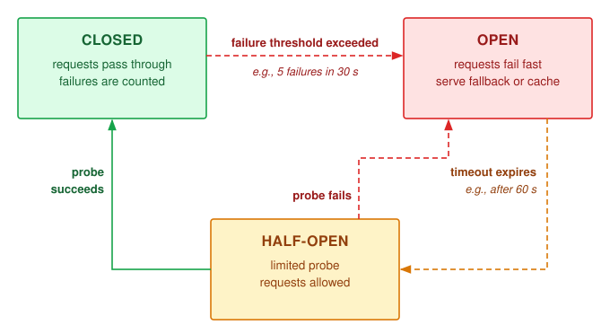

:::

Backpressure propagation\index{Backpressure!propagation} complements the breaker by making overload visible upstream. When queue depth crosses a threshold, the server returns a signal such as `503 Service Unavailable`; the load balancer marks the replica as degraded and routes fewer requests to it. If all replicas become degraded, the system shifts from routing control to admission control\index{Admission Control!overload shedding}, rejecting some requests at the edge rather than accepting work it cannot serve within the latency SLO; load-shedding policies decide which requests to reject first. Circuit breakers isolate unhealthy replicas; backpressure tells the rest of the system to slow down before retries amplify the failure.

::: {.column-margin .margin-pointer}
↩ Load shedding, model fallback, and the other strategies that trade quality for availability are established in @sec-fault-tolerance-reliability-reliability-graceful-degradation-strategies-e85e.
:::

Backpressure works only when the request contract propagates through the whole serving graph. The gateway converts the client timeout into an absolute deadline and every downstream stage subtracts elapsed time before admitting more work. If the client disconnects or the deadline expires, cancellation must reach queued CPU work, accelerator batches, retrieval calls, and streamed output. A canceled request that remains in a continuous batch is zombie work\index{Zombie work!cancelled request drain}: it consumes KV pages and decode bandwidth while producing no useful response. Some kernels cannot be interrupted mid-launch, so cancellation commonly takes effect at the next batch or token boundary; the scheduler must measure that cancellation lag rather than promise instantaneous preemption.

The same request identifier must connect routing, queueing, prefill, decode, cache allocation, and response streaming. A useful serving trace records admitted and rejected requests, queue delay, TTFT, TPOT, input and output tokens, cache pages, batch membership, preemptions, cancellations, and fallback decisions. Aggregate accelerator utilization cannot distinguish useful work from late or canceled work. SLO goodput and the wasted-token rate close that gap. SLO goodput reports how much completed work met its contract. The **wasted-token rate**\index{Wasted-token rate!definition} is the fraction of generated tokens spent on requests that were canceled, timed out, or delivered after their deadline, the execution the system performed after the result had lost value.

A saturated LLM fleet operating under severe KV cache pressure has three workload-specific relief options. Engines can apply context eviction\index{Context eviction!KV cache pressure} through an explicitly supported sliding-window or approximate policy with a quality check, or truncate retained history and recompute its state. Silently dropping old KV entries is not equivalent to recomputing a shorter conversation, because later cached states already depend on the earlier context. Disabling speculative execution reduces draft work, but reclaiming its memory also requires unloading draft weights and releasing the associated cache state. Finally, fallback routing\index{Fallback routing!graceful degradation} can send eligible requests to a smaller model with available capacity, provided that model meets the application's fallback quality contract.

These options change latency, resource use, or model behavior in different ways. The application must specify which changes are acceptable at each pressure tier. Context truncation can remove information essential to an answer, and a smaller model can fail the task's quality requirement. In those cases, an explicit rejection can be preferable to an apparently successful but unacceptable response.

Routing relies on estimates of replica capacity, but shared hardware can make that capacity change when another workload becomes active. Critical production models may share a cluster or device with experimental models and developer endpoints. Protecting the serving contract under that interference requires multi-tenant isolation in addition to routing.

## Multi-Tenancy and Isolation {#sec-inference-scale-multitenancy-isolation-688c}

Consider a critical customer-support chatbot running on the same GPU server as an experimental computer vision script. If the experimental workload monopolizes the PCIe bus or memory bandwidth, the chatbot can miss its latency target. Sharing saves capacity only when the resulting interference remains within each service's contract. Fleet quotas, fair-share hierarchies, and priority preemption decide how much of the cluster a serving system receives; the problem here is controlling contention among the tenants who share that allocation, request by request.

::: {.column-margin .margin-pointer}
↩ Fleet quotas, hierarchical fair-share, and the priority classes that govern preemption are established in @sec-fleet-orchestration-multi-tenancy.
:::

### The multi-tenancy challenge {#sec-inference-scale-multitenancy-challenge-8dca}

Sharing a serving pool can raise utilization and reduce separately provisioned capacity when tenant demand peaks occur at different times. This statistical-multiplexing gain weakens when bursts are correlated, and shared resources introduce interference even when aggregate demand fits. Pooling therefore needs both a demand model and enforceable isolation.

::: {.column-margin}
{width="100%" fig-alt="A red tenant workload fans gray arrows to five blue peer workloads, showing one source degrading many shared dependents."}

*One tenant's burst can degrade every workload sharing the pool.*
:::

A burst from one tenant can delay others through shared KV-cache capacity, network bandwidth, and accelerator time. The pool must preserve each tenant's data boundary and service contract; different SLOs can require different admission limits, reservations, or placements. Noisy-neighbor effects come first because they directly connect shared-resource contention to those latency contracts.

### Noisy neighbor problems {#sec-inference-scale-noisy-neighbor-problems-1b87}

The noisy neighbor problem\index{Multi-tenancy!noisy neighbor problem} occurs when one tenant's workload degrades performance for others sharing the same infrastructure. The interference manifests across three resource dimensions simultaneously.

```{python}
#| echo: false
#| label: noisy-neighbor-impact
# ┌─────────────────────────────────────────────────────────────────────────────
# │ NOISY NEIGHBOR IMPACT (LEGO)
# ├─────────────────────────────────────────────────────────────────────────────
# │ Context: @sec-inference-scale-noisy-neighbor-problems-1b87 KV-pool paragraph
# │          and the quantifying-noisy-neighbor example.
# │
# │ Goal: Show how one tenant's long-context burst shrinks the other tenants'
# │       admissible batches, and what per-tenant quotas preserve.
# │ Show: 60 GB pool, 20 GB shares, 45 GB swollen share, 200 -> 75 sequences,
# │       62.5 percent reduction; 100 -> 500 QPS burst under a 50 ms SLO.
# │ How: Equal static shares; the swollen tenant's excess is taken evenly from
# │      the other two. All inputs are scenario assumptions.
# └─────────────────────────────────────────────────────────────────────────────
from mlsysim.fmt import check, fmt_int, fmt_memory, fmt_multiple, fmt_percent, fmt_rate, fmt_time

class NoisyNeighborImpact:
    """KV-pool contention and quota protection for a shared serving pool."""

    # ┌── 1. LOAD (Constants) ──────────────────────────────────────────────
    kv_pool = 60 * GB  # scenario assumption: shared KV-cache pool
    pool_tenants = 3  # scenario assumption: tenants sharing that pool
    swollen_share = 45 * GB  # scenario assumption: long-context tenant's share
    base_seqs = 200  # scenario assumption: sequences per equal share
    tenant_base_qps = 100  # scenario assumption: per-tenant request rate
    tenant_burst_qps = 500  # scenario assumption: bursting tenant's rate
    slo_ms = 50  # scenario assumption: P99 SLO
    p99_low_ms = 22  # scenario assumption: unprotected pool P99, low end
    p99_high_ms = 45  # scenario assumption: unprotected pool P99, high end
    throttled_qps = 120  # scenario assumption: quota-enforced rate
    protected_p99_ms = 15  # scenario assumption: protected tenants' P99

    # ┌── 2. EXECUTE (The Compute) ────────────────────────────────────────
    base_share = kv_pool / pool_tenants
    gb_per_seq = base_share / base_seqs
    other_share = (kv_pool - swollen_share) / (pool_tenants - 1)
    other_seqs = int((other_share / gb_per_seq).to("").magnitude)
    batch_reduction = 1 - other_seqs / base_seqs
    burst_mult = tenant_burst_qps / tenant_base_qps

    # ┌── 3. GUARD (Invariants) ──────────────────────────────────────────
    check(other_seqs < base_seqs, "The burst must shrink the other tenants' batches")
    check(p99_high_ms < slo_ms, "Unprotected P99 in this scenario stays below the SLO")
    check(protected_p99_ms < p99_low_ms, "Quotas must protect the other tenants' latency")

    # ┌── 4. OUTPUT (Formatting) ─────────────────────────────────────────────
    kv_pool_gb_str = fmt_memory(kv_pool, unit=GB, precision=0, commas=False)
    base_share_gb_str = fmt_memory(base_share, unit=GB, precision=0, commas=False)
    swollen_share_gb_str = fmt_memory(swollen_share, unit=GB, precision=0, commas=False)
    base_seqs_str = fmt_int(base_seqs, commas=False)
    other_seqs_str = fmt_int(other_seqs, commas=False)
    batch_reduction_pct_str = fmt_percent(batch_reduction, precision=1, commas=False, style="prose")
    tenant_base_qps_str = fmt_rate(tenant_base_qps, "QPS")
    tenant_burst_qps_str = fmt_rate(tenant_burst_qps, "QPS")
    burst_mult_str = fmt_multiple(burst_mult, precision=0, commas=False)
    slo_ms_str = fmt_time(slo_ms * millisecond, millisecond, precision=0, commas=False)
    p99_low_ms_str = fmt_time(p99_low_ms * millisecond, millisecond, precision=0, commas=False)
    p99_high_ms_str = fmt_time(p99_high_ms * millisecond, millisecond, precision=0, commas=False)
    tenant_throttled_qps_str = fmt_rate(throttled_qps, "QPS")
    protected_p99_ms_str = fmt_time(protected_p99_ms * millisecond, millisecond, precision=0, commas=False)
```

GPU memory contention\index{Resource contention!GPU memory} can limit admission before compute capacity is exhausted. Consider three tenants sharing a `{python} NoisyNeighborImpact.kv_pool_gb_str` KV pool with nominal `{python} NoisyNeighborImpact.base_share_gb_str` shares. Without enforced limits, one tenant's long-context requests can raise its allocation to `{python} NoisyNeighborImpact.swollen_share_gb_str`. In the scenario, the others lose capacity from `{python} NoisyNeighborImpact.base_seqs_str` concurrent sequences each to `{python} NoisyNeighborImpact.other_seqs_str`, a `{python} NoisyNeighborImpact.batch_reduction_pct_str` reduction. That is a concurrency loss, not a proportional throughput prediction; the effect depends on their execution regime and preemption costs. Egress bandwidth and accelerator time are additional shared resources whose contention must be measured alongside memory occupancy.

::: {.column-margin .margin-pointer}
↩ The device-level interference channels of shared accelerators (memory bandwidth, cache hierarchy, host-device interconnect, and thermal dissipation) are established in @sec-fleet-orchestration-resource-isolation.
:::

::: {#exmp-inference-quantifying-noisy-neighbor-impact .callout-example title="Quantifying noisy neighbor impact"}

**Scenario**: An inference platform serves 10 tenants on shared H100 GPUs at `{python} NoisyNeighborImpact.tenant_base_qps_str` each under a `{python} NoisyNeighborImpact.slo_ms_str` p99 SLO. Tenant 3 bursts to `{python} NoisyNeighborImpact.tenant_burst_qps_str`, `{python} NoisyNeighborImpact.burst_mult_str` its baseline.

**Diagnosis**: Without quotas, contention raises pool-wide p99 into the `{python} NoisyNeighborImpact.p99_low_ms_str` to `{python} NoisyNeighborImpact.p99_high_ms_str` range in this scenario, eroding every tenant's headroom while remaining within the stated target. With quotas, Tenant 3 is limited to `{python} NoisyNeighborImpact.tenant_throttled_qps_str` and the other tenants retain `{python} NoisyNeighborImpact.protected_p99_ms_str` p99. Throttling turns Tenant 3's excess into rejected or delayed requests, which are judged against Tenant 3's own contract rather than spread across the pool.

**Systems lesson**: Shared capacity raises utilization only when it is coupled with isolation. Quotas turn pool-wide erosion of latency headroom into an admission decision confined to the tenant that caused it; without them, a larger burst or a tighter SLO turns the same erosion into violations across the pool.

:::

### Resource quotas and fair sharing {#sec-inference-scale-resource-quotas-fair-sharing-006c}

Resource quotas\index{Resource quota!fair sharing} limit what each tenant can consume, preventing any single tenant from monopolizing shared resources. Hard quotas turn shared serving into admission control. Request rate and concurrency bound arrival pressure, while input tokens, output tokens, KV-cache pages, accelerator time, and egress bytes bound the work performed after admission. A single scalar quota cannot protect all of these resources because two requests can have the same count but differ by orders of magnitude in prompt length or generated output. @Lst-resource-quotas shows representative gates so a tenant can be throttled at the scarce resource boundary instead of degrading the whole batch.

::: {#lst-resource-quotas lst-cap="**Multidimensional Resource Quotas**: A snapshot check compares prospective resource use with tenant limits. Atomic reservation and scheduler enforcement are separate requirements."}

```{.python}
class TenantQuota:
    max_concurrent_requests: int  # e.g., 100
    max_kv_cache_mb: int  # e.g., 20,000
    max_qps: int  # e.g., 1,000
    max_input_tokens_per_minute: int
    max_output_tokens_per_minute: int
    max_batch_tokens: int  # e.g., 50,000


def check_quota_snapshot(tenant_id, request):
    quota = get_quota(tenant_id)
    usage = get_usage(tenant_id)

    if usage.concurrent + 1 > quota.max_concurrent_requests:
        return RateLimitError("concurrent request limit")
    if usage.kv_cache_mb + request.reserved_kv_mb > quota.max_kv_cache_mb:
        return RateLimitError("memory limit")
    if usage.requests_last_second + 1 > quota.max_qps:
        return RateLimitError("rate limit")
    if usage.input_tokens + request.input_tokens > quota.max_input_tokens_per_minute:
        return RateLimitError("input-token limit")
    if usage.output_tokens + request.max_output_tokens > quota.max_output_tokens_per_minute:
        return RateLimitError("output-token limit")

    if request.prefill_chunk_tokens > quota.max_batch_tokens:
        return RateLimitError("prefill chunk exceeds batch-token limit")

    return None  # Snapshot is eligible; no resources have been reserved.
```

:::

This listing assumes that `reserved_kv_mb` includes the requested prompt and output-token budget, and that usage counters include outstanding reservations in their stated time windows. A passing snapshot is not an admission guarantee: simultaneous callers can observe the same free capacity. Production admission must check and reserve resources atomically, roll back failed admissions, and release reservations on completion or cancellation. The batch scheduler separately enforces the aggregate batch-token limit. Quotas protect the resources they account for; shared compute, networking, and control-plane contention still require isolation and measurement.

Soft quotas permit borrowing unused capacity while preserving an enforceable share when demand rises. The unit of account matters: equal request counts can hide large differences in prefill work, output length, and retained state. Input and output tokens therefore need separate accounting, with memory and concurrency limits alongside them. The progressive-filling approach in @sec-fleet-orchestration-drf-worked-allocation reduces to max-min fairness\index{Max-min fairness!token allocation} when only one divisible resource constrains the allocation. For three tenants demanding 30,000, 20,000, and 80,000 output tokens/sec from an idealized 100,000-token/sec pool with equal token costs, the allocation is 30,000, 20,000, and 50,000. Coupled prefill, decode, and memory constraints require joint feasibility checks; independent fair allocations do not automatically compose into a feasible service.

### Priority scheduling {#sec-inference-scale-priority-scheduling-3e37}

The priority-aware scheduling listed among the serving dimensions (@sec-inference-scale-vllm-architecture-9b84) becomes an isolation tool\index{Priority scheduling!multi-tenant isolation} once its classes map to tenants and service tiers. Fleet priority classes govern preemption across allocations; request priority applies inside a serving allocation. @Tbl-priority-scheduling-classes illustrates a policy that combines precedence with reservations. Those reservations must be provisioned and enforced separately: priority alone cannot create capacity, interrupt every running kernel, or guarantee a deadline under unbounded critical traffic.

| **Class**       |    **Use Case**    |      **Preemption**     | **Resource Guarantee** |
|:----------------|:------------------:|:-----------------------:|:----------------------:|
| **Critical**    | Revenue-generating |    Can preempt lower    |     100% reserved      |
| **Standard**    |  General traffic   | Can preempt best-effort |     Weighted share     |
| **Best-effort** | Background, batch  |      Cannot preempt     |      No guarantee      |

: **Priority scheduling classes**: Three-tier priority hierarchy for multi-tenant inference. Critical traffic gets 100 percent reserved capacity and can preempt any lower class; standard traffic shares capacity proportionally and can preempt best-effort; best-effort runs on leftover capacity with no guarantees. {#tbl-priority-scheduling-classes}

The scheduler sorts incoming requests by priority class, then by arrival time within each class. When a new critical request arrives, it jumps ahead of all standard and best-effort requests in the queue, so revenue-generating traffic does not queue behind background batch jobs, although work already running on the accelerator can still delay it.

Preemption extends this principle to requests already in flight, but priority does not make state movement free. The retain, swap, recompute, or reject choice of @sec-inference-scale-vllm-architecture-9b84 still decides how a displaced request's KV state is handled; priority adds an input to that choice rather than replacing it. A priority class determines who may be displaced, while remaining service time, state size, and deadline slack determine which victim is cheapest. Ignoring those costs lets aggressive preemption consume more capacity than it releases.

### Bulkhead pattern {#sec-inference-scale-bulkhead-pattern-1c3a}

The bulkhead pattern[^fn-bulkhead-service-isolation] [@nygard2007releaseit] partitions resources so exhaustion or failure in one allocation has a limited effect on others. The boundary may be a logical concurrency pool, a separate process, or dedicated hardware; each contains different failure modes. The pattern is named after ship compartments intended to contain flooding.

[^fn-bulkhead-service-isolation]: [offset=-30mm] **Bulkhead limits**\index{Bulkhead Pattern!isolation}: A divider isolates failure only if it closes the relevant boundary. The Titanic's incomplete bulkheads allowed water to cascade between compartments; similarly, a soft quota cannot isolate shared memory or bandwidth that remains globally exhaustible.

Dedicated replicas separate more resources than request limits inside one process. @Fig-bulkhead-patterns assigns distinct compute and memory pools to tenant groups, so an engine crash or exhausted local allocation in the standard tier need not stop the gold-tier engines. Shared networking, storage, and control-plane services can still carry interference across that boundary.

::: {#fig-bulkhead-patterns fig-env="figure" fig-pos="htb" fig-cap="**Bulkhead isolation patterns**: To prevent cascading failures in multi-tenant systems, bulkheads isolate resources. Deployment-level bulkheads (shown) assign dedicated physical replicas to high-priority tenants, separating their compute and memory pools. Request-level bulkheads enforce strict concurrency limits within shared processes. Shared networking, storage, and control-plane dependencies remain possible paths for interference." fig-alt="Two side-by-side compartments, standard tier on the left and gold tier on the right, separated by a thick dark wall labeled bulkhead and both standing on a shared floor band divided into network, storage, and control plane segments. Each tier's traffic enters from above through its own load balancer. Every replica is drawn as a node of four GPU tiles above a memory pool bar. The standard tier has three replicas; the one against the bulkhead is red, crossed out, receives only a dashed line, and is labeled engine crash, and a pale red dashed region marking its blast radius ends flush at the bulkhead wall. The gold tier's two replicas are unaffected and labeled keeps serving. A red dashed line labeled interference path runs from the crashed replica down into the shared floor, passes under the bulkhead, and rises into a gold replica. A key identifies the GPU tile, the memory pool bar, and the blast radius shading."}

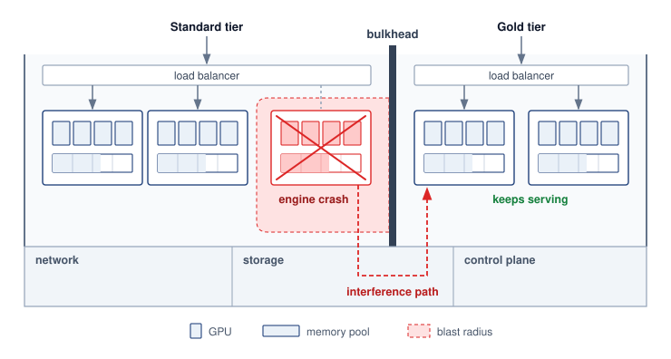{width="100%"}

:::

Deployment-level bulkheads isolate the named compute and memory resources for premium tenants. They do not remove shared network, storage, power, or control-plane failure domains. The trade-off is lower pooling efficiency and additional operational overhead from dedicated infrastructure.

Request-level bulkheads limit work admitted within a shared process. Example caps of 8,000 input tokens, 2,000 output tokens, and 30 seconds of execution constrain request size and duration when the scheduler enforces them. They still need concurrency limits, resource reservations, and cancellation handling; a token cap alone does not bound interference or isolate a process crash.

Crash containment follows the process or hardware boundary, not the request quota. A malformed request that crashes a shared worker can interrupt every tenant using that worker. Service tiers requiring stronger fault isolation therefore need placement boundaries that match that requirement.

::: {#exmp-inference-bulkhead-configuration-api-tiers .callout-example title="Bulkhead configuration for API tiers"}

**Scenario**: An LLM API platform serves Enterprise, Professional, and Free service tiers across shared and dedicated hardware.

**Diagnosis**: Unpartitioned pools allow Free-tier bursts or shared-worker failures to affect Enterprise requests. The example assigns Enterprise to dedicated GPU pools with a 99.9 percent availability target, allocates 70 percent of the remaining shared capacity to Professional, and caps Free at 30 percent best-effort capacity. Meeting that target still requires reliability evidence for the dedicated pools themselves.

**Systems lesson**: Bulkheads concentrate isolation overhead where business requirements dictate. Hardware partitioning reduces cross-tenant compute and memory contention. SLO compliance still depends on sufficient capacity, admission policy, shared dependencies, and failure handling.

:::

Multi-tenant isolation limits the blast radius of excess demand, but it does not create capacity. Once protected queues approach their latency budgets, the service needs a control loop that can add replicas before admission begins to fail.

## Autoscaling and Capacity Control {#sec-inference-scale-autoscaling-capacity-control}

A serving autoscaler\index{Autoscaling!capacity control} that reacts only to average accelerator utilization can scale in the wrong direction. Decode can saturate memory bandwidth while arithmetic units appear idle, long prompts can consume prefill capacity before request count rises, and queued work can violate an SLO while fleet-wide utilization remains moderate. The control signal must represent outstanding work relative to phase-specific service capacity. Every replica the controller adds is also a claim on accelerators that training jobs may hold, so fleet-level arbitration with training bounds how quickly and how far serving can grow.

::: {.column-margin .margin-pointer}
↩ The arbitration between serving replicas and training jobs for shared accelerators, including the minutes-long cost of switching a device between them, is established in @sec-fleet-orchestration-boundary.
:::

For a conventional fixed-cost model, queueing delay and request rate per ready replica can guide scaling. Autoregressive serving also needs prompt-token and output-token rates, KV occupancy, and measured phase service rates. A colocated replica must satisfy all phase requirements; disaggregated prefill and decode pools need separate counts and a feasible transfer budget. SLO goodput measures useful supply, but rejected work and backlog must remain visible as unmet demand. A latency threshold can detect deterioration after a model change, yet controller timing and headroom still need validation. Adding replicas also depends on their startup delay. Changing an existing accelerator allocation may require a restart or state migration, depending on the runtime and execution plan.

Scale-up and scale-down require asymmetric evidence. Scale-up acts on sustained queue growth, forecast demand, or declining deadline slack because cold-start delay makes late reactions expensive. Scale-down requires low demand over a longer window, enough spare capacity to survive one replica failure, and a drain plan for in-flight requests and any optional session cache. This hysteresis\index{Autoscaling!hysteresis} prevents oscillation in which replicas repeatedly load large weights, accept work, and terminate before amortizing startup cost.

The controller also needs observability that distinguishes demand from impaired supply. Request rate, input and output tokens, queue age, TTFT, TPOT, deadline misses, admission rejections, ready replicas, model-load failures, and per-phase service rate form the minimum feedback set. Without replica readiness and service-rate measurements, an autoscaler can respond to a sick replica by adding cold replicas indefinitely while the original failure remains hidden.

```{python}
#| echo: false
#| label: cold-start-timeline
# ┌─────────────────────────────────────────────────────────────────────────────
# │ COLD START AND PREDICTIVE SCALING (LEGO)
# ├─────────────────────────────────────────────────────────────────────────────
# │ Context: cold-start and predictive-scaling examples in
# │          @sec-inference-scale-autoscaling-capacity-control.
# │
# │ Goal: Derive the replica cold-start time from artifact size and storage
# │       bandwidth, and the GPU spend recovered by predictive scaling.
# │ Show: ~4.7 min artifact fetch, ~6.7 min cold start, 45 vs 30 peak
# │       replicas, 33 percent saving.
# │ How: T_cold = T_provision + artifact / storage_bw + T_load_warmup.
# └─────────────────────────────────────────────────────────────────────────────
from mlsysim.fmt import check, fmt_int, fmt_percent, fmt_time

class ColdStartTimeline:
    """Cold-start decomposition and predictive-scaling saving."""

    # ┌── 1. LOAD (Constants) ──────────────────────────────────────────────
    artifact = Models.Language.Llama2_70B.size_in_bytes(BYTES_FP16)
    storage_bw = 0.5 * (GB / second)  # scenario assumption: effective object-storage read rate
    t_provision = 60 * second  # scenario assumption: instance acquisition and boot
    t_load_warmup = 60 * second  # scenario assumption: device load and warmup
    reactive_peak_replicas = 45  # scenario assumption: reactive-only peak fleet
    predictive_peak_replicas = 30  # scenario assumption: forecast peak fleet (schedule table)
    lead_min = 30  # scenario assumption: pre-warm lead before each ramp

    # ┌── 2. EXECUTE (The Compute) ────────────────────────────────────────
    t_fetch = (artifact / storage_bw).to(second)
    t_cold = t_provision + t_fetch + t_load_warmup
    spend_saving = 1 - predictive_peak_replicas / reactive_peak_replicas

    # ┌── 3. GUARD (Invariants) ──────────────────────────────────────────
    check(t_fetch > t_provision + t_load_warmup, "Artifact fetch should dominate the cold start")
    check(t_cold.to("minute").magnitude < lead_min, "Pre-warm lead must exceed the cold start")

    # ┌── 4. OUTPUT (Formatting) ─────────────────────────────────────────────
    fetch_min_str = fmt_time(t_fetch, 'minute', precision=1, commas=False, style='word')
    provision_min_str = fmt_time(t_provision, 'minute', precision=0, commas=False, style='word')
    load_warmup_min_str = fmt_time(t_load_warmup, 'minute', precision=0, commas=False, style='word')
    cold_min_str = fmt_time(t_cold, 'minute', precision=1, commas=False, style='word')
    cold_min_attr_str = fmt_time(round(t_cold.to('minute').magnitude), 'minute', precision=0, commas=False, style='word', attributive=True)
    storage_bw_str = fmt_bandwidth(storage_bw, unit=GB / second, precision=1, commas=False)
    reactive_peak_str = fmt_int(reactive_peak_replicas, commas=False)
    predictive_peak_str = fmt_int(predictive_peak_replicas, commas=False)
    spend_saving_pct_str = fmt_percent(round(spend_saving, 2), precision=0, commas=False, style="prose")
    lead_min_str = fmt_time(lead_min, 'minute', precision=0, commas=False, style='word')
```

::: {#exmp-inference-cold-start-timeline-llama-70b .callout-example title="Cold start timeline for Llama-70B"}

**Scenario**: An autoscaling engine provisions a Llama-70B replica during a traffic surge, using an H100-based allocation large enough for its FP16 weights, cache, and runtime state.

**Diagnosis**: The scenario's sequential startup estimate is `{python} ColdStartTimeline.cold_min_str` ($\ReplicaColdStartTime= \ReplicaProvisioningTime+ \ReplicaModelLoadTime+ \ReplicaWarmupTime$)\index{Cold start!LLM replica loading}: `{python} ColdStartTimeline.provision_min_str` for provisioning, `{python} ColdStartTimeline.fetch_min_str` to fetch `{python} InferenceSetup.llama70b_fp16_gb_str` of artifacts at the assumed `{python} ColdStartTimeline.storage_bw_str`, and `{python} ColdStartTimeline.load_warmup_min_str` for device loading and warmup. Cached artifacts or overlapping phases can shorten this path; scarce capacity and shared storage can lengthen it. If existing headroom cannot absorb the surge, newly requested replicas arrive too late to protect short deadlines.

**Systems lesson**: Cold-start latency depends on artifact size, effective storage bandwidth, provisioning delay, compilation, and warmup. The controller must measure this distribution and begin provisioning far enough ahead that its high percentile fits inside the forecast horizon.

:::

::: {#exmp-inference-predictive-scaling-traffic .callout-example title="Predictive scaling for traffic"}

**Scenario**: A commercial chatbot service faces predictable diurnal traffic patterns, ramping from 500 QPS at night to 3,000 QPS at peak.

**Diagnosis**: A controller that waits for the morning ramps at 06:00 and 09:00 UTC before requesting capacity must cover the assumed `{python} ColdStartTimeline.cold_min_attr_str` startup interval with existing headroom or admission limits. Without enough ready capacity, queues grow while replicas start. Forecasting can shift that wait ahead of the expected demand.

**Systems lesson**: Predictive autoscaling\index{Autoscaling!predictive scaling} converts demand forecasts into planned pre-warming windows (@tbl-inference-chatbot-predictive-schedule). Starting `{python} ColdStartTimeline.lead_min_str` ahead of the expected ramps exceeds the modeled startup time. Readiness still depends on actual provisioning and warmup, and forecast errors can leave the fleet short or idle. Reactive correction and an overload policy remain necessary.

| **Time** |  **Action**  | **Replicas Active** | **Replicas Starting** |
|:---------|:------------:|:-------------------:|:---------------------:|
| 05:30    |   Scale up   |          5          |      +10 warming      |
| 06:00    | Traffic ramp |          15         |           -           |
| 08:30    |   Scale up   |          15         |      +15 warming      |
| 09:00    | Peak traffic |          30         |           -           |
| 17:00    |  Scale down  |          20         |    -10 terminating    |
| 20:00    |  Scale down  |          10         |    -10 terminating    |
| 00:00    |  Scale down  |          5          |     -5 terminating    |

: **Predictive scaling schedule**: Per-time-bucket scaling actions, active replicas, and replicas in cold-start warming for the chatbot workload. {#tbl-inference-chatbot-predictive-schedule}

**Systems insight**: Against an assumed reactive peak of `{python} ColdStartTimeline.reactive_peak_str` replicas, the forecast-based peak of `{python} ColdStartTimeline.predictive_peak_str` is a `{python} ColdStartTimeline.spend_saving_pct_str` reduction in peak replica count at equal unit cost. The reactive controller over-provisions because it reacts to a queue that has already formed and must add capacity for the backlog as well as the demand. Peak count is only part of the bill. Total spending counts replica-hours, including the pre-warming window, so the forecast pays only when the replica-hours spent warming ahead of demand are fewer than those the reactive overshoot would consume.

:::

Example \ref{exmp-inference-predictive-scaling-traffic} illustrates the opportunity to prepare capacity before demand arrives. @Fig-predictive-reactive-scaling depicts a forecast that anticipates the surge, while the reactive curve starts later and temporarily lacks capacity. Whether that deficit produces queueing, rejection, or missed deadlines depends on admission and existing headroom. The predictive curve illustrates a successful forecast, not a guarantee that future demand or startup time will match it.

::: {#fig-predictive-reactive-scaling fig-env="figure" fig-pos="htb" fig-cap="**Predictive vs. reactive scaling**: Reactive scaling (gray line) responds to traffic spikes after they occur, leaving a capacity deficit (red region) during cold start in this scenario. Predictive scaling (green line) anticipates traffic and begins provisioning before the spike peaks, shrinking that deficit to a brief, small shortfall at onset when the forecast and startup assumptions hold." fig-alt="Two time-series panels stacked on a shared time axis and a shared vertical axis of normalized demand or capacity, each showing the same dashed demand curve that rises to a spike and falls back. Panel (a), reactive scaling: a gray capacity line stays flat until near the peak, where a dotted marker labeled scale-up begins sits, then ramps up after demand has already risen; the large region where demand exceeds this capacity is shaded red and labeled capacity deficit. Panel (b), predictive scaling: a green capacity line is marked scale-up begins early in the rise and climbs ahead of demand toward the peak; only a thin red sliver at the onset, labeled brief, small shortfall, shows demand briefly above capacity before the ramp overtakes it."}

```{python}
#| echo: false
#| warning: false
from binder.tools.figures import style as book_style
import numpy as np

book_style.set_book_style()
COLORS = book_style.COLORS
import matplotlib.pyplot as plt

fig, axes = plt.subplots(2, 1, figsize=(5.1, 4.6), sharex=True, sharey=True)

c_dark = COLORS['primary']
c_pred = COLORS['GreenLine']
c_react = COLORS['secondary']
c_red = COLORS['RedLine']

t = np.linspace(0, 9.5, 500)
traffic = 1.0 + 3.0 * np.exp(-((t - 5.0) ** 2) / (2 * 0.95**2))

# Reactive capacity: lags until spike peak approaches at t=5.1, ramps to 4.2 by t=5.7
reactive = np.piecewise(
    t,
    [t < 5.1, (t >= 5.1) & (t <= 5.7), t > 5.7],
    [1.2, lambda t: 1.2 + (4.2 - 1.2) * ((t - 5.1) / 0.6), 4.2],
)

# Predictive capacity: anticipates spike, ramps from t=3.2 to t=4.3
predictive = np.piecewise(
    t,
    [t < 3.2, (t >= 3.2) & (t <= 4.3), t > 4.3],
    [1.2, lambda t: 1.2 + (4.2 - 1.2) * ((t - 3.2) / 1.1), 4.2],
)

# Small multiples, stacked on one time axis: the same demand spike met by each
# policy, so the reader compares where provisioning begins against the rise.
panels = [
    (axes[0], reactive, c_react, '(a) Reactive scaling', 'reactive capacity', 5.1),
    (axes[1], predictive, c_pred, '(b) Predictive scaling', 'predictive capacity', 3.2),
]
FS = 10.5  # 5.1 in wide: prints at >= 9 pt when scaled to 5 in
for ax, cap, color, title, cap_label, t_start in panels:
    deficit = traffic > cap
    ax.fill_between(t, cap, traffic, where=deficit, color=COLORS['RedL'], lw=0, zorder=1)
    ax.plot(t, traffic, color=c_dark, linestyle='--', linewidth=1.6, zorder=4)
    ax.plot(t, cap, color=color, linewidth=2.6, zorder=5)
    # Where provisioning begins, relative to the demand rise
    ax.plot([t_start, t_start], [0, 1.2], color=color, linestyle=':', linewidth=1.2, zorder=3)
    ax.plot([t_start], [1.2], 'o', ms=5.5, mfc='white', mec=color, mew=1.6, zorder=6)
    ax.text(t_start - 0.1, 0.5, 'scale-up\nbegins', ha='right', va='center', fontsize=FS, color=color, fontweight='bold')
    ax.text(0.015, 0.95, title, transform=ax.transAxes, ha='left', va='top', fontsize=FS + 0.5, fontweight='bold', color=c_dark)
    ax.text(7.75, 4.45, cap_label, ha='right', va='bottom', fontsize=FS, fontweight='bold', color=color)
    ax.text(6.3, 2.75, 'demand', ha='left', va='center', fontsize=FS, fontweight='bold', color=c_dark)
    ax.set_xlim(1.5, 7.8)
    ax.set_ylim(0, 5.0)
    ax.tick_params(labelsize=FS)

axes[0].text(4.45, 1.9, 'capacity\ndeficit', ha='center', va='center', fontsize=FS, fontweight='bold', color=c_red, zorder=6)
axes[1].annotate(
    'brief, small\nshortfall',
    xy=(3.15, 1.38),
    xytext=(2.0, 2.7),
    ha='left',
    va='center',
    fontsize=FS,
    fontweight='bold',
    color=c_red,
    zorder=6,
    arrowprops=dict(arrowstyle='-', color=c_red, lw=1.0, shrinkA=2, shrinkB=1),
)
axes[1].set_xlabel('Time', fontsize=FS)
axes[1].set_xticks([])
fig.supylabel('Demand or capacity (normalized)', fontsize=FS)

plt.tight_layout(h_pad=1.0)
```

:::

### Warm pool management {#sec-inference-scale-warm-pool-management-a360}

Maintaining prewarmed replicas buys readiness before demand arrives. Warm pool\index{Warm pool!replica management} sizing begins with the total capacity needed during the provisioning delay, then subtracts capacity already ready to serve. If peak demand doubles and the chosen headroom factor is 1.5, the target is three times baseline capacity, assuming unchanged per-replica throughput. Partly prepared replicas count only if they can become ready before that capacity is needed. The expression $\text{Pool size} \times \text{GPU cost/hour} \times \text{Idle fraction}$ estimates the hourly cost attributed to idle GPU capacity; it excludes busy capacity and non-GPU resources. @Tbl-warm-pool-tiers distinguishes readiness levels and their activation costs:

| **Tier** | **State**                                   | **Activation requirement**           | **Cost while waiting**              |
|:---------|:--------------------------------------------|:-------------------------------------|:------------------------------------|
| **Hot**  | Model running on allocated GPU              | Route admitted work                  | Allocated GPU and service resources |
| **Warm** | Capacity allocated; runtime partly prepared | Finish initialization and validation | Allocated resources remain billable |
| **Cold** | GPU not allocated                           | Acquire capacity, load, and warm up  | Artifact storage; no allocated GPU  |

: **Tiered warm pool readiness levels**: Readiness trades activation delay against idle resource cost. Actual delay and billing depend on the deployment. Cold capacity is subject to quotas and physical availability. {#tbl-warm-pool-tiers}

When a traffic spike hits, the controller routes work to ready replicas, activates prepared capacity, and requests additional instances if needed. Pool sizing must cover the measured provisioning delay and include an overload policy for capacity that cannot be acquired in time.

### Scaling response time analysis {#sec-inference-scale-scaling-response-time-analysis-0dbf}

The scaling response budget is the sum of the control loop's detection, decision, provisioning, and warmup delays. @Eq-scaling-response makes those phases explicit:

$$\AutoscalingResponseTime= \AutoscalingDetectionTime+ \AutoscalingDecisionTime+ \ReplicaProvisioningTime+ \ReplicaWarmupTime$$ {#eq-scaling-response}

@Tbl-scaling-response-components decomposes each term and identifies its primary optimization path:

| **Component**    | **Duration** |     **Optimization**    |
|:-----------------|:------------:|:-----------------------:|
| **Detection**    |   10--60s    | Reduce metrics interval |
| **Decision**     |    1--5s     |    Faster autoscaler    |
| **Provisioning** |  30s--5min   |        Warm pools       |
| **Warmup**       |    5--30s    |      Precompilation     |

: **Scaling response time components**: The four phases of a scaling event with illustrative durations and their primary optimization lever. Provisioning dominates this example; a deployment must measure its own critical path, which may instead be dominated by artifact loading. {#tbl-scaling-response-components}

Provisioning can dominate the illustrated budget, making already allocated capacity valuable. The earlier large-model example also shows that artifact loading can dominate startup; the relevant term is the one measured on the deployment's critical path. Finer-grained metrics can reduce detection delay but increase noise, while prepared scaling decisions and precompiled engines reduce other costs. A warm pool removes only the phases already completed at its stated readiness level.

### Spot and preemptible instances {#sec-inference-scale-spot-preemptible-instances-c969}

Discounted interruptible capacity[^fn-spot-instance-inference] enters serving through the same purchasing tiers that fleet capacity planning uses (@tbl-cloud-capacity-reservation-tiers): reserved capacity for the steady baseline, on-demand capacity for bursts, and spot capacity for work that tolerates revocation. None of these tiers makes a replica immune to failure, so the serving question is whether a revoked replica can drain, reroute, or recompute its requests without violating their SLO. The provider's warning window is the binding constraint.

[^fn-spot-instance-inference]: **Spot-instance economics**\index{Spot Instance Economics}\index{Spot Instances!inference}: @Eq-fleet-orchestration-spot-cost derives the effective cost of preemptible capacity from its productive fraction. For inference, revocation can also destroy in-flight requests and KV-cache state, so the productive fraction must be charged for draining, rerouting, and restoring capacity.

Spot termination handling is a race against the provider's warning window. @Lst-spot-termination orders the shutdown path so new work stops first, in-flight work drains while time remains, recoverable state is persisted, and the load balancer stops sending traffic before the instance disappears.

::: {#lst-spot-termination lst-cap="**Spot Termination Handling**: Graceful shutdown sequence that stops admission, deregisters from the load balancer, drains in-flight requests, and persists recoverable state."}

```{.python}
async def handle_spot_termination():
    # Received 2-minute warning
    # 1. Stop admission and remove the replica from routing
    stop_accepting_requests()
    deregister_from_loadbalancer()

    # 2. Complete in-flight requests (if possible)
    await complete_inflight(timeout=90)

    # 3. Save state for resumption elsewhere
    save_kv_cache_to_storage()

    # 4. Terminate gracefully
    shutdown()
```

:::

The gateway in @fig-spot-aware-routing separates traffic by its tolerance for capacity revocation. SLO-critical work uses the non-spot pool, while eligible best-effort work can use interruptible capacity. Routing still depends on readiness and available headroom. An eviction notice triggers draining when time permits; requests that cannot finish need a permitted retry, reconstruction, or rejection path.

::: {#fig-spot-aware-routing fig-env="figure" fig-pos="htb" fig-cap="**Spot-aware traffic distribution**: The gateway classifies requests by SLO and routes 70 percent of traffic, the SLO-critical share, to on-demand replicas that face no spot reclamation, and 30 percent, the best-effort share, to discounted spot replicas that can be preempted. When a spot worker receives an eviction notice, the gateway stops routing to it while it drains, and best-effort requests tolerate occasional retries. The traffic split is illustrative; cost savings depend on provisioned capacity, discounts, retries, and idle headroom." fig-alt="A Requests box, tagged with an SLO class, feeds a violet Spot-aware gateway box that classifies SLO, watches preemption, and drains. Below it, traffic leaves the gateway as pale gray lanes, each from its own exit point along the gateway's lower edge and ending in an arrowhead at a worker, with combined width proportional to each share. Three wider lanes labeled SLO-critical (70%) fan out to the three reserved workers, 0 to 2, of an On-demand pool with no spot reclamation. Two thinner lanes labeled best-effort (30%) reach spot workers 3 and 4 of a dashed Spot pool, discounted and preemptible; Worker 5, drawn red and dashed and marked draining, receives no lane. A red dashed arrow labeled eviction notice runs from Worker 5 back to the gateway."}
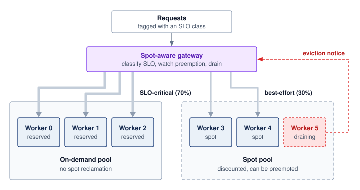

<!--
```{.tikz}
\providecolor{DarkNavy}{HTML}{1E293B}
\providecolor{OceanBlue}{HTML}{2563EB}
\providecolor{ForestGreen}{HTML}{166534}
\providecolor{AmberStage}{HTML}{D97706}
\providecolor{CrimsonSLA}{HTML}{991B1B}
\providecolor{SlateGrey}{HTML}{475569}
\providecolor{SoftGrey}{HTML}{F8FAFC}
\providecolor{SlateTeal}{HTML}{0F766E}
\providecolor{BorderGrey}{HTML}{CBD5E1}
\providecolor{BorderBlue}{HTML}{2563EB}
\providecolor{BorderGreen}{HTML}{166534}
\providecolor{BorderAmber}{HTML}{D97706}
\providecolor{BorderCrimson}{HTML}{991B1B}
\providecolor{Crimson}{HTML}{991B1B}
\providecolor{SoftBlue}{HTML}{F0F6FE}
\providecolor{SoftGreen}{HTML}{ECFAF0}
\providecolor{SoftAmber}{HTML}{FEF8EE}
\providecolor{SoftCrimson}{HTML}{FFF1F2}
\providecolor{BgCard}{HTML}{FFFFFF}
\providecolor{CardBg}{HTML}{FFFFFF}
\providecolor{GrayL}{HTML}{E0E0E0}
\providecolor{GrayLine}{HTML}{666666}
\providecolor{BlueLine}{HTML}{006395}
\providecolor{BlueFill}{HTML}{D6EAF8}
\providecolor{GreenLine}{HTML}{008F45}
\providecolor{GreenFill}{HTML}{D5F5E3}
\providecolor{OrangeLine}{HTML}{E67817}
\providecolor{OrangeFill}{HTML}{FDEBD0}
\providecolor{RedLine}{HTML}{D9534F}
\providecolor{RedFill}{HTML}{F2D7D5}
\providecolor{TextBlack}{HTML}{333333}
\providecolor{VioletLine}{HTML}{7E317B}
\providecolor{VioletFill}{RGB}{243,243,255}
\colorlet{mlsysblue}{OceanBlue}
\colorlet{mlsysgreen}{ForestGreen}
\colorlet{mlsysred}{CrimsonSLA}
\colorlet{mlsysamber}{AmberStage}
\colorlet{mlsysdarkgray}{DarkNavy}
\colorlet{mlsysteal}{SlateTeal}
\scalebox{0.59}{%
\begin{tikzpicture}[
    x=1cm, y=1cm,
    font=\sffamily,
    >=Stealth
]
\tikzset{
    box/.style={
        draw=BorderGrey,
        fill=white,
        line width=0.7pt,
        rounded corners=3pt,
        align=center
    },
    worker/.style={
        draw=BorderGreen,
        fill=white,
        line width=0.75pt,
        rounded corners=3pt,
        minimum width=2.8cm,
        minimum height=2.4cm,
        align=center,
        inner sep=6pt
    },
    worker_spot/.style={
        draw=BorderAmber,
        fill=white,
        line width=0.75pt,
        rounded corners=3pt,
        minimum width=2.8cm,
        minimum height=2.4cm,
        align=center,
        inner sep=6pt
    },
    worker_draining/.style={
        draw=BorderCrimson,
        dashed,
        line width=0.85pt,
        fill=white,
        rounded corners=3pt,
        minimum width=2.8cm,
        minimum height=2.4cm,
        align=center,
        inner sep=6pt
    },
    pill_chip/.style={
        draw=BorderGrey,
        fill=white,
        rounded corners=2pt,
        inner xsep=6pt,
        inner ysep=2.5pt,
        font=\fontsize{6.5}{7.5}\selectfont\bfseries
    }
}

    % -------------------------------------------------------------------------
    % Top: Incoming Requests
    % -------------------------------------------------------------------------
    \node[box, draw=BorderGrey, fill=SoftGrey, line width=0.75pt, rounded corners=3.5pt, minimum width=9.6cm, minimum height=1.35cm] (req) at (0, 7.7) {
        \fontsize{8}{9.5}\selectfont\textbf{\textcolor{DarkNavy}{INCOMING INFERENCE REQUESTS}}\\[3pt]
        \fontsize{7}{8.5}\selectfont\textcolor{SlateGrey}{Classified by Service Level Objective (SLO) Tier \& Latency Tolerance}
    };

    % -------------------------------------------------------------------------
    % Spot-Aware Traffic Gateway
    % -------------------------------------------------------------------------
    \node[box, draw=BorderAmber, fill=SoftAmber, line width=0.85pt, rounded corners=4pt, minimum width=16.0cm, minimum height=2.3cm] (gw) at (0, 5.0) {};

    \node[draw=BorderAmber, fill=white, rounded corners=2pt, font=\fontsize{6.5}{7.5}\selectfont\bfseries\color{AmberStage}, anchor=north west, inner xsep=8pt, inner ysep=3pt]
        at ([shift={(12pt,-8pt)}] gw.north west) {SPOT-AWARE TRAFFIC GATEWAY};

    \node[box, draw=BorderAmber, fill=white, rounded corners=2.5pt, minimum width=4.3cm, inner ysep=6pt] (gw_slo) at (-5.0, 4.55) {
        \fontsize{7}{8.5}\selectfont\textbf{\textcolor{DarkNavy}{SLO Classifier}}\\[2pt]
        \fontsize{6.5}{7.5}\selectfont\textcolor{SlateGrey}{Interactive vs.\ Batch Routing}
    };

    \node[box, draw=BorderAmber, fill=white, rounded corners=2.5pt, minimum width=4.5cm, inner ysep=6pt] (gw_mon) at (0, 4.55) {
        \fontsize{7}{8.5}\selectfont\textbf{\textcolor{DarkNavy}{Preemption Monitor}}\\[2pt]
        \fontsize{6.5}{7.5}\selectfont\textcolor{SlateGrey}{Cloud Webhook / Polling (2m Signal)}
    };

    \node[box, draw=BorderAmber, fill=white, rounded corners=2.5pt, minimum width=4.4cm, inner ysep=6pt] (gw_drain) at (5.0, 4.55) {
        \fontsize{7}{8.5}\selectfont\textbf{\textcolor{DarkNavy}{Drain Orchestrator}}\\[2pt]
        \fontsize{6.5}{7.5}\selectfont\textcolor{SlateGrey}{Reroute Ingress $\cdot$ Flush Batches}
    };

    \draw[->, line width=0.85pt, color=DarkNavy, shorten >=2pt, shorten <=2pt] (req.south) -- (gw.north);

    % -------------------------------------------------------------------------
    % Branch Decision Pills
    % -------------------------------------------------------------------------
    \node[box, draw=BorderGreen, fill=white, line width=0.85pt, rounded corners=2.5pt, font=\fontsize{7}{8.5}\selectfont\bfseries\color{ForestGreen}, inner xsep=12pt, inner ysep=5pt] (pill_crit) at (-5.2, 3.1) {
        70\% Critical / Interactive
    };

    \node[box, draw=BorderAmber, fill=white, line width=0.85pt, rounded corners=2.5pt, font=\fontsize{7}{8.5}\selectfont\bfseries\color{AmberStage}, inner xsep=12pt, inner ysep=5pt] (pill_spot) at (5.2, 3.1) {
        30\% Delay-Tolerant / Spot
    };

    \draw[->, line width=0.85pt, color=ForestGreen, shorten >=2pt] (-5.2, 3.85) -- (pill_crit.north);
    \draw[->, line width=0.85pt, dashed, color=AmberStage, shorten >=2pt] (5.2, 3.85) -- (pill_spot.north);

    % -------------------------------------------------------------------------
    % Left Fleet: On-Demand Replicas
    % -------------------------------------------------------------------------
    \node[box, draw=BorderGreen, fill=SoftGreen!40, line width=0.85pt, rounded corners=4pt, minimum width=10.0cm, minimum height=6.2cm] (fleet_ondemand) at (-5.2, -0.6) {};

    \node[fill=ForestGreen, text=white, rounded corners=2pt, font=\fontsize{6.5}{7.5}\selectfont\bfseries, anchor=north west, inner xsep=8pt, inner ysep=3.5pt]
        at ([shift={(12pt,-10pt)}] fleet_ondemand.north west) (pill_od) {ON-DEMAND REPLICAS};

    \node[anchor=west, font=\fontsize{7}{8}\selectfont\bfseries\color{ForestGreen}] at ([xshift=8pt] pill_od.east) {SLO-Critical Fleet};

    % Workers 0, 1, 2
    \node[worker] (w0) at (-8.3, 0.4) {
        \textbf{\fontsize{7.5}{9}\selectfont\textcolor{DarkNavy}{Worker 0}}\\[3pt]
        \fontsize{6.5}{7.5}\selectfont\textcolor{SlateGrey}{Reserved GPU}\\[8pt]
        \colorbox{SoftGreen}{\fontsize{6.5}{7.5}\selectfont\bfseries\textcolor{ForestGreen}{100\% Uptime}}
    };

    \node[worker] (w1) at (-5.2, 0.4) {
        \textbf{\fontsize{7.5}{9}\selectfont\textcolor{DarkNavy}{Worker 1}}\\[3pt]
        \fontsize{6.5}{7.5}\selectfont\textcolor{SlateGrey}{Reserved GPU}\\[8pt]
        \colorbox{SoftGreen}{\fontsize{6.5}{7.5}\selectfont\bfseries\textcolor{ForestGreen}{100\% Uptime}}
    };

    \node[worker] (w2) at (-2.1, 0.4) {
        \textbf{\fontsize{7.5}{9}\selectfont\textcolor{DarkNavy}{Worker 2}}\\[3pt]
        \fontsize{6.5}{7.5}\selectfont\textcolor{SlateGrey}{Reserved GPU}\\[8pt]
        \colorbox{SoftGreen}{\fontsize{6.5}{7.5}\selectfont\bfseries\textcolor{ForestGreen}{100\% Uptime}}
    };

    % Bottom card for On-Demand
    \node[box, draw=BorderGreen, fill=white, line width=0.75pt, rounded corners=3pt, text width=9.0cm, align=left, inner sep=9pt] (guarantee_od) at (-5.2, -2.3) {
        \fontsize{7.5}{9}\selectfont\textbf{\textcolor{ForestGreen}{SLO-Critical Latency Guarantees}}\\[4pt]
        \fontsize{6.5}{8}\selectfont\textbf{\textcolor{ForestGreen}{No Spot Reclamation:}} \textcolor{DarkNavy}{Hardware and service failures remain possible.}\\[2pt]
        \fontsize{6.5}{8}\selectfont\textbf{\textcolor{ForestGreen}{P99 Latency:}} \textcolor{DarkNavy}{Absorbs traffic spikes and mission-critical API queries.}
    };

    \draw[->, line width=0.85pt, color=ForestGreen, shorten >=2pt] (pill_crit.south) -- (fleet_ondemand.north);

    % -------------------------------------------------------------------------
    % Right Fleet: Spot / Preemptible Fleet
    % -------------------------------------------------------------------------
    \node[box, draw=BorderAmber, fill=SoftAmber!40, line width=0.85pt, rounded corners=4pt, minimum width=10.0cm, minimum height=6.2cm] (fleet_spot) at (5.2, -0.6) {};

    \node[fill=AmberStage, text=white, rounded corners=2pt, font=\fontsize{6.5}{7.5}\selectfont\bfseries, anchor=north west, inner xsep=8pt, inner ysep=3.5pt]
        at ([shift={(12pt,-10pt)}] fleet_spot.north west) (pill_sp) {SPOT / PREEMPTIBLE FLEET};

    \node[anchor=west, font=\fontsize{7}{8}\selectfont\bfseries\color{AmberStage}] at ([xshift=8pt] pill_sp.east) {Cost-Optimized Fleet};

    % Workers 3, 4, 5
    \node[worker_spot] (w3) at (2.1, 0.4) {
        \textbf{\fontsize{7.5}{9}\selectfont\textcolor{DarkNavy}{Worker 3}}\\[3pt]
        \fontsize{6.5}{7.5}\selectfont\textcolor{SlateGrey}{Spot GPU ($\sim$70\% off)}\\[8pt]
        \colorbox{SoftAmber}{\fontsize{6.5}{7.5}\selectfont\bfseries\textcolor{AmberStage}{Active Serving}}
    };

    \node[worker_spot] (w4) at (5.2, 0.4) {
        \textbf{\fontsize{7.5}{9}\selectfont\textcolor{DarkNavy}{Worker 4}}\\[3pt]
        \fontsize{6.5}{7.5}\selectfont\textcolor{SlateGrey}{Spot GPU ($\sim$70\% off)}\\[8pt]
        \colorbox{SoftAmber}{\fontsize{6.5}{7.5}\selectfont\bfseries\textcolor{AmberStage}{Active Serving}}
    };

    \node[worker_draining] (w5) at (8.3, 0.4) {
        \textbf{\fontsize{7.5}{9}\selectfont\textcolor{CrimsonSLA}{Worker 5}}\\[3pt]
        \fontsize{6.5}{7.5}\selectfont\textcolor{CrimsonSLA}{Eviction Notice (2m)}\\[8pt]
        \colorbox{SoftCrimson}{\fontsize{6.5}{7.5}\selectfont\bfseries\textcolor{CrimsonSLA}{Draining Queue}}
    };

    % Bottom card for Spot Fleet
    \node[box, draw=BorderAmber, fill=white, line width=0.75pt, rounded corners=3pt, text width=9.0cm, align=left, inner sep=9pt] (guarantee_spot) at (5.2, -2.3) {
        \fontsize{7.5}{9}\selectfont\textbf{\textcolor{AmberStage}{Preemption Tolerance \& Economics}}\\[4pt]
        \fontsize{6.5}{8}\selectfont\textbf{\textcolor{AmberStage}{Discount:}} \textcolor{DarkNavy}{60--75\% compute savings with 2-minute preemption notice.}\\[2pt]
        \fontsize{6.5}{8}\selectfont\textbf{\textcolor{AmberStage}{Failover:}} \textcolor{DarkNavy}{Gateway halts traffic to draining worker; falls back to on-demand.}
    };

    \draw[->, line width=0.85pt, dashed, color=AmberStage, shorten >=2pt] (pill_spot.south) -- (fleet_spot.north);

    % -------------------------------------------------------------------------
    % Bottom Callout Card
    % -------------------------------------------------------------------------
    \node[box, draw=BorderGrey, fill=white, line width=0.75pt, rounded corners=4pt, text width=20.0cm, align=left, anchor=north, inner sep=11pt] (blending) at (0, -3.9) {
        \colorbox{SoftBlue}{\fontsize{6.5}{7.5}\selectfont\bfseries\textcolor{OceanBlue}{FLEET BLENDING \& PREEMPTION PROTOCOL}}\\[7pt]
        \fontsize{7.5}{9}\selectfont\textbf{\textcolor{ForestGreen}{Cost Reduction:}} \textcolor{DarkNavy}{Blending 70\% reserved with 30\% spot reduces fleet TCO by $\sim$20--25\% while preserving SLAs.}\\[3pt]
        \fontsize{7.5}{9}\selectfont\textbf{\textcolor{CrimsonSLA}{Graceful Eviction:}} \textcolor{DarkNavy}{On 2-minute termination notice, gateway halts ingress and flushes active tokens without drops.}
    };

\end{tikzpicture}
}
```
-->

:::

Savings under this split depend on provisioned GPU-hours, discounts, retries, and reserve capacity rather than on the traffic share, and spot capacity changes none of the fault-tolerance requirements of the SLO-critical path.

## Global Inference Infrastructure {#sec-inference-scale-global-inference-infrastructure-df52}

A fleet confined to one region can batch, shard, route, isolate, and autoscale well, yet a user in Sydney still pays roughly a 200 ms round trip to a US-East deployment before any of that machinery acts, and a regional outage removes every replica at once. Extending resource isolation and failure boundaries beyond one data center introduces placement decisions at geographic scale. Distance, regional failures, and data-placement requirements can motivate regional replicas, caches, or a centralized service with an explicit network budget. @Fig-serving-deployment-stack illustrates three tiers: edge points of presence for reusable responses, regional gateways for authentication and routing, and GPU clusters for model execution. Its 10 ms, 50 ms, and 2 s budgets are scenario targets, not measured performance or universal deadlines. The application must define whether its execution budget governs first response, individual tokens, or completion of the entire request.

::: {#fig-serving-deployment-stack fig-env="figure" fig-pos="htb" fig-cap="**Serving deployment stack**: A cache miss crosses three tiers before reaching a model replica. Tier 1 edge points of presence (PoPs) enforce authorization and reuse eligibility before answering repeated requests from cache; a miss passes to Tier 2, where the gateway applies rate limits and authentication and the router picks a destination; Tier 3 GPU workers run prefill and decode while an autoscaler sizes the fleet from queue depth and KV cache use. Tokens stream back up through the tiers to the client. The per-tier latency budgets on the right, drawn on a log scale, are illustrative." fig-alt="Three pale stacked bands labeled Tier 1 edge cache, Tier 2 gateway and router, and Tier 3 model serving, with a client bar above them. A thick blue path traces one request: from the client into authorize, then into an Edge PoP, where it is marked cache miss and drops into Tier 2 through rate limit, auth, and router, then is marked dispatch and drops into a GPU worker in Tier 3, through prefill to decode. A thick green line labeled token stream rises from decode straight back up through all three tiers to the client. Supporting elements are drawn lighter: two dashed sibling PoPs in Tier 1, a telemetry card in Tier 2, and in Tier 3 two dashed sibling workers fed by a dashed arrow from an autoscaler card driven by queue depth and KV use. On the right, a latency budget column draws one bar per tier on a log scale, labeled under 10 ms, under 50 ms, and under 2 s, so the Tier 3 bar is longest."}
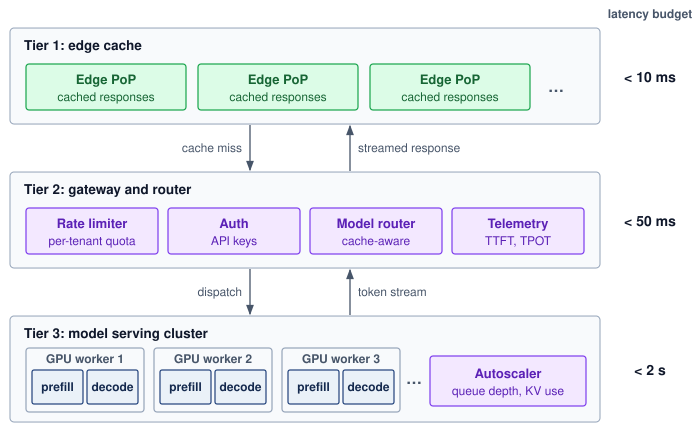

<!--
```{.tikz}
\providecolor{DarkNavy}{HTML}{1E293B}
\providecolor{OceanBlue}{HTML}{2563EB}
\providecolor{ForestGreen}{HTML}{166534}
\providecolor{AmberStage}{HTML}{D97706}
\providecolor{CrimsonSLA}{HTML}{991B1B}
\providecolor{SlateGrey}{HTML}{475569}
\providecolor{SoftGrey}{HTML}{F8FAFC}
\providecolor{SlateTeal}{HTML}{0F766E}
\providecolor{BorderGrey}{HTML}{CBD5E1}
\providecolor{BorderBlue}{HTML}{2563EB}
\providecolor{BorderGreen}{HTML}{166534}
\providecolor{BorderAmber}{HTML}{D97706}
\providecolor{BorderCrimson}{HTML}{991B1B}
\providecolor{Crimson}{HTML}{991B1B}
\providecolor{SoftBlue}{HTML}{F0F6FE}
\providecolor{SoftGreen}{HTML}{ECFAF0}
\providecolor{SoftAmber}{HTML}{FEF8EE}
\providecolor{SoftCrimson}{HTML}{FFF1F2}
\providecolor{BgCard}{HTML}{FFFFFF}
\providecolor{CardBg}{HTML}{FFFFFF}
\providecolor{GrayL}{HTML}{E0E0E0}
\providecolor{GrayLine}{HTML}{666666}
\providecolor{BlueLine}{HTML}{006395}
\providecolor{BlueFill}{HTML}{D6EAF8}
\providecolor{GreenLine}{HTML}{008F45}
\providecolor{GreenFill}{HTML}{D5F5E3}
\providecolor{OrangeLine}{HTML}{E67817}
\providecolor{OrangeFill}{HTML}{FDEBD0}
\providecolor{RedLine}{HTML}{D9534F}
\providecolor{RedFill}{HTML}{F2D7D5}
\providecolor{TextBlack}{HTML}{333333}
\providecolor{VioletLine}{HTML}{7E317B}
\providecolor{VioletFill}{RGB}{243,243,255}
\colorlet{mlsysblue}{OceanBlue}
\colorlet{mlsysgreen}{ForestGreen}
\colorlet{mlsysred}{CrimsonSLA}
\colorlet{mlsysamber}{AmberStage}
\colorlet{mlsysdarkgray}{DarkNavy}
\colorlet{mlsysteal}{SlateTeal}
\scalebox{0.77}{%
\begin{tikzpicture}[
    font=\sffamily,
    >=Stealth,
    tiercard/.style={
        rounded corners=3pt,
        line width=0.7pt,
        fill=BgCard,
        minimum width=16.2cm,
        anchor=north west
    },
    tierpill/.style={
        rounded corners=2.5pt,
        line width=0.6pt,
        font=\footnotesize\bfseries,
        inner xsep=7pt,
        inner ysep=3.5pt,
        anchor=north west
    },
    slabadge/.style={
        rounded corners=2.5pt,
        draw=CrimsonSLA!70,
        fill=SoftCrimson,
        line width=0.6pt,
        font=\scriptsize\bfseries,
        text=CrimsonSLA,
        inner xsep=6pt,
        inner ysep=2.5pt,
        anchor=north east
    },
    minipill/.style={
        rounded corners=2pt,
        line width=0.5pt,
        font=\tiny\bfseries,
        inner xsep=4.5pt,
        inner ysep=2pt
    }
]

    % =========================================================================
    % TIER 1: CDN / EDGE CACHE
    % =========================================================================
    \node[tiercard, draw=BorderBlue!90, minimum height=3.25cm] (t1) at (0, 0) {};

    % Pill
    \node[tierpill, draw=BorderBlue, fill=SoftBlue] (t1_pill) at ([shift={(0.3cm, -0.28cm)}] t1.north west) {
        \color{DarkNavy} Tier 1: CDN / Edge Cache
    };
    % Subtitle
    \node[anchor=west] at ([shift={(0.3cm, 0)}] t1_pill.east) {
        \tiny\color{black!65} Geographic PoP termination, static response cache, prompt templates
    };
    % SLA
    \node[slabadge] at ([shift={(-0.3cm, -0.28cm)}] t1.north east) {
        SLA: $<$ 10 ms
    };

    % Subcards in Tier 1
    % Edge PoP 1
    \node[draw=BorderBlue!75, fill=white, rounded corners=3pt, line width=0.65pt,
          minimum width=2.65cm, minimum height=1.75cm, anchor=north west] (pop1)
          at ([shift={(0.3cm, -1.15cm)}] t1.north west) {};
    \node[minipill, fill=SoftBlue, draw=BorderBlue, text=DarkNavy, anchor=north west] at ([shift={(0.15cm, -0.15cm)}] pop1.north west) {EDGE};
    \node[anchor=west, font=\scriptsize\bfseries\color{DarkNavy}] at ([shift={(1.30cm, -0.26cm)}] pop1.north west) {Edge PoP 1};
    \node[anchor=north west, text width=2.45cm, align=left] at ([shift={(0.15cm, -0.65cm)}] pop1.north west) {
        \tiny\color{black!70}
        Regional TLS termination\\[2pt]
        Response cache hit
    };

    % Edge PoP 2
    \node[draw=BorderBlue!75, fill=white, rounded corners=3pt, line width=0.65pt,
          minimum width=2.65cm, minimum height=1.75cm, anchor=north west] (pop2)
          at ([shift={(3.25cm, -1.15cm)}] t1.north west) {};
    \node[minipill, fill=SoftBlue, draw=BorderBlue, text=DarkNavy, anchor=north west] at ([shift={(0.15cm, -0.15cm)}] pop2.north west) {EDGE};
    \node[anchor=west, font=\scriptsize\bfseries\color{DarkNavy}] at ([shift={(1.30cm, -0.26cm)}] pop2.north west) {Edge PoP 2};
    \node[anchor=north west, text width=2.45cm, align=left] at ([shift={(0.15cm, -0.65cm)}] pop2.north west) {
        \tiny\color{black!70}
        Regional TLS termination\\[2pt]
        Response cache hit
    };

    % Edge PoP 3
    \node[draw=BorderBlue!75, fill=white, rounded corners=3pt, line width=0.65pt,
          minimum width=2.65cm, minimum height=1.75cm, anchor=north west] (pop3)
          at ([shift={(6.20cm, -1.15cm)}] t1.north west) {};
    \node[minipill, fill=SoftBlue, draw=BorderBlue, text=DarkNavy, anchor=north west] at ([shift={(0.15cm, -0.15cm)}] pop3.north west) {EDGE};
    \node[anchor=west, font=\scriptsize\bfseries\color{DarkNavy}] at ([shift={(1.30cm, -0.26cm)}] pop3.north west) {Edge PoP 3};
    \node[anchor=north west, text width=2.45cm, align=left] at ([shift={(0.15cm, -0.65cm)}] pop3.north west) {
        \tiny\color{black!70}
        Regional TLS termination\\[2pt]
        Response cache hit
    };

    % Dots
    \node[font=\bfseries\Large\color{black!40}] at ([shift={(9.35cm, -2.02cm)}] t1.north west) {$\cdots$};

    % Prompt Template Cache
    \node[draw=BorderBlue!75, fill=white, rounded corners=3pt, line width=0.65pt,
          minimum width=5.65cm, minimum height=1.75cm, anchor=north east] (ptc)
          at ([shift={(-0.3cm, -1.15cm)}] t1.north east) {};
    \node[anchor=north west, font=\scriptsize\bfseries\color{DarkNavy}] at ([shift={(0.25cm, -0.18cm)}] ptc.north west) {Prompt Template Cache};
    \node[anchor=north west, text width=5.25cm, align=left] at ([shift={(0.25cm, -0.60cm)}] ptc.north west) {
        \tiny
        \textbf{Matching:} Prefix KV hash matching\\[3pt]
        \textbf{Steering:} Client geo-affinity routing
    };

    % =========================================================================
    % INTER-TIER 1 -> 2 CONNECTORS
    % =========================================================================
    \draw[->, line width=1.1pt, black!65, shorten >=2pt, shorten <=2pt] (5.7cm, -3.25cm) -- (5.7cm, -4.35cm)
          node[midway, left=4pt, font=\scriptsize\bfseries\color{black!75}] {Cache Miss (Request)};

    \draw[<-, line width=1.1pt, ForestGreen, shorten >=2pt, shorten <=2pt] (9.6cm, -3.25cm) -- (9.6cm, -4.35cm)
          node[midway, right=4pt, font=\scriptsize\bfseries\color{ForestGreen!90!black}] {Streamed Response};

    % =========================================================================
    % TIER 2: GATEWAY / ROUTER
    % =========================================================================
    \node[tiercard, draw=BorderAmber!90, minimum height=3.35cm] (t2) at (0, -4.35cm) {};

    % Pill
    \node[tierpill, draw=AmberStage!80, fill=SoftAmber] (t2_pill) at ([shift={(0.3cm, -0.28cm)}] t2.north west) {
        \color{AmberStage!95!black} Tier 2: Gateway / Router
    };
    % Subtitle
    \node[anchor=west] at ([shift={(0.3cm, 0)}] t2_pill.east) {
        \tiny\color{black!65} Request routing, rate limiting, authentication, tenant SLO classification
    };
    % SLA
    \node[slabadge] at ([shift={(-0.3cm, -0.28cm)}] t2.north east) {
        SLA: $<$ 50 ms
    };

    % 4 Subcards in Tier 2
    % Card 1: Rate Limiter
    \node[draw=BorderAmber!75, fill=white, rounded corners=3pt, line width=0.65pt,
          minimum width=3.65cm, minimum height=1.95cm, anchor=north west] (g1)
          at ([shift={(0.3cm, -1.05cm)}] t2.north west) {};
    \node[minipill, fill=SoftAmber, draw=BorderAmber, text=AmberStage!95!black, anchor=north west] at ([shift={(0.15cm, -0.15cm)}] g1.north west) {POLICY};
    \node[anchor=west, font=\scriptsize\bfseries\color{DarkNavy}] at ([shift={(1.55cm, -0.26cm)}] g1.north west) {Rate Limiter};
    \node[anchor=north west, text width=3.35cm, align=left] at ([shift={(0.15cm, -0.58cm)}] g1.north west) {
        \tiny
        \textbf{Bucket:} Token bucket / tenant\\[2.5pt]
        \textbf{Bounds:} Concurrency limits\\[2.5pt]
        \textbf{Action:} Shedding \& 429 throttle
    };

    % Card 2: API Key & Auth
    \node[draw=BorderAmber!75, fill=white, rounded corners=3pt, line width=0.65pt,
          minimum width=3.65cm, minimum height=1.95cm, anchor=north west] (g2)
          at ([shift={(4.25cm, -1.05cm)}] t2.north west) {};
    \node[minipill, fill=SoftAmber, draw=BorderAmber, text=AmberStage!95!black, anchor=north west] at ([shift={(0.15cm, -0.15cm)}] g2.north west) {AUTH};
    \node[anchor=west, font=\scriptsize\bfseries\color{DarkNavy}] at ([shift={(1.45cm, -0.26cm)}] g2.north west) {API Key \& Auth};
    \node[anchor=north west, text width=3.35cm, align=left] at ([shift={(0.15cm, -0.58cm)}] g2.north west) {
        \tiny
        \textbf{Verify:} JWT / HMAC tokens\\[2.5pt]
        \textbf{Quota:} Usage validation\\[2.5pt]
        \textbf{Tiering:} Priority tagging
    };

    % Card 3: Model Router
    \node[draw=BorderAmber!75, fill=white, rounded corners=3pt, line width=0.65pt,
          minimum width=3.65cm, minimum height=1.95cm, anchor=north west] (g3)
          at ([shift={(8.20cm, -1.05cm)}] t2.north west) {};
    \node[minipill, fill=SoftAmber, draw=BorderAmber, text=AmberStage!95!black, anchor=north west] at ([shift={(0.15cm, -0.15cm)}] g3.north west) {ROUTER};
    \node[anchor=west, font=\scriptsize\bfseries\color{DarkNavy}] at ([shift={(1.70cm, -0.26cm)}] g3.north west) {Model Router};
    \node[anchor=north west, text width=3.35cm, align=left] at ([shift={(0.15cm, -0.58cm)}] g3.north west) {
        \tiny
        \textbf{Prefix:} Cache-aware routing\\[2.5pt]
        \textbf{Dispatch:} Model \& LoRA sharding\\[2.5pt]
        \textbf{Balance:} Least-loaded worker
    };

    % Card 4: Telemetry
    \node[draw=BorderAmber!75, fill=white, rounded corners=3pt, line width=0.65pt,
          minimum width=3.65cm, minimum height=1.95cm, anchor=north east] (g4)
          at ([shift={(-0.3cm, -1.05cm)}] t2.north east) {};
    \node[minipill, fill=GrayL!80, draw=BorderGrey, text=DarkNavy, anchor=north west] at ([shift={(0.15cm, -0.15cm)}] g4.north west) {OBS};
    \node[anchor=west, font=\scriptsize\bfseries\color{DarkNavy}] at ([shift={(1.25cm, -0.26cm)}] g4.north west) {Telemetry};
    \node[anchor=north west, text width=3.35cm, align=left] at ([shift={(0.15cm, -0.58cm)}] g4.north west) {
        \tiny
        \textbf{Tracing:} Distributed spans\\[2.5pt]
        \textbf{Latency:} TTFT / TPOT timers\\[2.5pt]
        \textbf{Metrics:} Prometheus export
    };

    % =========================================================================
    % INTER-TIER 2 -> 3 CONNECTORS
    % =========================================================================
    \draw[->, line width=1.1pt, black!65, shorten >=2pt, shorten <=2pt] (5.7cm, -7.70cm) -- (5.7cm, -8.80cm)
          node[midway, left=4pt, font=\scriptsize\bfseries\color{black!75}] {Dispatched Request};

    \draw[<-, line width=1.1pt, ForestGreen, shorten >=2pt, shorten <=2pt] (9.6cm, -7.70cm) -- (9.6cm, -8.80cm)
          node[midway, right=4pt, font=\scriptsize\bfseries\color{ForestGreen!90!black}] {Token Stream (SSE / gRPC)};

    % =========================================================================
    % TIER 3: MODEL SERVING CLUSTER
    % =========================================================================
    \node[tiercard, draw=BorderGreen!90, minimum height=3.85cm] (t3) at (0, -8.80cm) {};

    % Pill
    \node[tierpill, draw=ForestGreen!80, fill=SoftGreen] (t3_pill) at ([shift={(0.3cm, -0.28cm)}] t3.north west) {
        \color{ForestGreen!90!black} Tier 3: Model Serving Cluster
    };
    % Subtitle
    \node[anchor=west] at ([shift={(0.3cm, 0)}] t3_pill.east) {
        \tiny\color{black!65} GPU worker fleet, continuous batching, disaggregated prefill/decode
    };
    % SLA
    \node[slabadge] at ([shift={(-0.3cm, -0.28cm)}] t3.north east) {
        SLA: $<$ 2 s
    };

    % GPU Workers
    % Worker 1
    \node[draw=BorderGrey, fill=white, rounded corners=3pt, line width=0.65pt,
          minimum width=2.75cm, minimum height=2.45cm, anchor=north west] (w1)
          at ([shift={(0.3cm, -1.05cm)}] t3.north west) {};
    \node[anchor=north, font=\scriptsize\bfseries\color{DarkNavy}] at ([shift={(1.375cm, -0.15cm)}] w1.north west) {GPU Worker 1};
    % Prefill
    \node[draw=BorderBlue, fill=SoftBlue, rounded corners=2pt, line width=0.5pt,
          minimum width=2.45cm, minimum height=0.72cm, align=center, anchor=north]
          at ([shift={(1.375cm, -0.65cm)}] w1.north west) {
        \tiny\bfseries\color{OceanBlue!90!black} Prefill Engine\\[1pt]
        \fontsize{5.5}{7.0}\selectfont\color{black!70} Compute-Bound (SXM5)
    };
    % Decode
    \node[draw=BorderGreen, fill=SoftGreen, rounded corners=2pt, line width=0.5pt,
          minimum width=2.45cm, minimum height=0.72cm, align=center, anchor=north]
          at ([shift={(1.375cm, -1.52cm)}] w1.north west) {
        \tiny\bfseries\color{ForestGreen!90!black} Decode Engine\\[1pt]
        \fontsize{5.5}{7.0}\selectfont\color{black!70} Memory-Bound (HBM3)
    };

    % Worker 2
    \node[draw=BorderGrey, fill=white, rounded corners=3pt, line width=0.65pt,
          minimum width=2.75cm, minimum height=2.45cm, anchor=north west] (w2)
          at ([shift={(3.35cm, -1.05cm)}] t3.north west) {};
    \node[anchor=north, font=\scriptsize\bfseries\color{DarkNavy}] at ([shift={(1.375cm, -0.15cm)}] w2.north west) {GPU Worker 2};
    \node[draw=BorderBlue, fill=SoftBlue, rounded corners=2pt, line width=0.5pt,
          minimum width=2.45cm, minimum height=0.72cm, align=center, anchor=north]
          at ([shift={(1.375cm, -0.65cm)}] w2.north west) {
        \tiny\bfseries\color{OceanBlue!90!black} Prefill Engine\\[1pt]
        \fontsize{5.5}{7.0}\selectfont\color{black!70} Compute-Bound (SXM5)
    };
    \node[draw=BorderGreen, fill=SoftGreen, rounded corners=2pt, line width=0.5pt,
          minimum width=2.45cm, minimum height=0.72cm, align=center, anchor=north]
          at ([shift={(1.375cm, -1.52cm)}] w2.north west) {
        \tiny\bfseries\color{ForestGreen!90!black} Decode Engine\\[1pt]
        \fontsize{5.5}{7.0}\selectfont\color{black!70} Memory-Bound (HBM3)
    };

    % Worker 3
    \node[draw=BorderGrey, fill=white, rounded corners=3pt, line width=0.65pt,
          minimum width=2.75cm, minimum height=2.45cm, anchor=north west] (w3)
          at ([shift={(6.40cm, -1.05cm)}] t3.north west) {};
    \node[anchor=north, font=\scriptsize\bfseries\color{DarkNavy}] at ([shift={(1.375cm, -0.15cm)}] w3.north west) {GPU Worker 3};
    \node[draw=BorderBlue, fill=SoftBlue, rounded corners=2pt, line width=0.5pt,
          minimum width=2.45cm, minimum height=0.72cm, align=center, anchor=north]
          at ([shift={(1.375cm, -0.65cm)}] w3.north west) {
        \tiny\bfseries\color{OceanBlue!90!black} Prefill Engine\\[1pt]
        \fontsize{5.5}{7.0}\selectfont\color{black!70} Compute-Bound (SXM5)
    };
    \node[draw=BorderGreen, fill=SoftGreen, rounded corners=2pt, line width=0.5pt,
          minimum width=2.45cm, minimum height=0.72cm, align=center, anchor=north]
          at ([shift={(1.375cm, -1.52cm)}] w3.north west) {
        \tiny\bfseries\color{ForestGreen!90!black} Decode Engine\\[1pt]
        \fontsize{5.5}{7.0}\selectfont\color{black!70} Memory-Bound (HBM3)
    };

    % Dots
    \node[font=\bfseries\Large\color{black!40}] at ([shift={(9.65cm, -2.25cm)}] t3.north west) {$\cdots$};

    % Fleet Elasticity Card (Dashed Green)
    \node[draw=ForestGreen!85, dashed, fill=white, rounded corners=3pt, line width=0.75pt,
          minimum width=5.65cm, minimum height=2.45cm, anchor=north east] (elas)
          at ([shift={(-0.3cm, -1.05cm)}] t3.north east) {};
    \node[minipill, fill=SoftGreen, draw=BorderGreen, text=ForestGreen!90!black, anchor=north west] at ([shift={(0.2cm, -0.15cm)}] elas.north west) {AUTOSCALER};
    \node[anchor=west, font=\scriptsize\bfseries\color{DarkNavy}] at ([shift={(2.40cm, -0.26cm)}] elas.north west) {Fleet Elasticity};
    \node[anchor=north west, text width=5.25cm, align=left] at ([shift={(0.2cm, -0.55cm)}] elas.north west) {
        \tiny
        \textbf{Telemetry:} Queue depth \& token rates\\[2pt]
        \textbf{Headroom:} Target utilization $\rho \le 0.70$\\[2pt]
        \textbf{Pools:} Dynamic spot / on-demand nodes\\[2pt]
        \textbf{Warm Pool:} Prevents $\sim$60\,s cold-start delays\\[2pt]
        \textbf{\color{ForestGreen!90!black}Metric: Active Requests / KV Block Occupancy}
    };

\end{tikzpicture}
}
```
-->

:::

### Drivers for multi-region deployment {#sec-inference-scale-multiregion-matters-d7d3}

Single-region deployment couples every user to the same geographic site and regional failure domain. Network round-trip time (RTT) adds a latency floor for distant users. @Tbl-rtt-by-user-location gives illustrative regional timings; actual paths, access networks, and congestion require measurement:

| **User Location** | **RTT to US-East** | **RTT to Local Region** |
|:------------------|:------------------:|:-----------------------:|
| **New York**      |       10 ms        |          10 ms          |
| **London**        |       75 ms        |          10 ms          |
| **Tokyo**         |       150 ms       |          10 ms          |
| **Sydney**        |       200 ms       |          10 ms          |

: **Network RTT by user location**: A single US-East deployment imposes a 75 to 200 ms RTT on European, Asian, and Australian users, an order of magnitude above the local-region floor. For interactive workloads where each request makes several model calls, this latency floor compounds quickly, motivating multi-region deployment for any globally distributed user base. {#tbl-rtt-by-user-location tbl-colwidths="[34,33,33]"}

Network delays compound when a request makes sequential calls across the distant boundary; multiple model calls inside one backend region do not each pay another client-to-region RTT. Regional replication can shorten that path and separate failure domains. Data-placement policies also constrain eligible destinations. The General Data Protection Regulation permits international transfers under specified conditions rather than requiring blanket EU-only processing; applicable law and contractual commitments must be translated into explicit placement rules. Regional replicas, edge caches, and cross-region sharding then trade capacity, communication, and coordination within those rules.

### Global load balancing with regional replicas {#sec-inference-scale-pattern-1-global-load-balancing-regional-replicas-b7ac}

In @fig-global-inference-multiregion, a global load balancer\index{Global load balancing!regional replicas} selects among regions that satisfy placement policy, readiness, and capacity requirements. Measured network latency helps choose among those eligible destinations; geographic proximity alone does not determine completion time. A shared registry supplies versioned artifacts to the independent regional replicas.

::: {#fig-global-inference-multiregion fig-env="figure" fig-pos="htb" fig-cap="**Global load balancing across inference regions**: A global load balancer routes each user to an eligible region with suitable latency and ready capacity (@tbl-rtt-by-user-location gives the round-trip times this avoids). Each region (US-East, EU-West, Asia-Pacific) runs independent replicas of the same model, and EU requests can stay in the EU to meet data-residency rules. A shared model registry supplies versioned weights to every region. If a region fails, the load balancer reroutes its users only to destinations that still satisfy placement, readiness, and capacity requirements." fig-alt="Three user populations across the top, users in North America, users in the EU, and users in Asia and Oceania, each drawn as a row of dots, send arrows down into a wide violet Global load balancer bar that routes each user to an eligible, ready region. Arrows continue straight down to three region frames, US-East, EU-West, and Asia-Pacific, each with a one-line role and two replicas, each drawn as a server of four GPU tiles. A pale indigo column labeled EU data-residency zone runs behind the EU users, their heavier blue path through the shared load balancer, and the EU-West region, whose role reads EU data stays in region. Below, a wide Model registry box, versioned weights for every region, sends dashed green sync arrows up to each region."}
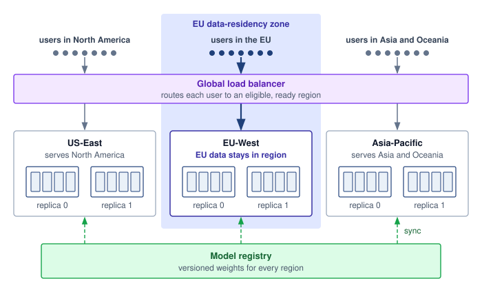

<!--
```{.tikz}
\providecolor{DarkNavy}{HTML}{1E293B}
\providecolor{OceanBlue}{HTML}{2563EB}
\providecolor{ForestGreen}{HTML}{166534}
\providecolor{AmberStage}{HTML}{D97706}
\providecolor{CrimsonSLA}{HTML}{991B1B}
\providecolor{SlateGrey}{HTML}{475569}
\providecolor{SoftGrey}{HTML}{F8FAFC}
\providecolor{SlateTeal}{HTML}{0F766E}
\providecolor{BorderGrey}{HTML}{CBD5E1}
\providecolor{BorderBlue}{HTML}{2563EB}
\providecolor{BorderGreen}{HTML}{166534}
\providecolor{BorderAmber}{HTML}{D97706}
\providecolor{BorderCrimson}{HTML}{991B1B}
\providecolor{Crimson}{HTML}{991B1B}
\providecolor{SoftBlue}{HTML}{F0F6FE}
\providecolor{SoftGreen}{HTML}{ECFAF0}
\providecolor{SoftAmber}{HTML}{FEF8EE}
\providecolor{SoftCrimson}{HTML}{FFF1F2}
\providecolor{BgCard}{HTML}{FFFFFF}
\providecolor{CardBg}{HTML}{FFFFFF}
\providecolor{GrayL}{HTML}{E0E0E0}
\providecolor{GrayLine}{HTML}{666666}
\providecolor{BlueLine}{HTML}{006395}
\providecolor{BlueFill}{HTML}{D6EAF8}
\providecolor{GreenLine}{HTML}{008F45}
\providecolor{GreenFill}{HTML}{D5F5E3}
\providecolor{OrangeLine}{HTML}{E67817}
\providecolor{OrangeFill}{HTML}{FDEBD0}
\providecolor{RedLine}{HTML}{D9534F}
\providecolor{RedFill}{HTML}{F2D7D5}
\providecolor{TextBlack}{HTML}{333333}
\providecolor{VioletLine}{HTML}{7E317B}
\providecolor{VioletFill}{RGB}{243,243,255}
\colorlet{mlsysblue}{OceanBlue}
\colorlet{mlsysgreen}{ForestGreen}
\colorlet{mlsysred}{CrimsonSLA}
\colorlet{mlsysamber}{AmberStage}
\colorlet{mlsysdarkgray}{DarkNavy}
\colorlet{mlsysteal}{SlateTeal}
\scalebox{0.60}{%
\begin{tikzpicture}[
    x=1cm, y=1cm,
    font=\sffamily,
    >=Stealth
]
\tikzset{
    box/.style={
        draw=BorderGrey,
        fill=white,
        line width=0.7pt,
        rounded corners=3pt,
        align=center
    },
    repnode/.style={
        draw=BorderBlue,
        fill=white,
        line width=0.75pt,
        rounded corners=2.5pt,
        minimum width=2.8cm,
        minimum height=1.9cm,
        align=center,
        inner sep=4pt
    }
}

    % -------------------------------------------------------------------------
    % Top: Global Traffic Controller
    % -------------------------------------------------------------------------
    \node[box, draw=BorderAmber, fill=SoftAmber, line width=0.85pt, rounded corners=4pt, minimum width=14.0cm, minimum height=2.0cm] (gtc) at (0, 7.8) {};

    \node[draw=BorderAmber, fill=white, rounded corners=2pt, font=\fontsize{6.5}{7.5}\selectfont\bfseries\color{AmberStage}, anchor=north west, inner xsep=8pt, inner ysep=3pt]
        at ([shift={(12pt,-8pt)}] gtc.north west) {GLOBAL TRAFFIC CONTROLLER};

    \node[anchor=north east, font=\fontsize{7}{8.5}\selectfont\bfseries\color{DarkNavy}]
        at ([shift={(-12pt,-9pt)}] gtc.north east) {Anycast DNS $\cdot$ Latency SLO Optimizer};

    \node[box, draw=BorderAmber, fill=white, rounded corners=2.5pt, minimum width=3.6cm, inner ysep=5.5pt] (b_rtt) at (-4.4, 7.35) {
        \fontsize{7}{8.5}\selectfont\textbf{\textcolor{DarkNavy}{RTT Probing ($< 20\text{ ms}$)}}\\[1pt]
        \fontsize{6}{7}\selectfont\textcolor{SlateGrey}{Continuous Active Health}
    };
    \node[box, draw=BorderAmber, fill=white, rounded corners=2.5pt, minimum width=3.6cm, inner ysep=5.5pt] (b_fail) at (0, 7.35) {
        \fontsize{7}{8.5}\selectfont\textbf{\textcolor{DarkNavy}{Failover Cascades}}\\[1pt]
        \fontsize{6}{7}\selectfont\textcolor{SlateGrey}{Capacity-Aware Shedding}
    };
    \node[box, draw=BorderAmber, fill=white, rounded corners=2.5pt, minimum width=3.6cm, inner ysep=5.5pt] (b_geo) at (4.4, 7.35) {
        \fontsize{7}{8.5}\selectfont\textbf{\textcolor{DarkNavy}{Geo-Fencing Policies}}\\[1pt]
        \fontsize{6}{7}\selectfont\textcolor{SlateGrey}{Data Residency Rules}
    };

    % -------------------------------------------------------------------------
    % Orthogonal Distribution Bus from GTC to Regions
    % -------------------------------------------------------------------------
    \coordinate (gtc_bus_y) at (0, 6.35);
    \draw[line width=0.85pt, color=AmberStage] (gtc.south) -- (gtc_bus_y);
    \draw[line width=0.85pt, color=AmberStage] (-6.8, 6.35) -- (6.8, 6.35);

    % RTT Pills on orthogonal drops
    \node[box, draw=BorderAmber, fill=white, line width=0.75pt, rounded corners=2pt, font=\fontsize{7}{8.5}\selectfont\bfseries\color{AmberStage}, inner xsep=8pt, inner ysep=3pt]
        (rtt_us) at (-6.8, 5.65) {$\sim$12 ms RTT};
    \node[box, draw=BorderAmber, fill=white, line width=0.75pt, rounded corners=2pt, font=\fontsize{7}{8.5}\selectfont\bfseries\color{AmberStage}, inner xsep=8pt, inner ysep=3pt]
        (rtt_eu) at (0, 5.65) {$\sim$15 ms RTT};
    \node[box, draw=BorderAmber, fill=white, line width=0.75pt, rounded corners=2pt, font=\fontsize{7}{8.5}\selectfont\bfseries\color{AmberStage}, inner xsep=8pt, inner ysep=3pt]
        (rtt_ap) at (6.8, 5.65) {$\sim$18 ms RTT};

    \draw[line width=0.85pt, color=AmberStage] (-6.8, 6.35) -- (rtt_us.north);
    \draw[line width=0.85pt, color=AmberStage] (0, 6.35) -- (rtt_eu.north);
    \draw[line width=0.85pt, color=AmberStage] (6.8, 6.35) -- (rtt_ap.north);

    % -------------------------------------------------------------------------
    % Region 1: US-EAST (VA)
    % -------------------------------------------------------------------------
    \node[box, draw=BorderGrey, fill=SoftGrey!40, line width=0.75pt, rounded corners=4pt, minimum width=6.6cm, minimum height=5.4cm] (reg_us) at (-6.8, 2.1) {};

    \node[fill=DarkNavy, text=white, rounded corners=2pt, font=\fontsize{6.5}{7.5}\selectfont\bfseries, anchor=north west, inner xsep=7pt, inner ysep=3pt]
        at ([shift={(8pt,-8pt)}] reg_us.north west) (pill_us) {US-EAST (VA)};
    \node[anchor=west, font=\fontsize{7}{8}\selectfont\color{SlateGrey}] at ([xshift=6pt] pill_us.east) {45\% Fleet Load};

    \node[repnode] (us_rep0) at (-8.3, 3.1) {
        \textbf{\fontsize{7.5}{9}\selectfont\textcolor{DarkNavy}{Replica 0}}\\[2pt]
        \fontsize{6.5}{7.5}\selectfont\textcolor{SlateGrey}{vLLM $\cdot$ 4x H100}\\[6pt]
        \colorbox{SoftGreen}{\fontsize{6.5}{7.5}\selectfont\bfseries\textcolor{ForestGreen}{Active}}
    };
    \node[repnode] (us_rep1) at (-5.3, 3.1) {
        \textbf{\fontsize{7.5}{9}\selectfont\textcolor{DarkNavy}{Replica 1}}\\[2pt]
        \fontsize{6.5}{7.5}\selectfont\textcolor{SlateGrey}{vLLM $\cdot$ 4x H100}\\[6pt]
        \colorbox{SoftGreen}{\fontsize{6.5}{7.5}\selectfont\bfseries\textcolor{ForestGreen}{Active}}
    };

    \node[box, draw=BorderGrey, fill=white, line width=0.7pt, rounded corners=2.5pt, text width=5.8cm, align=left, inner sep=6pt] (us_profile) at (-6.8, 1.6) {
        \fontsize{7}{8.5}\selectfont\textbf{\textcolor{DarkNavy}{Latency Profile (US Clients)}}\\[2pt]
        \fontsize{6.5}{7.5}\selectfont\textbf{\textcolor{OceanBlue}{RTT Profile:}} \textcolor{SlateGrey}{New York / DC: 10--14 ms}\\[1pt]
        \fontsize{6.5}{7.5}\selectfont\textbf{\textcolor{OceanBlue}{Backbone:}} \textcolor{SlateGrey}{Direct peering over AWS/GCP}
    };

    \node[box, draw=BorderGreen, fill=SoftGreen, line width=0.75pt, rounded corners=2.5pt, text width=5.8cm, align=center, inner sep=6pt] (us_anchor) at (-6.8, 0.3) {
        \fontsize{7}{8.5}\selectfont\textbf{\textcolor{ForestGreen}{Primary Regional Anchor}}\\[2pt]
        \fontsize{6.5}{7.5}\selectfont\textcolor{DarkNavy}{Absorbs Europe overflow during peak hours}
    };

    % -------------------------------------------------------------------------
    % Region 2: EU-WEST (DE)
    % -------------------------------------------------------------------------
    \node[box, draw=BorderGrey, fill=SoftGrey!40, line width=0.75pt, rounded corners=4pt, minimum width=6.6cm, minimum height=5.4cm] (reg_eu) at (0, 2.1) {};

    \node[fill=DarkNavy, text=white, rounded corners=2pt, font=\fontsize{6.5}{7.5}\selectfont\bfseries, anchor=north west, inner xsep=7pt, inner ysep=3pt]
        at ([shift={(8pt,-8pt)}] reg_eu.north west) (pill_eu) {EU-WEST (DE)};
    \node[anchor=west, font=\fontsize{7}{8}\selectfont\color{SlateGrey}] at ([xshift=6pt] pill_eu.east) {35\% Fleet Load};

    \node[repnode] (eu_rep0) at (-1.5, 3.1) {
        \textbf{\fontsize{7.5}{9}\selectfont\textcolor{DarkNavy}{Replica 0}}\\[2pt]
        \fontsize{6.5}{7.5}\selectfont\textcolor{SlateGrey}{vLLM $\cdot$ 4x H100}\\[6pt]
        \colorbox{SoftGreen}{\fontsize{6.5}{7.5}\selectfont\bfseries\textcolor{ForestGreen}{Active}}
    };
    \node[repnode] (eu_rep1) at (1.5, 3.1) {
        \textbf{\fontsize{7.5}{9}\selectfont\textcolor{DarkNavy}{Replica 1}}\\[2pt]
        \fontsize{6.5}{7.5}\selectfont\textcolor{SlateGrey}{vLLM $\cdot$ 4x H100}\\[6pt]
        \colorbox{SoftGreen}{\fontsize{6.5}{7.5}\selectfont\bfseries\textcolor{ForestGreen}{Active}}
    };

    \node[box, draw=BorderGrey, fill=white, line width=0.7pt, rounded corners=2.5pt, text width=5.8cm, align=left, inner sep=6pt] (eu_profile) at (0, 1.6) {
        \fontsize{7}{8.5}\selectfont\textbf{\textcolor{DarkNavy}{Latency Profile (EU Clients)}}\\[2pt]
        \fontsize{6.5}{7.5}\selectfont\textbf{\textcolor{OceanBlue}{RTT Profile:}} \textcolor{SlateGrey}{London / Frankfurt: 8--15 ms}\\[1pt]
        \fontsize{6.5}{7.5}\selectfont\textbf{\textcolor{OceanBlue}{Residency:}} \textcolor{SlateGrey}{Local GPU keeps tokens in EU}
    };

    \node[box, draw=BorderBlue, fill=SoftBlue, line width=0.75pt, rounded corners=2.5pt, text width=5.8cm, align=center, inner sep=6pt] (eu_anchor) at (0, 0.3) {
        \fontsize{7}{8.5}\selectfont\textbf{\textcolor{OceanBlue}{GDPR Compliance Boundary}}\\[2pt]
        \fontsize{6.5}{7.5}\selectfont\textcolor{DarkNavy}{Zero cross-border token replication}
    };

    % -------------------------------------------------------------------------
    % Region 3: AP-EAST (TYO)
    % -------------------------------------------------------------------------
    \node[box, draw=BorderGrey, fill=SoftGrey!40, line width=0.75pt, rounded corners=4pt, minimum width=6.6cm, minimum height=5.4cm] (reg_ap) at (6.8, 2.1) {};

    \node[fill=DarkNavy, text=white, rounded corners=2pt, font=\fontsize{6.5}{7.5}\selectfont\bfseries, anchor=north west, inner xsep=7pt, inner ysep=3pt]
        at ([shift={(8pt,-8pt)}] reg_ap.north west) (pill_ap) {AP-EAST (TYO)};
    \node[anchor=west, font=\fontsize{7}{8}\selectfont\color{SlateGrey}] at ([xshift=6pt] pill_ap.east) {20\% Fleet Load};

    \node[repnode] (ap_rep0) at (5.3, 3.1) {
        \textbf{\fontsize{7.5}{9}\selectfont\textcolor{DarkNavy}{Replica 0}}\\[2pt]
        \fontsize{6.5}{7.5}\selectfont\textcolor{SlateGrey}{vLLM $\cdot$ 4x H100}\\[6pt]
        \colorbox{SoftGreen}{\fontsize{6.5}{7.5}\selectfont\bfseries\textcolor{ForestGreen}{Active}}
    };
    \node[repnode] (ap_rep1) at (8.3, 3.1) {
        \textbf{\fontsize{7.5}{9}\selectfont\textcolor{DarkNavy}{Replica 1}}\\[2pt]
        \fontsize{6.5}{7.5}\selectfont\textcolor{SlateGrey}{vLLM $\cdot$ 4x H100}\\[6pt]
        \colorbox{SoftGreen}{\fontsize{6.5}{7.5}\selectfont\bfseries\textcolor{ForestGreen}{Active}}
    };

    \node[box, draw=BorderGrey, fill=white, line width=0.7pt, rounded corners=2.5pt, text width=5.8cm, align=left, inner sep=6pt] (ap_profile) at (6.8, 1.6) {
        \fontsize{7}{8.5}\selectfont\textbf{\textcolor{DarkNavy}{Latency Profile (APAC Clients)}}\\[2pt]
        \fontsize{6.5}{7.5}\selectfont\textbf{\textcolor{OceanBlue}{RTT Profile:}} \textcolor{SlateGrey}{Tokyo / Singapore: 12--18 ms}\\[1pt]
        \fontsize{6.5}{7.5}\selectfont\textbf{\textcolor{OceanBlue}{Avoidance:}} \textcolor{SlateGrey}{Bypasses 160 ms trans-Pacific RTT}
    };

    \node[box, draw=BorderAmber, fill=SoftAmber, line width=0.75pt, rounded corners=2.5pt, text width=5.8cm, align=center, inner sep=6pt] (ap_anchor) at (6.8, 0.3) {
        \fontsize{7}{8.5}\selectfont\textbf{\textcolor{AmberStage}{Disaster Recovery Target}}\\[2pt]
        \fontsize{6.5}{7.5}\selectfont\textcolor{DarkNavy}{Reroutes to US-East on undersea cable faults}
    };

    % Arrows from RTT pills to Region containers
    \draw[->, line width=0.85pt, color=AmberStage, shorten >=2pt] (rtt_us.south) -- (reg_us.north);
    \draw[->, line width=0.85pt, color=AmberStage, shorten >=2pt] (rtt_eu.south) -- (reg_eu.north);
    \draw[->, line width=0.85pt, color=AmberStage, shorten >=2pt] (rtt_ap.south) -- (reg_ap.north);

    % -------------------------------------------------------------------------
    % Global Model Registry
    % -------------------------------------------------------------------------
    \node[box, draw=BorderGreen, fill=SoftGreen!40, line width=0.75pt, rounded corners=3.5pt, text width=20.2cm, align=left, anchor=north, inner sep=9pt] (gmr) at (0, -1.0) {
        \colorbox{SoftGreen}{\fontsize{6.5}{7.5}\selectfont\bfseries\textcolor{ForestGreen}{GLOBAL MODEL REGISTRY}}\hspace{8pt}
        \fontsize{7.5}{9}\selectfont\textbf{\textcolor{DarkNavy}{S3 / GCS Multi-Region Replication $\cdot$ Version-Pinned Checkpoints}}\\[4pt]
        \fontsize{7}{8.5}\selectfont\textbf{\textcolor{ForestGreen}{Sync Mechanism:}} \textcolor{DarkNavy}{Replicates model weights, LoRA adapters, and tokenizers via geo-replication with sha256 pinning.}
    };

    \draw[dashed, line width=0.85pt, color=ForestGreen] (reg_us.south) -- (reg_us.south |- gmr.north);
    \draw[dashed, line width=0.85pt, color=ForestGreen] (reg_eu.south) -- (reg_eu.south |- gmr.north);
    \draw[dashed, line width=0.85pt, color=ForestGreen] (reg_ap.south) -- (reg_ap.south |- gmr.north);

    % -------------------------------------------------------------------------
    % Bottom Callout Card: Geo-Routing & Disaster Recovery
    % -------------------------------------------------------------------------
    \node[box, draw=BorderGrey, fill=white, line width=0.75pt, rounded corners=4pt, text width=20.2cm, align=left, anchor=north, inner sep=11pt] (geocallout) at (0, -2.5) {
        \colorbox{SoftBlue}{\fontsize{6.5}{7.5}\selectfont\bfseries\textcolor{OceanBlue}{GEO-ROUTING \& DISASTER RECOVERY}}\\[7pt]
        \fontsize{7.5}{9}\selectfont\textbf{\textcolor{OceanBlue}{Latency Anycast:}} \textcolor{DarkNavy}{Directs user requests to topologically nearest datacenter, reducing client TTFT ($< 20\text{ ms}$ vs.\ $150+\text{ ms}$ transoceanic).}\\[3pt]
        \fontsize{7.5}{9}\selectfont\textbf{\textcolor{CrimsonSLA}{Automated Failover:}} \textcolor{DarkNavy}{Monitors GPU queue depths; if a region degrades, traffic dynamically sheds to adjacent healthy regions within 3s.}\\[3pt]
        \fontsize{7.5}{9}\selectfont\textbf{\textcolor{ForestGreen}{Data Sovereignty:}} \textcolor{DarkNavy}{Requests flagged with residency constraints (e.g.\ GDPR) remain strictly locked to compliant regional boundaries.}
    };

\end{tikzpicture}
}
```
-->

:::

The illustrative RTT comparison shows why nearby replicas can reduce network delay, but actual savings depend on the measured user-to-region paths. Replication also creates a version-management obligation. Push-based synchronization sends artifacts to each region, while pull-based synchronization lets regions fetch them after notification or polling. Neither mechanism alone guarantees consistent serving versions. Artifact verification, readiness gates, and coordinated activation determine when a region may serve the new version; hybrid synchronization combines push notification with pull verification.

During a rollout, regions may serve different versions. The application must decide whether that is acceptable and whether a request or session needs version pinning. A region-by-region canary deployment\index{Canary deployment!global rollout} limits initial exposure to a small traffic share, such as 1 percent. Its observation window follows the required sample count, traffic diversity, and release criteria, not a fixed number of hours. At a 1 percent share, a region must route enough requests through the canary to detect the regressions its gates test for. Each expansion needs its own error-rate, latency, and quality gate, with compatible prior artifacts retained for rollback.

::: {.column-margin .margin-pointer}
↪ The canary stage-duration calculation, which sizes the observation window from the required sample count and the canary's traffic share, is developed in @sec-ml-operations-scale-canary-deployment-3d8b (@eq-canary-duration).
:::

### Edge caching with central inference {#sec-inference-scale-pattern-2-edge-caching-central-inference-f08e}

Caching responses at the edge\index{Edge caching!central inference} can avoid repeated central inference when a stored response remains valid for the incoming request. Before returning a hit, the edge must enforce authorization and match the relevant model version, conversation or retrieval context, generation policy, and freshness requirements. Identical visible queries do not necessarily permit the same answer, and fresh-sample semantics may prohibit reuse. @Fig-edge-cache-routing shows the hit and miss paths with an illustrative 10 ms hit budget. A miss reaches the central cluster; only responses eligible for reuse should enter the edge store.

::: {#fig-edge-cache-routing fig-env="figure" fig-pos="htb" fig-cap="**Cache hit and cache miss paths at the edge**: A query first reaches the nearest edge point of presence (PoP). After enforcing authorization and reuse eligibility, the edge targets a cache-hit response in under 10 ms without touching a GPU. On a miss, the request passes through the regional gateway to the central GPU cluster, which runs prefill and decode. Generated tokens stream back to the user, and a response eligible for reuse can be stored at the edge for later queries. The saving depends on the rate of requests eligible for reuse; open-ended generation may offer few such requests." fig-alt="Four boxes in a row joined by arrows: User, Edge PoP with authorize then cache, Regional gateway for auth and rate limiting, and GPU cluster for prefill and decode. The arrows are labeled query, miss, and forward. A green path above the row returns from the Edge PoP to the User, labeled cache hit, returned from edge in under 10 ms. A navy path below the row returns from the GPU cluster to the User, labeled cache miss, generated tokens stream back. A dashed green branch from that path goes up into the Edge PoP, labeled store response."}
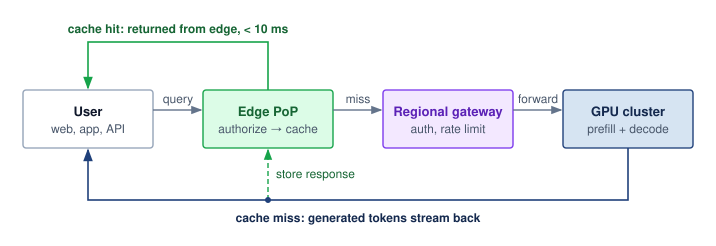

<!--
```{.tikz}
\providecolor{DarkNavy}{HTML}{1E293B}
\providecolor{OceanBlue}{HTML}{2563EB}
\providecolor{ForestGreen}{HTML}{166534}
\providecolor{AmberStage}{HTML}{D97706}
\providecolor{CrimsonSLA}{HTML}{991B1B}
\providecolor{SlateGrey}{HTML}{475569}
\providecolor{SoftGrey}{HTML}{F8FAFC}
\providecolor{SlateTeal}{HTML}{0F766E}
\providecolor{BorderGrey}{HTML}{CBD5E1}
\providecolor{BorderBlue}{HTML}{2563EB}
\providecolor{BorderGreen}{HTML}{166534}
\providecolor{BorderAmber}{HTML}{D97706}
\providecolor{BorderCrimson}{HTML}{991B1B}
\providecolor{Crimson}{HTML}{991B1B}
\providecolor{SoftBlue}{HTML}{F0F6FE}
\providecolor{SoftGreen}{HTML}{ECFAF0}
\providecolor{SoftAmber}{HTML}{FEF8EE}
\providecolor{SoftCrimson}{HTML}{FFF1F2}
\providecolor{BgCard}{HTML}{FFFFFF}
\providecolor{CardBg}{HTML}{FFFFFF}
\providecolor{GrayL}{HTML}{E0E0E0}
\providecolor{GrayLine}{HTML}{666666}
\providecolor{BlueLine}{HTML}{006395}
\providecolor{BlueFill}{HTML}{D6EAF8}
\providecolor{GreenLine}{HTML}{008F45}
\providecolor{GreenFill}{HTML}{D5F5E3}
\providecolor{OrangeLine}{HTML}{E67817}
\providecolor{OrangeFill}{HTML}{FDEBD0}
\providecolor{RedLine}{HTML}{D9534F}
\providecolor{RedFill}{HTML}{F2D7D5}
\providecolor{TextBlack}{HTML}{333333}
\providecolor{VioletLine}{HTML}{7E317B}
\providecolor{VioletFill}{RGB}{243,243,255}
\colorlet{mlsysblue}{OceanBlue}
\colorlet{mlsysgreen}{ForestGreen}
\colorlet{mlsysred}{CrimsonSLA}
\colorlet{mlsysamber}{AmberStage}
\colorlet{mlsysdarkgray}{DarkNavy}
\colorlet{mlsysteal}{SlateTeal}
\scalebox{0.54}{%
\begin{tikzpicture}[
    x=1cm, y=1cm,
    font=\sffamily,
    >=Stealth
]
\tikzset{
    box/.style={
        draw=BorderGrey,
        fill=white,
        line width=0.7pt,
        rounded corners=3.5pt,
        align=center
    },
    card/.style={
        draw=BorderGrey,
        fill=white,
        line width=0.75pt,
        rounded corners=4pt,
        align=left,
        inner sep=10pt
    }
}

    % -------------------------------------------------------------------------
    % Left Column: Architecture Stack
    % -------------------------------------------------------------------------
    % 1. User Client
    \node[box, draw=BorderBlue, fill=SoftBlue!40, line width=0.75pt, minimum width=4.6cm, minimum height=1.7cm] (client) at (0, 7.2) {
        \colorbox{SoftBlue}{\fontsize{6.5}{7.5}\selectfont\bfseries\textcolor{OceanBlue}{USER CLIENT}}\\[4pt]
        \fontsize{7.5}{9}\selectfont\textcolor{SlateGrey}{Web $\cdot$ Mobile $\cdot$ Inference API App}
    };

    % 2. Edge PoP Cache
    \node[box, draw=BorderBlue, fill=white, line width=0.85pt, minimum width=4.6cm, minimum height=2.3cm] (edge) at (0, 4.3) {
        \colorbox{SoftBlue}{\fontsize{6.5}{7.5}\selectfont\bfseries\textcolor{DarkNavy}{EDGE POP CACHE}}\\[5pt]
        \fontsize{8}{9.5}\selectfont\textbf{\textcolor{DarkNavy}{CDN Edge Gateway}}\\[2pt]
        \fontsize{7}{8.5}\selectfont\textcolor{SlateGrey}{Prefix / Prompt KV Cache}\\[3pt]
        \fontsize{7}{8.5}\selectfont\textbf{\textcolor{OceanBlue}{Local DRAM / NVMe Tier}}
    };

    % 3. Regional Gateway
    \node[box, draw=BorderAmber, fill=SoftAmber, line width=0.75pt, minimum width=4.6cm, minimum height=1.9cm] (gw) at (0, 1.4) {
        \colorbox{SoftAmber}{\fontsize{6.5}{7.5}\selectfont\bfseries\textcolor{AmberStage}{REGIONAL GATEWAY}}\\[5pt]
        \fontsize{7.5}{9}\selectfont\textbf{\textcolor{DarkNavy}{Auth $\cdot$ Token Rate Limiter}}\\[2pt]
        \fontsize{7}{8.5}\selectfont\textcolor{SlateGrey}{Global Cluster Load Balancer}
    };

    % 4. Central GPU Cluster
    \node[box, draw=BorderGreen, fill=SoftGreen, line width=0.85pt, minimum width=4.6cm, minimum height=2.0cm] (cluster) at (0, -1.5) {
        \colorbox{SoftGreen}{\fontsize{6.5}{7.5}\selectfont\bfseries\textcolor{ForestGreen}{CENTRAL GPU CLUSTER}}\\[5pt]
        \fontsize{8}{9.5}\selectfont\textbf{\textcolor{DarkNavy}{vLLM / TensorRT-LLM}}\\[2pt]
        \fontsize{7}{8.5}\selectfont\textcolor{SlateGrey}{Full Prefill + Autoregressive Decode}\\[3pt]
        \fontsize{7}{8.5}\selectfont\textbf{\textcolor{ForestGreen}{Generates Fresh Output Tokens}}
    };

    % Arrows on left stack
    \draw[->, line width=0.85pt, color=DarkNavy, shorten >=2pt] ([xshift=-1.0cm] client.south) -- node[left=2pt, font=\fontsize{6.5}{7.5}\selectfont\color{SlateGrey}] {Query} ([xshift=-1.0cm] edge.north);
    \draw[->, line width=0.85pt, dashed, color=ForestGreen, shorten >=2pt] ([xshift=1.0cm] edge.north) -- node[right=2pt, font=\fontsize{6.5}{7.5}\selectfont\bfseries\color{ForestGreen}] {Hit $< 10\text{ ms}$} ([xshift=1.0cm] client.south);

    \draw[->, line width=0.85pt, dashed, color=CrimsonSLA, shorten >=2pt] (edge.south) -- node[right=2pt, font=\fontsize{6.5}{7.5}\selectfont\bfseries\color{CrimsonSLA}] {Miss} (gw.north);
    \draw[->, line width=0.85pt, dashed, color=CrimsonSLA, shorten >=2pt] (gw.south) -- node[right=2pt, font=\fontsize{6.5}{7.5}\selectfont\bfseries\color{CrimsonSLA}] {Forward} (cluster.north);

    % -------------------------------------------------------------------------
    % Middle Column: Path A & Path B
    % -------------------------------------------------------------------------
    % Path A: Cache Hit
    \node[card, draw=BorderGreen, fill=SoftGreen!40, text width=8.2cm, anchor=north west] (path_a) at (3.5, 8.1) {
        \colorbox{SoftGreen}{\fontsize{6.5}{7.5}\selectfont\bfseries\textcolor{ForestGreen}{PATH A: CACHE HIT}}\hspace{8pt}
        \fontsize{7.5}{9}\selectfont\textbf{\textcolor{ForestGreen}{Zero GPU Execution}}\\[7pt]
        \fontsize{7}{8.5}\selectfont\textbf{\textcolor{DarkNavy}{Immediate Return:}} \textcolor{SlateGrey}{Query matches cached prompt key hash.}\\[2.5pt]
        \fontsize{7}{8.5}\selectfont\textbf{\textcolor{DarkNavy}{Edge Local Response:}} \textcolor{SlateGrey}{Returned directly from PoP memory.}\\[2.5pt]
        \fontsize{7}{8.5}\selectfont\textbf{\textcolor{DarkNavy}{Backend Bypass:}} \textcolor{SlateGrey}{0 FLOPs consumed; zero GPU queue latency.}\\[7pt]
        \colorbox{white}{\begin{minipage}{7.8cm}
            \centering\vspace{3pt}
            \fontsize{7.5}{9}\selectfont\textbf{\textcolor{ForestGreen}{End-to-End Latency: $< 10\text{ ms}$}}\\[1.5pt]
            \fontsize{6.5}{7.5}\selectfont\textcolor{ForestGreen}{Cost: \$0.00 GPU Compute $\cdot$ 99\% Latency Reduction}
            \vspace{3pt}
        \end{minipage}}
    };

    % Path B: Cache Miss
    \node[card, draw=BorderCrimson, fill=SoftCrimson!40, text width=8.2cm, anchor=north west] (path_b) at (3.5, 3.4) {
        \colorbox{SoftCrimson}{\fontsize{6.5}{7.5}\selectfont\bfseries\textcolor{CrimsonSLA}{PATH B: CACHE MISS}}\hspace{8pt}
        \fontsize{7.5}{9}\selectfont\textbf{\textcolor{CrimsonSLA}{Full Cluster Forward}}\\[7pt]
        \fontsize{7}{8.5}\selectfont\textbf{\textcolor{DarkNavy}{Cluster Traversal:}} \textcolor{SlateGrey}{Miss forwards through gateway to GPU cluster.}\\[2.5pt]
        \fontsize{7}{8.5}\selectfont\textbf{\textcolor{DarkNavy}{Full Execution:}} \textcolor{SlateGrey}{TensorRT-LLM runs prefill + token decode.}\\[2.5pt]
        \fontsize{7}{8.5}\selectfont\textbf{\textcolor{DarkNavy}{Async Hydration:}} \textcolor{SlateGrey}{Output streamed to user \& edge PoP store.}\\[7pt]
        \colorbox{white}{\begin{minipage}{7.8cm}
            \centering\vspace{3pt}
            \fontsize{7.5}{9}\selectfont\textbf{\textcolor{CrimsonSLA}{End-to-End Latency: Full Model RTT}}\\[1.5pt]
            \fontsize{6.5}{7.5}\selectfont\textcolor{CrimsonSLA}{TTFT (150--350 ms) + Generation (20--40 ms/tok)}\\[1.5pt]
            \fontsize{6}{7}\selectfont\textcolor{DarkNavy}{Stores generated tokens into PoP cache upon completion}
            \vspace{3pt}
        \end{minipage}}
    };

    % -------------------------------------------------------------------------
    % Right Column: Workload Cache Hit Rates Table & Semantic Enhancement
    % -------------------------------------------------------------------------
    \node[card, draw=BorderGrey, fill=white, text width=8.0cm, anchor=north west] (hitrates) at (12.6, 8.1) {
        \colorbox{SoftGrey}{\fontsize{6.5}{7.5}\selectfont\bfseries\textcolor{DarkNavy}{WORKLOAD CACHE HIT RATES}}\\[8pt]
        \renewcommand{\arraystretch}{1.3}
        \begin{tabular}{@{}p{3.6cm} c c@{}}
            \fontsize{7}{8.5}\selectfont\textbf{Workload Archetype} & \fontsize{7}{8.5}\selectfont\textbf{Hit Rate} & \fontsize{7}{8.5}\selectfont\textbf{Viability}\\
            \hline
            \fontsize{6.5}{7.5}\selectfont Code Autocomplete & \fontsize{7}{8.5}\selectfont\textbf{\textcolor{ForestGreen}{65--85\%}} & \colorbox{SoftGreen}{\fontsize{6}{7}\selectfont\bfseries\textcolor{ForestGreen}{Optimal}}\\
            \fontsize{6.5}{7.5}\selectfont Customer Support FAQ & \fontsize{7}{8.5}\selectfont\textbf{\textcolor{ForestGreen}{45--65\%}} & \colorbox{SoftGreen}{\fontsize{6}{7}\selectfont\bfseries\textcolor{ForestGreen}{High}}\\
            \fontsize{6.5}{7.5}\selectfont Doc Entity Extraction & \fontsize{7}{8.5}\selectfont\textbf{\textcolor{AmberStage}{25--45\%}} & \colorbox{SoftAmber}{\fontsize{6}{7}\selectfont\bfseries\textcolor{AmberStage}{Medium}}\\
            \fontsize{6.5}{7.5}\selectfont Open-Ended Generation & \fontsize{7}{8.5}\selectfont\textbf{\textcolor{CrimsonSLA}{5--15\%}} & \colorbox{SoftCrimson}{\fontsize{6}{7}\selectfont\bfseries\textcolor{CrimsonSLA}{Low}}\\
        \end{tabular}\\[10pt]
        \colorbox{SoftBlue!30}{\begin{minipage}{7.6cm}
            \vspace{4pt}
            \fontsize{7.5}{9}\selectfont\textbf{\textcolor{DarkNavy}{Semantic Caching Enhancement}}\\[4pt]
            \fontsize{6.5}{7.5}\selectfont\textbf{\textcolor{OceanBlue}{Vector Match:}} \textcolor{DarkNavy}{Cosine $\ge 0.96$ catches paraphrases}\\[1.5pt]
            \fontsize{6.5}{7.5}\selectfont\textbf{\textcolor{OceanBlue}{Chat Hit Rate:}} \textcolor{DarkNavy}{2--3$\times$ gain (up to $\sim$35\% hit rate)}\\[1.5pt]
            \fontsize{6.5}{7.5}\selectfont\textbf{\textcolor{OceanBlue}{Overhead:}} \textcolor{DarkNavy}{+2--4 ms embedding vector lookup}\\[3pt]
            \fontsize{6.5}{7.5}\selectfont\textbf{\textcolor{DarkNavy}{Requires Milvus / Qdrant edge index}}
            \vspace{4pt}
        \end{minipage}}
    };

    % -------------------------------------------------------------------------
    % Bottom Callout Card: Cache Hydration & Prefix Architecture
    % -------------------------------------------------------------------------
    \node[box, draw=BorderGrey, fill=SoftGrey!40, line width=0.75pt, rounded corners=4pt, text width=20.6cm, align=left, anchor=north, inner sep=11pt] (hydration) at (8.5, -3.0) {
        \colorbox{SoftBlue}{\fontsize{6.5}{7.5}\selectfont\bfseries\textcolor{OceanBlue}{CACHE HYDRATION \& PREFIX ARCHITECTURE}}\\[7pt]
        \fontsize{7.5}{9}\selectfont\textbf{\textcolor{ForestGreen}{Exact vs.\ Prefix:}} \textcolor{DarkNavy}{Exact prompt hashing yields high hit rates on repetitive tasks; prefix caching saves prefill on shared context.}\\[3pt]
        \fontsize{7.5}{9}\selectfont\textbf{\textcolor{OceanBlue}{Async Hydration:}} \textcolor{DarkNavy}{Central inference streams tokens to client while populating edge PoP key-value store in background.}\\[3pt]
        \fontsize{7.5}{9}\selectfont\textbf{\textcolor{CrimsonSLA}{Eviction \& TTL:}} \textcolor{DarkNavy}{Sliding window LRU with bounded TTL ensures stale system prompt updates are automatically purged.}
    };

\end{tikzpicture}
}
```
-->

:::

The two paths in @fig-edge-cache-routing highlight the latency difference: cache hits avoid the backend round-trip, while misses incur it. Effectiveness depends on request repeatability across workloads such as autocomplete, FAQ chatbots, open-ended chat, and code generation. @Tbl-edge-cache-hit-rates supplies illustrative hit-rate envelopes for sensitivity analysis; an actual design must derive hit rate and correctness from production traces.

| **Workload**        | **Cache Hit Rate** | **Suitability** |
|:--------------------|:------------------:|:---------------:|
| **Autocomplete**    |      60--80%       |    Excellent    |
| **FAQ chatbot**     |      40--60%       |       Good      |
| **Open-ended chat** |       5--15%       |       Poor      |
| **Code generation** |      20--40%       |     Moderate    |

: **Illustrative edge-cache hit-rate envelopes**: Assumed cache-hit ranges for four workload shapes. These values are scenario inputs, not universal workload statistics. Trace-derived repeatability, response validity, and latency saved determine whether caching is worthwhile. {#tbl-edge-cache-hit-rates}

Semantic caching[^fn-semantic-cache-tradeoff] (caching based on embedding similarity rather than exact match) can improve hit rates for open-ended workloads.

[^fn-semantic-cache-tradeoff]: [offset=-10mm] **Semantic caching**\index{Semantic Caching!trade-off}: A similarity lookup can reuse responses beyond exact string matches, but it adds retrieval work and can return an invalid answer when superficially similar queries require different responses. The similarity threshold therefore trades cache coverage against correctness.

### Cross-region model sharding {#sec-inference-scale-pattern-3-cross-region-model-sharding-7a2f}

Cross-region model sharding places communication on the request's execution path. Pipeline stages can reside in separate regions, but every dependent stage crossing then pays the inter-region transfer cost. In an illustrative comparison of 75–150 ms network delays with 1–5 ms stage computation, a 10--100$\times$ slowdown is possible; it is not a model-independent ratio. Such placement needs a reason strong enough to justify that cost, such as unavailable colocated capacity, and must be evaluated against the actual stage layout and deadline.

Because cross-region sharding is so costly on the steady-state path, most production designs keep inference co-located and use other regions for resilience. The cross-region question therefore shifts from splitting one request across regions to deciding how quickly traffic can move when a region fails.

::: {.content-visible when-format="pdf"}
\newpage
:::

### Cross-region failover {#sec-inference-scale-crossregion-failover-0d67}

When a region becomes unavailable, failover must choose a healthy destination permitted to process the request and able to absorb its work. @Lst-active-failover illustrates a simplified timeout fallback. A production policy must also preserve the request's remaining deadline, version requirements, and data-placement constraints when selecting the secondary region.

::: {#lst-active-failover lst-cap="**Active-Active Failover**: Global routing implementation that attempts the primary regional endpoint with a strict timeout before falling back to the secondary healthy region." lst-pos="H"}

```{.python}
# Simplified global routing logic
def route_request(user_region, request):
    primary = get_nearest_healthy_region(user_region)
    secondary = get_second_nearest_healthy_region(user_region)

    try:
        return call_region(primary, request, timeout=2.0)
    except (Timeout, RegionUnavailable):
        # Failover with increased latency
        return call_region(secondary, request, timeout=5.0)
```

:::

Rerouting is only part of regional failover. The destination needs accessible, authoritative conversation history to reconstruct lost KV state and enough headroom for both reconstruction and continuing traffic. If the required history is unavailable or cannot be processed there under the placement policy, a healthy replica alone cannot restore the session.

::: {.column-margin .margin-pointer}
↩ Regional headroom, session rebuilding, and the gradual return of traffic to a recovered region are established in @sec-fault-tolerance-reliability-reliability-replication-strategies-aaa2.
:::

### Cost optimization across regions {#sec-inference-scale-cost-optimization-across-regions-c1c2}

GPU pricing varies by provider, contract, region, and time. @Tbl-gpu-region-pricing uses a hypothetical price snapshot to show how placement can balance cost against latency requirements; it must not be used for procurement:

| **Region**  | **H100 Spot Price** | **On-Demand** | **Latency to US Users** |
|:------------|:-------------------:|:-------------:|:-----------------------:|
| **US-East** |      \$2.50/hr      |   \$4.00/hr   |        10--50 ms        |
| **US-West** |      \$2.30/hr      |   \$3.80/hr   |        30--70 ms        |
| **EU-West** |      \$2.80/hr      |   \$4.20/hr   |        75--100 ms       |

: **Hypothetical regional price and latency snapshot**: Scenario prices and RTTs illustrate a placement calculation. Both inputs are time- and provider-specific; a deployment must refresh them from its contract and measured network paths before making a routing decision. {#tbl-gpu-region-pricing}

Cost-aware routing compares eligible regions for latency-tolerant work (@lst-cost-aware-routing). GPU price alone is insufficient: transfer charges, startup and idle capacity, retries, and achieved useful throughput determine the cost of completing the workload. Deadline and data-placement constraints must filter destinations before that comparison.

::: {#lst-cost-aware-routing lst-cap="**Cost-Aware Routing**: Priority-based request router that dispatches low-priority batch requests to the lowest-cost region with available capacity while routing latency-sensitive interactive traffic to the nearest region."}

```{.python}
def route_batch_request(request):
    if request.priority == "low":
        # Route to cheapest region with capacity
        return get_cheapest_region_with_capacity()
    else:
        # Route to nearest region
        return get_nearest_region(request.user_location)
```

:::

Time-of-day routing can reduce batch cost when regional price differences exceed data-transfer and coordination costs. Savings require a workload-specific calculation, and interactive traffic must retain its own latency budget.

Regional placement completes the serving hierarchy, from one request's batch slot to a fleet that spans continents. The design cases that follow show how these techniques combine when a service must meet specific cost and latency targets.

## Case Studies {#sec-inference-scale-case-studies-9689}

These four design cases are illustrative composites rather than descriptions of named companies' internal deployments, and their request rates, latency budgets, hardware allocations, and update cadences follow the chapter's scenario convention. Each case binds on a different constraint: embedding scale, variable-length generation, cascade cost, or multimodal freshness. Orca and vLLM supply the previously cited scheduling and memory-management mechanisms; the scenarios combine those ideas with routing, sharding, and admission control.

### Embedding-heavy recommendation serving {#sec-inference-scale-meta-recommendation-serving-bede}

An embedding-heavy recommendation service\index{Recommendation system!embedding-heavy serving case} binds on sparse lookup rather than dense forward-pass compute. This scenario models feeds, advertising, and content ranking with a large distributed embedding store.

The operational scale explains why embedding locality dominates the architecture: the service processes billions of requests per day under a p99 budget below $10\text{ ms}$ for the ranking service, nested inside the roughly `{python} ArchetypeBTailAtScale.p99_slo_ms_str` end-to-end tail target of Archetype B (DLRM at Scale), spanning hundreds of distinct model variants over an entity catalog comprising trillions of unique sparse features.

The serving stack separates sparse lookup from dense ranking:

```
User request → Feature collection → Embedding lookup → Model inference → Response

                    |                     |                  |
                    v                     v                  v
             Feature Store        Embedding Servers      GPU Inference
             (CPU, DRAM)         (CPU + SSD, 1000s)     (GPU, 100s)
```

The hybrid sharding strategy\index{Embedding table!hybrid sharding} in lighthouse \ref{lhs-inference-embedding-sharding-at-meta} supplies the sparse path: replication protects hot entries, column sharding spreads warm-entry access, and row sharding places the cold tail. Feature-level batching then combines lookups across requests. The remaining design decision is where each stage runs. In the GPU-CPU hybrid architecture\index{Hardware specialization!GPU-CPU hybrid}, memory-rich CPU servers serve sparse embeddings while GPUs execute dense ranking. @Tbl-meta-dlrm-hybrid-hardware connects that placement to the end-to-end latency budget.

| **Component**          | **Hardware** | **Latency** | **Throughput** |
|:-----------------------|:------------:|:-----------:|:--------------:|
| **Embedding lookup**   |  CPU + SSD   |     2 ms    | 50M lookups/s  |
| **Feature processing** |     CPU      |     1 ms    |   10M ops/s    |
| **Dense ranking**      |     GPU      |    1.5 ms   |  100K infs/s   |

: **Illustrative hybrid CPU/GPU architecture**: Illustrative hardware-workload mapping for the recommendation scenario. CPU + SSD handles the bandwidth-bound sparse path; CPU handles low-arithmetic-intensity feature processing; GPU handles the compute-dense ranking forward pass. The component budgets exclude queueing and response delivery; their sum alone does not establish the p99 target. {#tbl-meta-dlrm-hybrid-hardware tbl-colwidths="[32,22,16,30]"}

The serving lesson is that recommendation latency is often dominated by embedding lookup rather than dense model inference. Feature-parallel batching and a hybrid CPU-GPU architecture match the hardware to the sparse and dense halves of the workload, which sets up a contrast with GPT-style API serving where request variance and autoregressive state dominate.

### A multi-model generation API {#sec-inference-scale-openai-api-infrastructure-a65e}

A multi-model generation API\index{Generation API!serving case} binds on request variance: short prompts, long-context requests, and different model sizes share capacity while users expect predictable TTFT. The infrastructure serves GPT-class models to large developer and application workloads while maintaining quality of service across diverse workloads.

The operating scale explains why continuous batching and admission control dominate the infrastructure: the platform serves millions of requests per hour under a time-to-first-token target below $2\text{ s}$, hosting models that range from billions to hundreds of billions of parameters with context lengths reaching up to 128K tokens.

The serving stack separates routing, scheduling, cache management, and shard groups:

```
API Gateway → Rate Limiting → Request Router → Model Cluster → Response Streaming

                                     |
                                     v
                              +-------------+
                              | Model Pool  |
                              | +---------+ |
                              | | Large   | |
                              | | 8×H100  | |
                              | +---------+ |
                              | +---------+ |
                              | | Smaller | |
                              | | 4×A100  | |
                              | +---------+ |
                              +-------------+
```

The main design decision is to prevent long prompts from blocking decode service for everyone else.

An Orca-style design uses continuous batching to refill completed slots. Chunked prefill limits interference from long prompts by interleaving prompt chunks with ongoing generation. The TTFT target must be validated across prompt lengths; admitting a 128K-token prompt does not imply that it meets the short-request latency target. @Tbl-batching-strategies-comparison contrasts the three approaches:

| **Batching Strategy**    | **Slot reuse**                  | **Long-prompt interference**                                            |
|:-------------------------|:--------------------------------|:------------------------------------------------------------------------|
| **Static batching**      | Waits for batch completion      | Monolithic prefill can delay decode                                     |
| **Continuous batching**  | Refills at iteration boundaries | Monolithic prefill can still delay decode                               |
| **Continuous + chunked** | Refills at iteration boundaries | Limits prefill work per iteration; tail latency still needs measurement |

: **Batching strategy comparison**: Slot reuse and prefill interference are separate concerns. Continuous batching addresses the first; chunking gives control over the second. Neither mechanism alone establishes utilization or latency numbers. {#tbl-batching-strategies-comparison}

The tensor-parallel degree must satisfy weight and KV-cache capacity while leaving enough latency budget for communication. This scenario allocates eight H100 GPUs per large-model shard group connected via high-speed NVLink for intra-node communication, with consistent hashing at the gateway to maintain session affinity and enable compatible cross-turn KV cache reuse. The eight-device allocation is a design choice to validate against the model, precision, and admitted context lengths, not a requirement of GPT-class models in general.

To prevent noisy neighbors from exhausting capacity, the illustrative API applies hierarchical rate limiting across multiple granularities: per-API-key request arrival limits, per-API-key token-per-minute consumption limits, organization-level capacity quotas, and global model capacity ceilings.

A possible capacity policy shifts resources between models based on queue depth, subject to model-loading delay and each service's minimum allocation:

```
if large_model_queue_depth > threshold:
    # Migrate some smaller-model capacity to the larger model
    reallocate_cluster_capacity(from="smaller-model", to="large-model", fraction=0.2)
```

LLM APIs are governed by variance control. Continuous batching reuses execution slots, prefix caching avoids compatible repeated work, and multi-tier rate limiting bounds admitted demand. Their combined effect on latency still depends on prompt scheduling and available capacity. Search ranking faces a different shape of the same problem. Many cheaper models must cooperate under one strict deadline.

### Search ranking under a deadline {#sec-inference-scale-google-search-ranking-aab2}

The search-ranking scenario\index{Search ranking!illustrative cascade} binds on cascade cost: each query coordinates many smaller models under one end-to-end latency budget rather than serving one large model. The ensemble combines specialized models for query understanding, document relevance, and result ranking.

The operational scale motivates a cascade architecture: the system must process billions of searches per day under a strict end-to-end latency target of less than $200\text{ ms}$, evaluating thousands of candidate documents per query across dozens of specialized models. Screening candidates with cheaper models reserves the expensive ranking budget for a smaller set.

To meet this latency budget while evaluating thousands of documents, the ranking cascade diagrammed in @fig-ranking-cascade screens candidate pools across four progressively expressive tiers: early lexical and approximate-nearest-neighbor (ANN) embedding retrievers discard 99 percent of candidates within a 10 ms budget, reserving compute-intensive cross-attention transformers for the final top 100 items. This saving creates a recall constraint. A relevant document discarded upstream cannot be recovered by a more accurate downstream ranker, so each stage's candidate budget must be evaluated for retained relevant items as well as latency.

::: {#fig-ranking-cascade fig-env="figure" fig-pos="htb" fig-cap="**Ranking cascade architecture**: To optimize latency and cost, search and recommendation systems use a cascade of increasingly complex models. Early stages (Retrieval) filter millions of candidates down to thousands using fast, cheap heuristics. Later stages use expensive, high-precision models only on the most promising candidates." fig-alt="A funnel of four stacked trapezoid bands that narrow from top to bottom and deepen in blue, with band widths proportional to the logarithm of the candidate count. Retrieval, using lexical and ANN embeddings, cuts 1,000,000 candidates to 10,000; first-stage ranking, using two-tower models and GBDTs, cuts 10,000 to 1,000; second-stage scoring, using deep MLPs and DLRM, cuts 1,000 to 100; and final re-ranking, using a cross-attention transformer, cuts 100 to 10. A separate column of horizontal bars, with length proportional to the latency budget, grows downward as the funnel shrinks: at most 10 ms, about 20 ms, about 50 ms, and about 100 ms."}

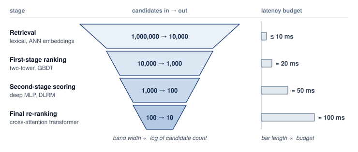{width="100%"}

:::

The central design decision is progressive refinement: rather than running one expensive model on all candidates, this scenario uses a ranking cascade. @Tbl-google-ranking-cascade shows the trade the cascade makes: each stage spends a larger latency budget on a smaller candidate set, so the expensive L3 ensemble is affordable only because L0 through L2 have already cut the candidates by four orders of magnitude.

```{python}
#| echo: false
#| label: ranking-cascade-cost
# ┌─────────────────────────────────────────────────────────────────────────────
# │ RANKING CASCADE COST (LEGO)
# ├─────────────────────────────────────────────────────────────────────────────
# │ Context: Google ranking cascade case study.
# │
# │ Goal: Make the L3-evaluation reduction and simplified cascade-cost ratio
# │       reproducible from the table assumptions.
# │ Show: 10,000x fewer final L3 evaluations; about 5,600x less model work.
# │ How: Treat latency budgets as request-level stage costs. Derive the L3
# │      per-candidate budget from 100 ms over 100 candidates, then compare
# │      applying L3 to all 1M candidates with the four-stage cascade budget.
# │
# └─────────────────────────────────────────────────────────────────────────────
from mlsysim.fmt import check, fmt, fmt_int, fmt_time

class RankingCascadeCost:
    """Simplified model-work comparison for a ranking cascade."""

    # ┌── 1. LOAD (Constants) ──────────────────────────────────────────────
    initial_candidates = 1_000_000
    l3_candidates = 100
    l0_budget_ms = 10
    l1_budget_ms = 20
    l2_budget_ms = 50
    l3_budget_ms = 100

    # ┌── 2. EXECUTE (The Compute) ────────────────────────────────────────
    final_eval_reduction = initial_candidates / l3_candidates
    cascade_budget_ms = l0_budget_ms + l1_budget_ms + l2_budget_ms + l3_budget_ms
    l3_per_candidate_ms = l3_budget_ms / l3_candidates
    l3_all_ms = initial_candidates * l3_per_candidate_ms
    l3_all_time = l3_all_ms * millisecond
    cost_reduction = l3_all_ms / cascade_budget_ms
    cost_reduction_rounded = round(cost_reduction / 100) * 100

    # ┌── 3. GUARD (Invariants) ──────────────────────────────────────────
    check(final_eval_reduction == 10_000, "Final L3 evaluation reduction should be 10,000x")
    check(5_500 <= cost_reduction_rounded <= 5_600, "Rounded cascade cost reduction should be about 5,600x")

    # ┌── 4. OUTPUT (Formatting) ─────────────────────────────────────────────
    final_eval_reduction_mult_str = fmt_multiple(final_eval_reduction, precision=0, commas=True)
    l3_per_candidate_ms_str = fmt_time(round(l3_per_candidate_ms), 'millisecond', precision=0, commas=False)
    l3_all_s_str = fmt_time(l3_all_time, second, precision=0, commas=False)
    cascade_budget_ms_str = fmt_time(round(cascade_budget_ms), 'millisecond', precision=0, commas=False)
    cost_reduction_rounded_mult_str = fmt_multiple(cost_reduction_rounded, precision=0, commas=True)
```

| **Stage**            | **Model Complexity** |   **Candidates**   | **Latency Budget** |
|:---------------------|:--------------------:|:------------------:|:------------------:|
| **L0 (Retrieval)**   |   Embedding lookup   | 1,000,000 → 10,000 |       10 ms        |
| **L1 (First pass)**  |     Linear model     |   10,000 → 1,000   |       20 ms        |
| **L2 (Second pass)** |  Small transformer   |    1,000 → 100     |       50 ms        |
| **L3 (Final rank)**  |    Large ensemble    |      100 → 10      |       100 ms       |

: **Illustrative ranking cascade**: Each stage evaluates fewer candidates with a more expensive model. The final stage has the largest latency allocation in this scenario; candidate reduction makes that expense affordable. {#tbl-google-ranking-cascade}

The cascade reduces final L3 evaluations by `{python} RankingCascadeCost.final_eval_reduction_mult_str` compared to running L3 on all candidates. If the stage budgets are treated as additive model work and L3 cost scales linearly with candidate count, the L3 allocation implies `{python} RankingCascadeCost.l3_per_candidate_ms_str` per candidate. Applying L3 to the full million-candidate set would then consume about `{python} RankingCascadeCost.l3_all_s_str` of model work, while the cascade budget sums to `{python} RankingCascadeCost.cascade_budget_ms_str`. The resulting reduction is roughly `{python} RankingCascadeCost.cost_reduction_rounded_mult_str` under these assumptions. This accounting estimate is not a measured latency speedup; batching and parallel execution can change elapsed time without changing the candidate count.

A deadline-constrained ranking ensemble can use speculative execution when it has a validated fallback-quality policy. Here, speculation means launching candidate ranking work in parallel under a deadline, not draft-token verification for LLM decoding:

```
# Instead of sequential:
#   q1 = model1(query)
#   q2 = model2(query)
#   q3 = model3(query, q1, q2)

# Speculative parallel:
async_q1 = async model1(query)
async_q2 = async model2(query)
async_q3 = async model3(query, predicted_q1, predicted_q2)

# Use actual results if they arrive in time, otherwise use speculative
```

Search ranking deployments can run ranking models on Tensor Processing Units (TPUs).[^fn-tpu-serving-accelerator] Their matrix execution, memory bandwidth, and supported numerical formats must match the ranking workload. Pod interconnect topology varies by generation and configuration; a distributed ranker must account for its actual collective communication costs rather than assume one topology or a guaranteed serving benefit.

[^fn-tpu-serving-accelerator]: [offset=-10mm] **TPUs for inference**\index{TPU!inference}: Systolic-array execution can provide a regular timing profile for fixed-shape ranking workloads. Tail latency still depends on batching, input preparation, communication, and queueing around the accelerator.

::: {.content-visible when-format="pdf"}
\newpage
:::

Each sub-request carries a deadline, and workers prioritize by deadline proximity:

```
Worker queue: [Doc1: 50 ms left] [Doc2: 30 ms left] [Doc3: 80 ms left]
                                      ↑ Process first

If deadline will be missed:
  Return cached/default result rather than timing out
```

The serving lesson is that ranking cascades reduce cost by spending expensive models only on a shrinking candidate set, at the risk of losing relevant items upstream. Deadline propagation and priority scheduling expose the remaining time budget; meeting it also requires sufficient capacity and a validated fallback when work cannot finish. Custom hardware can improve predictability when the workload matches the accelerator, but the next case adds a freshness constraint that hardware alone cannot solve.

### Multimodal recommendation and freshness {#sec-inference-scale-tiktok-multimodal-recommendation-91e9}

The multimodal recommendation scenario\index{Recommendation system!multimodal serving case} binds on freshness under a tight ranking SLO: video understanding is expensive, new content arrives continuously, and user modeling remains online. It combines video understanding (vision) with user modeling (recommendation) for personalized content ranking, creating a multimodal inference challenge where different model types must coordinate.

The operating scale explains why clear online/offline separation matters: the system handles millions of video rankings per second under a tight p99 latency target below $50\text{ ms}$, ingesting millions of new videos daily across video, audio, text, and user interaction signals.

The serving stack separates content and user paths:

```
User request → User embedding → Candidate videos → Video understanding → Ranking

                    |                  |                    |
                    v                  v                    v
             User Tower          Video Cache          Vision Models
           (Transformer)        (Pre-computed)        (On-demand)
```

The scenario separates user understanding (online) from content understanding (offline) through a two-tower architecture with caching.[^fn-two-tower-serving] @Tbl-tiktok-two-tower-updates contrasts the online and offline tower update cadences:

[^fn-two-tower-serving]: **Two-Tower Architecture**\index{Two-Tower Architecture!serving}: Encodes user features and item features through separate neural networks ("towers") into embeddings, then scores via dot product. The serving advantage: item embeddings can be precomputed offline and cached, reducing online candidate generation to the user tower forward pass and vector similarity search. Search latency depends on index size, placement, and the required recall. The trade-off is reduced model expressiveness from late interaction, since the towers cannot attend to each other's features during encoding.

| **Tower**       | **Update Frequency** | **Latency** | **Compute**  |
|:----------------|:--------------------:|:-----------:|:------------:|
| **User tower**  |      Real-time       |     5 ms    | GPU (online) |
| **Video tower** |        Hourly        |     N/A     | GPU (batch)  |

: **Illustrative two-tower update cadence**: User and video towers run on different cadences: user features change second-to-second and must run inference online; video features change much more slowly and are precomputed in hourly batches. This asymmetric scheduling is the design that takes vision inference out of the critical path for almost every request. {#tbl-tiktok-two-tower-updates tbl-colwidths="[28,32,16,24]"}

Video embeddings are precomputed and cached\index{Two-Tower Architecture!offline embedding cache}, eliminating vision inference from the critical path for most requests. A newly uploaded video without a cached embedding needs an explicit policy: process it before admitting it to recommendations, serve a validated fallback, or run vision inference on demand if the request budget permits. The hourly refresh cadence alone does not meet the shorter ingestion targets below; those targets require a separate path for new content.

The online path below separates candidate generation from a later dense reranker. Its user-tower budget is distinct from the reranker budget:

```
User features → CPU preprocessing (1 ms)
             → Embedding lookup (2 ms, CPU+DRAM)
             → User tower (5 ms, GPU)
             → Dense reranking (10 ms, GPU)
             → Response formatting (1 ms)
```

New video content is processed with different priorities, as @tbl-tiktok-video-priorities shows:

| **Priority**   | **SLA** | **Use Case**                 |
|:---------------|:-------:|:-----------------------------|
| **Critical**   |  5 min  | Creator with large following |
| **Standard**   |  30 min | Normal uploads               |
| **Background** | 2 hours | Bulk/imported content        |

: **Illustrative video ingestion priority tiers**: Three-tier SLA for video ingestion. High-follower-count creators get a five-minute SLA to maximize content freshness for their audience; standard uploads get 30 minutes; bulk imports get two hours of slack so the system can absorb them during quiet periods. {#tbl-tiktok-video-priorities tbl-colwidths="[30,20,50]"}

The priority scheme allocates scarce ingestion capacity to time-sensitive content first. Meeting the stated targets still requires capacity for the corresponding arrival rates; priority changes who waits when demand exceeds capacity, rather than eliminating the wait.

The scenario combines multiple understanding modalities through late fusion, which combines independently computed modality embeddings or scores near the end of ranking rather than running one joint model over all raw modalities:

```
Video embedding (512d) -+
Audio embedding (256d) -+- Concat → Fusion MLP → Final embedding (256d)
Text embedding (256d)  -+
```

Late fusion separates the modality computations, but their outputs remain inputs to the fusion model. Updating one modality's model can change the meaning or distribution of its embeddings even when their dimensions stay fixed. Each update therefore needs compatibility validation and, when that contract changes, regeneration of cached embeddings or adaptation of the fusion model.

The serving lesson is that freshness requires separating online and offline work. Two-tower architectures make aggressive caching possible because item embeddings can be refreshed asynchronously, while priority-based processing spends the freshest compute where it has the largest user impact.

### Cross-cutting observations {#sec-inference-scale-crosscutting-observations-742e}

Across these cases, the common pattern is specialization instead of a universal serving stack. Systems separate embedding and retrieval from ranking and generation, use hybrid CPU-GPU architectures to match hardware to workload characteristics, cache at multiple levels while accepting staleness, progressively refine candidate sets to avoid expensive work on unlikely items, and propagate deadlines so quality/latency trade-offs stay explicit under pressure. @Tbl-case-studies-summary identifies the primary technique and key innovation from each system. The four differ precisely because each is specialized to its own workload; that specialization is the shared pattern, not a contradiction of it.

| **System**         | **Primary Technique** | **Key Innovation**        |
|:-------------------|:----------------------|:--------------------------|
| **Recommendation** | Embedding sharding    | Feature-parallel batching |
| **Generation API** | Continuous batching   | Chunked prefill           |
| **Search**         | Ranking cascade       | Speculative execution     |
| **Multimodal**     | Two-tower caching     | Multimodal fusion         |

: **Case study summary**: Serving techniques and architectural choices across the four illustrative workload scenarios. {#tbl-case-studies-summary tbl-colwidths="[24,38,38]"}

The case studies show why serving architectures must be adapted to their workloads. Applying conventional web-service assumptions to GPU-bound systems creates the fallacies and pitfalls examined next.

## Fallacies and Pitfalls {#sec-inference-scale-fallacies-pitfalls-55f9}

A DevOps team applies their standard web-server load balancing rules to a new fleet of GPU inference nodes, only to watch tail latency explode because they ignored the extreme variance of autoregressive token generation. Web services also face variable work and queueing, but an inference fleet adds model residency, accelerator scheduling, and per-sequence state to those familiar concerns. The fallacies below arise when a serving design ignores these constraints or treats one optimization as a complete solution.

::: {.fallacy-pitfall}

**Fallacy**: *Inference at scale is synonymous with LLM serving.*

The misconception, reinforced by LLM-centric discourse, leads to over-focus on LLM-specific techniques while ignoring the broader inference landscape. Published characterizations of large consumer platforms show recommendation and ranking models consuming most AI inference cycles, while vision, fraud detection, and classification models account for much of the rest [@gupta2020architectural; @hazelwood2018]. A practitioner who only understands continuous batching and KV cache management is unprepared for the feature-parallel batching and embedding sharding that dominate high-volume recommendation inference. Technique selection must match the actual workload.

:::

::: {.fallacy-pitfall}

**Pitfall**: *Using training infrastructure for production serving.*

Training and serving have different requirements\index{Training!vs. serving infrastructure}. Training balances aggregate throughput with convergence and time to solution; interactive serving must also satisfy per-request latency targets under external arrivals. Its batch size therefore depends on the workload and waiting budget. Interactive streaming may admit little batching, while bandwidth-bound LLM decode can benefit from many concurrent sequences. Training can resume from checkpoints after an interruption; serving needs a recovery policy that accounts for in-flight requests, retries, and the availability target. Hardware can be shared or repurposed, but a training configuration does not establish serving readiness. Batching, routing, and capacity management must be evaluated against the serving contract.

:::

::: {.fallacy-pitfall}

**Fallacy**: *Continuous batching solves the whole LLM serving problem.*

Continuous batching reuses slots released by completed requests, but it addresses only one dimension of the problem. Prefill can remain a bottleneck\index{Prefill phase!quadratic attention scaling} for long contexts because scheduling subsequent decode iterations does not remove the quadratic attention work of full-attention prefill. @Sec-inference-scale-kv-cache-management-04ed demonstrates that KV cache memory, not compute, often limits batch size. Network bandwidth between sharded model components can dominate latency for large models. The value of continuous batching depends on the workload; slot reuse alone does not resolve these other constraints.

:::

::: {.fallacy-pitfall}

**Pitfall**: *Sizing the fleet by average throughput.*

Average throughput alone does not establish capacity for bursts. With unchanged work per request and service capacity, a 25 percent traffic increase from 80 percent utilization reaches 100 percent utilization, leaving no spare capacity to absorb variance. Whether the resulting queue violates an SLO depends on burst duration, the waiting budget, and admission policy. Cluster-level cold starts can delay relief for multiple minutes. Capacity planning must therefore account for peak load\index{Capacity planning!peak load vs. average load}, burst duration, ready headroom, and the work the service can defer or reject.

:::

::: {.fallacy-pitfall}

**Fallacy**: *Load balancing does not matter much for inference.*

Simple load balancing strategies like round-robin can distribute request counts while leaving work uneven. The static placement analysis in @sec-inference-scale-load-balancing-request-routing-4997 motivates two probes, but its occupancy bounds do not predict production queue lengths. Serving comparisons must preserve arrivals, request lengths, cache affinity, and replica capacity. Work-aware routing earns its place when it improves measured tail latency without excessive coordination cost.

:::

::: {.fallacy-pitfall}

**Pitfall**: *Ignoring the serving tax.*

Distributed inference adds network round-trips and shard coordination to the serialization, routing, and queueing costs that can already surround a single-machine model. This serving tax depends on deployment topology and load. In the illustrative budget of @sec-inference-scale-serving-tax-overhead-distribution-5ef3, 70 ms of model execution leaves only 30 ms for every other stage of a 100 ms request target, and queueing alone can consume that remainder as load rises. A kernel benchmark measures only the first term of @eq-serving-tax; the serving latency is the measured sum along the complete request path.

:::

::: {.fallacy-pitfall}

**Fallacy**: *More GPU memory always means larger batch size and higher throughput.*

Larger GPU memory raises throughput only when the extra capacity supports useful work within the latency budget. Even when memory bandwidth\index{Decode phase!memory bandwidth saturation} is saturated, a larger decode batch can increase tokens per second by sharing weight reads across more sequences. That gain stops when compute, per-sequence KV-cache traffic, or the SLO becomes binding. The bottleneck hierarchy distinguishes these limits.

```{python}
#| echo: false
#| label: inference-bottleneck-hardware
# ┌─────────────────────────────────────────────────────────────────────────────
# │ INFERENCE BOTTLENECK HARDWARE (LEGO)
# ├─────────────────────────────────────────────────────────────────────────────
# │ Context: bottleneck-hierarchy correction in Fallacies and Pitfalls.
# │
# │ Goal: Provide H100 memory and bandwidth for the bottleneck hierarchy.
# │ Show: "80" GB, "3.35" TB/s.
# │ How: pulling constants from mlsysim.core.units.
# │
# └─────────────────────────────────────────────────────────────────────────────

class InferenceBottleneckHardware:
    """Hardware reference for the inference bottleneck hierarchy."""

    # ┌── 1. LOAD (Constants) ──────────────────────────────────────────────
    h100_mem = Hardware.Cloud.H100.memory.capacity
    h100_bw = Hardware.Cloud.H100.memory.bandwidth

    # ┌── 3. GUARD (Invariants) ──────────────────────────────────────────
    from mlsysim.fmt import check, fmt_bandwidth, fmt_memory_capacity

    # the nameplate "80 GB" is a binary magnitude, which is what
    # fmt_memory_capacity renders; check it in the unit the label stands for
    check(abs(h100_mem.to(GiB).magnitude - 80) < 1, "H100 memory capacity should be ~80 GB")

    # ┌── 4. OUTPUT (Formatting) ──────────────────────────────────────────────
    h100_mem_gb_str = fmt_memory_capacity(h100_mem, unit=GiB, precision=0, commas=False)
    h100_mem_bw_tb_per_s_str = fmt_bandwidth(h100_bw, unit=TB / second, precision=2, commas=False)
```

For an H100 with `{python} InferenceBottleneckHardware.h100_mem_gb_str` memory and `{python} InferenceBottleneckHardware.h100_mem_bw_tb_per_s_str` HBM3 bandwidth, capacity and transfer rate are separate limits. More capacity may admit additional sequences, but the resulting batch must still meet compute, bandwidth, and latency budgets. Once extra sequences no longer improve useful throughput within those budgets, adding memory alone cannot help. Capacity planning therefore measures the bottleneck at the intended batch size and context length rather than assigning one permanent bottleneck to the model.

:::

::: {.fallacy-pitfall}

**Pitfall**: *Neglecting multi-tenancy isolation until production.*

In development and staging, single-tenant deployments work well. In production, noisy neighbors cause sudden, unpredictable performance degradation that is difficult to diagnose and resolve. A tenant bursting to 5$\times$ normal traffic can degrade latency for all other tenants on shared infrastructure. As emphasized in @sec-inference-scale-multitenancy-isolation-688c, resource quotas, priority scheduling, and bulkhead isolation must be designed into the system from the start, not retrofitted after production incidents.

These pitfalls identify what a serving evaluation must test: traffic variance, cost per completed request within the SLO, and interference across tenants. Correct technique selection must be followed by measurement under the intended load and failure conditions.

:::

## Summary {#sec-inference-scale-summary-bb6a}

Inference at scale turns trained models and distributed hardware into a service under continuously arriving work. Training optimizes aggregate progress over a run; serving must also meet user-visible latency targets while paying recurring operating costs. The useful capacity of the fleet is the work it completes within its service contract, not the work its accelerators execute in isolation. Test-time compute sharpens the point. When quality is bought by spending more compute per query, the scaling curve that drove the fleet's growth moves into the request path, and every increment of quality is paid again on every request.

Serving performance depends on the balance between compute and memory bandwidth. In the terms of the single-machine iron law recalled in @sec-vol2-introduction-fleet-law, long-prompt prefill can be compute-bound ($\Operations/\PeakRate$), while small-batch decode is often bandwidth-bound ($\DataVolume/\Bandwidth$). Each decode iteration reads active weights and the sequences' KV state; batching shares weight reads across more tokens, whereas longer contexts increase KV traffic. Single-replica efficiency ($\EfficiencyHw$) therefore depends on phase, batch size, and context length. Variable output lengths make fixed batch membership waste capacity after shorter requests finish.

To maximize throughput under memory-bandwidth constraints, modern serving architectures co-design the memory hierarchy and the iteration scheduler. Continuous batching recovers idle slots by inserting new requests at token boundaries; PagedAttention reduces physical memory fragmentation through fixed-block allocation while retaining partial-page waste; and prefill/decode disaggregation assigns prompt processing and token generation to separate hardware pools sized around their measured compute, memory, and communication costs.

When model state exceeds device memory, sharding spreads a replica across accelerators; when demand exceeds a replica's service capacity, additional replicas supply aggregate throughput. In Fleet Law terms, sharding divides the compute term $\IronLawComputeTime/\DeviceCount$ of @eq-parallel-time but adds communication and synchronization $(\CommunicationTime(\DeviceCount), \SynchronizationTime(\DeviceCount))$ governed by interconnect latency floors ($\MessageStartupLatency$) and transfer bandwidth ($\LinkBandwidth$). Replication, routing, isolation, and autoscaling add coordination costs through probes, admission decisions, and capacity changes, and multi-region placement adds wide-area round trips and cross-region failover to the same budget; transferring model or session state also consumes communication bandwidth. Their aggregate capacity and tail control require headroom and sometimes idle replicas. Across the serving hierarchy, the engineering objective is to increase useful completed work while preserving the latency and reliability contract under load.

::: {.callout-takeaways title="Serving capacity is constrained by its contract"}

* **Serving cost recurs throughout deployment**: Training is paid per model version, while inference expense accrues with traffic (principle \ref{pri-serving-cost-dominance}). In the chapter's high-volume recommendation scenario, lifetime serving cost reaches `{python} InferenceEconomics.leverage_ratio_mult_str` the training cost, making efficiency a recurring economic lever.
* **Tail latency governs architecture**: Batching, sharding, caching, and autoscaling must improve useful capacity within workload-specific service targets. Aggregate throughput is insufficient when queueing, first-token delay, or slow token delivery makes completed work miss its contract.
* **Decode turns memory into capacity**: Long-prompt prefill often binds on compute, while small-batch decode rereads active weights and expands private KV state token by token (principle \ref{pri-autoregressive-bottleneck}). Continuous batching, PagedAttention, prefix reuse, and KV compression matter because they convert scarce HBM bandwidth and memory into admitted requests.
* **Model class sets the primitive**: Vision models benefit from predictable static or dynamic batches, recommenders from feature-parallel embedding sharding, and LLMs from iteration-level scheduling. A fleet scheduler must match the workload shape instead of applying one universal batch-size rule.
* **Distribution always sends a bill**: Sharding, routing, isolation, and failover buy capacity or resilience while consuming communication and coordination budgets. Power-of-two choices (principle \ref{pri-power-two-choices}) illustrates the value of limiting coordination: routing can use a small number of probes rather than polling every replica.

:::

The serving cost dominance principle (\ref{pri-serving-cost-dominance}) makes local efficiency valuable only when the service can turn it into useful capacity. Memory released by quantization may admit more sequences, but those sequences still compete for execution time and can push the endpoint beyond its latency budget. The economic comparison therefore holds the request mix, quality requirement, and service targets fixed before asking whether a change lowers the cost of completed work.

::: {.callout-chapter-connection title="From data center to edge"}

The serving designs developed here coordinate accelerator replicas under data-center memory, network, and availability assumptions; even the global stack's edge points of presence only answer from cache and leave model execution in the clusters. Many applications also run models on smartphones and other personal devices, where sustained power is a few watts, memory is shared with foreground work, and connectivity is intermittent. When those devices must also adapt to local data, the fleet has to decide where learning happens, which device updates it accepts, and how a population improves a shared model without collecting raw examples.

:::

::: {.column-margin .margin-pointer}
↪ On-device adaptation under device resource budgets and federated learning across device populations are developed in @sec-edge-intelligence.
:::

<!-- This is here to make sure that quizzes are inserted properly before a part begins. -->

::: { .quiz-end }
:::
