# Edge Intelligence {#sec-edge-intelligence}

::: {layout-narrow}
::: {.column-margin}

\chapterminitoc

:::

::: {.content-visible when-format="pdf"}
\noindent
{fig-alt="Cloud-to-edge blueprint where a central model reaches heterogeneous devices, private local data stays on device, and update streams return to aggregation."}
:::

::: {.content-visible unless-format="pdf"}
{fig-alt="Cloud-to-edge blueprint where a central model reaches heterogeneous devices, private local data stays on device, and update streams return to aggregation."}
:::

:::

## Purpose {.unnumbered .unlisted}

\begin{marginfigure}
\mlfleetstack{55}{25}{25}{15}{100}{35}{30}{25}
\end{marginfigure}

_When does learning need to move from the data center to the devices it serves?_

A model trained in a data center encounters new conditions when deployed to a user's device. Vocabulary, lighting, acoustics, and usage patterns may differ from the distributions that shaped its parameters, and the gap can widen as behavior evolves. Centralized training cannot anticipate every context, while privacy constraints or limited connectivity may prevent local observations from reaching it. Learning where the data is produced can improve local behavior, but running predictions offline does not by itself justify training there. Adaptation must provide enough benefit to justify its memory, battery, and thermal costs without disrupting the device's primary work. A training job that fits on an idle phone may become unacceptable when the user starts another application. Even successful local learning leaves a fleet problem: improvements must be evaluated across devices whose capabilities, data, and availability differ. A policy that accepts updates only from well-connected devices may improve measured results while neglecting users whose devices rarely qualify. Making one device learn efficiently therefore does not establish that a population can learn reliably or that exchanging model updates protects private information. The engineering decision joins the value of local adaptation with the cost of participation and the evidence needed to trust shared improvements. In C³ terms, compute must fit each device, communication must carry useful updates within limited connectivity windows, and coordination must preserve a representative learning population despite dropout and unequal resources.

::: {.content-visible when-format="pdf"}

\newpage

:::

::: {.callout-learning-objectives}

- Contrast centralized cloud training, on-device learning, and federated learning by analyzing their data flow, privacy properties, and operational trade-offs
- Quantify edge-device training overhead relative to inference-only deployment across memory, compute, and energy
- Derive an admission condition for background adaptation from energy, thermal, and foreground-latency slack
- Select model adaptation strategies by comparing memory footprints, expressivity, and adaptation quality for specific device capabilities
- Select data-efficiency methods for limited local data while evaluating forgetting risk and storage cost
- Design federated learning systems that aggregate privacy-preserving updates while managing heterogeneous data, communication efficiency, and stragglers
- Explain the operational controls needed for on-device learning: device-aware deployment, distributed validation, privacy-preserving monitoring, and rollback across heterogeneous populations

:::

```{python}
#| echo: false
from mlsysim import *
from mlsysim.core.units import *

from mlsysim.physics import memory_from_params
from mlsysim.fmt import check, fmt
```

```{python}
#| echo: false
#| label: edge-device-spectrum-anchors
# ┌─────────────────────────────────────────────────────────────────────────────
# │ EDGE DEVICE SPECTRUM (LEGO)
# ├─────────────────────────────────────────────────────────────────────────────
# │ Context: Reusable microcontroller-to-phone endpoints for heterogeneity prose.
# │
# │ Goal: Keep edge device-class range anchors sourced from MLSysIM.
# │ Scope: chapter-anchor — device-spectrum endpoints recur across heterogeneity prose.
# │ Show: Memory endpoints from microcontroller SRAM to flagship phone RAM.
# │ How: Pull ReferenceStats.EdgeDeviceSpectrum values and format for prose.
# │
# └─────────────────────────────────────────────────────────────────────────────
from mlsysim.fmt import (
    check,
    fmt_memory_capacity,
    fmt_multiple,
)

class EdgeDeviceSpectrum:
    """Reusable device-class endpoints for edge-learning prose."""

    # ┌── 1. LOAD (Constants) ──────────────────────────────────────────────
    profile = ReferenceStats.EdgeDeviceSpectrum
    mcu_sram = profile.MicrocontrollerSram
    mcu_sram_high = profile.MicrocontrollerSramHigh
    arduino_flash = profile.ArduinoNano33BleFlash
    flagship_ram = profile.FlagshipSmartphoneRamHigh

    # ┌── 2. EXECUTE (The Compute) ────────────────────────────────────────
    memory_ratio = (flagship_ram / mcu_sram).to("").magnitude

    # ┌── 3. GUARD (Invariants) ───────────────────────────────────────────
    check(mcu_sram < mcu_sram_high < flagship_ram, "Device memory endpoints should be ordered.")
    check(50_000 < memory_ratio < 70_000, f"MCU-to-phone memory ratio drifted: {memory_ratio:.0f}x")

    # ┌── 4. OUTPUT (Formatting) ─────────────────────────────────────────────
    mcu_sram_kb_str = fmt_memory_capacity(mcu_sram, unit=KiB, precision=0, commas=False)
    mcu_sram_high_mb_str = fmt_memory_capacity(mcu_sram_high, unit=MiB, precision=0, commas=False)
    arduino_flash_mb_str = fmt_memory_capacity(arduino_flash, unit=MiB, precision=0, commas=False)
    flagship_ram_gb_str = fmt_memory_capacity(flagship_ram, unit=GiB, precision=0, commas=False)
    memory_ratio_mult_str = fmt_multiple(memory_ratio, precision=0, commas=True)
```

```{python}
#| echo: false
#| label: edge-adaptation-tier-profile
# ┌─────────────────────────────────────────────────────────────────────────────
# │ EDGE ADAPTATION TIER PROFILE (LEGO)
# ├─────────────────────────────────────────────────────────────────────────────
# │ Context: Reusable wearable, phone, and voice-assistant fleet assumptions.
# │
# │ Goal: Keep tiered adaptation examples sourced from one MLSysIM profile.
# │ Scope: chapter-anchor — tiered adaptation examples share one fleet profile.
# │ Show: Device memories, fleet shares, adapter ranks, replay buffers, updates.
# │ How: Pull ReferenceStats.EdgeAdaptationTierProfile values and format them.
# │
# └─────────────────────────────────────────────────────────────────────────────
from mlsysim.fmt import (
    check,
    fmt_count,
    fmt_count_range,
    fmt_int,
    fmt_memory,
    fmt_memory_capacity,
    fmt_memory_capacity,
    fmt_percent,
)

class EdgeAdaptationTierProfile:
    """Reusable tiered adaptation assumptions for edge-learning prose."""

    # ┌── 1. LOAD (Constants) ──────────────────────────────────────────────
    profile = ReferenceStats.EdgeAdaptationTierProfile
    wearable_memory = profile.WearablePersonalizationMemory
    tiny_wearable_ram = profile.TinyWearableRam
    smartphone_ram = Platforms.Mobile.ram
    budget_phone_ram = profile.BudgetPhoneRam
    budget_phone_available_low = profile.BudgetPhoneAvailableLow
    budget_phone_available_high = profile.BudgetPhoneAvailableHigh
    budget_device_memory_limit = profile.BudgetDeviceMemoryLimit
    budget_keyboard_phone_ram = profile.BudgetKeyboardPhoneRam
    iot_memory_low = profile.IotMemoryLow
    iot_memory_high = profile.IotMemoryHigh
    keyboard_gradient_memory_low = profile.KeyboardGradientMemoryLow
    keyboard_gradient_memory_high = profile.KeyboardGradientMemoryHigh
    keyboard_background_budget_low = profile.KeyboardBackgroundBudgetLow
    keyboard_background_budget_high = profile.KeyboardBackgroundBudgetHigh
    keyboard_gradient_example = profile.KeyboardGradientExample
    keyboard_background_budget_example = profile.KeyboardBackgroundBudgetExample
    fleet_devices = int(profile.VoiceAssistantFleetDevices)
    flagship_share = float(profile.FlagshipFleetShare)
    mid_tier_share = float(profile.MidTierFleetShare)
    budget_share = float(profile.BudgetFleetShare)
    flagship_lora_rank = int(profile.FlagshipLoraRank)
    mid_tier_lora_rank = int(profile.MidTierLoraRank)
    budget_replay_buffer = profile.BudgetReplayBuffer
    flagship_replay_buffer = profile.FlagshipReplayBuffer
    few_shot_interactions_low = int(profile.FewShotInteractionsLow)
    few_shot_interactions_high = int(profile.FewShotInteractionsHigh)
    federated_lora_update = profile.FederatedLoraUpdate

    # ┌── 2. EXECUTE (The Compute) ────────────────────────────────────────
    fleet_share_sum = flagship_share + mid_tier_share + budget_share
    keyboard_memory_share = (keyboard_gradient_example / keyboard_background_budget_example).to("").magnitude

    # ┌── 3. GUARD (Invariants) ───────────────────────────────────────────
    check(tiny_wearable_ram < wearable_memory < smartphone_ram, "Wearable and phone memory envelopes should be ordered.")
    check(
        budget_phone_available_low < budget_phone_available_high <= budget_phone_ram,
        "Budget phone available-memory envelope should fit within total RAM.",
    )
    check(abs(fleet_share_sum - 1.0) < 1e-9, "Fleet shares should sum to one.")
    check(mid_tier_lora_rank < flagship_lora_rank, "Flagship LoRA rank should exceed mid-tier LoRA rank.")
    check(budget_replay_buffer < flagship_replay_buffer, "Replay buffers should grow with device capability.")
    check(few_shot_interactions_low < few_shot_interactions_high, "Few-shot interaction range should be ordered.")
    check(
        keyboard_gradient_memory_low < keyboard_gradient_example < keyboard_gradient_memory_high,
        "Keyboard gradient example should sit inside its memory range.",
    )
    check(
        keyboard_background_budget_low < keyboard_background_budget_example <= keyboard_background_budget_high,
        "Keyboard background-budget example should sit inside its memory range.",
    )

    # ┌── 4. OUTPUT (Formatting) ─────────────────────────────────────────────
    wearable_system_memory_mb_str = fmt_memory_capacity(wearable_memory, unit=MiB, precision=0, commas=False)
    tiny_wearable_ram_mb_str = fmt_memory_capacity(tiny_wearable_ram, unit=MiB, precision=0, commas=False)
    smartphone_ram_gb_str = fmt_memory_capacity(smartphone_ram, unit=GiB, precision=0, commas=False)
    budget_phone_ram_gb_str = fmt_memory_capacity(budget_phone_ram, unit=GiB, precision=0, commas=False)
    budget_phone_available_low_gb_str = fmt_memory_capacity(budget_phone_available_low, unit=GiB, precision=0, commas=False)
    budget_phone_available_high_gb_str = fmt_memory_capacity(budget_phone_available_high, unit=GiB, precision=0, commas=False)
    budget_device_memory_limit_gb_str = fmt_memory_capacity(budget_device_memory_limit, unit=GiB, precision=0, commas=False)
    budget_keyboard_phone_ram_gb_str = fmt_memory_capacity(budget_keyboard_phone_ram, unit=GiB, precision=0, commas=False)
    iot_memory_low_mb_str = fmt_memory_capacity(iot_memory_low, unit=MiB, precision=0, commas=False)
    iot_memory_high_gb_str = fmt_memory_capacity(iot_memory_high, unit=GiB, precision=0, commas=False)
    keyboard_gradient_memory_low_mb_str = fmt_memory(keyboard_gradient_memory_low, unit=MB, precision=0, commas=False)
    keyboard_gradient_memory_high_mb_str = fmt_memory(keyboard_gradient_memory_high, unit=MB, precision=0, commas=False)
    keyboard_background_budget_low_mb_str = fmt_memory(keyboard_background_budget_low, unit=MB, precision=0, commas=False)
    keyboard_background_budget_high_mb_str = fmt_memory(keyboard_background_budget_high, unit=MB, precision=0, commas=False)
    keyboard_memory_share_pct_str = fmt_percent(keyboard_memory_share, precision=0, commas=False, style="prose")
    fleet_devices_million_str = fmt_count(fleet_devices, scale="million", scale_style="word", precision=0, label="device")
    flagship_share_pct_str = fmt_percent(flagship_share, precision=0, commas=False, style="prose")
    mid_tier_share_pct_str = fmt_percent(mid_tier_share, precision=0, commas=False, style="prose")
    budget_share_pct_str = fmt_percent(budget_share, precision=0, commas=False, style="prose")
    flagship_lora_rank_str = fmt_int(flagship_lora_rank, commas=False)
    mid_tier_lora_rank_str = fmt_int(mid_tier_lora_rank, commas=False)
    budget_replay_buffer_mb_str = fmt_memory_capacity(budget_replay_buffer, unit=MiB, precision=0, commas=False)
    flagship_replay_buffer_mb_str = fmt_memory_capacity(flagship_replay_buffer, unit=MiB, precision=0, commas=False)
    few_shot_interactions_range_str = fmt_count_range(few_shot_interactions_low, few_shot_interactions_high, label="interaction", commas=False)
    federated_lora_update_mb_str = fmt_memory_capacity(federated_lora_update, unit=MiB, precision=0, commas=False)
```

## The Edge Learning Paradigm {#sec-edge-intelligence-distributed-learning-paradigm-shift-883d}

Imagine a voice assistant trained on millions of generic audio samples in a cloud data center. When deployed, it may struggle with a regional accent or household vocabulary. Without local adaptation, its performance can decline as usage diverges from the training distribution. **Edge intelligence**\index{Edge Intelligence!definition} places inference, adaptation, and coordination on or near the devices that observe the data, allowing models to respond to local context under power, memory, privacy, and connectivity constraints.

The serving fleet already has to meet latency targets despite failures and uneven demand. At the edge, the operator also loses control over when a device has power, connectivity, or spare memory. The unit of design remains the fleet, but its participants can disappear between selection and completion. Local adaptation matters here because its cost determines which users can contribute to population learning.

Consider one federated round for the voice assistant. A coordinator selects eligible devices and distributes a shared model version and a bounded training policy. Each selected device trains on local examples when its policy admits background work, then returns a model update tagged with the starting version. Some devices lose connectivity or exhaust their resource allowance. The coordinator closes the round according to its deadline and participation requirements, combines compatible updates, evaluates the candidate shared model, and publishes an accepted version for later download. Local personalization can remain on the device instead of entering that aggregate.

This round has the shape of Archetype C (Federated MobileNet), with phone-class clients, private local data, and intermittent availability, and it exposes the C³ trade-off before any adaptation method is chosen. The Fleet Law (@eq-fleet-law) gives it a time budget. Its compute term is local training on the slowest device the round still waits for, its communication term is the update transfer over a wide-area uplink, and its synchronization term is the wait for enough participants to report, less whatever download and training overlap. More local compute can reduce the frequency of communication, but devices then need longer uninterrupted training windows and their models can drift toward different local distributions. Short deadlines improve coordination speed while excluding slow participants. The fleet must therefore account for whose updates complete, not only how many devices were selected. Device budgets, adaptation methods, and data reuse determine the work inside the round; aggregation and scheduling determine whether that work improves the shared model.

Keeping raw examples local reduces one source of exposure, but an update can still reveal information about the examples that produced it. Secure aggregation lets the coordinator obtain a combined update without inspecting each client's contribution under the protocol's trust assumptions. Differential privacy bounds how much a specified user's or record's participation can change the released result, usually by limiting contributions and adding calibrated noise. Neither protection follows automatically from federation. Their costs and assumptions belong in the round design alongside dropout handling and communication.

::: {.column-margin .margin-pointer}
↩ Data center serving architectures, continuous batching, and cluster service-level objectives (SLOs) are analyzed in @sec-inference-scale.
:::

A smartphone learning to predict user text input, a smart home device adapting to household routines, or an autonomous vehicle updating its perception models based on local driving conditions all demonstrate scenarios where traditional centralized training approaches prove inadequate. The smartphone encounters linguistic patterns unique to individual users that were not present in global training data. The smart home device must adapt to seasonal changes and family dynamics that vary dramatically across households. The autonomous vehicle faces local road conditions, weather patterns, and traffic behaviors that differ from its original training environment.

These scenarios can motivate on-device learning, where models train and adapt directly on the devices where they operate. Machine learning then moves from centralized training to distributed learning across heterogeneous devices, each operating under local constraints. Within the fleet stack, this pushes computation toward the limits of device power, memory, and thermal capacity. Hardware capability contributes to on-device adaptation\index{On-device adaptation!hardware acceleration} feasibility alongside the algorithm and runtime: the mobile accelerator scaling tracked in @fig-edge-npu-tops shows throughput climbing from under 1 TOPS on the A11 Bionic to 35 TOPS on the A17 and A18 Pro, a step in 2023 that is partly a change in rating precision (INT8 versus earlier FP16) and that expanded the forward inference budget. Yet training feasibility additionally requires backward-operator support and measurements of update time, memory, and energy.

::: {#fig-edge-npu-tops fig-env="figure" fig-pos="htb" fig-cap="**Mobile NPU performance scaling**: Throughput of Apple's Neural Engine by release year, rising from under one TOPS in 2017 to roughly thirty-five by 2024 with a sharp step at the 2023 generation, much of which reflects Apple's switch from FP16 to INT8 ratings. These inference-oriented peak ratings do not establish training throughput or backward-operator support." fig-alt="Line chart of mobile neural processing unit throughput in TOPS by release year from 2017 to 2024, rising from under one to about thirty-five with a sharp step at the 2023 generation."}

```{python}
#| echo: false
import pandas as pd
from binder.tools.figures import style as book_style

data = pd.read_csv("vol2/11_edge_intelligence/data/ane_trend.csv")

fig, ax, COLORS, plt = book_style.setup_plot(figsize=(8.0, 4.5))

ax.plot(data["Year"], data["TOPS"], marker="o", linewidth=2.3, markersize=7, color=COLORS["BlueLine"])

# Annotate points with chip names
for i, row in data.iterrows():
    ax.annotate(
        row['Chip'],
        (row['Year'], row['TOPS']),
        textcoords="offset points",
        xytext=(0, 10),
        ha='center',
        fontsize=8.0,
        fontweight='bold',
        color=COLORS['primary'],
        bbox=dict(boxstyle='round,pad=0.2', facecolor='white', edgecolor='#CBD5E1', lw=0.6),
    )

ax.set_xlabel("Release Year")
ax.set_ylabel("Performance (TOPS)")
ax.set_ylim(0, 42)

ax.margins(x=0.14, y=0.14)
plt.tight_layout()
plt.show()
plt.close()
```

:::

```{python}
#| echo: false
#| label: edge-npu-speedup-notebook
# ┌─────────────────────────────────────────────────────────────────────────────
# │ NPU VS CPU SPEEDUP (NOTEBOOK)
# ├─────────────────────────────────────────────────────────────────────────────
# │ Context: "The silicon dividend of a dedicated NPU" .callout-perspective
# │
# │ Goal: Illustrate how assumed NPU speed/energy ratios affect a mobile baseline.
# │ Show: CPU baseline latency (computed); speedup = 20x, energy_gain = 60x as
# │       explicit scenario assumptions, not benchmark measurements.
# │ How: CPU baseline from SingleNodeModel; apply stated scenario multipliers.
# │
# └─────────────────────────────────────────────────────────────────────────────
from mlsysim import Models, Hardware, Engine
from mlsysim.solvers import SingleNodeModel
from mlsysim.fmt import check, fmt_int, fmt_time

# ┌── LEGO ───────────────────────────────────────────────
class EdgeNpuSpeedup:
    # ┌── 1. LOAD ──────────────────────────────────────────
    m = Models.Vision.MobileNetV2

    # Generic mobile hardware profile used for the scenario baseline
    h_cpu = Hardware.Mobile.iPhone15Pro
    scenario_speedup = 20.0
    scenario_energy_gain = 60.0

    # ┌── 2. EXECUTE ───────────────────────────────────────
    # Solve for MobileNet on standard mobile CPU
    p_cpu = SingleNodeModel().solve(m, h_cpu, batch_size=1, efficiency=0.05)  # Low efficiency for CPU

    # Apply the explicit scenario assumptions; these are not measured results.
    t_cpu = p_cpu.latency
    t_npu = t_cpu / scenario_speedup
    e_cpu = p_cpu.energy
    e_npu = e_cpu / scenario_energy_gain

    speedup = (t_cpu / t_npu).to_base_units().magnitude
    energy_gain = (e_cpu / e_npu).to_base_units().magnitude

    # ┌── 3. GUARD ─────────────────────────────────────────
    check(round(speedup) == 20, f"Speedup {speedup:.1f}x unexpected")
    check(round(energy_gain) == 60, f"Energy gain {energy_gain:.1f}x unexpected")

    # ┌── 4. OUTPUT ────────────────────────────────────────
    npu_cpu_lat_ms_str = fmt_time(t_cpu, millisecond, precision=3, commas=False)
    npu_speedup_mult_str = fmt_multiple(speedup, commas=False, precision=0)
    npu_energy_gain_mult_str = fmt_multiple(energy_gain, commas=False, precision=0)
```

Local adaptation can only happen on hardware that already clears the inference floor, because a gradient update costs strictly more than the forward pass it builds on. Specialized accelerators set that floor: they determine whether an edge device has enough latency and energy margin to run intelligent workloads at all, and therefore whether any local training is even possible.

::: {#psp-edge-intelligence-npu-silicon-dividend .callout-perspective title="The silicon dividend of a dedicated NPU"}

The gap between running a model on a generic mobile CPU and on a dedicated NPU\index{Neural processing unit!silicon dividend} is best understood as a "silicon dividend" rather than a marginal speedup. Published NPU profiles vary by silicon generation and workload, so this notebook uses explicit scenario assumptions rather than reporting a benchmark: a `{python} EdgeNpuSpeedup.npu_speedup_mult_str` latency improvement and a `{python} EdgeNpuSpeedup.npu_energy_gain_mult_str` energy-efficiency improvement relative to the modeled MobileNetV2 baseline (`{python} EdgeNpuSpeedup.npu_cpu_lat_ms_str` per inference). These multipliers illustrate sensitivity to accelerator gains; they are not measured properties of the named mobile profile or a particular NPU.

What matters for system design is the kind of difference these ratios represent. Under the stated assumptions, specialized hardware creates substantial latency and energy margin. Whether that margin makes a workload feasible, allows continuous background execution, or makes CPU fallback unacceptable must be established with workload- and device-specific latency, power, and thermal measurements.

:::

The transition to on-device learning introduces fundamental tension in machine learning systems design. While cloud-based architectures use abundant computational resources and controlled operational environments, edge devices must function within severely constrained resource envelopes. Memory ranges from a few gigabytes on phones down to hundreds of kilobytes on microcontrollers, sustained power ranges from a few watts down to milliwatts, and network connectivity may be intermittent or entirely absent. When a local model operates in a safety-critical loop, these constraints become life-safety engineering problems.

```{python}
#| echo: false
#| label: edge-mobile-power-envelope
# ┌─────────────────────────────────────────────────────────────────────────────
# │ MOBILE POWER ENVELOPE (LEGO)
# ├─────────────────────────────────────────────────────────────────────────────
# │ Context: Archetype C power wall, battery/thermal prose, and nearby footnote.
# │
# │ Goal: Keep mobile sustained and burst power ranges sourced from MLSysIM.
# │ Show: Sustained and burst mobile ML power ranges; hours a flagship
# │       battery lasts at the burst ceiling.
# │ How: Pull ReferenceStats.MobilePower anchors and the Archetype C scenario,
# │      validate ordering, format ranges; hours = battery_Wh / burst_W.
# │
# └─────────────────────────────────────────────────────────────────────────────
from mlsysim import ReferenceStats, Scenarios
from mlsysim.core.units import Wh, hour, watt
from mlsysim.fmt import check, fmt_qty_range, fmt_power, fmt_energy, fmt_time

class EdgeMobilePowerEnvelope:
    """Shared mobile power ranges for edge-learning prose."""

    # ┌── 1. LOAD ────────────────────────────────────────────────────────────
    archetype_c = Scenarios.FederatedMobileVision
    sustained_low = ReferenceStats.MobilePower.MobileMlSustainedLow
    sustained_high = ReferenceStats.MobilePower.MobileMlSustainedHigh
    burst_low = ReferenceStats.MobilePower.MobileMlBurstLow
    burst_high = ReferenceStats.MobilePower.MobileMlBurstHigh
    battery = ReferenceStats.PhoneBattery.EnergyWh

    # ┌── 2. EXECUTE ─────────────────────────────────────────────────────────
    burst_battery_hours = (battery / burst_high).to(hour).magnitude

    # ┌── 3. GUARD ───────────────────────────────────────────────────────────
    check(sustained_low < sustained_high < burst_low < burst_high, "Mobile sustained and burst power ranges should be ordered.")
    check(archetype_c.power_budget == sustained_high, "Archetype C sustained budget should equal the mobile sustained ceiling.")

    # ┌── 4. OUTPUT (Formatting) ─────────────────────────────────────────────
    envelope_range_str = fmt_qty_range(
        sustained_low,
        burst_high,
        watt,
        precision=0,
        commas=False,
    )
    burst_high_str = fmt_power(burst_high, unit=watt, precision=0, commas=False)
    battery_wh_str = fmt_energy(battery, unit=Wh, precision=0, commas=False)
    burst_battery_hours_str = fmt_time(burst_battery_hours, 'hour', precision=1, commas=False, style='word')
    sustained_range_str = fmt_qty_range(
        sustained_low,
        sustained_high,
        watt,
        precision=0,
        commas=False,
    )
    burst_range_str = fmt_qty_range(
        burst_low,
        burst_high,
        watt,
        precision=0,
        commas=False,
    )
```

::: {#lhs-edge-intelligence-archetype-c-federated-mobilenet-edge-power-wall .callout-lighthouse title="Archetype C (Federated MobileNet): The edge power wall"}

These constraints run through Archetype C (Federated MobileNet) (@sec-introduction-archetype-c-federated-mobilenet-65a3), where learning happens on phone-class devices whose power budget spans roughly `{python} EdgeMobilePowerEnvelope.envelope_range_str`, a few watts sustained with brief bursts toward `{python} EdgeMobilePowerEnvelope.burst_high_str`, and which must share that budget with the user's foreground work. Privacy and policy constraints often forbid moving raw examples off the device, and even where transfer is permitted, a mobile uplink and battery rarely afford shipping raw data to the cloud. Data locality is therefore both a policy requirement and a bandwidth and energy constraint. Quantized training, sparse updates, and federated coordination are the strategies that let Archetype C learn within that envelope. Microcontroller-class sensors with hundreds of kilobytes of memory and milliwatt budgets sit at an extreme below Archetype C, and this chapter treats them as such.

:::

Navigating this architectural tension requires the compression techniques carried over from inference, combined with algorithmic techniques, design patterns, and system principles that enable effective learning under extreme resource constraints. The challenge extends beyond conventional optimization of training algorithms: it requires rethinking the entire machine learning pipeline for deployment environments where traditional computational assumptions fail.

::: {#dfn-edge-intelligence-device-learning .callout-definition title="On-device learning"}

***On-device learning***\index{On-Device Learning!definition} is the local training or adaptation of machine learning models directly on deployed hardware without requiring server connectivity.

1.  **Significance**: It enables Hyper-Personalization and autonomous operation under severe resource constraints. Within the single-machine iron law (@sec-vol2-introduction-fleet-law)\index{Iron law of ML systems!on-device energy}, on-device learning must minimize the total energy consumed per update, because every gradient step draws on limited battery power and competes with other system tasks for the available compute throughput $(\PeakRate)$.
2.  **Distinction**: Unlike Edge Inference\index{Edge inference!vs. on-device learning}, which only executes a fixed model, on-device learning involves a Local Optimization Loop (forward and backward passes) that requires significantly more memory and compute.
3.  **Common pitfall**: A frequent misconception is that on-device learning requires training from scratch. In reality, it is almost always On-Device Adaptation\index{On-device adaptation!parameter subsets}: fine-tuning a small subset of a pretrained base model's parameters to fit the specific data distribution of a local environment.

:::

The consequences reach beyond technical optimization into every phase of the machine learning lifecycle. Models transition from predictable versioning patterns to continuous divergence and adaptation trajectories. Performance evaluation shifts from centralized monitoring dashboards to distributed assessment across heterogeneous user populations. Privacy preservation becomes a core architectural requirement that shapes system design decisions rather than a downstream compliance concern.

### Motivations and benefits {#sec-edge-intelligence-motivations-benefits-37c3}

Machine learning systems have traditionally relied on centralized training pipelines. Large-scale distributed infrastructure allows models to be developed and refined on centrally managed datasets [@dean2012large]. Once trained, these models can be deployed to client devices for inference, creating a clear separation between the training and deployment phases. While this architectural separation has served many use cases well, it imposes significant limitations in applications where local data is dynamic, private, or highly personalized.

On-device learning challenges this established model by enabling systems to train or adapt directly on the device, without relying on constant connectivity to the cloud. The shift reflects changing application requirements and user expectations that demand responsive, personalized, and privacy-preserving machine learning systems.

::: {.column-margin}
```{=latex}
\vspace*{7mm}
```
{width="100%" fig-alt="Blue memory ladder comparing a 300 MB background-memory budget with a 75 MB local gradient update, with a fourfold gap marked between them."}

*One gradient update claims a quarter of the keyboard's memory budget.*
:::

Consider a smartphone keyboard adapting to a user's unique vocabulary and typing patterns. To personalize predictions, the system must perform gradient updates on a compact language model using locally observed text input. A single gradient update for even a minimal language model requires `{python} EdgeAdaptationTierProfile.keyboard_gradient_memory_low_mb_str`--`{python} EdgeAdaptationTierProfile.keyboard_gradient_memory_high_mb_str` of memory for activations and optimizer state. Smartphone operating systems often leave only `{python} EdgeAdaptationTierProfile.keyboard_background_budget_low_mb_str`--`{python} EdgeAdaptationTierProfile.keyboard_background_budget_high_mb_str` for background applications like keyboards, with the exact budget varying by OS, device generation, and foreground workload. This razor-thin margin demonstrates the central engineering challenge of on-device learning: a single training step can consume `{python} EdgeAdaptationTierProfile.keyboard_memory_share_pct_str` of available memory. The system must achieve meaningful personalization while operating within constraints so severe that traditional training approaches become architecturally infeasible. This quantitative reality drives the need for specialized techniques that make adaptation possible within extreme resource limitations.

Four key considerations motivate the shift from centralized to decentralized learning [@li2020]: personalization, latency and availability, privacy, and infrastructure efficiency. Personalization represents the most compelling motivation, as deployed models often encounter usage patterns and data distributions that differ from their training environments. Local adaptation allows models to refine behavior in response to user-specific data, capturing linguistic preferences, physiological baselines, sensor characteristics, or environmental conditions. This capability is essential in applications with high inter-user variability, where a single global model cannot serve all users effectively.

Latency and availability constraints provide additional justification for local learning. In edge computing scenarios, connectivity to centralized infrastructure may be unreliable, delayed, or intentionally limited to preserve bandwidth or reduce energy consumption. On-device learning enables autonomous improvement of models even in fully offline or delay-sensitive contexts, where round-trip updates to the cloud are architecturally infeasible.

Privacy considerations provide a third compelling driver. Many applications involve sensitive or regulated data including biometric measurements, typed input, location traces, or health information. Local learning can reduce privacy exposure by keeping raw data on the device and limiting transmission to centralized systems. This can simplify compliance engineering, but it does not by itself establish adherence to regulations such as the General Data Protection Regulation (GDPR),\index{GDPR!on-device learning} the Health Insurance Portability and Accountability Act (HIPAA)\index{HIPAA!on-device learning} [@hhs2026hipaaSecurity], or region-specific data sovereignty laws.

Infrastructure efficiency provides economic motivation for distributed learning approaches. Centralized training pipelines require substantial backend infrastructure to collect, store, and process user data from potentially millions of devices. Shifting learning to the edge reduces communication costs and distributes training workloads across the deployment fleet, relieving pressure on centralized resources while improving scalability.

### Alternative approaches and decision criteria {#sec-edge-intelligence-alternative-approaches-decision-criteria-bd36}

On-device learning demands significant engineering investment that may not always be justified. Simpler alternatives can often achieve comparable results with lower operational overhead, and premature adoption introduces complexity without proportional value.

@Tbl-edge-ondevice-learning-alternatives compares three alternatives that often satisfy personalization and adaptation requirements without local training complexity.

| **Alternative**                                   | **Mechanism**                                                                                                                                                                                                                                                                                       | **When it fits**                                                                                                                                    |
|:--------------------------------------------------|:----------------------------------------------------------------------------------------------------------------------------------------------------------------------------------------------------------------------------------------------------------------------------------------------------|:----------------------------------------------------------------------------------------------------------------------------------------------------|
| **Feature-based personalization**                 | Store user preferences, interaction history, and behavioral features locally, then feed those features into a static model rather than adapting model weights.                                                                                                                                      | News recommendation systems can store topic preferences and reading patterns locally, then combine those features with a centralized content model. |
| **Cloud-based fine-tuning with privacy controls** | Fine-tune centrally on data authorized for transfer, with access controls and, where required, a specified differential-privacy mechanism. Federated analytics and secure aggregation [@bonawitz2017] can support aggregate statistics but do not themselves provide centralized training examples. | Centralized updates fit when authorized data transfer, update latency, and the specified privacy guarantees meet the application requirements.      |
| **User-specific lookup tables**                   | Combine global models with personalized retrieval mechanisms by maintaining a lightweight table for frequently accessed local patterns.                                                                                                                                                             | Personalization benefits are needed with minimal computational and storage overhead.                                                                |

: **Alternatives to On-Device Learning**: Simpler personalization mechanisms can satisfy many adaptation requirements without local gradient updates, so on-device learning should be reserved for cases where privacy, latency, connectivity, or measured quality requirements rule out these options. {#tbl-edge-ondevice-learning-alternatives tbl-colwidths="[24,44,32]"}

In the cloud-fine-tuning row, differential privacy[^fn-dp-federated-privacy] is the mechanism that bounds information leakage while adding noise that can require more rounds or more data.

::: {.column-margin .margin-pointer}
↪ Differential privacy definitions, noise mechanisms, and privacy accounting are formalized in @sec-security-privacy.
:::

[^fn-dp-federated-privacy]: **Differential Privacy**\index{Differential Privacy!federated learning}: A mathematical framework that bounds information leakage by adding calibrated noise to computations. In edge learning, that noise becomes a systems cost because noisier updates usually require more rounds or more data to reach the same utility.

The decision to implement on-device learning should be driven by quantifiable requirements that preclude these simpler alternatives. True data privacy constraints that legally prohibit cloud processing, genuine network limitations that prevent reliable connectivity, quantitative latency budgets that preclude cloud round-trips, or demonstrable performance improvements that justify the operational complexity represent legitimate drivers for on-device learning adoption.

For applications whose foreground deadlines are shorter than the network round-trip time, cloud inference is architecturally infeasible. Camera processing under 33 ms, voice response under 500 ms, AR/VR motion-to-photon latency under 20 ms, or safety-critical control under 10 ms all face network round-trip times typically ranging from 50 to 200 ms. When the network cannot meet the foreground deadline, inference must remain local. That requirement does not by itself justify local training; a fixed model can also execute offline, and adaptation needs a separate quality benefit and resource budget. Teams should thoroughly evaluate simpler solutions before committing to the significant engineering investment that on-device learning requires.

### Knowledge transfer as the adaptation foundation {#sec-edge-intelligence-knowledge-transfer-adaptation-foundation}

These motivations are grounded in the broader concept of knowledge transfer\index{Knowledge transfer!pretrained representations}, where a pretrained model transfers useful representations to a new task or domain. This foundational principle makes on-device learning both feasible and effective, enabling sophisticated adaptation with minimal local resources. People transfer knowledge the same way between closely related tasks, such as moving from one board game or musical instrument to a similar one, or across domains that share structure, such as from riding a bicycle to riding a scooter. In on-device learning, a model pretrained in the cloud adapts efficiently to a new context using only local data and limited updates, allowing fast adaptation without relearning from scratch even when the new task diverges in input modality or goal.

This conceptual shift, enabled by transfer learning and adaptation, enables real-world on-device applications. Whether adapting a language model for personal typing preferences, adjusting gesture recognition to individual movement patterns, or recalibrating a sensor model in changing environments, on-device learning allows systems to remain responsive, efficient, and user-aligned over time.

### Real-world application domains {#sec-edge-intelligence-realworld-application-domains-c4e4}

The motivations for on-device learning manifest concretely across consumer technologies, healthcare, industrial systems, and embedded applications, each domain presenting scenarios where personalization, latency, privacy, and infrastructure efficiency become essential. Mobile input prediction is a well-documented example of on-device learning. In systems such as smartphone keyboards, predictive text and autocorrect features benefit substantially from continuous local adaptation. User typing patterns are highly personalized and evolve dynamically, making centralized static models insufficient for high-quality user experience. On-device learning allows language models to fine-tune their predictions directly on the device, achieving personalization while maintaining data locality. Google's Gboard,[^fn-gboard-federated-scale] for instance, employs federated learning to improve shared models across a large population of users while keeping raw data local to each device [@hard2018federated].

[^fn-gboard-federated-scale]: **Gboard (2017)**\index{Gboard!definition}: One of the first widely reported commercial federated learning deployments at mobile scale. Published reports showed that keyboard models could improve from aggregated on-device updates while raw typed text remained local. The systems consequence is durable: compressed updates and privacy mechanisms make cross-fleet learning possible over constrained mobile networks without centralizing raw keystrokes.

@Fig-ondevice-gboard contrasts two interactive inference-time prediction strategies\index{On-device prediction!inference strategies}: next-word prediction ranks discrete candidate tokens ("favorite", "address", "schedule") in the suggestion bar, whereas Smart Compose generates multi-word inline ghost text ("ail address") through on-the-fly rescoring directly inside the input buffer. Both mechanisms personalize the immediate interaction through local context; longer-lived model improvement occurs separately when federated training aggregates eligible on-device updates.

::: {#fig-ondevice-gboard fig-env="figure" fig-pos="htb" fig-cap="**On-device prediction strategies**: Gboard performs next-word prediction and Smart Compose rescoring locally at inference time. These request-time mechanisms use local context without sending each keystroke to a central server; asynchronous federated training is the separate process that improves shared model parameters from eligible on-device updates." fig-alt="Mobile keyboard interface showing two prediction modes: next-word suggestions above keys and Smart Compose autocomplete in the text field, both using local context to produce suggestions."}


:::

Wearable and health monitoring devices present equally compelling use cases with additional regulatory constraints. These systems rely on real-time data from accelerometers, heart rate sensors, and electrodermal activity monitors to track user health and fitness. Physiological baselines vary dramatically between individuals, creating a personalization challenge that static models cannot address effectively. On-device learning allows models to adapt to these individual baselines over time, substantially improving the accuracy of activity recognition, stress detection, and sleep staging while reducing the health data that must leave the device.

Voice interaction technologies present another important application domain with unique acoustic challenges. Wake-word detection[^fn-wakeword-power-budget]\index{Wake-word detection!sub-milliwatt power envelope} and voice interfaces in devices such as smart speakers and earbuds must recognize voice commands quickly and accurately even in noisy or dynamic acoustic environments.

[^fn-wakeword-power-budget]: **Wake-Word Detection**\index{Wake-Word Detection!definition}: Always-on keyword spotting commonly runs in a sub-milliwatt to low-milliwatt envelope, far below full speech recognition, using compact neural networks optimized for sub-100 ms latency and very low false-activation rates. This extreme power constraint defines the design space: the model must be small enough to run on a dedicated always-on processor, making on-device personalization critical for reducing false activations without increasing model size.

These systems face strict latency requirements. Voice interfaces must maintain end-to-end response times under 500 ms to preserve natural conversation flow, with wake-word detection\index{Wake-word detection!latency requirements} requiring sub-100 ms response times to avoid user frustration. Local training allows models to adapt to the user's unique voice profile and changing ambient context, reducing false positives and missed detections while meeting these demanding performance constraints. This adaptation is particularly valuable in far-field audio settings, where microphone configurations and room acoustics vary dramatically across deployments.

Beyond consumer applications, industrial IoT and remote monitoring systems demonstrate the value of on-device learning in resource-constrained environments. In applications such as agricultural sensing, pipeline monitoring, or environmental surveillance, connectivity to centralized infrastructure may be limited, expensive, or entirely unavailable. On-device learning allows these systems to detect anomalies, adjust thresholds, or adapt to seasonal trends without continuous communication with the cloud. This capability is necessary for maintaining autonomy and reliability in edge-deployed sensor networks, where system downtime or missed detections can have significant economic or safety consequences.

The most demanding applications emerge in embedded computer vision systems including robotics, AR/VR, and smart cameras. These combine complex visual processing with the tightest end of the latency budgets established in @sec-edge-intelligence-alternative-approaches-decision-criteria-bd36: the 33 ms frame budget for 30 FPS cameras, the sub-20 ms motion-to-photon budget that prevents AR/VR nausea, and the sub-10 ms bound on safety-critical control. These systems also operate in novel or rapidly changing environments that differ substantially from their original training conditions. **On-device adaptation**\index{On-Device Adaptation!definition} allows models to recalibrate to new lighting conditions, object appearances, or motion patterns while meeting these critical latency budgets that fundamentally drive the architectural decision between on-device vs. cloud-based processing.

Each domain reveals a common pattern. Deployment environments introduce variation and context-specific requirements that cannot be anticipated during centralized training. These applications demonstrate how the motivational drivers manifest as concrete engineering constraints. Mobile keyboards face memory limitations for storing user-specific patterns. Wearable devices encounter energy budgets that restrict training frequency. Wake-word detectors must respond within 100 ms, which keeps inference local even though it does not by itself require local training. Industrial IoT systems operate in network-constrained environments that demand autonomous adaptation. This pattern illuminates the fundamental design requirement shaping all subsequent technical decisions. Learning must be performed efficiently, privately, and reliably under significant resource constraints. @Sec-edge-intelligence-design-constraints-c776 analyzes these constraints systematically, @sec-edge-intelligence-model-adaptation-6a82 presents techniques for adapting models within tight resource envelopes, and @sec-edge-intelligence-federated-learning-6e7e establishes protocols for privacy-preserving coordination across device populations.

### Architectural trade-offs between centralized and decentralized training {#sec-edge-intelligence-architectural-tradeoffs-centralized-vs-decentralized-training-d420}

Centralized training collects data on managed infrastructure and releases validated model versions to devices. Local adaptation instead changes a device's model using observations that may be unavailable centrally. Hardware, software, power, and connectivity then vary across the learning population, so an operator must coordinate model versions and evaluate updates from intermittently participating clients [@bonawitz2019towards].

A returning device may hold an old model or fail to apply a release. Signed updates, functional checks, deployment telemetry, and rollback therefore form part of the learning protocol [@bonawitz2019towards]. The central decision is how much state to share across devices. Centralized training, local-only adaptation, and federated coordination are architectural choices that can coexist in one deployment.

Local-only adaptation specializes a model to its user's observations, which are often non-IID[^fn-noniid-federated-distribution] and noisy. Sharing that specialization requires an explicit boundary between personal state and the parameters intended to improve the population model.

[^fn-noniid-federated-distribution]: **Non-IID (Not Independent and Identically Distributed)**\index{Non-IID Data!definition}: Data where samples are not drawn from a single common distribution, the default condition in federated learning where each device reflects a single user's patterns. Non-IID label and feature distributions can sharply degrade federated averaging compared with independent and identically distributed (i.i.d.) baselines [@zhao2018federated], forcing systems to adopt techniques like local adaptation layers or clustered aggregation to maintain convergence.

Federated coordination adds population learning by periodically aggregating updates to shared parameters. A deployment must specify which parameters enter the aggregate and which remain personal; averaging every local adaptation would erase that distinction. Data locality limits raw-data transfer, while separate privacy controls govern the updates that leave each device.

@Fig-centralized-vs-decentralized partitions three distributed learning paradigms by the dataflow crossing the device perimeter: local-only training retains all execution on-device without a server (Panel A), centralized cloud ingestion streams raw user data across the boundary (Panel B), and federated learning exchanges only model updates $\Delta\theta$ and broadcast weights $\theta$ with a FedAvg coordinator (Panel C).

::: {#fig-centralized-vs-decentralized fig-env="figure" fig-pos="htb" fig-cap="**Local-only, centralized-cloud, and federated learning**: The panels compare three architectures by what crosses the device boundary (dashed line), rather than imply a required evolution. (A) Local-only learning trains on the device and sends nothing. (B) Centralized-cloud learning uploads raw data to a cloud trainer. (C) Federated learning keeps data on the device, downloads the global model $\theta$, and uploads only model updates $\Delta\theta$ to a federated averaging (FedAvg) coordinator. Data locality in (C) still requires separate privacy controls for updates and metadata." fig-alt="Three panels separated by a dashed device boundary line. Panel A, local only: one device holding data with a self-loop arrow labeled train and an empty dashed box labeled no server. Panel B, centralized cloud: three devices each send an amber raw data arrow up to a cloud trainer holding all data. Panel C, federated: three devices each send an amber delta theta arrow up to a FedAvg coordinator holding global theta, and receive a gray theta arrow down. Footers read nothing leaves the device, raw data leaves the device, and only model updates leave."}
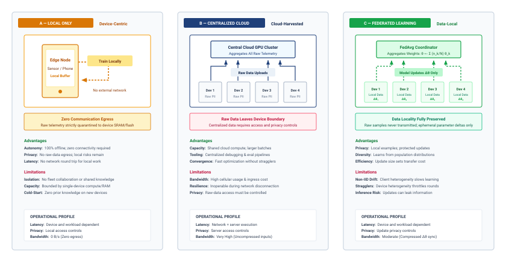

:::

Decentralized, continuous learning rewrites the rules of system design. The system no longer operates in climate-controlled data centers with effectively infinite power; it must confront the severe physical and algorithmic limits of edge devices.

## Design Constraints {#sec-edge-intelligence-design-constraints-c776}

Fine-tuning a neural network on a smartphone is constrained by power and heat. A GPU training cluster may consume megawatts, while a smartphone sustains only a few watts before throttling and bursts toward `{python} EdgeMobilePowerEnvelope.burst_high_str` for brief periods. Even held at that burst ceiling, an idealized `{python} EdgeMobilePowerEnvelope.battery_wh_str` battery would be exhausted in about `{python} EdgeMobilePowerEnvelope.burst_battery_hours_str`, and thermal discomfort or throttling would end the workload sooner. On-device learning must therefore use compute, memory, and data sparingly.

The constraints on parameters, operations, and data interact multiplicatively rather than additively, creating a constrained optimization problem far more challenging than inference-only deployment. The most important shift concerns what compression is for. Quantization shrinks bytes per weight, pruning removes unnecessary parameters, and knowledge distillation transfers behavior into a smaller architecture, while on-device learning turns these tools from optional optimizations into baseline feasibility requirements. This compression baseline, established here, is what later sections build on rather than re-derive.

On-device learning operates under the same efficiency constraints as inference but with training-specific amplifications that make optimization far more demanding. Where inference requires a single forward pass through the network, training demands forward propagation, gradient computation through backpropagation, and weight updates, increasing memory requirements by 4--12$\times$ and computational costs by 2--3$\times$ when activations, gradients, and optimizer state are included. These amplifications are why the compression baseline is non-negotiable at the edge: training within these device constraints would be impossible without it.

The fundamental engineering challenges that shape on-device learning implementation follow directly from these motivations. Enabling learning on the device requires completely rethinking conventional assumptions about where and how machine learning systems operate. In centralized environments, models are trained with access to extensive compute infrastructure, large and curated datasets, and generous memory and energy budgets. At the edge, none of these assumptions hold, creating a fundamentally different design space.

These constraints define eligibility for a federated round. Model footprint and trainable state determine which device tiers can participate. Sparse, nonuniform data determines how much signal each local update can extract. Limited compute determines when training can run at all. A policy that exceeds the budget on weaker devices changes the population represented in the aggregate, even if it improves throughput on stronger devices.

### Quantifying training overhead on edge devices {#sec-edge-intelligence-quantifying-training-overhead-edge-devices-3e4c}

Beyond the compression baseline, training amplifies memory footprint\index{Memory footprint!on-device training}, memory bandwidth\index{Memory bandwidth!training amplification}, and hardware utilization\index{Hardware utilization!edge constraints} pressures in ways that are specific to local adaptation, and these pressures compound rather than add. @Tbl-training-amplification quantifies how compute operations grow 2--3$\times$ and energy consumption can balloon 10--50$\times$, while the empirical memory decomposition in @fig-training-memory-amplifier isolates the dominant contributors—particularly stashed activations and Adam optimizer state—that create a representative $9\times$ amplification over static weights.

| **Constraint Dimension** | **Inference**                               | **Training Amplification**                                    | **Impact on Design**                                               |
|:-------------------------|:--------------------------------------------|:--------------------------------------------------------------|:-------------------------------------------------------------------|
| **Memory Footprint**     | Model weights + single activation map       | Weights + full activation cache + gradients + optimizer state | 4--12$\times$ increase; forces aggressive compression              |
| **Compute Operations**   | Forward pass only                           | Forward + backward + weight update                            | 2--3$\times$ increase; limits model complexity                     |
| **Memory Bandwidth**     | Sequential weight reads                     | Bidirectional data flow for gradients                         | Additional traffic depends on update scope and activation schedule |
| **Energy per Sample**    | Single inference operation                  | Multiple gradient steps with convergence                      | 10--50$\times$ increase; requires opportunistic scheduling         |
| **Data Requirements**    | Current inputs; no training labels required | Local update examples, often sparse or noisy                  | Necessitates sample-efficient methods                              |
| **Hardware Utilization** | Optimized for forward passes                | Different access patterns for backprop                        | Inference accelerators may not help training                       |

: **Training Amplifies Inference Constraints**: On-device learning operates under the same efficiency constraints as inference but with training-specific amplifications that make optimization dramatically more challenging. This table quantifies how each constraint dimension intensifies when transitioning from running pretrained models to adapting them locally. Amplification factors assume standard backpropagation without optimizations like gradient checkpointing. {#tbl-training-amplification}

@Fig-training-memory-amplifier breaks down this amplification in two complementary views: Panel (a) exposes why a 10M-parameter FP32 model jumps from 40 MB during inference to 360 MB during training—with activations alone consuming 200 MB and Adam state adding 80 MB—while Panel (b) tracks how this $9\times$ multiplier persists across model scales from 1M to 100M parameters. The broader 4--12$\times$ range depends on optimizer choice, batch size, activation checkpointing, and how many layers are updated.

::: {#fig-training-memory-amplifier fig-env="figure" fig-pos="htb" fig-cap="**The training memory amplifier**: (a) On a linear axis, the training stack for a 10M-parameter FP32 model shows what fills memory: gradients match the weights, Adam state doubles them, and activations dominate. (b) On a log axis, inference and training totals keep the same ratio from 1M to 100M parameters. The configuration is illustrative (activations assumed at 5$\times$ the weights), producing a representative 9$\times$ amplification." fig-alt="Two panels. Left: linear stacked bar for a 10M-parameter model, inference 40 MB against training 360 MB made of weights 40, gradients 40, optimizer state 80, and activations 200 MB. Right: log-scale paired bars of inference and training totals for 1M, 10M, and 100M parameter models, each labeled 9 times."}

```{python}
#| echo: false
# ┌─────────────────────────────────────────────────────────────────────────────
# │ TRAINING MEMORY AMPLIFIER (FIGURE)
# ├─────────────────────────────────────────────────────────────────────────────
# │ Context: @fig-training-memory-amplifier—inference vs training memory
# │
# │ Goal: Show what fills training memory and that the ratio holds across scale.
# │ Show: (a) linear stacked composition for the 10M-parameter model;
# │       (b) inference vs training totals for 1M/10M/100M on a log axis.
# │ How: FP32 weights from parameter count; gradients = weights, Adam state =
# │      2x weights, activations = 5x weights (stated illustrative assumption).
# │      Stacks stay on a linear axis so segment heights are proportional.
# │
# └─────────────────────────────────────────────────────────────────────────────
# ┌── 1. CANVAS ────────────────────────────────────────────────────────────────
from binder.tools.figures import style as book_style
import numpy as np

import matplotlib.pyplot as plt

book_style.set_book_style()
COLORS = book_style.COLORS
fig, (ax1, ax2) = plt.subplots(1, 2, figsize=(9.0, 4.4), gridspec_kw={'width_ratios': [1, 1.25]})

# ┌── 2. ARRAYS ────────────────────────────────────────────────────────────────
scales_m = [1, 10, 100]
weights = np.array([(params * MILLION * BYTES_FP32).to(MB).magnitude for params in scales_m])
grads = weights
opt_state = weights * 2
activations = weights * 5
total_training = weights + grads + opt_state + activations
amplification = total_training / weights

# ┌── 3a. RENDER: composition, linear axis (10M model) ─────────────────────────
k = 1
parts = [
    ('Weights', weights[k], COLORS['BlueL'], COLORS['BlueLine'], '//'),
    ('Gradients', grads[k], '#A7B1BC', 'white', None),
    ('Optimizer state (Adam)', opt_state[k], '#6B7785', 'white', None),
    ('Activations', activations[k], COLORS['BlueLine'], 'white', None),
]
ax1.bar(0, weights[k], 0.55, color=COLORS['BlueL'], edgecolor=COLORS['BlueLine'], hatch='//')
bottom = 0.0
for name, val, fc, ec, hatch in parts:
    ax1.bar(1, val, 0.55, bottom=bottom, color=fc, edgecolor=ec, hatch=hatch)
    ax1.text(1.34, bottom + val / 2, f'{name}  {val:.0f} MB', va='center', ha='left', fontsize=8.5, color=COLORS['primary'])
    bottom += val
ax1.text(0, weights[k] + 8, f'{weights[k]:.0f} MB', ha='center', va='bottom', fontsize=8.5, color=COLORS['primary'])
ax1.text(1, bottom + 8, f'{bottom:.0f} MB', ha='center', va='bottom', fontsize=8.5, fontweight='bold', color=COLORS['primary'])
ax1.set_xticks([0, 1])
ax1.set_xticklabels(['Inference', 'Training'])
ax1.set_xlim(-0.5, 3.1)
ax1.set_ylim(0, bottom * 1.12)
ax1.set_ylabel('Memory (MB, linear)')
ax1.set_title('(a) Composition, 10M parameters', fontsize=10, loc='left')
ax1.grid(axis='x', visible=False)

# ┌── 3b. RENDER: totals across scale, log axis ────────────────────────────────
x = np.arange(len(scales_m))
w = 0.36
ax2.bar(x - w / 2, weights, w, label='Inference (weights only)', color=COLORS['BlueL'], edgecolor=COLORS['BlueLine'])
ax2.bar(x + w / 2, total_training, w, label='Training (total)', color=COLORS['BlueLine'], edgecolor=COLORS['BlueLine'])
for i, amp in enumerate(amplification):
    ax2.text(
        x[i] + w / 2,
        total_training[i] * 1.25,
        f'{amp:.0f}$\\times$',
        ha='center',
        va='bottom',
        fontsize=9,
        fontweight='bold',
        color=COLORS['primary'],
    )
ax2.set_yscale('log')
ax2.set_ylim(1, 20000)
ax2.grid(axis='x', visible=False)
ax2.set_axisbelow(True)
ax1.set_axisbelow(True)
ax2.set_xticks(x)
ax2.set_xticklabels([f'{p}M params' for p in scales_m])
ax2.set_ylabel('Memory (MB, log)')
ax2.set_title('(b) Totals across model scale', fontsize=10, loc='left')
ax2.legend(loc='upper left', fontsize=8, frameon=True, facecolor='white', framealpha=0.95, edgecolor='#CBD5E1')

plt.tight_layout()
plt.show()
plt.close()
```

:::

#### Peak memory usage {#sec-edge-intelligence-peak-memory-usage-a2ae}

```{python}
#| echo: false
# ┌── LEGO ───────────────────────────────────────────────
# │ Context: Peak memory usage — smartphone RAM envelope.
class EdgeSmartphoneRamRecap:
    smartphone_ram = Platforms.Mobile.ram
    from mlsysim.fmt import fmt_qty_int

    # ┌── 4. OUTPUT (Formatting) ──────────────────────────────────────────────
    smartphone_ram_gb_str = fmt_memory_capacity(smartphone_ram, unit=GiB, precision=0, commas=False)
```

Memory consumption during training is not static. It fluctuates dynamically, reaching a maximum during the backward pass when activations, gradients, and optimizer states must coexist. This peak memory usage determines whether a model can be trained on a device. For a 10M parameter model on a smartphone with `{python} EdgeSmartphoneRamRecap.smartphone_ram_gb_str` RAM, the 40 MB of FP32 weights might spike to over 200 MB during backpropagation as activations, gradients, and optimizer states accumulate, competing directly with the operating system and foreground applications for the device's limited memory. Techniques like gradient checkpointing mitigate this by discarding intermediate activations during the forward pass and recomputing them on-demand during the backward pass [@chen2016training]. This approach trades extra computation for lower peak memory; the exact savings depend on which activations are checkpointed and how much recomputation the device can tolerate.

These amplifications explain why standard optimization techniques fail when applied to training workloads without modification. Each constraint category shapes on-device learning system design, requiring approaches that build on but extend beyond inference-focused methods.

::: {#chk-edge-intelligence-device-training-constraints .callout-checkpoint title="On-device training constraints"}

Verify understanding of how training amplifies edge constraints:

- [ ] Training memory blowup: Explain why on-device training typically requires 4$\times$ to 12$\times$ more memory than on-device inference for the same model.
- [ ] Starved NPU: Explain how a fast NPU can still sit idle when the training pipeline cannot keep data and activations moving within the device's memory budget.
- [ ] Backward-pass OOM: Explain why a 10M parameter model can still trigger out-of-memory errors during the backward pass on a smartphone with `{python} EdgeAdaptationTierProfile.smartphone_ram_gb_str` of RAM.
- [ ] Checkpointing energy: Evaluate the claim that gradient checkpointing reduces the total energy consumed by on-device training.

:::

@Fig-ondevice-pretraining stages this selective adaptation pipeline across three operational phases: centralized meta-training on generic cloud data (Stage 1), cost-benefit layer ranking where the device's compute and memory envelope defines a sharp cut boundary (Stage 2), and on-device execution where only unmasked layers above the threshold receive local updates while lower layers remain frozen (Stage 3). This selective fine-tuning\index{Fine-Tuning!selective, on-device} confines backpropagation to high-utility parameters, enabling learning within tightly bounded resource budgets.

::: {#fig-ondevice-pretraining fig-env="figure" fig-pos="htb" fig-cap="**On-device pretraining and selective fine-tuning**: (1) The full network is meta-trained in the cloud on generic data. (2) Each layer or channel group is ranked by its expected adaptation benefit per unit of device cost, and the device's data, compute, and memory budget sets the cut. (3) On the device, only units above the cut are updated on local data while the rest stay frozen. Scores and cut position are schematic." fig-alt="Three stages. Stage 1, meta-train in the cloud: layers 1 to 3 and a head, all blue and trainable. An arrow labeled theta leads to stage 2, rank: horizontal bars for each layer, short gray bars for layers 1 and 2 and long blue bars for layer 3 and the head, with a red dashed cut line rising from a dashed box labeled device budget, data, compute, memory. An arrow labeled mask leads to stage 3, update on device: layers 1 and 2 gray and frozen, layer 3 and head blue and trainable."}
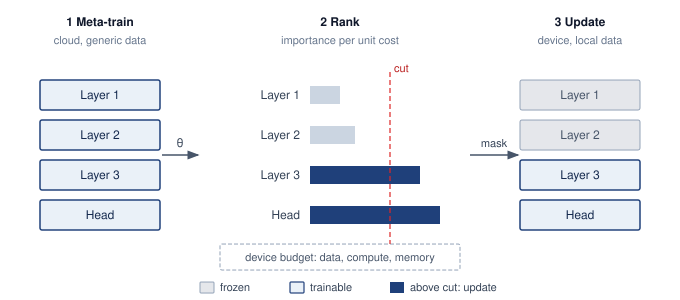

:::

### Model constraints {#sec-edge-intelligence-model-constraints-9232}

```{python}
#| echo: false
# ┌── LEGO ───────────────────────────────────────────────
# │ Context: Model constraints — MobileNetV2 and STM32F4 sizing.
from mlsysim import BYTES_FP32, BYTES_INT8, Datasets, Hardware, KB, KiB, MB, Models, param
from mlsysim.core.units import ureg
from mlsysim.fmt import (
    check,
    fmt_int,
    fmt_math,
    fmt_memory,
    fmt_memory_capacity,
    fmt_params,
    fmt_percent,
    fmt_qty_int,
)

class EdgeMobilenetSizing:
    mobilenetv2_alpha10_params = int(Models.Vision.MobileNetV2.parameters.to(param).magnitude)
    mobilenetv2_alpha05_total_params = int(Models.Vision.MobileNetV2_Alpha0_5.parameters.to(param).magnitude)
    mobilenetv2_alpha05_feature_params = int(Models.Vision.MobileNetV2_Alpha0_5FeatureExtractor.parameters.to(param).magnitude)
    stm32 = Hardware.Tiny.STM32F4
    stm32_sram = stm32.memory.sram_capacity
    stm32_clock = stm32.compute.clock_rate
    stm32_hidden_inputs = 1_000  # scenario assumption: dense-layer input features
    stm32_hidden_outputs = 10  # scenario assumption: hidden units
    imagenet = Datasets.ImageNet
    imagenet_width_px = imagenet.image_width
    imagenet_height_px = imagenet.image_height
    imagenet_channels = imagenet.image_channels
    bytes_per_channel = BYTES_INT8

    alpha10 = mobilenetv2_alpha10_params * BYTES_FP32
    alpha05_total = mobilenetv2_alpha05_total_params * BYTES_FP32
    alpha05_feature = mobilenetv2_alpha05_feature_params * BYTES_FP32
    imagenet_rgb_image = imagenet_width_px * imagenet_height_px * imagenet_channels * bytes_per_channel
    stm32_hidden_params = stm32_hidden_inputs * stm32_hidden_outputs + stm32_hidden_outputs
    stm32_hidden = stm32_hidden_params * BYTES_FP32
    imagenet_rgb_sram_pct = (imagenet_rgb_image / EdgeDeviceSpectrum.mcu_sram).to("").magnitude
    imagenet_rgb_sram_pct_rounded = round(imagenet_rgb_sram_pct * 10) / 10
    stm32_hidden_sram_pct = (stm32_hidden / stm32_sram).to_base_units().magnitude * 100

    check(alpha10 > alpha05_total > alpha05_feature, "MobileNetV2 storage variants should shrink in the expected order")
    check(imagenet_width_px == 224 and imagenet_height_px == 224 and imagenet_channels == 3, "ImageNet RGB input shape should remain 224x224x3.")
    check(0.55 <= imagenet_rgb_sram_pct <= 0.60, f"ImageNet RGB SRAM share drifted: {imagenet_rgb_sram_pct:.2f}.")
    check(20 <= stm32_hidden_sram_pct <= 21, f"STM32 hidden-layer SRAM share drifted: {stm32_hidden_sram_pct:.1f}%")

    # ┌── 4. OUTPUT (Formatting) ──────────────────────────────────────────────
    mobilenetv2_alpha10_params_m_str = fmt_params(mobilenetv2_alpha10_params, scale="M", precision=1, commas=False)
    mobilenetv2_alpha10_mb_str = fmt_qty_int(alpha10, MB, commas=False)
    mobilenetv2_alpha05_total_params_m_str = fmt_params(mobilenetv2_alpha05_total_params, scale="M", precision=1, commas=False)
    mobilenetv2_alpha05_total_mb_str = fmt_memory(alpha05_total, unit=MB, precision=1, commas=False)
    mobilenetv2_alpha05_feature_params_m_str = fmt_params(mobilenetv2_alpha05_feature_params, scale="M", precision=2, commas=False)
    mobilenetv2_alpha05_feature_mb_str = fmt_memory(alpha05_feature, unit=MB, precision=1, commas=False)
    imagenet_rgb_shape_math = fmt_math(rf"{imagenet_width_px}{{\times}}{imagenet_height_px}{{\times}}{imagenet_channels}")
    imagenet_rgb_image_kb_str = fmt_qty_int(imagenet_rgb_image, unit=KB, approx=True, commas=False)
    imagenet_rgb_sram_pct_str = fmt_percent(imagenet_rgb_sram_pct_rounded, precision=0, commas=False, style='prose')
    stm32_hidden_inputs_str = fmt_int(stm32_hidden_inputs, commas=True)
    stm32_hidden_kb_str = fmt_qty_int(stm32_hidden, KB, commas=False)
    stm32_hidden_sram_pct_str = fmt_percent(round(stm32_hidden_sram_pct) / 100, precision=0, commas=False, style='prose')
    stm32_hidden_outputs_str = fmt_int(stm32_hidden_outputs, commas=False)
    stm32_sram_kb_str = fmt_memory_capacity(stm32_sram, unit=KiB, precision=0, commas=False)
    stm32_clock_mhz_str = fmt_qty_int(stm32_clock, ureg.MHz, commas=False)
    model_budget = 4 * MB  # scenario assumption: compact on-device model budget
    model_budget_mb_str = fmt_qty_int(model_budget, MB, commas=False)
```

The structure and size of the machine learning model directly determine whether on-device training is possible. Cloud-deployed models can span billions of parameters and rely on multi-gigabyte memory budgets; models intended for on-device learning must conform to tight constraints on memory, storage, and computational complexity. These constraints tighten further during training, where gradient computation, parameter updates, and optimizer state management all demand additional resources beyond inference.

The scale of these constraints becomes concrete across the device spectrum. MobileNetV2, commonly used in mobile vision tasks, requires approximately `{python} EdgeMobilenetSizing.mobilenetv2_alpha10_mb_str` of storage in its standard configuration. While feasible for smartphones with gigabytes of available RAM, this far exceeds the `{python} EdgeDeviceSpectrum.mcu_sram_kb_str` of SRAM and `{python} EdgeDeviceSpectrum.arduino_flash_mb_str` of flash storage on microcontrollers\index{Microcontroller!memory constraints} such as the Arduino Nano 33 BLE Sense.[^fn-arduino-memory-wall] On such severely constrained platforms, even a single convolutional layer may exceed available RAM during training due to intermediate feature maps and gradient storage.

[^fn-arduino-memory-wall]: **Arduino Nano 33 BLE Sense**\index{Arduino Nano 33 BLE Sense!definition}\index{Arduino!memory constraint}: With `{python} EdgeDeviceSpectrum.mcu_sram_kb_str` SRAM, roughly `{python} EdgeDeviceSpectrum.memory_ratio_mult_str` smaller than a flagship smartphone's `{python} EdgeDeviceSpectrum.flagship_ram_gb_str`, a single `{python} EdgeMobilenetSizing.imagenet_rgb_shape_math` RGB image occupies `{python} EdgeMobilenetSizing.imagenet_rgb_image_kb_str` and consumes roughly `{python} EdgeMobilenetSizing.imagenet_rgb_sram_pct_str` of available memory; activation and gradient storage add several more live tensors, and optimizer state can push the training footprint far beyond the inference footprint. This means even a tiny convolutional neural network (CNN) layer can exceed total SRAM during backpropagation. This memory wall forces 8-bit or 4-bit quantization as a prerequisite, not an optimization.

The training process itself dramatically expands the effective memory footprint. Standard backpropagation caches activations for each layer during the forward pass, then reuses them during gradient computation in the backward pass. The constraint-amplification analysis established that this activation caching multiplies memory requirements compared to inference-only deployment. A seemingly modest 10-layer convolutional model processing $64{\times}64$ images may require 1 to 2 MB, well beyond the SRAM capacity of most embedded systems.

Model complexity also directly affects runtime energy consumption and thermal limits. In smartwatches or battery-powered wearables, sustained model training can rapidly deplete energy reserves or trigger thermal throttling that degrades performance. Training a full model using floating-point operations on these devices is often infeasible from an energy perspective, even when memory constraints are satisfied. Ultra-lightweight benchmarks such as MLPerf Tiny provide small quantized inference targets for severely constrained devices [@banbury2021mlperftiny]. On-device adaptation techniques\index{TinyML!on-device adaptation} then reduce training cost by freezing most parameters, reducing activation storage, or selecting sparse update sets [@cai2020tinytl; @kwon2024tinytrain].

The practical implications of battery and thermal constraints extend beyond just limiting training duration. Mobile devices must carefully balance training opportunities with user experience. Aggressive on-device training can cause noticeable device heating and rapid battery drain, leading to user dissatisfaction and potential app uninstalls. Smartphone ML workloads commonly operate within a sustained processing envelope of `{python} EdgeMobilePowerEnvelope.sustained_range_str` to prevent thermal discomfort, though they can burst to `{python} EdgeMobilePowerEnvelope.burst_range_str` for brief periods before thermal throttling kicks in. Training even modest models can easily exceed these sustainable power limits. This reality necessitates intelligent scheduling strategies: training during charging periods when external power is available, provided measured thermal headroom remains sufficient, using low-power cores for gradient computation when possible, and implementing thermal-aware duty cycling that pauses training when temperature thresholds are exceeded. Some systems even use device usage patterns, scheduling intensive adaptation only during overnight charging when the device is idle and connected to power.

These constraints demand that model architectures be designed for on-device learning from the outset. Large transformers and deep convolutional networks are simply not viable for on-device adaptation without partitioning\index{Model partitioning!on-device feasibility}, quantization, or offloading. Specialized lightweight architectures such as MobileNets,\index{MobileNet!definition}\index{MobileNet!efficiency} SqueezeNet [@iandola2016squeezenet], and EfficientNet [@tan2019efficientnet] address resource-constrained inference through mechanisms such as depthwise separable convolutions,[^fn-depthwise-flop-savings] bottleneck/fire modules, and compound model scaling. Quantization and selective updates are then separate deployment and adaptation choices layered on top of the architecture.

[^fn-depthwise-flop-savings]: **Depthwise Separable Convolutions**\index{Depthwise Separable Convolution!definition}\index{Depthwise Separable Convolution!parameter reduction}: Decomposes a standard convolution into a per-channel depthwise filter followed by a $1{\times}1$ pointwise combination. For a $3{\times}3$ convolution with 512 input/output channels, this reduces parameters from 2.36 M to about 267 K, an 8.8$\times$ reduction in weight storage and arithmetic, though not in activation storage. The intermediate depthwise output can add saved state, so training-memory savings depend on tensor shapes and whether the implementation fuses, retains, or recomputes that intermediate.

Modularity is a key design property. MobileNets [@howard2017mobilenets] and MobileNetV2 [@sandler2018] can be configured with different width multipliers and resolution settings to balance performance and resource usage. A complete MobileNetV2 with width multiplier $\alpha_{\text{width}}=1.0$ has approximately `{python} EdgeMobilenetSizing.mobilenetv2_alpha10_params_m_str` parameters (`{python} EdgeMobilenetSizing.mobilenetv2_alpha10_mb_str` in FP32). With $\alpha_{\text{width}}=0.5$, the complete 1000-class model has approximately `{python} EdgeMobilenetSizing.mobilenetv2_alpha05_total_params_m_str` parameters (`{python} EdgeMobilenetSizing.mobilenetv2_alpha05_total_mb_str`), while a feature-extractor-only deployment with a small task-specific head can be as small as `{python} EdgeMobilenetSizing.mobilenetv2_alpha05_feature_params_m_str` parameters (`{python} EdgeMobilenetSizing.mobilenetv2_alpha05_feature_mb_str`), fitting within a `{python} EdgeMobilenetSizing.model_budget_mb_str` model budget.

### Data constraints {#sec-edge-intelligence-data-constraints-303e}

Model architecture determines the memory and computational baseline for on-device learning, but data availability and quality introduce equally fundamental limitations that shape every aspect of the learning process. Data available to on-device ML systems differs dramatically from the large, curated datasets used in cloud-based training. At the edge, data is locally collected, temporally sparse, and often unstructured or unlabeled. The resulting challenges in volume, quality, and statistical distribution directly affect the reliability and generalizability of on-device learning.

Data volume is severely limited by both storage constraints and the sporadic nature of user interaction. A smart fitness tracker may collect motion data only during physical activity, generating relatively few labeled samples per day. If a user exercises for 30 minutes, only a few hundred data points might be available for training, compared to the thousands or millions required for effective supervised learning. The scarcity forces a shift from data-rich to data-efficient algorithms.

On-device data is also frequently non-i.i.d. [@zhao2018federated], creating statistical challenges that cloud-based systems rarely encounter. A voice assistant deployed across households encounters wide variation in accents, languages, speaking styles, and command patterns. Smartphone keyboards adapt to individual typing patterns, autocorrect preferences, and multilingual usage that varies widely between users. The heterogeneity complicates both model convergence and the design of update mechanisms that must generalize across devices while maintaining personalization.

Label scarcity compounds the distribution problem. Most edge-collected data is unlabeled by default, requiring systems to learn from weak or implicit supervision signals. A smartphone camera may capture thousands of images throughout the day, but only a few are associated with meaningful user actions (tagging, favoriting, or sharing) that could serve as implicit labels. In many applications, including anomaly detection in sensor data and gesture recognition adaptation, explicit labels may be entirely unavailable, making traditional supervised learning infeasible without alternative methods for weak supervision or unsupervised adaptation.

Data quality introduces further challenges. Embedded systems such as environmental sensors or automotive ECUs experience fluctuations in sensor calibration, environmental interference, or mechanical wear, leading to corrupted or drifting input signals over time. Without centralized validation systems to detect and filter these errors, they silently degrade learning performance.

Privacy and security concerns impose the most restrictive constraints, often making data sharing architecturally impossible rather than merely undesirable. Sensitive information such as health data, personal communications, or behavioral patterns must be protected from unauthorized access under legal and ethical requirements. On-device learning must therefore rely on techniques that enable local adaptation without ever exposing sensitive information, fundamentally reshaping how learning systems are designed and validated.

### Compute constraints {#sec-edge-intelligence-compute-constraints-4d6d}

The edge hardware landscape provides the computational substrate for machine learning, spanning from microcontrollers like STM32F4 and ESP32 at the most constrained end, to mobile-class processors with dedicated AI accelerators (Apple Neural Engine, Qualcomm Hexagon, Google Tensor) in the middle, and high-capability edge devices at the upper end. While these devices offer varying levels of inference capabilities (computational throughput, memory bandwidth, and energy efficiency when executing pretrained models), training workloads exhibit fundamentally different computational characteristics that reshape hardware utilization patterns.

On-device learning must operate within computational envelopes that differ from cloud-based training infrastructure by factors of hundreds or thousands in raw capacity. The key difference: backpropagation requires significantly higher memory bandwidth than inference due to gradient computation and activation caching, weight updates create write-heavy access patterns unlike inference's read-only operations, and optimizer state management demands additional memory allocation. Hardware perfectly adequate for inference may prove entirely inadequate for adaptation, even when updating only a small parameter subset.

At the most constrained end, devices such as the STM32F4[^fn-stm32-memory-limits] or ESP32-S3\index{ESP32!definition} microcontrollers\index{Microcontroller!compute and energy constraints} offer only a few hundred kilobytes of SRAM and limited compute and power budgets [@warden2020tinyml]. Although these families include single-precision floating-point support, practical ML deployments commonly rely on quantized or fixed-point kernels for efficiency. Libraries like CMSIS-NN [@lai2018cmsis] provide optimized neural network kernels for Arm Cortex-M processors, achieving 4.6$\times$ runtime improvement through fixed-point arithmetic and single instruction, multiple data optimizations. These severe limitations preclude conventional deep learning libraries and require models designed for quantized arithmetic and minimal runtime memory allocation. Quantization-aware training[^fn-qat-power-efficiency] can prepare models for efficient quantized inference. Executing local updates requires a separately supported training path, potentially with selective updates, quantized gradients, or a compact floating-point working set.

[^fn-stm32-memory-limits]: **STM32F4 Microcontroller**\index{STM32F4 Microcontroller!definition}\index{STM32F4!compute constraints}: With `{python} EdgeMobilenetSizing.stm32_sram_kb_str` SRAM, a `{python} EdgeMobilenetSizing.stm32_clock_mhz_str` clock speed, and a single-precision floating-point unit, the main constraint is not the absence of floating point but the tiny memory and energy envelope. A dense layer with `{python} EdgeMobilenetSizing.stm32_hidden_inputs_str` input features and `{python} EdgeMobilenetSizing.stm32_hidden_outputs_str` hidden units requires approximately `{python} EdgeMobilenetSizing.stm32_hidden_kb_str` for weights and biases in FP32, consuming about `{python} EdgeMobilenetSizing.stm32_hidden_sram_pct_str` of total SRAM before accounting for activations or gradients. Local updates must therefore fit around the device's primary workload and power budget, and INT8 or fixed-point kernels remain preferable when accuracy allows.

[^fn-qat-power-efficiency]: **Quantization-Aware Training (QAT)**\index{Quantization-Aware Training!definition}: Simulates quantization during training to adapt the model to low-precision inference [@jacob2018; @krishnamoorthi2018quantizing]. Fake-quantization operations commonly retain floating-point training tensors, so QAT does not itself imply integer backward kernels or a smaller training-state budget. On-device adaptation must separately establish supported update arithmetic, state storage, and measured energy costs.

The practical implications are stark: while the STM32F4 microcontroller can run a simple linear regression model with a few hundred parameters, training even a small convolutional neural network would immediately exceed its memory capacity. In these severely constrained environments, neural updates are often limited to simple algorithms such as stochastic gradient descent (SGD),[^fn-sgd-microcontroller-training] while non-neural adaptation may use $k$-means clustering to update centroids or thresholds for sensor anomaly detection. Both can be implemented using integer arithmetic and minimal memory overhead, representing a fundamental departure from data-center machine learning practice.

[^fn-sgd-microcontroller-training]: **SGD (Stochastic Gradient Descent)**\index{Stochastic Gradient Descent!definition}: Plain SGD stores parameters and gradients, while Adam additionally retains two moment arrays. At the same precision and with all arrays resident, that is four parameter-sized arrays instead of two, before activations and workspace. Momentum, master weights, gradient accumulation, and offloading change this accounting. Optimizer choice also affects convergence, so lower state cost must be evaluated against the updates needed to reach the quality target.

Moving up the computational hierarchy, mobile-class hardware represents improvement but still operates under severe constraints. Platforms including the Qualcomm Snapdragon, Apple Neural Engine,[^fn-neuralengine-hardware-evolution] and the Google Tensor system-on-chip (SoC)\index{Google Tensor SoC!definition} provide significantly more compute power than microcontrollers, often featuring dedicated AI accelerators and optimized support for 8-bit or mixed-precision\index{Mixed-Precision Training!definition} matrix operations. These accelerators offer dedicated matrix multiplication units, on-chip memory hierarchies, and power management features specifically designed for neural network inference, with varying support for local training workloads. While these platforms can support more sophisticated training routines, including full backpropagation over compact models, they still fall far short of the computational throughput and memory bandwidth available in centralized data centers. For instance, training a lightweight transformer\index{Lightweight Transformers!definition} on a smartphone is technically feasible but must be tightly bounded in both time and energy consumption to avoid degrading the user experience, highlighting the persistent tension between learning capabilities and practical deployment constraints.

[^fn-neuralengine-hardware-evolution]: **Apple Neural Engine**\index{Apple Neural Engine!definition}\index{Neural Engine!on-device training}: Mobile neural accelerators provide dedicated inference capacity. Their peak operation rates do not establish that a training runtime can execute backward operators on the same hardware. Local adaptation requires measuring the supported update path, including any CPU or GPU fallback, against the device's memory, thermal, and battery budgets.

Published benchmark results from MLPerf Tiny and official vendor data make these physical boundaries concrete. On the log-log operational landscape plotted in @fig-edge-inference-landscape, edge hardware stratifies into three distinct tiers separated by a 100$\times$ vertical energy chasm. Dedicated neural processors such as the Syntiant Core 2 and STM32N6 NPU populate the sub-millijoule MCU/ASIC band (30 to 444 $\mu$J at sub-5 ms latency for keyword spotting and visual wake words), Google Coral occupies the intermediate accelerator band (~4.8 mJ), and edge GPUs like the Jetson AGX Orin operate near 15 mJ for ResNet-50. Because the tiers run different benchmark workloads, with keyword spotting and small-image tasks on the microcontroller tier and ResNet-50 on the edge GPU, the roughly 100$\times$ gap mixes hardware efficiency with workload size. It still explains why the microcontroller tier can run on battery for months while an edge GPU cannot, which shapes the feasible design space for on-device learning.

::: {#fig-edge-inference-landscape fig-env="figure" fig-pos="htb" fig-cap="**The edge inference landscape**: Published inference latency and energy measurements from MLPerf Tiny and official benchmarks reveal three distinct hardware tiers separated by approximately 100$\times$ in energy per inference; because the tiers run different workloads (keyword spotting and small-image tasks versus ResNet-50), the gap mixes hardware efficiency with workload size. Dedicated neural processors (Syntiant, STM32N6) achieve keyword spotting in under 5 ms at 30--160 microjoules, while edge GPUs (Jetson Orin) deliver sub-millisecond latency at 15 mJ." fig-alt="Scatter plot of inference latency vs. energy per inference showing three hardware tiers from MCU to edge GPU."}

```{python}
#| echo: false
# ┌─────────────────────────────────────────────────────────────────────────────
# │ EDGE INFERENCE LANDSCAPE (FIGURE)
# ├─────────────────────────────────────────────────────────────────────────────
# │ Context: @fig-edge-inference-landscape—MLPerf Tiny/vendor benchmarks
# │
# │ Goal: Scatter latency vs energy for Syntiant, STM32N6, Coral, Jetson;
# │       show 100× energy gap between tiers.
# │ Show: Scatter by tier; log-scale axes; device labels.
# │ How: devices (name, lat_ms, energy_uJ, tier); book_style.setup_plot().
# │
# └─────────────────────────────────────────────────────────────────────────────
# ┌── 1. CANVAS ────────────────────────────────────────────────────────────────
# │ Scatter latency vs energy for Syntiant, STM32N6, Coral, Jetson;
import numpy as np
import matplotlib.pyplot as plt
from binder.tools.figures import style as book_style
from matplotlib.patches import FancyBboxPatch

fig, ax, COLORS, plt = book_style.setup_plot(figsize=(8.5, 5.2))

# Data: (name, task, latency_ms, energy_uJ, tier)
# Tier 0: MCU/ASIC (Syntiant, STM32N6)
# Tier 1: Edge accelerator (Coral)
# Tier 2: Edge GPU (Jetson)

# ┌── 2. ARRAYS ────────────────────────────────────────────────────────────────
# Sourced from Literature.EdgeInferenceBenchmarks (MLPerf Tiny + vendor data);
# tiers: 0 = MCU/ASIC, 1 = edge accelerator, 2 = edge GPU.
devices = [(d["name"], d["latency_ms"], d["energy_uj"], d["tier"]) for d in Literature.EdgeInferenceBenchmarks.list]

tier_colors = [COLORS["GreenLine"], COLORS["OrangeLine"], COLORS["BlueLine"]]
tier_labels = ["MCU/ASIC (Syntiant, STM32N6)", "Edge Accelerator (Coral)", "Edge GPU (Jetson)"]
tier_fills = [COLORS["GreenL"], COLORS["OrangeL"], COLORS["BlueL"]]

# Plot each device

label_styles = {
    "Syntiant Core 2\n(KWS, low-energy)": {
        "ha": "left",
        "va": "center",
        "xytext": (8.1, 0),
    },
    "Syntiant Core 2\n(KWS, high-perf)": {
        "ha": "left",
        "va": "center",
        "xytext": (9, 0),
    },
    "STM32N6 NPU\n(KWS, low-power)": {
        "ha": "right",
        "va": "bottom",
        "xytext": (-9, -7),
    },
    "STM32N6 NPU\n(IC, high-perf)": {
        "ha": "right",
        "va": "bottom",
        "xytext": (-8, -8),
    },
    "Syntiant Core 2\n(VWW)": {
        "ha": "center",
        "va": "center",
        "xytext": (1, -16),
    },
    "Syntiant Core 2\n(IC)": {
        "ha": "center",
        "va": "bottom",
        "xytext": (0, -22),
    },
    "Google Coral\nEdge TPU": {
        "ha": "right",
        "va": "center",
        "xytext": (-10, 0),
    },
    "Jetson AGX Orin\n(ResNet-50)": {
        "ha": "center",
        "va": "top",
        "xytext": (0, 21),
    },
}

default_label_style = {
    "ha": "left",
    "va": "center",
    "xytext": (8, 0),
    "fontsize": 6.5,
}

# ┌── 3. RENDER ────────────────────────────────────────────────────────────────
for name, lat, energy, tier in devices:
    ax.scatter(lat, energy, color=tier_colors[tier], s=100, zorder=5, edgecolors="white", linewidths=0.5)

    style = default_label_style.copy()
    style.update(label_styles.get(name, {}))

    ax.annotate(
        name,
        xy=(lat, energy),
        xytext=style["xytext"],
        textcoords="offset points",
        fontsize=style.get("fontsize", 6.5),
        color=tier_colors[tier],
        ha=style["ha"],
        va=style["va"],
    )

# Draw approximate tier boundary regions
from matplotlib.patches import FancyBboxPatch

# MCU/ASIC region
ax.axhspan(20, 600, xmin=0, xmax=1, alpha=0.06, color=COLORS["GreenLine"])
# Edge accelerator region
ax.axhspan(2000, 8000, xmin=0, xmax=1, alpha=0.06, color=COLORS["OrangeLine"])
# Edge GPU region
ax.axhspan(10000, 25000, xmin=0, xmax=1, alpha=0.06, color=COLORS["BlueLine"])

# Tier labels on right margin

# ┌── 4. DECORATE ──────────────────────────────────────────────────────────────
ax.text(20, 400, "MCU/ASIC Tier", fontsize=8, color=COLORS["GreenLine"], fontweight="bold", ha="right", va="center", alpha=0.8)
ax.text(20, 4800, "Edge Accelerator Tier", fontsize=8, color=COLORS["OrangeLine"], fontweight="bold", ha="right", va="center", alpha=0.8)
ax.text(20, 15000, "Edge GPU Tier", fontsize=8, color=COLORS["BlueLine"], fontweight="bold", ha="right", va="center", alpha=0.8)

# Annotate the ~100× energy gap
ax.annotate("", xy=(3, 150), xytext=(3, 15000), arrowprops=dict(arrowstyle="<->", color=COLORS["primary"], lw=1.5))
ax.text(3.6, 1500, "~100×\nenergy gap", fontsize=9, fontweight="bold", color=COLORS["primary"], ha="left", va="center")

# Legend with custom markers
for i, (label, color) in enumerate(zip(tier_labels, tier_colors)):
    ax.scatter([], [], color=color, s=80, label=label, edgecolors="white", linewidths=0.5)
ax.legend(loc='lower left', fontsize=8, frameon=True, facecolor='white', framealpha=0.95, edgecolor='#CBD5E1')

ax.set_xscale("log")
ax.set_yscale("log")
ax.set_xlabel("Inference Latency (ms)")
ax.set_ylabel("Energy per Inference (μJ)")
ax.set_xlim(0.3, 30)
ax.set_ylim(15, 30000)

plt.tight_layout()
plt.show()
plt.close()
```

:::

These computational limitations become especially acute in real-time or battery-operated systems. The foreground latency budgets established in @sec-edge-intelligence-alternative-approaches-decision-criteria-bd36 constrain the interference local training may introduce; they do not require training to finish within an inference deadline. The harder constraint is that adaptation cannot have the device to itself. In a smartphone-based speech recognizer, on-device adaptation must seamlessly coexist with primary inference workloads without interfering with response latency or system responsiveness. Similarly, in wearable medical monitors, training must occur opportunistically during carefully managed windows (typically during periods of low activity or charging) to preserve battery life and avoid thermal management issues.

Beyond raw computational capacity, the architectural implications of these hardware constraints extend into fundamental system design choices. Training operations exhibit fundamentally different memory access patterns than inference workloads: gradient computation, activation storage, and optimizer updates add memory traffic whose magnitude depends on which parameters train and which intermediate states are retained. These transfers can create bottlenecks that pure computational metrics do not capture. Hardware designs can address these challenges with specialized support, but a particular device must expose that support through its training runtime. Mixed-precision datapaths may execute different formats in forward and backward kernels when those kernels exist. Sparse-update savings require an execution path that can actually skip the selected work; zero gradients alone do not establish reduced hardware cost (@sec-edge-intelligence-sparse-updates-879b). Near-memory compute architectures[^fn-nearmemory-edge-training] reduce data movement costs by performing gradient updates directly adjacent to weight storage, addressing the memory bandwidth bottleneck. However, many edge accelerators remain fundamentally optimized for inference workloads, creating hardware-software co-design opportunities for on-device training accelerators designed to handle the unique demands of local adaptation.

[^fn-nearmemory-edge-training]: **Near-Memory Computing**\index{Near-Memory Computing!definition}: Places processing elements adjacent to or within memory arrays, reducing the data movement that often dominates arithmetic energy in conventional architectures [@horowitz2014]. Near-memory accelerator designs such as TensorDIMM illustrate how moving tensor operations closer to memory can improve throughput and energy behavior for memory-bound deep learning workloads [@kwon2019]. For edge training, where gradient computation generates write-heavy access patterns that overwhelm cache hierarchies, this architectural shift could make some forms of on-device backpropagation more practical.

#### The mobile memory wall {#sec-edge-intelligence-mobile-memory-wall-5ffe}

```{python}
#| echo: false
# ┌── LEGO ───────────────────────────────────────────────
# │ Context: Mobile memory wall — H100 HBM vs. flagship mobile DRAM bandwidth.
class EdgeH100BwRecap:
    h100_mem_bw = Hardware.Cloud.H100.memory.bandwidth
    a17_mem_bw = Hardware.Mobile.iPhone15Pro.memory.bandwidth
    sd8g3_mem_bw = Hardware.Mobile.Snapdragon8Gen3.memory.bandwidth
    from mlsysim.fmt import check, fmt_multiple, fmt_qty_int

    # ┌── 2. EXECUTE (The Compute) ────────────────────────────────────────
    ratio_vs_a17 = (h100_mem_bw / a17_mem_bw).to("").magnitude
    ratio_vs_sd8g3 = (h100_mem_bw / sd8g3_mem_bw).to("").magnitude

    # ┌── 3. GUARD (Invariants) ───────────────────────────────────────────
    check(a17_mem_bw < sd8g3_mem_bw < h100_mem_bw, "Mobile DRAM bandwidth should sit below HBM.")
    check(30 < ratio_vs_sd8g3 < ratio_vs_a17 < 80, f"HBM-to-mobile ratio drifted: {ratio_vs_sd8g3:.0f}-{ratio_vs_a17:.0f}x")

    # ┌── 4. OUTPUT (Formatting) ──────────────────────────────────────────────
    h100_mem_bw_gb_per_s_str = fmt_qty_int(h100_mem_bw, GB / second)
    a17_mem_bw_gb_per_s_str = fmt_qty_int(a17_mem_bw, GB / second)
    sd8g3_mem_bw_gb_per_s_str = fmt_qty_int(sd8g3_mem_bw, GB / second)
    ratio_low_str = fmt_int(round(ratio_vs_sd8g3), commas=False)
    ratio_high_mult_str = fmt_multiple(round(ratio_vs_a17), precision=0, commas=False)
```

While mobile NPUs deliver impressive TOPS, the "memory wall" that @sec-compute-memory-wall examines becomes an impassable barrier for large-scale models on edge devices. The same bandwidth wall that limits training updates is easiest to see in mobile language-model decode: if weights and KV state cannot stream through memory fast enough, no advertised TOPS figure can rescue the workload. Recent analysis highlights how autoregressive decode shifts large language model (LLM) inference pressure toward memory and interconnect rather than peak arithmetic throughput [@ma2026challenges]. The quantitative disparity is stark: data-center HBM3 on an H100 provides `{python} EdgeH100BwRecap.h100_mem_bw_gb_per_s_str` of peak unidirectional DRAM memory bandwidth, while flagship mobile systems sit near `{python} EdgeH100BwRecap.a17_mem_bw_gb_per_s_str` (A17 Pro, LPDDR5) to `{python} EdgeH100BwRecap.sd8g3_mem_bw_gb_per_s_str` (Snapdragon 8 Gen 3, LPDDR5X), a gap of roughly `{python} EdgeH100BwRecap.ratio_low_str`--`{python} EdgeH100BwRecap.ratio_high_mult_str`.

::: {.column-margin}
{width="100%" fig-alt="Two-rung violet bandwidth ladder on a log scale. Top rung, data-center HBM3 at 3,350 GB/s. Bottom rung, mobile memory at 77 GB/s."}

*Datacenter high-bandwidth memory (HBM) outruns flagship mobile memory bandwidth by about `{python} EdgeH100BwRecap.ratio_low_str` times.*
:::

A bandwidth gap of this size gives a corresponding gap in the bandwidth-only token-rate ceiling only when both devices stream the same bytes per token and sustain the same fraction of their peak bandwidth. Actual generation speed also depends on precision, batching, cache reuse, and runtime overhead, so the peak-bandwidth ratio alone does not predict a measured token-rate ratio. On-device LLM serving therefore requires aggressive quantization (INT4 or even INT2) as a **bandwidth survival strategy**\index{Bandwidth Survival Strategy!definition}, rather than merely a capacity optimization. Reducing model size by 8$\times$ effectively increases the relative bandwidth, making interactive generation speeds possible on mobile hardware.

::: {#psp-edge-intelligence-bandwidth-binding-constraint .callout-perspective title="Why bandwidth, not TOPS, is the binding constraint"}

The bandwidth gap binds because each generated token streams the model's weights from memory to the compute units, so the data term $(\DataVolume / \Bandwidth)$ of the single-machine iron law (@sec-vol2-introduction-fleet-law) dominates the compute term whenever weights exceed on-chip cache, which is the case for billion-parameter models on mobile-class silicon. That is also why quantization shrinks $\DataVolume$ rather than arithmetic per token.

The practical corollary follows: when ranking edge accelerator options for transformer decoding, the figure of merit is the GB/s a chip can sustain to its on-package memory, not the peak TOPS on its spec sheet. The two can diverge by orders of magnitude on mobile-class silicon.

:::

### Edge hardware integration challenges {#sec-edge-intelligence-edge-hardware-integration-challenges-a240}

Beyond the individual constraints of models, data, and computation, on-device learning systems must navigate the underlying physics of mobile computing: power dissipation, thermal limits, and energy budgets. These physical constraints are fundamental design drivers that determine the entire feasible space of on-device learning algorithms.

#### Energy and thermal constraint analysis {#sec-edge-intelligence-energy-thermal-constraint-analysis-3133}

Energy and thermal management represent the most challenging aspects of on-device learning system design, as they directly impact user experience and device longevity. Mobile devices operate under strict power budgets that fundamentally determine feasible model complexity and training schedules.

```{python}
#| echo: false
#| label: edge-battery-notebook
# ┌─────────────────────────────────────────────────────────────────────────────
# │ BATTERY LIFE FOR ON-DEVICE LEARNING (NOTEBOOK)
# ├─────────────────────────────────────────────────────────────────────────────
# │ Context: "Battery Drain: The Cost of Edge Learning" .callout-notebook
# │
# │ Goal: Quantify the battery impact of a background fine-tuning job on a phone.
# │ Show: battery_drain_pct ≈ 15%—inline in notebook result.
# │ How: Drain = (Power_W * Duration_H) / Battery_Wh * 100.
# │
# └─────────────────────────────────────────────────────────────────────────────
from mlsysim.core.units import MINUTES_PER_HOUR, hour, ureg, watt
from mlsysim.fmt import check, fmt, fmt_energy, fmt_percent, fmt_power, fmt_qty_int, fmt_time
from mlsysim import ReferenceStats

class EdgeBattery:
    # ┌── 1. LOAD ──────────────────────────────────────────
    p_train_w = 4.5  # Unconstrained (unthrottled) SoC draw during training; above the sustained envelope
    p_train = p_train_w * watt
    t_train_min = 30  # 30 minute adaptation job
    battery = ReferenceStats.PhoneBattery.EnergyWh  # Modern flagship smartphone battery
    battery_wh = battery.to(watt * hour).magnitude
    # ┌── 2. EXECUTE ───────────────────────────────────────
    t_train_h = t_train_min / MINUTES_PER_HOUR
    energy = p_train * t_train_h * hour
    energy_wh = energy.to(watt * hour).magnitude
    drain_pct = (energy_wh / battery_wh) * 100
    # ┌── 3. GUARD ─────────────────────────────────────────
    check(14 < drain_pct < 16, f"Drain {drain_pct:.1f}% unexpected")
    # ┌── 4. OUTPUT ────────────────────────────────────────
    battery_power_w_str = fmt_power(p_train, unit=watt, precision=1, commas=False)
    battery_duration_min_str = fmt_time(round(t_train_min), 'minute', precision=0, commas=False, style='word')
    battery_duration_h_str = fmt_time(t_train_h, 'hour', precision=1, commas=False)
    battery_energy_wh_str = fmt_energy(energy, unit=Wh, precision=2, commas=False)
    battery_drain_pct_str = fmt_percent(round(drain_pct) / 100, precision=0, commas=False, style='prose')
    battery_total_wh_str = fmt_energy(battery, unit=Wh, precision=0, commas=False)
```

::: {#nbk-edge-intelligence-battery-drain-cost-edge-learning .callout-notebook title="Battery drain: The cost of edge learning"}

**Problem**: A team is designing a background fine-tuning job for a personalized voice assistant on a smartphone. Run unconstrained, the training job draws `{python} EdgeBattery.battery_power_w_str`, above the `{python} EdgeMobilePowerEnvelope.sustained_range_str` sustained envelope given earlier, and takes `{python} EdgeBattery.battery_duration_min_str` to complete. If the phone has a `{python} EdgeBattery.battery_total_wh_str` battery, how much of the user's battery will this "invisible" update consume?

**Math**:

1. Total energy: `{python} EdgeBattery.battery_power_w_str` $\times$ `{python} EdgeBattery.battery_duration_h_str` = `{python} EdgeBattery.battery_energy_wh_str`.
2. **Battery impact**\index{Battery Impact!definition}: `{python} EdgeBattery.battery_energy_wh_str`/`{python} EdgeBattery.battery_total_wh_str` = `{python} EdgeBattery.battery_drain_pct_str`.

**Systems insight**: Consuming `{python} EdgeBattery.battery_drain_pct_str` of a user's battery for a background task is a severe violation of mobile UX principles, equivalent to losing an hour of screen-on time. This is why on-device training is typically restricted to **opportunistic scheduling**\index{Opportunistic Scheduling!definition}: It only runs when the device is plugged in, connected to Wi-Fi, and thermally stable. Designing for the edge means respecting the user's energy budget as strictly as the model's accuracy budget.

:::

This battery calculation is the local edge-learning version of a broader energy constraint: training must fit the user's energy budget, not only the model's accuracy target. A production design therefore has to account for energy at scheduling time, compare local computation against communication cost, and defer learning when the user's device cannot absorb the update.

That decision can be expressed as a background-work admission condition\index{Admission Control!edge adaptation}. Let $E_{\text{update}}$ be the predicted energy for one adaptation window, $E_{\text{slack}}$ the energy the policy permits before the next charging opportunity, $P_{\text{device}}$ the current sustained power, $P_{\text{update}}$ the adaptation increment, and $P_{\text{thermal}}$ the thermally sustainable limit. Let $L_{\text{lat,fg}}$ be measured foreground latency, $\Delta L_{\text{lat,fg}}^{\text{wc}}$ the worst-case latency increase under concurrent adaptation, and $\Deadline$ the foreground deadline. The runtime admits an update only if

$$
E_{\text{update}} \le E_{\text{slack}}
\quad \land \quad
P_{\text{device}} + P_{\text{update}} \le P_{\text{thermal}}
\quad \land \quad
L_{\text{lat,fg}} + \Delta L_{\text{lat,fg}}^{\text{wc}} \le \Deadline.
$$ {#eq-edge-background-admission}

Charging can enlarge the energy allowance, but it does not waive the thermal or foreground-latency tests. The quantities must come from device- and workload-specific profiling, and the runtime must revoke admission when the measured envelope changes. Shorter update windows, a lower duty cycle, or a smaller trainable parameter set can make a rejected update feasible; allowing background learning to consume the foreground deadline cannot.

The same test also decides who teaches a shared model. Passing it correlates with hardware class, charging habits, and connectivity, so devices that are old, rarely charged, or thermally tight contribute few updates, and the population a federated model learns from is the admitted population rather than the deployed one (principle \ref{pri-participation-selects-population}). The admission policy that protects each device is therefore also a sampling policy, and @sec-edge-intelligence-client-scheduling-f675 measures the skew it creates.

::: {.column-margin}
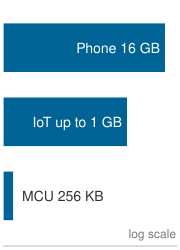{width="100%" fig-alt="Vertical ladder of three blue bars on a log scale showing device-class memory: phone 8 GB, IoT device 1 GB, microcontroller 256 KB."}

*Device memory spans more than four orders of magnitude, phone to microcontroller.*
:::

#### Memory hierarchy optimization {#sec-edge-intelligence-memory-hierarchy-optimization-8396}

Complementing the thermal and power challenges, memory hierarchy constraints create another fundamental bottleneck that shapes on-device learning system design. The constraint-amplification analysis shows that these limitations affect both static model storage and the dynamic memory requirements during training, often pushing systems beyond their practical limits.

The device memory hierarchy spans several orders of magnitude across different device classes, each presenting distinct constraints for on-device learning. A mainstream current phone provides about `{python} EdgeAdaptationTierProfile.smartphone_ram_gb_str` total system memory, and premium models reach `{python} EdgeDeviceSpectrum.flagship_ram_gb_str`, but only part of that remains available for application workloads after accounting for operating system requirements and background processes. Budget Android devices operate with about `{python} EdgeAdaptationTierProfile.budget_phone_ram_gb_str` total system memory, leaving roughly `{python} EdgeAdaptationTierProfile.budget_phone_available_low_gb_str`--`{python} EdgeAdaptationTierProfile.budget_phone_available_high_gb_str` available for ML workloads after OS overhead consumes significant resources. IoT embedded systems provide `{python} EdgeAdaptationTierProfile.iot_memory_low_mb_str`--`{python} EdgeAdaptationTierProfile.iot_memory_high_gb_str` total memory that must be shared between system tasks and application data, creating severe constraints for any learning algorithms. Microcontrollers offer only `{python} EdgeDeviceSpectrum.mcu_sram_kb_str`--`{python} EdgeDeviceSpectrum.mcu_sram_high_mb_str` SRAM, requiring extreme optimization and careful memory management that fundamentally limits the complexity of models that can adapt on such platforms.

The memory expansion during training creates particularly acute challenges that often determine system feasibility. Standard backpropagation requires caching intermediate activations for each layer during the forward pass, which are then reused during gradient computation in the backward pass, creating substantial memory overhead. A MobileNetV2-scale model that fits comfortably for inference can exceed the available memory budget once activations, gradients, and optimizer state are included, making training impossible without aggressive optimization. Quantization, pruning, and distillation can each reduce model footprint or update cost [@jacob2018; @han2015deep; @hinton2015distilling], but their gains are workload-specific and do not combine automatically. These techniques must be validated together to achieve the compression required for practical deployment.

Cache optimization therefore becomes critical for achieving acceptable performance with constrained memory pools. Modern mobile SoCs feature complex memory hierarchies with L1 cache (32--64 KB), L2 cache (1--8 MB), and system memory (4--16 GB) that exhibit 10--100$\times$ latency differences between levels, creating severe performance cliffs when working sets exceed cache capacity. Training workloads that exceed cache capacity face dramatic performance degradation due to memory bandwidth bottlenecks that can slow training by orders of magnitude. Successful on-device learning systems must carefully design data access patterns to maximize cache hit rates, often requiring specialized memory layouts that group related parameters for spatial locality, carefully sized mini-batches that fit entirely within cache constraints, and sophisticated gradient accumulation strategies that minimize expensive memory bus traffic.

The memory bandwidth limitations become particularly acute during training. While inference workloads primarily read model weights sequentially, training requires bidirectional data flow for gradient computation and weight updates. This increased memory traffic can saturate the memory subsystem, creating bottlenecks that limit training throughput regardless of computational capacity. Advanced implementations employ techniques such as gradient checkpointing\index{Gradient Checkpointing!edge memory} (recomputing selected activations during the backward pass instead of storing them) to trade computation for memory [@chen2016training], and mixed-precision training to reduce bandwidth requirements while maintaining numerical stability.

#### Mobile AI accelerator optimization {#sec-edge-intelligence-mobile-ai-accelerator-optimization-67fe}

Accelerator choice matters less as a peak-TOPS comparison than as a question of which training primitive the hardware can sustain. Apple Neural Engine, Qualcomm Hexagon DSP\index{Hexagon DSP!training runtime support}, and Google Tensor devices pair specialized arithmetic with different compiler and runtime contracts, and their inference ratings do not rank their training capability. A fixed-precision inference engine such as the Neural Engine favors adaptation that keeps most work in the forward pass, such as recomputing a small classifier head from a handful of local examples. Programmable DSPs with vector units and mixed-precision arithmetic make backpropagation on compact models plausible when the software stack exposes the needed operators. Mobile TPU-class accelerators integrate tightly with framework runtimes, which can lower the cost of update coordination, but that integration does not by itself establish accelerator support for the backward pass.

A local update may therefore execute on a CPU or GPU even when inference uses the dedicated neural accelerator. The admission decision requires tracing the actual backward and optimizer path, including fallback and transfers, then measuring time, memory, and energy under foreground load. The write-heavy gradient flow, adaptive-precision datapaths, sparse-update support, and near-memory compute described under @sec-edge-intelligence-compute-constraints-4d6d are what distinguish a training-capable accelerator from an inference-only one. Architecture selection therefore shapes quantization strategy, gradient computation, federated communication, and thermal policy together; it is not a peak-throughput choice.

### Holistic resource management strategies {#sec-edge-intelligence-holistic-resource-management-strategies-9e4b}

The constraint analysis in this section reveals three challenge categories that define the on-device learning design space, and each category drives a corresponding solution pillar. Resource amplification, where training increases memory requirements by 4--12$\times$, computational costs by 2--3$\times$, and energy per sample by 10--50$\times$ once repeated gradient steps are counted, necessitates Model Adaptation approaches that reduce the scope of parameter updates while preserving learning capability. Information scarcity, including limited local datasets, non-IID distributions, privacy restrictions on data sharing, and minimal supervision, drives data efficiency\index{Data efficiency!edge constraints} solutions that extract maximum learning signal from minimal examples. Coordination challenges, such as device heterogeneity, intermittent connectivity, distributed validation complexity, and scalability requirements, motivate federated coordination\index{Federated coordination!edge constraints} mechanisms that enable privacy-preserving collaboration across device populations.

@Tbl-constraint-solution-mapping reveals how this on-device learning constraint-solution mapping\index{On-device learning!constraint-solution mapping} creates a systematic engineering framework: Model Adaptation addresses memory and compute limits through selective parameter updates, Data Efficiency maximizes learning from scarce private samples, and Federated Coordination enables privacy-preserving collaboration. Rather than viewing these as independent techniques, robust systems orchestrate all three approaches to create coherent adaptive systems that operate effectively within edge constraints.

| **Constraint Category**     | **Key Challenges**                                                                                                         | **Solution Approach**                                                                                                                                                          |
|:----------------------------|:---------------------------------------------------------------------------------------------------------------------------|:-------------------------------------------------------------------------------------------------------------------------------------------------------------------------------|
| **Resource Amplification**  | • Training workloads (4--12$\times$ memory)<br>• Memory limitations<br>• Power constraints                                 | **Model Adaptation**<br>• Parameter-efficient updates<br>• Selective layer fine-tuning<br>• Low-rank adaptations                                                               |
| **Information Scarcity**    | • Limited local datasets<br>• Non-IID distributions<br>• Privacy restrictions                                              | **Data Efficiency**<br>• Few-shot and streaming adaptation<br>• Experience replay<br>• Compressed representations                                                              |
| **Coordination Challenges** | • Device heterogeneity<br>• Intermittent connectivity<br>• Distributed validation complexity<br>• Scalability requirements | **Federated Coordination**<br>• Federated averaging and asynchronous aggregation<br>• Secure aggregation and differential privacy<br>• Client selection and straggler handling |

: **Constraint-Solution Mapping**: The three fundamental constraint categories in on-device learning each drive corresponding solution approaches through direct necessity. {#tbl-constraint-solution-mapping tbl-colwidths="[24,34,42]"}

Each solution pillar extends compression and distributed-systems tools to address a specific constraint category. No single pillar suffices on its own, but their integration creates systems capable of meaningful adaptation within the severe constraints of edge deployment environments.

## Model Adaptation {#sec-edge-intelligence-model-adaptation-6a82}

Personalizing a billion-parameter model on a smartwatch with `{python} EdgeAdaptationTierProfile.wearable_system_memory_mb_str` of total system memory first requires a base model that fits the device. Freezing parameters reduces training state but does not remove the storage or execution cost of the frozen network. Once that baseline fits, the system can train only a compact, strategically placed parameter set. Resource-efficient model adaptation\index{On-device adaptation!parameter-efficient strategies} then determines both the local work a device can complete and the shared update format the fleet can aggregate.

```{python}
#| echo: false
#| label: local-storage-wall-notebook
# ┌─────────────────────────────────────────────────────────────────────────────
# │ LOCAL STORAGE WALL (NOTEBOOK)
# ├─────────────────────────────────────────────────────────────────────────────
# │ Context: "The Hidden Cost of Personalization" .callout-notebook
# │
# │ Goal: Quantify the storage savings of using adapters vs full fine-tuning.
# │ Show: per_context_savings ≈ 200x—inline in notebook result.
# │ How: Ratio = Size_Full/Size_Adapter.
# │
# └─────────────────────────────────────────────────────────────────────────────
from mlsysim.fmt import check, fmt, fmt_int, fmt_memory, fmt_qty_int

class StorageWall:
    # ┌── 1. LOAD ──────────────────────────────────────────
    model_params_m = 10
    n_contexts = 10
    bytes_per_param = BYTES_FP32  # FP32 for training/fine-tuning
    adapter_params = 50000  # Rank-64 adapter
    # ┌── 2. EXECUTE ───────────────────────────────────────
    size_full = memory_from_params(model_params_m * Mparam, bytes_per_param / param)
    size_adapter = memory_from_params(adapter_params * param, bytes_per_param / param)
    total_full = n_contexts * size_full
    total_adapter = size_full + n_contexts * size_adapter
    size_adapter_kb = size_adapter.to(KB).magnitude
    per_context_savings = (size_full / size_adapter).to_base_units().magnitude
    total_storage_savings = (total_full / total_adapter).to_base_units().magnitude
    # ┌── 3. GUARD ─────────────────────────────────────────
    check(per_context_savings == 200, f"Ratio {per_context_savings} unexpected")
    check(9 < total_storage_savings < 10, f"Total savings {total_storage_savings:.1f} unexpected")
    # ┌── 4. OUTPUT ────────────────────────────────────────
    ls_contexts_str = fmt_int(n_contexts, commas=False)
    ls_full_mb_str = fmt_qty_int(size_full, MB, commas=False)
    ls_adapter_kb_str = fmt_qty_int(size_adapter, KB, commas=False)
    ls_adapter_mb_str = fmt_memory(size_adapter, unit=MB, precision=1, commas=False)
    ls_savings_ratio_mult_str = fmt_multiple(round(per_context_savings), commas=False, precision=0)
    ls_total_full_mb_str = fmt_qty_int(total_full, MB, commas=False)
    ls_total_adapter_mb_str = fmt_qty_int(total_adapter, MB, commas=False)
    ls_total_savings_ratio_mult_str = fmt_multiple(total_storage_savings, precision=1, commas=False)
```

:::: {#nbk-edge-intelligence-hidden-cost-personalization .callout-notebook title="The hidden cost of personalization"}

**Problem**: A team is deploying a 10M parameter vision model to a smartphone with support for `{python} StorageWall.ls_contexts_str` different "User Contexts" (Home, Office, Car, etc.). If a full fine-tuned model requires `{python} StorageWall.ls_full_mb_str`, how much storage does using residual adapters save instead?

**Math**:

1. **Full fine-tuning**\index{Full Fine-Tuning!definition}: `{python} StorageWall.ls_contexts_str` contexts $\times$ `{python} StorageWall.ls_full_mb_str` = `{python} StorageWall.ls_total_full_mb_str`.
2. **Adapter approach**\index{Adapter Approach!definition}: (1 $\times$ `{python} StorageWall.ls_full_mb_str` backbone) + (`{python} StorageWall.ls_contexts_str` $\times$ `{python} StorageWall.ls_adapter_kb_str` adapters) $\approx$ `{python} StorageWall.ls_total_adapter_mb_str`.
3. **Storage savings**\index{Storage Savings!definition}: `{python} StorageWall.ls_total_full_mb_str`/`{python} StorageWall.ls_total_adapter_mb_str` $\approx$ `{python} StorageWall.ls_total_savings_ratio_mult_str` total device storage reduction.
4. **Per-context efficiency**\index{Per-Context Efficiency!definition}: `{python} StorageWall.ls_full_mb_str`/`{python} StorageWall.ls_adapter_mb_str` = `{python} StorageWall.ls_savings_ratio_mult_str`.

**Systems insight**: Personalization is a storage density problem. On a device with limited flash memory, storing `{python} StorageWall.ls_contexts_str` versions of the same `{python} StorageWall.ls_full_mb_str` model quickly consumes `{python} StorageWall.ls_total_full_mb_str`. Sharding the model into a frozen backbone and dynamic adapters reduces the marginal cost of a new user context by `{python} StorageWall.ls_savings_ratio_mult_str`. In the edge fleet, modularity is the only way to scale intelligence without exhausting the physical hardware.

::: {.column-margin}
```{=latex}
\vspace*{-4mm}
```
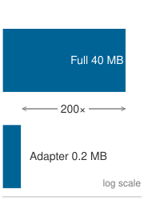{width="100%" fig-alt="Blue memory ladder comparing a 40 MB full model copy with a 0.2 MB adapter, with 200x marked as an annotation."}

*Adapters make per-user personalization cheap vs. full model copies.*
:::

::::

The engineering challenge centers on navigating a fundamental trade-off space: adaptation expressivity vs. resource consumption. At one extreme, updating all parameters provides maximum flexibility but exceeds edge device capabilities. At the other extreme, omitting adaptation preserves resources but fails to capture user-specific patterns. Effective on-device learning systems must operate in the middle ground, balancing three engineering criteria: hardware resource envelopes, user-specific variation, and systems integration. The device resource envelope dictates which adaptation approaches are feasible; a tiny wearable-class device with `{python} EdgeAdaptationTierProfile.tiny_wearable_ram_mb_str` RAM requires fundamentally different strategies than a smartphone with `{python} EdgeAdaptationTierProfile.smartphone_ram_gb_str`. Meanwhile, user-specific variation determines how much adaptation complexity the system actually demands; simple preference tuning requires only bias updates, whereas complex domain shifts require richer representations. Finally, systems integration determines whether the adaptation technique fits existing inference pipelines, federated coordination protocols, and operational monitoring infrastructure for lifecycle management.

The selection of adaptation techniques follows this matching logic, starting with lightweight approaches (@sec-edge-intelligence-weight-freezing-3407) and progressing to more expressive but resource-intensive methods (@sec-edge-intelligence-sparse-updates-879b). Each technique represents a distinct point in the engineering trade-off space. On top of the compression baseline established in @sec-edge-intelligence-design-constraints-c776, model adaptation adds a second move: complete model retraining is neither necessary nor feasible at the edge, so systems use pretrained representations strategically and adapt only the minimal parameter subset required to capture local variations: *preserve what works globally, adapt what matters locally*. Those three criteria turn adaptation into a device-matching decision. Weight freezing fits severe memory limits by updating only bias terms or final layers. Structured updates use low-rank and residual adaptations when the device can afford more expressiveness but not full fine-tuning. Sparse updates reserve scarce training capacity for the parameters with the highest adaptation value.

### Weight freezing {#sec-edge-intelligence-weight-freezing-3407}

The most direct approach to on-device learning is to freeze the majority of a model's parameters and adapt only a minimal subset. **Bias-only adaptation**\index{Bias-Only Adaptation!definition} holds all weights fixed and updates only the bias terms (scalar offsets applied after linear or convolutional layers). The constraint reduces trainable parameters by 100--1000$\times$, simplifies memory management during backpropagation, and helps mitigate overfitting when training data is sparse or noisy.

Consider a standard neural network layer:
$$
\mathbf{y} = \mathbf{W} \mathbf{x} + \mathbf{b}
$$
where $\mathbf{W} \in \mathbb{R}^{m \times n}$ is the weight matrix, $\mathbf{b} \in \mathbb{R}^m$ is the bias vector, and $\mathbf{x} \in \mathbb{R}^n$ is the input. In full training, gradients are computed and applied to both $\mathbf{W}$ and $\mathbf{b}$. In bias-only adaptation, the system freezes the weight tensor ($\Delta \mathbf{W} = \mathbf{0}$) and computes gradients exclusively for the bias:
$$
\mathbf{W} \leftarrow \mathbf{W}, \quad \mathbf{b} \leftarrow \mathbf{b} - \eta \frac{\partial \mathcal{L}}{\partial \mathbf{b}}
$$

This reduces the number of stored gradients and optimizer states, enabling training to proceed under memory-constrained conditions. The smaller trainable state helps only if the device also supports the arithmetic and activation schedule required by the update. @Lst-bias-adaptation makes the constraint explicit: all convolutional and fully connected weights remain frozen, while only bias terms adapt to local data.

::: {#lst-bias-adaptation lst-cap="**Bias-Only Adaptation**: Freezes model parameters except for biases to reduce memory usage and allow on-device learning."}

```{.python}
# Freeze all parameters
for name, param in model.named_parameters():
    param.requires_grad = False

# Enable gradients for bias parameters only
for name, param in model.named_parameters():
    if "bias" in name:
        param.requires_grad = True
```

:::

This pattern restricts optimizer updates to bias terms. Gradients may still propagate through frozen weights to reach trainable biases in earlier layers, so freezing parameters alone does not eliminate backward computation or saved activation state. This is valuable when adapting pretrained models to user-specific or device-local data where the core representations remain relevant but require calibration.

Tiny Transfer Learning (TinyTL) [@cai2020tinytl] targets activation memory as well as trainable state. Freezing a linear layer's weights removes the need to retain its input for computing weight gradients, but nonlinearities and normalization can still require backward state. TinyTL combines bias adaptation with activation and normalization choices that reduce that state; optional lite residual modules restore some adaptation capacity at an additional memory cost.

@Fig-tinytl-architecture diagrams the structural contrast between full fine-tuning (Panel A) and TinyTL\index{TinyTL!memory optimization} (Panel B). Whereas standard fine-tuning computes gradients for every intermediate layer weight, TinyTL freezes the convolutional backbone (gray blocks) and confines parameter updates to lightweight residual side-paths and bias vectors $\mathbf{b}$ (blue blocks). Crucially, the dashed backward-pass arrow spans the full network depth in both architectures: TinyTL's memory reduction stems not from truncating the backward pass, but from avoiding the storage of intermediate feature maps needed to compute weight gradients.

::: {#fig-tinytl-architecture fig-env="figure" fig-pos="htb" fig-cap="**TinyTL adaptation paths**: (A) Full fine-tuning updates every weight and retains the state needed for their gradients. (B) TinyTL freezes the backbone weights (gray) and trains only each block's bias vector ($\mathbf{b}$), small lite residual modules beside the blocks, and the classifier (blue). The backward pass still traverses every frozen block to reach those biases, so the saving comes from what must stay live for it, not from a shorter backward path; the activation and normalization choices determine that state." fig-alt="Two panels. Panel A, full fine-tuning: input, three blue trainable blocks, and a blue classifier, with a dashed backward arrow spanning all blocks. Panel B, TinyTL: input, three gray frozen blocks each with a small blue bias chip labeled b and a blue lite residual module to its right, and a blue classifier, with a dashed backward arrow also spanning all blocks. Legend: frozen weights, trainable, backward pass extent."}
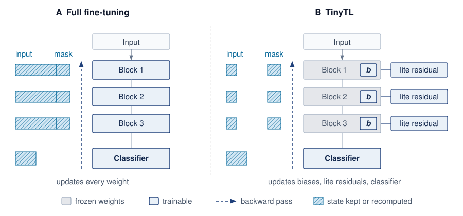
:::

The memory reduction is useful only when the frozen backbone remains expressive enough for the downstream task. The bias terms allow for minor but meaningful shifts in model behavior, particularly for personalization tasks. When domain shift is more significant, TinyTL can optionally incorporate small residual adapters to improve expressivity, all while preserving the system's tight memory and energy profile.

```{python}
#| echo: false
#| label: edge-tinytl-published-results
# ┌── LEGO ───────────────────────────────────────────────
# │ Context: TinyTL paragraph in Weight freezing.
# │ Scope: local — the chapter's only quantitative anchor for TinyTL.
# │ Show: Published training-memory saving vs. full fine-tuning and the
# │       memory overhead of the lite residual modules.
# │ How: Literature values quoted in the Cai et al. (NeurIPS 2020) abstract
# │      (arXiv:2007.11622, checked 2026-09-29); not yet in
# │      the Literature registry, so they stay local and tagged.
from mlsysim.fmt import check, fmt_multiple, fmt_percent

class EdgeTinyTlResults:
    # ┌── 1. LOAD ──────────────────────────────────────────
    memory_saving_vs_full = 6.5  # scenario assumption: Cai et al. 2020, "up to 6.5x" vs. full fine-tuning
    lite_residual_overhead = 0.038  # scenario assumption: Cai et al. 2020, lite residual adds 3.8% memory
    # ┌── 2. EXECUTE ───────────────────────────────────────
    full_to_tinytl_fraction = 1 / memory_saving_vs_full
    # ┌── 3. GUARD ─────────────────────────────────────────
    check(1 < memory_saving_vs_full < 20, "TinyTL memory saving should be a modest multiple.")
    check(0 < lite_residual_overhead < 0.1, "Lite residual overhead should be a few percent.")
    # ┌── 4. OUTPUT ────────────────────────────────────────
    memory_saving_mult_str = fmt_multiple(memory_saving_vs_full, precision=1, commas=False)
    lite_residual_overhead_pct_str = fmt_percent(lite_residual_overhead, precision=1, commas=False, style="prose")
    full_to_tinytl_pct_str = fmt_percent(round(full_to_tinytl_fraction * 100) / 100, precision=0, commas=False, style="prose")
```

TinyTL demonstrates that reducing saved activation state can matter more than reducing the number of trainable parameters alone [@cai2020tinytl]. On its image-classification transfer benchmarks, TinyTL reports training-memory savings of up to `{python} EdgeTinyTlResults.memory_saving_mult_str` relative to fine-tuning the full network with little accuracy loss, so the adaptation working set can shrink to roughly `{python} EdgeTinyTlResults.full_to_tinytl_pct_str` of the full fine-tuning footprint. The lite residual modules that recover adaptation capacity add only about `{python} EdgeTinyTlResults.lite_residual_overhead_pct_str` memory overhead in that study. Those savings depend on the selected feature extractor, input resolution, batch size, normalization, and residual-module configuration, and they do not establish that an arbitrary frozen backbone fits into microcontroller SRAM.

A device admission decision requires evaluating the peak working-memory budget partitioned in @fig-tinytl-memory. The architectural allocation stages frozen weights from nonvolatile flash into volatile working memory while reserving explicit headroom below the physical device ceiling $M_{\text{device}}$ for runtime and application state. Within the working memory envelope $M_{\text{peak}}$, three components compete for capacity: let $M_{\text{weights,resident}}$ be the backbone weights that must reside in working memory, $M_{\text{train}}$ the trainable parameters plus their gradients and optimizer state, $\ActivationMemoryActivations(t)$ the saved activation state, and $M_{\text{workspace}}(t)$ operator workspace. With all terms counted in bytes and disjoint, the required working memory is

$$
M_{\text{peak}} = M_{\text{weights,resident}} + M_{\text{train}} + \max_t\left[\ActivationMemoryActivations(t) + M_{\text{workspace}}(t)\right].
$$

Weights stored in nonvolatile memory still consume deployment storage; any staging buffers belong in $M_{\text{workspace}}(t)$. The maximum must follow the actual execution schedule because activation and workspace peaks need not coincide. Admission also reserves memory for the runtime and foreground application. Freezing weights removes their gradient and optimizer state, but does not make the frozen base or every backward dependency disappear.

::: {#fig-tinytl-memory fig-env="figure" fig-pos="htb" fig-cap="**Adaptation memory budget**: Working memory must hold the resident weights $M_{\text{weights,resident}}$, the trainable state $M_{\text{train}}$, and the peak of live activations plus workspace; together these form $M_{\text{peak}}$, which must fit under the device limit once the runtime and foreground application are reserved. Frozen weights kept in nonvolatile flash count toward storage, not working memory, until they are staged, and staging buffers belong to the workspace term. Segment heights are schematic, not to scale." fig-alt="Left: a green nonvolatile flash box holding frozen weights M weights,storage, with a dashed stage arrow into a working-memory stack. The stack, from bottom, holds resident weights M weights,resident in gray, trainable state M train in light blue, and max over t of M activations plus M workspace in blue; a bracket labels these three as M peak. Above them a dashed reserved block for runtime and app reaches a red dashed line labeled M device."}
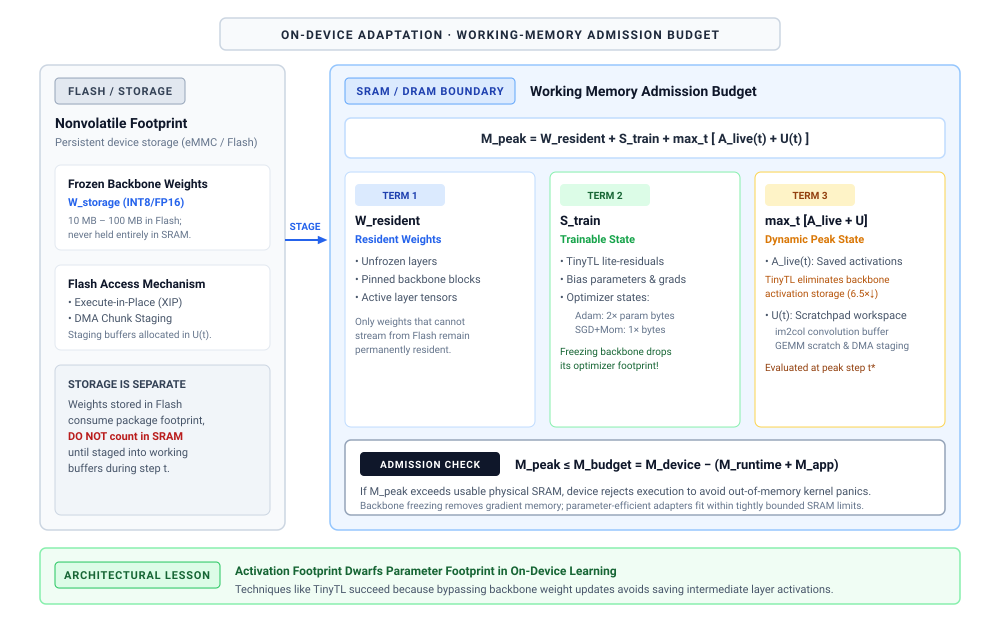
:::

### Structured parameter updates {#sec-edge-intelligence-structured-parameter-updates-f1a1}

While weight freezing provides computational efficiency and clear memory bounds, it severely limits model expressivity by constraining adaptation to a small parameter subset. When bias-only updates prove insufficient for capturing complex domain shifts or user-specific patterns, residual and low-rank techniques provide a middle ground between the extreme efficiency of weight freezing and the full expressivity of unrestricted fine-tuning. Rather than modifying existing parameters, these methods extend frozen models by adding small trainable components, such as residual adaptation modules [@houlsby2019parameter] or low-rank parameterizations [@hu2021lora]. The main body of the network remains fixed, while only the added components are optimized, so the model can respond to new data without giving up the memory and compute bounds that make on-device adaptation feasible.

::: {.column-margin .margin-pointer}
↩ Hardware memory bounds, optimizer state scaling, and precision footprints are developed in @sec-compute-memory-wall and @sec-performance-engineering-precision.
:::

#### Adapter-based adaptation {#sec-edge-intelligence-adapterbased-adaptation-6a9a}

A common implementation involves inserting residual adapters\index{Residual Adapter!parameter efficient finetuning}, which are small residual bottleneck layers, between existing layers in a pretrained model. Consider a hidden representation $\mathbf{h}$ passed between layers. A residual adapter introduces a transformation:
$$
\mathbf{h}' = \mathbf{h} + A(\mathbf{h})
$$
where $A(\cdot)$ is a trainable function, typically composed of two linear layers with a nonlinearity:
$$
A(\mathbf{h}) = \mathbf{W}_2 \, \sigma(\mathbf{W}_1 \mathbf{h})
$$
with $\mathbf{W}_1 \in \mathbb{R}^{r \times d}$ and $\mathbf{W}_2 \in \mathbb{R}^{d \times r}$, where $r \ll d$. This bottleneck design ensures that only a small number of parameters are introduced per layer.

The adapters act as learnable perturbations on top of a frozen backbone. Because they are small and sparsely applied, their weights add little storage, although their saved activations and optimizer state still count against the training budget, and they let the model shift its predictions in response to new inputs.

#### Low-rank techniques {#sec-edge-intelligence-lowrank-techniques-4570}

Another efficient strategy is to constrain weight updates themselves to a low-rank structure. Rather than updating a full matrix $\mathbf{W}$, the update is approximated as:
$$
\Delta \mathbf{W} \approx \mathbf{U} \mathbf{V}^T
$$
where $\mathbf{U} \in \mathbb{R}^{m \times r}$ and $\mathbf{V} \in \mathbb{R}^{n \times r}$, with $r \ll \min(m,n)$. This reduces the number of trainable parameters from $mn$ to $r(m + n)$.

```{python}
#| echo: false
# ┌── LEGO ───────────────────────────────────────────────
# │ Context: Low-rank update parameter count for a generic transformer layer.
# │ Scope: local — backs the rank-4 vs. full fine-tuning prose comparison.
from mlsysim.fmt import check, fmt_int, fmt_percent

class EdgeLowRankParams:
    # ┌── 1. LOAD ──────────────────────────────────────────
    layer_dim = 768  # scenario assumption: square weight matrix of a generic transformer layer
    lora_rank = 4  # scenario assumption: rank-4 low-rank update
    # ┌── 2. EXECUTE ───────────────────────────────────────
    full_params = layer_dim * layer_dim
    lora_params = layer_dim * lora_rank * 2  # down- and up-projection
    lora_reduction = 1 - lora_params / full_params
    # ┌── 3. GUARD ─────────────────────────────────────────
    check(full_params == 589_824, f"Full param count {full_params} unexpected")
    check(lora_params == 6_144, f"LoRA param count {lora_params} unexpected")
    check(0.98 < lora_reduction < 0.99, f"Reduction {lora_reduction:.3f} unexpected")
    # ┌── 4. OUTPUT ────────────────────────────────────────
    full_params_str = fmt_int(full_params)
    lora_params_str = fmt_int(lora_params)
    lora_reduction_pct_str = fmt_percent(round(lora_reduction * 100) / 100, precision=0, commas=False, style="prose")
```

The mathematical intuition behind this decomposition connects to fundamental linear algebra principles: any matrix can be expressed as a sum of rank-one matrices through singular value decomposition. Constraining updates to low rank (typically $r = 4$ to $16$) captures a restricted set of variation modes while reducing parameters. For a typical transformer layer with dimensions $768{\times}768$, full fine-tuning requires updating `{python} EdgeLowRankParams.full_params_str` parameters. With rank-4 decomposition, only $768{\times}4{\times}2 =$ `{python} EdgeLowRankParams.lora_params_str` parameters are updated, a `{python} EdgeLowRankParams.lora_reduction_pct_str` reduction. Whether this retains most of the adaptation quality depends on the task, rank, and base model; low-rank adaptation (LoRA) reports that low-rank adapters can match or approach full fine-tuning on several transformer adaptation benchmarks [@hu2021lora].

During adaptation, the new weight matrix is computed as:
$$
\mathbf{W}_{\text{adapted}} = \mathbf{W}_{\text{frozen}} + \mathbf{U} \mathbf{V}^T
$$

This formulation is commonly used in LoRA,[^fn-lora-adapter-efficiency] originally developed for transformer models [@hu2021lora] but broadly applicable across architectures. From a systems engineering perspective, LoRA makes the trainable adapter the artifact that can be stored, transmitted, scheduled, and rolled back separately from the frozen base model.

```{python}
#| echo: false
# ┌── LEGO ───────────────────────────────────────────────
# │ Context: LoRA parameter efficiency prose.
# │ Scope: chapter-anchor — LoRA section and federated sync prose share base-model footprint.
from mlsysim.fmt import check, fmt_memory, fmt_params

class EdgeLoraParameterEfficiency:
    # ┌── 1. LOAD ──────────────────────────────────────────
    base_model = Models.Language.Llama2_7B
    base_model_params = base_model.parameters
    # ┌── 2. EXECUTE ───────────────────────────────────────
    fp16_weight_footprint = base_model_params * BYTES_FP16
    # ┌── 3. GUARD ─────────────────────────────────────────
    check(6.5 <= base_model_params.to(Bparam).magnitude <= 7.5, "LoRA footprint example should remain 7B-parameter class.")
    check(13 <= fp16_weight_footprint.to(GB).magnitude <= 15, "FP16 footprint should remain about 14 GB.")
    # ┌── 4. OUTPUT ────────────────────────────────────────
    base_model_params_b_str = fmt_params(base_model_params, scale="B", precision=0, commas=False)
    fp16_weight_footprint_gb_str = fmt_memory(fp16_weight_footprint, unit=GB, precision=0, commas=False)
```

[^fn-lora-adapter-efficiency]: **LoRA (Low-Rank Adaptation)**\index{LoRA!definition}: @hu2021lora learn rank-$r$ decomposition matrices $\mathbf{A}$ and $\mathbf{B}$ instead of updating full weight matrices, reducing trainable parameters by 100--10,000$\times$ while maintaining much of the adaptation quality. For on-device learning, this compression is decisive, but it affects adapter state rather than the full model footprint: a model with `{python} EdgeLoraParameterEfficiency.base_model_params_b_str` parameters has about a `{python} EdgeLoraParameterEfficiency.fp16_weight_footprint_gb_str` FP16 weight footprint before gradients, optimizer state, and activations, while rank `{python} EdgeAdaptationTierProfile.mid_tier_lora_rank_str` LoRA can shrink the trainable adapter state to tens of megabytes. Practical phone deployment still requires storing, quantizing, or offloading the frozen base model.

@Fig-adapter-lora-arch traces the parallel dataflow of Low-Rank Adaptation (LoRA): input $\mathbf{x} \in \mathbb{R}^d$ bifurcates between a frozen full-rank matrix $\mathbf{W}_0 \in \mathbb{R}^{d \times d}$ (requiring zero gradient or optimizer state) and a trainable low-rank bottleneck formed by down-projection $\mathbf{A} \in \mathbb{R}^{r \times d}$ and up-projection $\mathbf{B} \in \mathbb{R}^{d \times r}$. Summing their outputs at the terminal addition node yields $\mathbf{h} = \mathbf{W}_0 \mathbf{x} + \mathbf{B}\mathbf{A} \mathbf{x}$, preserving original feature capacity while restricting gradient updates to rank $r \ll d$. For inference serving, folding the low-rank product directly into the base weights ($\mathbf{W}_0 + \mathbf{B}\mathbf{A}$) eliminates auxiliary execution latency entirely.

::: {#fig-adapter-lora-arch fig-env="figure" fig-pos="htb" fig-cap="**LoRA architecture**: The input $\mathbf{x}$ passes through the frozen base matrix $\mathbf{W}_0$ and, in parallel, through a trainable low-rank path: down-projection $\mathbf{A}$ ($r \times d$) and up-projection $\mathbf{B}$ ($d \times r$), which play the roles of $\mathbf{V}^T$ and $\mathbf{U}$ in the low-rank update above. Only $\mathbf{A}$ and $\mathbf{B}$ carry gradients and optimizer state. For serving, the product $\mathbf{B}\mathbf{A}$ can be folded into $\mathbf{W}_0$, so the adapted layer adds no inference latency." fig-alt="Input x splits into two paths. The upper path goes through a gray frozen matrix W0 of size d by d. The lower path goes through a blue trapezoid A of size r by d, narrows to r, then widens through blue trapezoid B of size d by r. The outputs W0 x and BA x add at a plus node to give output h, labeled merged for serving as W0 plus BA. A legend marks gray as frozen and blue as trainable."}
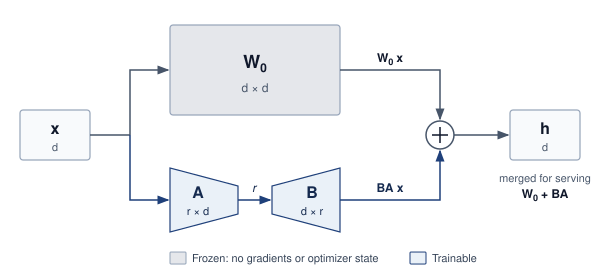

:::

Consider a mobile deployment where a language model with `{python} EdgeLoraParameterEfficiency.base_model_params_b_str` parameters has a `{python} EdgeLoraParameterEfficiency.fp16_weight_footprint_gb_str` FP16 weight footprint, before accounting for the additional gradients, optimizer states, and activations required by full fine-tuning. That footprint is impossible on smartphones with about `{python} EdgeAdaptationTierProfile.smartphone_ram_gb_str` total memory unless the base model is aggressively quantized, partitioned, or offloaded. LoRA with rank `{python} EdgeAdaptationTierProfile.mid_tier_lora_rank_str` can shrink the trainable adapter state to tens of megabytes, on the order of the `{python} EdgeAdaptationTierProfile.federated_lora_update_mb_str` tier-profile update, making local adaptation plausible only when the frozen base model is handled separately.

LoRA's efficiency becomes critical in intermittent connectivity scenarios. A full model update over cellular networks would require a `{python} EdgeLoraParameterEfficiency.fp16_weight_footprint_gb_str` download and corresponding data-plan cost, while the tier-profile adapter update is `{python} EdgeAdaptationTierProfile.federated_lora_update_mb_str`. Small adapter updates can synchronize in under a minute on good mobile links; larger adapter updates typically require LTE or Wi-Fi for sub-minute coordination and may take minutes on 3G. This is still dramatically more practical than hours-long full model transfers.

The residual bottleneck and LoRA mechanisms both support device-tiered configurations, but they are distinct. LoRA modifies a weight matrix through a linear low-rank update; the residual bottleneck below includes a nonlinear activation and remains a separate module at inference. A device-tiered deployment can choose different residual-adapter widths based on device capabilities. Flagship phones use wider bottlenecks for higher expressivity, mid-range devices use moderate bottlenecks for balanced performance, and budget devices use narrow bottlenecks to stay within about `{python} EdgeAdaptationTierProfile.budget_keyboard_phone_ram_gb_str` memory limits. These residual adapter modules can be implemented efficiently on edge devices, particularly when the down-projection and up-projection matrices are small and fixed-point representations are supported. @Lst-lowrank-adapter implements the residual bottleneck\index{Residual Adapter!residual bottleneck}, showing how a compact down/up projection adds trainable capacity without updating the frozen backbone.

::: {#lst-lowrank-adapter lst-cap="**Residual Bottleneck Adapter**: The code implements a compact adapter module with down-projection and up-projection layers, reducing trainable parameter count while enabling efficient model adaptation on edge devices."}

```{.python}
import torch.nn as nn


class Adapter(nn.Module):
    def __init__(self, dim, bottleneck_dim):
        super().__init__()
        # Project from full dimension to bottleneck (e.g., 768 -> 16)
        self.down = nn.Linear(
            dim, bottleneck_dim
        )  # W1: learns compression
        # Project back to original dimension (e.g., 16 -> 768)
        self.up = nn.Linear(
            bottleneck_dim, dim
        )  # W2: learns expansion
        self.activation = nn.ReLU()

    def forward(self, x):
        # Residual connection: original + nonlinear bottleneck
        # Only adapter params trained; base model frozen
        return x + self.up(self.activation(self.down(x)))
```

:::

This adapter adds a small residual transformation to a frozen layer. When inserted into a larger model, only the adapter parameters are trained.

::: {#exmp-edge-intelligence-device-keyboard-learning .callout-example title="On-device keyboard learning"}

**Scenario**: Large-scale mobile keyboard systems (e.g., Gboard) adapt next-word prediction models locally across hundreds of millions of mobile devices [@mcmahan2017communication].

**Diagnosis**: Local training risks OS process eviction and user disruption if $M_{\text{peak}}$ exceeds the keyboard's background-memory allowance or the battery drops. The pipeline gates training to run strictly when the device is idle, charging, and on Wi-Fi, using quantized update vectors to minimize network payload $\DataVolume$.

**Systems lesson**: On-device learning is viable only when local resource bounds ($M_{\text{peak}}$, $E_{\text{battery}}$), network bandwidth ($\Bandwidth$), and differential privacy are engineered together as an end-to-end systems protocol.

:::

#### Edge personalization {#sec-edge-intelligence-edge-personalization-a511}

```{python}
#| echo: false
# ┌── LEGO ───────────────────────────────────────────────
# │ Context: Edge personalization — smartphone RAM for adapters.
class EdgeAdapterRamRecap:
    from mlsysim.fmt import check, fmt_int, fmt_memory

    # ┌── 1. LOAD ──────────────────────────────────────────
    smartphone_ram = Platforms.Mobile.ram
    adapter_width_d = 768  # scenario assumption: hidden width of a compact transformer encoder
    adapter_bottleneck_r = 16  # scenario assumption: residual-adapter bottleneck width
    adapter_sites = 12  # scenario assumption: one adapter after each of 12 blocks

    # ┌── 2. EXECUTE ───────────────────────────────────────
    params_per_adapter = 2 * adapter_width_d * adapter_bottleneck_r + adapter_bottleneck_r + adapter_width_d
    params_total = params_per_adapter * adapter_sites
    bytes_per_adapter = (params_per_adapter * BYTES_FP16).to(KB)
    bytes_total = (params_total * BYTES_FP16).to(MB)

    # ┌── 3. GUARD ─────────────────────────────────────────
    check(params_per_adapter == 25_360, f"Adapter parameter count {params_per_adapter} unexpected")
    check(0.5 < bytes_total.magnitude < 0.7, f"Adapter stack size {bytes_total} unexpected")

    # ┌── 4. OUTPUT (Formatting) ──────────────────────────────────────────────
    smartphone_ram_gb_str = fmt_memory_capacity(smartphone_ram, unit=GiB, precision=0, commas=False)
    adapter_params_str = fmt_int(params_per_adapter)
    adapter_total_params_str = fmt_int(params_total)
    adapter_kb_str = fmt_memory(bytes_per_adapter, unit=KB, precision=1, commas=False)
    adapter_total_mb_str = fmt_memory(bytes_total, unit=MB, precision=1, commas=False)
```

Adapters support multiple personalized contexts with one frozen backbone. For an input width $d$, a residual bottleneck of width $r$ uses $2dr$ matrix parameters, plus $r+d$ biases when both projections include them. A deployment with several adapters must sum this count over their insertion sites; rank or bottleneck width alone does not determine the total. Stored bytes then equal parameter count times bytes per stored value. With $d = 768$ and $r = 16$, one adapter holds `{python} EdgeAdapterRamRecap.adapter_params_str` parameters, about `{python} EdgeAdapterRamRecap.adapter_kb_str` in FP16; one adapter after each of 12 blocks totals `{python} EdgeAdapterRamRecap.adapter_total_params_str` parameters, roughly `{python} EdgeAdapterRamRecap.adapter_total_mb_str`. During training, gradients, optimizer state, and saved activations add to that storage footprint. A device can swap context-specific modules\index{On-device adaptation!multi-context switching} while sharing the much larger base model, provided it can hold the base and active adaptation state together.

This **adapter switching**\index{Adapter Switching!definition} pattern transforms the smartphone from a static inference engine into a context-aware learning system. When the user enters a low-light environment, the system can load the appropriate adapter into the vision pipeline instead of replacing the entire backbone. The modularity extends naturally to federated learning: transmitting only the adapted parameters can reduce upload traffic relative to a full-model update, with savings determined by the total adapter count and encoding. Residual-adapter studies show that small trainable modules can adapt a shared visual backbone across multiple visual domains [@rebuffi2017learning], making them a useful design point between personalization quality and system resources. The frozen backbone helps preserve general visual representations, while adapters provide a bounded place for user- or context-specific updates without exposing the entire model to catastrophic forgetting, the loss of previously learned general behavior when new updates overwrite it (formalized in @sec-edge-intelligence-experience-replay-737e later in this chapter).

In smartphone camera pipelines, environmental lighting, user preferences, and lens distortion vary between users. A shared model can be frozen and fine-tuned per-device using a few residual modules, allowing lightweight personalization without destabilizing the base model. In voice-based systems, adapter modules reduce word error rates in personalized speech recognition without retraining the full acoustic model. They also allow easy rollback or switching between user-specific versions, a critical operational capability when local adaptation occasionally degrades rather than improves performance.

#### Performance vs. resource trade-offs {#sec-edge-intelligence-performance-vs-resource-tradeoffs-2be2}

Selecting an adaptation strategy requires accounting for both resource cost and expressivity. Bias-only updates retain a small trainable state but may lack the capacity to handle structural domain shifts. Full fine-tuning exposes every parameter to adaptation and adds corresponding gradient and optimizer state. LoRA and residual adapters offer intermediate choices whose cost depends on rank or width, insertion sites, and numerical representation. The physical memory allocation partitioned in @fig-tinytl-memory governs each of these strategies: because peak working memory $M_{\text{peak}}$ must jointly contain resident weights, trainable state $S_{\text{train}}$, and dynamic activations under the device ceiling $M_{\text{device}}$, parameter storage alone cannot determine whether background adaptation fits.

LoRA and residual adapters impose different deployment costs. For a fixed adapter and compatible numerical representation, LoRA's linear update can be merged into the backbone before inference\index{LoRA!weight folding} $(\mathbf{W}_{\text{final}} = \mathbf{W}_{\text{frozen}} + \mathbf{U} \mathbf{V}^T)$, avoiding separate adapter arithmetic in the forward path. A quantized base may require requantization and renewed quality validation after merging. Keeping a separate merged backbone for every context also sacrifices the storage benefit of sharing one base. Residual adapters remain distinct modules ($\mathbf{y} = f(\mathbf{x}) + \text{Adapter}(\mathbf{x})$); their latency cost depends on shape, placement, and runtime, while switching contexts requires only the corresponding adapter state.

Implementing these adaptation techniques requires system-level support for dynamic computation graphs and the ability to selectively inject trainable parameters. Not all deployment environments or inference engines support such capabilities natively. TensorFlow Lite and Open Neural Network Exchange (ONNX) Runtime Mobile provide support for adapter-style architectures, but custom inference stacks on microcontrollers may require manual implementation of the adapter forward pass.

For this personalization workload, system architects can use a device-tier framework to organize candidate mechanisms. On flagship phones (Tier 1) with dedicated Neural Engines and `{python} EdgeAdapterRamRecap.smartphone_ram_gb_str` of RAM or more, residual adapters provide a strong balance of modularity and speed, enabling context-aware switching with minimal latency impact. On mid-range devices (Tier 2) with 1 GB up to that ceiling, LoRA may fit when a fixed adapter can be merged into a compatible base representation before inference. For ultra-constrained IoT endpoints (Tier 3) with less than 1 GB RAM, bias-only updates may be the only practical option. These are candidate assignments for this workload, not universal rules for each hardware tier. The runtime must still verify the base-model footprint and admit training within the measured device envelope; a later voice-assistant example may choose different mechanisms under different quality and resource requirements.

::: {#chk-edge-intelligence-edge-personalization .callout-checkpoint title="Edge personalization"}

Verify understanding of efficient on-device adaptation:

- [ ] Adapter switching: Explain why Adapter Switching is more storage-efficient than maintaining separate full-model copies for different user contexts.
- [ ] Adapter size: Derive the parameter count of a residual adapter from its input width and bottleneck width, then identify the additional inputs needed to compare its storage with a full model.
- [ ] Residual vs. LoRA: Identify the deployment tier (Tier 1, 2, or 3) where residual adapters are preferred over LoRA and justify the choice.
- [ ] Adapter bandwidth: Evaluate the claim that transmitting adapter weights in federated learning consumes more bandwidth than transmitting the entire model.

:::

### Sparse updates {#sec-edge-intelligence-sparse-updates-879b}

Sparse updates adapt selected existing parameters rather than adding modules. Their expressivity relative to adapters depends on the selected locations and parameter budget. Instead of adding new parameters or choosing a fixed subset in advance, the system dynamically identifies which existing parameters provide the greatest adaptation benefit for a specific task or user. This preserves more of full fine-tuning's flexibility while keeping the update footprint small enough for edge deployment.

The sparse-update decision goes beyond updating fewer parameters. Training remains resource-intensive even after model-adaptation techniques restrict learning to a small subset. Sparse updating addresses the remaining cost by selecting only task-relevant parameters, reducing memory and compute while preserving meaningful personalization.

The key insight is that layers do not contribute equally to local performance gains. If the system can identify the minimal subset with the highest adaptation value, it can spend scarce training capacity where it changes the model's behavior most.

#### Sparse update design {#sec-edge-intelligence-sparse-update-design-ee7c}

Let a neural network be defined by parameters $\theta = \{\theta_1, \theta_2, \ldots, \theta_{N_L}\}$ across $N_L$ layers. In standard fine-tuning, gradients are computed and updates are performed on all parameters:
$$
\theta_i \leftarrow \theta_i - \eta \frac{\partial \mathcal{L}}{\partial \theta_i}, \quad \text{for } i = 1, \ldots, N_L
$$

In task-adaptive sparse updates, the system selects a small subset $\mathcal{S} \subset \{1, \ldots, N_L\}$ such that only parameters in $\mathcal{S}$ are updated:
$$
\theta_i \leftarrow
\begin{cases}
\theta_i - \eta \frac{\partial \mathcal{L}}{\partial \theta_i}, & \text{if } i \in \mathcal{S} \\
\theta_i, & \text{otherwise}
\end{cases}
$$

The challenge lies in selecting the optimal subset $\mathcal{S}$ given memory and compute constraints. A principled strategy is contribution analysis\index{Contribution Analysis!layer selection}, an empirical method that estimates how much each layer contributes to downstream performance improvement. For example, one can measure the marginal gain from updating each layer independently:

1. Freeze the entire model.
2. Unfreeze one candidate layer.
3. Finetune briefly and evaluate improvement in validation accuracy.
4. Rank layers by performance gain per unit cost (e.g., per KB of trainable memory).

This layer-wise profiling yields a ranking from which $\mathcal{S}$ can be constructed subject to a memory budget.

A concrete example is TinyTrain, a method designed to allow rapid adaptation on-device [@kwon2024tinytrain]. TinyTrain combines offline preparation with a task-adaptive sparse-update method that dynamically selects layers or channels to update using user data, memory limits, and compute limits. At runtime, the system updates only the selected subset rather than treating the whole network as trainable.

In implementation, selective layer updating\index{Selective layer updating!execution} turns the ranking into `requires_grad` decisions or equivalent graph masks. @Lst-selective-update extends this pattern to profiling-driven layer selection, demonstrating how hardware profiling determines which layers to update based on contribution scores and memory constraints.

::: {#lst-selective-update lst-cap="**Selective Layer Updating**: This technique allows fine-tuning specific layers of a pretrained model while keeping others frozen, optimizing computational resources for targeted improvements."}

```{.python}
# Selective layer update based on contribution analysis
# Layers selected via profiling: conv2 and fc have highest
# accuracy-per-KB impact for this task

for name, param in model.named_parameters():
    if "conv2" in name or "fc" in name:
        param.requires_grad = True  # Train high-impact layers
    else:
        param.requires_grad = False  # Freeze low-impact layers

# Parameter fraction follows layer shapes; adaptation quality requires evaluation
# Memory savings: gradient storage only for selected layers
```

:::

TinyTrain makes the runtime motivation concrete. Consider a scenario where a user wears an augmented reality headset that performs real-time object recognition. As lighting and environments shift, the system must adapt to maintain accuracy, but training must occur during brief idle periods or while charging. TinyTrain addresses this constraint through task-adaptive sparse updates: the deployment process selects a small update set that fits the device's memory and compute budget. The approach keeps adaptation fast, energy-efficient, and memory-aware when the target task and device profile match the method's assumptions.

Task-adaptive sparse updates still introduce system-level trade-offs. Contribution analysis has a nontrivial computational cost even when it occurs during pretraining or initial profiling, so the deployment pipeline must budget for it. Stability also requires attention: if too few parameters are selected for updating, the model may underfit the target distribution, so teams need validation thresholds for the selected subset before deployment. The selection policy must also account for hardware-specific execution costs because some parameters show high contribution scores but prove expensive to update on certain architectures. Despite these trade-offs, task-adaptive sparse updates provide a practical mechanism to scale adaptation across deployment contexts from microcontrollers to mobile devices [@kwon2024tinytrain].

#### Adaptation strategy comparison {#sec-edge-intelligence-adaptation-strategy-comparison-1faf}

The design target is the smallest update space that captures the local change. Bias-only updates fit minor calibration; residual adapters provide modular capacity while preserving the backbone; task-adaptive sparse updates spend profiling effort to select valuable existing parameters. A larger update space is justified only if the measured quality gain fits the device's training budget. @Tbl-adaptation-strategies collects these adaptation strategy trade-offs\index{Adaptation strategy!trade-offs} so the choice can be checked against expressivity, runtime support, and selection cost.

| **Technique**            |   **Trainable Parameters**  | **Memory Overhead** |   **Expressivity**   | **Use Case Suitability**             | **System Requirements**                |
|:-------------------------|:---------------------------:|:-------------------:|:--------------------:|:-------------------------------------|:---------------------------------------|
| **Bias-Only Updates**    |       Bias terms only       |       Minimal       |         Low          | Simple personalization; low variance | Extreme memory/compute limits          |
| **Residual Adapters**    |       Adapter modules       |       Moderate      |   Moderate to High   | User-specific tuning on mobile       | Mobile-class SoCs with runtime support |
| **Sparse Layer Updates** | Selective parameter subsets |       Variable      | High (task-adaptive) | Real-time adaptation; domain shift   | Requires profiling or meta-training    |

: **Adaptation Strategy Trade-Offs**: Table entries characterize three approaches to model adaptation, bias-only updates, residual adapters, and sparse layer updates, by quantifying their impact on trainable parameters, memory overhead, expressivity, suitability for different use cases, and system requirements. These characteristics reveal the inherent trade-offs between model flexibility, computational cost, and performance when deploying machine learning systems in dynamic environments. {#tbl-adaptation-strategies}

While freezing weights and training adapters solves the memory bottleneck, it leaves a statistical challenge. Even with a resource-efficient learning mechanism, edge devices rarely possess the thousands of labeled examples required to train adapters from scratch. This constraint introduces the second pillar of on-device learning: data efficiency.

## Data Efficiency {#sec-edge-intelligence-data-efficiency-c701}

A user corrects smartphone keyboard autocorrect perhaps three times a day. The system cannot require 10,000 labeled sentences to train a local language model. Data efficiency at the edge means learning aggressively from a sparse, noisy, and uncurated trickle of implicit user feedback, maximizing the signal extracted from each interaction.

The systems engineering challenge centers on a critical trade-off: data collection cost vs. adaptation quality. Edge devices face severe data acquisition constraints that reshape learning system design in ways not encountered in centralized training. Navigating these constraints requires analyzing four interconnected engineering dimensions: acquisition cost, collection depth, learning urgency, and lifecycle integration. Acquisition cost encompasses user friction, energy consumption, storage overhead, and privacy risk; a voice assistant adapting to speech samples must balance model improvement against battery drain and user comfort with always-on recording. Collection depth determines whether the system allocates limited capacity to broad coverage or detailed interaction sequences, such as a mobile keyboard logging shallow keystroke statistics versus full typing sessions. Learning urgency dictates whether the system must adapt from minimal examples immediately, as in emergency response scenarios, or can accumulate evidence gradually over days of usage. Finally, lifecycle integration ensures that chosen data-efficiency techniques align with the model adaptation strategies from @sec-edge-intelligence-model-adaptation-6a82, federated coordination protocols (@sec-edge-intelligence-federated-learning-6e7e), and operational monitoring for model lifecycle management.

These constraints create a systematic trade-off space where different data efficiency approaches serve different combinations of requirements. Rather than choosing a single technique, successful on-device learning systems typically combine multiple approaches to address data scarcity.

The strategy choice depends on which scarcity binds first. Few-shot learning fits cases where a few labeled or weakly labeled examples must drive personalization. Streaming updates fit settings where useful data arrives incrementally and cannot be batched in advance. Experience replay spends memory to stabilize continual updates by reusing scarce examples. Data compression reduces the storage cost of those histories so replay and lightweight training remain feasible within edge memory budgets. Data scarcity thus becomes an allocation problem, in which the device spends labels, memory, compute, and privacy budget where they produce the most reliable local signal.

### Few-shot learning and data streaming {#sec-edge-intelligence-fewshot-learning-data-streaming-566e}

In conventional machine learning workflows, effective training typically requires large labeled datasets, carefully curated and preprocessed to ensure sufficient diversity and balance. On-device learning, by contrast, must often proceed from only a handful of local examples, collected passively through user interaction or ambient sensing, and rarely labeled in a supervised fashion. These constraints motivate two complementary adaptation strategies: few-shot learning, in which models generalize from a small, static set of examples, and streaming adaptation\index{Streaming adaptation!continuous updates}, where updates occur continuously as data arrives.

Few-shot adaptation is particularly relevant when the device observes a small number of labeled or weakly labeled instances for a new task or user condition [@wang2020]. In such settings, it is often infeasible to perform full finetuning of all model parameters without overfitting. Instead, methods such as bias-only updates, adapter modules, or prototype-based classification make use of limited data while minimizing capacity for memorization. Let $\mathcal{D}_{\text{shot}} = \{(x_i, y_i)\}_{i=1}^K$ denote a $K$-shot support set of labeled examples collected on-device. For the resulting model update to remain viable, three constraints must remain bounded: gradient work must stay small ($K_{\text{steps}} \ll 100$), the updated parameter count must remain compact ($|\theta_{\text{updated}}| \ll |\theta|$), and prior task knowledge must be preserved to avoid catastrophic forgetting.

Keyword spotting (KWS) systems are a common target for data-efficient on-device adaptation; Speech Commands provides a standard dataset for training and evaluating limited-vocabulary KWS models under on-device constraints [@warden2018speech]. These models are used to detect fixed phrases, including phrases like "Hey Siri" or "OK Google," with low latency and high reliability. A typical KWS model consists of a pretrained acoustic encoder (e.g., a small convolutional or recurrent network that transforms input audio into an embedding space) followed by a lightweight classifier. In commercial systems, the encoder is trained centrally using thousands of hours of labeled speech across multiple languages and speakers. However, supporting custom wake words (e.g., "Hey Jarvis") or adapting to underrepresented accents and dialects is often infeasible via centralized training due to data scarcity and privacy concerns.

Few-shot adaptation solves this problem by finetuning only the output classifier or a small subset of parameters, including bias terms, using just a few example utterances collected directly on the device\index{Wake-word detection!few-shot adaptation}. For example, a user might provide 5–10 recordings of their custom wake word. These samples are then used to update the model locally, while the main encoder remains frozen to preserve generalization and reduce memory overhead. This allows personalization without requiring additional labeled data or transmitting private audio to the cloud.

The approach is computationally efficient and aligned with privacy-preserving design principles. Because only the output layer is updated, often involving a single gradient step or prototype computation, the total memory footprint and runtime compute are compatible with mobile-class devices or even microcontrollers.

Beyond static few-shot learning, many on-device scenarios benefit from streaming adaptation, where models must learn incrementally as new data arrives [@hayes2020remind]. Streaming adaptation generalizes this idea to continuous, asynchronous settings where data arrives incrementally over time. Let $\{x_t\}_{t=1}^{\infty}$ represent the observations selected from the stream for admitted updates. In streaming settings, observations arrive continuously, but the runtime admits training only when memory, energy, and foreground-latency budgets permit. The following rule describes one admitted update; it does not require a gradient step on every arrival. The index $t$ counts these update steps. The computable loss may come from implicit feedback, pseudo-labels, self-supervised objectives, reconstruction error, or a task-specific proxy rather than explicit human labels. The model update can be written generically as:
$$
\theta_{t+1} = \theta_t - \eta_t \nabla \mathcal{L}(x_t; \theta_t)
$$
where $\eta_t$ is the learning rate at time $t$. This form of adaptation is sensitive to noise and drift in the input distribution, and thus often incorporates mechanisms such as learning rate decay, meta-learned initialization, or update gating to improve stability.

Aside from KWS, practical examples of these strategies abound. In wearable health devices, a model that classifies physical activities may begin with a generic classifier and adapt to user-specific motion patterns using only a few labeled activity segments. In smart assistants, user voice profiles are fine-tuned over time using ongoing speech input, even when explicit supervision is unavailable. Local corrections, repetitions, or downstream task completion can provide implicit signals, but only after the system defines which event counts as feedback and tests its validity. A user may accept a suggestion because it is convenient rather than correct, abandon a task for reasons unrelated to the model, or correct an error that the model itself induced. Production adaptation should therefore separate observed events from inferred labels, retain a nonadapting control cohort, measure delayed outcomes when available, and gate learning when the proxy-to-outcome relationship drifts.

Few-shot and streaming adaptation form the foundation for more advanced memory and replay strategies that address the stability challenges of continuous on-device learning.

### Experience replay {#sec-edge-intelligence-experience-replay-737e}

:::: {#dfn-edge-intelligence-catastrophic-forgetting .callout-definition title="Catastrophic forgetting"}

***Catastrophic forgetting***\index{Catastrophic Forgetting!definition} is the phenomenon in which a neural network trained sequentially on new tasks or data distributions rapidly loses performance on previously learned tasks, because gradient updates that optimize the new objective overwrite weight configurations that supported the old ones.

1.  **Significance**: Without explicit mitigation, fine-tuning a deployed classifier on a new domain can sharply reduce prior-task accuracy, even when the new domain is closely related to the old one [@kirkpatrick2017]. This is the central failure mode of on-device and federated learning: every device that adapts locally to its user's recent data risks erasing the general capabilities the centralized training run paid for, and the loss is invisible until inference encounters out-of-recent-context inputs.
2.  **Distinction**: Unlike overfitting (a generalization failure on a single fixed task) and distribution shift (a deployment-time mismatch between training and inference data), forgetting is a training-time phenomenon caused by the sequential structure of the update stream itself; updates for new data can interfere with earlier solutions even when a representation capable of supporting both tasks exists.
3.  **Common pitfall**: A frequent misconception is that a small experience-replay buffer is sufficient protection. Naive replay of 100 to 1,000 stored samples can mask short-horizon forgetting on a held-out validation set yet still degrade rare-class or long-tail performance, because the buffer's sampling distribution under-represents the tails. Production deployments require capacity-proportional buffers, prioritized replay, or weight-regularization methods such as elastic weight consolidation (@sec-edge-intelligence-lifelong-adaptation-without-forgetting-9200).

::: {.column-margin}
{width="100%" fig-alt="Two trend lines: green new-task performance rises while red old-task accuracy falls."}

*Learning the new task erodes accuracy on the old one.*
:::

::::

Experience replay addresses catastrophic forgetting in continuous learning scenarios by maintaining a buffer of representative examples from previous learning episodes. This technique, originally developed for reinforcement learning [@mnih2015], proves essential in on-device learning where sequential data streams can cause models to overfit to recent examples. Here, experience replay addresses the immediate stability need; @sec-edge-intelligence-lifelong-adaptation-without-forgetting-9200 returns to the same stability problem with parameter-importance penalties, bounded update footprints, and rollback.

Unlike server-side replay strategies that rely on large datasets and extensive compute, on-device replay must operate with extremely limited capacity, often with tens or hundreds of samples, and must avoid interfering with user experience [@rolnick2019experience]. Buffers may store only compressed features or distilled summaries, and updates must occur opportunistically (e.g., during idle cycles or charging). These system-level constraints reshape how replay is implemented and evaluated in the context of embedded ML.

Let $\mathcal{M}$ represent a memory buffer that retains a fixed-size subset of training examples. At time step $t$, the model receives a new data point $(x_t, y_t)$ and appends it to $\mathcal{M}$. A replay-based update then samples a batch $\{(x_i, y_i)\}_{i=1}^{k}$ from $\mathcal{M}$ and applies a gradient step:
$$
\theta_{t+1} = \theta_t - \eta \nabla_\theta \left[ \frac{1}{k} \sum_{i=1}^{k} \mathcal{L}(x_i, y_i; \theta_t) \right]
$$
where $\theta_t$ are the model parameters, $\eta$ is the learning rate, and $\mathcal{L}$ is the loss function. Over time, this replay mechanism allows the model to reinforce prior knowledge while incorporating new information.

A practical on-device implementation might use a ring buffer to store a small set of compressed feature vectors rather than full input examples. @Lst-replay-buffer implements this minimal replay buffer\index{Replay buffer!circular ring design} design, demonstrating how a circular storage mechanism enables efficient memory management while balancing historical knowledge retention with new information incorporation.

::: {#lst-replay-buffer lst-cap="**Replay Buffer**: Implements a circular storage mechanism for efficient memory management in constrained environments. This approach allows models to efficiently retain and sample from recent data points, balancing the need to use historical information while incorporating new insights."}

```{.python}
import random


# Ring buffer for experience replay on memory-constrained devices
# Stores compressed features (not raw inputs) to minimize footprint
class ReplayBuffer:
    def __init__(self, capacity):
        self.capacity = capacity  # Fixed size, e.g., 1000 examples
        self.buffer = []
        self.index = 0  # Circular write pointer

    def store(self, feature_vec, label):
        if len(self.buffer) < self.capacity:
            self.buffer.append((feature_vec, label))  # Fill phase
        else:
            self.buffer[self.index] = (
                feature_vec,
                label,
            )  # Overwrite oldest
        self.index = (self.index + 1) % self.capacity  # Wrap around

    def sample(self, k):
        # Uniform sampling within the retained buffer; older examples are absent
        return random.sample(self.buffer, min(k, len(self.buffer)))
```

:::

This implementation maintains a fixed-capacity cyclic buffer, storing compressed representations (e.g., last-layer embeddings) and associated labels. Uniform sampling here covers only the retained recent window; it does not remove the history bias introduced by overwriting old examples. Reservoir sampling is an alternative when the goal is to represent the full stream, though any finite buffer still requires coverage checks.

In TinyML applications,\index{TinyML!experience replay} experience replay has been applied to problems such as gesture recognition, where devices must continuously improve predictions while observing a small number of events per day. Instead of training directly on the streaming data, the device stores representative feature vectors from recent gestures and uses them to finetune classification boundaries periodically. Similarly, in on-device keyword spotting, replaying past utterances can improve wake-word detection accuracy\index{Wake-word detection!experience replay} without the need to transmit audio data off-device.

While experience replay improves stability in data-sparse or nonstationary environments, it introduces several trade-offs. Storing raw inputs may breach privacy constraints or exceed storage budgets, especially in vision and audio applications. Replaying from feature vectors reduces memory usage but may limit the richness of gradients for upstream layers. Write cycles to persistent flash memory, which are frequently necessary for long-term storage on embedded devices, can also raise wear-leveling concerns. These constraints require careful co-design of memory usage policies, replay frequency, and feature selection strategies, particularly in continuous deployment scenarios.

### Data compression {#sec-edge-intelligence-data-compression-8b40}

In many on-device learning scenarios, the raw training data may be too large, noisy, or redundant to store and process effectively. This motivates the use of compressed data representations, where the original inputs are transformed into lower-dimensional embeddings or compact encodings that preserve salient information while minimizing memory and compute costs.

Compressed representations serve two complementary goals: they reduce the footprint of stored data, allowing devices to maintain longer histories or replay buffers under tight memory budgets [@hayes2020remind], and they simplify the learning task by projecting raw inputs into more structured feature spaces, often learned via pretraining or meta-learning, in which efficient adaptation is possible with minimal supervision.

One common approach is to encode data points using a pretrained feature extractor and discard the original high-dimensional input. For example, an image $x_i$ might be passed through a CNN to produce an embedding vector $z_i = f(x_i)$, where $f(\cdot)$ is a fixed feature encoder. This embedding captures visual structure (e.g., shape, texture, or spatial layout) in a compact representation, usually ranging from 64 to 512 dimensions, suitable for lightweight downstream adaptation.

Mathematically, training can proceed over compressed samples $(z_i, y_i)$ using a lightweight decoder or projection head. Let $\theta$ represent the trainable parameters of this decoder model, which is typically a small neural network that maps from compressed representations to output predictions. As each example is presented, the model parameters are updated using gradient descent:
$$
\theta_{t+1} = \theta_t - \eta \nabla_\theta \mathcal{L}\big(g(z_i; \theta), y_i\big)
$$
In this update rule, $z_i$ represents the compressed representation of the $i$-th input, $y_i$ is the corresponding label or supervision signal, $g(z_i; \theta)$ is the decoder's prediction, $\mathcal{L}$ is the loss function measuring prediction error, $\eta$ is the learning rate, and $\nabla_\theta$ denotes the gradient with respect to parameters $\theta$. This formulation highlights how only a compact decoder model with parameter set $\theta$ must be trained, making the optimization pass feasible even under strict memory and compute limits.

Advanced approaches extend beyond fixed encoders when replay storage, rather than model compute, becomes the binding constraint. They learn discrete or sparse dictionaries: bases for recurring sensor-trace patterns that can be stored more compactly than raw replay examples. A dataset of sensor traces can be factorized as $\mathbf{X} \approx \mathbf{\Phi}_{\text{dict}}\mathbf{C}$, where $\mathbf{\Phi}_{\text{dict}}$ is a dictionary of basis patterns and $\mathbf{C}$ is a block-sparse coefficient matrix indicating which patterns are active in each example. Updating only a small number of dictionary atoms or coefficients allows the model to adapt with minimal replay-buffer overhead.

Compressed representations can reduce how long raw inputs remain stored, but an embedding is not anonymized merely because it is lower dimensional. It may preserve identity, attributes, or enough structure for inversion, and it must receive the same access-control, retention, and deletion analysis as the source data unless a separate privacy mechanism establishes a stronger guarantee. Compression can also act as an implicit regularizer, smoothing learning and mitigating overfitting when only a few training examples are available.

In practice, these strategies have been applied in domains such as keyword spotting, where raw audio signals are first transformed into mel-frequency cepstral coefficients (MFCCs),[^fn-mfcc-audio-compression] a compact, lossy representation of the power spectrum of speech. These MFCC vectors serve as compressed inputs for downstream models, enabling local adaptation using only a few kilobytes of memory.

[^fn-mfcc-audio-compression]: **MFCCs (Mel-Frequency Cepstral Coefficients)**\index{Mel-Frequency Cepstral Coefficients!definition}: Audio features that apply mel-scale frequency warping (emphasizing lower frequencies where speech concentrates) followed by cepstral analysis, reducing a 320-sample audio window (20 ms at 16 kHz) from 640 bytes to approximately 50 bytes in 12--13 coefficients. This 13$\times$ compression preserves speech intelligibility while making on-device keyword spotting feasible in kilobytes of memory, a compression ratio that directly determines replay buffer capacity for few-shot voice adaptation.

### Data efficiency strategy comparison {#sec-edge-intelligence-data-efficiency-strategy-comparison-4f92}

The choice of data-efficiency mechanism depends on what is scarce. Few-shot adaptation uses a small informative support set, replay spends memory and compute to preserve prior behavior, and compressed representations extend the history that fits on-device. Their limits remain different: weak pretrained features can defeat few-shot adaptation, a replay buffer can omit rare cases, and compression can discard task-relevant information. @Tbl-ondevice-techniques summarizes these on-device learning trade-offs\index{On-Device Learning!trade-offs}; combinations must fit the same memory, energy, and privacy budget.

| **Technique**                  |     **Data Requirements**     | **Memory/Compute Overhead** | **Use Case Fit**                                   |
|:-------------------------------|:-----------------------------:|:---------------------------:|:---------------------------------------------------|
| **Few-Shot Adaptation**        | Small labeled set ($K$-shots) |             Low             | Personalization, quick on-device finetuning        |
| **Experience Replay**          |         Streaming data        |  Moderate (buffer & update) | Non-stationary data, stability under drift         |
| **Compressed Representations** |   Unlabeled or encoded data   |       Low to Moderate       | Memory-limited devices; privacy-sensitive contexts |

: **On-Device Learning Trade-Offs**: Technique choice depends on the binding edge constraint: few-shot adaptation minimizes labeled-data needs, replay improves stability under drift at the cost of memory, and compressed representations extend retention when raw data is too large or too sensitive to keep. {#tbl-ondevice-techniques}

In practice, these methods are not mutually exclusive. Many real-world systems combine them to achieve robust, efficient adaptation. For example, a keyword spotting system may use compressed audio features (e.g., MFCCs), finetune a few parameters from a small support set, and maintain a replay buffer of past embeddings for continual refinement.

Efficient adaptation and data strategies enable a single device to learn from its user. Millions of isolated devices learning individually, however, waste a massive opportunity to share their localized insights. Federated learning supplies the coordination protocol for combining their updates; privacy controls must separately limit what those updates disclose.

## Federated Learning Algorithms {#sec-edge-intelligence-federated-learning-6e7e}

Suppose a hospital wants to train an AI on patient records to predict complications, but its governance policy and applicable jurisdiction-specific requirements prohibit centralizing the raw patient data for this use. This is cross-silo federated learning: a small number of reliable institutions collaborate without centralizing their data. The challenge is to enable multiple hospitals to collaboratively train a global model without ever sharing their raw data. Federated learning solves this by moving the computation to the data, broadcasting the model to the edge, and only aggregating the resulting model updates.

Consider a voice assistant deployed to 10 million homes. This is cross-device federated learning: many unreliable, intermittently connected devices contribute small updates when local conditions permit. Each device adapts locally to its user's voice, accent, and vocabulary. Device A learns "data" as "DAY-tuh," Device B as "DA-tuh." Device C encounters the rare phrase "machine learning" frequently (tech household), while Device D never sees it (nontech household). After six months of isolated local adaptation, the limits of uncoordinated learning become acute. Each device excels at its own user's patterns but generalizes poorly beyond them because it observes only a narrow slice of the global distribution. Rare vocabulary is reinforced on some devices while decaying on others, causing model quality to diverge across the population. Local biases accumulate without corrective signals from broader usage, and valuable insights discovered on one device remain trapped locally rather than benefiting the wider fleet. Without cross-device coordination, isolated learning fragments the deployment into brittle, divergent models.

Federated learning addresses these coordination constraints through privacy-preserving collaboration: devices contribute to collective intelligence without sharing raw examples. The approach turns data locality into one privacy control, not a complete privacy guarantee. A system must still treat gradients, model deltas, participation timing, device identifiers, and aggregate statistics as sensitive outputs because these signals can reveal information about local users [@kairouz2021; @zhu2019deep].

::: {#dfn-edge-intelligence-federated-learning .callout-definition title="Federated learning"}

***Federated learning***\index{Federated Learning!definition} is a decentralized training paradigm where distributed devices collaboratively train a shared model using local data while exchanging only model updates (gradients or weights).

1.  **Significance**: It transforms the constraint of data locality\index{Data locality!privacy feature} into a privacy feature. Within the Fleet Law (@eq-fleet-law), federated learning is constrained by wide-area bandwidth ($\Bandwidth$) in its communication term and by the extreme heterogeneity of the fleet\index{Federated Learning!fleet heterogeneity}, where device-specific efficiency $(\EfficiencyHw)$ and availability can vary by orders of magnitude.
2.  **Distinction**: Unlike Centralized Training\index{Training!centralized}, where data is moved to the compute, federated learning moves compute to the data\index{Federated Learning!compute-to-data paradigm}. Raw training examples can remain local, but model updates, participation metadata, and protocol messages still cross the device boundary and may carry personal information.
3.  **Common pitfall**: A frequent misconception is that federated learning is "inherently private." In reality, model updates themselves can leak information through Gradient Inversion attacks, requiring additional protections like differential privacy or secure aggregation.

:::

```{python}
#| echo: false
#| label: federated-savings-notebook
# ┌─────────────────────────────────────────────────────────────────────────────
# │ FEDERATED COMMUNICATION SAVINGS (NOTEBOOK)
# ├─────────────────────────────────────────────────────────────────────────────
# │ Context: "Model Updates vs Raw Data" .callout-notebook
# │
# │ Goal: Compare one compressed FL uplink round with one raw-data upload.
# │ Show: one-round uplink reduction ≈ 80x—inline in notebook result.
# │ How: Ratio = Data_Raw/Data_One_Model_Update.
# │
# └─────────────────────────────────────────────────────────────────────────────
from mlsysim.fmt import check, fmt_int, fmt_memory, fmt_qty_int

class FederatedSavings:
    # ┌── 1. LOAD ──────────────────────────────────────────
    n_images = 1000  # Images collected by user per week
    img_size_kb = 200  # Compressed JPEG
    model_params_m = 5
    compression_ratio = 10  # Quantized updates (e.g., 4-bit)
    bits_per_update_param = 4  # 4-bit quantized updates
    # ┌── 2. EXECUTE ───────────────────────────────────────
    raw_data = n_images * img_size_kb * KB
    # Update size: 5M params * 4 bits / 8 bits-per-byte = 2.5 MB
    update = model_params_m * MILLION * bits_per_update_param / BITS_PER_BYTE * byte
    reduction = (raw_data / update).to_base_units().magnitude
    # ┌── 3. GUARD ─────────────────────────────────────────
    check(70 < reduction < 90, f"Reduction {reduction:.1f}x unexpected")
    # ┌── 4. OUTPUT ────────────────────────────────────────
    fs_raw_data_mb_str = fmt_qty_int(raw_data, MB, commas=False)
    fs_update_mb_str = fmt_memory(update, unit=MB, precision=1, commas=False)
    fs_reduction_mult_str = fmt_multiple(reduction, commas=False, precision=0)
```

For this camera-personalization scenario, one compact model-update uplink is much smaller than one upload of the week's raw observations. Total federated communication still depends on the number of rounds and on model downloads.

::: {.column-margin}
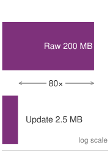{width="100%" fig-alt="Violet network ladder comparing 200 MB of raw upload with a 2.5 MB federated update, with 80x marked as an annotation."}

*One compressed update is smaller than one raw-data upload; repeated rounds accumulate.*
:::

::: {#nbk-edge-intelligence-model-updates-vs-raw-data .callout-notebook title="Model updates vs. raw data"}

**Problem**: A team is designing a federated camera-personalization system that learns from `{python} FederatedSavings.fs_raw_data_mb_str` of compressed user images per week. Compare one upload of those images with one compressed model-update uplink round.

**Math**:
Bandwidth efficiency is the ratio of raw data volume to model update size.

1. **Raw data upload**\index{Raw Data Upload!definition}: `{python} FederatedSavings.fs_raw_data_mb_str`/week.
2. **One federated uplink round**\index{One Federated Uplink Round!definition}: A compressed model update (5M params) is `{python} FederatedSavings.fs_update_mb_str`.
3. **One-round uplink reduction**\index{One-Round Uplink Reduction!definition}: `{python} FederatedSavings.fs_raw_data_mb_str`/`{python} FederatedSavings.fs_update_mb_str` = `{python} FederatedSavings.fs_reduction_mult_str`.

**Systems insight**: For this scenario, one `{python} FederatedSavings.fs_update_mb_str` uplink is `{python} FederatedSavings.fs_reduction_mult_str` smaller than one `{python} FederatedSavings.fs_raw_data_mb_str` raw-data upload. That ratio is not the end-to-end communication saving of a training run: after roughly `{python} FederatedSavings.fs_reduction_mult_str` uplink rounds, cumulative update uploads alone equal the raw-data volume, before counting global-model downloads, retries, or protocol overhead. A deployment must therefore multiply per-round traffic by the expected round count.

:::

Across the three network topologies partitioned in @fig-centralized-vs-decentralized, federated learning\index{Edge Learning!paradigm} is the sole paradigm that aggregates fleet-wide experience across users without allowing raw training data to cross the device perimeter. Centralized-cloud training shares learning only by moving the data, and local-only adaptation keeps each insight on the device that found it, so one household's rare vocabulary never helps another. Federated learning buys that middle position with a protocol, and the rest of this section determines when the protocol yields a better shared model.

### Privacy-preserving collaborative learning {#sec-edge-intelligence-privacypreserving-collaborative-learning-ecf9}

Federated learning (FL) coordinates local training through shared-model updates [@mcmahan2017communication]. Its protocol must specify how heterogeneous clients contribute, how non-i.i.d. data distributions\index{Federated Learning!non-IID data challenges} affect local work, and which state remains personal. Secure aggregation and differential privacy impose additional constraints on what the coordinator may observe and how much noise the learning loop must absorb.

The first architectural decision is whether the participants form a cross-device or cross-silo federation. The distinction changes the failure model, scheduling policy, and privacy unit before any optimizer is selected [@kairouz2021]. @Tbl-edge-cross-device-silo makes those consequences explicit.

| **Design dimension**  | **Cross-device federation**                                     | **Cross-silo federation**                                                      |
|:----------------------|:----------------------------------------------------------------|:-------------------------------------------------------------------------------|
| **Participants**      | Large population of intermittently available personal devices   | Small set of known organizations or sites                                      |
| **Round semantics**   | Sample an eligible cohort; expect stragglers and dropouts       | Coordinate a stable membership; investigate missing sites                      |
| **Trust boundary**    | Treat client software and local data as potentially compromised | Authenticate institutions, but still isolate each data custodian               |
| **Weighting default** | Decide whether the objective represents examples or users       | Weighting follows the agreed institutional objective, not site size by default |
| **Privacy unit**      | Usually a user or device across its participation history       | Usually a person or record within a site's data, sometimes the site itself     |

: **Cross-Device and Cross-Silo Federated Learning**: The participant population determines scheduling, trust, weighting, and privacy semantics. A protocol designed for millions of unreliable phones is not automatically appropriate for a consortium of hospitals. {#tbl-edge-cross-device-silo tbl-colwidths="[18,41,41]"}

### Learning protocols {#sec-edge-intelligence-learning-protocols-139a}

The protocols that make distributed coordination practical at scale must solve three engineering challenges simultaneously: ensuring that local training produces compatible updates despite non-IID data distributions, aggregating those updates efficiently despite bandwidth constraints, and coordinating timing across devices with heterogeneous availability patterns.

#### Local training {#sec-edge-intelligence-local-training-e73d}

Local training is the point where privacy preservation becomes a systems boundary. Individual devices compute model updates from private data, but every local choice affects the validity of the aggregate: which base model the device starts from, which local examples it samples, how much optimization it performs, and what update it sends back. The loop is therefore useful to present as an ordered protocol rather than as an abstract definition:

1. **Model initialization**\index{Model Initialization!definition}: Each device initializes its local model parameters, often by downloading the latest global model from the server.
2. **Local data sampling**\index{Local Data Sampling!definition}: The device samples a subset of its local data for training. This data may be non-IID, meaning that it may not be uniformly distributed across devices.
3. **Local training**\index{Local Training!definition}: The device performs a number of training iterations on its local data, updating the model parameters based on the computed gradients.
4. **Model update**\index{Model Update!definition}: After local training, the device computes a model update (e.g., the difference between the updated and initial parameters) and prepares to send it to the server.
5. **Update transmission**\index{Update Transmission!definition}: The device transmits the model update to the server, typically using a secure communication channel to protect user privacy.
6. **Model aggregation**\index{Model Aggregation!definition}: The server aggregates the updates from multiple devices to produce a new global model, which is then distributed back to the participating devices.

The process repeats iteratively, with devices periodically downloading the latest global model and performing local training. Update frequency varies based on system constraints, device availability, and communication costs.

#### Federated aggregation protocols {#sec-edge-intelligence-federated-aggregation-protocols-5d37}

The central coordination mechanism in federated learning allows devices with small, local datasets to collaboratively train a shared model. Client devices perform local training and transmit model updates to a central server, which aggregates them into a refined global model and redistributes it for the next training round. The cyclical procedure decouples learning from centralized data collection, suiting environments where user data is private, bandwidth is constrained, and device participation is sporadic.

The most widely used baseline for this process is federated averaging (FedAvg),\index{FedAvg!definition} which has become a canonical algorithm for federated learning [@mcmahan2017communication]. In FedAvg, each device trains its local copy of the model using SGD on its private data.

Formally, let $\mathcal{D}_k$ denote the local dataset on client $k$, and let $\theta_k^t$ be the parameters of the model on client $k$ at round $t$. Each client performs $E$ epochs of SGD on its local data, yielding an update $\theta_k^{t+1}$. The central server then aggregates these updates as:
$$
\theta^{t+1} = \sum_{k=1}^{C} \frac{n_k}{n} \theta_k^{t+1}
$$ {#eq-fedavg-weighted-aggregation}
where $n_k = |\mathcal{D}_k|$ is the number of samples on device $k$, $n = \sum_k n_k$ is the total number of samples across participating clients, and $C$ is the number of active devices in the current round.

This formula optimizes an *example-weighted* objective: a client with ten times as many local examples receives ten times the influence. That choice is appropriate when every example should contribute equally, but it can let prolific users or large institutions dominate the model. A *user-weighted* objective instead assigns each participating client weight $1/C$, optionally capping or normalizing each client's local contribution before aggregation. Neither choice is universally fair. The system must declare whether its unit of interest is an example, a user, an organization, or a deployment cohort, then evaluate that population rather than inherit $n_k/n$ as an implementation default.

This cyclical coordination protocol forms the foundation of federated learning. @Fig-federated-averaging-cycle sequences the four stages of a Federated Averaging round\index{FedAvg!coordination cycle}: (1) the central coordinator samples an over-selected cohort and broadcasts global model $\theta^t$ across the downlink bus; (2) enrolled clients execute $E$ local epochs on private datasets $\mathcal{D}_k$; (3) completing clients upload parameter updates $\theta_k^{t+1}$, while stragglers missing the round deadline (such as Client 5) are dropped; and (4) the coordinator executes sample-weighted aggregation yielding $\theta^{t+1}$. Because the weighted aggregation in @eq-fedavg-weighted-aggregation cannot proceed until the target quorum arrives, round duration is bounded by the slowest admitted client; over-selection, the scheduling response to these stragglers, is developed with client scheduling in @sec-edge-intelligence-client-scheduling-f675.

::: {#fig-federated-averaging-cycle fig-env="figure" fig-pos="htb" fig-cap="**Federated averaging protocol**: One FedAvg round in four steps. (1) The coordinator selects a cohort, over-selecting to absorb dropouts, and broadcasts the global model $\theta^t$. (2) Each client runs $E$ local epochs on its private data. (3) Clients that finish before the round deadline upload $\theta_k^{t+1}$; a straggler that misses the deadline is dropped. (4) The coordinator forms the example-weighted average of @eq-fedavg-weighted-aggregation, which becomes the next global model." fig-alt="A coordinator box at the top holds step 1, select cohort and broadcast theta t, and step 4, aggregate theta t plus 1 as a sum of n k over n times theta k. A gray downlink bus delivers theta t to five client boxes below. Clients 1 to 4 each hold private data and run E local epochs, and send amber uploads through step 3 back to the aggregate step. Client 5 is a red dashed straggler that misses the deadline, with its upload marked by a cross. Step 2 is labeled local training on private data."}
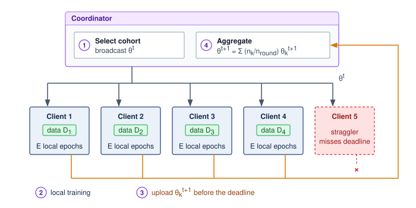

:::

This basic structure introduces a number of design choices and trade-offs. The number of local epochs $E$ impacts the balance between computation and communication: larger $E$ reduces communication frequency but risks divergence if local data distributions vary too much. The selection of participating clients affects convergence stability and fairness. In real-world deployments, not all devices are available at all times, and hardware capabilities may differ substantially, requiring robust participation scheduling and failure tolerance.

::: {.column-margin .margin-pointer}
↩ Synchronous cluster collectives and low-latency network topology contrast with federated rounds in @sec-collective-communication.
:::

#### Federated learning convergence analysis {#sec-edge-intelligence-federated-learning-convergence-analysis-c1fc}

A federated deployment must reach a quality target within its time, energy, and participation budgets. More local training can reduce how often clients communicate, but it also changes their updates and the time each selected cohort takes to finish. The engineering comparison is therefore time to an agreed quality target, not communication rounds alone.

##### Convergence rate fundamentals {#sec-edge-intelligence-convergence-rate-fundamentals-bfef}

FedAvg exposes the number of participating clients $C$, local epochs $E$, and communication rounds $R$ as controls [@mcmahan2017communication]. Their product $CER$ counts client-epochs when participation is fixed; it is not a convergence law. Clients can have different dataset sizes, and equal client-epoch counts can process different examples or produce conflicting updates. A convergence result is useful only when its assumptions match the optimizer, client sampling, and data distributions.

##### Non-IID data impact {#sec-edge-intelligence-noniid-data-impact-d8b9}

Non-IID data\index{Non-IID data!convergence impact} can make additional local steps move clients toward different objectives [@li2020; @zhao2018federated]. This client drift\index{Client Drift!federated learning} can offset the benefit of fewer communications. The strength of that effect depends on the partition, update rule, participation policy, and local step size; there is no universal heterogeneity score that predicts a round count across applications.

##### Measuring the local-work trade-off {#sec-edge-intelligence-quantifying-heterogeneity-practice-eece}

Compare candidate local-epoch settings under the same initialization, data partition, participation policy, and held-out quality target. For each setting $E$, record the first validated round $R(E)$ that reaches the target and the elapsed duration $t_r(E)$ of each completed round, including client selection, local work, transfer, aggregation, and any waiting. The observed time to target is

$$
T_{\text{target}}(E) = \sum_{r=1}^{R(E)} t_r(E).
$$

A useful experiment ledger records local epochs, completed clients, rounds to target, elapsed time, transmitted bytes, and device energy. If a run never reaches the quality target within the budget, report that outcome rather than extrapolating an invented convergence curve. Repeated runs and cohort-level validation distinguish a stable improvement from a fortunate sample of participating devices.

##### Communication-computation trade-off {#sec-edge-intelligence-communicationcomputation-tradeoff-6e31}

@Fig-comm-compute-tradeoff diagrams the opposing systems paths governed by local work $E$: increasing local epochs lengthens per-round execution duration $t_r(E)$ (the upper branch) while reducing synchronization frequency (the lower branch), which can lower the required rounds $R(E)$ until client drift penalizes convergence. Both paths merge into the cumulative time to target $T_{\text{target}}(E)$, which remains admissible only if total consumption fits within client energy and fleet-coverage budgets. A setting that requires fewer rounds can still prolong total wall-clock duration. Selecting $E$ therefore requires evaluating an empirical ledger alongside physical admission constraints, rather than relying on ungrounded heuristics.

::: {#fig-comm-compute-tradeoff fig-env="figure" fig-pos="htb" fig-cap="**Measuring the local-work trade-off**: The local-work setting $E$ acts through two opposing paths. More local epochs lengthen each round, $t_r(E)$, while reducing how often clients synchronize, which can lower the rounds to target, $R(E)$, unless client drift raises it. Only their combination, the measured time to target $T_{\text{target}}(E)$, ranks candidate settings, and a setting is admissible only if it also fits the client energy and population-coverage budgets." fig-alt="A violet box for local work, E epochs, branches to a blue box, round duration t r of E, grows with E, and an amber box, rounds to target R of E, fewer syncs, more drift. Both feed a box, time to target T target of E equals the sum of t r of E over R of E rounds, which connects to a dashed box, within energy and coverage budgets."}
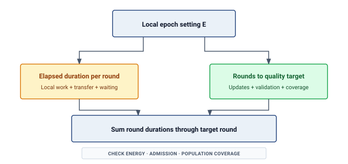
:::

The operating point depends on the deployment. Larger local updates can amortize transfer overhead, but they also change drift, completion time, and which clients finish. Adaptive epoch policies therefore need the same outcome and coverage checks as fixed settings.

##### Feasibility conditions for federated learning {#sec-edge-intelligence-federated-learning-work-93a2}

Federated learning achieves practical convergence only when three deployment conditions hold simultaneously [@kairouz2021]. Population heterogeneity must remain bounded enough that client drift does not dominate training time. Client participation must also stay high enough to yield stable aggregate updates, avoiding the noisy gradient estimates and severe selection bias that accompany sparse turnouts. In addition, each participating client requires sufficient local data for meaningful optimization, because tiny local batches contribute high-variance updates that destabilize the global optimization path.

When any of these conditions fails, alternative architectures become necessary. Severe heterogeneity motivates hierarchical federated learning with regional aggregation or personalized sub-models rather than a single global consensus. Very low participation rates encourage evaluating asynchronous protocols, though removing round barriers cannot replace missing observations or eliminate demographic selection bias. Likewise, clients with minimal local data benefit more from few-shot adaptation, such as bounded gradient updates or prototype-based classification, than from unrestricted local training.

The aggregation rule specifies how compatible local models produce a shared model; only the measured time-to-target ledger shows whether a configuration converges within its budget. Executing federated averaging across ten reliable nodes in a lab is trivial; executing it across ten million smartphones dropping on and off cellular networks is a different engineering problem. Robust federated systems must translate the algorithm into orchestration, scheduling, and failure-handling mechanisms that assume unreliable clients from the start.

## Federated Learning Systems at Scale {#sec-edge-intelligence-federated-systems}

In a textbook algorithm, all 100 edge devices compute their updates perfectly and report back to the server exactly at the same time. In reality, a federated learning round spanning a million smartphones must deal with devices overheating, losing Wi-Fi, entering power-saving mode, or powering off. Building federated systems at scale means engineering an orchestrator that tolerates asynchronous dropouts and extreme stragglers as standard operating conditions.

### Client scheduling {#sec-edge-intelligence-client-scheduling-f675}

Federated learning operates under the assumption that clients, or devices that hold local data, periodically become available for participation in training rounds. In real-world systems, client availability is intermittent and variable. Devices may be turned off, disconnected from power, lacking network access, or otherwise unable to participate at any given time. As a result, client scheduling\index{Client Scheduling!federated learning} plays a central role in the effectiveness and efficiency of distributed learning.

At a baseline level, federated ML systems define eligibility criteria for participation. Devices must meet minimum requirements such as being plugged in, connected to Wi-Fi, and idle, to avoid interfering with user experience or depleting battery resources. These criteria determine which subset of the total population is considered "available" for any given training round.

Beyond these operational filters, devices also differ in their hardware capabilities, data availability, and network conditions. Some smartphones contain many recent examples relevant to the current task, while others have outdated or irrelevant data. Network bandwidth and upload speed may vary widely depending on geography and carrier infrastructure. As a result, uniform random selection from the eligible pool does not guarantee coverage of the full deployment population; eligibility has already excluded some devices and their data.

Availability-driven selection introduces participation bias\index{Participation Bias!federated learning}, the fleet-level consequence of the admission test in @eq-edge-background-admission (principle \ref{pri-participation-selects-population}). Clients with favorable conditions, such as frequent charging, high-end hardware, and consistent connectivity, pass admission and participate repeatedly, while others are systematically underrepresented. This can skew the resulting model toward behaviors and preferences of a privileged subset of the population, raising both fairness and generalization concerns.

Participation bias becomes severe when a small eligible cohort supplies most completed updates while other cohorts rarely participate. Completion logs and population coverage must establish the size of that skew in the actual deployment. This creates a feedback loop: models become more strongly optimized for users with high-end devices and stable connectivity, potentially degrading performance for resource-constrained users who need adaptation the most. A keyboard prediction model might become biased toward the typing patterns of users with flagship phones who charge overnight, missing important linguistic variations from users with budget devices or irregular charging patterns.

To address these challenges, systems must balance scheduling efficiency with client diversity. A key approach involves using stratified or quota-based sampling to ensure representative client participation across different groups. Some systems implement "fairness budgets" that track cumulative participation and actively prioritize underrepresented devices when they become available. Others use importance sampling techniques to reweight contributions based on estimated population statistics rather than raw participation rates. For instance, asynchronous buffer-based techniques allow participating clients to contribute model updates independently, without requiring synchronized coordination in every round [@fedbuff]. This model has been extended to incorporate staleness awareness [@rodio2024] and fairness mechanisms [@fedstaleweight], preventing bias from over-active clients who might otherwise dominate the training process.

These fairness mechanisms sit alongside adaptive client selection strategies. Federated ML systems can prioritize clients with underrepresented data types, target geographies or demographics that are less frequently sampled, and use historical participation data to enforce fairness constraints. Predictive modeling can anticipate later client availability or success rates, improving training throughput.

Selected clients perform one or more local training steps on their private data and transmit their model updates to a central server. These updates are aggregated to form a new global model. Typically, this aggregation is weighted, where the contributions of each client are scaled, for example, by the number of local examples used during training, before averaging. Example weighting gives larger local datasets more influence; it does not establish that they are more representative of the target population.

Scheduling must also bound how long a round waits on its slowest participants. Network latency, battery depletion, or background process contention can make some devices (stragglers) take 10$\times$ longer than the median, and the round cannot aggregate until enough updates arrive.

::: {.column-margin}
```{=latex}
\vspace*{-25mm}
```
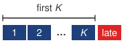{width="100%" fig-alt="Sequence strip showing the first K federated-client updates accepted before the round closes, while a late straggler is dropped."}

*Over-selection closes the round on the first K updates.*
:::

To prevent the global model update from stalling, production FL systems employ **over-selection**\index{Over-Selection!definition}. The server selects a candidate pool size $K_{\text{candidates}}$ larger than the target number of updates $K_{\text{target}}$ (the production system of @bonawitz2019towards selects about 130 percent of the target, $K_{\text{candidates}} \approx 1.3 \times K_{\text{target}}$). The server aggregates updates from the first $K_{\text{target}}$ responders and discards the rest. This approach bounds the round duration by the speed of the $K_{\text{target}}$-th fastest device rather than the absolute slowest. Accepting the fastest responders can amplify the participation bias just described, so shorter rounds must be evaluated against cohort coverage and wall-clock time to the declared quality target.

These scheduling decisions directly impact convergence rate, model generalization, energy consumption, and overall user experience. Poor scheduling results in excessive stragglers, overfitting to narrow client segments, or wasted computation. Client scheduling is therefore a core component of system design in federated learning, demanding both algorithmic insight and infrastructure-level coordination.

::: {#chk-edge-intelligence-federated-system-design .callout-checkpoint title="Federated system design"}

Consider architecting a federated learning system for a fleet of 10 million mobile devices. The data is highly non-IID (users have distinct, clustered typing patterns), and the network environment is constrained (1-10 Mbps). Before choosing optimizations for this scenario, classify the local bottlenecks and state which system constraint dominates each decision.

Consider three design decisions:

1.  Aggregation: Select plain FedAvg, reduced local epochs, or personalization/clustering for the non-IID population, and justify how the choice controls client drift.
2.  Privacy: Decide whether the deployment needs formal differential-privacy noise or whether secure aggregation and data minimization are sufficient for the stated threat model; explain the expected convergence-time cost qualitatively.
3.  Communication: Choose between gradient quantization (e.g., 8-bit) and structured sparsity under constrained bandwidth, and justify the bandwidth/accuracy trade-off.

:::

### Bandwidth-aware update compression {#sec-edge-intelligence-bandwidthaware-update-compression-7730}

Update compression\index{Communication efficiency!gradient compression} is a bottleneck diagnosis before it is a technique choice: if each round transmits full model weights or gradients, mobile bandwidth and battery budgets determine convergence before the optimizer does.[^fn-wireless-bandwidth-bottleneck] The design decision is which information can be quantized, sparsified, or kept local while preserving enough gradient fidelity for FedAvg to converge.

[^fn-wireless-bandwidth-bottleneck]: **Wireless Upload Asymmetry**\index{Wireless Upload Asymmetry!definition}: Federated updates use the uplink, whose available throughput can differ substantially from the downlink and vary with coverage and contention. Transfer time depends on encoded update size and effective uplink goodput; energy also depends on radio state and transfer duration. Low-power links may add duty-cycle constraints. Compression is useful when these costs bind the update budget, but its necessity depends on the payload, link, and permitted synchronization interval.

The compression decision separates into three levers, each changing a different part of the communication bottleneck: model compression reduces bits per update, selective sharing reduces which parameters travel, and architectural partitioning keeps some state local. Model compression methods reduce the wire footprint of transmitted updates through quantization,\index{Gradient Quantization!definition} sparsification, or subsampling. Instead of sending full-precision gradients, a client transmits 8-bit quantized updates or communicates only the top-$k$ gradient elements[^fn-sparsification-topk-gradient] with highest magnitude. These transformations are communication mechanisms, not privacy mechanisms; a smaller embedding, sparse update, or low-precision gradient may still expose membership, attributes, or reconstructable features.

[^fn-sparsification-topk-gradient]: **Gradient Sparsification**\index{Gradient Sparsification!definition}: Transmits only the top 1--10 percent of gradients by magnitude, exploiting the observation that most gradient elements are near-zero and contribute minimally to convergence. Local gradient accumulation stores the untransmitted residuals until they grow large enough to send, reducing transmitted value count by 10--100$\times$ before coordinate indices and other metadata are included, a pattern used in sparsified SGD and deep gradient compression [@stich2018sparsified; @lin2018deep]. The resulting wire-byte reduction depends on the encoding, and convergence requires validation: aggressive sparsification can bias updates toward frequently active parameters, potentially reducing personalization for rare user patterns.

Selective update sharing further reduces communication by transmitting only subsets of model parameters or updates. In layer-wise selective sharing, clients update only certain layers, typically the final classifier or adapter modules, while keeping the majority of the backbone frozen. This reduces both upload cost and the risk of overfitting shared representations to nonrepresentative client data.

Split models\index{Split learning!model partitioning}\index{Model partitioning!edge-cloud split} and architectural partitioning divide the model into a shared global component and a local component. Clients train and maintain local modules independently while synchronizing only shared parts with the server. This reduces communication and narrows what is exposed, but the shared updates can still leak information; the privacy claim depends on the threat model and on controls such as secure aggregation or differential privacy.

These approaches can use the FedAvg aggregation protocol (@sec-edge-intelligence-federated-aggregation-protocols-5d37) only when their encoding and shared parameter schema support weighted aggregation. Quantization requires compatible scales, sparse updates require coordinate identities, and local-only parameters must stay outside the shared aggregate. With secure aggregation, the encoding must support combination without exposing individual decoded updates. The full communication ledger for round $r$ is

$$
M_r = M_{\text{download},r} + M_{\text{upload},r} + M_{\text{protocol},r} + M_{\text{retry},r},
$$ {#eq-edge-federated-communication-ledger}

@Eq-edge-federated-communication-ledger makes download, upload, protocol, and retry traffic explicit. The download distributes model state, the upload carries client updates, protocol traffic covers authentication and cryptographic setup, and retries account for failed or repeated transfers. Optimizing only $M_{\text{upload},r}$ can therefore move rather than remove the bottleneck. While amortizing network transfers through additional local computation relieves bandwidth pressure, alternative communication-efficient update strategies introduce their own systems trade-offs: compression may degrade gradient fidelity, selective updates can limit model capacity, and split architectures complicate coordination. Effective federated learning requires balancing communication, privacy, and convergence against the capabilities and variability of the client population. @Sec-appdx-comm-foundations-compression works the compression break-even threshold through a worked example.

While the analytical flowchart in @fig-comm-compute-tradeoff defines the measurement dependencies, @fig-fl-communication-computation charts the resulting optimization curves across fast, medium, and slow network regimes. On a log-scaled training time axis, each network curve traces a distinct U-shaped trade-off where the optimal local workload $E^*$ shifts rightward—from $E=10$ on high-speed connections to $E=40$ on constrained links—demonstrating how slower networks demand greater local computation to amortize transfer latency before client drift counteracts the gains.

::: {#fig-fl-communication-computation fig-env="figure" fig-pos="htb" fig-cap="**Communication-computation trade-off in federated learning**: As network bandwidth decreases from fast to slow, the time-minimizing number of local epochs shifts rightward because additional local computation amortizes more communication. The curves come from an illustrative cost model in relative units, not measurements; its growing local-work term stands in for the longer rounds and added drift that make excessive local work counterproductive." fig-alt="Three curves of total training time vs. local epochs for fast, medium, and slow networks. Optimal points shift right as bandwidth decreases."}

```{python}
#| echo: false
#| warning: false
# ┌─────────────────────────────────────────────────────────────────────────────
# │ FL COMMUNICATION-COMPUTATION (FIGURE)
# ├─────────────────────────────────────────────────────────────────────────────
# │ Context: @fig-fl-communication-computation—federated learning trade-off
# │
# │ Goal: Plot total time vs local epochs E for Fast/Medium/Slow network; show
# │       optimal E shifts right as bandwidth decreases.
# │ Show: Three curves; optimal points; annotation.
# │ How: y = comm_cost/E + compute_cost*E + overhead; argmin; matplotlib.
# │
# └─────────────────────────────────────────────────────────────────────────────
# ┌── 1. CANVAS ────────────────────────────────────────────────────────────────
# │ Plot total time vs local epochs E for Fast/Medium/Slow network; show
from binder.tools.figures import style as book_style
import numpy as np

fig, ax, COLORS, plt = book_style.setup_plot(figsize=(8.5, 4.8))

# ┌── 2. ARRAYS ────────────────────────────────────────────────────────────────
E = np.linspace(1, 50, 200)

y_fast = (100 / E) + (1.0 * E) + 5
y_fast = y_fast * 0.1

y_med = (400 / E) + (1.0 * E) + 5
y_med = y_med * 0.12

y_slow = (1600 / E) + (1.0 * E) + 5
y_slow = y_slow * 0.15

# ┌── 3. RENDER ────────────────────────────────────────────────────────────────
ax.plot(E, y_fast, label='Fast network', color=COLORS['GreenLine'], linewidth=2.3)
ax.plot(E, y_med, label='Medium network', color=COLORS['OrangeLine'], linewidth=2.3)
ax.plot(E, y_slow, label='Slow network', color=COLORS['RedLine'], linewidth=2.3)

opt_fast_idx = np.argmin(y_fast)
opt_med_idx = np.argmin(y_med)
opt_slow_idx = np.argmin(y_slow)

ax.scatter(E[opt_fast_idx], y_fast[opt_fast_idx], color=COLORS['GreenLine'], s=80, zorder=5, edgecolor='white')
ax.scatter(E[opt_med_idx], y_med[opt_med_idx], color=COLORS['OrangeLine'], s=80, zorder=5, edgecolor='white')
ax.scatter(E[opt_slow_idx], y_slow[opt_slow_idx], color=COLORS['RedLine'], s=80, zorder=5, edgecolor='white')

# ┌── 4. DECORATE ──────────────────────────────────────────────────────────────
ax.annotate(
    'Optimal local work ($E$)\nincreases as network slows',
    xy=(E[opt_slow_idx], y_slow[opt_slow_idx] + 2),
    xytext=(28, 50),
    arrowprops=dict(arrowstyle="->", connectionstyle="arc3, rad=-0.2", color=COLORS['primary'], shrinkB=5, relpos=(1.0, 0.5), lw=0.9),
    fontsize=8.5,
    fontweight='bold',
    color=COLORS['primary'],
    ha='center',
    va='center',
    bbox=dict(boxstyle='round,pad=0.3', fc='white', ec='#CBD5E1', lw=0.9),
)

ax.set_xlabel('Local Epochs per Round ($E$)')
ax.set_ylabel('Total Training Time (relative units, log scale)')
ax.set_xlim(0, 50)
ax.set_yscale('log')
ax.set_ylim(1, max(y_slow) * 1.5)

ax.legend(loc='upper right', fontsize=8, frameon=True, facecolor='white', framealpha=0.95, edgecolor='#CBD5E1')

plt.tight_layout()
plt.show()
plt.close()
```

:::

Once the coordinator establishes the local computation schedule, update compression dictates the wire footprint of each round. @Fig-gradient-compression compares the three primary transmission formats: uncompressed 32-bit floats (Panel A), uniform 8-bit quantization with scalar scaling that achieves a $4\times$ transmission gain without client-side state (Panel B), and top-$k$ sparsification that prunes near-zero coordinates but requires persistent local SRAM error feedback to accumulate untransmitted residuals (Panel C). At the server, the reconstruction engine dequantizes integer grids and scatters sparse coordinates into the dense fleet accumulator.

::: {#fig-gradient-compression fig-env="figure" fig-pos="htb" fig-cap="**Gradient compression techniques**: Standard updates transmit full-precision values; quantization maps values to lower-precision buckets, such as FP32 to INT8; and sparsification transmits only the most significant top-$k$ gradients. The latter two mechanisms reduce bytes transferred but introduce representation error or residual state that the training algorithm must manage." fig-alt="Three-panel comparison of gradient vector representations: standard FP32, quantized INT8, and sparsified Top-k with arrows to server."}

```{.tikz}
\providecolor{mlsysblue}{RGB}{26, 86, 160}
\providecolor{mlsysgreen}{RGB}{16, 124, 65}
\providecolor{mlsysred}{RGB}{186, 24, 27}
\providecolor{mlsysamber}{RGB}{217, 119, 6}
\providecolor{mlsyspurple}{RGB}{124, 58, 237}
\providecolor{mlsysdarkgray}{RGB}{30, 41, 59}
\providecolor{mlsysdark}{RGB}{30, 41, 59}
\providecolor{mlsysgray}{RGB}{100, 116, 139}
\providecolor{mlsyslightgray}{RGB}{241, 245, 249}
\providecolor{bordergray}{RGB}{203, 213, 225}
\providecolor{mlsysteal}{RGB}{15, 118, 110}
\scalebox{0.78}{%
\begin{tikzpicture}[
    font=\sffamily,
    >=Stealth,
    colcard/.style={
        draw=bordergray,
        fill=mlsyslightgray!20,
        rounded corners=3pt,
        line width=0.7pt
    },
    subcard/.style={
        draw=bordergray!80,
        fill=white,
        rounded corners=2.5pt,
        line width=0.6pt
    },
    cellbox/.style={
        draw=bordergray,
        rounded corners=1.5pt,
        line width=0.5pt,
        minimum width=1.15cm,
        minimum height=0.7cm,
        align=center,
        font=\fontsize{6.8}{7.8}\selectfont\bfseries
    }
]

    % =========================================================================
    % PANEL A: STANDARD UNCOMPRESSED FP32
    % =========================================================================
    \node[colcard, minimum width=6.6cm, minimum height=9.2cm, anchor=north west] (colA) at (0, 0) {};

    % Header badge
    \node[anchor=north west, fill=mlsysblue!10, draw=mlsysblue!40, rounded corners=2.5pt, line width=0.6pt,
          minimum width=6.2cm, minimum height=0.75cm, align=center] (hA)
        at ([xshift=0.2cm, yshift=-0.2cm]colA.north west) {
        {\small\bfseries\color{mlsysblue} A $\cdot$ STANDARD FP32}\\[1.5pt]
        {\fontsize{6.5}{7.5}\selectfont\color{mlsysdarkgray}\textbf{Full Precision $\cdot$ Uncompressed Baseline}}
    };

    % Upper diagram card
    \node[subcard, minimum width=6.2cm, minimum height=4.4cm, anchor=north] (scA_diag)
        at ([yshift=-0.25cm]hA.south) {};
    \node[anchor=north west, font=\fontsize{7}{8}\selectfont\bfseries, text=mlsysblue]
        at ([xshift=8pt, yshift=-7pt]scA_diag.north west) {Gradient Vector ($d=4$)};

    % 4 FP32 Cells
    \node[cellbox, fill=mlsysblue!10, text=mlsysblue] (a1) at ([xshift=-1.85cm, yshift=0.45cm]scA_diag.center) {$+0.50$};
    \node[cellbox, fill=mlsysblue!10, text=mlsysblue] (a2) at ([xshift=-0.62cm, yshift=0.45cm]scA_diag.center) {$-0.20$};
    \node[cellbox, fill=mlsysblue!10, text=mlsysblue] (a3) at ([xshift=0.62cm, yshift=0.45cm]scA_diag.center) {$+0.01$};
    \node[cellbox, fill=mlsysblue!10, text=mlsysblue] (a4) at ([xshift=1.85cm, yshift=0.45cm]scA_diag.center) {$+0.80$};

    % Bitfield notation
    \node[font=\fontsize{6}{7}\selectfont\color{mlsysgray}, below=2pt of a1] {32-bit};
    \node[font=\fontsize{6}{7}\selectfont\color{mlsysgray}, below=2pt of a2] {32-bit};
    \node[font=\fontsize{6}{7}\selectfont\color{mlsysgray}, below=2pt of a3] {32-bit};
    \node[font=\fontsize{6}{7}\selectfont\color{mlsysgray}, below=2pt of a4] {32-bit};

    % Total payload chip
    \node[draw=mlsysblue!40, fill=mlsysblue!5, rounded corners=2pt, line width=0.5pt,
          minimum width=5.4cm, minimum height=0.65cm, align=center, anchor=south]
        at ([yshift=8pt]scA_diag.south) {
        {\fontsize{6.8}{7.8}\selectfont\bfseries Total Transmission: $4 \times 32 = 128\text{ bits}$}\\[1pt]
        {\fontsize{6}{7}\selectfont\color{mlsysdarkgray} Baseline payload $\cdot$ High cellular egress cost}
    };

    % Trade-off card
    \node[subcard, minimum width=6.2cm, text width=5.6cm, align=left, inner sep=5pt, anchor=south] (scA_text)
        at ([yshift=0.2cm]colA.south) {
        {\fontsize{6.8}{7.8}\selectfont\bfseries\color{mlsysblue} Trade-off Profile}\\[2pt]
        {\fontsize{6.5}{7.5}\selectfont\textbf{Compression Ratio:} $1\times$ (Zero bit reduction)}\\[1.5pt]
        {\fontsize{6.5}{7.5}\selectfont\textbf{Fidelity:} Exact gradient ($\epsilon_{\text{quant}} = 0$)}\\[1.5pt]
        {\fontsize{6.5}{7.5}\selectfont\textbf{Memory Overhead:} $0$ auxiliary local state}
    };


    % =========================================================================
    % PANEL B: QUANTIZATION (INT8)
    % =========================================================================
    \node[colcard, minimum width=6.6cm, minimum height=9.2cm, anchor=north west] (colB) at (7.0cm, 0) {};

    % Header badge
    \node[anchor=north west, fill=mlsysamber!12, draw=mlsysamber!40, rounded corners=2.5pt, line width=0.6pt,
          minimum width=6.2cm, minimum height=0.75cm, align=center] (hB)
        at ([xshift=0.2cm, yshift=-0.2cm]colB.north west) {
        {\small\bfseries\color{mlsysamber} B $\cdot$ QUANTIZATION (INT8)}\\[1.5pt]
        {\fontsize{6.5}{7.5}\selectfont\color{mlsysdarkgray}\textbf{Stochastic Rounding $\cdot$ Low-Bit Mapping}}
    };

    % Upper diagram card
    \node[subcard, minimum width=6.2cm, minimum height=4.4cm, anchor=north] (scB_diag)
        at ([yshift=-0.25cm]hB.south) {};
    \node[anchor=north west, font=\fontsize{7}{8}\selectfont\bfseries, text=mlsysamber]
        at ([xshift=8pt, yshift=-7pt]scB_diag.north west) {Quantized Grid ($s \approx 0.0063$)};

    % 4 INT8 Cells
    \node[cellbox, fill=mlsysamber!12, text=mlsysamber] (b1) at ([xshift=-1.85cm, yshift=0.45cm]scB_diag.center) {$+79$};
    \node[cellbox, fill=mlsysamber!12, text=mlsysamber] (b2) at ([xshift=-0.62cm, yshift=0.45cm]scB_diag.center) {$-32$};
    \node[cellbox, fill=mlsysamber!12, text=mlsysamber] (b3) at ([xshift=0.62cm, yshift=0.45cm]scB_diag.center) {$+2$};
    \node[cellbox, fill=mlsysamber!12, text=mlsysamber] (b4) at ([xshift=1.85cm, yshift=0.45cm]scB_diag.center) {$+127$};

    % Bitfield notation
    \node[font=\fontsize{6}{7}\selectfont\color{mlsysgray}, below=2pt of b1] {8-bit};
    \node[font=\fontsize{6}{7}\selectfont\color{mlsysgray}, below=2pt of b2] {8-bit};
    \node[font=\fontsize{6}{7}\selectfont\color{mlsysgray}, below=2pt of b3] {8-bit};
    \node[font=\fontsize{6}{7}\selectfont\color{mlsysgray}, below=2pt of b4] {8-bit};

    % Total payload chip
    \node[draw=mlsysamber!40, fill=mlsysamber!5, rounded corners=2pt, line width=0.5pt,
          minimum width=5.4cm, minimum height=0.65cm, align=center, anchor=south]
        at ([yshift=8pt]scB_diag.south) {
        {\fontsize{6.8}{7.8}\selectfont\bfseries Total Transmission: $4 \times 8 = 32\text{ bits}$ ($4\times$ Gain)}\\[1pt]
        {\fontsize{6}{7}\selectfont\color{mlsysdarkgray} Transmits scale $s \in \mathbb{R}$ + packed integer vector}
    };

    % Trade-off card
    \node[subcard, minimum width=6.2cm, text width=5.6cm, align=left, inner sep=5pt, anchor=south] (scB_text)
        at ([yshift=0.2cm]colB.south) {
        {\fontsize{6.8}{7.8}\selectfont\bfseries\color{mlsysamber} Trade-off Profile}\\[2pt]
        {\fontsize{6.5}{7.5}\selectfont\textbf{Compression Ratio:} $4\times$ reduction ($8\text{ bits/value}$)}\\[1.5pt]
        {\fontsize{6.5}{7.5}\selectfont\textbf{Fidelity:} Bounded rounding error $|\delta_q| \le s/2$}\\[1.5pt]
        {\fontsize{6.5}{7.5}\selectfont\textbf{Memory Overhead:} Zero client state; stateless decode}
    };


    % =========================================================================
    % PANEL C: SPARSIFICATION + ERROR FEEDBACK
    % =========================================================================
    \node[colcard, minimum width=6.6cm, minimum height=9.2cm, anchor=north west] (colC) at (14.0cm, 0) {};

    % Header badge
    \node[anchor=north west, fill=mlsysgreen!12, draw=mlsysgreen!40, rounded corners=2.5pt, line width=0.6pt,
          minimum width=6.2cm, minimum height=0.75cm, align=center] (hC)
        at ([xshift=0.2cm, yshift=-0.2cm]colC.north west) {
        {\small\bfseries\color{mlsysgreen} C $\cdot$ TOP-$k$ SPARSIFICATION}\\[1.5pt]
        {\fontsize{6.5}{7.5}\selectfont\color{mlsysdarkgray}\textbf{Pruning $\cdot$ Error-Feedback Accumulation}}
    };

    % Upper diagram card
    \node[subcard, minimum width=6.2cm, minimum height=4.4cm, anchor=north] (scC_diag)
        at ([yshift=-0.25cm]hC.south) {};
    \node[anchor=north west, font=\fontsize{7}{8}\selectfont\bfseries, text=mlsysgreen]
        at ([xshift=8pt, yshift=-7pt]scC_diag.north west) {Top-$k$ Vector ($k=2$, masked residual)};

    % 4 Sparsified Cells (c1 and c4 active, c2 and c3 pruned)
    \node[cellbox, fill=mlsysgreen!12, draw=mlsysgreen!60, text=mlsysgreen] (c1) at ([xshift=-1.85cm, yshift=0.45cm]scC_diag.center) {$+0.50$};
    \node[cellbox, fill=mlsyslightgray!40, text=mlsysgray] (c2) at ([xshift=-0.62cm, yshift=0.45cm]scC_diag.center) {$-$};
    \node[cellbox, fill=mlsyslightgray!40, text=mlsysgray] (c3) at ([xshift=0.62cm, yshift=0.45cm]scC_diag.center) {$-$};
    \node[cellbox, fill=mlsysgreen!12, draw=mlsysgreen!60, text=mlsysgreen] (c4) at ([xshift=1.85cm, yshift=0.45cm]scC_diag.center) {$+0.80$};

    % Index metadata notation
    \node[font=\fontsize{6}{7}\selectfont\color{mlsysgreen}\textbf{idx: 0}, below=2pt of c1] {};
    \node[font=\fontsize{6}{7}\selectfont\color{mlsysgray}pruned, below=2pt of c2] {};
    \node[font=\fontsize{6}{7}\selectfont\color{mlsysgray}pruned, below=2pt of c3] {};
    \node[font=\fontsize{6}{7}\selectfont\color{mlsysgreen}\textbf{idx: 3}, below=2pt of c4] {};

    % Total payload chip
    \node[draw=mlsysgreen!40, fill=mlsysgreen!5, rounded corners=2pt, line width=0.5pt,
          minimum width=5.4cm, minimum height=0.65cm, align=center, anchor=south]
        at ([yshift=8pt]scC_diag.south) {
        {\fontsize{6.8}{7.8}\selectfont\bfseries Transmit $k=2$ Values + Indices ($\approx 2\times$ here)}\\[1pt]
        {\fontsize{6}{7}\selectfont\color{mlsysdarkgray} Error Feedback: $\mathbf{e}^{(t+1)} \leftarrow \mathbf{e}^{(t)} + \mathbf{g}^{(t)} - \tilde{\mathbf{g}}^{(t)}$}
    };

    % Trade-off card
    \node[subcard, minimum width=6.2cm, text width=5.6cm, align=left, inner sep=5pt, anchor=south] (scC_text)
        at ([yshift=0.2cm]colC.south) {
        {\fontsize{6.8}{7.8}\selectfont\bfseries\color{mlsysgreen} Trade-off Profile}\\[2pt]
        {\fontsize{6.5}{7.5}\selectfont\textbf{Compression:} Scalable (10$\times$--100$\times$ in large models)}\\[1.5pt]
        {\fontsize{6.5}{7.5}\selectfont\textbf{Fidelity:} Unsent residuals accumulate in local SRAM}\\[1.5pt]
        {\fontsize{6.5}{7.5}\selectfont\textbf{Memory:} Small persistent error buffer $\mathbf{e}$}
    };


    % =========================================================================
    % BOTTOM CONTAINER: SERVER AGGREGATOR
    % =========================================================================
    \node[colcard, minimum width=20.6cm, minimum height=1.65cm, anchor=north] (server)
        at (10.3cm, -10.2cm) {};

    % Header chip on server
    \node[anchor=north west, fill=mlsysteal!10, draw=mlsysteal!40, rounded corners=2pt, line width=0.5pt, inner sep=3pt]
        at ([xshift=8pt, yshift=-5pt]server.north west) {
        {\fontsize{6.5}{7.5}\selectfont\bfseries\color{mlsysteal} FEDERATED AGGREGATION SERVER}
    };

    % Server operations text
    \node[anchor=west, align=left] at ([xshift=12pt, yshift=-4pt]server.west) {
        {\fontsize{7}{8}\selectfont\bfseries Reconstruction Engine:}\\[1.5pt]
        {\fontsize{6.5}{7.5}\selectfont Dequantizes integer vectors $\tilde{\mathbf{g}} = s \cdot \mathbf{q}$ \& scatters sparse indices into dense fleet accumulator}
    };

    % Server formula pill
    \node[draw=mlsysteal!50, fill=white, rounded corners=2pt, line width=0.6pt,
          inner sep=4pt, anchor=east] at ([xshift=-12pt, yshift=-4pt]server.east) {
        {\fontsize{7.5}{8.5}\selectfont\bfseries\color{mlsysteal} $\theta^{(t+1)} \leftarrow \theta^{(t)} + \sum_{k=1}^{C} \frac{n_k}{n} \text{Decode}(\mathbf{u}_k)$}
    };

    % Uplink arrows from Panel A, B, C into Server
    \draw[->, line width=1.0pt, mlsysblue, shorten >=2pt, shorten <=2pt]
        (colA.south) -- (colA.south |- server.north)
        node[midway, right=2pt, font=\fontsize{6.5}{7.5}\selectfont\bfseries, text=mlsysblue] {Upload $128\text{b}$};

    \draw[->, line width=1.0pt, mlsysamber, shorten >=2pt, shorten <=2pt]
        (colB.south) -- (colB.south |- server.north)
        node[midway, right=2pt, font=\fontsize{6.5}{7.5}\selectfont\bfseries, text=mlsysamber] {Upload $32\text{b}$};

    \draw[->, line width=1.0pt, mlsysgreen, shorten >=2pt, shorten <=2pt]
        (colC.south) -- (colC.south |- server.north)
        node[midway, right=2pt, font=\fontsize{6.5}{7.5}\selectfont\bfseries, text=mlsysgreen] {Upload $\text{Top-}k$};

\end{tikzpicture}
}
```

:::

These compression techniques collectively shrink the update payload, ensuring federated rounds remain viable even over severely constrained mobile networks.

### Federated personalization {#sec-edge-intelligence-federated-personalization-3c73}

While compression and communication strategies improve scalability, they do not address an important limitation of the global federated learning paradigm, its inability to capture user-specific variation. In real-world deployments, devices often observe distinct and heterogeneous data distributions. A one-size-fits-all global model may underperform when applied uniformly across diverse users. This motivates the need for personalized federated learning\index{Personalized federated learning!objective}, where local models are adapted to user-specific data without compromising the benefits of global coordination.

Let $\theta_k$ denote the model parameters on client $k$, and $\theta_{\text{global}}$ the aggregated global model. For $K$ clients, traditional FL seeks to minimize a global objective:
$$
\min_\theta \sum_{k=1}^K w_k \mathcal{L}_k(\theta)
$$
where $\mathcal{L}_k(\theta)$ is the local loss on client $k$, and $w_k$ is a weighting factor (e.g., proportional to local dataset size). However, this formulation assumes that a single model $\theta$ can serve all users well. In practice, local loss landscapes $\mathcal{L}_k$ often differ significantly across clients, reflecting non-IID data distributions and varying task requirements.

Personalization modifies this objective to allow each client to maintain its own adapted parameters $\theta_k$, optimized with respect to both the global model and local data:
$$
\min_{\theta_1, \ldots, \theta_K} \sum_{k=1}^K \left( \mathcal{L}_k(\theta_k) + \lambda_{\text{reg}} \cdot \mathcal{R}(\theta_k, \theta_{\text{global}}) \right)
$$

Here, $\mathcal{R}$ is a regularization term that penalizes deviation from the global model, and $\lambda_{\text{reg}}$ controls the strength of this penalty. This formulation allows local models to deviate as needed, while still benefiting from global coordination.

Real-world use cases illustrate the importance of this approach. Consider a wearable health monitor that tracks physiological signals to classify physical activities. While a global model may perform reasonably well across the population, individual users exhibit unique motion patterns, gait signatures, or sensor placements. Personalized finetuning of the final classification layer or low-rank adapters allows improved accuracy, particularly for rare or user-specific classes.

Several personalization strategies address the trade-offs between compute overhead, information exposure, and adaptation speed. One widely used approach is local finetuning, in which each client downloads the latest global model and performs a small number of gradient steps using its local data. This method avoids transmitting those examples during adaptation, but the resulting local state and any later update remain privacy-sensitive. It may also yield suboptimal results when the global model is poorly aligned with the client's data distribution or when the local dataset is extremely limited.

Another effective technique involves personalization layers, where the model is partitioned\index{Model partitioning!personalization layers}\index{Split learning!personalization layers} into a shared backbone and a lightweight, client-specific head, typically the final classification layer [@arivazhagan2019federated]. In FedPer, clients train both the shared base and their personal head, but only the shared base participates in server aggregation; the head remains local. A separate head-only adaptation policy can freeze a downloaded backbone to reduce local training cost when the relevant variation lies mainly in output categories or decision boundaries.

Clustered federated learning\index{Clustered federated learning!client grouping} offers an alternative by grouping clients according to similarities in their data or performance characteristics, and training separate models for each cluster. This strategy can enhance accuracy within homogeneous subpopulations but introduces additional system complexity and may require exchanging metadata to determine group membership.

Finally, meta-learning approaches, such as model-agnostic meta-learning (MAML),[^fn-maml-fewshot-adaptation] aim to produce a global model initialization that can be quickly adapted to new tasks with just a few local updates [@finn2017model]. This technique is especially useful when clients have limited data or operate in environments with frequent distributional shifts.

[^fn-maml-fewshot-adaptation]: **MAML (Model-Agnostic Meta-Learning)**\index{MAML!definition}: @finn2017model optimize for a model initialization from which one or a few gradient steps can yield good performance on a new task, with experiments including one-shot and few-shot settings. Meta-training is more expensive than ordinary finetuning because it differentiates through the adaptation process, but deployment adaptation can be limited to a small number of local updates. This makes MAML relevant for edge scenarios where inference compute is cheap but training data is scarce.

Each of these strategies reflects a different point in the personalization trade-off space\index{Personalization!trade-offs}. Examine @tbl-personalization-strategies to see how compute overhead, privacy guarantees, and adaptation latency vary across local finetuning, personalization layers\index{Personalization layer!trade-offs}, clustered federated learning, and meta-learning approaches.

| **Strategy**               | **Personalization Mechanism**                     |  **Compute Overhead** |               **Privacy** **Preservation**               |   **Adaptation Speed**  |
|:---------------------------|:--------------------------------------------------|:---------------------:|:--------------------------------------------------------:|:-----------------------:|
| **Local Finetuning**       | Gradient descent on local loss postaggregation    |    Low to Moderate    | Raw examples stay local; adapted state remains sensitive |     Fast (few steps)    |
| **Personalization Layers** | Split model: shared base + user-specific head     |        Moderate       |     Narrows shared state; does not guarantee privacy     | Fast (train small head) |
| **Clustered FL**           | Group clients by data similarity, train per group |    Moderate to High   |     Group membership and updates can leak attributes     |          Medium         |
| **Meta-Learning**          | Train for fast adaptation across tasks/devices    | High (meta-objective) |     Depends on meta-training and adaptation protocol     |   Very Fast (few-shot)  |

: **Personalization Trade-Offs**: Federated learning strategies balance personalization with compute, information exposure, and adaptation latency. Data locality narrows exposure but does not by itself provide a privacy guarantee. {#tbl-personalization-strategies}

Selecting an on-device personalization strategy requires balancing adaptation capacity against memory residency. @Fig-personalization-arch contrasts the structural footprint of three fine-tuning paradigms: full fine-tuning of every backbone layer (Column A), head-only adaptation that freezes feature extractors (Column B), and parameter-efficient adapters inserted alongside frozen backbone blocks (Column C).

::: {#fig-personalization-arch fig-env="figure" fig-pos="htb" fig-cap="**Federated personalization architectures**: (A) Full fine-tuning updates every layer; (B) head-only adaptation freezes the feature extractor and trains only the task head; (C) adapter-based learning, such as LoRA, inserts small trainable modules beside a frozen backbone. The dashed arrow marks how far the backward pass must reach. Adapters shrink trainable state, but because they sit at every depth their gradients still traverse the backbone, so its activations must be retained; only head-only adaptation truncates the backward pass." fig-alt="Three columns of four layer boxes above a task head. Column A: all layers and the head are blue and trainable, with a dashed backward arrow spanning the whole column. Column B: layers are gray and frozen, the head is blue, and a short dashed arrow spans only the head. Column C: layers are gray and frozen with a small blue adapter box beside each, the head is blue, and the dashed arrow spans the whole column. A legend marks gray as frozen, blue as trainable, and the dashed arrow as backward pass extent."}
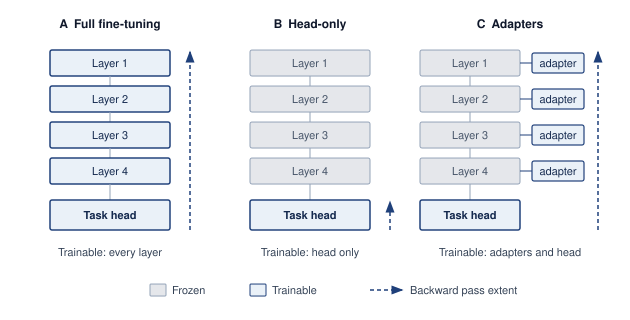

:::

The dashed backward-pass arrows in @fig-personalization-arch highlight why shrinking the count of trainable parameters does not automatically eliminate activation caching. Because adapters reside at every layer depth in Column C, the backward gradient flow must still traverse the full backbone to reach early adapters, requiring intermediate activations to remain resident in device RAM; only head-only adaptation (Column B) truncates backpropagation at the final layer boundary to eliminate backbone activation caching.

### Federated privacy {#sec-edge-intelligence-federated-privacy-a1ed}

While federated learning is often motivated by privacy concerns, as it involves keeping raw data localized instead of transmitting it to a central server, the paradigm introduces its own set of security and privacy risks. Although devices do not share their raw data, the transmitted model updates (such as gradients or weight changes) can inadvertently leak information about the underlying private data. Techniques such as model inversion attacks[^fn-inversion-edge-training] and membership inference attacks\index{Membership Inference Attack!definition}\index{Membership Inference!privacy risk} demonstrate that adversaries may partially reconstruct or infer properties of local datasets by analyzing these updates.

[^fn-inversion-edge-training]: **Model Inversion Attack**\index{Model Inversion Attack!definition}\index{Model Inversion!federated attack}: Reconstructs training data from model outputs or gradients by optimizing inputs that maximize confidence scores [@fredrikson2015; @zhu2019deep]. In federated learning, gradient updates can leak more information than model outputs alone because they expose training-step information directly. Defenses such as gradient perturbation, secure aggregation, and differential privacy add protocol, utility, communication, or compute trade-offs whose magnitude depends on the threat model and deployment.

To mitigate such risks, federated ML systems can employ protective measures. **Secure aggregation**\index{Secure Aggregation!definition}[^fn-secagg-secure-aggregation] protocols ensure that individual model updates are encrypted and aggregated in a way that the server only observes the combined result, not any individual client's contribution. Differential Privacy\index{Differential Privacy!noise injection}\index{Differential Privacy!edge devices} techniques inject carefully calibrated noise into updates to mathematically bound the information that can be inferred about any single client's data.

[^fn-secagg-secure-aggregation]: **Secure Aggregation**\index{Secure Aggregation!secret sharing protocol}: Cryptographic protocol where client pairs exchange random masks that cancel in the server-side sum, revealing only the aggregate gradient without exposing individual contributions [@bonawitz2017]. Production-scale federated systems such as Gboard combine secure aggregation with eligibility checks, drop-out handling, and round scheduling [@bonawitz2019towards]. The communication expansion and minimum-participation requirements depend on protocol parameters and the security model, so aggregation systems must wait for enough eligible devices before releasing a round.

These controls solve different problems. Secure aggregation limits what the coordinator learns about each submitted update, whereas differential privacy bounds how much a declared privacy unit can affect a released result. A deployment therefore needs a privacy ledger\index{Differential Privacy!privacy ledger and accounting} that records the unit of protection, clipping rule, noise mechanism, sampling assumptions, $(\epsilon,\delta)$ expenditure for every release, and cumulative composition across training and federated analytics [@abadi2016deep; @kairouz2021]. Clipping bounds each contribution before noise is calibrated. The parameters $\epsilon$ and $\delta$ describe the permitted change in output probabilities when the protected user or record is included or removed; composition accounts for repeated releases involving that unit. Resetting a round counter does not reset privacy loss for a user who participates again.

Secure aggregation also creates a robustness conflict. Byzantine-resilient rules\index{Secure Aggregation!Byzantine resilience conflict} such as Krum, coordinate-wise filtering, or per-client anomaly inspection need access to individual updates, while secure aggregation deliberately hides those updates [@blanchard2017machine; @bonawitz2017]. Here, Byzantine-resilient means designed to limit the influence of clients that submit arbitrary or malicious updates. A system cannot claim both arbitrary per-client inspection and conventional secure aggregation over the same messages. It must instead validate clients before masking, use attested execution and bounded local updates, compute only aggregation-compatible checks, or adopt a protocol designed to evaluate approved robust statistics without revealing raw client contributions. @Fig-secure-agg models this cryptographic boundary through pairwise zero-sum masking: Clients A and B negotiate a shared random mask $r$ via Diffie-Hellman key agreement, perturbing their local updates into pseudo-random vectors ($y_A = \Delta\theta_A + r$ and $y_B = \Delta\theta_B - r$) before crossing into the server domain. When the aggregation server sums the received vectors, the symmetric masks cancel ($r - r = 0$), yielding the exact unmasked aggregate $\Delta\theta_A + \Delta\theta_B$ without exposing any individual client's parameter trajectory.

::: {#fig-secure-agg fig-env="figure" fig-pos="htb" fig-cap="**Secure aggregation protocol**: A simplified two-client view of pairwise masking. Clients A and B agree on a shared random mask $r$; A uploads $y_A = \Delta\theta_A + r$ and B uploads $y_B = \Delta\theta_B - r$, so each upload alone looks random to the server. Summing them cancels the mask and yields exactly $\Delta\theta_A + \Delta\theta_B$. The server learns only the aggregate, which can still leak information unless differential privacy bounds it." fig-alt="Two client boxes on the left. In Client A, update delta theta A passes through a plus r node to produce y A; in Client B, update delta theta B passes through a minus r node to produce y B. A dashed line labeled shared mask r, key agreement, links the two mask nodes. Amber uplink arrows cross a dashed boundary from on device to visible to server, entering an aggregation server where a sum block produces delta theta A plus delta theta B, labeled masks cancel, r minus r equals 0."}
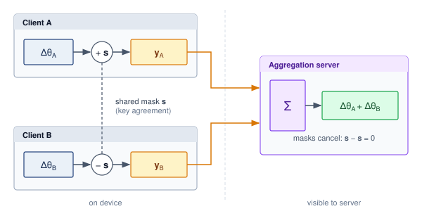

:::

That algebraic cancellation makes secure aggregation composable with differential privacy\index{Differential Privacy!composition with secure aggregation} for layered defense. The protocol hides individual contributions first, and privacy noise can then bound what the aggregate still reveals. Neither step establishes that the contributing devices or updates are trustworthy.

### Large-scale device orchestration {#sec-edge-intelligence-largescale-device-orchestration-1360}

A round that selects a million phones overnight will see some fraction overheat, lose connectivity, or be unplugged before they report, and a few may submit corrupted or deliberately malicious updates. Coordinating that population requires protocols that handle Byzantine clients, network partitions\index{Network partition!federated learning} that temporarily cut participants off, and constrained communication. These challenges differ from controlled data center training, where high-bandwidth networks and managed infrastructure narrow the trust and availability envelope.

#### Network and bandwidth optimization {#sec-edge-intelligence-network-bandwidth-optimization-53da}

The communication bottleneck\index{Communication efficiency!edge fleets} represents the primary scalability constraint in federated learning systems. Quantifying the actual transfer requirements exposes the design constraints on model architectures, update compression strategies, and client participation policies that determine system viability.

The federated communication hierarchy reveals the severe bandwidth constraints under which distributed learning must operate. Full model synchronization can require tens to hundreds of megabytes per training round for common deep models, which is a poor fit for intermittent mobile uplinks. Federated-optimization work therefore studies communication reduction through structured updates, quantization, sparsification, and selective transmission [@konevcny2016federated; @mcmahan2017communication]. Practical deployments often push this further by transmitting only adapters, heads, or compressed update summaries rather than complete model states. Communication frequency introduces a critical trade-off between model update freshness, where more frequent updates enable faster adaptation to changing conditions, and network efficiency constraints that limit sustainable bandwidth consumption.

Network infrastructure constraints directly impact participation rates and overall system viability. Mobile upload capacity varies sharply by geography, carrier, radio generation, congestion, and whether the device remains idle long enough to complete the transfer. A multi-megabyte update may be tolerable for a high-end device on a stable connection but impractical for a low-end device on a congested uplink. This variance in network capability necessitates adaptive communication strategies that optimize for lowest-common-denominator connectivity while enabling high-capability devices to contribute more effectively.

The relationship between communication requirements and participation rates exhibits sharp threshold effects. Large model transfers sharply reduce sustained client participation because devices must remain idle, connected, sufficiently charged, and willing to spend upload bandwidth for the whole transfer window. Keeping updates small, often through adapter-only sharing or aggressive compression, increases the eligible device pool and shortens round duration. This communication efficiency\index{Communication efficiency!client participation rate} directly translates to model quality improvements: higher participation rates provide better statistical diversity and more robust gradient estimates for global model updates. The compression techniques that make these small updates possible (gradient quantization, sparsification, and top-$k$ selection with error accumulation) are the same ones established in @sec-edge-intelligence-bandwidthaware-update-compression-7730; here they serve the participation argument rather than the bandwidth argument, because shrinking the update is what widens the eligible device pool.

#### Asynchronous device synchronization {#sec-edge-intelligence-asynchronous-device-synchronization-348e}

Federated learning inherits failures from distributed systems and machine learning, but its coordination objective is not consensus in the Paxos or Raft sense. Replicas do not agree on one command log; a coordinator decides which stochastic client updates are eligible, how stale updates are weighted, and which aggregation rule can tolerate faulty participants without letting them steer the model. Devices crash, lose power, or disconnect during rounds, while compromised clients can submit poisoned updates. Robust aggregation can reduce the influence of some faulty participants, but its assumptions, compute cost, and compatibility with secure aggregation must be explicit.

The trust chain begins before aggregation. A production coordinator authenticates the device and application instance, verifies the signed model and training-policy version, checks eligibility and freshness, binds the returned update to that version and round nonce, and records whether the update passed protocol-level bounds. Hardware-backed attestation can strengthen claims about code identity on supported devices, but it cannot prove that local examples are benign or representative. The resulting update-integrity record supports rejection, rollback, and incident analysis without treating device identity as evidence that the gradient is correct.

Network partitions pose particularly acute challenges for federated coordination protocols. Unlike traditional distributed systems operating within reliable data center networks, federated learning must gracefully handle prolonged client disconnection events where devices may remain offline for hours or days while traveling, in poor coverage areas, or simply powered down. Asynchronous coordination\index{Asynchronous coordination!federated learning} protocols enable continued training progress despite missing participants, but must carefully balance staleness (accepting potentially outdated contributions) against freshness (prioritizing recent but potentially sparse updates).

Fault recovery and resilience strategies form an essential layer of federated learning infrastructure. Checkpoint synchronization through periodic global model snapshots enables recovery from server failures and provides rollback points when corrupted training rounds are detected, though checkpointing large models across millions of devices introduces substantial storage and communication overhead. Partial update handling ensures systems gracefully handle incomplete training rounds when significant subsets of clients fail or disconnect mid-training, requiring careful weighting strategies to prevent bias toward more reliable device cohorts. State reconciliation\index{State reconciliation!offline clients} protocols enable clients rejoining after extended offline periods, potentially days or weeks, to efficiently resynchronize with the current global model while minimizing communication overhead that could overwhelm bandwidth-constrained devices. Dynamic load balancing addresses uneven client availability patterns that create computational hotspots, requiring intelligent load redistribution across available participants to maintain training throughput despite time-varying participation rates.

The asynchronous nature of federated coordination introduces additional complexity in maintaining training convergence guarantees. Traditional synchronous training assumes all participants complete each round, but federated systems must handle stragglers[^fn-straggler-federated-delay] and dropouts gracefully.

[^fn-straggler-federated-delay]: **Straggler Problem**\index{Straggler Problem!definition}\index{Straggler!federated learning}: In data center training, stragglers slow synchronous progress; in federated learning, the problem is amplified by heterogeneous hardware, intermittent connectivity, and eligibility windows [@bonawitz2019towards; @kairouz2021]. Solutions like asynchronous aggregation and bounded staleness (ignoring updates older than $k$ rounds) improve throughput but introduce a fairness trade-off: aggressive straggler mitigation biases models toward users with high-end devices, potentially degrading performance for the most constrained users who need personalization most.

#### Heterogeneity management at fleet scale {#sec-edge-intelligence-managing-milliondevice-heterogeneity-86c1}

```{python}
#| echo: false
# ┌── LEGO ───────────────────────────────────────────────
# │ Context: Federated heterogeneity — flagship NPU reference.
class EdgeFedNpuRecap:
    from mlsysim.fmt import check, fmt_multiple, fmt_ops_rate

    mobile_npu_rate = Hardware.Mobile.iPhone15Pro.compute.peak_flops
    mobile_npu_tops = mobile_npu_rate.to(TOPS).magnitude
    iot_tops = ReferenceStats.EdgeDeviceSpectrum.IotMicrocontrollerComputeLow
    compute_ratio = mobile_npu_tops / iot_tops.to(TOPS).magnitude
    check(1000 < compute_ratio < 2000, f"Flagship-to-IoT compute ratio unexpected: {compute_ratio:.0f}x")
    # ┌── 4. OUTPUT (Formatting) ─────────────────────────────────────────────
    mobile_npu_tops_str = fmt_ops_rate(mobile_npu_rate, unit=TOPS, precision=0, commas=False)
    iot_compute_tops_str = fmt_ops_rate(iot_tops, unit=TOPS, precision=2, commas=False)
    compute_ratio_mult_str = fmt_multiple(round(compute_ratio, -2), precision=0, commas=True)
```

```{python}
#| echo: false
# ┌── LEGO ───────────────────────────────────────────────
# │ Context: Federated heterogeneity energy constraints.
from mlsysim import ReferenceStats
from mlsysim.core.units import milliwatt, watt
from mlsysim.fmt import check, fmt_qty_range

class EdgeFedPowerEnvelopeRecap:
    # ┌── 1. LOAD (Constants) ──────────────────────────────────────────────
    sustained_low = ReferenceStats.MobilePower.MobileMlSustainedLow
    sustained_high = ReferenceStats.MobilePower.MobileMlSustainedHigh
    background_low = ReferenceStats.MobilePower.BackgroundAdaptationLow
    background_high = ReferenceStats.MobilePower.BackgroundAdaptationHigh

    # ┌── 3. GUARD (Invariants) ───────────────────────────────────────────
    check(sustained_low < sustained_high, "Sustained mobile power range should be ordered.")
    check(background_low < background_high, "Background mobile power range should be ordered.")

    # ┌── 4. OUTPUT (Formatting) ─────────────────────────────────────────────
    sustained_range_str = fmt_qty_range(
        sustained_low,
        sustained_high,
        watt,
        precision=0,
        commas=False,
    )
    background_range_str = fmt_qty_range(
        background_low,
        background_high,
        milliwatt,
        precision=0,
        commas=False,
    )
```

Million-device orchestration is a tiering decision: the system must decide which clients can train, which can only report lightweight updates, and how much bias that selection introduces. The difficulty is that hardware capabilities, network conditions, data distributions, and availability patterns vary simultaneously, challenging traditional distributed machine learning assumptions about homogeneous participants operating under similar conditions.

Real-world federated learning deployments face multi-dimensional device heterogeneity that creates extreme variation across every system dimension. Computational variation spans about `{python} EdgeFedNpuRecap.compute_ratio_mult_str` differences in processing power between flagship smartphones running at `{python} EdgeFedNpuRecap.mobile_npu_tops_str` and, at the extreme below Archetype C's phone-class clients, IoT microcontrollers operating at just `{python} EdgeFedNpuRecap.iot_compute_tops_str`, fundamentally limiting what models can train on different device tiers. Memory constraints exhibit even more dramatic differences in available RAM across device categories, up to roughly `{python} EdgeDeviceSpectrum.memory_ratio_mult_str` between `{python} EdgeDeviceSpectrum.mcu_sram_kb_str` microcontrollers and `{python} EdgeDeviceSpectrum.flagship_ram_gb_str` premium smartphones, determining whether devices can perform any local training at all or must rely purely on inference. Energy limitations force training sessions to be carefully scheduled around charging patterns, thermal constraints, and battery preservation requirements: background adaptation often targets roughly `{python} EdgeFedPowerEnvelopeRecap.background_range_str`, even though phones may sustain `{python} EdgeFedPowerEnvelopeRecap.sustained_range_str` for foreground ML workloads and burst higher briefly. Network diversity introduces orders-of-magnitude performance differences as Wi-Fi, 4G, 5G, and satellite connectivity exhibit vastly different bandwidth (ranging from 1 Mbps to 1 Gbps), latency (10 ms to 600 ms), and reliability characteristics that determine feasible update frequencies and compression requirements.

Adaptive coordination protocols address this heterogeneity through sophisticated tiered participation strategies that optimize resource utilization across the device spectrum. High-capability devices such as flagship smartphones can perform complex local training with large batch sizes and multiple epochs, while resource-constrained IoT devices contribute through lightweight updates, specialized subtasks, or even simple data aggregation. This creates a natural computational hierarchy where powerful devices act as "super-peers" performing disproportionate computation, while edge devices contribute specialized local knowledge and coverage.

The scale challenges extend beyond device heterogeneity to coordination overhead. Federated learning does not run Raft or PBFT among millions of clients, nor does hierarchical aggregation perform local consensus. Regional aggregators reduce fan-in by validating an eligible cohort and combining updates before forwarding a partial aggregate; agreement on an ordered replicated log, if needed for the coordinator's own metadata, remains a separate control-plane service. Edge infrastructure can provide aggregation points, but each added tier creates another trust boundary and another place where weighting, clipping, privacy accounting, and failure recovery must remain consistent.

Tiering interacts with the participation bias analyzed under client scheduling (@sec-edge-intelligence-client-scheduling-f675). Capability-based selection shortens rounds but concentrates completed updates on strong devices, so stratified sampling across tiers must be paired with per-cohort evaluation of completed participation and model quality. Availability also has a daily rhythm; devices that charge overnight in one time zone form a different cohort from those available during another zone's working hours.

With robust orchestration managing the heterogeneity and intermittency of millions of devices, the individual components for decentralized AI are in place. Each pillar so far has been treated as a discrete capability a device invokes, but a deployed edge model does not adapt once and stop; it keeps learning for the lifetime of the deployment, which is where the three pillars stop being separable.

## Continual Adaptation Under Edge Budgets {#sec-edge-intelligence-bioinspired-learning-efficiency-55ad}

Continual adaptation on edge devices has to fit inside power, memory, and communication budgets that leave room for foreground work. Model adaptation, data efficiency, and federated coordination each address one part of that budget, but continued learning must respect all of them together. Biological learning motivates ideas such as sparse activity and replay, without providing a directly comparable digital efficiency benchmark.\index{Efficiency!brain, edge learning}

For edge systems, the actionable mechanisms are selective updates, bounded replay, and admission based on available energy and thermal headroom. Sparse updates save work only when the execution path can skip it. Replay protects earlier behavior at the cost of retained examples and additional training. Opportunistic scheduling delays adaptation until device conditions permit it. Each mechanism therefore needs a resource budget and an outcome check rather than a biological efficiency claim.

### Unlabeled data exploitation strategies {#sec-edge-intelligence-unlabeled-data-exploitation-strategies-cded}

Unlabeled sensor streams turn the efficiency argument into a storage and scheduling decision. Cameras, accelerometers, location sensors, and touch interaction all produce data that can support self-supervised learning\index{Self-Supervised Learning!sensor data}, and the potential volume is large. A hypothetical camera stream running continuously at 30 frames per second produces approximately 2.6 million frames daily before retention filtering, and an accelerometer sampling at 100 Hz generates 8.6 million readings. The engineering question is which traces encode stable structure worth learning from and which should expire before they crowd out model state, replay buffers, or user-facing storage.

Contrastive learning\index{Contrastive Learning!definition} from temporal correlations offers particularly promising opportunities for exploiting this sensor data. Consecutive frames from mobile cameras or augmented views of the same frame naturally provide positive pairs for visual representation learning. Negative examples come from different frames, other devices' samples, or replay/memory queues that represent dissimilar scenes.

### Continual adaptation and catastrophic forgetting {#sec-edge-intelligence-lifelong-adaptation-without-forgetting-9200}

Real-world on-device deployment demands continual adaptation to changing environments, user behavior, and task requirements. This presents the fundamental challenge of the stability-plasticity trade-off\index{Stability-plasticity trade-off!continual learning}: models must remain stable enough to preserve existing knowledge while plastic enough to learn new patterns.

Continual learning on edge devices faces several interconnected challenges. Catastrophic forgetting (@sec-edge-intelligence-experience-replay-737e) is magnified when devices cannot store or revisit historical training data. Task interference compounds it when several learning objectives compete for limited parameter capacity, and distribution shift between pretraining and local deployment demands continued adaptation without eroding the model's core representations. Restricted device memory rules out the comprehensive replay buffers that centralized infrastructure can afford.

Three families of mechanisms manage the stability-plasticity trade-off during continual learning\index{Continual learning!edge devices}. Elastic weight consolidation[^fn-ewc-continual-learning] [@kirkpatrick2017] mitigates catastrophic forgetting by penalizing changes to weights important for previous tasks, experience replay (@sec-edge-intelligence-experience-replay-737e) maintains stability during adaptation by interleaving new training with replayed examples from previous tasks, and progressive neural architectures allocate new capacity for new tasks rather than forcing all knowledge into fixed-capacity networks [@rusu2016progressive]. That last option is attractive when interference is severe, but it consumes additional memory and therefore fits only devices with enough spare capacity.

[^fn-ewc-continual-learning]: **EWC (Elastic Weight Consolidation)**\index{Elastic Weight Consolidation!definition}: Uses a diagonal approximation to the Fisher information to weight a penalty on changes from previously learned parameters [@kirkpatrick2017]. In addition to current parameters, a basic implementation stores importance scores and reference parameter values. Retaining separate penalties for earlier tasks can increase that state further. Compared with replay, EWC trades stored examples for parameter-sized statistics; which uses less memory depends on model size, retained history, precision, and the penalty implementation.

Meta-learned initializations (@sec-edge-intelligence-federated-personalization-3c73) and few-shot adaptation (@sec-edge-intelligence-fewshot-learning-data-streaming-566e) shorten the path to a useful local model, which also shortens the window in which forgetting can accumulate. Taken together, these mechanisms yield a compact design rule, which is that durable on-device learning minimizes the adaptation footprint while preserving enough plasticity to track local change.

That rule first changes what the device is allowed to update. Restricting updates to bias terms, residual adapters, or lightweight heads (@sec-edge-intelligence-model-adaptation-6a82) bounds forgetting as well as memory, provided offline pretraining supplies features general enough that the device spends its limited energy specializing behavior rather than relearning representations from scarce local data [@bommasani2021opportunities].

Once the update footprint is bounded, the runtime must decide when the update can execute and whether it should be shared. The admission condition in @eq-edge-background-admission already governs when a continual update may run; what changes over a long deployment is that each admitted window also moves the device further from its last validated state. In decentralized or federated learning contexts, the same budget pressure applies to communication: quantized gradient updates, sparsified parameter sets, and selective model transmission allow large heterogeneous fleets to coordinate without overwhelming bandwidth or energy budgets [@konevcny2016federated].

Stability then becomes a state-management problem. Replay buffers, support sets, adaptation logs, and model update metadata must be protected against unauthorized access or tampering because they encode the local evidence that shaped the model. Lightweight encryption or hardware-backed secure storage can reduce that exposure, but security controls do not prove that adaptation remains beneficial. Lightweight validation techniques, including confidence scoring, drift detection heuristics [@gama2014], and shadow model evaluation, monitor adaptation dynamics and can hold an update for validated review before severe degradation occurs. Robust rollback procedures require a trusted baseline checkpoint that can be restored quickly, especially in safety-important and regulated domains where failure recovery must be provable.

Privacy and compliance requirements close the loop. User consent, data minimization, retention limits, and the right to erasure must be designed into the adaptation pipeline rather than added after deployment. Meeting regulatory obligations at scale demands on-device learning workflows that preserve auditable autonomy\index{Auditable autonomy!compliance}: the model can adapt in place, but the system still retains enough control to explain, bound, and reverse that adaptation when necessary.

A design rule describes what a single device should do. Running that adaptation across a fleet, on a release cadence, with monitoring and rollback, is a separate discipline: it turns these continual-learning choices into operations that must survive CI/CD, versioning, and the absence of centralized labels.

## Production Integration {#sec-edge-intelligence-production-integration-beb5}

It is one thing to write a proof-of-concept script that fine-tunes an adapter on a Raspberry Pi. It is an entirely different discipline to ship that capability to `{python} EdgeAdaptationTierProfile.fleet_devices_million_str` within a strict CI/CD pipeline, ensuring that a bad gradient update does not brick the app. Production integration is where the theoretical elegance of edge intelligence collides with the unforgiving realities of mobile software engineering.

### MLOps integration challenges {#sec-edge-intelligence-mlops-integration-challenges-bb4e}

Integrating on-device learning into machine learning operations (MLOps\index{MLOps!definition}), the practices that version, deploy, monitor, and roll back production models, changes what operations must validate. In place of a single model artifact in one controlled environment, operations must validate a hierarchy of backbones, adapters, policies, and local states spread across heterogeneous devices. Traditional continuous integration pipelines, model versioning systems, and monitoring infrastructure provide essential foundations, but they assume centralized data access, controlled deployment environments, and unified monitoring. Edge learning breaks those assumptions, requiring operational practices that preserve reliability while privacy-preserving coordination and local adaptation continue after deployment.

@Fig-edge-mlops-pipeline traces the five-stage closed loop governing the edge learning lifecycle: centralized base-model pretraining (Stage 1), per-tier hardware compression (Stage 2), and staged over-the-air rollouts (Stage 3) originate in the cloud, while local adaptation of adapters and update policies executes strictly on-device (Stage 4). Rather than exfiltrating raw user data, the loop closes across the device boundary via privacy-preserving telemetry of aggregate metrics (Stage 5), which feeds back as an automated trigger for cloud retraining.

::: {#fig-edge-mlops-pipeline fig-env="figure" fig-pos="htb" fig-cap="**Edge MLOps lifecycle pipeline**: The lifecycle links cloud pretraining and model compression with over-the-air deployment, on-device adaptation, and privacy-preserving telemetry that closes the loop without transmitting raw user data." fig-alt="Five numbered stages. In the cloud region: 1 pretrain, base model; 2 compress, per-tier packages; 3 staged rollout, over the air. An amber arrow crosses a dashed boundary into the device region: 4 adapt locally, adapter plus policy. A dashed violet loop labeled no raw data returns from the device to 5 telemetry, aggregate metrics, and continues as a retrain trigger back to stage 1."}
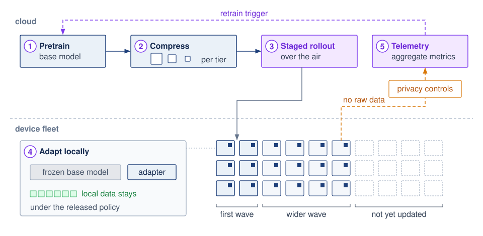

:::

#### Deployment pipeline transformations {#sec-edge-intelligence-deployment-pipeline-transformations-431d}

Traditional MLOps deployment pipelines release one validated model artifact into uniform infrastructure. On-device learning turns that artifact into a policy bundle because device class determines what safe adaptation means. For example, the voice-assistant policy developed later in @sec-edge-intelligence-pillar-integration-7e21 assigns bias-only updates to budget devices and LoRA adapters of different ranks to mid-tier and flagship phones. Each assignment remains conditional on the model footprint, runtime support, and admission tests. The deployable unit includes adaptation policies, initial model weights, and device-specific optimization configurations, so CI/CD must validate the policy that selects among them, not only the weights.

That shift also changes versioning. While centralized systems maintain a single model version, on-device learning systems must simultaneously track multiple versioning dimensions. The pretrained backbone distributed to all devices represents the base model version, which serves as the foundation for all local adaptations. Different update mechanisms deployed per device class constitute adaptation strategies, varying from bias-only updates on budget devices to higher-rank LoRA adapters on flagship devices. Local model states naturally diverge from the base as devices encounter unique data distributions, creating device-specific checkpoints that reflect individual adaptation histories. Federated learning rounds that periodically synchronize device populations establish aggregation epochs, marking discrete points where distributed knowledge converges into updated global models. A robust deployment implements tiered versioning schemes where base models evolve slowly, often through scheduled updates, while local adaptations occur continuously, creating a hierarchical version space rather than the linear version history familiar from traditional deployments.

#### Monitoring system evolution {#sec-edge-intelligence-monitoring-system-evolution-94c9}

Traditional monitoring practices aggregate metrics from centralized inference servers. On-device learning monitoring must operate within fundamentally different constraints that reshape how systems observe, measure, and respond to model behavior across distributed device populations.

Fleet telemetry for edge devices, including federated analytics\index{Federated Analytics!privacy-preserving telemetry} that report only aggregate or differentially private summaries, belongs to fleet operations and is developed in @sec-ml-operations-scale-managing-edge-fleet-c591. What adaptation adds is a monitoring target that no longer exists centrally. Each device's model has moved away from the released version, so the questions that matter are whether a locally adapted model has drifted and whether it is still better than the version it replaced, and both must be answered without labels.

Drift detection\index{Drift Detection!on-device models} presents additional challenges without access to ground truth labels. While traditional monitoring compares model predictions against labeled validation sets maintained on centralized infrastructure, on-device systems must detect drift using only the indirect local signals available during deployment. Confidence calibration\index{Confidence Calibration!drift detection} compares output probabilities with eventual outcomes whenever labels exist; without verified outcomes, confidence shifts merely flag an altered score distribution. In parallel, input distribution monitoring applies statistical tests to detect when runtime feature distributions diverge from pretraining data without requiring labels. Task performance proxies use implicit feedback such as user corrections or session abandonment, though only after validating the causal link to task quality and accounting for how model suggestions alter subsequent user behavior. Finally, shadow baseline comparisons run a frozen base model alongside the adapted model to measure prediction divergence; without labels or a validated invariant, this comparison detects behavioral divergence rather than determining which model is superior.

The same cohort slicing that fleet operations applies to any edge release applies here with one addition. Participation inequality becomes a model-quality metric, because devices that rarely admit an update also rarely benefit from one, and a flattering global average can hide regressions concentrated on weak hardware.

#### Continuous training orchestration {#sec-edge-intelligence-continuous-training-orchestration-8974}

Continuous training on devices has no global schedule. Devices train when their own admission tests pass, so the orchestrator coordinates state rather than jobs.

The state that matters is per-device. Devices often operate on different base model versions simultaneously, creating version skew that the aggregation protocol must handle without forcing all devices to maintain identical model states. State reconciliation becomes necessary when devices reconnect after extended offline periods, potentially days or weeks. A returned update must identify its base version so the coordinator can reject it, apply a stated staleness policy, or request new training from the current base. Accumulated personal adaptations, including per-device adapters and replay buffers, carry their own version tags and need not be merged into the shared model.

Resource-aware scheduling applies @eq-edge-background-admission at fleet scale. Federated rounds usually add idle, charging, and unmetered-network requirements on top of the local admission test, and a daily energy cap bounds cumulative learning cost across many admitted windows.

Admission also has a runtime half. Even bias-only or head-only adaptation must backpropagate through the layers above its trainable parameters, so on a shared SoC an admitted window still competes with inference for compute, memory bandwidth, and thermal headroom. Users judge the device by its quality of service (QoS),\index{Quality of Service!definition} so the runtime gives inference priority and throttles or revokes a training window as foreground latency approaches its deadline. At the microcontroller extreme the same logic becomes an energy ledger. A single adaptation epoch can consume tens to hundreds of millijoules,[^fn-mcu-milliwatt-power] an appreciable fraction of a duty-cycled budget on harvested power, so learning waits for idle periods with high energy reserves.

[^fn-mcu-milliwatt-power]: **Microcontroller Power Budget**\index{Microcontroller Power Budget!definition}\index{Microcontroller!power budget and duty cycling}: In an illustrative operating point, 10 mW of active training for 10 seconds consumes 0.1 J. The number of updates that fit that session requires a measured time or energy per update. Battery lifetime additionally depends on usable capacity under the actual load, sleep power, radio activity, conversion losses, and duty cycle; nameplate capacity alone does not establish continuous-training lifetime.

Convergence must be inferred without a central validation set. Federated evaluation aggregates metrics from devices that hold local held-out data, coordinators track the magnitude of successive aggregate updates, and participation audits confirm that these signals do not describe only an over-represented subpopulation.

#### Validation strategy adaptation {#sec-edge-intelligence-validation-strategy-adaptation-ab3d}

Traditional validation approaches assume access to held-out test sets and centralized evaluation infrastructure where model quality can be measured directly against known ground truth. On-device learning requires distributed validation that respects privacy and resource constraints while still providing reliable quality signals across heterogeneous device populations.

Shadow model\index{Shadow Model!evaluation} evaluation maintains multiple model variants on each device and compares their behavior. Devices can run a frozen, last-known-good model beside a locally adapted version and measure prediction divergence, confidence shifts, latency, and resource use on the same input stream. Without labels or a validated outcome proxy, these comparisons detect change, not performance degradation: agreement can hide a shared error, and disagreement does not reveal which model is correct. A shadow comparison can therefore suspend an update for further evaluation, but automatic rollback requires labeled outcomes, a validated behavioral invariant, or a proxy whose relationship to task quality has been established for the deployment.

@Fig-shadow-validation diagrams this on-device validation architecture as an operational comparator pipeline: the live sensor stream is mirrored simultaneously to a frozen golden baseline ($v1$) and the locally adapted candidate ($v1.1$). The comparator continuously tracks output disagreement, confidence shifts, and resource deltas; if divergence breaches the tolerance threshold ($\text{Disagreement} > \tau$), a safety gate immediately trips, holding deployment until the update passes validated outcome checks or triggers an automated rollback.

::: {#fig-shadow-validation fig-env="figure" fig-pos="htb" fig-cap="**On-device shadow validation**: A frozen baseline runs beside the active model. Their disagreement, confidence, latency, and resource deltas can flag a change without labels; a rollback decision still requires a validated outcome signal or safety invariant." fig-alt="Flow diagram with a data stream forking to frozen baseline and active models, both feeding a comparator whose change signal can hold an update for validated review."}

```{.tikz}
\providecolor{mlsysblue}{RGB}{26, 86, 160}
\providecolor{mlsysgreen}{RGB}{16, 124, 65}
\providecolor{mlsysred}{RGB}{186, 24, 27}
\providecolor{mlsysamber}{RGB}{217, 119, 6}
\providecolor{mlsyspurple}{RGB}{124, 58, 237}
\providecolor{mlsysdarkgray}{RGB}{30, 41, 59}
\providecolor{mlsysdark}{RGB}{30, 41, 59}
\providecolor{mlsysgray}{RGB}{100, 116, 139}
\providecolor{mlsyslightgray}{RGB}{241, 245, 249}
\providecolor{bordergray}{RGB}{203, 213, 225}
\definecolor{bluebg}{HTML}{EFF6FF}
\definecolor{greenbg}{HTML}{F0FDF4}
\definecolor{amberbg}{HTML}{FFFBEB}
\definecolor{redbg}{HTML}{FEF2F2}
\definecolor{purplebg}{HTML}{FAF5FF}
\scalebox{0.88}{%
\begin{tikzpicture}[line join=round,line cap=round,font=\sffamily]

\tikzset{
  Card/.style={
    draw=bordergray,
    fill=white,
    rounded corners=3.5pt,
    line width=0.7pt,
    align=center,
    drop shadow={opacity=0.04,shadow xshift=0pt,shadow yshift=-1.5pt}
  },
  StreamCard/.style={
    Card,
    draw=mlsysdarkgray!60,
    fill=mlsyslightgray!60,
    minimum width=5.0cm,
    minimum height=1.1cm
  },
  ModelCard/.style={
    Card,
    minimum width=4.5cm,
    minimum height=1.45cm
  },
  ArbiterCard/.style={
    Card,
    draw=mlsyspurple!80,
    fill=purplebg,
    minimum width=5.8cm,
    minimum height=1.35cm
  },
  DecisionCard/.style={
    Card,
    draw=mlsysred!80,
    fill=redbg,
    minimum width=5.8cm,
    minimum height=1.1cm
  },
  FlowWire/.style={
    -{Latex[length=4.5pt,width=4.5pt]},
    line width=1.1pt,
    color=mlsysdarkgray!80,
    shorten >=2.5pt
  },
  AlertWire/.style={
    -{Latex[length=4.5pt,width=4.5pt]},
    line width=1.1pt,
    color=mlsysred,
    dashed,
    shorten >=2.5pt
  }
}

% 1. Input Stream
\node[StreamCard] (stream) at (0, 3.8) {
  {\fontsize{7.5}{9}\selectfont\bfseries\color{mlsysgray} INGESTION PIPELINE}\\[2pt]
  {\fontsize{9}{11}\selectfont\bfseries\color{mlsysdark} Live User Sensor / Request Stream}
};

% 2. Two Models (Shadow vs Active)
\node[ModelCard, draw=mlsysblue, fill=bluebg] (shadow) at (-3.4, 1.8) {
  {\fontsize{7}{8.5}\selectfont\bfseries\color{mlsysblue} SHADOW BASELINE ($v1$)}\\[2pt]
  {\fontsize{8.5}{10.5}\selectfont\bfseries\color{mlsysdark} Frozen Golden Model}\\[1.5pt]
  {\fontsize{6.8}{8}\selectfont\color{mlsysgray} Deterministic Reference}
};

\node[ModelCard, draw=mlsysamber, fill=amberbg] (active) at (3.4, 1.8) {
  {\fontsize{7}{8.5}\selectfont\bfseries\color{mlsysamber} ACTIVE DEPLOYMENT ($v1.1$)}\\[2pt]
  {\fontsize{8.5}{10.5}\selectfont\bfseries\color{mlsysdark} Locally Adapted Model}\\[1.5pt]
  {\fontsize{6.8}{8}\selectfont\color{mlsysgray} Online Trained / Fine-Tuned}
};

% 3. Arbiter / Comparator
\node[ArbiterCard] (arbiter) at (0, -0.6) {
  {\fontsize{7}{8.5}\selectfont\bfseries\color{mlsyspurple} COMPARATOR \& DRIFT DETECTOR}\\[2pt]
  {\fontsize{9}{11}\selectfont\bfseries\color{mlsysdark} Disagreement \& Confidence Delta Monitor}\\[1.5pt]
  {\fontsize{7}{8.5}\selectfont\color{mlsysgray} Resource overhead \& latency discrepancy analysis}
};

% 4. Decision Gate
\node[DecisionCard] (gate) at (0, -2.6) {
  {\fontsize{7}{8.5}\selectfont\bfseries\color{mlsysred} SAFETY GATE \& ROLLBACK POLICY}\\[2pt]
  {\fontsize{8.5}{10.5}\selectfont\bfseries\color{mlsysred!90!black} Hold for Validated Outcome or Invariant Check}
};

% Routing Arrows
% Stream to models
\draw[FlowWire] (stream.south) -- ++(0, -0.35) -| (shadow.north) node[pos=0.25, above, font=\fontsize{6.5}{7.5}\selectfont\color{mlsysgray}] {Mirror Data};
\draw[FlowWire] (stream.south) -- ++(0, -0.35) -| (active.north) node[pos=0.25, above, font=\fontsize{6.5}{7.5}\selectfont\color{mlsysgray}] {Live Serving};

% Models to Arbiter: Orthogonal routing entering top of Arbiter
\draw[FlowWire] (shadow.south) -- node[left=2pt, font=\fontsize{6.5}{7.5}\selectfont\color{mlsysblue}] {Reference Output} ++(0, -0.4) -| ($(arbiter.north) + (-1.8, 0)$);
\draw[FlowWire] (active.south) -- node[right=2pt, font=\fontsize{6.5}{7.5}\selectfont\color{mlsysamber}] {Candidate Output} ++(0, -0.4) -| ($(arbiter.north) + (1.8, 0)$);

% Arbiter to Gate
\draw[AlertWire] (arbiter.south) -- (gate.north) node[midway, right, font=\fontsize{7}{8.5}\selectfont\bfseries\color{mlsysred}] {Disagreement $> \tau$ or Anomaly};

\end{tikzpicture}%
}
```

:::

Confidence-based gates provide another change signal when labels are unavailable. Even a calibrated model's confidence is interpretable only relative to the population and task on which calibration was measured. A drop can reflect distribution shift, ambiguity, or a changed score scale; stable confidence can coexist with overconfident errors. Systems may use confidence to trigger investigation or halt adaptation conservatively, but they should not call the adapted model worse without delayed labels, randomized evaluation, trusted user corrections, or another validated outcome signal.

Federated A/B testing\index{Federated A/B testing!client cohort validation} randomly assigns devices to treatment and control adaptation policies, balanced across device tiers, and compares privacy-preserving aggregates of adaptation success rate, time to improvement, and final quality. A strategy that wins is then released through the staged rollout process that fleet operations owns (@sec-ml-operations-scale-staged-rollout-strategies-2d1f).

Aggregated validation signals are themselves releases. They need data minimization, secure aggregation where appropriate, a declared privacy unit, and privacy accounting across repeated rounds, and even then a population summary can miss a failure confined to a few users. Local gates and population summaries therefore provide different evidence, and evaluating an adaptive fleet requires measuring adaptation benefit, resource cost, and cohort coverage together.

#### Performance evaluation in dynamic environments {#sec-edge-intelligence-performance-evaluation-dynamic-environments-82a9}

Standard ML benchmarks characterize inference latency, throughput, energy efficiency, and accuracy, but they were designed for static inference workloads. On-device learning requires extending these metrics to capture adaptation quality and training efficiency through training-specific benchmarks.

```{python}
#| echo: false
# ┌── LEGO ───────────────────────────────────────────────
# │ Context: Edge adaptation training metrics.
from mlsysim import ReferenceStats
from mlsysim.core.units import milliwatt, hour, kJ
from mlsysim.fmt import check, fmt_qty_range

class EdgeAdaptationPowerMetrics:
    # ┌── 1. LOAD (Constants) ──────────────────────────────────────────────
    background_low = ReferenceStats.MobilePower.BackgroundAdaptationLow
    background_high = ReferenceStats.MobilePower.BackgroundAdaptationHigh
    # ┌── 2. EXECUTE (The Compute) ────────────────────────────────────────
    background_low_energy_per_hour = background_low * hour
    background_high_energy_per_hour = background_high * hour

    # ┌── 3. GUARD (Invariants) ───────────────────────────────────────────
    check(background_low < background_high, "Background mobile power range should be ordered.")

    # ┌── 4. OUTPUT (Formatting) ─────────────────────────────────────────────
    background_range_str = fmt_qty_range(
        background_low,
        background_high,
        milliwatt,
        precision=0,
        commas=False,
    )
    background_energy_per_hour_str = fmt_qty_range(
        background_low_energy_per_hour,
        background_high_energy_per_hour,
        kJ,
        precision=1,
        commas=False,
        per="hour",
    )
```

Beyond traditional inference metrics, adaptive systems require measures that explain whether local learning is worth the resource cost. Adaptation efficiency measures how much accuracy improves per training sample consumed. A system that gains two percentage points of accuracy from 100 local samples is more useful on a device than one that needs 500 samples for the same improvement, because fewer samples mean faster personalization, less local storage, and fewer training windows competing with user-facing work.

Device-envelope fit measures whether the improvement stays inside resource budgets. Memory-constrained convergence evaluates validation loss under a fixed RAM budget, such as "convergence within `{python} EdgeDeviceSpectrum.mcu_sram_kb_str` training footprint," while energy-per-update measures millijoules consumed per gradient step; an illustrative background envelope of `{python} EdgeAdaptationPowerMetrics.background_range_str` corresponds to `{python} EdgeAdaptationPowerMetrics.background_energy_per_hour_str` while active. Battery impact depends on duty cycle, usable battery capacity, foreground demand, and charging state. Time-to-adaptation extends the same idea to scheduling by measuring wall-clock time from new data to measurable improvement, including waiting for idleness, charging status, and thermal headroom rather than only raw accelerator throughput.

Personalization quality measures whether adaptation improves the right behavior without damaging the base model. Per-user performance delta compares the adapted model against the global baseline on user-specific holdout data, and acceptance requires an application-specific improvement threshold with uncertainty reported, before accepting the compute and energy overhead. Personalization-privacy trade-off measures accuracy gain per unit of local data exposure, while catastrophic forgetting rate measures degradation on the original task after local adaptation; the allowable degradation is application-specific and must state whether accuracy change is measured in percentage points or relative percent.

When devices coordinate through the federated protocols examined in @sec-edge-intelligence-federated-learning-6e7e, the metrics shift from one device to the population. Communication efficiency\index{Communication efficiency!accuracy per byte} measures accuracy improvement per byte transmitted, capturing whether gradient compression and selective updates make mobile deployment practical; compressed-update designs can greatly reduce transmitted bytes, but accuracy retention depends on the model, optimizer, data heterogeneity, and compression rule [@konevcny2016federated; @kairouz2021]. Straggler impact measures convergence delay caused by slow or unreliable devices, while aggregation quality tracks global model performance as participation rate changes. Together, these metrics reveal the deployment-specific minimum viable participation threshold below which federated learning becomes unstable.

A system that infers quickly but adapts slowly, or adapts efficiently but ends at poor accuracy, still fails its deployment, so these training metrics extend inference benchmarks rather than replace them.

These controls extend established MLOps practice to distributed, heterogeneous learning rather than replace it. With the pillars built and the operational scaffolding in place, the remaining question is how the three fit together in a single fleet rather than as separate techniques.

## Integrating the Edge Intelligence Pillars {#sec-edge-intelligence-pillar-integration-7e21}

The integration is concrete: rather than deploy one adaptation policy everywhere, bound the risks by matching each pillar to device capability. Consider a production voice assistant deployment across `{python} EdgeAdaptationTierProfile.fleet_devices_million_str`, where each layer constrains what the others are allowed to do.

The chapter built three pillars separately: model adaptation, data efficiency, and federated coordination. Treated as isolated techniques, each one solves a local constraint but leaves the others free to misbehave. The production voice assistant shows the central payoff: integrate all three by device tier, so the policy that decides how much a device may adapt is the same policy that decides how much it may remember and how it may participate in the fleet.

The model adaptation layer stratifies techniques by device capability, matching sophistication to available resources. Flagship phones representing the top `{python} EdgeAdaptationTierProfile.flagship_share_pct_str` of the deployment use LoRA adapters of rank `{python} EdgeAdaptationTierProfile.flagship_lora_rank_str` that enable sophisticated voice pattern learning through high-dimensional parameter updates. Mid-tier devices comprising `{python} EdgeAdaptationTierProfile.mid_tier_share_pct_str` of the fleet employ adapters of rank `{python} EdgeAdaptationTierProfile.mid_tier_lora_rank_str` that balance adaptation expressiveness with the tighter memory constraints typical of mainstream smartphones. Budget devices making up the remaining `{python} EdgeAdaptationTierProfile.budget_share_pct_str` rely on bias-only updates that stay comfortably within `{python} EdgeAdaptationTierProfile.budget_device_memory_limit_gb_str` memory limits while still enabling basic personalization.

The data efficiency layer implements adaptive strategies across the entire device population while respecting individual resource constraints. All devices implement experience replay,\index{Experience Replay!device tiers} but with device-appropriate buffer sizes, `{python} EdgeAdaptationTierProfile.budget_replay_buffer_mb_str` on budget devices vs. `{python} EdgeAdaptationTierProfile.flagship_replay_buffer_mb_str` on flagship models, ensuring that memory-constrained devices can still benefit from replay-based learning. Few-shot learning enables rapid adaptation to new users within their first `{python} EdgeAdaptationTierProfile.few_shot_interactions_range_str`, reducing the cold-start problem\index{Cold-Start Problem!definition}\index{Cold-Start Problem!personalization} that plagues systems requiring extensive training data. Streaming updates accommodate continuous voice pattern evolution as users' speaking styles naturally change over time or as they use the assistant in new acoustic environments.

The federated coordination layer combines compatible shared updates across the device population. The different adapter ranks and bias-only policies above do not produce interchangeable parameter arrays. The coordinator must group compatible update schemas or define an explicit mapping to common shared parameters; tier-specific personal state can remain local. Devices participate in federated training rounds opportunistically based on connectivity status and battery level, ensuring that coordination does not degrade user experience. LoRA adapters aggregate efficiently with just `{python} EdgeAdaptationTierProfile.federated_lora_update_mb_str` per update compared to `{python} EdgeLoraParameterEfficiency.fp16_weight_footprint_gb_str` for full model synchronization, making federated learning practical over mobile networks. Raw audio examples can remain local, but LoRA updates and participation metadata derived from individual voice patterns leave the device and remain sensitive. Secure aggregation limits per-client inspection, differential privacy with cumulative accounting bounds release leakage, and retention and access controls bound how long the update path preserves sensitive state.

These layers only work as a system when the integration policy protects against capability mismatch, component failure, resource conflicts, and untested emergent behavior. @Tbl-edge-integration-controls maps edge-learning integration controls\index{Edge learning!integration controls} for each system risk: hierarchical capability matching\index{Hierarchical capability matching!device tiers}, graceful degradation\index{Graceful degradation!edge adaptation}, explicit priority policy, and performance validation\index{Validation!performance}.

| **Integration risk** | **Control**                      | **Why it matters**                                                                                                                                   |
|:---------------------|:---------------------------------|:-----------------------------------------------------------------------------------------------------------------------------------------------------|
| Capability mismatch  | Hierarchical capability matching | Deploys more sophisticated techniques on capable devices while preserving basic functionality across the full device spectrum.                       |
| Component failure    | Graceful degradation             | Keeps local adaptation useful when connectivity is poor or battery constraints force the system into a minimal adaptation mode.                      |
| Resource conflict    | Explicit priority policy         | Prevents model adaptation and replay buffers from competing for the same memory, energy, or latency budget without a predefined owner.               |
| Emergent behavior    | Performance validation           | Tests combinations of device tier, network state, and adaptation policy because integrated systems fail in ways individual techniques do not expose. |

: **Edge-Learning Integration Controls**: A tiered edge-learning deployment needs explicit controls for capability matching, graceful degradation, resource conflicts, and validation across device and network combinations. {#tbl-edge-integration-controls}

@Fig-tiered-adaptation formalizes these operational controls into a decision flowchart for fleet deployment. The triage logic screens required adaptation expressivity against device hardware constraints—routing microcontrollers to bias-only updates, mobile NPUs to residual adapters, and edge servers to full fine-tuning—before evaluating cross-device data utility to branch between isolated on-device learning and federated fleet collaboration.

::: {#fig-tiered-adaptation fig-env="figure" fig-pos="htb" fig-cap="**Tiered adaptation strategy**: The flowchart integrates adaptation policy across device tiers and fleet-wide data-sharing requirements. Lightweight devices use bias-only updates, capable devices add residual adapters, and devices with sufficient compute allow full fine-tuning; data value across devices determines whether learning remains localized or becomes federated." fig-alt="Flowchart with diamond decision nodes branching from deployment start through adaptation, compute, and data sharing decisions."}

```{.tikz}
\providecolor{mlsysblue}{RGB}{26, 86, 160}
\providecolor{mlsysgreen}{RGB}{16, 124, 65}
\providecolor{mlsysred}{RGB}{186, 24, 27}
\providecolor{mlsysamber}{RGB}{217, 119, 6}
\providecolor{mlsyspurple}{RGB}{124, 58, 237}
\providecolor{mlsysdarkgray}{RGB}{30, 41, 59}
\providecolor{mlsysdark}{RGB}{30, 41, 59}
\providecolor{mlsysgray}{RGB}{100, 116, 139}
\providecolor{mlsyslightgray}{RGB}{241, 245, 249}
\providecolor{bordergray}{RGB}{203, 213, 225}
\definecolor{bluebg}{HTML}{EFF6FF}
\definecolor{greenbg}{HTML}{F0FDF4}
\definecolor{amberbg}{HTML}{FFFBEB}
\definecolor{redbg}{HTML}{FEF2F2}
\definecolor{purplebg}{HTML}{FAF5FF}
\scalebox{0.84}{%
\begin{tikzpicture}[line join=round,line cap=round,font=\sffamily]

\tikzset{
  Card/.style={
    draw=bordergray,
    fill=white,
    rounded corners=3.5pt,
    line width=0.7pt,
    align=center,
    drop shadow={opacity=0.03,shadow xshift=0pt,shadow yshift=-1.5pt}
  },
  StartCard/.style={
    Card,
    draw=mlsysdarkgray!70,
    fill=mlsyslightgray!60,
    minimum width=5.6cm,
    minimum height=1.0cm
  },
  DecisionDiamond/.style={
    diamond,
    aspect=2.2,
    draw=mlsyspurple,
    fill=purplebg,
    line width=0.75pt,
    align=center,
    inner sep=3pt,
    drop shadow={opacity=0.03,shadow xshift=0pt,shadow yshift=-1.5pt}
  },
  ActionCard/.style={
    Card,
    minimum width=4.8cm,
    minimum height=1.2cm
  },
  FlowArrow/.style={
    -{Latex[length=4pt,width=4pt]},
    line width=1.0pt,
    color=mlsysdarkgray!80,
    shorten >=2pt
  },
  DecisionLabel/.style={
    font=\fontsize{7}{8.5}\selectfont\bfseries,
    inner sep=2pt
  }
}

% B1: Start
\node[StartCard] (B1) at (1.2, 6.4) {
  {\fontsize{7}{8.5}\selectfont\bfseries\color{mlsysgray} DEPLOYMENT INITIATION}\\[2pt]
  {\fontsize{8.5}{10.5}\selectfont\bfseries\color{mlsysdark} Deploying On-Device Learning Pipeline}
};

% B2: Decision 1
\node[DecisionDiamond] (B2) at (1.2, 4.6) {
  {\fontsize{7.5}{9}\selectfont\bfseries\color{mlsyspurple} Need Heavy}\\[1pt]
  {\fontsize{7.5}{9}\selectfont\bfseries\color{mlsyspurple} Adaptation?}
};

% B3: Bias-Only (Left)
\node[ActionCard, draw=mlsysblue, fill=bluebg] (B3) at (-3.4, 2.5) {
  {\fontsize{7}{8.5}\selectfont\bfseries\color{mlsysblue} LIGHTWEIGHT TIER}\\[2pt]
  {\fontsize{8}{10}\selectfont\bfseries\color{mlsysdark} Bias-Only or BitFit Updates}\\[1.5pt]
  {\fontsize{6.8}{8}\selectfont\color{mlsysgray} Zero backbone caching $\cdot$ Microcontrollers}
};

% B4: Residual Adapters (Right / Center)
\node[ActionCard, draw=mlsysamber, fill=amberbg] (B4) at (3.6, 2.5) {
  {\fontsize{7}{8.5}\selectfont\bfseries\color{mlsysamber} MODERATE TIER}\\[2pt]
  {\fontsize{8}{10}\selectfont\bfseries\color{mlsysdark} Add Residual Adapters / LoRA}\\[1.5pt]
  {\fontsize{6.8}{8}\selectfont\color{mlsysgray} Low-rank head projection $\cdot$ Mobile NPUs}
};

% B5: Decision 2
\node[DecisionDiamond] (B5) at (3.6, 0.4) {
  {\fontsize{7.5}{9}\selectfont\bfseries\color{mlsyspurple} Sufficient Compute}\\[1pt]
  {\fontsize{7.5}{9}\selectfont\bfseries\color{mlsyspurple} \& Energy Envelope?}
};

% B6: Fine-Tuning
\node[ActionCard, draw=mlsysred!70, fill=redbg] (B6) at (3.6, -1.8) {
  {\fontsize{7}{8.5}\selectfont\bfseries\color{mlsysred} FULL TIER}\\[2pt]
  {\fontsize{8}{10}\selectfont\bfseries\color{mlsysdark} Partial or Full Fine-Tuning}\\[1.5pt]
  {\fontsize{6.8}{8}\selectfont\color{mlsysgray} Wall-powered edge servers \& high-end GPUs}
};

% B7: Decision 3
\node[DecisionDiamond] (B7) at (3.6, -3.8) {
  {\fontsize{7.5}{9}\selectfont\bfseries\color{mlsyspurple} Is Data Valuable}\\[1pt]
  {\fontsize{7.5}{9}\selectfont\bfseries\color{mlsyspurple} Across Devices?}
};

% B8: Federated (Right)
\node[ActionCard, draw=mlsysgreen, fill=greenbg] (B8) at (6.2, -5.9) {
  {\fontsize{7}{8.5}\selectfont\bfseries\color{mlsysgreen} FEDERATED COLLABORATION}\\[2pt]
  {\fontsize{8}{10}\selectfont\bfseries\color{mlsysdark} FedAvg + Differential Privacy}\\[1.5pt]
  {\fontsize{6.8}{8}\selectfont\color{mlsysgray} Fleet model synchronization}
};

% B9: Localized (Left of B7)
\node[ActionCard, draw=mlsysdarkgray!70, fill=mlsyslightgray!50] (B9) at (0.0, -5.9) {
  {\fontsize{7}{8.5}\selectfont\bfseries\color{mlsysdarkgray} ISOLATED ADAPTATION}\\[2pt]
  {\fontsize{8}{10}\selectfont\bfseries\color{mlsysdark} Local-Only Adaptation}\\[1.5pt]
  {\fontsize{6.8}{8}\selectfont\color{mlsysgray} Shadow validation \& drift monitoring}
};

% Routing Connections
\draw[FlowArrow] (B1) -- (B2);

% B2 No -> B3 (left)
\draw[FlowArrow] (B2.west) -| (B3.north) node[pos=0.25, above, DecisionLabel, color=mlsysred] {No};
% B2 Yes -> B4 (right)
\draw[FlowArrow] (B2.east) -| (B4.north) node[pos=0.25, above, DecisionLabel, color=mlsysgreen] {Yes};

\draw[FlowArrow] (B4) -- (B5);

% B5 No -> B7 (device stays in the moderate tier; data value still decides)
\draw[FlowArrow] (B5.west) -- ++(-2.0, 0) node[midway, above, DecisionLabel, color=mlsysred] {No (Constrained)} |- (B7.west);
% B3 -> B7 (lightweight tier also reaches the data-value decision)
\draw[FlowArrow] (B3.south) |- (B7.west);

% B5 Yes -> B6
\draw[FlowArrow] (B5) -- (B6) node[midway, right=2pt, DecisionLabel, color=mlsysgreen] {Yes};

\draw[FlowArrow] (B6) -- (B7);

% B7 Yes -> B8
\draw[FlowArrow] (B7.east) -| (B8.north) node[pos=0.25, above, DecisionLabel, color=mlsysgreen] {Yes};
% B7 No -> B9 (leaves from the south vertex; the west vertex takes the tier inputs)
\draw[FlowArrow] (B7.south) |- (B9.east) node[pos=0.25, left=2pt, DecisionLabel, color=mlsysred] {No};

\end{tikzpicture}%
}
```

:::

::: {#chk-edge-intelligence-tiered-adaptation .callout-checkpoint title="Integrating the three pillars across device tiers"}

The chapter built three pillars for on-device learning: model adaptation (bias-only updates, adapters, full fine-tuning), data efficiency (few-shot, experience replay, contrastive), and federated coordination (aggregation, secure aggregation, drift handling). The decision framework in @fig-tiered-adaptation maps each technique to device-class capability and coordination pathway. Test integration of the three pillars across the same deployment.

- [ ] Device-tier capability matching: For a fleet with Cortex-M0+ wake-word sensors, Cortex-A78 smartphones, and edge servers, map each device tier to the adaptation technique it supports in @fig-tiered-adaptation and state what fails when one technique is pushed across all three tiers.
- [ ] Fairness in federated participation: When 90 percent of a federated round's compute comes from the top 10 percent of devices by capability, distinguish compute share from aggregation weight, identify the population-coverage risk, and select a scheduling or weighting control from the federated coordination pillar.
- [ ] Drift detection without labels: For a deployed personalization model with no ground-truth labels at the edge, describe how the device can detect enough local distribution shift to warrant a federated round using only signals available to the on-device inference path.
- [ ] Secure aggregation's participation floor: With a secure-aggregation floor of 100 devices and only 30 active devices in a given hour, determine the system response and identify which pillar must compensate.
- [ ] The auditable-autonomy trade-off: Separate the signals a central operator can observe from the device state that must remain hidden, and locate the catastrophic forgetting risk in that split.

:::

The hardest edge-learning failures appear when model adaptation, data efficiency, and federated coordination interact rather than when any one pillar fails alone. While these adaptation, efficiency, and coordination techniques solve individual constraints, they also create interaction failures in real deployments: an adapter can fit memory yet overfit sparse local data, a replay buffer can stabilize learning yet leak sensitive history, and a federated round can improve the global model while amplifying participation bias. These limits provide critical context for deciding when on-device learning is appropriate and when a simpler strategy is safer.

That interaction is what separates edge learning from conventional centralized training. Controlled training environments can standardize hardware, curate data, and validate updates before release. Edge deployments inherit heterogeneous devices, fragmented data, and limited visibility at the same time, so the next design question is how each source of variation changes the boundaries of the adaptation strategies, data efficiency methods, and coordination mechanisms developed earlier in the chapter.

## Engineering Challenges and Mitigations {#sec-edge-intelligence-systems-integration-production-deployment-c6bb}

A billion-user predictive text model that learns from live keyboard inputs can be poisoned if a coordinated group of malicious users repeatedly types a specific slur and those local updates enter the global federated aggregate. The tiered integration policy bounds where each pillar may act, but it does not erase the failure surfaces that exposing an adapting model to the real world creates: device and data heterogeneity, non-IID distributions, silent failures, and the security and compliance risks of post-release adaptation. Observability and runtime resource contention already have their controls in @sec-edge-intelligence-production-integration-beb5; the remainder of this section works through the other challenges and the mitigations each one demands, beginning with the variation that is hardest to design around because it is present from the first rollout.

### Device and data heterogeneity management {#sec-edge-intelligence-device-data-heterogeneity-management-a789}

Heterogeneity is not background variation; it determines which devices can train, which can validate, and which can only contribute lightweight signals. The quantitative spread established in @sec-edge-intelligence-managing-milliondevice-heterogeneity-86c1 gives the resource envelope. Here the management problem is reproducibility: a single rollout must behave consistently across smartphones, wearables, IoT sensors, and microcontrollers whose hardware tiers, software stacks, network connectivity, and power availability differ sharply.

Hardware tiers still shape the execution path. Arm Cortex-M-class devices, mobile-class A-series CPUs, and phones with dedicated NPUs\index{Arm Cortex!device heterogeneity} may all participate in the same federated population, but each tier supports a different adaptation envelope. The system must therefore assign model formats, training algorithms, validation duties, and update frequencies by device class rather than treating the fleet as uniform.

Software heterogeneity compounds the challenge. Devices may run different versions of operating systems, kernel-level drivers, and runtime libraries. Some environments support optimized ML runtimes like TensorFlow Lite\index{TensorFlow Lite!definition} Micro or ONNX Runtime Mobile,\index{ONNX Runtime Mobile!definition}\index{ONNX Runtime!portable inference} while others rely on custom inference stacks or restricted APIs. These discrepancies can lead to subtle inconsistencies in behavior, especially when models are compiled differently or when floating-point precision varies across platforms.

Connectivity and uptime add the scheduling dimension. Some devices are intermittently connected, plugged in only occasionally, or operating under strict bandwidth constraints. Others have continuous power and reliable networking, but still prioritize user-facing responsiveness over background learning. These differences complicate coordinated learning because update eligibility changes with the device's current state, not only with its hardware tier.

System fragmentation closes the loop by making reproducibility and testing a fleet property rather than a lab property. With such a wide range of execution environments, consistent model behavior is difficult to guarantee and failures are difficult to reproduce. Monitoring, validation, and rollback therefore become more important, while also becoming harder to implement uniformly across the fleet.

The consequence is visible in a federated learning deployment for mobile keyboards. A high-end smartphone might feature `{python} EdgeAdaptationTierProfile.smartphone_ram_gb_str` of RAM, a dedicated AI accelerator, and continuous Wi-Fi access. In contrast, a budget device may have just `{python} EdgeAdaptationTierProfile.budget_keyboard_phone_ram_gb_str` of RAM, no hardware acceleration, and rely on intermittent mobile data. These disparities influence how long training runs can proceed, how frequently models can be updated, and even whether training is feasible at all. To support such a range, the system must dynamically adjust training schedules, model formats, and compression strategies, ensuring equitable model improvement across users while respecting each device's limitations.

### Non-IID data distribution challenges {#sec-edge-intelligence-noniid-data-distribution-challenges-42cd}

In centralized machine learning, data can be aggregated, shuffled, and curated to approximate independent and identically distributed (i.i.d.) samples, a key assumption underlying many learning algorithms. On-device and federated learning systems fundamentally challenge this assumption, requiring algorithms that can handle highly fragmented and non-IID data across diverse devices and contexts.

The statistical implications of this fragmentation create cascading challenges throughout the learning process. Gradients computed on different devices may conflict, slowing convergence or destabilizing training. Local updates risk overfitting to individual client idiosyncrasies, reducing performance when aggregated globally. The diversity of data across clients also complicates evaluation, as no single test set can represent the true deployment distribution.

Operationally, non-IID data is a control problem as much as a statistical one. Clustered federated learning, personalization layers, stratified client sampling, per-cohort validation, importance weighting, and adaptive aggregation schemes provide partial controls, but the optimal mix depends on which population slices are underrepresented and which update conflicts are destabilizing the global model.

The mitigation should follow the observed failure rather than the generic label "non-IID." @Tbl-edge-noniid-control maps four common observations to bounded decisions.

| **Observed evidence**                                              | **Likely failure**             | **Control to test**                                                            | **Release criterion**                                                  |
|:-------------------------------------------------------------------|:-------------------------------|:-------------------------------------------------------------------------------|:-----------------------------------------------------------------------|
| Cohort metrics diverge while aggregate quality improves            | Population underrepresentation | Stratified sampling or capped importance weights                               | Worst-cohort metric improves without unacceptable aggregate loss       |
| More local steps increase update disagreement and rounds to target | Client drift                   | Reduce local steps, add proximal regularization, or adapt the server optimizer | Wall-clock time and bytes to target decrease on representative cohorts |
| One global model leaves stable, distinct clusters underserved      | Multimodal client objectives   | Clustered models or shared backbone with local heads                           | Each cluster has enough support and outperforms the global baseline    |
| Heavy users dominate the aggregate                                 | Objective-weight mismatch      | Replace example weighting with user weighting or cap per-user contribution     | Evaluation matches the declared user- or example-level objective       |

: **Non-IID Control Decisions**: Non-IID data is not one scalar condition. The system should connect measured cohort skew or update conflict to a specific control and validate the result against the declared population objective. {#tbl-edge-noniid-control tbl-colwidths="[24,24,28,24]"}

### Failure modes and prevention mechanisms {#sec-edge-intelligence-identifying-preventing-system-failures-ee88}

Heterogeneous devices and fragmented data also make failures hard to see. System failures in on-device learning emerge slowly, locally, and often without centralized evidence. Based on documented challenges in federated learning research [@kairouz2021] and known risks in adaptive systems, several categories of failures warrant careful consideration.

The most fundamental risk in on-device learning is unbounded adaptation drift, where continuous learning without constraints causes models to gradually diverge from their intended behavior. Consider a hypothetical keyboard prediction system that learns from all user inputs, including corrections. It might begin incorporating typos as valid suggestions, leading to progressively degraded predictions. This risk becomes acute in health monitoring applications where gradual changes in user baselines could be learned as "normal," potentially causing the system to miss important anomalies that would have been detected by a static model. The insidious nature of this drift is that it occurs slowly and locally, making detection difficult without proper monitoring infrastructure.

Beyond individual device drift, the participation bias described under client scheduling (@sec-edge-intelligence-client-scheduling-f675) can amplify itself over time. Users whose models improve less engage less, which further reduces their representation in later rounds [@wang2021field]. The failure is slow and invisible in aggregate metrics, which is why cohort-level evaluation must accompany every accepted round.

These systematic biases interact with data quality issues to create autocorrection feedback loops, particularly in text-based applications. When systems cannot distinguish between intended inputs and corrections, they may develop unexpected behaviors. Frequently corrected domain-specific terminology might be incorrectly learned as errors, leading to inappropriate suggestions in professional contexts. This problem compounds the drift issue: not only do models adapt to individual quirks, but they may also learn from their own mistakes when users accept autocorrections without realizing the system is learning from these interactions.

These failure modes connect individual drift, population bias, and data-quality degradation. Federated-learning surveys identify heterogeneity, participation bias, privacy, and optimization instability as deployment risks [@li2020; @kairouz2021]. In response, successful systems can bound adaptation, stratify sampling, distinguish corrections from reliable labels, and use shadow comparisons to identify changes that warrant validated evaluation.

### Production deployment risk assessment {#sec-edge-intelligence-production-deployment-risk-assessment-db49}

The deployment of adaptive models on edge devices introduces challenges that extend beyond technical feasibility. In domains where compliance, auditability, and regulatory approval are necessary, including healthcare, finance, and safety-important systems, on-device learning poses a core tension between system autonomy and control.

In traditional machine learning pipelines, all model updates are centrally managed, versioned, and validated. The training data, model checkpoints, and evaluation metrics are typically recorded in reproducible workflows that support traceability. When learning occurs on the device itself, however, this visibility is lost. Each device may independently evolve its model parameters, influenced by unique local data streams that are never observed by the developer or system maintainer.

This autonomy creates a validation gap. Without access to the input data or the exact update trajectory, it becomes difficult to verify that the learned model still adheres to its original specification or performance guarantees. This is especially problematic in regulated industries, where certification depends on demonstrating that a system behaves consistently across defined operational boundaries. A device that updates itself in response to real-world usage may drift outside those bounds, triggering compliance violations without any external signal.

The lack of centralized oversight complicates rollback and failure recovery. If a model update degrades performance, it may not be immediately detectable, particularly in offline scenarios or systems without telemetry. Once failure is observed, the system's internal state may have diverged significantly from any known checkpoint, making diagnosis and recovery more complex than in static deployments. Recovery therefore depends on robust safety mechanisms, such as conservative update thresholds, rollback caches, or dual-model architectures that retain a verified baseline.

In addition to compliance challenges, on-device learning introduces new security vulnerabilities. Because model adaptation occurs locally and relies on device-specific, potentially untrusted data streams, adversaries may attempt to manipulate the learning process by tampering with stored data, such as replay buffers, or by injecting poisoned examples during adaptation, to degrade model performance or introduce vulnerabilities. Any locally stored adaptation data, such as feature embeddings or few-shot examples, must be secured against unauthorized access to prevent unintended information leakage.

Maintaining model integrity over time is particularly difficult in decentralized settings, where central monitoring and validation are limited. Autonomous updates could, without external visibility, cause models to drift into unsafe or biased states. These risks are compounded by compliance obligations such as the GDPR's right to erasure: if user data subtly influences a model through adaptation, tracking and reversing that influence becomes complex.

The same local-state problem becomes safety-critical when perception and control loops rely on local models. A human fallback is not a safety mechanism unless the fallback itself is engineered as part of the system.

::: {#ws-edge-intelligence-tesla-autopilot-2016 .callout-war-story title="The edge model with a human fallback (2016)"}

**Context**: A 2015 Tesla Model S was using Traffic-Aware Cruise Control and Autosteer when it collided with a crossing semitrailer near Williston, Florida, on May 7, 2016 [@ntsb2017tesla]. The driver remained responsible for supervision.

**Mechanism**: The NTSB attributed the crash to the truck driver's failure to yield and the car driver's inattention associated with overreliance on automation. The automation's operational design contributed by permitting prolonged disengagement and use inconsistent with the manufacturer's guidance.

**Impact**: The car passed beneath the semitrailer, and its driver died.

**Fix**: The NTSB issued safety recommendations addressing automation safeguards and oversight. For an edge-system designer, the corresponding requirement is to make operational limits and the supervision contract enforceable rather than assume a human will recover from every local failure.

**Systems lesson**: Fast local execution is insufficient if the combined sensing, automation, and human-supervision system lacks a reliable fallback. The vehicle did not learn on the device, yet its lesson applies directly to edge learning. A fallback contract is validated against fixed model behavior, and local adaptation changes that behavior after release, so every accepted update must leave the operational limits and the validated recovery path intact.

:::

The immediate design obligation is to treat model state, replay buffers, and adaptation triggers as security-sensitive assets. Edge learning cannot rely on central inspection after the fact; it needs local integrity checks, protected storage, and conservative update policies before adaptation begins.

Privacy regulations also interact with on-device learning in nontrivial ways. While local adaptation can reduce the need to transmit sensitive data, it may still require storage and processing of personal information, including sensor traces or behavioral logs, on the device itself. These privacy considerations require careful attention to security frameworks and regulatory compliance. Depending on jurisdiction, this may invoke additional requirements for data retention, user consent, and auditability. Systems must be designed to satisfy these requirements without compromising adaptation effectiveness, which often involves encrypting stored data, enforcing retention limits, or implementing user-controlled reset mechanisms.

Lastly, the emergence of edge learning raises open questions about accountability for debugging and failure analysis in decentralized training systems [@kairouz2021]. When a model adapts autonomously, the question of who is responsible for detecting and correcting its behavior remains unresolved. If an adapted model makes a faulty decision, such as misdiagnosing a health condition or misinterpreting a voice command, the root cause may lie in local data drift, poor initialization, or insufficient safeguards. Without standardized mechanisms for capturing and analyzing these failure modes, root-cause analysis can be difficult.

Addressing these deployment and compliance risks requires tooling, protocols, and design practices that support auditable autonomy, the ability of a system to adapt in place while still satisfying external requirements for traceability, reproducibility, and user protection. For any deployment that permits post-release adaptation, these challenges are central to both system architecture and governance frameworks.

### Engineering challenge synthesis {#sec-edge-intelligence-engineering-challenge-synthesis-92d4}

The deployment decision must treat these on-device learning challenges\index{On-Device Learning!challenge} as coupled constraints. Hardware variation changes who can participate; participation changes the observed data distribution; limited feedback weakens validation; resource contention restricts when safeguards can run; and postdeployment adaptation complicates audit and rollback. @Tbl-ondevice-challenges maps each root cause to the system obligation it creates.

| **Challenge**                          | **Root Cause**                                     | **System-Level Implications**                         |
|:---------------------------------------|:---------------------------------------------------|:------------------------------------------------------|
| **System Heterogeneity**               | Diverse hardware, software, and toolchains         | Limits portability; requires platform-specific tuning |
| **Non-IID and Fragmented Data**        | Localized, user-specific data distributions        | Hinders generalization; increases risk of drift       |
| **Limited Observability and Feedback** | No centralized testing or logging                  | Makes update validation and debugging difficult       |
| **Resource Contention and Scheduling** | Competing demands for memory, compute, and battery | Requires dynamic scheduling and budget-aware learning |
| **Deployment and Compliance Risk**     | Learning continues postdeployment                  | Complicates model versioning, auditing, and rollback  |

: **On-Device Learning Challenges**: System heterogeneity, non-IID data, and limited resources introduce unique challenges for deploying and adapting machine learning models on edge devices, impacting portability, stability, and governance. The table details root causes of these challenges and their system-level implications, highlighting trade-offs between model performance and resource constraints. {#tbl-ondevice-challenges}

### Foundations for robust AI systems {#sec-edge-intelligence-foundations-robust-ai-systems-3fde}

Poisoning, inversion, drift, and validation failures also occur in centralized ML systems, but local adaptation makes them harder to observe, attribute, and roll back across a heterogeneous fleet. A faulty or malicious client can submit a poisoned update,[^fn-byzantine-federated-resilience] an update can disclose information despite data locality, and local distribution shift can remain invisible in population averages.

The edge architecture must therefore bind adaptation range, update integrity, privacy accounting, robust aggregation, validation evidence, and rollback into one control path. These mechanisms do not substitute for one another: secure aggregation hides individual contributions, robust statistics limit some malicious influence, and validated outcomes establish whether behavior improved. @Sec-ops-scale takes up the operational problem that remains after these safeguards exist, sustaining their monitoring and lifecycle across the fleet.

[^fn-byzantine-federated-resilience]: **Byzantine Fault Tolerance in Federated Learning (FL)**\index{Byzantine Fault Tolerance in FL!definition}: Named after the Byzantine Generals Problem [@lamport1982byzantine], this property enables useful aggregation despite malicious or faulty participants; Krum's original analysis requires conditions such as $2f + 2 < n$ [@blanchard2017machine], while coordinate-wise median and trimmed-mean aggregators use different robustness assumptions; the tolerated Byzantine fraction depends on the aggregation rule, dimensionality, and statistical model. These defenses can increase communication and compute overhead because they require extra validation, robust statistics, or redundant participation. That overhead is the price of trust in open federated systems where any client device could be compromised.

## Fallacies and Pitfalls {#sec-edge-intelligence-fallacies-pitfalls-6c6d}

A team attempts to port their massive cloud-based recommendation engine directly to a mobile app, assuming a flagship smartphone chip can handle a few epochs of backpropagation. The app instantly crashes from out-of-memory errors, and the phone's battery plummets by 20 percent. These failure modes illustrate common fallacies and pitfalls in edge intelligence:

::: {.fallacy-pitfall}

**Fallacy**: *On-device learning provides the same adaptation capabilities as cloud-based training.*

Teams expect local learning to match centralized training's model improvements, ignoring fundamental resource constraints. Full-model training can multiply the memory footprint relative to inference because activations, gradients, and optimizer state must be retained or recomputed; the configurations in @sec-edge-intelligence-quantifying-training-overhead-edge-devices-3e4c span 4--12$\times$, depending on the model and execution schedule. Local datasets are typically small, biased, and nonrepresentative, while compute budgets remain orders of magnitude below cloud GPUs. A smartphone with `{python} EdgeAdaptationTierProfile.smartphone_ram_gb_str` RAM and a sustained power budget of `{python} EdgeMobilePowerEnvelope.sustained_range_str` cannot replicate the adaptation achieved by data center systems with terabytes of memory and kilowatts of power. Effective on-device learning requires designing adaptation strategies that provide meaningful improvements within these constraints rather than attempting to replicate cloud-scale learning capabilities.

:::

::: {.fallacy-pitfall}

**Pitfall**: *Assuming federated learning automatically preserves privacy without additional safeguards.*

Practitioners believe that keeping data on local devices inherently provides privacy protection, ignoring what can be inferred from model updates. Gradient and parameter updates leak significant information about local training data through various inference attacks, while device participation patterns reveal sensitive information about users and activities. Stronger privacy preservation requires additional mechanisms: differential privacy provides a tunable probabilistic bound on how much the output distribution can change because of one individual's data, while secure aggregation protocols prevent parameter inspection during server-side coordination through zero-sum cryptographic masking (@fig-secure-agg) [@bonawitz2017]. Data locality alone is insufficient for privacy protection.

:::

::: {.fallacy-pitfall}

**Fallacy**: *Resource-constrained adaptation always produces better personalized models than generic models.*

This belief assumes that any local adaptation is beneficial regardless of the quality or quantity of local data available. On-device learning with insufficient, noisy, or biased local data can actually degrade model performance compared to well-trained generic models (@sec-edge-intelligence-data-efficiency-c701). Small datasets may not provide enough signal for meaningful learning, while adaptation to local noise can harm generalization. Effective on-device learning systems must include mechanisms to detect when local adaptation is beneficial and fall back to generic models when local data is inadequate for reliable learning.

:::

::: {.fallacy-pitfall}

**Pitfall**: *Ignoring heterogeneity across different device types and capabilities.*

Teams design on-device learning systems assuming uniform hardware capabilities across deployment devices. Real-world deployments span diverse hardware with varying computational power, memory capacity, energy constraints, and networking capabilities. Edge device capabilities differ in working memory, available instructions, and active power envelopes. Clock frequency, MIPS from unrelated architectures, and sensor sleep power cannot establish a common training-throughput ratio; the comparison needs measured update cost under matched tasks and declared operating states. A learning algorithm that works well on high-end smartphones may fail catastrophically on resource-constrained IoT devices. Federated learning algorithms must account for heterogeneous clients and availability [@kairouz2021; @bonawitz2019towards], using selective participation, compression, and tiered aggregation strategies when devices have substantially different measured update costs.

:::

::: {.fallacy-pitfall}

**Pitfall**: *Underestimating the complexity of coordinating learning across distributed edge systems.*

Many teams focus on individual device optimization and treat coordination as a stateless averaging server, as if local updates arrived regularly from comparable devices. At fleet scale the aggregator is one component of a control loop that must know which devices are eligible, which model version each holds, and whether a returned update is safe to promote; a production system selects about 130 percent of its target cohort [@bonawitz2019towards] because a substantial fraction of selected devices never report. Edge systems orchestration (@sec-edge-intelligence-largescale-device-orchestration-1360) must handle intermittent connectivity, varying power states, different time zones, and unpredictable device availability patterns that create complex scheduling and synchronization challenges. Device clustering, federated rounds coordination, model versioning across diverse deployment contexts, and handling partial participation from unreliable devices require sophisticated infrastructure beyond simple aggregation servers. Additionally, real-world edge deployments involve multiple stakeholders with different incentives, security requirements, and operational procedures that must be balanced against learning objectives. Effective edge learning systems require robust orchestration frameworks that can maintain system coherence despite constant device churn, network partitions, and operational disruptions.

:::

## Summary {#sec-edge-intelligence-summary-0af9}

Edge intelligence extends the fleet to devices whose memory, power, and availability the operator cannot standardize. Sensors, microcontrollers, and smartphones contribute under different resource budgets, so a locally feasible learning policy also determines which parts of the population can participate. Archetype C (Federated MobileNet) makes this concrete. Local adaptation spends the compute axis of C³ inside each phone's power and memory envelope, adapters and update compression shrink the wide-area transfer in the Fleet Law's communication term, and over-selection with round deadlines caps its synchronization term at the price of which devices are represented.

Three design levers make learning possible under those constraints. Model adaptation reduces the update footprint by freezing most of the network or using small adapters. Data efficiency extracts useful signal from few local samples or streaming experience. Federated coordination lets a population improve a shared model without centralizing raw data. Success at the edge requires more than algorithmic cleverness; it demands co-design between the software's mathematical requirements and the hardware's thermal, energy, and bandwidth realities.

At runtime, those realities become an admission decision rather than a general preference to run "when idle." Background adaptation may execute only when its predicted energy and sustained power fit the current device slack and profiled worst-case interference preserves the foreground deadline. Because charging status does not eliminate heat or contention, every admitted window remains revocable as the device state changes.

Local execution can meet latency, data-locality, and offline requirements, but those requirements alone do not justify local training. Adaptation must improve a validated outcome within its resource budget; federation must then preserve update compatibility, control disclosure, and evaluate the population actually represented by completed updates.

::: {.callout-takeaways title="Physics sets the budget"}

* **The edge reverses the fleet**: Data centers fight to keep many accelerators busy; edge devices fight to learn under batteries, kilobytes, thermal throttling (the device-scale counterpart of principle \ref{pri-power-density-wall}), and intermittent links. The same Compute, Communication, Coordination constraints must account for device eligibility as well as aggregate throughput.
* **Bandwidth beats advertised TOPS**: In memory-bound autoregressive decoding, weight and state traffic set the token-rate ceiling (principle \ref{pri-autoregressive-bottleneck}). The chapter's roughly `{python} EdgeH100BwRecap.ratio_low_str`--`{python} EdgeH100BwRecap.ratio_high_mult_str` peak-bandwidth comparison motivates quantization and locality, but measured speed also depends on bytes per token and sustained bandwidth.
* **Learning multiplies the footprint**: Full-model backpropagation can require 4--12$\times$ the inference memory in the chapter's configurations, depending on optimizer state, activations, and precision. Reducing trainable state helps only when the frozen model and remaining execution state also fit.
* **Background learning is conditional work**: Admit an adaptation window only when @eq-edge-background-admission preserves energy, thermal, and foreground-latency budgets under worst-case measured interference. Charging alone is not sufficient.
* **Admission selects the population**: Passing the admission test correlates with hardware, charging habits, and connectivity, so the shared model learns from the admitted devices rather than the deployed fleet (principle \ref{pri-participation-selects-population}). Per-cohort participation and quality must be measured and corrected; loosening admission spends the budgets it exists to protect.
* **Adaptation needs three levers**: Bias-only updates, LoRA, sparse layers, few-shot data reuse, and experience replay each spend different memory, energy, and privacy budgets. Federated coordination adds population learning only when protocols preserve compatible shared state, control disclosure, and handle non-IID data and dropout.
* **Heterogeneity is normal operation**: Edge fleets span microcontrollers, phones, gateways, and NPUs with uneven availability and performance. Federated systems must treat stragglers, participation bias, rollback, and privacy-preserving observability as protocol design constraints, not deployment cleanup.

:::

An edge learning policy determines both the work a device may perform and the population the fleet learns from. Tightening a resource budget can protect a user's foreground experience while excluding that user's data from shared improvement. The useful design target is therefore validated adaptation across the intended population, with local feasibility and fleet representation evaluated together.

::: {.callout-chapter-connection title="From devices to operations"}

Edge intelligence pushes models to the boundary where hardware diversity, battery budgets, intermittent connectivity, and local autonomy all become first-order constraints. Deploying models across this spectrum, from data center GPUs to edge sensors, is only the beginning. Sustaining these deployments at production scale demands systematic operational practices: continuous telemetry, artifact versioning, and fleet canary validation.

:::

::: {.column-margin .margin-pointer}
↪ Fleet lifecycle operations, telemetry pipelines, and continuous deployment are analyzed in @sec-ops-scale, and edge rollouts in @sec-ml-operations-scale-managing-edge-fleet-c591.
:::

::: { .quiz-end }
:::
