# ML Operations at Scale {#sec-ops-scale}

::: {layout-narrow}
::: {.column-margin}

\chapterminitoc

:::

::: {.content-visible when-format="pdf"}
\noindent
{fig-alt="Fleet operations platform blueprint where many model-service lanes share observability, deployment, policy, and capacity control layers."}
:::

::: {.content-visible unless-format="pdf"}
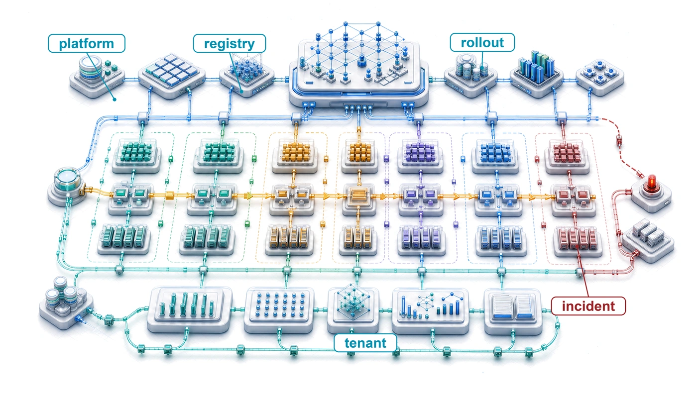{fig-alt="Fleet operations platform blueprint where many model-service lanes share observability, deployment, policy, and capacity control layers."}
:::

:::

## Purpose {.unnumbered .unlisted}

::: {.content-visible when-format="pdf"}
\begin{marginfigure}
\mlfleetstack{15}{25}{25}{35}{55}{100}{25}{35}
\end{marginfigure}
:::

::: {.content-visible unless-format="pdf"}
::: {.column-margin}
{width="100%" fig-alt="Fleet Machine Learning Systems Stack"}

*Fleet stack focus for this chapter.*
:::
:::

_Why do practices that work for managing one model collapse when organizations deploy hundreds?_

One model is a project. A hundred models form a system of systems whose dependencies and failures cannot be managed one model at a time. A data-pipeline change may affect models built by several teams, while a deployment failure may require coordinated rollbacks across interconnected services. The team making a change may not know every consumer, and the team seeing a regression may not control its cause. Practices that work when one engineer knows the entire system become unreliable when ownership, data, and release schedules are distributed. Adding faster machines does not resolve that uncertainty. A fleet can have spare compute capacity and still be unable to ship safely because nobody can establish which models depend on a changed input or who may authorize recovery. Shared infrastructure can reduce this repeated coordination, but it also concentrates dependencies and introduces its own operating cost. Centralizing every decision can turn the platform team into a bottleneck; leaving every team to improvise makes compatibility and accountability difficult to sustain. The engineering task is to make routine changes repeatable while preserving evidence about their effects and clear authority over their consequences. Growth becomes manageable when adding a model does not require rebuilding the surrounding operational process, yet its owners remain responsible for acceptable behavior. In C³ terms, fleet operations makes coordination a designed system constraint alongside the compute and communication resources that models consume.

::: {.content-visible when-format="pdf"}

\newpage

:::

::: {.callout-learning-objectives}

- Explain why operational load grows with coupling through shared features, pipelines, and capacity rather than with model count
- Design registries, release gates, and evaluation contracts that preserve lineage, dependency safety, and rollback confidence
- Design feature-store operations that manage freshness, ownership, compatibility, and training-serving skew
- Size staged rollouts and production experiments whose sample size, stopping rule, and interference assumptions bound user exposure
- Diagnose production incidents using monitoring hierarchies and multidimensional reliability budgets across the fleet
- Calculate platform return, utilization break-even, and lifecycle total cost, then attribute fleet spend to accountable owners
- Evaluate platform organization and lifecycle choices using adoption, versioning, and retirement evidence

:::

## Why a Model Fleet Needs a Control Plane {#sec-ml-operations-scale-singlemodel-platform-operations-db8e}

```{python}
#| echo: false
from mlsysim import *
from mlsysim.core.units import *

# ┌─────────────────────────────────────────────────────────────────────────────
# │ CHAPTER START
# ├─────────────────────────────────────────────────────────────────────────────
# │ Context: Chapter initialization and global imports
# │
# │ Why: Registers this chapter with the mlsys registry and provides shared
# │      imports for all subsequent calculation cells.
# │
# └─────────────────────────────────────────────────────────────────────────────
from mlsysim import Systems
from mlsysim.core.units import (
    MILLION,
    BILLION,
    THOUSAND,
    HUNDRED,
    SEC_PER_HOUR,
    HOURS_PER_DAY,
)

from mlsysim.fmt import MarkdownStr, check, fmt
```

Consider a team of five engineers maintaining a single recommendation model. When the model drifts, they manually retrain it. When the API latency spikes, they manually scale the instances. Now, scale that same team to support five hundred models across dozens of product surfaces. The same engineering team cannot sustain that growth by repeating every intervention manually. Shared controls must preserve human accountability while automating routine coordination. The fleet becomes the unit of capacity planning and investment; versioned model and feature state makes changes reviewable, release gates bound their exposure, and monitoring and incident review feed production evidence back into those controls.

In the fleet stack of @fig-fleet-stack, the Operations row sits directly above Runtime and Serving and directly below Assurance, the first row of the Governance band. It belongs to the Serving band because it operates models that are already deployed, whereas the Reliability and Control row two rows lower schedules and recovers individual jobs. The Operations row acts as the fleet's control plane\index{Control plane!fleet management}, the dashboard, steering, and maintenance system that keeps physical infrastructure, training systems, serving paths, edge deployments, and governance rules from drifting apart. Once models span data centers, serving platforms, and heterogeneous edge fleets of adaptive devices, reliability depends less on any single model and more on the operational machinery that keeps the whole fleet observable, coordinated, and recoverable. Adaptive edge fleets sharpen the requirement, because there the operator ships a versioned adaptation policy rather than fixed weights, and that policy stays safe only while telemetry keeps it observable and rollback keeps it recoverable. This chapter builds those controls as shared infrastructure for every model the fleet runs.

::: {.column-margin .margin-pointer}
↩ Adaptive edge device populations and the constraints that shape them are established in @sec-edge-intelligence.
:::

Shared dependencies make local operational choices fleet-wide concerns. An upstream data change can affect several models, concurrent deployments can contend for the same capacity, and independent alerts can obscure a common failure. Training and serving also compete for expensive infrastructure whose idle capacity still incurs cost. The platform must coordinate those interactions while preserving each team's responsibility for model behavior.

The organizational response is platform thinking. Rather than treating each model as an independent system with its own infrastructure, platforms provide shared services that amortize operational costs across the entire model portfolio. Feature stores[^fn-feature-store-skew] share feature definitions and values across models. Their contract is that training and serving use compatible feature meanings, with historical training values restricted to information available at the prediction time. Unified deployment pipelines ensure consistent rollout practices. Centralized monitoring aggregates signals across models to detect system-wide issues and enable capacity planning. The challenge is designing, implementing, and operating these platforms so they scale with the portfolio rather than against it. This is the C³ coordination axis at its widest. The Fleet Law charges synchronization within one distributed step, while fleet operations pays the coordination cost of every release, rollback, and shared dependency across the whole portfolio.

[^fn-feature-store-skew]: **Feature Store**\index{Feature Store!definition}: A centralized repository that manages the computation, storage, and serving of ML features. The core systems problem it solves is training-serving skew\index{Training-Serving Skew!platform invariant}; @sec-ml-operations-scale-feature-store-operations-2a36 develops that failure mode and the platform invariant that contains it.

## The N-Models Problem {#sec-ml-operations-scale-nmodels-problem-fcff}

The five engineers of the opening example do not acquire five hundred models at once, and the path from one model to many explains where the control plane becomes necessary. A technology organization often follows a predictable pattern as it adopts machine learning. The first model might be a homepage recommender, followed by search ranking, fraud detection, and content moderation. Each team initially operates independently, developing its own pipelines for data processing, training, validation, and deployment. With few models, this independence lets each team optimize for its requirements.

As the number of models grows, shared dependencies can create **operational complexity**\index{Operational Complexity!definition} faster than model count alone suggests. Dense interactions can produce superlinear coordination work; strong ownership and interface boundaries can limit that growth. @Tbl-ops-scale-complexity qualitatively maps the resulting challenges across six operational dimensions.

| **Operational Aspect**         | **Single Model** |  **10 Models**   |        **100 Models**        |
|:-------------------------------|:----------------:|:----------------:|:----------------------------:|
| **Deployment coordination**    |    Team-local    |      Ad hoc      |        Critical path         |
| **Shared data dependencies**   | Within pipeline  |   Some overlap   |         Dense graph          |
| **Monitoring dashboards**      |        1         |        10        |         Unmanageable         |
| **On-call rotation scope**     |   Single team    |  Multiple teams  |      Organization-wide       |
| **Infrastructure utilization** |    Often idle    | Moderate sharing |     Efficiency critical      |
| **Debugging complexity**       |      Local       |    Cross-team    | Distributed tracing required |

: **Operational complexity growth at scale**: Illustrative challenges across 1, 10, and 100 models. Even one model requires deployment coordination and depends on its data pipeline. Shared dependencies can make releases a fleet-wide critical path, dashboards require aggregation, and debugging span team boundaries; actual complexity depends on coupling and ownership. {#tbl-ops-scale-complexity}

```{python}
#| echo: false
#| label: multi-tenant-efficiency-notebook
# ┌─────────────────────────────────────────────────────────────────────────────
# │ MULTI-TENANT EFFICIENCY DIVIDEND (NOTEBOOK)
# ├─────────────────────────────────────────────────────────────────────────────
# │ Context: "The Sharing Dividend" .callout-notebook
# │
# │ Goal: Quantify the hardware savings from multi-tenant resource sharing.
# │ Show: cost_savings_pct ≈ 57 percent -- inline in notebook result.
# │ How: Estimate savings from reducing idle dedicated capacity.
# │
# └─────────────────────────────────────────────────────────────────────────────
from mlsysim.fmt import check, fmt, fmt_count, fmt_int, fmt_multiple, fmt_percent, fmt_usd

class MultiTenantEfficiency:
    # ┌── 1. LOAD ──────────────────────────────────────────
    avg_util_dedicated = 0.30  # 70% idle (typical for single-team clusters)
    avg_util_shared = 0.70  # 30% idle (sharing across training/inference)
    n_gpus_required = 100
    annual_budget_m = 1.75
    # ┌── 2. EXECUTE ───────────────────────────────────────
    # For a fixed workload of 30 "active" GPU-hours:
    # Dedicated needs: 30 / 0.30 = 100 GPUs
    # Shared needs: 30 / 0.70 = 43 GPUs
    savings_pct = (1 - (avg_util_dedicated / avg_util_shared)) * 100
    annual_savings = annual_budget_m * (savings_pct / 100) * MILLION
    # Active GPU-equivalents under each regime at the fixed hardware budget.
    active_dedicated = n_gpus_required * avg_util_dedicated  # 30
    active_shared = n_gpus_required * avg_util_shared  # 70
    # ┌── 3. GUARD ─────────────────────────────────────────
    check(55 < savings_pct < 60, f"Savings {savings_pct:.1f}% unexpected")
    check((active_dedicated, active_shared) == (30, 70), "Active GPU-equivalents drift")
    # ┌── 4. OUTPUT ────────────────────────────────────────
    # Idle fractions are derived from utilization assumptions above.
    mt_idle_dedicated_str = fmt_percent(1 - avg_util_dedicated, precision=0, commas=False, style='prose')
    mt_idle_shared_str = fmt_percent(1 - avg_util_shared, precision=0, commas=False, style='prose')
    mt_savings_pct_str = fmt_percent(savings_pct / 100, precision=1, commas=False, style='prose')
    mt_n_gpus_str = fmt_count(n_gpus_required, commas=False, label="GPU")
    mt_savings_pct_round_str = fmt_percent(round(savings_pct) / 100, precision=0, commas=False, style='prose')
    mt_annual_budget_m_str = fmt_usd(annual_budget_m * MILLION, scale="M", precision=2, commas=False)
    mt_annual_savings_str = fmt_usd(annual_savings, precision=0)
    mt_active_dedicated_str = fmt(active_dedicated, precision=0, commas=False)
    mt_active_shared_str = fmt(active_shared, precision=0, commas=False)
    mt_util_dedicated_str = fmt(avg_util_dedicated, precision=2, commas=False)
    mt_util_shared_str = fmt(avg_util_shared, precision=2, commas=False)
    mt_work_gain_mult_str = fmt_multiple(avg_util_shared / avg_util_dedicated, precision=2, commas=False)
```

::: {#nbk-ops-scale-sharing-dividend .callout-notebook title="The sharing dividend"}

**Problem**: A platform team manages a fleet of `{python} MultiTenantEfficiency.mt_n_gpus_str`. Under dedicated per-team quotas, average idle time is `{python} MultiTenantEfficiency.mt_idle_dedicated_str`. Moving to a multi-tenant ML platform that shares resources across teams and uses idle training GPUs for inference reduces aggregate idle time to `{python} MultiTenantEfficiency.mt_idle_shared_str`. What hardware cost does the platform save?

**Math**:
For a fixed active workload, required hardware is inverse to utilization, while useful work per GPU is proportional to utilization. The problem states idle time, so the calculation first converts it to utilization.

1. **Utilization**: Utilization is one minus the idle fraction, so dedicated quotas run at `{python} MultiTenantEfficiency.mt_util_dedicated_str` and the shared platform at `{python} MultiTenantEfficiency.mt_util_shared_str`.
2. **Efficiency Gain**: `{python} MultiTenantEfficiency.mt_util_shared_str` (shared utilization) / `{python} MultiTenantEfficiency.mt_util_dedicated_str` (dedicated utilization) = `{python} MultiTenantEfficiency.mt_work_gain_mult_str` more work per GPU.
3. **Hardware Reduction**: 1 $-$ (`{python} MultiTenantEfficiency.mt_util_dedicated_str` / `{python} MultiTenantEfficiency.mt_util_shared_str`) = `{python} MultiTenantEfficiency.mt_savings_pct_str`.
4. **Annual Savings**\index{Savings!annual}: `{python} MultiTenantEfficiency.mt_savings_pct_round_str` of `{python} MultiTenantEfficiency.mt_annual_budget_m_str` budget $\approx$ `{python} MultiTenantEfficiency.mt_annual_savings_str`/year.

**Systems insight**: Multi-tenancy acts as an infrastructure multiplier. Under the assumed utilization improvement, breaking down resource silos reduces required hardware by `{python} MultiTenantEfficiency.mt_savings_pct_round_str` for the same workload; with the same hardware budget, it raises useful work from `{python} MultiTenantEfficiency.mt_active_dedicated_str` to `{python} MultiTenantEfficiency.mt_active_shared_str` active GPU-equivalents. In the machine learning fleet, *statistical multiplexing* pools demands whose peaks do not fully coincide, allowing teams to share capacity that separate allocations would leave idle. Realizing this sharing dividend requires enough headroom for coincident peaks and failures, together with isolation that preserves each workload's service contract.

:::

::: {.column-margin}
{width="100%" fig-alt="Blast-radius fan: one red embedding-update source on the left sends arrows to five downstream model nodes on the right, showing how a model dependency change can degrade many consumers."}

*One upstream embedding update can degrade every dependent model.*
:::

The fundamental insight is that per-model validation does not establish compatibility across a dependency chain. When Model A depends on features computed by Pipeline B, which uses embeddings from Model C, a change to one component can affect its downstream consumers. A seemingly innocuous update to Model C's embedding layer might shift the feature distributions that Model A depends upon, degrading its performance even though Model A itself has not changed. This cascading interdependence makes the interfaces between models part of the operational contract.

::: {#psp-ops-scale-complexity-explosion .callout-perspective title="The complexity explosion"}

As a fleet accumulates shared dependencies, system-level coordination can become the binding problem. A new model adds its own operating cost, but it can also change feature pipelines, release schedules, and contention for infrastructure used by existing models. The marginal cost therefore depends on how the new model couples to the portfolio rather than simply on how many models the fleet already contains.

:::

@Fig-n-models-complexity sketches operational load across production model counts on a logarithmic scale, with one assumed growth shape per source of work. Alerts grow linearly because each model brings its own fixed set of monitored metrics. The sketch assigns deployment coordination an intermediate $\ProductionModelCount \log \ProductionModelCount$ growth shape; this is an illustrative assumption rather than a release-scheduling complexity bound. A dense dependency graph motivates the quadratic conflict curve because $\ProductionModelCount$ models form roughly $\ProductionModelCount^2/2$ possible pairs; the recorded dependencies determine which pairs can actually conflict. Under these shapes the total crosses the team-capacity ceiling near 50 models. The shapes are a sketch, not measurements, so the crossing marks where repeated work outgrows a team rather than a threshold a real organization can read off the plot; measured dependency density, engineering effort, and remediation cost decide when platform engineering pays.

::: {#fig-n-models-complexity fig-env="figure" fig-pos="htb" fig-cap="**The N-models complexity explosion**: The curves show monitoring alerts growing linearly with model count, deployment coordination growing as $\mathcal{O}(\ProductionModelCount \log \ProductionModelCount)$, and dependency conflicts growing quadratically as models share features and data sources. Under these assumed shapes, the total operational load crosses team capacity around 50 models, sketching the transition from artisanal model management to platform-required operations." fig-alt="Log-log plot of operational load against models in production. A dotted linear monitoring line, a dashed model-count-log-model-count deployment line, and a dash-dot quadratic dependency line sum to a solid total curve that crosses a red dashed team-capacity line at about 50 models, marked with a red dot. Zones labeled Artisanal, Growing pains, and Platform required divide the axis at 10 and 50 models; the last zone is lightly shaded red."}

```{python}
#| echo: false
# ┌─────────────────────────────────────────────────────────────────────────────
# │ N-MODELS COMPLEXITY (FIGURE)
# ├─────────────────────────────────────────────────────────────────────────────
# │ Context: @fig-n-models-complexity—operational complexity scaling
# │
# │ Goal: Plot linear, model-count-log-model-count, and quadratic curves; show total crossing capacity
# │       at ~50 models; Artisanal/Growing Pains/Platform Required zones.
# │ Show: Log-log axes; capacity line; knee dot; zones; direct curve labels.
# │ How: monitoring_alerts, deployment_coordination, dependency_conflicts;
# │      matplotlib.
# │
# └─────────────────────────────────────────────────────────────────────────────
# ┌── 1. CANVAS ────────────────────────────────────────────────────────────────
# │ Plot linear, model-count-log-model-count, and quadratic curves; show total crossing capacity
from binder.tools.figures import style as book_style
import numpy as np

fig, ax, COLORS, plt = book_style.setup_plot(figsize=(5.6, 3.6))

# ┌── 2. ARRAYS ────────────────────────────────────────────────────────────────
n_models_axis = np.arange(1, 501)
monitoring_alerts = 20 * n_models_axis
deployment_coordination = n_models_axis * np.log(n_models_axis)
deployment_coordination[0] = 0
dependency_conflicts = 0.5 * n_models_axis**2

total_operational_load = monitoring_alerts + deployment_coordination + dependency_conflicts

# ┌── 3. RENDER ────────────────────────────────────────────────────────────────
capacity_threshold = 2500
crossing_idx = int(np.argmax(total_operational_load >= capacity_threshold))
crossing_n = n_models_axis[crossing_idx]

# Zone shading: neutral before the crossing, a light red wash once load exceeds capacity.
ax.axvspan(crossing_n, 500, color=COLORS['RedL'], alpha=0.35, ec='none', zorder=0)
for boundary in (10, crossing_n):
    ax.axvline(boundary, color=COLORS['grid'], linewidth=0.8, zorder=1)

ax.plot(n_models_axis, monitoring_alerts, color=COLORS['BlueLine'], linestyle=':', linewidth=1.8, zorder=3)
ax.plot(n_models_axis, deployment_coordination, color=COLORS['OrangeLine'], linestyle='--', linewidth=1.8, zorder=3)
ax.plot(n_models_axis, dependency_conflicts, color=COLORS['VioletLine'], linestyle='-.', linewidth=1.8, zorder=3)
ax.plot(n_models_axis, total_operational_load, color=COLORS['primary'], linewidth=2.4, zorder=4)
ax.axhline(y=capacity_threshold, color=COLORS['RedLine'], linestyle='--', linewidth=1.3, zorder=2)

# Knee: total load meets team capacity.
ax.plot([crossing_n], [capacity_threshold], 'o', color=COLORS['RedLine'], markersize=6, zorder=5)
ax.text(
    crossing_n * 0.9,
    capacity_threshold * 1.6,
    f'~{int(round(crossing_n, -1))} models',
    color=COLORS['RedLine'],
    fontsize=9,
    fontweight='bold',
    ha='right',
    va='center',
)

# ┌── 4. DECORATE ──────────────────────────────────────────────────────────────
ax.set_xscale('log')
ax.set_yscale('log')
ax.set_xlim(1, 500)
ax.set_ylim(10, 4e5)
ax.set_xticks([1, 10, 50, 100, 500])
ax.set_xticklabels(['1', '10', '50', '100', '500'])
ax.grid(True, which='major', axis='y')
ax.grid(False, which='minor')
ax.grid(False, axis='x')

# Direct labels at the right end of each curve (no legend).
end_x = 520
ax.text(end_x, total_operational_load[-1] * 1.45, 'Total load', color=COLORS['primary'], fontsize=9, fontweight='bold', va='center', ha='left')
ax.text(end_x, dependency_conflicts[-1] * 0.5, 'Dependency\nconflicts ($N^2$)', color=COLORS['VioletLine'], fontsize=9, va='center', ha='left')
ax.text(end_x, monitoring_alerts[-1] * 1.4, 'Monitoring\nalerts ($N$)', color=COLORS['BlueLine'], fontsize=9, va='center', ha='left')
ax.text(
    end_x,
    deployment_coordination[-1] * 0.66,
    'Deployment\ncoordination\n($N \\log N$)',
    color=COLORS['OrangeLine'],
    fontsize=9,
    va='center',
    ha='left',
)
ax.text(1.15, capacity_threshold * 1.15, 'Team capacity', color=COLORS['RedLine'], fontsize=9, va='bottom', ha='left')

# Zone names along the top edge.
zone_y = 2.6e5
ax.text(np.sqrt(1 * 10), zone_y, 'Artisanal', ha='center', va='center', fontsize=9, style='italic', color=COLORS['secondary'])
ax.text(np.sqrt(10 * crossing_n), zone_y, 'Growing pains', ha='center', va='center', fontsize=9, style='italic', color=COLORS['secondary'])
ax.text(np.sqrt(crossing_n * 500), zone_y, 'Platform required', ha='center', va='center', fontsize=9, style='italic', color=COLORS['RedLine'])

ax.set_xlabel("Models in production (log scale)")
ax.set_ylabel("Operational load (log scale)")
for side in ('top', 'right'):
    ax.spines[side].set_visible(False)

plt.tight_layout()
plt.show()
plt.close()
```

:::

Once operational load exceeds team capacity, continued portfolio growth requires reducing repeated work, simplifying dependencies, or expanding the team's capacity. Shared platform engineering addresses the repeated work of deploying, monitoring, and debugging models. Its economic case begins with identifying which of those responsibilities can be shared and which must remain with model owners.

### Single-model vs. platform operations at scale {#sec-ml-operations-scale-operations-differ-scale-dacb}

The operational requirements for multi-model platforms differ qualitatively from single-model operations\index{Platform operations!vs. single-model}. @Tbl-ops-scale-differences contrasts these approaches across six dimensions, revealing that platform-scale deployment demands dependency-aware scheduling, monitoring must shift from *model-centric* to *system-centric* aggregation, and governance evolves from *team-specific* policies to *organization-wide* standards.

| **Aspect**              |   **Single-Model Operations**   | **Multi-Model Platform (100+)**                   |
|:------------------------|:-------------------------------:|:--------------------------------------------------|
| **Deployment**          | Simple rollout, team-controlled | Dependency-aware scheduling, platform-coordinated |
| **Monitoring**          |      Model-centric metrics      | System-centric with model aggregation             |
| **Debugging**           |     Local to model and data     | Distributed tracing across model boundaries       |
| **Resource Management** |       Dedicated allocation      | Shared pools with multi-tenant isolation          |
| **Governance**          |      Team-specific policies     | Organization-wide standards and automation        |
| **Organization**        |      Single team ownership      | Platform team plus consumer teams                 |

: **Single-model vs. platform operations**: Six qualitative differences that emerge when scaling from one model to 100+. Deployment shifts from team-controlled rollouts to dependency-aware platform coordination, monitoring evolves from model-centric dashboards to system-level aggregation, and governance expands from team-specific policies to organization-wide automated enforcement. {#tbl-ops-scale-differences}

The qualitative gap is most visible in deployment operations. A model release moves from validation to a canary (a small slice of live traffic served by the candidate) and then to wider exposure as evidence accumulates. Platform-scale deployment must also preserve compatibility with dependent models at every intermediate state. Compatible interfaces can permit independent updates; a changed feature representation may instead require a coordinated migration. Rollback follows the same dependency contract, because reverting one model may require restoring compatible features or dependent models. Concurrent deployments also compete for GPU memory and network bandwidth, making resource headroom part of the release decision.

For recommendation systems, this complexity appears along the request path. Candidate retrieval and ranking models execute alongside diversity filters and business rule layers, sometimes in sequence and sometimes in parallel. Updating a component requires identifying which consumers depend on its outputs and testing whether the complete path still meets its quality and latency targets.

Monitoring requirements evolve similarly. Model-specific metrics such as prediction accuracy, inference latency, and data drift remain necessary, but separate dashboards do not expose shared causes by themselves. When many models depend on the same feature pipeline, a single upstream failure can appear as many unrelated model alerts. Responders need a portfolio view that connects those symptoms before investigating individual models.

Platform monitoring must therefore aggregate across models while maintaining the ability to drill down into specifics. This requires hierarchical metrics that run from business outcomes through portfolio and model signals down to infrastructure health, the structure @sec-ml-operations-scale-hierarchical-monitoring-architecture-407d develops. The same contrast between one model and a portfolio also changes what each release must prove, because workloads differ in how fast they change and how much harm a bad version can do.

### Model-type operations diversity {#sec-ml-operations-scale-modeltype-operations-diversity-3a36}

Different deployment contexts impose different operational contracts. The archetype taxonomy in @sec-vol2-introduction-archetypes helps interpret the illustrative policies in @tbl-ops-scale-model-types. Release frequency follows data change and validation cost; rollback targets follow the harm and reversibility of a bad release. Model family alone determines neither. Large language models (LLMs) may need long observation windows while still requiring rapid traffic rollback, and fraud detection\index{Fraud detection!operational requirements} needs fast containment even when a new model takes longer to validate.

| **Model Type**                  | **Example Update Cadence** |    **Deployment Pattern**   |      **Primary Risk**      |       **Rollback Speed**      |
|:--------------------------------|:--------------------------:|:---------------------------:|:--------------------------:|:-----------------------------:|
| **Archetype A (GPT-4/Llama-3)** |    Monthly to quarterly    |       Staged, careful       | Quality regression, safety | Minutes with standby capacity |
| **Archetype B (DLRM at Scale)** |      Daily to weekly       |     Shadow, interleaving    |      Engagement drop       |            Minutes            |
| **Fraud Detection**             |      Hourly to daily       | Rapid with instant rollback |      False negatives       |            Seconds            |
| **Vision (Classification)**     |     Weekly to monthly      |            Canary           |    Accuracy regression     |            Minutes            |
| **Search Ranking**              |           Daily            |       A/B with holdout      |   Relevance degradation    |            Minutes            |

: **Illustrative release policies**: Example cadences and rollback targets for several deployment contexts. These are planning assumptions, not requirements implied by architecture. Rollback means routing to a validated version; the observation period needed to approve a new version can be much longer. {#tbl-ops-scale-model-types}

The table mixes two lighthouse archetypes with ordinary model families because release policy follows the workload, not the label. Archetype C (Federated MobileNet) enters with the edge fleet in @sec-ml-operations-scale-managing-edge-fleet-c591. The deployment patterns name release controls developed later in the chapter. Shadow deployment runs the candidate on copied traffic without returning its outputs to users, and interleaving merges two rankers' results into one list so each user compares them directly (@sec-ml-operations-scale-production-experiment-validation). The table separates release cadence from containment speed. Large-model evaluation can require extended shadow deployment, human review, and staged exposure because a quality regression may be subtle. Keeping the previous model warm can nevertheless permit fast traffic rollback. The cost of that standby capacity belongs in the release policy rather than being hidden behind an hours-long rollback assumption.

The cost of regression becomes concrete when one model must preserve every capability at once.

::: {#lhs-ops-scale-archetype-gpt-4-llama-3-cost-regression .callout-lighthouse title="Archetype A (GPT-4/Llama-3): Cost of regression"}

**Context**: Archetype A (GPT-4/Llama-3) represents ultra-large generalist models ($70\text{B}\text{--}405\text{B}$ parameters) serving millions of concurrent requests across diverse tasks. Released models span that whole range; where this chapter needs one concrete instance, as in the fleet cost examples of @sec-ops-scale-fleet-economics, it uses the volume's reference instance, the GPT-3-class dense model of @sec-introduction-archetype-gpt4llama3-b02f.

**Mechanism**: The "Generalist's Dilemma" occurs when targeted fine-tuning (e.g., optimizing Python code generation) causes catastrophic forgetting in unmonitored domains (e.g., creative writing or reasoning). Evaluating candidate weights across 10,000+ benchmark prompts adds the iron law's compute time, $\Operations/(\PeakRate \cdot \EfficiencyHw)$ for the evaluation's total operations $\Operations$, to every release. Prompt count alone does not determine that time or its GPU-hours; input and output lengths and model size set $\Operations$, and achieved throughput sets $\EfficiencyHw$.

**Impact**: A silent degradation in secondary metrics forces a costly emergency rollback, and the warm standby held for that rollback competes with the serving capacity needed to hold the per-request latency target $\LatencySlo$.

**Systems lesson**: Release gates for large generalist LLMs must combine broad capability benchmarks (such as Massive Multitask Language Understanding (MMLU) and HumanEval) with policy-based safety checks. Their evaluation time and accelerator-hours belong in the deployment schedule and budget rather than being treated as a zero-cost pre-flight check.

:::

Recommendation systems face continuously changing user preferences and content inventories [@steck2021; @gomez-uribe2015]. Their operational urgency therefore includes feature freshness latency, the delay between a user action and its reflection in the model's inputs. Stale features can degrade relevance even when serving remains fast and available.

::: {.column-margin}
```{=latex}
\vspace*{-12mm}
```
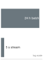{width="100%" fig-alt="Two gray horizontal bars on a log scale: a long 24 h batch freshness bar above a much shorter 5 s streaming freshness bar."}

*Streaming closes the freshness lag that batch leaves open.*
:::

::: {#exmp-ops-scale-feature-freshness-latency .callout-example title="Feature freshness latency"}

**Scenario**: A real-time recommendation service processes user interaction logs to compute feature vectors during an active user session.

**Diagnosis**: Suppose the daily batch pipeline delivers relevant interactions with freshness latency $\FeatureFreshnessLatency\approx 12\text{--}24\text{ h}$. Those features cannot reflect activity from the current session, even if other recommendation inputs change. A streaming pipeline (Kafka/Flink) operating at $\FeatureFreshnessLatency\approx 1\text{--}5\text{ s}$ can incorporate that activity sooner; whether it updates the vector before the next user action depends on the session's timing.

**Systems lesson**: Feature freshness latency is a physical system metric ($\FeatureFreshnessLatency= \FeatureRecordTime - \SourceEventTime$). Reducing freshness latency can improve decisions that depend on recent behavior, but engagement lift must be measured in an experiment. The business benefit must justify the additional streaming capacity and operational complexity.

:::

Recommendation ensembles must preserve compatible behavior as their components update. Fraud detection adds an adaptive adversary that probes the model and shifts tactics once detected, increasing the value of prompt containment and monitoring for sudden feature shifts. Shadow scoring and outcome evidence still have to establish whether an update reduces fraud without unacceptable false positives; urgency alone does not validate a new model. LLM releases face a broad set of capability and safety risks that require evaluation before exposure [@bender2021]. These differences determine the evidence, update cadence, and recovery policy each workload needs. A shared platform is valuable when it enforces those distinct contracts without making every team rebuild the operational machinery.

### Quantifying platform economics {#sec-ml-operations-scale-quantifying-platform-economics-2026}

The economic case for platform operations rests on understanding both the costs of fragmented approaches and the returns from shared infrastructure. @Eq-platform-roi defines the platform benefit-cost ratio (BCR) as the ratio of engineering time savings across all models to total platform cost:

$$\text{BCR}_{\text{platform}} = \frac{\ProductionModelCount\times \SavedEngineeringTime\times \EngineerHourlyCost}{\PlatformTotalCost}$$ {#eq-platform-roi}

where $\ProductionModelCount$ represents the number of models benefiting from the platform, $\SavedEngineeringTime$ is the engineering time saved per model per period, $\EngineerHourlyCost$ is the fully-loaded cost per engineer hour, and $\PlatformTotalCost$ is the total platform cost including development, infrastructure, and maintenance.

A ratio of one is break-even; net return on investment is this ratio minus one. Engineering hours valued at their loaded cost measure recovered capacity, not automatic payroll savings. Costs and benefits must cover the same period and include ongoing platform operation.

The equation makes the investment boundary explicit. For an organization with five models, platform cost may exceed the value of recovered effort; unusually costly recurring work could reverse that comparison even at a small model count. Holding per-model savings constant makes the numerator grow linearly with $\ProductionModelCount$. Whether the ratio improves depends on how development, support, and infrastructure costs grow as additional models adopt the platform.

```{python}
#| echo: false
#| label: platform-roi-notebook
# ┌─────────────────────────────────────────────────────────────────────────────
# │ PLATFORM ROI (NOTEBOOK)
# ├─────────────────────────────────────────────────────────────────────────────
# │ Context: "The Platform Dividend" .callout-notebook
# │
# │ Goal: Quantify the ROI of building a centralized ML platform.
# │ Show: roi_ratio ≈ 1.25x—inline in notebook result.
# │ How: Compute platform ROI from model count, saved engineering time, engineer rate, and platform cost.
# │
# └─────────────────────────────────────────────────────────────────────────────
from mlsysim import Infrastructure
from mlsysim.core.units import USD, hour
from mlsysim.fmt import check, fmt, fmt_percent, fmt_ratio, fmt_time, fmt_usd

class PlatformRoi:
    # ┌── 1. LOAD ──────────────────────────────────────────
    n_models = 50
    savings_h_per_month = 20  # Engineering time saved per model
    engineer_rate = Infrastructure.Pricing.Labor.MlEngineerLoadedHourly.rate.to(USD / hour).magnitude  # loaded ML-engineer rate
    platform_cost_per_month = 120000  # Platform team + infra
    # ┌── 2. EXECUTE ───────────────────────────────────────
    total_savings = n_models * savings_h_per_month * engineer_rate
    roi_ratio = total_savings / platform_cost_per_month
    # ┌── 3. GUARD ─────────────────────────────────────────
    check(roi_ratio == 1.25, f"ROI {roi_ratio} unexpected")
    # Scaling-threshold scenario: a smaller fleet flips the sign of the return.
    n_models_low = 20
    return_pct_high = (roi_ratio - 1) * 100  # return above platform cost at n_models
    savings_low = n_models_low * savings_h_per_month * engineer_rate
    loss_pct_low = (platform_cost_per_month - savings_low) / platform_cost_per_month * 100
    check(return_pct_high == 25.0, f"Return {return_pct_high} unexpected")
    check(loss_pct_low == 50.0, f"Loss {loss_pct_low} unexpected")
    # ┌── 4. OUTPUT ────────────────────────────────────────
    pr_n_models_str = fmt(n_models, precision=0, commas=False)
    pr_savings_h_str = fmt_time(savings_h_per_month, 'hour', precision=0, commas=False, style='word')
    pr_roi_ratio_str = fmt_ratio(roi_ratio, precision=2, commas=False)
    pr_engineer_rate_str = fmt_usd(engineer_rate, precision=0, commas=False, per="hr")
    pr_platform_cost_str = fmt_usd(platform_cost_per_month, precision=0, per="month")
    pr_gross_savings_str = fmt_usd(total_savings, precision=0)
    pr_net_benefit_str = fmt_usd(total_savings - platform_cost_per_month, precision=0)
    pr_n_models_low_str = fmt(n_models_low, precision=0, commas=False)
    pr_return_pct_high_str = fmt_percent(return_pct_high / 100, precision=0, commas=False, style='prose')
    pr_savings_low_str = fmt_usd(savings_low, precision=0)
    pr_loss_pct_low_str = fmt_percent(loss_pct_low / 100, precision=0, commas=False, style='prose')
```

::: {#nbk-ops-scale-platform-dividend .callout-notebook title="The platform dividend"}

**Problem**: An organization manages `{python} PlatformRoi.pr_n_models_str` models. A centralized ML Platform team costs `{python} PlatformRoi.pr_platform_cost_str`. If the platform saves each model team `{python} PlatformRoi.pr_savings_h_str` of manual toil per month, is the platform investment profitable?

**Math**:

1. **Gross Monthly Capacity Value**: `{python} PlatformRoi.pr_n_models_str` models $\times$ `{python} PlatformRoi.pr_savings_h_str`/model $\times$ `{python} PlatformRoi.pr_engineer_rate_str` = `{python} PlatformRoi.pr_gross_savings_str`.
2. **Net Monthly Benefit**: `{python} PlatformRoi.pr_gross_savings_str` (Savings) - `{python} PlatformRoi.pr_platform_cost_str` (Cost) = `{python} PlatformRoi.pr_net_benefit_str`.
3. **Benefit-Cost Ratio**\index{Platform economics!ROI ratio}: `{python} PlatformRoi.pr_gross_savings_str` / `{python} PlatformRoi.pr_platform_cost_str` = `{python} PlatformRoi.pr_roi_ratio_str`.

**Systems insight**: Platforms exhibit a scaling threshold under a declared cost model. At `{python} PlatformRoi.pr_n_models_str` models, this platform earns a `{python} PlatformRoi.pr_return_pct_high_str` return on its modeled cost. However, if the organization only had `{python} PlatformRoi.pr_n_models_low_str` models, the capacity value would be only `{python} PlatformRoi.pr_savings_low_str`, a `{python} PlatformRoi.pr_loss_pct_low_str` loss relative to the platform team's salary. This comparison holds the team cost and per-model savings fixed. An investment decision must also include migration, infrastructure, and ongoing support costs, then establish how the recovered engineering time will create value.

:::

#### From artisanal to industrial operations {#sec-ml-operations-scale-artisanal-to-industrial-operations-092d}

The platform-dividend calculation identifies the quantities an operating decision needs. A build investment incurs costs before it releases engineering capacity, so the comparison must account for the investment horizon as well as recurring toil. The following example separates amortized development cost from the ongoing work it is expected to remove.

```{python}
#| echo: false
#| label: platform-economics-lego
# │ PLATFORM ROI CALCULATION (LEGO)
# ├─────────────────────────────────────────────────────────────────────────────
# │ Context: @sec-ml-operations-scale-quantifying-platform-economics-2026
# │
# │ Goal: Estimate platform ROI for a 50-model ML fleet to show that shared
# │       infrastructure reduces annual operational engineering costs by >56%
# │       and pays for itself within the first year.
# │ Show: ~$2.03M annual savings (~56% reduction)—inline in the worked
# │       example paragraph following @eq-platform-roi.
# │ How: Compare before-platform cost (50 models × 40 hrs/month × $150/hr)
# │      against after-platform cost (10 hrs/model/month + $667K/yr amort)
# │      using the ROI formula from @eq-platform-roi.
# │
# └─────────────────────────────────────────────────────────────────────────────

# ┌── LEGO ───────────────────────────────────────────────
class PlatformEconomics:
    """
    Namespace for Platform ROI Calculation.
    Scenario: Comparing manual operations vs. shared platform costs.
    """

    # ┌── 1. LOAD (Constants) ───────────────────────────────────────────────
    from mlsysim import Infrastructure
    from mlsysim.core.units import ureg, MILLION, USD, hour

    n_models = 50
    hours_per_model_month = 40
    months_per_year = 12
    engineer_cost_hr = Infrastructure.Pricing.Labor.MlEngineerLoadedHourly.rate.to(USD / hour).magnitude  # loaded ML-engineer rate
    platform_cost = 2 * MILLION
    amortization_years = 3  # scenario assumption: platform software amortization, not hardware life
    hours_saved_per_model = 30
    checkpoint_hours_saved_per_year = 200  # scenario assumption: checkpoint exercise per-model savings
    fallacy_n_models = 40  # scenario assumption: fallacy-section platform size

    # ┌── 2. EXECUTE (The Compute) ─────────────────────────────────────────
    # Step 1: Before platform
    annual_cost_before_val = n_models * hours_per_model_month * months_per_year * engineer_cost_hr

    # Step 2: After platform
    hours_after = hours_per_model_month - hours_saved_per_model  # 10 hrs/model/month
    annual_ops_after = n_models * hours_after * months_per_year * engineer_cost_hr
    annual_platform_amort = platform_cost / amortization_years
    annual_cost_after_val = annual_ops_after + annual_platform_amort

    # Step 3: Savings
    annual_savings = annual_cost_before_val - annual_cost_after_val
    savings_pct = (annual_savings / annual_cost_before_val) * 100
    fallacy_monthly_hours = fallacy_n_models * hours_per_model_month
    fallacy_annual_cost = fallacy_monthly_hours * months_per_year * engineer_cost_hr

    # ┌── 3. GUARD (Invariants) ───────────────────────────────────────────
    from mlsysim.fmt import check, fmt_usd

    check(abs(annual_savings - 2_033_333.33) < 1, f"Expected $2.03M savings, got {annual_savings}")
    check(savings_pct > 50, f"Expected >50% savings, got {savings_pct:.1f}%")
    check(fallacy_annual_cost > 0, "Fallacy annual cost must be positive")

    # ┌── 4. OUTPUT (Formatting) ──────────────────────────────────────────────
    from mlsysim.fmt import fmt, fmt_usd, fmt_math

    annual_cost_before_str = fmt_usd(annual_cost_before_val, precision=0)
    annual_cost_after_str = fmt_usd(annual_cost_after_val, precision=0)
    annual_savings_str = fmt_usd(annual_savings, precision=0)
    savings_pct_str = fmt_percent(savings_pct / 100, precision=1, commas=False, style='prose')
    engineer_rate_hour_str = fmt_usd(engineer_cost_hr, precision=0, commas=False, per="hour")
    checkpoint_hours_saved_str = fmt(checkpoint_hours_saved_per_year, precision=0, commas=False)
    checkpoint_savings_str = fmt_usd(checkpoint_hours_saved_per_year * engineer_cost_hr, scale="K", precision=0, commas=False, per="year")
    fallacy_n_models_str = fmt(fallacy_n_models, precision=0, commas=False)
    fallacy_monthly_hours_str = fmt(fallacy_monthly_hours, precision=0, commas=True)
    fallacy_annual_cost_str = fmt_usd(fallacy_annual_cost, precision=2, scale="M")

    # Worked-math LaTeX (operands sourced from LOAD constants above; currency via fmt_usd)
    annual_cost_before_eq_math = fmt_math(
        rf"\BaselineAnnualOperationsCost = {n_models} \times {hours_per_model_month} "
        rf"\times {months_per_year} \times {fmt(engineer_cost_hr, precision=0, commas=False)} = {annual_cost_before_str}"
    )
    annual_cost_after_eq_math = fmt_math(
        rf"\PlatformAnnualOperationsCost = {n_models} \times {hours_after} \times {months_per_year} "
        rf"\times {fmt(engineer_cost_hr, precision=0, commas=False)} + \frac{{{fmt(platform_cost, precision=0)}}}{{{amortization_years}}} "
        rf"= {fmt_usd(annual_ops_after, precision=0)} + {fmt_usd(annual_platform_amort, precision=0)} "
        rf"= {annual_cost_after_str}"
    )
```

Consider an organization evaluating whether to build a centralized ML platform. Five parameters define the current state:

- 50 production models across 8 teams
- Each model requires 40 engineer-hours monthly for operational tasks
- Engineers cost `{python} PlatformEconomics.engineer_rate_hour_str` fully loaded
- Platform development cost: \$2 million amortized over 3 years
- Expected time savings: 30 hours per model per month post-platform

Before platform (annual operational cost):

`{python} PlatformEconomics.annual_cost_before_eq_math`

After platform (annual operational cost plus amortized platform cost):

`{python} PlatformEconomics.annual_cost_after_eq_math`

The simplified scenario releases engineering capacity valued at `{python} PlatformEconomics.annual_savings_str` annually after amortized build cost, a `{python} PlatformEconomics.savings_pct_str` reduction in the modeled cost. It excludes incremental recurring platform staffing and infrastructure. First-year payback therefore requires those omitted costs to fit within the remaining benefit; recovered engineering time becomes cash savings only when expenditure is actually avoided.

The economic gap explains why large technology companies have invested heavily in ML platforms while smaller organizations often struggle to justify similar investments. This section prices that gap three times, and all three are @eq-platform-roi with different inputs. Notebook \ref{nbk-ops-scale-platform-dividend} charges a `{python} PlatformRoi.pr_platform_cost_str` platform team against `{python} PlatformRoi.pr_savings_h_str` saved per model per month. The worked example above charges a one-time \$2M build, amortized over three years, against 30 saved hours per model per month. @Fig-platform-roi-threshold charges \$2M or \$5M of annual running cost against a fixed \$100K benefit per model per year. Each therefore breaks even at a different model count.

@Fig-platform-roi-threshold charts this benefit-cost trajectory across production model counts for two annual platform budgets, isolating the break-even crossing where each linear benefit ray climbs out of the shaded investment phase into the net-positive returns phase. With a fixed \$100K benefit per model per year, a \$2M/year platform achieves parity at the 20-model marker, whereas a \$5M/year enterprise platform requires 50 models to reach the break-even line. At 100 models, the \$2M platform ascends to a benefit-cost ratio of 5, equivalent to a net ROI of 400 percent. The linear curves assume constant marginal benefit and fixed platform costs; dependency growth, diminishing savings, or higher operating costs change the result. The \$5M platform's 50-model crossing is also a different quantity from the 50-model crossing in @fig-n-models-complexity. That one marks where repeated work outgrows a team; this one marks where a budget pays back.

The figure's budgets are annual running costs, so its \$2M/year platform differs from the worked example's one-time \$2M build, which charges only a third of that amount to each year of its three-year life. The break-even count is therefore not a universal constant; it moves with the two inputs a platform team controls. Raising savings per model steepens the line and moves the crossing left, raising platform cost flattens it and moves the crossing right, and the benefit-cost ratio stays linear in model count.

::: {#fig-platform-roi-threshold fig-env="figure" fig-pos="htb" fig-cap="**The platform benefit-cost threshold**: Assumed annual benefit divided by annual cost for two platform budgets. Break-even occurs at a ratio of one. With fixed per-model benefit, the ratio grows linearly; a ratio of five corresponds to a net ROI of 400 percent, not 500 percent." fig-alt="Line plot of platform benefit-cost ratio against production models from 0 to 150, with a right axis giving the same ratio as net ROI in percent, so a ratio of one reads 0 percent and a ratio of five reads 400 percent. A solid blue line for a 2M dollar per year platform crosses the dashed break-even line at 20 models and reaches 5 at 100 models, annotated 5 times benefit-cost equals 400 percent net ROI. A dashed orange line for a 5M dollar per year enterprise platform crosses break-even at 50 models. The band below ratio one is shaded light red as the investment phase and the area above it pale green as the returns phase."}

```{python}
#| echo: false
# ┌─────────────────────────────────────────────────────────────────────────────
# │ PLATFORM ROI THRESHOLD (FIGURE)
# ├─────────────────────────────────────────────────────────────────────────────
# │ Context: @fig-platform-roi-threshold—platform economics
# │
# │ Goal: Plot ROI = (model_count * savings) / platform_cost vs model_count; show break-even at
# │       ~20 models ($2M) and ~50 models ($5M).
# │ Show: Two ROI curves; break-even line; shaded investment band; direct labels.
# │ How: Compute platform ROI across model counts; book_style.setup_plot().
# │
# └─────────────────────────────────────────────────────────────────────────────
# ┌── 1. CANVAS ────────────────────────────────────────────────────────────────
# │ Plot ROI = (model_count * savings) / platform_cost vs model_count; show break-even at
from binder.tools.figures import style as book_style

fig, ax, COLORS, plt = book_style.setup_plot(figsize=(5.6, 3.6))

# ┌── 2. ARRAYS ────────────────────────────────────────────────────────────────
n_models = np.arange(1, 501)

# Per-model savings: 0.5 FTE * $200K/FTE = $100K/year per model
savings_per_model = 100_000  # $100K/year

# Platform A: $2M/year
platform_cost_a = 2_000_000
roi_a = (n_models * savings_per_model) / platform_cost_a
breakeven_a = platform_cost_a / savings_per_model  # 20 models

# Platform B: $5M/year (enterprise)
platform_cost_b = 5_000_000
roi_b = (n_models * savings_per_model) / platform_cost_b
breakeven_b = platform_cost_b / savings_per_model  # 50 models

# Plot ROI curves

# ┌── 3. RENDER ────────────────────────────────────────────────────────────────
x_max, y_max = 150, 8

# Investment phase (ratio below one) as a light red band; returns phase a pale green wash.
ax.axhspan(0, 1.0, color=COLORS["RedL"], alpha=0.45, ec="none", zorder=0)
ax.axhspan(1.0, y_max, color=COLORS["GreenL"], alpha=0.25, ec="none", zorder=0)
ax.axhline(y=1.0, color=COLORS["secondary"], linestyle="--", linewidth=1.0, zorder=1)

ax.plot(n_models, roi_a, color=COLORS["BlueLine"], linewidth=2.2, zorder=3)
ax.plot(n_models, roi_b, color=COLORS["OrangeLine"], linewidth=2.2, linestyle="--", zorder=3)

# ┌── 4. DECORATE ──────────────────────────────────────────────────────────────
# Direct line labels at the right edge.
ax.text(125, roi_a[124] + 0.35, "$2M/year platform", color=COLORS["BlueLine"], fontsize=9, fontweight="bold", ha="right", va="bottom")
ax.text(140, roi_b[139] + 0.35, "$5M/year enterprise platform", color=COLORS["OrangeLine"], fontsize=9, fontweight="bold", ha="right", va="bottom")

# Break-even crossings: dot plus dropline to the model-count axis (ticks name the counts).
for be, col in ((breakeven_a, COLORS["BlueLine"]), (breakeven_b, COLORS["OrangeLine"])):
    ax.plot([be, be], [0, 1.0], color=col, linewidth=0.9, linestyle=":", zorder=2)
    ax.plot(be, 1.0, "o", color=col, markersize=7, zorder=5)

# Ratio at 100 models for the $2M platform.
roi_at_100 = (100 * savings_per_model) / platform_cost_a
ax.plot([100, 100], [0, roi_at_100], color=COLORS["BlueLine"], linewidth=0.9, linestyle=":", zorder=2)
ax.plot(100, roi_at_100, "o", color=COLORS["BlueLine"], markersize=7, zorder=5)
ax.annotate(
    f"{roi_at_100:.0f}× benefit/cost = {(roi_at_100 - 1) * 100:.0f}% net ROI",
    xy=(100, roi_at_100),
    xytext=(96, roi_at_100 + 0.9),
    color=COLORS["BlueLine"],
    fontsize=9,
    fontweight="bold",
    ha="right",
    va="bottom",
    arrowprops=dict(arrowstyle="-", color=COLORS["BlueLine"], lw=0.8, shrinkA=2, shrinkB=5),
)

# Break-even counts named at the crossings.
ax.text(1.5, 1.0 + 0.12, f"{breakeven_a:.0f} models", color=COLORS["BlueLine"], fontsize=9, ha="left", va="bottom")
ax.text(breakeven_b + 2, 1.0 - 0.3, f"{breakeven_b:.0f} models", color=COLORS["OrangeLine"], fontsize=9, ha="left", va="top")

# Right axis: net ROI = (benefit/cost - 1), so a ratio of 5 reads as 400 percent.
sec = ax.secondary_yaxis("right", functions=(lambda r: (r - 1) * 100, lambda p: p / 100 + 1))
sec.set_yticks([-100, 0, 100, 200, 300, 400, 500, 600, 700])
sec.set_yticklabels([f"{t}%" for t in (-100, 0, 100, 200, 300, 400, 500, 600, 700)])
sec.set_ylabel("Net ROI")
sec.spines["right"].set_visible(True)

# Region labels.
ax.text(x_max - 2, 0.5, "Investment phase", fontsize=9, color=COLORS["RedLine"], ha="right", va="center")
ax.text(4, y_max - 0.4, "Returns phase (benefit/cost > 1)", fontsize=9, color=COLORS["GreenLine"], ha="left", va="top")
ax.text(x_max - 2, 1.1, "Break-even (net ROI 0%)", fontsize=9, color=COLORS["secondary"], ha="right", va="bottom")

ax.set_xlabel("Production models")
ax.set_ylabel("Platform benefit / cost")
ax.set_xlim(0, x_max)
ax.set_ylim(0, y_max)
ax.set_xticks([0, 20, 50, 100, 150])
ax.grid(False, axis="x")
ax.spines["top"].set_visible(False)

plt.tight_layout()
plt.show()
plt.close()
```

:::

::: {#chk-ops-scale-platform-roi .callout-checkpoint title="Platform ROI break-even"}

@Eq-platform-roi expresses the platform benefit-cost ratio as $\ProductionModelCount\times \SavedEngineeringTime\times \EngineerHourlyCost/ \PlatformTotalCost$. In @fig-platform-roi-threshold, the dual benefit-cost rays illustrate this linear growth under fixed savings assumptions, isolating where each platform budget intersects the break-even parity threshold. Apply the formula to two concrete decisions.

- [ ] **Platform ROI**: for an organization with 30 models, each saving `{python} PlatformEconomics.checkpoint_hours_saved_str` engineer-hours per year at `{python} PlatformEconomics.engineer_rate_hour_str`, calculate the benefit-cost ratio and net ROI of a \$2M/year platform and a \$5M/year enterprise platform.
- [ ] **Break-even count**: using the same per-model savings (`{python} PlatformEconomics.checkpoint_savings_str`, which is `{python} PlatformEconomics.checkpoint_hours_saved_str` hours at `{python} PlatformEconomics.engineer_rate_hour_str`), determine the model count where each platform breaks even, compare it to the 20- and 50-model parity markers plotted in @fig-platform-roi-threshold, and explain how the figure's stated \$100K per-model benefit moves those thresholds.
- [ ] **Build now vs. wait**: for an organization with 8 models debating whether to build a \$2M/year platform, use the linear ROI structure of @eq-platform-roi past break-even to state the strongest argument for building now and the future-growth assumption required for that argument.

:::

The benefit-cost ratio takes the per-model savings $\SavedEngineeringTime$ as an input. In practice those hours come from specific recurring work, such as unversioned data, brittle pipelines, and manual deployment toil, that a shared platform can retire. Measuring that work is the job of technical-debt accounting. The hardware side of the ledger, where utilization decides whether shared capacity earns its cost, returns in @sec-ops-scale-fleet-economics after the operational machinery that consumes that capacity is in place.

### Quantifying and managing ML technical debt {#sec-ml-operations-scale-quantifying-managing-ml-technical-debt-9055}

Technical debt at fleet scale becomes a prioritization problem when recurring maintenance competes with new development. The platform must identify dependencies that slow deployments, raise incident rates, or consume engineering time, then compare the expected benefit and cost of repairing them. This chapter sorts ML debt into four categories by where the recurring work originates. Data debt lives in inputs that are unversioned or weakly validated. Configuration debt lives in duplicated, unvalidated settings that every release must review by hand. Model debt lives in the coupling around a model, including undeclared consumers and **glue code**\index{Glue code!model debt}, the supporting code written to move data into and out of general-purpose libraries and between pipeline stages, which binds a model to one pipeline's formats. Infrastructure debt lives in brittle pipelines, manual deployment, and drifting environments. The categories locate where the work originates; common effort and risk measures make candidate repairs comparable across the fleet.

```{python}
#| echo: false
#| label: maintenance-dividend-notebook
# ┌─────────────────────────────────────────────────────────────────────────────
# │ MAINTENANCE DIVIDEND (NOTEBOOK)
# ├─────────────────────────────────────────────────────────────────────────────
# │ Context: "The Maintenance Dividend" .callout-notebook
# │
# │ Goal: Quantify the long-term cost of technical debt vs proactive maintenance.
# │ Show: savings_ratio ≈ 3.2x—inline in notebook result.
# │ How: Compare years of toil cost against one-time setup plus lower ongoing toil.
# │
# └─────────────────────────────────────────────────────────────────────────────
from mlsysim import Infrastructure
from mlsysim.core.units import USD, hour
from mlsysim.fmt import check, fmt, fmt_time, fmt_usd

class MaintenanceDividend:
    # ┌── 1. LOAD ──────────────────────────────────────────
    toil_h_per_month = 40  # manual monitoring, data cleaning, broken scripts
    low_toil_h_per_month = 8  # after platform automation
    maintenance_investment_h = 160  # engineering time to fix "plumbing"
    years = 3
    engineer_rate = Infrastructure.Pricing.Labor.MlEngineerLoadedHourly.rate.to(USD / hour).magnitude  # loaded ML-engineer rate
    # ┌── 2. EXECUTE ───────────────────────────────────────
    months = years * 12
    cost_toil = months * toil_h_per_month * engineer_rate
    cost_proactive = (maintenance_investment_h + (months * low_toil_h_per_month)) * engineer_rate
    savings = cost_toil - cost_proactive
    ratio = cost_toil / cost_proactive
    # ┌── 3. GUARD ─────────────────────────────────────────
    check(3 < ratio < 4, f"Ratio {ratio:.1f} unexpected")
    # ┌── 4. OUTPUT ────────────────────────────────────────
    md_toil_hours_str = fmt_time(toil_h_per_month, 'hour', precision=0, commas=False, style='word')
    md_low_toil_hours_str = fmt_time(low_toil_h_per_month, 'hour', precision=0, commas=False, style='word')
    md_savings_ratio_mult_str = fmt_multiple(ratio, precision=1, commas=False)
    md_maintenance_investment_hours_str = fmt_time(maintenance_investment_h, 'hour', precision=0, commas=False, style='word')
    md_years_str = fmt_time(years, 'year', precision=0, commas=False, style='word')
    md_months_str = fmt_time(months, 'month', precision=0, commas=False, style='word')
    md_engineer_rate_str = fmt_usd(engineer_rate, precision=0, commas=False, per="hr")
    md_cost_toil_str = fmt_usd(cost_toil, precision=0, commas=False)
    md_cost_proactive_str = fmt_usd(cost_proactive, precision=0, commas=False)
    md_net_savings_str = fmt_usd(savings, precision=0, commas=False)
```

::: {#nbk-ops-scale-maintenance-dividend .callout-notebook title="The maintenance dividend"}

**Problem**: A team spends `{python} MaintenanceDividend.md_toil_hours_str`/month manually fixing "broken plumbing" (stale data, failed scripts, manual monitoring). A one-month intensive cleanup (`{python} MaintenanceDividend.md_maintenance_investment_hours_str`) is projected to reduce this to `{python} MaintenanceDividend.md_low_toil_hours_str`/month. Is the cleanup worth it over `{python} MaintenanceDividend.md_years_str` of model lifecycle?

**Math**:

1. **Status quo** (`{python} MaintenanceDividend.md_years_str`): `{python} MaintenanceDividend.md_months_str` $\times$ `{python} MaintenanceDividend.md_toil_hours_str`/month $\times$ `{python} MaintenanceDividend.md_engineer_rate_str` = `{python} MaintenanceDividend.md_cost_toil_str`.
2. **Proactive Path**\index{Fleet maintenance!proactive strategy}: (`{python} MaintenanceDividend.md_maintenance_investment_hours_str` investment + `{python} MaintenanceDividend.md_months_str` $\times$ `{python} MaintenanceDividend.md_low_toil_hours_str`/month) $\times$ `{python} MaintenanceDividend.md_engineer_rate_str` = `{python} MaintenanceDividend.md_cost_proactive_str`.
3. **Net Savings**\index{Savings!net}: `{python} MaintenanceDividend.md_cost_toil_str` - `{python} MaintenanceDividend.md_cost_proactive_str` = `{python} MaintenanceDividend.md_net_savings_str`.
4. **Dividend ratio**: `{python} MaintenanceDividend.md_savings_ratio_mult_str`.

**Systems insight**: Under the projected toil reduction, proactive maintenance reduces the modeled cost by a factor of `{python} MaintenanceDividend.md_savings_ratio_mult_str` over the model lifecycle. The benefit comes from avoiding repeated work long enough to recover the initial repair effort. A shorter remaining lifetime, lower recurrence, or additional upkeep can change the decision, so refactoring earns priority through measured recurring cost and a credible remediation plan.

:::

The maintenance dividend becomes actionable only when the platform can compare unlike debts on a common operational scale. ML technical debt manifests in measurable symptoms that directly affect platform velocity and reliability [@sculley2015hidden; @amershi2019].

#### Debt categories and measurement {#sec-ml-operations-scale-debt-categories-measurement-6b29}

The debt category matters because each failure mode leaves a different operational trace. @Tbl-ops-scale-debt-measurement-map turns the taxonomy into a measurement map: data debt appears as incidents and manual pipeline intervention, configuration debt as unvalidated release surface, model debt as glue-code drag, and infrastructure debt as toil that consumes platform capacity.

| **Debt type**       | **Operational symptom**                                    | **Measurement signal**                                       | **Warning threshold**                                       |
|:--------------------|:-----------------------------------------------------------|:-------------------------------------------------------------|:------------------------------------------------------------|
| Data debt           | Unstable dependencies, missing versioning, weak validation | Data incidents per month and manual pipeline intervention    | More than 10 data incidents/month or 30% manual runs.       |
| Configuration debt  | Ad-hoc files, duplicated parameters, absent validation     | Deployment failures, lines of config, unvalidated parameters | More than 500 lines of unvalidated configuration per model. |
| Model debt          | Glue code, undeclared consumers, tangled serving paths     | Coupling score, undocumented consumers, trace time           | More than 20% engineering time maintaining glue code.       |
| Infrastructure debt | Brittle pipelines, manual deployment, environment drift    | Toil hours, automation coverage, drift incidents             | More than 50% platform capacity spent on toil.              |

: **Technical debt measurement map**: Different debt types require different observable signals. Numerical thresholds are illustrative platform policies, not empirical laws. A shared scoring process can compare them only after each category has been tied to the symptom and threshold that make the debt operationally visible. {#tbl-ops-scale-debt-measurement-map}

#### Quantification metrics {#sec-ml-operations-scale-quantification-metrics-904f}

@Tbl-ops-scale-debt-prioritization-metrics turns four debt metrics into an illustrative baseline-and-threshold policy. These values are example escalation rules, not universal diagnostic cutoffs; calibrate them to workload risk, release cadence, and incident severity.

| **Metric**               | **Signal**                                                                | **Healthy baseline**                                                                      | **Warning threshold**                                                                                   |
|:-------------------------|:--------------------------------------------------------------------------|:------------------------------------------------------------------------------------------|:--------------------------------------------------------------------------------------------------------|
| **Deployment velocity**  | Time from code commit to production deployment; exposes release friction. | Less than one day for inference code changes and less than one week for training changes. | More than two weeks indicates configuration complexity, brittle dependencies, or inadequate automation. |
| **Incident rate**        | Reliability harm visible as incidents per 1000 deployments.               | Fewer than 5 incidents per 1000 deployments.                                              | More than 20 incidents indicates debt in testing, validation, or deployment procedures.                 |
| **Toil percentage**      | Team capacity consumed by manual operational work.                        | Less than 20% of capacity spent on toil.                                                  | More than 50% indicates automation debt that prevents the team from improving the platform.             |
| **Dependency staleness** | Share of dependencies behind supported or current versions.               | Less than 10% stale dependencies.                                                         | More than 30% indicates upgrade debt that increases security risk and limits performance improvements.  |

: **Technical debt prioritization metrics**: Operational debt becomes actionable when each metric has a healthy baseline and a threshold that turns latent friction into an engineering queue. {#tbl-ops-scale-debt-prioritization-metrics tbl-colwidths="[20,30,25,25]"}

The worked example applies that threshold logic to rank debt by the capacity each fix returns to the platform team.

#### ML debt audit and prioritization {#sec-ml-operations-scale-worked-example-ml-debt-audit-prioritization-0e34}

An ML platform team supporting 40 production models with 15 engineers faces deployment velocity problems. New models require 6 weeks to reach production, frustrating both platform and model teams. The audit estimates how much capacity each repair could release and compares that benefit with implementation effort and operational risk. A highly visible symptom is a starting point for measurement, not sufficient evidence of priority.

The audit applies the measurement map of @tbl-ops-scale-debt-measurement-map to the deployment-velocity complaint, so it records in @tbl-ml-debt-audit-inputs the three categories that the team's release and incident symptoms point to before scoring them: configuration debt, model debt in the form of pipeline glue code, and infrastructure debt in the form of fragmented monitoring. Data debt can also delay releases, but this audit has not attributed the observed delay to data incidents and leaves that category outside its scope. Each row pairs an operational symptom with the impact measure that makes the debt comparable across teams.

```{python}
#| echo: false
# ┌── LEGO ───────────────────────────────────────────────
# │ Context: @tbl-ml-debt-audit-inputs—estimated annual cost column.
from mlsysim.fmt import check, fmt_int, fmt_text, fmt_usd

class DebtAuditInputs:
    # ┌── 1. LOAD ──────────────────────────────────────────
    config_hours_per_deploy = 12
    deploys_per_year = 80
    glue_hours_per_week = 12
    weeks_per_year = 52
    incident_cost_usd = 50_000
    incidents_per_year = 15
    # ┌── 2. EXECUTE ───────────────────────────────────────
    config_hours = config_hours_per_deploy * deploys_per_year
    glue_hours = glue_hours_per_week * weeks_per_year
    monitoring_cost = incident_cost_usd * incidents_per_year
    # ┌── 3. GUARD ─────────────────────────────────────────
    check((config_hours, glue_hours, monitoring_cost) == (960, 624, 750_000), "Debt-audit cost drift")
    # ┌── 4. OUTPUT ────────────────────────────────────────
    config_eq_str = fmt_text(
        fmt_int(config_hours_per_deploy, commas=False),
        " engineer-hours per deployment ",
        "$\\times$ ",
        fmt_int(deploys_per_year, commas=False),
        " deployments/year = ",
        fmt_int(config_hours, commas=False),
        " hours",
    )
    glue_eq_str = fmt_text(
        fmt_int(glue_hours_per_week, commas=False),
        " hours/week $\\times$ ",
        fmt_int(weeks_per_year, commas=False),
        " weeks = ",
        fmt_int(glue_hours, commas=False),
        " hours",
    )
    monitoring_eq_str = fmt_text(
        "Extended incident duration costs ",
        fmt_usd(incident_cost_usd, scale="K"),
        " per incident $\\times$ ",
        fmt_int(incidents_per_year, commas=False),
        " incidents/year = ",
        fmt_usd(monitoring_cost, scale="K"),
    )
```

| **Debt category**                    | **Symptom**                                                                                  | **Impact metric**                                       | **Technical measure**                                              | **Estimated annual cost**                    |
|:-------------------------------------|:---------------------------------------------------------------------------------------------|:--------------------------------------------------------|:-------------------------------------------------------------------|:---------------------------------------------|
| **Configuration debt**               | Each model has custom YAML configuration files averaging 847 lines with no validation schema | 35% of deployment delays result from late config errors | Manual config review required for every deployment                 | `{python} DebtAuditInputs.config_eq_str`     |
| **Model debt (pipeline glue code)**  | Data preprocessing uses 23 different scripts with 62% code duplication                       | 12 engineer-hours per week debugging pipeline breaks    | No shared preprocessing library; each team implements custom logic | `{python} DebtAuditInputs.glue_eq_str`       |
| **Infrastructure debt (monitoring)** | Each model uses ad-hoc monitoring, with no unified observability platform                    | Mean time to detect incidents is 4.2 hours              | 23 monitoring approaches across 40 models                          | `{python} DebtAuditInputs.monitoring_eq_str` |

: **ML debt audit inputs**: Initial observations for configuration debt, model debt (pipeline glue code), and infrastructure debt (monitoring) before priority scoring. The table preserves the symptom, impact metric, technical measure, and estimated annual cost for each debt category. {#tbl-ml-debt-audit-inputs}

The scoring approach uses three criteria: impact severity, frequency, and resolution cost, each scored 1 to 3. @Tbl-debt-prioritization-scoring ranks the three debt categories observed earlier. Higher impact and frequency raise priority; higher resolution cost lowers it.

```{python}
#| echo: false
#| label: debt-priority-lego
from mlsysim import Infrastructure
from mlsysim.core.units import USD, hour
from mlsysim.fmt import check, fmt, fmt_count, fmt_percent, fmt_rate, fmt_time, fmt_usd

# ┌─────────────────────────────────────────────────────────────────────────────
# │ DEBT PRIORITY SCORING (LEGO)
# ├─────────────────────────────────────────────────────────────────────────────
# │ Context: @sec-ml-operations-scale-worked-example-ml-debt-audit-prioritization-0e34
# │
# │ Goal: Compute Impact x Frequency / Resolution-Cost scores for three debt
# │       categories in the worked prioritization table.
# │ Show: configuration = 4.5, monitoring = 3.0, pipeline glue = 1.3.
# │ How: Debt Score = Impact * Frequency / Resolution Cost, where higher
# │      resolution_cost means slower/more expensive remediation.
# │
# └─────────────────────────────────────────────────────────────────────────────

class DebtPriority:
    # ┌── 1. LOAD ───────────────────────────────────────────────────────────
    config_impact = 3
    config_frequency = 3
    config_resolution_cost = 2

    monitoring_impact = 3
    monitoring_frequency = 2
    monitoring_resolution_cost = 2

    pipeline_impact = 2
    pipeline_frequency = 2
    pipeline_resolution_cost = 3

    remediation_weeks = 6
    eliminated_delay_fraction = 0.35
    config_hours_per_deploy = 12
    deploys_per_year = 80
    hours_per_week = 40
    engineer_rate = Infrastructure.Pricing.Labor.MlEngineerLoadedHourly.rate.to(USD / hour).magnitude  # loaded ML-engineer rate

    # ┌── 2. EXECUTE ───────────────────────────────────────────────────────
    config_score = config_impact * config_frequency / config_resolution_cost
    monitoring_score = monitoring_impact * monitoring_frequency / monitoring_resolution_cost
    pipeline_score = pipeline_impact * pipeline_frequency / pipeline_resolution_cost

    annual_hours_saved = config_hours_per_deploy * deploys_per_year * eliminated_delay_fraction
    config_savings = annual_hours_saved * engineer_rate
    remediation_cost = remediation_weeks * hours_per_week * engineer_rate
    payback_months = remediation_cost / config_savings * 12

    # ┌── 3. GUARD ─────────────────────────────────────────────────────────
    check(config_score > monitoring_score > pipeline_score, "Debt priority ordering changed unexpectedly")
    check(abs(annual_hours_saved - 336) < 1e-9, f"Expected 336 hours saved, got {annual_hours_saved}")
    check(round(config_savings) == 50_400, f"Expected $50,400 annual savings, got {config_savings}")

    # ┌── 4. OUTPUT ────────────────────────────────────────────────────────
    config_score_str = fmt(config_score, precision=1, commas=False)
    monitoring_score_str = fmt(monitoring_score, precision=0, commas=False)
    pipeline_score_str = fmt(pipeline_score, precision=1, commas=False)
    annual_hours_saved_str = fmt_count(annual_hours_saved, precision=0, commas=False, label="engineer-hour")
    config_savings_str = fmt_usd(config_savings, scale='K', precision=0, commas=False)
    remediation_weeks_str = fmt_time(remediation_weeks, 'week', precision=0, commas=False, style='word')
    eliminated_delay_pct_str = fmt_percent(eliminated_delay_fraction, precision=0, commas=False, style='prose')
    config_hours_per_deploy_str = fmt_count(config_hours_per_deploy, precision=0, commas=False, label="engineer-hour")
    deploys_per_year_str = fmt_count(deploys_per_year, precision=0, commas=False, label="deployment")
    engineer_rate_str = fmt_usd(engineer_rate, precision=0, commas=False, per="hour")
    payback_months_str = fmt_time(payback_months, 'month', precision=1, commas=False, style='word')
```

| **Debt Category** | **Impact** | **Frequency** | **Resolution Cost** |               **Total Score**                | **Priority** |
|:------------------|:----------:|:-------------:|:-------------------:|:--------------------------------------------:|:------------:|
| **Configuration** |  3 (High)  |   3 (Daily)   | 2 (Medium: 6 weeks) |   `{python} DebtPriority.config_score_str`   |   **1st**    |
| **Monitoring**    |  3 (High)  |   2 (Weekly)  | 2 (Medium: 8 weeks) | `{python} DebtPriority.monitoring_score_str` |   **2nd**    |
| **Pipeline Glue** | 2 (Medium) |   2 (Weekly)  |  3 (High: 16 weeks) |  `{python} DebtPriority.pipeline_score_str`  |   **3rd**    |

: **Debt prioritization scoring**: Three-criterion scoring (impact severity, frequency, and resolution cost) applied to three observed debt categories. Scores use $\text{Impact} \times \text{Frequency} / \text{Resolution Cost}$, so slower or more expensive fixes are penalized. Configuration debt scores highest, justifying first-priority remediation. {#tbl-debt-prioritization-scoring}

The score makes configuration debt the first paydown target: build configuration schema validation and a templating system before addressing lower-scoring pipeline glue. The investment requires `{python} DebtPriority.remediation_weeks_str` of engineering effort to build the configuration system. The savings estimate needs one more input, the share of each deployment's manual configuration review that schema validation eliminates. Take it as `{python} DebtPriority.eliminated_delay_pct_str`. That planning assumption happens to equal the share of deployment delays the audit attributes to configuration, but delays and review hours are different quantities, and only a pilot of the schema system can measure the second. With that input, released capacity is: `{python} DebtPriority.config_hours_per_deploy_str` per deployment $\times$ `{python} DebtPriority.deploys_per_year_str` per year $\times$ `{python} DebtPriority.eliminated_delay_pct_str` = `{python} DebtPriority.annual_hours_saved_str` saved per year. At `{python} DebtPriority.engineer_rate_str`, that is `{python} DebtPriority.config_savings_str` in annual savings, so the investment pays back in about `{python} DebtPriority.payback_months_str`.

#### Decision framework {#sec-ml-operations-scale-decision-framework-b97b}

The table score generalizes by adding a Benefit term that rates what the repair returns, such as released hours or avoided incidents. The result remains a ranking heuristic rather than a monetary return. Impact and Frequency are ordinal weights, Benefit is a separate score, and Resolution Cost is effort on a consistent internal scale. Because Frequency already appears as its own factor, Benefit must be scored per occurrence; an annual dollar benefit already includes frequency and would count it twice:

$$\text{Paydown Priority} = \frac{\text{Impact} \times \text{Frequency} \times \text{Benefit}}{\text{Resolution Cost}}$$ {#eq-ops-scale-paydown-priority}

The paydown-priority formula in @eq-ops-scale-paydown-priority keeps automation work tied to operational value: high-impact, frequent, high-benefit fixes outrank expensive work whose payoff is speculative. Once a candidate ranks high, a second and separate tool takes over. The payback calculation in the deployment-automation notebook below is not the ordinal score converted to dollars; it keeps only the terms that carry measurable units. Frequency becomes deployments per week, Benefit becomes the toil hours each deployment no longer needs, and Resolution Cost becomes the setup hours, so the payback period is Resolution Cost divided by the weekly product of the other two. Impact has no counterpart in that calculation. It decided which candidate reached the payback stage, and any severity that saved hours cannot express, such as outage or compliance exposure, must be argued alongside the payback period rather than folded into it.

```{python}
#| echo: false
#| label: deployment-roi-notebook
# ┌─────────────────────────────────────────────────────────────────────────────
# │ DEPLOYMENT ROI (NOTEBOOK)
# ├─────────────────────────────────────────────────────────────────────────────
# │ Context: "ROI of Automation" .callout-notebook
# │
# │ Goal: Quantify the financial return of automating a manual deployment pipeline.
# │ Show: payback_weeks ≈ 4.2 weeks—inline in notebook result.
# │ How: Compare manual deployment labor cost with setup plus lower automated labor.
# │
# └─────────────────────────────────────────────────────────────────────────────
from mlsysim import Infrastructure
from mlsysim.core.units import USD, hour
from mlsysim.fmt import MarkdownStr, check, fmt, fmt_rate, fmt_time, fmt_usd

class DeploymentRoi:
    # ┌── 1. LOAD ──────────────────────────────────────────
    engineer_rate = Infrastructure.Pricing.Labor.MlEngineerLoadedHourly.rate.to(USD / hour).magnitude  # loaded ML-engineer rate
    manual_hours_per_deploy = 10
    auto_hours_per_deploy = 0.5
    automation_setup_hours = 120
    deploys_per_week = 3
    # ┌── 2. EXECUTE ───────────────────────────────────────
    savings_per_deploy = (manual_hours_per_deploy - auto_hours_per_deploy) * engineer_rate
    weekly_savings = savings_per_deploy * deploys_per_week
    automation_cost = automation_setup_hours * engineer_rate
    payback_weeks = automation_cost / weekly_savings
    # ┌── 3. GUARD ─────────────────────────────────────────
    check(4 < payback_weeks < 5, f"Payback {payback_weeks:.1f} weeks unexpected")
    # ┌── 4. OUTPUT ────────────────────────────────────────
    roi_engineer_rate_str = fmt_usd(engineer_rate, precision=0, commas=False, per="hr")
    roi_manual_hours_str = fmt_time(manual_hours_per_deploy, 'hour', precision=0, commas=False, style='word')
    # auto_hours is 0.5 — canonical fmt(x, precision=1) renders "0.5" correctly
    roi_auto_hours_str = fmt_time(auto_hours_per_deploy, 'hour', precision=1, commas=False, style='word')
    roi_payback_weeks_str = fmt_time(payback_weeks, 'week', precision=1, commas=False, style='word')
    # Surface the suffix-bearing aliases used in prose (originals kept for arithmetic)
    automation_setup_hours_str = fmt_time(automation_setup_hours, 'hour', precision=0, commas=False, style='word')
    deploys_per_week_str = fmt_rate(deploys_per_week, "deploys/week", precision=0, commas=False)
    automation_cost_str = fmt_usd(automation_cost, precision=0, commas=False)
    weekly_savings_str = fmt_usd(weekly_savings, precision=0, commas=False, per="week")
    hours_saved_per_deploy_str = fmt_time(manual_hours_per_deploy - auto_hours_per_deploy, 'hour', precision=1, commas=False, style='word')
```

::: {#nbk-ops-scale-roi-automation .callout-notebook title="ROI of automation"}

**Problem**: A team spends `{python} DeploymentRoi.roi_manual_hours_str` of manual toil per model deployment. Investing `{python} DeploymentRoi.automation_setup_hours_str` in a CI/CD pipeline is projected to reduce deployment toil to `{python} DeploymentRoi.roi_auto_hours_str`. At `{python} DeploymentRoi.deploys_per_week_str`, how long until the automation pays for itself?

**Math**:

1. **Automation Cost**\index{Automation!automation cost}: `{python} DeploymentRoi.automation_setup_hours_str` $\times$ `{python} DeploymentRoi.roi_engineer_rate_str` = `{python} DeploymentRoi.automation_cost_str`.
2. **Weekly Savings**\index{Savings!weekly}: `{python} DeploymentRoi.hours_saved_per_deploy_str`/deploy $\times$ `{python} DeploymentRoi.deploys_per_week_str` $\times$ `{python} DeploymentRoi.roi_engineer_rate_str` = `{python} DeploymentRoi.weekly_savings_str`.
3. **Payback Period**\index{Deployment!automation payback period}: `{python} DeploymentRoi.automation_cost_str` / `{python} DeploymentRoi.weekly_savings_str` $\approx$ `{python} DeploymentRoi.roi_payback_weeks_str`.

**Systems insight**: The projected payback period of `{python} DeploymentRoi.roi_payback_weeks_str` makes this recurring deployment task a strong automation candidate. The calculation assumes that deployment frequency and time savings persist, and it excludes additional maintenance of the automation. Comparing that upkeep with the recurring effort avoided determines whether the initial payback becomes a lasting reduction in toil.

:::

Use the score to rank candidates for investigation, then compare debt paydown with feature development using costs, expected benefits, uncertainty, and time horizons in common units. The configuration example scores highly under its stated assumptions; it is not automatically preferable to an unrelated project with a different scoring scale. A planned system retirement or a small affected population can reduce its practical value.

The same prioritization logic must become organizational habit, or the measured debt will reaccumulate between audits. Quantified debt first becomes a backlog item with affected systems, estimated impact, resolution cost, and priority score. Quarterly review then updates that backlog as platform needs change, keeping the ranking tied to current deployment velocity, incident rates, and toil rather than stale complaints.

A debt budget turns that ranking into capacity. A team can reserve an explicit share of engineering time for remediation and revise it as incident burden, release friction, and planned product work change. No fixed allocation guarantees debt reduction. Prevention moves the same reasoning upstream into code and design review by identifying new configuration complexity and hard-to-maintain dependencies before they become recurring toil.

### Platform team justification {#sec-ml-operations-scale-platform-team-justification-3017}

A dedicated ML platform team is justified when fragmentation costs more than the shared infrastructure needed to replace it. The decision therefore combines quantitative factors (cost savings, velocity improvements) with qualitative factors (consistency, governance, talent retention).

The sharing dividend and the benefit-cost ratio point to three potential benefits of shared ownership: infrastructure efficiency, faster releases, and fewer incidents. As notebook \ref{nbk-ops-scale-sharing-dividend} showed, cutting average idle time from `{python} MultiTenantEfficiency.mt_idle_dedicated_str` to `{python} MultiTenantEfficiency.mt_idle_shared_str` lets fewer provisioned GPUs deliver the same useful work, provided peak demand and reliability headroom permit that reduction. Faster delivery and fewer incidents are additional hypotheses to measure; neither a guaranteed engagement gain nor a fixed incident-reduction percentage follows from introducing a platform. The business case combines observed capacity savings with independently valued release and reliability improvements.

The qualitative case follows from the same fragmentation cost. Shared ownership gives telemetry, rollback capability, and runbook documentation a common acceptance process, but those standards protect the fleet only when deployment gates enforce them. A centralized platform team also gives product teams access to operational expertise and provides dedicated roles for engineers focused on machine learning systems and reliability. Platform-level lineage and policy controls support governance review by preserving evidence of which versions ran, what checks passed, and who authorized the release.

The decision to establish a platform team typically occurs when organizations recognize that allowing fragmentation to continue imposes coordination costs exceeding the platform investment. This recognition often follows a significant production incident that revealed cross-model dependencies or operational gaps. The resulting economics show why platform operations become more valuable as the model fleet grows.

::: {#psp-ops-scale-platform-superlinear-returns .callout-perspective title="Reuse spreads platform cost"}

When per-model savings and platform cost remain fixed, @eq-platform-roi scales the numerator linearly with $\ProductionModelCount$, so the benefit-cost ratio rises with each additional model served. The practical question is whether the next model fits existing interfaces or requires new platform work. Repeated use of an established capability spreads its cost; a new workload family, costly migration, or expanded reliability obligation can change both the savings and the denominator.

:::

While the economic justification for platform operations becomes clear at scale, the technical implementation begins with a harder problem, preventing independent models from colliding through shared state. Multi-model management requires untangling the hidden dependencies that emerge when hundreds of models share the same data, infrastructure, and user experiences.

## Governance of State and Change {#sec-ml-operations-scale-multimodel-management-d8ac}

Imagine an e-commerce platform where the search ranking model uses outputs from a user embedding model. An unannounced dimensionality change can break the consumer's input interface; a change in scale or meaning can pass shape checks while degrading ranking quality. Governing this dependency requires both an artifact record and a data contract. Registries identify the model versions and consumers involved; feature operations preserve the meaning and timing of the inputs those consumers expect. Release gates can then evaluate a complete dependency state rather than an isolated model binary.

Managing multiple machine learning models in production extends dependency governance across model and team boundaries. When models share features, feed predictions into one another, or compete for shared infrastructure resources, their individual behaviors become interdependent. Effective portfolio management therefore starts with registries, dependency tracking, and ensemble-aware deployment practices that make those relationships explicit.

### Model registries at scale {#sec-ml-operations-scale-model-registries-scale-ccba}

Effective multi-model management begins by turning artifacts into governed interfaces. A model registry serves as the central catalog for all machine learning artifacts in an organization, but at enterprise scale the catalog must also expose the dependency graph that determines which downstream systems an update can break.

#### Core registry requirements {#sec-ml-operations-scale-core-registry-requirements-1a58}

The registry can enforce dependency control only if four ordinary catalog capabilities are reliable. @Tbl-core-registry-requirements summarizes the minimum interface: version identifiers let downstream consumers pin the exact artifact they validated; metadata exposes the training and deployment context needed for review; artifact storage turns registry entries into durable deployable assets; and access control keeps ownership boundaries explicit.

| **Requirement**    | **What it stores or enforces**                                                                                     | **Why it matters at scale**                                                               |
|:-------------------|:-------------------------------------------------------------------------------------------------------------------|:------------------------------------------------------------------------------------------|
| Version management | Unique artifact identifiers plus lineage for training data, hyperparameters, code commits, and evaluation metrics. | Downstream consumers can pin the exact artifact they validated.                           |
| Metadata storage   | Training configuration, evaluation results, hardware requirements, serving configuration, and ownership.           | Deployment and review decisions can be made without reverse-engineering the artifact.     |
| Artifact storage   | Durable model binaries with efficient retrieval and caching near serving locations.                                | Large models such as LLMs can exceed 100 GB and cannot rely on ad-hoc file distribution.  |
| Access control     | Read-write, administrative, and read-only permissions at team and dependency boundaries.                           | Model developers, platform operators, and dependent teams interact through governed APIs. |

: **Core registry requirements**: Enterprise model registries need versioning, metadata, artifact storage, and access control before dependency-aware validation can be reliable. These catalog capabilities make model artifacts behave like governed production interfaces rather than files on shared storage. {#tbl-core-registry-requirements tbl-colwidths="[22,43,35]"}

#### Dependency tracking {#sec-ml-operations-scale-dependency-tracking-1d7e}

Beyond these core requirements, the distinguishing feature of enterprise registries is explicit dependency tracking. When Model A consumes features computed by Model B, that relationship must be recorded and enforced, because the recorded edges are what bound the work an upstream change creates. A version bump on embedding model $\Glyph{E}$ propagates along those edges to an impact set of candidate retrieval, parallel rankers, and an ensemble, all of which must be re-evaluated before release (@fig-model-registry).

::: {#fig-model-registry fig-env="figure" fig-pos="htb" fig-cap="**Dependency-aware model registry**: A version bump on embedding model $\Glyph{E}$ starts a traversal of the registry's recorded downstream edges: retrieval $\Glyph{R}$, rankers $\Glyph{K}_1$ to $\Glyph{K}_3$, and ensemble $\Glyph{M}$ form the impact set (dashed region) that must be re-evaluated before $\Glyph{E}$ v3.2 ships. A model with no recorded edge from $\Glyph{E}$, such as fraud model $\Glyph{F}$, is not flagged, which is why an unrecorded dependency is a silent risk. The rankers also consume features derived from $\Glyph{E}$ directly; only the retrieval path is drawn." fig-alt="A model registry frame holds every model and its recorded edges, with columns labeled hop 0 to hop 3. At hop 0, embedding model E, drawn in violet with a heavier border and labeled v3.1 to v3.2, sends a violet arrow to retrieval model R at hop 1, which fans out to rankers K1, K2, and K3 at hop 2, which merge into ensemble model M at hop 3. R, the three rankers, and M sit inside a dashed violet region labeled impact set, re-evaluate before release. Below E, a gray fraud model F labeled not flagged is joined to E only by a faint dotted line labeled unrecorded."}
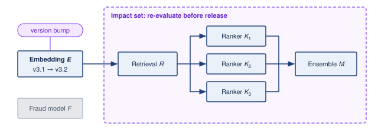

:::

The impact boundary in @fig-model-registry identifies consumers that require evaluation after an upstream change. Fraud model $\Glyph{F}$ has no recorded dependency, so the traversal does not flag it; an omitted edge would leave that conclusion incomplete. Within the recorded graph, upstream embedding model $\Glyph{E}$ produces representations consumed by retrieval model $\Glyph{R}$, three parallel rankers ($\Glyph{K}_1$, $\Glyph{K}_2$, $\Glyph{K}_3$) score those candidates using features derived from $\Glyph{E}$, and ensemble model $\Glyph{M}$ combines the scores into a final ranking. Recording these relationships tells the release controller where to test, and the tests on those consumers decide whether the new representations remain compatible.

Update approval begins with graph traversal and then requires behavioral and interface evidence. When embedding model $\Glyph{E}$ is updated, the registry and release controller coordinate four steps:

1. Traverse downstream edges to identify every dependent model ($\Glyph{R}$, $\Glyph{K}_1$, $\Glyph{K}_2$, $\Glyph{K}_3$, and $\Glyph{M}$).
2. Re-evaluate each dependent model against the proposed embeddings.
3. Block deployment of $\Glyph{E}$ until every consumer passes.
4. Roll out the approved version set through compatible intermediate states, retaining a validated rollback target. Topological ordering alone is insufficient if an existing consumer cannot accept the new producer's outputs.

Without explicit dependency tracking, organizations discover architectural coupling through production outages when an upstream change silently corrupts downstream assumptions.

@Lst-registry-schema illustrates how a single YAML entry captures artifact location, training provenance, evaluation results, and declared dependencies. The downstream entries seed impact analysis; following their registry records reveals transitive consumers. Release approval additionally needs the applicable acceptance thresholds and evidence for the compatible version set.

::: {#lst-registry-schema lst-cap="**Model Registry Schema**: A YAML entry capturing model metadata, artifact location, training provenance, and evaluation results for dependency tracking and reproducibility."}

```{.yaml}
model:
  name: user_embedding_v3
  version: "3.2.1"
  type: embedding_model
  domain: recommendation

artifact:
  path: gs://models/user_embedding_v3/3.2.1/
  format: tensorflow_savedmodel
  size_bytes: 4294967296

training:
  data_version: user_interaction_2024_01
  code_commit: abc123def
  started_at: 2024-01-15T10:00:00Z
  duration_hours: 48
  hardware: 8xA100-80 GB

evaluation:
  metrics:
    recall_at_100: 0.342
    embedding_quality: 0.891
  evaluation_set: eval_2024_01

dependencies:
  upstream:
    - feature_store/user_features_v2
    - feature_store/interaction_features_v1
  downstream:
    - models/candidate_retrieval_v4
    - models/ranking_ensemble_v2

serving:
  min_replicas: 10
  max_replicas: 100
  latency_p99_target_ms: 5
  memory_gb: 16

ownership:
  team: recommendation-core
  oncall: recsys-oncall-team
```

:::

### Ensemble management {#sec-ml-operations-scale-ensemble-management-67f5}

Recommendation systems exemplify the multi-model management challenge by composing retrieval, ranking, and filtering stages. Some stages also combine predictions from several models into an ensemble. The platform must validate the complete recommendation interface even when different teams own its components.

#### Architectural rationale for recommendation ensembles {#sec-ml-operations-scale-ensembles-dominate-recommendation-d94b}

Recommendation architectures separate work when evaluating every candidate with the richest model would exceed the latency or compute budget. Retrieval produces a manageable candidate set, ranking scores that set with richer features, and later re-ranking or business-rule stages produce the final ordering [@covington2016; @liu2022]. Within this path, specialized models can address competing objectives such as engagement, diversity, and freshness, while ensemble stages combine their outputs. The decomposition trades a smaller amount of expensive scoring for additional interfaces whose behavior the platform must validate.

The same decomposition improves experimentation velocity because teams can update individual components without retraining the entire recommendation stack, but that independence creates version-compatibility obligations for the platform. It also changes risk management. Other ensemble components can sometimes compensate when one model fails or produces poor results, yet the platform must detect when compensation hides a regression rather than resolving it.

#### Ensemble deployment patterns {#sec-ml-operations-scale-ensemble-deployment-patterns-c4eb}

Deploying an ensemble update requires evaluating its effect on the composed system. Consider updating the fine ranking model within a recommendation ensemble. @Tbl-ops-scale-ensemble-deploy gives an illustrative staged ensemble deployment pattern\index{Deployment!staged ensemble}\index{Ensemble!staged deployment} with four phases: shadow deployment (24--48 hours logging without serving), canary (1 percent traffic for 4--8 hours), staged rollout (5 percent to 100 percent over 24--72 hours), and soak (7--14 days monitoring for delayed effects). These durations are planning assumptions; promotion requires enough eligible observations, mature outcomes, and acceptable guardrail metrics for the release decision.

| **Deployment Stage** | **Actions**                                                          | **Duration** | **Rollback Trigger**                   |
|:---------------------|:---------------------------------------------------------------------|:------------:|:---------------------------------------|
| **Shadow**           | New model scores alongside production, results logged but not served | 24--48 hours | Quality metrics below threshold        |
| **Canary**           | 1% traffic receives new model results                                |  4--8 hours  | Statistical significance of regression |
| **Staged Rollout**   | 5% → 25% → 50% → 100%                                                | 24--72 hours | Business metric degradation            |
| **Soak**             | Full traffic, extended monitoring                                    |  7--14 days  | Delayed effects emerge                 |

: **Staged ensemble deployment pattern**: Four-phase rollout for updating recommendation ensemble components. Shadow deployment (24--48 hours) compares behavior without serving candidate outputs; resource isolation and outcome evidence bound what it establishes. Canary (1 percent traffic, 4--8 hours) enables statistical regression detection, staged rollout progressively increases exposure, and soak period (7--14 days) catches delayed interaction effects. {#tbl-ops-scale-ensemble-deploy}

The extended timeline reflects the difficulty of detecting regressions in ensemble systems. A component change that improves its local metrics might degrade system-level performance through subtle interactions with other components.

#### Interaction effects {#sec-ml-operations-scale-interaction-effects-9ae7}

Ensemble components interact in ways that make local validation insufficient. If a ranking model is retrained on lower-quality retrieval candidates, it may learn greater reliance on auxiliary signals; restoring retrieval can then change the distribution that this adapted ranker expects. A fixed ranker can also respond differently to changed inputs without changing its learned weights. Distribution shift propagates whenever an upstream update alters representations consumed by downstream models trained on older versions. Over longer horizons, ranking decisions change which items users encounter, shaping the feedback used for future training. Intermediate outputs help locate these effects, while stable holdouts and observation windows support comparison of the complete system. Joint retraining is a candidate intervention when the evidence identifies incompatible learned behavior, rather than a required periodic reset.

### Model lifecycle management {#sec-ml-operations-scale-model-lifecycle-management-f112}

Lifecycle management exists to keep model dependencies from becoming permanent obligations: every promotion widens a model's blast radius, and every retirement must migrate its consumers before the platform can reclaim resources. The lifecycle stages trace that progression from development to archive, each defined by the gates it imposes rather than by a status label.

```text
Development → Staging → Canary → Production → Deprecation → Archive
```

In development, models exist as experimental artifacts. Operations requirements are intentionally light, but they are not optional: successful experiments must preserve results, version history, and enough reproducibility metadata to be challenged later. The operational concern is therefore transition readiness. A promising model should not move to staging until it has clear production-readiness criteria, automated evaluation against production-equivalent data, and documentation sufficient for review.

Staging tests the candidate as a deployable service before it serves user-visible outputs. Production-equivalent data, feature interfaces, and hardware make latency, throughput, and behavioral checks relevant to deployment. Shadow traffic can add evidence about live request patterns when its coverage justifies its cost. The promotion gate combines the checks required by the release contract with human review where model behavior or risk demands judgment.

Production widens the blast radius from validation traffic to live traffic, so the model now requires continuous monitoring with alerting, capacity for traffic fluctuations, rollback procedures, and on-call support. Production is not a terminal state. Distribution shifts prompt investigation and evaluation; retraining is warranted when the resulting evidence supports an update. Feature and infrastructure changes likewise require compatibility checks, and periodic comparison with newer baselines tests whether the deployed model still earns its place.

The lifecycle closes only when a model can be retired without breaking its consumers. Deprecation identifies dependent systems, provides migration paths and timelines, maintains the old model until migration completes, and archives artifacts for reproducibility and audit. Organizations often underinvest in this final stage, leading to accumulation of zombie models[^fn-zombie-models-waste] that consume resources but provide questionable value. Platform-level lifecycle enforcement helps address this pattern.

[^fn-zombie-models-waste]: **Zombie Models**\index{Zombie Models!deprecation}: Production models that continue serving despite being obsolete or superseded. Even a low-traffic model consumes registry, monitoring, dependency-management, and on-call capacity until it is deliberately retired. The operational cost therefore extends beyond compute: zombie models enlarge the dependency graph, making platform-wide upgrades and security patches slower and riskier.

### Deployment patterns by model count {#sec-ml-operations-scale-deployment-patterns-model-count-e071}

The appropriate deployment pattern depends on the interdependence of the versions being updated, because a compatibility change can widen the rollback unit. @Tbl-ops-scale-deploy-patterns illustrates deployment patterns by scale\index{Deployment!patterns by scale}: single model deployments (monthly updates for isolated vision classifiers), pipeline deployments (weekly updates for 3--5 sequential NLP models), ensemble deployments (daily updates for 10--50 recommendation components), and platform deployments (continuous updates across hundreds of enterprise models). The cadences describe example operating contexts; model count does not determine release frequency or the evidence required for promotion.

| **Pattern**      | **Model Count** | **Update Frequency** |       **Example**       |
|:-----------------|:---------------:|:--------------------:|:-----------------------:|
| **Single Model** |        1        |       Monthly        |    Vision classifier    |
| **Pipeline**     |       3-5       |        Weekly        | NLP processing pipeline |
| **Ensemble**     |      10-50      |        Daily         |  Recommendation system  |
| **Platform**     |       100s      |      Continuous      |  Enterprise ML platform |

: **Deployment patterns by scale**: Four patterns addressing different model counts and update frequencies. Single model deployments (1 model, monthly updates) use standard canary rollouts, while platform deployments (100+ models, continuous updates) require automated policy enforcement, cross-model impact analysis, and global rate limiting to prevent simultaneous high-risk deployments. {#tbl-ops-scale-deploy-patterns}

For a model without downstream model consumers, the rollback unit can be smaller. Canary deployments, blue-green switches,[^fn-blue-green-deployment] and gradual rollouts still require a validated previous version together with compatible preprocessing, features, and serving configuration. Restoring the model artifact alone is sufficient only when those surrounding interfaces remain compatible.

[^fn-blue-green-deployment]: **Blue-Green Deployment**\index{Blue-Green Deployment!ML serving}: A release pattern that prepares the new version in a parallel environment before switching production traffic. Fast rollback requires the previous environment to remain ready and its dependencies to remain compatible. Holding both versions during the transition adds serving capacity and cost $(\InferenceCost)$; the duplication depends on which resources the environments can safely share.

Pipelines introduce ordering constraints because models execute in sequence and each model's output feeds the next. Compatibility must hold at every intermediate deployment state. An upstream-first update is safe only if existing consumers accept its new outputs; otherwise the platform must prepare compatible consumers or stage both versions before switching traffic. The release record names the compatible version set and the rollback unit, which may span the entire pipeline.

Ensembles widen the coordination problem because multiple models may execute in parallel or in a graph. Different teams can update components on different schedules, partial updates may change only part of the ensemble, and the system behavior emerges from component interactions. Testing in isolation is therefore insufficient; integration testing becomes the deployment gate.

At platform scale, continuous deployment means some model is always being updated somewhere, so the platform must prevent individually safe changes from combining into an unsafe fleet state. Platform deployment requires automated rollout policies based on model risk classification, cross-model impact analysis before deployment approval, global rate limiting to prevent simultaneous high-risk deployments, and automated correlation of incidents with recent deployments.

### Cross-model dependencies in practice {#sec-ml-operations-scale-crossmodel-dependencies-practice-fc81}

The registry, ensemble, and lifecycle mechanisms meet in a single production graph, and one worked ecosystem shows how their obligations combine.

#### E-commerce model ecosystem {#sec-ml-operations-scale-example-ecommerce-model-ecosystem-e47f}

The dependency-control argument becomes concrete in an e-commerce model graph, where a single embedding interface fans out into retrieval, ranking, and business logic. An e-commerce platform typically starts the graph with embedding models. A user embedding model\index{Ensemble!user embedding model} generates user representations from behavior history, while a product embedding model\index{Ensemble!product embedding model} represents products from attributes and interactions. Those embeddings are not final predictions; they are shared interfaces consumed by downstream services.

The next layer turns shared representations into candidate sets and business signals. A candidate retrieval model uses the embeddings to find relevant products, and a price sensitivity model\index{Ensemble!price sensitivity model} estimates how strongly a user will respond to price changes. A ranking model\index{Ensemble!ranking model} then scores the candidate products using both embedding features and auxiliary signals, while a business rules model applies promotional and inventory constraints before results reach the user.

The resulting graph has five tiers, and its shape decides what a change costs. User and product representations travel over a shared bus into candidate retrieval and price sensitivity, which converge in ranking before business rules apply (@fig-ecommerce-graph).

::: {#fig-ecommerce-graph fig-env="figure" fig-pos="htb" fig-cap="**E-commerce model ecosystem**: Data sources feed a user embedding and a product embedding. A shared bus carries both embeddings into both mid-tier models, candidate retrieval and price sensitivity, whose outputs merge in the ranking model before business rules apply inventory and promotion constraints. Because every embedding reaches every downstream model, a change to the user embedding requires coordinated evaluation of all four consumers." fig-alt="Five-tier dependency graph read top to bottom with tier labels Sources, Embeddings, Mid-tier, Ranking, and Rules. Green user behavior logs and product catalog boxes feed a violet user embedding box and a blue product embedding box. Both embeddings drop onto a violet horizontal line labeled shared bus, which feeds blue candidate retrieval and price sensitivity boxes. Their outputs merge into a blue ranking model box labeled pCTR times pBuy, then into a gray business rules box labeled inventory, promotions. All four downstream boxes sit inside a dashed violet region labeled coordinated evaluation, and every edge from the user embedding onward is violet."}
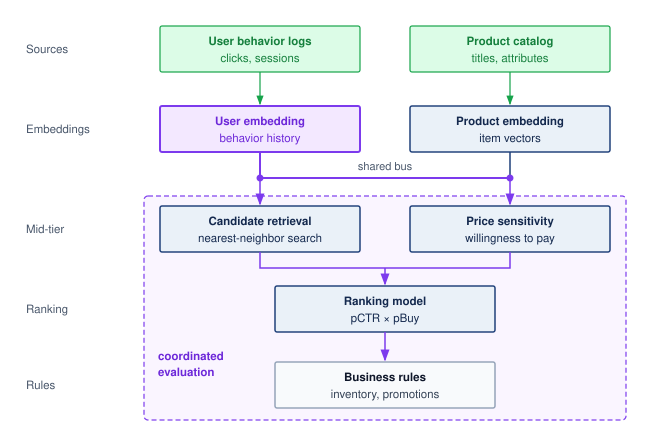

:::

Because the embedding bus in @fig-ecommerce-graph branches directly to both mid-tier consumers, a change can affect candidate retrieval and price sensitivity before propagating through ranking and business rules. The platform therefore evaluates both direct embedding compatibility and downstream recommendation quality. If old consumers cannot accept the new embeddings, the release can retain both versions and route each consumer to the version it validated while migration proceeds. The rollback plan must preserve that compatible state as well. While the dependency graph maps affected consumers, a model registry alone cannot preserve the feature values they ingest. Shared features demand versioned definitions, point-in-time correctness, and explicit freshness guarantees, contracts that complete the state a release pipeline must validate.

## Feature Store Operations {#sec-ml-operations-scale-feature-store-operations-2a36}

Consider a fraud detection system that needs to know a user's transaction volume over the last ten minutes. Serving retrieves that feature within the prediction's latency budget, while training reconstructs it for many historical transactions. These access paths differ, but the feature's meaning must remain compatible. If training counts transactions that were unavailable at the historical prediction time, or serving applies a different aggregation rule, the model receives inputs that differ from those on which it was evaluated.

A common design separates the two access paths: online stores serve low-latency feature lookups, while offline stores generate reproducible training data. Operating these systems at scale presents unique challenges in freshness, consistency, and performance. The two paths form a training-serving gap\index{Training-serving gap!computational context} in computational context. Training computes features in *batch* over *hours*, while serving computes them in *real time* within *milliseconds*, yet each feature must mean the same thing on both paths. The gap is a design condition, not yet a failure. It becomes one as training-serving skew\index{Training-serving skew!feature store invariant}\index{Feature store!training-serving skew}, the failure mode in which small differences in processing logic between the two paths give the deployed model inputs it never saw in training and degrade accuracy silently.

::: {#psp-ops-scale-training-serving-skew .callout-perspective title="Training-serving skew"}

At fleet scale, the concern shifts from detecting training-serving skew in a single model to controlling it as a platform-level property. A feature store reduces skew by making training and serving pipelines read from shared feature definitions and materialized feature values where possible, turning $\TrainingTransformFunction(\RawPipelineInput) \equiv \ServingTransformFunction(\RawPipelineInput)$ into an architectural invariant that can be tested and monitored rather than a manual convention repeated by every team.

:::

### Feature store architecture {#sec-ml-operations-scale-feature-store-architecture-51da}

The **dual-store architecture**\index{Dual-Store Architecture!definition} resolves the tension between high-throughput batch training scans and low-latency serving lookups by splitting storage while the platform enforces compatible definitions and temporal semantics across both paths. One materialization engine, governed by versioned feature definitions, writes ingested batch and stream data into an offline analytical store for historical joins and an online key-value store for point lookups (@fig-feature-store-architecture).

::: {#fig-feature-store-architecture fig-env="figure" fig-pos="htb" fig-cap="**Feature store architecture**: A dual-store architecture resolves the conflict between training (high-throughput batch scans) and serving (low-latency point lookups). One set of feature definitions drives materialization from batch and streaming sources into an offline store, which keeps full history for point-in-time training joins (the throughput path, top), and an online store, which keeps the latest value per entity for serving lookups (the latency path, bottom). Shared definitions support compatible feature meanings; materialization and historical-availability checks must verify that contract." fig-alt="A violet feature definitions box sends a dashed arrow into a tall green materialization box listing batch, streaming, and on-demand, which batch data and event streams feed from the left. Materialization writes to two green stores. The offline store is drawn as a grid of cells, rows by entity and columns by time, labeled full history with a time arrow; a bracket over all its rows sends an arrow labeled scan to a blue training box labeled point-in-time joins, under the heading throughput path. The online store is drawn as three key cells, each with one latest-value cell; one value cell is outlined and sends an arrow labeled lookup to a blue serving box labeled point lookups, under the heading latency path."}
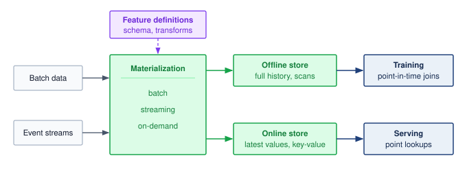

:::

The **offline store**\index{Offline Store!definition} retains historical feature data for reproducible training examples, so its access path favors large scans and joins, where a single query might read terabytes to build a feature set for millions of examples. Throughput determines how quickly that dataset can be prepared within the training schedule.

The **online store**\index{Online Store!definition} serves feature values within the prediction's latency budget. At fleet scale its load depends on request rate, features fetched per request, batching, and cache reuse, rather than model count alone, and the storage choice must satisfy that access pattern at the required tail latency and peak load.

**Materialization**\index{Materialization!definition} loads computed features into both stores: in batch on a daily or hourly schedule, from event streams in near real time, or on demand at request time when freshness requirements exceed batch frequency. The central architectural challenge is ensuring consistency between the two stores during materialization. If the offline store contains a feature value for training that was not identically available in the online store at the time of prediction, it creates a training-serving mismatch that can silently degrade model performance in production, the training-serving skew problem formalized in perspective \ref{psp-ops-scale-training-serving-skew}.

For a platform serving hundreds of models, such as the five-hundred-model portfolio that opened this chapter, shared feature contracts prevent each consumer from reconstructing historical correctness and serving consistency independently. The dual-store pattern provides one implementation of that contract; the invariant is compatible feature meaning and temporal availability across both paths, rather than a requirement that every workload use the same storage system.

### Freshness SLOs {#sec-ml-operations-scale-freshness-slos-6912}

Feature freshness represents the delay between real-world events and their reflection in feature values. @Tbl-ops-scale-feature-freshness maps four feature types to example freshness requirements. Slowly changing demographics can permit batch computation, while decisions that depend on the last user action may require streaming or on-demand computation. The consuming decision determines the acceptable delay; the feature category alone does not establish a service-level objective (SLO).[^fn-slo-three-nines] The categories\index{Feature store!freshness requirements} in the table are a starting point for those SLOs; monitoring and alerting must use the timestamp and delay contract validated for the consuming workload.

| **Feature Type**    |       **Example**       | **Freshness SLO** | **Computation Pattern** |
|:--------------------|:-----------------------:|:-----------------:|:-----------------------:|
| **Static**          |    User demographics    |        Days       |          Batch          |
| **Slowly changing** |     User preferences    |       Hours       |          Batch          |
| **Session-level**   | Current session context |      Minutes      |        Streaming        |
| **Real-time**       |       Last action       |      Seconds      |   Streaming/On-demand   |

: **Feature freshness requirements by type**: Four feature categories with SLO thresholds and computation patterns. Static features (user demographics) tolerate day-scale staleness with batch computation; real-time features (last user action) demand seconds-scale freshness through streaming or on-demand computation, directly impacting recommendation quality and engagement. {#tbl-ops-scale-feature-freshness}

[^fn-slo-three-nines]: **SLO**\index{SLO!reliability target}: A target for a declared service indicator and measurement window. Under a time-based definition, "three nines" (99.9 percent) annual availability allows about 8.8 hours of downtime; a request-based definition instead counts failed eligible requests. A p99 latency target of 200 ms requires at least 99 percent of eligible requests to complete within that bound over the specified window.

Recommendation systems show how a missed freshness SLO reaches the user when a ranking decision depends on behavior from the current session.

```{python}
#| echo: false
#| label: archetype-b-profile
# ┌── LEGO ───────────────────────────────────────────────
# │ Context: Archetype B staleness-tax lighthouse.
# │ Goal: Pin the recommender-at-scale table size, platform QPS, and P99 SLO.
from mlsysim import ReferenceStats
from mlsysim.core.units import TB, count, millisecond, second
from mlsysim.fmt import check, fmt_count, fmt_qty_int

class ArchetypeBProfile:
    # ┌── 1. LOAD ──────────────────────────────────────────
    profile = ReferenceStats.RecommenderAtScaleProfile
    table = profile.EmbeddingTableSize
    qps = profile.PlatformQps
    p99 = profile.P99LatencySlo
    # ┌── 3. GUARD ─────────────────────────────────────────
    check(table.to(TB).magnitude >= 1, "Archetype B tables should be multi-terabyte")
    # ┌── 4. OUTPUT ────────────────────────────────────────
    table_str = fmt_qty_int(table, TB, commas=False) + "+"
    qps_words_str = fmt_count(qps.to(count / second).magnitude, scale="M", scale_style="word", precision=0)
    p99_ms_str = fmt_qty_int(p99, millisecond, commas=False)
```

::: {#lhs-ops-scale-archetype-b-dlrm-at-scale-staleness-tax .callout-lighthouse title="Archetype B (DLRM at Scale): Staleness tax"}

**Context**: Archetype B (DLRM at Scale) recommendation workloads maintain sparse embedding tables of `{python} ArchetypeBProfile.table_str` across distributed memory and serve on the order of `{python} ArchetypeBProfile.qps_words_str` queries per second platform-wide, each within a p99 serving budget ($\LatencySlo$) of `{python} ArchetypeBProfile.p99_ms_str`, of which feature retrieval receives only a few milliseconds.

**Mechanism**: Ground truth user intent shifts continuously. If the feature materialization pipeline exhibits a 10-minute update lag ($\FeatureUpdateLag= 600\text{ s}$), serving queries read feature values that omit the last 10 minutes of user behavior, so downstream rankers can recommend items the user has already moved past.

**Impact**: The lag is dominated by pipeline scheduling rather than transfer time, and it can make recent behavior unavailable to a ranking decision. The resulting click-through or revenue effect must be measured for the service; there is no universal staleness penalty.

**Systems lesson**: When recent behavior materially affects ranking quality, DLRM operations must provision ingestion and materialization to meet the feature's freshness SLO. Scheduling must preserve that deadline alongside offline training needs. The measured value of fresher inputs determines whether the additional streaming capacity earns its cost.

:::

Freshness becomes operational only when the SLO names its timestamp contract. @Eq-feature-staleness measures time since the most recent feature update. This refresh-age proxy supports the thresholds in @tbl-ops-scale-feature-freshness when updates certify that the source stream has been processed through the required time:

$$\text{Staleness} = \CurrentWallClockTime- \FeatureUpdateTimestamp$$ {#eq-feature-staleness}

Refresh age differs from event-to-availability latency: rewriting an old source value can make its update timestamp recent without making the source information fresh. Streaming monitors therefore need source progress or watermarks as well as update timestamps, and must distinguish an idle entity from a stalled pipeline. Batch age increases between scheduled refreshes. Each path needs a threshold matched to its update contract rather than one global freshness rule.

#### Freshness impact on model quality {#sec-ml-operations-scale-worked-example-freshness-impact-model-quality-676b}

A recommendation system uses user interaction features with different freshness levels. Assume an online experiment yields the relative engagement lifts in @tbl-feature-freshness-engagement. These constructed values illustrate a planning calculation; replay of historical inputs alone does not establish a causal engagement gain:

| **Feature Freshness**        | **Engagement Lift vs. Baseline** |
|:-----------------------------|:--------------------------------:|
| **Real-time (< 1 min)**      |              +12.3%              |
| **Near real-time (< 5 min)** |              +11.8%              |
| **Hourly**                   |              +10.2%              |
| **Daily**                    |              +8.1%               |

: **Assumed engagement lift by feature freshness**: Constructed relative lifts measured against the same baseline engagement rate. The hourly-to-real-time gap is 2.1 percentage points of the relative-lift metric, not 2.1 percentage points of the raw engagement rate. The example translates that assumed gain into an infrastructure budget. {#tbl-feature-freshness-engagement tbl-colwidths="[45,55]"}

The difference in relative lift between hourly and real-time features is 2.1 percentage points of the shared baseline. If the organization values that incremental engagement at \$10 million annually, the comparison must use the incremental cost of replacing the hourly path, including migration and ongoing operation over the same horizon. The engagement experiment supplies the quality difference; the business valuation and infrastructure ledger determine whether it justifies investment.

::: {#chk-ops-scale-freshness-revenue .callout-checkpoint title="Pricing the streaming and batch freshness decision"}

Under the constructed lifts in @tbl-feature-freshness-engagement, moving from hourly to real-time features adds 2.1 percentage points of engagement lift. Treat that lift as \$10 million in annual engagement value and apply it to the choice between streaming and batch infrastructure.

- [ ] **Freshness break-even**: determine the maximum annual incremental cost of a real-time feature pipeline relative to the hourly path that still breaks even on the 2.1-point lift, holding the \$10 million engagement value constant, and state the cost threshold under which streaming is a clear win.
- [ ] **Lift per point**: compare the additional engagement lift for the daily-to-hourly, hourly-to-near-real-time, and near-real-time-to-real-time transitions, and identify the incremental pipeline-cost estimates needed to choose among them.
- [ ] **Scaling to users**: if the \$10 million annual engagement value scales linearly with platform user count, determine the break-even user count as a fraction of the current population for a streaming feature platform costing an additional \$5 million per year relative to the hourly path, state the range where it does not pay off, and choose an alternative architecture from @tbl-ops-scale-feature-freshness.

:::

### Point-in-time correctness {#sec-ml-operations-scale-pointintime-correctness-41f4}

Training data must reconstruct features strictly as they existed at the timestamp of each historical event. @Fig-time-travel sequences this temporal boundary along a 24-hour execution trace: an example generated at 12:00 must observe only the four clicks logged prior to the noon cutoff, whereas an unaligned midnight batch job counts all ten daily clicks and contaminates the training example with six future events. Using unaligned feature values as inputs for historical training examples creates data leakage[^fn-data-leakage-pitfall] that inflates offline metrics but fails in production.

[^fn-data-leakage-pitfall]: **Data Leakage**\index{Data Leakage!feature store risk}: Future information can inflate offline metrics when a model learns signals unavailable at prediction time. Shared feature infrastructure should enforce historical availability boundaries, but model and data owners must still specify the prediction moment and verify how features were computed. A timestamped join cannot remove future information already embedded inside an incorrectly constructed feature.

::: {#fig-time-travel fig-env="figure" fig-pos="htb" fig-cap="**Point-in-time correctness**: A training example at noon should see only the clicks already logged by noon (solid green, 4), not the clicks that arrive later (dashed gray). A naive join that reads the midnight batch value of `total_clicks_today` counts all 10 and leaks six future events into the example. A point-in-time join pairs each training event with feature values as they existed *at the event timestamp*, so the example contains only information that would have been available at inference time." fig-alt="Timeline from 00:00 to 24:00 with a dashed vertical line at 12:00 labeled training example at 12:00 and a dotted line at 24:00 labeled batch job. Four solid green click markers fall before noon and six dashed gray markers after it. A green bracket spans the four early clicks, labeled 4 clicks, with an arrow to a green box reading point-in-time join, total_clicks_today equals 4. A red dashed bracket spans all ten clicks, labeled 10 clicks by midnight, with an arrow to a red box reading naive join, midnight value, total_clicks_today equals 10."}
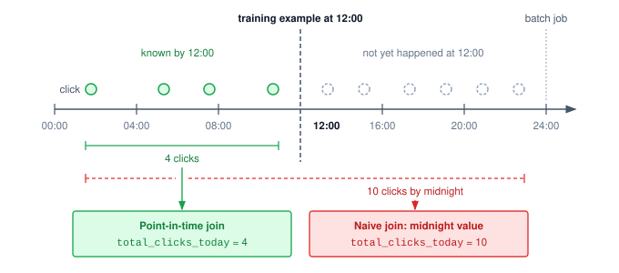

:::

Comparing the aggregation brackets in @fig-time-travel isolates the leakage mechanism. The point-in-time join uses the four clicks logged before noon, whereas the naive join reads the midnight total, inflating `total_clicks_today` by 2.5$\times$. This "time travel"\index{Time-travel query!data leakage prevention}\index{Feature store!point-in-time correctness} failure uses a value that is valid in the database but invalid for the prediction moment: `total_clicks_today` is 10 at midnight, while the noon prediction can use only the 4 clicks already available. Training on the later value exposes information unavailable to the deployed predictor and can make offline evaluation overestimate production quality.

Feature stores implement **point-in-time joins**\index{Point-in-Time Join!definition} that retrieve feature values as of specific timestamps, as shown in @lst-pit-joins.

::: {#lst-pit-joins lst-cap="**Point-in-Time Join**: A SQL lateral join that retrieves the most recent feature values available before each event, preventing future data leakage into training examples."}

```{.sql}
SELECT
    e.user_id,
    e.event_timestamp,
    e.label,
    f.feature_1,
    f.feature_2
FROM events e
LEFT JOIN LATERAL (
    SELECT feature_1, feature_2
    FROM features f
    WHERE f.user_id = e.user_id
      AND f.feature_timestamp <= e.event_timestamp
    ORDER BY f.feature_timestamp DESC
    LIMIT 1
) f ON TRUE
```

:::

The query assumes that `feature_timestamp` records when the value became available to serving. If it records only the source event time, a late arrival or later backfill could pass the filter despite being unavailable at the historical prediction. The store must retain availability time as well as event time when those differ, and the training join must enforce the availability boundary.

```{python}
#| echo: false
#| label: feature-store-storage-scenario
# ┌─────────────────────────────────────────────────────────────────────────────
# │ FEATURE STORE — STORAGE FOOTPRINT
# ├─────────────────────────────────────────────────────────────────────────────
# │ Context: point-in-time storage cost for the recommendation feature store.
# └─────────────────────────────────────────────────────────────────────────────
from mlsysim.core.units import MILLION, BILLION, PB, byte
from mlsysim.fmt import check, fmt, fmt_count, fmt_memory, fmt_time

class FeatureStoreStorage:
    """Feature-history storage footprint for a 100M-user recommendation store."""

    # ┌── 1. LOAD ──────────────────────────────────────────────────────────
    storage_users = 100 * MILLION
    storage_features = 1000
    storage_retention_years = 1
    storage_update_interval_hr = 1
    hours_per_year = 365 * 24
    # scenario assumption: one stored row = 8 B value + 8 B entity key
    # + 8 B event timestamp + 8 B availability timestamp (the point-in-time
    # join needs both times). Full snapshots, no compression.
    value_bytes = 8
    key_bytes = 8
    timestamp_bytes = 8
    storage_bytes_per_value = (value_bytes + key_bytes + 2 * timestamp_bytes) * byte
    # ┌── 2. EXECUTE ───────────────────────────────────────────────────────
    storage_versions_per_feature = storage_retention_years * hours_per_year / storage_update_interval_hr
    storage_feature_values = storage_users * storage_features * storage_versions_per_feature
    storage_total_bytes = storage_feature_values * storage_bytes_per_value
    # ┌── 3. GUARD ─────────────────────────────────────────────────────────
    check(storage_feature_values == 876_000_000_000_000, "Feature-history count drifted.")
    check(27 < storage_total_bytes.to(PB).magnitude < 29, "Storage should remain about 28 PB.")
    check(
        (key_bytes + 2 * timestamp_bytes) / (value_bytes + key_bytes + 2 * timestamp_bytes) == 0.75,
        "Prose says three quarters of each row is metadata",
    )
    # ┌── 4. OUTPUT ────────────────────────────────────────────────────────
    storage_users_str = fmt_count(storage_users, scale="million", precision=0, scale_style="word", label="user")
    storage_features_str = fmt_count(storage_features, commas=True, label="feature")
    storage_retention_years_str = fmt_time(storage_retention_years, "year", precision=0, commas=False, style="word")
    storage_update_interval_hr_str = fmt_time(storage_update_interval_hr, "hour", precision=0, commas=False, style="word")
    storage_feature_values_str = fmt_count(storage_feature_values, scale="trillion", precision=0, scale_style="word", label="feature value")
    storage_bytes_per_value_str = fmt_memory(storage_bytes_per_value, unit=byte, precision=0, commas=False)
    storage_total_pb_str = fmt_memory(round(storage_total_bytes.to(PB).magnitude) * PB, unit=PB, precision=0, commas=False)
```

Point-in-time correctness has a storage cost because the store must retain feature history rather than current values alone. The same guarantee that prevents leakage also multiplies retained state:

$$\text{Storage} = \EntityCount\times \FeatureCount\times \frac{\FeatureRetentionWindow}{\FeatureUpdateInterval} \times \text{bytes}_{\text{row}}$$

For `{python} FeatureStoreStorage.storage_users_str` and `{python} FeatureStoreStorage.storage_features_str`, with a retention window of `{python} FeatureStoreStorage.storage_retention_years_str` and an update interval of `{python} FeatureStoreStorage.storage_update_interval_hr_str`, the history contains `{python} FeatureStoreStorage.storage_feature_values_str`. Each stored row carries more than the value itself. An 8-byte value needs an 8-byte entity key and, because a correct point-in-time join must filter on availability time as well as event time, two 8-byte timestamps, for `{python} FeatureStoreStorage.storage_bytes_per_value_str` per row. Full hourly snapshots then represent approximately `{python} FeatureStoreStorage.storage_total_pb_str` before compression, three quarters of it metadata that makes the history reproducible. Storing only changed values, compressing columns, and limiting retention can reduce this footprint. The reduction depends on change frequency and encoding, while retention must still cover the historical predictions the platform needs to reconstruct.

### Feature versioning and lineage {#sec-ml-operations-scale-feature-versioning-lineage-624c}

Feature definitions are production interfaces, so changing one without versioning can break every dependent model. Versioning and lineage make this evolution governable rather than implicit.

A representative `user_engagement_score` incident makes the mechanics concrete. A platform team changes the feature from a 30-day z-score to a 7-day min-max scale. The output may still be a floating-point number, so schema validation alone can pass while the feature's meaning changes completely. Versioning names the semantic change before it reaches production; lineage identifies every model trained or served with the old meaning; backfill recomputes historical values for the new meaning; and freshness and quality checks decide whether the rewritten history is safe to use. Without that chain, a feature migration becomes a silent multi-model regression.

A safe feature interface records both version dimensions and lineage fields. @Tbl-ops-scale-feature-version-lineage-components keeps those fields tied to their operational use.

| **Component**                         | **What It Records**                                     | **Operational Use**                                                            |
|:--------------------------------------|:--------------------------------------------------------|:-------------------------------------------------------------------------------|
| Definition version                    | Computation logic for the feature                       | Blocks silent semantic changes when the formula changes but the type does not. |
| Data version                          | Source snapshot or stream contract                      | Distinguishes model changes from upstream data changes.                        |
| Schema version                        | Output type, shape, units, and nullability              | Preserves API compatibility checks while still naming semantic shifts.         |
| Consumer declaration                  | Exact feature versions each model consumes              | Gives the platform a place to block unsafe updates before serving.             |
| Source lineage                        | Source tables, streams, and their versions              | Traces bad predictions back to the upstream data that produced them.           |
| Transformation and runtime provenance | Transformation code, timestamp, and environment         | Reproduces historical values for audit, debugging, and compliance.             |
| Quality and freshness metrics         | Validation results observed when the value was produced | Estimates blast radius and decides whether rewritten history is safe to use.   |

: **Feature version and lineage components**: Feature versioning separates logic, data, and schema changes; lineage records the path needed to debug, audit, and reproduce feature values. Together, these fields turn a feature definition into a governed production interface. {#tbl-ops-scale-feature-version-lineage-components}

### Backfill procedures {#sec-ml-operations-scale-backfill-procedures-eb66}

A backfill is a production migration over history: changing a feature definition creates a new version of the training history for dependent models, so the platform must bound the compute cost, validate values against the intended definition, and preserve a path back. Treating the backfill as a migration changes the operational question from whether the computation can run once to whether history can be rewritten without corrupting future training data.

Feature replay requires a concrete execution safety contract. Each backfill partition needs a stable identity and an idempotent or transactional write path so retries cannot duplicate feature effects; event-time bounds and the late-data policy must also match the point-in-time join used for training. Otherwise, a mechanically successful replay can produce a history that is complete in processing time but incorrect at the prediction time the model is meant to reproduce.

::: {.column-margin .margin-pointer}
↩ Exactly-once commit boundaries, event-time watermarks, and late-data policies for distributed transformations are established in @sec-storage-distributed-transformation-semantics.
:::

At scale, historical data may have moved into cold storage, so recomputation first becomes a data-placement problem. The long historical window then competes with production workloads for compute. Even after the job finishes, the platform cannot simply trust the new values: it must compare overlapping periods against the intended new computation, explain differences from the old definition, and coordinate with dependent pipelines so training jobs do not mix old and new semantics mid-run.

The practical pattern is incremental. Historical data is processed in bounded date partitions, and each partition is validated before consumers can use it. Independent partitions can run concurrently within the backfill's resource budget. During a dual-write period, old and new computations run in parallel, giving the platform overlapping values for comparison before cutover. The previous feature version and its lineage remain available through the migration and rollback window so dependent models can return to a compatible state.

### Scale challenges {#sec-ml-operations-scale-scale-challenges-b84b}

Feature stores at recommendation system scale face a coupled systems problem: request volume, latency budget, and storage history all bind at once.

```{python}
#| echo: false
#| label: feature-store-latency-scenario
# ┌─────────────────────────────────────────────────────────────────────────────
# │ FEATURE STORE — REQUEST VOLUME AND LATENCY BUDGET
# ├─────────────────────────────────────────────────────────────────────────────
# │ Context: recommendation-scale lookup rate and per-request latency budget.
# └─────────────────────────────────────────────────────────────────────────────
from mlsysim.core.units import BILLION
from mlsysim.fmt import MarkdownStr, check, fmt_count, fmt_multiple_range, fmt_rate, fmt_time, fmt_time_range

class FeatureStoreLatency:
    """Request volume and per-request latency budget for the recommendation store."""

    # ┌── 1. LOAD ──────────────────────────────────────────────────────────
    daily_recommendations = 1 * BILLION
    features_per_recommendation = 100
    seconds_per_day = 24 * 60 * 60
    peak_traffic_min = 5
    peak_traffic_max = 10
    recommendation_budget_ms = 50
    feature_budget_min_ms = 5
    feature_budget_max_ms = 10
    network_overhead_min_ms = 1
    network_overhead_max_ms = 2
    store_lookup_min_ms = 3
    store_lookup_max_ms = 8
    # ┌── 2. EXECUTE ───────────────────────────────────────────────────────
    lookups_per_day = daily_recommendations * features_per_recommendation
    avg_lookups_per_s = lookups_per_day / seconds_per_day
    # ┌── 3. GUARD ─────────────────────────────────────────────────────────
    check(1.1 * 10**6 < avg_lookups_per_s < 1.2 * 10**6, "Average lookup rate should be about 1.16M/s.")
    # ┌── 4. OUTPUT ────────────────────────────────────────────────────────
    daily_recommendations_str = fmt_count(daily_recommendations, scale="billion", precision=0, scale_style="word", label="daily recommendation")
    features_per_recommendation_str = fmt_count(features_per_recommendation, commas=False, label="feature")
    lookups_per_day_str = fmt_count(lookups_per_day, scale="billion", precision=0, scale_style="word", label="feature lookup")
    avg_lookup_rate_str = MarkdownStr(
        fmt_count(avg_lookups_per_s, scale="million", precision=2, commas=False, scale_style="word", label="feature lookup", allow_fractional=True)
        + " per second"
    )
    peak_traffic_range_mult_str = fmt_multiple_range(peak_traffic_min, peak_traffic_max, precision=0, commas=False)
    recommendation_budget_ms_str = fmt_time(recommendation_budget_ms, "millisecond", precision=0, commas=False)
    feature_budget_range_ms_str = fmt_time_range(feature_budget_min_ms, feature_budget_max_ms, "millisecond", precision=0, commas=False)
    network_overhead_range_ms_str = fmt_time_range(network_overhead_min_ms, network_overhead_max_ms, "millisecond", precision=0, commas=False)
    store_lookup_range_ms_str = fmt_time_range(store_lookup_min_ms, store_lookup_max_ms, "millisecond", precision=0, commas=False)
```

The arithmetic behind a large recommender explains why feature stores become serving infrastructure rather than a metadata convenience. `{python} FeatureStoreLatency.daily_recommendations_str` with `{python} FeatureStoreLatency.features_per_recommendation_str` per recommendation produces `{python} FeatureStoreLatency.lookups_per_day_str` per day. That average load is roughly `{python} FeatureStoreLatency.avg_lookup_rate_str` before peak traffic. This counts feature-value accesses rather than backend requests; batching and cache reuse determine how many requests reach the store. A planning envelope of `{python} FeatureStoreLatency.peak_traffic_range_mult_str` the mean raises the required capacity accordingly; observed request patterns must establish the appropriate peak allowance.

Feature retrieval must fit inside the overall latency budget because lookup time on the critical path leaves less time for ranking. If the recommendation budget is `{python} FeatureStoreLatency.recommendation_budget_ms_str`, the feature store may receive only `{python} FeatureStoreLatency.feature_budget_range_ms_str`. Network overhead can consume `{python} FeatureStoreLatency.network_overhead_range_ms_str` of that allocation, leaving roughly `{python} FeatureStoreLatency.store_lookup_range_ms_str` for the store lookup itself. In-memory storage or caching, bounded batching, and placement near the serving fleet are candidate mechanisms. The selected design must meet the remaining lookup budget under peak load.

Production feature stores also carry two time horizons at once. Online capacity depends on the number of populated entity-feature pairs, encoded bytes per value, metadata, and replication. Offline capacity additionally depends on update frequency and retained history, as the snapshot calculation above shows. Neither footprint follows from model count alone. Multi-region replication can improve availability and lookup latency, but it also requires an explicit contract for how quickly new feature values become visible in each region.

### Data quality operations {#sec-ml-operations-scale-data-quality-operations-e77b}

Data quality\index{Data quality!production validation} issues are a major source of production ML problems [@polyzotis2017]. Model metrics reveal downstream effects, while data checks can identify missing, stale, or invalid inputs earlier in the pipeline. Validation gates can then quarantine suspect data before consumers use it. At scale, these checks need explicit response policies so detecting an upstream problem leads to containment rather than merely another dashboard signal.

```{python}
#| echo: false
#| label: feature-store-data-quality-scenario
# ┌─────────────────────────────────────────────────────────────────────────────
# │ FEATURE STORE — DATA QUALITY MEASUREMENT
# ├─────────────────────────────────────────────────────────────────────────────
# │ Context: completeness measurement and batch-rejection threshold.
# └─────────────────────────────────────────────────────────────────────────────
from mlsysim.core.units import MILLION
from mlsysim.fmt import check, fmt_count, fmt_percent

class FeatureStoreDataQuality:
    """Completeness measurement for a daily feature pipeline."""

    # ┌── 1. LOAD ──────────────────────────────────────────────────────────
    expected_events = 10 * MILLION
    delivered_events = 8.2 * MILLION
    validation_failure_threshold = 0.05
    # ┌── 2. EXECUTE ───────────────────────────────────────────────────────
    completeness = delivered_events / expected_events
    # ┌── 3. GUARD ─────────────────────────────────────────────────────────
    check(abs(completeness - 0.82) < 1e-9, "Completeness example should remain 82%.")
    # ┌── 4. OUTPUT ────────────────────────────────────────────────────────
    expected_events_str = fmt_count(expected_events, scale="million", precision=0, scale_style="word", label="user event")
    delivered_events_str = fmt_count(delivered_events, scale="million", precision=1, scale_style="word", label="user event", allow_fractional=True)
    completeness_pct_str = fmt_percent(completeness, precision=0, commas=False, style="prose")
    validation_failure_threshold_pct_str = fmt_percent(validation_failure_threshold, precision=0, commas=False, style="prose")
```

The first step is to quantify data quality in dimensions that support release decisions. Completeness measures whether expected records and fields are present. A daily data pipeline expected to produce `{python} FeatureStoreDataQuality.expected_events_str` but delivering only `{python} FeatureStoreDataQuality.delivered_events_str` is `{python} FeatureStoreDataQuality.completeness_pct_str` complete relative to that expectation. Investigation must distinguish missing delivery from a legitimate change in source volume. Consistency captures schema compliance and referential integrity; an age field with an allowed range of 0 to 120 would reject values such as 999 or -1, which may represent leaked sentinels. A policy might quarantine a batch when more than `{python} FeatureStoreDataQuality.validation_failure_threshold_pct_str` of its checks fail, but a single critical violation can warrant rejection. The policy must weigh the consequences of invalid inputs against delayed or unavailable data.

Timeliness measures freshness against the SLO of the consuming model. Fraud detection may need features less than 100 milliseconds old, while demographic features can tolerate staleness measured in days; the alert threshold should therefore be tied to the feature's use, not a global constant. Accuracy asks whether values remain correct within expected distributions. Sensor drift after calibration lapses, for example, can leave values well-typed but wrong. Statistical tests such as Kolmogorov-Smirnov for continuous features, chi-square for categorical features, and maximum mean discrepancy for high-dimensional data detect distribution changes that warrant investigation; they do not establish that individual values are accurate.

Validation then turns those measurements into a layered defense. Schema validation enforces expected column names, types, and constraints at ingestion; tools such as Great Expectations, TensorFlow Data Validation, and Pandera provide declarative schemas with automated checks. Distribution monitoring tracks feature distributions over time, catching drift that may not violate a type constraint but still indicates an upstream change whose effect on model performance requires evaluation. Cross-field validation adds the business logic that neither schema nor marginal distributions can express: if `country="USA"`, the `zip_code` should match US postal formats; if `order_status="shipped"`, a `shipping_date` should exist; and age derived from birthdate should match any explicit age field.

#### Debugging data quality incidents {#sec-ml-operations-scale-worked-example-debugging-data-quality-incident-72cd}

```{python}
#| echo: false
#| label: data-quality-incident-scenario
# ┌─────────────────────────────────────────────────────────────────────────────
# │ DATA QUALITY INCIDENT — CTR REGRESSION
# ├─────────────────────────────────────────────────────────────────────────────
# │ Context: feature-computation-bug incident, revenue impact, alert reduction.
# └─────────────────────────────────────────────────────────────────────────────
from mlsysim.core.units import MILLION
from mlsysim.fmt import check, fmt, fmt_percent, fmt_time, fmt_usd

class DataQualityIncident:
    """A feature-computation bug that silently degrades CTR over five days."""

    # ┌── 1. LOAD ──────────────────────────────────────────────────────────
    ctr_drop = 0.08
    incident_days = 5
    ctr_before = 0.042
    ctr_after = 0.0387
    freshness_slo_hr = 1
    engagement_before = 0.42
    engagement_after = 0.31
    weekly_revenue = 15 * MILLION
    alert_detection_hr = 4
    feature_shift_threshold = 0.10
    # ┌── 2. EXECUTE ───────────────────────────────────────────────────────
    engagement_decline = (engagement_before - engagement_after) / engagement_before
    revenue_impact = ctr_drop * weekly_revenue * incident_days / 7
    impact_reduction = 1 - (alert_detection_hr / (incident_days * 24))
    engagement_decline_rounded = round(engagement_decline, 2)
    revenue_impact_rounded = round(revenue_impact / 1000) * 1000
    impact_reduction_rounded = round(impact_reduction, 2)
    # ┌── 3. GUARD ─────────────────────────────────────────────────────────
    check(850_000 < revenue_impact < 860_000, "Revenue-impact example should remain about $857K.")
    check(0.96 < impact_reduction < 0.98, "Alert reduction should remain about 97%.")
    # ┌── 4. OUTPUT ────────────────────────────────────────────────────────
    ctr_drop_pct_str = fmt_percent(ctr_drop, precision=0, commas=False, style="prose")
    incident_days_str = fmt_time(incident_days, "day", precision=0, commas=False, style="word")
    ctr_before_pct_str = fmt_percent(ctr_before, precision=1, commas=False, style="prose")
    ctr_after_pct_str = fmt_percent(ctr_after, precision=2, commas=False, style="prose")
    freshness_slo_hr_str = fmt_time(freshness_slo_hr, "hour", precision=0, commas=False, style="word", attributive=True)
    engagement_before_str = fmt(engagement_before, precision=2, commas=False)
    engagement_after_str = fmt(engagement_after, precision=2, commas=False)
    engagement_decline_pct_str = fmt_percent(engagement_decline_rounded, precision=0, commas=False, style="prose")
    weekly_revenue_usd_str = fmt_usd(weekly_revenue, scale="M", precision=0, commas=False)
    revenue_impact_usd_str = fmt_usd(revenue_impact_rounded, scale="K", precision=0, commas=False)
    alert_detection_hr_str = fmt_time(alert_detection_hr, "hour", precision=0, commas=False, style="word")
    impact_reduction_pct_str = fmt_percent(impact_reduction_rounded, precision=0, commas=False, style="prose")
    feature_shift_threshold_pct_str = fmt_percent(feature_shift_threshold, precision=0, commas=False, style="prose")
```

A recommendation model's click-through rate (CTR) drops `{python} DataQualityIncident.ctr_drop_pct_str` over `{python} DataQualityIncident.incident_days_str`. The initial hypothesis focuses on model drift, but the constructed investigation reveals a feature computation defect.

The investigation starts with the model symptom and then works backward through the data path. Model metrics\index{Lineage!model metrics} confirm that CTR declined from `{python} DataQualityIncident.ctr_before_pct_str` to `{python} DataQualityIncident.ctr_after_pct_str`, but freshness checks\index{Data!data freshness} show that features still arrive within the `{python} DataQualityIncident.freshness_slo_hr_str` SLO. That weakens the stale-pipeline hypothesis only if source progress, event-time coverage, and the affected entities are also verified; refresh age alone cannot exclude stale inputs. The investigation therefore tests semantic change as well. Distribution analysis then shows the mean of `user_engagement_score`, the shared feature whose redefinition @sec-ml-operations-scale-feature-versioning-lineage-624c used to motivate versioning, shifting from `{python} DataQualityIncident.engagement_before_str` to `{python} DataQualityIncident.engagement_after_str`, a `{python} DataQualityIncident.engagement_decline_pct_str` decline, and lineage tracking\index{Lineage!pipeline tracking}\index{Lineage tracking!provenance} ties the shift to an upstream pipeline version deployed `{python} DataQualityIncident.incident_days_str` earlier.

The shift and deployment history make the new pipeline a candidate cause; a changed population could also move the mean. Replaying the same source records through both pipeline versions with identical event cutoffs isolates the computation. In this scenario, the new version uses a different aggregation window even though its declared feature definition is unchanged, while the previous version matches that definition. This same-record comparison establishes a feature computation defect. The defect is the same class of silent semantic change that feature versioning is meant to name before release; the marginal distribution alone would not establish it.

Assuming revenue falls in proportion to CTR and traffic is uniform over the interval, the modeled impact is `{python} DataQualityIncident.ctr_drop_pct_str` of `{python} DataQualityIncident.weekly_revenue_usd_str`/week over `{python} DataQualityIncident.incident_days_str`, producing `{python} DataQualityIncident.revenue_impact_usd_str` in lost revenue. If automated alerts and effective containment shorten exposure to `{python} DataQualityIncident.alert_detection_hr_str`, the modeled impact falls by `{python} DataQualityIncident.impact_reduction_pct_str`. The resolution restores the previous pipeline and compatible model-feature state. A distribution validation gate then blocks unexplained feature shifts exceeding the scenario's `{python} DataQualityIncident.feature_shift_threshold_pct_str` threshold; semantic tests remain necessary for bugs that do not cross that band.

::: {.column-margin}
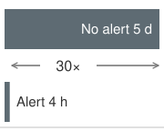{width="100%" fig-alt="Two gray horizontal bars on a linear time scale: a long bar labeled No alert 5 d above a thin bar labeled Alert 4 h, with a double-headed arrow between their ends labeled 30×."}

*Four-hour alerts shrink a five-day exposure window 30$\times$.*
:::

#### Operational integration {#sec-ml-operations-scale-operational-integration-a2de}

Data quality operations integrate into production systems by turning checks into enforceable contracts. **Data contracts**\index{Data Contract!definition} establish formal agreements between data producers and consumers, specifying schema requirements, freshness SLOs, quality thresholds for completeness and accuracy, and escalation procedures for violations. Release controls enforce those agreements by checking proposed schema or computation changes and requiring consumer review when compatibility cannot be established.

The contract becomes operational through continuous validation\index{Data contract!continuous validation} and incident response\index{Incident response!data contract}. Ingestion checks reject source data that violates declared constraints, transformation checks test computed values, and serving gates block features known to be invalid. When a check fails, alerts identify severity and affected systems, circuit breakers contain the bad path, and quarantined batches preserve evidence for investigation. A fallback may use cached or last-known-good features only while they remain acceptable under the consuming model's freshness and compatibility contract. Root-cause analysis then repairs the pipeline rather than only clearing the current alert.

At enterprise scale with thousands of features, individual checks need a shared routing and grouping policy. Source-system grouping connects symptoms of an upstream failure, such as a payment-processing outage affecting several features. Computation-pipeline grouping directs investigation toward shared transformation code or dependencies. Update-frequency grouping separates streaming features from daily batch features because freshness contracts differ. Business-domain grouping routes evidence to teams that understand the affected models. These groupings reduce duplicate notifications without removing feature-level checks or suppressing an urgent contract violation.

```{python}
#| echo: false
#| label: freshness-monitoring-scenario
# ┌─────────────────────────────────────────────────────────────────────────────
# │ FRESHNESS MONITORING — SAMPLING AND AGGREGATION
# ├─────────────────────────────────────────────────────────────────────────────
# │ Context: monitoring-overhead reduction via sampling and pipeline aggregation.
# └─────────────────────────────────────────────────────────────────────────────
from mlsysim.fmt import fmt_count, fmt_percent

class FreshnessMonitoring:
    """Sampling and aggregation assumptions for fleet-scale freshness checks."""

    # ┌── 1. LOAD ──────────────────────────────────────────────────────────
    freshness_feature_count = 10_000
    freshness_sample = 0.01
    pipeline_feature_count = 500
    # ┌── 4. OUTPUT ────────────────────────────────────────────────────────
    freshness_feature_count_str = fmt_count(freshness_feature_count, commas=True, label="feature")
    freshness_sample_pct_str = fmt_percent(freshness_sample, precision=0, commas=False, style="prose")
    pipeline_feature_count_str = fmt_count(pipeline_feature_count, commas=False, label="feature")
```

Freshness monitoring applies the same aggregation rule to time. For `{python} FreshnessMonitoring.freshness_feature_count_str` updated at different frequencies, checking every feature value can consume substantial capacity. Sampling `{python} FreshnessMonitoring.freshness_sample_pct_str` of representative entities reduces that work, but the sample still grows with the entity population and must cover the relevant sources and partitions. Pipeline-level aggregation can reduce checks further when one pipeline updates `{python} FreshnessMonitoring.pipeline_feature_count_str` and its source-progress watermark covers the group. A recent successful update alone cannot rule out a stalled partition or missing entities. With a bounded number of checks per feature, monitoring can maintain $\mathcal{O}(\FeatureCount)$ overhead, but that bound trades exhaustive coverage for aggregate or sampled evidence. Critical features need checks whose coverage and detection delay match their failure consequences.

Feature definitions, historical availability, and freshness now belong to the same governed state as model artifacts. A release pipeline must validate that state as a unit, retain a compatible rollback target, and limit live exposure while evidence accumulates.

## CI/CD for ML at Scale {#sec-ml-operations-scale-cicd-ml-scale-730a}

Versioned model dependencies and feature contracts define a candidate release, but they do not establish that it is safe to expose. Each model update must navigate the dependency web: an embedding model update might require re-evaluation of four transitive downstream components, including the business rules layer, before any component can safely reach production. This coordination challenge transforms CI/CD from a per-model concern into a platform orchestration problem. Software integration tests already validate interacting components. ML CI/CD adds learned behavior and changing data to that contract, requiring evidence that upstream changes preserve downstream quality and that each deployment state remains compatible.

Continuous integration\index{CI/CD!continuous integration}\index{Continuous integration!ML systems} and continuous deployment practices for machine learning differ from traditional software CI/CD in what they must validate. Software CI/CD focuses on code correctness and deployment reliability, whereas ML CI/CD must additionally validate data, verify model performance, and manage the interactions between code, data, and learned parameters. At platform scale, these challenges multiply as pipelines must coordinate across hundreds of models with varying requirements.

### Training pipeline automation {#sec-ml-operations-scale-training-pipeline-automation-9da3}

CI/CD for machine learning begins by making each training run an accountable producer of deployable artifacts. The pipeline records versioned inputs and execution conditions, defines recovery behavior, and preserves the results needed for deployment validation. Automation makes those obligations repeatable; reproducibility still depends on the recorded data, code, environment, and sources of nondeterminism.

#### Pipeline stages {#sec-ml-operations-scale-pipeline-stages-06f5}

@Fig-ml-cicd stages the delivery lifecycle across continuous integration, training, and deployment, with an evaluation gate that blocks or registers a candidate. Monitoring returns drift signals to data validation. A confirmed population change may justify retraining, while a corrupted feature pipeline requires repair before it supplies another training run. The sequence matters because each stage establishes evidence for the next rather than treating every alert as permission to train and deploy.

::: {#fig-ml-cicd fig-env="figure" fig-pos="htb" fig-cap="**ML CI/CD pipeline**: Read the top row left to right and the bottom row right to left. Continuous integration checks each commit; continuous training validates data, trains, and evaluates against a metrics gate that either blocks the candidate and raises an alert or registers it. Continuous deployment then moves the registered version through staging, a canary slice of traffic, and full production. Monitoring closes the loop: detected drift returns to data validation and investigation before a decision to retrain." fig-alt="Two rows of stage boxes. Top row, left to right, under brackets labeled continuous integration and continuous training: commit, unit tests, data validation, training, and evaluate with candidate metrics. Evaluate feeds a large, heavily outlined diamond labeled metrics gate, the decision point of the pipeline; a red arrow labeled fail leads left to a red box reading block, alert, and a green arrow labeled pass leads down to a green registry box. Bottom row, right to left, under a bracket labeled continuous deployment: registry, staging, canary at 5 percent of traffic with a bar filled 5 percent, and production at 100 percent of traffic with a full bar, ending at a violet monitoring box. A dashed violet arrow labeled drift prompts validation runs from monitoring back up to data validation."}
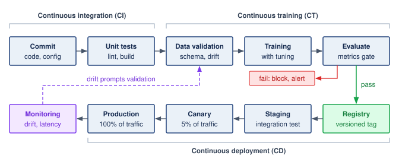

:::

1. Data validation\index{Training pipeline!data validation} pins the data version and rejects schema, freshness, or distribution failures before they consume training capacity.
2. Feature engineering\index{Training pipeline!feature engineering} preserves the feature contract between training and serving, so preprocessing changes do not become silent production regressions.
3. Training\index{Training pipeline!training execution} records code, data, hyperparameters, hardware envelope, and random seeds so a promising artifact can be reproduced or challenged later.
4. Evaluation\index{Training pipeline!candidate evaluation} compares the candidate with baselines, slice metrics, latency budgets, and task-specific gates before any user traffic is exposed.
5. Artifact generation packages the model with its serving configuration, dependency versions, and rollback target.
6. Registration\index{Training pipeline!model registration} records the artifact in the model registry with lineage, approvals, and deployment eligibility.

Each stage needs a defined retry boundary and durable outputs. If evaluation fails, the pipeline can reuse completed data-validation and feature-engineering results when their data, code, configuration, and relevant execution environment remain unchanged. Missing outputs or a changed dependency invalidate that reuse. Idempotent publication prevents a retry from registering duplicate artifacts or repeating external side effects.

#### Pipeline orchestration {#sec-ml-operations-scale-pipeline-orchestration-705a}

Training pipelines require orchestration systems that make dependency order, resource allocation, and failure recovery explicit. The orchestrator represents the workflow as a directed acyclic graph (DAG), tracks dependencies between stages, retries transient failures without rerunning unaffected work, schedules scarce resources such as GPUs and memory, caches intermediate results when inputs are unchanged, and records logs and artifacts for later debugging.

Common orchestration choices include Kubeflow Pipelines[^fn-kubeflow-pipeline-orchestration] [@bisong2019], Airflow with ML extensions, and cloud-native solutions like Vertex AI Pipelines or SageMaker Pipelines. The choice depends on which dependency and resource contracts the platform must enforce, as well as existing infrastructure, team expertise, and scale requirements. Orchestration fixes the execution contract; parameterization fixes the variation contract, so the same graph can run against different data, models, and hardware envelopes without becoming a new program each time.

[^fn-kubeflow-pipeline-orchestration]: **Kubeflow**\index{Kubeflow!orchestration}: Kubeflow Pipelines connects workflow dependencies to Kubernetes execution and resource requests. Declared requests let scheduling account for resources needed by a step, but do not eliminate contention on shared storage, networks, or other services. Platform policy must therefore combine admission and resource allocation with measurements of actual execution behavior.

#### Pipeline parameterization {#sec-ml-operations-scale-pipeline-parameterization-a5e4}

Effective pipelines separate configuration from code (@lst-pipeline-params).\index{Pipeline!parameterization} The listing's evaluation block names two standard ranking metrics: normalized discounted cumulative gain at rank 10 (NDCG@10), which rewards placing relevant items near the top of a list, and mean reciprocal rank (MRR), which averages the inverse position of the first relevant item.

::: {#lst-pipeline-params lst-cap="**Pipeline Parameterization**: A YAML configuration separating data paths, feature sets, training hyperparameters, and evaluation criteria from pipeline code."}

```{.yaml}
training_pipeline:
  model_type: transformer_ranking
  data:
    train_path: gs://data/train/2024-01-*
    eval_path: gs://data/eval/2024-01-15
    schema_version: v3.2
  features:
    user_features: [embedding, history, demographics]
    item_features: [embedding, attributes, popularity]
  training:
    epochs: 10
    batch_size: 4096
    learning_rate: 0.001
    optimizer: adam
    hardware: 4xA100
  evaluation:
    metrics: [ndcg_10, mrr, coverage]
    baseline_model: ranking_v2.1.0
```

:::

The separation enables configuration-driven training because the platform can vary data versions, hyperparameters, and resource requests without rewriting pipeline code. A parameter file is also an audit input, but a path or version label alone does not prove which bytes a run consumed. The execution record must resolve those references to immutable data and artifacts and retain the actual environment, feature definitions, and evaluation policy. That record lets a release reviewer reconstruct the conditions behind the candidate's evidence.

### Validation gates {#sec-ml-operations-scale-validation-gates-89a2}

Validation gates determine whether a trained model should proceed toward production. Effective gates balance thoroughness against deployment velocity. A release gate consumes a versioned evidence bundle tying the candidate and its dependencies to metrics, thresholds, and accountable owners. Model performance, latency, policy and fairness constraints, data quality, and operational readiness each answer a different failure mode. Together they form an evaluation contract that remains attached to the release as it moves from offline validation to production experiments.

#### Performance gates {#sec-ml-operations-scale-performance-gates-18e5}

Performance validation combines minimum acceptable performance with comparisons against the production baseline and historical results. The release policy names the primary improvement sought and the regression bounds permitted on secondary metrics, rather than requiring every metric to improve simultaneously. @Lst-performance-gates demonstrates this multi-criteria evaluation.\index{Validation Gate!performance}

::: {#lst-performance-gates lst-cap="**Performance Gate Evaluation**: A validation function that checks absolute thresholds, relative improvement over the production model, and regression bounds on secondary metrics."}

```{.python}
def evaluate_performance_gate(
    candidate_metrics, production_metrics, thresholds
):
    """
    Evaluate whether candidate model passes performance gates.

    Returns tuple of (passed: bool, reasons: list)
    """
    import math

    required_metrics = ("ndcg_10", "mrr", "coverage")
    required_thresholds = ("min_ndcg", "min_improvement", "max_regression")
    try:
        values = [candidate_metrics[k] for k in required_metrics]
        values += [production_metrics[k] for k in required_metrics]
        values += [thresholds[k] for k in required_thresholds]
        valid = all(math.isfinite(v) for v in values)
        valid = valid and production_metrics["ndcg_10"] > 0
        valid = valid and 0 <= thresholds["max_regression"] <= 1
    except (KeyError, TypeError, ValueError):
        valid = False
    if not valid:
        return False, ["Missing, nonfinite, or invalid gate inputs"]

    reasons = []

    # Absolute threshold check
    if candidate_metrics["ndcg_10"] < thresholds["min_ndcg"]:
        reasons.append(
            f"NDCG_10 {candidate_metrics['ndcg_10']:.4f} below minimum {thresholds['min_ndcg']}"
        )

    # Relative improvement check
    relative_improvement = (
        candidate_metrics["ndcg_10"] - production_metrics["ndcg_10"]
    ) / production_metrics["ndcg_10"]
    if relative_improvement < thresholds["min_improvement"]:
        reasons.append(
            f"Improvement {relative_improvement:.2%} below minimum {thresholds['min_improvement']:.2%}"
        )

    # Regression check on secondary metrics
    for metric in ["mrr", "coverage"]:
        if candidate_metrics[metric] < production_metrics[metric] * (
            1 - thresholds["max_regression"]
        ):
            reasons.append(
                f"{metric} regression exceeds {thresholds['max_regression']:.2%} tolerance"
            )

    return (len(reasons) == 0, reasons)
```

:::

#### Latency gates {#sec-ml-operations-scale-latency-gates-bf9e}

Production models must meet workload-specific latency requirements. Validation measures representative request shapes at expected load, batching, and hardware. @Tbl-ops-scale-latency-gates gives illustrative thresholds, not universal model-type requirements\index{Latency!gate thresholds by model type}. The LLM row measures time to first token (TTFT)\index{LLM!latency budget}, reflecting the prefill phase of @sec-performance-engineering-prefill-decode; completion latency requires a separate output-length contract for decode. The other rows measure request-to-response latency.

| **Model Type**      | **p50 Target** | **p99 Target** | **Gate Action if Exceeded**            |
|:--------------------|:--------------:|:--------------:|:---------------------------------------|
| **LLM (TTFT)**      |     500 ms     |    2000 ms     | Block deployment, require optimization |
| **Recommendation**  |     10 ms      |     50 ms      | Block deployment                       |
| **Fraud Detection** |      5 ms      |     20 ms      | Block deployment, high priority        |
| **Vision**          |     50 ms      |     200 ms     | Warning, conditional approval          |

: **Illustrative latency gates**: Assumed p50 and p99 service targets under a declared request distribution and load. LLM targets refer to TTFT; other targets cover the complete response. Product risk and the service contract determine thresholds and exception authority. {#tbl-ops-scale-latency-gates}

Latency gates catch overt performance violations, but some regressions pass every gate and still degrade the product. The most dangerous failures are semantically silent: valid outputs built on corrupted inputs.

::: {#exmp-ops-scale-silent-model-regression .callout-example title="Silent model regression"}

**Scenario**: A high-throughput product ranking model ($25{,}000\text{ QPS}$) passes offline validation and serving latency gates (per-request latency $\LatencySlo < 12\text{ ms}$), but causes a 3.2 percent conversion rate drop post-deployment.

**Diagnosis**: An upstream schema change caused a key user-affinity feature to return `null` for 8 percent of queries. The serving layer silently imputed `null` as `0.0`, a valid float value, so HTTP error rates and latency remained normal while prediction quality degraded unalerted for 48 hours.

**Systems lesson**: Syntactically valid feature imputations cause semantically silent production failures. Automated release pipelines and monitoring systems must evaluate feature distribution shifts and null rates alongside system uptime and latency SLOs.

:::

#### Fairness gates {#sec-ml-operations-scale-fairness-gates-145c}

Fairness concepts become operational at release time when policy choices are encoded as thresholds. For models affecting users, fairness validation[^fn-fairness-validation-tradeoff] turns a policy commitment into a release gate. The platform cannot simply ask whether "the model is fair" because different contexts encode fairness differently. In operations, those definitions first appear as executable thresholds. @Eq-demographic-parity expresses one operational choice: the probability of a positive prediction must differ by less than threshold $\FairnessGapTolerance$ between protected groups $\FirstComparedGroupLabel$ and $\SecondComparedGroupLabel$. @Eq-equalized-odds encodes a different choice from the equalized-odds family: prediction behavior must be similar across groups after conditioning on the true outcome [@hardt2016equality].

[^fn-fairness-validation-tradeoff]: **Fairness Validation in Machine Learning**\index{Fairness!validation in ml}\index{Fairness!validation, impossibility trade-off}: Multiple fairness definitions exist, including demographic parity, equalized odds, and calibration, and unequal outcome base rates with imperfect prediction can make predictive parity and equal error rates incompatible, and can make groupwise calibration incompatible with balanced scores across outcome classes [@chouldechova2017; @kleinberg2016inherent]. This forces a systems design choice: automated validation gates must encode which fairness definition the organization prioritizes, making the gate configuration itself a policy decision that cannot be delegated to a generic threshold.

$$\text{Demographic Parity: } |\Pr(\PredictedDecision=1 \mid \ProtectedGroupMembership=\FirstComparedGroupLabel) - \Pr(\PredictedDecision=1 \mid \ProtectedGroupMembership=\SecondComparedGroupLabel)| < \FairnessGapTolerance$$ {#eq-demographic-parity}

$$\text{Equalized Odds: } |\Pr(\PredictedDecision=1 \mid \TrueOutcome=\TrueOutcomeLevel, \ProtectedGroupMembership=\FirstComparedGroupLabel) - \Pr(\PredictedDecision=1 \mid \TrueOutcome=\TrueOutcomeLevel, \ProtectedGroupMembership=\SecondComparedGroupLabel)| < \FairnessGapTolerance, \quad \forall \TrueOutcomeLevel \in \{0,1\}$$ {#eq-equalized-odds}

where $\ProtectedGroupMembership$ represents the protected attribute, $\PredictedDecision$ is the model prediction, and $\TrueOutcome$ is the true outcome. The operational point is not that every gate should enforce every definition. The gate must record which definition the organization chose, compare the measured value against historical baselines as well as absolute thresholds, and route borderline cases to human review because a near-threshold fairness result is also a governance decision.

::: {.column-margin .margin-pointer}
↪ The fairness criteria behind these gates, and why they cannot all hold at once, are developed in @sec-responsible-ai-fairness-machine-learning-2ba4.
:::

#### Data quality gates {#sec-ml-operations-scale-data-quality-gates-4c04}

Before training or deployment, data quality validation checks declared properties [@caveness2020]. Schema checks test required fields and types, distribution checks compare observed features with reference bounds, and freshness and completeness checks enforce their timestamp and missing-data contracts. Passing these checks establishes evidence for the properties tested; it does not rule out an untested semantic error.

These gates catch issues that would otherwise manifest as mysterious model degradation, completing the pre-release evidence bundle before deployment risk shifts from artifact validity to live-traffic exposure. The next control is no longer another offline score; it is the amount of production traffic allowed to test the artifact under real conditions.

### Staged rollout strategies {#sec-ml-operations-scale-staged-rollout-strategies-2d1f}

Staged rollout is the mechanism that turns deployment risk into a controllable exposure budget. Traffic increases only after the model earns each larger blast radius through continued acceptable performance.

```{python}
#| echo: false
#| label: deployment-safety-notebook
# ┌─────────────────────────────────────────────────────────────────────────────
# │ DEPLOYMENT SAFETY BUDGET (NOTEBOOK)
# ├─────────────────────────────────────────────────────────────────────────────
# │ Context: "The Safety of Staged Rollouts" .callout-notebook
# │
# │ Goal: Quantify the 'Risk Exposure' reduction from canary deployments.
# │ Show: risk_reduction ≈ 20x -- inline in notebook result.
# │ How: Exposure = traffic_pct * detection_time.
# │
# └─────────────────────────────────────────────────────────────────────────────
from mlsysim.fmt import check, fmt, fmt_math, fmt_multiple, fmt_percent

class DeploymentSafety:
    # ┌── 1. LOAD ──────────────────────────────────────────
    full_cutover_pct = 1.0  # 100% blue-green cutover
    canary_pct = 0.05  # 5% canary traffic
    detection_time_h = 2  # hours to detect a major crash/bug
    # ┌── 2. EXECUTE ───────────────────────────────────────
    # Risk exposure is the expected number of broken requests
    # Ratio of exposure: (100% * T) / (5% * T)
    risk_reduction = full_cutover_pct / canary_pct
    # ┌── 3. GUARD ─────────────────────────────────────────
    check(risk_reduction == 20.0, f"Risk reduction {risk_reduction} unexpected")
    # ┌── 4. OUTPUT ────────────────────────────────────────
    # Percent outputs are consumed in prose, so they use word style.
    ds_canary_pct_str = fmt_percent(canary_pct, precision=0, commas=False, style='prose')
    ds_risk_reduction_mult_str = fmt_multiple(risk_reduction, precision=0, commas=False)
    ds_full_cutover_pct_str = fmt_percent(full_cutover_pct, precision=0, commas=False, style='prose')
    ds_risk_reduction_eq_math = fmt_math(
        rf"{fmt(full_cutover_pct * 100, precision=0)} / {fmt(canary_pct * 100, precision=0)} " rf"= {fmt(risk_reduction, precision=0)}\times"
    )
```

::: {#nbk-ops-scale-safety-staged-rollouts .callout-notebook title="The safety of staged rollouts"}

**Problem**: A team is deploying a new ranking model. A blue-green switch that moves all traffic at once (`{python} DeploymentSafety.ds_full_cutover_pct_str` cutover) exposes all users to any potential bugs. A "Canary" deployment starts at `{python} DeploymentSafety.ds_canary_pct_str` traffic. How much does the canary approach reduce the deployment's "Risk Exposure"?

**Math**:
Assume the same request rate, per-request harm, and time to effective rollback in both deployments. Under those assumptions, exposure is proportional to the affected traffic share; comparing shares alone would be insufficient if the smaller canary took longer to reveal the failure.

1. **All-at-Once Blue-Green Exposure**\index{Blue-Green Deployment!blue-green exposure}: `{python} DeploymentSafety.ds_full_cutover_pct_str` of users affected until rollback.
2. **Canary Exposure**\index{Canary Deployment!canary, exposure}: `{python} DeploymentSafety.ds_canary_pct_str` of users affected until rollback.
3. **Risk Mitigation**\index{Staged rollout!risk mitigation}\index{Deployment!risk mitigation}: `{python} DeploymentSafety.ds_risk_reduction_eq_math`.

**Systems insight**: Limiting initial exposure to `{python} DeploymentSafety.ds_canary_pct_str` reduces affected traffic by `{python} DeploymentSafety.ds_risk_reduction_mult_str` under the shared observation and rollback assumptions. This limits harm while the platform collects live evidence. It does not guarantee detection of rare failures or delayed quality effects, so the release policy must choose its observation window and containment triggers alongside the traffic share.

:::

#### Blue-green deployment {#sec-ml-operations-scale-bluegreen-deployment-894e}

Blue-green deployment keeps the current version (blue) serving while the new version (green) is readied in a parallel environment, then shifts traffic through the routing layer once readiness checks pass; switching time depends on routing propagation and treatment of in-flight requests.

For a large model, keeping both releases ready can reserve substantial accelerator memory. Separate full-capacity fleets duplicate the weights and serving resources during the transition, while a smaller candidate fleet reduces that initial reservation. Fast rollback requires enough ready capacity for the previous version; otherwise model loading and replica startup become part of recovery time. Capacity planning must therefore account for the overlap between releases as well as the steady-state serving allocation.

The environment layout and the traffic policy are separate decisions. A blue-green deployment can switch all traffic at once (the policy notebook \ref{nbk-ops-scale-safety-staged-rollouts} assumed) or expose the green environment through canary stages. An all-at-once switch forgoes the evidence from limited live exposure, while staged routing retains parallel-environment costs for longer. The release contract determines whether that additional observation and rollback capacity justify their resource cost.

#### Canary deployment {#sec-ml-operations-scale-canary-deployment-3d8b}

Canary deployment[^fn-canary-traffic-deployment] routes a small percentage of traffic to the new version while monitoring for regressions. If metrics remain acceptable, traffic percentage increases until the new version serves all traffic.

[^fn-canary-traffic-deployment]: **Canary Deployment**\index{Canary Deployment!gradual rollout}: Named after the coal-mining practice of using canaries to detect toxic gases. In an ML release, a limited traffic cohort supplies early evidence while bounding initial exposure. Quality regressions can leave health checks green, so the canary needs model and product metrics as well as service-health signals; delayed outcomes can still postpone detection.

::: {.column-margin}
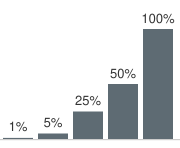{width="100%" fig-alt="Five gray vertical bars rising left to right on a linear scale, labeled 1%, 5%, 25%, 50%, and 100%; the first bar is a thin sliver and the last is full height."}

*Each canary stage earns a larger share of live traffic.*
:::

A typical progression moves from 1 percent to 5 percent to 25 percent to 50 percent to 100 percent as evidence accumulates. The 5 percent canary in notebook \ref{nbk-ops-scale-safety-staged-rollouts} is the second of these stages; opening at 1 percent bounds initial exposure further. Determining the duration of each stage is critical. @Eq-canary-duration relates stage duration to sample requirements, request rate, and traffic percentage, giving a lower bound on the time needed to collect the planned sample:

$$\CanaryStageDuration= \frac{\RequiredUsersPerVariant}{\ArrivalRate \times \CanaryTrafficFraction}$$ {#eq-canary-duration}

where $\CanaryStageDuration$ is the time needed to collect the planned observations, $\RequiredUsersPerVariant$ is the sample requirement from the experiment design, $\ArrivalRate$ is the request rate, and $\CanaryTrafficFraction$ is the traffic share expressed as a fraction. This is a collection-time bound, not a complete stopping rule; delayed labels, correlated requests, and the required observation window can extend the stage.

#### Canary duration calculation {#sec-ml-operations-scale-worked-example-canary-duration-calculation-9448}

A model serves 1 million requests per hour. Suppose its canary plan specifies approximately 10,000 samples per variant. That is a guardrail sample, sized to catch a large regression quickly before exposure widens, not the sample needed to confirm a small improvement. @Sec-ml-operations-scale-ab-testing-statistical-foundations-b9bd derives sample size from the baseline rate, effect size, confidence, and power, and its worked example needs about 30,000 samples per variant just to detect a 10 percent relative change at a 5 percent baseline click-through rate. Smaller effects need far more, so promotion evidence comes from the full experiment, while the canary stages below take their guardrail sample as an input.

```{python}
#| echo: false
# ┌── LEGO ───────────────────────────────────────────────
# │ Context: @eq-canary-duration worked example—stage durations.
from mlsysim.fmt import check, fmt, fmt_math

class CanaryDuration:
    # ┌── 1. LOAD ──────────────────────────────────────────
    samples_needed = 10_000  # canary guardrail sample per variant (scenario input)
    request_rate_per_h = 1_000_000  # requests/hour
    p_1pct = 0.01
    p_5pct = 0.05
    # ┌── 2. EXECUTE ───────────────────────────────────────
    t_1pct_h = samples_needed / (request_rate_per_h * p_1pct)
    t_5pct_h = samples_needed / (request_rate_per_h * p_5pct)
    t_5pct_min = t_5pct_h * 60
    # ┌── 3. GUARD ─────────────────────────────────────────
    check(t_1pct_h == 1.0 and t_5pct_min == 12.0, "Canary durations drift")
    # ┌── 4. OUTPUT ────────────────────────────────────────
    t_1pct_eq_math = fmt_math(
        rf"\CanaryStageDuration = \frac{{{fmt(samples_needed, precision=0)}}}"
        rf"{{{fmt(request_rate_per_h, precision=0)} \times {p_1pct}}} "
        rf"= {fmt(t_1pct_h, precision=0)}\text{{ hour}}"
    )
    t_5pct_eq_math = fmt_math(
        rf"\CanaryStageDuration = \frac{{{fmt(samples_needed, precision=0)}}}"
        rf"{{{fmt(request_rate_per_h, precision=0)} \times {p_5pct}}} "
        rf"= {fmt(t_5pct_h, precision=1)}\text{{ hours}} = {fmt(t_5pct_min, precision=0)}\text{{ minutes}}"
    )
```

At 1 percent canary traffic: `{python} CanaryDuration.t_1pct_eq_math`. At 5 percent canary traffic: `{python} CanaryDuration.t_5pct_eq_math`.

The organization might configure five rollout stages:

- 1 percent for 2 hours (2$\times$ minimum for buffer)
- 5 percent for 30 minutes
- 25 percent for 30 minutes
- 50 percent for 1 hour
- 100 percent deployment

The schedule totals approximately 4 hours. Promotion still requires the planned statistical test and guardrail windows to pass; elapsed time alone does not establish confidence.

Four hours is far shorter than the ensemble soak of @tbl-ops-scale-ensemble-deploy or the multi-region waves that @sec-ml-operations-scale-deployment-strategies-fc90 develops later in this chapter, because each schedule answers a different question. A guardrail sample of fast outcomes, such as errors and clicks, fills in hours. An ensemble change whose effects surface through delayed outcomes needs days of soak. A multi-region rollout repeats evidence collection region by region. The slowest outcome the release must observe, not the traffic share, sets the length of the schedule.

### Rollout risk management {#sec-ml-operations-scale-rollout-risk-management-a3d0}

Canary stages bound exposure, but not every change deserves the same stages. Deployments differ in risk\index{Rollout strategy!risk tiers}\index{Deployment!risk-based rollout}, so effective CI/CD systems estimate each change's risk before deciding how quickly to expose it. @Eq-rollout-risk formalizes deployment risk as the product of regression probability, impact severity, and exposure level, providing a quantitative foundation for risk-based rollout decisions:

$$\text{Risk}_{\text{rollout}} = \Pr(\text{regression}) \times \text{Impact}_{\text{regression}} \times \ExposedUnitCount$$ {#eq-rollout-risk}

where $\Pr(\text{regression})$ is the probability that the change causes a regression, $\text{Impact}_{\text{regression}}$ is the conditional harm per exposure unit, and $\ExposedUnitCount$ is the number of those units exposed during the rollout period. For example, harm per affected request multiplied by exposed requests gives a total harm estimate. If impact already denotes total loss over the rollout, multiplying by exposure again would double-count it.

The rollout risk framework distinguishes three operational levers. Pre-release evaluation screens out known defects and provides evidence about regression probability ($\Pr(\text{regression})$). Validated fallbacks can reduce conditional harm ($\text{Impact}_{\text{regression}}$) when a defect occurs. Traffic limits, regional isolation, and prompt containment bound exposure ($\ExposedUnitCount$). Longer observation at a small traffic share can reveal delayed failures, but also exposes that cohort for longer. The release policy must balance evidence collection against accumulated harm rather than assuming that every longer hold reduces risk. Exposure accumulates in time as well as in traffic share. A regression that no alarm catches keeps charging its harm for every hour it stays live, and notebook \ref{nbk-ops-scale-cost-delayed-alert} prices one such day.

```{python}
#| echo: false
from mlsysim.fmt import fmt_int

# ┌─────────────────────────────────────────────────────────────────────────────
# │ SILENT FAILURE COST (NOTEBOOK)
# ├─────────────────────────────────────────────────────────────────────────────
# │ Context: "The Cost of a Delayed Alert" .callout-notebook
# │
# │ Goal: Quantify the financial loss from a silent model regression.
# │ Show: total_loss ≈ $1,080,000—inline in notebook result.
# │ How: Multiply request rate, detection delay, CTR drop, and click value.
# │
# └─────────────────────────────────────────────────────────────────────────────
from mlsysim.fmt import check, fmt, fmt_count, fmt_percent, fmt_pp, fmt_rate, fmt_time, fmt_usd, fmt_int
from mlsysim.core.units import SEC_PER_HOUR

class SilentFailure:
    # ┌── 1. LOAD ──────────────────────────────────────────
    qps = 5000
    t_detection_h = 24  # 1 day to detect and rollback
    ctr_baseline = 0.05
    ctr_new = 0.045  # 0.5 percentage-point absolute drop (10% relative)
    value_per_click = 0.50  # $0.50 per click
    # ┌── 2. EXECUTE ───────────────────────────────────────
    total_requests = qps * SEC_PER_HOUR * t_detection_h
    ctr_drop = ctr_baseline - ctr_new  # 0.005 absolute CTR drop
    lost_clicks = total_requests * ctr_drop
    lost_clicks_count = round(lost_clicks)
    total_loss = lost_clicks * value_per_click
    # ┌── 3. GUARD ─────────────────────────────────────────
    check(1000000 < total_loss < 1500000, f"Loss ${total_loss:,.0f} unexpected")
    # ┌── 4. OUTPUT ────────────────────────────────────────
    sf_qps_str = fmt_rate(qps, "requests/s")
    sf_detection_hours_str = fmt_time(t_detection_h, 'hour', precision=0, commas=False, style='word')
    sf_ctr_drop_pp_str = fmt_pp(ctr_drop * 100, precision=1)
    sf_ctr_drop_relative_str = fmt_percent(ctr_drop / ctr_baseline, precision=0, commas=False, style='prose')
    sf_value_per_click_str = fmt_usd(value_per_click, precision=2, commas=False, per="click")
    sf_total_loss_str = fmt_usd(total_loss, precision=0)
    sf_sec_per_day_str = fmt_time(SEC_PER_HOUR * 24, "second", precision=0, commas=True, per="day")
    sf_total_requests_str = fmt_count(total_requests, commas=True, label="request")
    sf_lost_clicks_str = fmt_count(lost_clicks_count, label="lost click")
    sf_ctr_drop_ratio_str = fmt(ctr_drop, precision=3, commas=False)
```

::: {#nbk-ops-scale-cost-delayed-alert .callout-notebook title="The cost of a delayed alert"}

**Problem**: A team deploys a recommendation model that has a silent bug: it reduces click-through rate (CTR) by `{python} SilentFailure.sf_ctr_drop_pp_str` (`{python} SilentFailure.sf_ctr_drop_relative_str` relative), from 5 percent to 4.5 percent. If the service handles `{python} SilentFailure.sf_qps_str` and each click is worth `{python} SilentFailure.sf_value_per_click_str`, how much revenue is lost if detection and remediation take `{python} SilentFailure.sf_detection_hours_str`?

**Math**:

1. **Total Requests**: `{python} SilentFailure.sf_qps_str` $\times$ `{python} SilentFailure.sf_sec_per_day_str` = `{python} SilentFailure.sf_total_requests_str`.
2. **Lost Clicks**: `{python} SilentFailure.sf_total_requests_str` $\times$ `{python} SilentFailure.sf_ctr_drop_ratio_str` = `{python} SilentFailure.sf_lost_clicks_str`.
3. **Total Financial Loss**: `{python} SilentFailure.sf_lost_clicks_str` $\times$ `{python} SilentFailure.sf_value_per_click_str` = `{python} SilentFailure.sf_total_loss_str`.

**Systems insight**: At the assumed traffic and value per click, a 0.5 percentage-point regression costs `{python} SilentFailure.sf_total_loss_str` per day. Earlier detection creates value when it enables effective containment sooner. Monitoring and rollback therefore share one operating objective: reducing the time users remain exposed to a harmful release. A drift alarm alone neither establishes the revenue loss nor stops it.

:::

#### Risk categories {#sec-ml-operations-scale-risk-categories-6247}

The risk equation becomes actionable when its estimates inform a rollout policy. @Tbl-ops-scale-risk-categories gives qualitative examples of that mapping, from a fast canary for a bounded change to additional validation and review for a consequential one. A change label alone does not supply a calibrated regression probability; the decision also needs dependency scope, available evidence, and the consequences of failed containment.

| **Category** | **Typical change (drives $\Pr(\text{regression})$)** | **Typical impact ($\text{Impact}_{\text{regression}}$)** |      **Rollout Strategy**      |
|:-------------|:----------------------------------------------------:|:--------------------------------------------------------:|:------------------------------:|
| **Low**      |                    Minor code fix                    |                   Limited user impact                    |          Fast canary           |
| **Medium**   |                   Retrained model                    |                    Engagement effects                    |        Standard canary         |
| **High**     |                   New architecture                   |                      Revenue impact                      | Extended shadow + slow canary  |
| **Critical** |                  Core model change                   |                   Safety implications                    | Shadow + human review + staged |

: **Risk-based rollout strategy selection**: Four qualitative risk categories mapped to deployment strategies. Teams compute numeric rollout risk as the product of regression probability, impact, and exposure in @eq-rollout-risk, then choose the rollout pattern that matches the resulting risk profile. {#tbl-ops-scale-risk-categories}

#### Automated rollback triggers {#sec-ml-operations-scale-automated-rollback-triggers-ffa3}

Risk categories decide how cautiously traffic should expand, but rollback triggers decide when expansion must stop. The trigger configuration in @lst-rollback-triggers makes that stop condition executable by binding each monitored metric to a threshold, observation window, and minimum sample count.\index{Rollback!automated configuration}

::: {#lst-rollback-triggers lst-cap="**Automated Rollback Configuration**: Metric-specific thresholds, observation windows, and minimum sample sizes that balance sensitivity against false triggers."}

```{.python}
rollback_config = {
    "metrics": {
        "engagement_rate": {
            "threshold": -0.02,  # 2% relative decline triggers rollback
            "window_minutes": 15,
            "min_samples": 1000,
        },
        "error_rate": {
            "threshold": 0.01,  # 1% absolute increase triggers rollback
            "window_minutes": 5,
            "min_samples": 500,
        },
        "latency_p99": {
            "threshold": 1.5,  # 50% relative increase triggers rollback
            "window_minutes": 5,
            "min_samples": 100,
        },
    },
    "rollback_action": "immediate",  # or 'gradual' for less severe issues
    "notification": ["oncall", "model-owner"],
}
```

:::

Automated rollback must balance sensitivity against false triggers. Minimum sample counts and window durations limit unstable decisions, but they do not define a statistical test. The release contract must also specify the comparison, uncertainty rule, and repeated-monitoring policy. Immediate safety guardrails may require containment before statistical significance is available. These triggers assume a single serving domain. A fleet that spans regions must also keep its version boundary coherent while traffic expands or retracts, which turns rollout and rollback into a coordination protocol.

### Multi-region deployment coordination {#sec-ml-operations-scale-multiregion-deployment-coordination-ab6a}

Multi-region deployment carries the fault-tolerance concern for recoverable state into the inference plane. Geographic distribution adds artifact propagation, routing, and regional recovery decisions to the release protocol. Multiple versions may coexist during a staged rollout, but their compatibility, traffic assignment, and rollback behavior must remain within the release contract.

::: {.column-margin .margin-pointer}
↩ Geographic replication of serving replicas, with the spare regional capacity and gradual traffic return it requires, is established in @sec-fault-tolerance-reliability-reliability-replication-strategies-aaa2.
:::

#### Coordination challenges {#sec-ml-operations-scale-coordination-challenges-085c}

Multi-region ML deployment couples artifact readiness with input readiness. Large model artifacts consume transfer and loading capacity before a region can serve the new version. For models that retrieve features, receiving the binary is not enough: the region must also provide the feature versions and freshness that the candidate validated. If Region B loads a new model before its required embeddings arrive, requests may fail or use incompatible inputs. The readiness check must therefore cover the model, its feature dependencies, and serving health as one versioned state.

Uncontrolled version mixing is the failure mode that binds multi-region deployment. Staged releases intentionally serve multiple versions, but the protocol must preserve compatibility and experiment assignment even when clocks, traffic volume, routing, and rollback behavior differ by region.

Clock skew and asynchronous progress make timestamps insufficient to establish rollout state. At a planned 2:00 PM UTC start, Region A may begin its 1 percent canary while Region B is still loading the candidate. The coordinator needs explicit readiness and phase acknowledgments to distinguish a permitted staggered release from a failed transition. Regional version differences are acceptable only when routing preserves the declared compatibility and assignment rules.

Regional traffic variation turns the same percentage into different amounts of evidence. A larger canary share in a low-volume region can still collect fewer eligible observations than a smaller share in a high-volume region. The platform must evaluate per-region sample counts, assignment units, and outcome delays against the experiment plan; traffic percentages alone do not establish statistical power.

Cross-region routing can expose version skew when requests move for latency, load balancing, or failover. If an experiment assigns treatment by user, routing must preserve that assignment across regions or record and handle any deviation according to the experiment plan. Mixed versions alone do not invalidate an experiment; unplanned changes in exposure violate the assumptions on which its interpretation depends.

Rollback is the final consistency test. Reverting one region changes the available version set and can violate assignment or dependency assumptions elsewhere. A regional rollback is valid when the release contract permits that state; otherwise the coordinator must contain exposure across the affected regions. Rollback therefore belongs in the rollout protocol rather than an ad hoc emergency procedure.

#### Deployment strategies {#sec-ml-operations-scale-deployment-strategies-fc90}

Multi-region coordination trades deployment duration against permitted regional skew. In a sequential regional rollout, each region completes its canary progression before the next begins, limiting early exposure while extending the schedule. A globally coordinated rollout instead requires regions to satisfy shared readiness and activation conditions. Logical ordering does not make network delivery simultaneous; routing must enforce the version boundary while activation propagates. A hybrid rollout permits regional progress within declared phase or version bounds, pausing regions when local evidence is insufficient or further progress would exceed the allowed skew. The appropriate policy follows the service's compatibility, assignment, and availability requirements.

An illustrative rollout across 5 regions uses three waves followed by final validation:

1. Canary region (lowest traffic): Full canary cycle, 24 to 48 hours
2. Early adopter regions (2 regions, 20 percent global traffic): Parallel deployment, 24 to 48 hours
3. Majority regions (2 regions, 70 percent global traffic): Parallel deployment, 24 to 48 hours
4. Final validation: Cross-region consistency check, 12 to 24 hours

The assumed windows total 3.5 to 7 days. Actual promotion still depends on regional evidence and guardrails, so low traffic, delayed outcomes, or a failed check can extend the schedule.

#### Traffic management during transitions {#sec-ml-operations-scale-traffic-management-during-transitions-731d}

Routing controls enforce different parts of the release contract. Region affinity keeps a user's requests in one region, but does not by itself prevent version changes within that region. Version pinning directs requests to replicas serving the assigned release, including during permitted failover. Restricting cross-region fallback can simplify an experiment's exposure boundary, but sacrifices availability when the selected region fails. The platform chooses and tests these controls together so assignment remains interpretable under both normal routing and recovery.

#### Consistency models for deployment {#sec-ml-operations-scale-consistency-models-deployment-4995}

The choice of activation contract affects both coordination cost and the interpretation of deployment metrics. @Tbl-multi-region-consistency compares deployment consistency models for multi-region systems\index{Deployment!consistency models for multi-region}. Globally ordered activation establishes a shared transition order, eventual convergence permits temporary regional divergence, and bounded staleness limits that divergence. The application must specify which guarantee its decisions require; a financial use case alone does not prohibit controlled experiments or staged versions.

| **Model**             | **Guarantee**                                             |          **Use Case**          | **Coordination Overhead**     |
|:----------------------|:----------------------------------------------------------|:------------------------------:|:------------------------------|
| **Strong**            | Globally ordered version activation                       | One shared activation contract | High (global synchronization) |
| **Eventual**          | Regions converge to same version                          |    Content recommendations     | Low (independent progression) |
| **Bounded staleness** | Regions within $\VersionSkewBound$ versions of each other |       Real-time ranking        | Medium (version monitoring)   |

: **Consistency models for multi-region deployment**: Version activation contracts trade coordination cost against permitted divergence. Financial or safety-related use does not by itself require identical versions everywhere: assignment consistency, compatible schemas, auditability, and explicitly authorized experiments may permit staged versions. Select the guarantee required by the decision being served. {#tbl-multi-region-consistency}

For A/B testing, the serving system must implement the declared assignment and record actual exposure. A user assigned to the candidate should receive that candidate across permitted regional routes unless the experiment explicitly models another exposure policy. Unrecorded fallback to the old version changes the intervention being measured and can bias the comparison. Different versions across control and treatment groups are intentional; they are not a relaxation of the assignment contract.

#### Rollback coordination {#sec-ml-operations-scale-rollback-coordination-b751}

Rolling back a multi-region deployment requires careful coordination to prevent oscillation and mixed-version serving. The rollback protocol executes across two ordered phases. First, the coordinator halts traffic to the new version globally by broadcasting rollback intent, waiting for every region to acknowledge that it has stopped routing new requests to the rejected version, and allowing in-flight requests to drain; any region failing to acknowledge before the timeout expires is marked unhealthy. Next, the coordinator restores the old version globally once it confirms that all healthy regions serve only the previous release, re-enabling normal traffic routing, clearing transient deployment state, and resetting the system for a future attempt.

The acknowledgment barrier prevents restoration from completing while reachable regions still route new requests to the rejected version. A timeout alone cannot stop an isolated region from serving; the serving path must enforce a lease, routing exclusion, or equivalent fencing rule. The release contract must specify what happens to in-flight requests and to availability during that interval.

Partial rollback allows rolling back individual regions while others continue. This is appropriate when issues are region-specific (infrastructure problems, regional traffic patterns) rather than model-inherent. The deployment coordinator tracks per-region state and prevents inconsistent global decisions based on partial information.

#### Multi-region coordination overhead {#sec-ml-operations-scale-worked-example-multiregion-coordination-overhead-a78b}

Consider an illustrative five-region deployment with an assumed 80 ms one-way delay for each coordination leg, no failures, and negligible processing delay. The coordination protocol requires five steps:

1. Announce deployment intent (broadcast to all regions): 80 ms
2. Receive acknowledgments (wait for slowest region): 80 ms
3. Execute deployment phase (region-local): variable
4. Confirm completion (broadcast): 80 ms
5. Receive confirmations (wait for slowest region): 80 ms

Minimum coordination overhead per phase transition: 320 ms for the synchronization protocol itself. For a deployment with 5 canary phases, coordination adds 1.6 seconds to total deployment time, negligible compared to the hours spent in each phase.

The coordination service nevertheless becomes a critical dependency. Its failure policy must specify whether regions may continue serving their last authorized state and whether any further promotion is permitted. A shared activation barrier can halt progress while existing traffic continues; a policy allowing regional independence can permit local progress within its compatibility limits. A bounded-skew contract must stop progress before the bound is exceeded, rather than merely alert afterward. Replicating coordinator state through a consensus protocol can preserve decisions across replica failures while a quorum remains available, but routing enforcement and regional readiness still determine whether those decisions hold in the serving path.

### Production experimentation as a release gate {#sec-ml-operations-scale-production-experiment-validation}

Once rollout coordination preserves version boundaries, production experiments can evaluate a candidate under a controlled exposure policy. Shadow traffic tests behavior without returning candidate outputs, interleaving compares rankers within a combined presentation, and A/B tests compare assigned variants. Network-effect checks determine whether interactions between experimental units undermine that comparison. These methods answer different questions; every release need not use all of them. Each supplies evidence for the online-experiment plane of the evaluation contract assembled in @sec-ops-scale-end-to-end-evaluation-contract, so the statistics that follow are tools for filling one row of the release record, not a separate discipline. Before exposure begins, the release record must name the invariant metrics, decision threshold, maximum user and infrastructure blast radius, stopping rule, rollback owner, and evidence required for promotion. A candidate that improves its primary metric but exhausts latency, reliability, fairness, or cost headroom fails the gate.

#### Shadow deployment and traffic replay {#sec-ml-operations-scale-shadow-deployment-traffic-replay-ee4f}

Shadow deployment\index{Shadow deployment!traffic mirroring}\index{Deployment!shadow mode} runs the new model alongside production, receiving copied inputs and logging outputs without returning them to users. @Fig-shadow-deployment contrasts mirroring to an isolated candidate (Panel A) with canary deployment (Panel B), which exposes a controlled share of traffic to candidate responses. Shadow execution can reveal defects absent from offline tests, but its resource consumption and external side effects still require containment. It also cannot reveal how users would react to outputs they never receive.

::: {#fig-shadow-deployment fig-env="figure" fig-pos="htb" fig-cap="**Shadow and canary deployment**: In shadow deployment (A), the proxy mirrors all production traffic to the candidate; users receive only the production response, and both outputs are compared offline. No user sees the candidate's output, but mirroring every request doubles inference load, so the shadow path needs its own capacity and must be isolated so it cannot slow production. In canary deployment (B), the splitter sends a small weighted slice of live traffic to the candidate (here the 5 percent stage) and widens it through the 1, 5, 25, 50, and 100 percent stages as evidence accumulates, rolling back if SLO or error metrics drift." fig-alt="Two panels. Panel A, shadow deployment: live traffic enters an amber traffic proxy. One lane carries a row of 20 solid request ticks labeled every request to the production model, whose output becomes the user response; a second dashed lane carries 20 hollow ticks labeled every request, copied, to a dashed candidate shadow model, labeled 2 times inference load, whose output is logged but not returned. Both outputs feed a violet offline diff box comparing outputs and latency. Panel B, canary deployment: live traffic enters an amber traffic splitter. The production lane, labeled 95 percent, carries 19 of the 20 request ticks with one empty slot, and the candidate canary lane, labeled 5 percent, carries the single tick from that slot. Beside it, five bars drawn to scale show canary shares of 1, 5, 25, 50, and 100 percent with the 5 percent bar highlighted, above a red dashed box reading roll back if SLO or error metrics drift."}
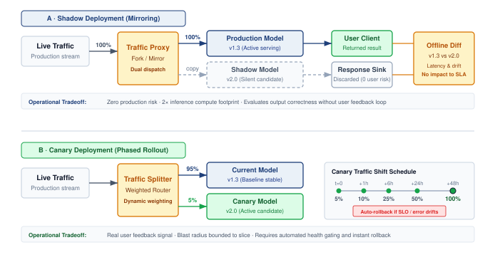

:::

Shadow deployment earns its duplicate infrastructure cost when it answers validation questions offline tests cannot. A full-load shadow run measures errors, memory growth, and latency against the release SLOs. A model that passes tests on small datasets may exhibit leaks or resource contention under sustained production traffic. A pass is evidence for the observed workload and duration, not proof that the model will stay healthy under every future load, so the shadow load profile and run length belong in the release record beside the result.

Once the shadow path is isolated, comparison under real traffic adds evidence beyond offline evaluation. Classification outputs may reveal shifts in confidence scores, while recommendation outputs may reveal changes in diversity or category distribution. Rare production inputs can expose failures absent from the validation set, but the observed traffic still bounds coverage. Latency, throughput, and resource measurements test capacity assumptions only to the extent that shadow load, dependencies, and resource contention represent the intended deployment. Output differences require interpretation; they do not by themselves establish improvement or regression.

Shadow deployment requires capturing and replaying production traffic, and the replay choice determines the trade-off among fidelity, cost, and freshness. Three architectural patterns address different operational requirements.

Live mirroring duplicates every production request to the shadow model in real time. The production model serves the response while the shadow model processes the same input in parallel, providing immediate validation at full production scale but requiring shadow infrastructure capable of handling 100 percent traffic load. To keep this validation path from becoming a production dependency, the serving system must invoke shadow requests asynchronously, enforce timeouts, shed shadow load when it falls behind, and isolate resources so shadow work cannot affect production responses.

Sampled replay mirrors a configurable percentage of production traffic to shadow models. This reduces infrastructure costs, but the sampling rate and observation window must still supply enough eligible examples for the targeted failures. Uniform random sampling estimates the sampled traffic population, while stratification can ensure coverage of important segments. Adaptive sampling concentrates investigation on patterns where candidate and production outputs diverge. Such targeted samples need recorded inclusion probabilities and an appropriate estimator before their error rates can be interpreted as fleet-wide rates.

Batch replay captures production traffic logs and replays them asynchronously against shadow models. This decouples validation from the live request path and supports regression tests during available capacity windows. Fidelity depends on what the logs preserve. Replaying request contents without their historical feature state can change the task, while replaying them faster changes queueing and load. A load test must reproduce the relevant arrival pattern and serving conditions; historical replay still cannot observe user responses to candidate outputs.

Effective shadow deployment requires quantitative comparisons tied to the intended change. Output divergence locates differences from production: classification systems track disagreement rates, probability shifts, and class-specific concentration, while regression systems can compare prediction errors or differences between outputs. A changed prediction is not inherently a regression; outcome evidence or a validation oracle must establish its quality. Performance metrics assess latency, throughput, and resource consumption against the operating contract. A candidate with equivalent accuracy but 50 percent higher p99 latency needs review against that contract, even if both versions remain below the SLO.

The metric set must also separate operational failures from genuine model changes. Error-mode metrics count timeouts, exceptions, malformed outputs, and null predictions. A shadow model that times out on 0.1 percent of requests encounters 1,000 failures per day at 1M requests/day scale, and the request patterns that trigger those failures guide remediation. Statistical validation then determines whether observed differences represent genuine model changes or random variation. Because production and shadow models process the same requests, their outcomes are paired. Define a binary failure against a labeled outcome or validation oracle, let $\ProductionOnlyFailureCount$ count requests on which production fails and shadow succeeds, and let $\ShadowOnlyFailureCount$ count requests on which shadow fails and production succeeds. McNemar's large-sample test uses the discordant pairs:

$$\McnemarTestStatistic= \frac{(\ProductionOnlyFailureCount-\ShadowOnlyFailureCount)^2}{\ProductionOnlyFailureCount+\ShadowOnlyFailureCount}$$

For a one-degree-of-freedom test at $\HypothesisTestSignificanceLevel = 0.05$, reject equal failure probabilities when $\McnemarTestStatistic> 3.84$. Marginal failure rates of 1 percent and 1.5 percent do not determine this statistic by themselves; the paired discordant counts $\ProductionOnlyFailureCount$ and $\ShadowOnlyFailureCount$ must be retained.

#### Shadow deployment workflow {#sec-ml-operations-scale-worked-example-shadow-deployment-workflow-216d}

Consider an illustrative fraud detection service processing 5 million transactions daily. A sampled shadow phase mirrors 10 percent of traffic for three days. Assume the eligible labeled subset yields recall of 94.2 percent for the shadow model versus 94.5 percent in production, and precision of 87.1 percent versus 82.3 percent. These point estimates alone establish neither improvement nor noninferiority. The gate also needs labeled counts, paired outcomes, label maturity, uncertainty intervals, and a prespecified recall tolerance. Assume shadow p99 latency is 45 ms versus 38 ms in production, both below the 50 ms SLO. The team proceeds to full shadow only after the statistical gate passes.

The full-shadow phase mirrors 100 percent of traffic for five days. In this scenario, the same labeled-data analysis supports the precision gain at full scale, but the run also exposes an edge case: the shadow model flags 0.02 percent of transactions as errors due to an unexpected feature distribution, which is 1,000 transactions per day. The root cause is heightened sensitivity to outliers in transaction amount. Adjusting feature clipping thresholds reduces the error rate to 0.001 percent in a new shadow run. Because clipping also changes model inputs, the revised candidate must pass the precision, recall, latency, and slice gates again before canary deployment.

Post-deployment validation then compares actual production metrics with the shadow predictions. Precision materializes at 87.3 percent in production vs. 87.1 percent in shadow, a nearby point estimate. Confirming agreement still requires uncertainty bounds and checks for label or traffic shifts; similarity between two percentages is insufficient.

#### Shadow deployment infrastructure {#sec-ml-operations-scale-shadow-deployment-infrastructure-78c9}

Operating shadow deployments at scale requires infrastructure that bounds their effect on production. The traffic mirroring layer duplicates selected requests to shadow environments and enforces routing, sampling, timeouts, and load shedding. Shared queues, dependencies, or resource pools can still transmit failures, so isolation must be tested rather than inferred from asynchronous invocation alone. Logging and comparison infrastructure captures outputs from both paths and stores divergence evidence; its storage and query cost is part of the validation budget.

The operational surface completes the loop. Alerting and dashboards surface statistically significant divergences, performance regressions, and elevated error rates to deployment decision makers, while drill-down views expose the request patterns that explain divergence. Resource isolation keeps shadow workloads from stealing production capacity through separate compute pools, network bandwidth allocation, and database capacity. Cloud deployments often achieve that isolation with separate clusters; on-premises deployments require explicit resource partitioning.

#### Criteria for shadow deployment {#sec-ml-operations-scale-shadow-deployment-essential-8087}

Shadow deployment earns its cost when the additional evidence reduces expected deployment harm enough to justify duplicate execution and analysis. New architectures, consequential predictions, live feature dependencies, and tight latency budgets can make that evidence valuable. The decision still depends on which failures shadow traffic can reveal: user responses to candidate outputs remain unobserved, and rare events may remain absent. A demanding application raises the need for validation without establishing that shadow execution alone provides the required assurance.

A smaller shadow phase, or a direct move from offline validation to a bounded canary, can be appropriate when existing evidence covers the relevant failure modes and residual exposure is acceptable. Routine retraining does not establish low risk by itself, because changed data or parameters can alter behavior without an architecture change. The platform should compare the additional evidence shadow execution can provide with its resource cost, the harm a canary could cause before containment, and the time needed to observe that harm.

#### Interleaving experiments {#sec-ml-operations-scale-interleaving-experiments-519c}

Interleaving experiments[^fn-interleaving-evaluation-efficiency] were developed for ranking and search evaluation [@chapelle2012] and are also used in recommender personalization experiments [@netflix2017interleaving]. Rather than splitting users between variants, interleaving presents items from both variants to each user, then measures which items users engage with.

[^fn-interleaving-evaluation-efficiency]: **Interleaving Experiments**\index{Interleaving Experiments!sample efficiency}: Originally developed for search engine evaluation, interleaving merges results from two rankers into one list shown to each user, then credits clicks to the originating ranker [@chapelle2012]. For fleet-scale recommendation systems iterating on many model variants, the sample efficiency of that within-user comparison translates directly into faster experiment cycles and lower opportunity cost from suboptimal models in production.

The key insight is statistical efficiency. An interleaving experiment can require far fewer samples than A/B testing, and Netflix reports more than 100$\times$ fewer users for some ranking experiments [@netflix2017interleaving], because each user provides direct comparison signals rather than contributing only to aggregate statistics.

In an interleaving workflow, the variants produce ranked lists that a method such as team draft or probabilistic interleaving combines into one presentation. The mixing and credit-assignment rules must control position effects and identify which ranker contributed each item. Engagement with those items supplies a relative preference signal. @Fig-interleaving-vs-ab contrasts the between-cohort comparison of A/B testing (Panel A) with this within-user comparison (Panel B). The latter can screen candidates efficiently, but preference within a blended list does not directly measure the effect of deploying either complete ranking policy on long-term outcomes such as retention. Those outcomes still require an experiment designed to measure them.

::: {#fig-interleaving-vs-ab fig-env="figure" fig-pos="htb" fig-cap="**Interleaving vs. A/B testing**: (A) A/B testing splits users into cohorts, and each cohort sees only one ranker's list, so the comparison is between cohort means and must overcome the variation between users. (B) Interleaving has both rankers rank the same query for each user and merges the results into one list (here by team draft); each click is credited to the ranker that contributed the item, so every user supplies a paired, within-user comparison. That pairing can make ranker-preference screening more sample-efficient; it does not measure the full deployment outcome assessed by an A/B test [@netflix2017interleaving]." fig-alt="Two panels. Panel A, A/B testing: a row of eight user circles, four blue labeled cohort 1 at 50 percent and four gray labeled cohort 2 at 50 percent. Cohort 1 sees a list of blue items A1 to A3 labeled ranker A only, cohort 2 sees gray items B1 to B3 labeled ranker B only, and each list leads to its own mean box; a bracket joins the two means above the label compare the two cohorts' means. Panel B, interleaving: a box reading each user, one query feeds ranker A's blue list A1 to A3 and ranker B's gray list B1 to B3, which merge into one middle list labeled merged list alternating A1, B1, A2, B2, with a thin connector from each source item to its merged slot. A click dot on the edge of merged A2 routes to a credit A box and a click dot on the edge of merged B2 routes to a credit B box; a bracket joins them above the label credit each click to its source ranker."}
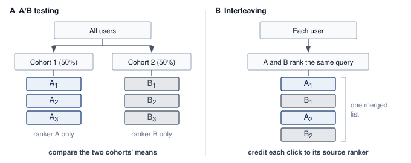
:::

#### A/B test sizing and significance {#sec-ml-operations-scale-ab-testing-statistical-foundations-b9bd}

At platform scale, experiment design determines how long a release occupies capacity and exposes users. A/B testing provides frameworks for comparing model variants [@kohavi2008; @kohavi2020trustworthy], but its release decision depends on statistical power,[^fn-ab-testing-power] significance thresholds, and multiple testing correction. The formulas below supply inputs to the operational contract: the number of eligible observations, the promotion rule, and the permitted stopping schedule. They do not establish that behavior remains reliable outside the evaluated population.

[^fn-ab-testing-power]: **A/B Testing Power**\index{A/B Testing!power}\index{A/B Testing!statistical power}: The probability that an experiment correctly detects a true effect ($1-\HypothesisTestFalseNegativeRate$, typically set to 0.8). At fleet scale, the systems cost of power is exposure time. If the expected improvement is small (for example, 0.1 percent), the experiment may require millions of samples to reach statistical significance, consuming substantial serving resources $(\InferenceCost)$ for weeks.

For an equally allocated comparison of two proportions, the standard normal-approximation sample plan uses four parameters: significance level $(\HypothesisTestSignificanceLevel)$, statistical power $(1-\HypothesisTestFalseNegativeRate)$, baseline conversion rate $(\BaselineConversionRate)$, and minimum detectable effect $(\MinimumDetectableEffect)$. @Eq-ops-scale-ab-sample-size estimates observations per variant, assuming independent eligible outcomes and a small absolute difference near the baseline rate. Holding the other inputs fixed, the requirement scales inversely with the square of that difference:

::: {.column-margin}
```{=latex}
\vspace*{8mm}
```
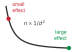{width="100%" fig-alt="Black inverse-square curve labeled n proportional to 1 over delta MDE squared, with a red dot labeled small effect high on the steep part and a gray dot labeled large effect at the flat end."}

*Detecting smaller effects explodes the required sample size.*
:::

$$\RequiredUsersPerVariant = \frac{(\ConfidenceCriticalQuantile + \PowerCriticalQuantile)^2 \times 2\BaselineConversionRate(1-\BaselineConversionRate)}{\MinimumDetectableEffect^2}$$ {#eq-ops-scale-ab-sample-size}

where $\ConfidenceCriticalQuantile$ is the two-sided critical value for significance level $\HypothesisTestSignificanceLevel$ (typically 1.96 for $\HypothesisTestSignificanceLevel = 0.05$), $\PowerCriticalQuantile$ is the critical value for power (typically 0.84 for 80 percent power), $\BaselineConversionRate$ is the baseline rate, and $\MinimumDetectableEffect$ is the minimum detectable effect as an absolute difference. Both critical values use the positive upper-tail convention: the upper-tail areas are $\HypothesisTestSignificanceLevel/2$ and $\HypothesisTestFalseNegativeRate$, respectively.

Once data is collected, a two-proportion z-test determines if the observed difference is statistically significant. @Eq-ab-ztest computes the test statistic as the difference in observed rates normalized by the pooled standard error:

$$\ProportionTestStatistic= \frac{\TreatmentConversionRate- \ControlConversionRate}{\sqrt{\PooledConversionRate(1-\PooledConversionRate)(\frac{1}{\ControlSampleSize} + \frac{1}{\TreatmentSampleSize})}}$$ {#eq-ab-ztest}

where $\ControlConversionRate$ and $\TreatmentConversionRate$ are the observed conversion rates for control and treatment, $\ControlSampleSize$ and $\TreatmentSampleSize$ are sample sizes, and $\PooledConversionRate= \frac{\ControlSampleSize\ControlConversionRate+ \TreatmentSampleSize\TreatmentConversionRate}{\ControlSampleSize+ \TreatmentSampleSize}$ is the pooled proportion. For the two-sided test, if $|\ProportionTestStatistic| > \ConfidenceCriticalQuantile$, reject the null hypothesis and conclude the variants differ significantly.

#### Sample size for recommendation models {#sec-ml-operations-scale-worked-example-sample-size-recommendation-model-5d42}

A recommendation system has baseline CTR of 5 percent. The team wants to detect a 10 percent relative improvement (0.5 percentage points absolute) with 95 percent confidence and 80 percent power.

Parameters:

- $\ConfidenceCriticalQuantile = 1.96$ (95 percent confidence, two-tailed)
- $\PowerCriticalQuantile = 0.84$ (80 percent power)
- $\BaselineConversionRate= 0.05$ (baseline CTR)
- $\MinimumDetectableEffect = 0.005$ (0.5 percentage point improvement)

Calculation:

$$\RequiredUsersPerVariant = \frac{(1.96 + 0.84)^2 \times 2 \times 0.05 \times 0.95}{0.005^2}$$

$$\RequiredUsersPerVariant = \frac{7.84 \times 0.095}{0.000025} = \frac{0.7448}{0.000025} = 29{,}792$$

```{python}
#| echo: false
# ┌── LEGO ───────────────────────────────────────────────
# │ Context: @eq-ops-scale-ab-sample-size worked example—sample size, duration.
from mlsysim.fmt import check, fmt_count, fmt_time

class AbSampleSize:
    # ┌── 1. LOAD ──────────────────────────────────────────
    z_alpha = 1.96
    z_beta = 0.84
    p_baseline = 0.05
    delta = 0.005  # 0.5 percentage-point absolute effect
    requests_per_day = 1_000_000
    # ┌── 2. EXECUTE ───────────────────────────────────────
    n_exact = (z_alpha + z_beta) ** 2 * 2 * p_baseline * (1 - p_baseline) / delta**2
    n_per_variant = round(n_exact, -3)  # ≈ 30,000 (reader-facing rounding)
    n_total = 2 * n_per_variant
    duration_h = n_total / requests_per_day * 24
    # ┌── 3. GUARD ─────────────────────────────────────────
    check(n_per_variant == 30_000 and n_total == 60_000, "Sample-size drift")
    check(duration_h < 2, f"Duration {duration_h}h exceeds 2h")
    # ┌── 4. OUTPUT ────────────────────────────────────────
    per_variant_str = fmt_count(n_per_variant, commas=True, label="sample")
    total_str = fmt_count(n_total, commas=True, label="observation")
```

Each variant requires approximately `{python} AbSampleSize.per_variant_str`, totaling `{python} AbSampleSize.total_str`. If requests supply independent eligible observations with immediately available outcomes, 1 million requests per day split evenly between variants collects that sample in less than 2 hours. However, for a model with 1 percent baseline CTR detecting a 5 percent relative improvement (0.05 percentage points), the calculation yields:

$$\RequiredUsersPerVariant = \frac{7.84 \times 2 \times 0.01 \times 0.99}{0.0005^2} = \frac{0.1552}{0.00000025} = 620{,}800$$

Now each variant needs approximately 621K samples. Under the same independence and outcome-availability assumptions, 1M total requests/day split evenly between the two variants collects that sample in about 30 hours. Required observation windows can extend either experiment beyond its collection time. Here, the lower baseline and smaller relative improvement also imply a much smaller absolute effect. At a fixed relative improvement, rarer outcomes require more observations; a fixed absolute effect would give a different comparison.

#### Multiple testing correction {#sec-ml-operations-scale-multiple-testing-correction-023f}

Running multiple A/B tests simultaneously or sequentially without correction inflates the familywise error rate. With 20 independent tests whose null hypotheses are all true, at $\HypothesisTestSignificanceLevel = 0.05$, the probability of at least one false positive is:

$$\Pr(\text{at least one false positive}) = 1 - (1-\HypothesisTestSignificanceLevel)^\TestFamilySize= 1 - 0.95^{20} = 0.642$$

The result is a 64 percent chance of at least one false rejection; a two-sided rejection can point in either direction. Three correction approaches address this problem.

Bonferroni correction adjusts the significance threshold to $\PerTestSignificanceLevel = \frac{\HypothesisTestSignificanceLevel}{\TestFamilySize}$ for $\TestFamilySize$ tests. This is conservative but simple. For 20 tests with $\HypothesisTestSignificanceLevel = 0.05$, use $\PerTestSignificanceLevel = 0.0025$ for each test. This controls the familywise error rate but reduces statistical power.

Šidák correction provides a less conservative adjustment. @Eq-sidak-correction computes the per-test threshold that maintains the desired familywise error rate exactly under independent null p-values:

$$\PerTestSignificanceLevel = 1 - (1-\HypothesisTestSignificanceLevel)^{1/\TestFamilySize}$$ {#eq-sidak-correction}

For 20 tests: $\PerTestSignificanceLevel = 1 - 0.95^{1/20} = 0.00256$, slightly more lenient than Bonferroni.

False discovery rate (FDR) control using the Benjamini-Hochberg procedure bounds the expected false-discovery proportion under independence or suitable positive dependence. It is not a hard cap on the false discoveries in one experiment batch. This is appropriate when some false positives are acceptable. Order p-values from smallest to largest: ${\ObservedSignificanceLevel}_{(1)} \leq {\ObservedSignificanceLevel}_{(2)} \leq \ldots \leq {\ObservedSignificanceLevel}_{(\TestFamilySize)}$. Find the largest $\OrderedTestRank$ such that:

$${\ObservedSignificanceLevel}_{(i)} \leq \frac{\OrderedTestRank}{\TestFamilySize} \times \HypothesisTestSignificanceLevel$$

Reject all hypotheses $\StatisticalHypothesis_{(1)}, \ldots, \StatisticalHypothesis_{(\OrderedTestRank)}$. This procedure yields higher statistical power than Bonferroni when running many tests.

#### Multiple testing scenario {#sec-ml-operations-scale-worked-example-multiple-testing-scenario-ce6c}

```{python}
#| echo: false
# ┌── LEGO ───────────────────────────────────────────────
# │ Context: multiple-testing worked example—false positives per quarter/year.
from mlsysim.fmt import check, fmt, fmt_count, fmt_math

class MultipleTestingFp:
    # ┌── 1. LOAD ──────────────────────────────────────────
    tests_per_quarter = 30
    alpha_sig = 0.05
    quarters_per_year = 4
    # ┌── 2. EXECUTE ───────────────────────────────────────
    fp_per_quarter = tests_per_quarter * alpha_sig
    fp_per_year = round(fp_per_quarter * quarters_per_year)
    # ┌── 3. GUARD ─────────────────────────────────────────
    check(fp_per_quarter == 1.5 and fp_per_year == 6, "False-positive drift")
    # ┌── 4. OUTPUT ────────────────────────────────────────
    tests_per_quarter_str = fmt(tests_per_quarter, precision=0, commas=False)
    per_quarter_eq_math = fmt_math(rf"{fmt(tests_per_quarter, precision=0)} \times {alpha_sig} = {fmt(fp_per_quarter, precision=1)}")
    per_year_str = fmt_count(fp_per_year, commas=False, label="model")
```

A platform team runs `{python} MultipleTestingFp.tests_per_quarter_str` A/B tests per quarter comparing candidate models. Suppose every null hypothesis is true and each test has a calibrated false-positive probability of $\HypothesisTestSignificanceLevel = 0.05$. Without correction, the expected count is `{python} MultipleTestingFp.per_quarter_eq_math` false rejections per quarter, or approximately `{python} MultipleTestingFp.per_year_str` over a year. These are false claims of a difference, not necessarily improvements: a two-sided rejection can point toward either benefit or harm.

Applying Bonferroni correction: $\PerTestSignificanceLevel = \frac{0.05}{30} = 0.00167$ per test. This requires larger sample sizes. For the recommendation model example in @sec-ml-operations-scale-worked-example-sample-size-recommendation-model-5d42 (5 percent baseline, 0.5pp effect), original requirement was 30K samples per variant. With a two-sided Bonferroni threshold, the critical value rises to about 3.14, increasing the requirement to roughly 60K samples per variant.

Using FDR control at $\FalseDiscoveryRateTarget= 0.05$, the Benjamini-Hochberg procedure bounds the expected false-discovery proportion across repeated experiment families under its dependence assumptions, counting the proportion as zero when there are no rejections. Observing 10 significant results out of 30 tests does not establish how many of those 10 are false or give a conditional guarantee for that quarter. The procedure accepts a different error criterion from familywise control and can gain power in exchange.

The choice begins with the error the decision must control. When even one false promotion among the planned comparisons has serious consequences, familywise control is appropriate; Bonferroni is one simple option. Exploratory screening may instead use FDR control when a bounded expected proportion of false discoveries is acceptable and later validation will assess candidates individually. The experiment family and error criterion belong in the release plan before results are inspected.

::: {#chk-ops-scale-multiple-testing .callout-checkpoint title="Family-wise error rate under multiple testing"}

The correction methods are Bonferroni, Šidák, and Benjamini-Hochberg. Apply the family-wise reasoning to a smaller platform.

- [ ] **Family-wise error**: for 20 simultaneous A/B tests per quarter at $\HypothesisTestSignificanceLevel = 0.05$ with no correction, calculate the expected number of false positives and the family-wise error rate under independence.
- [ ] **Bonferroni correction**: apply Bonferroni correction, calculate the per-test threshold $\PerTestSignificanceLevel$, compute the family-wise error rate after correction, and compare it to the uncorrected rate.
- [ ] **Bonferroni vs. FDR**: for 20 tests where the team expects most candidates to genuinely improve the metric, choose Bonferroni or Benjamini-Hochberg FDR control and justify the statistical-power trade-off.

:::

#### Sequential testing and early stopping {#sec-ml-operations-scale-sequential-testing-early-stopping-5b04}

Traditional A/B tests fix sample size in advance and evaluate once. Release teams rarely wait that long without looking, and looking is where the error rate leaks. A fixed-sample test checked after every batch of observations and stopped at the first $|\ProportionTestStatistic| > 1.96$ gets many chances to cross the threshold by chance, so its realized false-positive rate climbs well above the nominal 5 percent. Sequential testing budgets for those looks in advance, allowing monitoring during data collection with principled early stopping rules. Stopping can occur earlier when the evidence is strong, but the gain depends on the hypotheses, effect size, and stopping design.

For two fully specified simple hypotheses, the sequential probability ratio test evaluates the likelihood ratio after each observation:

$$\SequentialLikelihoodRatio = \frac{\ProbabilityFunction(\SequentialTestObservation_1, \ldots, \LatestSequentialObservation\mid \StatisticalHypothesis_1)}{\ProbabilityFunction(\SequentialTestObservation_1, \ldots, \LatestSequentialObservation\mid \StatisticalHypothesis_0)}$$

Using approximate Wald boundaries, stop and reject $\StatisticalHypothesis_0$ if $\SequentialLikelihoodRatio \geq \frac{1-\HypothesisTestFalseNegativeRate}{\HypothesisTestSignificanceLevel}$, stop and accept $\StatisticalHypothesis_0$ if $\SequentialLikelihoodRatio \leq \frac{\HypothesisTestFalseNegativeRate}{1-\HypothesisTestSignificanceLevel}$, otherwise continue collecting data.

For large-scale A/B testing, group sequential methods divide the experiment into planned analysis stages. At each stage, compare test statistic to adjusted thresholds that maintain overall $\HypothesisTestSignificanceLevel$. The boundary family decides how that error budget is spent across the looks. An O'Brien-Fleming boundary spends almost none of it early, demanding overwhelming evidence to stop at the first looks and keeping the final threshold close to the fixed-sample value. A Pocock boundary spends it evenly, applying the same stricter threshold at every look. For a canary whose guardrail metric is checked every hour, the evaluation contract must prespecify a valid sequential stopping rule, such as one of these boundaries; comparing each hourly look against the single-look 1.96 reintroduces the inflation the design exists to prevent.

#### Practical implementation considerations {#sec-ml-operations-scale-practical-implementation-considerations-5684}

Production A/B tests can violate the independence and stationarity assumptions behind these formulas. Carryover occurs when treatment changes behavior after exposure ends, so a design that reassigns users must account for that persistence. Novelty can also make early responses differ from later behavior; no fixed number of weeks guarantees that the effect has settled. Observation windows should cover the relevant behavioral cycles and outcome delays. Surrogate metrics such as clicks can move in a different direction from long-term objectives such as retention and revenue, so a release gate pairs the short-term surrogate with guardrail metrics that may require longer observation.

Interference between users is the most consequential violation for social and marketplace products, because it biases the estimated effect itself rather than only its variance. The next section treats it on its own.

### SUTVA violations and network effects {#sec-ml-operations-scale-sutva-violations-network-effects-2252}

Every sample size and significance calculation above assumes that a treatment assigned to one user does not change another user's outcome. If User A receives an improved recommendation algorithm, User B's behavior should remain unaffected because User B never saw the new algorithm.

Social platforms systematically violate this assumption. When User A receives better content recommendations, they share that content with their network, including User B in the control group. User B's engagement changes despite never seeing the treatment. The control condition becomes contaminated, not through experimental error, but through the natural mechanics of networked products.

The stable unit treatment value assumption (SUTVA)\index{SUTVA!definition} requires well-defined treatment versions and no interference between units [@rubin1980randomization]. Its no-interference component says that user $\ExperimentUserIndex$'s outcome $\PotentialOutcome_i(\TreatmentAssignment)$ depends on their own assignment $\TreatmentAssignment$, not on other users' assignments. Versioned releases address the treatment-definition requirement; network interactions challenge the second requirement. Ignoring those interactions can bias the effect estimate used for a deployment decision [@hudgens2008toward; @eckles2017design].

Interference can travel through direct connections, shared markets, or geographic and temporal spillovers. A treated user may share recommended content with control users, changing their outcomes even though they never receive the new ranker. A ridesharing incentive may change driver supply and wait times for both groups. Local merchant recommendations may redirect traffic from neighboring areas assigned to control. In these examples, independent user assignment remains possible, but each user's assignment no longer describes all the treatment exposure affecting that user's outcome. The direction and size of the resulting bias depend on the interaction and the effect being estimated.

#### Quantifying SUTVA violations {#sec-ml-operations-scale-quantifying-sutva-violations-e04e}

Grouping connected users into randomized clusters changes the precision calculation as well as the exposure pattern. For clusters of equal or similar size with a common within-cluster outcome correlation, @eq-sutva-vif gives a planning approximation for variance inflation relative to independent observations:

$$\text{DEFF} \approx 1 + (\MeanClusterSize- 1)\IntraClusterCorrelation$$ {#eq-sutva-vif}

where $\MeanClusterSize$ is the average cluster size and $\IntraClusterCorrelation$ is the intra-cluster correlation of outcomes (how similar outcomes are within connected user groups). Multiplying an independent-observation sample plan by this factor approximates the additional observations needed under those assumptions. Unequal cluster sizes and the chosen estimator require a more specific precision analysis. This variance adjustment does not identify or remove bias from interference across clusters.

#### Network effect bias in social recommendation {#sec-ml-operations-scale-worked-example-network-effect-bias-social-recommendation-3de0}

An illustrative social platform tests a new feed ranking algorithm. Individual user randomization assigns 50 percent of users to treatment.

Experimental setup:

- 10 million users, average 150 connections each
- Outcome: daily engagement minutes

With independent 50 percent assignment, a typical control user's 150 connections split roughly evenly between arms, so almost every control user is exposed to treatment through dozens of treated neighbors.

```{python}
#| echo: false
# ┌── LEGO ───────────────────────────────────────────────
# │ Context: SUTVA sensitivity scenario; unexposed control is assumed, not estimated.
from mlsysim.fmt import check, fmt_percent, fmt_time

class NetworkEffectBias:
    # ┌── 1. LOAD ──────────────────────────────────────────
    treatment_min = 45.2
    control_min = 43.8
    adjusted_control_min = 42.3
    rho = 0.15
    cluster_size_m = 1.4
    # ┌── 2. EXECUTE ───────────────────────────────────────
    measured_effect = treatment_min - control_min
    measured_pct = measured_effect / control_min
    true_effect = treatment_min - adjusted_control_min
    true_pct = true_effect / adjusted_control_min
    inflation_min = control_min - adjusted_control_min
    deff = 1 + (cluster_size_m - 1) * rho
    deff_inflation_pct = deff - 1
    # ┌── 3. GUARD ─────────────────────────────────────────
    check(abs(measured_effect - 1.4) < 0.05 and abs(true_effect - 2.9) < 0.05, "Effect drift")
    check(abs(deff - 1.06) < 0.005, f"DEFF {deff} drift")
    # ┌── 4. OUTPUT ────────────────────────────────────────
    measured_min_str = fmt_time(measured_effect, 'minute', precision=1, commas=False, style='word')
    measured_pct_str = fmt_percent(measured_pct, precision=1, commas=False, style='prose')
    true_min_str = fmt_time(true_effect, 'minute', precision=1, commas=False, style='word')
    true_pct_str = fmt_percent(true_pct, precision=1, commas=False, style='prose')
    inflation_min_str = fmt_time(inflation_min, 'minute', precision=1, commas=False, style='word')
```

Naive analysis results:

- Treatment group: 45.2 minutes average
- Control group: 43.8 minutes average
- Measured effect: +`{python} NetworkEffectBias.measured_min_str` (+`{python} NetworkEffectBias.measured_pct_str`)

Network analysis confirms that control users have on average about half of their connections in treatment. Those treated connections share algorithmically boosted content that control users see, inflating control group engagement. The observed data cannot say by how much, because almost no control user is unexposed. The sensitivity analysis therefore supplies the missing quantity as an explicit assumption, an unexposed control mean of 42.3 minutes:

- Adjusted control baseline: 42.3 minutes (what control would show without spillover)
- Contrast against the assumed baseline: +`{python} NetworkEffectBias.true_min_str` (+`{python} NetworkEffectBias.true_pct_str`)
- Under this assumption, spillover inflated control by `{python} NetworkEffectBias.inflation_min_str`, halving the measured effect

The assumed counterfactual is not identified by the observed group means or the connection count. Estimating an exposure-specific effect requires an explicit exposure mapping, assignment probabilities, sufficient probability of each exposure, and an estimator matched to those choices.

The arithmetic shows how a plausible spillover assumption can change the interpretation of an experiment; it does not recover a known true effect. A design effect for cluster randomization is a separate variance calculation and cannot correct interference bias.

#### Detection strategies {#sec-ml-operations-scale-detection-strategies-dc16}

Network-exposure diagnostics test for evidence of interference. Ego-network analysis summarizes each control user's treated neighbors as $\TreatedNeighborFraction_i = |\{\NeighborUserIndex\in \UserConnectionSet_i : \TreatmentAssignment_j = 1\}| / |\UserConnectionSet_i|$, where $\UserConnectionSet_i$ is the recorded connection set for control user $\ExperimentUserIndex$ and $\TreatmentAssignment_j$ is peer $\NeighborUserIndex$'s treatment assignment. Correlation between control outcomes and $\TreatedNeighborFraction_i$ motivates investigation, but graph structure and user differences can also explain it. Comparisons between high- and low-exposure control cohorts therefore require an assignment design and analysis that address those differences. Temporal analysis adds evidence about when effects appear, without by itself distinguishing contagion from a shared external trend. These diagnostics make the interference assumption testable within the observed graph and exposure definition; a null result does not prove that all spillover is absent.

#### Mitigation approaches {#sec-ml-operations-scale-mitigation-approaches-dc04}

When SUTVA violations are detected, four experimental designs modify assignment to address distinct interference paths, each demanding an exposure model tailored to its randomization unit.

In graph cluster randomization, treatment is assigned at the community level rather than to individual users. Graph partitioning algorithms like Louvain or spectral clustering seek groups with dense internal connections and sparse cross-cluster edges. Whether that grouping sufficiently limits cross-arm interaction must be measured on the resulting partition. Assignment now operates over $\RandomizationClusterCount$ clusters, so precision depends on the number of independent assignment units, cluster sizes, within-cluster correlation, and remaining spillovers.

Ego-exclusion designs instead filter the analyzed cohort by discarding users whose network exposure crosses a safety threshold. Restricting evaluation to control users with minimal treatment connections (such as $\TreatedNeighborFraction_i < 0.05$) reduces measured interference, but it cannot guarantee an uncontaminated baseline. Furthermore, pruning heavily connected users alters the effective sample population and can introduce severe selection bias.

For marketplace dynamics where network connections cannot be partitioned cleanly, switchback experiments alternate treatment and control over time blocks within the selected market or population. This reduces simultaneous cross-arm interaction within that unit, but outcomes can carry over between blocks; the analysis must account for persistence and time trends. Geo-based experiments instead randomize spatial units such as cities, while monitoring cross-boundary travel and shared supply. Choosing the unit trades interference control against the number of independent comparisons and the observation time needed for adequate precision.

The chosen design determines the infrastructure needed to support its claims. Graph-based assignment needs maintained topology and cluster records; a switchback needs an auditable schedule and outcome timing; an exposure-specific estimator needs the peer-assignment information its exposure model uses. Analysis must respect the randomization unit, and monitoring must track the spillovers that could invalidate the comparison. The sensitivity example shows why this work can matter: under its stated assumption, spillover halves the observed lift. The platform must estimate the relevant effect before treating that observed contrast as evidence for or against promotion.

### The end-to-end evaluation contract {#sec-ops-scale-end-to-end-evaluation-contract}

The selected experiments produce evidence, but evidence from different stages is useful only when it refers to the same candidate and decision. An **evaluation contract**\index{Evaluation contract!definition} is the versioned release record that binds a model and its dependencies to the workload, metrics, statistical design, acceptance thresholds, rollback conditions, and accountable owners. This record is the subject of the evaluation contract principle (\ref{pri-evaluation-contract}), one of the deployment principles listed in the opener to this part of the book. It holds that a fleet release decision is valid only when all of its evidence refers to one versioned contract. The record therefore becomes the unit of validity for everything this chapter has built, from registry versions and feature contracts to rollout stages and experiment statistics. @Tbl-ops-scale-evaluation-contract assembles that record so a candidate cannot pass offline quality on one dataset, performance on an easier load profile, and online evaluation under a third configuration.

| Evidence plane            | Contract must pin                                                                                                                                                                         | Acceptance or invalidation rule                                                                                                                               | Accountable owner                                  |
|:--------------------------|:------------------------------------------------------------------------------------------------------------------------------------------------------------------------------------------|:--------------------------------------------------------------------------------------------------------------------------------------------------------------|:---------------------------------------------------|
| Offline behavior          | Evaluation-set version, primary metric, consequential slices, baseline, uncertainty evidence, and robustness tests (developed later, in @sec-robust-ai-common-robustness-principles-cb22) | Promote only if prespecified aggregate and slice bounds hold; invalidate when the population, label definition, or intended use leaves the validated envelope | Model owner and domain reviewer                    |
| System performance        | Hardware and software envelope, open- or closed-loop workload model, concurrency, request mix, warm-up, p50 and tail latency, throughput, errors, and resource cost                       | Promote only under the production-equivalent load contract; invalidate when capacity headroom or an SLO budget is exhausted                                   | Serving and site-reliability owners                |
| Responsibility and safety | Fairness slices, privacy and safety evidence, affected-party requirements, and assurance claims (developed later, in @sec-responsible-ai-governance-assurance-lifecycle)                  | Promote only when the named claims have sufficient evidence and review; invalidate on a material change, control failure, or unbounded harm signal            | Risk owner and governance authority                |
| Online experiment         | Assignment unit, holdout, minimum detectable effect, power, sample size, confidence interval, multiple-testing correction, stopping rule, and guardrail metrics                           | Promote only after the planned decision rule passes; stop and roll back when any guardrail crosses its prespecified threshold                                 | Experiment owner and product decision owner        |
| Recovery and audit        | Rollback artifact and dependencies, trigger windows, evidence-retention period, data and code versions, environment, seeds, raw aggregate counts, and approvals                           | Reject exposure without a tested rollback; reopen the decision when evidence cannot be reproduced or retained for the required review period                  | Release owner, platform owner, and audit custodian |

: **End-to-end evaluation contract**: A model release is accepted against one versioned record spanning offline behavior, production-equivalent performance, specialist assurance, online experimentation, and recovery. Each plane has both an evidence owner and a condition that expires its claim. {#tbl-ops-scale-evaluation-contract tbl-colwidths="[17,34,30,19]"}

Acceptance is deliberately distributed, but promotion authority is not ambiguous. The model and domain owners accept predictive utility; the serving owner accepts capacity and reliability; specialist risk owners accept bounded robustness, fairness, privacy, and safety claims. A named release authority promotes only when all required sign-offs refer to the same artifact. The platform automates gates and preserves evidence, but it cannot choose the product objective or waive a failed assurance claim.

Invalidation is the return path through the contract. Drift beyond the evaluated population, a feature or label-definition change, exhausted latency headroom, a statistically supported guardrail regression, or a material governance change sends the candidate back to the owning gate. Thresholds and rollback targets are fixed before exposure so an apparent primary-metric gain cannot redefine success after the result is known. Reproducibility requires retaining the inputs to that decision, not merely its verdict: the dataset and traffic snapshot, model and code versions, environment and hardware envelope, random seeds, assignment and sampling rules, sufficient statistics or permitted logs, approvals, and the exact rollback artifact.

### CI/CD patterns by model type {#sec-ml-operations-scale-cicd-patterns-model-type-b412}

The contract has the same evidence planes across workloads, but the intended use determines which evidence limits promotion. @Tbl-ops-scale-cicd-patterns returns to the workload families of @tbl-ops-scale-model-types, whose cadence and rollback targets still apply, and adds the column that table lacked, what each family must validate before promotion\index{CI/CD!patterns by model type}. Broad language-model evaluation may require extended review, while an urgent fraud update may justify a tightly bounded release. The listed durations are operating assumptions, not consequences of architecture; label maturity, traffic, and potential harm determine the actual validation and rollback policy.

| **Pattern**          | **Model Type** |  **Validation Focus**  | **Rollout Speed** |     **Rollback Speed**    |
|:---------------------|:--------------:|:----------------------:|:-----------------:|:-------------------------:|
| **Quality-gated**    |      LLM       |   Human eval, safety   |   Days to weeks   | Minutes with warm standby |
| **Metric-driven**    | Recommendation |   Engagement metrics   |   Hours to days   |          Minutes          |
| **Threshold-gated**  |     Fraud      |    Precision/recall    |       Hours       |          Seconds          |
| **Accuracy-focused** |     Vision     | Classification metrics |        Days       |          Minutes          |

: **CI/CD patterns by model type**: The rows illustrate validation and response policies for different workloads. Their durations are planning assumptions; promotion depends on the required evidence, including outcome-label delay, and rollback depends on a ready compatible target. {#tbl-ops-scale-cicd-patterns}

For a broadly capable LLM, evaluation must cover consequential uses that aggregate benchmarks can miss. Automated tasks such as MMLU and HumanEval screen selected capabilities; human review and adversarial probes examine additional failure modes; shadow traffic tests operational behavior on live inputs. A planning window of 2--4 weeks may accommodate these activities and staged observation, but elapsed time is not the acceptance criterion. The required evidence depends on the changed capabilities and the service's exposure policy.

Recommendation pipelines balance freshness with statistically defensible comparison. Offline NDCG and recall can screen candidates, interleaving can compare ranker preference, and A/B tests measure the selected product outcomes. A 24--48-hour rollout is feasible only when traffic and outcome timing supply the required evidence within that interval. Promotion and rollback follow the prespecified rules rather than a fixed refresh deadline.

Fraud models add adversarial urgency, but confirmed outcomes can arrive after the decision window. Historical labeled cases and shadow scoring provide evidence before exposure; neither makes fresh precision and recall immediately observable. The release policy must state what evidence supports an urgent change, what uncertainty remains, and who accepts its bounded exposure. Rapid routing to a validated fallback can contain harm while additional labels accumulate, provided that fallback remains suitable for the current threat.

### Edge fleet lifecycle management {#sec-ml-operations-scale-managing-edge-fleet-c591}

```{python}
#| echo: false
#| label: archetype-c-power
# ┌── LEGO ───────────────────────────────────────────────
# │ Context: Edge-fleet operations intro (Archetype C reference workload).
# │ Goal: Pin the Archetype C sustained-to-burst power envelope.
from mlsysim import ReferenceStats, Scenarios
from mlsysim.core.units import watt
from mlsysim.fmt import check, fmt_power, fmt_qty_range

class ArchetypeCPower:
    # ┌── 1. LOAD ──────────────────────────────────────────
    scenario = Scenarios.FederatedMobileVision
    sustained_low = ReferenceStats.MobilePower.MobileMlSustainedLow
    burst_high = ReferenceStats.MobilePower.MobileMlBurstHigh
    # ┌── 3. GUARD ─────────────────────────────────────────
    check(sustained_low < scenario.power_budget < burst_high, "Archetype C sustained budget should sit inside the envelope")
    # ┌── 4. OUTPUT ────────────────────────────────────────
    envelope_range_str = fmt_qty_range(sustained_low, burst_high, watt, precision=0, commas=False)
    burst_high_str = fmt_power(burst_high, unit=watt, precision=0, commas=False)
```

The operational challenges examined thus far assume a controlled data center environment. @Sec-edge-intelligence extended the machine learning fleet to millions of heterogeneous edge devices with constrained connectivity, power, and compute, and examined what production integration demands of each adaptive device. Archetype C (Federated MobileNet), running on smartphone-class devices with power budgets of roughly `{python} ArchetypeCPower.envelope_range_str`, a few watts sustained with brief bursts toward `{python} ArchetypeCPower.burst_high_str`, is the reference workload here. Operating that population as one fleet adds three constraints beyond those of any single device.

The three constraints interact, so they should be handled as one operational design problem rather than as independent notes. @Tbl-ops-scale-edge-fleet-controls maps each constraint to the platform control it requires, including hardware-in-the-loop validation\index{Hardware-in-the-loop!edge fleet} and federated analytics\index{Federated analytics!edge fleet}.

| **Edge fleet constraint** | **Why it appears**                                                                                                                                                                                                              | **Platform control**                                                                                                                                                                    |
|:--------------------------|:--------------------------------------------------------------------------------------------------------------------------------------------------------------------------------------------------------------------------------|:----------------------------------------------------------------------------------------------------------------------------------------------------------------------------------------|
| Extreme version skew      | Rollouts can take weeks or months because devices are offline, on low battery, or on restricted networks. At any time, 50 model versions may remain active.                                                                     | Maintain backward-compatible data pipelines and serving contracts for models deployed months earlier.                                                                                   |
| Device-aware validation   | Accuracy gates do not reveal whether a model exceeds a phone's memory budget or triggers thermal throttling on its system-on-chip (SoC); microcontroller-class targets below Archetype C tighten the budget to about 1&nbsp;MB. | Add hardware-in-the-loop validation on physical or emulated target devices before promotion.                                                                                            |
| Privacy-limited telemetry | Raw predictions cannot stream back continuously because privacy rules and bandwidth costs constrain observability.                                                                                                              | Use federated analytics: devices compute local statistics such as error rates or drift, then transmit permitted aggregate health signals under explicit privacy and retention controls. |

: **Edge fleet controls**: Edge operations couple rollout latency, device heterogeneity, and privacy-limited observability. The operations platform must reconstruct global fleet health from partial signals while preserving compatibility with many active model versions. {#tbl-ops-scale-edge-fleet-controls}

Federated health signals inherit the bias that @sec-edge-intelligence warned about for federated training. A device reports its local error rate or drift statistic only when its admission policy allows the work and its connectivity allows the upload, so the devices that report most are the well-charged, well-connected, newer ones. The fleet's health dashboard then describes the admitted population rather than the deployed one, the same skew the participation selection principle (\ref{pri-participation-selects-population}) names for training. A staged edge rollout can look healthy because the devices most likely to fail, older hardware and thermally constrained phones, are also the least likely to report. The platform therefore tracks reporting coverage per device class and cohort alongside the health signals themselves, and holds promotion when a cohort's coverage falls too low for its signal to count as evidence.

::: {.column-margin .margin-pointer}
↩ Admission-selected participation and the skew it creates across device cohorts are established in @sec-edge-intelligence-client-scheduling-f675.
:::

Whether a model runs in a data center or on a phone, a CI/CD pipeline promotes candidates supported by evidence within a specified operating envelope. Production can move outside that envelope as data, traffic, and dependencies change. Monitoring must therefore preserve the release contract after promotion, detect when its evidence no longer applies, and return the affected model to evaluation or recovery.

## Monitoring at Scale {#sec-ml-operations-scale-monitoring-scale-73c5}

Application-layer drift detection depends on a healthy physical substrate. At fleet scale, a degraded NVLink connection or a thermally throttling GPU can masquerade as a software timeout. Monitoring therefore starts bottom-up with fleet telemetry, then climbs through alert aggregation, model-quality signals, and dashboards so that operators can route a symptom to the layer that can repair it.

### Fleet telemetry and hardware observability {#sec-ops-scale-fleet-telemetry}

```{python}
#| echo: false
#| label: fleet-failure-interval
# ┌─────────────────────────────────────────────────────────────────────────────
# │ FLEET FAILURE INTERVAL (LEGO)
# ├─────────────────────────────────────────────────────────────────────────────
# │ Context: Fleet telemetry opener (first use) and the operational-complexity recap.
# │ Goal: Show how a per-GPU planning interval shrinks at fleet scale.
# │ How: MTBF_fleet = MTBF_gpu / N (independent failures, calc_mtbf_cluster).
# └─────────────────────────────────────────────────────────────────────────────
from mlsysim import Systems
from mlsysim.core.units import hour
from mlsysim.physics.reliability import calc_mtbf_cluster
from mlsysim.fmt import check, fmt

class FleetFailureInterval:
    # ┌── 1. LOAD ──────────────────────────────────────────────────────────
    gpu_mttf_h = Systems.Reliability.Gpu.mttf_hours
    fleet_gpus = Systems.Clusters.Training_10K.total_accelerators
    recovery_low_min = Systems.Reliability.NodeRecoveryLowMin

    # ┌── 2. EXECUTE ───────────────────────────────────────────────────────
    fleet_mtbf_h = calc_mtbf_cluster(gpu_mttf_h * hour, fleet_gpus).to(hour).magnitude

    # ┌── 3. GUARD ─────────────────────────────────────────────────────────
    check(round(fleet_mtbf_h) == 5, "Prose spells out a five-hour fleet interval")

    # ┌── 4. OUTPUT ────────────────────────────────────────────────────────
    gpu_mttf_h_str = fmt(gpu_mttf_h, precision=0, commas=True)
    fleet_gpus_str = fmt(fleet_gpus, precision=0, commas=True)
    recovery_low_min_str = fmt(recovery_low_min, precision=0, commas=False)
```

Because failure is routine at pod scale, fleet monitoring\index{Monitoring!fleet} and hardware observability\index{Observability!hardware substrate} are prerequisites for productive training. As an illustrative independent-failure model, a `{python} FleetFailureInterval.gpu_mttf_h_str`-hour per-GPU planning interval means that a `{python} FleetFailureInterval.fleet_gpus_str`-GPU cluster sees a hardware failure roughly every five hours. The count is GPU-only; the cluster mean time between failures calculation in @sec-fault-tolerance-reliability-reliability-worked-example-cluster-mtbf-calculation-9255 adds PCIe links and network components for a cluster of the same size, which shortens the full-system interval. That interval is a planning assumption rather than a measured universal device rate; @sec-appdx-reliability-foundations-mtbf-cascade develops the component-to-fleet calculation, and correlated faults and repair-time distributions require separate evidence. Achieving a `{python} FleetFailureInterval.recovery_low_min_str`-minute recovery instead of a multi-hour disruption depends on detection, usable recovery state, replacement capacity, and restart procedures. Advance warning helps when available, but recovery must also handle abrupt failures. The monitoring system is itself distributed, collecting telemetry across devices, switches, and cooling components.

The telemetry spans three physical levels. At the GPU level, junction temperature tracks cooling degradation, error-correcting code (ECC) counts in high-bandwidth memory (HBM) and SRAM track memory health (a rising rate of correctable errors can precede an uncorrectable, job-ending error), and streaming multiprocessor (SM) utilization shows whether the device is doing work. None alone identifies the cause: low utilization can reflect input starvation, synchronization, or a device problem. At the network level, retry counters on individual ports can point to a failing cable or switch; at the facility level, coolant temperature deviations can trigger load shedding before thermal limits force throttling. Correlating these signals with workload and topology lets responders narrow the failure domain before deciding whether to reduce load, quarantine hardware, or investigate software.

Correlation analysis\index{Monitoring!correlation analysis} helps locate the scope of a shared disturbance. Elevated temperature on one GPU motivates local inspection; simultaneous changes across 8 GPUs in a node suggest checking shared cooling and workload changes. A rack-wide pattern adds the coolant distribution unit (CDU) and rack-level load to the investigation, while a multi-rack pattern raises facility-level hypotheses. These patterns guide diagnosis rather than prove a cause. Grouping related alerts preserves that context and avoids presenting one shared event as hundreds of unrelated failures.

Telemetry capacity follows the series count, sample rate, bytes per observation, retention, and indexing policy. Sampling one metric every second across 10,000 GPUs produces 864 million observations per day before other metrics or labels are added. A daily byte total or monitoring-budget share cannot be inferred without the encoding and retention assumptions. Bound label cardinality and provision ingestion, storage, and queries as an explicit platform workload.

Before allocating a long training job, a scheduler can use automated preflight checks\index{Pre-flight check!node health}\index{Cluster management!pre-flight checks} to screen its nodes. General matrix multiply (GEMM) benchmarks exercise arithmetic throughput, NCCL AllReduce tests exercise collective paths, and memory stress tests look for errors under load. Results must be compared with baselines for the same hardware and configuration before a node is quarantined. Preflight consumes startup time and cannot reveal every fault; its value depends on the failed work it avoids and the cost of unnecessary exclusions.

::: {.column-margin}
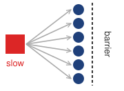{width="100%" fig-alt="One red square labeled slow with gray arrows fanning out to six identical blue peer nodes, which sit before a dashed vertical line labeled barrier."}

*One slow accelerator stalls every peer at the barrier.*
:::

A gray failure\index{Gray failure!performance degradation}\index{Failure modes!gray failure} leaves a component responsive while degrading its useful performance. In synchronous data-parallel training, a persistently slow participant can delay collective completion even when every device passes an availability check. Per-rank timing and hardware telemetry help localize the slowdown; controlled microbenchmarks can then compare suspected nodes with healthy peers. An illustrative policy flags GEMM throughput below 90 percent of a matched fleet median or NVLink bandwidth below 85 percent. Those thresholds require calibration for hardware generation, software, load, and measurement variability. A low result warrants investigation rather than proving a hardware defect, because configuration and contention can produce similar symptoms.

::: {.column-margin .margin-pointer}
↩ Gray failures and the straggler detection that exposes them are established in @sec-fault-tolerance-reliability-reliability-distinguishing-stragglers-failures-285d.
:::

::: {#psp-ops-scale-proactive-vs-reactive-maintenance .callout-perspective title="Proactive vs. reactive maintenance"}

Proactive maintenance combines predictive diagnostics\index{Maintenance!predictive diagnostics}, burn-in testing\index{Maintenance!burn-in testing}, and rolling maintenance windows\index{Maintenance!rolling maintenance window}. Predictions require validation against actual failures; testing consumes capacity and can miss faults outside its workload. Keeping production capacity constant during maintenance requires spare capacity or rescheduling. The operational benefit is less lost work when maintenance prevents or contains a failure, balanced against the capacity and labor it consumes.

:::

```{python}
#| echo: false
# ┌── LEGO ───────────────────────────────────────────────
class InfraFrontierStragglerRecap15:

    # ┌── 4. OUTPUT (Formatting) ──────────────────────────────────────────────
    frontier_params_b_str = fmt_params(Models.Language.GPT3.parameters, scale="B", precision=0, commas=False)
```

In multi-tenant clusters, shared links can couple otherwise separate workloads. A collective burst can delay another job's storage traffic even when CPU and memory limits hold. Rail alignment\index{Rail alignment!network isolation}\index{Network fabric!rail alignment} maps corresponding ranks across nodes to favorable communication paths; it does not by itself reserve those paths for one tenant. Congestion signaling and endpoint rate control, admission policy, scheduling, or dedicated capacity can limit interference. Physical partitions offer stronger isolation at the cost of stranded capacity and placement flexibility. The appropriate choice follows the workload's latency and throughput contract.

Checkpoint cadence is the point where hardware telemetry becomes visible to ML operators rather than only to data-center technicians. A degraded node that forces frequent checkpoint recovery, or a storage path that lengthens checkpoint writes, turns directly into lost training throughput. @Sec-fault-tolerance-young-daly derives the checkpoint-compute trade-off and the Young-Daly interval; the operations responsibility here is to expose the telemetry those formulas depend on: write time, failure rate, straggler behavior, and recovery duration. Without that visibility, a platform may report that a job is "running" while useful learning has quietly collapsed behind retries and slow checkpoints.

With the physical substrate accounted for, monitoring returns to the deployed model fleet. Validation and canary evidence cover a candidate under observed conditions; production can later change abruptly or drift over weeks and months. Monitoring must therefore retain acute-failure controls while detecting gradual loss of quality. Independently paging on every model metric can multiply notifications from a shared event and create alert fatigue\index{Alert fatigue!monitoring thresholds}. Fleet-level aggregation connects those symptoms while preserving urgent local signals that require immediate action.

### The alert fatigue problem {#sec-ml-operations-scale-alert-fatigue-problem-038c}

Per-model threshold crossings accumulate across a fleet. Consider 100 models with 10 monitored metrics each. If each metric has a calibrated false positive rate of 0.3 percent per check, approximately the two-sided 3-sigma rate under a Gaussian null distribution, the expected number of false crossings is substantial. Whether those crossings become pages depends on the alerting policy.

```{python}
#| echo: false
#| label: false-alarm-tax-calc
# ┌─────────────────────────────────────────────────────────────────────────────
# │ THE FALSE ALARM TAX (LEGO)
# ├─────────────────────────────────────────────────────────────────────────────
# │ Context: @sec-ml-operations-scale-alert-fatigue-problem-038c
# │
# │ Goal: Quantify the daily volume of false alerts in a large ML fleet.
# │ Show: ~864 alerts/day for 100 models with 10 metrics at 3-sigma thresholds.
# │ How: Daily alerts = n_models * n_metrics * (1 - specificity) * checks_per_day.
# │
# └─────────────────────────────────────────────────────────────────────────────

# ┌── LEGO ───────────────────────────────────────────────
class FalseAlarmTax:
    """Quantify the impact of scale on monitoring noise."""

    # ┌── 1. LOAD (Constants) ──────────────────────────────────────────────
    n_models = 100
    n_metrics = 10
    specificity = 0.997  # 3-sigma
    check_interval_min = 5

    # ┌── 2. EXECUTE (The Compute) ────────────────────────────────────────
    n_monitors = n_models * n_metrics
    fpr = 1 - specificity
    checks_per_day = (24 * 60) / check_interval_min
    daily_alerts = n_monitors * checks_per_day * fpr

    # ┌── 3. GUARD (Invariants) ──────────────────────────────────────────
    from mlsysim.fmt import check, fmt_int

    check(daily_alerts > 800, f"Expected high alert volume at scale, got {daily_alerts:.1f}")

    # ┌── 4. OUTPUT (Formatting) ──────────────────────────────────────────────
    from mlsysim.fmt import fmt_int, fmt, MarkdownStr, fmt_time

    n_monitors_str = fmt_int(n_monitors)
    checks_per_day_str = fmt_int(checks_per_day, commas=False)
    check_interval_min_str = fmt_time(check_interval_min, 'minute', precision=0, commas=False, style='word')
    daily_alerts_str = fmt(daily_alerts, precision=0, commas=False)
    specificity_val_str = fmt(specificity, precision=3, commas=False)
    fpr_str = fmt(fpr, precision=3, commas=False)
    fpr_pct_str = fmt_percent(fpr, precision=1, commas=False, style='prose')
    daily_alerts_expr_str = fmt_math(f"{int(n_monitors):,} \\times {int(checks_per_day)} \\times {fpr:.3f}")
    n_models_str = fmt(n_models, precision=0, commas=False)
    n_metrics_str = fmt(n_metrics, precision=0, commas=False)
    sigma_label_str = MarkdownStr("3-sigma")
    fpr_eqn_str = fmt_math(f"1 - {specificity_val_str} = {fpr_str}")
```

::: {#nbk-ops-scale-false-alarm-tax .callout-notebook title="The false alarm tax"}

**Problem**: Consider a system monitoring `{python} FalseAlarmTax.n_models_str` models. Each model has `{python} FalseAlarmTax.n_metrics_str` metrics (latency, accuracy, drift, and others). Alert thresholds are set at `{python} FalseAlarmTax.sigma_label_str` (99.7 percent specificity), and a control script re-evaluates every metric on a fixed interval. Assume calibrated stable Gaussian null behavior and count raw threshold crossings before grouping or suppression; those crossings are not necessarily distinct incidents.

**Math**:

1.  **Total Monitors**: `{python} FalseAlarmTax.n_models_str` models $\times$ `{python} FalseAlarmTax.n_metrics_str` metrics = `{python} FalseAlarmTax.n_monitors_str` monitors.
2.  **False Positive Rate**\index{Monitoring!false positive rate}: `{python} FalseAlarmTax.fpr_eqn_str` (`{python} FalseAlarmTax.fpr_pct_str`).
3.  **Checks per day**: Assume checks every `{python} FalseAlarmTax.check_interval_min_str` (`{python} FalseAlarmTax.checks_per_day_str` checks/day).
4.  **Daily false threshold crossings**: `{python} FalseAlarmTax.daily_alerts_expr_str` $\approx$ `{python} FalseAlarmTax.daily_alerts_str` alerts/day.

**Systems insight**: Even with high-specificity (3-sigma) alerts, scale becomes problematic. Aggregation, deduplication, persistence windows, and calibrated thresholds reduce repeated notifications. Specific safety or hardware-failure alerts must still trigger independently when their contracts require immediate action.

:::

::: {.column-margin}
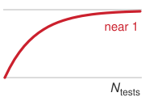{width="100%" fig-alt="Red saturating curve rising from a gray baseline toward a gray horizontal line at 1, labeled near 1, with the horizontal axis labeled N tests."}

*False alerts become near-certain as checks multiply.*
:::

The multiple-testing problem from concurrent experiments (@sec-ml-operations-scale-multiple-testing-correction-023f) also appears in monitoring. For independent checks under the null, each with false positive rate $\AlertFalsePositiveRate$, @eq-false-alert-rate shows that the probability of at least one false alert approaches certainty as the number of tests $\AlertCheckCount$ grows, because the probability of no false alert decays exponentially:

$$\Pr(\text{at least one false alert}) = 1 - (1 - \AlertFalsePositiveRate)^{\AlertCheckCount}$$ {#eq-false-alert-rate}

The equation holds at any per-check rate, and teams under pressure to catch regressions sooner often loosen thresholds. Loosening the notebook's 3-sigma thresholds to 2 sigma raises the per-check rate from 0.3 percent to roughly $\AlertFalsePositiveRate= 0.05$. With that rate and $\AlertCheckCount= 1000$ (100 models $\times$ 10 metrics):

$$\Pr(\text{false alert}) = 1 - (1 - 0.05)^{1000} = 1 - 0.95^{1000} \approx 1.0$$

The probability is essentially 100 percent for this collection of independent checks. This result establishes the likelihood of at least one false crossing, not the fraction of alerts that are false. Repeated checks compound the operational burden when every crossing generates a page. Frequent nonactionable pages can train operators to discount the alert stream, making genuine incidents harder to recognize.

#### Alert volume calculation {#sec-ml-operations-scale-worked-example-alert-volume-calculation-94aa}

The raw crossing count in notebook \ref{nbk-ops-scale-false-alarm-tax} grows further at the loosened 2-sigma threshold, approximated here by the same 5 percent false positive rate under the stable Gaussian null assumption. An ML platform monitors 100 models with the following configuration:

- 10 metrics per model (accuracy, latency p50, latency p99, throughput, error rate, data freshness, feature drift, memory usage, GPU utilization, request volume)
- Alert threshold at 2 standard deviations (approximately 5 percent false positive rate per metric)
- Metrics checked every 5 minutes

```{python}
#| echo: false
# ┌── LEGO ───────────────────────────────────────────────
# │ Context: 2-sigma alert-volume worked example.
# │ Scope: chapter-anchor — worked alert-volume example is recalled in the
# │ fallacy recap.
from mlsysim.fmt import check, fmt, fmt_count, fmt_math

class TwoSigmaAlerts:
    # ┌── 1. LOAD ──────────────────────────────────────────
    n_models = 100
    n_metrics = 10
    fpr = 0.05  # 2-sigma false positive rate
    check_interval_min = 5
    dedup_resolved = 0.99  # 99% auto-resolved
    # ┌── 2. EXECUTE ───────────────────────────────────────
    checks_per_day = (24 * 60) / check_interval_min
    daily_alerts = n_models * n_metrics * fpr * checks_per_day
    remaining = daily_alerts * (1 - dedup_resolved)
    # ┌── 3. GUARD ─────────────────────────────────────────
    check(daily_alerts == 14_400 and abs(remaining - 144) < 1e-6, "Alert-volume drift")
    # ┌── 4. OUTPUT ────────────────────────────────────────
    daily_eq_math = fmt_math(
        rf"\text{{Daily false alerts}} = {fmt(n_models, precision=0)} \times {fmt(n_metrics, precision=0)} "
        rf"\times {fpr} \times \frac{{24 \times 60}}{{{check_interval_min}}} = {fmt(daily_alerts, precision=0)}"
    )
    remaining_str = fmt_count(round(remaining), commas=False, label="alert")
    daily_alerts_str = fmt(daily_alerts, precision=0, commas=True)
```

Expected daily false alerts: `{python} TwoSigmaAlerts.daily_eq_math`.

Even if 99 percent of these crossings are deduplicated or auto-resolved, the remaining `{python} TwoSigmaAlerts.remaining_str` daily would impose a substantial interruption burden if each became a page. Comprehensive telemetry therefore needs a policy that separates diagnostic records from notifications requiring immediate action.

### Hierarchical monitoring architecture {#sec-ml-operations-scale-hierarchical-monitoring-architecture-407d}

The alert fatigue problem motivates coordinated triage. To stem the flood of uncoordinated alarms, @fig-monitoring-pyramid structures telemetry into a four-tier triage pyramid, mapping operational scope from component health at the base up to fleet-wide business impact at the apex. Broad signals reveal fleet impairment, portfolio signals route incidents to the owning model family, and granular model or infrastructure telemetry supports local diagnosis. Routine fluctuations remain diagnostic records, while urgent local failures still page their owners without waiting for a fleet-wide signal. The hierarchy provides context for routing and grouping alerts while preserving those immediate response paths.

::: {#fig-monitoring-pyramid fig-env="figure" fig-pos="htb" fig-cap="**Hierarchical monitoring architecture**: To prevent alert fatigue, monitoring operates at four levels, each with its own owner. Business and portfolio metrics raise the few alarms that indicate broad impairment and route each incident to the owning model family, while model and infrastructure metrics serve primarily for diagnosis and root-cause analysis." fig-alt="Four-tier violet pyramid with a left axis labeled impairment scope, component to fleet. From top: business metrics (revenue, conversion, engagement), portfolio metrics (engagement lift, fraud caught, appeal rate), model metrics (task quality, latency, drift, saturation), and infrastructure metrics (accelerator utilization, feature store latency, serving health, network, storage, pipelines). A signals column beside each tier shows one red page dot for business, two red page dots for portfolio, one red dot and eight hollow gray diagnostic-record dots for model, and one red dot and nineteen gray dots for infrastructure. An owner column lists incident lead, domain teams, model owners, and platform team. A key reads page and diagnostic record."}
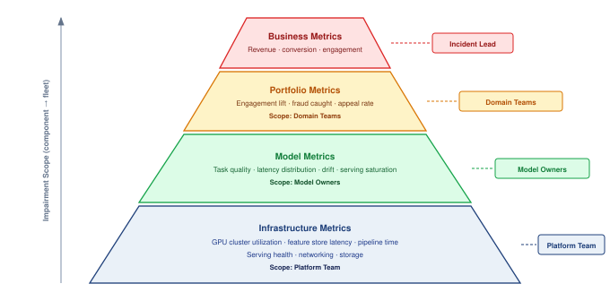

:::

The hierarchy works because each level answers a different routing question. @Tbl-hierarchical-monitoring-levels maps each level to its signal, owner, and operational role.

| **Level**      | **Representative signals**                                                                                                           | **Primary owner** | **Operational role**                                                                            |
|:---------------|:-------------------------------------------------------------------------------------------------------------------------------------|:------------------|:------------------------------------------------------------------------------------------------|
| Business       | Revenue or conversion attributed to recommendations, engagement indicators, automation rate, and human-review volume.                | Incident lead     | Few high-confidence alerts that indicate product or business impairment.                        |
| Portfolio      | Engagement lift and diversity for recommendation, fraud caught and false-positive rate, or violation detection and appeal rate.      | Domain team       | Routes investigation to the model family or product area that owns the shared objective.        |
| Model          | Task quality, latency distributions, throughput, error rates, resource utilization, serving saturation, and recent deployment state. | Model owner       | Supports local diagnosis after business or portfolio signals move.                              |
| Infrastructure | GPU cluster utilization and availability, feature store latency, training pipeline time, serving health, networking, and storage.    | Platform team     | Routes failures that require capacity, placement, networking, storage, or control-plane repair. |

: **Hierarchical monitoring levels**: Monitoring levels organize incident scope and ownership. Broad signals route shared incidents, while urgent local failures can page their owners directly; evidence at every level supports diagnosis of model, data, serving, or infrastructure causes. {#tbl-hierarchical-monitoring-levels tbl-colwidths="[16,42,16,26]"}

#### Multidimensional reliability budgets {#sec-ops-scale-multidimensional-reliability-budgets}

A fleet cannot summarize reliability with availability alone. An endpoint may return HTTP 200 while serving stale features, missing its latency target, or producing predictions below the quality floor. Each service therefore needs an SLO vector

$$
\SloVector= (\AvailabilityObjective, \LatencyObjective, \FreshnessObjective, \QualityObjective),
$$

with one indicator, target, measurement window, and owner for every dimension. For dimension $\ReliabilityDimensionIndex$, the normalized budget consumption over a window is

$$
\ErrorBudgetConsumption_i = \frac{\ObservedViolationFraction_i}{\AllowedViolationFraction_i},
$$

where $\ObservedViolationFraction_i$ is the fraction of eligible observations that violate target $\ReliabilityDimensionIndex$ and $\AllowedViolationFraction_i$ is the allowed violating fraction for that same target and window. The numerator and denominator have identical units within each dimension: failed-request fraction for availability, late-request fraction for latency, stale-prediction fraction for freshness, and below-floor evaluation fraction for model quality. The quality contract must define its evaluation units, label delay, and coverage; unlabeled predictions cannot silently count as passing observations. A value $\ErrorBudgetConsumption_i=1$ exhausts that dimension's budget; $\ErrorBudgetConsumption_i>1$ exceeds it. Ratios may be compared after this normalization, but raw latency, freshness, and quality magnitudes are not commensurable. The fleet remains inside its measured reliability envelope only when $\max_i \ErrorBudgetConsumption_i \leq 1$, the reliability half of the evaluation contract (principle \ref{pri-evaluation-contract}). Averaging would hide a severe regression behind a healthy dimension, while missing or stale evidence requires its own release policy rather than an assumed pass.

Burn rate converts this vector into an operating control. For dimension $\ReliabilityDimensionIndex$, the **burn rate**\index{Burn Rate!definition} is the observed violating fraction over a short recent interval divided by the allowed fraction $\AllowedViolationFraction_i$, so it measures how fast the budget is being spent relative to the pace that would exhaust it exactly at the end of the window. A burn rate of 1 spends the budget on schedule; a burn rate of 10 would exhaust the whole window's budget in a tenth of the window. A fast burn in any dimension pages the owning team and stops promotion; sustained moderate burn reduces rollout velocity and requires remediation; an exhausted budget freezes nonessential releases until the responsible indicator returns inside its recovery policy. The platform owns indicator computation, common windows, alert routing, and enforcement. Model teams own task-quality thresholds and remediation for model behavior; data owners own freshness and validity; serving owners own latency and availability. This division turns monitoring into an explicit contract between evidence and authority rather than a dashboard that everyone can see but no one must act on.

@Tbl-ops-scale-reliability-budget-vector maps each budget dimension to its owner and release consequence.

| **Budget dimension** | **Representative indicator**                    | **Primary owner** | **Release consequence**                                    |
|:---------------------|:------------------------------------------------|:------------------|:-----------------------------------------------------------|
| Availability         | Successful eligible requests/total requests     | Serving           | Halt rollout or fail over when fast burn exceeds policy    |
| Latency              | Requests meeting the tail-latency objective     | Serving/platform  | Reduce traffic, capacity pressure, or candidate complexity |
| Freshness            | Predictions using features inside freshness SLO | Data              | Block promotion and fall back to a safe feature path       |
| Model quality        | Slice-aware task metric above its quality floor | Model/domain      | Roll back, abstain, or route to a validated baseline       |

: **ML reliability budget vector**: Fleet reliability joins service health, data freshness, and model behavior. Any exhausted dimension can stop a release because success in one dimension cannot compensate for failure in another. {#tbl-ops-scale-reliability-budget-vector tbl-colwidths="[20,34,18,28]"}

### Anomaly detection across the fleet {#sec-ml-operations-scale-anomaly-detection-across-fleet-e38f}

Fleet-wide anomaly detection adds portfolio context to individual metric thresholds. The detection stack proceeds from local statistical process control, to correlation across model families, to drift scores that characterize changes in data distributions. Each stage narrows the investigation, but none establishes a cause by itself. Grouping related signals can reduce duplicate pages while retaining the evidence needed to route an incident to the right owner.

#### Statistical process control {#sec-ml-operations-scale-statistical-process-control-c95d}

Statistical process control originated in industrial quality control [@shewhart1931economic]. When adapted for ML monitoring, control charts[^fn-spc-process-control] track whether metric distributions remain stable over time and complement drift-detection methods that watch for changing data distributions [@gama2014]. The core idea is distinguishing common cause variation (normal fluctuation) from special cause variation (genuine anomalies).

[^fn-spc-process-control]: **Statistical Process Control (SPC)**\index{Statistical Process Control!ML monitoring}: @shewhart1931economic established the control-chart framework for manufacturing quality control. Under a normal approximation, a 3-sigma control limit produces a false-alarm probability of only 0.27 percent for a stable process. For ML fleet monitoring, even small per-test false-alarm rates compound across many models and metrics, making alert-fatigue management an inherent constraint of applying SPC at platform scale.

For a metric $\MonitoredMetric$ with established mean $\MonitoredMetricMean$ and standard deviation $\MonitoredMetricStandardDeviation$, the upper control limit is $\text{UCL} = \MonitoredMetricMean+ 3\MonitoredMetricStandardDeviation$ and the lower control limit is $\text{LCL} = \MonitoredMetricMean- 3\MonitoredMetricStandardDeviation$. Points outside control limits or systematic patterns, such as 7 consecutive points above or below the mean, trigger investigation. Adding pattern rules changes the combined false-alarm rate; the single-check 3-sigma rate no longer describes the entire policy. Calibration must also account for seasonality and temporal dependence in the monitored metric.

#### Fleet-wide correlation {#sec-ml-operations-scale-fleetwide-correlation-d928}

When multiple models exhibit similar anomalies simultaneously, shared infrastructure or an upstream data pipeline becomes a candidate cause. Correlation analysis across the fleet supports three operational tasks: identifying shared dependencies to investigate, grouping related alerts into an incident, and prioritizing triage based on the breadth of downstream impact. As shown in @lst-anomaly-attribution, the fraction of anomalous models can guide escalation from model-by-model debugging to a coordinated investigation. Crossing that threshold does not establish a shared failure; dependency records, deployment timing, and component telemetry must support the attribution.

::: {#lst-anomaly-attribution lst-cap="**Fleet Anomaly Attribution**: Detecting correlated anomalies across a model fleet and attributing them to shared infrastructure or data causes."}

```{.python}
def detect_fleet_anomaly(model_metrics, threshold=0.6):
    """
    Detect correlated anomalies across model fleet.

    Returns list of (timestamp, affected_models, likely_cause) tuples.
    """
    anomalies = []

    for timestamp in model_metrics.timestamps:
        # Identify models with anomalous metrics at this time
        anomalous_models = []
        for model in model_metrics.models:
            if is_anomalous(model_metrics[model][timestamp]):
                anomalous_models.append(model)

        # Check if anomaly fraction exceeds correlation threshold
        if (
            len(anomalous_models) / len(model_metrics.models)
            > threshold
        ):
            # Many models affected -> likely shared cause
            cause = attribute_to_shared_cause(
                timestamp, anomalous_models
            )
            anomalies.append((timestamp, anomalous_models, cause))

    return anomalies
```

:::

The threshold controls when the monitor escalates to a fleet-wide investigation. A low threshold increases sensitivity and investigation load; a high threshold can miss failures affecting a smaller but critical subset of models. Above the threshold, the incident coordinator uses shared dependencies to identify candidate owners, while affected model teams retain responsibility for local containment.

#### Drift detection {#sec-ml-operations-scale-drift-detection-793f}

Distribution changes can invalidate the population assumptions behind a release even while service health remains normal. Monitoring must distinguish a change in inputs from a change in the input-output relationship; neither an input alarm nor a healthy input histogram alone establishes model quality.

**Covariate shift**\index{Covariate Shift!definition} occurs when the distribution of input features $\ProbabilityFunction(\ModelInput)$ changes, but the relationship between inputs and outputs $\ProbabilityFunction(\ExampleLabel\mid \ModelInput)$ remains constant. Input monitoring can detect changes in $\ProbabilityFunction(\ModelInput)$ without labels, but cannot verify that $\ProbabilityFunction(\ExampleLabel\mid \ModelInput)$ stayed constant. Until outcome evidence arrives, the alert establishes input drift rather than pure covariate shift.

Concept drift\index{Concept drift!distribution change} occurs when the relationship $\ProbabilityFunction(\ExampleLabel\mid \ModelInput)$ changes, such as when users change their definition of spam or relevant content. This requires ground truth labels to detect, which are often delayed by minutes, days, or weeks.

::: {.column-margin .margin-pointer}
↪ The full shift taxonomy, including label shift, and the evidence that distinguishes one kind of drift from another are developed in @sec-robust-ai-distribution-shift-concept-drift-55e2.
:::

Because labels are often delayed, most real-time monitoring systems use input drift as a leading indicator of possible performance degradation. A cheap drift score is valuable even when it is not a complete theory of robustness because it tells the operator where to investigate before outcome labels arrive.

For continuous features, the population stability index (PSI)[^fn-psi-population-drift] quantifies distribution shift [@yurdakul2020]. @Eq-psi-monitoring computes PSI as the sum of log-ratio weighted differences between actual and expected bucket proportions. In platform operations, PSI plays a narrow role as an inexpensive alerting signal.

[^fn-psi-population-drift]: **Population stability index (PSI)**\index{Population Stability Index!drift detection}: Bands such as $\text{PSI} < 0.1$ for routine monitoring and $\text{PSI} \geq 0.25$ for investigation are heuristics, not guarantees of stability or model failure. Once histograms are available, the comparison uses bucket proportions rather than individual records. Histogram construction, sample size, binning, and treatment of empty buckets still affect cost and interpretation, so the platform must calibrate the signal on its own data.

$$\text{PSI} = \sum_{\ReferenceBinIndex=1}^{\PopulationStabilityBinCount} (\CurrentBinProportion_{\ReferenceBinIndex} - \ReferenceBinProportion_{\ReferenceBinIndex}) \times \ln\left(\frac{\CurrentBinProportion_{\ReferenceBinIndex}}{\ReferenceBinProportion_{\ReferenceBinIndex}}\right)$$ {#eq-psi-monitoring}

where $\CurrentBinProportion_{\ReferenceBinIndex}$ is the proportion in bucket $\ReferenceBinIndex$ of the actual (current) distribution, $\ReferenceBinProportion_{\ReferenceBinIndex}$ is the proportion in bucket $\ReferenceBinIndex$ of the expected (reference) distribution, and $\PopulationStabilityBinCount$ is the number of buckets.

An illustrative policy uses these coarse bands to route investigation. PSI below 0.1 leaves the model in the normal monitoring path; values between 0.1 and 0.25 create an investigation ticket; values at or above 0.25 escalate review of the shifted inputs and affected predictions. These actions depend on local calibration. A high PSI does not establish degraded model quality, and a low PSI does not establish that quality remains acceptable.

```{python}
#| echo: false
#| label: drift-latency-notebook
# ┌─────────────────────────────────────────────────────────────────────────────
# │ DRIFT DETECTION LATENCY (NOTEBOOK)
# ├─────────────────────────────────────────────────────────────────────────────
# │ Context: "Time-to-Detection: The Monitoring Lag" .callout-notebook
# │
# │ Goal: Quantify the number of samples required to detect a 2% accuracy drop.
# │ Show: n_samples ≈ 2,207—inline in notebook result.
# │ How: Compute the two-proportion sample size from the significance target,
# │      power target, baseline rate, and shifted rate.
# │
# └─────────────────────────────────────────────────────────────────────────────
from mlsysim.fmt import check, fmt, fmt_int, fmt_math, fmt_percent, fmt_rate, fmt_time
import math

class DriftLatency:
    # ┌── 1. LOAD ──────────────────────────────────────────
    p1 = 0.95  # baseline accuracy
    p2 = 0.93  # degraded accuracy (2% drop)
    alpha = 0.05  # 95% confidence
    power = 0.80  # 80% power
    dl_samples_per_hour = 1000
    # ┌── 2. EXECUTE ───────────────────────────────────────
    # Z-scores for alpha/power
    z_a = 1.96
    z_b = 0.84
    avg_p = (p1 + p2) / 2
    n = (z_a + z_b) ** 2 * (p1 * (1 - p1) + p2 * (1 - p2)) / (p1 - p2) ** 2
    dl_detection_hours = n / dl_samples_per_hour
    # ┌── 3. GUARD ─────────────────────────────────────────
    check(2000 < n < 3000, f"Samples {n:.0f} unexpected")
    # ┌── 4. OUTPUT ────────────────────────────────────────
    # Percent outputs are consumed in prose, so they use word style.
    dl_base_acc_str = fmt_percent(p1, precision=0, commas=False, style='prose')
    dl_degraded_acc_str = fmt_percent(p2, precision=0, commas=False, style='prose')
    dl_drop_pp_str = fmt_int(round((p1 - p2) * 100), commas=False)
    dl_drop_str = fmt_percent(p1 - p2, precision=0, commas=False, style='prose')
    dl_drop_prose_str = dl_drop_str
    dl_samples_needed_str = fmt_int(n)
    dl_samples_per_hour_str = fmt_rate(dl_samples_per_hour, "samples/hour", precision=0, commas=False)
    dl_detection_hours_str = fmt_time(dl_detection_hours, 'hour', precision=1, commas=False, style='word')
    dl_confidence_pct_str = fmt_percent(0.95, precision=0, commas=False, style='prose')
    dl_power_pct_str = fmt_percent(power, precision=0, commas=False, style='prose')
    dl_z_quantiles_math = fmt_math(f"\\ConfidenceCriticalQuantile = {z_a},\\ \\PowerCriticalQuantile = {z_b}")
    dl_n_plug_math = fmt_math(
        f"\\DriftTestSampleSize \\approx ({z_a} + {z_b})^2 \\times \\left[ {p1}(1 - {p1}) + {p2}(1 - {p2}) \\right] / ({p1} - {p2})^2 \\approx {n:,.0f}"
    )
```

::: {#nbk-ops-scale-time-detection-monitoring-lag .callout-notebook title="Time-to-detection: Monitoring lag"}

**Problem**: A production model has a baseline accuracy of `{python} DriftLatency.dl_base_acc_str`. A data drift event causes accuracy to fall to `{python} DriftLatency.dl_degraded_acc_str`. If labeled outcomes arrive at `{python} DriftLatency.dl_samples_per_hour_str`, what collection time supports the stated detection-power calculation, assuming an independent baseline sample of the same size and immediately available labels?

**Math**:
Detection requires enough samples to distinguish the signal (the `{python} DriftLatency.dl_drop_pp_str`-percentage-point drop) from the noise (random variance). The sizing logic of @eq-ops-scale-ab-sample-size applies, in its unpooled form because the baseline and degraded accuracies ($\ComparedPeriodAccuracy_1$, $\ComparedPeriodAccuracy_2$) differ, with the same confidence and power targets ($\ConfidenceCriticalQuantile$, $\PowerCriticalQuantile$):

$$\DriftTestSampleSize\approx \frac{(\ConfidenceCriticalQuantile + \PowerCriticalQuantile)^2 \left[ \ComparedPeriodAccuracy_1(1 - \ComparedPeriodAccuracy_1) + \ComparedPeriodAccuracy_2(1 - \ComparedPeriodAccuracy_2) \right]}{(\ComparedPeriodAccuracy_1 - \ComparedPeriodAccuracy_2)^2}$$

1. **Samples Required**\index{Drift detection!sample requirements}: At `{python} DriftLatency.dl_confidence_pct_str` confidence and `{python} DriftLatency.dl_power_pct_str` power, the standard normal quantiles are `{python} DriftLatency.dl_z_quantiles_math`, and plugging in gives `{python} DriftLatency.dl_n_plug_math` samples.
2. **Detection Latency**\index{Latency!detection}: `{python} DriftLatency.dl_samples_needed_str` samples / `{python} DriftLatency.dl_samples_per_hour_str` $\approx$ `{python} DriftLatency.dl_detection_hours_str`.

**Systems insight**: Monitoring is not instantaneous. The computed duration is a planned collection time at `{python} DriftLatency.dl_power_pct_str` power, not a guaranteed detection deadline. It assumes an independent baseline sample, the stated post-change rate, and immediately available labels. Delayed labels, dependence, and repeated testing change the detection contract. Input drift can provide an earlier investigation signal, but it does not establish a quality regression by itself.

:::

Fleet-wide drift monitoring extends that signal across the portfolio. A PSI spike in one noncritical feature may be a local investigation, while simultaneous drift across shared features or dependent models warrants a broader investigation. A shared data pipeline failure is one candidate cause; a genuine change in the population served can produce the same pattern. Pipeline checks and outcome evidence distinguish a data defect from a change to which the models must adapt. Whether a confirmed shift calls for retraining, adaptation, or no change is a model decision developed in @sec-robust-ai-retraining-decision-framework-68e3; the fleet monitor's responsibility ends when calibrated evidence reaches the owner who makes that decision.

### Model-type specific monitoring {#sec-ml-operations-scale-modeltype-specific-monitoring-b901}

Monitoring cadence follows failure cost, label delay, and traffic volume. The same workload families that set release cadence in @tbl-ops-scale-model-types and validation focus in @tbl-ops-scale-cicd-patterns now need a post-promotion counterpart, which metric each watches and how often. The illustrative parameters\index{Monitoring!parameters by model type} in @tbl-ops-scale-monitoring-types must be calibrated to the service: a frequently updated metric is useful only if enough observations support the alert decision.

| **Model Type**      |      **Primary Metrics**       |  **Alert Thresholds** | **Monitoring Frequency** |
|:--------------------|:------------------------------:|:---------------------:|:------------------------:|
| **Recommendation**  |      CTR, engagement lift      |    5% relative drop   |        Real-time         |
| **Fraud Detection** | Precision, recall, fraud rate  |     1% degradation    |        Real-time         |
| **LLM**             | Quality scores, safety metrics | Per-model calibration |          Hourly          |
| **Vision**          |       Accuracy by class        |    Dataset-specific   |          Daily           |
| **Search Ranking**  |      NDCG, click position      |     2% degradation    |        Real-time         |

: **Illustrative monitoring policies**: Example metrics, thresholds, and collection frequencies. None is a universal requirement of a model family. Label availability, sample size, failure cost, and the required detection delay determine the production policy. {#tbl-ops-scale-monitoring-types}

Recommendation monitoring must respond quickly to user impact, but each metric becomes informative on its own observation timescale. Click-through rate, dwell time, and conversion rate should be compared against time-matched historical baselines, control traffic when available, and the previous model version after a release. Conversions can arrive later than clicks, and sparse traffic can delay a reliable comparison. Engagement metrics alone also leave gaps; diversity, catalog coverage, and filter-bubble indicators track longer-term concerns, while revenue attribution and promotional-inventory metrics connect recommendation quality to business outcomes.

Fraud monitoring binds on adversarial urgency. Missed fraud creates immediate financial loss, but excessive false positives create customer friction and manual-review load. The monitoring surface therefore has to pair detection rate, prevented dollar amount, and detection latency with false-positive rate, blocked-legitimate-transaction events, manual-review volume, and adversarial indicators such as probing patterns or sudden shifts in fraudulent behavior.

LLM monitoring binds on semantic quality, which is difficult to measure from service metrics alone. Latency, token generation rate, error rate, and safety-classifier scores establish operational health; user satisfaction signals such as thumbs-up/thumbs-down rates, regeneration rate, and task-completion proxies add delayed quality evidence. Safety metrics such as toxicity detections, refusal rate, and hallucination indicators remain partial, so they should trigger review rather than claim complete coverage.

Service-health metrics alone cannot detect semantic safety failures such as persuasive misinformation or skilled manipulation. Here, red teaming\index{Red teaming!safety evaluation} supplies an additional monitoring channel: human evaluators or automated probes attempt jailbreaks\index{Jailbreak!detection} before deployment, and a smaller continuous probe set checks production behavior against known failure cases. Sampling outputs for delayed human review adds evidence about failures that automated metrics miss. Neither a passing probe set nor a reviewed sample establishes complete safety coverage.

### Observability architecture {#sec-ml-operations-scale-observability-architecture-ba87}

Effective monitoring requires observability infrastructure that preserves enough context to route an alert from symptom to owner. The metrics, logs, and traces that make up that infrastructure were introduced for debugging a single distributed job; at fleet scale the same channels must route evidence across many models and owners. Each evidence channel answers a different operational question. Metrics show that a service property moved outside its envelope, traces show where a request spent time, logs identify which component emitted the abnormal event, and prediction logs connect system health back to model behavior. In multi-model systems, a single user request may traverse multiple models. Distributed tracing,[^fn-distributed-tracing-ml] exemplified by Google's Dapper system [@sigelman2010dapper], preserves that request's path across inference services so investigators can locate latency contributions. @Tbl-ops-scale-observability-signals summarizes the architecture as an evidence map rather than as a set of disconnected telemetry tools.

[^fn-distributed-tracing-ml]: **Distributed Tracing**\index{Distributed Tracing!ML pipelines}: Google's 2010 Dapper paper describes propagating trace context across service boundaries while controlling collection overhead through sampling and instrumentation in common libraries. In a multi-model pipeline, the resulting trace connects stage timings to the same request rather than requiring investigators to infer the path from independent service summaries. Without it, a 50 ms tail-latency spike in a 10-model pipeline must be investigated in all 10 models separately. Sampling and instrumentation coverage determine which requests and stages remain visible.

| **Evidence Channel** | **Primary Question**                        | **What It Preserves**                                                  | **Typical Failure Revealed**                         |
|:---------------------|:--------------------------------------------|:-----------------------------------------------------------------------|:-----------------------------------------------------|
| Metrics              | Which service property moved out of bounds? | Real-time streams for alerting and aggregated time series for trends   | Drift, saturation, error-rate spikes, cost anomalies |
| Traces               | Where did this request spend time?          | Request IDs propagated across model invocations, timing, and resources | Cross-model latency, fan-out failures, hot stages    |
| Logs                 | Which component emitted the abnormal event? | Structured events with consistent schemas and searchable indexes       | New error classes, dependency failures, bad releases |
| Prediction logs      | Did system health preserve model behavior?  | Sampled inputs, outputs, features, and delayed labels                  | Accuracy regressions, bad cohorts, data gaps         |

: **Observability signals by operational question**: Observability architecture is an evidence-routing system. Metrics trigger attention, traces localize the request path, logs explain component behavior, and prediction logs connect operational symptoms to model quality. {#tbl-ops-scale-observability-signals}

::: {.column-margin .margin-pointer}
↩ The observability pillars for a single distributed job are established in @sec-fault-tolerance-reliability-reliability-observability-pillars-0e45.
:::

The channels also grow at different rates, which decides what the platform can afford to collect continuously. Metrics stay compact only while the number of distinct time series is bounded. Each label combination creates another series, so a request identifier or an unbounded user label can overwhelm monitoring even when each sample is small. Logs grow with recorded events and traces with spans, so both are sampled or aggregated at fleet scale; when 10,000 edge nodes or hundreds of microservices emit at once, unsampled telemetry can become a thundering herd\index{Telemetry!paradigms at scale} that perturbs the production system it is meant to observe. Effective platforms therefore present high-level metric dashboards by default and open lower levels only when an anomaly warrants investigation.

Prediction logging can be expensive because it records model-facing data rather than compact service counters. Production systems therefore sample it deliberately, for example logging 1 percent of predictions or retaining additional examples from cohorts under investigation. The sample must serve the intended analysis; a debugging sample concentrated on failures does not directly estimate fleet-wide accuracy. Recording the selection policy alongside inputs, outputs, and eventual labels preserves the context needed to interpret the evidence without making every prediction a permanent storage record.

### Dashboard design {#sec-ml-operations-scale-dashboard-design-ffcc}

A dashboard is the human attention surface of the monitoring hierarchy. It should answer the same routing questions without forcing every reader into the same debugging console: executives need to know whether the business is impaired, domain owners need to know which portfolio is failing, model owners need the evidence for their model, and incident responders need the trace from symptom to root cause. @Tbl-ops-scale-dashboard-views shows that progression.

| **View**      | **Question Answered**                                   | **Signals to Surface**                                                                 |
|:--------------|:--------------------------------------------------------|:---------------------------------------------------------------------------------------|
| Executive     | Is the business impaired?                               | Platform health, business impact, active incidents, key trends                         |
| Portfolio     | Which domain or model family is driving the impairment? | Model inventory, portfolio metrics, recent deployments, resource utilization and cost  |
| Model         | What changed for the responsible model?                 | Current metrics vs. baselines, deployment history, drift indicators, cost attribution  |
| Investigation | Why did the change occur?                               | Cross-model correlations, time-series overlays, log search, request-level trace detail |

: **Dashboard views by operational question**: Dashboard hierarchy should route attention from business impact to root cause. Each view reveals the amount of detail needed for the decision at that level, preventing executive views from becoming debugging consoles and investigation views from becoming portfolio summaries. {#tbl-ops-scale-dashboard-views}

The same views carry cost as one more monitored dimension: the portfolio and model views surface spend beside quality and latency, and @sec-ml-operations-scale-cost-monitoring-anomaly-detection-1976 develops the anomaly detection that watches that ledger. Even a well-instrumented fleet does not prevent failures. The monitoring hierarchy detects them; what remains is the response, which must classify the symptom, contain its impact, and route it to an owner with the authority to act.

## Production Debugging and Incident Response {#sec-ml-operations-scale-production-debugging-incident-response-9449}

At 3:00 AM, PagerDuty alerts the on-call engineer that revenue from the core recommendation system has dropped 15 percent in the last hour. The servers are healthy, the latency is normal, and there are no exception logs. Conventional software can also return incorrect results silently, but machine learning adds failures rooted in data and statistical behavior while ordinary service-health signals remain normal. Debugging production ML systems therefore requires investigative frameworks that reach beyond code and infrastructure.

When production debugging consumes a large share of engineering attention, platform scale multiplies the complexity because failures may originate in data pipelines, model code, infrastructure, or emergent interactions between components that no single team owns end to end. Effective incident response therefore classifies the symptom and contains impact while attribution proceeds, then converts the incident into a stronger platform control. A known safe containment action need not wait for complete root-cause analysis.

::: {#ws-ops-scale-meta-2021-outage .callout-war-story title="The control plane that disappeared (2021)"}

**Context**: Meta's global backbone connected its data centers and carried dependencies whose loss also made DNS and internal recovery tools unavailable [@meta2021outage].

**Mechanism**: On October 4, 2021, a maintenance command intended to assess backbone capacity disconnected the data centers. A bug in the command-audit tool failed to stop it. DNS servers then withdrew their Border Gateway Protocol (BGP) advertisements, the routing announcements that tell other networks how to reach them, after losing data-center connectivity. DNS and network unavailability also disabled internal recovery tools and remote access.

**Impact**: The outage interrupted services worldwide and disabled internal tools needed to diagnose and resolve it, extending the consequences of the backbone failure into the recovery process itself.

**Fix**: Engineers went onsite to the data centers, completed secure access procedures, and restored backbone connectivity. They then brought services back under controlled load to avoid a second failure during recovery.

**Systems lesson**: Platform-scale operations must treat the control plane as a hard dependency with a defined blast radius. ML platforms present identical failure risks at fleet scale: training schedulers, model registries, feature stores, and inference routers share the underlying auth, DNS, and network planes. When network partitions occur, recovery requires bounded failure domains and an administrative path that remains usable when the normal control plane is unavailable. Physical separation is one possible mechanism, not a universal requirement.

:::

### Incident classification {#sec-ml-operations-scale-incident-classification-fb00}

Incident classification is the first routing decision in an outage: the category tells responders which telemetry to inspect first, which owner to page, and whether the likely control is a rollback, a data repair, or infrastructure isolation. The incident categories are organized around that first diagnostic signal.

Data incidents involve problems with input data: pipeline failures that prevent fresh data from reaching models, schema changes that break downstream consumers, data quality degradation from missing values or distribution shifts, and feature staleness exceeding SLO thresholds. These incidents often manifest as accuracy degradation across multiple models that share data sources, making data pipeline health the first diagnostic checkpoint.

Model incidents involve problems with model behavior, including accuracy degradation beyond acceptable thresholds, latency spikes indicating computational issues, memory exhaustion from growing state (KV cache, buffers), and prediction bias shifts detected by fairness monitoring. Model incidents typically affect individual models. If multiple unrelated models degrade simultaneously, suspect a shared data or infrastructure issue rather than independent model problems.

Infrastructure incidents involve problems with the serving platform: GPU failures causing request errors, network partitions between model shards, load balancer misconfigurations routing traffic poorly, and container orchestration issues affecting deployments. These incidents tend to produce error rate spikes and timeout patterns rather than gradual accuracy degradation.

Business metric incidents involve unexpected changes to downstream KPIs, such as engagement drops without clear model or data cause, revenue anomalies during normal model operation, and user behavior shifts that affect model efficacy. These incidents are the hardest to attribute because they may stem from external factors (competition, seasonality, marketing campaigns) rather than ML system problems.

### Attribution analysis {#sec-ml-operations-scale-attribution-analysis-5c7b}

Attribution analysis tests likely causes while containment limits user impact. Responders can pause promotion, reduce exposure, or invoke a validated rollback before the root cause is certain, while preserving evidence for diagnosis. Temporal correlation traces the degradation backward through recent changes:

```text
Symptom: Recommendation engagement dropped 5% in past hour

Step 1: Check recent deployments
        → No model deployments in past 4 hours
        → Lower the priority of a recent deployment; still check configuration and routing changes

Step 2: Check feature freshness SLOs
        → user_features: 3 hours stale (SLO: 1 hour)
        → Feature pipeline delayed

Step 3: Check feature pipeline status
        → Kafka consumer lag: 10M events (normal: 10K)
        → Data ingestion bottleneck

Step 4: Investigate Kafka cluster
        → Broker disk 95% full on partition 7
        → Storage pressure is a leading hypothesis, not yet a confirmed cause

Step 5: Test the storage-pressure hypothesis
        → Write stalls on the affected broker coincide with stalled ingestion
        → Bounded capacity recovery preserves committed data and consumer offsets
        → Consumer progress and feature freshness recover without a model change
```

The recovery evidence supports storage pressure as the ingestion bottleneck in this scenario. Responders still monitor engagement and delayed quality outcomes after freshness recovers; restoring pipeline progress does not by itself prove that all user impact has ended.

When measured accuracy drops, responders first verify the evaluation signal and then investigate changes in data, model behavior, and execution. Four recurring hypotheses within data and model incidents guide that investigation. Data drift\index{Incident classification!data drift}\index{Data drift!incident classification} is an input-distribution change, such as evolving demographics or seasonality, whose quality effect requires outcome evidence. Feature staleness\index{Incident classification!feature staleness}\index{Feature store!feature staleness} arises when ingestion or pipeline delays leave predictions using outdated inputs. Model decay\index{Incident classification!model decay}\index{Model decay!incident classification} can reflect concept drift, where changed input-output relationships reduce the usefulness of learned parameters. Upstream model changes\index{Incident classification!upstream model change}\index{Model dependency!upstream changes} can invalidate representation assumptions across downstream consumers. These hypotheses are not exhaustive; label defects, configuration changes, and numerical faults can also alter measured accuracy.

The diagnostic sequence then tests the highest-probability shared causes before local model defects:

1. Compare current input distribution to training distribution
2. Check feature freshness across all input features
3. Examine performance on stable evaluation sets
4. Trace dependency graph for recent changes

::: {#exmp-ops-scale-feature-pipeline-cascade .callout-example title="Feature pipeline cascade"}

**Scenario**: A variant of the `user_engagement_score` change from @sec-ml-operations-scale-feature-versioning-lineage-624c ships without versioning. A core platform team alters the shared feature's transformation logic in place, changing its normalization from a 30-day z-score to a 7-day min-max scale.

**Diagnosis**: Fourteen downstream models across five engineering teams consumed the feature as an un-versioned interface. The in-place mutation invalidated feature distribution assumptions, causing a 12 percent drop in ranking accuracy and 18 hours of cross-team debugging toil.

**Systems lesson**: Shared feature definitions are production API contracts that require explicit, immutable versioning (`user_engagement_score_v2`) for incompatible changes. A transformation can preserve the field name and type while changing its meaning, so schema validation alone cannot protect downstream model assumptions.

:::

At platform scale, the affected model set helps prioritize shared dependencies for investigation. @Tbl-cross-model-failure-patterns maps observed patterns to candidate causes; dependency records and component evidence must establish whether the suggested cause explains the incident. A single affected model can still depend on faulty shared infrastructure, while a broad pattern can reflect a common traffic change:

| **Pattern**                    | **Likely Cause**             |
|:-------------------------------|:-----------------------------|
| **All RecSys models degraded** | Feature store issue          |
| **All vision models degraded** | Image preprocessing pipeline |
| **Single model degraded**      | Model-specific issue         |
| **Geographic pattern**         | Regional infrastructure      |
| **Time-based pattern**         | Batch job scheduling         |

: **Cross-model failure patterns**: At platform scale, the pattern of which models degrade simultaneously prioritizes shared dependencies to investigate. Correlated degradation across all recommender systems can motivate checking shared features; an all-vision degradation can motivate checking shared image preprocessing; a single-model degradation starts the investigation at that model and its dependencies. {#tbl-cross-model-failure-patterns tbl-colwidths="[45,55]"}

### Runbook development {#sec-ml-operations-scale-runbook-development-1946}

A runbook\index{Runbook!diagnostic order} earns its place when it preserves diagnostic order under time pressure. The first checks follow the symptom. If latency and error rates are nominal but business KPIs fall, inspect feature freshness, input distributions, and recent model or data changes before restarting infrastructure. If requests time out or a region becomes unreachable, serving and infrastructure health take priority. A stalled feature pipeline can return stale values while the model continues producing HTTP 200 responses, so green infrastructure checks cannot close a quality incident. In either path, the runbook names a safe containment action, the evidence to retain, and the owner authorized to escalate.

The reusable structure is a diagnostic flow, not a document template. For a recommendation engagement drop, the responder should move through the same control loop every time. @Tbl-runbook-diagnostic-flow names the control questions that preserve that order under pressure.

| **Step**             | **Question**                                                  | **Example evidence**                                   |
|:---------------------|:--------------------------------------------------------------|:-------------------------------------------------------|
| Detect user impact   | Which product or cohort is degraded?                          | CTR, conversion, retention, revenue, or complaint rate |
| Localize dependency  | Did a shared service change for many models?                  | Feature freshness, model registry, regional health     |
| Bound blast radius   | Can traffic be reduced, routed to a fallback, or rolled back? | Canary metrics, rollback target, serving saturation    |
| Escalate by evidence | Which team owns the failed control?                           | Data pipeline, platform, serving, or model owner       |
| Learn from the gap   | Which missing signal would have caught it sooner?             | Freshness gate, slice alert, deployment guardrail      |

: **Runbook diagnostic flow**: Use symptoms to prioritize dependency checks while applying safe containment when the evidence warrants it. Attribution and mitigation can proceed concurrently; the runbook records evidence, authority, and the rollback path. {#tbl-runbook-diagnostic-flow tbl-colwidths="[20,40,40]"}

Runbook anti-patterns break diagnostic order in three common ways. A too-specific instruction such as "If BERT model fails, restart container" encodes one historical fix rather than a reusable investigation. A vague instruction such as "Investigate the issue" transfers all judgment back to the responder at the worst possible time. An outdated runbook is worse than no runbook when it points responders toward deprecated systems, dead dashboards, or obsolete contacts.

### Post-incident reviews {#sec-ml-operations-scale-postincident-reviews-a8f5}

Post-incident reports (PIRs)\index{Post-incident review!platform learning} transform incidents into organizational learning only when they turn one failure into a stronger platform control. The incident record should connect duration and user impact to the timeline of detection, attribution, mitigation, and recovery. Root causes should identify the control that failed or did not exist, and corrective actions should name owners and deadlines so the review changes the platform rather than only documenting the outage.

The useful PIR fields are the ones that force a control decision. Duration and impact quantify severity; the timeline exposes detection and attribution latency; root causes name missing controls; and corrective actions assign ownership for the next platform change. In a feature-freshness incident, the most important observation is not that a disk filled up, but that no freshness gate caught the stalled feature pipeline before engagement metrics moved. The questions in @tbl-pir-control-questions turn that timeline into platform work.

| **PIR question**                  | **Control decision it should force**                                           |
|:----------------------------------|:-------------------------------------------------------------------------------|
| How long was user impact visible? | Whether detection latency or mitigation latency dominated the incident.        |
| Which dependency failed first?    | Whether the missing control belongs to data, platform, serving, or model code. |
| Which signal arrived too late?    | Whether a new freshness, slice, saturation, or canary guard is needed.         |
| What would have bounded impact?   | Whether rollback, exposure limits, admission control, or fallback was absent.  |
| Who owns the next control?        | Whether the review changes the platform rather than only recording blame.      |

: **PIR control questions**: A post-incident review is valuable when it converts an incident timeline into a stronger platform invariant. {#tbl-pir-control-questions tbl-colwidths="[34,66]"}

Effective PIRs require psychological safety and a systems frame rather than individual blame. The review should identify which systems allowed the incident, not which person caused it. It should ask which signal would have detected the failure earlier, not why an individual missed it. It should prevent the entire class of failure, rather than merely the exact failure that occurred.

### Incident ownership for distributed failures {#sec-ml-operations-scale-debugging-distributed-ml-systems-a2ea}

Distributed training and inference can fail at a rank, device, host, fabric link, data shard, or control-plane dependency. The fleet telemetry of @sec-ops-scale-fleet-telemetry collects the device, rank, network, and facility signals that detect such failures. Mechanism-level diagnosis and recovery semantics resolve individual faults, so incident response adds a narrower contract on top of that telemetry. It joins the signals by stable identifiers so responders can identify the affected domain, assigns authority before an incident occurs, and preserves the evidence needed for escalation and postincident learning.

::: {.column-margin .margin-pointer}
↩ Heartbeat failure detection and in-flight job recovery procedures are established in @sec-fault-tolerance-reliability-reliability-failure-detection-recovery-0f54.
:::

The telemetry contract starts with stable identifiers. Every event must carry the job or service identifier, attempt and model version, rank and host, device identity, topology location, data-shard or request cohort, software build, a synchronized wall-clock or trace timestamp for cross-host correlation, and a host-local monotonic time or sequence number for local duration and ordering. Clock-domain and synchronization-uncertainty metadata bound how precisely events from different hosts can be ordered. Logs without these dimensions force responders to reconstruct joins during an outage; unbounded high-cardinality labels can overwhelm the monitoring system. The platform therefore stores low-cardinality health aggregates for alerting and retains sampled or event-scoped high-cardinality traces for diagnosis. Correlation, not raw log volume, determines whether telemetry is operationally useful.

@Tbl-ops-scale-distributed-failure-ownership connects each evidence class to the first owner and the evidence required for escalation.

| **Failure evidence**                   | **Fleet-level signal**                                            | **First owner**      | **Escalation evidence**                                      |
|:---------------------------------------|:------------------------------------------------------------------|:---------------------|:-------------------------------------------------------------|
| Collective progress stalls             | Ranks entering and completing each collective by topology domain  | Training runtime     | Blocked rank set, last completed collective, fabric locality |
| One rank approaches its memory limit   | Per-rank allocated, reserved, and peak memory distribution        | Model/training team  | Allocation phase, model state, comparison with peer ranks    |
| Step time develops a long tail         | Rank-level step-time distribution correlated with host and switch | Fleet infrastructure | Straggler persistence, thermal, network, and input evidence  |
| Loss or gradients diverge across ranks | Rank-specific numerical summaries tied to artifact and data shard | Model/training team  | First divergent step, shard, build, and checkpoint           |
| Repeated attempts fail on one domain   | Failure rate by host, rack, device generation, and software build | Fleet infrastructure | Quarantine history and reproduction on a known-good domain   |

: **Distributed failure telemetry and ownership**: The platform collects correlated evidence and routes the incident; the owning subsystem team performs mechanism-level diagnosis. Stable identity and topology fields let responders distinguish one defective rank from a fleet-wide software or fabric failure. {#tbl-ops-scale-distributed-failure-ownership tbl-colwidths="[24,34,18,24]"}

Ownership must include the authority to contain impact. The training-runtime owner may cancel or restart a job when progress stalls; fleet infrastructure may quarantine a device, host, or topology domain; the data owner may stop a corrupted shard; and the model owner decides whether numerical divergence invalidates the resulting artifact. The incident commander coordinates these actions when more than one domain is implicated. A dashboard that identifies a likely cause without naming who may stop traffic, quarantine capacity, or invalidate an artifact leaves the most consequential decision unresolved.

Telemetry retention closes the control loop. Routine healthy runs need aggregate distributions and sampled traces, whereas failed attempts and release-gate violations require full event-scoped evidence through the postincident review and corrective-action window. The platform should measure attribution latency, percentage of incidents routed to the correct owner on first escalation, recurrence by failure class, and time from corrective action to deployed control. Those measures reveal whether observability is reducing fleet risk or merely generating more data.

### On-call practices for ML teams {#sec-ml-operations-scale-oncall-practices-ml-teams-26e4}

ML systems require specialized on-call practices\index{On-call rotation!tiered structure} because prediction quality, data freshness, and dependency graphs join uptime as reliability concerns. The debugging framework in this section explains why an incident can begin as a business metric anomaly and end in a feature pipeline, a model registry, or a stalled distributed operation. On-call design has to make that diagnostic burden sustainable, building on established site reliability engineering (SRE)[^fn-sre-reliability-engineering] principles [@beyer2016sre].

[^fn-sre-reliability-engineering]: **SRE**\index{Site Reliability Engineering!ML extension}: Founded by Ben Treynor Sloss at Google in 2003, SRE introduced error budgets and SLOs as quantitative reliability contracts. For ML systems, classical SRE must be extended: traditional services can fail semantically as well as become unavailable, and models add statistical quality degradation that an uptime check cannot detect. This demands drift-aware SLOs that treat prediction quality alongside uptime as a reliability metric.

A single ML production incident can require several kinds of expertise: a platform engineer to diagnose the GPU scheduler, a data engineer to trace a stale feature pipeline, and a modeling specialist to interpret changed prediction quality. This cross-domain burden is not unique to ML, but data and statistical failures expand the evidence responders must interpret. A tiered response assigns initial containment, triage, and escalation to a primary responder, with clear paths to domain specialists. A 15-to-30-minute routing target is an illustrative operational objective to calibrate against incident severity and coverage, not a universal deadline or a reason to delay an immediately available containment action.

Rotation design determines whether the team can sustain that diagnostic burden. @Tbl-oncall-rotation-design gives a starting policy to adapt to page volume, staffing, time zones, and incident duration. Secondary coverage supplies backup expertise, while explicit handoffs preserve context. Rotation length alone cannot prevent burnout if interruptions and recovery work exceed the team's capacity.

| **Aspect**              | **Recommendation**                                                 |
|:------------------------|:-------------------------------------------------------------------|
| **Rotation length**     | Start with 1 week; adapt to page load, staffing, and recovery work |
| **Primary + secondary** | Always have backup; ML incidents often require multiple experts    |
| **Handoff overlap**     | 30 min overlap for incident context transfer                       |
| **Follow-the-sun**      | Target 8-hour regional shifts, with explicit handoffs and backup   |

: **On-call rotation design**: An illustrative starting policy for rotation length, backup coverage, and handoffs. Review interruption burden, recovery work, staffing, and context-transfer quality to determine whether the policy is sustainable; rotation length alone does not establish burnout risk. {#tbl-oncall-rotation-design}

Alert fatigue poses a persistent risk to on-call effectiveness. Warning signs include engineers discounting notifications, slower acknowledgment, and repeated pages with no useful response. Teams should review drift, freshness, latency, and business-metric thresholds against observed false alarms and missed incidents, and group related alarms without suppressing independent urgent failures. A quarterly review and an alert-to-action target above 80 percent are illustrative policy choices; major workload changes or incidents can require earlier recalibration. Each page should identify its owner, diagnostic evidence, and runbook. The aim is actionable response across model, data, and infrastructure failures rather than ML-specific intervention alone.

Beyond general SRE skills, ML on-call requires interpreting model quality metrics, understanding data dependencies, and choosing safe containment while diagnosis continues. Toil reduction matters because recurring manual tasks consume the capacity needed to improve the platform. Track their share of on-call time over a declared measurement window; a target below 25 percent is one planning choice, to be assessed alongside page load, recovery work, and time available for engineering improvements.

Common ML toil accumulates at the model-platform boundary in tasks such as restarting failed runs, processing routine deployments, triaging repeated alert noise, and compiling reports. Automation can reduce this overhead when the action and its failure conditions are understood. An hour of development that saves ten minutes per incident recovers its initial labor after six incidents, before validation, maintenance, and exception-handling costs. Prioritization should include those costs and the risk of automating the wrong response.

The controls built so far, from release pipelines, registries, and feature contracts to hierarchical monitoring and incident response, are expensive to build, and building them separately for every product team would recreate the duplication that motivated them. Organizations therefore package these capabilities as a unified internal product, a discipline known as platform engineering.

## Platform Engineering {#sec-ml-operations-scale-platform-engineering-17be}

Organizations where every data science team independently provisions GPU clusters, configures model registries, and wires up alerting dashboards duplicate infrastructure work. **Platform engineering**\index{Platform Engineering!definition} addresses this by treating the ML infrastructure itself as a product, providing supported paths that reduce repeated implementation and maintenance. Product teams still own model behavior and workload-specific decisions; the platform makes shared operational responsibilities explicit.

Platform engineering for machine learning creates shared infrastructure that absorbs recurring operational complexity while exposing the controls model teams need. Effective platforms balance self-service capabilities that accelerate development against governance requirements that enforce common release and reliability policies.

### Abstraction levels {#sec-ml-operations-scale-abstraction-levels-6e15}

The abstraction-level decision\index{Platform engineering!abstraction level} is how much operational judgment the platform should centralize on behalf of model teams. Too little abstraction leaves every team paying the same infrastructure tax; too much hides the controls that unusual workloads need. The four levels in @tbl-ops-scale-platform-abstraction-levels sit on that flexibility-vs.-convenience curve, distinguished by which concerns the platform owns and which it leaves to the model team.

| **Level** | **Platform owns**                                                                                                  | **Model team still owns**                                                       | **Best fit and risk**                                                                                                      |
|:----------|:-------------------------------------------------------------------------------------------------------------------|:--------------------------------------------------------------------------------|:---------------------------------------------------------------------------------------------------------------------------|
| Level 1   | GPU capacity, storage volumes, network connectivity, and basic orchestration such as Kubernetes namespaces         | Training code, serving stack, monitoring, and deployment path                   | Fits unusual workloads with strong infrastructure teams; becomes costly when many teams repeat the same operational work   |
| Level 2   | Standardized containers, ML-aware Kubernetes integration, persistent volumes, and basic service-mesh support       | Experiment structure, training jobs, serving releases, and monitoring workflows | Reduces packaging duplication; operational correctness still depends heavily on each team                                  |
| Level 3   | ML-specific control loops such as topology-aware scheduling, hyperparameter tuning, distributed training, serving  | Modeling judgment and workload-specific trade-offs                              | Absorbs failure modes that recur across teams; systems such as Kubeflow and Ray often sit near this level                  |
| Level 4   | Full lifecycle product: IDEs, feature stores, experiment tracking, registries, CI/CD, monitoring, cost, governance | Higher-level product and modeling intent, with less direct low-level control    | Maximizes speed and consistency; the platform team accepts responsibility for policy, reliability, and economic visibility |

: **Platform abstraction levels**: Platform engineering centralizes different parts of the ML lifecycle at each abstraction level. The right level depends on whether an organization values workload-specific control or shared operational invariants more. {#tbl-ops-scale-platform-abstraction-levels tbl-colwidths="[12,28,27,33]"}

Managed services such as Vertex AI and SageMaker, and lifecycle tooling such as TensorFlow Extended (TFX)[^fn-tfx-production-pipeline] at Google [@baylor2017] and MLflow [@zaharia2018accelerating], support different parts of this spectrum. A product name does not establish the organization's abstraction level. The decisive boundary is which lifecycle responsibilities the assembled platform actually owns, which controls model teams retain, and who supplies policy, reliability, and economic visibility for the gaps.

[^fn-tfx-production-pipeline]: **TensorFlow Extended (TFX)**\index{TFX!data validation}: Google's production ML pipeline framework includes TensorFlow Data Validation (TFDV), which checks data against schema expectations and configured drift and skew comparisons. Connecting those checks to a release policy allows a pipeline to stop before spending training resources on detected data defects. The checks cover declared expectations; a passing result does not establish that every value is correct or that a distribution change is harmless.

### Platform lifecycle and adoption {#sec-ops-scale-platform-lifecycle-adoption}

An internal ML platform is a versioned product, not a one-time infrastructure project. Its interfaces, supported workflows, reliability targets, and ownership boundaries must evolve without forcing every model team into synchronized migration. Each platform release therefore needs compatibility guarantees, a migration path, telemetry that distinguishes old and new paths, and a retirement date for deprecated behavior. The platform team also needs its own service-level objectives because a registry, feature service, or deployment controller outage can block every product team at once.

Adoption measures whether the platform removes work rather than merely centralizing it. Useful indicators include the share of production models on supported paths, time from validated artifact to bounded production traffic, exception rate, migration completion, support load, and repeated toil outside the paved road. A high signup count with persistent custom pipelines signals nominal adoption but weak product fit. Conversely, mandatory migration can raise the adoption percentage while increasing lead time and operational risk. The platform roadmap should therefore combine fleet outcomes with user evidence: incident reduction and cost attribution matter alongside time-to-first-deployment and the fraction of teams that can complete routine changes without platform intervention.

Lifecycle decisions must preserve an escape hatch for workloads whose constraints do not fit the shared path. Exceptions should be explicit, time-bounded contracts with named owners and integration obligations, not permanent forks. When exception volume grows around the same missing capability, the pattern becomes product evidence for the next platform version. When a capability no longer earns its maintenance and migration cost, the platform should deprecate it through measured dual-running, compatibility testing, and a final removal gate. This product discipline keeps the shared control plane from becoming the next source of technical debt.

### Self-service model deployment {#sec-ml-operations-scale-selfservice-model-deployment-4753}

Self-service deployment works only when the platform can let model teams move quickly while keeping risky choices inside governed boundaries. The design question is therefore which deployment decisions should remain team-owned and which invariants the platform must enforce before a model receives production traffic.

#### Deployment API design {#sec-ml-operations-scale-deployment-api-design-e962}

A well-designed deployment API abstracts operational complexity by making the model team's intent declarative. The platform lesson is not the shape of a particular YAML file; it is which invariants the platform must capture before it turns a model version into fleet traffic. The invariants in @tbl-self-service-deployment-invariants are the platform contract behind that declarative interface. Prometheus[^fn-prometheus-fleet-metrics] is one common operational sink for the telemetry side of that contract.

| **Declared intent**        | **Platform invariant**                                                                                                |
|:---------------------------|:----------------------------------------------------------------------------------------------------------------------|
| Model artifact and version | The serving system loads exactly the validated model from the registry.                                               |
| Resource envelope          | GPU, memory, and replica requests stay inside quota and scheduling constraints.                                       |
| Traffic policy             | Canary, shadow, and rollback controls bound blast radius before full promotion.                                       |
| Quality gates              | Error, latency, drift, and task-quality thresholds block unsafe promotion.                                            |
| Telemetry sink             | Operational metrics flow into operational monitoring, while model-quality signals flow into drift and slice monitors. |
| Approval boundary          | Sensitive data access, budget overruns, and high-risk release windows require review.                                 |

: **Self-service deployment invariants**: A deployment API should encode the controls that keep local team autonomy from creating fleet-wide risk. The concrete syntax can vary, but the invariants must survive across platforms. {#tbl-self-service-deployment-invariants tbl-colwidths="[28,72]"}

[^fn-prometheus-fleet-metrics]: **Prometheus**\index{Prometheus!monitoring}: An open-source monitoring system that scrapes and stores labeled time series. A fleet can export operational metrics and computed drift scores through the same metrics interface while retaining detailed prediction records elsewhere for analysis. The distinction is between compact alerting signals and the evidence needed to investigate them; it does not require every platform to adopt the same two-tier implementation.

TensorFlow Serving provides model-serving lifecycle capabilities for loading, versioning, canarying, and rolling back models [@olston2017tensorflow]. A self-service platform adds the policy layer around those capabilities: model teams specify intent, and the platform translates it into scheduling, traffic routing, telemetry, and approval controls.

### Resource management {#sec-ml-operations-scale-resource-management-5550}

Efficient resource utilization is essential for platform economics, but training and serving place different demands on shared capacity. Training jobs can trade completion time for utilization within their deadlines; serving needs headroom to protect tail latency as requests arrive. A scheduler can manage both, provided its policy represents those distinct constraints rather than maximizing utilization alone.

#### Training resource management {#sec-ml-operations-scale-training-resource-management-a972}

Training resource policy must expose which jobs may wait or be preempted,[^fn-preemption-spot-instance] which deadlines are binding, and who accepts the recovery cost. Scheduler mechanisms enforce those choices. The platform records checkpoint readiness, budget, priority, and accountable owner with each job so a utilization improvement does not silently transfer deadline or lost-work risk to a model team.

::: {.column-margin .margin-pointer}
↩ Scheduler mechanisms for queueing, priority preemption, and elastic resizing of training jobs are established in @sec-fleet-orchestration.
:::

[^fn-preemption-spot-instance]: **Job Preemption**\index{Job Preemption!checkpoint trade-off}: The ability to terminate lower-priority workloads to free resources for urgent work. Preemptible capacity is also how cloud providers sell deep discounts, which @sec-ml-operations-scale-cloud-options prices. Without a usable checkpoint, a preempted 72-hour run may need to restart from scratch, potentially erasing the discount. Checkpoint frequency trades I/O overhead against wasted-compute risk; the right policy depends on job duration, interruption frequency, and recovery cost.

#### Serving resource management {#sec-ml-operations-scale-serving-resource-management-35b7}

Serving workloads bind on latency rather than batch flexibility. Demand fluctuates with time of day, events, and seasonality, but a live request cannot be preempted without user impact. The serving control loop therefore starts from the latency SLO and asks how much capacity must be online before requests arrive.

Serving autoscalers translate request load and queue pressure into capacity decisions. Operations owns their policy envelope: the latency SLO, warm rollback capacity, tenant limits, budget, and authority to override normal scaling during an incident. Those commitments must remain visible in the release record so a cheaper allocation cannot silently remove the headroom on which validation relied.

::: {.column-margin .margin-pointer}
↩ Autoscaling controllers that convert queue growth and token arrival rates into replica counts are established in @sec-inference-scale-autoscaling-capacity-control.
:::

#### Platform utilization metrics {#sec-ml-operations-scale-platform-utilization-metrics-ed31}

Once training and serving controls are separated, the shared platform still needs an aggregate measure of whether capacity is being converted into useful work. @Eq-platform-utilization defines platform efficiency as the capacity-weighted average utilization across all resources:

$$\PlatformUtilization= \frac{\sum_{i} \ResourceUtilization_i \times \text{Cap}_i}{\sum_{i} \text{Cap}_i}$$ {#eq-platform-utilization}

where $\ResourceUtilization_i$ is the utilization of resource $\PlatformResourceIndex$ and $\text{Cap}_i$ is its capacity in a common unit over the same interval. Heterogeneous accelerators require a declared workload normalization; CPU cores, device counts, and bytes cannot be added directly. Weighting by capacity keeps the metric honest about where stranded work lives: an idle single GPU and an idle eight-GPU node are not equally wasteful, so a small underused resource should not drag the platform average down as hard as a large idle pool.

However, raw utilization is incomplete. The scheduler already separates allocated, compute, and productive utilization for a single cluster; the platform metric needs the same distinction. Effective utilization must also consider utilization quality to determine whether GPUs are doing productive work or waiting on data, utilization fairness to assess whether utilization is distributed appropriately across teams, and utilization cost to evaluate efficiency in terms of cost per unit of ML output.

::: {.column-margin .margin-pointer}
↩ The allocated, compute, and productive utilization tiers are established in @sec-fleet-orchestration-resource-accounting.
:::

#### GPU cluster efficiency {#sec-ml-operations-scale-worked-example-gpu-cluster-efficiency-87b0}

```{python}
#| echo: false
#| label: gpu-cluster-efficiency
# ┌── LEGO ───────────────────────────────────────────────
# │ Context: GPU cluster efficiency worked example and its checkpoint.
# │ Goal: Daily spend, useful-work value, and recovered-capacity value.
from mlsysim import Infrastructure
from mlsysim.core.units import DAYS_PER_YEAR, USD, hour
from mlsysim.fmt import check, fmt, fmt_math, fmt_percent, fmt_usd

class GpuClusterEfficiency:
    # ┌── 1. LOAD ──────────────────────────────────────────
    n_gpus = 100  # scenario assumption
    util_before = 0.65  # scenario assumption: measured compute utilization
    util_after = 0.80  # scenario assumption: after data-loading repair
    rate = Infrastructure.Pricing.Fleet.InternalChargebackPerHour.rate.to(USD / hour).magnitude
    # ┌── 2. EXECUTE ───────────────────────────────────────
    daily_spend = n_gpus * 24 * rate
    useful_before = daily_spend * util_before
    useful_after = daily_spend * util_after
    annual_recovered = (useful_after - useful_before) * DAYS_PER_YEAR
    # ┌── 3. GUARD ─────────────────────────────────────────
    check(useful_before < useful_after < daily_spend, "Useful-work value must stay below the fixed bill")
    # ┌── 4. OUTPUT ────────────────────────────────────────
    rate_str = fmt_usd(rate, precision=2, commas=False)
    rate_per_hour_str = fmt_usd(rate, precision=2, commas=False, per="GPU-hour")
    daily_spend_str = fmt_usd(daily_spend, precision=0, per="day")
    useful_before_str = fmt_usd(useful_before, precision=0, per="day")
    annual_recovered_str = fmt_usd(annual_recovered, precision=0)
    util_before_pct_str = fmt_percent(util_before, precision=0, commas=False, style="prose")
    spend_eq_math = fmt_math(rf"{n_gpus} \times 24 \times {rate_str} = {fmt_usd(daily_spend, precision=0)}/\text{{day}}")
    before_eq_math = fmt_math(rf"{n_gpus} \times 24 \times {util_before} \times {rate_str} = {fmt_usd(useful_before, precision=0)}/\text{{day}}")
    after_eq_math = fmt_math(rf"{n_gpus} \times 24 \times {util_after:.2f} \times {rate_str} = {fmt_usd(useful_after, precision=0)}/\text{{day}}")
```

A platform operates a 100-GPU training cluster with average GPU utilization of 65 percent, memory utilization of 80 percent, four-hour average queue waits, and an internal chargeback rate of `{python} GpuClusterEfficiency.rate_per_hour_str`. Memory occupancy and compute utilization alone do not identify the bottleneck: profiling must separate input stalls, communication, kernel inefficiency, and scheduling gaps. Queue waits may also reflect burst arrivals or placement constraints rather than insufficient aggregate capacity. Suppose profiling identifies input stalls and confirms that recovering them increases useful throughput at the same quality target. The valuation applies the idle-capacity accounting of @sec-fleet-orchestration-cost-optimization to this one repair and asks what the recovered capacity buys. Daily cluster spend is fixed by provisioned capacity at `{python} GpuClusterEfficiency.spend_eq_math`. Useful work, valued at the same chargeback rate, is the utilization times that spend, `{python} GpuClusterEfficiency.before_eq_math`; the remainder pays for idle or stalled accelerators. If data-loading optimization raises compute utilization to 80 percent, useful work rises to `{python} GpuClusterEfficiency.after_eq_math` before adding any capacity. The recovered capacity has an annualized value of `{python} GpuClusterEfficiency.annual_recovered_str` at the stated rate, but the fixed cluster bill remains unchanged. Cash savings require reducing provisioned capacity or avoiding a future purchase; serving queued work creates value through additional output instead. After the validated bottleneck repair, scheduling and capacity planning address the remaining queue pressure.

::: {#chk-ops-scale-gpu-cluster-efficiency .callout-checkpoint title="The annual cost of GPU cluster underutilization"}

Use daily cluster spend (`{python} GpuClusterEfficiency.daily_spend_str`) and useful-work value, utilization times spend (`{python} GpuClusterEfficiency.useful_before_str` at `{python} GpuClusterEfficiency.util_before_pct_str` utilization), to extend the analysis to annual scale and compare against the platform ROI argument.

- [ ] **Underutilization cost**: calculate the annual cost of underutilization for the 100-GPU cluster at 65 percent utilization, the cost after optimization to 80 percent, and the annual value of recovered capacity. State when that value would become cash savings.
- [ ] **Queue dynamics**: Little's Law (theorem \ref{thrm-inference-littles-law-inference}) holds for any stable queue, rather than serving requests alone. Applied to the training-job queue, the average number of jobs waiting equals the job arrival rate times the average queue wait. Calculate the job arrival rate for a 4-hour average wait with 100 jobs in queue and explain what additional job-size, service-time, and arrival-pattern measurements are needed to choose expansion or utilization optimization.
- [ ] **Savings vs. platform**: compare the annual recovered-capacity value from cluster optimization to the \$2M/year platform investment scenario. Holding the utilization gain and chargeback rate fixed, determine the GPU count where annual recovered-capacity value equals that investment, and state what must happen for the capacity value to become cash savings.

:::

### Advanced fleet metrics and ML productivity goodput {#sec-ml-operations-scale-advanced-fleet-metrics-ml-productivity-goodput-mpg-fabf}

While utilization metrics capture resource busyness, they often fail to reflect true engineering value. A GPU spinning at 100 percent utilization on a hyperparameter tuning job that eventually fails due to a configuration error is "efficient" in terms of hardware but "wasteful" in terms of productivity. ML productivity goodput (MPG)\index{ML Productivity Goodput!fleet operations} turns that distinction into a fleet metric [@wongpanich2025fleet].

::: {.column-margin .margin-pointer}
↩ The Fleet Law and the ML productivity goodput metric introduced beside it are established in @sec-vol2-introduction-fleet-law.
:::

The Fleet Law accounts for time within one distributed step; MPG complements it by locating lost productivity across a whole portfolio of jobs. Its three multiplicative factors keep the meanings the introduction gives them and share a common workload and time boundary:

$$\text{MPG} = \SchedulingGoodput \times \RuntimeGoodput \times \ProgramGoodput$$

At fleet scale each factor needs an accounting boundary, so that one delay is charged to exactly one of them. Scheduling goodput\index{Efficiency!scheduling} ($\SchedulingGoodput$) counts only capacity-time in which a job holds every resource synchronous progress needs, so partial allocations earn nothing. Runtime goodput\index{Efficiency!runtime} ($\RuntimeGoodput$) counts checkpoint-preserved progress within that allocated time, excluding initialization, input delays, and work lost after the last checkpoint. Program goodput\index{Efficiency!program} ($\ProgramGoodput$) charges what remains to code, compiler, and communication inefficiency against an ideal execution-time baseline. The product measures efficiency rather than an absolute throughput rate and locates which layer limits useful fleet output.

### Multi-tenancy and isolation {#sec-ml-operations-scale-multitenancy-isolation-c3ff}

Enterprise platforms earn their sharing dividend only if multiple teams can share infrastructure without sharing failures. The scheduler's quotas and fair-share policies and the serving system's isolation mechanisms, established in @sec-inference-scale-multitenancy-isolation-688c, already bound interference within one cluster or one inference service. What the platform adds is one namespace hierarchy across training and serving, plus cost isolation that follows each tenant's spend, and neither the scheduler nor the serving system owns those alone. Multi-tenancy is therefore an isolation problem before it is an efficiency problem, and the platform must bound performance interference, data exposure, and cost spillover at the same time.

::: {.column-margin .margin-pointer}
↩ Quotas, hierarchical fair-share, and burst borrowing are established in @sec-fleet-orchestration-multi-tenancy.
:::

#### Isolation requirements {#sec-ml-operations-scale-isolation-requirements-19a2}

Tenants need isolation at every boundary where one team's workload, data, or cost can affect another. Performance isolation uses resource quotas, fair-share scheduling, and network quality-of-service rules to bound interference from training spikes or serving bursts. Security isolation enforces access controls, network segmentation, and encryption across tenant data paths. Cost isolation combines granular metering with declared allocation rules for shared services and reserved capacity; not every shared cost can be assigned directly to an individual request. Together, these boundaries establish the conditions under which product teams can share infrastructure without negotiating every allocation manually.

#### Namespace architecture {#sec-ml-operations-scale-namespace-architecture-190c}

A typical multi-tenant architecture uses hierarchical namespaces:

```text
Platform
|-- Team A
|   |-- Development
|   |-- Staging
|   `-- Production
|-- Team B
|   |-- Development
|   |-- Staging
|   `-- Production
`-- Shared
    |-- Feature Store
    |-- Model Registry
    `-- Monitoring
```

Each team receives dedicated namespaces with resource quotas, while shared services operate in common namespaces with appropriate access controls. Without controls, one team's demanding workload can degrade performance for others, the noisy neighbor problem, which at platform scale crosses the boundary between training and serving.[^fn-noisy-neighbor-ml] Prevention requires controls at request, rate, priority, and budget boundaries.

[^fn-noisy-neighbor-ml]: **Noisy Neighbor Problem**\index{Noisy Neighbor!GPU multi-tenancy}: On a shared ML platform the interference often crosses workload classes, because training jobs allocate GPU memory greedily; a single job requesting all available HBM on a shared node can starve co-located inference services, causing latency spikes that violate SLOs. Sharing therefore requires an explicit fit, eviction, offload, time-sharing, or partitioning policy, and even physical partitioning leaves shared-fabric contention in place.

To prevent any single tenant from overwhelming shared platform services, four complementary controls govern the request path. Request limits place hard caps on the compute and memory an individual invocation may consume, while rate limiting bounds aggregate query velocity across tenant boundaries. Under heavy cluster contention, priority classes ensure that mission-critical production traffic receives scheduling preference over ad-hoc or batch queries. Finally, burst budgets permit brief, temporary resource overages to accommodate legitimate spikes while preserving long-term fairness across the fleet. Together, these controls make fairness enforceable directly in the data plane rather than relying on after-the-fact operational negotiation.

Isolation makes sharing safe, but it does not make sharing pay. Cost isolation meters each tenant's consumption; whether the shared fleet is worth its capital, how its spend reaches the teams that caused it, and when a workload's cost justifies optimization are economic questions that the platform must answer with the same rigor it applies to releases.

## Fleet Economics and Utilization {#sec-ops-scale-fleet-economics}

A provisioned GPU incurs capacity costs whether it serves predictions, waits between training bursts, or remains reserved for rollback. Those idle periods have different meanings: a scheduling bottleneck strands capacity, while a justified reserve buys recovery capability. The operational machinery developed so far decides how models change safely; it does not decide whether the capacity underneath them is worth what it costs. Fleet economics therefore distinguishes productive use, deliberate headroom, and avoidable waste before treating higher utilization as an improvement.

Three economic levels prevent that ledger from collapsing unlike decisions into one cost number. *Platform economics* (@sec-ml-operations-scale-quantifying-platform-economics-2026) asks whether common control-plane capabilities repay their fixed development and maintenance cost across the portfolio. *Fleet economics* asks whether shared hardware, facilities, and capacity commitments produce useful work at acceptable utilization and risk. *Workload economics* asks whether one training run, serving endpoint, or experiment earns its marginal compute, data, and engineering cost. A gain at one level does not establish value at the others. Faster jobs do not remove an existing capacity commitment, and high fleet utilization does not establish that a platform repays its adoption and maintenance costs. The placement and scheduling mechanisms in @sec-fleet-orchestration operate within this capacity envelope. Operations owns the commitments around them: capital planning, portfolio return, lifecycle total cost of ownership (TCO), and cost attribution across teams.

::: {#dfn-ops-scale-ml-systems-tco .callout-definition title="ML systems TCO"}

***Total cost of ownership (TCO) for ML systems***\index{Total Cost of Ownership!definition} is the complete economic accounting of developing, deploying, and operating machine learning capabilities across their full lifecycle.

1.  **Significance**: It captures the cost inversion of scale: training incurs a cost per run, while inference accumulates with served work. The lifecycle example in @sec-ml-operations-scale-tco-total-value-ownership-de10 shows a high-traffic service exceeding its initial training bill within two years under fixed traffic and unit cost.
2.  **Distinction**: This lifecycle view includes serving efficiency alongside hardware, data, development, and recurring training costs. The energy and compute cost of each prediction depends on achieved hardware efficiency $\EfficiencyHw$ as well as batching and model size.
3.  **Common pitfall**: A frequent misconception is that the initial training bill is the primary financial risk. In reality, the data debt\index{Technical debt!data debt} and maintenance overhead\index{Total Cost of Ownership!maintenance overhead} are the "silent interest rates" that can make an accurate model economically unsustainable in production.

:::

Platform economics was priced earlier in the chapter, so the analysis here follows the remaining levels downward. It prices the fleet first, then the workload, and closes with financial operations (FinOps), the controls that attribute that single ledger to teams and assign the authority to act on it.

```{python}
#| echo: false
# ┌── LEGO ───────────────────────────────────────────────
# │ Context: fleet-economics opener—node CapEx for a 10,000-GPU cluster.
from mlsysim.fmt import check, fmt, fmt_usd

class FleetCapexRecap:
    # ┌── 1. LOAD ──────────────────────────────────────────
    _cluster = Systems.Clusters.Training_10K
    cluster_gpus = _cluster.total_accelerators
    cluster_nodes = _cluster.count
    node_price_usd = Infrastructure.Pricing.Capital.DgxH100NodeUsd.rate.to(USD).magnitude
    # ┌── 2. EXECUTE ───────────────────────────────────────
    hardware_capex_usd = cluster_nodes * node_price_usd
    # ┌── 3. GUARD ─────────────────────────────────────────
    check(abs(hardware_capex_usd - 437_500_000) < 1, "Cluster CapEx drift")
    # ┌── 4. OUTPUT ────────────────────────────────────────
    node_price_str = fmt_usd(node_price_usd, precision=0)
    cluster_gpus_str = fmt(cluster_gpus, precision=0, commas=True)
    hardware_capex_m_str = fmt_usd(hardware_capex_usd, scale="M", precision=1, commas=False)
```

Engineering constraints shape the feasible economic choices. Infrastructure must first meet quality, latency, reliability, and capacity requirements; useful computation per dollar then helps compare feasible designs over the system's lifetime. At an assumed `{python} FleetCapexRecap.node_price_str` per 8-GPU DGX H100 node, a `{python} FleetCapexRecap.cluster_gpus_str`-GPU cluster represents about `{python} FleetCapexRecap.hardware_capex_m_str` in node hardware capital expenditure before networking, facility, staffing, and maintenance costs. The purchase price, however, is only the beginning. Over the three-year planning horizon used here, those operating and supporting costs determine the full commitment. TCO\index{Total Cost of Ownership!hardware}[^fn-tco-ownership-analysis] connects that commitment to useful output and provides the basis for the broader ML-lifecycle accounting developed in @sec-ml-operations-scale-ml-systems-tco-framework-b980.

Depreciation, power, and utilization also matter in traditional IT, but an accelerator fleet concentrates a large commitment in resources that can remain idle when data, communication, or scheduling falls behind. With hardware and facility commitments fixed, lower useful utilization spreads those costs over less completed work. The platform must therefore keep expensive capacity productive while preserving the headroom required for failures, rollbacks, and traffic spikes. The economic target is useful output within those operating constraints, not maximum device busyness.

[^fn-tco-ownership-analysis]: **TCO Boundary**\index{TCO!financial framework}: A fleet comparison must declare what its total cost of ownership counts. The boundary must include the supporting power, cooling, networking, facility, and staffing commitments. Moving from 20 percent to 80 percent useful utilization spreads fixed costs over more output, but whether that changes the ownership decision depends on the rental alternative, workload fit, and costs included in each option.

```{python}
#| echo: false
#| label: fleet-price-reference
# ┌─────────────────────────────────────────────────────────────────────────────
# │ FLEET PRICE REFERENCE (LEGO)
# ├─────────────────────────────────────────────────────────────────────────────
# │ Context: Fleet Economics opener; states the two reference GPU-hour prices
# │          once so later scenario rates can be labeled as deviations.
# │ Goal: Pin the internal fleet rate and the on-demand cloud rate.
# │ How: Read both price points from the registry.
# └─────────────────────────────────────────────────────────────────────────────
from mlsysim import Infrastructure
from mlsysim.core.units import USD, hour
from mlsysim.fmt import check, fmt_usd

class FleetPriceReference:
    # ┌── 1. LOAD ──────────────────────────────────────────────────────────
    internal_rate = Infrastructure.Pricing.Fleet.GpuHourRef.rate.to(USD / hour).magnitude
    cloud_rate = Infrastructure.Pricing.Cloud.GpuTrainingPerHour.rate.to(USD / hour).magnitude

    # ┌── 3. GUARD ─────────────────────────────────────────────────────────
    check(internal_rate < cloud_rate, "Internal fleet rate should sit below the on-demand cloud rate")

    # ┌── 4. OUTPUT ────────────────────────────────────────────────────────
    internal_str = fmt_usd(internal_rate, precision=0, commas=False, per="GPU-hour")
    cloud_str = fmt_usd(cloud_rate, precision=0, commas=False, per="GPU-hour")
```

Two reference prices anchor the arithmetic that follows. The internal fleet rate of `{python} FleetPriceReference.internal_str` approximates what an owned H100 fleet operated at high utilization costs its own teams, and the on-demand cloud rate of `{python} FleetPriceReference.cloud_str` is the rental reference for build-vs.-buy comparisons. Other rates in the chapter, such as the internal chargeback price in the GPU cluster efficiency example, the FinOps spending scenario, or the non-energy accelerator-hour rate in the training cost example, are scenario choices and are labeled as such where they occur. Cluster sizes follow the same rule. The running fleet is the Archetype A reference cluster of @sec-introduction-archetype-gpt4llama3-b02f, the H100 cluster that trains the GPT-3-class reference instance; every later analysis prices it unless it names a separate scenario.

### Cost centers as operating constraints {#sec-ml-operations-scale-tco-breakdown}

The total cost of an ML cluster decomposes into two broad categories. **Capital expenditure (CapEx)**\index{Capital Expenditure!definition}\index{CapEx!cluster breakdown} covers the one-time costs of building the infrastructure: accelerators, servers, networking equipment, facility construction, and installation. **Operational expenditure (OpEx)**\index{Operational Expenditure!definition}\index{OpEx!cluster breakdown} covers the recurring costs of running it: electricity, cooling, network bandwidth, staffing, maintenance, and software licenses.

```{python}
#| echo: false
# ┌── LEGO ───────────────────────────────────────────────
from mlsysim import Infrastructure, Models, ReferenceStats, Systems
from mlsysim.core.units import HOURS_PER_YEAR, MW, USD, hour, kW, kWh
from mlsysim.fmt import check, fmt, fmt_params, fmt_percent, fmt_power, fmt_usd, fmt_usd_range

class InfraFrontierTcoClusterRecap:
    """Running 1,024-GPU TCO example: CapEx, OpEx, and cloud comparison."""

    # ┌── 1. LOAD ──────────────────────────────────────────────────────────
    _cluster = Systems.Clusters.Training_1K
    _rack = Systems.Racks.DGX_H100_4Node
    _tco = ReferenceStats.ClusterTcoProfile
    cluster_gpus = _cluster.total_accelerators
    cluster_nodes = _cluster.count
    node_price_usd = Infrastructure.Pricing.Capital.DgxH100NodeUsd.rate.to(USD).magnitude
    network_capex_usd = _tco.Reference1KNetworkCapex.to(USD).magnitude
    facility_capex_usd = _tco.Reference1KFacilityCapex.to(USD).magnitude
    annual_opex_usd = _tco.Reference1KAnnualOpex.to(USD).magnitude
    electricity_rate = Infrastructure.Pricing.OnPremises.ElectricityPerKwh.rate.to(USD / kWh).magnitude
    pue = Infrastructure.FacilityCooling.StateOfArt.pue
    lifecycle_years = Infrastructure.Pricing.Capital.AcceleratorServiceLifeYears.rate
    cloud_gpu_hour_usd = Infrastructure.Pricing.Cloud.GpuTrainingPerHour.rate.to(USD / hour).magnitude
    runs_per_year = 6  # scenario assumption: bursty training cadence
    run_weeks_low, run_weeks_high = 2, 4  # scenario assumption: run length

    # ┌── 2. EXECUTE ───────────────────────────────────────────────────────
    hardware_capex_usd = cluster_nodes * node_price_usd
    upfront_capex_usd = hardware_capex_usd + network_capex_usd + facility_capex_usd
    lifecycle_total_usd = upfront_capex_usd + lifecycle_years * annual_opex_usd
    runs_total = runs_per_year * lifecycle_years
    cost_per_run_usd = lifecycle_total_usd / runs_total
    racks = cluster_nodes // _rack.nodes_per_rack
    facility_power = (racks * _rack.it_power * pue).to(MW)
    annual_electricity_usd = (facility_power * HOURS_PER_YEAR * hour).to(kWh).magnitude * electricity_rate
    electricity_opex_share = annual_electricity_usd / annual_opex_usd
    hardware_capex_share = hardware_capex_usd / upfront_capex_usd
    run_hours_low = run_weeks_low * 7 * 24
    run_hours_high = run_weeks_high * 7 * 24
    cloud_run_low_usd = cluster_gpus * run_hours_low * cloud_gpu_hour_usd
    cloud_run_high_usd = cluster_gpus * run_hours_high * cloud_gpu_hour_usd
    cloud_lifecycle_low_usd = cloud_run_low_usd * runs_total
    cloud_lifecycle_high_usd = cloud_run_high_usd * runs_total
    onprem_247_gpu_hour_usd = lifecycle_total_usd / (cluster_gpus * HOURS_PER_YEAR * lifecycle_years)

    # ┌── 3. GUARD ─────────────────────────────────────────────────────────
    check(racks * _rack.nodes_per_rack == cluster_nodes, "Training_1K should fill whole four-node racks")
    check(annual_electricity_usd < annual_opex_usd, "Electricity must fit inside the annual OpEx anchor")
    check(onprem_247_gpu_hour_usd < cloud_gpu_hour_usd, "Continuous on-premises use should undercut the cloud rate")
    check(runs_per_year == 6, "Prose spells out six runs per year")

    # ┌── 4. OUTPUT (Formatting) ──────────────────────────────────────────────
    frontier_params_b_str = fmt_params(Models.Language.GPT3.parameters, scale="B", precision=0, commas=False)
    cluster_gpus_str = fmt(cluster_gpus, precision=0, commas=True)
    cluster_nodes_str = fmt(cluster_nodes, precision=0, commas=False)
    hardware_capex_m_str = fmt_usd(hardware_capex_usd, scale="M", precision=2, commas=False)
    node_price_str = fmt_usd(node_price_usd, precision=0)
    network_capex_str = fmt_usd(network_capex_usd, scale="million", precision=0)
    facility_capex_str = fmt_usd(facility_capex_usd, scale="million", precision=0)
    annual_opex_str = fmt_usd(annual_opex_usd, scale="million", precision=1)
    electricity_rate_str = fmt_usd(electricity_rate, precision=2, commas=False, per="kWh")
    pue_str = fmt(pue, precision=1, commas=False)
    facility_power_str = fmt_power(facility_power, unit=MW, precision=1, commas=False)
    annual_electricity_str = fmt_usd(round(annual_electricity_usd, -3), precision=0)
    electricity_share_pct_str = fmt_percent(round(electricity_opex_share * 100) / 100, precision=0, commas=False, style="prose")
    hardware_share_pct_str = fmt_percent(round(hardware_capex_share * 100) / 100, precision=0, commas=False, style="prose")
    lifecycle_total_str = fmt_usd(lifecycle_total_usd, scale="million", precision=0)
    cost_per_run_str = fmt_usd(cost_per_run_usd, scale="million", precision=1)
    cloud_gpu_hour_str = fmt_usd(cloud_gpu_hour_usd, precision=0, commas=False, per="GPU-hour")
    cloud_gpu_hour_short_str = fmt_usd(cloud_gpu_hour_usd, precision=0, commas=False)
    cloud_run_range_str = fmt_usd_range(cloud_run_low_usd, cloud_run_high_usd, scale="M", precision=1, repeat_symbol=False)
    run_hours_low_str = fmt(run_hours_low, precision=0, commas=False)
    run_hours_high_str = fmt(run_hours_high, precision=0, commas=False)
    cloud_lifecycle_range_str = fmt_usd_range(cloud_lifecycle_low_usd, cloud_lifecycle_high_usd, scale="M", precision=0, repeat_symbol=False)
    onprem_247_gpu_hour_str = fmt_usd(onprem_247_gpu_hour_usd, precision=2, commas=False, per="GPU-hour")
```

For a large on-premises cluster, @tbl-frontier-training-cost-stack separates the cost stack into capital and operating centers, each with different utilization implications.

| **Cost center**              | **Cost class** | **Typical share** | **Included components and implications**                                                                                                                                                                                                                                                                                                                                                                          |
|:-----------------------------|:--------------:|:------------------|:------------------------------------------------------------------------------------------------------------------------------------------------------------------------------------------------------------------------------------------------------------------------------------------------------------------------------------------------------------------------------------------------------------------|
| **Accelerators and servers** |     CapEx      | 50--60% of CapEx  | GPUs or TPUs, host servers, baseboard management controllers, and local storage; this category dominates upfront purchase and depreciation.                                                                                                                                                                                                                                                                       |
| **Networking**               |     CapEx      | 10--15% of CapEx  | InfiniBand switches, HCAs, cables, and optical transceivers; the running example budgets about `{python} InfraFrontierTcoClusterRecap.network_capex_str` for a two-tier fat-tree serving `{python} InfraFrontierTcoClusterRecap.cluster_gpus_str` GPUs.                                                                                                                                                           |
| **Facilities and cooling**   |     CapEx      | 15--25% of CapEx  | Building construction or retrofit, transformers, UPS systems, PDUs, and cooling plant; liquid cooling adds 10--15% to facility costs but reduces long-term OpEx.                                                                                                                                                                                                                                                  |
| **Electricity**              |      OpEx      | 60--70% of OpEx   | At `{python} InfraFrontierTcoClusterRecap.electricity_rate_str`, a `{python} InfraFrontierTcoClusterRecap.cluster_gpus_str`-GPU H100 cluster consuming about `{python} InfraFrontierTcoClusterRecap.facility_power_str` including cooling at power usage effectiveness (PUE) `{python} InfraFrontierTcoClusterRecap.pue_str` costs about `{python} InfraFrontierTcoClusterRecap.annual_electricity_str` per year. |
| **Staffing and maintenance** |      OpEx      | 20--30% of OpEx   | System administrators, hardware technicians, replacement parts, and software license fees.                                                                                                                                                                                                                                                                                                                        |

: **Frontier training cost stack**: Capital costs are dominated by accelerators, networking, and facilities, while operating costs are dominated by electricity and specialized staffing. The shares are broad planning ranges; in the running `{python} InfraFrontierTcoClusterRecap.cluster_gpus_str`-GPU example, node hardware is about `{python} InfraFrontierTcoClusterRecap.hardware_share_pct_str` of CapEx and electricity about `{python} InfraFrontierTcoClusterRecap.electricity_share_pct_str` of OpEx. {#tbl-frontier-training-cost-stack tbl-colwidths="[23,13,20,44]"}

The running cost example is Archetype A's reference instance, the `{python} InfraFrontierTcoClusterRecap.frontier_params_b_str`-parameter GPT-3-class model, trained on the reference cluster of `{python} InfraFrontierTcoClusterRecap.cluster_gpus_str` H100 GPUs spread across `{python} InfraFrontierTcoClusterRecap.cluster_nodes_str` nodes. For the illustrative training plan developed below, assume a 2--4-week run. Parameter count alone does not determine this duration; the later planning example states its token and throughput budget. Evaluating the TCO over a three-year lifecycle reveals a stark utilization dependency. The hardware CapEx dominates at `{python} InfraFrontierTcoClusterRecap.hardware_capex_m_str` (`{python} InfraFrontierTcoClusterRecap.node_price_str` per node), supported by a `{python} InfraFrontierTcoClusterRecap.network_capex_str` investment in a two-tier InfiniBand fat-tree network and a proportional `{python} InfraFrontierTcoClusterRecap.facility_capex_str` facility allocation. Operational costs add approximately `{python} InfraFrontierTcoClusterRecap.annual_opex_str` annually for electricity (at `{python} InfraFrontierTcoClusterRecap.electricity_rate_str` with a PUE of `{python} InfraFrontierTcoClusterRecap.pue_str`) and specialized staffing, bringing the three-year total to roughly `{python} InfraFrontierTcoClusterRecap.lifecycle_total_str`. If this dedicated cluster only trains six large models per year, the effective cost per run is `{python} InfraFrontierTcoClusterRecap.cost_per_run_str`. Renting the same `{python} InfraFrontierTcoClusterRecap.cluster_gpus_str`-GPU allocation in the public cloud at `{python} InfraFrontierTcoClusterRecap.cloud_gpu_hour_str` costs about `{python} InfraFrontierTcoClusterRecap.cloud_run_range_str` per run (`{python} InfraFrontierTcoClusterRecap.cluster_gpus_str` GPUs $\times$ `{python} InfraFrontierTcoClusterRecap.run_hours_low_str`--`{python} InfraFrontierTcoClusterRecap.run_hours_high_str` hours $\times$ `{python} InfraFrontierTcoClusterRecap.cloud_gpu_hour_short_str`), or `{python} InfraFrontierTcoClusterRecap.cloud_lifecycle_range_str` over three years for six runs per year. Cloud rental is cheaper for this bursty scenario when idle allocations can be released. At the opposite extreme, *continuous utilization* spreads the owned cluster's stated costs over every available hour, reducing the cost to approximately `{python} InfraFrontierTcoClusterRecap.onprem_247_gpu_hour_str`, below the cloud reference rate. Ownership need not require continuous use; the actual break-even lies where useful demand repays the fixed commitment under matched cost boundaries.

::: {.column-margin .margin-pointer}
↪ Power usage effectiveness as a facility metric, and what it omits, is developed in @sec-sustainable-ai-facilitylevel-power-metrics-5558.
:::

### Utilization as the economic invariant {#sec-ml-operations-scale-build-vs-buy}

The most consequential economic question is whether the fleet can sustain enough useful load to amortize fixed capacity. Build-vs.-buy\index{Build-vs.-buy decision!utilization threshold}\index{Fleet economics!build vs. buy} is one expression of that question, but the same invariant appears inside a deployed platform: reserved capacity, fallback pools, regional replicas, and canary headroom all become economical only when their reliability value justifies their idle cost. Ownership pays a large CapEx step up front and then climbs a shallow operating slope, while cloud rental starts at zero and rises steadily; under sustained high utilization the rental line overtakes the owned cluster within a 30-month horizon (@fig-tco-build-vs-buy).

```{python}
#| echo: false
#| label: build-vs-buy-figure-scenario
# ┌─────────────────────────────────────────────────────────────────────────────
# │ BUILD-VS-BUY FIGURE SCENARIO (LEGO)
# ├─────────────────────────────────────────────────────────────────────────────
# │ Context: @fig-tco-build-vs-buy
# │ Goal: Compute the numeric assumptions drawn in the build-vs-buy figure.
# │ How: upfront = nodes*node_price + network + facility; cloud monthly =
# │      GPUs * rate * utilization * hours/year / 12.
# └─────────────────────────────────────────────────────────────────────────────
from mlsysim import Infrastructure, ReferenceStats, Systems
from mlsysim.core.units import HOURS_PER_YEAR, USD, hour
from mlsysim.fmt import check, fmt, fmt_percent, fmt_time, fmt_usd

class BuildVsBuyFigureScenario:
    """Cluster-level assumptions for the build-vs-buy figure."""

    # ┌── 1. LOAD ──────────────────────────────────────────────────────────
    gpus = Systems.Clusters.Training_1K.total_accelerators
    gpus_per_node = Systems.Nodes.DGX_H100.accelerators_per_node
    node_price_usd = Infrastructure.Pricing.Capital.DgxH100NodeUsd.rate.to(USD).magnitude
    network_capex_usd = ReferenceStats.ClusterTcoProfile.Reference1KNetworkCapex.to(USD).magnitude
    facility_capex_usd = ReferenceStats.ClusterTcoProfile.Reference1KFacilityCapex.to(USD).magnitude
    annual_opex_usd = ReferenceStats.ClusterTcoProfile.Reference1KAnnualOpex.to(USD).magnitude
    cloud_gpu_hour_usd = Infrastructure.Pricing.Cloud.GpuTrainingPerHour.rate.to(USD / hour).magnitude
    utilization = Systems.Orchestration.target_cluster_utilization
    lifecycle_years = Infrastructure.Pricing.Capital.AcceleratorServiceLifeYears.rate
    horizon_months = 30  # scenario assumption: local plotting horizon

    # ┌── 2. EXECUTE ───────────────────────────────────────────────────────
    nodes = gpus // gpus_per_node
    upfront_capex_usd = nodes * node_price_usd + network_capex_usd + facility_capex_usd
    monthly_opex_usd = annual_opex_usd / 12
    cloud_monthly_usd = gpus * cloud_gpu_hour_usd * utilization * HOURS_PER_YEAR / 12
    cloud_horizon_usd = cloud_monthly_usd * horizon_months
    breakeven_month = upfront_capex_usd / (cloud_monthly_usd - monthly_opex_usd)
    lifecycle_breakeven_util = (upfront_capex_usd + lifecycle_years * annual_opex_usd) / (
        gpus * cloud_gpu_hour_usd * HOURS_PER_YEAR * lifecycle_years
    )

    # ┌── 3. GUARD ─────────────────────────────────────────────────────────
    check(nodes == Systems.Clusters.Training_1K.count, "Training_1K should require 128 nodes")
    check(lifecycle_breakeven_util < utilization, "Plotted utilization should sit above the lifecycle break-even")
    check(26 <= breakeven_month <= 27, "Build-vs-buy break-even should fall between months 26 and 27")

    # ┌── 4. OUTPUT ────────────────────────────────────────────────────────
    gpus_str = fmt(gpus, precision=0)
    nodes_str = fmt(nodes, precision=0, commas=False)
    util_pct_str = fmt_percent(utilization, precision=0, commas=False, style='prose')
    horizon_months_str = fmt_time(horizon_months, 'month', precision=0, commas=False, style='word')
    upfront_capex_str = fmt_usd(upfront_capex_usd, precision=2, scale="M")
    annual_opex_str = fmt_usd(annual_opex_usd, precision=1, scale="M")
    cloud_monthly_usd_str = fmt_usd(cloud_monthly_usd, precision=2, scale="M")
    cloud_horizon_usd_str = fmt_usd(cloud_horizon_usd, precision=1, scale="M")
    breakeven_month_str = fmt_time(breakeven_month, 'month', precision=1, commas=False, style='word')
    horizon_months_num_str = fmt(horizon_months, precision=0, commas=False)
    lifecycle_breakeven_util_str = fmt_percent(lifecycle_breakeven_util, precision=1, commas=False, style='prose')
    lifecycle_breakeven_util_table_str = fmt_percent(lifecycle_breakeven_util, precision=1, commas=False, style='symbol')
    lifecycle_years_str = fmt(lifecycle_years, precision=0, commas=False)
    cloud_gpu_hour_str = fmt_usd(cloud_gpu_hour_usd, precision=0, commas=False, per="GPU-hour")
```

::: {#fig-tco-build-vs-buy fig-env="figure" fig-pos="htb" fig-cap="**Build vs. buy TCO**: The curves compare cumulative cost over a `{python} BuildVsBuyFigureScenario.horizon_months_num_str`-month horizon for a high-utilization H100 reference cluster. On-premises deployment begins with a CapEx step plus monthly OpEx, whereas cloud rental cost rises linearly with utilization. Over a `{python} BuildVsBuyFigureScenario.lifecycle_years_str`-year service life, owning pays off only above `{python} BuildVsBuyFigureScenario.lifecycle_breakeven_util_str` sustained utilization; below that, renting stays cheaper." fig-alt="Cumulative cost vs. months plot for an H100 reference cluster. The dashed orange cloud line rises linearly from zero with no upfront cost. The solid blue on-premises line starts with a large vertical CapEx step and then climbs a shallow OpEx slope. The gap between the lines is shaded light orange and labeled renting cheaper until a dark dot with a dotted dropline marks where the lines cross, late in the 30-month horizon; after the crossing, the narrow gap is shaded light blue, and a bracket spanning the two end values at month 30 is labeled owning cheaper."}
```{python}
#| echo: false

from binder.tools.figures import style as book_style
import numpy as np

fig, ax, COLORS, plt = book_style.setup_plot(figsize=(5.6, 3.6))

months = np.linspace(0, BuildVsBuyFigureScenario.horizon_months, 200)

capex = BuildVsBuyFigureScenario.upfront_capex_usd / 1e6
monthly_opex = BuildVsBuyFigureScenario.monthly_opex_usd / 1e6
cloud_monthly = BuildVsBuyFigureScenario.cloud_monthly_usd / 1e6
m_cross = BuildVsBuyFigureScenario.breakeven_month
cost_cross = cloud_monthly * m_cross

on_prem_cost = capex + monthly_opex * months
cloud_cost = cloud_monthly * months

# The gap between the curves, colored by whichever option is cheaper so far.
ax.fill_between(months, cloud_cost, on_prem_cost, where=months <= m_cross, interpolate=True, color=COLORS['OrangeL'], alpha=0.55, lw=0, zorder=1)
ax.fill_between(months, on_prem_cost, cloud_cost, where=months >= m_cross, interpolate=True, color=COLORS['BlueL'], alpha=0.9, lw=0, zorder=1)
ax.text(9.0, 38, 'renting\ncheaper', fontsize=9, fontweight='bold', color=COLORS['OrangeLine'], ha='center', va='center', zorder=4)
# The owning-cheaper wedge is labeled in the end-label column: a bracket at the
# horizon spans the gap between the two end values, so no leader crosses a series.
_bx = BuildVsBuyFigureScenario.horizon_months + 0.35
ax.plot(
    [_bx - 0.15, _bx, _bx, _bx - 0.15],
    [on_prem_cost[-1], on_prem_cost[-1], cloud_cost[-1], cloud_cost[-1]],
    color=COLORS['BlueLine'],
    lw=0.9,
    clip_on=False,
    zorder=4,
)
ax.text(
    _bx + 0.35,
    (on_prem_cost[-1] + cloud_cost[-1]) / 2,
    'owning cheaper',
    fontsize=9,
    fontstyle='italic',
    color=COLORS['BlueLine'],
    va='center',
    clip_on=False,
    zorder=4,
)

# Cost curves: the on-premises line opens with a vertical CapEx step at month 0.
ax.plot(months, cloud_cost, color=COLORS['OrangeLine'], linewidth=2.2, linestyle='--', zorder=3)
ax.plot(months, on_prem_cost, color=COLORS['BlueLine'], linewidth=2.2, zorder=3)
ax.vlines(0, 0, capex, color=COLORS['BlueLine'], linewidth=2.2, zorder=3)

# Crossover: dot and dropline to the month axis.
ax.vlines(m_cross, 0, cost_cross, color=COLORS['secondary'], linestyle=':', linewidth=1.0, zorder=2)
ax.plot(m_cross, cost_cross, marker='o', markersize=6.5, color=COLORS['primary'], zorder=4)
ax.text(
    m_cross - 0.4,
    cost_cross + 4.5,
    f'Crossover\nmonth ~{m_cross:.0f}, ~${cost_cross:.1f}M',
    fontsize=9,
    color=COLORS['primary'],
    ha='right',
    va='bottom',
)

# Direct annotations (no boxes).
ax.text(
    0.8,
    capex - 3.0,
    f'Upfront CapEx ~${capex:.1f}M\n({BuildVsBuyFigureScenario.gpus:,} H100s + fabric + facility)',
    fontsize=9,
    color=COLORS['BlueLine'],
    ha='left',
    va='top',
)
ax.text(
    12.0,
    cloud_monthly * 12.0 - 4.5,
    f'Cloud ~${cloud_monthly:.2f}M/month\n(${BuildVsBuyFigureScenario.cloud_gpu_hour_usd:.2f}/GPU-hr at {BuildVsBuyFigureScenario.utilization:.0%} utilization)',
    fontsize=9,
    color=COLORS['OrangeLine'],
    ha='left',
    va='top',
)

# Endpoint labels name each line (no legend).
# Placed just outside the axes (clip_on=False) so no gridline runs through them.
ax.text(
    30.7,
    cloud_cost[-1] + 1.0,
    f'Cloud (on-demand)\n${cloud_cost[-1]:.1f}M',
    fontsize=9,
    fontweight='bold',
    color=COLORS['OrangeLine'],
    va='bottom',
    clip_on=False,
)
ax.text(
    30.7,
    on_prem_cost[-1] - 1.0,
    f'On-premises\n${on_prem_cost[-1]:.1f}M',
    fontsize=9,
    fontweight='bold',
    color=COLORS['BlueLine'],
    va='top',
    clip_on=False,
)

# Axis limits & labels
ax.set_xlim(-0.5, BuildVsBuyFigureScenario.horizon_months)
ax.set_ylim(0, 80)
ax.set_xlabel('Cluster operating lifetime (months)')
ax.set_ylabel('Cumulative cost')

ax.set_xticks(sorted({0, 6, 12, 18, 24, BuildVsBuyFigureScenario.horizon_months}))
ax.set_yticks([0, 20, 40, 60, 80])
ax.set_yticklabels(['$0M', '$20M', '$40M', '$60M', '$80M'])
ax.grid(False, axis='x')
for side in ('top', 'right'):
    ax.spines[side].set_visible(False)

plt.tight_layout()
plt.show()
plt.close()
```
:::

The plotted reference uses `{python} BuildVsBuyFigureScenario.gpus_str` H100 GPUs across `{python} BuildVsBuyFigureScenario.nodes_str` nodes at `{python} BuildVsBuyFigureScenario.util_pct_str` sustained utilization. The on-premises curve starts at `{python} BuildVsBuyFigureScenario.upfront_capex_str` in upfront CapEx and adds about `{python} BuildVsBuyFigureScenario.annual_opex_str` per year, while cloud rental at `{python} BuildVsBuyFigureScenario.cloud_gpu_hour_str` grows by about `{python} BuildVsBuyFigureScenario.cloud_monthly_usd_str` per month. Over `{python} BuildVsBuyFigureScenario.horizon_months_str`, the cloud line reaches `{python} BuildVsBuyFigureScenario.cloud_horizon_usd_str`, and the on-premises line crosses it around `{python} BuildVsBuyFigureScenario.breakeven_month_str`.

```{python}
#| echo: false
#| label: tco-scenario
# ┌─────────────────────────────────────────────────────────────────────────────
# │ TCO AND BUILD-VS-BUY ANALYSIS (LEGO)
# ├─────────────────────────────────────────────────────────────────────────────
# │ Context: @sec-ops-scale-fleet-economics
# │
# │ Goal: Compare Cloud vs On-Premises TCO for an 8-GPU H100 node.
# │ Show: On-prem ~30-40% cheaper at 80% utilization.
# │ How: cloud_node_annual = hourly_rate * gpus * 8760 * util.
# │      onprem_node_annual = (price / 3) + annual_elec.
# │
# └─────────────────────────────────────────────────────────────────────────────
from mlsysim import Hardware, Infrastructure, Systems
from mlsysim.core.units import HOURS_PER_YEAR, USD, hour, kW, kWh
from mlsysim.fmt import check, fmt, fmt_percent, fmt_percent_range, fmt_time, fmt_usd

class TcoScenario:
    """Namespace for build-vs-buy economics."""

    # ┌── 1. LOAD (Constants) ──────────────────────────────────────────────
    cloud_h100_hourly = Infrastructure.Pricing.Cloud.GpuTrainingPerHour.rate.to(USD / hour).magnitude
    gpus_per_node = Systems.Nodes.DGX_H100.accelerators_per_node
    dgx_h100_price = Infrastructure.Pricing.Capital.DgxH100NodeUsd.rate.to(USD).magnitude
    amortization_years = Infrastructure.Pricing.Capital.AcceleratorServiceLifeYears.rate
    utilization = Systems.Orchestration.target_cluster_utilization
    spot_discount_low = Infrastructure.Pricing.Cloud.SpotDiscountLow.rate
    spot_discount_high = Infrastructure.Pricing.Cloud.SpotDiscountHigh.rate
    reserved_discount_low = Infrastructure.Pricing.Cloud.ReservedDiscountLow.rate
    reserved_discount_high = Infrastructure.Pricing.Cloud.ReservedDiscountHigh.rate
    electricity_rate = Infrastructure.Pricing.OnPremises.ElectricityPerKwh.rate.to(USD / kWh).magnitude  # dollar/kWh
    pue = Infrastructure.FacilityCooling.StateOfArt.pue
    h100_tdp = Hardware.Cloud.H100.tdp

    # ┌── 2. EXECUTE (The Compute) ────────────────────────────────────────
    hours_per_year = HOURS_PER_YEAR
    cloud_node_annual = cloud_h100_hourly * gpus_per_node * hours_per_year * utilization

    # On-prem: CapEx + OpEx
    node_power = Systems.Racks.DGX_H100_4Node.total_power / Systems.Racks.DGX_H100_4Node.nodes_per_rack
    annual_energy = node_power.to(kW) * (hours_per_year * hour) * utilization * pue
    annual_elec = annual_energy.to(kWh).magnitude * electricity_rate
    onprem_node_annual = (dgx_h100_price / amortization_years) + annual_elec

    # Breakeven utilization (rough estimate)
    # cloud_rate * hours * util = (price/3) + facility energy * elec_rate
    # util * (cloud_rate * hours - power energy * elec_rate) = price/3
    numerator = dgx_h100_price / amortization_years
    denominator = (cloud_h100_hourly * gpus_per_node * hours_per_year) - (
        (node_power.to(kW) * (hours_per_year * hour) * pue).to(kWh).magnitude * electricity_rate
    )
    breakeven = (numerator / denominator) * 100

    # ┌── 3. GUARD (Invariants) ──────────────────────────────────────────
    check(onprem_node_annual < cloud_node_annual, "On-prem should be cheaper at 80% util")
    check(amortization_years == 3, "Prose spells out a three-year amortization")
    check(42.4 < breakeven < 42.6, f"Break-even utilization drifted to {breakeven:.1f}%")

    # ┌── 4. OUTPUT (Formatting) ──────────────────────────────────────────────
    cloud_cost_str = fmt_usd(cloud_node_annual, precision=0)
    annual_elec_usd_str = fmt_usd(annual_elec, precision=0)
    onprem_usd_str = fmt_usd(onprem_node_annual, precision=0)
    util_pct_str = fmt_percent(utilization, precision=0, commas=False, style='prose')
    breakeven_util_str = fmt_percent(breakeven / 100, precision=1, commas=False, style='prose')
    breakeven_util_table_str = fmt_percent(breakeven / 100, precision=1, commas=False, style='symbol')
    cloud_h100_hourly_str = fmt_usd(cloud_h100_hourly, precision=0, commas=False)
    dgx_h100_price_str = fmt_usd(dgx_h100_price, precision=0)
    spot_discount_range_str = fmt_percent_range(spot_discount_low, spot_discount_high, precision=0, commas=False, style="prose")
    reserved_discount_range_str = fmt_percent_range(reserved_discount_low, reserved_discount_high, precision=0, commas=False, style="prose")
```

Cloud providers charge by the GPU-hour. At the on-demand reference rate of `{python} TcoScenario.cloud_h100_hourly_str` per H100-hour, a single 8-GPU node rented only during `{python} TcoScenario.util_pct_str` of the year costs `{python} TcoScenario.cloud_cost_str` per year. An on-premises DGX H100 node costs approximately `{python} TcoScenario.dgx_h100_price_str` to purchase. Amortized over three years and combined with electricity costs of `{python} TcoScenario.annual_elec_usd_str` per node per year, the total annual on-premises cost is approximately `{python} TcoScenario.onprem_usd_str` per node. This assumes idle rental periods can be released; an allocated but idle GPU still incurs a bill. Solving the break-even equation with electricity scaling at the same allocation fraction, on-premises infrastructure becomes favorable when sustained utilization exceeds roughly `{python} TcoScenario.breakeven_util_str`. This narrow comparison includes node acquisition and utilization-proportional electricity; it excludes idle power, network and facility capital, staffing, maintenance, and financing. It does not use the wider owned-cost boundary of the cluster comparison in @fig-tco-build-vs-buy.

The same calculation explains why cloud pricing cannot be read as a simple price list. The scenario's reserved discount of `{python} TcoScenario.reserved_discount_range_str` converts optionality into commitment. Its spot or preemptible discount of `{python} TcoScenario.spot_discount_range_str` introduces interruption risk. The relevant comparison is cost per completed workload under the deadline or service contract. Checkpoint recovery, replacement capacity, and traffic fallback offer different ways to manage that risk; no single combination is required for every workload.

Owned capacity moves a different set of risks into the platform. Facility construction, networking, staffing, maintenance, and hardware obsolescence continue to accrue even when the GPUs are idle; their cost depends on site, power delivery, cooling design, and accounting boundary. A three-year-old GPU may be economically stranded if the next generation delivers 3$\times$ more performance per watt. The engineering question is therefore not whether one purchasing channel is universally cheaper; it is whether the workload mix can keep fixed capacity useful enough to compensate for its lifecycle and operating risks.

Hybrid designs follow from the same invariant. Owned infrastructure can carry predictable baseline work, while cloud allocations absorb peak demand, early hardware access, or bursty training campaigns. The hybrid split is not a compromise between two vendor categories; it is a scheduling policy over capital risk, utilization, and deadline risk.

```{python}
#| echo: false
# ┌── LEGO ───────────────────────────────────────────────
class InfraFrontierTcoBuildRecap:

    # ┌── 4. OUTPUT (Formatting) ──────────────────────────────────────────────
    frontier_params_b_str = fmt_params(Models.Language.GPT3.parameters, scale="B", precision=0, commas=False)
```

For the `{python} InfraFrontierTcoBuildRecap.frontier_params_b_str` model, workload cadence changes the ownership decision. Consider a dedicated training fleet used only 15--20 percent of the time because its annual training campaign leaves long gaps. A portfolio of experiments, hyperparameter sweeps, fine-tuning jobs, and model variants could instead sustain 70--80 percent utilization on the same hardware, provided those jobs fit its capacity and scheduling constraints. Serving can also fill gaps when the hardware and isolation policy support it. These illustrative utilization levels describe workload mixes, not consequences of training a particular model. A hybrid design can keep predictable baseline work on owned capacity and rent the temporary expansion, such as the 5--10$\times$ baseline allocation assumed here for large training runs.

#### Operational complexity {#sec-ml-operations-scale-operational-complexity-c325}

The TCO ledger must include the operational work that sustains the fleet. Hardware maintenance must diagnose failed GPUs, links, network adapters, and cooling components before a local fault becomes a fleet-wide slowdown. The five-hour fleet failure interval in the scenario of @sec-ops-scale-fleet-telemetry informs staffing, but does not determine headcount by itself. Staffing also depends on diagnosis and repair time, automation, concurrent incidents, and coverage requirements while the rest of the fleet keeps working.

The software side creates the same coupling. CUDA, GPU drivers, InfiniBand drivers, container runtimes, schedulers, monitoring systems, and training frameworks all participate in the achieved utilization number. A driver/toolkit incompatibility can silently degrade performance, while a scheduler or monitoring gap can strand accelerators behind failed jobs. Staffing depends on automation, service commitments, and operating scope because performance optimization is continuous: as models, frameworks, and hardware configurations change, communication patterns, memory pressure, and parallelism strategies change with them. @Sec-appdx-c3-taxonomy-case-1 works an underutilized fleet through the C³ diagnosis, ruling out communication before isolating the compute axis, which shows the performance engineer how to locate where the lost utilization goes rather than tuning blindly.

::: {.column-margin .margin-pointer}
↪ The C³ telemetry diagnostic decision tree and fleet D·A·M scorecard are operationalized in @sec-appdx-c3-diagnostic-tree.
:::

Cloud providers charge a margin above raw hardware and electricity partly because they absorb this operating burden. The point is not that cloud is simpler in every technical sense; it exposes a different interface. The platform either pays for internal expertise in GPU kernel behavior, InfiniBand operations, distributed-systems debugging, liquid cooling, and power infrastructure, or it pays a provider to hide some of that machinery behind a service contract. In both cases, the economics are still governed by useful work per dollar.

#### From TCO to total value of ownership {#sec-ml-operations-scale-tco-total-value-ownership-de10}

A more complete framework than TCO is total value of ownership, which includes the value generated by infrastructure rather than only its cost. Two clusters with identical TCO may create different outcomes if one reaches a result two weeks earlier, sustains higher scaling efficiency, starts jobs faster, checkpoints more cheaply, or serves the resulting model at lower cost per token. The value terms are hard to price exactly, but they are not optional in systems reasoning: time-to-result affects product deadlines, scaling efficiency affects final model quality under a fixed training window, experimentation velocity affects the number of hypotheses the team can test, and inference efficiency can dominate training cost over a multi-year deployment.

This value-oriented perspective changes the infrastructure decision from cost minimization to constraint management. A cheaper cluster that slows the research cycle or produces a model with higher serving cost may be more expensive over the model lifecycle. Conversely, a more expensive training platform can pay for itself if it enables a smaller or more efficient deployed model.

```{python}
#| echo: false
# ┌── LEGO ───────────────────────────────────────────────
class InfraFrontierStragglerRecap20:

    # ┌── 4. OUTPUT (Formatting) ──────────────────────────────────────────────
    frontier_params_b_str = fmt_params(Models.Language.GPT3.parameters, scale="B", precision=0, commas=False)
```

```{python}
#| echo: false
#| label: lifecycle-serving-cost
# ┌─────────────────────────────────────────────────────────────────────────────
# │ LIFECYCLE SERVING COST (LEGO)
# ├─────────────────────────────────────────────────────────────────────────────
# │ Context: TVO paragraph; the lifecycle example the ML-systems TCO definition
# │          callout cites.
# │ Goal: Show when cumulative serving cost overtakes a bounded training bill.
# │ How: tokens/day x price per token, then compare against the training run.
# └─────────────────────────────────────────────────────────────────────────────
from mlsysim.core.units import MILLION, BILLION, DAYS_PER_YEAR
from mlsysim.fmt import check, fmt, fmt_count, fmt_int, fmt_percent, fmt_usd

class LifecycleServingCost:
    # ┌── 1. LOAD (all scenario assumptions) ───────────────────────────────
    queries_per_day = 10 * MILLION
    tokens_per_query = 500
    usd_per_million_tokens = 2.00
    training_run_usd = 5 * MILLION
    extra_training_usd = 2 * MILLION
    inference_efficiency_gain = 0.20
    horizon_years = 3
    days_per_month = DAYS_PER_YEAR / 12

    # ┌── 2. EXECUTE ───────────────────────────────────────────────────────
    tokens_per_day = queries_per_day * tokens_per_query
    daily_usd = tokens_per_day / MILLION * usd_per_million_tokens
    annual_usd = daily_usd * DAYS_PER_YEAR
    crossover_months = training_run_usd / daily_usd / days_per_month
    horizon_usd = annual_usd * horizon_years
    horizon_ratio = horizon_usd / training_run_usd
    horizon_savings_usd = inference_efficiency_gain * horizon_usd

    # ┌── 3. GUARD ─────────────────────────────────────────────────────────
    check(tokens_per_day == 5 * BILLION, "Prose says five billion tokens per day")
    check(1.5 < horizon_ratio < 2.5, "Prose says roughly twice the training cost")
    check(horizon_savings_usd > extra_training_usd, "Prose says the efficiency gain recovers the extra training spend")

    # ┌── 4. OUTPUT ────────────────────────────────────────────────────────
    queries_str = fmt_count(queries_per_day, scale="million", precision=0, scale_style="word", label="query", plural_label="queries")
    tokens_per_query_str = fmt(tokens_per_query, precision=0, commas=False)
    tokens_per_day_str = fmt_count(tokens_per_day, scale="billion", precision=0, scale_style="word", label="token")
    price_str = fmt_usd(usd_per_million_tokens, precision=0, commas=False)
    daily_str = fmt_usd(daily_usd, precision=0)
    annual_str = fmt_usd(annual_usd, scale="M", precision=1)
    training_str = fmt_usd(training_run_usd, scale="M", precision=0)
    extra_training_str = fmt_usd(extra_training_usd, scale="M", precision=0)
    crossover_months_str = fmt_int(round(crossover_months), commas=False)
    horizon_savings_str = fmt_usd(horizon_savings_usd, scale="M", precision=1)
    gain_pct_str = fmt_percent(inference_efficiency_gain, precision=0, commas=False, style="prose")
```

The inference dimension of total value of ownership (TVO) connects a training investment to the service it supports. @Sec-inference-scale-serving-cost-dominates-training-cost-576a establishes why recurring serving cost can overtake a one-time training bill; the fleet ledger needs that crossover in its own units to decide whether a training investment pays. Consider one training run of the `{python} InfraFrontierStragglerRecap20.frontier_params_b_str` model costing `{python} LifecycleServingCost.training_str`, followed by a three-year deployment without additional training in this comparison. The service handles `{python} LifecycleServingCost.queries_str` per day, each generating an average of `{python} LifecycleServingCost.tokens_per_query_str` tokens, for `{python} LifecycleServingCost.tokens_per_day_str` daily. At the assumed cost of `{python} LifecycleServingCost.price_str` per million tokens, the daily bill is `{python} LifecycleServingCost.daily_str`, or approximately `{python} LifecycleServingCost.annual_str` per year. With traffic and unit cost held constant, cumulative serving cost overtakes the `{python} LifecycleServingCost.training_str` run after about `{python} LifecycleServingCost.crossover_months_str` months and reaches roughly twice its cost over three years. This example illustrates the serving cost dominance law (principle \ref{pri-serving-cost-dominance}); a lifecycle forecast must add retraining and changing demand when they occur. If an additional `{python} LifecycleServingCost.extra_training_str` investment produces a validated `{python} LifecycleServingCost.gain_pct_str` reduction in serving cost at matched quality and traffic, the three-year gross savings are `{python} LifecycleServingCost.horizon_savings_str`, enough to recover that investment before any additional maintenance costs.

```{python}
#| echo: false
#| label: ten-k-gpu-cluster-tco
# ┌─────────────────────────────────────────────────────────────────────────────
# │ 10,000-GPU CLUSTER TCO (LEGO)
# ├─────────────────────────────────────────────────────────────────────────────
# │ Context: @nbk-ops-scale-10-000-gpu-cluster.
# │ Goal: Compute each TCO line item used in the 10,000-GPU notebook.
# │ How: Hardware + network + facility upfront; GPU-only electricity and
# │      staffing as annual OpEx; cloud rate and utilization from MLSysIM.
# └─────────────────────────────────────────────────────────────────────────────
from mlsysim import Hardware, Infrastructure, ReferenceStats, Systems
from mlsysim.core.units import HOURS_PER_YEAR, USD, hour, kW, kWh, watt
from mlsysim.fmt import check, fmt, fmt_count, fmt_params, fmt_percent, fmt_power, fmt_ratio, fmt_time, fmt_usd

class TenKGpuClusterTco:
    """TCO for the 10,000-GPU reference cluster."""

    # ┌── 1. LOAD ──────────────────────────────────────────────────────────
    gpus = Systems.Clusters.Training_10K.total_accelerators
    gpus_per_node = Systems.Nodes.DGX_H100.accelerators_per_node
    node_price_usd = Infrastructure.Pricing.Capital.DgxH100NodeUsd.rate.to(USD).magnitude
    network_capex_usd = ReferenceStats.ClusterTcoProfile.Reference10KNetworkCapex.to(USD).magnitude
    facility_capex_usd = ReferenceStats.ClusterTcoProfile.Reference10KFacilityCapex.to(USD).magnitude
    electricity_rate = Infrastructure.Pricing.OnPremises.ElectricityPerKwh.rate.to(USD / kWh).magnitude
    pue = Infrastructure.FacilityCooling.StateOfArt.pue
    annual_staffing_usd = ReferenceStats.ClusterTcoProfile.Reference10KAnnualStaffing.to(USD).magnitude
    cloud_gpu_hour_usd = Infrastructure.Pricing.Cloud.GpuTrainingPerHour.rate.to(USD / hour).magnitude
    utilization = Systems.Orchestration.target_cluster_utilization
    lifecycle_years = Infrastructure.Pricing.Capital.AcceleratorServiceLifeYears.rate
    gpu_tdp = Hardware.Cloud.H100.tdp

    # ┌── 2. EXECUTE ───────────────────────────────────────────────────────
    nodes = gpus // gpus_per_node
    hardware_capex_usd = nodes * node_price_usd
    upfront_capex_usd = hardware_capex_usd + network_capex_usd + facility_capex_usd
    annual_gpu_energy = (gpus * gpu_tdp).to(kW) * (HOURS_PER_YEAR * hour) * pue
    annual_electricity_usd = annual_gpu_energy.to(kWh).magnitude * electricity_rate
    annual_opex_usd = annual_electricity_usd + annual_staffing_usd
    three_year_total_usd = upfront_capex_usd + lifecycle_years * annual_opex_usd
    cloud_annual_usd = gpus * cloud_gpu_hour_usd * HOURS_PER_YEAR * utilization
    cloud_three_year_usd = cloud_annual_usd * lifecycle_years
    savings_usd = cloud_three_year_usd - three_year_total_usd
    breakeven_utilization = three_year_total_usd / (gpus * cloud_gpu_hour_usd * HOURS_PER_YEAR * lifecycle_years)

    # ┌── 3. GUARD ─────────────────────────────────────────────────────────
    check(nodes == 1250, f"Expected 1,250 nodes, got {nodes}")
    check(4.6e6 < annual_electricity_usd < 4.8e6, "GPU-only electricity should be about $4.7M/year")
    check(0.53 < breakeven_utilization < 0.55, "Break-even utilization should be about 54%")

    # ┌── 4. OUTPUT ────────────────────────────────────────────────────────
    nodes_str = fmt(nodes, precision=0, commas=True)
    hardware_capex_str = fmt_usd(hardware_capex_usd, precision=1, scale="M")
    network_capex_str = fmt_usd(network_capex_usd, precision=0, scale="M")
    facility_capex_str = fmt_usd(facility_capex_usd, precision=0, scale="M")
    annual_electricity_usd_str = fmt_usd(annual_electricity_usd, precision=1, scale="M")
    annual_staffing_usd_str = fmt_usd(annual_staffing_usd, precision=0, scale="M")
    upfront_capex_str = fmt_usd(upfront_capex_usd, precision=1, scale="M")
    annual_opex_str = fmt_usd(annual_opex_usd, precision=1, scale="M")
    three_year_total_usd_str = fmt_usd(three_year_total_usd, precision=1, scale="M")
    cloud_annual_usd_str = fmt_usd(cloud_annual_usd, precision=1, scale="M")
    cloud_three_year_usd_str = fmt_usd(cloud_three_year_usd, precision=1, scale="M")
    savings_str = fmt_usd(savings_usd, precision=1, scale="M")
    breakeven_util_str = fmt_percent(breakeven_utilization, precision=1, commas=False, style='prose')
    breakeven_util_table_str = fmt_percent(breakeven_utilization, precision=1, commas=False, style='symbol')
    gpus_str = fmt_count(gpus, commas=True, label="GPU")
    node_price_str = fmt_usd(node_price_usd, precision=0, commas=True)
    gpu_tdp_w_str = fmt_power(gpu_tdp, unit=watt, precision=0, commas=False)
    pue_str = fmt(pue, precision=1, commas=False)
    hours_per_year_str = fmt_time(HOURS_PER_YEAR, "hour", precision=0, commas=True, per="year")
    electricity_rate_str = fmt_usd(electricity_rate, precision=2, commas=False, per="kWh")
    cloud_gpu_hour_usd_str = fmt_usd(
        cloud_gpu_hour_usd,
        precision=0,
        commas=False,
        per="GPU-hour",
    )
    utilization_factor_str = fmt_ratio(utilization, precision=2, commas=False)
    cloud_utilization_pct_str = fmt_percent(utilization, precision=0, commas=False, style='prose')
    lifecycle_years_str = fmt_time(lifecycle_years, "year", precision=0, commas=False, style="word")
```

The lifecycle value of a model still depends on what the platform pays for the capacity that trains and serves it. Comparing owned and rented capacity at a larger fleet scale tests that commitment, provided each estimate states which costs it includes.

::: {#nbk-ops-scale-10-000-gpu-cluster .callout-notebook title="The 10,000-GPU cluster"}

```{python}
#| echo: false
# ┌── LEGO ───────────────────────────────────────────────
class InfraFrontierTcoTenKRecap:

    # ┌── 4. OUTPUT (Formatting) ──────────────────────────────────────────────
    frontier_params_b_str = fmt_params(Models.Language.GPT3.parameters, scale="B", precision=0, commas=False)
```

Consider a cluster of `{python} TenKGpuClusterTco.nodes_str` DGX H100 nodes (`{python} TenKGpuClusterTco.gpus_str`) for training the `{python} InfraFrontierTcoTenKRecap.frontier_params_b_str` model.

**On-premises (3-year lifecycle)**:

- **Hardware CapEx**\index{CapEx!hardware}: `{python} TenKGpuClusterTco.nodes_str` $\times$ `{python} TenKGpuClusterTco.node_price_str` = `{python} TenKGpuClusterTco.hardware_capex_str`
- **Network CapEx**\index{CapEx!network}: ~`{python} TenKGpuClusterTco.network_capex_str` (InfiniBand fat-tree fabric)
- **Facility CapEx**\index{CapEx!facility capex}: ~`{python} TenKGpuClusterTco.facility_capex_str` (liquid-cooled data center hall)
- **Annual Electricity**\index{Electricity!annual electricity}: Simplified GPU-only estimate: `{python} TenKGpuClusterTco.gpus_str` $\times$ `{python} TenKGpuClusterTco.gpu_tdp_w_str` $\times$ PUE `{python} TenKGpuClusterTco.pue_str` $\times$ `{python} TenKGpuClusterTco.hours_per_year_str` $\times$ `{python} TenKGpuClusterTco.electricity_rate_str` = `{python} TenKGpuClusterTco.annual_electricity_usd_str`/year
- **Annual Staffing**\index{Staffing!annual staffing}: ~`{python} TenKGpuClusterTco.annual_staffing_usd_str`/year
- **3-year total**: `{python} TenKGpuClusterTco.upfront_capex_str` + `{python} TenKGpuClusterTco.lifecycle_years_str` $\times$ `{python} TenKGpuClusterTco.annual_opex_str` = ~`{python} TenKGpuClusterTco.three_year_total_usd_str`

**Cloud rental** (3-year rental at `{python} TenKGpuClusterTco.cloud_utilization_pct_str` utilization):

- **Annual Cost**\index{Cost!annual cost}: `{python} TenKGpuClusterTco.gpus_str` $\times$ `{python} TenKGpuClusterTco.cloud_gpu_hour_usd_str` $\times$ `{python} TenKGpuClusterTco.hours_per_year_str` $\times$ `{python} TenKGpuClusterTco.utilization_factor_str` = `{python} TenKGpuClusterTco.cloud_annual_usd_str`/year
- **3-year total**: ~`{python} TenKGpuClusterTco.cloud_three_year_usd_str`

**Systems insight**: With the stated prices and cost boundary, on-premises saves approximately `{python} TenKGpuClusterTco.savings_str` over three years at `{python} TenKGpuClusterTco.cloud_utilization_pct_str` utilization, but the savings disappear below roughly `{python} TenKGpuClusterTco.breakeven_util_str`. Owned hardware still incurs facility and staffing costs regardless of load. This is a scenario comparison, not a procurement quote: its GPU-only electricity estimate omits host and network power, and omitted maintenance or financing costs would also change the break-even point.\index{Total Cost of Ownership!break-even}

:::

The section has now produced three build-vs.-buy break-even utilizations, and they differ because each draws a different cost boundary around owned capacity. @Tbl-ops-scale-breakeven-boundaries lines them up. All three use the same on-demand cloud reference rate, so the spread comes entirely from what each scenario charges to ownership.

| **Scenario**                                 | **Scale**                                                               | **Owned cost included**                                                                                                        |                       **Break-even utilization**                       |
|:---------------------------------------------|:------------------------------------------------------------------------|:-------------------------------------------------------------------------------------------------------------------------------|:----------------------------------------------------------------------:|
| Single-node comparison                       | One 8-GPU DGX H100 node                                                 | Node purchase amortized over three years; electricity proportional to use                                                      |            `{python} TcoScenario.breakeven_util_table_str`             |
| Build-vs.-buy figure (@fig-tco-build-vs-buy) | `{python} BuildVsBuyFigureScenario.gpus_str` GPUs (the running cluster) | Nodes, network, and facility CapEx plus annual OpEx over the `{python} BuildVsBuyFigureScenario.lifecycle_years_str`-year life | `{python} BuildVsBuyFigureScenario.lifecycle_breakeven_util_table_str` |
| 10,000-GPU notebook                          | `{python} TenKGpuClusterTco.gpus_str`                                   | Nodes, network, and facility CapEx; GPU-only electricity at full load; staffing; three years                                   |         `{python} TenKGpuClusterTco.breakeven_util_table_str`          |

: **Build-vs.-buy break-even by cost boundary**: Three scenarios compare owned capacity with the same on-demand cloud rate. The single-node comparison omits network, facility, and staffing costs, so its threshold is lowest; the two cluster scenarios include them and differ by scale and by how each prices operating cost. A procurement decision needs the boundary of the cluster scenarios or wider. {#tbl-ops-scale-breakeven-boundaries tbl-colwidths="[24,20,40,16]"}

The 10,000-GPU threshold explains why infrastructure scale can become a competitive advantage.

::: {#psp-ops-scale-infrastructure-moat .callout-perspective title="The infrastructure moat"}

The 10,000-GPU scenario illustrates how sustained demand can support ownership. A portfolio that keeps compatible capacity usefully occupied at 70--90 percent utilization spreads fixed costs over more work than one operating at 20--30 percent. These are illustrative demand regimes, not utilization guarantees based on organizational size. Continuous training pipelines, model refreshes, and compatible inference workloads can support the higher regime; sporadic campaigns favor the option to release rented capacity. This dynamic can create an infrastructure moat when a broad workload portfolio lowers unit cost enough to fund further investment. The advantage depends on useful demand and operating discipline, not fleet size alone.

:::

### Depreciation and lifecycle {#sec-ml-operations-scale-depreciation}

ML accelerators depreciate\index{Depreciation!accelerator hardware} as newer devices change the cost of useful work. A physically functioning accelerator can become uneconomic for a particular training workload while remaining useful for another. The peak arithmetic efficiencies in @tbl-power-efficiency provide one screening measure, but depreciation and refresh decisions require sustained throughput at matched quality, memory capacity, energy consumption, and the cost of replacing otherwise usable equipment.

Resale value depends on supply, demand, memory capacity, software support, and the workload a buyer intends to run. A refresh budget should therefore test a range of resale assumptions rather than extrapolating a fixed historical depreciation rate across generations.

Refresh policy connects lifecycle planning to scheduling. The three-year horizon used in these examples is a planning assumption, not a universal accounting life or a required replacement date. Replacing the entire fleet at once creates a large CapEx spike, while staggered refresh spreads expenditure but leaves the scheduler with mixed-generation hardware. Placement must then account for different compute capabilities, memory capacities, and communication bandwidths. Keeping generations in separate job pools is one option; jobs that span generations need explicit support for their performance differences.

The same lifecycle logic determines where older accelerators remain useful. A GPU that is inefficient for the largest training runs may still serve smaller models, fine-tuning jobs, or memory-bound inference economically if its capacity, bandwidth, and energy cost meet those workloads' requirements. A newer device's peak arithmetic advantage alone does not settle that comparison. Resale, repurposing, and capacity-sharing arrangements preserve value only when the platform can route useful work to the appropriate generation without hiding performance cliffs from users.

Depreciation is most punitive for bursty workloads. If a team trains one large model per year, the GPUs lose value during the idle months even though they perform no useful computation. Cloud capacity amortizes the same depreciation across many customers, while owned capacity must amortize it across the owner's own workload mix. That is why the utilization invariant appears again: the hardware must either stay busy or be cheap enough to strand.

```{python}
#| echo: false
# ┌── LEGO ───────────────────────────────────────────────
from mlsysim import Infrastructure, Models, Systems
from mlsysim.core.units import HOURS_PER_YEAR, USD
from mlsysim.fmt import check, fmt, fmt_params, fmt_usd, fmt_usd_range

class InfraFrontierTcoDeprecRecap:
    # ┌── 1. LOAD ──────────────────────────────────────────────────────────
    _cluster = Systems.Clusters.Training_1K
    cluster_gpus = _cluster.total_accelerators
    cluster_nodes = _cluster.count
    node_price_usd = Infrastructure.Pricing.Capital.DgxH100NodeUsd.rate.to(USD).magnitude
    lifecycle_years = Infrastructure.Pricing.Capital.AcceleratorServiceLifeYears.rate
    utilization = Systems.Orchestration.target_cluster_utilization
    resale_low_usd, resale_high_usd = 7e6, 10e6  # scenario assumption: resale after refresh
    models_trained = 2  # scenario assumption: bursty lifetime workload

    # ┌── 2. EXECUTE ───────────────────────────────────────────────────────
    hardware_capex_usd = cluster_nodes * node_price_usd
    depreciation_low_usd = hardware_capex_usd - resale_high_usd
    depreciation_high_usd = hardware_capex_usd - resale_low_usd
    busy_gpu_hours = cluster_gpus * HOURS_PER_YEAR * lifecycle_years * utilization

    # ┌── 3. GUARD ─────────────────────────────────────────────────────────
    check(depreciation_low_usd > 0, "Resale cannot exceed purchase price")
    check(lifecycle_years == 3 and models_trained == 2, "Prose spells out three years and two models")

    # ┌── 4. OUTPUT (Formatting) ──────────────────────────────────────────────
    frontier_params_b_str = fmt_params(Models.Language.GPT3.parameters, scale="B", precision=0, commas=False)
    node_price_str = fmt_usd(node_price_usd, precision=0)
    cluster_gpus_str = fmt(cluster_gpus, precision=0, commas=True)
    cluster_nodes_str = fmt(cluster_nodes, precision=0, commas=False)
    hardware_capex_str = fmt_usd(hardware_capex_usd, scale="M", precision=1)
    hardware_capex_round_str = fmt_usd(round(hardware_capex_usd, -6), scale="million", precision=0)
    resale_range_str = fmt_usd_range(resale_low_usd, resale_high_usd, scale="M", precision=0, repeat_symbol=False)
    depreciation_range_str = fmt_usd_range(depreciation_low_usd, depreciation_high_usd, scale="M", precision=1, repeat_symbol=False)
    per_model_range_str = fmt_usd_range(
        depreciation_low_usd / models_trained, depreciation_high_usd / models_trained, scale="M", precision=1, repeat_symbol=False
    )
    per_gpu_hour_range_str = fmt_usd_range(
        depreciation_low_usd / busy_gpu_hours, depreciation_high_usd / busy_gpu_hours, precision=2, commas=False, repeat_symbol=False
    )
    utilization_pct_str = fmt_percent(utilization, precision=0, commas=False, style="prose")
```

Isolating hardware cost shows how much depreciation alone charges each run of the `{python} InfraFrontierTcoDeprecRecap.frontier_params_b_str` model. Under the `{python} InfraFrontierTcoDeprecRecap.node_price_str`-per-8-GPU-node assumption, the `{python} InfraFrontierTcoDeprecRecap.cluster_gpus_str`-GPU (`{python} InfraFrontierTcoDeprecRecap.cluster_nodes_str`-node) fleet costs `{python} InfraFrontierTcoDeprecRecap.hardware_capex_str` before network and facility costs. Assume a resale value of `{python} InfraFrontierTcoDeprecRecap.resale_range_str` after three years in a market where newer accelerators offer 3--4$\times$ the performance per watt. That performance assumption does not determine resale value by itself. The assumed residual value yields net hardware depreciation of `{python} InfraFrontierTcoDeprecRecap.depreciation_range_str`. Allocated to only two large training runs, it contributes `{python} InfraFrontierTcoDeprecRecap.per_model_range_str` per run before electricity, staffing, or facility costs. At `{python} InfraFrontierTcoDeprecRecap.utilization_pct_str` useful utilization over three years, it instead contributes approximately `{python} InfraFrontierTcoDeprecRecap.per_gpu_hour_range_str` per used GPU-hour. This is the hardware component of owned cost, not a complete rate directly comparable with cloud rental. Utilization spreads that commitment across output; the full ledger determines economic viability.

```{python}
#| echo: false
from mlsysim.fmt import check, fmt_compute_efficiency, fmt_flop_rate, fmt_multiple, fmt_power

# ┌── LEGO ───────────────────────────────────────────────
class GpuEfficiencyTableRecap:

    # ┌── 2. EXECUTE (relative efficiency vs. V100 baseline) ──────────────────
    _v100_eff = Hardware.Cloud.V100.compute.peak_flops / Hardware.Cloud.V100.tdp
    _a100_eff = Hardware.Cloud.A100.compute.peak_flops / Hardware.Cloud.A100.tdp
    _h100_eff = Hardware.Cloud.H100.compute.peak_flops / Hardware.Cloud.H100.tdp
    _b200_eff = Hardware.Cloud.B200.compute.peak_flops / Hardware.Cloud.B200.tdp

    # ┌── 3. GUARD (Invariants) ───────────────────────────────────────────
    check(_v100_eff < _a100_eff < _h100_eff < _b200_eff, "Power efficiency must increase monotonically across generations")
    check(5.0 < (_b200_eff / _v100_eff).magnitude < 6.0, f"B200 vs V100 expected ~5.4x, got {(_b200_eff / _v100_eff).magnitude}")

    # ┌── 4. OUTPUT (Formatting) ──────────────────────────────────────────────
    v100_efficiency_tflop_per_s_per_w_str = fmt_compute_efficiency(_v100_eff, unit=TFLOP / second / watt, precision=2, commas=False)
    a100_efficiency_tflop_per_s_per_w_str = fmt_compute_efficiency(_a100_eff, unit=TFLOP / second / watt, precision=2, commas=False)
    h100_efficiency_tflop_per_s_per_w_str = fmt_compute_efficiency(_h100_eff, unit=TFLOP / second / watt, precision=2, commas=False)
    b200_efficiency_tflop_per_s_per_w_str = fmt_compute_efficiency(_b200_eff, unit=TFLOP / second / watt, precision=2, commas=False)
    b200_fp16_tflop_per_s_str = fmt_flop_rate(Hardware.Cloud.B200.compute.peak_flops, unit=TFLOP / second, precision=0, commas=False)
    b200_tdp_w_str = fmt_power(Hardware.Cloud.B200.tdp, unit=watt, precision=0, commas=False)
    v100_relative_mult_str = fmt_multiple((_v100_eff / _v100_eff).magnitude, precision=0, commas=False)
    a100_relative_mult_str = fmt_multiple((_a100_eff / _v100_eff).magnitude, precision=1, commas=False)
    h100_relative_mult_str = fmt_multiple((_h100_eff / _v100_eff).magnitude, precision=1, commas=False)
    b200_relative_mult_str = fmt_multiple((_b200_eff / _v100_eff).magnitude, precision=1, commas=False)
```

### Power efficiency trajectory {#sec-ml-operations-scale-power-efficiency}

The trajectory of power efficiency\index{Efficiency!power} across accelerator generations helps screen cluster refresh choices. The table uses a common dense FP16 arithmetic basis and thermal design power (TDP); the purchase decision still requires energy per completed workload at the same quality target.

::: {.column-margin .margin-pointer}
↩ Accelerator generations, their peak rates, and the power each draws are established in @sec-compute-infrastructure-evolution-gpu-architectures-566b.
:::

```{python}
#| echo: false
from mlsysim.fmt import fmt_flop_rate, fmt_power

# ┌── LEGO ───────────────────────────────────────────────
class V100EfficiencyRecap:

    # ┌── 4. OUTPUT (Formatting) ──────────────────────────────────────────────
    flops_fp16_tflop_per_s_str = fmt_flop_rate(Hardware.Cloud.V100.compute.peak_flops, unit=TFLOP / second, precision=0, commas=False)
    tdp_w_str = fmt_power(Hardware.Cloud.V100.tdp, unit=watt, precision=0, commas=False)
```

```{python}
#| echo: false
from mlsysim.fmt import fmt_flop_rate, fmt_power

# ┌── LEGO ───────────────────────────────────────────────
class A100EfficiencyRowRecap:
    flops_fp16_tflop_per_s_str = fmt_flop_rate(Hardware.Cloud.A100.compute.peak_flops, unit=TFLOP / second, precision=0, commas=False)
    tdp_w_str = fmt_power(Hardware.Cloud.A100.tdp, unit=watt, precision=0, commas=False)

    # ┌── 4. OUTPUT (Formatting) ──────────────────────────────────────────────
    flops_fp16_tflop_per_s_str = fmt_flop_rate(Hardware.Cloud.A100.compute.peak_flops, unit=TFLOP / second, precision=0, commas=False)
    tdp_w_str = fmt_power(Hardware.Cloud.A100.tdp, unit=watt, precision=0, commas=False)
```

```{python}
#| echo: false
from mlsysim.fmt import fmt_power

# ┌── LEGO ───────────────────────────────────────────────
class H100TdpEfficiencyRecap:

    # ┌── 4. OUTPUT (Formatting) ──────────────────────────────────────────────
    tdp_w_str = fmt_power(Hardware.Cloud.H100.tdp, unit=watt, precision=0, commas=False)
```

```{python}
#| echo: false
# ┌── LEGO ───────────────────────────────────────────────
class TensorCoreEfficiencyRecap:

    # ┌── 4. OUTPUT (Formatting) ──────────────────────────────────────────────
    h100_fp16_tc_tflop_per_s_str = fmt_flop_rate(Hardware.Cloud.H100.compute.peak_flops, unit=TFLOPs / second, precision=0, commas=True)
```

| **Generation**  |                       **Dense FP16 peak TFLOP/s**                        |                    **TDP (W)**                    |                           **TFLOP/s per watt**                           |                  **Relative Efficiency**                  |
|:----------------|:------------------------------------------------------------------------:|:-------------------------------------------------:|:------------------------------------------------------------------------:|:---------------------------------------------------------:|
| **V100 (2017)** |     `{python} V100EfficiencyRecap.flops_fp16_tflop_per_s_str` (FP16)     |      `{python} V100EfficiencyRecap.tdp_w_str`     | `{python} GpuEfficiencyTableRecap.v100_efficiency_tflop_per_s_per_w_str` | `{python} GpuEfficiencyTableRecap.v100_relative_mult_str` |
| **A100 (2020)** |   `{python} A100EfficiencyRowRecap.flops_fp16_tflop_per_s_str` (FP16)    |    `{python} A100EfficiencyRowRecap.tdp_w_str`    | `{python} GpuEfficiencyTableRecap.a100_efficiency_tflop_per_s_per_w_str` | `{python} GpuEfficiencyTableRecap.a100_relative_mult_str` |
| **H100 (2022)** | `{python} TensorCoreEfficiencyRecap.h100_fp16_tc_tflop_per_s_str` (FP16) |    `{python} H100TdpEfficiencyRecap.tdp_w_str`    | `{python} GpuEfficiencyTableRecap.h100_efficiency_tflop_per_s_per_w_str` | `{python} GpuEfficiencyTableRecap.h100_relative_mult_str` |
| **B200 (2024)** |   `{python} GpuEfficiencyTableRecap.b200_fp16_tflop_per_s_str` (FP16)    | `{python} GpuEfficiencyTableRecap.b200_tdp_w_str` | `{python} GpuEfficiencyTableRecap.b200_efficiency_tflop_per_s_per_w_str` | `{python} GpuEfficiencyTableRecap.b200_relative_mult_str` |

: **Power efficiency across GPU generations**: Dense FP16 tensor arithmetic peak divided by accelerator TDP, with no sparsity multiplier. These ratios compare arithmetic ceilings, not measured training throughput or facility energy. Matched workload measurements must also include achieved utilization, memory and communication stalls, and non-accelerator power. {#tbl-power-efficiency}

Hardware refresh cycles are ultimately about useful work per lifecycle dollar (@tbl-power-efficiency). A higher arithmetic ceiling can lower energy per completed run only when the workload realizes enough of that ceiling to compensate for power and replacement costs. Memory-bound serving and communication-bound training can therefore justify different refresh choices for the same fleet.

```{python}
#| echo: false
# ┌─────────────────────────────────────────────────────────────────────────────
# │ PEAK ARITHMETIC PER WATT OVER TIME (LEGO)
# ├─────────────────────────────────────────────────────────────────────────────
# │ Context: Paragraph after the refresh-cycle paragraph and
# │          @fig-flops-per-watt-trend.
# │
# │ Goal: Place @tbl-power-efficiency on the cross-vendor efficiency trend
# │       that sets the economic clock for refresh.
# │ Show: ~1.2× per year across 64 accelerators (doubling ~every 4 years);
# │       V100 -> B200 frontier 5.4× in seven years.
# │ How: Log-linear fit of flops_per_w on release date over
# │      Literature.Series.AcceleratorFlopsPerWatt; table GPUs from
# │      Hardware.Cloud guard the series values.
# │
# └─────────────────────────────────────────────────────────────────────────────
import datetime as dt
import math
import numpy as np
from mlsysim import Hardware, Literature
from mlsysim.core.units import TFLOPs, second, watt
from mlsysim.fmt import check, fmt, fmt_int, fmt_multiple

def _decimal_year(s):
    d = dt.date.fromisoformat(s)
    return d.year + (d.timetuple().tm_yday - 1) / 365.25

def _registry_ratio(h):
    """Dense FP16 TFLOP/s per watt from a registry device (peak_flops is the dense FP16 rate, as in @tbl-power-efficiency)."""
    return (h.compute.peak_flops / h.tdp).to(TFLOPs / second / watt).magnitude

def _series_ratio(rows, name):
    return next(r["flops_per_w"] for r in rows if r["device"] == name) / 1e12

# ┌── LEGO ───────────────────────────────────────────────
class FlopsPerWattTrend:
    """Cross-vendor trend in dense FP16 FLOP/s per watt of TDP."""

    # ┌── 1. LOAD (Constants) ───────────────────────────────────────────────
    rows = Literature.Series.AcceleratorFlopsPerWatt.entries
    table = (
        ("V100", Hardware.Cloud.V100, "NVIDIA Tesla V100 SXM2"),
        ("A100", Hardware.Cloud.A100, "NVIDIA A100 SXM4 40 GB"),
        ("H100", Hardware.Cloud.H100, "NVIDIA H100 SXM5 80GB"),
        ("B200", Hardware.Cloud.B200, "NVIDIA B200"),
    )
    refresh_years = 4  # scenario assumption: a four-year depreciation and refresh cycle

    # ┌── 2. EXECUTE (The Compute) ─────────────────────────────────────────
    annual = 10 ** np.polyfit([_decimal_year(r["release_date"]) for r in rows], np.log10([r["flops_per_w"] for r in rows]), 1)[0]
    doubling_years = math.log(2) / math.log(annual)
    per_refresh = annual**refresh_years
    v100_to_b200 = _registry_ratio(Hardware.Cloud.B200) / _registry_ratio(Hardware.Cloud.V100)

    # ┌── 3. GUARD (Invariants) ───────────────────────────────────────────
    for _lab, _h, _name in table:
        check(abs(_series_ratio(rows, _name) / _registry_ratio(_h) - 1) < 0.01, f"{_lab}: Epoch row and registry disagree.")
    check(1.1 <= annual <= 1.3, f"Prose says about 1.2x per year, got {annual:.2f}.")
    check(3.5 <= doubling_years <= 4.5, f"Prose says doubling about every four years, got {doubling_years:.1f}.")
    check(5 <= v100_to_b200 <= 6, f"Prose says V100 to B200 is about 5.4x, got {v100_to_b200:.1f}.")

    # ┌── 4. OUTPUT (Formatting) ──────────────────────────────────────────────
    device_count_str = fmt_int(len(rows))
    annual_mult_str = fmt_multiple(round(annual, 1))
    doubling_years_str = fmt_int(round(doubling_years))
    refresh_years_str = fmt_int(refresh_years)
    per_refresh_mult_str = fmt_multiple(round(per_refresh))
    v100_to_b200_mult_str = fmt_multiple(round(v100_to_b200, 1))
```

The four generations in @tbl-power-efficiency sit on a broader and slower trend. Across the `{python} FlopsPerWattTrend.device_count_str` accelerator models released since 2017 for which Epoch AI records both a dense FP16 tensor rate and a TDP, from every major vendor, peak arithmetic per watt improved about `{python} FlopsPerWattTrend.annual_mult_str` per year, doubling roughly every `{python} FlopsPerWattTrend.doubling_years_str` years (@fig-flops-per-watt-trend) [@epochai2026hardware]. The leading NVIDIA parts improved faster, `{python} FlopsPerWattTrend.v100_to_b200_mult_str` from the V100 to the B200 in seven years, because frontier devices adopt new process nodes and tensor formats first. A fleet on a `{python} FlopsPerWattTrend.refresh_years_str`-year refresh cycle therefore gains about `{python} FlopsPerWattTrend.per_refresh_mult_str` in peak arithmetic per watt each cycle on the broad trend. Peak ratios bound what a refresh can deliver, and only measurements at the workload level decide how much of it a given fleet realizes.

::: {#fig-flops-per-watt-trend fig-env="figure" fig-pos="htb" fig-cap="**Peak Arithmetic per Watt over Time**: Dense FP16 tensor throughput divided by TDP for ML accelerators released since 2017, on a logarithmic axis, colored by vendor. The dashed line is a least-squares fit across all devices; the four GPUs of @tbl-power-efficiency are circled and labeled. The ratio compares arithmetic ceilings, not measured energy per workload. Data from @epochai2026hardware." fig-alt="Log-scale scatter of TFLOP/s per watt from about 0.1 to 3 against release dates from 2017 to 2026, with NVIDIA points in green and other vendors in other colors. A dashed fitted line rises about 1.2 times per year. Circled, labeled points mark the V100 near 0.42, A100 near 0.78, H100 near 1.4, and B200 near 2.25 TFLOP/s per watt."}

```{python}
#| echo: false
# ┌─────────────────────────────────────────────────────────────────────────────
# │ PEAK ARITHMETIC PER WATT OVER TIME (FIGURE)
# ├─────────────────────────────────────────────────────────────────────────────
# │ Context: @fig-flops-per-watt-trend.
# │
# │ Goal: Plot FP16 FLOP/s per watt by release date with a fitted trend.
# │ Show: Vendor-colored points, fit line, labeled table GPUs.
# │ How: FlopsPerWattTrend (above); book_style.setup_plot().
# │
# └─────────────────────────────────────────────────────────────────────────────
from binder.tools.figures import style as book_style

fig, ax, COLORS, plt = book_style.setup_plot(figsize=(7.2, 3.8))
_C = FlopsPerWattTrend
_vcol = {"NVIDIA": COLORS["GreenLine"], "Google": COLORS["BlueLine"], "AMD": COLORS["RedLine"]}
for _v in ("Other", "AMD", "Google", "NVIDIA"):
    _p = [r for r in _C.rows if (r["manufacturer"] == _v) or (_v == "Other" and r["manufacturer"] not in _vcol)]
    ax.scatter(
        [_decimal_year(r["release_date"]) for r in _p],
        [r["flops_per_w"] / 1e12 for r in _p],
        s=22,
        color=_vcol.get(_v, COLORS["grid"]),
        label=_v if _v != "Other" else "Other vendors",
        zorder=3,
    )
_xx = np.linspace(2017, 2026.3, 50)
_k, _b = np.polyfit([_decimal_year(r["release_date"]) for r in _C.rows], np.log10([r["flops_per_w"] / 1e12 for r in _C.rows]), 1)
ax.plot(_xx, 10 ** (_k * _xx + _b), "--", color=COLORS["primary"], lw=1.2, label=f"Fit ({_C.annual:.1f}× per year)", zorder=2)
_off = {"V100": (-28, 22), "A100": (-30, 22), "H100": (-36, 26), "B200": (-40, 18)}
for _lab, _h, _name in _C.table:
    _r = next(r for r in _C.rows if r["device"] == _name)
    _pt = (_decimal_year(_r["release_date"]), _r["flops_per_w"] / 1e12)
    ax.scatter([_pt[0]], [_pt[1]], s=90, facecolors="none", edgecolors=COLORS["primary"], linewidths=1.3, zorder=4)
    ax.annotate(
        _lab,
        _pt,
        xytext=_off[_lab],
        textcoords="offset points",
        fontsize=9,
        ha="center",
        arrowprops=dict(arrowstyle="-", color=COLORS["primary"], lw=0.8),
        bbox=dict(facecolor="white", alpha=0.9, edgecolor="none", pad=0.2),
        zorder=5,
    )
ax.set_yscale("log")
ax.set_xlim(2016.6, 2026.6)
ax.set_ylim(0.15, 3.6)
_yt = [0.2, 0.5, 1, 2]
ax.set_yticks(_yt)
ax.set_yticklabels([f"{t:g}" for t in _yt])
ax.minorticks_off()
ax.set_xlabel("Release date")
ax.set_ylabel("Dense FP16 TFLOP/s per watt (log scale)")
ax.legend(fontsize=9, loc="upper left", frameon=True, framealpha=0.95)
plt.show()
plt.close()
```

:::

```{python}
#| echo: false
#| label: refresh-screening-lego
# ┌─────────────────────────────────────────────────────────────────────────────
# │ REFRESH SCREENING (LEGO)
# ├─────────────────────────────────────────────────────────────────────────────
# │ Context: @sec-ml-operations-scale-power-efficiency refresh example.
# │
# │ Goal: Screen a V100 -> H100 refresh of a reference-sized fleet on the
# │       dense FP16 basis of @tbl-power-efficiency, at fixed arithmetic
# │       ceiling and at fixed accelerator power.
# │ Show: ~130 H100s match 1,024 V100s at ~91 kW vs. 307.2 kW; the same
# │       307.2 kW feeds 438 H100s (~3.4x ceiling); HBM falls 35.2 -> 11.2 TB.
# │ How: Peak FLOP/s and TDP from the hardware registry; accelerator power only.
# │
# └─────────────────────────────────────────────────────────────────────────────
import math
from mlsysim.fmt import check, fmt, fmt_memory, fmt_multiple, fmt_power

class RefreshScreening:
    # ┌── 1. LOAD ──────────────────────────────────────────
    old_gpu = Hardware.Cloud.V100
    new_gpu = Hardware.Cloud.H100
    n_old = Systems.Clusters.Training_1K.total_accelerators  # reference-cluster device count
    # ┌── 2. EXECUTE ───────────────────────────────────────
    old_ceiling = n_old * old_gpu.compute.peak_flops
    old_power = (n_old * old_gpu.tdp).to(kW)
    # Fixed arithmetic ceiling: fewest new devices matching the old dense FP16 ceiling.
    n_new_equal_flops = math.ceil((old_ceiling / new_gpu.compute.peak_flops).to('').magnitude)
    new_power_equal_flops = (n_new_equal_flops * new_gpu.tdp).to(kW)
    # Fixed accelerator power: most new devices the old power budget can feed.
    n_new_equal_power = math.floor((old_power / new_gpu.tdp).to('').magnitude)
    ceiling_gain = (n_new_equal_power * new_gpu.compute.peak_flops / old_ceiling).to('').magnitude
    old_memory = (n_old * old_gpu.memory.capacity).to(TB)
    new_memory_equal_flops = (n_new_equal_flops * new_gpu.memory.capacity).to(TB)
    device_ratio = n_old / n_new_equal_flops
    # ┌── 3. GUARD ─────────────────────────────────────────
    check(n_new_equal_flops < n_new_equal_power < n_old, "Refresh screening ordering drift")
    check(new_power_equal_flops < old_power, "Throughput-matched fleet should draw less accelerator power")
    check(ceiling_gain > 1, "Power-matched fleet should raise the arithmetic ceiling")
    # ┌── 4. OUTPUT ────────────────────────────────────────
    n_old_str = fmt(n_old, precision=0, commas=True)
    old_power_str = fmt_power(old_power, unit=kW, precision=1)
    n_new_equal_flops_str = fmt(n_new_equal_flops, precision=0, commas=False)
    new_power_equal_flops_str = fmt_power(new_power_equal_flops, unit=kW, precision=0)
    n_new_equal_power_str = fmt(n_new_equal_power, precision=0, commas=False)
    ceiling_gain_mult_str = fmt_multiple(ceiling_gain, precision=1, commas=False)
    old_memory_str = fmt_memory(old_memory, unit=TB, precision=1)
    new_memory_equal_flops_str = fmt_memory(new_memory_equal_flops, unit=TB, precision=1)
    device_ratio_mult_str = fmt_multiple(device_ratio, precision=1, commas=False)
```

A refresh comparison can hold either the arithmetic ceiling or the accelerator power budget fixed, and the two framings answer different questions. Consider replacing a V100 fleet of the reference cluster's size, `{python} RefreshScreening.n_old_str` devices with a combined accelerator TDP of `{python} RefreshScreening.old_power_str`. On the dense FP16 basis of @tbl-power-efficiency, `{python} RefreshScreening.n_new_equal_flops_str` H100s match that fleet's arithmetic ceiling at about `{python} RefreshScreening.new_power_equal_flops_str` of combined TDP. Held at the same `{python} RefreshScreening.old_power_str`, the budget instead accommodates `{python} RefreshScreening.n_new_equal_power_str` H100s with `{python} RefreshScreening.ceiling_gain_mult_str` the original ceiling. The first comparison screens for a lower power envelope at matched peak arithmetic; the second screens for more arithmetic capacity within a fixed power envelope. Neither establishes achieved throughput or measured power.

The fleet matched by arithmetic ceiling is not automatically usable. The original fleet has `{python} RefreshScreening.device_ratio_mult_str` as many devices, so, with the same port count per device, the replacement offers proportionally fewer network ports, and its aggregate HBM falls from `{python} RefreshScreening.old_memory_str` to `{python} RefreshScreening.new_memory_equal_flops_str`. A replacement plan must pass memory-fit, topology, and latency checks before the arithmetic equivalence counts as capacity, and both framings compare peak ceilings rather than energy per completed run at matched quality.

Financial depreciation, resale value, and economic replacement are separate decisions. An accounting schedule does not establish when a device stops being useful, so the procurement analysis states its lifetime and residual-value assumptions and tests them against the workloads the older devices would still serve, such as memory-bound inference or fine-tuning.

The hybrid split described in @sec-ml-operations-scale-build-vs-buy also hedges refresh timing, because cloud bursts provide access to newer hardware before a large purchase commits the fleet to it.

```{python}
#| echo: false
# ┌── LEGO ───────────────────────────────────────────────
class InfraFrontierTcoPowerRecap:

    # ┌── 4. OUTPUT (Formatting) ──────────────────────────────────────────────
    frontier_params_b_str = fmt_params(Models.Language.GPT3.parameters, scale="B", precision=0, commas=False)
```

```{python}
#| echo: false
from mlsysim.fmt import fmt_power

# ┌── LEGO ───────────────────────────────────────────────
class V100TcoPowerRecap:
    # ┌── 4. OUTPUT (Formatting) ──────────────────────────────────────────────
    tdp_w_str = fmt_power(Hardware.Cloud.V100.tdp, unit=watt, precision=0, commas=False)
```
The screening numbers bound the refresh decision for the `{python} InfraFrontierTcoPowerRecap.frontier_params_b_str` model without settling it. The H100's `{python} H100TdpEfficiencyRecap.tdp_w_str` TDP is more than twice the V100's `{python} V100TcoPowerRecap.tdp_w_str`, yet run energy can still fall, because energy integrates measured power over elapsed time and the faster device finishes sooner. The dollar saving and payback period therefore come from a matched training configuration: measured or validated runtime, accelerator and host power, fabric and storage consumption, and the facility overhead applied to that IT total.

### Cloud capacity as an operations constraint {#sec-ml-operations-scale-cloud-options}

For organizations that choose the cloud path\index{Cloud Computing!ML infrastructure}, the provider absorbs hardware ownership but exposes capacity, topology, and interruption risk as operating constraints. The specific instance types and pricing change frequently, so the durable distinction is not vendor branding; it is how the cloud allocation affects communication, scheduling, and fault tolerance.

First, the interconnect fabric\index{Interconnect fabric!cloud provisioning} determines whether distributed jobs and multi-node inference paths retain the scaling assumptions used in design. InfiniBand-like fabrics and Ethernet-based fabrics have different fixed-latency and per-byte costs; @sec-appdx-comm-foundations-alpha-beta separates those terms so the platform can decide whether the topology penalty matters for a given workload.

Second, provisioning granularity\index{Provisioning!granularity} determines how much topology the platform controls. Individual instances maximize flexibility but force the team to assemble placement, networking, and scheduling policy. Pod-level allocations provide a preconnected unit but reduce composition freedom.

Third, custom accelerator\index{Custom accelerator!cloud options} options apply the same generality-efficiency trade-off introduced at the silicon level. Specialized hardware can reduce the cost of supported operations, but end-to-end savings depend on workload mapping, software support, and migration effort. The choice mirrors the on-premises accelerator decision, except that changing platforms requires a cloud migration rather than replacing owned hardware.

The pricing models expose different commitments. On-demand instances\index{Instance pricing!on-demand} preserve the option to release capacity; reserved instances\index{Instance pricing!reserved} exchange a commitment for a discounted rate under the contract; spot or preemptible instances\index{Instance pricing!spot}\index{Instance pricing!preemptible} offer discounted capacity subject to interruption. The comparison must use equivalent hardware, placement, and service terms rather than assume that these labels establish a universal price ordering. The purchasing choice is also a fault-tolerance decision, as the spot-instance economics below make concrete.

```{python}
#| echo: false
# ┌── LEGO ───────────────────────────────────────────────
from mlsysim import Infrastructure, Models
from mlsysim.core.units import USD, hour
from mlsysim.fmt import check, fmt, fmt_count_range, fmt_params, fmt_percent, fmt_percent_range, fmt_usd, fmt_usd_range

class InfraFrontierStragglerRecap21:
    # ┌── 1. LOAD ──────────────────────────────────────────────────────────
    _recap = InfraFrontierTcoClusterRecap
    on_demand_usd = Infrastructure.Pricing.Cloud.GpuTrainingPerHour.rate.to(USD / hour).magnitude
    spot_discount_low = Infrastructure.Pricing.Cloud.SpotDiscountLow.rate
    spot_discount_high = Infrastructure.Pricing.Cloud.SpotDiscountHigh.rate
    spot_discount = 0.70  # scenario assumption: point choice inside the registry spot range

    # ┌── 2. EXECUTE ───────────────────────────────────────────────────────
    spot_usd = on_demand_usd * (1 - spot_discount)
    gpu_hours_low = _recap.cluster_gpus * _recap.run_hours_low
    gpu_hours_high = _recap.cluster_gpus * _recap.run_hours_high
    spot_run_low_usd = gpu_hours_low * spot_usd
    spot_run_high_usd = gpu_hours_high * spot_usd

    # ┌── 3. GUARD ─────────────────────────────────────────────────────────
    check(spot_discount_low <= spot_discount <= spot_discount_high, "Point discount must sit inside the registry spot range")

    # ┌── 4. OUTPUT (Formatting) ──────────────────────────────────────────────
    frontier_params_b_str = fmt_params(Models.Language.GPT3.parameters, scale="B", precision=0, commas=False)
    spot_discount_pct_str = fmt_percent(spot_discount, precision=0, commas=False, style="prose")
    spot_usd_str = fmt_usd(spot_usd, precision=2, commas=False, per="GPU-hour")
    on_demand_usd_str = fmt_usd(on_demand_usd, precision=0, commas=False)
    gpu_hours_range_str = fmt_count_range(round(gpu_hours_low, -3), round(gpu_hours_high, -3), commas=True)
    spot_run_range_str = fmt_usd_range(spot_run_low_usd, spot_run_high_usd, scale="M", precision=1, repeat_symbol=False)
```

@Sec-fleet-orchestration-spot-instances develops spot economics from the scheduler's side, where @eq-fleet-orchestration-spot-cost inflates the spot price by the ratio of total to productive time. The operations view applies that relation to a capacity budget. At a `{python} InfraFrontierStragglerRecap21.spot_discount_pct_str` discount, a scenario choice within the `{python} TcoScenario.spot_discount_range_str` range that section cites, spot H100 instances cost approximately `{python} InfraFrontierStragglerRecap21.spot_usd_str` instead of `{python} InfraFrontierStragglerRecap21.on_demand_usd_str`. For the `{python} InfraFrontierStragglerRecap21.frontier_params_b_str` model, the `{python} InfraFrontierTcoClusterRecap.cluster_gpus_str`-GPU, 2--4 week workload consumes approximately `{python} InfraFrontierStragglerRecap21.gpu_hours_range_str` allocated GPU-hours. The on-demand cost is therefore about `{python} InfraFrontierTcoClusterRecap.cloud_run_range_str`, while spot pricing would reduce the bill to roughly `{python} InfraFrontierStragglerRecap21.spot_run_range_str` before interruptions. Losing workers can stop a synchronous job's progress until the runtime detects the loss and recovers. Recovery may restore the original allocation from a checkpoint or use a supported elastic configuration; resizing is not the only path. The checkpoint tax\index{Checkpointing!checkpoint tax}\index{Spot instance!checkpoint tax} also consumes time. A blocking 30-second checkpoint after every 10 minutes of useful computation adds approximately 5 percent to that compute duration, before lost work and restart delays. Those overheads can erase the hourly discount or make the job miss its deadline, so both completion cost and elapsed time belong in the comparison.

Three practices can improve that comparison. Tuning checkpoint frequency\index{Checkpointing!frequency tuning} balances write overhead against lost work. With an hourly durable checkpoint, an interruption loses at most one hour on every GPU the synchronous job holds, so for the run above the worst-case loss is `{python} InfraFrontierTcoClusterRecap.cluster_gpus_str` GPU-hours priced at `{python} InfraFrontierStragglerRecap21.spot_usd_str`, before restart and replacement delays. Instance diversification\index{Spot instance!instance diversification} broadens replacement options, but a synchronous job still needs compatible devices and adequate connectivity; spreading its ranks across zones can add communication cost without preserving progress after a rank loss. Automated fallback\index{Spot instance!fallback strategy} uses on-demand capacity when available under the required placement and deadline constraints. Serving can use interruptible capacity only when remaining replicas, routing, and replacement readiness preserve its service contract.

A critical consideration for cloud-based ML infrastructure is networking between instances\index{Networking!inter-instance bandwidth}. Unlike on-premises clusters where the network topology is custom-designed, cloud instances share the provider's network fabric with other tenants. Cloud providers may offer placement groups or dedicated networking fabrics that reserve InfiniBand-like or equivalent bandwidth between instances within the same group.

Cross-group or cross-zone communication may traverse infrastructure with lower bandwidth and higher latency. Training frameworks must account for that heterogeneous topology, just as they must account for oversubscribed links or different network tiers in an owned cluster. A placement group is useful when its contract provides the connectivity the job needs; crossing its boundary requires measuring the effect on representative collectives and scaling efficiency.

```{python}
#| echo: false
# ┌── LEGO ───────────────────────────────────────────────
class InfraFrontierTcoCloudRecap:

    # ┌── 4. OUTPUT (Formatting) ──────────────────────────────────────────────
    frontier_params_b_str = fmt_params(Models.Language.GPT3.parameters, scale="B", precision=0, commas=False)
```

Renting capacity for the `{python} InfraFrontierTcoCloudRecap.frontier_params_b_str` model therefore requires an allocation whose placement contract matches the parallelism plan. Availability and placement limits depend on provider, region, service, and reservation terms. A synchronous collective completes only as fast as its slowest link, so a job whose ranks straddle a placement-group boundary pays that boundary's latency and bandwidth on every step. The working rule is to keep tensor- and pipeline-parallel groups, which exchange data within every layer or micro-batch, inside one placement group, and let only the less frequent data-parallel gradient traffic cross the boundary. Benchmark representative collectives on the actual allocation before treating nominal GPU availability as usable training capacity.

```{python}
#| echo: false
# ┌── LEGO ───────────────────────────────────────────────
from mlsysim.fmt import fmt, fmt_count, fmt_rate, fmt_usd

class TcoDecisionExercise:
    models_per_year = 10
    gpu_hours_per_model = 1_000
    cluster_gpus = 8
    cloud_gpu_hour_usd = Infrastructure.Pricing.Cloud.GpuTrainingPerHour.rate.to(USD / hour).magnitude
    node_price_usd = Infrastructure.Pricing.Capital.DgxH100NodeUsd.rate.to(USD).magnitude
    electricity_rate = Infrastructure.Pricing.OnPremises.ElectricityPerKwh.rate.to(USD / kWh).magnitude
    pue = Infrastructure.FacilityCooling.StateOfArt.pue

    # ┌── 4. OUTPUT (Formatting) ──────────────────────────────────────────────
    models_per_year_str = fmt_rate(models_per_year, "models/year", precision=0, commas=False)
    gpu_hours_per_model_str = fmt_count(gpu_hours_per_model, precision=0, label="GPU-hour", plural_label="GPU-hours")
    cluster_gpus_str = fmt_count(cluster_gpus, label="GPU", commas=False)
    cloud_gpu_hour_usd_str = fmt_usd(
        cloud_gpu_hour_usd,
        precision=0,
        commas=False,
        per="GPU-hour",
    )
    node_price_str = fmt_usd(node_price_usd, precision=0)
    electricity_rate_str = fmt_usd(electricity_rate, precision=2, commas=False, per="kWh")
    pue_str = fmt(pue, precision=1, commas=False)
```

```{python}
#| echo: false
from mlsysim.fmt import fmt_power

# ┌── LEGO ───────────────────────────────────────────────
class H100TdpExerciseRecap:

    # ┌── 4. OUTPUT (Formatting) ──────────────────────────────────────────────
    tdp_w_str = fmt_power(Hardware.Cloud.H100.tdp, unit=watt, precision=0, commas=False)
```

::: {#chk-ops-scale-tco-decision-framework .callout-checkpoint title="TCO decision framework"}

An organization needs to train `{python} TcoDecisionExercise.models_per_year_str`, each requiring `{python} TcoDecisionExercise.gpu_hours_per_model_str` on H100s, evaluating an on-premises cluster with `{python} TcoDecisionExercise.cluster_gpus_str` against cloud instances at `{python} TcoDecisionExercise.cloud_gpu_hour_usd_str`.

- [ ] **Cloud cost estimate**: calculate the annual cloud cost from the training volume and hourly rate.
- [ ] **On-premises TCO**: calculate the annualized on-premises cost, assuming `{python} TcoDecisionExercise.node_price_str` per 8-GPU node, `{python} TcoDecisionExercise.electricity_rate_str` electricity at PUE `{python} TcoDecisionExercise.pue_str`, and `{python} H100TdpExerciseRecap.tdp_w_str` per GPU.
- [ ] **Break-even volume**: solve for the number of annual training runs at which on-premises becomes cheaper.

:::

### Infrastructure planning methodology {#sec-ml-operations-scale-planning}

Infrastructure planning\index{Capacity planning!infrastructure requirements} begins when a workload requirement becomes a facility requirement. Model architecture, precision, optimizer state, and batch configuration establish memory needs; the training algorithm and token budget establish work; the deadline establishes required sustained throughput. Parallelization then determines the communication that the fabric must support. Accelerator TDP contributes to the node power envelope, which also includes hosts, memory, and networking, and that envelope constrains rack density and cooling. Planning follows this causal chain from useful work to physical capacity and total cost of ownership.

The first step is workload characterization\index{Workload characterization!capacity planning}. Parameter count is only the starting point for memory sizing; activations, optimizer state, temporary buffers, and the chosen sharding or offload policy determine what must fit on each accelerator. The training objective and data budget establish total FLOPs, while acceptable training time determines the sustained FLOP/s requirement. For a frontier model, that budget is itself a scaling-law decision. The compute-optimal allocation of @sec-vol2-intro-ai-scaling-laws-a043 (principle \ref{pri-universal-scaling}) chooses the parameter and token counts whose product the fleet must deliver. A capacity forecast therefore inherits both the fitted curve and the regime in which it was measured, and a plan that extrapolates past the breakdown conditions of @sec-vol2-intro-scaling-law-breakdown-conditions-1f8c commits capacity to a quality gain the curve no longer promises. Communication depends on the parallelization plan: data-parallel gradient synchronization uses AllReduce, mixture-of-experts routing can stress AllToAll, and pipeline parallelism introduces point-to-point transfers. Inference requirements add another constraint because the hardware that trains a model efficiently may not serve it economically.

With those constraints explicit, bottom-up sizing\index{Capacity planning!bottom-up sizing} works from the accelerator outward. Roofline analysis, which compares a phase's arithmetic intensity with the accelerator's ridge point, identifies whether a workload phase binds on computation or memory bandwidth; training and serving each contain phases with different limits. Sustained TFLOP/s per dollar helps compare compute-bound phases, while bandwidth per dollar helps compare memory-bound phases. The fleet estimate must also account for communication, synchronization, and the latency or completion-time target.

::: {.column-margin .margin-pointer}
↩ The roofline model and its ridge point are established in @sec-compute-roofline.
:::

```{python}
#| echo: false
# ┌── LEGO ───────────────────────────────────────────────
from mlsysim import Models, Systems
from mlsysim.core.units import kilowatt
from mlsysim.fmt import fmt_params, fmt_power

class InfraFrontierTcoNodeRecap:

    # ┌── 4. OUTPUT (Formatting) ──────────────────────────────────────────────
    frontier_params_b_str = fmt_params(Models.Language.GPT3.parameters, scale="B", precision=0, commas=False)
    rack_power_kw_str = fmt_power(Systems.Racks.DGX_H100_4Node.total_power, unit=kilowatt, precision=1, commas=False)
```

Node sizing decides how many accelerators share a host and which memory tier carries optimizer state, activations, and data staging. For the `{python} InfraFrontierTcoNodeRecap.frontier_params_b_str` model, eight GPUs per node with tensor parallelism is a candidate configuration. Roughly 2 TB of host DRAM is an illustrative offload provision, not a requirement implied by parameter count; the state allocation and transfer bandwidth must justify it. Cluster sizing divides the compute budget by the deadline and sustained per-node throughput after model FLOPs utilization (MFU) losses. A maintenance pool and spares add capacity beyond that working allocation; the 5--10 percent allowance used here is a planning assumption to validate against the recovery policy.

Network design follows the primary collective and validates expected scaling against @sec-distributed-training-scaling-math. The fat-tree switch count and switch-cost estimate in @sec-network-fabrics-fat-tree provide a capacity basis; procurement must price the actual topology and redundancy. A remote direct memory access over Converged Ethernet (RoCE) fabric requires correctly configured congestion control and fabric behavior under synchronized traffic. Packet loss and retransmissions can extend the slowest rank's completion time, but their effect depends on the transport, load, and collective schedule. Compare measured end-to-end performance and operational cost rather than assuming either fabric is universally cheaper or faster.

::: {.column-margin .margin-pointer}
↩ End-to-end congestion control for lossless RoCE fabrics under synchronized traffic is established in @sec-network-fabrics-congestion-control.
:::

Power and cooling translate IT load through PUE, then check rack density against the power and thermal envelope derived in @sec-compute-power-wall: a four-node DGX H100 rack is roughly a `{python} InfraFrontierTcoNodeRecap.rack_power_kw_str` design point once GPUs, host systems, networking, power conversion, and cooling overhead are included. Higher density alters the cooling architecture in addition to increasing power consumption. TCO and schedule remain design variables because the cluster must arrive in time to matter, and GPU supply or electrical work often dominates lead time.

```{python}
#| echo: false
#| label: planning-throughput-scenario
# ┌─────────────────────────────────────────────────────────────────────────────
# │ INFRASTRUCTURE PLANNING THROUGHPUT (LEGO)
# ├─────────────────────────────────────────────────────────────────────────────
# │ Context: @sec-ops-scale-fleet-economics
# │ Goal: Compute the conservative BF16/FP16 throughput basis for the 175B plan.
# │ How: Compute total training FLOPs and sustained cluster throughput.
# └─────────────────────────────────────────────────────────────────────────────
from mlsysim import Literature, Models, ReferenceStats, Systems
from mlsysim.core.units import PFLOPs, SEC_PER_DAY, TFLOPs, THOUSAND, TRILLION, byte, count, flop, param, second
from mlsysim.fmt import check, fmt, fmt_count, fmt_flop_rate, fmt_int, fmt_percent, fmt_sci_flops

class PlanningThroughputScenario:
    """Conservative BF16/FP16 planning basis for the 175B training run."""

    # ┌── 1. LOAD ──────────────────────────────────────────────────────────
    params = Models.Language.GPT3.parameters.to(param).magnitude
    tokens = Models.Language.GPT3.training_tokens.to(count).magnitude
    training_flops_per_token_param = Literature.Chinchilla.ComputeConstant
    training_state_bytes_per_param = ReferenceStats.MixedPrecisionAdam.TrainingStateBytesPerParameter
    mfu = Literature.Training.MfuHigh * 0.9
    fleet = Systems.Clusters.Training_1K
    gpus = fleet.total_accelerators
    h100_peak_flops = fleet.node.accelerator.compute.peak_flops

    # ┌── 2. EXECUTE ───────────────────────────────────────────────────────
    total_flops = training_flops_per_token_param * params * tokens
    per_gpu_sustained_flops = h100_peak_flops * mfu
    cluster_sustained_flops = per_gpu_sustained_flops * gpus
    cluster_sustained_pflops = cluster_sustained_flops.to(PFLOPs / second).magnitude
    ideal_seconds = total_flops / (cluster_sustained_pflops * (THOUSAND * TRILLION))
    ideal_days = ideal_seconds / SEC_PER_DAY

    # ┌── 3. GUARD ─────────────────────────────────────────────────────────
    check(3.14e23 < total_flops < 3.16e23, "175B x 300B x 6 should be 3.15e23 FLOPs")
    check(450 <= cluster_sustained_pflops <= 460, "Cluster sustained throughput should be about 456 PFLOP/s")
    check(7.5 <= ideal_days <= 8.5, "Ideal training time should be about 8 days")

    # ┌── 4. OUTPUT ────────────────────────────────────────────────────────
    total_flops_str = fmt_sci_flops(total_flops * flop, precision=2)
    mfu_pct_str = fmt_percent(mfu, precision=0, commas=False, style='prose')
    h100_peak_tflop_per_s_str = fmt_flop_rate(h100_peak_flops, unit=TFLOPs / second, precision=0, commas=False)
    per_gpu_sustained_tflop_per_s_str = fmt_flop_rate(per_gpu_sustained_flops, unit=TFLOPs / second, precision=1, commas=False)
    gpus_str = fmt_count(gpus, label="GPU")
    cluster_sustained_pflop_per_s_str = fmt_flop_rate(cluster_sustained_flops, unit=PFLOPs / second, precision=1, commas=False)
    ideal_days_str = fmt_int(round(ideal_days), commas=False)
    training_state_bytes_str = fmt(training_state_bytes_per_param.to(byte / param).magnitude, precision=0, commas=False)
    flops_per_param_token_str = fmt(training_flops_per_token_param, precision=0, commas=False)
    params_words_str = fmt_count(params, scale="B", scale_style="word", precision=0)
    tokens_words_str = fmt_count(tokens, scale="B", scale_style="word", precision=0)
```

```{python}
#| echo: false
# ┌── LEGO ───────────────────────────────────────────────
class InfraFrontierTcoPlanningRecap:

    # ┌── 4. OUTPUT (Formatting) ──────────────────────────────────────────────
    frontier_params_b_str = fmt_params(Models.Language.GPT3.parameters, scale="B", precision=0, commas=False)
```

```{python}
#| echo: false
# ┌── LEGO ───────────────────────────────────────────────
from mlsysim import Infrastructure, Systems
from mlsysim.core.units import MW, kilowatt
from mlsysim.fmt import check, fmt, fmt_power, fmt_qty_range

class RackPowerPlanningRecap:
    # ┌── 1. LOAD ──────────────────────────────────────────
    rack = Systems.Racks.DGX_H100_4Node
    plan_cluster = Systems.Clusters.Training_1K
    pod_cluster = Systems.Clusters.Training_10K
    pue_low = Infrastructure.FacilityCooling.LiquidCooled.pue
    pue_high = Infrastructure.FacilityCooling.Legacy.pue

    # ┌── 2. EXECUTE ───────────────────────────────────────
    plan_racks = plan_cluster.count // rack.nodes_per_rack
    plan_power = (plan_racks * rack.total_power).to(MW)
    pod_it_power = (pod_cluster.count / rack.nodes_per_rack * rack.it_power).to(MW)
    pod_power_low = pod_it_power * pue_low
    pod_power_high = pod_it_power * pue_high

    # ┌── 3. GUARD ─────────────────────────────────────────
    check(plan_racks * rack.nodes_per_rack == plan_cluster.count, "Planning cluster should fill whole racks")
    check(pod_power_low < pod_power_high, "Facility power band should widen with PUE")

    # ┌── 4. OUTPUT (Formatting) ──────────────────────────────────────────────
    rack_power_kw_str = fmt_power(rack.total_power, unit=kilowatt, precision=1, commas=False)
    plan_nodes_str = fmt(plan_cluster.count, precision=0, commas=False)
    plan_racks_str = fmt(plan_racks, precision=0, commas=False)
    plan_power_mw_str = fmt_power(plan_power, unit=MW, precision=1, commas=False)
    pod_gpus_str = fmt(pod_cluster.total_accelerators, precision=0, commas=True)
    pod_power_range_str = fmt_qty_range(
        round(pod_power_low.to(MW).magnitude) * MW, round(pod_power_high.to(MW).magnitude) * MW, MW, precision=0, commas=False
    )
```

The same chain becomes concrete for the `{python} InfraFrontierTcoPlanningRecap.frontier_params_b_str` training plan. A mixed-precision adaptive moment estimation (Adam) state policy with BF16 parameters and gradients, FP32 master parameters, and two FP32 optimizer moments uses `{python} PlanningThroughputScenario.training_state_bytes_str` bytes per parameter before activations and temporary buffers. Tensor, pipeline, and optimizer-state sharding can distribute that state. Offload is an additional option when the resulting device budget still does not fit; model size alone does not force every technique simultaneously.

Cluster size then follows from the compute budget. At `{python} PlanningThroughputScenario.flops_per_param_token_str` FLOPs per parameter-token over `{python} PlanningThroughputScenario.params_words_str` parameters and `{python} PlanningThroughputScenario.tokens_words_str` tokens, the run requires `{python} PlanningThroughputScenario.total_flops_str`. Using a BF16/FP16 planning basis rather than the FP8 headline peak, each H100 has `{python} PlanningThroughputScenario.h100_peak_tflop_per_s_str` peak and an assumed `{python} PlanningThroughputScenario.per_gpu_sustained_tflop_per_s_str` sustained at `{python} PlanningThroughputScenario.mfu_pct_str` MFU. With `{python} PlanningThroughputScenario.gpus_str`, the cluster reaches roughly `{python} PlanningThroughputScenario.cluster_sustained_pflop_per_s_str` sustained under that assumption, yielding about `{python} PlanningThroughputScenario.ideal_days_str` days. That token budget is the GPT-3 operating point, which is undertrained relative to compute-optimal allocation (@sec-vol2-intro-practical-applications-system-design-5c97). A plan that followed the compute-optimal ratio of tokens to parameters at the same model size would multiply the token count, and with it the cluster-days, so the scaling-law choice moves the capacity plan before any hardware question arises. The 2--4-week calendar allowance is a separate planning range for delays outside the MFU measurement window; communication or stalls already reflected in MFU must not be added again. The TP-8, PP-4, DP-32 configuration also creates tensor, pipeline, and data-parallel traffic whose placement must be validated on the proposed rail-optimized fabric.

The `{python} RackPowerPlanningRecap.plan_nodes_str` nodes draw `{python} RackPowerPlanningRecap.rack_power_kw_str` per 4-node rack across `{python} RackPowerPlanningRecap.plan_racks_str` racks at approximately `{python} RackPowerPlanningRecap.plan_power_mw_str` under the stated rack accounting boundary. Cooling feasibility depends on airflow, heat rejection, and rack geometry; this power alone does not require liquid cooling. The 3-year TCO comes to approximately `{python} InfraFrontierTcoClusterRecap.lifecycle_total_str` on-premises; renting the six-runs-per-year workload in the cloud is roughly `{python} InfraFrontierTcoClusterRecap.cloud_lifecycle_range_str` depending on whether each run lasts 2 or 4 weeks, while continuous cloud use is more expensive. The break-even depends on sustained utilization beyond the initial training run. Procurement and facility schedules must be confirmed against available capacity. A three-month initial deployment is feasible only if its hardware and facility resources are already available within that window; it cannot be inferred from a longer procurement lead time.

```{python}
#| echo: false
from mlsysim.fmt import fmt, fmt_params, fmt_percent, fmt_power, fmt_time, fmt_tokens, fmt_usd

# ┌── LEGO ───────────────────────────────────────────────
class InfraPlanningExercise:
    _plan_model = Models.Language.Llama2_70B
    params_b = round(_plan_model.parameters.to(Bparam).magnitude)
    tokens_t = 1
    weeks = 4
    power = 2 * MW
    mfu_pct = round(Literature.Training.MfuHigh * 0.9 * 100)
    pue = Infrastructure.FacilityCooling.StateOfArt.pue
    non_gpu_overhead_pct = 50
    cloud_gpu_hour_usd = Infrastructure.Pricing.Cloud.GpuTrainingPerHour.rate.to(USD / hour).magnitude
    node_price_usd = Infrastructure.Pricing.Capital.DgxH100NodeUsd.rate.to(USD).magnitude

    # ┌── 4. OUTPUT (Formatting) ──────────────────────────────────────────────
    params_b_str = fmt_params(_plan_model.parameters, scale="B", precision=0, commas=False)
    tokens_t_str = fmt_tokens(tokens_t * TRILLION, scale="T", precision=0, commas=False)
    weeks_str = fmt_time(weeks, 'week', precision=0, commas=False, style='word')
    power_mw_str = fmt_power(power, unit=MW, precision=0, commas=False)
    mfu_pct_str = fmt_percent(mfu_pct / 100, precision=0, commas=False, style='prose')
    pue_str = fmt(pue, precision=1, commas=False)
    non_gpu_overhead_pct_str = fmt_percent(non_gpu_overhead_pct / 100, precision=0, commas=False, style='prose')
    cloud_gpu_hour_usd_str = fmt_usd(
        cloud_gpu_hour_usd,
        precision=0,
        commas=False,
        per="GPU-hour",
    )
    node_price_str = fmt_usd(node_price_usd, precision=0)
```

```{python}
#| echo: false
from mlsysim.fmt import fmt_flop_rate

# ┌── LEGO ───────────────────────────────────────────────
class NodeCapacityScenarioSecComputeTcoRecap:

    # ┌── 4. OUTPUT (Formatting) ──────────────────────────────────────────────
    h100_fp8_tflop_per_s_str = fmt_flop_rate(Hardware.Cloud.H100.compute.precision_flops['fp8'], unit=TFLOP / second, precision=0, commas=False)
```

::: {#chk-ops-scale-infrastructure-planning-exercise .callout-checkpoint title="Infrastructure planning exercise"}

A team needs to train a `{python} InfraPlanningExercise.params_b_str`-parameter model on `{python} InfraPlanningExercise.tokens_t_str` tokens within `{python} InfraPlanningExercise.weeks_str`, with H100 GPUs at `{python} NodeCapacityScenarioSecComputeTcoRecap.h100_fp8_tflop_per_s_str` FP8 peak (`{python} InfraPlanningExercise.mfu_pct_str` MFU), the headline basis that the worked plan above set aside, and a `{python} InfraPlanningExercise.power_mw_str` facility power ceiling.

- [ ] **GPU sizing**: determine the minimum number of GPUs needed to complete training within `{python} InfraPlanningExercise.weeks_str` for a compute budget of $6 \times 70 \times 10^9 \times 10^{12} = 4.2 \times 10^{23}$ FLOPs.
- [ ] **Power headroom**: evaluate sufficiency of the `{python} InfraPlanningExercise.power_mw_str` power budget, assuming PUE `{python} InfraPlanningExercise.pue_str`, `{python} H100TdpExerciseRecap.tdp_w_str` per GPU, and `{python} InfraPlanningExercise.non_gpu_overhead_pct_str` overhead for non-GPU components.
- [ ] **Cost comparison**: estimate the training-run cost at `{python} InfraPlanningExercise.cloud_gpu_hour_usd_str` in the cloud vs. `{python} InfraPlanningExercise.node_price_str` per 8-GPU node on premises.
- [ ] **Precision basis**: repeat the GPU sizing on the BF16/FP16 planning peak of `{python} PlanningThroughputScenario.h100_peak_tflop_per_s_str` used in the worked plan, explain why the two GPU counts differ, and state which basis a procurement plan should use unless the training recipe has been validated in FP8.

:::

### Capacity lead time as operational risk {#sec-ml-operations-scale-procurement}

The economics of ML infrastructure are not purely about hardware specifications and electricity rates. Capacity lead time is itself an operational risk: a platform that cannot acquire, reserve, or free capacity quickly enough may miss model launches, delay rollback-safe migrations, or run without the headroom needed for incident response.

The GPU supply chain\index{GPU!procurement}\index{Supply chain!GPU concentration} introduces dependencies beyond the accelerator vendor. A deployment requires compatible processors, memory, packaging, and network equipment to arrive together. Supplier concentration matters when apparently independent purchase options depend on the same upstream capacity. A disruption to that shared dependency can delay several orders at once. Capacity planning must therefore examine supplier dependencies as well as quoted delivery dates; placing orders with multiple vendors does not by itself establish independent supply.

Capacity commitments can take much longer to change than model traffic. For planning, consider a large deployment (1,000+ GPUs) with a 6--12-month interval from purchase decision to usable capacity; the actual interval requires supplier and facility confirmation. That delay changes operations. The platform must forecast model growth, reserve refresh capacity, and maintain fallbacks before demand arrives rather than after dashboards turn red.

Facility readiness can lag silicon delivery. Consider a planning scenario with an 18--30-month facility schedule, an 18--24-month electrical substation schedule, a 12--18-month building-shell schedule, and 6--12-month GPU deliveries running concurrently. The longest prerequisite determines the critical path\index{Data center!construction critical path}; additional spending cannot be assumed to remove permitting or equipment constraints. Designing headroom\index{Headroom!facility design} can preserve future expansion options, but the benefit requires a site-specific cost comparison. An assumed 30--50 percent electrical reserve at a 10--20 percent facility CapEx premium, for example, must be compared with expected growth and later expansion costs. The physical design of power delivery and cooling belongs to @sec-compute-power-wall; the operational point is that its schedule becomes the fleet's schedule.

The site fixes several of these constraints before any accelerator is purchased. Available power can determine whether the planned fleet fits at all. A `{python} RackPowerPlanningRecap.pod_gpus_str`-GPU pod has an estimated facility demand of `{python} RackPowerPlanningRecap.pod_power_range_str` under the assumed load and PUE; actual energy cost also depends on operating hours and electricity rates. Legal constraints can also rule out an otherwise economical site, for example when data-residency or cross-border transfer rules govern where the intended data may be processed. Power alleys\index{Power alley!site selection} offer combinations of electricity supply, connectivity, and cooling opportunities, including free cooling\index{Free cooling!site selection}, but existing regional capacity does not guarantee a timely connection for a new facility. Reusing a site with electrical infrastructure may shorten one part of the schedule while leaving network and cooling work on the critical path.

Mismatched schedules are expensive in both directions. Hardware delivered before the facility is ready ties up capital without producing useful work, as does a completed facility waiting for accelerators. Phased deployment\index{Phased deployment!data centers} can reduce the mismatch by commissioning usable capacity in waves while construction continues. An early phase lets the software team validate the distributed-training stack and tune collective kernels on the deployed topology while operators test power distribution and cooling; success at that scale does not establish readiness at full load. The **time value of compute**\index{Time value of compute!definition} is the economic value of making useful capacity available earlier. It can justify premiums for modular halls or temporary colocation when the expected benefit exceeds their additional cost. Projected monthly model value is an input to that comparison, not a guaranteed loss for every month of delay: the estimate must account for launch readiness, demand, operating costs, and whether delayed value can be recovered later.

```{python}
#| echo: false
# ┌── LEGO ───────────────────────────────────────────────
class InfraFrontierTcoProcureRecap:

    # ┌── 4. OUTPUT (Formatting) ──────────────────────────────────────────────
    frontier_params_b_str = fmt_params(Models.Language.GPT3.parameters, scale="B", precision=0, commas=False)
```

Hardware access becomes part of the deployment schedule for the `{python} InfraFrontierTcoProcureRecap.frontier_params_b_str` model as well. An illustrative `{python} InfraFrontierTcoDeprecRecap.cluster_gpus_str`-H100 allocation represents approximately `{python} InfraFrontierTcoDeprecRecap.hardware_capex_round_str` in node hardware under the `{python} InfraFrontierTcoDeprecRecap.node_price_str`-per-8-GPU-node assumption established in @sec-ml-operations-scale-build-vs-buy, but the operational risk extends beyond the purchase price alone. If the allocation arrives a quarter late, the platform may lack capacity for fine-tuning, shadow traffic, canary expansion, or rollback-safe serving during the model launch window. Capacity planning is therefore a reliability control rather than a procurement function alone.

### ML systems TCO framework {#sec-ml-operations-scale-ml-systems-tco-framework-b980}

The fleet ledger prices capacity, but it does not say which workloads deserve to consume it. That decision requires a TCO framework\index{Total Cost of Ownership!framework}\index{TCO!lifecycle framework} covering the ML lifecycle, alongside an assessment of the value each workload creates. The fleet analysis above established the CapEx and OpEx of the physical fleet. The lifecycle definition of TCO that opened the fleet analysis (definition \ref{dfn-ops-scale-ml-systems-tco}) now applies workload by workload, widening the hardware lens to training and inference costs, with data and iteration completing a four-component model. Their relative weights depend on workload, traffic, retraining cadence, and operating requirements rather than a fixed distinction between ML and traditional software.

#### The TCO equation {#sec-ml-operations-scale-tco-equation-169d}

@Eq-tco-ml expresses the total cost of ownership as the sum of four distinct cost components, each with different scaling characteristics and optimization levers:

$$\text{TCO}_{\text{ML}} = \TrainingCost + \InferenceCost + \TotalDataCost + \IterationCost$$ {#eq-tco-ml}

Here, $\TrainingCost$ is the initial training and evaluation cost, $\InferenceCost$ is recurring serving cost, $\TotalDataCost$ covers data acquisition, storage, cleaning, and governance, and $\IterationCost$ captures subsequent experimentation and maintenance. The categories require a common accounting horizon and an explicit allocation rule. If retraining compute is charged to $\TrainingCost$, it must be excluded from $\IterationCost$; shared hardware depreciation and energy likewise enter these workload costs once rather than being added again as a separate fleet bill.

Budget projections that count GPU compute and storage can omit substantial operational work. In the illustrative budget of @fig-tco-iceberg, engineering labor (20 percent), pipeline maintenance (10 percent), continuous retraining, monitoring, incident response, and governance together equal the visible infrastructure spend. The example shows what an incomplete ledger can miss; its proportions are not universal cost shares. Each organization must measure these obligations within the same accounting horizon as its infrastructure costs.

::: {#fig-tco-iceberg fig-env="figure" fig-pos="htb" fig-cap="**The TCO iceberg**: The analysis separates visible infrastructure costs from operational costs that are easier to omit. In this illustrative budget, the hidden operational costs (engineering labor, pipeline maintenance, retraining, monitoring, incident response, and compliance) together constitute half of total cost." fig-alt="A ten-by-ten grid of square cells, each 1 percent of total cost of ownership, filled row by row from the top. Each category is a rectangular block labeled inside with its name and share, the label sitting on a solid strip of merged cells centered in the block, six cells wide in full-row blocks and three in half-row blocks. All cells are equal squares; blocks are separated by wider white gutters added between cells, and color encodes only visible versus hidden. The top five rows are pale blue: four rows of GPU cloud compute, 40 percent, and one row of object storage, 10 percent, together labeled visible infrastructure, 50 percent of TCO. A dashed waterline separates them from the bottom five rows, all in a darker gray: two rows of engineering labor, 20 percent, one row of data pipeline maintenance, 10 percent, and two rows split in half among retraining, monitoring, incidents, and compliance, 5 percent each, together labeled hidden operational costs, 50 percent of TCO."}

```{python}
#| echo: false
# ┌─────────────────────────────────────────────────────────────────────────────
# │ TCO ICEBERG (FIGURE)
# ├─────────────────────────────────────────────────────────────────────────────
# │ Context: @fig-tco-iceberg—TCO decomposition (@eq-tco-ml)
# │
# │ Goal: Show visible (GPU, storage) vs hidden (labor, maintenance, compliance)
# │       costs as areas of one total.
# │ Show: 10x10 waffle (1 cell = 1%); neutral waterline; visible/hidden totals.
# │ How: categories/values; Rectangle patches; matplotlib.
# │
# └─────────────────────────────────────────────────────────────────────────────
# ┌── 1. CANVAS ────────────────────────────────────────────────────────────────
# │ Waffle of cost categories; visible (GPU, storage) above the waterline
from binder.tools.figures import style as book_style
import numpy as np

fig, ax, COLORS, plt = book_style.setup_plot(figsize=(6.0, 5.2))
from matplotlib.patches import Rectangle

# ┌── 2. ARRAYS ────────────────────────────────────────────────────────────────
# Labels are drawn inside each block; half-row blocks carry short one-line labels.
categories = [
    'GPU cloud compute',
    'Object storage',
    'Engineering labor',
    'Data pipeline maintenance',
    'Retraining',
    'Monitoring',
    'Incidents',
    'Compliance',
]
values = [40, 10, 20, 10, 5, 5, 5, 5]
n_visible = 2
# Two tones only: categories own no color. Visible spend is a pale blue tint
# above the waterline; hidden spend is a darker neutral below it. Categories are
# separated by white gutters and their labels, not by hue.
fills = ['BlueL'] * n_visible + ['secondary'] * (len(categories) - n_visible)
dark_fills = {'secondary'}

# ┌── 3. RENDER ────────────────────────────────────────────────────────────────
# A 10 x 10 waffle: each cell is 1% of TCO, filled row by row from the top.
# Every cell is an identical unit square separated by a uniform thin gap; block
# gutters are ADDED spacing between cells (never carved out of them), so equal
# percentages always get equal area.
ncols, nrows = 10, 10
gap, gutter = 0.1, 0.34
owner = {}
cell = 0
for b, val in enumerate(values):
    for k in range(val):
        owner[cell + k] = b
    cell += val

# Row origins: an extra gutter wherever any block boundary runs between rows.
row_y, y = [], 0.0
for r in range(nrows):
    row_y.append(y)
    if r < nrows - 1:
        split = any(owner[r * ncols + q] != owner[(r + 1) * ncols + q] for q in range(ncols))
        y += 1 + (gutter if split else gap)
grid_h = row_y[-1] + 1

# Column origins per row: an in-row block boundary gets the wide gutter, and the
# extra width is taken out of that row's other gaps, so every row is exactly
# grid_w wide and its outer edges sit flush with the full rows above.
grid_w = ncols + (ncols - 1) * gap
col_x = []
for r in range(nrows):
    bounds = [owner[r * ncols + q] != owner[r * ncols + q + 1] for q in range(ncols - 1)]
    nb = sum(bounds)
    thin = ((ncols - 1) * gap - nb * gutter) / (ncols - 1 - nb)
    xs, x = [], 0.0
    for q in range(ncols):
        xs.append(x)
        if q < ncols - 1:
            x += 1 + (gutter if bounds[q] else thin)
    col_x.append(xs)

blocks = []
cell = 0
for name, val, key in zip(categories, values, fills):
    cells = list(range(cell, cell + val))
    rows = sorted({c // ncols for c in cells})
    cols = sorted({c % ncols for c in cells})
    # Label on the middle row (upper-middle for an even count) so it sits on solid color.
    lab_row = rows[(len(rows) - 1) // 2]
    x_mid = (col_x[lab_row][cols[0]] + col_x[lab_row][cols[-1]] + 1) / 2
    txt_col = 'white' if key in dark_fills else COLORS['primary']
    t = ax.text(x_mid, row_y[lab_row] + 0.5, f'{name} {val}%', ha='center', va='center', fontsize=10, color=txt_col, zorder=6)
    blocks.append((cells, lab_row, cols, COLORS[key], t))
    cell += val

visible_total = sum(values[:n_visible])
hidden_total = sum(values[n_visible:])
# Waterline: centered in the gutter between the last visible and first hidden row.
vis_last_row = (visible_total - 1) // ncols
waterline_y = (row_y[vis_last_row] + 1 + row_y[vis_last_row + 1]) / 2
ax.plot([-0.45, grid_w + 0.45], [waterline_y, waterline_y], color=COLORS['primary'], linestyle=(0, (4, 2.5)), linewidth=1.6, zorder=8)

# ┌── 4. DECORATE ──────────────────────────────────────────────────────────────
tx = grid_w + 0.6
ax.text(tx, waterline_y, 'waterline', ha='left', va='center', fontsize=10, style='italic', color=COLORS['secondary'])
ax.text(
    tx,
    (row_y[0] + row_y[vis_last_row] + 1) / 2,
    f'Visible\ninfrastructure\n{visible_total}% of TCO',
    ha='left',
    va='center',
    fontsize=10,
    color=COLORS['BlueLine'],
)
ax.text(
    tx,
    (row_y[vis_last_row + 1] + grid_h) / 2,
    f'Hidden\noperational\ncosts\n{hidden_total}% of TCO',
    ha='left',
    va='center',
    fontsize=10,
    fontweight='bold',
    color=COLORS['primary'],
)
ax.text(0, grid_h + 0.45, 'one cell = 1% of total cost of ownership', ha='left', va='top', fontsize=10, color=COLORS['secondary'])

ax.set_xlim(-0.5, grid_w + 3.55)
ax.set_ylim(grid_h + 1.15, -0.25)
ax.set_aspect('equal')
ax.axis('off')

plt.tight_layout()
fig.canvas.draw()
inv = ax.transData.inverted()
renderer = fig.canvas.get_renderer()
# Each label sits on a strip of merged cells. The strip is a fixed whole-cell
# span centered in its block: one span for all full-width blocks (even, so it
# centers on 10 columns) and one for all half-row blocks (odd, centers on 5),
# each the smallest that fits the widest label of its class.
need = {}
for cells, lab_row, cols, col, t in blocks:
    bb = inv.transform(t.get_window_extent(renderer).get_points())
    w = max(bb[:, 0]) - min(bb[:, 0]) + 0.3
    n = len(cols)
    k = n % 2 or 2
    while k < n and k + (k - 1) * gap < w:
        k += 2
    need[n] = max(need.get(n, 0), k)
for cells, lab_row, cols, col, t in blocks:
    k = need[len(cols)]
    lo = (len(cols) - k) // 2
    span = cols[lo : lo + k]
    xs = col_x[lab_row]
    t.set_x((xs[span[0]] + xs[span[-1]] + 1) / 2)
    for c in cells:
        r, q = divmod(c, ncols)
        if r == lab_row and q in span:
            continue
        ax.add_patch(Rectangle((col_x[r][q], row_y[r]), 1, 1, facecolor=col, edgecolor='none', zorder=3))
    ax.add_patch(Rectangle((xs[span[0]], row_y[lab_row]), xs[span[-1]] + 1 - xs[span[0]], 1, facecolor=col, edgecolor='none', zorder=3))

plt.show()
plt.close()
```

:::

The decomposition shows why optimization must follow the measured cost structure. An effort centered on experimentation may spend most on $\IterationCost$, a training campaign on $\TrainingCost$, and a high-traffic deployment on $\InferenceCost$. These are workload regimes, not mandatory stages of organizational maturity. The ledger identifies which component merits attention under the current workload mix.

#### Training cost model {#sec-ml-operations-scale-training-cost-model-9e15}

```{python}
#| echo: false
#| label: training-capacity-cost-lego
# ┌─────────────────────────────────────────────────────────────────────────────
# │ TRAINING CAPACITY COST (LEGO)
# ├─────────────────────────────────────────────────────────────────────────────
# │ Context: Opening of the training cost model (@sec-ml-operations-scale-training-cost-model-9e15)
# │
# │ Goal: Compute the direct GPU-hour cost of an illustrative 30-day H100 run.
# │ Show: 2,048 GPUs and ~$2.95M direct GPU cost inline in the paragraph below.
# │ How: Multiply GPU count, training duration, and GPU-hour rate.
# │
# └─────────────────────────────────────────────────────────────────────────────

class TrainingCapacityCost:
    # ┌── 1. LOAD ───────────────────────────────────────────────────────────
    fleet = Systems.Clusters.Production_2K
    training_days = 30
    duration = training_days * day
    gpu_hour_rate = Infrastructure.Pricing.Fleet.GpuHourRef.rate.to(USD / hour).magnitude

    # ┌── 2. EXECUTE ───────────────────────────────────────────────────────
    n_gpus = fleet.total_accelerators
    training_hours = duration.to(hour).magnitude
    training_cost = n_gpus * training_hours * gpu_hour_rate

    # ┌── 3. GUARD ─────────────────────────────────────────────────────────
    check(duration.check("[time]"), f"Expected training duration, got {duration}")
    check(n_gpus == 2048, f"Expected 2,048 GPUs, got {n_gpus}")
    check(2.9 * MILLION < training_cost < 3.0 * MILLION, f"Unexpected training cost ${training_cost:,.0f}")

    n_nodes = fleet.count

    # ┌── 4. OUTPUT ────────────────────────────────────────────────────────
    n_gpus_str = fmt_count(n_gpus, label="GPU")
    gpu_hour_rate_str = fmt_usd(gpu_hour_rate, precision=0, commas=False, per="GPU-hour")
    training_cost_m_str = fmt_usd(training_cost, precision=2, commas=False, scale="M")
    n_nodes_str = fmt(n_nodes, precision=0, commas=False)
    training_days_str = fmt(training_days, precision=0, commas=False)
```

Training cost begins with the price of the GPU-hour. A `{python} TrainingCapacityCost.training_days_str`-day run on a `{python} TrainingCapacityCost.n_nodes_str`-node H100 cluster (`{python} TrainingCapacityCost.n_gpus_str`) at the internal fleet rate of `{python} TrainingCapacityCost.gpu_hour_rate_str` is a direct investment of roughly `{python} TrainingCapacityCost.training_cost_m_str`. At this scale the cost per training run $(\TrainingCost)$ becomes a design lever that sizes the fleet. Faster time-to-market pushes the planner toward more GPUs, but larger jobs also suffer diminishing parallel efficiency and a higher probability of hardware interruption. Total cost is therefore not merely a function of compute time; it must account for data staging, checkpointing, and the cost of recovery from interruptions.

Organizations must decide when to buy additional permanent capacity and when to recover useful throughput through better orchestration or model optimization. The decision also has an energy dimension. Less electricity consumption reduces the energy bill at a fixed tariff, but emissions depend on the energy source and time of use; a lower price alone does not establish lower carbon impact. The cost model below accounts for purchased energy, while an emissions comparison requires the corresponding carbon intensity.

@Eq-training-cost formalizes training cost as a function of GPU count, training duration, non-energy accelerator-hour rates, data center energy overhead, and failure overhead:

$$\TrainingCost = \AcceleratorCount \times \BaselineTrainingDuration\times \left(\AcceleratorHourlyPrice+ \DevicePower \times \ElectricityPrice\times \text{PUE}\right) \times (1 + \FailureOverheadFraction)$$ {#eq-training-cost}

where:

- $\AcceleratorCount$ is the number of GPUs allocated
- $\BaselineTrainingDuration$ is the baseline training duration in hours before the additional failure overhead
- $\AcceleratorHourlyPrice$ is the non-energy accelerator-hour cost
- $\DevicePower$ is per-GPU power draw in kW
- $\ElectricityPrice$ is the electricity price
- $\text{PUE}$ is the power usage effectiveness multiplier applied to the energy term
- $\FailureOverheadFraction$ is additional time from failures and recovery as a fraction of the baseline duration

```{python}
#| echo: false
# ┌── LEGO ───────────────────────────────────────────────
# │ Context: @eq-training-cost worked example—single-run and annual cost.
from mlsysim import day, Hardware, Infrastructure, Ops
from mlsysim.core.units import kW, kWh, USD, watt
from mlsysim.fmt import check, fmt, fmt_count, fmt_math, fmt_percent, fmt_power, fmt_time, fmt_usd

class TrainingCostExample:
    # ┌── 1. LOAD ──────────────────────────────────────────
    n_gpus = 256
    days = 14
    gpu_hour_rate = 3.50  # scenario assumption: non-energy H100 accelerator-hour rate
    gpu_power = Hardware.Cloud.H100.tdp
    electricity_rate = Infrastructure.Pricing.OnPremises.ElectricityPerKwh.rate
    pue = Infrastructure.FacilityCooling.StateOfArt.pue
    fail_factor = 1 + Ops.TrainingRunOverheads.FailureRecovery  # checkpoint-and-restart overhead
    retrains_per_year = 4
    # ┌── 2. EXECUTE ───────────────────────────────────────
    hours = days * 24
    facility_energy_rate = round(gpu_power.to(kW).magnitude * electricity_rate.to(USD / kWh).magnitude * pue, 2)
    effective_gpu_hour_rate = gpu_hour_rate + facility_energy_rate
    c_train = n_gpus * hours * effective_gpu_hour_rate * fail_factor
    annual_cost = c_train * retrains_per_year
    # ┌── 3. GUARD ─────────────────────────────────────────
    check(n_gpus * hours * gpu_hour_rate < c_train < 1.5 * n_gpus * hours * gpu_hour_rate, f"C_train {c_train} drift")
    # ┌── 4. OUTPUT ────────────────────────────────────────
    n_gpus_str = fmt_count(n_gpus, label="H100 GPU", plural_label="H100 GPUs")
    days_str = fmt_time(days * day, day, precision=0, commas=False, style="word")
    gpu_hour_rate_str = fmt_usd(gpu_hour_rate, precision=2, commas=False, per="GPU-hour")
    gpu_power_w_str = fmt_power(gpu_power, unit=watt, precision=0, commas=False)
    electricity_rate_str = fmt_usd(electricity_rate.to(USD / kWh).magnitude, precision=2, commas=False, per="kWh")
    facility_energy_rate_str = fmt_usd(facility_energy_rate, precision=2, commas=False, per="GPU-hour")
    effective_gpu_hour_rate_str = fmt_usd(effective_gpu_hour_rate, precision=2, commas=False, per="GPU-hour")
    pue_str = fmt(pue, precision=1, commas=False)
    pue_overhead_pct_str = fmt_percent(round(pue - 1, 2), precision=0, commas=False, style="prose")
    fail_overhead_pct_str = fmt_percent(fail_factor - 1, precision=0, commas=False, style="prose")
    c_train_eq_math = fmt_math(
        rf"\TrainingCost = {fmt(n_gpus, precision=0)} \times ({days} \times 24) "
        rf"\times ({fmt_usd(gpu_hour_rate, precision=2, commas=False)} + {fmt_usd(facility_energy_rate, precision=2, commas=False)}) "
        rf"\times {fail_factor} "
        rf"\approx {fmt_usd(round(c_train))}"
    )
    annual_str = fmt_usd(annual_cost, scale="M", precision=1)
```

The PUE factor captures facility energy overhead: a PUE of `{python} TrainingCostExample.pue_str` means `{python} TrainingCostExample.pue_overhead_pct_str` additional energy relative to IT energy. It applies to energy consumption, not to the whole accelerator-hour rate. This equation uses GPU power as a simplified IT boundary; a full facility estimate must also include host, network, and storage power. The failure overhead $\FailureOverheadFraction$ adds recovery time beyond the baseline. Checkpointing or restart time already included in measured baseline duration must not be charged again through this factor.

::: {.column-margin .margin-pointer}
↩ Cluster mean time between failures and the checkpoint interval it implies are established in @sec-fault-tolerance-reliability-reliability-failure-analysis-scale-6b4b.
:::

#### Training cost calculation {#sec-ml-operations-scale-worked-example-training-cost-calculation-6535}

Consider training a large language model:

- Configuration: `{python} TrainingCostExample.n_gpus_str` for `{python} TrainingCostExample.days_str`
- Base non-energy accelerator-hour rate (scenario choice): `{python} TrainingCostExample.gpu_hour_rate_str`
- Energy adder: `{python} TrainingCostExample.gpu_power_w_str` at `{python} TrainingCostExample.electricity_rate_str` and PUE `{python} TrainingCostExample.pue_str` adds `{python} TrainingCostExample.facility_energy_rate_str`
- Effective rate: `{python} TrainingCostExample.effective_gpu_hour_rate_str`
- Failure overhead: `{python} TrainingCostExample.fail_overhead_pct_str` (scenario assumption relative to baseline duration)

`{python} TrainingCostExample.c_train_eq_math`

If this model requires quarterly retraining, annual training cost reaches approximately `{python} TrainingCostExample.annual_str`. However, training cost often represents a small fraction of total TCO for production systems serving millions of users.

#### Inference cost model {#sec-ml-operations-scale-inference-cost-model-63ed}

::: {.column-margin}
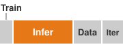{width="100%" fig-alt="Horizontal bar split into four segments with illustrative widths, labeled Train, Infer, Data, and Iter. Infer is the widest segment and is orange; the others are gray, and Train is the narrowest."}

*Serving can outgrow the training bill.*
:::

Inference costs can dominate when cumulative serving demand outweighs training and iteration costs. @Eq-ops-scale-inference-cost estimates continuously provisioned capacity from average daily demand and sustained per-GPU throughput measured under representative batching, the target latency SLO, and operating headroom. Daily volume alone does not size traffic peaks; the estimate requires a separate check against the arrival pattern, workload mix, and scaling response:

$$\AcceleratorCount = \left\lceil \frac{\DailyQueryVolume}{86{,}400 \times \AcceleratorTargetQueryRate} \right\rceil, \qquad \InferenceCost = \AcceleratorCount \times 24 \times 365 \times \AcceleratorHourlyPrice$$ {#eq-ops-scale-inference-cost}

where:

- $\DailyQueryVolume$ is the daily query volume
- $\AcceleratorTargetQueryRate$ is sustained queries per second per GPU at the target latency SLO, including batching and operating headroom
- $\AcceleratorCount$ is the integer number of continuously provisioned GPUs
- $\AcceleratorHourlyPrice$ is the hourly GPU cost

The key insight is that inference cost grows with query volume in discrete capacity steps. Utilization and batching reduce cost only when they improve measured throughput at the target latency SLO; they should not be applied again as independent divisors.

#### Alternative formulation {#sec-ml-operations-scale-alternative-formulation-fa12}

For capacity planning, express inference cost in terms of required GPU-seconds per query:

$$\InferenceCost = \AnnualQueryVolume\times \AcceleratorSecondsPerQuery\times \frac{\AcceleratorHourlyPrice}{3600}$$

where $\AcceleratorSecondsPerQuery$ is allocated GPU-seconds divided by completed queries over the same accounting period. Allocated time includes idle headroom and provisioned capacity, so this definition reproduces the continuous-provisioning bill above. Measuring only busy kernel time instead estimates service demand and excludes those costs; it is not an equivalent billing formula without an allocation policy.

#### Data cost model {#sec-ml-operations-scale-data-cost-model-c51a}

Data costs can grow faster than the user base when per-user history, transfer volume, and feature processing all rise together, even though each term below is linear in its own volume. @Eq-data-cost decomposes data cost into three components that scale differently: storage cost $\DataStorageCost$, egress cost $\DataEgressCost$ for moving data out over the network, and processing cost $\DataPipelineProcessingCost$:

$$\TotalDataCost = \DataStorageCost + \DataEgressCost+ \DataPipelineProcessingCost$$ {#eq-data-cost}

Storage costs grow with data retention requirements:
$$\DataStorageCost = \StoredDataVolume \times \StoragePrice \times \StorageRetentionTime$$

where $\StoredDataVolume$ is a fixed data volume in GB, $\StoragePrice$ is the monthly storage rate, and $\StorageRetentionTime$ is its retention period in months. This product prices one volume retained at a constant rate; a growing dataset requires accounting for each period's stored volume rather than multiplying the final volume by the entire history.

```{python}
#| echo: false
#| label: data-cost-rates
# ┌── LEGO ───────────────────────────────────────────────
# │ Context: Data cost model (egress and processing terms).
# │ Goal: Pin the cloud egress rate; compute the processing-pipeline example.
from mlsysim import Infrastructure
from mlsysim.core.units import DAYS_PER_YEAR, GB, TB, USD
from mlsysim.fmt import check, fmt_qty_int, fmt_usd

class DataCostRates:
    # ┌── 1. LOAD ──────────────────────────────────────────
    egress = Infrastructure.Pricing.Cloud.EgressPerGB.rate
    daily_processed = 10 * TB  # scenario assumption: feature pipeline volume
    process_rate_usd_per_gb = 0.02  # scenario assumption: managed processing price
    # ┌── 2. EXECUTE ───────────────────────────────────────
    annual_process_usd = daily_processed.to(GB).magnitude * process_rate_usd_per_gb * DAYS_PER_YEAR
    # ┌── 3. GUARD ─────────────────────────────────────────
    check(annual_process_usd > 0, "Processing cost must be positive")
    # ┌── 4. OUTPUT ────────────────────────────────────────
    egress_str = fmt_usd(egress.to(USD / GB).magnitude, precision=2, commas=False, per="GB")
    daily_processed_str = fmt_qty_int(daily_processed, TB, commas=False)
    process_rate_str = fmt_usd(process_rate_usd_per_gb, precision=2, commas=False, per="GB")
    annual_process_str = fmt_usd(annual_process_usd, precision=0)
```

Egress costs scale with data transfer volume:
$$\DataEgressCost= \TransferredDataVolume\times \EgressPrice$$

At the scenario egress rate of `{python} DataCostRates.egress_str`, repeated transfers can become a significant cost driver for multi-region deployments and training data distribution. The applicable rate depends on the source, destination, and service contract; the estimate must distinguish billable transfers from included traffic.

Processing costs scale with compute requirements for extract, transform, load, feature engineering, and data validation:
$$\DataPipelineProcessingCost= \ProcessedDataVolume\times \ProcessingPrice$$

Data processing costs often surprise organizations: a feature engineering pipeline processing `{python} DataCostRates.daily_processed_str` daily at `{python} DataCostRates.process_rate_str` costs `{python} DataCostRates.annual_process_str` annually.

#### Iteration cost model {#sec-ml-operations-scale-iteration-cost-model-50a9}

Development costs capture the engineering investment in experimentation and model improvement. @Eq-iteration-cost formalizes this as the experiment count multiplied by the combined per-experiment engineering and compute costs:

$$\IterationCost= \ExperimentCount\times (\PerExperimentEngineeringCost+ \PerExperimentComputeCost)$$ {#eq-iteration-cost}

where:

- $\ExperimentCount$ is the number of experiments conducted
- $\PerExperimentEngineeringCost$ is the engineering cost per experiment
- $\PerExperimentComputeCost$ is the compute cost per experiment

Experiments that do not improve production metrics still incur costs. If 90 percent produce no improvement and every experiment has the same cost, expenditure per improving experiment is 10$\times$ the per-experiment cost. A negative result can nevertheless rule out an unproductive direction or expose a risk. Experiment infrastructure should reduce avoidable engineering and compute work while preserving that learning value, rather than optimize the fraction of positive results alone.

#### Startup versus production company TCO {#sec-ml-operations-scale-worked-example-startup-vs-production-company-tco-a2cb}

@Tbl-ops-tco-comparison prices the same four cost components for two constructed organizational scenarios. The startup operates 1 production model serving 100,000 daily users with monthly retraining, a 2-engineer team, and cloud-native infrastructure. The production company operates 50 models serving 10 million daily users with weekly retraining for high-velocity models, a dedicated 15-engineer ML platform team, and hybrid cloud/on-premise infrastructure. Because traffic, model count, cadence, and staffing all change, the comparison illustrates different cost structures rather than isolating the effect of scale alone.

```{python}
#| echo: false
#| label: ops-tco-comparison-calc
# ┌─────────────────────────────────────────────────────────────────────────────
# │ STARTUP VS. PRODUCTION COMPANY TCO COMPARISON
# ├─────────────────────────────────────────────────────────────────────────────
# │ Context: @tbl-ops-tco-comparison and surrounding prose (§TCO worked example).
# │
# │ Goal:    Compare cost structure across startup and production company.
# │ Show:    Total TCO, per-component scaling factors, dominant cost shift.
# │ How:     Sum components, derive ratios and percentages.
# │
# └─────────────────────────────────────────────────────────────────────────────
from mlsysim.fmt import MarkdownStr, check, fmt, fmt_int, fmt_usd

class TcoComparison:
    # ┌── 1. LOAD (Constants) ──────────────────────────────────────────────
    s_training = 5_000
    s_inference = 2_000
    s_data = 500
    s_iteration = 40_000

    p_training = 150_000
    p_inference = 400_000
    p_data = 80_000
    p_iteration = 350_000

    # ┌── 2. EXECUTE (The Compute) ─────────────────────────────────────────
    s_total = s_training + s_inference + s_data + s_iteration
    p_total = p_training + p_inference + p_data + p_iteration

    sc_training = p_training / s_training
    sc_inference = p_inference / s_inference
    sc_data = p_data / s_data
    sc_iteration = p_iteration / s_iteration
    sc_total = p_total / s_total

    s_dom_pct = round(s_iteration / s_total * 100)
    p_dom_pct = round(p_inference / p_total * 100)

    # ┌── 3. GUARD (Invariants) ───────────────────────────────────────────
    check(s_total == 47_500, f"Startup total ({s_total})")
    check(p_total == 980_000, f"Production total ({p_total})")
    check(abs(sc_total - 20.6) < 0.1, f"Total scaling ({sc_total:.1f})")
    check(s_dom_pct == 84, f"Startup dominant pct ({s_dom_pct})")
    check(p_dom_pct == 41, f"Production dominant pct ({p_dom_pct})")

    # ┌── 4. OUTPUT (Formatting) ──────────────────────────────────────────
    s_training_usd_str = fmt_usd(s_training, precision=0, per="month")
    s_inference_usd_str = fmt_usd(s_inference, precision=0, per="month")
    s_data_usd_str = fmt_usd(s_data, precision=0, per="month")
    s_iteration_usd_str = fmt_usd(s_iteration, precision=0, per="month")
    s_total_usd_str = fmt_usd(s_total, precision=0, per="month")

    p_training_usd_str = fmt_usd(p_training, precision=0, per="month")
    p_inference_usd_str = fmt_usd(p_inference, precision=0, per="month")
    p_data_usd_str = fmt_usd(p_data, precision=0, per="month")
    p_iteration_usd_str = fmt_usd(p_iteration, precision=0, per="month")
    p_total_usd_str = fmt_usd(p_total, precision=0, per="month")

    training_scale_factor_mult_str = fmt_multiple(sc_training, precision=0, commas=False)
    inference_scale_factor_mult_str = fmt_multiple(sc_inference, precision=0, commas=False)
    data_scale_factor_mult_str = fmt_multiple(sc_data, precision=0, commas=False)
    iteration_scale_factor_mult_str = fmt_multiple(sc_iteration, precision=2, commas=False)
    total_scale_factor_mult_str = fmt_multiple(sc_total, precision=1, commas=False)

    s_dom_str = fmt_percent(s_dom_pct / 100, precision=0, commas=False, style='prose')
    s_dom_tbl_str = fmt_percent(s_dom_pct / 100, precision=0, commas=False, style='symbol')
    p_dom_str = fmt_percent(p_dom_pct / 100, precision=0, commas=False, style='prose')
    p_dom_tbl_str = fmt_percent(p_dom_pct / 100, precision=0, commas=False, style='symbol')
```

| **Cost Component** |                    **Startup**                     |               **Production Company**               | **Scaling Factor**                                                                      |
|:-------------------|:--------------------------------------------------:|:--------------------------------------------------:|:----------------------------------------------------------------------------------------|
| **Training**       |    `{python} TcoComparison.s_training_usd_str`     |    `{python} TcoComparison.p_training_usd_str`     | `{python} TcoComparison.training_scale_factor_mult_str` (more models, larger)           |
| **Inference**      |    `{python} TcoComparison.s_inference_usd_str`    |    `{python} TcoComparison.p_inference_usd_str`    | `{python} TcoComparison.inference_scale_factor_mult_str` (100$\times$ users, 50 models) |
| **Data**           |      `{python} TcoComparison.s_data_usd_str`       |      `{python} TcoComparison.p_data_usd_str`       | `{python} TcoComparison.data_scale_factor_mult_str` (50 models, weekly retraining)      |
| **Iteration**      |    `{python} TcoComparison.s_iteration_usd_str`    |    `{python} TcoComparison.p_iteration_usd_str`    | `{python} TcoComparison.iteration_scale_factor_mult_str` (team size, experiments)       |
| **Total TCO**      |    **`{python} TcoComparison.s_total_usd_str`**    |    **`{python} TcoComparison.p_total_usd_str`**    | **`{python} TcoComparison.total_scale_factor_mult_str`**                                |
| **Dominant Cost**  | Iteration (`{python} TcoComparison.s_dom_tbl_str`) | Inference (`{python} TcoComparison.p_dom_tbl_str`) |                                                                                         |

: **TCO comparison: startup vs. production company**: In these constructed budgets, iteration costs dominate the startup scenario, while inference is the largest component in the production scenario. The comparison changes traffic, model count, retraining cadence, and staffing together; it does not isolate the effect of scale. The 100$\times$ user increase yields only a `{python} TcoComparison.total_scale_factor_mult_str` TCO increase because the startup baseline is mostly salaries, even though inference grows faster than users. Data costs grow `{python} TcoComparison.data_scale_factor_mult_str`, faster than users, in a scenario that also stores features for 50 models and retrains weekly. {#tbl-ops-tco-comparison}

In these scenarios, the startup assigns `{python} TcoComparison.s_dom_str` to iteration, while the production company assigns `{python} TcoComparison.p_dom_str` to inference. Total TCO rises `{python} TcoComparison.total_scale_factor_mult_str` for 100$\times$ the users, but that does not establish cheaper serving per user. The assumed inference bill rises `{python} TcoComparison.inference_scale_factor_mult_str`, while the salary-heavy startup baseline makes the total ratio smaller. The data bill rises `{python} TcoComparison.data_scale_factor_mult_str` for 100$\times$ the users. The production scenario also stores and processes features for 50 models rather than one and retrains its high-velocity models weekly rather than monthly, so its storage, egress, and processing volumes (@eq-data-cost) can each grow faster than the user count; the assumed budgets do not say how much each term contributes. The production company also runs 10$\times$ as many experiments at `{python} TcoComparison.iteration_scale_factor_mult_str` the iteration cost. These assumed budgets show why measured cost structure matters; they do not isolate model count, feature complexity, or automation as the cause of any ratio.

#### TCO sensitivity analysis {#sec-ml-operations-scale-tco-sensitivity-analysis-01e8}

Sensitivity analysis starts with the dollar cost ledger and changes one workload assumption at a time. @Tbl-tco-sensitivity identifies which measurements must change before the platform can estimate a new total. The same increase in user count can have different consequences for a cached recommendation service and a long-context language-model service.

| **Workload Change**          | **Cost Terms Affected**                       | **Measurements Needed**                                                                             |
|:-----------------------------|:----------------------------------------------|:----------------------------------------------------------------------------------------------------|
| **More daily users**         | Inference, data, and capacity operations      | Requests per user, peak concurrency, history retained per user, and headroom needed to meet the SLO |
| **More models**              | Training, inference, data, and iteration      | Refresh cadence, traffic per model, shared feature reuse, and engineering effort per release        |
| **More queries per user**    | Inference and request-related data processing | Request mix, batching, cache hit rate, bytes logged, and provisioned capacity at the target SLO     |
| **Larger models**            | Training, inference, and iteration            | Live-state memory, sustained throughput, parallelism, and time spent validating each candidate      |
| **More frequent retraining** | Training, data preparation, and iteration     | Cost per run, incremental data processing, evaluation effort, and any measured serving benefit      |

: **TCO sensitivity drivers**: Map each workload change to the affected cost terms and the measurements needed to update them. Shared infrastructure, capacity steps, and changing engineering effort can make the response nonlinear; the complete cost ledger determines the total. {#tbl-tco-sensitivity}

User scaling\index{Scaling!user} changes requests and stored history; model size scaling\index{Model Size!scaling} changes arithmetic and memory demand. Recompute those components in dollars over the same period, retaining unchanged components and including iteration and platform overhead. Sum the revised ledger, then compare it with the baseline. The resulting change identifies where an optimization can create enough recurring savings to repay its implementation cost.

#### Decision framework for speed versus efficiency {#sec-ml-operations-scale-decision-framework-speed-vs-efficiency-baf4}

TCO analysis enables principled decisions about when to optimize for development speed vs. operational efficiency. @Eq-optimization-breakeven calculates the breakeven point for optimization investments:

$$\OptimizationBreakevenTime= \frac{\OptimizationImplementationCost}{\MonthlyOptimizationSavings}$$ {#eq-optimization-breakeven}

where $\OptimizationImplementationCost$ is the one-time implementation and validation cost and $\MonthlyOptimizationSavings$ is positive monthly savings net of added operating and maintenance costs. This simple payback assumes savings remain constant over the interval; recovered capacity counts as cash savings only when it reduces expenditure or avoids a planned purchase.

The breakeven equation helps compare specific investments once their implementation costs and recurring savings are estimated. The dominant cost component suggests where to look first, but does not rule out a valuable smaller intervention elsewhere. @Tbl-tco-cost-structure-decisions offers investigation starting points and illustrative policy thresholds; actual investment criteria also depend on service risk, expected workload lifetime, and available engineering capacity.

| **Dominant cost structure**                               | **Operating context**       | **Optimization posture**                                                                                                                                                              | **Payback threshold**                                                                               |
|:----------------------------------------------------------|:----------------------------|:--------------------------------------------------------------------------------------------------------------------------------------------------------------------------------------|:----------------------------------------------------------------------------------------------------|
| Iteration costs dominate ($\IterationCost > 50\%$ of TCO) | Experiment-heavy workload   | Investigate experiment infrastructure that shortens iteration time. Compare infrastructure efficiency candidates when their savings or capacity value justify the engineering effort. | Evaluate candidate value; iteration cost share alone does not set a payback bar.                    |
| Training costs dominate ($\TrainingCost > 40\%$ of TCO)   | Repeated training campaigns | Investigate mixed precision, gradient checkpointing, checkpoint-and-resume on spot instances, and architecture changes against quality and completion requirements.                   | An illustrative policy accepts 3--6 months only if the candidate remains useful beyond payback.     |
| Inference costs dominate ($\InferenceCost > 40\%$ of TCO) | High-volume serving         | Investigate quantization, batching, caching, and distillation where repeated queries can realize savings within quality and latency constraints.                                      | An illustrative policy requires 1--3 months; the actual bar depends on candidate lifetime and risk. |

: **Cost-structure decision rules**: Measured cost shares guide investigation. Candidate savings, useful lifetime, and operational risk determine whether an investment satisfies the organization's policy. {#tbl-tco-cost-structure-decisions}

The numerical payback bars in the table represent an illustrative investment policy, not a consequence of training or serving alone. Repeated queries can make serving savings accumulate quickly, but a model refresh or request-mix change can retire the optimized path before payback. A reusable training pipeline may support a longer horizon, while a one-off training campaign may not. For either workload, compare net savings over the candidate's expected useful lifetime with implementation cost and risk; a dominant cost category does not guarantee that its next optimization has the highest value.

#### Optimization investment decisions {#sec-ml-operations-scale-worked-example-optimization-investment-decision-cc81}

```{python}
#| echo: false
# ┌── LEGO ───────────────────────────────────────────────
# │ Context: @eq-optimization-breakeven worked examples (inference + training).
from mlsysim.fmt import check, fmt, fmt_math, fmt_text, fmt_usd

class OptimizationBreakeven:
    # ┌── 1. LOAD ──────────────────────────────────────────
    impl_cost = 80_000
    infer_monthly = 400_000
    infer_reduction = 0.40
    train_monthly = 150_000
    train_reduction = 0.30
    # ┌── 2. EXECUTE ───────────────────────────────────────
    infer_savings = infer_monthly * infer_reduction
    infer_breakeven_months = impl_cost / infer_savings
    train_savings = train_monthly * train_reduction
    train_breakeven_months = impl_cost / train_savings
    # ┌── 3. GUARD ─────────────────────────────────────────
    check(infer_savings == 160_000 and infer_breakeven_months == 0.5, "Inference breakeven drift")
    check(train_savings == 45_000 and abs(train_breakeven_months - 1.8) < 0.05, "Training breakeven drift")
    # ┌── 4. OUTPUT ────────────────────────────────────────
    infer_savings_eq_str = fmt_text(fmt_usd(infer_monthly), " $\\times$ ", fmt(infer_reduction, precision=2), " = ", fmt_usd(infer_savings))
    infer_breakeven_eq_math = fmt_math(
        rf"\OptimizationBreakevenTime = \frac{{{fmt_usd(impl_cost)}}}{{{fmt_usd(infer_savings, per='month')}}} "
        rf"= {fmt(infer_breakeven_months, precision=1)} \text{{ months}}"
    )
    train_savings_eq_str = fmt_text(fmt_usd(train_monthly), " $\\times$ ", fmt(train_reduction, precision=2), " = ", fmt_usd(train_savings))
    train_breakeven_eq_math = fmt_math(
        rf"\OptimizationBreakevenTime = \frac{{{fmt_usd(impl_cost)}}}{{{fmt_usd(train_savings, per='month')}}} "
        rf"= {fmt(train_breakeven_months, precision=1)} \text{{ months}}"
    )
```

A production company $(\InferenceCost = \$400\text{K}/\text{month})$ evaluates INT8 quantization:

- Implementation cost: \$80,000 (engineering time + validation)
- Expected inference cost reduction: 40 percent
- Monthly savings: `{python} OptimizationBreakeven.infer_savings_eq_str`

`{python} OptimizationBreakeven.infer_breakeven_eq_math`

Breakeven in 2 weeks makes this investment attractive if validation confirms acceptable quality and latency and the expected cost reduction can be realized. For comparison, the same company $(\TrainingCost = \$150\text{K}/\text{month})$ evaluates a training optimization:

- Implementation cost: \$80,000
- Expected training cost reduction: 30 percent
- Monthly savings: `{python} OptimizationBreakeven.train_savings_eq_str`

`{python} OptimizationBreakeven.train_breakeven_eq_math`

The training optimization has longer payback and smaller absolute savings in this scenario. Those results favor the inference investment if both satisfy their quality and reliability requirements and compete for the same engineering capacity. @Tbl-optimization-priority extends that reasoning into starting points for investigation, subject to each candidate's measured benefit, implementation cost, and operational risk:

| **Dominant Cost**    | **Investigation Starting Point** |                   **Other Candidates**                   |                                 **Risk to Evaluate**                                |
|:---------------------|:--------------------------------:|:--------------------------------------------------------:|:-----------------------------------------------------------------------------------:|
| **Iteration (>50%)** |       Experiment velocity        |     Developer tooling and infrastructure efficiency      | Engineering effort that does not repay through faster iteration or realized savings |
| **Training (>40%)**  |       Training efficiency        | Spot/preemptible compute and shared serving improvements |          Recovery overhead, completion risk, and useful investment lifetime         |
| **Inference (>40%)** |        Model optimization        |       Serving infrastructure and retraining policy       |                 Quality loss, latency changes, and workload lifetime                |
| **Data (>30%)**      |         Storage tiering          |       Egress reduction and feature simplification        |              Retention, freshness, and downstream quality requirements              |

: **Optimization priority matrix**: Current cost structure identifies starting points for investigation. Compare feasible candidates across categories using measured net benefit, implementation cost, useful lifetime, and operational risk before assigning engineering capacity. {#tbl-optimization-priority}

#### TCO-driven architecture decisions {#sec-ml-operations-scale-tcodriven-architecture-decisions-2fea}

TCO analysis should inform architectural choices alongside operational optimization. The build-vs.-buy analysis in @sec-ml-operations-scale-build-vs-buy also applies to individual workloads, accounting for any capacity they share with the rest of the portfolio. Model architecture selection\index{Model architecture!TCO impact} changes the ledger because a model requiring 2$\times$ training cost but 0.5$\times$ inference cost may have lower lifecycle cost at sufficient serving volume. Retraining frequency\index{Retraining!frequency} adds to $\TrainingCost$ and $\TotalDataCost$; it can reduce emergency work charged to $\IterationCost$ only when evaluation and release controls produce timely, useful updates. Monitoring detects the need to investigate drift; retraining alone does not. Feature complexity\index{Feature store!feature complexity} can likewise increase $\TotalDataCost$ and $\TrainingCost$, while its effect on $\IterationCost$ depends on whether better predictions outweigh added integration and maintenance. Knowledge placement in language-model services illustrates the same trade-off.

#### Retrieval-augmented generation vs. fine-tuning {#sec-ml-operations-scale-rag-vs-finetuning-knowledge-operations-tradeoff-77f3}

Domain knowledge can live in a retrievable index, in model weights, or in adapter weights, and each placement creates a different operating cost surface. **Retrieval-augmented generation (RAG)**\index{Retrieval-Augmented Generation!definition} retrieves documents at inference time and places them in the prompt [@lewis2020retrieval]. Fine-tuning stores adaptation in model weights or adapter weights: supervised fine-tuning trains on curated input-output examples, while low-rank adaptation (LoRA) stores small adapter-weight deltas [@hu2021lora]. Both approaches can improve task behavior, but they move cost and failure risk to different terms of @eq-tco-ml. RAG charges knowledge to $\InferenceCost$, through retrieval and the extra prompt tokens every request must prefill, and to $\TotalDataCost$, through the index it must build and refresh. Fine-tuning charges it to $\TrainingCost$ and $\IterationCost$, through curation, training runs, and re-evaluation whenever the knowledge changes. Query volume therefore decides which ledger grows faster.

RAG makes knowledge updates possible through the document index without retraining the model. Retrieved passages provide evidence against which generated claims can be checked, but retrieval alone does not ensure that an answer uses or cites that evidence correctly. Retrieval and added context also consume serving resources. An illustrative 10,000 extra tokens increase dense prefill attention work roughly quadratically with total sequence length and KV-cache storage linearly with context length. FlashAttention reduces memory traffic and intermediate storage, but does not remove those computational and storage demands. The cost comparison therefore depends on retrieval quality, context selection, and the serving configuration; excessive context can also make relevant evidence harder for the model to use.

Fine-tuning moves adaptation work before deployment. The platform pays for data curation, training, and evaluation; successful adaptation can shorten prompts when it replaces instructions or examples that would otherwise accompany each request. Lower serving cost is a benefit to measure, not an automatic consequence of changing weights. Adapter-based fine-tuning also creates a fleet-management obligation when many customer-specific LoRA adapters must be versioned, loaded, and isolated, while changing facts embedded in weights requires a different update process from replacing documents in an index.

The decision depends on knowledge volatility, attribution requirements, latency budget, and adapter-management complexity. RAG provides an update path for changing facts and a source trail for review, subject to retrieval and generation quality. Fine-tuning can adapt domain language or stable behavior, subject to training cost and validation. Neither method implies a fixed context length or query-volume limit. A combined design can fine-tune how the model uses tools and documents while retrieving facts that must remain fresh. Evaluation must establish whether those benefits justify the combined lifecycle cost.

Each of these architecture choices is a forecast of lifecycle cost. Once a choice ships, the fleet needs controls that measure whether spending follows the forecast and that give someone the authority to act when it does not.

### FinOps for ML platforms {#sec-ml-operations-scale-finops-ml-platforms-ffd6}

A cost dashboard can identify a failed training sweep without giving anyone authority to stop it. FinOps closes that gap by connecting the fleet cost ledger and anomaly signals to budgets, owners, and intervention policies. The platform, fleet, and workload analyses above decide whether capacity and platform investment are worthwhile; FinOps decides how teams spend that capacity and respond when cost or value departs from the plan.

```{python}
#| echo: false
#| label: finops-spot-comparison
# ┌── LEGO ───────────────────────────────────────────────
# │ Context: FinOps definition callout (daily and annual training spend).
# │ Goal: Pin the utility-bill scenario training rate and the spend it implies.
from mlsysim import Infrastructure
from mlsysim.core.units import DAYS_PER_YEAR, USD, hour
from mlsysim.fmt import check, fmt_int, fmt_usd

class FinOpsSpotComparison:
    # ┌── 1. LOAD ──────────────────────────────────────────
    rate = Infrastructure.Pricing.Cloud.GpuTrainingUtilityScenarioPerHour.rate.to(USD / hour).magnitude
    cloud = Infrastructure.Pricing.Cloud
    gpu_hours_per_day = 1_000  # scenario assumption
    # ┌── 2. EXECUTE ───────────────────────────────────────
    daily = gpu_hours_per_day * rate
    annual = daily * DAYS_PER_YEAR
    # ┌── 3. GUARD ─────────────────────────────────────────
    check(rate < cloud.GpuTrainingPerHour.rate.to(USD / hour).magnitude, "Utility-bill scenario should sit below the on-demand reference")
    # ┌── 4. OUTPUT ────────────────────────────────────────
    rate_str = fmt_usd(rate, precision=0, commas=False, per="GPU-hour")
    daily_str = fmt_usd(daily, precision=0, per="day")
    annual_str = fmt_usd(annual, scale="M", precision=1, per="year")
    gpu_hours_str = fmt_int(gpu_hours_per_day, commas=True)
```

::: {#dfn-ops-scale-finops-ml .callout-definition title="FinOps for ML"}

***FinOps for ML***\index{FinOps!definition} is the practice of treating compute cost as a first-class engineering constraint (measured in real-time per experiment and model, and optimized jointly with model accuracy and latency) rather than accounting for it retrospectively through annual budget reconciliation.

1.  **Significance**: ML compute costs scale steeply with experimentation volume. A team running `{python} FinOpsSpotComparison.gpu_hours_str` GPU-hours/day at a scenario rate of `{python} FinOpsSpotComparison.rate_str` spends `{python} FinOpsSpotComparison.daily_str` (`{python} FinOpsSpotComparison.annual_str`) on training alone. With per-experiment cost visibility, an engineer can identify that 30 percent of runs are terminated early due to divergence (a reason to investigate the training configuration and failure causes) and that the team's fault-tolerant jobs could run on spot capacity at `{python} TcoScenario.spot_discount_range_str` discounts, provided recovery and interruption costs preserve the required quality and completion target.
2.  **Distinction**: Unlike traditional IT budgeting (which allocates fixed annual compute budgets across departments), FinOps for ML operates at the per-run and per-model level with real-time feedback, enabling decisions like early stopping a \$50K training run at step 1,000 when loss curves signal divergence, rather than discovering the waste after the full run completes.
3.  **Common pitfall**: A frequent misconception is that FinOps means minimizing compute spend. The goal is useful value across the full lifecycle within quality, latency, and reliability requirements: a \$500K training run producing a model serving 10B inferences at \$0.0001/query may be far more cost-efficient than a \$50K run producing a model that requires 10$\times$ the inference compute to achieve the same accuracy at scale.

:::

#### Cost components {#sec-ml-operations-scale-cost-components-ce4e}

ML platform cost breakdown\index{ML Platform!cost breakdown} depends on the portfolio and accounting period. @Tbl-ops-scale-cost-breakdown assumes a training-heavy annual budget. A mature, high-traffic serving portfolio can instead be inference-dominated, as the earlier lifecycle example shows.

| **Cost Category**     | **Assumed Share** | **Primary Drivers**                | **Optimization Lever**             |
|:----------------------|:-----------------:|:-----------------------------------|:-----------------------------------|
| **Training compute**  |        50%        | GPU hours, experiment volume       | Spot instances, early stopping     |
| **Serving compute**   |        25%        | Traffic volume, latency SLOs       | Autoscaling, model optimization    |
| **Storage**           |        12%        | Dataset size, checkpoint frequency | Tiered storage, retention policies |
| **Network**           |         8%        | Multi-region, data transfer        | Caching, compression               |
| **Platform overhead** |         5%        | Team size, tooling                 | Automation, self-service           |

: **Illustrative training-heavy platform budget**: Assumed shares sum to 100 percent over one annual accounting period. Training dominates this portfolio; a serving-heavy portfolio can reverse the ordering. Apply optimization levers to the measured cost driver rather than treating these shares as industry norms. {#tbl-ops-scale-cost-breakdown}

#### Cost visibility and attribution {#sec-ml-operations-scale-cost-visibility-attribution-3f3a}

Cost optimization requires visibility into spending and ownership. Attribution policy also shapes incentives. Direct metering charges for measured consumption, but shared services and idle reserves still require allocation rules; measured activity does not uniquely determine every team's cost. Charging only for consumption can encourage under-provisioning when teams optimize their bill instead of service health. Allocation-based attribution charges for reserved capacity, making commitments visible even when that capacity is idle. Hybrid attribution combines a base allocation charge with a variable charge for excess usage. Each policy must preserve the headroom and shared services on which the reliability contract depends.

Attribution starts from metadata. Tag-based allocation assigns each resource's cost to a team, service, environment, and cost center, as @lst-cost-attribution shows.

::: {#lst-cost-attribution lst-cap="**Cost Attribution Schema**: Resource tagging dimensions and shared-cost distribution policies for allocating ML infrastructure expenses to teams and services."}

```{.yaml}
# Resource tagging schema for cost attribution
cost_allocation:
  dimensions:
    - team: "recommendation"      # Organizational owner
    - service: "ranking-model"    # Specific service
    - environment: "production"   # prod/staging/dev
    - model_type: "inference"     # training/inference
    - cost_center: "CC-4521"      # Finance tracking

  shared_cost_distribution:
    # Platform infrastructure costs distributed by usage
    - resource: "shared-gpu-cluster"
      method: "proportional_gpu_hours"
    - resource: "feature-store"
      method: "proportional_query_volume"
    - resource: "monitoring-infrastructure"
      method: "equal_split"
```

:::

Shared infrastructure needs its own accounting policy because no single team owns it. Platforms typically adopt one of three models: proportional allocation\index{Cost allocation!proportional} distributes shared cluster expenses according to measured consumption metrics such as GPU-hours, storage capacity, or API query volume; equal split\index{Cost allocation!equal split} divides common baseline expenses evenly across consuming teams, which is well suited for fixed foundational tooling; and marginal cost\index{Cost allocation!marginal cost} charges tenant teams strictly for the incremental compute and storage their workloads introduce. The choice of allocation policy ultimately determines whether operational dashboards can drive organizational action rather than merely describing past spend.

For serving workloads, **cost per inference**\index{Cost Per Inference!definition} provides a unit economic metric. @Eq-cost-per-inference divides total serving cost by inference count over the same accounting period. Comparisons require matched request mix, quality and latency targets, and cost boundaries; a short classification request and a long generated response are not equivalent units of work:

$$\text{Cost per inference} = \frac{\text{Total serving cost}}{\text{Total inferences served}}$$ {#eq-cost-per-inference}

Cost per inference then becomes the bridge from infrastructure telemetry to product decisions. Teams can compare model versions by asking whether an accuracy gain justifies a 2$\times$ inference cost, evaluate optimization work by measuring whether quantization reduced cost per inference by 40 percent, and forecast monthly serving cost under projected traffic. Tracking the metric by model, customer segment, and request type reveals which workload deserves optimization effort.

Effective chargeback closes the loop by making those costs actionable. It requires fine-grained resource metering, attribution rules that map resources to teams, dashboards that show cost by team, project, and model, forecasting tools that help teams plan budgets, and anomaly detection for unexpected cost increases.

Cost dashboards use the same attention-routing hierarchy as the reliability views in @tbl-ops-scale-dashboard-views. The executive view tracks total ML infrastructure cost, month-over-month trend, budget vs. actual, and cost efficiency metrics such as cost per prediction and cost per active user. The portfolio view then breaks cost down by domain and model type so the platform team can see whether recommendations, fraud, search, or another domain is driving the change. The service view exposes per-service cost, cost per inference, GPU utilization efficiency, and budget comparison. The investigation view adds deployment markers, operational metric correlations, and attribution detail so an anomaly can be tied to a specific change rather than treated as accounting noise.

Continuous cost monitoring connects four kinds of evidence. Cost per inference tracks unit spending under a declared request mix. Cost per active user\index{Cost!per active user} relates spending to the population served, but cross-service comparisons also require comparable activity and product scope. GPU utilization efficiency\index{GPU Utilization!efficiency} shows how allocated hardware is used; revenue or engagement per accelerator-hour is a separate business-yield measure that also depends on product demand and model quality. Budget burn rate\index{Budget!burn rate} tracks spending velocity against the allocation so owners can investigate projected overruns before the budget is exhausted.

#### Cost anomaly detection {#sec-ml-operations-scale-cost-monitoring-anomaly-detection-1976}

Cost anomaly detection must account for the fleet's allocation and lifecycle behavior. Adding a serving replica can create a large cost step when that replica occupies multiple accelerators. Training sweeps and repeated recovery attempts can accumulate GPU-hours without producing useful artifacts. Zombie models (@sec-ml-operations-scale-model-lifecycle-management-f112) can retain serving capacity after their traffic has disappeared. Traffic spikes, changing request mix, and price changes can also raise spending. Detection must therefore connect the cost change to allocation, workload, and lifecycle evidence rather than infer its cause from the size of the bill alone.

At scale, undetected cost anomalies can accumulate millions of dollars in unexpected charges before manual review catches them. A quantitative framework for cost anomaly detection balances sensitivity against false positive rates.

The foundation of cost monitoring is the statistical process control of @sec-ml-operations-scale-statistical-process-control-c95d applied to spend. For a cost time series with historical mean $\MonitoredMetricMean$ and standard deviation $\MonitoredMetricStandardDeviation$, the Z-score\index{Anomaly detection!Z-score} quantifies how unusual a current observation is:

$$\CostAnomalyScore= \frac{\CurrentPeriodCost- \MonitoredMetricMean}{\MonitoredMetricStandardDeviation}$$

where $\CurrentPeriodCost$ is the observed cost for the current period.

Complementing Z-score analysis, percentage change\index{Anomaly detection!percentage change} detection captures sudden shifts regardless of historical variance, which makes it useful for catching step-function increases such as a misconfigured autoscaler that doubles instance count overnight:

$$\FiniteChange\% = \frac{\CurrentPeriodCost- \PreviousPeriodCost}{\PreviousPeriodCost} \times 100$$

Effective alerting requires calibrating thresholds to balance detection sensitivity against operational burden. Two illustrative configurations are a Z-score threshold\index{Anomaly detection!Z-score threshold}, which alerts when $|\CostAnomalyScore| > 3$, and a percentage change threshold\index{Anomaly detection!percentage change threshold}, which alerts when $|\FiniteChange\%| > 50\%$ day over day. Seasonal demand and planned jobs must be represented in the baseline before ordinary variation can be interpreted as unusual spending. As in @sec-ml-operations-scale-alert-fatigue-problem-038c, the false positive rate depends on the statistical assumptions and the complete alert policy. For the Z-score rule alone, a calibrated stable Gaussian null checked daily gives:

$$\Pr(\text{false positive per day}) = 2 \times (1 - \StandardNormalCumulativeDistribution(3)) \approx 0.0027$$

Over a year of daily monitoring:

$$\mathbb{E}[\text{false alerts per year}] = 365 \times 0.0027 \approx 1$$

Under the same calibrated Gaussian null, a 2-sigma threshold gives approximately 16 raw false crossings per year. Choosing between thresholds requires measuring detection power and the cost of missed events as well as alert burden.

For percentage-based alerts, false positive rates depend on the underlying volatility of costs. Services with naturally variable demand may require higher thresholds (75 percent or 100 percent) to avoid excessive alerts, while stable baseline services can use tighter thresholds (25 percent or 30 percent).

A threshold crossing identifies an unusual observation under the monitoring baseline, not a confirmed defect or cause. @Tbl-cost-anomaly-categories groups candidate cost anomaly root causes\index{Cost!anomaly root cause categories} into five classes, each with a distinct investigation path.

| **Category**              | **Indicators**                          | **Investigation Path**                                              |
|:--------------------------|:----------------------------------------|:--------------------------------------------------------------------|
| **Traffic increase**      | QPS proportional to cost                | Check upstream services, marketing campaigns, viral events          |
| **Efficiency regression** | Cost up, QPS unchanged, latency up      | Review recent deployments, model updates, infrastructure changes    |
| **Resource leak**         | Gradual cost growth, utilization stable | Check for orphaned resources, failed cleanup jobs, zombie processes |
| **Pricing change**        | Cost up, all metrics stable             | Verify cloud provider pricing, reserved instance expiration         |
| **Configuration error**   | Step-function cost increase             | Audit autoscaling rules, instance types, replica counts             |

: **Cost anomaly root cause categories**: Five primary categories of cost anomalies with their characteristic indicators and investigation approaches. Traffic increases show proportional QPS growth, while efficiency regressions exhibit rising latency with stable traffic. {#tbl-cost-anomaly-categories}

#### Detecting an inference cost spike {#sec-ml-operations-scale-worked-example-detecting-inference-cost-spike-9069}

A recommendation service typically costs \$100 per day for inference compute. The operations team receives an alert: today's cost has reached \$250 by end of day.

```{python}
#| echo: false
# ┌── LEGO ───────────────────────────────────────────────
# │ Context: cost-spike Z-score worked example.
from mlsysim.fmt import check, fmt, fmt_math, fmt_usd

class CostSpikeZScore:
    # ┌── 1. LOAD ──────────────────────────────────────────
    cost_current = 250  # $/day observed
    cost_mean = 100  # $/day historical mean (mu)
    cost_std = 15  # $/day historical std (sigma)
    # ┌── 2. EXECUTE ───────────────────────────────────────
    numerator = cost_current - cost_mean
    z_score = numerator / cost_std
    # ┌── 3. GUARD ─────────────────────────────────────────
    check(numerator == 150 and z_score == 10, "Z-score drift")
    # ┌── 4. OUTPUT ────────────────────────────────────────
    z_eq_math = fmt_math(
        rf"\CostAnomalyScore = \frac{{{fmt_usd(cost_current)} - {fmt_usd(cost_mean)}}}{{{fmt_usd(cost_std)}}} "
        rf"= \frac{{{fmt_usd(numerator)}}}{{{fmt_usd(cost_std)}}} = {fmt(z_score, precision=0)}"
    )
```

Historical data shows mean daily cost $\MonitoredMetricMean= \$100$ with standard deviation $\MonitoredMetricStandardDeviation= \$15$, so the first check is whether the alert is statistically plausible under normal operations: `{python} CostSpikeZScore.z_eq_math`.

A Z-score of 10 is far outside the assumed Gaussian baseline, but the team first verifies billing completeness, duplicate records, and pipeline correctness. Query volume is unchanged; the investigation must also check request mix and arrival peaks before ruling out demand. In this scenario, those remain comparable while p99 latency rises from 50 ms to 125 ms. A larger ranking model deployed at 2:00 AM adds features, GPU utilization stays near 95 percent, and measured throughput per GPU falls 60 percent. At matched demand and operating targets, that throughput loss implies 2.5$\times$ the capacity requirement. The team confirms the allocation increase and unchanged rates before attributing the rise from \$100/day to \$250/day to the release. It then evaluates whether the measured quality benefit justifies the cost or calls for a leaner serving configuration.

#### Cost optimization strategies {#sec-ml-operations-scale-cost-optimization-strategies-d1c8}

Cost optimization is a risk-allocation decision, not a catalog of discounts. Interruptible compute pays off only when checkpointing bounds the work lost to preemption, serving autoscaling only within the latency budget, and instance right-sizing only against measured cost per step or per inference. Each optimization lever trades a specific risk for a specific saving.

Interruptible training capacity and its checkpoint discipline were priced in @sec-ml-operations-scale-cloud-options. Serving allocates risk differently. Large models may take seconds or minutes to load, so reactive scaling alone can lag demand when existing headroom is insufficient. Predictive scale-up is one response; warm spare capacity and validated fallback paths can also absorb demand while new replicas become ready. The policy must account for both forecast error and measured startup time.

The capacity steps depend on the deployment unit, and for accelerators they are lumpy. A model may share an accelerator, occupy a whole device, or require a group of devices, so serving capacity grows in jumps such as 0, 1, 2, or 4 accelerators per replica rather than in the smooth fractions of a CPU allocation; the model's memory footprint and isolation policy determine which steps are feasible. Batching adds another coupling because waiting for a larger batch can improve throughput while consuming latency budget. An autoscaling policy must choose among feasible capacity steps while protecting the p99 latency SLO.

Instance selection then starts from the binding constraint rather than the newest instance type. Memory-bound training with large embedding tables prioritizes GPU memory capacity and bandwidth. Compute-bound dense training maximizes sustained FLOP/s per dollar.

Serving splits the decision again. Latency-sensitive serving minimizes cold start and single-request latency, while throughput-oriented serving maximizes requests per dollar through batching. Instance selection should therefore be benchmark-driven: compare cost per training step or cost per inference across instance types instead of assuming larger hardware is automatically more economical.

#### Budget-aware development {#sec-ml-operations-scale-budgetaware-development-5ab2}

FinOps extends beyond infrastructure optimization because cost feedback changes which experiments teams run and which models they ship. Unconstrained experimentation leads to runaway costs, but budget controls should make trade-offs visible before they block useful work: per-experiment limits cap individual training runs at a cost threshold, team budgets allocate monthly compute budgets with visibility into consumption, and approval workflows require review for experiments that exceed cost thresholds. Controls should make the budget boundary and exception path explicit. An authorized owner may raise a limit for a valuable experiment; a job cannot silently exceed it.

Model selection should explicitly consider cost alongside accuracy. @Tbl-ops-scale-cost-quality illustrates cost-quality trade-off analysis\index{Cost!quality trade-off analysis}. Moving from small to medium model yields a 3 percentage-point accuracy gain for 10$\times$ training cost increase, while medium to large yields only 1 additional percentage point for another 10$\times$ cost, a pattern that should inform deployment decisions.

```{python}
#| echo: false
# ┌── LEGO ───────────────────────────────────────────────
# │ Context: @tbl-ops-scale-cost-quality—value-judgment column.
from mlsysim.fmt import check, fmt_multiple, fmt_pp, fmt_text

class CostQualityTradeoff:
    # ┌── 1. LOAD ──────────────────────────────────────────
    acc_small, acc_medium, acc_large = 92, 95, 96  # accuracy (percent)
    cost_small, cost_medium, cost_large = 500, 5_000, 50_000  # training cost (USD)
    # ┌── 2. EXECUTE ───────────────────────────────────────
    medium_gain_pp = acc_medium - acc_small
    large_gain_pp = acc_large - acc_medium
    medium_cost_mult = cost_medium / cost_small
    large_cost_mult = cost_large / cost_medium
    # ┌── 3. GUARD ─────────────────────────────────────────
    check((medium_gain_pp, large_gain_pp) == (3, 1), "Accuracy-gap drift")
    check((medium_cost_mult, large_cost_mult) == (10, 10), "Cost-multiple drift")
    # ┌── 4. OUTPUT ────────────────────────────────────────
    medium_judgment_str = fmt_text(
        fmt_pp(medium_gain_pp, style="prose"),
        " for ",
        fmt_multiple(medium_cost_mult, precision=0, commas=False),
        " cost",
    )
    large_judgment_str = fmt_text(
        "Additional ",
        fmt_pp(large_gain_pp, style="prose"),
        " for ",
        fmt_multiple(large_cost_mult, precision=0, commas=False),
        " more",
    )
```

| **Model**  | **Accuracy** | **Training Cost** | **Serving Cost/1K** | **Value Judgment**                                 |
|:-----------|:------------:|:-----------------:|:-------------------:|:---------------------------------------------------|
| **Small**  |     92%      |       \$500       |        \$0.10       | Baseline                                           |
| **Medium** |     95%      |      \$5,000      |        \$0.50       | `{python} CostQualityTradeoff.medium_judgment_str` |
| **Large**  |     96%      |      \$50,000     |        \$2.00       | `{python} CostQualityTradeoff.large_judgment_str`  |

: **Cost-quality trade-off analysis**: Diminishing returns in model scaling. Small-to-medium model transition yields a 3 percentage-point accuracy gain for 10$\times$ cost increase; medium-to-large yields only 1 additional percentage point for another 10$\times$ cost. This pattern demonstrates why explicit cost-quality analysis should inform model selection rather than defaulting to larger architectures. {#tbl-ops-scale-cost-quality}

The marginal accuracy gain must be valued in the application context. An additional percentage point can matter greatly if it reduces costly errors on an important population, but aggregate accuracy alone does not establish that value. Comparing error consequences, quality by slice, and lifecycle cost prevents defaulting to the largest available model.

Efficiency metrics should be reviewed alongside model quality to identify spending that warrants investigation. Low utilization can reflect required reserve capacity, and experiments without a deployed model can still resolve useful questions. @Tbl-ops-scale-efficiency-metric-actions therefore supplies investigation prompts rather than automatic verdicts of waste.

| **Metric**                       | **Waste Signal**                                      | **Typical Action**                                                    |
|:---------------------------------|:------------------------------------------------------|:----------------------------------------------------------------------|
| Cost per accuracy point          | Accuracy gains are bought with disproportionate spend | Revisit model size, feature set, or serving target before scaling up. |
| Experiments per production model | Many runs produce little deployable value             | Improve experiment design, stopping rules, and promotion criteria.    |
| GPU utilization                  | Capacity is reserved but not doing useful work        | Right-size instances, improve batching, or profile inefficient code.  |
| Spot utilization rate            | Eligible workloads use expensive on-demand capacity   | Move fault-tolerant jobs to spot instances with checkpoint support.   |

: **Efficiency metric action map**: Efficiency metrics are useful only when they identify a decision. The platform reviews these signals alongside quality metrics to find waste that accuracy alone hides. {#tbl-ops-scale-efficiency-metric-actions}

Taken together, the three economic levels and the FinOps controls make platform investment accountable to measured lifecycle outcomes: platform return decides whether shared tooling pays, fleet utilization decides whether capacity pays, workload TCO decides where optimization pays, and attribution with anomaly detection keeps each team answerable for its share. A technically sound shared service still needs an owner for its budget, compatibility promises, and retirement decisions. Organizational design determines whether those responsibilities support model teams or leave every cross-team change waiting in a central queue.

## Organizational Operation and Learning {#sec-ml-operations-scale-organizational-patterns-e2e8}

A shared feature change may pass platform checks yet still require approval from several model owners. The control plane becomes durable only when those technical interfaces align with organizational authority. Team structure determines who can approve the change, stop a rollout, or fund the repair when a shared dependency fails.

Feature contracts and release records name the owners of individual decisions; organizational structure must give those owners the capacity and authority to act. Technical infrastructure alone is insufficient for ML operations at scale, because organizational structure determines whether platform capabilities become shared infrastructure or another bottleneck. The central question is where an organization places invariants. Deployment safety, observability, compliance, cost control, and feature consistency can either be enforced once by a platform team or rediscovered differently by every model team.

### Centralized platform team {#sec-ml-operations-scale-centralized-platform-team-16fc}

A centralized ML platform team\index{Organizational pattern!centralized platform} supports consistency by building and maintaining shared infrastructure while model teams own model development and behavior. @Fig-ml-org-models contrasts three organizational patterns. A shared request queue (Panel A) centralizes prioritization but can become a bottleneck; uniform standards depend on enforced contracts, not the queue itself. Embedded tooling (Panel B) favors local responsiveness while risking duplication. The hybrid pattern (Panel C) places dedicated ML engineers near product teams while retaining a common platform. Self-service interfaces can preserve central standards without routing every routine action through a human queue.

::: {#fig-ml-org-models fig-env="figure" fig-pos="htb" fig-cap="**Organizational patterns for ML**: (A) A centralized platform team gives every model team the same infrastructure, but all requests pass through one shared queue, which can become the bottleneck. (B) Embedded teams each build their own tooling, which is fast locally but duplicates infrastructure and lets stacks diverge. (C) A hybrid keeps a core platform and places ML engineers (MLE) inside model teams as liaisons, balancing standardization with responsiveness." fig-alt="Three panels of the same three blue team boxes. Panel A, centralized: each team sends an arrow up into a red-outlined shared request queue drawn as a row of slots, five filled and one empty, whose single red exit arrow leads into one violet platform team box. Panel B, embedded: a dashed gray outline labeled no shared platform sits where the platform would be; each team box sits under an own tooling label and contains its own stack of violet bars, with bar lengths differing from team to team. Panel C, hybrid: one violet core platform box sends an arrow down into each team box, where it ends at a violet MLE chip inside the team."}
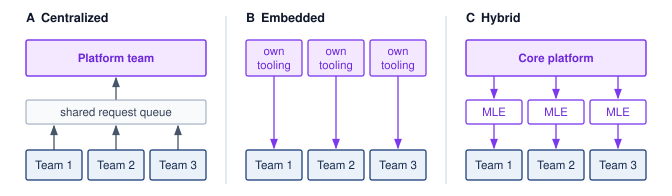
:::

Centralization works when the same operational mistakes would otherwise recur across the organization. A shared team can enforce consistent deployment, monitoring, and governance practices; invest once in training, serving, and observability infrastructure; and concentrate deep ML systems expertise that would be hard to replicate across many product teams. It also gives infrastructure engineers a visible career path rather than scattering them as one-person support functions.

The same structure can become a queue. If every platform request routes through one team, model teams wait on prioritization decisions they do not control. Distance from product context can also produce abstractions that are technically elegant but poorly matched to the consuming team's constraints. Centralization is therefore strongest when common invariants dominate local variation, and weakest when model teams need rapid domain-specific changes.

### Embedded ML engineers {#sec-ml-operations-scale-embedded-ml-engineers-35e2}

The embedded pattern\index{Organizational pattern!embedded engineers} chooses proximity over uniformity by placing ML infrastructure expertise inside model teams, with coordination through communities of practice rather than a single reporting line. The benefit is responsiveness: the infrastructure engineer sees the team's data, model behavior, release pressure, and incident history directly, so local changes do not wait for cross-team scheduling.

The cost appears later, when each team has solved deployment, monitoring, and feature management slightly differently. Fragmentation wastes engineering effort, complicates integration, and makes platform quality depend on the skill and bandwidth of whoever happens to be embedded with a given team. Embedded teams therefore work best when local speed matters more than cross-team consistency, and worst when every team is reimplementing the same platform substrate.

### Hybrid models {#sec-ml-operations-scale-hybrid-models-237b}

Hybrid approaches\index{Organizational pattern!hybrid model} combine shared infrastructure ownership with domain-specific expertise. In this pattern, the core platform team owns compute, storage, networking, common training and serving systems, monitoring, and shared security, compliance, and cost controls. Domain platform engineers stay close to recommendation, language, vision, fraud, or search teams. Explicit boundaries distinguish changes those teams can make locally from changes that require coordination because they affect shared interfaces or operating guarantees.

A federated version of the same idea distributes implementation work without giving up architectural control. Major contributing teams help maintain platform components, but standards, ownership boundaries, and prioritization are coordinated explicitly. This works only when governance has real authority: otherwise federation degenerates into embedding with more meetings.

### Organizational pattern selection {#sec-ml-operations-scale-organizational-pattern-selection-56a9}

The appropriate organizational pattern depends on where standardization creates more value than local autonomy. @Tbl-ops-scale-org-factors summarizes the organizational pattern decision factors\index{Organizational pattern!decision factors}: higher model counts, stricter regulatory requirements, and immature infrastructure favor centralized platforms, while heterogeneous model portfolios and smaller organizations may benefit from distributed expertise:

| **Factor**                  | **Favors Centralized** | **Favors Distributed** |
|:----------------------------|:----------------------:|:----------------------:|
| **Model count**             |     Higher (100+)      |     Lower (10--20)     |
| **Model similarity**        |      Homogeneous       |     Heterogeneous      |
| **Organization size**       |         Larger         |        Smaller         |
| **Regulatory requirements** |        Stricter        |        Lighter         |
| **Infrastructure maturity** |     Earlier stage      |      Later stage       |

: **Organizational pattern decision factors**: Five criteria for choosing between centralized and distributed ML platform teams. Higher model counts (100+), stricter regulatory requirements, and earlier infrastructure maturity favor centralized platforms; heterogeneous model portfolios and smaller organizations may benefit from distributed expertise with coordination through communities of practice. {#tbl-ops-scale-org-factors}

The infrastructure-maturity row can look inverted, because a young organization seems the natural home for local improvisation. The reasoning runs the other way. Early on, no shared substrate exists, and a central team is the cheapest way to build one before every model team writes its own deployment and monitoring path. Once that substrate matures into self-service interfaces, distributed teams can consume it directly, and the central queue matters less.

The selection logic becomes clearer in a concrete scenario. A technology company with 50 ML engineers across 8 teams operates 80 production models across recommendation, fraud, search, and ads. Each team maintains its own deployment and monitoring, creating duplicated work and inconsistent integration practices. That duplication motivates evaluating a shared platform; the model count alone does not establish its return. Domain diversity also motivates retaining expertise close to each workload rather than expecting one central team to make every modeling and operational decision.

One candidate design is hybrid. In this scenario, a central platform team of roughly 12--15 engineers owns core infrastructure, while domain-specific platform leads remain embedded with the largest model teams. That staffing assumption must be tested against the platform's scope, support burden, and service commitments. A community of practice coordinates standards, and a shared contribution model lets domain teams upstream reusable components instead of maintaining permanent forks.

Establishing shared contribution models and domain-specific platform leads enables organizations to standardize the shared control plane without turning every domain-specific request into a platform bottleneck. The same platform engineering, feature management, and governance trade-offs become more concrete in the hyper-scale systems built by large technology companies.

## Case Studies {#sec-ml-operations-scale-case-studies-8bfd}

The platform cases instantiate the operations trade-offs developed earlier in this chapter: standardization vs. team-local velocity, abstraction vs. control, freshness vs. cost, and governance vs. autonomy. Each case shows a different way to keep a multi-model fleet repeatable without turning every model into bespoke infrastructure.

### Uber Michelangelo {#sec-ml-operations-scale-uber-michelangelo-37ff}

Uber's Michelangelo platform\index{Michelangelo!architecture}\index{Uber!Michelangelo platform} shows why repeatability becomes a platform requirement at company scale [@hermann2017michelangelo]. Uber's 2017 account describes data scientists using varied modeling tools while engineering teams built custom production systems, with no common deployment path or reproducible data pipelines. Michelangelo standardized the workflow from data management through prediction monitoring. The delivery-time example combined historical and near-real-time restaurant preparation features, while shared feature definitions supported reuse across teams. The case makes the standardization trade-off concrete: common data and deployment paths reduce repeated infrastructure work, while product-specific modeling remains with the consuming teams.

The operational challenge at Uber went beyond model count: infrastructure engineers needed to make model development repeatable across many product teams. Michelangelo provided a "golden path" for common workflows, on which teams could train models, create offline training datasets, serve predictions online or in batch, and reuse platform-managed feature pipelines. This standardization improved automation across training, evaluation, deployment, and monitoring while still requiring product teams to own model behavior and business-specific validation.

A critical evolution in platforms like Michelangelo is the move from batch-centric training toward fresher online features and lower-latency serving. Early platform designs commonly pair offline stores for training data with online stores for serving precomputed or recently computed features. Real-time products such as food delivery and fraud detection then introduce consistency challenges, because the same feature definition must produce compatible values for offline training sets and online inference requests. The lesson is durable even when implementation details vary. Centralized ML platforms must provide shared abstractions for features, training, serving, experimentation, and monitoring without turning every model into bespoke infrastructure.

### Meta FBLearner Flow {#sec-ml-operations-scale-meta-ml-platform}

Meta's FBLearner Flow\index{FBLearner Flow!DAG orchestration}\index{Meta!FBLearner Flow} shows how shared ML infrastructure can hide resource management while preserving workflow structure [@facebook2016fblearner]. In its 2016 account, Facebook reported use by more than 25 percent of its engineering team, more than one million models trained, and more than six million predictions per second from its prediction service. The platform addressed repeated experimentation across teams through reusable workflows. Engineers defined operators and typed inputs and outputs; compilation formed a DAG whose dependencies controlled execution. Operators declared CPU, GPU, and memory needs, while the platform allocated resources and moved data between steps. The durable lesson is the interface between workflow intent and managed execution, rather than the historical scale figures themselves.

A defining characteristic of large social ML platforms is feature freshness. For products like feed ranking, the value of a feature (for example, "user just clicked 'like' on a similar video") can decay quickly. This pushes platforms toward stream processing, online feature computation, and monitoring that tracks data distributions as well as service health. Standard metrics like CPU usage are insufficient to detect silent failures in feature streams; production ML systems need checks for missing features, distribution shifts, and training-serving skew.

To manage deployment risk, platforms at this scale commonly use shadow mode (or dark launching\index{Dark launching!shadow traffic}\index{Deployment!dark launching}), canary releases\index{Canary Deployment!risk mitigation}, and online evaluation before broad promotion. Candidate models can run alongside the current production model, receiving live traffic while their outputs are logged but not shown to users. This phase verifies operational integrity (latency, memory usage, error rates) and helps build comparison data before a model affects user experience.

### Netflix ML infrastructure {#sec-ml-operations-scale-netflix-ml-infrastructure}

Netflix's ML infrastructure\index{Netflix!recommendation architecture} shows how personalization platforms manage fan-out cost under a strict latency budget [@gomez-uribe2015]. Rather than one model making one decision, the recommendation system combines multiple ranking and personalization algorithms for tasks such as page generation, row selection, search, "continue watching," and artwork personalization. The operational challenge is fan-out cost\index{Latency!fan-out cost}\index{Recommendation system!fan-out cost}, because every additional online ranker or feature dependency consumes latency budget. Production systems therefore separate candidate generation, offline model training, online ranking, and caching so the homepage can remain personalized without executing an unbounded number of expensive models per request.

Personalization platforms also face the cold-start problem\index{Cold start!recommendation system}: a new member has little interaction history, and a new title has little viewing data. One design option uses online-learning bandits to allocate exploration traffic while learning from feedback; metadata and stated preferences offer other starting signals. A bandit design needs explicit exploration budgets, policy versions, and feedback logging, but its update cadence depends on label delay and the product's freshness requirement. Bandits are one general option for the problem, and they do not require every interaction to update the next recommendation.

Netflix's interleaving work applies the sample-efficiency trade-off developed earlier [@netflix2017interleaving]. The platform merges competing ranked lists for the same user and attributes clicks to their source ranker, allowing fewer users to provide a useful comparison. Faster experiments therefore require additional serving and logging capability, linking iteration speed directly to platform design.

### Google Vertex AI {#sec-ml-operations-scale-google-vertex-ai}

Google Vertex AI\index{Vertex AI!managed control plane}\index{Google!Vertex AI} illustrates the managed-platform abstraction problem: reducing the glue-code burden described by @sculley2015hidden while preserving control over custom workloads. Offering AutoML\index{AutoML!hyperparameter optimization} alongside custom training makes that boundary visible. Automated search can trade compute for engineering effort; neural architecture search\index{Neural architecture search!AutoML} is one possible search method, not a requirement of every automated training service. The operational lesson is to bound search cost and concurrency while preserving the evidence needed to compare candidates. Preemption and checkpointing are possible resource policies, not consequences of offering AutoML or claims about Vertex AI's internal scheduler.

Managed serving also exposes an isolation contract. Packaging a model in a container separates its software environment, but does not by itself isolate accelerator memory bandwidth, shared networks, or backing services. The consumer must identify which resource and scaling guarantees the service provides and validate tail latency under the intended load. A proxy can centralize logging or batching, yet that design is an implementation option rather than evidence of Vertex AI's internal architecture. The platform's value lies in the operating guarantees it supplies, not in an assumed container or sidecar arrangement.

A managed feature service must likewise state its consistency boundary. Historical retrieval needs to respect when information was available to the predictor, not merely when the underlying event occurred. Shared feature definitions and serving paths can reduce the training-serving skew developed in @sec-ml-operations-scale-feature-store-operations-2a36, but model and data owners must still validate feature construction and timestamp semantics. Managed infrastructure transfers implementation work; it does not transfer every responsibility for leakage, quality, or access policy. Those retained responsibilities belong in the platform's lifecycle cost and acceptance criteria.

### Spotify ML platform {#sec-ml-operations-scale-spotify-ml-platform}

Spotify's ML platform\index{Spotify!personalization architecture} places shared infrastructure in a personalization setting where immediate response and longer-term listener value need not align. Optimizing clicks alone can overlook diversity and discovery, including concerns about "filter bubbles\index{Filter bubble!recommendation system}." Candidate generation and ranking provide a useful general design distinction: generators identify eligible content, and rankers order it for a context. Candidate sources can include collaborative filtering models [@koren2009], editorial selections, or heuristics. Separating those interfaces permits experimentation with retrieval strategies while preserving the ranking contract. Spotify's documented platform contribution is the repeatable workflow that supports such experimentation.

A central component of their architecture is the paved road\index{Paved road!model orchestration}\index{Platform engineering!paved road} for model orchestration [@spotify2019mlinfra]. Spotify describes a platform path built around TensorFlow Extended, Kubeflow Pipelines, metadata tracking, and centralized Kubeflow clusters so teams can move from experiments to repeatable production workflows. The operational lesson is lineage. Model artifacts, datasets, code, and pipeline metadata must remain connected enough that an engineer can trace a silent regression back to the data or workflow state that produced it. Canary deployment and rollback remain necessary as general release controls, and they are only as useful as the lineage beneath them.

The same workflow discipline supports different freshness requirements. As an illustrative design, a weekly playlist can be computed in batch and stored for retrieval, while a responsive home screen can combine precomputed candidates with recent interaction features and online ranking. The product's latency and freshness contracts determine that split; neither playback responsiveness nor platform tooling implies a particular embedding or similarity-matrix implementation. The systems lesson is to precompute work whose inputs tolerate staleness and budget the live path for decisions that need current context.

Strict latency requirements explain why mature personalization platforms precompute as much work as possible, but each platform architecture reflects specific trade-offs across storage, compute, and latency. Comparing the five cases reveals how disparate organizational pressures converge on common control-plane responsibilities.

### Comparative control-plane synthesis {#sec-ops-scale-case-study-synthesis}

The cases differ in workload and organizational form, but they converge on the same control-plane responsibilities. Michelangelo emphasizes reusable feature and workflow contracts across product teams. FBLearner Flow emphasizes DAG-level orchestration and resource abstraction across a large engineering population. Netflix emphasizes latency-bounded composition and high-sensitivity experimentation. Vertex AI emphasizes managed isolation and lifecycle integration across tenants. Spotify emphasizes a paved road that preserves lineage while mixing batch, streaming, and online decisions. No single implementation is the template; the durable pattern is that shared state, release evidence, resource policy, and ownership become platform interfaces.

@Tbl-ops-scale-case-study-synthesis makes the common contract and retained domain responsibility explicit.

| **Case**       | **Primary pressure**                   | **Control-plane emphasis**                     | **Local responsibility retained**                 |
|:---------------|:---------------------------------------|:-----------------------------------------------|:--------------------------------------------------|
| Michelangelo   | Repeated feature and deployment work   | Shared features and repeatable workflows       | Product-specific model behavior and validation    |
| FBLearner Flow | Many teams and heterogeneous pipelines | DAG orchestration and resource abstraction     | Workflow intent and domain evaluation             |
| Netflix        | Fan-out under strict latency budgets   | Composition, precomputation, experimentation   | Ranking objectives and user-experience trade-offs |
| Vertex AI      | Multi-tenant managed infrastructure    | Isolation, policy, and lifecycle integration   | Workload configuration and acceptance criteria    |
| Spotify        | Fresh personalization with mixed paths | Lineage, paved roads, and hybrid data movement | Domain policy and exploration strategy            |

: **Comparative platform control planes**: The five cases allocate implementation differently but retain the same systems contract: the platform owns shared invariants and evidence, while domain teams retain workload intent and acceptance criteria. {#tbl-ops-scale-case-study-synthesis tbl-colwidths="[15,25,30,30]"}

The comparison also exposes the adoption constraint. A platform succeeds when its common path captures recurring invariants without erasing domain judgment. Too little platform ownership recreates bespoke infrastructure; too much converts every exceptional workload into a central-team queue. Versioned interfaces, explicit exceptions, and outcome-based adoption metrics keep that boundary adjustable as the portfolio changes. The same boundary choices, misjudged, produce the misconceptions that recur when teams scale ML operations.

## Fallacies and Pitfalls {#sec-ml-operations-scale-fallacies-pitfalls-fe00}

Most operational misconceptions at scale share one root. Practices sized for one model survive into a fleet whose models share features, pipelines, infrastructure, and alerts. The following fallacies and pitfalls show where those per-model practices fail once the interactions dominate.

::: {.fallacy-pitfall}

**Fallacy**: *Operational complexity grows linearly with model count.*

Shared dependencies can make coordination grow faster than model count. A model consuming embeddings from another model through a shared feature pipeline cannot change that interface safely without checking its consumers. The graph's structure, not the count alone, determines the interaction burden; compatible interfaces still permit independent releases. In the monitoring scenario, 100 models with 10 metrics checked every five minutes at a 5 percent false positive rate produce `{python} TwoSigmaAlerts.daily_alerts_str` raw false crossings daily before suppression. Under the platform example's labor assumptions, `{python} PlatformEconomics.fallacy_n_models_str` models require `{python} PlatformEconomics.fallacy_monthly_hours_str` engineer-hours monthly (`{python} PlatformEconomics.fallacy_annual_cost_str` annually at `{python} PlatformEconomics.engineer_rate_hour_str`). A staffing plan that adds operators in proportion to model count therefore falls behind exactly when the dependency graph densifies, which is when shared controls must absorb the repeated work and cross-model interactions instead.

:::

::: {.fallacy-pitfall}

**Pitfall**: *Applying independent alerts to every model and metric.*

Paging on every per-model threshold crossing creates avoidable noise. @Eq-false-alert-rate establishes that for $\AlertCheckCount=1000$ independent tests (100 models $\times$ 10 metrics) at $\AlertFalsePositiveRate=0.05$, $\Pr(\text{at least one false alert}) = 1 - 0.95^{1000} \approx 1.0$. This is the probability of at least one false crossing, not the fraction of pages that are false. Hierarchical monitoring supplies context for grouping and routing related signals, while persistence rules and calibrated thresholds reduce nonactionable notifications. Urgent model or component failures still require direct alerts when their response contracts demand immediate action.

:::

::: {.fallacy-pitfall}

**Fallacy**: *Platform investment can wait until the organization reaches 100+ models.*

The benefit-cost curves charted in @fig-platform-roi-threshold reach break-even parity between 20 and 50 models under the example's assumed costs and savings. The governing threshold is recovered engineering capacity relative to the full platform cost, not a universal model count. The debt-audit examples identify recurring work that can justify investment, but a migration premium or payback period requires its own effort and recurring-cost estimates.

:::

::: {.fallacy-pitfall}

**Pitfall**: *Treating all deployments with uniform procedures regardless of risk profile.*

Applying the same staged rollout to every model update either over-burdens low-risk changes or under-protects high-risk ones. @Tbl-ops-scale-model-types illustrates different cadences, but a model family does not establish a universal release frequency or rollback window. Risk-based policies match observation time, exposure, and containment to the change: a subtle quality regression may require prolonged shadow evaluation, while a harmful release still requires rapid routing to a validated version.

:::

::: {.fallacy-pitfall}

**Fallacy**: *Per-model metrics, such as loss and accuracy, are sufficient at scale.*

In multi-model platforms, system-level and per-model metrics answer different questions. An upstream latency regression can lengthen the request path while accuracy remains unchanged. Shared-feature drift can reduce several downstream models' accuracy at once; their metrics reveal the harm but do not alone identify its common cause. @Sec-ml-operations-scale-monitoring-scale-73c5 joins business, portfolio, model, and infrastructure signals so the platform can trace that dependency.

:::

::: {.fallacy-pitfall}

**Pitfall**: *Defaulting to batch pipelines for all features to simplify architecture.*

A daily batch policy is appropriate only when its delay fits the feature contract. The freshness definition $\FeatureFreshnessLatency= \FeatureRecordTime - \SourceEventTime$ measures event-to-availability delay; it does not determine a universal batch or streaming latency. The scenarios $\FeatureFreshnessLatency\approx 12\text{--}24 \text{ hours}$ and $\FeatureFreshnessLatency\approx 1\text{--}5 \text{ seconds}$ illustrate different operating points whose quality effects require measurement. For the recommendation example in @tbl-feature-freshness-engagement, the 2.1-point gap between hourly and real-time features is assumed to be worth \$10 million a year. A batch default forgoes that value silently, so the streaming decision belongs in the freshness break-even of checkpoint \ref{chk-ops-scale-freshness-revenue} rather than in a blanket preference for simpler pipelines. Fraud systems likewise need timely evidence, but the exploitable delay depends on their other detection and containment controls.

:::

::: {.fallacy-pitfall}

**Fallacy**: *Technical debt is inevitable at scale and should be addressed only when it blocks critical work.*

The premise overlooks the accumulating cost of recurring work. @Sec-ml-operations-scale-quantification-metrics-904f provides illustrative escalation policies, not universal thresholds for declaring debt. Track release friction, incidents, and toil against the platform's own baseline, then compare the cost and expected benefit of remediation. A repeated manual task becomes an investment candidate when reducing it releases enough capacity or risk to justify the work. Waiting for debt to block critical work also means waiting until it is expensive to redirect. Deployment lead time, incident frequency, alert noise, rollback delay, and toil share are leading indicators that show the platform boundary failing while the repair is still small, and dismissing their rise as the price of scale discards that signal.

:::

## Summary {#sec-ml-operations-scale-summary-4d70}

Fleet operations makes shared model and feature state, release evidence, resource commitments, and recovery authority governable across a portfolio. Registries, dependency-aware deployment, and hierarchical monitoring replace repeated per-model coordination with accountable shared controls. Coordination is the organizing concern in C³, but those controls also consume compute and communication resources. Telemetry helps identify lost productivity: stragglers can increase the synchronization term $\SynchronizationTime(\DeviceCount)$, while data stalls, communication delays, and checkpoint recovery affect execution through different mechanisms and timescales. Registries and release gates connect that resource use to validated, useful outcomes.

Three principles carry forward from those mechanisms. Release evidence is valid only when it binds to one versioned contract, so offline quality, production load, experiment design, and rollback thresholds must describe the same candidate, and any exhausted dimension of the reliability budget vector stops promotion. A regression is priced by exposure as well as by detection, so rollout speed and rollback readiness follow the harm a bad release can do and the time needed to see it. Utilization is the economic invariant beneath every capacity decision, from build-vs.-buy to standby headroom, while the lifecycle ledger $(\text{TCO}_{\text{ML}} = \TrainingCost + \InferenceCost + \TotalDataCost + \IterationCost)$ decides where optimization repays its cost. Edge fleets apply the same contract under weeks-long rollouts, version skew, and privacy-limited telemetry.

::: {.callout-takeaways title="Platforms, not pipelines"}

* **One model is not the unit**: At portfolio scale, the operational object becomes the dependency graph of models, features, pipelines, alerts, and owners. Registries, lineage, and ensemble-aware CI/CD expose affected consumers and make compatibility a release condition.
* **Shared controls must earn their cost**: Under its stated savings assumptions, the 50-model, \$2M platform example shows how shared infrastructure can repay its investment through reduced toil. Treating the platform as a versioned product keeps adoption, exceptions, migrations, and retirement from recreating that work.
* **Ownership cost chooses the target**: The cost-of-ownership equation separates training, inference, data, and iteration costs, and the dominant term changes over a system's life (principle \ref{pri-serving-cost-dominance}). Choose between iteration speed and serving efficiency from measured lifecycle costs, rather than fleet age alone.
* **Reliability is a vector**: Independent metric alerts scale into noise across a model portfolio. Hierarchical telemetry routes common-cause incidents, while any exhausted availability, latency, freshness, or quality budget can stop promotion, because $\max_i \ErrorBudgetConsumption_i \le 1$ governs rather than an average (principle \ref{pri-evaluation-contract}).
* **Evaluation is one versioned contract**: Offline quality, production load, statistical power, assurance evidence, rollback thresholds, and reproducibility metadata must describe the same candidate (principle \ref{pri-evaluation-contract}). Every acceptance claim needs an owner and an invalidation condition, so the contract turns the coordination axis of C³ into auditable evidence.
* **Operations reaches the edge**: Model fleets do not end at the data center. Weeks-long rollouts, hardware-in-the-loop validation, version skew, and heterogeneous device failures make edge deployment part of the same platform discipline that governs cloud CI/CD.

:::

Shared controls pay off when they reduce the coordination required for a safe change without obscuring who owns its consequences. The platform can automate checks, preserve evidence, and enforce limits, but model and domain owners still decide what behavior is acceptable. That boundary makes fleet growth manageable without turning every exception into a central-team bottleneck.

::: {.callout-chapter-connection title="A governed fleet is still an attack surface"}

Even when every release is versioned, gated, and observable, the fleet is not secure by that evidence alone, because reliability metrics show whether the fleet serves its intended callers, not what an adversary can learn or change through the same interfaces. The serving endpoints, shared feature pipelines, telemetry stores, and federated rounds that this chapter made governable are also places where an authenticated caller can copy model behavior or a participant can alter what the fleet learns. Defending them starts from a different inventory than operating them: the asset worth protecting, the actor who threatens it, the access that actor holds, and the trust boundary that access must not cross.

:::

::: {.column-margin .margin-pointer}
↪ Threat models, fleet trust boundaries, model extraction, data poisoning, and differential privacy are developed in @sec-security-privacy.
:::

<!-- This is here to make sure that quizzes are inserted properly before a part begins. -->

::: { .quiz-end }
:::

```{=latex}
\part{key:vol2_responsible}
```
