# Robust AI {#sec-robust-ai}

::: {layout-narrow}
::: {.column-margin}

\chapterminitoc

:::

::: {.content-visible when-format="pdf"}
\noindent
{fig-alt="Robust AI test chamber where a model service is exposed to drift, adversarial perturbation, and faults while monitors route adaptation and recovery."}
:::

::: {.content-visible unless-format="pdf"}
{fig-alt="Robust AI test chamber where a model service is exposed to drift, adversarial perturbation, and faults while monitors route adaptation and recovery."}
:::

:::

## Purpose {.unnumbered .unlisted}

::: {.content-visible when-format="pdf"}
\begin{marginfigure}
\mlfleetstack{10}{15}{20}{35}{40}{45}{100}{70}
\end{marginfigure}
:::

::: {.content-visible unless-format="pdf"}
::: {.column-margin}
{width="100%" fig-alt="Fleet Machine Learning Systems Stack"}

*Fleet stack focus for this chapter.*
:::
:::

_Why can machine learning systems fail silently even when conventional health signals remain normal?_

A model service can maintain stable latency and uptime while its predictions become unreliable. Changes in operating conditions, manipulated inputs, or corrupted computation may leave ordinary health signals untouched, allowing errors to affect decisions long before business metrics expose them. Conventional software can also fail silently; machine learning adds statistical failures that a successful request cannot reveal. At fleet scale, replicating a model across healthy machines does not remove a weakness shared by every copy. Traffic also spans different regions, devices, and user populations, so acceptable average performance can conceal a serious failure in one group. The decision to continue answering therefore requires evidence about the conditions under which the predictions remain useful, not merely confirmation that the service is available. Producing that evidence consumes resources, and responding to it creates further obligations. Additional checks can delay answers; rejecting uncertain requests can overwhelm reviewers or a backup service. A replacement model must demonstrate acceptable behavior before the fleet adopts it, while waiting too long can prolong exposure to errors. The engineering challenge is to connect evidence to a bounded response without exhausting the resources needed to serve useful predictions. Protection must cover the model and the surrounding data path, because either can invalidate the result. In C³ terms, verification spends compute and communication, while coordination determines when the evidence should trigger investigation, fallback, or a halt.

::: {.content-visible when-format="pdf"}

\newpage

:::

::: {.callout-learning-objectives}

- Classify robustness challenges into environmental shifts, input-level attacks, and system-level faults
- Diagnose apparent model failures using input replay, deployment history, and correlated system evidence
- Distinguish covariate shift, label shift, and concept drift, and judge when drift evidence justifies a model update
- Distinguish calibration, selective prediction, and conformal coverage, including the assumptions and operational costs of each
- Evaluate adversarial attacks on classifiers and generative models, and select defenses such as adversarial training, certification, input sanitization, and output guardrails
- Select layered poisoning defenses that combine source controls, anomaly detection, and robust training
- Evaluate robustness designs against clean accuracy, compute, latency, and fallback-capacity budgets

:::

## The Silent Failure Problem {#sec-robust-ai-introduction-robust-ai-systems-4671}

A vehicle's vision model validated on sunny roads may become unreliable when snow changes the visual distribution\index{Distribution Shift!sensor noise}. A confident misclassification, such as reading a snow-covered stop sign as a speed-limit sign, need not throw an exception or produce a stack trace. Whether that error leads to an unsafe action depends on the surrounding perception, planning, and fallback systems. Robustness engineering evaluates and constrains behavior under specified operational stresses, including distribution shift, sensor noise, adversarially crafted inputs, and hardware or software faults that can leave the service apparently healthy while its answers become unreliable.

Robust AI occupies the Assurance row of the fleet stack's governance band, alongside security and privacy. Security and privacy establish who can manipulate, extract from, or infer through the model and which controls constrain that access or disclosure. Robustness adds a behavioral requirement when inputs, data distributions, hardware, or software depart from the conditions assumed during validation. Within a specified operating envelope, the fleet needs evidence that predictions or fallback actions remain acceptable. Adversarial examples become perturbations to measure and defend against, with certification available under particular assumptions; nonadversarial drift and faults require their own evaluations. Diagnosing the failure source comes first. Population-shift tests then supply evidence of environmental change, while attack-specific evaluation tests whether deliberate manipulation defeats the model or its defenses.

The failure may be visible in predictions before it appears in infrastructure telemetry. A self-driving car's perception system does not crash when it misclassifies a truck as the sky\index{Silent Failure Mode!autonomous perception}; a demand forecasting model does not error out when it produces wildly inaccurate predictions; a medical diagnosis system does not shut down when it quietly provides incorrect classifications that could endanger patient lives. This **silent failure mode**\index{Silent Failure Mode!definition} requires ML-specific behavioral checks alongside conventional software checks, because only a behavioral test reveals how a model responds when deployment conditions depart from its training data.

Checkpointing and recovery restore execution state, while access control enforces permissions at the system boundary. These mechanisms do not establish that predictions remain useful. An adversarial input may satisfy the interface contract, the data distribution may drift\index{Silent Failure Mode!distribution drift} beyond the model's validated conditions, or a preprocessing fault may alter inputs without stopping inference. Recovery can restore a clean checkpoint after some failures, but behavioral checks must determine whether that restored system meets its acceptance criteria. Fault detection, diagnosis, and recovery therefore need evidence about both execution and prediction quality.

These failure modes motivate a precise definition of Robust AI:

::: {#dfn-robust-ai-robust-ai .callout-definition title="Robust AI"}

***Robust AI***\index{Robust AI!definition} is the measurable systems property that a model's predictions remain valid (within specified error bounds) under distribution shift, adversarial perturbation, and hardware or software faults, as opposed to the average-case accuracy achieved under ideal independent and identically distributed (i.i.d.) conditions\index{i.i.d. assumption!violation in production}.

1.  **Significance**: Robustness is quantified against an explicit operating or threat set. A certified classifier can prove that its prediction cannot change for any input within a specified perturbation set\index{Perturbation Set!norm-bounded}, such as an $\ell_\infty$ ball of fixed radius around one test point (every input coordinate changed by at most that radius). Empirical stress tests\index{Stress Testing!empirical corruption benchmarks} instead measure performance on named corruptions, shifts, or attacks without proving behavior outside the evaluated cases.
2.  **Distinction**: Standard generalization\index{Generalization!vs. robustness} measures average-case accuracy on held-out i.i.d. data drawn from the training distribution. Robustness measures behavior under specified departures from that distribution, including natural shifts, semantic transformations, physical changes, malicious queries, and norm-bounded perturbations. Some evaluations are worst-case within a formal set; others provide empirical evidence over a sampled deployment envelope.
3.  **Common pitfall**: A frequent misconception is that robustness can be added as a post-hoc monitoring layer to any existing model. Monitoring supplies evidence about observed behavior; it does not establish certified robustness\index{Certified Robustness!limits of post-hoc filtering}. Training-time hardening and serving-time defenses each require evaluation of the complete defended system against a specified threat model. A certificate applies only within its stated perturbation set and assumptions.

:::

Two models can agree on every clean input and still differ in how far an input can move before its label flips. In @fig-clean-vs-robust-classification, each labeled point is surrounded by the same perturbation radius, the largest input change the evaluation allows. Vertical boundary A keeps every allowed change on the correct side, while oblique boundary B cuts through the neighborhood around $\PositiveClassInput$, so a small displacement $\AdversarialPerturbation$ flips the predicted class. The adversarial sections of this chapter turn that distance into a measured quantity and, under stated assumptions, a certified one.

::: {#fig-clean-vs-robust-classification fig-env="figure" fig-pos="htb" fig-cap="**Clean Predictions and Perturbation Robustness**: Two illustrative two-dimensional classifiers demonstrate the distinction between clean-data accuracy and certified robustness. Both decision boundaries correctly separate the labeled clean inputs. Dashed circles delimit identical perturbation neighborhoods around each point. Boundary A maintains separation outside both circles, whereas boundary B intersects them, allowing a small adversarial perturbation to change the classification. Agreement on clean inputs does not establish resilience under attack." fig-alt="Two panels show the same negative and positive inputs surrounded by dashed circles. A vertical decision boundary in panel A lies outside the circles. A sloped boundary in panel B crosses both circles. The same arrow moves the positive input within its circle, crossing only boundary B."}
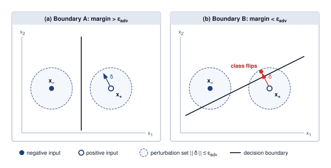
:::

Three categories organize these silent failures and the responses they require, and the rest of the chapter calls them the **three pillars** of robust AI\index{Three Pillars Framework!definition}. The first, environmental change, includes distribution shifts, concept drift, and evolving operating conditions. A model trained on last year's transaction patterns may become unreliable as customer behavior evolves. Monitoring must establish whether the change affects predictive quality before an adaptation strategy can address it.

The second category, input-level attacks, is malicious manipulation that targets model behavior directly through the data a model receives or learns from. Adversarial attacks\index{Adversarial Attack!input-space manipulation}, data poisoning attempts, and prompt injection seek incorrect predictions or unauthorized behavior. Authentication and access controls constrain who can submit data and which actions the system permits, but an authorized input can still induce an incorrect result. Behavioral evaluation must therefore examine the manipulation possible within the access that remains.

The third category is system-level faults: hardware faults, software bugs, dependency failures, and runtime errors that corrupt the machinery around the model. Software and pipeline defects belong to this pillar by origin, yet their symptoms can amplify, mask, or mimic the other two, which is why they also cut across the whole taxonomy. Bugs, design flaws, and implementation errors within algorithms, libraries, and frameworks propagate through the system, creating systemic vulnerabilities[^fn-systemic-vulnerability-ml] that transcend individual component failures. A preprocessing bug might create artificial distribution shifts; a numerical error might corrupt model behavior in ways indistinguishable from adversarial attack; a race condition might corrupt learned representations. Because these faults originate in the systems layer, their detailed taxonomy and mitigation strategies are covered in @sec-fault-tolerance-reliability; this chapter focuses on how system-level faults interact with environmental shifts and input-level attacks.

[^fn-systemic-vulnerability-ml]: **Systemic Vulnerability**\index{Systemic Vulnerability!ML pipelines}: A shared dependency can expose many components to the same defect or attack. Pinning one CUDA\index{CUDA} or PyTorch\index{PyTorch} version across a fleet makes that version a common dependency, but exploitation still depends on the affected code paths, configuration, and attacker access. Dependency inventories and staged updates help identify and contain the exposed population; replication alone does not remove a shared weakness.

The appropriate defense depends on where the system runs and which failures it must contain. A cloud service may have capacity for redundant execution that exceeds an edge device's power and memory budget, but additional replicas do not remove a model weakness shared by every copy. Edge devices\index{Edge Computing!selective hardening} can concentrate checks on critical inference paths and use a validated local fallback. Both settings require measured protection within their resource and response-time limits.

Each protection consumes resources in the path where it operates. Error correction\index{Fault Tolerance!resource overhead} adds storage and checking work, redundant processing repeats computation, and monitoring uses compute and telemetry capacity. Their effects on bandwidth, energy, and response time depend on the implementation and workload. The robustness decision compares those measured costs with the failures detected or contained and the consequences of errors that remain.

Because every layer of the pipeline, from input validation and training through drift detection and fault isolation, carries part of this cost, robustness constrains the architecture rather than wrapping a finished system. The incidents that follow show what ignoring that constraint has cost in cloud, edge, and embedded deployments.

## Real-World Robustness Failures {#sec-robust-ai-realworld-robustness-failures-c119}

A shared storage outage can stop a service, while a perception error can leave it running with an unsafe result. The incidents below separate those two outcomes, so that a successful request or an operational processor is never mistaken for evidence of a valid prediction. Each deployment tier also exposes a different failure most sharply. Cloud fleets show a population slice whose failure hides inside aggregate accuracy, and silent hardware corruption entering training, a system-level fault. Edge vehicles show perception failing under operating conditions the model was never validated for, the environmental pillar with no time for a remote fallback. Embedded controllers show what happens when a false input drives an irreversible action with no human in the loop; those cases predate learned components, so they illustrate the hazard a learned component inherits rather than a model failure. Deliberate attacks are absent from the list because their best-documented evidence comes from controlled field studies, which the input-level attacks section examines.

::: {#ws-robust-ai-google-photos-gorilla-label .callout-war-story title="The label that exposed the test gap (2015)"}

**Context**: In June 2015, Google Photos used automatic image tagging to organize user photos [@kasperkevic2015googlephotos].

**Mechanism**: A deep convolutional image classifier suffered from a severe slice-level failure mode\index{Slice-Level Evaluation!high-risk failure modes}: Jacky Alciné's photos of himself and a Black friend were misclassified under the album tag "Gorillas." The failure demonstrates why aggregate top-1/top-5 accuracy over a full test set cannot establish acceptable behavior for high-risk population slices.

**Impact**: The high-visibility misclassification caused public outrage and exposed a major gap in multi-class vision model safety validation.

**Fix**: Google disabled the "gorilla" label, blocking the symptom without demonstrating that the classifier itself had been corrected.

**Systems lesson**: Production ML robustness cannot be defined by aggregate test set accuracy. High-risk classification tasks require slice-level evaluation and a serving response to harmful errors. Automated toxicity guards and validated fallbacks\index{Fallback Redundancy!toxicity guards} are candidate controls whose coverage must be tested against the specific failure.

:::

That test-gap failure is the model-facing version of a broader reliability problem. In cloud infrastructure, the hidden assumption is often that a shared dependency remains available and correct.

### Cloud infrastructure failures {#sec-robust-ai-cloud-infrastructure-failures-1c8c}

The 2017 AWS S3 outage[^fn-aws-s3-outage] shows the familiar half of that assumption, in which a shared storage dependency failed and otherwise healthy services stopped [@aws2017s3outage]. An outage at least announces itself. The robustness problem is the other half, when the dependency stays up but returns plausible, corrupted data, so the service keeps answering while incorrect results propagate.

[^fn-aws-s3-outage]: **AWS S3 Outage (2017)**\index{AWS S3 Outage!cascade failure}: A mistyped command during routine maintenance removed too much capacity from S3's index and placement subsystems in US-East-1. While those subsystems restarted, S3 could not service requests and dependent AWS services experienced elevated errors or impaired functionality. The incident exposed a single-region dependency pattern: systems that assume regional storage availability as an invariant can fail even when their own application code and model-serving logic remain unchanged.

Silent data corruption (SDC)\index{Silent data corruption!distributed querying} is that case. The decompression incident analyzed in @sec-fault-tolerance-reliability-physics-silent-corruption-5d5d demonstrates the failure signature. A defective CPU returned zero during a size computation for a valid file, causing the decompression pipeline to omit files from its output even though system and kernel logs showed no fault [@dixit2021silent]. The separate training illustration in @fig-sdc-example traces how unhandled corruption can enter gradients, weights, and later checkpoints. In both settings, checking that execution continues is insufficient; evaluation must test the validity of the resulting data or model behavior.

In distributed ML training, a corrupted gradient or activation can perturb optimizer state\index{Silent data corruption!training run rollback} and affect later steps. Recovery may require rollback to the last clean checkpoint and replay of affected training work. Conventional data-processing systems can also propagate corruption into persistent state and downstream decisions; the ML-specific concern is how optimizer updates embed the error in learned parameters. SDC can therefore compromise model accuracy without triggering any alert, and the blast radius grows with the synchronization and checkpointing design rather than remaining localized. Meta's production report shows SDCs as a systemic fleet issue across CPUs and software layers [@dixit2021silent], and recent large language model (LLM)-training work shows that real-world SDCs can alter submodule outputs, optimizer steps, loss spikes, and final model weights [@ma2025understanding]. Dean's MLSys 2024 invited talk frames the same reliability concern at industry scale, where hardware errors\index{Hardware Fault!propagation in training} during large ML training jobs occur routinely enough that one buggy chip's incorrect computations can propagate and infect an entire run [@dean2024mlsys].

### Edge device vulnerabilities {#sec-robust-ai-edge-device-vulnerabilities-ddfe}

Edge deployments must respond within local compute, power, and connectivity limits. Vehicles make the timing constraint concrete: a perception or planning failure can require intervention before a remote service or human operator can respond. Their safety therefore depends on the conditions the system can handle and the fallback available when those conditions no longer hold.

In May 2016, a fatal crash involving a Tesla Model S in Autopilot mode[^fn-autopilot-perception-safety] demonstrated the catastrophic potential of perception failures [@ntsb2017tesla]. Traveling at 74 mph in a 65 mph zone, the vehicle did not identify a tractor-trailer crossing its path, and neither the forward-collision warning nor automatic emergency braking activated. The investigation found that the system was not designed to recognize crossing traffic, turning an unmodeled operating condition into a high-speed underride collision. The system had not been validated for that scene, and nothing in its own behavior signaled that it had left its validated envelope. A separate March 2018 collision in Mountain View, California, in which a Model X operating on Autopilot struck a highway crash attenuator and its driver suffered fatal injuries, shows the physical stakes of any such perception error at highway speed (@fig-tesla-example); the two crashes need not share a failure mechanism for the lesson about response time to hold.

::: {.column-margin .margin-pointer}
↩ The 2016 crash, read as an edge model whose fallback was a supervising driver, is established in @sec-edge-intelligence-production-deployment-risk-assessment-db49.
:::

[^fn-autopilot-perception-safety]: **Autopilot**\index{Autopilot!perception failure}: The 2016 crash involved Tesla's then-current SAE Level 2 driver-assistance system and Mobileye-era perception stack, not the later 8-camera full-self-driving hardware or dual FSD-chip computer. Later Tesla vehicles introduced expanded camera coverage and dedicated FSD compute, but the robustness lesson is the same: fleet-scale data collection does not automatically cover rare scenarios such as a white trailer against a bright sky.

::: {#fig-tesla-example fig-env="figure" fig-pos="htb" fig-cap="**Autopilot-Involved Barrier Crash (2018)**: This Model X collision with a highway barrier in Mountain View, California, a later incident than the 2016 crossing-trailer crash, shows the safety risks of relying on machine learning for perception in autonomous systems, where failures to correctly interpret the scene can lead to catastrophic outcomes. The incident underscores the need for robust validation, redundancy, and failsafe mechanisms in self-driving vehicle designs to mitigate the impact of imperfect AI models. Source: BBC News." fig-alt="Photograph of a dark-blue Tesla after a highway collision. The front-left of the vehicle is heavily damaged; emergency crews and barrier wreckage are visible on scene, consistent with an Autopilot-involved impact."}


:::

In March 2018 in Tempe, Arizona, an Uber self-driving test vehicle struck and killed a pedestrian [@ntsb2019uber]. The system detected her 5.6 seconds before impact, but its classification of her was unstable\index{Object Classification Stability!Uber pedestrian crash}. Repeated reclassification among "vehicle," "other," and "bicycle" caused path prediction to discard tracking history\index{Object Tracking!trajectory prediction failure}. The final investigation placed recognition of the imminent collision at 1.2 seconds before impact. The system then suppressed action for one second without alerting the operator; only afterward did it issue an alert and plan gradual slowdown. The operator did not intervene in time. The case connects perception, tracking, response timing, and human fallback: detecting an object did not establish that the system would act safely on that detection.

An inspection drone surveying power lines may likewise lose reliable localization when lighting changes or repetitive textures confuse visual odometry. An alternate inference or control path provides **fallback redundancy**\index{Fallback Redundancy!definition} when the primary path cannot support the required decision, but its value depends on independent failure coverage and response time. A local sensor-based controller or validated landing mode may be more useful than a remote model that cannot answer before the control deadline. Edge AI\index{Fallback Redundancy!edge constraints} must provision that response within the device's resource limits; a data center's additional replicas would not by themselves correct the same perception error.

### Embedded system constraints {#sec-robust-ai-embedded-system-constraints-ec7a}

Embedded systems can operate through critical intervals in which external intervention is too slow. Remote maintenance may remain possible between those intervals, but an autonomous landing or control maneuver needs a local response before its deadline. Validation must therefore cover both the component's failure modes and the system behavior that follows, including any ML model in the decision loop.

The loss of NASA's Mars Polar Lander in 1999, attributed by the review board to premature touchdown detection that likely shut the engines off before landing [@nasa2000mpl], illustrates the consequences of a false sensor indication during autonomous descent. The planetary deployment illustrated in @fig-nasa-example places the response inside the vehicle rather than with a remote operator. For a learned component in such a control loop, validation must connect plausible input and sensor failures to the actions they can trigger; exhaustive testing of every possible input is not a feasible safety argument.

::: {#fig-nasa-example fig-env="figure" fig-pos="htb" fig-cap="**Robotic Lander on Mars**: An artist's rendering of NASA's Mars Polar Lander on the Martian surface. Remote robotic missions exemplify the class of systems in which software or sensor faults cannot be recovered by human intervention, motivating the rigorous validation and failure-mode analysis that ML components in the decision loop must also satisfy. Source: Slashgear." fig-alt="Artist rendering of NASA's Mars Polar Lander on the Martian surface with solar panels and robotic arm extended, illustrative of robotic planetary landers whose autonomous decision loops demand rigorous validation."}


:::

Commercial aviation shows the same inherited hazard: a 2015 FAA airworthiness directive followed Boeing's discovery that a 787 powered continuously for 248 days could lose all AC power if all four generator control units entered failsafe mode at once,[^fn-failsafe-system-fallback] so that uptime itself became the risk factor [@faa2015boeing]. An endurance test shorter than that interval would not have exposed the defect. A learned component inherits the same hazard whenever deployment reaches a condition its evaluation never covered, such as accumulated state, a rare season, or an unusual sensor reading, and safety-critical systems[^fn-asil-ml-certification] impose stringent reliability requirements precisely because such latent hazards surface only in the field.

[^fn-failsafe-system-fallback]: **Failsafe Mechanism**\index{Failsafe Mechanism!ML serving}: A mechanism that moves the system to a validated safe state when a fault is detected. Circuit breakers, model fallback, rejection, and rollback are possible components, but none is inherently safe for every application. The service must establish that its chosen response meets the hazard and timing constraints; rejection thresholds also trade accepted workload against residual error and review capacity.

[^fn-asil-ml-certification]: **ASIL (Automotive Safety Integrity Levels)**\index{Automotive Safety Integrity Level!ML certification}: ISO 26262 uses automotive safety integrity levels to scale functional-safety obligations according to the hazard analysis. ASIL D is the most stringent level, but it is not a universal component-reliability percentage. An ML perception component complicates the resulting safety case because its behavior depends on the operational distribution and cannot be justified by aggregate test accuracy alone.

A neural network running visual odometry on a planetary rover must tolerate radiation-induced faults in weights, activations, and control state; the mission fault model determines its combination of hardened components, error correction, redundancy, and watchdogs. The safety argument must connect that containment to behavioral error detection and a validated fallback. Model uncertainty[^fn-epistemic-uncertainty-ml] adds a further constraint: confidence alone cannot certify a transfer of control, which must also follow from sensor and system health and an independently validated degraded mode.

[^fn-epistemic-uncertainty-ml]: **Model uncertainty (epistemic uncertainty)**\index{Epistemic Uncertainty!robustness}: Uncertainty associated with limited knowledge of the predictive model, distinguished from aleatoric uncertainty\index{Aleatoric Uncertainty!distinction from epistemic} in the observations. An estimate can support deferral, but it must be evaluated against actual errors and unfamiliar inputs; a low estimate does not certify competence. Repeated-pass or ensemble estimators add inference work, and any human fallback must meet the application's response deadline.

Across these settings, robustness depends on connecting the failure signal to a bounded response. The fleet framework must distinguish the source of that signal before choosing a defense.

## A Unified Framework for Robust AI {#sec-robust-ai-unified-framework-robust-ai-b25d}

One flipped exponent bit in accelerator memory can turn a trained weight of 0.042 into a finite value near $10^{37}$ that passes every NaN check, as the bit-flip analysis below shows. A gradual change in user demographics can erode recommendation quality while latency and uptime stay flat. Production ML systems cannot treat these as isolated bugs. A unified framework must map how low-level hardware faults, software bugs, data drift, and adversarial inputs propagate upward into the model's output.

### Cross-cutting robustness dependencies in the fleet stack {#sec-robust-ai-building-previous-concepts-ef4a}

::: {.column-margin}
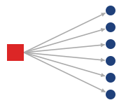{width="100%" fig-alt="A red square source node with arrows fanning out to six identical blue nodes."}

*One corrupted gradient in AllReduce reaches every replica's weights.*
:::

The mechanisms that make a fleet efficient also widen its robustness surface, because each one shares state or work across many machines. The fault detection and recovery mechanisms used to keep training jobs running also support inference-time availability. A restored checkpoint or a responsive replica, however, does not establish that the model behaves acceptably on the current inputs. Robustness extends the recovery argument to graceful degradation\index{Graceful Degradation}, in which a reduced service must still meet a validated behavioral contract when inputs are adversarial or components degrade. Distributed training architectures introduce unique vulnerabilities: a single node transmitting corrupted gradients during an AllReduce operation can poison the global model weights, requiring evidence that corrupted updates are detected or contained. Byzantine fault tolerance protocols\index{Byzantine Fault Tolerance!gradient aggregation} address the case in which a contributor sends arbitrary or malicious values rather than simply stopping; ordinary hardware corruption also demands the fault diagnosis and recovery mechanisms already established for the fleet.

::: {.column-margin .margin-pointer}
↩ Gradient synchronization through AllReduce, in which every replica receives the same reduced gradient, is established in @sec-distributed-training-systems-systems-gradient-synchronization-614b.
:::

::: {.column-margin .margin-pointer}
↩ Byzantine failures, in which a component returns arbitrary values rather than stopping, are established in @sec-fault-tolerance-reliability-reliability-byzantine-failures-8a24.
:::

Serving repeats the same sharing at inference time. Batching, request routing, and pipeline-parallel stages place many users' requests on one model replica or one stage, so a corrupted replica or stage returns wrong answers to every request routed through it while its health checks still pass. When the cause is deliberate rather than accidental, the threat-vector classification in @sec-security-privacy-threat-vector-classification-3042, by attacker access, knowledge, and timing, defines the attacker that a defense must assume.

::: {.column-margin .margin-pointer}
↩ Batching, request routing, and pipeline-parallel serving are established in @sec-inference-scale.
:::

```{python}
#| echo: false

from mlsysim import *
from mlsysim.core.units import *

# ┌─────────────────────────────────────────────────────────────────────────────
# │ ROBUST AI INFRASTRUCTURE CONSTRAINTS (LEGO)
# ├─────────────────────────────────────────────────────────────────────────────
# │ Context: @sec-robust-ai-ml-performance-system-reliability-7d42—reliability intro
# │
# │ Goal: Surface model scale, weight memory footprint, and hardware specs.
# │ Show: ~175B params, 350 GB weight footprint > 80 GB accelerator HBM, and ~900 GB/s V100 memory bandwidth.
# │ How: .to(unit).magnitude from mlsysim.core.units.
# │
# └─────────────────────────────────────────────────────────────────────────────
from mlsysim.fmt import check, fmt_bandwidth, fmt_memory, fmt_params

# ┌── LEGO ───────────────────────────────────────────────
class RobustAISetup:
    """Namespace for hardware fault exposure parameters."""

    # ┌── 1. LOAD (Constants) ──────────────────────────────────────────────
    from mlsysim import Models, Hardware

    m = Models.Language.GPT3
    h = Hardware.Cloud.V100
    h_a100 = Hardware.Cloud.A100

    # ┌── 2. EXECUTE (The Compute) ────────────────────────────────────────
    gpt3_params_b_val = m.parameters.to(param).magnitude / BILLION
    b_param = BYTES_FP16.to(byte).magnitude  # FP16 (2 bytes per param)
    d_vol_gb = gpt3_params_b_val * b_param  # 350 GB
    # Branded hardware label: capacity is stored as 80 GiB; the vendor label is
    # "80 GB" (lego-units.md, Branded Hardware Labels), so read the binary magnitude.
    a100_hbm_gb = int(h_a100.memory.capacity.to(GiB).magnitude)  # 80 GB (branded)
    v100_bw_gbs_val = h.memory.bandwidth.to(GB / second).magnitude

    # ┌── 3. GUARD (Invariants) ──────────────────────────────────────────
    check(gpt3_params_b_val == 175, f"Expected 175B params, got {gpt3_params_b_val}")
    check(d_vol_gb == 350, f"Expected 350 GB weight footprint, got {d_vol_gb}")
    check(a100_hbm_gb == 80, f"Expected 80 GB A100 HBM, got {a100_hbm_gb}")

    # ┌── 4. OUTPUT (Formatting) ──────────────────────────────────────────────
    from mlsysim.fmt import fmt_int, fmt_memory, fmt_memory_capacity, fmt_params

    gpt3_params_b_str = fmt_params(m.parameters, scale="B", precision=0, commas=False)
    d_vol_gb_str = fmt_memory(d_vol_gb * GB, unit=GB, precision=0)
    a100_hbm_gb_str = fmt_memory_capacity(h_a100.memory.capacity, unit=GiB, precision=0)
```

Large dense models amplify these risks. The Archetype A (GPT-4/Llama-3) reference model, a GPT-3-class\index{GPT-3} dense transformer with `{python} RobustAISetup.gpt3_params_b_str` parameters, needs `{python} RobustAISetup.d_vol_gb_str` for its weights alone at FP16/BF16 serving precision ($\ElementStorageSize = 2\text{ bytes/param}$, with no optimizer state). Because that footprint exceeds the `{python} RobustAISetup.a100_hbm_gb_str` per-device memory capacity $\DeviceMemoryCapacity$ of a single A100- or H100-class accelerator, keeping these weights accelerator-resident requires distributing them across multiple devices. Each additional pipeline or tensor-parallel stage increases the fault surface compared with a monolithic deployment: a single bit flip or network partition in one stage can fail the entire inference request, and silent corruption can propagate through downstream computations that consume the affected values. Whether it changes the final prediction depends on the corrupted value, the computation, and the available detection or containment.

The pressure that shards a model across devices also compresses it. Efficiency techniques that let a model fit fewer devices or serve more requests change the deployed computation itself, so robustness engineering is a constant negotiation with the efficiency and scalability constraints established in previous chapters.

### From ML performance to system reliability {#sec-robust-ai-ml-performance-system-reliability-7d42}

Once silent failure becomes a systems property, accuracy, latency, and throughput no longer describe the full reliability envelope. The deployed model also depends on the computational substrate that executes it, and that substrate can corrupt a correct model without producing a visible service failure.

@Fig-weight-corruption traces how a physical bit flip cascades through neural inference: in panel (b), flipping bit 30 of an FP32 weight scales its magnitude by $2^{128}$, transforming a modest weight ($\ModelWeight= 0.042$) into an extreme outlier ($\CorruptedModelWeight\approx 1.4 \times 10^{37}$). Panel (a) traces the affected path through hidden unit $\HiddenUnitOutput_2$ to output logits ($\NetworkOutput_1, \NetworkOutput_2$). The corrupted weight is finite and can evade NaN or infinity checks; whether it dominates those outputs depends on the input, activation function, and downstream weights. Targeted bit-flip attacks deliberately select vulnerable weight bits, so their results should not be interpreted as the effect of one random hardware upset. Memory subsystem failures during training can likewise corrupt gradient updates and prevent model convergence. Scale turns one corrupted value into a persistent exposure. Every forward pass of a dense GPT-3-class model reads all `{python} RobustAISetup.gpt3_params_b_str` of its parameters, so a corrupted weight resident in memory participates in every request that replica serves until something detects it. Estimating how often such corruption occurs requires a sourced, device-specific error rate with its stored capacity and time basis, which is the role of the fleet-scale probability model below.

::: {#fig-weight-corruption fig-env="figure" fig-pos="htb" fig-cap="**Weight Corruption via Bit Flip**: (a) One corrupted weight $\CorruptedModelWeight$ drives hidden unit $\HiddenUnitOutput_2$, whose output feeds every downstream logit. (b) For an illustrative trained weight $\ModelWeight = 0.042 \approx 1.34 \times 2^{-5}$, flipping bit 30, the most significant exponent bit of the FP32 word, raises the stored exponent from $2^{-5}$ to $2^{123}$. In general, flipping an exponent bit with place value $2^{\ExponentBitIndex}$ scales the value by $2^{\pm 2^{\ExponentBitIndex}}$; here the factor is $2^{128}$, giving $\CorruptedModelWeight \approx 1.4 \times 10^{37}$. The result is still finite, so NaN and infinity checks never fire, yet it can produce extreme downstream activations, depending on the input, activation function, and downstream weights. A range check $|\ModelWeight| \le \WeightRangeBound$ against the trained weight distribution catches it cheaply." fig-alt="Left: a small network with four inputs, three hidden units, and two outputs; one input-to-hidden weight is drawn thick and red, and dashed red arrows run from the affected hidden unit to both outputs. Right: two FP32 bit rows showing sign, eight exponent bits, and a collapsed mantissa. The top row encodes w = 0.042 with exponent bits 01111010; an arrow labeled bit 30 flips 0 to 1, value times 2 to the 128 leads to the bottom row, whose first exponent bit is red and set to 1, labeled w prime approximately 1.4 times 10 to the 37."}
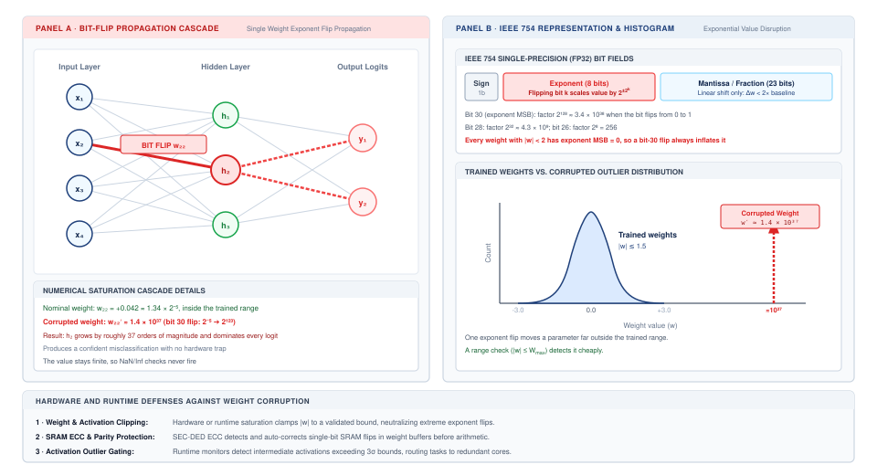
:::

The connection between hardware reliability and ML performance demands concepts from reliability engineering:[^fn-reliability-eng-ml] fault models that describe how failures occur, error detection mechanisms that identify problems before they impact results, and recovery strategies that restore system operation. Compression meets these concepts through the model's **robustness margin**\index{Robustness Margin!definition}\index{Robustness Margin!quantization impact}, the amount of input perturbation, numerical error, or representation change the model can absorb before its prediction changes. INT8 quantization, pruning, and knowledge distillation change the deployed computation, and each can shrink that headroom, so a compressed model that matches the original's clean-data accuracy has not thereby shown that its margin survived. An optimized system therefore needs evidence that its detection and recovery mechanisms cover the faults in its operating model and that the resulting predictions still meet the service contract.

[^fn-reliability-eng-ml]: **Reliability Engineering**\index{Reliability!engineering, ml extension}: Uses fault models and failure-mode analysis to connect component behavior to system outcomes. A series model gives system reliability\index{Reliability Engineering!exponential failure law} as $\SystemReliability(\TimeInstant)=e^{-\SeriesComponentCount\ComponentFailureRate \TimeInstant}$ when all $\SeriesComponentCount$ components must survive, failures are independent, and each has the same constant exponential failure rate. ML deployments also need behavioral evidence for drift, crafted inputs, and uncertainty; the component-survival model alone does not cover these failure modes.

```{python}
#| echo: false
# ┌─────────────────────────────────────────────────────────────────────────────
# │ Context: @sec-robust-ai-ml-performance-system-reliability-7d42—SDC at scale
# │
# │ Goal: Quantify why massive scale makes silent errors operationally likely.
# │ Show: 10K devices at illustrative p=1e-4/hr gives Pr>0.6; ~30K gives Pr>0.95.
# │ How: Pr(at least one) = 1 - (1-p)^N.
# │
# └─────────────────────────────────────────────────────────────────────────────
from math import ceil, log
from mlsysim.physics.reliability import calc_binomial_failure_probability
from mlsysim.fmt import check, fmt, fmt_percent

# ┌── LEGO ───────────────────────────────────────────────
class SilentErrorProbability:
    """Namespace for SDC probability at cluster scale."""

    # ┌── 1. LOAD (Constants) ──────────────────────────────────────────────
    p_per_hr_illustrative = 1e-4  # scenario assumption (stress-test rate)
    n_gpus_large = Systems.Clusters.Training_10K.total_accelerators

    # ┌── 2. EXECUTE (The Compute) ────────────────────────────────────────
    # Step 1: Pr(at least one) = 1 - (1-p)^N
    from math import ceil, log

    p_at_least_one_val = calc_binomial_failure_probability(p_per_hr_illustrative, n_gpus_large)
    n_gpus_certain_val = ceil(log(0.05) / log(1 - p_per_hr_illustrative))

    # ┌── 3. GUARD (Invariants) ──────────────────────────────────────────
    from mlsysim.fmt import check

    check(p_at_least_one_val > 0.6, f"Probability ({p_at_least_one_val:.2f}) should be high at 10K devices")

    # ┌── 4. OUTPUT (Formatting) ─────────────────────────────────────────────
    from mlsysim.fmt import fmt, fmt_percent

    p_per_hr_prose_str = fmt_percent(p_per_hr_illustrative, precision=2, commas=False, style="prose")
    n_gpus_large_str = fmt(n_gpus_large, precision=0)
    p_total_large_str = fmt_percent(p_at_least_one_val, precision=1, style='prose')
    n_gpus_certain_str = fmt(n_gpus_certain_val, precision=0)
```
Scale also compounds the chance that such corruption occurs somewhere. As @sec-ft-sdc-verification establishes, a fleet of $\DeviceCount$ devices\index{Silent data corruption!cluster-scale probability}, each with independent residual-error probability $\DeviceSilentCorruptionProbability$ over the same interval, sees at least one silent error with probability $\Pr(\geq 1) = 1 - (1 - \DeviceSilentCorruptionProbability)^\DeviceCount$; bit flips that hardware corrects are not silent errors. @Fig-silent-error-probability recalls that curve for three illustrative per-device rates. At `{python} SilentErrorProbability.p_per_hr_prose_str` per device-hour, a `{python} SilentErrorProbability.n_gpus_large_str`-device cluster sees some corruption within an hour with probability `{python} SilentErrorProbability.p_total_large_str`, and corruption becomes nearly certain at roughly `{python} SilentErrorProbability.n_gpus_certain_str` devices. The rates are stress-test assumptions rather than measured device rates, although Meta's SDC report confirms corruption at observable fleet scale [@dixit2021silent].

::: {#fig-silent-error-probability fig-env="figure" fig-pos="htb" fig-cap="**Silent Error Probability at Scale**: Probability of at least one silent data corruption event per hour as a function of cluster size, for three illustrative per-device error rates. The curves are analytical, $\Pr(\geq 1) = 1 - (1-\DeviceSilentCorruptionProbability)^\DeviceCount$, and show how quickly cluster-scale probabilities compound as per-device rates increase; fleet observations of silent corruption [@dixit2021silent] motivate stress-testing at rates above soft-error predictions." fig-alt="Semilog plot showing three S-curves, solid, dashed, and dotted, labeled with per-device SDC rates of 1e-3, 1e-4, and 1e-5. A red band above probability 0.95 is labeled effectively certain, and a dashed line at 0.5 is labeled more likely than not. The 1e-3 and 1e-4 curves enter the red band and approach probability 1.0 by 100000 devices, with a dot marking 0.63 at 10K on the 1e-4 curve; the 1e-5 curve rises to about 0.63."}

```{python}
#| echo: false
#| warning: false
# ┌─────────────────────────────────────────────────────────────────────────────
# │ SILENT ERROR PROBABILITY (FIGURE)
# ├─────────────────────────────────────────────────────────────────────────────
# │ Context: @fig-silent-error-probability—SDC at cluster scale
# │
# │ Goal: Plot Pr(>=1 SDC) = 1-(1-p)^N vs N for p=1e-3, 1e-4, 1e-5.
# │ Show: Three S-curves; semilog x; shaded region; annotations.
# │ How: N = logspace(0,5,500); Pr_at_least_one = 1-(1-p)^N; book_style.setup_plot().
# │
# └─────────────────────────────────────────────────────────────────────────────
# ┌── 1. CANVAS ────────────────────────────────────────────────────────────────
# │ Plot Pr(>=1 SDC) = 1-(1-p)^N vs N for p=1e-3, 1e-4, 1e-5.
import numpy as np
import matplotlib.pyplot as plt
from binder.tools.figures import style as book_style

fig, ax, COLORS, plt = book_style.setup_plot(figsize=(5.6, 3.3))

# ┌── 2. ARRAYS ────────────────────────────────────────────────────────────────
N = np.logspace(0, 5, 500)  # 1 to 100,000 devices

# Three per-device SDC probabilities per hour. The rates are an ordered
# severity sweep, not resources: one neutral ink, distinguished by line style
# and labeled directly on each curve. Red is kept for the danger band only.
rates = [
    (1e-3, '-', '$p = 10^{-3}$'),
    (1e-4, '--', '$p = 10^{-4}$'),
    (1e-5, ':', '$p = 10^{-5}$'),
]
label_prob = 0.30  # height at which each curve carries its direct label

# ┌── 3. RENDER ────────────────────────────────────────────────────────────────
# Danger band: fleet-level corruption is effectively certain (Pr >= 0.95).
ax.axhspan(0.95, 1.02, color=COLORS['RedL'], alpha=0.6, lw=0, zorder=0)
ax.axhline(y=0.95, color=COLORS['RedLine'], linewidth=0.8, alpha=0.8, zorder=1)

for p, style, label in rates:
    P_at_least_one = 1 - (1 - p) ** N
    ax.plot(N, P_at_least_one, color=COLORS['primary'], linestyle=style, linewidth=1.8, zorder=3)
    n_label = np.log(1 - label_prob) / np.log(1 - p)  # where the curve crosses label_prob
    ax.text(n_label / 1.15, label_prob, label, fontsize=9, ha='right', va='center', color=COLORS['primary'])

# ┌── 4. DECORATE ──────────────────────────────────────────────────────────────
ax.text(13, 0.985, 'effectively certain', fontsize=9, color=COLORS['RedLine'], va='center')

# "More likely than not" reference line
ax.axhline(y=0.5, color=COLORS['secondary'], linestyle=(0, (4, 3)), linewidth=0.8, zorder=1)
ax.text(13, 0.515, 'more likely than not', fontsize=9, color=COLORS['secondary'], va='bottom')

annot_p = SilentErrorProbability.p_per_hr_illustrative
annot_n = SilentErrorProbability.n_gpus_large
annot_prob = 1 - (1 - annot_p) ** annot_n
ax.plot([annot_n], [annot_prob], marker='o', markersize=5, color=COLORS['primary'], zorder=4)
ax.text(
    annot_n / 1.25,
    annot_prob,
    f'{annot_prob:.2f} at {annot_n // 1000:.0f}K',
    fontsize=9,
    ha='right',
    va='center',
    color=COLORS['primary'],
)

ax.set_xscale('log')
ax.set_xlabel('Cluster size (number of GPUs)')
ax.set_ylabel('$\\Pr$(at least one SDC per hour)')
ax.set_xlim(10, 1e5)
ax.set_ylim(0, 1.02)
ax.grid(True, which='major', alpha=0.4)
ax.grid(False, which='minor')
plt.show()
plt.close()
```

:::

At cluster scale a per-device reliability number therefore becomes a coordination cost, the third axis of C$^3$. Once a silent error is likely somewhere in the fleet, operators must agree on which replicas, checkpoints, and outputs remain trustworthy before they can contain it, and that agreement requires evidence that ordinary health checks do not collect. Hardware faults, adversarial inputs, and software defects all create this evidence problem, which is why the chapter treats them within one framework.

### The three pillars of robust AI {#sec-robust-ai-three-pillars-robust-ai-2626}

The unified framework helps engineers decide which failure signal they are seeing before they choose a defense. What this section adds to the three pillars named at the start of the chapter is their decomposition into concrete failure subtypes, each paired with the defense that targets it (@fig-robustness-taxonomy).

::: {#fig-robustness-taxonomy fig-env="figure" fig-pos="htb" fig-cap="**The Robustness Taxonomy**: Environmental shifts, input-level attacks, and system-level faults decomposed into concrete failure subtypes (dark), each paired with its principal defense (green). Each pillar descends onto a defense wall at the point where it enters the ML pipeline, the data stream, the model's inputs and training data, or the weights and accelerators. Software and pipeline defects originate in the system layer, but they are drawn as the cross-cutting pipeline rail on which all three walls sit because their symptoms can amplify or imitate any of the pillars." fig-alt="Three side-by-side pillar columns sit above one horizontal dashed pipeline band that runs left to right from data in to output and is labeled software and pipeline defects, cross-cutting; inside the band, a labeled icon sits centered under each column. Each column holds four white failure chips, each naming a failure in dark text and its defense in green. A red arrow from each column's chips ends on a solid green wall bar resting on the pipeline band, directly above the component that pillar strikes: a data stream of sample dots under environmental shifts, a grid of input and training data tiles under input-level attacks, and an accelerator chip holding weight cells under system-level faults. Environmental shifts: covariate shift to importance weighting, concept drift to retraining on fresh labels, label shift to prior re-estimation and recalibration, domain shift to domain adaptation and fine-tuning. Input-level attacks: evasion (FGSM, PGD) to adversarial training, C and W and boundary attacks to certified defenses, data and backdoor poisoning to provenance and spectral filtering, physical perturbations to transformation-robust training. System-level faults: silent data corruption to redundant execution and fleet screening, memory and weight bit flips to ECC and weight range checks, underflow overflow and NaN to loss scaling and NaN guards, distributed training desync to checkpoint rollback and watchdogs."}
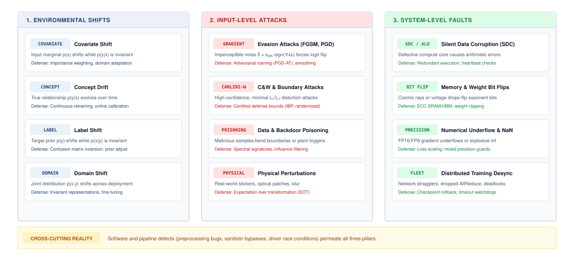
:::

The subtype names matter less than the evidence each pillar produces, because the evidence is what an operator actually observes and what selects the defense family. Environmental shifts can produce statistical differences between production data and a reference population. Those differences motivate investigation, but an input-distribution monitor cannot detect every change in the relationship between inputs and outcomes. Monitoring, recalibration, and retraining address different parts of that problem; outcome evidence helps determine which response is warranted.

Input-level attacks deliberately target model behavior through crafted inputs or poisoned training samples. Anomalous inputs can raise suspicion, but an effective attack need not expose a recognizable perturbation or statistical outlier. Adversarial training, certification, and input sanitization address different threat models. Authentication and access control constrain who can submit data and what actions a model-driven system may take; they do not establish that every permitted input will receive a correct prediction.

System-level faults encompass failures originating from the hardware, code, frameworks, and deployment infrastructure that support ML systems: numerical instability in gradient computations, data pipeline corruption from preprocessing bugs, race conditions in distributed training, desynchronization in which data-parallel replicas that should hold identical parameters silently diverge, memory leaks that degrade long-running services, dependency failures from version mismatches, and hardware faults such as bit flips or power events. Many such faults produce explicit errors or outages. The robustness problem is harder when the service keeps answering and the fault instead appears as a change in model behavior. It can then masquerade as either of the other pillars, leading an engineer to spend the defense budget on the wrong cause. The signals that expose the disguise compare a fault against drift and attack evidence, so @sec-robust-ai-diagnosing-the-masquerade-9f21 develops them after both pillars have been treated.

::: {.column-margin .margin-pointer}
↩ The mechanics of hardware and software faults, and their detection and recovery, are established in @sec-fault-tolerance-reliability.
:::

### Common robustness principles {#sec-robust-ai-common-robustness-principles-cb22}

Across all three categories, the shared engineering problem is deciding which signal triggers which response. Robust systems need a detection threshold, a degradation path, and an adaptation mechanism, each with an explicit cost budget.

Detection and monitoring form the foundation of that strategy. Each pillar asks for a different signal. System-level monitoring\index{Monitoring!multi-tier robustness telemetry} samples hardware and runtime metrics for evidence of temperature anomalies, voltage fluctuations, memory errors, or silent data corruption. Detection can limit further propagation, but the first observable symptom may follow a corrupted state update. Input-level attack monitoring uses statistical or activation-space tests to flag suspected adversarial inputs and poisoning attempts for rejection or investigation. Environmental-shift monitoring compares production traffic with reference distributions using tools such as maximum mean discrepancy (MMD),[^fn-mmd-distribution-drift] population stability index (PSI), or Kolmogorov-Smirnov (KS) tests, the statistics developed in @sec-robust-ai-quantitative-drift-detection-1e04. The same quantitative discipline applies to defense cost: robustness mechanisms must be budgeted, not merely enabled, because every detector trades sensitivity against false positives, latency, and compute overhead.

[^fn-mmd-distribution-drift]: **Maximum mean discrepancy (MMD)**\index{Maximum Mean Discrepancy!drift detection}: A discrepancy between kernel mean representations of distributions, used to construct two-sample tests. A kernel on input vectors lets MMD respond to joint-distribution changes that per-feature comparisons can miss; sensitivity depends on the kernel and test calibration. Direct pairwise estimation costs $\mathcal{O}(\DriftTestSampleSize^2)$ in sample size, while linear-time estimators and approximations trade computation against statistical efficiency.

Graceful degradation turns detection into a bounded operating mode instead of a crash, stepping down a predeclared ladder of cheaper models and simpler features rather than failing outright. Robustness adds a behavioral condition to that ladder. The degraded model and its fallback must still satisfy the service's acceptance criteria under the failure that triggered them. A quantized replica\index{Quantization!robustness trade-off} that keeps serving when capacity drops therefore needs its own validation under the degraded operating conditions, because quantization can shrink the robustness margin even when clean accuracy holds. Ensemble fallback systems\index{Fallback Redundancy!ensemble switching} preserve service only if the alternate models cover the relevant failure and complete within the serving deadline; their quality under that failure, switching delay, and capacity under diverted traffic require evaluation, and ensemble membership alone establishes none of these properties.

::: {.column-margin .margin-pointer}
↩ Graceful degradation as a ladder of model and feature fallbacks, each validated before it is needed, is established in @sec-fault-tolerance-reliability-reliability-graceful-degradation-9122.
:::

Adaptive response completes the loop by changing system behavior when the signal persists. Adaptation might involve activating error correction mechanisms, applying input preprocessing techniques, or dynamically adjusting model parameters. Robustness therefore requires ongoing adjustment rather than a one-time configuration.

Detection, degradation, and adaptation extend beyond fault recovery to form a systematic performance adaptation strategy that appears throughout ML system design. The defense mechanisms mapped across the three pillars of @fig-robustness-taxonomy instantiate this pattern: hardware ECC and redundant execution detect faults, weight range checks and checkpoint rollbacks contain the damage, and retraining or adversarial training adapts the model. Because each pillar needs its own version of all three mechanisms, no single defense covers the taxonomy.

The evaluation plan must preserve those distinctions. One row of it is not a pillar at all. Population monitors ask whether traffic as a whole has changed, while a serving system must also decide, request by request, whether this particular input lies inside the model's demonstrated competence. The tools for that per-request decision, namely calibration, out-of-distribution (OOD) scores, and selective prediction with its risk-coverage curve, are developed in @sec-robust-ai-selective-prediction, after the drift statistics they complement. @Tbl-robust-ai-evaluation-matrix\index{Stress Testing!evaluation matrix} defines the minimum evidence for each failure class and prevents a passed test in one column from becoming a robustness claim about another. On a first reading the table is a map rather than a lesson. Near-OOD inputs resemble the training data but fall outside its classes or conditions, while far-OOD inputs come from unrelated sources; robust and certified accuracy are developed with the adversarial defenses (@sec-robust-ai-certified-defenses), and sybil and Byzantine contributors with data poisoning (@sec-robust-ai-data-poisoning-4b55). The chapter returns to each row as its evidence is taught.

| Failure class            | Evaluation set or intervention                                                                      | Primary evidence                                                     | Required slice                             | Decision boundary                                         |
|:-------------------------|:----------------------------------------------------------------------------------------------------|:---------------------------------------------------------------------|:-------------------------------------------|:----------------------------------------------------------|
| Natural shift            | Time-, geography-, device-, and environment-held-out data                                           | Accuracy or loss, calibration error, and drift statistics            | Critical cohorts and tail conditions       | Continue, investigate, recalibrate, retrain, or fall back |
| Per-request competence   | In-distribution errors plus near- and far-OOD inputs                                                | Risk-coverage curve, OOD score, and fallback load                    | High-consequence request classes           | Answer, route, abstain, or reject                         |
| Adversarial manipulation | White-box, black-box, transfer, and physical attacks matched to the threat model                    | Robust accuracy by attack budget; certified accuracy where available | Targeted classes and attacker capabilities | Accept, harden, restrict, or block release                |
| Poisoning                | Source-compromise, label-flip, backdoor, fake-identity (sybil), and Byzantine-contributor scenarios | Clean and attack-success metrics, slice loss, and detector recall    | Sources, contributors, and subpopulations  | Quarantine, exclude, reweight, or roll back               |
| System fault             | Fault injection across data, runtime, accelerator, and network paths                                | Silent-error rate, detection latency, and recovery success           | Correlated and multi-component faults      | Retry, isolate, degrade, or fail safe                     |

: **Robustness Evaluation Matrix**: Each failure class requires its own intervention, evidence, slices, and operational decision. Aggregate test accuracy or one attack benchmark cannot stand in for the complete matrix. {#tbl-robust-ai-evaluation-matrix tbl-colwidths="[14,26,23,17,20]"}

### Integration across the ML pipeline {#sec-robust-ai-integration-across-ml-pipeline-8286}

Robustness requires evidence across the ML lifecycle, with complementary controls at each stage. This is the defense-in-depth principle applied to model behavior\index{Defense-in-Depth!ML lifecycle integration}. In the data ingestion phase, sanitization filters flag malformed or statistically anomalous records for rejection or review before training. This limits some poisoning paths but cannot establish that accepted records are clean. During training, adversarial training exposes the model to high-loss perturbations found by an approximate attack search, while randomized smoothing, which averages predictions over noisy copies of each input, later turns those repeated predictions into a certifiable robustness bound (@sec-robust-ai-certified-defenses). Both families try to limit how quickly outputs can change as inputs change, a property that certification later makes precise. Validation extends beyond simple accuracy metrics to include stress testing on out-of-distribution datasets, measuring behavior within a named deployment envelope.

::: {.column-margin .margin-pointer}
↩ Defense in depth, which requires independent layers so that defeating one does not defeat the system, is established in @sec-security-privacy-defense-strategy-framework-7654.
:::

Once deployed, the focus shifts to runtime defense. A robust inference server complements its serving architecture with the detection techniques in @sec-robust-ai-detection-techniques-0e7e, including input filtering that can reject suspicious queries before the main prediction. A production fraud detection pipeline must evaluate ingestion checks against poisoned training records and serving-time filters against evasion attempts separately. Neither stage guarantees interception, and model-based filters themselves consume inference resources. The monitoring layer acts as the safety net, detecting distribution drift, such as a sudden shift in transaction amounts or user geolocations, and triggering investigation and performance correlation. Retraining follows only when validated outcome evidence, root-cause analysis, and the release gate show that a model update is the appropriate response.

The holistic view integrates with hardware reality. Hardware faults (transient, permanent, and intermittent) are covered in detail in @sec-fault-tolerance-hardware-fault-taxonomy, where they integrate with the broader fault detection and recovery mechanisms for distributed systems. Robustness evaluation adds a behavioral test to those mechanisms: after a fault is detected or a request retried, the output must still satisfy the model's acceptance criteria. A retry alone does not establish that the result is correct. The same distinction between service health and prediction quality applies when the machinery works correctly but the world evolves beyond its training data.

::: {#chk-robust-ai-three-pillars .callout-checkpoint title="Diagnosing the failure signal"}

The unified framework requires identifying which of the three pillars produced a silent failure before choosing a defense, and recognizing that software faults can masquerade as any of them.

**Classifying the threat**

- [ ] **Pillar classification**: classify a model losing accuracy as customer behavior evolves, a crafted input that forces misclassification, and an accelerator HBM bit flip under the correct robustness pillars.
- [ ] **Software-fault mimicry**: explain why a preprocessing bug that shifts every inference's feature statistics is hard to distinguish from genuine environmental shift, then name the pillar it belongs to by origin and the pillar whose symptom it imitates.

```{=latex}
\tcbbreak
```

**Choosing the response**

- [ ] **Response selection**: map an ECC-corrected single-bit memory error and a fired drift monitor to the shared responses of detection, graceful degradation, and adaptive response.
- [ ] **Fleet-scale effects**: explain why a negligible per-device silent-corruption rate becomes an architectural constraint at a fleet scale of tens of thousands of accelerators.

:::

## Environmental Shifts {#sec-robust-ai-environmental-shifts-a2cf}

Training data freezes a past world, while production traffic keeps changing. Environmental shifts arise as data distributions, user behavior, and operational contexts move after training. A shift becomes a robustness failure when model behavior no longer meets the service contract. Changed conditions can also expose software defects or alter the effectiveness of an adversarial defense, so the response depends on both the distribution change and its measured consequences.

### Distribution shift and concept drift {#sec-robust-ai-distribution-shift-concept-drift-55e2}

Consider a medical diagnosis model trained on X-ray images from one hospital and deployed in a clinic with different imaging equipment\index{Distribution Shift!clinical imaging}. Even for the same medical conditions, acquisition settings can change the image characteristics. This difference between training and deployment populations is **distribution shift**\index{Distribution Shift!definition}; whether it reduces diagnostic accuracy requires evaluation on the clinic's data. A move to a different source altogether, such as a new hospital, sensor, or region, is often called domain shift\index{Domain Shift}, and it can combine several of the shift types distinguished below.

@Fig-shift-types partitions distribution shift into three geometric and statistical regimes: inputs can migrate to an unfamiliar region of feature space (panel a), label priors can skew (panel b), or the underlying mapping itself can invert (panel c). Here, $\ModelInput$ denotes an input and $\ExampleLabel$ its outcome label. Input-only monitors can detect changes in $\ProbabilityFunction(\ModelInput)$; distinguishing changes in label frequencies or in $\ProbabilityFunction(\ExampleLabel\mid \ModelInput)$ generally requires outcome evidence or additional assumptions.

::: {#fig-shift-types fig-env="figure" fig-pos="htb" fig-cap="**Types of Distribution Shift**: (a) Under covariate shift, deployment inputs move to a new region of feature space while the labeling rule, and so the correct boundary, stays fixed. (b) Under label shift, class frequencies change while each class's inputs look the same; the bar heights are illustrative. (c) Under concept drift, the same inputs acquire new labels, so points between the old and new boundaries become errors. Covariate shift changes $\ProbabilityFunction(\ModelInput)$ with $\ProbabilityFunction(\ExampleLabel \mid \ModelInput)$ fixed, label shift changes $\ProbabilityFunction(\ExampleLabel)$ with $\ProbabilityFunction(\ModelInput \mid \ExampleLabel)$ fixed, and concept drift changes $\ProbabilityFunction(\ExampleLabel \mid \ModelInput)$; the distinction determines whether reweighting, recalibration, or model adaptation is appropriate." fig-alt="Three panels with a shared key for class 0 (filled) and class 1 (open) points and red label-changed points. Panel a, covariate shift: blue training points labeled train, of two classes, sit on either side of a dashed boundary, and an arrow points to amber deployment points labeled deploy, of the same two classes in a new region, still on the correct sides of the unchanged boundary. Panel b, label shift: paired blue train and amber deploy bars for y equals 0 and y equals 1; training bars are equal, and the deployment bar for y equals 1 is much taller than for y equals 0. Panel c, concept drift: the same points with a dashed boundary labeled old and a solid green boundary labeled new crossing it; points between the two boundaries are red to mark changed labels."}
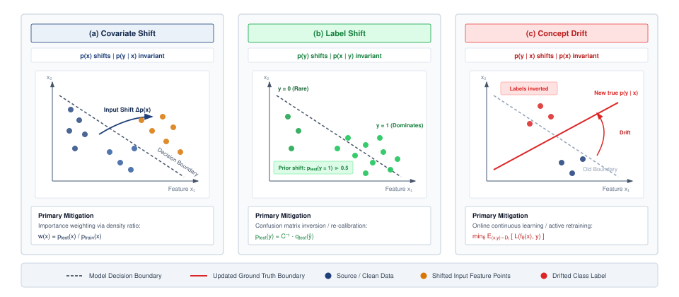
:::

These shifts occur naturally as environments evolve. User preferences change seasonally, language evolves with new slang, and economic patterns shift with market conditions. Unlike adversarial attacks that require malicious intent, these shifts emerge organically from the dynamic nature of real-world systems. When a deployed model actively influences user behavior, as in fraud detection, recommendation engines, or credit underwriting, the shift is not merely exogenous. The sociotechnical feedback invariant (principle \ref{pri-sociotechnical-feedback}) governs these performative environments: the probability distribution of future inputs $\ProbabilityFunction_{t+1}(\ModelInput)$ depends directly on the model's past decisions $\ModelPredictor_t(\ModelInput)$ through the environment's response function $\EnvironmentResponseFunction(\ProbabilityFunction_t(\ModelInput), \ModelPredictor_t(\ModelInput))$. Deployed predictions induce user and adversary adaptations that accelerate distribution shift, compressing the model's viable operating window and demanding closed-loop monitoring rather than static validation.

#### Technical categories {#sec-robust-ai-technical-categories-cc06}

Covariate shift\index{Covariate Shift!importance weighting}\index{Covariate Drift!importance weighting} changes the input distribution while the relationship between inputs and outputs stays fixed [@quinonero2009dataset]. A vehicle perception model trained mostly on daytime images may encounter unfamiliar inputs at night\index{Covariate Shift!day-night illumination}, or in rain, snow, and fog. Treating this as covariate shift requires assuming that the conditional labeling relationship stays fixed; an unchanged task name alone does not establish that assumption. Any accuracy loss depends on the luminance shift, the sensor, and how much adverse-condition data the training set contained, so each deployment must measure it on held-out night and weather slices rather than assume a published figure. Under the covariate-shift assumption, the changed population can place more probability in regions the model learned poorly, as illustrated in panel (a) of @fig-shift-types. Aggregate accuracy can then decline even though the labeling rule remains fixed. This is a change in the distribution of errors, not a claim that every affected request becomes incorrect.

::: {.column-margin .margin-pointer}
↩ A fleet drift monitor that must tell input-distribution change from input-output change is established in @sec-ml-operations-scale-drift-detection-793f; this section defines the shift types it separates.
:::

```{python}
#| echo: false
# ┌─────────────────────────────────────────────────────────────────────────────
# │ A NEW TEST SET FROM THE SAME RECIPE (LEGO)
# ├─────────────────────────────────────────────────────────────────────────────
# │ Context: Paragraph after the covariate-shift paragraph and
# │          @fig-imagenet-v2-shift.
# │
# │ Goal: Show that even a shift meant to be none at all costs every model.
# │ Show: 212 ImageNet models (>= 55% val) all lose 7-14 points on
# │       ImageNet-V2, median 12; the loss tracks accuracy linearly.
# │ How: Gaps and a least-squares fit over Literature.Series.ImageNetTestbedShift.
# │
# └─────────────────────────────────────────────────────────────────────────────
import statistics
import numpy as np
from mlsysim import Literature
from mlsysim.fmt import check, fmt, fmt_int

def _evaluated(rows, floor):
    return [r for r in rows if r["imagenet_v2"] is not None and r["val"] >= floor]

def _gaps(rows):
    return [r["val"] - r["imagenet_v2"] for r in rows]

# ┌── LEGO ───────────────────────────────────────────────
class ImageNetV2Shift:
    """Accuracy on ImageNet against ImageNet-V2 across the Taori et al. testbed."""

    # ┌── 1. LOAD (Constants) ───────────────────────────────────────────────
    val_floor = 55  # percent; excludes the testbed's partially trained and low-data checkpoints
    rows = _evaluated(Literature.Series.ImageNetTestbedShift.entries, val_floor)

    # ┌── 2. EXECUTE (The Compute) ─────────────────────────────────────────
    gaps = _gaps(rows)
    fit_slope, fit_intercept = np.polyfit([r["val"] for r in rows], [r["imagenet_v2"] for r in rows], 1)

    # ┌── 3. GUARD (Invariants) ───────────────────────────────────────────
    check(min(gaps) > 0, "Prose says every model scores lower on ImageNet-V2.")
    check(6 <= min(gaps) and max(gaps) <= 15 and 11 <= statistics.median(gaps) <= 13, "Prose quotes 7 to 14 points, median 12.")
    check(len(rows) >= 200, "Prose quotes about 200 models.")

    # ┌── 4. OUTPUT (Formatting) ──────────────────────────────────────────────
    model_count_str = fmt_int(len(rows))
    val_floor_str = fmt_int(val_floor)
    gap_min_str = fmt_int(round(min(gaps)))
    gap_max_str = fmt_int(round(max(gaps)))
    gap_median_str = fmt_int(round(statistics.median(gaps)))
```

Even a shift that was designed to be no shift at all costs accuracy. @recht2019imagenet rebuilt the ImageNet validation set a decade after the original by following the original collection and labeling protocol, then evaluated existing models on the new images. In the larger testbed of @taori2020measuring, every one of the `{python} ImageNetV2Shift.model_count_str` models that reach at least `{python} ImageNetV2Shift.val_floor_str` percent on the original set scores lower on the new one, by `{python} ImageNetV2Shift.gap_min_str` to `{python} ImageNetV2Shift.gap_max_str` points with a median of `{python} ImageNetV2Shift.gap_median_str` (@fig-imagenet-v2-shift). The loss follows a nearly straight line, so a model that is better on the original set is better on the new one, yet no architecture, training recipe, or amount of extra data closes the gap. Whatever separates the two sets is not an obvious visual change, yet it is costly to every model. For a fleet, accuracy measured on held-out data from the training distribution is therefore an optimistic estimate of accuracy on the next population of inputs, not a prediction of it.

::: {#fig-imagenet-v2-shift fig-env="figure" fig-pos="htb" fig-cap="**Accuracy on a Fresh Test Set from the Same Recipe**: Top-1 accuracy on ImageNet-V2, a test set rebuilt by following the original ImageNet collection protocol, against accuracy on the original ImageNet validation set, for testbed models that reach at least 55 percent on the original. Every point lies below the dashed line of equal accuracy, and the red least-squares line shows that the loss tracks accuracy almost linearly. ImageNet-V2 is from @recht2019imagenet; model evaluations from the testbed of @taori2020measuring." fig-alt="Scatter plot of ImageNet-V2 top-1 accuracy from about 43 to 81 percent against original ImageNet accuracy from about 56 to 88 percent. A dashed diagonal marks equal accuracy; all points lie 7 to 14 points below it. A red fitted line runs through the points. AlexNet near 56.5 and 43, VGG-16 near 72 and 59, ResNet-50 near 76 and 63, and EfficientNet-L2 Noisy Student near 88 and 81 are labeled."}

```{python}
#| echo: false
# ┌─────────────────────────────────────────────────────────────────────────────
# │ A NEW TEST SET FROM THE SAME RECIPE (FIGURE)
# ├─────────────────────────────────────────────────────────────────────────────
# │ Context: @fig-imagenet-v2-shift.
# │
# │ Goal: Plot ImageNet-V2 accuracy against ImageNet accuracy per model.
# │ Show: Scatter, y = x reference, linear fit, a few labeled models.
# │ How: ImageNetV2Shift (above); book_style.setup_plot().
# │
# └─────────────────────────────────────────────────────────────────────────────
from binder.tools.figures import style as book_style

fig, ax, COLORS, plt = book_style.setup_plot(figsize=(7.2, 4.2))
_C = ImageNetV2Shift
ax.scatter([r["val"] for r in _C.rows], [r["imagenet_v2"] for r in _C.rows], s=14, color=COLORS["BlueLine"], alpha=0.8, label="Model", zorder=3)
ax.plot([40, 92], [40, 92], "--", color=COLORS["primary"], lw=1, label="Equal accuracy", zorder=2)
_xx = np.array([55, 90])
ax.plot(_xx, _C.fit_slope * _xx + _C.fit_intercept, color=COLORS["RedLine"], lw=1.6, label="Least-squares fit", zorder=4)
_lab = {
    "alexnet": ("AlexNet", (34, -12)),
    "vgg16": ("VGG-16", (30, -26)),
    "resnet50": ("ResNet-50", (30, -26)),
    "efficientnet-l2-noisystudent": ("EfficientNet-L2\n(Noisy Student)", (16, -58)),
}
for _r in _C.rows:
    if _r["model"] in _lab:
        _t, _o = _lab[_r["model"]]
        ax.scatter([_r["val"]], [_r["imagenet_v2"]], s=70, facecolors="none", edgecolors=COLORS["primary"], linewidths=1.2, zorder=5)
        ax.annotate(
            _t,
            (_r["val"], _r["imagenet_v2"]),
            xytext=_o,
            textcoords="offset points",
            fontsize=9,
            ha="center",
            arrowprops=dict(arrowstyle="-", color=COLORS["primary"], lw=0.8),
            bbox=dict(facecolor="white", alpha=0.9, edgecolor="none", pad=0.2),
            zorder=6,
        )
ax.set_xlim(54, 92.5)
ax.set_ylim(37, 91)
ax.set_xlabel("ImageNet top-1 accuracy (%)")
ax.set_ylabel("ImageNet-V2 top-1 accuracy (%)")
ax.legend(fontsize=9, loc="upper left", frameon=True, framealpha=0.95)
plt.show()
plt.close()
```

:::

Covariate shift moves the inputs while the true mapping $\ProbabilityFunction(\ExampleLabel\mid \ModelInput)$ stays fixed. A more insidious variant occurs when the mapping itself changes: the correct label for a given input today is different from what it was during training.

::: {#dfn-robust-ai-concept-drift .callout-definition title="Concept drift"}

***Concept drift***\index{Concept Drift!definition} is the deployed-model subtype of distribution shift in which the statistical relationship $\ProbabilityFunction(\ExampleLabel\mid \ModelInput)$ changes over time, potentially changing the correct class decision or its probability even when the input distribution stays fixed. Data drift\index{Data Drift} names a change in $\ProbabilityFunction(\ModelInput)$; the more restrictive covariate-shift case additionally assumes that $\ProbabilityFunction(\ExampleLabel\mid \ModelInput)$ remains stable.

1.  **Significance**: It causes silent model degradation because the historical mapping learned by the model is no longer representative of current reality. In amortized cost terms, it compresses the effective deployment window before retraining is required: fraud-detection models, recommender systems, and other behavior-dependent models may need periodic retraining or recalibration as adversaries, users, and policies change. The remediation cost\index{Concept Drift!remediation cost} can range from recalibration or incremental fine-tuning to a full training run, so drift velocity affects amortized per-prediction cost without fixing every response at the cost of the original run.
2.  **Distinction**: Under covariate shift, $\ProbabilityFunction(\ModelInput)$ changes while $\ProbabilityFunction(\ExampleLabel\mid \ModelInput)$ remains stable, so resampling or reweighting may help where the reference data cover the new inputs. Detecting data drift alone does not establish that the conditional relationship stayed fixed. Concept drift instead requires adapting to a new $\ProbabilityFunction(\ExampleLabel\mid \ModelInput)$, usually using recent ground-truth outcomes. This can make concept drift structurally more expensive to remediate than resampling an existing labeled distribution.
3.  **Common pitfall**: A frequent misconception is that concept drift is detectable by monitoring input feature statistics. Because $\ProbabilityFunction(\ModelInput)$ may be entirely unchanged, input-level monitoring (PSI, KL divergence on features) will show no signal. An outcome-based detector compares predictions with ground-truth outcomes\index{Concept Drift!ground-truth feedback} and must wait for those labels to confirm a change. Proxy signals can still justify investigation or containment before that confirmation.

:::

Because input monitors can miss concept drift entirely, classic drift-adaptive learners\index{Concept Drift!detection algorithms} watch error on recently labeled examples and shrink or grow their training window when that error changes, rather than tracking feature statistics [@widmer1996]. A production detector that relies on labeled errors must wait for those outcomes. Input statistics and other proxy signals may justify earlier investigation or containment, but they do not by themselves establish that the input-output relationship has changed.

Label shift\index{Label Shift!confusion matrix inversion} occurs when the label marginal $\ProbabilityFunction(\ExampleLabel)$ changes while the class-conditional input distribution $\ProbabilityFunction(\ModelInput\mid \ExampleLabel)$ remains fixed [@lipton2018detecting]. For example, a disease can become more prevalent, as respiratory illness did in hospital case mix during the COVID-19 pandemic, while the distribution of observed features within each diagnosis remains stable. That assumption permits prevalence correction without learning a new within-class feature distribution. The probability of a diagnosis given an observed image can nevertheless change as prevalence changes. A real clinical population may violate the stable within-class assumption, so prevalence change alone does not establish pure label shift.

The taxonomy names what changed; it does not explain why a change that leaves the labeling rule intact can still hurt. Often the reason is a shortcut the model learned from its training data, which a covariate shift then exposes. A classic example is a model that learns to identify "cow" by detecting "grass" background\index{Spurious Correlation!background shortcut}. When presented with a cow on a sandy beach, the model fails. The underlying cause is a **spurious correlation**\index{Spurious Correlation!definition}: a feature that is predictive in the training set but not causally related to the label.

Standard training by empirical risk minimization can favor a shortcut that predicts labels well in the training distribution, even when that association fails in deployment. Shape or texture may provide useful evidence, but either can also become a shortcut when its training association does not hold across contexts. Techniques like **group distributionally robust optimization**\index{Group Distributionally Robust Optimization!definition} explicitly mitigate this by minimizing the *worst-case group loss*\index{Group Distributionally Robust Optimization!worst-case group loss} (for example, cows on sand) rather than the *average loss*. The method requires groups to be known or inferred in advance, and optimizes the worst represented-group loss rather than guaranteeing performance in every context. Its effect must be evaluated on the named groups and on held-out contexts; unseen groups remain outside that objective's direct coverage.

### Quantitative drift detection {#sec-robust-ai-quantitative-drift-detection-1e04}

Whichever type of shift is suspected, deciding whether it matters requires a measured signal rather than an impression. Quantitative drift detection must answer an operational question: whether the model should keep serving, be monitored more closely, or enter a root-cause investigation that may justify recalibration, data repair, or retraining. PSI supplies a cheap fleet-wide alert that starts that decision; the statistics recalled below show how a service can calibrate thresholds without mistaking them for universal policy.

#### Population stability index (PSI) {#sec-robust-ai-population-stability-index-psi-077d}

@Eq-psi-monitoring defined PSI over $\PopulationStabilityBinCount$ bins as a symmetric log-ratio difference between the current bucket proportions $\CurrentBinProportion_{\ReferenceBinIndex}$ and the baseline proportions $\ReferenceBinProportion_{\ReferenceBinIndex}$\index{Population Stability Index!binning sensitivity}, for use as a cheap fleet-wide alert. An investigation needs the same quantity in a form that exposes each bin's contribution. Bin $\ReferenceBinIndex$ contributes $(\CurrentBinProportion_{\ReferenceBinIndex} - \ReferenceBinProportion_{\ReferenceBinIndex})\ln(\CurrentBinProportion_{\ReferenceBinIndex}/\ReferenceBinProportion_{\ReferenceBinIndex})$, and each such term is nonnegative, because $\CurrentBinProportion_{\ReferenceBinIndex} - \ReferenceBinProportion_{\ReferenceBinIndex}$ and $\ln(\CurrentBinProportion_{\ReferenceBinIndex}/\ReferenceBinProportion_{\ReferenceBinIndex})$ always share a sign. The logarithmic factor penalizes large relative changes, while the difference weights them by absolute magnitude, so a per-bin decomposition shows which feature ranges or categories contribute to an alert. Identifying an affected population cohort requires connecting those bins to the corresponding requests.

@Tbl-robust-ai-psi-thresholds restates the fleet convention bands from @sec-ml-operations-scale-drift-detection-793f with the monitoring action at each tier. These bands are monitoring conventions, especially common in credit-scoring practice, rather than universal statistical guarantees; PSI should be interpreted together with feature importance and downstream model-performance metrics [@yurdakul2020].

| **PSI Value**               | **Interpretation** |          **Recommended Action**         |
|:----------------------------|:------------------:|:---------------------------------------:|
| $\text{PSI} < 0.1$          |  Negligible shift  |           Continue monitoring           |
| $0.1 \le \text{PSI} < 0.25$ |   Moderate shift   |       Open an investigation ticket      |
| **$\text{PSI} \ge 0.25$**   |    Major shift     | Treat the model as potentially degraded |

: **PSI Alert Bands**: The fleet convention bands can initialize alert severity, but each service must validate them against its binning, baseline, sample size, predictive features, and response cost. {#tbl-robust-ai-psi-thresholds}

Binning and the treatment of empty bins change what PSI can see, so the bin boundaries chosen on the reference sample must be reused for the comparison population. An empty bin is handled with a smoothing constant\index{Population Stability Index!smoothing constant} $\PopulationStabilitySmoothingConstant$ and renormalization; because that choice can materially change PSI on sparse bins, the monitoring configuration records it alongside the reference. Monitoring population stability index over time as plotted in @fig-distribution-shift-detector reveals when the input population moves from the stable band into the warning band and then the major-shift band, triggering an escalation path that may lead to retraining after performance correlation. At week 41, the service approves and versions a new input reference after validating the changed operating population. The lower PSI thereafter compares traffic with that new reference, not the original one. Changing model weights alone would not reduce input PSI against a fixed reference, and the discontinuity does not establish improved predictions.

::: {#fig-distribution-shift-detector fig-env="figure" fig-pos="htb" fig-cap="**A Calibrated Distribution-Shift Workflow**: In this synthetic service, PSI enters the warning zone as user behavior shifts and crosses the service's escalation threshold at week 32. Following investigation and validation of the changed operating population, the service versions a new input reference at week 41. Values on either side of that reference change use different comparison populations; the drop is not evidence of model recovery." fig-alt="Line plot of weekly PSI over 52 weeks with service-calibrated green, orange, and red alert zones labeled stable, warning, and major shift. Drift crosses the escalation threshold at week 32. A gray band from week 32 to week 41 is labeled investigation and validation, and a discontinuity at week 41 is labeled approved reference change, after which PSI uses the new reference."}

```{python}
#| echo: false
#| warning: false
import numpy as np
import matplotlib.pyplot as plt
from mlsysim import Ops
from binder.tools.figures import style as book_style

np.random.seed(42)

weeks = np.arange(1, 53)
psi_values = []
psi_values.extend(np.random.normal(0.05, 0.015, 20))
drift_slope = np.linspace(0.05, 0.28, 15)
psi_values.extend(drift_slope + np.random.normal(0, 0.015, 15))
psi_values.extend(np.random.normal(0.32, 0.02, 5))
psi_values.extend(np.random.normal(0.04, 0.01, 12))
psi_values = np.array(psi_values)

fig, ax, COLORS, plt = book_style.setup_plot(figsize=(6.2, 3.4))

thresh_warning = Ops.Monitoring.PsiWarnThreshold
thresh_critical = Ops.Monitoring.PsiCriticalThreshold
y_top = 0.40

# Alert zones, labeled in place rather than in a legend.
ax.axhspan(0, thresh_warning, color=COLORS['GreenFill'], alpha=0.45, lw=0, zorder=0)
ax.axhspan(thresh_warning, thresh_critical, color=COLORS['OrangeL'], alpha=0.45, lw=0, zorder=0)
ax.axhspan(thresh_critical, y_top, color=COLORS['RedL'], alpha=0.45, lw=0, zorder=0)
ax.axhline(thresh_warning, color=COLORS['OrangeLine'], linestyle='--', linewidth=1.0, zorder=1)
ax.axhline(thresh_critical, color=COLORS['RedLine'], linestyle='--', linewidth=1.0, zorder=1)

zone_kw = dict(fontsize=9, va='center')
ax.text(9, 0.083, f'stable (PSI$<${thresh_warning:.1f})', ha='left', color=COLORS['GreenLine'], **zone_kw)
ax.text(
    2,
    (thresh_warning + thresh_critical) / 2,
    f'warning ({thresh_warning:.1f}$\\leq$PSI$<${thresh_critical:.2f})',
    ha='left',
    color=COLORS['OrangeLine'],
    **zone_kw,
)
ax.text(2, (thresh_critical + y_top) / 2, f'major shift (PSI$\\geq${thresh_critical:.2f})', ha='left', color=COLORS['RedLine'], **zone_kw)

shift_idx = np.where(psi_values >= thresh_critical)[0][0]
retrain_idx = np.where((weeks > weeks[shift_idx]) & (psi_values < thresh_warning))[0][0]
w_shift, w_restore = weeks[shift_idx], weeks[retrain_idx]

# Investigation window between escalation and the approved reference change.
ax.axvspan(w_shift, w_restore, color=COLORS['primary'], alpha=0.06, lw=0, zorder=1)
ax.text(
    (w_shift + w_restore) / 2,
    y_top - 0.015,
    'investigation,\nvalidation',
    fontsize=9,
    linespacing=1.2,
    ha='center',
    va='top',
    color=COLORS['primary'],
)

# Week 41 versions a new input reference, so the two segments use different
# comparison populations and are not joined.
_line_kw = dict(color=COLORS['primary'], linewidth=1.6, marker='o', markersize=3.5, zorder=3)
ax.plot(weeks[:retrain_idx], psi_values[:retrain_idx], **_line_kw)
ax.plot(weeks[retrain_idx:], psi_values[retrain_idx:], **_line_kw)

ax.annotate(
    f'escalation, week {w_shift}',
    xy=(w_shift, psi_values[shift_idx]),
    xytext=(w_shift - 1.5, psi_values[shift_idx] + 0.07),
    fontsize=9,
    ha='right',
    va='center',
    color=COLORS['RedLine'],
    arrowprops=dict(arrowstyle='-', color=COLORS['RedLine'], lw=0.8, shrinkA=2, shrinkB=4),
    zorder=4,
)
ax.annotate(
    f'approved reference\nchange, week {w_restore}',
    xy=(w_restore, psi_values[retrain_idx]),
    xytext=(52, 0.175),
    fontsize=9,
    ha='right',
    va='center',
    color=COLORS['GreenLine'],
    arrowprops=dict(arrowstyle='-', color=COLORS['GreenLine'], lw=0.8, shrinkA=2, shrinkB=4),
    zorder=4,
)

ax.grid(False, axis='x')
ax.set_xlabel('Week')
ax.set_ylabel('Population stability index (PSI)')
ax.set_xlim(0.5, 52.5)
ax.set_ylim(0, y_top)

plt.tight_layout()
plt.show()
plt.close()
```

:::

This threshold-based path automates alerting, not remediation. Operators still need labels or other outcome evidence, root-cause analysis, and an evaluated response before changing the model. Forcing continuous variables into discrete bins also discards information about distribution shape, motivating continuous drift metrics.

#### Kullback-Leibler divergence {#sec-robust-ai-kullbackleibler-divergence-64a7}

For continuous features, the Kullback-Leibler (KL) divergence\index{Kullback-Leibler Divergence!drift detection} compares fitted densities rather than fixed bins, at the price of the density estimate's own assumptions and error. From baseline distribution $\TrainingDistribution$ to current distribution $\CurrentDistribution$ it is:

$$
\KlDivergence(\TrainingDistribution \lVert \CurrentDistribution) = \int_{-\infty}^{\infty} \TrainingDistribution(\MonitoredFeatureLevel) \ln\left(\frac{\TrainingDistribution(\MonitoredFeatureLevel)}{\CurrentDistribution(\MonitoredFeatureLevel)}\right) d\MonitoredFeatureLevel
$$

where $\TrainingDistribution(\MonitoredFeatureLevel)$ and $\CurrentDistribution(\MonitoredFeatureLevel)$ are the probability density functions of the baseline and current distributions, respectively. Unlike PSI, KL divergence is asymmetric\index{Kullback-Leibler Divergence!asymmetry}: $\KlDivergence(\TrainingDistribution \lVert \CurrentDistribution) \neq \KlDivergence(\CurrentDistribution \lVert \TrainingDistribution)$. The fraud-monitoring example later in this section uses $\KlDivergence(\text{baseline} \lVert \text{current})$, measuring how much information is lost when using the current distribution to approximate the baseline.

To address asymmetry, practitioners often use the Jensen-Shannon divergence:

$$
\JensenShannonDivergence(\TrainingDistribution \lVert \CurrentDistribution) = \frac{1}{2} \KlDivergence(\TrainingDistribution \lVert \JensenShannonMixtureDistribution) + \frac{1}{2} \KlDivergence(\CurrentDistribution \lVert \JensenShannonMixtureDistribution)
$$

where $\JensenShannonMixtureDistribution = \frac{1}{2}(\TrainingDistribution + \CurrentDistribution)$ is the mixture distribution. **Jensen-Shannon divergence**\index{Jensen-Shannon Divergence!definition} is bounded between 0 and $\ln(2)$\index{Jensen-Shannon Divergence!bounded property} (approximately 0.693), making threshold selection more intuitive than unbounded KL divergence.

KL divergence has no conventional bands comparable to PSI's, so each service sets its own. The fraud service analyzed in @sec-robust-ai-worked-example-production-fraud-detection-model-b25b starts from the bands in @tbl-kl-divergence-thresholds and validates them against its historical traffic.

| **$\KlDivergence$ Value**         |   **Interpretation**   |
|:----------------------------------|:----------------------:|
| **$\KlDivergence< 0.05$**         |   Minimal divergence   |
| **$0.05 \le \KlDivergence< 0.1$** |  Moderate divergence   |
| **$\KlDivergence\ge 0.1$**        | Significant divergence |

: **Scenario-Calibrated KL Alert Bands**: The worked fraud service uses these values to assign monitoring severity, not to command retraining. Another feature, density estimator, or consequence model requires different calibration. {#tbl-kl-divergence-thresholds}

For practical computation, kernel density estimation with Gaussian kernels provides smooth density approximations suitable for integration. Direct evaluation at every sample against every kernel costs $\mathcal{O}(\DriftTestSampleSize^2)$ for $\DriftTestSampleSize$ samples. Sampling, a fixed evaluation grid, or faster approximation methods change this cost; bandwidth selection also changes the estimated divergence and must be part of threshold calibration.

#### Statistical significance testing {#sec-robust-ai-statistical-significance-testing-dfde}

```{python}
#| echo: false
#| label: ks-coefficient
# ┌─────────────────────────────────────────────────────────────────────────────
# │ KS CRITICAL COEFFICIENT (LEGO)
# ├─────────────────────────────────────────────────────────────────────────────
# │ Context: @sec-robust-ai-statistical-significance-testing-dfde
# │
# │ Goal: Pin the two-sample KS coefficient c(0.05) to the registry.
# │ Show: "c(0.05) ≈ 1.36" inline.
# │ How: Read Ops.Monitoring.KsTestCoefficient.
# │
# └─────────────────────────────────────────────────────────────────────────────
from mlsysim import Ops
from mlsysim.fmt import check, fmt, fmt_math

class KsCoefficient:
    # ┌── 1. LOAD ──────────────────────────────────────────
    c_alpha = Ops.Monitoring.KsTestCoefficient  # alpha = 0.05

    # ┌── 2. EXECUTE ───────────────────────────────────────
    c_alpha_val = float(c_alpha)

    # ┌── 3. GUARD ─────────────────────────────────────────
    check(1.3 < c_alpha_val < 1.4, "KS 5% coefficient should be about 1.36")

    # ┌── 4. OUTPUT ────────────────────────────────────────
    c_alpha_str = fmt(c_alpha_val, precision=2, commas=False)
    c_alpha_math = fmt_math(rf"\KsCriticalCoefficient(0.05) \approx {c_alpha_str}")
```

PSI and KL divergence quantify how large a distributional change appears to be; statistical hypothesis tests ask the complementary question of whether the observed difference is larger than sampling noise. The simplest case is a shift in the mean of one feature whose spread is known, which a normal approximation can test directly.

```{python}
#| echo: false
#| label: distribution-shift-confidence-notebook
# ┌─────────────────────────────────────────────────────────────────────────────
# │ DISTRIBUTION SHIFT CONFIDENCE (NOTEBOOK)
# ├─────────────────────────────────────────────────────────────────────────────
# │ Context: "Detecting a real distribution shift" .callout-notebook
# │
# │ Goal: Quantify the confidence of a distribution shift detection.
# │ Show: p_value ≈ 0.001—inline in notebook result.
# │ How: Z-score and two-sided normal-tail p-value for mean shift.
# │
# └─────────────────────────────────────────────────────────────────────────────
from statistics import NormalDist
from mlsysim.fmt import MarkdownStr, check, fmt, fmt_math, fmt_percent

class ShiftConfidence:
    # ┌── 1. LOAD ──────────────────────────────────────────
    n_samples = 1000
    baseline_mean = 0.5
    current_mean = 0.55  # A 5% shift in feature distribution
    std_dev = 0.3
    noise_prob_bound = 0.001  # significance bound reported in prose ("< 0.1 percent")
    # ┌── 2. EXECUTE ───────────────────────────────────────
    # Z-score = (mean_diff) / (std/sqrt(n_samples))
    mean_diff = current_mean - baseline_mean
    std_error = std_dev / (n_samples**0.5)
    z_score = mean_diff / std_error
    p_value = 2 * (1 - NormalDist().cdf(abs(z_score)))
    # ┌── 3. GUARD ─────────────────────────────────────────
    check(z_score > 5, f"Z-score {z_score:.2f} too low for significant shift")
    check(p_value < noise_prob_bound, f"P-value {p_value:.2e} should be below {noise_prob_bound}")
    # ┌── 4. OUTPUT ────────────────────────────────────────
    baseline_mean_str = fmt(baseline_mean, precision=1, commas=False)
    current_mean_str = fmt(current_mean, precision=2, commas=False)
    ds_mean_diff_str = fmt(mean_diff, precision=2, commas=False)
    ds_std_error_str = fmt(std_error, precision=3, commas=False)
    ds_z_score_str = fmt(z_score, precision=1, commas=False)
    ds_n_samples_str = fmt(n_samples, precision=0)
    ds_std_dev_str = fmt(std_dev, precision=1, commas=False)
    ds_std_error_math = fmt_math(rf"{std_dev:.1f}/\sqrt{{{n_samples:,}}} \approx {std_error:.3f}")
    ds_p_value_str = fmt(noise_prob_bound, precision=3, commas=False, upper_bound=True)
    ds_shift_detected_str = MarkdownStr("YES")
    # Systems-insight prose: the noise-probability bound rendered as a percent
    # ("less than 0.1 percent") for the drift-detection callout.
    ds_noise_prob_percent_str = fmt_percent(noise_prob_bound, precision=1, commas=False, style="prose")
```

::: {#nbk-robust-ai-is-world-changing .callout-notebook title="Detecting a real distribution shift"}

**Problem**: A model monitors a critical input feature with a known standard deviation of `{python} ShiftConfidence.ds_std_dev_str`. The baseline mean was `{python} ShiftConfidence.baseline_mean_str`. Over the last `{python} ShiftConfidence.ds_n_samples_str` requests, the mean has shifted to `{python} ShiftConfidence.current_mean_str`. The engineering question is whether this is a random fluctuation or a real distribution shift.

**Math**:
The calculation treats the baseline mean as known and the requests as independent observations with the stated standard deviation. A normal approximation then measures how unusual the observed mean would be under that baseline. If the baseline mean is itself estimated from a finite sample, its uncertainty also contributes to the comparison.

1. **Difference in means**: `{python} ShiftConfidence.ds_mean_diff_str`.
2. **Standard error**: `{python} ShiftConfidence.ds_std_error_math`.
3. **Statistical significance**: The shift is approximately `{python} ShiftConfidence.ds_z_score_str` standard errors away from the mean.
4. **P-value**: `{python} ShiftConfidence.ds_p_value_str`.

**Systems insight**: Statistical significance\index{Statistical Significance!drift alerting} assesses the observed change against sampling variability under the baseline model. A shift of `{python} ShiftConfidence.ds_mean_diff_str` might seem "small," but under the baseline model, the probability of observing a sample mean at least this far from the baseline is less than `{python} ShiftConfidence.ds_noise_prob_percent_str`. In the machine learning fleet, this supports a drift alert under the test assumptions, not yet a confirmed model regression. The system should trigger investigation, increased monitoring, and correlation with precision, recall, latency, and business metrics. Feature importance and shift magnitude help prioritize that investigation; fallback or retraining requires evidence that the response addresses the cause or contains the resulting risk.

:::

A mean test sees only a change in location and needs the spread in advance. The two-sample Kolmogorov-Smirnov (KS) test [@berger2014kolmogorov] compares the empirical cumulative distribution functions (CDFs) of two samples without assuming any specific parametric form. The test statistic is:

$$
\KolmogorovSmirnovStatistic = \sup_{\MonitoredFeatureLevel} |\ReferenceSampleEmpiricalCdf_n(\MonitoredFeatureLevel) - \ComparisonSampleEmpiricalCdf(\MonitoredFeatureLevel)|
$$

where $\ReferenceSampleEmpiricalCdf_n$ and $\ComparisonSampleEmpiricalCdf$ are the empirical CDFs of samples of size $\DriftTestSampleSize$ and $\ComparisonSampleSize$ respectively. For independent samples from continuous distributions, the following asymptotic rule rejects the null hypothesis of no distributional difference. Small samples, ties, or dependent traffic require an appropriately calibrated test.

$$
\KolmogorovSmirnovStatistic > \KsCriticalCoefficient(\HypothesisTestSignificanceLevel) \sqrt{\frac{\DriftTestSampleSize+ \ComparisonSampleSize}{\DriftTestSampleSize \ComparisonSampleSize}}
$$

where $\KsCriticalCoefficient(\HypothesisTestSignificanceLevel)$ depends on the significance level (for example, `{python} KsCoefficient.c_alpha_math`). The KS statistic is most sensitive to differences near the center of the distribution, such as a location shift, and less sensitive to differences confined to the tails.

For categorical features, the **chi-square goodness-of-fit test**\index{Chi-Square Goodness-of-Fit Test!definition} compares observed frequencies to expected frequencies under the baseline distribution:

$$
\PearsonFitStatistic= \sum_{i=1}^{\FeatureCategoryCount} \frac{(\ObservedCategoryCount- \ExpectedCategoryFrequency)^2}{\ExpectedCategoryFrequency}
$$

where $\ObservedCategoryCount$ is the observed count in category $\FeatureCategoryIndex$ and $\ExpectedCategoryFrequency$ is the expected count based on the baseline distribution. With independent observations and well-populated expected counts, $\PearsonFitStatistic$ is compared with the chi-square critical value for $\FeatureCategoryCount-1$ degrees of freedom at significance level $\HypothesisTestSignificanceLevel$.

When monitoring many features simultaneously, the significance test must also account for repeated comparisons. Applying Bonferroni correction\index{Bonferroni Correction!multiple comparison control} (dividing $\HypothesisTestSignificanceLevel$ by the number of tests) controls the probability of at least one false rejection within the specified test family. False discovery rate procedures instead target the expected fraction of false discoveries among rejections under their own assumptions. For $\AlertCheckCount$ monitored features, one test each, at significance level $\HypothesisTestSignificanceLevel = 0.05$, Bonferroni requires each test to achieve $\ObservedSignificanceLevel < 0.05/\AlertCheckCount$ for significance. This correction across features does not by itself control false alarms over an indefinitely repeated sequence of monitoring windows.

#### Production fraud detection drift analysis {#sec-robust-ai-worked-example-production-fraud-detection-model-b25b}

Consider a fraud detection model serving an e-commerce platform with two key input features: user country (categorical) and transaction amount (continuous). After six months in production, the operations team suspects distribution drift and must decide whether to retrain. From its historical baseline the team has already configured three investigation triggers: a population stability index above 0.1 on any high-importance feature, a KL divergence above 0.05 on a continuous feature, and a KS test $\Glyph{p}$-value below 0.01, the per-test level left after a Bonferroni correction across its monitored features.

##### Step 1 categorical feature analysis {.unnumbered}

```{python}
#| echo: false
#| label: psi-country-decomposition-calc
# ┌─────────────────────────────────────────────────────────────────────────────
# │ PSI COUNTRY DECOMPOSITION (LEGO)
# ├─────────────────────────────────────────────────────────────────────────────
# │ Context: @tbl-psi-country-example and the PSI sum equation + prose in
# │          @sec-robust-ai-worked-example-production-fraud-detection-model-b25b.
# │
# │ Goal: Decompose the user-country PSI into per-bucket contributions.
# │ Show: Per-country difference, log-ratio, and contribution columns, plus the
# │       total PSI (0.065) and the "Other" bucket's share of it.
# │ How: Scenario baseline/current shares are illustrative LOAD constants; the
# │      difference (p-q), log-ratio ln(p/q), and contribution (p-q)*ln(p/q)
# │      are derived per bucket and summed for the total PSI.
# │
# └─────────────────────────────────────────────────────────────────────────────
import math
from mlsysim.fmt import check, fmt, fmt_math

def _psi_contrib(p, q):
    """PSI bucket contribution (p - q) * ln(p / q)."""
    return (p - q) * math.log(p / q)

class CountryPSIDecomposition:
    # ┌── 1. LOAD (scenario distributions — illustrative, not registry specs) ──
    # (baseline share p_i, current share q_i) per country bucket.
    usa = (0.45, 0.38)
    uk = (0.20, 0.18)
    germany = (0.15, 0.14)
    france = (0.10, 0.12)
    other = (0.10, 0.18)

    # ┌── 2. EXECUTE (per-bucket decomposition + total) ───────────────────────
    usa_contrib = _psi_contrib(*usa)
    uk_contrib = _psi_contrib(*uk)
    germany_contrib = _psi_contrib(*germany)
    france_contrib = _psi_contrib(*france)
    other_contrib = _psi_contrib(*other)
    psi_total = usa_contrib + uk_contrib + germany_contrib + france_contrib + other_contrib

    # ┌── 3. GUARD (Invariants) ───────────────────────────────────────────────
    check(all(p > 0 and q > 0 for p, q in (usa, uk, germany, france, other)), "Shares must be positive")
    check(min(usa_contrib, uk_contrib, germany_contrib, france_contrib, other_contrib) >= 0, "PSI contributions are non-negative")
    check(0.06 < psi_total < 0.07, "Total PSI should be near 0.065 for this scenario")

    # ┌── 4. OUTPUT (Formatting) ──────────────────────────────────────────────
    usa_base_str = fmt(usa[0], precision=2, commas=False)
    usa_curr_str = fmt(usa[1], precision=2, commas=False)
    usa_diff_str = fmt(usa[0] - usa[1], precision=2, commas=False)
    usa_logratio_str = fmt(math.log(usa[0] / usa[1]), precision=3, commas=False)
    usa_contrib_str = fmt(usa_contrib, precision=4, commas=False)

    uk_base_str = fmt(uk[0], precision=2, commas=False)
    uk_curr_str = fmt(uk[1], precision=2, commas=False)
    uk_diff_str = fmt(uk[0] - uk[1], precision=2, commas=False)
    uk_logratio_str = fmt(math.log(uk[0] / uk[1]), precision=3, commas=False)
    uk_contrib_str = fmt(uk_contrib, precision=4, commas=False)

    germany_base_str = fmt(germany[0], precision=2, commas=False)
    germany_curr_str = fmt(germany[1], precision=2, commas=False)
    germany_diff_str = fmt(germany[0] - germany[1], precision=2, commas=False)
    germany_logratio_str = fmt(math.log(germany[0] / germany[1]), precision=3, commas=False)
    germany_contrib_str = fmt(germany_contrib, precision=4, commas=False)

    france_base_str = fmt(france[0], precision=2, commas=False)
    france_curr_str = fmt(france[1], precision=2, commas=False)
    france_diff_str = fmt(france[0] - france[1], precision=2, commas=False)
    france_logratio_str = fmt(math.log(france[0] / france[1]), precision=3, commas=False)
    france_contrib_str = fmt(france_contrib, precision=4, commas=False)

    other_base_str = fmt(other[0], precision=2, commas=False)
    other_curr_str = fmt(other[1], precision=2, commas=False)
    other_diff_str = fmt(other[0] - other[1], precision=2, commas=False)
    other_logratio_str = fmt(math.log(other[0] / other[1]), precision=3, commas=False)
    other_contrib_str = fmt(other_contrib, precision=4, commas=False)

    psi_total_str = fmt(psi_total, precision=3, commas=False)

    # Full PSI sum identity for the display-math line (inline {python} refs do
    # not evaluate inside $$...$$, so the whole equation is built here as _math).
    psi_sum_math = fmt_math(
        r"\text{PSI}_{\text{country}} = "
        + usa_contrib_str
        + " + "
        + uk_contrib_str
        + " + "
        + germany_contrib_str
        + " + "
        + france_contrib_str
        + " + "
        + other_contrib_str
        + " = "
        + psi_total_str
    )
```

@Tbl-psi-country-example compares the baseline (training) distribution and current (production) distribution for four named countries plus the Other bucket.

| **Country** |      **Baseline ($\ReferenceBinProportion_i$)**     |       **Current ($\CurrentBinProportion_i$)**       | **$\ReferenceBinProportion_i - \CurrentBinProportion_i$** | **$\ln(\ReferenceBinProportion_i/\CurrentBinProportion_i)$** |                    **Contribution**                    |
|:------------|:---------------------------------------------------:|:---------------------------------------------------:|:---------------------------------------------------------:|:------------------------------------------------------------:|:------------------------------------------------------:|
| USA         |   `{python} CountryPSIDecomposition.usa_base_str`   |   `{python} CountryPSIDecomposition.usa_curr_str`   |      `{python} CountryPSIDecomposition.usa_diff_str`      |     `{python} CountryPSIDecomposition.usa_logratio_str`      |   `{python} CountryPSIDecomposition.usa_contrib_str`   |
| UK          |    `{python} CountryPSIDecomposition.uk_base_str`   |    `{python} CountryPSIDecomposition.uk_curr_str`   |       `{python} CountryPSIDecomposition.uk_diff_str`      |      `{python} CountryPSIDecomposition.uk_logratio_str`      |   `{python} CountryPSIDecomposition.uk_contrib_str`    |
| Germany     | `{python} CountryPSIDecomposition.germany_base_str` | `{python} CountryPSIDecomposition.germany_curr_str` |    `{python} CountryPSIDecomposition.germany_diff_str`    |   `{python} CountryPSIDecomposition.germany_logratio_str`    | `{python} CountryPSIDecomposition.germany_contrib_str` |
| France      |  `{python} CountryPSIDecomposition.france_base_str` |  `{python} CountryPSIDecomposition.france_curr_str` |     `{python} CountryPSIDecomposition.france_diff_str`    |    `{python} CountryPSIDecomposition.france_logratio_str`    | `{python} CountryPSIDecomposition.france_contrib_str`  |
| Other       |  `{python} CountryPSIDecomposition.other_base_str`  |  `{python} CountryPSIDecomposition.other_curr_str`  |     `{python} CountryPSIDecomposition.other_diff_str`     |    `{python} CountryPSIDecomposition.other_logratio_str`     |  `{python} CountryPSIDecomposition.other_contrib_str`  |

: **Country-Feature PSI Decomposition**: Per-country contribution to the total PSI for the user country feature in a production fraud-detection model. The "Other" bucket drives most of the divergence (`{python} CountryPSIDecomposition.other_contrib_str` of the `{python} CountryPSIDecomposition.psi_total_str` total), reflecting growth of non-USA/UK/Germany/France traffic over six months in production. {#tbl-psi-country-example}

Summing the per-country contributions gives `{python} CountryPSIDecomposition.psi_sum_math`.

The PSI of `{python} CountryPSIDecomposition.psi_total_str` remains inside this fraud service's calibrated baseline for user country, so the aggregate feature does not independently escalate the investigation. The decomposition still matters. The Other bucket nearly doubled its share of traffic, so the team checks performance within that slice rather than relying on the aggregate PSI. The changed share warrants investigation without establishing that those transactions are less accurately classified.

##### Step 2 continuous feature analysis {.unnumbered}

For the transaction amount feature (log-transformed for approximate normality), fitting Gaussian distributions to the samples yields a baseline distribution of $\BaselineFeatureMean = 4.2$ and $\BaselineFeatureStandardDeviation = 1.1$ log-dollars, compared with a current distribution of $\CurrentFeatureMean = 4.5$ and $\CurrentFeatureStandardDeviation = 1.3$ log-dollars.

For the fitted Gaussian distributions, KL divergence has the following closed-form solution\index{Kullback-Leibler Divergence!closed-form Gaussian}. It is exact for those density models; its fidelity to the transaction populations depends on the fit.

$$
\KlDivergence= \ln\frac{\CurrentFeatureStandardDeviation}{\BaselineFeatureStandardDeviation} + \frac{\BaselineFeatureStandardDeviation^2 + (\BaselineFeatureMean- \CurrentFeatureMean)^2}{2\CurrentFeatureStandardDeviation^2} - \frac{1}{2}
$$

```{python}
#| echo: false
#| label: continuous-drift-kl-ks-calc
# ┌─────────────────────────────────────────────────────────────────────────────
# │ CONTINUOUS-FEATURE DRIFT: KL DIVERGENCE + KS CRITICAL VALUE (LEGO)
# ├─────────────────────────────────────────────────────────────────────────────
# │ Context: Step 2/Step 3 of the worked example and @tbl-retraining-decision-matrix
# │          in @sec-robust-ai-worked-example-production-fraud-detection-model-b25b.
# │
# │ Goal: Evaluate transaction-amount drift via Gaussian KL divergence and the
# │       two-sample KS critical value.
# │ Show: KL terms (0.167, 0.385), the KL result (0.052), and the KS critical
# │       value (0.023) at the Bonferroni-corrected alpha = 0.01 used by the
# │       service's Level 1 rule and @tbl-retraining-decision-matrix.
# │ How: Scenario means/std-devs, KS statistic, and sample sizes are illustrative
# │      LOAD constants; the closed-form Gaussian KL, the asymptotic coefficient
# │      c(alpha) = sqrt(-ln(alpha/2)/2), and the KS critical value
# │      c(alpha)*sqrt((n+m)/(n*m)) are derived.
# │
# └─────────────────────────────────────────────────────────────────────────────
import math
from mlsysim.fmt import check, fmt, fmt_math

class ContinuousDriftAnalysis:
    # ┌── 1. LOAD (scenario log-dollar distributions + KS setup — illustrative) ─
    mu_base = 4.2
    sigma_base = 1.1
    mu_curr = 4.5
    sigma_curr = 1.3
    ks_statistic = 0.089  # observed two-sample KS statistic D
    n_base = 10_000  # baseline sample size
    n_curr = 10_000  # current sample size
    c_alpha_05 = Ops.Monitoring.KsTestCoefficient  # registry KS coefficient at alpha = 0.05
    alpha_bonf = 0.01  # scenario assumption: Bonferroni-corrected level from the Level 1 rule

    # ┌── 2. EXECUTE (Gaussian KL closed form + KS critical value) ─────────────
    kl_term1 = math.log(sigma_curr / sigma_base)
    kl_numerator = sigma_base**2 + (mu_base - mu_curr) ** 2
    kl_denominator = 2 * sigma_curr**2
    kl_term2 = kl_numerator / kl_denominator
    kl = kl_term1 + kl_term2 - 0.5
    c_alpha_05_formula = math.sqrt(-math.log(0.05 / 2) / 2)
    c_alpha = math.sqrt(-math.log(alpha_bonf / 2) / 2)  # ~1.63 at alpha = 0.01
    ks_scale = math.sqrt((n_base + n_curr) / (n_base * n_curr))
    ks_crit = c_alpha * ks_scale

    # ┌── 3. GUARD (Invariants) ───────────────────────────────────────────────
    check(0.0 < kl < 0.1, "Scenario KL should land in the moderate-drift band")
    check(abs(c_alpha_05_formula - float(c_alpha_05)) < 0.01, "Asymptotic c(alpha) formula must reproduce the registry c(0.05)")
    check(1.62 < c_alpha < 1.64, "KS coefficient at alpha = 0.01 should be about 1.63")
    check(0.01 < ks_crit < 0.05, "KS critical value should be small for 10k+10k samples")
    check(ks_statistic > ks_crit, "Observed KS statistic should exceed the critical value")
    check(kl_numerator > 0, "KL numerator must be positive")
    check(kl_denominator > 0, "KL denominator must be positive")

    # ┌── 4. OUTPUT (Formatting) ──────────────────────────────────────────────
    kl_term1_str = fmt(kl_term1, precision=3, commas=False)
    kl_term2_str = fmt(kl_term2, precision=3, commas=False)
    kl_str = fmt(kl, precision=3, commas=False)
    ks_crit_str = fmt(ks_crit, precision=3, commas=False)
    c_alpha_str = fmt(c_alpha, precision=2, commas=False)
    ks_scale_str = fmt(ks_scale, precision=4, commas=False)
    alpha_bonf_str = fmt(alpha_bonf, precision=2, commas=False)
    ks_statistic_str = fmt(ks_statistic, precision=3, commas=False)
    n_base_str = fmt(n_base, precision=0)
    n_curr_str = fmt(n_curr, precision=0)
    kl_numerator_str = fmt(kl_numerator, precision=2, commas=False)
    kl_denominator_str = fmt(kl_denominator, precision=2, commas=False)

    # Display-math identities (inline {python} refs do not evaluate inside
    # $$...$$, so the worked equations are assembled here as _math).
    sigma_curr_str = fmt(sigma_curr, precision=1, commas=False)
    sigma_base_str = fmt(sigma_base, precision=1, commas=False)
    kl_worked_math = fmt_math(
        rf"\KlDivergence = \ln\frac{{{sigma_curr_str}}}{{{sigma_base_str}}} + "
        r"\frac{" + kl_numerator_str + r"}{" + kl_denominator_str + r"} - 0.5 = " + kl_term1_str + " + " + kl_term2_str + " - 0.5 = " + kl_str
    )
    ks_crit_math = fmt_math(
        r"\KsCriticalCoefficient("
        + alpha_bonf_str
        + r") \sqrt{\frac{\DriftTestSampleSize+\ComparisonSampleSize}{\DriftTestSampleSize\ComparisonSampleSize}} \approx "
        + c_alpha_str
        + r" \times "
        + ks_scale_str
        + r" \approx "
        + ks_crit_str
    )
```

The closed-form solution evaluates to `{python} ContinuousDriftAnalysis.kl_worked_math`. The KL divergence of `{python} ContinuousDriftAnalysis.kl_str` indicates moderate drift, warranting further investigation but not immediate retraining.

##### Step 3 statistical significance via KS test {.unnumbered}

The KS test on `{python} ContinuousDriftAnalysis.n_base_str` baseline samples and `{python} ContinuousDriftAnalysis.n_curr_str` current samples of transaction amount returns $\KolmogorovSmirnovStatistic$ = `{python} ContinuousDriftAnalysis.ks_statistic_str`. The service tests at the Bonferroni-corrected level $\HypothesisTestSignificanceLevel = 0.01$ that the team configured. At this per-test level, the asymptotic coefficient is $\KsCriticalCoefficient(\HypothesisTestSignificanceLevel) = \sqrt{-\ln(\HypothesisTestSignificanceLevel/2)/2}$, so the critical value is `{python} ContinuousDriftAnalysis.ks_crit_math`.

The observed statistic is several times that critical value. Tightening the level tenfold, to $\HypothesisTestSignificanceLevel = 0.001$, raises the coefficient $\KsCriticalCoefficient(\HypothesisTestSignificanceLevel)$ only modestly, because it grows with the square root of $\ln(2/\HypothesisTestSignificanceLevel)$, so the same statistic also rejects at that stricter level. The difference is therefore statistically significant $(\ObservedSignificanceLevel < 0.001)$. However, *statistical significance* alone does not mandate retraining; the *practical significance* (PSI, KL values) supports investigation while monitoring continues, rather than immediate retraining.

##### Step 4 decision framework application {.unnumbered}

@Tbl-retraining-decision-matrix combines the quantitative evidence.

| **Metric**                   |                    **Value**                     |                     **Threshold**                      | **Action Level** |
|:-----------------------------|:------------------------------------------------:|:------------------------------------------------------:|:----------------:|
| **PSI (country)**            | `{python} CountryPSIDecomposition.psi_total_str` |                        $< 0.1$                         |     Monitor      |
| **$\KlDivergence$ (amount)** |    `{python} ContinuousDriftAnalysis.kl_str`     |                        $> 0.05$                        |   Investigate    |
| **KS test**                  |       $\ObservedSignificanceLevel < 0.001$       | $\HypothesisTestSignificanceLevel = 0.01$ (Bonferroni) |   Investigate    |

: **Fraud-Monitoring Decision Matrix**: Combined quantitative evidence for this worked scenario, compared with thresholds calibrated to its historical traffic and review capacity. The KL and KS results cross their investigation triggers; serving continues with increased monitoring while the team assesses the shift. Statistical significance alone does not command retraining. {#tbl-retraining-decision-matrix}

Decision: Continue serving this fraud model with increased monitoring frequency (weekly instead of monthly), while investigating the transaction-amount shift. The moderate KL divergence and significant KS result justify that review under the team's configured triggers; the country PSI does not add an independent alert. A model update becomes a candidate only if delayed labels show degradation beyond the team's validated tolerance and the investigation identifies a shift that retraining can address. The numerical cutoffs belong to this worked service; another model must calibrate its own thresholds from baseline variation, failure consequences, and response capacity.

#### Retraining decision framework {#sec-robust-ai-retraining-decision-framework-68e3}

A systematic decision framework\index{Retraining Decision Framework!three-level hierarchy} integrates drift metrics with performance monitoring to decide whether a model update is warranted. The three levels below deliberately separate detection, correlation, and action so metric alerts do not become automatic retraining commands.

##### Level 1 automated monitoring {#sec-robust-ai-level-1-automated-monitoring-e418}

The first level automates detection only. The fraud team's three triggers show its general form. Each threshold is derived from the service's own historical baseline rather than copied from a convention, and any significance level is a per-test level after correction for the configured family of tests, so it must be recomputed when features are added to the family or its error budget changes. Crossing any threshold initiates an operational investigation rather than triggering an automated retraining pipeline.

##### Level 2 performance correlation {#sec-robust-ai-level-2-performance-correlation-9708}

Comparing scenario-calibrated alerts with observed performance yields three cases\index{Retraining Decision Framework!performance correlation} that guide investigation. If observed performance degradation exceeds the service's validated tolerance and coincides with detected drift, operators isolate the affected data slices to test whether recalibration, data repair, or retraining directly addresses the root cause. Conversely, when drift is detected while serving performance remains stable, the service continues operating under elevated monitoring while the team investigates the drift source. Finally, if performance degrades without detectable feature drift, operators investigate changes the monitored marginals could miss, including concept drift, joint-feature changes, and pipeline or model faults. An unchanged feature dashboard does not identify which of these caused the error.

::: {.column-margin}
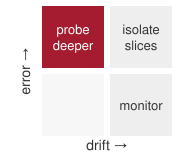{width="100%" fig-alt="Two-by-two grid with drift increasing to the right and error increasing upward. The top-left cell is filled crimson and labeled probe deeper; the top-right cell reads isolate slices; the bottom-right cell reads monitor; the bottom-left cell is blank."}

*Degradation without drift is the case the feature dashboard cannot explain.*
:::

##### Level 3 retraining vs. investigation {#sec-robust-ai-level-3-retraining-vs-investigation-4338}

Not all drift requires retraining. @Tbl-robust-ai-retraining-decision-rules separates immediate remediation from investigation and continued monitoring.

| **Action**              | **Trigger conditions**                                                                                                                                                                     | **Response logic**                                                                                                               |
|:------------------------|:-------------------------------------------------------------------------------------------------------------------------------------------------------------------------------------------|:---------------------------------------------------------------------------------------------------------------------------------|
| **Update model**        | Performance exceeds a validated error tolerance, labels confirm a shift, root-cause analysis shows a model update addresses it, and offline plus shadow evaluation clears the release gate | The evidence identifies recalibration or retraining as the appropriate response rather than merely detecting a population change |
| **Investigate first**   | A scenario-calibrated drift alert fires while performance remains stable, the shift is localized to nonpredictive features, or a seasonal or one-time event is plausible                   | The signal justifies diagnosis, but not a predetermined remediation                                                              |
| **Continue monitoring** | Drift statistics remain inside the service's calibrated baseline, performance stays within tolerance, and no external evidence suggests environmental change                               | The evidence does not yet justify changing the model, but the baseline remains under observation                                 |

: **Retraining Decision Rules**: Drift response depends on the strength of the statistical signal, observed performance change, and external evidence about whether the environment has truly changed. {#tbl-robust-ai-retraining-decision-rules tbl-colwidths="[20,58,22]"}

The quantitative framework transforms drift detection from reactive troubleshooting into proactive model maintenance, enabling ML systems to maintain reliability as production environments evolve [@gama2014]. No PSI band is a universal retraining rule: a large shift in a nonpredictive feature may be harmless, while a small shift in a safety-critical subgroup may demand immediate containment.

### Monitoring and adaptation strategies {#sec-robust-ai-monitoring-adaptation-strategies-f305}

The fraud example compared two features of one service against one baseline. A fleet runs the same comparison for thousands of features across many replicas, regions, and model versions, so the design of the monitor itself determines what the fleet can detect and what detection costs. The decision rules above still apply; the new questions are which statistic to compute where, and what to change once the evidence warrants a model update.

```{python}
#| echo: false

# ┌─────────────────────────────────────────────────────────────────────────────
# │ DISTRIBUTION SHIFT METRICS (LEGO)
# ├─────────────────────────────────────────────────────────────────────────────
# │ Context: @sec-robust-ai-monitoring-adaptation-strategies-f305—drift detection
# │
# │ Goal: Quantify sensitivity and performance of drift detection metrics.
# │ Show: ~150 ms latency for 10K MMD samples; PSI thresholds (0.1--0.25).
# │ How: Constant thresholds and an H100-class latency scenario.
# │
# └─────────────────────────────────────────────────────────────────────────────
from mlsysim.fmt import check, fmt
from mlsysim import Ops

# ┌── LEGO ───────────────────────────────────────────────
class DistributionShiftMetrics:
    """Namespace for drift detection metrics and performance."""

    # ┌── 1. LOAD (Constants) ──────────────────────────────────────────────
    n_samples_mmd = 10 * THOUSAND
    mmd_latency_ms = 150  # scenario assumption: ms on an H100-class accelerator
    n_samples_ks = THOUSAND

    psi_warn = Ops.Monitoring.PsiWarnThreshold
    psi_critical = Ops.Monitoring.PsiCriticalThreshold

    # ┌── 2. EXECUTE (The Compute) ────────────────────────────────────────
    # (Simplified benchmarks for this scenario)

    # ┌── 3. GUARD (Invariants) ──────────────────────────────────────────
    from mlsysim.fmt import check

    check(psi_critical > psi_warn, "Critical threshold must be above warning")

    # ┌── 4. OUTPUT (Formatting) ─────────────────────────────────────────────
    from mlsysim.fmt import fmt, fmt_time

    mmd_n_samples_str = fmt(n_samples_mmd, precision=0)
    mmd_latency_ms_str = fmt_time(mmd_latency_ms, 'millisecond', precision=0, commas=False)
    ks_n_samples_str = fmt(n_samples_ks, precision=0)
    psi_warn_thresh_str = fmt(psi_warn, precision=1, commas=False)
    psi_critical_thresh_str = fmt(psi_critical, precision=2, commas=False)
```

Each statistic carries a computational and sampling price, and the price decides where and how often it runs. In this illustrative H100-class monitoring scenario, one MMD comparison with radial basis function kernels ($\RadialBasisKernelCoefficient= 1.0$) over a window of `{python} DistributionShiftMetrics.mmd_n_samples_str` samples takes an assumed `{python} DistributionShiftMetrics.mmd_latency_ms_str` per window. Run hourly on sampled traffic, that is a small fraction of one accelerator's time, but the direct estimator's cost grows with the square of the window size, so doubling the window to gain detection power roughly quadruples the cost. The per-feature two-sample KS tests\index{Kolmogorov-Smirnov Test!univariate drift limitation} use `{python} DistributionShiftMetrics.ks_n_samples_str` samples per window in this scenario. Each costs $\mathcal{O}(\DriftTestSampleSize\log \DriftTestSampleSize)$, dominated by sorting its window, which is cheap enough to run on every window for every feature, but these tests miss joint changes that preserve each feature's marginal distribution. The design therefore runs the cheap marginal tests continuously and reserves the joint kernel test for periodic, sampled checks. Neither sample count is a universal detection minimum; power depends on the shift and significance level. The service in this example uses PSI values from `{python} DistributionShiftMetrics.psi_warn_thresh_str` to `{python} DistributionShiftMetrics.psi_critical_thresh_str` as investigation triggers, not as universal statistical thresholds.

High-dimensional and temporal traffic requires more than one fleet-wide scalar. Marginal feature monitors can remain flat while correlations, sequence structure, or a small cohort changes. A production design therefore combines cheap per-feature alarms with embedding- or kernel-space tests, cohort slices, rolling windows at several durations, and change-point checks. At fleet scale, centralized comparisons add a communication workload, the C$^3$ communication axis, when replicas export samples or sketches. Local comparison, sampling, and hierarchical aggregation change that cost and the evidence available to the detector. The placement of the reference and the choice of statistic therefore shape both telemetry bandwidth and detection power. The windows must preserve seasonality and event context: comparing Monday traffic with Sunday traffic can manufacture an alert, while averaging a week can hide an abrupt one-hour failure. Monitor design is part of the hypothesis, not a neutral wrapper around the model.

When the Level 3 rules do call for a model update, the update itself is a budgeted response rather than an automatic retraining command. Online learning updates a model from sequential observations [@shalev-shwartz2012]; preserving earlier behavior remains a separate design objective. The adaptation budget depends on model size, drift rate, and feedback latency: updating too aggressively can chase noise, while updating too slowly lets performance drift. In production, online-learning systems usually bound update frequency, state size, and serving latency explicitly rather than assuming adaptation is free. An update that fits the new distribution can also erase behavior the old one required, the catastrophic forgetting that also constrains on-device adaptation. Techniques like Elastic Weight Consolidation\index{Elastic Weight Consolidation!catastrophic forgetting} reduce it by penalizing changes to parameters important for previous tasks [@kirkpatrick2017].

::: {.column-margin .margin-pointer}
↩ Catastrophic forgetting and the continual-adaptation techniques that limit it are established in @sec-edge-intelligence-lifelong-adaptation-without-forgetting-9200.
:::

Adaptive ensemble methods\index{Adaptive Ensemble!concept drift response} maintain multiple models or hypotheses and weight or select among them using recent performance, making them useful under gradual concept drift [@gama2014]. This approach trades extra serving and monitoring complexity for the ability to respond when a single static model no longer matches the deployment distribution.

When the drifted data cannot leave the devices or regions that produce it, the same update can run as federated learning (@sec-edge-intelligence-federated-learning-6e7e), which moves the adaptation to the data. The drift response then pays in communication rounds and transmitted bytes as well as training work, so the time from a confirmed shift to a validated update must be measured on the federated path rather than assumed from centralized retraining.

### Per-request competence and selective prediction {#sec-robust-ai-selective-prediction}

Population monitoring asks whether traffic has changed in aggregate. A serving system faces a different decision on every request: whether this particular input lies within the model's demonstrated competence and whether the system should act on its prediction. A stable daily PSI can coexist with a rare, dangerous OOD request, while a large population shift can leave individual predictions well supported. Fleet robustness therefore needs both population monitors and a per-request decision contract.

The contract combines three signals. Calibration\index{Calibration!selective prediction}\index{Calibration!expected calibration error}\index{Calibration!temperature scaling} tests whether a score of 0.8 corresponds to approximately 80 percent correctness on a defined validation population [@guo2017calibration]. Out-of-distribution detection\index{Out-of-distribution detection!per-request}\index{Out-of-Distribution Detection!energy-based scores} scores how unlike the request is from the model's validated input distribution [@hendrycks2017]. Selective prediction\index{Selective prediction!risk-coverage} converts those signals into an action policy: answer above the acceptance threshold, route uncertain cases to a stronger model or reviewer, and abstain when neither path can satisfy the risk bound. None of the three substitutes for the others. A calibrated classifier can remain confidently wrong on OOD inputs, and an OOD detector can flag novelty without estimating task error.

Let $\SelectiveAcceptanceScore(\ModelInput)$ be an acceptance score whose larger values indicate stronger evidence for answering, $\ResponseThreshold$ its threshold, $\ModelPredictor(\ModelInput)$ the prediction, and $\LossFunction(\ModelPredictor(\ModelInput),\ExampleLabel)$ its loss against the observed outcome. For accepted set $\AcceptedInputSet = \{\ModelInput: \SelectiveAcceptanceScore(\ModelInput) \ge \ResponseThreshold\}$ at threshold $\ResponseThreshold$, coverage is $\Pr(\ModelInput\in \AcceptedInputSet)$ and selective risk is the mean loss conditioned on acceptance:

$$
\operatorname{coverage}(\ResponseThreshold)=\Pr(\ModelInput\in \AcceptedInputSet), \qquad
\operatorname{risk}(\ResponseThreshold)=\mathbb{E}[\LossFunction(\ModelPredictor(\ModelInput),\ExampleLabel)\mid \ModelInput\in \AcceptedInputSet].
$$

Sweeping $\ResponseThreshold$ produces a risk-coverage curve\index{Selective Prediction!risk-coverage curve} rather than one accuracy number. Raising the threshold reduces coverage, but lowers accepted-request risk only when the score orders requests by error risk well enough. That relationship must be measured on the deployment population, and the rejected traffic does not disappear. The fallback path needs enough queue, reviewer, or secondary-model capacity to absorb the abstention rate within the original latency and safety budget. If labels arrive days later, the system can monitor scores and fallback load immediately but cannot confirm selective risk until outcomes return. During that delay, rate limits and conservative thresholds can limit exposure, while the default response still requires validation against the application's hazards.

#### Finite-sample coverage with conformal prediction {#sec-robust-ai-conformal-coverage}

Calibration describes whether predicted probabilities match empirical frequencies; selective prediction chooses which requests the system will answer. Conformal prediction\index{Conformal prediction!finite-sample coverage} provides a different contract: it wraps a fitted predictor with a nonconformity score $\NonconformityScore(\ModelInput,\ExampleLabel)$ and a held-out calibration set. Here the score measures how poorly a candidate outcome $\ExampleLabel$ agrees with input $\ModelInput$, so larger values mean less conformity; it is distinct from the acceptance score above. For a skin-lesion classifier, the prediction set might contain both benign and malignant rather than force a single diagnosis. Each candidate label remains in the set when its nonconformity score does not exceed a cutoff calibrated on held-out examples. The target miscoverage rate is $\ConformalMiscoverageRate$. For the finite threshold below, assume $1/(\CalibrationExampleCount+1) \leq \ConformalMiscoverageRate < 1$. For $\CalibrationExampleCount$ calibration scores sorted in ascending order, set $\ConformalQuantileRank=\min\{\lceil(\CalibrationExampleCount+1)(1-\ConformalMiscoverageRate)\rceil,\CalibrationExampleCount\}$ and $\ConformalScoreQuantile=\NonconformityScore_{(\ConformalQuantileRank)}$. The prediction set is

$$
\ConformalPredictionSet(\ModelInput)=\{\ExampleLabel:\NonconformityScore(\ModelInput,\ExampleLabel)\leq \ConformalScoreQuantile\}, \qquad
\Pr\!\left(\ExampleLabel_{n+1}\in \ConformalPredictionSet(\ModelInput_{n+1})\right)\geq 1-\ConformalMiscoverageRate.
$$

Here the test pair $(\ModelInput_{n+1},\ExampleLabel_{n+1})$ follows the $\Glyph{n}=\CalibrationExampleCount$ calibration examples. Exchangeability means that permuting their order does not change their joint distribution; i.i.d. sampling is sufficient. Under this assumption and the stated range of $\ConformalMiscoverageRate$, the $(\CalibrationExampleCount+1)$ rank correction makes this a finite-sample *marginal* coverage guarantee\index{Conformal Prediction!guaranteed coverage}\index{Conformal Prediction!exchangeability requirement}: exchangeability makes the test point's score equally likely to take any of the $\CalibrationExampleCount+1$ ranks among the combined scores, so when averaging over the calibration sample and the new test example, the set contains the true outcome at least at the target rate [@lei2018conformal]. Using the ordinary empirical $(1-\ConformalMiscoverageRate)$ quantile instead can undercover at finite sample sizes. The guarantee is not conditional on a particular realized calibration set, input, or subgroup. A rare subgroup can have poor coverage even when aggregate coverage is correct, particularly when it contributes few calibration examples.

The systems obligation is to preserve the conditions behind the guarantee. A distribution change between calibration and serving can invalidate the exchangeability argument; calibration age alone does not establish such a change. Even if observed coverage remains adequate, the original guarantee needs its assumptions rechecked. Repeatedly tuning the model, score, or threshold against the same calibration outcomes makes the held-out evidence adaptive rather than independent. Production systems therefore version the predictor, score, calibration snapshot, and target $\ConformalMiscoverageRate$ together; monitor realized coverage by consequential slice once labels arrive; and refresh or quarantine the contract when traffic changes. Conformalization does not protect against arbitrary shift.

Set size or interval width supplies an operational load signal. Larger outputs convey less specific predictions and can trigger abstention, a stronger model, or human review, so their tail distribution determines fallback capacity just as the risk-coverage curve determines rejected traffic. The target coverage is therefore not free: increasing it usually widens sets, raises review demand, or reduces the fraction of requests on which the system can act automatically.

The failure modes above arise without an adversary, but the boundary with deliberate manipulation is porous. Distribution monitors can themselves be evaded by inputs crafted to stay under their thresholds, turning a defensive tool into a blind spot. Once an adversary stops relying on natural variation and begins optimizing against the model's decision boundaries to force specific errors, the threat model moves from environmental robustness to input-level attacks.

::: {#chk-robust-ai-drift-response .callout-checkpoint title="Drift detection and the retraining decision"}

Environmental shifts split into distinct types, and the chapter's drift framework deliberately separates a fired metric from a retraining command.

**Distinguishing the shift type**

- [ ] **Shift taxonomy**: distinguish covariate shift, label shift, and concept drift by which probability the change touches, and explain why feature-statistics monitoring stays silent under pure concept drift.
- [ ] **Shortcut failure**: identify the failure in a cow-on-a-beach misclassification where the world has not changed but the model learned the wrong lesson, and explain why standard empirical risk minimization encourages it.

**Reasoning about thresholds and cost**

- [ ] **Threshold judgment**: select retraining, investigation, or continued monitoring for a high-importance feature whose population stability index is in the major-shift band while precision and recall stay flat.
- [ ] **Cost asymmetry**: explain why concept drift can cost more to remediate than covariate shift when adapting the conditional relationship requires fresh labels.

:::

## Input-Level Attacks: Adversarial Examples and Poisoning {#sec-robust-ai-inputlevel-attacks-model-robustness-d6ea}

Consider an attacker who modifies an image of a benign skin lesion to induce a malignant prediction while preserving its apparent clinical content. Whether that attack succeeds depends on the classifier, the allowed modifications, and the evaluation conditions. The high-dimensional decision boundaries\index{Adversarial Perturbation!decision boundary geometry} learned by deep neural networks possess counterintuitive blind spots that malicious actors can deliberately exploit. The practical question is what the attacker can see or control: gradients, queries, physical sensors, or training data. Adversarial attacks expose these blind spots.

### Adversarial attacks {#sec-robust-ai-adversarial-attacks-481c}

::: {#dfn-robust-ai-adversarial-attack .callout-definition title="Adversarial attack"}

***Adversarial attack***\index{Adversarial Attack!definition} is a deliberate manipulation of a model's input, interaction, or environment designed to violate a specified behavioral objective. The manipulation may be norm-bounded and visually subtle, but it can also be semantic, physical, query-based, or conspicuous.

1.  **Significance**: Adversarial evaluation asks whether an attacker can choose inputs or transformations that drive the model outside its intended behavioral envelope. High-dimensional, norm-bounded image perturbations\index{Perturbation Budget!norm-bounded} are one important case, but patches, rotations, printed objects, malicious text, and repeated black-box queries expose different system boundaries.
2.  **Distinction**: Unlike random corruption sampled independently of the target, an adversarial manipulation is selected to cause failure. It need not use gradients: attackers may use surrogate models, decision-only queries, search, semantic edits, or control over the physical sensing environment.
3.  **Common pitfall**: A frequent misconception is that adversarial vulnerability is a "bug" to be patched. In reality, it is a structural vulnerability of many standard neural networks trained by empirical risk minimization; robust defense typically requires fundamental changes to the objective function (for example, adversarial training).

:::

Adversarial attack categories encode access and cost. A white-box attacker can use gradients directly, a black-box attacker uses surrogate transfer or queries to the target, and a physical attacker must survive cameras, lighting, and distance. @Fig-adversarial-googlenet demonstrates this vulnerability on an image-classification network: adding an imperceptible perturbation that follows the sign of the loss gradient ($\AdversarialPerturbationBudget = 0.007$), the fast gradient sign method defined below, flips GoogLeNet's prediction from panda (57.7 percent confidence) to gibbon (99.3 percent confidence), leaving the classifier paradoxically more confident in the erroneous label than the ground truth.

::: {#fig-adversarial-googlenet fig-env="figure" fig-pos="htb" fig-cap="**Imperceptible Misclassification in GoogLeNet**: Adding a perturbation of $\AdversarialPerturbationBudget = 0.007$ in the sign direction of the loss gradient changes GoogLeNet's prediction from panda (57.7 percent confidence) to gibbon (99.3 percent confidence), although the two images look identical to a person. The attack does not merely flip the label; it leaves the model more confident in the wrong answer than it was in the right one. Source: [@goodfellow2015explaining]." fig-alt="Three-panel demonstration: a panda photograph labeled panda, plus a faint noise pattern scaled by 0.007, equals a visually identical photograph that GoogLeNet labels gibbon."}


:::

A visually small change need not produce a small change in a classifier's score.[^fn-perception-gap-adversarial] Adversarial perturbations exploit how input changes accumulate in the model's decision function. Even a linear function can be sensitive to many small, aligned changes across input dimensions; nonlinearity alone does not explain the vulnerability. The relevant constraint is whether the allowed perturbation can move the input across the learned decision boundary.

[^fn-perception-gap-adversarial]: **Human vs. Machine Perception**\index{Human vs. Machine Perception!definition}\index{Perception Gap!adversarial vulnerability}: First highlighted by @szegedy2013intriguing, neural networks learn statistical correlations in pixel space rather than the semantic invariances human vision enforces. Agreement on clean examples does not establish agreement under every small image change. Evaluation must therefore specify which transformations should preserve the label and test whether the model preserves that behavior; gradient-based training alone neither explains every attack nor guarantees the required invariance.

#### Attack categories and mechanisms {#sec-robust-ai-attack-categories-mechanisms-fed5}

The useful axis is not the attack name by itself but the attacker's access. Each mechanism reveals a different cost that the defense must raise: gradient access, optimization time, surrogate-model construction, or physical control over the sensor environment.

The most direct case is white-box gradient access. Neural networks compute gradients to learn how parameter changes reduce loss; an attacker with access to gradients can run that logic against the input instead. For an image classifier that correctly identifies a panda, the gradient with respect to the input image gives a local, first-order estimate of how pixel changes affect the loss. The **fast gradient sign method (FGSM)**\index{Fast Gradient Sign Method!definition}[^fn-fgsm-adversarial-attack] turns that idea into a single-step attack\index{Fast Gradient Sign Method!single-step formulation} by choosing each feature's perturbation sign to maximize that first-order increase within a coordinate-wise budget.

[^fn-fgsm-adversarial-attack]: **Fast Gradient Sign Method (FGSM)**\index{Fast Gradient Sign Method!adversarial training}: Proposed by @goodfellow2015explaining at ICLR, FGSM generates adversarial examples in a single gradient step, making it practical to use during training. This dual role is its lasting systems significance: the same attack that exposed neural network fragility became a simple adversarial-training primitive, where FGSM-generated perturbations augment clean batches with examples chosen to increase loss.

The underlying mathematical formulation captures this intuitive process:

$$
\AdversarialExample= \ModelInput+ \AdversarialPerturbationBudget \cdot \text{sign}\big(\nabla_\ModelInput\LossFunction(\ModelParameters, \ModelInput, \ExampleLabel)\big)
$$

In this formulation, $\ModelInput$ denotes the original input, $\AdversarialExample$ is the generated adversarial example, and $\LossFunction(\ModelParameters, \ModelInput, \ExampleLabel)$ represents the prediction loss evaluated at model parameters $\ModelParameters$ and true label $\ExampleLabel$. The gradient term $\nabla_\ModelInput\LossFunction$ describes local loss sensitivity, $\text{sign}(\cdot)$ extracts each component's sign to maximize the linearized loss within the coordinate-wise budget, and the scalar $\AdversarialPerturbationBudget$ bounds the maximum allowable perturbation magnitude under the $\ell_\infty$ norm. This single step need not maximize the nonlinear loss or cause misclassification. Image implementations also clip the perturbed input to its valid pixel range. The subscript distinguishes this adversarial radius from other uses of $\Glyph{\epsilon}$ in the book, such as the differential-privacy budget.

@Fig-gradient-attack geometricizes this single-step perturbation within the $\ell_\infty$ budget $\AdversarialPerturbationBudget$: moving along the sign vector of $\nabla_\ModelInput\LossFunction(\ModelParameters, \ModelInput, \ExampleLabel)$ propels input $\ModelInput$ to a corner of the bounding cube, producing $\AdversarialExample$ and crossing the decision boundary into the adjacent class region in this illustration. A different boundary or gradient need not produce a successful attack within the same budget.

::: {#fig-gradient-attack fig-env="figure" fig-pos="htb" fig-cap="**Gradient-Based Attack Geometry**: Around a correctly classified input $\ModelInput$, the dashed square marks every perturbation allowed by the $\ell_\infty$ budget $\AdversarialPerturbationBudget$. FGSM moves each coordinate by the full budget in the sign direction of the loss gradient $\nabla_\ModelInput \LossFunction(\ModelParameters, \ModelInput, \ExampleLabel)$, which lands $\AdversarialExample$ on a corner of that square, the allowed point that maximizes the first-order increase in loss. A step no larger than $\AdversarialPerturbationBudget$ in any coordinate therefore carries the input across the decision boundary. The class labels are illustrative." fig-alt="Two-dimensional input space divided by a solid diagonal decision boundary into a true-class region and an other-class region. A clean input x sits inside a dashed square labeled allowed set. A short blue arrow labeled gradient of L points up and to the left from x; a longer red arrow runs from x to the square's upper-left corner, marked x adv equals x plus epsilon times sign of the gradient, which lies across the boundary. A bracket under the square marks its half-width epsilon adv."}
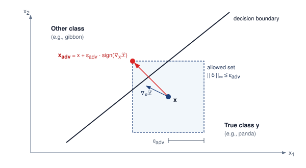
:::

FGSM is cheap because it takes one step. The **projected gradient descent (PGD) attack**\index{Projected Gradient Descent Attack!definition} [@madry2018towards] spends more compute for a stronger attack: it repeatedly applies gradient updates and projects each step back\index{Projected Gradient Descent Attack!iterative projection} into the allowed norm ball around the original input. That iterative refinement makes PGD a standard white-box robustness benchmark. The **Jacobian-based saliency map attack (JSMA)**\index{Jacobian-Based Saliency Map Attack!definition} [@papernot2016jsma] uses the Jacobian to identify the most influential input features\index{Jacobian-Based Saliency Map Attack!feature saliency} and perturb a smaller set of dimensions toward a target class. These methods are most effective in white-box settings,[^fn-white-box-robustness] where the attacker knows the model architecture and gradients.

[^fn-white-box-robustness]: **White-Box Attack**\index{White-Box Attack!robustness bound}: Adversarial attack with complete model knowledge (architecture, weights, gradients); methods like PGD and Carlini-Wagner (C&W) are strong because they optimize directly against the model rather than probing it from the outside. Though less realistic than black-box scenarios for many deployed systems, white-box analysis establishes a demanding benchmark within a specified norm, perturbation budget, and attack procedure. Passing PGD is evidence for that threat model, not a universal guarantee against every weaker-looking attack.

When the attacker cares less about speed and more about stealth, the attack becomes an optimization problem. The Carlini and Wagner (C&W) attack[^fn-cw-attack-optimization] [@carlini2017] searches for a small perturbation that causes misclassification under a chosen distance measure. Minimizing that distance encourages similarity, but does not certify human perceptual equivalence or a globally minimal perturbation. Instead of merely following the sign of a gradient, C&W optimizes a custom objective that trades perturbation size against confidence in the wrong answer.

[^fn-cw-attack-optimization]: **Carlini and Wagner (C&W) Attack**\index{Carlini-Wagner Attack!defense evaluation}: Proposed in 2016 (IEEE S&P 2017), C&W formulates adversarial example generation as a constrained optimization problem\index{Carlini-Wagner Attack!optimization formulation} that searches for a small perturbation causing misclassification without guaranteeing a global minimum. Its significance is methodological: C&W broke defensive distillation (an early defense that masked gradients to blunt weaker attacks) and other evaluated defenses, establishing the principle that robustness claims must be evaluated against optimization-based attacks, not merely gradient-sign heuristics.

C&W perturbations can be visually subtle, but human imperceptibility alone does not establish whether a detector will identify them. The attack can search under different norm constraints, such as $\ell_2$ or $\ell_\infty$. The **elastic net attack to DNNs (EAD)**\index{Elastic Net Attack to DNNs!definition} adds elastic net regularization, combining $\ell_1$ and $\ell_2$ penalties to generate sparse, localized perturbations\index{Elastic Net Attack to DNNs!sparse perturbation}. **DeepFool**\index{DeepFool!minimal perturbation} [@moosavi-dezfooli2016] takes a geometric route to the same goal: it linearizes the classifier around the input, steps to the nearest boundary of that linear approximation, and repeats until the label flips, giving a fast estimate of the smallest perturbation that suffices. These optimization-based methods are more computationally intensive than gradient-sign attacks, but they give the attacker finer control over the adversarial example's geometry.

Black-box attackers lose direct gradient access but keep two routes. Transfer attacks rely on transferability\index{Transferability!definition}, the tendency of an adversarial example to fool models other than the one it was crafted on. The attacker crafts examples offline on a surrogate model\index{Transferability!surrogate model training} and submits them to the target, typically through its public API, without seeing its weights or gradients. Query-based attacks probe the target itself. A decision-based, or boundary, attack\index{Boundary Attack!decision-based black-box} needs only the returned label. It starts from an input the model already misclassifies and walks along the decision boundary toward the original input, querying at each step to stay on the wrong side. Its cost is the number of queries, which is why query budgets and rate limits belong to the defense.

::: {.column-margin .margin-pointer}
↩ The adversary knowledge spectrum, from white-box gradient access to black-box attackers who work through a surrogate or a public interface, is established in @sec-security-privacy-adversarial-attacks-9f84.
:::

Transfer success depends on model similarity, training-data overlap, and regularization, and attackers can improve it with input diversity, such as random resizing or cropping, and with momentum during optimization. Closing that route costs the defender training work. Ensemble adversarial training trains against perturbations generated on several models to improve transfer robustness, but the extra attack generation and model diversity make it a deliberate training-budget decision rather than a free mitigation [@tramer2017ensemble].

::: {.column-margin}
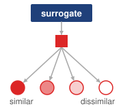{width="100%" fig-alt="A blue box labeled surrogate points to a red square, which sends arrows to four circles in a row. The circles fade from solid red at the end labeled similar to white at the end labeled dissimilar."}

*An example crafted on a surrogate fools similar models more often than dissimilar ones.*
:::

Physical-world attackers face an additional constraint: the perturbation must survive sensors, distance, lighting, viewing angle, and ordinary deployment variation. Adversarial patches\index{Adversarial Patch!physical-world attack} are printed patterns placed on objects so that cameras and detectors misread the scene. Modified road signs, clothing patches, and 3D-printed objects move the attack from the digital input tensor into the physical environment. That makes the robustness question operational rather than merely mathematical: a defense that works on a saved image may fail once the attack passes through a camera lens, compression, motion blur, and changing illumination. These threats matter most for AI systems deployed in physical spaces, such as autonomous vehicles, drones, and surveillance systems, where a model error becomes a safety, security, and accountability problem in the world.

::: {#exmp-robust-ai-stop-sign-attack .callout-example title="The stop sign attack"}

**Scenario**: The road-sign sticker attack, already familiar as a security threat, places black and white stickers on a stop sign\index{Adversarial Attack!autonomous driving stop sign} so that a vision model reads it as a speed limit sign [@eykholt2018]. The robustness question is what its two reported success rates say about how an evaluation must be run.

**Diagnosis**: The attack succeeded on every tested laboratory image but on 84.8 percent of frames in the moving-vehicle field test. Each number is evidence only for its own capture conditions, and the gap between them does not isolate any one factor, such as distance, viewing angle, lighting, or motion.

**Systems lesson**: A physical attack must be evaluated through the full sensor loop, not on saved benchmark images. The evaluation should optimize the attack over the expected range of transformations (expectation over transformation) and then test it with real captures, and any claimed mitigation, such as spatio-temporal validation or sensor fusion, must be tested against attacks on the complete perception stack.

:::

::: {.column-margin .margin-pointer}
↩ The road-sign sticker attack is established as a security threat in @sec-security-privacy-case-study-traffic-sign-attack-6e93.
:::

Physical perturbations also need not be subtle to matter. The perturbations in @fig-graffiti range from a poster covering the whole sign to graffiti-style markings and sticker patches that pass for ordinary vandalism. The associated study evaluates whether these physical modifications induce misclassification through the camera pipeline without digital access to the captured input [@eykholt2018robust].

::: {#fig-graffiti fig-env="figure" fig-pos="htb" fig-cap="**Physically Realizable Road-Sign Perturbations**: Physically realizable modifications can cause machine learning models to make incorrect predictions. The three panels show perturbations from the original study, from a subtle full-sign poster to conspicuous graffiti-style camouflage and black-and-white sticker patches that look like ordinary vandalism yet trigger misclassification [@eykholt2018robust]." fig-alt="Photographs of stop signs with conspicuous vandalism-style markings applied, illustrating physical adversarial perturbation as a category."}


:::

The attacker's access determines the evaluation a defense must survive. @Tbl-attack_types distinguishes gradient access, optimization, surrogate transfer, and physical sensor manipulation so that a result under one attack mechanism does not become a claim about all of them.

| **Category**     | **Method**      | **Mechanism**                                                           |
|:-----------------|:----------------|:------------------------------------------------------------------------|
| **Gradient**     | FGSM            | Perturbs inputs along the loss gradient                                 |
|                  | PGD             | Iterative multi-step FGSM refinement                                    |
|                  | JSMA            | Targets the most influential features                                   |
| **Optimization** | C&W             | Minimizes perturbation size subject to misclassification                |
|                  | DeepFool        | Estimates a small boundary-crossing perturbation by local linearization |
|                  | EAD             | Elastic net regularization for sparse perturbations                     |
| **Transfer**     | Transferability | Adversarial examples transfer across models (black-box)                 |
| **Physical**     | Patches         | Printed patches fool detectors in the real world                        |
|                  | 3D Objects      | Sculpted objects deceive sensors in deployment                          |

: **Adversarial Attack Categories**: Attack mechanisms determine defense selection: gradient and optimization attacks require robustness against explicit decision-boundary crossing, transfer attacks test black-box exposure, and physical attacks require evaluation through the deployed sensor loop. {#tbl-attack_types tbl-colwidths="[15,18,67]"}

Medical-imaging attacks can cause misdiagnosis [@tsai2023], while fraud and trading models face analogous manipulation risks. The common vulnerability is reliance on features that remain predictive on clean data but fail under crafted perturbations [@goodfellow2015explaining; @madry2018towards]. Defense shifts the resource cost: adversarial training adds training work [@bai2021], while runtime detection such as feature squeezing adds inference evaluations [@xu2018]. The choice among these spending points motivates the defenses in @sec-robust-ai-input-attack-detection-defense-19d3.

\Needspace{14\baselineskip}

### Data poisoning {#sec-robust-ai-data-poisoning-4b55}

The attacks so far perturb a fixed model at inference time. Poisoning instead changes the data from which the model learns. Systems that accept user contributions must distinguish evidence for learning from instructions that merely request a response. Microsoft's Tay incident illustrates the broader danger of adversarial interaction: the company reported a coordinated attack that defeated its filtering and stress testing within a day of launch [@microsoft2016tay]. The public account does not detail the mechanism, but the robustness lesson does not depend on it. Once live interaction can shape a model's later behavior, every user is a potential contributor of training evidence, and coordinated users can supply it on purpose. For systems that do learn from user feedback\index{Data Poisoning!online feedback manipulation}, the engineering question is therefore which contributions may enter training and how their influence can be audited.

::: {.column-margin .margin-pointer}
↩ Data poisoning, the corruption of training data or updates so that the learned model misbehaves later, and its sequence of admission, training, and exploitation are established in @sec-security-privacy-data-poisoning-351f.
:::

Automated collection, web scraping, and crowdsourced annotation make poisoning a pipeline-integrity problem: the system must identify compromised contributions before the learner incorporates them.

A classic early formulation in ML security is the attack by @biggio2012poisoning on support-vector machines\index{Data Poisoning!support-vector machines}. More recent poisoning work broadens the target to web-scale and generative-model data pipelines [see also @shan2024]. The dirty-label attack sampled in @fig-dirty-label-example corrupts training data by pairing cat images with misleading 'dog' captions, attempting to induce fraudulent associations during multimodal pretraining. The consequences are especially severe in high-stakes domains like healthcare, where even small disruptions to training data can lead to dangerous misdiagnoses [@marulli2022].

::: {#fig-dirty-label-example fig-env="figure" fig-pos="htb" fig-cap="**Dirty-Label Data Poisoning**: Mismatched image-text pairs represent a dirty-label poisoning attack where cat images are paired with misleading 'dog' captions in training data. Incorporating these corrupted pairs can cause models to learn incorrect multimodal associations." fig-alt="Three panels labeled 'Dirty-label poison data', each showing a cat image paired with a misleading text caption that calls the image a dog: 'A dog on the grass', 'Animal art dog pencil drawings', and 'Dog digital art...'."}


:::

Because admitting a poisoned record does not by itself guarantee that training will learn the attacker's behavior, the evidence that matters is behavioral, and it differs across the four objective classes of the security threat model: availability, targeted, backdoor\index{Backdoor Attack!trigger pattern}, and subpopulation\index{Subpopulation Poisoning!fairness impact} poisoning. The robustness question is which evidence exposes each class and what that evidence costs [@oprea2022]. Successful availability attacks\index{Data Poisoning!availability attack} can lower aggregate validation accuracy, giving broad evaluation a signal to investigate. Targeted\index{Data Poisoning!targeted class compromise} and subpopulation attacks can leave that aggregate nearly intact, making evaluation on the named targets and cohorts particularly important. Backdoors can also preserve clean-data accuracy while responding to a trigger the evaluator has never seen, as the BadNets pixel-pattern trigger does [@gu2017badnets]; possible detection strategies include trigger search, canary inputs, and activation-space inspection when poisoned and clean representations separate [@tran2018spectral].

::: {#lhs-robust-ai-archetype-b-dlrm-at-scale-fake-profile-injection .callout-lighthouse title="Archetype B (DLRM at Scale): Fake profile injection"}

Archetype B (DLRM at Scale) is especially exposed to **fake profile injection**\index{Fake Profile Injection!definition}. Because recommendation systems often use online learning to adapt to user trends in real time, an adversary can create a network of "sybil" accounts\index{Fake Profile Injection!sybil network}, fake identities controlled by the same attacker, that interact with specific items to artificially boost their popularity or associate them with high-value demographics. This poisoning bypasses traditional firewalls because the malicious interactions look like legitimate user behavior, motivating checks on contributor identity, interaction patterns, and learned representations. Spectral-signature defenses\index{Spectral Signature} (developed in @sec-robust-ai-sanitization-preprocessing-f883) search activation patterns for suspicious separation, but their effectiveness depends on whether the poisoned and clean contributions separate in that representation.

:::

Poisoned records can resemble legitimate data, so clean aggregate validation accuracy alone cannot establish that a training corpus is trustworthy. Detectability depends on the attacker's objective and on which records, representations, and behavioral slices the evaluator inspects. Attacks may originate from internal actors with privileged pipeline access or from external adversaries who exploit weak points in data collection, particularly in crowdsourced environments or open data pipelines that lack integrity checks and lineage tracking.

::: {#exmp-robust-ai-targeted-poisoning-classification .callout-example title="Targeted poisoning classification"}

**Scenario**: An attacker modifies the labels of a small subset of training data so that one deployed classifier consistently maps a particular protected class or object pattern to the wrong output.

**Diagnosis**: This is a targeted attack\index{Targeted Attack}. The attacker is not trying to degrade overall model performance; they are inducing a specific error while preserving enough general accuracy that aggregate validation metrics may still look healthy.

**Systems lesson**: Defending against targeted poisoning requires slice-level evaluation, provenance checks, and canary examples for high-risk classes. Aggregate accuracy alone is a weak detector because the attack is designed to hide inside otherwise normal performance.

:::

Distributed and federated training adds a contributor axis to the same threat. A malicious client need not insert a visible record into a central corpus; it can submit a model update chosen to move the aggregate, implant a backdoor, or exploit sybil identities to gain disproportionate weight. Archetype C (Federated MobileNet) makes this concrete: the server aggregates updates from a large population of smartphone-class clients whose raw data it never sees. Contributor-level checks can screen updates before aggregation, while held-out behavioral tests can reveal harmful effects in the resulting global model. The evaluation must vary the number and coordination of malicious contributors, their data heterogeneity, participation schedule, and knowledge of the aggregation rule. Global clean accuracy is again insufficient: the gate needs attack success on the trigger or target subpopulation, contributor-level anomaly recall, and the clean-utility cost of robust aggregation. Krum, coordinate-wise median, and trimmed mean tolerate bounded Byzantine behavior only under their stated assumptions [@blanchard2017machine; @yin2018byzantine]; high dimensionality and non-i.i.d. client updates can make honest contributors look anomalous. These rules also change the collective. A mean can be computed by an AllReduce that sums partial results, but a median, trimmed mean, or Krum selection needs the individual updates, and a direct gather-based implementation raises per-worker traffic by about a factor of $\DataParallelDegree/2$ relative to ring AllReduce, where $\DataParallelDegree$ here counts the contributing replicas rather than accelerators. That cost lands on $\CommunicationTime(\DeviceCount)$ in the Fleet Law unless it overlaps with computation. Provenance, participation limits, robust aggregation, and held-out canaries must therefore work together rather than treating one distance rule as a poisoning proof.

::: {.column-margin .margin-pointer}
↩ The traffic cost of gather-based robust aggregation relative to ring AllReduce is established in @sec-security-privacy-gradient-sync-integrity.
:::

#### Data poisoning attack methods {#sec-robust-ai-data-poisoning-attack-methods-d168}

The four categories above describe an attacker's *objective*; the attack *mechanism* depends on the attacker's access to the system and knowledge of the data pipeline. As diagrammed in @fig-poisoning-impact, all of them share a common shape: a poisoned record enters the training pipeline alongside clean data and attempts to alter the resulting model's behavior. The most direct mechanism is label modification, where an attacker selects a subset of training samples and alters their labels, flipping $\ExampleLabel= 1$ to $\ExampleLabel= 0$ or reassigning categories in multi-class settings. Even small-scale label corruption can shift decision boundaries significantly.

::: {#fig-poisoning-impact fig-env="figure" fig-pos="htb" fig-cap="**Data Poisoning Impact**: A nominal pipeline (top) and a poisoned pipeline (bottom) pass through the same four stages. In the illustrated successful attack, a poisoned record admitted at ingestion contaminates the training corpus, pulls the optimizer's gradients toward the attacker's trigger, and yields a backdoored model whose clean accuracy can remain intact, so aggregate validation alone can miss it." fig-alt="Two rows of four panels under the headings ingestion, training corpus, optimization, and trained model, joined by arrows. In the nominal row, three green clean records arrive, the corpus is a grid of green record tiles, a gray step descends into the minimum of a set of loss contours, and a straight decision boundary separates hollow and filled points. In the poisoned row, the middle arriving record is red, one tile of the corpus grid is red, a red step bends away from the contour minimum toward a red trigger diamond while a dashed gray path shows the clean direction, and the same decision boundary now has a small red dashed pocket around a trigger diamond on the filled side, labeled backdoor pocket and clean accuracy intact. The arrows in the poisoned row are red."}
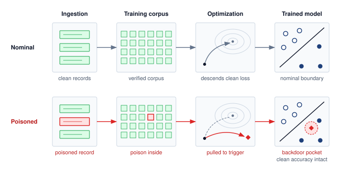
:::

After label modification, the attacker can keep the label intact and corrupt the features instead, the strategy known as **clean-label poisoning**\index{Clean-Label Poisoning!definition}. Because every label is correct, label audits cannot flag these records. Imperceptible image perturbations, subtle shifts in structured fields, and fixed trigger patterns all aim for the same outcome: the training example still appears legitimate, but it bends the learned decision boundary toward a future failure. Generative methods and data-synthesis tools raise the same risk at larger scale because they can create natural-looking examples whose only purpose is to distort what the model learns.

Whether those examples become poisoning depends on the data boundary. Web scraping, social media feeds, crowdsourced annotation, and untrusted user submissions all allow poisoned records to enter upstream and pass through weak cleaning checks in a "trusted" form. Physical systems add a second path: a sticker on a road sign is an inference-time adversarial attack when the car sees it, but harvesting that image into a training corpus creates a potential poisoning path only if the contribution serves an attack on the learner. Correctly labeled examples of such inputs can instead help train resistance to them. Online learning systems tighten the feedback loop further, allowing an attacker to introduce small increments of malicious data until model behavior drifts without a single obvious anomaly. @Fig-poisoning-attack-example draws the collaborative form of the same boundary, the contributor axis already described for federated training, in which one malicious client's update reaches every participant through aggregation.

::: {#fig-poisoning-attack-example fig-env="figure" fig-pos="htb" fig-cap="**Collaborative Poisoning via Aggregation**: In a collaborative learning setting, multiple clients each train on local data and contribute model updates to a central server that aggregates them into a shared global model. A single malicious participant can inject poisoned updates that the server folds into the aggregated model, so the corruption spreads to every client without any one obvious anomaly. This attack surface differs from adversarial examples because it targets the model during *training* rather than at *inference*." fig-alt="A violet aggregation server box at the top shows the weighted mean w t plus 1 equals w t plus the sum over k of n k over n times delta w k, and an inset plot of update vectors drawn from the point w t: three amber honest updates point steeply upward in a narrow fan, one red update delta w 2 points nearly sideways, and a thicker violet aggregate arrow sits between them, tilted away from the honest fan. A row of clients sits below: client 1, a red malicious client 2, client 3, an ellipsis, and client N, each holding a row of small green data tiles, with two red tiles in client 2. Each benign client sends an amber update arrow, delta w 1, delta w 3, and delta w N, up to the server, while client 2 sends a red update delta w 2 marked poisoned. Dashed red arrows labeled w t plus 1 run from the server down to each client."}
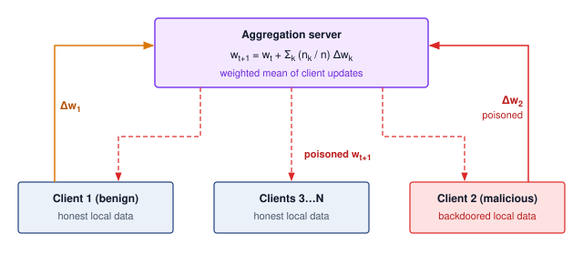
:::

Insiders such as annotators or data vendors can exploit knowledge of the model and training procedure to make these attacks harder to detect. Clean benchmark performance therefore does not establish training-data integrity.

#### Art protection via poisoning case study {#sec-robust-ai-case-study-art-protection-via-poisoning-6106}

Data poisoning is not always malicious. Researchers have begun exploring it as a defensive tool, particularly for protecting creative work from unauthorized use by generative AI models.

Nightshade, developed by researchers at the University of Chicago, aims to deter unauthorized training by poisoning images that a scraper may collect [@shan2024]. It does not block scraping itself. Its perturbations preserve the apparent image content while changing how a model learns from it; the reported experiments show targeted concept corruption when the modified images enter the tested training pipelines.

The dose-response matrix in @fig-poisoning charts this progressive corruption across four poison doses (0 to 300 samples) and eight prompt concepts: as the dose increases, Stable Diffusion XL outputs morph away from source concepts (generating cows for "car" or cats for "dog") under the tested training conditions. These outputs demonstrate changed behavior without, by themselves, identifying the internal representation that caused it. The experiment demonstrates concept poisoning\index{Data Poisoning!concept poisoning}: poisoned samples distort a model's semantic associations.

::: {#fig-poisoning fig-env="figure" fig-pos="htb" fig-cap="**Concept Poisoning Dose-Response**: Stable Diffusion XL outputs across four poison doses (clean, 50, 100, 300 samples) and eight source prompts (dog, car, handbag, hat, fantasy art, cubism, cartoon, concept art). As the dose grows, outputs morph from the intended source concept toward the attacker's destination concept, demonstrating Nightshade-style concept poisoning of a pretrained model." fig-alt="4x8 grid of Stable Diffusion XL outputs. Rows are poison doses (clean, 50, 100, 300); columns are source prompts (Dog, Car, Handbag, Hat, Fantasy art, Cubism, Cartoon, Concept Art). Outputs morph toward destination concepts as dose grows."}

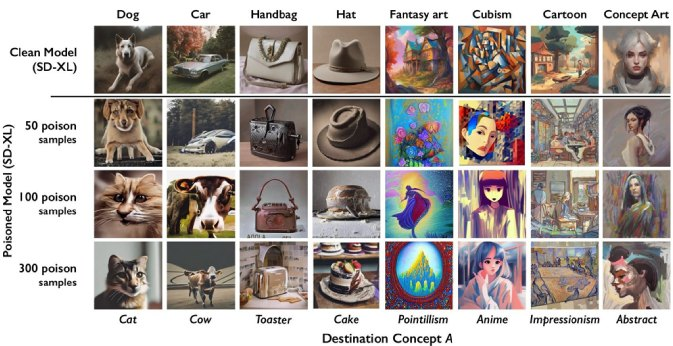

:::

The Nightshade experiments also report effects on concepts related to the poisoned target. This spillover extends the observed attack beyond the exact target prompt, but its reach depends on the model, poison construction, and training procedure. The same technique used to protect artistic content could also be repurposed to sabotage legitimate training pipelines, highlighting the dual-use dilemma[^fn-dual-use-ml] at the heart of machine learning security.

[^fn-dual-use-ml]: **Dual-Use Dilemma**\index{Dual-Use Dilemma!ML security}: The structural tension that defensive ML capabilities (adversarial training, data poisoning tools, red-teaming frameworks) are simultaneously offensive capabilities. This creates an arms race where defensive research publications become attack playbooks. For ML systems engineering, the consequence is architectural: robustness mechanisms must assume attacker knowledge of the defense, ruling out security-through-obscurity and motivating formal guarantees where feasible and adaptive empirical evaluation within the remaining threat model.

The mechanics of these input-level attacks, from adversarial perturbations and data poisoning to their interaction with natural distribution shifts (@sec-robust-ai-environmental-shifts-a2cf), define the threat surface. The next question is *how* to engineer the algorithmic defenses required to protect production models against them.

## Adversarial Defenses {#sec-robust-ai-input-attack-detection-defense-19d3}

The classifier that called a panda a gibbon in @fig-adversarial-googlenet was not broken by random noise; a perturbation budget of 0.007 per pixel, spent along the gradient sign, was enough. Defending a deployed perception model against that attacker requires a threat model that names the attacker's access and a budget for testing and mitigation. The resulting robustness claim must state what the system pays in clean accuracy, training compute, inference latency, or operational coverage.

### Adversarial defense workflow {#sec-robust-ai-adversarial-attack-defenses-1dc8}

The adversarial-defense workflow\index{Adversarial Defense!four-layer workflow} has four ordered layers:

1. **Define the threat model**: Specify the perturbation budget, attacker knowledge, and whether the attack occurs at inference time or during training.
2. **Choose the robustness budget**: Decide whether to spend the budget in training, certification, input detection, or serving-time guardrails.
3. **Measure the trade-off**: Evaluate both sides of the defense, because improving worst-case behavior can reduce clean accuracy, raise inference latency, or multiply training cost.
4. **Keep evaluation adversarial**: Test the defense against attacks stronger than the ones used to design it.

The order matters because an uncalibrated threat model makes the budget and evaluation loop meaningless.

For model-facing perturbation threats, the most direct training-time defense is **adversarial training**\index{Adversarial Training!definition}, which incorporates adversarial examples into the training process itself. The mechanism reuses the attacks of the previous section as a data generator. Each training step augments the batch\index{Adversarial Training!PGD batch augmentation} with perturbed copies of its own inputs, so the model is trained on the high-loss points an attacker would choose. @Lst-adversarial-training implements this pattern using FGSM to generate perturbations and mix clean and adversarial examples in each batch.

::: {#lst-adversarial-training lst-cap="**Adversarial Training Pseudocode**: Framework-neutral adversarial training using FGSM-style perturbations during training, mixing clean and perturbed data to improve robustness against gradient-based attacks."}

```{.text}
function adversarial_training_step(model, clean_batch, labels, epsilon):
    logits = model(clean_batch)
    clean_loss = loss(logits, labels)

    input_gradient = gradient(clean_loss, clean_batch)
    perturbation = epsilon * sign(input_gradient)
    adversarial_batch = stop_gradient(
        clip(clean_batch + perturbation, valid_input_range))

    mixed_batch = concatenate(clean_batch, adversarial_batch)
    mixed_labels = concatenate(labels, labels)

    return loss(model(mixed_batch), mixed_labels)
```

:::

In @lst-adversarial-training, the sign step bounds each coordinate's change by the perturbation budget, while clipping keeps the perturbed input inside the valid input range (for example, $[0,1]$ for normalized pixels). Concatenation doubles the effective batch size. The stop-gradient operation treats generated adversarial inputs as fixed during the outer weight update, rather than differentiating through attack construction. The caller differentiates the returned loss with respect to the model parameters and performs the optimizer update. The perturbation budget $\AdversarialPerturbationBudget$ (the `epsilon` argument) bounds the allowed input change, while the attack algorithm determines how effectively it searches that set; computation reuse can reduce its training overhead [@shafahi2019adversarial].

Adversarial example generation increases training time because each training step requires additional forward and backward passes through the model [@madry2018towards; @bai2021]. Memory overhead depends on whether the implementation stores clean and adversarial examples together, recomputes perturbations, or reuses gradient information. Iterative attacks like PGD add multiple optimization steps, so the implementation must budget that gradient work; optimized variants reduce overhead by reusing computations\index{Adversarial Training!free gradient reuse} rather than treating every attack step as a separate full training pass [@shafahi2019adversarial].

A robustness recipe that increases model capacity also adds memory and training cost. The perturbation budget and training recipe require matched clean and adversarial validation, and the perspective below shows why that matching decides what the robustness tax actually is.

```{python}
#| echo: false
#| label: robustness-tax-calc
# ┌─────────────────────────────────────────────────────────────────────────────
# │ THE ROBUSTNESS TAX (LEGO)
# ├─────────────────────────────────────────────────────────────────────────────
# │ Context: @sec-robust-ai-adversarial-attack-defenses-1dc8
# │
# │ Goal: Expose an invalid clean-versus-attacked accuracy subtraction.
# │ Show: A 26-point cross-condition gap that is not a clean-accuracy tax.
# │ How: Standard ResNet-50 clean accuracy from Literature.Series.ImageNetTestbedShift
# │      (76.1%) against an assumed robust-model attacked accuracy (~50%).
# │
# └─────────────────────────────────────────────────────────────────────────────
from mlsysim.fmt import check, fmt

# ┌── LEGO ───────────────────────────────────────────────
class RobustnessTaxAnalysis:
    """Quantify the utility-robustness trade-off."""

    # ┌── 1. LOAD (Constants) ──────────────────────────────────────────────
    from mlsysim import Models

    m = Models.Vision.ResNet50
    from mlsysim import Literature

    standard_clean_acc = next(r["val"] for r in Literature.Series.ImageNetTestbedShift.entries if r["model"] == "resnet50")
    robust_model_attacked_acc = 50.0  # scenario assumption: an adversarially trained ImageNet model at 4/255

    # ┌── 2. EXECUTE (The Compute) ────────────────────────────────────────
    cross_condition_gap = standard_clean_acc - robust_model_attacked_acc

    # ┌── 3. GUARD (Invariants) ──────────────────────────────────────────
    from mlsysim.fmt import check

    check(75.5 <= standard_clean_acc <= 76.5, "Prose quotes 76 percent for the standard ResNet-50.")
    check(cross_condition_gap > 20, "Illustrative cross-condition gap should exceed 20 points")

    # ┌── 4. OUTPUT (Formatting) ──────────────────────────────────────────────
    from mlsysim.fmt import fmt_percent, fmt_pp

    clean_acc_str = fmt_percent(round(standard_clean_acc) / 100, precision=0, commas=False, style='prose')
    robust_acc_str = fmt_percent(robust_model_attacked_acc / 100, precision=0, commas=False, style='prose')
    cross_condition_gap_pp_str = fmt_pp(round(cross_condition_gap), precision=0, commas=False)
```

::: {#psp-robust-ai-robustness-tax .callout-perspective title="Pricing the robustness tax correctly"}

Suppose a standard ResNet-50\index{ResNet-50} records `{python} RobustnessTaxAnalysis.clean_acc_str` Top-1 accuracy on clean ImageNet, while an adversarially trained model records about `{python} RobustnessTaxAnalysis.robust_acc_str` under a specified $\ell_\infty$ attack at $\AdversarialPerturbationBudget=4/255$, the budget conventionally used for ImageNet. Subtracting these values yields `{python} RobustnessTaxAnalysis.cross_condition_gap_pp_str`, but that gap compares different models under different evaluation conditions. It is not the clean-accuracy cost of robustness.

The clean-accuracy tax\index{Robustness Tax!clean-accuracy trade-off} must compare standard and robust models on the same clean test set. The robustness benefit must compare those models under the same attack, perturbation budget, and attack strength. The four cells are the standard model on clean data, the standard model under attack, the robust model on clean data, and the robust model under attack. The tax is the first minus the third, the benefit is the fourth minus the second, and the quoted pair supplies only the first and the fourth. Reporting all four cells prevents an apparent trade-off from mixing a model effect with an evaluation-condition effect.

**Systems insight**: Robustness can reduce clean accuracy and increase compute, but each tax needs a like-for-like baseline. A deployment gate should report clean accuracy, empirical robust accuracy, attack specification, and evaluation cost separately.

:::

The robustness compute penalty (principle \ref{pri-robustness-compute-penalty}) quantifies this cost: PGD-style adversarial robustness can demand several times more compute per epoch than standard optimization because each batch runs inner attack steps. In Fleet Law terms (@eq-fleet-law) the multiplier lands on $\IronLawComputeTime$. At a fixed worker count it adds local work, but the elapsed-time penalty depends on reuse and on which term limits the step. Adding workers changes communication and synchronization costs with $\DeviceCount$ and may not recover the original duration. Notebook \ref{nbk-robust-ai-cost-defense} makes the multiplier concrete.

```{python}
#| echo: false
#| label: adversarial-payback-notebook
# ┌─────────────────────────────────────────────────────────────────────────────
# │ ADVERSARIAL ATTACK PAYBACK (NOTEBOOK)
# ├─────────────────────────────────────────────────────────────────────────────
# │ Context: "The Cost of Defense" .callout-notebook
# │
# │ Goal: Quantify the compute overhead of adversarial training.
# │ Show: training_slowdown ≈ 8x—inline in notebook result.
# │ How: total time = standard time + PGD steps × standard time.
# │
# └─────────────────────────────────────────────────────────────────────────────
from mlsysim.fmt import check, fmt, fmt_count, fmt_multiple

class AdversarialPayback:
    # ┌── 1. LOAD ──────────────────────────────────────────
    std_passes = 1
    n_pgd_steps = 7  # Illustrative PGD-7 adversarial-training scenario
    # ┌── 2. EXECUTE ───────────────────────────────────────
    # Each training step requires generating an attack (7 forward/backward passes)
    # total steps per batch = 1 (std) + 7 (attack) = 8
    slowdown = std_passes + n_pgd_steps
    # ┌── 3. GUARD ─────────────────────────────────────────
    check(slowdown == 8, f"Slowdown {slowdown} unexpected")
    # ┌── 4. OUTPUT ────────────────────────────────────────
    ap_std_passes_str = fmt(std_passes, precision=0, commas=False)
    ap_n_pgd_steps_str = fmt(n_pgd_steps, precision=0, commas=False)
    ap_total_passes_str = fmt_count(slowdown, precision=0, commas=False)
    ap_slowdown_mult_str = fmt_multiple(slowdown, precision=0, commas=False)
```

::: {#nbk-robust-ai-cost-defense .callout-notebook title="The cost of defense"}

**Problem**: A team is training a robust classifier for an autonomous vehicle. Instead of the single FGSM step in @lst-adversarial-training, it uses adversarial training\index{Adversarial Training!accuracy cost} with a seven-step PGD attack (PGD-7)\index{Projected Gradient Descent Attack!multi-step training overhead} that searches for a high-loss perturbation inside a specified norm ball for every training batch, and, following the standard PGD adversarial-training recipe [@madry2018towards], it trains on the adversarial batch alone rather than on the listing's doubled clean-plus-adversarial batch. How much does this extra attack-generation work slow down the training run?

**Math**:
In this example, generating the adversarial input uses $\AttackStepsPgd$ additional gradient steps per training sample, each a forward and backward pass with respect to the input, before the one weight-update pass on the adversarial batch. The estimate treats each attack step as equal in cost to the standard training pass, with no reuse; it is a work model rather than a measured wall-clock slowdown. By the same accounting, the FGSM listing spends one attack pass plus an update pass over a batch twice the original size, about three standard passes in all, so PGD-7 trades a further factor of more than two in training work for a stronger inner attack.

1. **Forward/backward passes**: `{python} AdversarialPayback.ap_std_passes_str` (Standard) + `{python} AdversarialPayback.ap_n_pgd_steps_str` (Attack Generation) = `{python} AdversarialPayback.ap_total_passes_str` total passes.
2. **Training slowdown**\index{Training!slowdown}: `{python} AdversarialPayback.ap_slowdown_mult_str` under the equal-cost-pass assumption.
3. **Utility evidence**: The added work must be justified by measured robust accuracy under the specified attack. Generalization to other attacks requires separate evaluation. Pricing any clean-accuracy cost requires the like-for-like comparison in perspective \ref{psp-robust-ai-robustness-tax}, not a subtraction of robust accuracy from another model's clean accuracy.

**Systems insight**: In this PGD-7 work model, the team budgets `{python} AdversarialPayback.ap_slowdown_mult_str` the baseline compute before measuring the robustness benefit or actual elapsed-time penalty. In a machine learning fleet, robustness is not a setting that can be switched on; it is a budget the team spends, and the budget must be justified by the failure consequence of the component being hardened.

:::

For lower-risk components, external guardrails such as input filtering and output verification can cost less than training intrinsic robustness into the weights, provided adaptive evaluation (@sec-robust-ai-evaluation-testing-4b54) supports acceptable residual risk against an attacker who knows the guardrail. Passing a finite set of attacks does not prove that no bypass exists. Safety-critical paths more often justify the training and certification budget.

::: {#exmp-robust-ai-defense-selection .callout-example title="Defense selection by threat model"}

**Scenario**: Production teams must select defenses across three distinct system settings: an image classifier facing evasion attacks, a recommendation system facing training data poisoning, and a fraud detector facing natural distribution shift.

**Diagnosis**: An inference-time input filter alone cannot meet all three needs. It adds work on the image classifier's serving path, but does not establish the integrity of recommendation training data or track changes in the fraud detector's deployment population.

**Systems lesson**: Defense selection must be tailored to the threat model. Adversarial training targets the specified evasion threat, source controls, sanitization, and robust training objectives (@sec-robust-ai-data-poisoning-defenses-d070) limit some poisoning mechanisms, and drift monitoring identifies shifts for investigation. Each choice needs evaluation against its own failure conditions; detection alone does not restore valid predictions.

:::

#### Certified defenses {#sec-robust-ai-certified-defenses}

Adversarial training provides empirical resistance that must be tested against the deployment threat model. It can generalize beyond the examples generated during training, but attack evaluation alone does not prove invariance throughout an allowed perturbation set. **Certified robustness**\index{Certified Robustness!definition} offers a mathematical guarantee\index{Certified Robustness!mathematical guarantee}: for a given input $\ModelInput$ and radius $\AdversarialPerturbationBudget$, no perturbation $\|\AdversarialPerturbation\|_\PerturbationNormOrder< \AdversarialPerturbationBudget$ exists that changes the model's prediction. This certifies local prediction stability, not that the unchanged prediction is correct. The certified radius is a provable lower bound on the input-perturbation part of the robustness margin that compression and other efficiency changes must preserve. The guarantee formalizes the intuition, met in the pipeline overview, that a robust model limits how quickly its outputs can change as its inputs change. The model's **Lipschitz constant**\index{Lipschitz Constant!definition}[^fn-lipschitz-continuity-bound] bounds that rate, so a prediction cannot change within any radius over which the largest possible score change stays below its top-class margin. A widely used technique for scaling this idea to high-dimensional inputs like ImageNet is **randomized smoothing**\index{Randomized Smoothing!definition}. Instead of classifying $\ModelInput$ directly, it classifies the smoothed function $\SmoothedClassifier(\ModelInput)$, defined as the most probable class predicted by the base classifier\index{Randomized Smoothing!Gaussian smoothing} $\ModelPredictor$ under Gaussian noise: $\SmoothedClassifier(\ModelInput) = \operatorname{arg\,max}_\ClassIndex \Pr(\ModelPredictor(\ModelInput+\RandomizedSmoothingNoise) = \ClassIndex)$ where $\RandomizedSmoothingNoise \sim \GaussianDistribution(\ZeroVector, \SmoothingNoiseStandardDeviation^2 \IdentityMatrix)$.

[^fn-lipschitz-continuity-bound]: **Lipschitz Continuity**\index{Lipschitz Continuity!robustness}: A mathematical property that bounds how much a function's output changes relative to its input change ($\lVert \ModelPredictor(\ModelInput) - \ModelPredictor(\AlternateModelInput) \rVert \le \LipschitzConstant\lVert \ModelInput- \AlternateModelInput\rVert$). A small Lipschitz constant $(\LipschitzConstant)$ limits score movement, but it does not by itself prevent a label flip. A robustness certificate additionally requires the top-class score margin over the runner-up to exceed the worst-case score change within the perturbation radius; reducing $\LipschitzConstant$ can enlarge that certified radius\index{Lipschitz Constant!certified radius trade-off}, though enforcing a low constant can trade away clean-data accuracy and add training cost.

```{python}
#| echo: false
#| label: randomized-smoothing-radius
# ┌─────────────────────────────────────────────────────────────────────────────
# │ RANDOMIZED SMOOTHING CERTIFIED RADIUS (LEGO)
# ├─────────────────────────────────────────────────────────────────────────────
# │ Context: @sec-robust-ai-certified-defenses—binary smoothing example.
# │
# │ Goal:    Compute the binary special-case certified radius.
# │ Show:    p_A=0.999, sigma=0.5 gives R≈1.5.
# │ How:     R = sigma * Phi^{-1}(p_A).
# │
# └─────────────────────────────────────────────────────────────────────────────
from statistics import NormalDist
from mlsysim.fmt import check, fmt

# ┌── LEGO ───────────────────────────────────────────────
class RandomizedSmoothingRadius:
    """Compute a binary randomized-smoothing radius."""

    # ┌── 1. LOAD (Constants) ──────────────────────────────────────────────
    p_top = 0.999
    sigma = 0.5

    # ┌── 2. EXECUTE (The Compute) ────────────────────────────────────────
    from statistics import NormalDist

    radius = sigma * NormalDist().inv_cdf(p_top)

    # ┌── 3. GUARD (Invariants) ──────────────────────────────────────────
    from mlsysim.fmt import check

    check(1.54 < radius < 1.55, f"Unexpected smoothing radius: {radius}")

    # ┌── 4. OUTPUT (Formatting) ──────────────────────────────────────────────
    from mlsysim.fmt import fmt

    rs_p_top_str = fmt(p_top, precision=3, commas=False)
    rs_sigma_str = fmt(sigma, precision=1, commas=False)
    rs_radius_str = fmt(radius, precision=1, commas=False)
```

@cohen2019certified proved a tight multiclass bound\index{Randomized Smoothing!certified radius bound} for the certified radius $\CertifiedRadius$ using a lower bound on the top-class probability $\SmoothedTopClassProbability$ and an upper bound on the runner-up probability $\SmoothedRunnerUpProbability$: $\CertifiedRadius= \frac{\SmoothingNoiseStandardDeviation}{2}\left(\StandardNormalCumulativeDistribution^{-1}(\SmoothedTopClassProbability) - \StandardNormalCumulativeDistribution^{-1}(\SmoothedRunnerUpProbability)\right)$, where $\StandardNormalCumulativeDistribution^{-1}$ is the inverse standard normal CDF. In the binary special case, where $\SmoothedRunnerUpProbability= 1 - \SmoothedTopClassProbability$, this reduces to $\CertifiedRadius= \SmoothingNoiseStandardDeviation\StandardNormalCumulativeDistribution^{-1}(\SmoothedTopClassProbability)$. This Gaussian-smoothing bound certifies a Euclidean ($\ell_2$) perturbation radius, measured in the same units as the input to which the noise is added; it does not automatically certify the other norms used in attack benchmarks. If a binary decision has top-class probability $\SmoothedTopClassProbability$ = `{python} RandomizedSmoothingRadius.rs_p_top_str` under noise $\SmoothingNoiseStandardDeviation$ = `{python} RandomizedSmoothingRadius.rs_sigma_str`, the simplified radius is approximately `{python} RandomizedSmoothingRadius.rs_radius_str` in those input units. For an image scaled to $[0,1]$, that radius bounds the Euclidean length of the whole perturbation vector. It is not directly comparable to the per-coordinate $\ell_\infty$ budget of the robustness-tax comparison, because an $\ell_\infty$ perturbation of size $\AdversarialPerturbationBudget$ spread over $\InputCoordinateCount$ pixels can have Euclidean length up to $\AdversarialPerturbationBudget\sqrt{\InputCoordinateCount}$, so a per-pixel budget that looks tiny can correspond to a long Euclidean vector on a high-dimensional image.

The multiclass case rarely estimates the runner-up probability separately. Because the class probabilities sum to one, no competing class can exceed $1 - \SmoothedTopClassProbability$, so a lower bound on $\SmoothedTopClassProbability$ alone also bounds every competitor. Estimating that lower bound from samples turns certification into a statistical estimation problem and adds a confidence level to the certificate; an observed class frequency alone is not a certified probability bound. Certification also carries accuracy and compute trade-offs. On ImageNet, the same work reports nontrivial certified accuracy for randomized smoothing, including certification at radius 0.5, but certification requires sampling many noise vectors per inference to estimate class probabilities with sufficient confidence. The increase in inference latency\index{Randomized Smoothing!inference latency overhead} makes the sample budget a deployment constraint. Two designs keep certification outside the tight serving budget. Asynchronous auditing certifies a sampled fraction of served requests offline, so the fleet learns how often its answers were certifiable without delaying any of them. A selective safety interlock certifies only the requests routed to a safety-critical action, such as a braking decision, and lets the remaining traffic take the uncertified path.

Certified defenses cover one part of the adversarial workflow. Production systems still need detection paths for suspicious inputs, mitigation strategies that change training or serving behavior, and evaluation procedures that verify which threat models remain covered.

#### Detection techniques {#sec-robust-ai-detection-techniques-0e7e}

Detecting adversarial examples before they reach the model forms the first line of defense only when the signal reaches a serving decision: reject, transform, route, or audit. A population-level signal asks whether a window of current inputs still resembles the reference population. The two-sample tests of @sec-robust-ai-statistical-significance-testing-dfde serve here unchanged. A KS test\index{Kolmogorov-Smirnov Test!adversarial detection}, or the Anderson-Darling test\index{Anderson-Darling Test}, a variant that weights differences in the distribution tails more heavily, can flag a traffic window whose inputs no longer resemble the reference. Such an alert does not identify an individual request as adversarial; per-request rejection requires an additional decision rule. These tests also inherit the drift monitors' blind spot, since an adversarial perturbation can preserve each feature's marginal distribution while corrupting the joint structure that joint-distribution or embedding-space comparisons would expose.

An attack that preserves marginal distributions can evade that signal, motivating a complementary comparison under input transformations. **Feature squeezing**\index{Feature Squeezing!definition}[^fn-feature-squeeze-defense] [@xu2018] reduces input-space complexity through color bit-depth reduction or spatial smoothing\index{Feature Squeezing!bit-depth reduction}, then compares the model's prediction before and after the transformation. A large prediction change flags sensitivity to the transformation. It does not by itself establish malicious intent or identify which image detail caused the change; legitimate inputs can also trigger the detector.

[^fn-feature-squeeze-defense]: **Feature Squeezing**\index{Feature Squeezing!adversarial defense}: Defense proposed by @xu2018 that reduces input precision (for example, 256 to 16 color levels) or applies spatial smoothing (median filtering) to disrupt some fine-grained perturbations. Such transformations can also alter useful clean-input features and do not cover every attack mechanism. In their evaluation, feature squeezing eliminated many adversarial examples while maintaining high clean accuracy; adaptive attacks require validation before treating the defense as production-ready.

Another signal asks whether the model is uncertain about its own answer. An uncertainty estimate can route an input for rejection\index{Uncertainty Estimation!Monte Carlo dropout}, human review, or a more robust model. Bayesian neural networks\index{Bayesian Neural Networks!uncertainty estimation} estimate uncertainty by placing a probability distribution over each weight and averaging predictions over sampled weights, so disagreement among those samples signals uncertainty, while ensemble methods\index{Deep Ensemble!uncertainty estimation} compare predictions from independently trained models and use disagreement as the warning signal [@lakshminarayanan2017]. Their detection value depends on whether uncertainty distinguishes harmful inputs from legitimate ones under the chosen attack. Repeated predictions add inference work, so deployments must evaluate both missed attacks and serving cost rather than assume that a more expensive estimator detects more.

Dropout, the training-time regularizer that randomly deactivates neurons [@hinton2012improvingneuralnetworkspreventing], offers a cheaper approximation to that weight sampling. It can be repurposed for uncertainty estimation through **Monte Carlo dropout**\index{Monte Carlo Dropout!definition}[^fn-mc-dropout-inference] at inference time, where multiple forward passes with different dropout masks approximate the uncertainty distribution. Monte Carlo dropout is itself an approximate Bayesian method. Its uncertainty estimates must be validated on the deployment population rather than ranked by the original purpose of dropout. Hybrid approaches that combine dropout with lightweight ensemble methods or Bayesian approximations balance computational efficiency with estimation quality, making uncertainty-based detection more practical for production deployment.

[^fn-mc-dropout-inference]: **Monte Carlo dropout**\index{Monte Carlo Dropout!approximate Bayesian inference}\index{Dropout!MC, inference cost}: Proposed by @gal2016dropout, MC dropout reinterprets dropout as approximate Bayesian inference by keeping dropout active across repeated stochastic forward passes. The variance across predictions provides an uncertainty estimate with no architectural changes. Each additional sample adds inference work, so deployments must select the sample count against their latency and uncertainty budgets.

#### Other defense strategies {#sec-robust-ai-defense-strategies-cb2d}

Adversarial training, certification, and detection do not exhaust the options. The remaining strategies move the spending point rather than eliminating the cost. **Defensive distillation**\index{Defensive Distillation!definition} [@papernot2016] teaches a student model from the teacher's soft labels, but its apparent adversarial protection proved vulnerable to attacks that bypassed the resulting gradient masking [@carlini2017]. It illustrates why making an attack optimizer fail is not evidence that nearby adversarial inputs are absent. Input preprocessing spends the defense budget at serving time: image denoising, JPEG compression, random resizing, padding, and random transformations try to erase perturbations before the model sees them. Ensembles spend it through redundancy, combining models with different architectures, training data, or preprocessing paths so that a perturbation that fools one member is less likely to fool all of them.

#### Evaluation and testing {#sec-robust-ai-evaluation-testing-4b54}

Evaluating adversarial defenses closes the budget loop: the system must measure which attacks the defense actually covers and what performance it sacrifices under controlled attack conditions. Robustness metrics quantify resilience through accuracy on adversarial examples, the distortion required to fool the model, and performance over attack budgets. Standardized benchmarks such as MNIST-C [@mu2019mnistc], CIFAR-10-C, and ImageNet-C [@hendrycks2019benchmarking] measure common corruptions rather than malicious worst-case behavior, so their results occupy a different cell of @tbl-robust-ai-evaluation-matrix.

Empirical attack evaluation must be adaptive to the defense\index{Adaptive Evaluation!gradient masking pitfalls}. The evaluator should know the preprocessing, detector, randomness, ensemble, and rejection rule; optimize through differentiable components; use expectation over transformation for randomness; test transfer and query-based attacks when gradients are unavailable; and include the complete pipeline rather than a saved model alone. Multiple random restarts and attack budgets can strengthen evidence within that threat model, but a passed PGD test proves neither that PGD found the inner maximum nor that semantic, physical, or differently normed attacks are covered. Only a certificate establishes a guarantee, and only for its stated input, norm, radius, and assumptions.

```{python}
#| echo: false
# ┌─────────────────────────────────────────────────────────────────────────────
# │ STANDARDIZED ROBUSTNESS EVALUATION (LEGO)
# ├─────────────────────────────────────────────────────────────────────────────
# │ Context: Paragraph after the adaptive-evaluation paragraph and
# │          @fig-robustbench-progress.
# │
# │ Goal: Show measured progress and residual cost of adversarial defenses
# │       under one standardized attack.
# │ Show: Best AutoAttack accuracy 44% (2018) -> 75% (2024) at clean ~94%;
# │       four published defenses fall to ~0% under the standardized attack.
# │ How: Year maxima and filters over Literature.Series.RobustBenchCIFAR10Linf.
# │
# └─────────────────────────────────────────────────────────────────────────────
from mlsysim import Literature
from mlsysim.fmt import check, fmt_int, fmt_percent

def _dated(rows):
    return [r for r in rows if r["year"] and r["unreliable"] != "True"]

def _best(rows, year):
    return max((r for r in rows if int(r["year"]) == year), key=lambda r: r["autoattack_acc"])

def _broken(rows, floor):
    return [r for r in rows if r["autoattack_acc"] < floor]

# ┌── LEGO ───────────────────────────────────────────────
class RobustBenchProgress:
    """Best robust accuracy by year and defenses broken by AutoAttack."""

    # ┌── 1. LOAD (Constants) ───────────────────────────────────────────────
    rows = _dated(Literature.Series.RobustBenchCIFAR10Linf.entries)
    first_year, last_year = 2018, 2024
    broken_floor = 5.0  # percent AutoAttack accuracy; below this a defense provides no robustness

    # ┌── 2. EXECUTE (The Compute) ─────────────────────────────────────────
    best_first = _best(rows, first_year)
    best_last = _best(rows, last_year)
    broken = _broken(rows, broken_floor)
    entry_count = len(rows)

    # ┌── 3. GUARD (Invariants) ───────────────────────────────────────────
    check(40 <= best_first["autoattack_acc"] <= 48 and 70 <= best_last["autoattack_acc"] <= 80, "Prose quotes ~44% (2018) and ~75% (2024).")
    check(best_last["clean_acc"] - best_last["autoattack_acc"] > 15, "Prose says a large clean-robust gap remains.")
    check(len(broken) == 4, f"Prose says four defenses fall to near zero, got {len(broken)}.")
    check(all(r["clean_acc"] > 85 for r in broken), "Prose says the broken defenses kept high clean accuracy.")

    # ┌── 4. OUTPUT (Formatting) ──────────────────────────────────────────────
    entry_count_str = fmt_int(entry_count)
    best_first_pct_str = fmt_percent(round(best_first["autoattack_acc"] / 100, 2), precision=0, style="prose")
    best_last_pct_str = fmt_percent(round(best_last["autoattack_acc"] / 100, 2), precision=0, style="prose")
    best_last_clean_pct_str = fmt_percent(round(best_last["clean_acc"] / 100, 2), precision=0, style="prose")
    best_last_fail_pct_str = fmt_percent(round(1 - best_last["autoattack_acc"] / 100, 2), precision=0, style="prose")
    broken_floor_str = fmt_percent(broken_floor / 100, precision=0, style="prose")
```

RobustBench approximates that discipline at scale with one standardized, parameter-free attack ensemble, AutoAttack, applied to every published defense under one fixed threat model, which for CIFAR-10 is a perturbation of at most 8/255 per pixel in the $\ell_\infty$ norm [@croce2021robustbench; @croce2020autoattack]. @Fig-robustbench-progress plots the `{python} RobustBenchProgress.entry_count_str` dated entries. The best accuracy under attack rose from `{python} RobustBenchProgress.best_first_pct_str` in 2018 to `{python} RobustBenchProgress.best_last_pct_str` in 2024, while the same model kept `{python} RobustBenchProgress.best_last_clean_pct_str` accuracy on clean images, so even the strongest defense still fails on about `{python} RobustBenchProgress.best_last_fail_pct_str` of attacked inputs. The four entries at the bottom of the plot are published defenses that keep high clean accuracy yet fall below `{python} RobustBenchProgress.broken_floor_str` accuracy under the standardized attack, the result an evaluation that is not adaptive to the defense can miss.

::: {#fig-robustbench-progress fig-env="figure" fig-pos="htb" fig-cap="**Standardized Robustness Evaluation of Published Defenses**: Clean accuracy (gray) and accuracy under AutoAttack (red) for CIFAR-10 defenses on the RobustBench leaderboard by publication year, at a perturbation budget of 8/255 in the $\ell_\infty$ norm. Filled red points trained only on CIFAR-10; hollow points used additional data. The line tracks the best robust accuracy published by each year. Points near zero are defenses that do not withstand the standardized attack. Data from @croce2021robustbench." fig-alt="Scatter plot of CIFAR-10 accuracy from 0 to 100 percent against publication years 2018 to 2024. Gray clean-accuracy points cluster between about 80 and 95 percent. Red robust-accuracy points spread lower, between about 30 and 75 percent, with a stepped line for the best so far rising from 44 percent in 2018 to about 66 percent in 2020 and 75 percent in 2024. Four red points sit near zero in 2019 and 2020."}

```{python}
#| echo: false
# ┌─────────────────────────────────────────────────────────────────────────────
# │ STANDARDIZED ROBUSTNESS EVALUATION (FIGURE)
# ├─────────────────────────────────────────────────────────────────────────────
# │ Context: @fig-robustbench-progress.
# │
# │ Goal: Show clean and AutoAttack accuracy by year with best-so-far line.
# │ Show: Gray clean points, red robust points (hollow = extra data), step line.
# │ How: RobustBenchProgress (above); book_style.setup_plot().
# │
# └─────────────────────────────────────────────────────────────────────────────
import numpy as np
from binder.tools.figures import style as book_style

fig, ax, COLORS, plt = book_style.setup_plot(figsize=(7, 3.7))
_C = RobustBenchProgress
_rng = np.random.default_rng(0)  # horizontal jitter only, so points within one year do not overlap
_jit = {id(r): _rng.uniform(-0.18, 0.18) for r in _C.rows}
_x = lambda r: int(r["year"]) + _jit[id(r)]
ax.scatter([_x(r) for r in _C.rows], [r["clean_acc"] for r in _C.rows], s=14, color=COLORS["grid"], label="Clean accuracy", zorder=2)
_ex = [r for r in _C.rows if r["additional_data"] == "True"]
_no = [r for r in _C.rows if r["additional_data"] != "True"]
ax.scatter(
    [_x(r) for r in _no], [r["autoattack_acc"] for r in _no], s=20, color=COLORS["RedLine"], label="Under attack, CIFAR-10 data only", zorder=3
)
ax.scatter(
    [_x(r) for r in _ex],
    [r["autoattack_acc"] for r in _ex],
    s=20,
    facecolors="white",
    edgecolors=COLORS["RedLine"],
    linewidths=1.2,
    label="Under attack, additional data",
    zorder=3,
)
_years = list(range(_C.first_year, _C.last_year + 1))
_run, _bx, _by = 0.0, [], []
for _y in _years:
    _run = max(_run, max(r["autoattack_acc"] for r in _C.rows if int(r["year"]) == _y))
    _bx.append(_y - 0.5)
    _by.append(_run)
_bx.append(_years[-1] + 0.5)
_by.append(_run)
ax.step(_bx, _by, where="post", color=COLORS["RedLine"], lw=1.6, label="Best under attack so far", zorder=4)
ax.set_xticks(_years)
ax.set_xlim(_C.first_year - 0.6, _C.last_year + 0.6)
ax.set_ylim(-3, 100)
ax.set_xlabel("Publication year")
ax.set_ylabel("CIFAR-10 accuracy (%)")
ax.legend(fontsize=9, loc="lower center", bbox_to_anchor=(0.5, 1.01), ncol=2, frameon=False)
plt.show()
plt.close()
```

:::

### Robustness of generative models {#sec-robust-ai-robustness-generative-ai-941b}

The defenses above were built for classifiers, and generative models need the same discipline in a new form. An aligned language model of the Archetype A (GPT-4/Llama-3) class can pass its safety evaluations and still comply with a harmful request once an automatically optimized suffix is appended to the prompt, and suffixes optimized against open models transfer to other models [@zou2023]. That suffix is an adversarial example in token space, found by gradient-guided search over discrete tokens rather than continuous pixels. Generative models also fail without any attacker. Their output is open-ended text rather than a label, so the robustness question changes from whether a label flips under perturbation to whether the generated content preserves factuality, policy constraints, and task intent across prompt variations. A fluent answer can be factually baseless while latency and uptime stay healthy, which makes hallucination\index{Hallucination!generative AI} the generative form of silent failure.

The evaluation discipline of @tbl-robust-ai-evaluation-matrix carries over with three adjustments. First, correctness needs a named reference. A hallucination rate is meaningful only against a stated evidence source, such as the retrieved context, a verified knowledge base, or an expert-labeled answer set, and it counts the generated claims that this reference does not support. The measured rate also depends on the model, the retrieval context, the prompt design, and the sampling temperature, so a reported rate holds only for its prompt set and decoding settings and cannot be carried to another domain without re-measurement. Second, the perturbation budget becomes a family of prompt variations. Paraphrases, reordered context, and inserted distractors play the role that the $\ell_\infty$ ball plays for an image classifier, and robustness is reported for each family. Third, the slices are domains and user populations, because an aggregate rate can hide a domain in which the model invents answers, just as the Google Photos failure hid inside aggregate image accuracy.

Detecting a hallucination on an individual request is the per-request competence problem of @sec-robust-ai-selective-prediction with an open-ended output. Token entropy\index{Hallucination!token entropy limitations} and log-probability can expose instability in a generation, but neither is a factuality score. A model can assign high probability to a false statement learned from its data, or low probability to a correct but rare statement. Production routing must therefore calibrate these signals against task-specific errors and combine them with evidence checks, retrieval support, or external verification.

The self-consistency\index{Self-Consistency!definition} technique samples multiple reasoning paths\index{Self-Consistency!reasoning path sampling} or answers for the same query. Disagreement supplies an instability signal that can route the request for review; agreement supplies weaker evidence because correlated samples can repeat the same misconception or unsupported claim. Sequence-level entropy has the same limitation: it can serve as a calibrated routing feature for a named task, but it does not transform uncertainty into truthfulness. The signal also has a price. Each additional sample repeats the decode phase for that request, so drawing $\SelfConsistencySampleCount$ samples multiplies its decode work roughly $\SelfConsistencySampleCount$-fold; only the prompt's prefill can be shared, when the serving system reuses the prompt's cached key-value state. Like the noise samples of randomized smoothing, this cost lands on the compute term of every request it covers, and the same remedy applies. The expensive signal should be spent on the requests whose cheap signals already indicate uncertainty rather than on all traffic. The operational contract must measure error conditional on the routing score and provision the refusal, retrieval, tool, or human path that receives flagged generations.

::: {.column-margin .margin-pointer}
↩ Reuse of a shared prompt's cached key-value state across requests is established in @sec-inference-scale-prefix-caching-8e8b.
:::

In retrieval-augmented generation (RAG)\index{Retrieval-Augmented Generation!retrieval noise} architectures, robustness depends heavily on the quality of the retrieved context. **Retrieval noise**\index{Retrieval Noise!definition}, the injection of irrelevant or conflicting documents into the prompt, can distract the model, causing it to ignore its internal parametric knowledge and propagate errors from the context. Robust RAG deployments can use re-ranking models and context verifiers to filter out noise before it reaches the generation step. Their evaluation must separate retrieval failure from generation failure. Measuring answer support separately for requests whose retrieved context contains the answer and for requests whose context does not shows whether errors come from the retriever or from a model that ignores or overrides good evidence. The retrieval corpus is also an input an attacker may be able to write to, so a planted document can corrupt retrieval evidence or carry prompt injection, and the ingress controls of @sec-robust-ai-data-poisoning-defenses-d070 apply to it. It becomes a training-poisoning path if the pipeline later admits it into learning.

Language interfaces also carry the input-level attacker into text. Prompt injection\index{Prompt Injection!robustness failure}, a failure of the boundary between control and data, embeds instructions in user content or retrieved documents so that the model overrides its system prompt. The payload can arrive through a legitimate input channel, so permission to submit content does not make that content trustworthy. External access controls still constrain which data or tools the surrounding system exposes. From the robustness side, evaluation asks whether the content induces behavior outside the intended output contract, and it is measured the way adversarial robustness is measured: as an attack success rate over an injection suite matched to the threat model, run by an evaluator who knows the system prompt and filters. Keeping those details secret is not a defense, because optimized suffixes transfer across models.

::: {.column-margin .margin-pointer}
↩ Prompt injection as a failure of the boundary between control and data is established in @sec-security-privacy-llmspecific-threat-vectors-65f2.
:::

A common deployment pattern adds **output guardrails**\index{Output Guardrail!definition}, lightweight classifiers that scan generated text for policy violations\index{Output Guardrail!policy enforcement} or toxicity before the response returns to the user. A guardrail threshold trades the same two quantities as a selective-prediction threshold. Each false positive refuses or escalates a legitimate response, so the false-positive rate multiplied by the legitimate-request rate estimates false refusals or escalations; each false negative is residual risk that reaches the user. Total diverted load also includes correctly flagged harmful responses. The arrival rate at each refusal, retrieval, or human path is the incoming request rate multiplied by the fraction routed to that path under the policy, counting both true and false flags. Choosing the threshold from a curve measured on representative traffic, rather than from the classifier's default, allows the team to compare that load with the path's capacity. The guardrail also adds a model inference to every response, so its latency counts against the serving deadline. Finally, a guardrail is itself a model with its own decision boundary, so it carries the same obligation as any other defense and must pass the adaptive evaluation above against an attacker who knows it is there.

Adversarial training, certified defenses, and generative guardrails address attacks on model inputs at inference time within bounded threat models. They do not establish that the model was trained on trustworthy data. If an adversary compromises the data pipeline long before the model is compiled, inference-time behavioral tests may reveal a backdoor, but cannot by themselves establish the integrity of the training pipeline. The data poisoning attacks described earlier demand their own class of defenses.

::: {#chk-robust-ai-defense-budget .callout-checkpoint title="Choosing and budgeting an adversarial defense"}

An adversarial defense is a budgeted response to a specific threat model. Stronger guarantees commonly change clean accuracy, compute, latency, or coverage, but the direction and magnitude depend on the workload, model, defense, and evaluation boundary.

**Matching defense to threat**

- [ ] **Worst-case evaluation**: explain why passing a white-box PGD test provides empirical evidence only for the evaluated model, norm, budget, restarts, and attack implementation rather than a general worst-case guarantee.
- [ ] **Threat-model fit**: match the defense emphasis to an API-facing classifier and a safety-critical road-sign detector, and explain why adversarial training alone does not transfer between them.

**Reasoning about the budget**

- [ ] **Certified vs. empirical**: explain when randomized smoothing's sampling cost favors asynchronous auditing or a selective serving path rather than assuming that every certified deployment has the same latency constraint.
- [ ] **Defense budget**: compare input detection with intrinsic model robustness for a low-risk component using measured clean accuracy, robust accuracy, compute, latency, and coverage rather than assuming a fixed clean-accuracy tax.

:::

## Data Poisoning Defenses {#sec-robust-ai-data-poisoning-defenses-d070}

A recommendation model may retain its overall accuracy while promoting an attacker's chosen item to a small group of users. Defending against that failure requires testing the targeted behavior as well as securing the integrity of the training supply chain. Source permissions set the security boundary, and robustness evaluation measures what happens when poisoned records or updates cross it anyway. The defense therefore runs as four ordered layers along the data path:

1. **Ingress controls** establish provenance and access limits, dictating which sources may contribute or modify data.
2. **Anomaly detection and sanitization** inspect candidate records before training and filter suspicious submissions.
3. **Robust training objectives** reduce the weight that extreme residuals receive for poisoned samples that evade ingestion filtering, although they do not by themselves bound parameter updates.
4. **Representation learning** reduces the model's reliance on brittle features that poisoned instances can exploit.

Each layer covers a distinct point along the data path, and no single detector can substitute for end-to-end controls. While representation learning broadens defense to handle ordinary distribution shift, it cannot prove that the training corpus is uncompromised.

For the recommendation system, the interception layer in @fig-adversarial-attack-injection examines contributed ratings before they reach training. Its decisions must preserve provenance so later model failures can be traced back to the accepted records.

::: {#fig-adversarial-attack-injection fig-env="figure" fig-pos="htb" fig-cap="**Data Poisoning and Interception Workflow**: Adversaries inject malicious rows into a user-item rating matrix to manipulate model behavior. A defense layer analyzes contributed data and removes suspected malicious records before training. This can reduce poisoning risk but does not guarantee an uncorrupted model." fig-alt="A rating matrix with four user rows and two red sybil rows that rate item 3 as 1 and item 4 as 5. A gray bracket spans every row of the matrix, and a single line leaves its midpoint and forks. The upper branch, a dashed red arrow labeled no filter, reaches a red compromised model box in which item 3 is buried and item 4 boosted. The lower branch, a gray arrow, enters a green interception box labeled spectral scores, influence audit. Inside it, six scored rows drawn as small cell strips split: four plain rows pass to a kept stack, and the two red rows are diverted into a dashed red quarantine tray. A green arrow labeled filtered carries the kept rows to a candidate model box marked validate before release."}
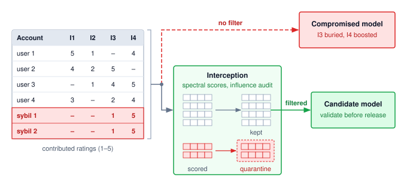
:::

### Ingress and anomaly controls {#sec-robust-ai-anomaly-detection-techniques-bc27}

Poisoning defense begins at the data boundary, before any statistical detector runs. The pipeline must know which sources are allowed to contribute training data, how their authenticity is verified, and which roles can modify accepted records. Strong governance enforces the principle of least privilege,[^fn-least-privilege-ml] logs data access and modification events, and gives each accepted batch a source identity. These controls do not prove that every record is clean, but they bound the attack surface and give anomaly findings a traceable origin.

[^fn-least-privilege-ml]: **Principle of Least Privilege**\index{Principle of Least Privilege!definition}\index{Least Privilege!ML pipeline security}: Articulated by @saltzer1975, this principle restricts access rights to the minimum necessary for each component. In an ML pipeline, a training job allowed to read unverified sources has an additional path through which adversarial data can enter, so write and read rights become part of the poisoning attack surface. The same principle governs the model registry\index{Model Registry!least-privilege access control}, the artifact store that maps version identifiers to weight files and controls which alias (for example, `staging`, `production`) resolves to which checkpoint. Promotion to the `production` alias should be restricted to a narrow, audited set of automated evaluation services and named release engineers; if a researcher's credentials are compromised, excluding those credentials from promotion authority blocks that direct path to replacing the live model, while other authorized paths still require scrutiny.

After the source boundary, anomaly detection asks whether a candidate training example belongs to the distribution that the pipeline intended to learn from. The cheapest tests compare each record against the bulk distribution: Z-score filtering, Tukey's method, and Mahalanobis distance flag examples whose feature values sit far from normal ranges. These tests are useful because they are fast enough to run at ingestion, but they catch only poisons that look like statistical outliers in raw feature space. For high-dimensional or multimodal data, raw-feature distances are a weak signal: a manipulated image or caption that passes raw-feature checks may separate from clean examples in a pretrained vision or language model's embedding space. That separation depends on the encoder and attack, so it must be measured rather than inferred from the use of a learned representation. Applying Mahalanobis distance\index{Mahalanobis Distance!latent representation filtering} or clustering to those representations tests a different hypothesis from raw-feature screening. The pipeline must check whether the resulting outliers correspond to malicious contributions or to legitimate variation it needs to retain.

More coordinated attacks require structure-aware checks. Clustering methods such as K-means, DBSCAN, and hierarchical clustering look for anomalous groups or isolated points rather than single extreme values. The autoencoder ingestion gate diagrammed in @fig-autoencoder adds a learned representation to the screening pipeline: the model compresses inputs through a bottleneck layer $\EncoderLatentRepresentation$, accepting records whose reconstruction error $\AutoencoderReconstructionError$ falls below threshold $\ResponseThreshold$ and quarantining anomalous outliers. Each method has a failure mode. Clean-label poisons need not be statistical outliers. Clustering depends on the representation, and autoencoders can reconstruct unfamiliar inputs well or learn an attack pattern from a contaminated reference corpus. Each gate therefore needs evaluation on both poisons and legitimate rare examples.

::: {#fig-autoencoder fig-env="figure" fig-pos="htb" fig-cap="**Autoencoder Ingestion Gate**: An autoencoder trained on trusted data learns to compress inputs through a narrow latent layer $\EncoderLatentRepresentation$ and reconstruct them. Reconstruction error supplies an anomaly score, not proof that an input is poisoned. The gate accepts records whose reconstruction error $\AutoencoderReconstructionError$ stays at or below a threshold $\ResponseThreshold$ calibrated on held-out clean data and quarantines the rest." fig-alt="Symmetric hourglass network: an encoder narrows seven input units through five and three hidden units to a two-unit latent layer, and a decoder expands back to seven reconstructed outputs. An arrow from the output leads to a reconstruction error panel, L rec equals the squared norm of x minus x hat, containing a horizontal score axis labeled L rec at its arrow end and split by a dashed threshold tau. Left of tau is a green accept zone, L rec at most tau, holding a stacked cluster of green record dots at low scores; right of tau is a red quarantine zone, L rec greater than tau, holding two red record dots at high scores."}
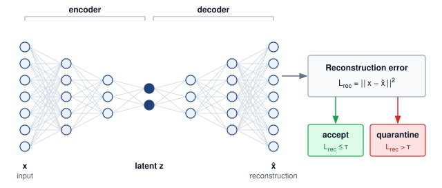
:::

#### Sanitization and preprocessing {#sec-robust-ai-sanitization-preprocessing-f883}

Sanitization turns anomaly signals into training-set changes before the poison reaches optimization. A suspicious record can be rejected, quarantined for review, down-weighted during training, or kept with an explicit provenance flag. Routine cleaning still matters: deduplication, missing-value handling, type checks, range constraints, and cross-field validation remove many low-effort poisoning attempts while improving ordinary data quality.

Data provenance\index{Data Provenance!ML pipelines} and lineage tracking make those decisions reversible. Each datum needs a record of its source, transformations, validation outcomes, and movement through the pipeline. When a model later exhibits a poisoning symptom, lineage lets the operator trace\index{Data Lineage!poisoning rollback} model dependencies back to candidate source batches, investigate which contributions caused the behavior, estimate which trained models consumed confirmed compromised examples, and decide whether to remove, relabel, or reweight the affected records.

When suspicious data has already entered the corpus, sanitization moves from source checks to representation checks. Spectral signatures\index{Spectral Signature!data sanitization} exploit separation between clean and poisoned samples in a learned representation [@tran2018spectral]. In the backdoor attacks studied by Tran and colleagues, the trigger created a strong signal in the target class's activations. Projecting centered representations onto the top singular vector\index{Spectral Signature!singular value decomposition} and removing high-scoring samples exposed many poisoned records without requiring prior knowledge of the trigger. The method depends on sufficient separation relative to within-group variation; an effective backdoor does not by itself guarantee a usable spectral signature. Filtering therefore requires attack-specific evaluation and checks for discarded clean samples.

Influence functions\index{Influence Functions!data sanitization} [@koh2017understanding] serve a narrower debugging role. They approximate how infinitesimally increasing a training point $\TrainingExample$'s weight changes the model's loss for a test point $\TestExample$, without retraining. The fitted parameters are the trained model's weights, and the Hessian is the curvature matrix of the average training loss at those parameters. Its inverse translates a small change in a training point's weight into an approximate change in the fitted parameters. Calculated through inverse-Hessian-vector products\index{Influence Functions!inverse-Hessian computation}, influence $\InfluenceFunction(\TrainingExample, \TestExample) \approx -\nabla_\ModelParameters\LossFunction(\TestExample, \OptimalModelParameters)^T \LossHessian^{-1} \nabla_\ModelParameters\LossFunction(\TrainingExample, \OptimalModelParameters)$, this metric measures local sensitivity to upweighting $\TrainingExample$. For an average training loss over $\DatasetSize$ examples, removing one point corresponds approximately to a weight change of $-1/\DatasetSize$, reversing the sign and scaling this influence by $1/\DatasetSize$. If a model begins assigning an attacker's target label to one narrow class of inputs, influence functions can rank the training examples that contributed most to that decision. The method avoids forming an explicit inverse Hessian by using iterative approximations, but its results remain approximate in deep nonconvex networks. At modern model scale, influence analysis therefore requires validation against the specific architecture, approximation, and debugging task rather than serving as exact attribution.

### Robust training objectives {#sec-robust-ai-robust-training-objectives}

```{python}
#| echo: false
# ┌─────────────────────────────────────────────────────────────────────────────
# │ HUBER OUTLIER SCALING (LEGO)
# ├─────────────────────────────────────────────────────────────────────────────
# │ Context: robust training prose in @sec-robust-ai-data-poisoning-defenses-d070.
# │
# │ Goal: Distinguish squared-error loss growth from residual-gradient growth.
# │ Show: 100x residual error gives 10,000x squared loss but 100x residual
# │       gradient magnitude.
# │ How: MSE loss scales as e^2; the residual term in the MSE gradient scales
# │      linearly with e.
# │
# └─────────────────────────────────────────────────────────────────────────────
from mlsysim.fmt import check, fmt_multiple

# ┌── LEGO ───────────────────────────────────────────────
class HuberOutlierScaling:
    """Namespace for outlier scaling in quadratic loss."""

    # ┌── 1. LOAD (Constants) ──────────────────────────────────────────────
    normal_error_multiple = 100

    # ┌── 2. EXECUTE (The Compute) ────────────────────────────────────────
    squared_loss_multiple = normal_error_multiple**2
    residual_gradient_multiple = normal_error_multiple

    # ┌── 3. GUARD (Invariants) ──────────────────────────────────────────
    from mlsysim.fmt import check

    check(squared_loss_multiple == 10000, "Squared loss should scale quadratically")
    check(residual_gradient_multiple == 100, "Residual-gradient term should scale linearly")

    # ┌── 4. OUTPUT (Formatting) ──────────────────────────────────────────────
    from mlsysim.fmt import fmt

    normal_error_mult_str = fmt_multiple(normal_error_multiple, precision=0, commas=False)
    squared_loss_mult_str = fmt_multiple(squared_loss_multiple, precision=0, commas=True)
    residual_gradient_mult_str = fmt_multiple(residual_gradient_multiple, precision=0, commas=False)
```

::: {.column-margin}
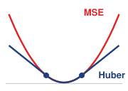{width="100%" fig-alt="Red curve labeled MSE and blue curve labeled Huber. They coincide near zero, where two blue dots mark the threshold on either side; beyond the dots the blue curve continues in straight lines while the red parabola climbs steeply."}

*Huber limits a surviving outlier by growing linearly where MSE keeps squaring.*
:::

If poisoned samples survive sourcing and sanitization, the training objective offers another opportunity to limit their influence before release evaluation. Robust optimization modifies the objective to minimize the impact of outliers or poisoned instances. Robust loss functions\index{Robust Loss Function!outlier down-weighting} such as the Huber loss,[^fn-huber-loss-robust] the Tukey loss [@beaton1974], and the trimmed mean loss down-weight or ignore the contribution of abnormal instances during training. Regularization techniques ($\ell_1$ or $\ell_2$ regularization) constrain model complexity and can reduce sensitivity to some poisoned data. At a higher level, minimax[^fn-minimax-adversarial-formulation] and distributionally robust objectives optimize performance over a specified uncertainty set. The objective supplies a formal target; an approximate optimizer does not by itself prove that the trained model attains the target or resists attacks outside that set.

[^fn-huber-loss-robust]: **Huber Loss**\index{Huber Loss!poisoning defense}: This piecewise loss transitions from quadratic to linear beyond a chosen residual threshold, bounding its derivative with respect to the residual\index{Huber Loss!gradient capping}. The parameter gradient also multiplies that derivative by the model's prediction Jacobian, so Huber loss alone does not bound parameter updates or prevent poisoning. Under MSE, an outlier with `{python} HuberOutlierScaling.normal_error_mult_str` normal error contributes `{python} HuberOutlierScaling.squared_loss_mult_str` squared-error loss and `{python} HuberOutlierScaling.residual_gradient_mult_str` residual-gradient magnitude. Under Huber loss, once that residual passes the threshold the loss grows only linearly and the residual derivative stays at the threshold value, so the same outlier pulls no harder than any other point beyond the threshold.

[^fn-minimax-adversarial-formulation]: **Minimax**\index{Minimax!adversarial training}: Game-theoretic strategy from @vonneumann1928theorie that minimizes the maximum possible loss. In adversarial robustness, @madry2018towards formulate training as $\min_\ModelParameters\max_{\|\AdversarialPerturbation\| \leq \AdversarialPerturbationBudget} \LossFunction(\ParameterizedPredictor(\ModelInput+ \AdversarialPerturbation), \ExampleLabel)$: the model learns to minimize loss under a worst-case perturbation\index{Minimax!robust optimization formulation} within the chosen norm ball. The inner maximization is computationally expensive because it is usually approximated with iterative attacks such as PGD, so PGD-adversarial training is a budgeted robustness choice rather than a free objective change [@bai2021; @shafahi2019adversarial].

The image transformations displayed in @fig-data-augmentation demonstrate how data augmentation\index{Data Augmentation!techniques} expands training diversity: applying horizontal flips, rotations, and crops creates variants that preserve the label when the transform respects the class (a horizontally flipped digit need not) and can disrupt some localized poison patterns. Other transformations preserve an attack's trigger, so augmentation does not guarantee dilution. Random subsampling or bootstrap aggregating changes which poisoned records each model encounters; whether combining those models reduces the attack's effect requires evaluation against coordinated poisoning.

::: {#fig-data-augmentation fig-env="figure" fig-pos="htb" fig-cap="**Data Augmentation Techniques**: Applying transformations like horizontal flips, rotations, and cropping creates variants of existing training examples. When the transformations preserve the task label, they can improve robustness to the represented variations and reduce overfitting. Their effect on generalization and poisoning resistance requires evaluation." fig-alt="Grid showing original image and augmented variants: horizontal flip, rotation, and cropping transformations applied to same source."}

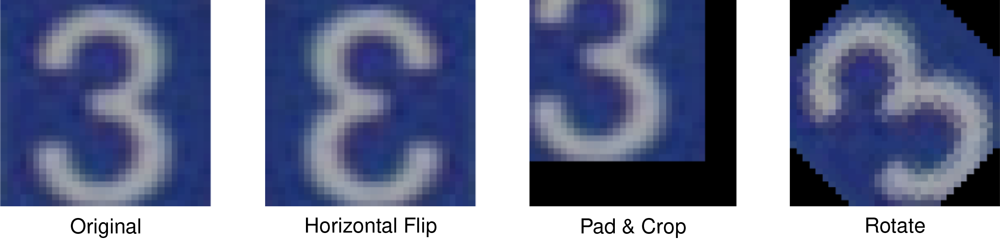

:::

The operating rule is layered: authenticate and govern sources before ingestion, sanitize suspicious data before training, limit surviving outliers during optimization, and preserve lineage so an incident can be traced back to the compromised source. Data poisoning remains an active research area, but production systems should treat the training corpus as a supply chain rather than a passive dataset.

The data boundary is therefore one robustness layer, not the whole defense. The fourth layer works on the model rather than the records. A representation that does not lean on brittle shortcuts gives a poisoned shortcut less to exploit, and the same property helps the model survive ordinary deployment variation, so this layer serves the poisoning defense and the environmental pillar at once. Beyond detecting and correcting shifts after they occur (@sec-robust-ai-environmental-shifts-a2cf), a complementary approach builds shift-resilient representations from the start, drawing on transfer-learning and domain-adaptation foundations [@pan2010].

### Representation-level defense via self-supervised learning {#sec-robust-ai-selfsupervised-learning-robustness-0c94}

Self-supervised learning (SSL)\index{Self-Supervised Learning!robustness} changes the source of supervision. Instead of relying only on task labels, the model learns by solving pretext tasks\index{Self-Supervised Learning!pretext task robustness} that require structure in the data itself. This matters for robustness because many brittle models overfit to whichever labeled shortcut is easiest to exploit: a background texture, an annotation artifact, or a narrow phrasing pattern. A pretraining task that rewards stable structure across views, missing tokens, or masked image patches gives the representation a chance to learn signals that survive more deployment variation.

Contrastive learning methods such as SimCLR [@chen2020simclr] make this idea concrete by pushing different views of the same example toward a shared representation. The model is rewarded for treating a crop, color shift, or augmentation as the same underlying object rather than as a new class-specific cue. **Masked language modeling**\index{Masked Language Modeling!definition} in BERT [@devlin2019] and masked autoencoding in vision\index{Masked Autoencoder!representation robustness} [@he2022] use a different route: they hide part of the input and force the model to reconstruct or predict it from context. Both families provide supervision beyond the downstream task labels. Whether the resulting representations transfer better depends on the pretraining data, objective, and deployment shift; removing task labels does not remove shortcut learning.

That transfer benefit is the main systems reason to use SSL in a robustness pipeline. Larger unlabeled corpora expose the model to domains, transformations, and rare cases that would be too expensive to label exhaustively. The same uncurated scale widens the poisoning surface, so SSL pretraining data still needs the ingress and sanitization controls described earlier. In production, SSL usually acts as a foundation rather than a complete defense: pretrain on broad unlabeled data, fine-tune on the supervised task, then apply the adversarial, drift, and poisoning defenses established earlier in this chapter to the task-specific model. Multi-task training can preserve some of this benefit by keeping a self-supervised objective active while the supervised task pulls the representation toward the deployment metric.

The limitation is that SSL is not a robustness guarantee. A contrastive or masked-pretraining objective can still learn brittle shortcuts, and an attacker who understands the pretext task can target those shortcuts directly. The theory explaining when SSL improves robustness remains incomplete, and the compute cost can be substantial because pretraining moves work earlier in the lifecycle. The systems decision is therefore whether broader representation learning lowers the expected cost of drift, relabeling, and robust fine-tuning enough to justify the added pretraining budget.

## System-Level Faults and Masquerading {#sec-robust-ai-diagnosing-the-masquerade-9f21}

Every defense in the two preceding pillars reads evidence produced by the system it protects: drift monitors read preprocessed features, adversarial detectors read model scores, and poisoning filters read learned representations. The third pillar asks what happens when that machinery is itself wrong. The unified framework showed why the question cannot be left to infrastructure alone. A single exponent flip produces a finite outlier that passes every NaN and infinity check (@fig-weight-corruption), and at the illustrative stress-test rate of `{python} SilentErrorProbability.p_per_hr_prose_str` per device-hour in @fig-silent-error-probability, a `{python} SilentErrorProbability.n_gpus_large_str`-device cluster sees some silent corruption within an hour with probability `{python} SilentErrorProbability.p_total_large_str`. Execution-level detection and recovery belong to fault tolerance. Robustness adds two obligations on top of them: behavioral checks that run on the model's own values and outputs, and a diagnosis that decides whether a behavioral alarm came from a fault at all.

The cheapest behavioral checks test invariants that a correctly executing model satisfies. A range check $|\ModelWeight| \le \WeightRangeBound$ against the trained weight distribution catches the exponent flip above at the cost of one comparison per stored value, and the same idea bounds each layer's activations at serving time against the range observed on validation traffic. Golden-input canaries replay a fixed set of requests through each replica on a schedule and compare the outputs with stored references, which catches a corrupted replica whose liveness and readiness probes still pass. Cross-replica comparison, which runs the same request on two replicas, catches corruption that invariants miss but doubles the work for every request it covers, so fleets apply it to sampled traffic, following the check-and-verify pattern used against silent data corruption elsewhere in the fleet. Each check spends a C$^3$ axis. Invariant checks add compute on the serving path, canaries and cross-replica comparison add compute and communication, and deciding which replicas and checkpoints remain trustworthy after a check fails is coordination.

::: {.column-margin .margin-pointer}
↩ Check-and-verify defenses against silent data corruption, and their cost relative to full redundancy, are established in @sec-ft-sdc-verification.
:::

These checks cover faults that leave a numerical signature. The harder case is a fault whose symptom looks like one of the other pillars. Consider an operator who sees the same surface symptom from all three pillars, falling model accuracy while latency and uptime hold steady. A preprocessing bug\index{Software Fault!masquerade as covariate shift} that silently rescales a feature looks exactly like covariate shift to a drift monitor, because the feature statistics have genuinely moved. A numerical overflow\index{Numerical Instability!masquerade as adversarial attack} that corrupts a layer's activations produces confident misclassifications that look exactly like an adversarial example, because the decision flipped without a visible input cause. The difficulty lies in the disguise, because the cheap pillar-specific detectors fire on the symptom rather than the cause.

Three complementary signals guide this investigation: the timing boundary of the change, reproducibility under fixed inputs, and cross-layer correlation with infrastructure telemetry.

The boundary and timing of a change often provide the first diagnostic clue. While environmental shift can evolve gradually or appear abruptly with real-world events, a shift synchronized with a deployment, dependency bump, or schema migration raises the pipeline-fault hypothesis. This suspicion strengthens when multiple features shift simultaneously in directions that the underlying physical process cannot explain. Timing alone narrows the search space without proving causation.

Reproducibility under fixed inputs\index{Fault Diagnosis!fixed-input replay} helps locate the failure boundary. Replaying golden inputs through version-pinned preprocessing pipelines and model artifacts can expose the stage where outputs begin to differ. A deterministic software defect fails at the same stage on every replay, a transient hardware upset usually vanishes on replay, and race conditions or marginal hardware fail intermittently, so isolating them takes repeated runs or a second device. Stochastic execution also requires controlling random state or comparing repeated runs. Because shifted or adversarial inputs can reproduce the same error under fixed execution conditions, replay alone cannot settle the diagnosis; operators must compare raw and preprocessed tensors, artifact versions, and population-level statistics alongside the replay output.

Finally, cross-layer correlation\index{Fault Diagnosis!cross-layer correlation} links model behavior to surrounding infrastructure telemetry. Query-rate spikes or unusual input patterns can support an attack hypothesis, while deployment releases, error-correcting code (ECC) memory counters, SDC checkers, or memory-pressure alarms can support a system-fault hypothesis. Neither pattern is necessary or sufficient. An attack can remain within normal traffic patterns, and silent corruption can escape the available counters. Correlation guides the next diagnostic test rather than establishing the cause.

::: {#exmp-robust-ai-masquerade-replay .callout-example title="A drift alert that was a pipeline fault"}

**Scenario**: A credit-risk service raises drift alerts on three income-related features on the morning after a routine dependency update, and the approval rate for applicants in the affected income bands shifts sharply. Latency, error rates, and uptime are unchanged, and every request that the on-call engineer retries returns a score without error.

**Diagnosis**: The three signals point the same way. The alerts begin at the release boundary, and the three features moved together in a direction that no change in applicant behavior explains. Replaying a stored set of golden requests through the previous and current pipeline versions produces identical raw inputs but preprocessed tensors that differ by a constant factor on exactly those features, because the updated library changed a default normalization. Deployment telemetry correlates with the change; query-rate and hardware counters do not. The failure is a software fault disguised as covariate shift. Retraining on the corrupted features would have taught the model the bug, and the successful retries proved only that the service answered, not that its answers passed acceptance.

**Systems lesson**: A replay harness that pins artifact versions and compares tensors at each pipeline stage turns an ambiguous drift alert into an attributable fault. Recovery is complete only when the replayed outputs satisfy the model's acceptance tests again, which is a behavioral check that a successful retry or a green health dashboard cannot supply.

:::

The diagnostic discipline is therefore to read the system-level evidence before accepting the drift or attack hypothesis the surface symptom suggests, because each pillar suggests a different intervention and more than one cause can be active at once.

## Fallacies and Pitfalls {#sec-robust-ai-fallacies-pitfalls-087e}

Robustness spans environmental shifts, input-level attacks, and system-level faults. Each threat domain introduces misconceptions that lead to inadequate defenses or misallocated engineering resources.

::: {.fallacy-pitfall}

**Fallacy**: *Adversarial examples are an academic curiosity with no real-world impact.*

Published physical-world attacks, such as adversarial patches on clothing or stickers on stop signs\index{Adversarial Patch!physical road sign attack}, have fooled evaluated vision models under controlled patch and road-sign settings without digital access. Defense requires evaluation under the relevant physical conditions. Physical-world data augmentation, patch-aware training, and serving-time detection are candidate interventions, each with its own coverage and cost. Related PGD-style digital adversarial training adds work according to its attack steps, but its results do not establish resistance to physical attacks. Ordinary digital test sets can miss these deployment failure modes.

:::

::: {.fallacy-pitfall}

**Pitfall**: *Treating test-set success as robustness proof.*

A test set drawn from the same i.i.d. distribution\index{i.i.d. assumption!test-set fallacy} as training data measures performance in that population; it does not establish resilience to a different deployment distribution or to a critical slice inside the same one. The Google Photos labeling failure shows how a harmful error on one population slice can hide inside aggregate accuracy, and the night-driving and clinic-imaging examples of distribution shift fail on populations the test set underrepresents. Robustness evidence needs held-out shifts, named slices, and the other cells of @tbl-robust-ai-evaluation-matrix.

:::

::: {.fallacy-pitfall}

**Fallacy**: *Distribution shift monitoring is optional after deployment.*

Models often degrade silently, maintaining high confidence scores\index{Silent Failure Mode!high-confidence degradation} even as predictive performance falls due to drift. Monitoring metrics like PSI can surface population shifts before accuracy falls below service level agreement (SLA) thresholds, enabling proactive intervention when the monitored features are predictive of downstream performance.

:::

::: {.fallacy-pitfall}

**Pitfall**: *Ignoring poisoning defenses unless the attacker controls the training pipeline.*

Clean-label poisoning\index{Clean-Label Poisoning!public data sources} compromises models by injecting correctly labeled but manipulated samples into public datasets or scraped data sources, requiring no access to internal code. Low-dose attacks\index{Clean-Label Poisoning!low-dose attacks} can still target a particular prediction or implant a backdoor; the size of the poisoned slice and the apparent correctness of its labels do not establish integrity.

:::

::: {.fallacy-pitfall}

**Fallacy**: *Average accuracy is sufficient for robustness measurement.*

High average accuracy\index{Worst-Case Evaluation!vs. average accuracy} often masks fragility. A model that is accurate on nearly all clean test inputs can still fail on every input in a critical slice once an attacker applies a small, targeted perturbation [@madry2018towards]. Reliable evaluation requires evidence for the claimed failure class: slice-level performance under shifts, empirical attack accuracy under a stated budget, or a certified radius where a formal guarantee is available. A finite attack search supplies empirical evidence rather than exact worst-case accuracy.

:::

::: {.fallacy-pitfall}

**Pitfall**: *Treating adversarial training as a complete robustness solution.*

Adversarial training does not establish universal robustness. A model trained against $\ell_\infty$ attacks needs separate evaluation for $\ell_2$ or geometric attacks. Perturbation sets can overlap, so resistance need not vanish across norms, but the training threat model alone does not establish the extent of that transfer.

:::

::: {.fallacy-pitfall}

**Fallacy**: *Software faults do not matter when the model is correct.*

Focusing solely on algorithmic robustness ignores the reality that software bugs in data pipelines\index{Pipeline Validation!software fault prevention} and serving infrastructure are a major cause of ML failures. Incident analyses often find pipeline and data issues, not model architecture or adversarial attacks alone, at the center of failures. Checksums can detect changed bytes, while behavioral validation must also catch incorrect transformations of intact data. A model hardened against adversarial perturbations can still fail when a preprocessing bug supplies validly stored but wrongly computed inputs.

:::

::: {.fallacy-pitfall}

**Pitfall**: *Hardening the model while leaving pipeline checks untested.*

Robustness work can concentrate on adversarial training, certified radii, or poisoning defenses while leaving schema validation, preprocessing parity, feature freshness, and rollback drills under-tested. That imbalance creates a system that resists one class of attack but fails on ordinary operational faults. In the credit-risk example of @sec-robust-ai-diagnosing-the-masquerade-9f21, a changed library default would have been caught at release time by a golden-request replay comparing preprocessed tensors across pipeline versions; without that check, the fault surfaced as a drift alert, and retraining on the corrupted features would have taught the model the bug. A robust deployment validates the model and the pipeline together and exercises the replay harness and rollback path before an incident needs them.

:::

## Summary {#sec-robust-ai-summary-a274}

Robust AI makes prediction quality an explicit engineering obligation alongside uptime and latency. Environmental shifts, adversarial manipulation, poisoning, and system faults can leave a service apparently healthy while its outputs become unreliable. The chapter's diagnostic framework reads release timing, fixed-input replay, and infrastructure telemetry before accepting a drift or attack hypothesis, then connects each failure class to its own evidence and response; fleet recovery mechanisms must therefore be paired with behavioral acceptance tests.

Inside the training step, robustness is paid for in the terms of the Fleet Law (@eq-fleet-law). Multi-step PGD adds gradient work in $\IronLawComputeTime$; at a fixed worker count $\DeviceCount$, the wall-clock increase depends on implementation, reuse, and the other terms in the step. Whether it also reduces clean accuracy, and by how much, depends on the model, data, perturbation set, and training recipe. Robust aggregation for distributed or federated contributors replaces a reducible mean with a median, trimmed mean, or Krum selection, which require more than an ordinary sum reduction. A direct gather-based implementation raises per-worker traffic by about half the number of contributing replicas relative to ring AllReduce, but the actual effects on $\CommunicationTime(\DeviceCount)$ and $\SynchronizationTime(\DeviceCount)$ depend on where updates are collected, how the rule is implemented, and which work the baseline already performs.

Outside the training step the same C$^3$ axes set the price. Randomized smoothing and self-consistency sampling spend compute on every request they cover, invariant checks and golden-input canaries spend compute and communication to catch faults that health probes miss, and poisoning sanitization spends compute and storage bandwidth on extra passes over the training corpus. Drift monitoring spends communication, shipping reference statistics and serving telemetry between machines. Release gates, abstention thresholds, and escalation ownership spend coordination, because validated model versions must be adopted consistently across the fleet. Conformal routing\index{Conformal Prediction!routing and fallback} touches all three axes: computing prediction sets adds bounded compute, returning larger sets adds communication, and routing abstentions to reviewers adds coordination. If prediction sets grow and trigger more deferrals, human-review or fallback capacity can become the bottleneck. Distribution shift can also invalidate coverage without enlarging the sets, so set size is a load signal rather than a complete drift detector. A coverage claim is operationally useful only when the deployment also provisions the path that consumes uncertain cases. Robustness engineering measures these workload-specific costs against the reduction in silent risk where failure consequences are highest.

::: {.callout-takeaways title="Silent failure is the real threat"}

* **Silence is the failure mode**: Robustness exists because drift, adversarial perturbations, poisoning, and numerical faults often preserve uptime and latency while corrupting predictions. Production systems need monitors that surface competence loss\index{Silent Failure Mode!production detection} before user complaints or downstream business metrics reveal it.
* **Diagnose before defending**: A software fault can look like concept drift, a poisoned sample like a rare outlier, and an adversarial input like natural variation. Read the release timing, fixed-input replay, and infrastructure telemetry before spending a defense budget on the hypothesis the surface symptom suggests, then combine ingress validation, training defenses, uncertainty signals, and output verification.
* **Robustness is bought explicitly**: Strong adversarial training (principle \ref{pri-robustness-compute-penalty}) can reduce clean accuracy and multiply training compute, while certified defenses and uncertainty sampling add serving cost. Price each effect against a like-for-like baseline before deciding how much resilience the failure consequence justifies.
* **Drift alerts begin an investigation**: Calibrated distance measures identify changes that need review. Outcome evidence and root-cause analysis determine whether the response should be continued monitoring, data repair, recalibration, retraining, or fallback.
* **Coverage guarantees have operating conditions**: Conformal prediction provides finite-sample marginal coverage under exchangeability, not per-input or per-subgroup certainty. Version and refresh the calibration evidence, and provision fallback capacity for large prediction sets.
* **Generative reliability is semantic**: LLM hallucinations are confidently fluent failures rather than simple label mistakes. Entropy and self-consistency are routing signals, not factuality guarantees; grounding checks, external verification, and escalation policies must bound what the system is allowed to assert.

:::

No finite evaluation establishes robustness to every shock. A deployable claim must bind behavioral evidence to the evaluated artifact and operating conditions, then provision the detection and fallback paths without violating service-level objectives (SLOs). The release record in @sec-ops-scale-end-to-end-evaluation-contract preserves that link so a changed model or workload cannot silently inherit obsolete evidence. Governance uses the resulting record to assign acceptable residual risk and decision authority; a robustness score alone cannot make those decisions.

::: {.callout-chapter-connection title="From resilience to sustainability"}

Even when a fleet is secure and robust, it can still be bounded by the electrical power its accelerators demand. Every defense in this chapter is paid for in compute. Adversarial training multiplies gradient work, randomized smoothing and self-consistency sampling repeat inference, and replay harnesses and redundant checks run beside the serving path. That compute draws electricity and rejects heat, and a facility's power and cooling capacity bounds how much of it the fleet can run. The next chapter treats those limits as design constraints, beginning with the energy ceiling on fleet capacity and extending to operational and embodied carbon and carbon-aware operation.

:::

::: {.column-margin .margin-pointer}
↪ Facility power and cooling limits, lifecycle carbon accounting, and carbon-aware scheduling are developed in @sec-sustainable-ai.
:::

<!-- This is here to make sure that quizzes are inserted properly before a part begins. -->

::: { .quiz-end }
:::
