# Sustainable AI {#sec-sustainable-ai}

::: {layout-narrow}
::: {.column-margin}

\chapterminitoc

:::

::: {.content-visible when-format="pdf"}
\noindent
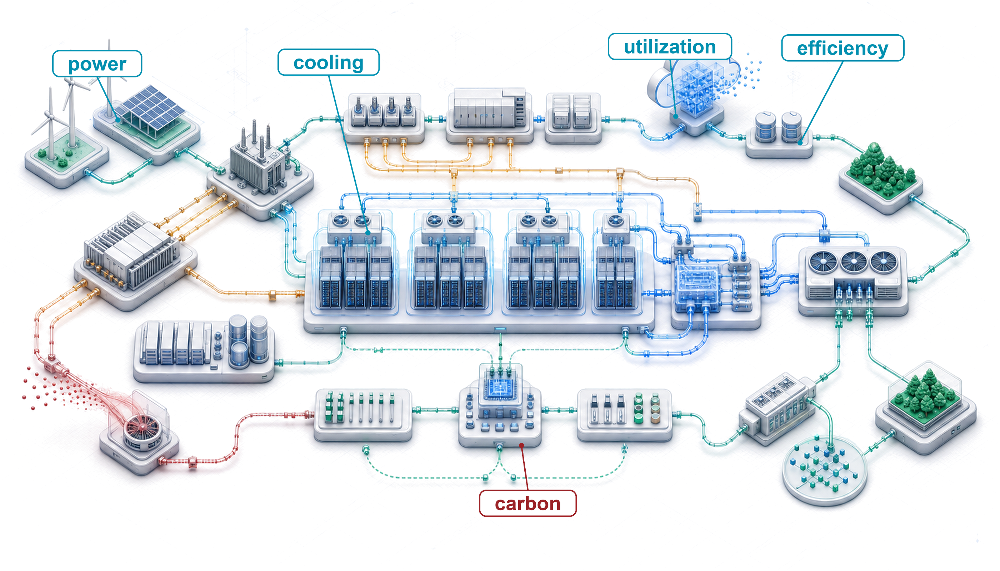{fig-alt="Sustainable fleet cutaway connecting compute racks to power delivery, cooling loops, grid sources, carbon accounting, efficiency controls, and lifecycle management."}
:::

::: {.content-visible unless-format="pdf"}
{fig-alt="Sustainable fleet cutaway connecting compute racks to power delivery, cooling loops, grid sources, carbon accounting, efficiency controls, and lifecycle management."}
:::

:::

## Purpose {.unnumbered .unlisted}

\begin{marginfigure}
\mlfleetstack{55}{35}{15}{20}{25}{40}{35}{100}
\end{marginfigure}

_Why do power limits determine what machine learning systems can exist, not just what they cost to operate?_

Power is an operational expense and a physical constraint on what can be built. A data center has a power budget determined by electrical infrastructure and cooling capacity; a training run that exceeds it cannot proceed at the intended scale regardless of its financial budget. Adding accelerators only helps if the site can supply their electricity and remove their heat. A design that runs efficiently on one machine can therefore become infeasible when replicated across a fleet. The consequences reach beyond a delayed training run. Power reserved for training may be unavailable to serving, while equipment kept ready for failures consumes resources even when it performs no useful work. Moving work to another location can relieve one constraint while changing its emissions, access to data, or ability to meet deadlines. Efficiency improves these choices, but lower energy per request does not ensure lower total consumption when demand grows. Nor does a clean electricity supply erase the environmental cost of manufacturing and replacing equipment. Engineers must judge feasible designs over their useful lives and account for the communities sharing their water and electricity supplies. Sustainability therefore belongs alongside accuracy, latency, and reliability in system design: a fleet must deliver useful service within resource limits that its performance targets cannot override. In C³ terms, compute, communication, and coordination draw on a shared physical budget, so their combined resource demand determines whether the fleet can operate at all.

::: {.content-visible when-format="pdf"}

\newpage

:::

::: {.callout-learning-objectives}

- Explain why facility power and cooling limits constrain which ML systems can physically exist
- Analyze how compute growth, hardware efficiency, and demand rebound shape fleet resource demand
- Calculate operational, embodied, and lifecycle carbon from energy use, power usage effectiveness, manufacturing, and grid intensity
- Analyze how computation, memory movement, power delivery, cooling, and water availability constrain sustainable fleet operation
- Compare training, inference, edge, and federated workloads by energy, carbon, and battery budgets
- Design mitigation strategies across algorithms, infrastructure, scheduling, hardware lifetime, and carbon-aware operations
- Evaluate sustainability claims using lifecycle emissions evidence and the distribution of environmental burdens

:::

```{python}
#| echo: false
from mlsysim import *
from mlsysim.core.units import *

# ┌─────────────────────────────────────────────────────────────────────────────
# │ CHAPTER START
# ├─────────────────────────────────────────────────────────────────────────────
# │ Context: Chapter initialization and global imports
# │
# │ Why: Registers this chapter with the mlsys registry and provides shared
# │      imports for all subsequent calculation cells.
# │
# └─────────────────────────────────────────────────────────────────────────────
from mlsysim.fmt import MarkdownStr, check, fmt
```

```{python}
#| echo: false
#| label: gpt3-household-energy-anchor
# ┌─────────────────────────────────────────────────────────────────────────────
# │ GPT-3 HOUSEHOLD ENERGY ANCHOR (LEGO)
# ├─────────────────────────────────────────────────────────────────────────────
# │ Context: Chapter-wide GPT-3 household-year comparison.
# │
# │ Goal: Keep the GPT-3 training-energy and household-year comparison sourced
# │       from mlsysim rather than repeated as local prose literals.
# │ Scope: chapter-anchor — chapter-wide GPT-3 household-year comparison.
# │ Show: 1,287 MWh; 10.7 MWh/household-year; about 120 household-years.
# │ How: Models.Language.GPT3.training_energy_mwh /
# │      ReferenceStats.EnergyAnchors.USHouseholdAnnualElectricity.
# │
# └─────────────────────────────────────────────────────────────────────────────
from mlsysim import Models, ReferenceStats
from mlsysim.fmt import check, fmt, fmt_energy
from mlsysim.core.units import MWh

class Gpt3HouseholdEnergyAnchor:
    """GPT-3 training energy expressed in US household-years."""

    # ┌── 1. LOAD ──────────────────────────────────────────────────────────
    gpt3_training_energy = Models.Language.GPT3.training_energy_mwh
    us_household_annual_energy = ReferenceStats.EnergyAnchors.USHouseholdAnnualElectricity

    # ┌── 2. EXECUTE ───────────────────────────────────────────────────────
    gpt3_household_years = (gpt3_training_energy / us_household_annual_energy).to("").magnitude
    gpt3_household_years_rounded = round(gpt3_household_years)

    # ┌── 3. GUARD ─────────────────────────────────────────────────────────
    check(119 <= gpt3_household_years <= 121, f"Expected ~120 household-years, got {gpt3_household_years:.1f}")

    # ┌── 4. OUTPUT ────────────────────────────────────────────────────────
    gpt3_training_mwh_str = fmt_energy(gpt3_training_energy, unit=MWh, precision=0, commas=True)
    us_household_annual_mwh_str = fmt_energy(us_household_annual_energy, unit=MWh, precision=1, commas=False)
    gpt3_household_years_str = fmt(gpt3_household_years_rounded, precision=0, commas=False)
```

## The Energy Ceiling {#sec-sustainable-ai-sustainable-ai-engineering-discipline-6d39}

A model can be secure against adversaries and robust under distribution shift, yet still fail if the available grid cannot power its accelerators or the facility cannot cool them. **Sustainability**\index{Sustainability!definition} begins at that boundary: the point where accuracy, latency, and reliability are no longer enough because the system must also fit within power, cooling, water, carbon, and hardware lifetime budgets. Energy is the ultimate currency of machine learning, and power density is the ceiling on data-center computational capacity.[^fn-joule-energy-scale]

When an engineer optimizes a database query to save 100 ms, that is ordinary performance tuning. At fleet scale, the same saving repeated billions of times per day can reduce electrical demand, cooling load, and carbon emissions if it reduces measured energy per completed query [@lacoste2019quantifying]. A system that exceeds its operating envelope has failed operationally in the same sense as one that crashes, because it cannot be deployed at the intended scale.

[^fn-joule-energy-scale]: **Joule Energy Scale**\index{Joule!definition}: A single A100 GPU at peak load consumes about 400 joules every second (400 W). Large-model training has no single defensible joule range: model size, hardware count, realized power, utilization, and run duration can each shift total energy by orders of magnitude. The engineering lesson lies in the conversion from repeated per-operation costs to facility energy, so this chapter reports measured or modeled workload energy rather than assigning every large run to one fixed range.

That ceiling makes sustainability a design constraint, not a reporting category. The same engineering discipline that budgets memory, bandwidth, and fault tolerance must also budget joules, cooling load, embodied carbon, and hardware replacement cycles.

Physical feasibility establishes which fleets can run. Sustainability then compares the environmental cost of feasible designs over their useful lives. We begin with workload energy and its measurement boundary, extend the account to carbon, water, and manufacturing, and use the dominant lifecycle term to choose between efficiency, placement, and hardware reuse. In the C³ framework, communication and coordination matter because transfers, synchronization stalls, and recovery keep equipment powered even when useful computation stops.

Contemporary machine learning applications operate at industrial scales, with environmental impact comparable to established heavy industries. Training a single large AI model can consume as much electricity as roughly `{python} Gpt3HouseholdEnergyAnchor.gpt3_household_years_str` US homes do in an entire year. Compute demand has grown faster than hardware efficiency [@sevilla2022]; this book calls the resulting gap the **sustainability paradox**\index{Sustainability Paradox!definition}. Sustainable AI treats that gap as a first-class systems problem rather than an externality to be managed after deployment.

::: {#dfn-sustainable-ai-sustainable-ai .callout-definition title="Sustainable AI"}

***Sustainable AI***\index{Sustainable AI!definition} is the systems engineering practice of measuring and optimizing the full environmental cost of ML systems (energy, water, and embodied carbon across training, inference, and hardware manufacturing) and incorporating those costs as explicit constraints in architecture decisions alongside performance and accuracy objectives [@vanwynsberghe2021sustainable; @lannelongue2021; @henderson2020towards].

1.  **Significance**: Training GPT-3 consumed approximately `{python} Gpt3HouseholdEnergyAnchor.gpt3_training_mwh_str` of energy [@li2020estimating], equivalent to roughly `{python} Gpt3HouseholdEnergyAnchor.gpt3_household_years_str` US household-years of electricity. The same lifecycle logic applies after training: pretrained models can often be adapted with far less work than training from scratch, and high-volume inference can eventually dominate total energy. Sustainable AI therefore tracks both one-time training runs and recurring serving workloads rather than treating model training as the whole footprint.
2.  **Distinction**: Unlike corporate sustainability reporting (which aggregates energy usage into annual CO~2~ disclosures), sustainable AI engineering operates at the individual workload level, selecting hardware based on FLOP/s per watt efficiency, scheduling training during periods of high renewable availability, and choosing model architectures that minimize inference FLOPs rather than simply maximizing accuracy.
3.  **Common pitfall**: A frequent misconception is that switching to renewable energy solves the sustainability problem. For hardware-intensive ML, embodied carbon (the carbon emitted manufacturing the chips, servers, and cooling equipment before they ever run a training job) often equals or exceeds operational carbon; over 50 percent of an edge device's lifecycle carbon can come from manufacturing, making hardware longevity and utilization rate as important as energy source.

:::

The environmental impact of AI systems spans the complete lifecycle: from semiconductor manufacturing and data center construction to model training, inference deployment, and electronic waste [@vanwynsberghe2021sustainable; @gupta2022chasing; @luccioni2023estimating]. Treating this full lifecycle as an engineering problem rather than a corporate responsibility exercise transforms sustainability from a vague objective into a measurable engineering requirement. Optimizing this footprint requires first grounding intuition in the raw physical energy of a single large-model training run.

Before calculating, we must fix what the energy measurement includes. Accelerator energy excludes host processors, host memory, networking, and storage. IT energy includes those supporting systems; facility energy additionally includes cooling and facility-side power losses. Power usage effectiveness (PUE) is the ratio of facility energy to IT energy over the same interval. Dividing useful training FLOPs by realized FLOPs per joule gives energy at the efficiency metric's stated boundary. If that boundary is IT equipment, multiplying by PUE gives facility energy; if it already includes the facility, applying PUE again double counts overhead. The opening calculations use one completed training run as their unit of work and account for operational electricity. Manufacturing and other lifecycle terms enter separately.

```{python}
#| echo: false
#| label: energy-of-intelligence-checkpoint-calc
# ┌─────────────────────────────────────────────────────────────────────────────
# │ ENERGY-OF-INTELLIGENCE CHECKPOINT INPUTS (LEGO)
# ├─────────────────────────────────────────────────────────────────────────────
# │ Context: @chk-sustainable-ai-energy-intelligence (problem-statement inputs).
# │
# │ Goal: Pin the checkpoint's scenario inputs (model size, training FLOPs) to
# │       the GPT-3 registry; PUE and end-to-end efficiency are round pedagogical
# │       assumptions documented in LOAD.
# │ Show: 175B parameters; 3.14 × 10^23 FLOPs; PUE 1.1; 50 GFLOP/J.
# │ How: Read parameters and training_ops from Models.Language.GPT3; format the
# │      scenario PUE and efficiency assumptions.
# │
# └─────────────────────────────────────────────────────────────────────────────
from mlsysim import Models
from mlsysim.fmt import check, fmt, fmt_compute_efficiency, fmt_math, fmt_params, sci_latex
from mlsysim.core.units import GFLOP, J

class EnergyOfIntelligenceCheckpoint:
    # ┌── 1. LOAD ──────────────────────────────────────────
    model_params = Models.Language.GPT3.parameters
    train_flops = Models.Language.GPT3.training_ops
    pue = 1.1  # round pedagogical PUE assumption for this checkpoint
    efficiency = 50 * GFLOP / J  # round pedagogical end-to-end training efficiency

    # ┌── 3. GUARD ─────────────────────────────────────────
    check(abs(train_flops.to("flop").magnitude - 3.14e23) < 1e21, "GPT-3 training FLOPs drifted from 3.14e23")

    # ┌── 4. OUTPUT (Formatting) ───────────────────────────
    model_params_b_str = fmt_params(model_params, scale="B", precision=0)
    train_flops_math = fmt_math(sci_latex(train_flops.to("flop").magnitude, precision=2))
    pue_str = fmt(pue, precision=1, commas=False)
    efficiency_gflop_per_j_str = fmt_compute_efficiency(efficiency, unit=GFLOP / J, precision=0, commas=False)
```

::: {#chk-sustainable-ai-energy-intelligence .callout-checkpoint title="The energy of intelligence"}

A `{python} EnergyOfIntelligenceCheckpoint.model_params_b_str` parameter model requires approximately `{python} EnergyOfIntelligenceCheckpoint.train_flops_math` FLOPs to train. Assuming a data center PUE of `{python} EnergyOfIntelligenceCheckpoint.pue_str` and a realized training efficiency of `{python} EnergyOfIntelligenceCheckpoint.efficiency_gflop_per_j_str` measured across the IT equipment, including support systems but excluding facility overhead:

- [ ] **Training energy**: calculate the total energy consumption in megawatt-hours (MWh).
- [ ] **Household-years**: convert the training run's energy into household-years using the average US household consumption of `{python} Gpt3HouseholdEnergyAnchor.us_household_annual_mwh_str` per year.
- [ ] **Metric boundary**: assess whether household-years captures the true environmental cost by separating energy consumption (MWh) from carbon intensity, the grams of CO~2~ the grid emits per kilowatt-hour delivered (g CO~2~/kWh).

:::

That household-year figure is the stake; it is also only the electricity entering the building. The next question is where that energy physically goes: how much reaches the accelerators, how much the cooling and power-delivery overhead consumes, and how the grid behind the meter converts those kilowatts into carbon.

### The scale of environmental impact {#sec-sustainable-ai-scale-environmental-impact-ac9a}

A training run measured in megawatt-hours is hard to reason about: few engineers carry an intuition for what a megawatt-hour of grid electricity costs the atmosphere. Converting that energy into emissions and then into a known carbon anchor, the CO~2~ of a trans-Atlantic flight, turns an abstract number into one with physical stakes.

```{python}
#| echo: false
#| label: carbon-cost-training-calc
# ┌─────────────────────────────────────────────────────────────────────────────
# │ CARBON COST OF TRAINING (LEGO)
# ├─────────────────────────────────────────────────────────────────────────────
# │ Context: @sec-sustainable-ai-scale-environmental-impact-ac9a
# │
# │ Goal: Quantify carbon emissions for GPT-3 training and compare to flights.
# │ Show: ~552,000 kg CO2 (~552 flights) at US avg grid intensity.
# │ How: Energy * Grid_Intensity; Flight_equiv = Emissions / kg_per_flight.
# │
# └─────────────────────────────────────────────────────────────────────────────
from mlsysim.fmt import check, fmt, fmt_carbon_intensity, fmt_emissions, fmt_energy, fmt_multiple, fmt_ratio
from mlsysim.physics.quantities import carbon_from_energy
from mlsysim.core.units import MWh, kWh, kilogram, gram
from mlsysim import Literature, ReferenceStats

# ┌── LEGO ───────────────────────────────────────────────
class CarbonCostGPT3:
    """Quantify the environmental impact of a large model training run."""

    # ┌── 1. LOAD (Constants) ──────────────────────────────────────────────
    energy = Models.Language.GPT3.training_energy_mwh
    us_grid = Infrastructure.Grids.US_Avg
    hydro_grid = Infrastructure.Grids.Quebec
    grid_ci_us = us_grid.carbon_intensity_kg_kwh * (kilogram / kWh)
    grid_ci_low = hydro_grid.carbon_intensity_kg_kwh * (kilogram / kWh)
    flight_co2 = ReferenceStats.EmissionsAnchors.TransatlanticRoundTripCo2Kg * kilogram

    # ┌── 2. EXECUTE (The Compute) ────────────────────────────────────────
    energy_kwh = energy.to(kWh)
    total_carbon = carbon_from_energy(energy, grid_ci_us)
    flight_ratio = (total_carbon / flight_co2).to("").magnitude

    low_carbon_emissions = carbon_from_energy(energy, grid_ci_low)
    emissions_ratio = (total_carbon / low_carbon_emissions).to("").magnitude
    low_carbon_flights = (low_carbon_emissions / flight_co2).to("").magnitude

    # ┌── 3. GUARD (Invariants) ──────────────────────────────────────────
    check(total_carbon.to(kilogram).magnitude > 500_000, f"Expected >500k kg CO2, got {total_carbon.to(kilogram).magnitude:.0f}")

    # ┌── 4. OUTPUT (Formatting) ──────────────────────────────────────────────
    training_mwh_str = fmt_energy(energy, unit=MWh, precision=0, commas=True)
    energy_kwh_str = fmt_energy(energy_kwh, unit=kWh, precision=0, commas=True)
    total_emissions_kg_str = fmt_emissions(total_carbon.to(kilogram), unit=kilogram, commas=True)
    flight_ratio_str = fmt_ratio(flight_ratio, precision=1)
    emissions_ratio_mult_str = fmt_multiple(emissions_ratio, precision=1, commas=False)
    grid_ci_us_kg_str = fmt_carbon_intensity(grid_ci_us, unit=kilogram / kWh, precision=3, commas=False)
    grid_ci_low_kg_str = fmt_carbon_intensity(grid_ci_low, unit=kilogram / kWh, precision=3, commas=False)
    co2_per_flight_kg_str = fmt_emissions(flight_co2, unit=kilogram, commas=False)
    low_carbon_flights_str = fmt(low_carbon_flights, precision=1, commas=False)
```

::: {#nbk-sustainable-ai-carbon-cost-training .callout-notebook title="The carbon cost of training"}

**Problem**: A team trains a large model (GPT-3 size), treating `{python} CarbonCostGPT3.training_mwh_str` as facility electricity for this comparison. How much CO~2~ is emitted under the stated grid factor, and how does that compare to a trans-Atlantic flight?

**Math**:

1.  **Energy**: Training energy consumption\index{Training!energy consumption} is `{python} CarbonCostGPT3.training_mwh_str` = `{python} CarbonCostGPT3.energy_kwh_str`.
2.  Carbon intensity (US average): $\approx$ `{python} CarbonCostGPT3.grid_ci_us_kg_str`.
3.  Total Emissions: Training emissions\index{Carbon Footprint!training emissions} are `{python} CarbonCostGPT3.energy_kwh_str` $\times$ `{python} CarbonCostGPT3.grid_ci_us_kg_str` $\approx$ `{python} CarbonCostGPT3.total_emissions_kg_str`.
4.  Comparison:
    *   One passenger, NY to London (round trip): $\approx$ `{python} CarbonCostGPT3.co2_per_flight_kg_str`.
    *   Ratio: `{python} CarbonCostGPT3.total_emissions_kg_str` / `{python} CarbonCostGPT3.co2_per_flight_kg_str` = `{python} CarbonCostGPT3.flight_ratio_str`.

**Systems insight**: A single training run emits as much carbon as hundreds of trans-Atlantic passenger round trips. Optimization matters. Under this electricity-attribution scenario, moving the job to a hydro-heavy grid (`{python} CarbonCostGPT3.grid_ci_low_kg_str`) would reduce emissions by `{python} CarbonCostGPT3.emissions_ratio_mult_str` to about `{python} CarbonCostGPT3.low_carbon_flights_str` passenger round trips. The comparison does not make hydroelectricity lifecycle-zero or remove local water and ecosystem impacts.

:::

```{python}
#| echo: false
#| label: archetype-a-tdp
# ┌─────────────────────────────────────────────────────────────────────────────
# │ ARCHETYPE A: H100 TDP REFERENCE (LEGO)
# ├─────────────────────────────────────────────────────────────────────────────
# │ Context: callout-lighthouse "Archetype A (GPT-4/Llama-3): The energy wall"
# │
# │ Goal: Provide H100 per-chip TDP for the 25k-GPU energy-wall framing.
# │ Show: ~700 W per chip.
# │ How: pulling Hardware.Cloud.H100.tdp from mlsysim.core.units.
# │
# └─────────────────────────────────────────────────────────────────────────────
from mlsysim import Systems
from mlsysim.fmt import assert_qty_close, check, fmt, fmt_power
from mlsysim.core.units import MW, watt

class ArchetypeATdp:
    """H100 per-chip TDP for the Archetype A energy framing."""

    # ┌── 1. LOAD (Constants) ──────────────────────────────────────────────
    fleet = Systems.Clusters.Reference_25K_H100
    tdp = fleet.node.accelerator.tdp
    cluster_gpus = fleet.total_accelerators

    # ┌── 2. EXECUTE (The Compute) ────────────────────────────────────────
    accelerator_power = cluster_gpus * tdp

    # ┌── 3. GUARD (Invariants) ──────────────────────────────────────────
    check(tdp.to(watt).magnitude > 500, "H100 TDP should exceed 500 W")
    assert_qty_close(accelerator_power, 17.5, MW, rel=1e-3)

    # ┌── 4. OUTPUT (Formatting) ──────────────────────────────────────────────
    h_h100_tdp_w_str = fmt_power(tdp, unit=watt, precision=0, commas=False)
    cluster_gpus_str = fmt(cluster_gpus, precision=0, commas=True)
    cluster_accel_mw_str = fmt_power(accelerator_power, unit=MW, precision=1, commas=False)
```

That arithmetic shows the carbon cost of one run; at large-cluster scale, the next constraint is whether enough power can be delivered to the cluster at all.

::: {#lhs-sustainable-ai-archetype-gpt-4-llama-3-energy-wall .callout-lighthouse title="Archetype A (GPT-4/Llama-3): The energy wall"}

Archetype A (GPT-4-class training) exposes the power problem most sharply. A single `{python} ArchetypeATdp.cluster_gpus_str`-GPU cluster drawing `{python} ArchetypeATdp.h_h100_tdp_w_str` per chip requires `{python} ArchetypeATdp.cluster_accel_mw_str` of accelerator power before server, network, and cooling overhead. The constraint is physical, not financial: it is a grid capacity problem. Organizations operating Archetype A workloads may need dedicated power infrastructure or regions with excess renewable energy, making carbon-aware scheduling (shifting nonurgent work toward cleaner grid hours) and geographic optimization (placing workloads where power, cooling, and carbon constraints fit the job) critical fleet decisions on the same tier as learning rate tuning.

:::

That accelerator draw alone, before server, network, and cooling overhead, already competes with heavy industry for grid capacity, which makes where and when a job runs the dominant lever, the subject of the calculations that follow.

```{python}
#| echo: false
#| label: carbon-frontier-notebook
# ┌─────────────────────────────────────────────────────────────────────────────
# │ CARBON-PERFORMANCE FRONTIER (NOTEBOOK)
# ├─────────────────────────────────────────────────────────────────────────────
# │ Context: "The Geography of Carbon" .callout-notebook
# │
# │ Goal: Quantify the carbon footprint difference between geographic regions.
# │ Show: ratio ≈ 40x—inline in notebook result.
# │ How: Carbon = Energy_kWh * Intensity_g/kWh.
# │
# └─────────────────────────────────────────────────────────────────────────────
from mlsysim.fmt import check, fmt, fmt_carbon_intensity, fmt_emissions, fmt_energy
from mlsysim.physics.quantities import carbon_from_energy
from mlsysim.core.units import MWh, kWh, gram, metric_ton

class CarbonFrontier:
    # ┌── 1. LOAD ──────────────────────────────────────────
    energy = 10_000 * MWh  # scenario assumption
    quebec_grid = Infrastructure.Grids.Quebec
    poland_grid = Infrastructure.Grids.Poland
    intensity_quebec = quebec_grid.carbon_intensity_g_kwh * (gram / kWh)
    intensity_poland = poland_grid.carbon_intensity_g_kwh * (gram / kWh)
    # ┌── 2. EXECUTE ───────────────────────────────────────
    energy_kwh = energy.to(kWh)
    quebec_carbon = carbon_from_energy(energy, intensity_quebec)
    poland_carbon = carbon_from_energy(energy, intensity_poland)
    ratio = (poland_carbon / quebec_carbon).to("").magnitude
    # ┌── 3. GUARD ─────────────────────────────────────────
    check(ratio > 40, f"Ratio {ratio:.1f} unexpected")
    # ┌── 4. OUTPUT ────────────────────────────────────────
    cf_energy_mwh_str = fmt_energy(energy, unit=MWh, precision=0, commas=True)
    energy_kwh_str = fmt_energy(energy_kwh, unit=kWh, precision=0, commas=True)
    quebec_g_str = fmt_emissions(quebec_carbon, unit=gram, commas=True)
    poland_g_str = fmt_emissions(poland_carbon, unit=gram, commas=True)
    cf_quebec_tonnes_str = fmt_emissions(quebec_carbon.to(metric_ton), unit=metric_ton)
    cf_poland_tonnes_str = fmt_emissions(poland_carbon.to(metric_ton), unit=metric_ton)
    cf_ratio_mult_str = fmt_multiple(ratio, precision=0, commas=False)
    intensity_quebec_g_kwh_str = fmt_carbon_intensity(intensity_quebec, unit=gram / kWh, precision=0, commas=False)
    intensity_poland_g_kwh_str = fmt_carbon_intensity(intensity_poland, unit=gram / kWh, precision=0, commas=False)
```

The earlier carbon calculation held workload energy fixed while changing the grid factor. Adding electricity prices and an internal carbon price turns that comparison into a placement objective. The following example selects among three regions using fixed inputs; the subsequent hand calculation isolates the carbon term so that the basis of the decision remains visible.

```{python}
#| echo: false
#| label: placement-optimizer-example
# ┌─────────────────────────────────────────────────────────────────────────────
# │ PLACEMENT OPTIMIZER (TIER 3)
# ├─────────────────────────────────────────────────────────────────────────────
# │ Context: Callout "Automated Carbon-Aware Scheduling"
# │
# │ Goal: Demonstrate the placement optimizer finding the cheapest geographic placement.
# │ Show: How a $100/ton carbon tax shifts workloads from coal to hydro regions.
# │ How: Invoke mlsysim.solvers.PlacementOptimizer.
# │
# └─────────────────────────────────────────────────────────────────────────────
from mlsysim import Systems, Hardware
from mlsysim.solvers import PlacementOptimizer
from mlsysim.fmt import MarkdownStr, check, fmt, fmt_energy, fmt_usd
from mlsysim.core.units import MWh

# ┌── LEGO ───────────────────────────────────────────────
class AutoPlacement:
    '''
    Namespace for automated Workload Placement.
    Scenario: Finding the optimal region for a 10,000 MWh training run.
    '''

    # ┌── 1. LOAD (Constants) ───────────────────────────────────────────────
    fleet = Systems.Clusters.Frontier_8K
    energy = 10_000 * MWh  # pedagogical scenario — not a registry spec
    carbon_tax = 100.0  # scenario policy assumption: $/ton carbon tax
    duration_days = (energy.to(MWh).magnitude / 143.0) / 24.0

    # ┌── 2. EXECUTE (The Compute) ─────────────────────────────────────────
    optimizer = PlacementOptimizer()
    res = optimizer.solve(
        fleet, duration_days=duration_days, regions=["US_Avg", "Quebec", "Iowa"], carbon_tax_per_ton=carbon_tax, mfu=Literature.Training.MfuHigh
    )

    # ┌── 3. GUARD (Invariants) ───────────────────────────────────────────
    check(res.best_region == "Quebec", f"Quebec should be optimal with ${carbon_tax}/ton tax")

    # ┌── 4. OUTPUT (Formatting) ──────────────────────────────────────────────
    best_region = res.best_region  # kept raw for invariant check above
    best_region_str = MarkdownStr(res.best_region)
    total_tco_str = fmt_usd(res.objective_value, precision=2, scale="M")
    carbon_tax_str = fmt_usd(carbon_tax, precision=0, commas=False, per="tonne")
    energy_mwh_str = fmt_energy(energy, unit=MWh, precision=0, commas=True)
```

::: {#exmp-sustainable-ai-automated-carbon-aware-scheduling-tier-3-optimizer .callout-example title="Automated carbon-aware placement"}

**Scenario**: A team is planning a large training run requiring `{python} AutoPlacement.energy_mwh_str` of energy, choosing between three candidate data center regions with different electricity prices and carbon intensities.

**Diagnosis**: Evaluating raw electricity rates alone favors regions with cheap fossil power. With an internal carbon tax of `{python} AutoPlacement.carbon_tax_str`, the `PlacementOptimizer` synthesizes grid carbon intensity and regional rates, selecting `{python} AutoPlacement.best_region_str` for a total cost of `{python} AutoPlacement.total_tco_str`.

**Systems lesson**: Carbon-aware placement adds an explicit carbon price to the fleet scheduling objective. The selected region minimizes the modeled cost among these candidates under the stated assumptions. A deployment decision must also check capacity, data transfer, deadlines, and reliability; this result does not establish a universally cheapest region.

:::

The placement example compares regions using a fixed grid factor for each candidate. Temporal scheduling adds another decision by allowing a flexible job to wait for lower-carbon hours. These are distinct levers, and their relative value depends on the available regions and the job's deadline. The calculation in notebook \ref{nbk-sustainable-ai-geography-carbon} isolates the geographic factor by holding facility energy demand constant and varying only the grid.

::: {.column-margin}
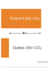{width="100%" fig-alt="Carbon-emissions ladder for the same training job: Poland is about 8,200 tonnes CO2, Quebec about 200 tonnes, with the 41 times difference shown as an annotation rather than a third bar."}

*The same job's carbon emissions depend on where it runs.*
:::

:::: {#nbk-sustainable-ai-geography-carbon .callout-notebook title="The geography of carbon"}

**Problem**: A team is choosing a data center for a `{python} CarbonFrontier.cf_energy_mwh_str` training run, comparing Site A in Quebec (hydropower, `{python} CarbonFrontier.intensity_quebec_g_kwh_str` $\text{CO}_2$) against Site B in Poland (coal-heavy, `{python} CarbonFrontier.intensity_poland_g_kwh_str` $\text{CO}_2$). Treat both factors as electricity-attribution inputs on the same emissions boundary; they are not current measured grid values. How does the location affect a model's carbon footprint?

**Math**:
Carbon = Energy $\times$ Grid Intensity.

1. Site A emissions: `{python} CarbonFrontier.energy_kwh_str` $\times$ `{python} CarbonFrontier.intensity_quebec_g_kwh_str` = `{python} CarbonFrontier.quebec_g_str` = `{python} CarbonFrontier.cf_quebec_tonnes_str` $\text{CO}_2$.
2. Site B emissions: `{python} CarbonFrontier.energy_kwh_str` $\times$ `{python} CarbonFrontier.intensity_poland_g_kwh_str` = `{python} CarbonFrontier.poland_g_str` = `{python} CarbonFrontier.cf_poland_tonnes_str` $\text{CO}_2$.
3. Ratio: `{python} CarbonFrontier.cf_poland_tonnes_str` / `{python} CarbonFrontier.cf_quebec_tonnes_str` = `{python} CarbonFrontier.cf_ratio_mult_str` difference.

**Systems insight**: Site selection dominates the modeled levers. The Quebec-versus-Poland pair gives a `{python} CarbonFrontier.cf_ratio_mult_str` difference, which exceeds many common algorithmic efficiency gains. Efficiency extends beyond FLOPs to the carbon-intensity of those FLOPs, making carbon-aware scheduling a first-class operational competency in the machine learning fleet.

::::

This comparison uses the fixed profiles as an illustrative placement scenario, not as a current inventory of either region. Its ratio is conditional on equal facility electricity and the chosen factors. It does not establish a universal geographic saving, and it must not be multiplied by an independent temporal-shifting factor without evaluating the joint schedule.

The GPT-3 household-year calculation above anchors the workload scale. The fleet-scale consequence is larger: IEA projects global data-center electricity consumption to reach about 945 TWh by 2030, just under 3 percent of global electricity demand, with AI-accelerated servers driving much of the growth.[^fn-datacenter-power-scale] Historical studies document rapid growth in training compute [@sevilla2022], but a compute multiplier is not an energy multiplier without a matching efficiency measurement.

[^fn-datacenter-power-scale]: **Data Center Industrial Scale**\index{Data Center Industrial Scale!definition}\index{Data Center!industrial electricity demand}: IEA's 2025 *Energy and AI* analysis projects data centers to consume about 945 TWh of electricity by 2030, just under 3 percent of global electricity demand. This is an electricity-demand metric, not directly comparable to aviation or cement shares of global emissions, but it still means AI infrastructure competes for grid capacity with heavy industry: regions that cannot expand power generation cannot expand AI deployment, regardless of demand.

Beyond direct energy consumption, AI systems drive environmental impact through hardware manufacturing and resource consumption. Training and inference workloads depend on specialized processors that require rare earth metals whose extraction and processing generate pollution.[^fn-gpu-embodied-carbon] The growing demand for AI applications accelerates electronic waste production, with global e-waste reaching 54 million metric tons annually [@forti2020ewaste]. AI hardware rapidly becomes obsolete due to accelerating performance requirements.[^fn-ewaste-hardware-disposal]

[^fn-gpu-embodied-carbon]: **GPU Manufacturing Embodied Carbon**\index{GPU Manufacturing Embodied Carbon!definition}: NVIDIA's HGX H100 product carbon footprint reports 1,312 kg CO~2~e for an eight-H100 baseboard, or roughly 164 kg CO~2~e per H100 if allocated evenly across the eight GPUs [@nvidia2025hgxh100pcf]. Advanced-node manufacturing also requires substantial ultrapure water, specialty gases, chemicals, and high-temperature process steps. This embodied cost means that in clean-grid regions (hydro, nuclear), manufacturing emissions can rival or exceed operational carbon, making hardware longevity and circular economy reuse critical sustainability levers.

[^fn-ewaste-hardware-disposal]: **AI Hardware E-waste**\index{AI Hardware E-waste!definition}: Retiring an accelerator does not necessarily create waste: equipment may be redeployed, resold, or recycled. Estimate disposal impacts from the actual equipment inventory, material composition, and end-of-life route. Extending useful service life can defer manufacturing and disposal, while certified handling limits exposure to hazardous materials in discarded electronics.

These environmental challenges are part of the energy ceiling, not an add-on to it: the communities that host land, water, grid capacity, and waste streams also carry part of the system cost. These scale calculations turn sustainability into an allocation problem. AI progress creates benefits in one part of the system while assigning electricity, water, land, and disposal costs to another, so environmental responsibility must be treated as part of systems design rather than as postdeployment reporting.

### Environmental justice and responsible development {#sec-sustainable-ai-environmental-justice-responsible-development-3923}

Site selection therefore becomes an environmental-justice decision, rather than a facilities decision alone. Environmental sustainability extends ML systems responsibility from model behavior to ecological stewardship [@vinuesa2020]. The computational resources required for AI development concentrate environmental costs on specific communities while distributing benefits unequally across global populations. Data centers impose both grid demand and cooling-water demand, and the local burden depends on the energy mix, watershed, and competing regional uses.

That geographic concentration creates environmental-justice risks that align with broader responsible AI frameworks.[^fn-siting-environmental-justice] The fairness claim here is narrow and systems-specific: an ML fleet allocates benefits, electricity demand, water use, land pressure, and e-waste across different communities. Communities hosting AI infrastructure can bear disproportionate environmental burdens while having limited access to AI's economic benefits, so site selection becomes part of the engineering design space rather than a facilities afterthought.

[^fn-siting-environmental-justice]: **Environmental Justice in Data Center Siting**\index{Environmental Justice in Data Center Siting!definition}: Data centers gravitate toward low-cost land and electricity, which often means economically disadvantaged areas. The result is an asymmetric externality: communities hosting AI infrastructure bear water depletion, heat island effects, and grid strain, while economic benefits concentrate in distant tech hubs. For ML systems engineers, this creates a design constraint: site selection must factor in social license alongside grid carbon intensity, because community opposition can block or delay facility expansion.

### Exponential growth vs. physical constraints {#sec-sustainable-ai-exponential-growth-vs-physical-constraints-0f4e}

Growth in computational demand can outpace improvements in realized efficiency [@sevilla2022]. Larger models, longer training runs, and rising serving volume increase total work through different mechanisms, as @fig-ai-compute-growth shows. Energy per operation can fall while total fleet energy rises; the outcome depends on how much useful work the fleet performs and how efficiently it performs that work.[^fn-compute-growth-scaling]

::: {#fig-ai-compute-growth fig-env="figure" fig-pos="htb" fig-cap="**Workload Growth Drivers**: Model parameter scale, pretraining token count, and inference serving volume compound across distinct operational axes to determine aggregate computational demand. Translating algorithmic FLOPs into physical infrastructure scale requires accounting for realized accelerator efficiency and facility power envelopes rather than extrapolating compute trends alone." fig-alt="Three workload inputs feed total work, then FLOPs."}

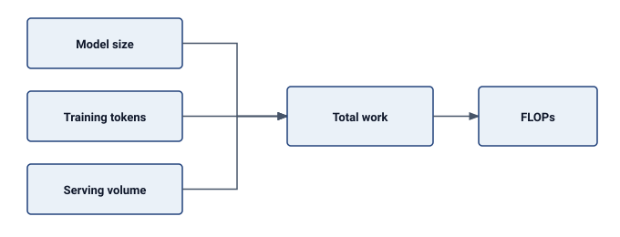

:::

[^fn-compute-growth-scaling]: **AI Compute Growth**\index{AI Compute Growth Rate!definition}\index{AI Compute Growth!doubling time}: Historical training-compute studies describe particular sets of models and periods [@sevilla2022]. A compute-growth trend does not itself establish an energy-growth rate: converting FLOPs to joules requires realized efficiency and a consistent system boundary.

Historically, computational efficiency improved with advances in semiconductor technology. Moore's Law predicted that the number of transistors on a chip would double approximately every two years, leading to continuous improvements in processing power and energy efficiency.[^fn-moores-law-sustainability] However, advanced process nodes face core physical limits, making further transistor scaling difficult and costly. Dennard scaling, which once ensured that smaller transistors would operate at lower power levels, has also ended, leading to stagnation in energy efficiency improvements per transistor.[^fn-dennard-scaling-sustainability]

[^fn-moores-law-sustainability]: **Moore's Law**\index{Moore's Law!sustainability limits}: Gordon Moore's 1965 observation that transistor density doubles every two years drove decades of "free" efficiency gains for the semiconductor industry. At single-digit-nanometer process nodes, physical limits make further gains harder: individual atoms become part of the constraint. For AI sustainability, the slowdown of process scaling means that additional efficiency gains must come from architectural specialization and algorithmic optimization rather than process shrinks alone.

[^fn-dennard-scaling-sustainability]: **Dennard Scaling**\index{Dennard Scaling!sustainability}: Robert Dennard observed in 1974 that smaller transistors could operate at constant power density by reducing voltage proportionally. This scaling pattern ended around 2005 when leakage current made further voltage reduction impractical. The consequence for AI sustainability is direct: without Dennard scaling, each process node no longer delivers proportional power savings, which pushes efficiency work toward specialized accelerators---GPUs and Tensor Processing Units (TPUs)---that exploit architectural parallelism rather than transistor physics alone.

At a fixed accounting boundary, energy depends on total work divided by realized work per joule. @Fig-energy-wall-quantitative makes the relationship explicit: improvements in execution efficiency reduce IT energy, while PUE accounts for the additional facility energy. Algorithmic changes can also reduce the work required to meet a quality target. These effects must be measured together rather than inferred from a historical compute curve.

::: {#fig-energy-wall-quantitative fig-env="figure" fig-pos="htb" fig-cap="**From Workload to Facility Energy**: Useful computational work and realized hardware efficiency dictate IT equipment power draw at the server chassis boundary. Power Usage Effectiveness (PUE) accounts for facility-level cooling and power-distribution overheads, converting IT energy into total facility demand." fig-alt="Useful work and realized efficiency feed IT energy, which is multiplied by PUE to produce facility energy."}

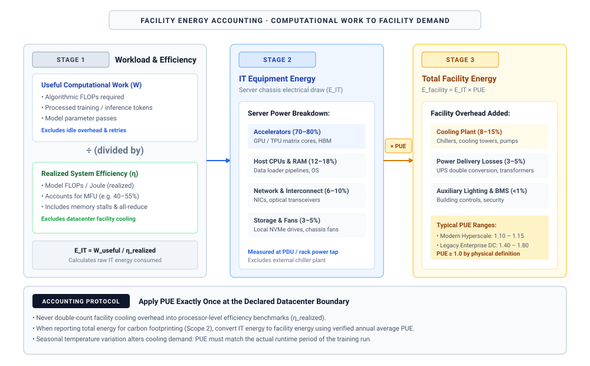

:::

Per-job efficiency and total demand can move in opposite directions. @Fig-data-center-energy-usage separates the two terms so that a fleet forecast must state both the energy per completed job and the number of jobs, including the workload mix. This accounting identity complements the earlier IEA projection; it does not extrapolate that projection into an unsupported high-growth forecast.

::: {#fig-data-center-energy-usage fig-env="figure" fig-pos="htb" fig-cap="**Efficiency and Fleet Energy Demand**: Total fleet energy consumption decomposes into energy per completed job multiplied by total completed job volume. Algorithmic and hardware optimizations decrease per-job energy, but elastic demand surges can trigger a Jevons paradox rebound where aggregate fleet energy increases despite major per-token efficiency gains." fig-alt="Energy per job multiplied by completed jobs gives total energy; efficiency and demand feed the respective factors."}

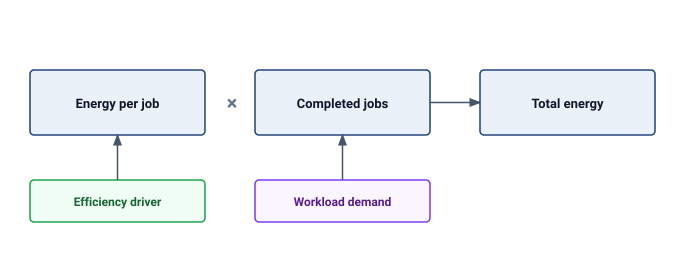

:::

### The energy wall and divergent scaling {#sec-sustainable-ai-energy-wall}

@Fig-energy-wall-quantitative explains the energy account; physical infrastructure imposes a separate power constraint. The grid connection, electrical distribution, and cooling system limit the active fleet that can operate safely. A long run may consume substantial energy while remaining within its power envelope. Conversely, a short run may exceed available power even if its total energy is modest.

@Fig-energy-wall separates the power envelope from accumulated energy. These quantities answer different design questions and cannot share a threshold without specifying a duration.

::: {#fig-energy-wall fig-env="figure" fig-pos="htb" fig-cap="**Power and Energy Boundaries**: Substation grid feeds and facility cooling capacities impose instantaneous power caps on active accelerator concurrency. Integrating instantaneous power over wall-clock duration yields cumulative run energy; instantaneous power constraints and cumulative energy budgets represent distinct physical limits." fig-alt="Upper path links grid power, facility envelope, and active fleet. Lower path multiplies measured power by run duration to obtain run energy."}

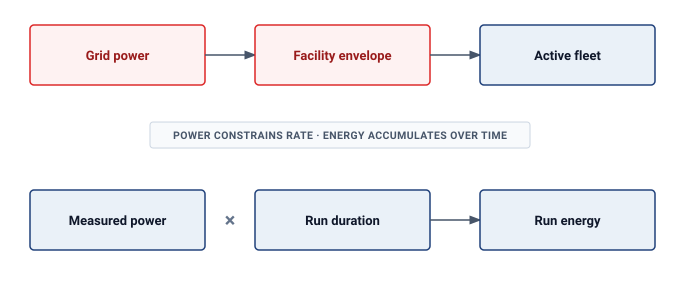

:::

The energy wall is therefore a workload-specific feasibility problem, not a universal multiplier. Engineers must fit the required work, deadline, and quality target within available power and cooling, then calculate energy over the actual runtime. More efficient hardware helps only to the extent that the workload uses its efficiency and the resulting demand remains within those constraints.

### Data center grid dynamics {#sec-sustainable-ai-grid-dynamics}

Sustainable AI requires looking beyond the server rack to the electrical grid interface. Both conventional and ML data centers have variable loads. Synchronized training phases can correlate power changes across many accelerators, reducing the smoothing that independent workloads provide.

::: {#ws-sustainable-ai-ireland-grid-constraint .callout-war-story title="When the grid became the bottleneck (2022)"}

**Context**: In July 2022, the Government of Ireland published its *Government Statement on the Role of Data Centres in Ireland's Enterprise Strategy*, formalizing the country's posture toward a sector that by then consumed roughly 18 percent of Ireland's total metered electricity---concentrated almost entirely in the greater Dublin area [@ireland2022datacentres; @iea2024datacentresireland].

**Mechanism**: Data center connection requests outpaced electrical transmission expansion, pushing the local Dublin grid to its physical thermal and voltage capacity limits with reinforcement timelines stretching into the next decade.

**Impact**: EirGrid imposed a moratorium on new data-center grid connections in the Dublin region through 2028, halting new AI compute cluster deployments.

**Fix**: Data center operators instituted on-site renewable energy storage, battery load-smoothing, and geographic diversification into regions with surplus renewable capacity.

**Systems lesson**: Sustainable AI is constrained by interconnection, geography, and power-system adequacy. Efficient accelerators help, but the fleet cannot scale faster than the grid that feeds it, moving the binding constraint from the chip to the substation.

:::

Training phases can change accelerator demand rapidly, but a device-side load step does not propagate unchanged to the utility connection. Its amplitude depends on per-device power, the number of coordinated workers, and computation-communication overlap. Local regulators, decoupling, power converters, and UPS controls shape the upstream response. **Energy buffering**\index{Energy Buffering!definition} supplies or absorbs energy during a load change; its location, capacity, and control response must match the electrical boundary being protected.

Heat is the paired facility constraint because a data center physically converts high-quality energy (electricity) into low-quality energy (waste heat). A sustainable fleet treats that heat as a recoverable byproduct rather than a pollutant. Modern facilities in Nordic regions, for example, use **district heating**\index{District Heating!definition} to pipe waste heat into municipal heating systems, while **industrial coupling**\index{Industrial Coupling!definition} can route low-grade waste heat at roughly 45°C into greenhouse climate control or water desalination. These data-center waste-heat recovery patterns offset nearby thermal demand instead of exhausting all heat into the atmosphere[^fn-pue-efficiency-evolution] [@ebrahimi2014].

[^fn-pue-efficiency-evolution]: **PUE (power usage effectiveness)**\index{Power Usage Effectiveness!datacenter efficiency metric}: PUE compares total facility power with the power delivered to IT equipment [@thegreengrid2007pue]. Lowering non-IT overhead improves facility efficiency, but the metric does not capture the carbon intensity of electricity or the water consumed for cooling. Carbon usage effectiveness\index{Carbon Usage Effectiveness!datacenter metric}\index{CUE|see{Carbon Usage Effectiveness}} and water usage effectiveness\index{Water Usage Effectiveness!datacenter metric} therefore expose constraints that PUE alone leaves invisible.

### Training-scale energy concentration {#sec-sustainable-ai-training-scale-energy-concentration}

The grid, siting, and heat-reuse constraints become severe because large training campaigns concentrate energy demand into long, synchronized runs. The GPT-3 anchor established the total scale; the new systems concern is its temporal concentration and the additional energy from distributed-training communication.[^fn-comm-energy-overhead]

[^fn-comm-energy-overhead]: **Training Communication Overhead**\index{Training Communication Overhead!definition}: Distributed training adds network transfers, synchronization stalls, and checkpoint I/O to the energy account. The fraction is workload- and topology-dependent: parallelism strategy, tensor sizes, link technology, utilization loss, and any extra iterations determine whether communication is a secondary term or the binding energy cost. The measurement contract must therefore meter or model these terms for the actual run rather than apply a universal percentage.

That concentration makes efficiency improvements an engineering imperative. Large generative models intensify the problem when successive generations increase parameter counts, token budgets, or both.

Within the ranges studied by @kaplan2020scaling, model scaling laws\index{Scaling Laws!model} showed that increasing model size, dataset size, and compute used for training improved performance smoothly. @Fig-model-scaling demonstrates that test loss decreases predictably across those studied ranges as each of these three factors increases. Beyond training, high-volume deployed systems such as large-scale recommender systems and generative services require continuous inference at scale, consuming energy even after training completes. The cumulative energy burden therefore depends on both the one-time training run and the sustained query volume that follows deployment.

::: {#fig-model-scaling fig-env="figure" fig-pos="htb" fig-cap="**Model Scaling Laws**: In the ranges studied by @kaplan2020scaling, increasing model size, dataset size, and compute consistently reduced test loss. The figure reproduces source-paper notation, where $N$ denotes parameter count and $C_{\min}$ denotes compute; elsewhere this book uses $P$ for parameter count and $O$ for operation count. These scaling laws explain why larger models, more data, and increased compute became attractive design choices within that regime." fig-alt="Three line graphs showing test loss decreasing as model parameters, dataset tokens, and compute FLOPs increase. Each plot shows smooth power-law scaling over the studied range."}

```{python}
#| echo: false
#| warning: false
# ┌─────────────────────────────────────────────────────────────────────────────
# │ MODEL SCALING LAWS (FIGURE)
# ├─────────────────────────────────────────────────────────────────────────────
# │ Context: @fig-model-scaling—Model Scaling Laws
# │
# │ Goal: Show that test loss falls as a power law in compute, data, and params.
# │ Show: The three Kaplan et al. (2020) power-law fits over their studied ranges.
# │ How: Plot L = (X / x_c)^(-alpha) from Literature.KaplanScalingLaws (the
# │      published fit constants), so the figure regenerates from source-of-truth.
# │
# └─────────────────────────────────────────────────────────────────────────────
# ┌── 1. CANVAS ────────────────────────────────────────────────────────────────
import sys

sys.path.insert(0, ".")
import numpy as np
import matplotlib.pyplot as plt
from matplotlib.ticker import ScalarFormatter
from binder.tools.figures import style as book_style
from binder.tools.figures.style import COLORS
from mlsysim import Literature

book_style.set_book_style()
fig, axes = plt.subplots(1, 3, figsize=(10, 3.2))

# ┌── 2. ARRAYS ────────────────────────────────────────────────────────────────
# Source of truth: Literature.KaplanScalingLaws (Kaplan et al. 2020 fit constants).
laws = {e["axis"]: e for e in Literature.KaplanScalingLaws.entries}
panels = [
    ("compute", "Compute\n(PF-days, non-embedding)", r"$L=(C_{\min}/2.3\times10^{8})^{-0.050}$"),
    ("data", "Dataset size\n(tokens)", r"$L=(D/5.4\times10^{13})^{-0.095}$"),
    ("params", "Parameters\n(non-embedding)", r"$L=(N/8.8\times10^{13})^{-0.076}$"),
]

# ┌── 3. RENDER ────────────────────────────────────────────────────────────────
for ax, (key, _xlabel, _law) in zip(axes, panels):
    e = laws[key]
    x = np.logspace(np.log10(e["x_min"]), np.log10(e["x_max"]), 200)
    loss = (x / e["x_c"]) ** (-e["alpha"])
    ax.plot(x, loss, color=COLORS["BlueLine"], lw=2)

# ┌── 4. DECORATE ──────────────────────────────────────────────────────────────
for ax, (key, xlabel, law_str) in zip(axes, panels):
    ax.set_xscale("log")
    ax.set_yscale("log")
    ax.set_xlabel(xlabel, fontsize=9)
    ax.text(0.95, 0.95, law_str, transform=ax.transAxes, ha="right", va="top", fontsize=7.5)
    ax.yaxis.set_major_formatter(ScalarFormatter())
    ax.yaxis.set_minor_formatter(ScalarFormatter())
    ax.tick_params(axis="y", labelsize=8)
axes[0].set_ylabel("Test loss")
fig.tight_layout()
plt.show()
plt.close()
```

:::

The hardware choice is the first place where energy physics becomes an architecture decision. Specialized datapaths and local data reuse can reduce energy per useful operation, but a comparison must match workload, precision, achieved quality, and measurement boundary.[^fn-pjmac-energy-hierarchy] Chip arithmetic alone excludes memory and supporting systems; end-to-end energy also includes their activity and execution time.

[^fn-pjmac-energy-hierarchy]: **pJ/FLOP and pJ/multiply-accumulate (MAC)**\index{Multiply-Accumulate!energy conversion}: A floating-point MAC is conventionally counted as two FLOPs, one multiplication and one addition. An integer MAC also contains two arithmetic operations, but is not two floating-point operations. Unit conversion cannot compensate for different precision, memory traffic, utilization, or measurement boundaries. Compare joules per completed task at fixed quality before inferring a hardware energy advantage.

The production of AI chips is energy-intensive, involving multiple fabrication steps that the Greenhouse Gas Protocol classifies as Scope 3 value-chain emissions\index{Scope 3 emissions!semiconductor fabrication} rather than direct electricity use by the operator. As model sizes continue to grow, the demand for AI hardware increases, exacerbating the environmental impact of semiconductor production and disposal.

### Theoretical efficiency limits as a sustainability model {#sec-sustainable-ai-theoretical-efficiency-limits-d880}

Alternative computing architectures expose potential sources of efficiency: selective activation, local state, and reduced communication. Comparing their energy with a dense model requires a shared task, quality threshold, latency target, and measurement boundary. Biological capability and digital FLOPs do not define interchangeable units of useful work, so their comparison cannot establish a numerical efficiency gap.

The gap points to a mechanism rather than another model-scale comparison: dense silicon spends energy on continuous activation and global data movement, while sparse, event-driven computation can avoid work when signals do not change. This motivates computing paradigms that prioritize energy-aware architecture over raw throughput.

#### Principles of high-efficiency computing {#sec-sustainable-ai-principles-highefficiency-computing-6a9b}

The sustainability lesson from high-efficiency computing exposes where dense machine learning wastes energy: continuous activation, data-hungry learning, and global data movement. Three architectural principles make those loss channels explicit. Addressing continuous activation, selective and event-driven architectures compute only when input signals change, allowing inactive components to power down when hardware permits, though static power, sensing, and communication overhead remain part of the energy ledger.[^fn-eventdriven-energy-efficiency] Countering data-hungry training, local learning and improved sample efficiency\index{Local learning!sample efficiency} lower the total data volume and optimization steps required to achieve a target accuracy, provided the evaluation accounts for any auxiliary preprocessing, adaptation, or inference costs. To curtail global data movement, sparsity and sparse interconnects reduce energy only when runtime schedulers and execution units skip the corresponding arithmetic operations and data transfers, ensuring that indexing overhead, routing latency, load imbalance, and synchronization barriers do not erase the nominal savings.

[^fn-eventdriven-energy-efficiency]: **Event-driven Computing**\index{Event-driven Computing!definition}: Computation triggered by input changes can avoid periodic work on slowly changing signals. Its energy advantage depends on event rate, static power, sensing overhead, and the hardware implementation; dense batch workloads need a separate comparison.

The biological model points toward promising research directions for sustainable AI. Architectures that implement **spiking neural networks (SNNs)**\index{Spiking Neural Networks!definition}, event-driven models that communicate through discrete spikes, or sparse activation patterns can achieve significant energy reductions by mimicking sparse communication models[^fn-snn-neuromorphic-efficiency] [@prakash2023tinyml]. Local learning algorithms and self-supervised approaches offer additional pathways toward more sample-efficient and energy-conscious systems.

[^fn-snn-neuromorphic-efficiency]: **Spiking Neural Networks (SNNs)**\index{Spiking Neural Networks!neuromorphic efficiency}: These models communicate through discrete spikes. Sparse activity can reduce communication and switching, but the complete comparison includes training, encoding, sensing, and the hardware used to execute the model. A result on one temporal task does not establish a universal saving for other workloads.

These directions expand the design space without making one architecture universally sustainable. The relevant improvement is less measured lifecycle impact per useful task at the required quality and service level. Dense, sparse, and event-driven implementations must meet the same comparison contract.

@Fig-energy-intervention organizes an energy-gap intervention cascade\index{Energy!gap intervention cascade} by the term each lever changes. Work reduction and execution efficiency affect IT energy; facility design affects non-IT overhead; the grid factor changes electricity-related emissions; hardware production and lifetime affect embodied carbon. These terms have different units and overlap. Their isolated savings cannot be multiplied into one universal reduction factor.

::: {#fig-energy-intervention fig-env="figure" fig-pos="htb" fig-cap="**Interventions and Their Accounting Boundaries**: Work and execution changes affect IT energy; facility overhead converts that energy to a facility total. A chosen grid factor converts electricity to emissions, while hardware lifecycle emissions enter separately. Evaluate the complete configuration at fixed useful work rather than multiplying unrelated improvement factors." fig-alt="Work reduction and execution efficiency lead to IT energy, then facility energy and electricity carbon. Grid factor and hardware lifecycle enter at their respective boundaries."}

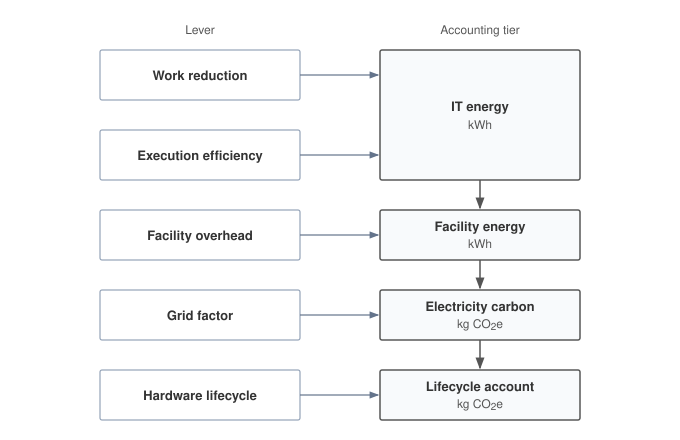

:::

Selecting an intervention requires a measured baseline and a consistent boundary. The energy account must first identify where the workload spends its joules; the carbon account then adds electricity supply and hardware lifecycle. Those measurements determine which architectural change can reduce the complete footprint.

## Energy Measurement and Modeling {#sec-sustainable-ai-part-ii-measurement-assessment-fb0b}

Engineers cannot optimize what they cannot measure. A cluster consuming five megawatts during a large language model training run directs only a fraction of that power into matrix multiplications; host processors, memory, networking, power conversion, and cooling consume the rest. Effective energy modeling requires decomposing the monolithic data center power bill into granular, component-level metrics that engineers can target for optimization.

Power delivery networks and cooling systems establish hard physical constraints on data center compute capacity. Systematic measurement transforms these constraints into actionable sustainability metrics across three critical areas: energy consumption tracking during training and inference, carbon footprint analysis across system lifecycles, and resource usage assessment for hardware and infrastructure. Just as performance engineering requires profiling before optimization, sustainable AI engineering requires measurement before mitigation.

::: {.column-margin .margin-pointer}
↩ Power delivery networks, thermal design power, and cooling limits are established in @sec-compute-infrastructure.
:::

The decision procedure is the same throughout the chapter: measure the dominant lifecycle term, identify the physical bottleneck behind it, choose the intervention that changes that term, and check whether rebound effects erase the gain. Operational electricity, embodied carbon, cooling overhead, water use, and e-waste each call for different levers. A scheduler cannot fix manufacturing emissions, and hardware longevity cannot fix carbon-intensive runtime placement, so sustainable design begins by locating the term that actually dominates the workload.

A sustainability claim is comparable only when it satisfies a **measurement contract**\index{Sustainability Measurement Contract!definition}. The contract first names the functional unit, such as one completed training run or 1,000 served requests at a specified output quality. It then fixes the system boundary, including which compute, memory, network, facility, manufacturing, and end-of-life terms enter the account [@iso140402006lca; @iso140442006lca]. The record must also state the attribution rule for shared infrastructure and embodied emissions; the carbon signal and whether it is average or marginal; the time and location of operation; the quality, latency, and reliability constraints that define useful work; and the uncertainty range and sensitivity to consequential assumptions. A result that omits any of these fields may still diagnose one component, but it cannot support an end-to-end comparison.

This contract separates two questions that otherwise become conflated. Attributional accounting\index{Carbon Accounting!attributional} allocates an inventory of observed emissions to workloads for reporting, typically using average grid intensity and an explicit share of common infrastructure. Consequential accounting\index{Carbon Accounting!consequential} estimates how a decision changes emissions, for example by modeling the generator affected when a scheduler moves one megawatt-hour of demand. The former answers what share of an existing footprint belongs to a workload; the latter answers whether changing the workload changes the footprint [@present2024carbonfactor]. Carbon-aware scheduling therefore needs a signal appropriate for consequential analysis even when the organization's retrospective inventory uses attributional averages. The available marginal factors may be historical estimates, forecasts, or unavailable at the workload's required time and location, so the contract must record the source, resolution, and uncertainty rather than treating "marginal" as a universally observable datum.

### Carbon footprint analysis {#sec-sustainable-ai-carbon-footprint-analysis-ccc5}

Carbon footprint analysis turns sustainability from a general obligation into a design constraint. It links energy consumption, grid carbon intensity, and lifecycle resource demands to the same decisions that already govern performance and efficiency. Teams that build and deploy AI systems therefore need a workload-level accounting model before they can choose among larger models, lower-power hardware, cleaner regions, or deferred training.

The accounting model matters because it makes ethical trade-offs auditable. The pursuit of larger models can prioritize accuracy and capability over energy efficiency, increasing carbon emissions when compute growth outpaces efficiency gains. Optimizing for sustainability may introduce engineering trade-offs such as extra tuning effort, hardware constraints, or task-dependent accuracy changes, so the engineering task is to make those costs explicit against environmental benefits. Integrating environmental considerations into AI system design is therefore an engineering obligation, expressed through energy-aware training techniques, low-power hardware designs, and carbon-conscious deployment strategies [@schwartz2020; @patterson2021carbon].

Traceability is the technical bridge between sustainability measurement and accountability. Transparency, fairness, and accountability act as sustainability constraints (@fig-ethical-ai): transparency gaps obscure energy and carbon costs, fairness failures distribute harms unevenly, and weak accountability makes resource consumption difficult to trace. Accountability means auditability of resource claims. A team should be able to connect a model version, training run, serving workload, region, energy source, and lifecycle estimate well enough that carbon and water claims can be checked.

::: {#fig-ethical-ai fig-env="figure" fig-pos="htb" fig-cap="**Ethical AI Concerns**: Four-quadrant layout of environmental-justice and accountability concerns in AI systems, spanning transparency, fairness, and sustainability. The quadrants make explicit how design choices in one quadrant (for example, opacity in training data) propagate into outcomes in an adjacent quadrant (for example, discriminatory predictions or untraceable resource consumption). Addressing these challenges requires proactive design choices that prioritize accountability and minimize negative societal and environmental impacts." fig-alt="Four-quadrant diagram of environmental-justice and accountability concerns in AI: transparency, fairness, accountability, and sustainability arranged in four quadrants with arrows connecting related issues across quadrants."}
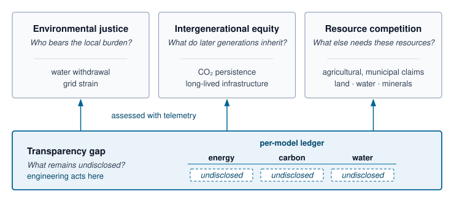

<!--
```{.tikz}
\providecolor{socnavy}{RGB}{15,23,42}
\providecolor{socdark}{RGB}{30,41,59}
\providecolor{socblue}{RGB}{29,78,216}
\providecolor{socteal}{RGB}{15,118,110}
\providecolor{socgreen}{RGB}{22,101,52}
\providecolor{socamber}{RGB}{180,83,9}
\providecolor{socred}{RGB}{185,28,28}

\providecolor{cardbg}{RGB}{248,250,252}
\providecolor{badgeblue}{RGB}{239,246,255}
\providecolor{badgeteal}{RGB}{240,253,250}
\providecolor{badgegreen}{RGB}{240,253,244}
\providecolor{badgeamber}{RGB}{254,252,232}
\providecolor{badgered}{RGB}{254,242,242}

\providecolor{borderblue}{RGB}{191,219,254}
\providecolor{borderteal}{RGB}{153,246,228}
\providecolor{bordergreen}{RGB}{187,247,208}
\providecolor{borderamber}{RGB}{253,230,138}
\providecolor{borderred}{RGB}{254,202,202}
\providecolor{bordergray}{RGB}{226,232,240}

\scalebox{0.75}{%
\begin{tikzpicture}[
    font=\sffamily,
    >=Stealth,
    quadcard/.style={
        rounded corners=3.5pt,
        line width=0.6pt,
        inner sep=10pt,
        text width=7.2cm,
        minimum height=4.8cm
    }
]

% Coordinate spacing for 4 quadrants with center clearance
\coordinate (center) at (0,0);
\def\xoff{0.75}
\def\yoff{0.70}

% Top Left: Environmental Justice (Burgundy / Red)
\node[
    draw=borderred,
    fill=badgered!35,
    quadcard,
    anchor=south east
] (tl) at (-\xoff, \yoff) {
    \raggedright
    {\setlength{\fboxsep}{2.5pt}\fcolorbox{borderred}{white}{\bfseries\fontsize{5.5}{6.5}\selectfont\textcolor{socred}{DIMENSION 1 $\cdot$ DISTRIBUTIONAL BURDEN}}}\\[4pt]
    {\large\bfseries\textcolor{socred}{Environmental Justice}}\\[2pt]
    {\scriptsize\itshape\textcolor{gray!80!black}{Who bears the localized burden of compute infrastructure?}}\\[4pt]
    {\color{borderred!80}\rule{\linewidth}{0.5pt}}\\[5pt]
    {\footnotesize\textcolor{socnavy}{Datacenters cluster in low-cost regions where local communities face groundwater depletion, thermal heat-island accumulation, and severe grid strain while economic returns concentrate in distant metropolitan hubs.}}\\[8pt]
    {\setlength{\fboxsep}{5pt}\fcolorbox{borderred}{white}{%
        \parbox{0.95\linewidth}{%
            {\scriptsize\bfseries\textcolor{socred}{Empirical Impact:}}\;{\scriptsize\textcolor{socdark}{760B+ liters annual datacenter cooling draw; acute peak capacity competition with municipal and agricultural water rights.}}%
        }%
    }}
};

% Top Right: Intergenerational Equity (Warm Ochre / Amber)
\node[
    draw=borderamber,
    fill=badgeamber!35,
    quadcard,
    anchor=south west
] (tr) at (\xoff, \yoff) {
    \raggedright
    {\setlength{\fboxsep}{2.5pt}\fcolorbox{borderamber}{white}{\bfseries\fontsize{5.5}{6.5}\selectfont\textcolor{socamber}{DIMENSION 2 $\cdot$ TEMPORAL EXTERNALITIES}}}\\[4pt]
    {\large\bfseries\textcolor{socamber}{Intergenerational Equity}}\\[2pt]
    {\scriptsize\itshape\textcolor{gray!80!black}{What environmental debt do future generations inherit?}}\\[4pt]
    {\color{borderamber!80}\rule{\linewidth}{0.5pt}}\\[5pt]
    {\footnotesize\textcolor{socnavy}{Carbon emitted during frontier training runs commits the climate system to century-scale radiative forcing. Massive current capital allocation locks in carbon-intensive thermal assets without long-term democratic consensus.}}\\[8pt]
    {\setlength{\fboxsep}{5pt}\fcolorbox{borderamber}{white}{%
        \parbox{0.95\linewidth}{%
            {\scriptsize\bfseries\textcolor{socamber}{Empirical Impact:}}\;{\scriptsize\textcolor{socdark}{AI compute projected to reach 3.5--8\% of global power by 2030; emitted atmospheric $\text{CO}_2$ drives cumulative warming over multi-century horizons.}}%
        }%
    }}
};

% Bottom Left: Resource Competition (Slate Blue)
\node[
    draw=borderblue,
    fill=badgeblue!35,
    quadcard,
    anchor=north east
] (bl) at (-\xoff, -\yoff) {
    \raggedright
    {\setlength{\fboxsep}{2.5pt}\fcolorbox{borderblue}{white}{\bfseries\fontsize{5.5}{6.5}\selectfont\textcolor{socblue}{DIMENSION 3 $\cdot$ RESOURCE ALLOCATION}}}\\[4pt]
    {\large\bfseries\textcolor{socblue}{Resource Competition}}\\[2pt]
    {\scriptsize\itshape\textcolor{gray!80!black}{What societal decarbonization priorities are displaced?}}\\[4pt]
    {\color{borderblue!80}\rule{\linewidth}{0.5pt}}\\[5pt]
    {\footnotesize\textcolor{socnavy}{AI infrastructure competes directly for renewable generation interconnection queues, copper, transmission transformers, and potable water needed for residential transition and industrial electrification.}}\\[8pt]
    {\setlength{\fboxsep}{5pt}\fcolorbox{borderblue}{white}{%
        \parbox{0.95\linewidth}{%
            {\scriptsize\bfseries\textcolor{socblue}{Empirical Impact:}}\;{\scriptsize\textcolor{socdark}{15+ critical rare-earth minerals per accelerator node; advanced 3nm fab requires 2,500+ liters of ultra-pure water per wafer die.}}%
        }%
    }}
};

% Bottom Right: Transparency & Governance (Muted Teal)
\node[
    draw=borderteal,
    fill=badgeteal!35,
    quadcard,
    anchor=north west
] (br) at (\xoff, -\yoff) {
    \raggedright
    {\setlength{\fboxsep}{2.5pt}\fcolorbox{borderteal}{white}{\bfseries\fontsize{5.5}{6.5}\selectfont\textcolor{socteal}{DIMENSION 4 $\cdot$ AUDITABILITY \& GOVERNANCE}}}\\[4pt]
    {\large\bfseries\textcolor{socteal}{Transparency Gap}}\\[2pt]
    {\scriptsize\itshape\textcolor{gray!80!black}{What carbon and energy metrics remain obscured?}}\\[4pt]
    {\color{borderteal!80}\rule{\linewidth}{0.5pt}}\\[5pt]
    {\footnotesize\textcolor{socnavy}{Frontier foundation model disclosures routinely omit total training energy, embodied fab carbon, power purchasing specifics, and operational water consumption, precluding scientific verification and external auditing.}}\\[8pt]
    {\setlength{\fboxsep}{5pt}\fcolorbox{borderteal}{white}{%
        \parbox{0.95\linewidth}{%
            {\scriptsize\bfseries\textcolor{socteal}{Empirical Impact:}}\;{\scriptsize\textcolor{socdark}{Over 80\% of frontier technical reports redact power consumption; non-standardized Scope 1--3 accounting hinders comparative analysis.}}%
        }%
    }}
};

% Center Nexus Badge
\node[
    draw=bordergray,
    fill=white,
    rounded corners=3pt,
    line width=0.8pt,
    inner sep=6pt,
    text width=2.8cm,
    align=center
] (nexus) at (0,0) {
    {\fontsize{6}{7}\selectfont\bfseries\textcolor{gray!70!black}{HOLISTIC EVALUATION}}\\[2.5pt]
    {\fontsize{8.5}{10}\selectfont\bfseries\textcolor{socnavy}{AI Environmental}}\\[1.5pt]
    {\fontsize{8.5}{10}\selectfont\bfseries\textcolor{socnavy}{Impact Nexus}}
};

% Orthogonal connectors from Nexus to the 4 cards
\draw[->, line width=0.8pt, draw=socred!75, shorten >=4pt, shorten <=4pt] (nexus.135) -- (tl.south east);
\draw[->, line width=0.8pt, draw=socamber!75, shorten >=4pt, shorten <=4pt] (nexus.45) -- (tr.south west);
\draw[->, line width=0.8pt, draw=socblue!75, shorten >=4pt, shorten <=4pt] (nexus.225) -- (bl.north east);
\draw[->, line width=0.8pt, draw=socteal!75, shorten >=4pt, shorten <=4pt] (nexus.315) -- (br.north west);

% Bottom summary banner
\path (bl.south west) -- (br.south east) coordinate[midway] (bmid);
\node[
    draw=borderblue!80,
    fill=cardbg,
    rounded corners=3pt,
    line width=0.6pt,
    inner sep=7pt,
    anchor=north,
    text width=16.2cm,
    align=center
] at ($(bmid) + (0, -0.40)$) {
    {\fontsize{7.5}{9.5}\selectfont\bfseries\textcolor{socnavy}{Systemic Sustainability Imperative:}}\;
    {\fontsize{7}{9}\selectfont\textcolor{socdark!90}{Sustainable AI design cannot focus exclusively on operational kilowatt-hours; it requires simultaneous multi-objective optimization across environmental justice, generational equity, raw material allocation, and open verifiable auditing.}}
};

\end{tikzpicture}
}
```
-->

:::

For measurement to constrain design, reported metrics must expose workload-level cost rather than aggregate cloud-scale claims, which stay opaque when reporting holds at the company-total level. The practical standard is therefore accountability for resource usage across the full AI lifecycle, and it requires the same evidence chain used for latency, accuracy, and reliability: a claim should connect to logs, meters, model versions, and deployment decisions rather than to aggregate sustainability pledges alone. The carbon-footprint calculation makes that evidence chain explicit by combining workload energy, facility PUE, grid carbon intensity, and embodied carbon.

```{python}
#| echo: false
from mlsysim.fmt import fmt_int, fmt_mass, fmt_power, fmt_qty_int

# ┌─────────────────────────────────────────────────────────────────────────────
# │ LIFECYCLE CARBON ESTIMATION (LEGO)
# ├─────────────────────────────────────────────────────────────────────────────
# │ Context: @sec-sustainable-ai-carbon-footprint-analysis-ccc5 ("Lifecycle
# │          carbon estimation" .callout-notebook)
# │
# │ Goal: Compute operational and amortized embodied carbon for a 70B run.
# │ Show: ~742 tonnes operational + ~9 tonnes embodied = ~751 tonnes total.
# │ How: GPU power * rack IT multiplier * hours * PUE * grid intensity; embodied / 36 months.
# │
# └─────────────────────────────────────────────────────────────────────────────

# ┌── LEGO ───────────────────────────────────────────────
from mlsysim.fmt import fmt_int, fmt, fmt_power, fmt_energy, fmt_emissions, fmt_time, check
from mlsysim.core.units import gram, hour, kilogram, kilowatt, kWh, metric_ton, watt
from mlsysim.physics import carbon_from_energy

class LifecycleCarbonEstimate:
    """Worked lifecycle carbon estimate for a 70B training run."""

    # ┌── 1. LOAD (Constants) ──────────────────────────────────────────────
    from mlsysim import Systems, Infrastructure

    fleet = Systems.Clusters.Production_2K
    rack = Systems.Racks.DGX_H100_4Node
    n_gpus = fleet.total_accelerators
    training_days = 30
    h_h100 = fleet.node.accelerator
    baseline_grid = Infrastructure.Grids.US_Avg
    effective_pue = baseline_grid.pue

    # Amortization details
    embodied_kg_per_gpu = h_h100.embodied_carbon_kg
    amortization_months = 36
    amortization_window_months = 1
    lifecycle_years = amortization_months // 12

    # ┌── 2. EXECUTE (The Compute) ────────────────────────────────────────
    accelerator_power = n_gpus * h_h100.tdp
    cooling_kw = 2.7 * kilowatt  # same cooling row as @tbl-rack-power; exclude before PUE
    it_power_multiplier = ((rack.accelerator_power + rack.non_accelerator_power - cooling_kw) / rack.accelerator_power).to("").magnitude
    it_power = accelerator_power * it_power_multiplier
    facility_power = it_power * effective_pue
    hours_per_day = HOURS_PER_DAY
    facility_energy = (facility_power * hours_per_day * training_days * hour).to(kWh)

    operational_carbon = carbon_from_energy(
        facility_energy,
        baseline_grid.carbon_intensity_g_kwh * (gram / kWh),
    ).to(metric_ton)
    operational_tonnes = operational_carbon.magnitude
    embodied_carbon = (n_gpus * embodied_kg_per_gpu * kilogram / amortization_months).to(metric_ton)
    embodied_tonnes = embodied_carbon.magnitude
    total_carbon = operational_carbon + embodied_carbon
    total_tonnes = total_carbon.magnitude
    total_facility_energy_kwh = facility_energy.magnitude
    facility_power_kw_mag = facility_power.to(kilowatt).magnitude

    # ┌── 3. GUARD (Invariants) ──────────────────────────────────────────
    check(650 < operational_tonnes < 700, f"Unexpected operational carbon: {operational_tonnes:.1f} t")
    check(1.3 < it_power_multiplier < 1.4, f"Unexpected rack IT multiplier: {it_power_multiplier:.2f}")
    check(
        abs(total_facility_energy_kwh - facility_power_kw_mag * hours_per_day * training_days) < 1.0,
        "Facility energy must match power × hours × days",
    )

    # ┌── 4. OUTPUT (Formatting) ──────────────────────────────────────────────
    n_gpus_str = fmt(n_gpus, precision=0)
    training_days_str = fmt_time(training_days, 'day', precision=0, style='word')
    h_h100_tdp_w_str = fmt_power(h_h100.tdp, unit=watt, precision=0, commas=False)
    gpu_tdp_kw_str = fmt_power(h_h100.tdp, unit=kilowatt, precision=1, commas=False)
    hours_per_day_str = fmt_time(hours_per_day, 'hour', precision=0, commas=False, per='day')
    pue_str = fmt(effective_pue, precision=2, commas=False)
    grid_ci_str = fmt(baseline_grid.carbon_intensity_g_kwh, precision=0, commas=False)
    accelerator_power_kw_str = fmt_power(accelerator_power, unit=kilowatt, precision=1)
    it_power_kw_str = fmt_power(it_power, unit=kilowatt, precision=1)
    facility_power_kw_str = fmt_power(facility_power, unit=kilowatt, precision=1, commas=True)
    facility_energy_kwh_str = fmt_energy(facility_energy, unit=kWh, precision=1, commas=True)
    amortization_months_value_str = fmt(amortization_months, precision=0, commas=False)
    amortization_window_months_value_str = fmt(amortization_window_months, precision=0, commas=False)
    lifecycle_years_value_str = fmt(lifecycle_years, precision=0, commas=False)
    operational_tonnes_str = fmt_emissions(operational_carbon, unit=metric_ton, precision=1)
    embodied_kg_per_gpu_str = fmt_mass(embodied_kg_per_gpu * kilogram, unit=kilogram, precision=0, commas=False)
    embodied_tonnes_str = fmt_emissions(embodied_carbon, unit=metric_ton, precision=1, commas=False)
    total_tonnes_str = fmt_emissions(total_carbon, unit=metric_ton, precision=1)
```

::: {#nbk-sustainable-ai-lifecycle-carbon-estimation .callout-notebook title="Partial lifecycle carbon estimation"}

**Problem**: Estimate facility operational emissions plus allocated accelerator-baseboard manufacturing emissions for training a 70B parameter model.

Variables: `{python} LifecycleCarbonEstimate.n_gpus_str` H100 GPUs, `{python} LifecycleCarbonEstimate.training_days_str`, `{python} LifecycleCarbonEstimate.h_h100_tdp_w_str` thermal design power (TDP), rack-profile support power, PUE `{python} LifecycleCarbonEstimate.pue_str`, grid intensity `{python} LifecycleCarbonEstimate.grid_ci_str` g $\text{CO}_2$/kWh.

**Math**: Accelerator power = `{python} LifecycleCarbonEstimate.n_gpus_str` $\times$ `{python} LifecycleCarbonEstimate.gpu_tdp_kw_str` $\approx$ `{python} LifecycleCarbonEstimate.accelerator_power_kw_str`. Applying the DGX H100 rack profile for host, memory, networking, and conversion support raises the IT load to `{python} LifecycleCarbonEstimate.it_power_kw_str`; facility power = `{python} LifecycleCarbonEstimate.it_power_kw_str` $\times$ `{python} LifecycleCarbonEstimate.pue_str` $\approx$ `{python} LifecycleCarbonEstimate.facility_power_kw_str`. Energy = `{python} LifecycleCarbonEstimate.facility_power_kw_str` $\times$ `{python} LifecycleCarbonEstimate.hours_per_day_str` $\times$ `{python} LifecycleCarbonEstimate.training_days_str` $\approx$ `{python} LifecycleCarbonEstimate.facility_energy_kwh_str`. Emissions $\approx$ `{python} LifecycleCarbonEstimate.operational_tonnes_str` $\text{CO}_2$.

Embodied: Assume manufacturing footprint is $\approx$ `{python} LifecycleCarbonEstimate.embodied_kg_per_gpu_str` $\text{CO}_2$ per H100 GPU, allocating NVIDIA's HGX H100 baseboard product carbon footprint evenly across its eight GPUs [@nvidia2025hgxh100pcf]. This worked account uses time-based allocation: it assigns the job the fraction of manufacturing emissions corresponding to its `{python} LifecycleCarbonEstimate.amortization_window_months_value_str`-month occupancy of a `{python} LifecycleCarbonEstimate.lifecycle_years_value_str`-year service life. Under that declared rule, (`{python} LifecycleCarbonEstimate.n_gpus_str` $\times$ `{python} LifecycleCarbonEstimate.embodied_kg_per_gpu_str`) / `{python} LifecycleCarbonEstimate.amortization_months_value_str` $\approx$ `{python} LifecycleCarbonEstimate.embodied_tonnes_str` $\text{CO}_2$.

**Result**: `{python} LifecycleCarbonEstimate.operational_tonnes_str` + `{python} LifecycleCarbonEstimate.embodied_tonnes_str` $\approx$ `{python} LifecycleCarbonEstimate.total_tonnes_str` $\text{CO}_2$.

**Systems insight**: The operational term dominates this partial lifecycle account. It includes facility electricity and allocated HGX baseboard manufacturing, but omits manufacturing of host systems, networking, storage, and facility infrastructure, as well as other unmodeled lifecycle stages. A complete footprint must extend the inventory to those boundaries.

:::

Time is one defensible allocation basis, not a universal one. Shared fleets may instead allocate embodied emissions by accelerator-hours, reserved capacity, or a workload's share of useful computation. The chosen denominator must be reported and applied consistently; otherwise a low-utilization job can appear artificially inexpensive merely because another tenant absorbs the idle capacity. Procurement decisions need the unallocated fleet total as well as the workload-attributed share, because amortization changes ownership of an emission in the ledger but does not remove it from the atmosphere.

Every lifecycle estimate should therefore carry an uncertainty interval rather than a single authoritative total. Average workload power, PUE, grid intensity, hardware lifetime, utilization, and manufacturing footprint are measured or modeled with different errors. A sensitivity analysis varies the assumptions that could reverse the decision, including clean-grid versus carbon-intensive operation, three- versus five-year service life, and low versus high serving volume. It then reports whether the preferred design remains preferred. Precision in arithmetic cannot compensate for an unstable system boundary.

Translating power consumption into carbon emissions is only the first measurement challenge. A systematic lifecycle assessment across the full hardware lifecycle reveals where carbon emissions concentrate and where engineering interventions yield the greatest returns.

#### Three-phase lifecycle assessment framework {#sec-sustainable-ai-threephase-lifecycle-assessment-framework-883a}

The practical question is which lifecycle phase dominates a given workload, because the answer determines the optimization lever. Effective carbon footprint measurement therefore separates three phases that collectively determine environmental impact.

For training-centric research workloads, the training phase often dominates operational emissions because mathematical optimization requires sustained parallel computation.[^fn-optimizer-memory-overhead] Geographic placement then changes the operational result because an identical workload can encounter very different grid intensities.[^fn-grid-carbon-variance]

[^fn-optimizer-memory-overhead]: **Optimizer Memory as Energy Cost**\index{Optimizer Memory as Energy Cost!definition}: Adaptive Moment Estimation (Adam) stores per-parameter first and second moment estimates, unlike plain stochastic gradient descent (SGD). For a 70B model in FP32, these two moment buffers total 560 GB, bringing parameters plus moments to 840 GB (excluding gradients). The sustainability implication is direct: larger optimizer state means more high-bandwidth memory (HBM) accesses per training step, and at 160 pJ/byte for DRAM, memory movement can dominate the energy budget of parameter updates.

[^fn-grid-carbon-variance]: **Carbon Intensity Variance**\index{Carbon Intensity Variance!definition}: Regional averages and time-varying grid factors answer different questions. A generation technology's lifecycle factor is neither a measured regional average nor the marginal emissions response to another job. Scheduling must choose the signal appropriate to its decision and retain the source, period, and boundary.

For high-volume production services, the inference phase can dominate lifetime emissions because model serving repeats continuously after the training run is complete. While individual inferences require less computation than training, the cumulative impact scales with deployment breadth and usage frequency. Models serving millions of users generate ongoing emissions that can exceed training costs over extended deployment periods.

The manufacturing phase contributes embodied carbon\index{Embodied Carbon!hardware manufacturing} from hardware production, including semiconductor fabrication, rare earth mining, and supply chain logistics.[^fn-embodied-hardware-carbon] Its share is smaller for long-running workloads on carbon-intensive grids, but it can reach 30--50 percent of lifetime emissions on clean grids or low-utilization hardware. Manufacturing emissions already incurred for installed equipment are not undone by operational efficiency. Future embodied emissions remain adjustable through procurement, design, reuse, and service-life decisions.

```{python}
#| echo: false
#| label: gpu-emissions-scenario
# ┌─────────────────────────────────────────────────────────────────────────────
# │ GPU EMISSIONS SCENARIO (LEGO)
# ├─────────────────────────────────────────────────────────────────────────────
# │ Context: @sec-sustainable-ai-scale-environmental-impact-ac9a—operational emissions
# │
# │ Goal: Quantify H100 operational emissions for lifecycle comparison.
# │ Show: ~700 W H100 power consumption.
# │ How: pulling Hardware.Cloud.H100.tdp from mlsysim.core.units.
# │
# └─────────────────────────────────────────────────────────────────────────────
from mlsysim.fmt import check, fmt_power

class GpuEmissionsScenario:
    """H100 operational footprint reference."""

    # ┌── 1. LOAD (Constants) ──────────────────────────────────────────────
    h_h100_tdp = Hardware.Cloud.H100.tdp

    # ┌── 3. GUARD (Invariants) ──────────────────────────────────────────
    check(h_h100_tdp.to(watt).magnitude == 700, "H100 TDP should be 700W")

    # ┌── 4. OUTPUT (Formatting) ──────────────────────────────────────────────
    h_h100_tdp_w_str = fmt_power(h_h100_tdp, unit=watt, precision=0, commas=False)
```

[^fn-embodied-hardware-carbon]: **Embodied Carbon**\index{Embodied Carbon!hardware lifecycle}: The non-use-phase emissions associated with manufacturing, transport, and end-of-life treatment. Manufacturing and delivery occur before use; disposal occurs later. Allocating NVIDIA's HGX H100 baseboard product carbon footprint evenly across its eight GPUs gives roughly 164 kg CO~2~e per H100 [@nvidia2025hgxh100pcf]; at `{python} GpuEmissionsScenario.h_h100_tdp_w_str` on the average U.S. grid, continuous operation matches embodied carbon in roughly three to four weeks. As data centers shift to renewables, embodied carbon's share of total lifetime emissions grows, potentially exceeding 30 percent, making hardware refresh cycles a first-order sustainability decision.

#### Geographic and temporal optimization {#sec-sustainable-ai-geographic-temporal-optimization-492c}

Carbon intensity varies across geographic locations and time periods, creating optimization opportunities. Temporal scheduling can reduce emissions when deadline-tolerant workloads are shifted toward lower-carbon hours or regions, with the realized gain depending on workload flexibility, grid mix, and whether the scheduler uses average or marginal emissions [@Patterson2022carbonaware; @radovanovic2021carbonaware]. Carbon-aware scheduling systems can automatically shift nonurgent training jobs to regions and times with lower carbon intensity.

Development-time carbon tracking\index{Carbon Footprint!tracking} matters when it feeds placement and complexity decisions rather than becoming a report after the fact. Tools such as CarbonTracker [@anthony2020carbontracker] and CodeCarbon [@schmidt2021codecarbon] wrap the workload boundary, estimate energy from hardware counters or utilization models, attach the local grid intensity, and record the resulting emissions alongside the experiment metadata. The important systems pattern is not the API call but the timing of the measurement: the estimate must appear while model size, training duration, region, and schedule are still adjustable, before the run has already consumed its energy.

### Power modeling fundamentals {#sec-sustainable-ai-power-modeling-fundamentals-67cb-67cb}

Understanding where energy goes in AI systems requires grounding in the physics of digital computation. The CMOS power equation\index{CMOS power equation!digital circuit foundation} provides the foundation for reasoning about energy consumption in digital processors, but the useful model must climb three levels: chip power explains why voltage, precision, and activity matter; optimization techniques show how algorithms change those variables; and facility-level metrics reveal whether chip-level savings survive cooling and power-delivery overhead.

#### The CMOS power equation {#sec-sustainable-ai-cmos-power-equation-a33a-a33a}

Every digital circuit consumes power through two fundamental mechanisms. **Dynamic power**\index{Dynamic Power!definition} arises from switching transistors between states, while **static power**\index{Static Power!definition} results from leakage current\index{Static Power!leakage current}\index{Leakage current!transistor states} that flows even when transistors are nominally off. @Eq-cmos-power formalizes the total power consumption:

$$P_{\text{total}} = P_{\text{dynamic}} + P_{\text{static}} = \alpha_{\text{sw}} C V^2 f + V I_{\text{leak}}$$ {#eq-cmos-power}

The dynamic power component $P_{\text{dynamic}} = \alpha_{\text{sw}} C V^2 f$ depends on four parameters. The **switching activity factor**\index{Switching Activity Factor!definition} $\alpha_{\text{sw}}$ summarizes capacitance-weighted switching per clock cycle under the chosen counting convention. It is not useful compute utilization: at fixed $C$, $V$, and $f$, increasing switching raises dynamic power. The effective load capacitance $C$ reflects the circuits and interconnect being switched. Supply voltage $V$ enters quadratically, while clock frequency $f$ sets the rate of switching opportunities. Useful work per joule depends on how much productive computation those transitions accomplish.

The static power component $P_{\text{static}} = V \cdot I_{\text{leak}}$ represents leakage current that increases exponentially with temperature, approximately doubling for every 10 degrees Celsius rise. This thermal dependence creates a feedback loop: higher power generates heat, which increases leakage, which generates more heat. Managing this thermal runaway constrains achievable power density and explains why cooling infrastructure represents such a significant fraction of data center energy consumption [@dayarathna2016].

```{python}
#| echo: false
#| label: voltage-scaling-dynamic-power-calc
# ┌─────────────────────────────────────────────────────────────────────────────
# │ VOLTAGE-SCALING DYNAMIC-POWER REDUCTION (LEGO)
# ├─────────────────────────────────────────────────────────────────────────────
# │ Context: narrative prose immediately below — quadratic voltage dependence.
# │
# │ Goal: Quantify the dynamic-power reduction from a supply-voltage drop using
# │       the V^2 term of the CMOS power equation (@eq-cmos-power).
# │ Show: 1.0 V → 0.8 V decreases dynamic power by 36 percent.
# │ How: reduction = 1 - (V_low / V_high)^2.
# │
# └─────────────────────────────────────────────────────────────────────────────
from mlsysim.fmt import check, fmt, fmt_percent, fmt_voltage

class VoltageScalingDynamicPower:
    # ┌── 1. LOAD ──────────────────────────────────────────
    v_high = 1.0 * volt  # nominal supply voltage (V)
    v_low = 0.8 * volt  # reduced supply voltage (V)

    # ┌── 2. EXECUTE ───────────────────────────────────────
    power_reduction = 1 - (v_low / v_high) ** 2  # dynamic power ∝ V^2

    # ┌── 3. GUARD ─────────────────────────────────────────
    check(0 < power_reduction < 1, "Voltage scaling reduction must be a fraction")

    # ┌── 4. OUTPUT (Formatting) ───────────────────────────
    # Voltage labels; the load-bearing computed value is the V^2 power reduction below.
    v_high_str = fmt_voltage(v_high, unit=volt, precision=0, commas=False)
    v_low_str = fmt_voltage(v_low, unit=volt, precision=1, commas=False)
    power_reduction_pct_str = fmt_percent(power_reduction, precision=0, commas=False, style="prose")
```

The practical implications for AI systems follow directly from these physics. The quadratic voltage dependence means that reducing voltage from `{python} VoltageScalingDynamicPower.v_high_str` to `{python} VoltageScalingDynamicPower.v_low_str` decreases dynamic power by `{python} VoltageScalingDynamicPower.power_reduction_pct_str`, even before considering that lower voltages often enable frequency reduction with additional linear savings. This calculation holds activity, capacitance, and frequency fixed. A realizable voltage-frequency change must also satisfy timing constraints; its energy benefit depends on the resulting execution time and static power.

#### Physical mechanisms of energy optimization {#sec-sustainable-ai-optimization-techniques-save-energy-832c}

The power equation illuminates why specific optimization techniques can improve efficiency. Quantization reduces numerical precision, which can shrink arithmetic units and reduce bytes moved through the memory hierarchy. The realized energy change depends on the implemented kernels, packing and conversion overhead, memory traffic, utilization, and the original bottleneck [@gholami2022]. Lower precision does not by itself permit a lower supply voltage: voltage and frequency remain constrained by the physical implementation, process, and timing margins. Quantization therefore changes the operation and data-movement terms, but only measurement establishes the end-to-end reduction.

Pruning removes weights from neural networks, but it does not remove physical transistors from an existing accelerator. It saves dynamic energy when the resulting execution skips arithmetic or data movement. Structured pruning can map to smaller dense kernels; unstructured pruning needs an implementation that exploits the sparse pattern without spending the savings on indexing and irregular memory access. The power equation explains the benefit through reduced switching activity and powered execution time, not a change to the fabricated circuit capacitance $C$.

Specialized accelerators can improve useful work per joule by reducing instruction-control overhead, reusing data locally, and mapping operations to suitable datapaths. Keeping arithmetic units productive can amortize static and support power, but increasing switching activity alone does not establish an efficiency gain.

#### Facility-level power metrics {#sec-sustainable-ai-facilitylevel-power-metrics-5558}

Beyond chip-level power, data center infrastructure imposes additional energy overhead. @Eq-sustainable-ai-pue captures this relationship through the PUE metric\index{Power Usage Effectiveness!overhead metric}:

$$\text{PUE} = \frac{P_{\text{total facility}}}{P_{\text{IT equipment}}}$$ {#eq-sustainable-ai-pue}

::: {#dfn-sustainable-ai-pue .callout-definition title="Power usage effectiveness (PUE)"}

***Power usage effectiveness (PUE)***\index{Power Usage Effectiveness!definition} is the data-center efficiency ratio ML system operators use to compare total facility power consumption against the power consumed specifically by IT equipment $(P_{\text{facility}} / P_{\text{IT}})$.

1.  **Significance**: It measures the Infrastructure Overhead of the data center. A PUE of 1.0 is the theoretical ideal; a PUE of 1.10 means that for every 100 watts consumed by IT equipment, an additional 10 watts are required for non-IT facility overhead, including cooling and facility-side power distribution.
2.  **Distinction**: Unlike Computing Efficiency (which focuses on FLOPs per Watt), PUE focuses on Facility Efficiency\index{Efficiency!facility}: it measures non-IT overhead relative to IT consumption. Idle equipment and power losses inside the IT measurement boundary remain in the denominator; PUE does not measure useful computation.
3.  **Common pitfall**: A frequent misconception is that a low PUE means a "green" data center. In reality, PUE only measures Efficiency, not the Carbon Intensity of the energy source; a coal-powered data center can have a better PUE than a solar-powered one while having a much higher environmental impact.

:::

```{python}
#| echo: false
#| label: pue-efficiency-notebook
# ┌─────────────────────────────────────────────────────────────────────────────
# │ PUE EFFICIENCY GAINS (NOTEBOOK)
# ├─────────────────────────────────────────────────────────────────────────────
# │ Context: "PUE: The Cost of Cooling" .callout-notebook
# │
# │ Goal: Quantify annual energy savings from PUE optimization.
# │ Show: savings_mwh ≈ 8,400 MWh—inline in notebook result.
# │ How: Energy = P_IT * (PUE_old - PUE_new) * 8760.
# │
# └─────────────────────────────────────────────────────────────────────────────
from mlsysim.fmt import check, fmt, fmt_energy, fmt_power, fmt_usd
from mlsysim.core.units import MW, MWh, hour, kWh, USD, HOURS_PER_YEAR
from mlsysim import Infrastructure

class PueEfficiency:
    # ┌── 1. LOAD ──────────────────────────────────────────
    p_it = 2.0 * MW  # pedagogical scenario — ~3000 H100s
    pue_old = Infrastructure.FacilityCooling.Legacy.pue
    pue_new = Infrastructure.FacilityCooling.StateOfArt.pue
    electricity_rate = Infrastructure.Pricing.OnPremises.ElectricityPerKwh.rate
    # ┌── 2. EXECUTE ───────────────────────────────────────
    diff = pue_old - pue_new
    annual_savings = (p_it * diff * HOURS_PER_YEAR * hour).to(MWh)
    annual_savings_usd = (annual_savings * electricity_rate).to(USD)
    # ┌── 3. GUARD ─────────────────────────────────────────
    check(8000 < annual_savings.to(MWh).magnitude < 9000, f"Savings {annual_savings.to(MWh).magnitude:.0f} MWh unexpected")
    # ┌── 4. OUTPUT ────────────────────────────────────────
    pue_it_mw_str = fmt_power(p_it, unit=MW, precision=0, commas=False)
    pue_old_str = fmt(pue_old, precision=2, commas=False)
    pue_new_str = fmt(pue_new, precision=2, commas=False)
    pue_diff_str = fmt(diff, precision=2, commas=False)
    hours_per_year_str = fmt_time(HOURS_PER_YEAR, 'hour', precision=0, commas=False, per='year')
    electricity_rate_per_mwh_str = fmt_usd(electricity_rate, precision=0, commas=False, per="MWh")
    pue_savings_mwh_str = fmt_energy(annual_savings, unit=MWh, precision=1, commas=True)
    pue_savings_usd_str = fmt_usd(annual_savings_usd, precision=0)
```

::: {#nbk-sustainable-ai-pue-cost-cooling .callout-notebook title="PUE: The cost of cooling"}

**Problem**: A team operates a `{python} PueEfficiency.pue_it_mw_str` cluster. If the facility can be optimized from the industry average PUE (`{python} PueEfficiency.pue_old_str`) to state-of-the-art (`{python} PueEfficiency.pue_new_str`), how much energy and money does that save annually?

**Math**:
Energy saved is the difference in infrastructure overhead $(\text{PUE}-1)$ across the IT load.

1. **Overhead Reduction**\index{PUE!overhead reduction}: `{python} PueEfficiency.pue_old_str` - `{python} PueEfficiency.pue_new_str` = `{python} PueEfficiency.pue_diff_str`.
2. **Annual energy savings**: `{python} PueEfficiency.pue_it_mw_str` $\times$ `{python} PueEfficiency.pue_diff_str` $\times$ `{python} PueEfficiency.hours_per_year_str` $\approx$ `{python} PueEfficiency.pue_savings_mwh_str`.
3. **Financial Savings**\index{PUE!financial savings}: `{python} PueEfficiency.pue_savings_mwh_str` $\times$ `{python} PueEfficiency.electricity_rate_per_mwh_str` $\approx$ `{python} PueEfficiency.pue_savings_usd_str`. This facility-only saving leaves the model unchanged and scales with reducible non-IT overhead, so cooling optimization matters most in inefficient facilities.

:::

A PUE of 1.0 would mean no measured non-IT overhead, not that all electricity produces useful computation. Idle servers and stalled accelerators remain inside the IT denominator. Industry-average data centers operate at PUE of 1.5 to 2.0\index{Power Usage Effectiveness!industry average}, meaning that 50 percent to 100 percent additional energy beyond IT consumption goes to infrastructure [@davis2022uptime]. Leading hyperscale facilities achieve PUE between 1.1 and 1.2 through advanced cooling techniques including free-air cooling in cold climates, liquid cooling for high-density GPU clusters, and optimized power distribution.

::: {.column-margin}
{width="100%" fig-alt="Two horizontal PUE bars showing the same IT energy base plus infrastructure overhead: plus 58 percent at PUE 1.58 and plus 10 percent at PUE 1.10."}

*PUE measures facility overhead on top of IT energy.*
:::

@Eq-wue formalizes **water usage effectiveness (WUE)**\index{Water Usage Effectiveness!definition}, capturing the water consumption that evaporative cooling and other processes require:

$$\text{WUE} = \frac{W_{\text{annual\_water\_usage}}}{E_{\text{IT\_equipment}}}$$ {#eq-wue}

The units are liters per kilowatt-hour\index{Water Usage Effectiveness!units and typical ranges}, with typical values ranging from 0.5 to 2.0 L/kWh depending on climate and cooling technology. A data center with WUE of 1.8 L/kWh training a model requiring 10,000 MWh of IT energy would consume 18 million liters of water, equivalent to roughly 40--50 US household-years of water use under a 380,000--450,000 L/year household baseline. A facility-energy estimate must first be converted to the IT boundary before applying this WUE.

Facility-level metrics identify where engineering intervention yields the greatest returns. The case study in @sec-sustainable-ai-case-study-deepmind-energy-efficiency-84fd demonstrates how ML-driven optimization of PUE translates directly into measurable energy savings.

#### DeepMind energy efficiency case study {#sec-sustainable-ai-case-study-deepmind-energy-efficiency-84fd}

Google's cooling systems illustrate why reducing PUE can require better control rather than new hardware [-@google2023cooling]. Server load, weather, and interactions among pumps and chillers make fixed operating heuristics inefficient [@buyya2010energyefficient]. Building on earlier work predicting PUE [@gao2014machine], DeepMind trained a model from facility temperature, power, and cooling-system telemetry to predict more efficient operating settings. The controller used those relationships to adapt cooling as facility conditions changed.

The results demonstrated significant efficiency gains. When deployed in live data center environments, DeepMind's AI-driven cooling system reduced cooling energy consumption by 40 percent and reduced overall PUE overhead by 15 percent[^fn-pue-deepmind-cooling] [@barroso2019; @evans2016deepmind]. For a facility operating at the industry-average PUE of 1.5 from @eq-sustainable-ai-pue, reducing overhead reclaims a substantial fraction of the energy lost to cooling. These improvements were achieved without additional hardware modifications, demonstrating the potential of software-driven optimizations to reduce AI's carbon footprint.

[^fn-pue-deepmind-cooling]: **PUE Optimization via ML**\index{PUE Optimization via ML!definition}: Google's best facilities achieve PUE 1.08, meaning only 8 percent energy overhead for cooling and power distribution. DeepMind's reinforcement-learning controller reduced cooling energy by 40 percent by exploiting nonlinear interactions between chillers, pumps, and ambient conditions that rule-based systems miss. This is a rare positive feedback loop where AI improves the efficiency of the infrastructure that powers AI.

The DeepMind case study illustrates a rare positive feedback loop: machine learning optimizing the infrastructure that powers machine learning. The framework generalizes across facility designs and climate conditions, offering a scalable approach for global data center networks.

#### Carbon intensity and regional variation {#sec-sustainable-ai-carbon-intensity-regional-variation-db41-regional-variation-db41}

The carbon impact attributed to electricity depends on the selected emissions factor and its boundary. Generation-technology lifecycle factors include fuel supply, construction, operation, and decommissioning. Regional grid factors instead reflect an electricity mix over a stated place and period; operational factors may exclude upstream lifecycle emissions. @Tbl-carbon-intensity distinguishes these inputs before they enter the calculation\index{Carbon Intensity!by energy source}.

| **Factor**               | **What It Describes**                                              | **Appropriate Use**                                                                          |
|:-------------------------|:-------------------------------------------------------------------|:---------------------------------------------------------------------------------------------|
| **Generation lifecycle** | Emissions across the lifecycle of an electricity technology        | Comparing generation options under consistent lifecycle assumptions                          |
| **Grid average**         | Emissions attributed to an electricity mix over a place and period | Attributing workload electricity emissions with a declared operational or lifecycle boundary |
| **Grid marginal**        | Estimated change in emissions when demand changes                  | Evaluating a proposed shift or reduction in electricity demand                               |

: **Electricity Emissions Factor Boundaries**: A technology factor is not a regional grid measurement. Record the period, location, imports, greenhouse gases, and lifecycle coverage before comparing or multiplying a factor by workload electricity. {#tbl-carbon-intensity}

@Fig-carbon-intensity holds facility electricity fixed and varies the grid factor. The earlier placement examples use fixed illustrative profiles; a real placement decision requires current, time-matched evidence and must account for the extra energy needed to move or resume the work.

::: {#fig-carbon-intensity fig-env="figure" fig-pos="htb" fig-cap="**Comparing Regional Electricity Emissions**: Applying regional grid emission factors to a standardized facility electricity demand isolates the environmental impact of datacenter siting. Regional differences in generation mix and seasonal PUE variations produce dramatic differences in operational carbon for an identical computational workload." fig-alt="The same facility energy branches through region A and region B factors to produce separate carbon totals."}

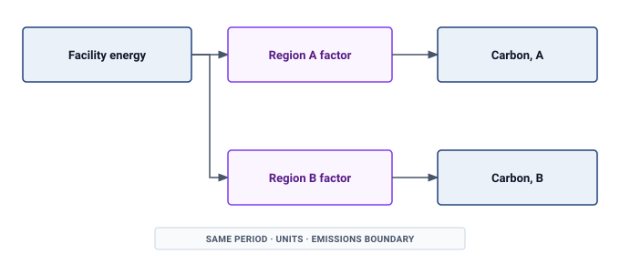

:::

### Systematic energy metrics {#sec-sustainable-ai-systematic-energy-metrics-5779-5779}

Quantifying energy efficiency requires systematic metrics that enable comparison across hardware architectures and algorithmic approaches. The metric ladder moves from energy per operation to energy per byte and then to the roofline relationship between arithmetic intensity and data movement. That progression matters because an optimization that reduces FLOPs may do little for a workload whose energy is spent moving bytes.

#### Energy per operation {#sec-sustainable-ai-energy-per-operation-776a-776a}

A basic metric for computational energy efficiency is energy consumed per operation, typically measured in picojoules. State the operation type and precision: a floating-point multiply-accumulate is conventionally two FLOPs, whereas an integer MAC is two integer arithmetic operations.

Hardware architecture changes which overheads can be reduced. @Tbl-energy-per-op identifies the mechanism and the measurement needed to test it, rather than ranking incomparable operation counts.

| **Architecture**                            | **Potential energy advantage**            | **Comparison must include**                           |
|:--------------------------------------------|:------------------------------------------|:------------------------------------------------------|
| **General-purpose CPU**                     | Flexible execution for diverse workloads  | Instruction overhead and achieved utilization         |
| **GPU**                                     | Parallel arithmetic and data reuse        | Precision, occupancy, and memory traffic              |
| **Systolic accelerator**                    | Local reuse across a regular datapath     | Supported shapes, precision, and data movement        |
| **Edge accelerator or fixed-function ASIC** | Specialized low-power execution           | Host, memory, peripherals, and duty cycle             |
| **Analog or in-memory compute**             | Reduced movement for supported operations | Conversion, peripheral circuits, and achieved quality |

: **Architecture and Energy Measurement**: Specialization can reduce execution overhead, but device specifications with different operation types and system boundaries do not establish an end-to-end energy ranking. Compare the same useful task at the required quality. {#tbl-energy-per-op}

Precision affects energy per operation through implementation-specific arithmetic and data movement. Narrower formats can reduce circuit area, switched capacitance, and memory traffic, but bit width alone does not determine wall energy. The measurement contract requires a matched workload and quality target, with the same memory and supporting-system boundary.

#### Energy per byte {#sec-sustainable-ai-energy-per-byte-5d87-5d87}

Data movement often dominates energy consumption in AI workloads with low arithmetic intensity. The following illustrative cost model assigns per-byte energy across storage and communication boundaries. These coefficients teach the cost of movement; they are not universal measurements of every platform:

::: {.column-margin}
```{=latex}
\vspace*{-19mm}
```
{width="100%" fig-alt="Six-rung energy staircase on a log scale: network 10,000, NVMe 1,000, DRAM 160, L2 5, L1 1, and register 0.1 pJ per byte, spanning five orders of magnitude."}

*Illustrative movement costs depend on the measurement boundary.*
:::

```{python}
#| echo: false
#| label: sustainable-ai-memory-hierarchy-energy
# ┌─────────────────────────────────────────────────────────────────────────────
# │ PER-BYTE MEMORY-HIERARCHY ENERGY (LEGO)
# ├─────────────────────────────────────────────────────────────────────────────
# │ Context: @tbl-energy-per-byte rows.
# │ Goal: Single-source the per-byte data-movement hierarchy from mlsysim.
# │ How:  Hardware.Tech.Movement.* (pedagogical per-byte rungs); DRAM = device
# │       figure Hardware.Tech.Memory.DRAM.energy_per_byte (160) per the single-source decision.
# └─────────────────────────────────────────────────────────────────────────────
from mlsysim import Hardware
from mlsysim.fmt import check, fmt_energy_per_byte
from mlsysim.core.units import pJ, byte

class MemoryHierarchyEnergy:
    # ┌── 1. LOAD (Constants) ──────────────────────
    reg = Hardware.Tech.Movement.Register.energy_per_byte
    l1 = Hardware.Tech.Movement.L1.energy_per_byte
    l2 = Hardware.Tech.Movement.L2.energy_per_byte
    # DRAM per-byte energy sourced from Hardware.Tech (taxonomy refactor; energy-as-property).
    dram = Hardware.Tech.Memory.DRAM.energy_per_byte
    nvme = Hardware.Tech.Movement.Nvme.energy_per_byte
    net = Hardware.Tech.Movement.Network.energy_per_byte

    # ┌── 2. GUARD (Invariants) ────────────────────
    check(reg < l1 < l2 < dram < nvme < net, "per-byte energy must increase down the memory hierarchy")

    # ┌── 4. OUTPUT (Formatting) ───────────────────
    reg_pj_per_byte_str = fmt_energy_per_byte(reg, precision=1, commas=False)
    l1_pj_per_byte_str = fmt_energy_per_byte(l1, precision=0, commas=False)
    l2_pj_per_byte_str = fmt_energy_per_byte(l2, precision=0, commas=False)
    dram_pj_per_byte_str = fmt_energy_per_byte(dram, precision=0, commas=False)
    nvme_pj_per_byte_str = fmt_energy_per_byte(nvme, precision=0)
    net_pj_per_byte_str = fmt_energy_per_byte(net, precision=0, lower_bound=True)
```

@Tbl-energy-per-byte reveals a critical insight about memory hierarchy energy costs\index{Memory Hierarchy!energy costs}: movement from DRAM\index{DRAM!energy cost} can dominate arithmetic under the modeled coefficients. The rows trace the path from registers through L1 cache\index{L1 cache!energy cost} and L2 cache\index{L2 cache!energy cost} to DRAM, Non-Volatile Memory Express (NVMe), and network transfers. Under the illustrative 10 pJ/FLOP arithmetic coefficient, accessing one FP32 operand from DRAM (4 bytes times 160 pJ/byte = 640 pJ) costs 64 times more than the computation itself. This table makes the energy hierarchy explicit.

| **Memory Level** |             **Energy Cost** **(pJ/byte)**             |
|:-----------------|:-----------------------------------------------------:|
| **Register**     |  `{python} MemoryHierarchyEnergy.reg_pj_per_byte_str` |
| **L1 Cache**     |  `{python} MemoryHierarchyEnergy.l1_pj_per_byte_str`  |
| **L2 Cache**     |  `{python} MemoryHierarchyEnergy.l2_pj_per_byte_str`  |
| **DRAM**         | `{python} MemoryHierarchyEnergy.dram_pj_per_byte_str` |
| **NVMe SSD**     | `{python} MemoryHierarchyEnergy.nvme_pj_per_byte_str` |
| **Network**      |  `{python} MemoryHierarchyEnergy.net_pj_per_byte_str` |

: **Illustrative Movement-Energy Coefficients**: The model assigns energy per byte at each stated boundary. Real values depend on transfer size, locality, link or device implementation, and supporting-system coverage. {#tbl-energy-per-byte}

The resulting design levers target data movement rather than raw arithmetic throughput. High-capacity on-chip SRAM and register files maximize data reuse, as demonstrated by NVIDIA Tensor Core architectures that stage operands in fast shared memory. Optimized execution layouts minimize off-chip DRAM round trips, exemplified by Google TPU systolic arrays that stream intermediate activations directly between adjacent processing elements. In addition, compression schemes and sparse tensor representations directly reduce the physical bit volume traversing the memory bus. Together, these levers make sustainability a locality-and-reuse problem rather than a faster-arithmetic problem alone.

#### Arithmetic intensity and energy roofline {#sec-sustainable-ai-arithmetic-intensity-energy-roofline-6d13-roofline-6d13}

The balance between computation and data movement determines whether energy consumption is compute-bound or memory-bound. @Eq-energy-arithmetic-intensity defines arithmetic intensity, the ratio that determines which resource dominates energy consumption. In these equations, $O$ is the operation count in FLOPs, $D_{\text{vol}}$ is data volume in bytes, $E_{\text{compute}}$ is energy per FLOP, and $E_{\text{move}}$ is energy per byte moved:

$$\text{AI} = \frac{O}{D_{\text{vol}}}$$ {#eq-energy-arithmetic-intensity}

Arithmetic intensity measured in FLOP/byte determines the dominant energy consumer. @Eq-energy-total expresses total energy as the sum of compute and memory contributions, while @eq-energy-roofline isolates the roofline-style dominant term:

$$E_{\text{total}} = O \times E_{\text{compute}} + D_{\text{vol}} \times E_{\text{move}}$$ {#eq-energy-total}

$$E_{\text{dominant}} = \max\left(O \times E_{\text{compute}}, D_{\text{vol}} \times E_{\text{move}}\right)$$ {#eq-energy-roofline}

The maximum term identifies the dominant bottleneck for roofline reasoning; it is not the full energy in balanced cases. @Eq-ai-crossover defines the crossover arithmetic intensity\index{Energy Roofline Model!crossover arithmetic intensity}\index{Crossover arithmetic intensity!compute and memory balance} where compute and memory energy balance:

$$\text{AI}_{\text{crossover}} = \frac{E_{\text{move}}}{E_{\text{compute}}}$$ {#eq-ai-crossover}

```{python}
#| echo: false
#| label: sustainable-ai-matmul-energy
# ┌─────────────────────────────────────────────────────────────────────────────
# │ ENERGY CROSSOVER + MATMUL WORKED EXAMPLE (LEGO)
# ├─────────────────────────────────────────────────────────────────────────────
# │ Context: @eq-ai-crossover prose and @exmp-sustainable-ai-matmul-energy-analysis.
# │
# │ Goal: Pin the energy crossover and the MatMul compute/memory energies to
# │       mlsysim so they cannot drift; the small matrix sits exactly at the
# │       crossover (AI = N/6 = crossover) so compute and memory energy balance.
# │ How:  E_compute = ENERGY_EFF_GPU (architecture-effective); E_move =
# │       Hardware.Tech.Memory.DRAM.energy_per_byte (device). crossover = E_move/E_compute.
# │
# └─────────────────────────────────────────────────────────────────────────────
from mlsysim import Hardware
from mlsysim.core.units import BYTES_FP32
from mlsysim.core.units import byte, pJ, flop
from mlsysim.fmt import MarkdownStr, check, fmt, fmt_display_math, fmt_energy_per_byte, fmt_energy_per_flop, fmt_math

class MatMulEnergyAnalysis:
    # ┌── 1. LOAD (Constants) ──────────────────────
    e_compute = Hardware.Tech.EffectiveCompute.Gpu.energy_per_flop.to(pJ / flop).magnitude
    # E_move sourced from Hardware.Tech (taxonomy refactor; energy-as-property).
    e_move = Hardware.Tech.Memory.DRAM.energy_per_byte.to(pJ / byte).magnitude  # 160 (device)
    bytes_fp32 = BYTES_FP32.to(byte).magnitude  # 4
    n_large = 1000
    n_vec = 1000

    # ┌── 2. EXECUTE (The Compute) ─────────────────
    crossover_ai = e_move / e_compute  # 16 FLOP/byte
    n_small = int(round(6 * crossover_ai))  # matrix that sits at the crossover (AI = N/6)
    ai_small = n_small / 6
    comp_small_pj = 2 * n_small**3 * e_compute
    mem_small_pj = 3 * n_small**2 * bytes_fp32 * e_move
    ai_large = n_large / 6
    comp_large_pj = 2 * n_large**3 * e_compute
    mem_large_pj = 3 * n_large**2 * bytes_fp32 * e_move
    vec_bytes = 3 * n_vec * bytes_fp32
    ai_vec = n_vec / vec_bytes
    comp_vec_pj = n_vec * e_compute
    mem_vec_pj = vec_bytes * e_move

    # ┌── 3. GUARD (Invariants) ────────────────────
    check(abs(ai_small - crossover_ai) < 1e-9, "small matrix must sit at the energy crossover")
    check(abs(comp_small_pj - mem_small_pj) < 1.0, "compute and memory energy must balance at the crossover")
    check(ai_large > crossover_ai > ai_vec, "large case compute-bound; vector case memory-bound")

    # ┌── 4. OUTPUT (Formatting) ───────────────────
    e_compute_str = fmt_energy_per_flop(Hardware.Tech.EffectiveCompute.Gpu.energy_per_flop, unit=pJ / flop, precision=0, commas=False)
    e_move_str = fmt_energy_per_byte(Hardware.Tech.Memory.DRAM.energy_per_byte, unit=pJ / byte, precision=0, commas=False)
    n_small_str = fmt(n_small, precision=0, commas=False)
    crossover_eq_math = fmt_display_math(
        rf"\text{{AI}}_{{\text{{crossover}}}} = \frac{{{e_move:.0f} \text{{ pJ/byte}}}}{{{e_compute:.0f} \text{{ pJ/FLOP}}}} = {crossover_ai:.0f} \text{{ FLOP/byte}}"
    )
    ai_small_eq_math = fmt_math(rf"\text{{AI}} = {n_small}/6 = {ai_small:.0f}")
    comp_small_eq_math = fmt_math(
        rf"2 \times {n_small}^3 \times {e_compute:.0f} \text{{ pJ}} = {comp_small_pj/1e6:.2f}\,\mu\text{{J}} = {comp_small_pj/1e9:.4f}\text{{ mJ}}"
    )
    mem_small_eq_math = fmt_math(
        rf"3 \times {n_small}^2 \times {bytes_fp32:.0f} \times {e_move:.0f} \text{{ pJ}} = {mem_small_pj/1e6:.2f}\,\mu\text{{J}} = {mem_small_pj/1e9:.4f}\text{{ mJ}}"
    )
    ai_large_eq_math = fmt_math(rf"\text{{AI}} = {n_large}/6 = {ai_large:.0f}")
    comp_large_eq_math = fmt_math(rf"2 \times 10^9 \times {e_compute:.0f} \text{{ pJ}} = {comp_large_pj/1e9:.0f}\text{{ mJ}}")
    mem_large_eq_math = fmt_math(rf"3 \times 10^6 \times {bytes_fp32:.0f} \times {e_move:.0f} \text{{ pJ}} = {mem_large_pj/1e9:.2f}\text{{ mJ}}")
    ai_vec_eq_math = fmt_math(rf"\text{{AI}} = {n_vec}/{vec_bytes:.0f} = {ai_vec:.3f}")
    comp_vec_eq_math = fmt_math(rf"{n_vec} \times {e_compute:.0f} \text{{ pJ}} = {comp_vec_pj/1e9:.5f}\text{{ mJ}}")
    mem_vec_eq_math = fmt_math(rf"{vec_bytes:.0f} \times {e_move:.0f} \text{{ pJ}} = {mem_vec_pj/1e9:.5f}\text{{ mJ}}")
```

For a GPU with $E_{\text{compute}}$ of `{python} MatMulEnergyAnalysis.e_compute_str` and $E_{\text{move}}$ of `{python} MatMulEnergyAnalysis.e_move_str` (DRAM access):

`{python} MatMulEnergyAnalysis.crossover_eq_math`

The **energy roofline model**\index{Energy Roofline Model!definition} (@fig-energy-roofline) visualizes this relationship between arithmetic intensity and energy efficiency, revealing which energy term dominates. It uses the bottleneck reasoning of the performance roofline developed in @sec-appdx-fleet-foundations-roofline, but the crossover is different. The performance ridge depends on peak throughput divided by memory bandwidth; the energy crossover depends on energy per byte divided by energy per FLOP. A workload can therefore be limited by memory bandwidth in time without memory movement dominating its energy account.

::: {#fig-energy-roofline fig-env="figure" fig-pos="htb" fig-cap="**Energy Roofline Model**: Just as performance rooflines limit FLOP/s based on bandwidth, energy rooflines limit FLOP/J. The dashed curve uses the dominant energy term; the solid curve includes both compute and memory energy using the same coefficients as the worked example. At the crossover both terms contribute equally, so total-energy efficiency is half the dominant-term bound. Static and other system energy require additional terms." fig-alt="Log-log plot of a piecewise dominant-term energy bound and a smooth lower curve including compute and memory energy; a vertical line marks their crossover."}
```{python}
#| echo: false
#| warning: false
# Reuse the energy coefficients from the adjacent worked example.
import numpy as np
import matplotlib.pyplot as plt
from binder.tools.figures import style as book_style

fig, ax, COLORS, plt = book_style.setup_plot(figsize=(8.5, 4.6))
ai = np.logspace(-1, 3, 160)
e_compute = MatMulEnergyAnalysis.e_compute  # pJ/FLOP
e_move = MatMulEnergyAnalysis.e_move  # pJ/byte
ridge = e_move / e_compute
ceiling = 1000 / e_compute  # GFLOP/J
bound = np.minimum(ceiling, 1000 * ai / e_move)
combined = 1000 / (e_compute + e_move / ai)
assert np.all(combined <= bound)
assert abs((1000 / (e_compute + e_move / ridge)) - ceiling / 2) < 1e-9
ax.loglog(ai, bound, '--', color=COLORS['BlueLine'], label='Dominant-term upper bound')
ax.loglog(ai, combined, color=COLORS['GreenLine'], label='Compute + memory energy')
ax.axvline(ridge, color=COLORS['secondary'], linestyle=':')
ax.set_xlabel('Arithmetic intensity (FLOP/byte)')
ax.set_ylabel('Energy efficiency (GFLOP/J)')
ax.legend(loc='lower right', fontsize=8)
ax.text(
    0.03,
    0.95,
    f'Compute: {e_compute:g} pJ/FLOP\nMovement: {e_move:g} pJ/byte\nCrossover: {ridge:g} FLOP/byte',
    transform=ax.transAxes,
    va='top',
    fontsize=8,
)
fig.tight_layout()
plt.show()
plt.close()
```
:::

This framework applies directly to the most common operation in deep learning: matrix multiplication.

::: {#nbk-sustainable-ai-matmul-energy-analysis .callout-notebook title="MatMul energy analysis"}

**Problem**: How do matrix dimensions $N_{\text{mat}}$ dictate whether arithmetic energy $E_{\text{compute}}$ or memory energy $E_{\text{move}}$ dominates matrix multiplication $\mathbf{C} = \mathbf{A} \times \mathbf{B}$?

**Math**:

1. Operation & byte count: $2N_{\text{mat}}^3$ FLOPs and $12N_{\text{mat}}^2$ bytes at FP32, assuming ideal reuse: read each input once and write the output once at the modeled memory boundary. Tiling and limited capacity can increase measured traffic.
2. Arithmetic intensity: $\text{AI} = \frac{N_{\text{mat}}}{6}$ FLOP/byte.
3. Regime comparison: @tbl-matmul-energy-bottleneck-comparison compares energy terms across small, large, and vector work.

| **Workload**                                                                 | **Arithmetic intensity**                                   | **Compute energy**                                 | **Memory energy**                                 | **Optimization priority**           |
|:-----------------------------------------------------------------------------|:-----------------------------------------------------------|:---------------------------------------------------|:--------------------------------------------------|:------------------------------------|
| Small matrix ($N_{\text{mat}}=$ `{python} MatMulEnergyAnalysis.n_small_str`) | `{python} MatMulEnergyAnalysis.ai_small_eq_math` FLOP/byte | `{python} MatMulEnergyAnalysis.comp_small_eq_math` | `{python} MatMulEnergyAnalysis.mem_small_eq_math` | Balanced at the crossover           |
| Large matrix ($N_{\text{mat}} = 1000$)                                       | `{python} MatMulEnergyAnalysis.ai_large_eq_math` FLOP/byte | `{python} MatMulEnergyAnalysis.comp_large_eq_math` | `{python} MatMulEnergyAnalysis.mem_large_eq_math` | Improve compute efficiency          |
| Vector addition ($N_{\text{vec}} = 1000$)                                    | `{python} MatMulEnergyAnalysis.ai_vec_eq_math` FLOP/byte   | `{python} MatMulEnergyAnalysis.comp_vec_eq_math`   | `{python} MatMulEnergyAnalysis.mem_vec_eq_math`   | Reduce data movement through fusion |

: **Energy Bottleneck Comparison**: The same energy model classifies small dense work, large dense work, and element-wise work by their dominant energy term. {#tbl-matmul-energy-bottleneck-comparison}

**Systems insight**: Energy optimization follows the same bottleneck logic as latency optimization. Dense matrix multiply rewards efficient arithmetic; element-wise work rewards reducing memory movement.

:::

The energy roofline model reveals why different optimization strategies suit different workloads. When arithmetic dominates the energy account, large dense matrix operations benefit from lower energy per executed operation. When data movement dominates, element-wise kernels benefit from data layout optimization, kernel fusion to reduce memory round-trips, and on-chip memory utilization. Faster execution alone does not establish either saving; average power and execution time must be measured together. This framework guides architectural and algorithmic choices for sustainable AI system design.

### Energy measurement techniques {#sec-sustainable-ai-energy-measurement-techniques-590e-techniques-590e}

Quantifying AI system energy consumption requires measurement at multiple levels of the hardware stack, from chip-level instrumentation to facility-wide monitoring. The method choice is itself an engineering trade-off: hardware counters provide fine attribution, mobile profilers expose platform-specific subsystems, edge instruments capture duty-cycle behavior, and system-level tools connect component measurements to the facility overhead that component counters miss.

#### Hardware power counters {#sec-sustainable-ai-hardware-power-counters-0ec9}

Modern processors expose manufacturer-provided power telemetry that software can query through device interfaces. These counters provide workload-correlated estimates within the rails and sampling windows the device reports; they are not universal ground truth for wall-plug energy, and their update rate, calibration, and component coverage vary by platform. External instruments remain necessary when a comparison requires traceable total energy or finer temporal resolution.

Intel's **running average power limit (RAPL)**\index{Running Average Power Limit!definition} interface exposes energy measurements for CPU packages, DRAM, and integrated graphics through model-specific registers. RAPL reports cumulative energy, so the measurement pattern is boundary based: sample the counter before a controlled workload region, run the workload, sample it again, and divide the energy delta by elapsed time to recover average power. This makes RAPL useful for CPU preprocessing, data loading, and host-side training work, but it also defines its boundary. RAPL does not cover discrete GPU energy, can require elevated permissions, and must be interpreted with awareness of package scope and counter rollover.

NVIDIA GPUs expose power measurements through the NVIDIA Management Library, accessible via the `nvidia-smi` command-line tool or programmatic bindings. GPU power monitoring\index{GPU!power monitoring} usually starts with instantaneous power draw, which varies dynamically during computation because dynamic voltage and frequency scaling changes the device state from one kernel to the next. A reliable measurement therefore treats the inference or training interval as a trace: synchronize the workload boundary, sample power at a fixed cadence, integrate those samples over time, and report both average and peak power. When data-center GPUs expose accumulated energy counters, those counters are preferable because they avoid aliasing short kernels between samples.

Edge devices and microcontrollers often lack built-in power counters and require external instrumentation. Select current range, voltage measurement, sampling rate, and analog bandwidth to capture the workload's active and sleep intervals. Board-level monitors can integrate inference energy; resolving shorter events requires adequate instrument bandwidth and careful treatment of filtering and aliasing. A fast sample rate alone does not establish direct per-operation energy attribution.

#### Mobile platform energy profiling {#sec-sustainable-ai-mobile-platform-energy-profiling-7f9d}

On mobile platforms, measurement depends on how much subsystem attribution the host operating system exposes, forcing available profilers to balance direct wattage measurements against granular diagnostic visibility. The Android PowerStats HAL provides per-component power attribution across CPU, GPU, NPU, and radio subsystems, enabling developers to identify which specific operations dominate total draw. On Snapdragon hardware, the Qualcomm Trepn Profiler\index{Qualcomm Trepn Profiler!mobile power measurement} offers millisecond-resolution power traces correlated with instruction execution to guide NPU workload tuning. In ARM environments, ARM Streamline delivers energy-annotated profiling across Cortex-A cores and Mali GPUs to expose inefficient kernel implementations and memory stalls. For iOS applications, Apple Instruments Energy Log reports thermal states and energy impact scores, providing qualitative diagnostic signals during development even without exposing raw milliwatt measurements. These mobile profiling environments integrate directly into development workflows, enabling iterative optimization of on-device inference before wide-scale deployment. @Tbl-edge-power-monitors summarizes edge power measurement instruments\index{Edge power measurement!instrument comparison} across platforms, including resolution, accuracy, and integration requirements.

| **Instrument class**             | **Measurement role**                | **Required checks**                                        |
|:---------------------------------|:------------------------------------|:-----------------------------------------------------------|
| **Board current monitor**        | Integrate energy on selected rails  | Voltage, sample interval, shunt losses, and event duration |
| **Multi-rail monitor**           | Attribute energy among components   | Channel synchronization and coverage                       |
| **Wide-range external analyzer** | Capture sleep and active intervals  | Bandwidth, range transitions, and calibration              |
| **Automated power analyzer**     | Repeat duty-cycle and battery tests | Triggering, integration window, and supply behavior        |

: **Edge Power Measurement Instruments**: Choose instrumentation by the event duration, dynamic range, and electrical boundary being measured. Verify configured specifications rather than assuming one device is universally sufficient. {#tbl-edge-power-monitors}

#### Edge measurement methodology {#sec-sustainable-ai-edge-measurement-methodology-c02a}

Edge energy measurements are useful only when they reflect the deployed duty cycle rather than an idealized active-only inference burst. Reproducible evaluation requires four rigorous experimental controls. Simultaneous current and voltage logging must span every active and quiescent power state, ensuring rail voltage fluctuations are captured rather than inferring power from current alone. Thermal and frequency stabilization protocols require warming the device until junction temperatures, core clocks, and rail voltages reach steady state, while profiling cold starts and periodic bursts independently. Realistic duty-cycle accounting\index{Duty cycle!edge inference power} demands recording both peak inference draw and time-averaged power across typical idle intervals, reflecting how deployed devices actually spend time. Finally, rigorous hardware isolation must disable or subtract auxiliary peripherals—including radios, sensors, and display backlights—preventing non-compute background subsystems from obscuring accelerator consumption. For duty cycle accounting, @eq-edge-duty-cycle expresses this relationship between active and idle power:

$$P_{\text{average}} = P_{\text{active}} \times \delta_{\text{duty}} + P_{\text{idle}} \times (1 - \delta_{\text{duty}})$$ {#eq-edge-duty-cycle}

where $\delta_{\text{duty}}$ is the duty cycle (fraction of time performing inference).

#### System-level energy profiling {#sec-sustainable-ai-systemlevel-energy-profiling-eecf}

Comprehensive energy accounting requires combining chip-level measurements with infrastructure overhead. The component terms must be disjoint: GPU-board telemetry that already includes device memory must not be added to another measurement of that same memory. They must also cover the IT boundary, with storage and server support loads included in the relevant measured terms. @Eq-total-energy formalizes total energy as the sum of those component contributions scaled by facility overhead:

$$E_{\text{total}} = (E_{\text{CPU}} + E_{\text{GPU}} + E_{\text{memory}} + E_{\text{network}}) \times \text{PUE}$$ {#eq-total-energy}

No single counter spans the full energy path, so system-level profilers like Intel VTune, NVIDIA Nsight Systems, and open-source tools such as PowerJoular aggregate measurements across components. On-chip counters estimate device power and may differ in sampling rate, coverage, and calibration; a rack power distribution unit (PDU) provides an independent measurement of the downstream IT load. A rack PDU does not measure central chillers, pumps, lighting, or upstream conversion losses. Facility energy must instead come from facility meters or from an explicitly time-matched PUE applied to the measured IT load.

@Eq-facility-power expresses the relationship between measured component power and total facility energy:

$$P_{\text{facility}} = P_{\text{IT}} \times \text{PUE} = (P_{\text{servers}} + P_{\text{network}} + P_{\text{storage}}) \times \text{PUE}$$ {#eq-facility-power}

The PUE calculation above already established how IT load becomes facility load. Operational power is only one term, however; the next model combines that metered energy with a declared grid signal and embodied allocation rather than repeating the facility example.

## Carbon Footprint Calculation {#sec-sustainable-ai-carbon-footprint-calculation-c2fe}

Consider a data center supplied by a hydro-heavy grid. Its operational carbon intensity can be far below a fossil-heavy grid, but hydroelectric generation is not lifecycle-zero, and the AI system is not carbon-free. Reservoir construction and operation have impacts, while mining the silicon, manufacturing the GPUs, and pouring the concrete for the data center emitted carbon before the servers were turned on. A complete footprint calculation must account for operational electricity, embodied carbon, and the ecological effects excluded from a carbon-only metric.

The lifecycle notebook in @sec-sustainable-ai-carbon-footprint-analysis-ccc5 already computed operational, embodied, and total carbon for one 70B run. This section turns that worked example into the formal accounting model: equations for each term that generalize across workloads, grids, and amortization assumptions rather than a single numeric answer.

### Operational carbon calculation {#sec-sustainable-ai-operational-carbon-calculation-4627-calculation-4627}

Operational carbon emissions result from electricity consumption during training and inference, scaled by grid carbon intensity. @Eq-operational-carbon quantifies this as the product of energy, grid carbon intensity, and facility overhead:

$$C_{\text{operational}} = E_{\text{total}} \times \text{CI}_{\text{grid}}$$ {#eq-operational-carbon}

where $E_{\text{total}}$ is the facility-level energy from @eq-total-energy (component energy already scaled by $\text{PUE}$) and $\text{CI}_{\text{grid}}$ is the carbon intensity of the electricity grid. The facility overhead enters once, through $E_{\text{total}}$, so it does not appear again in the carbon equation. A concrete training emissions calculation illustrates this framework.

```{python}
#| echo: false
#| label: training-emissions-setup
from mlsysim.fmt import fmt_power, fmt_time

# ┌─────────────────────────────────────────────────────────────────────────────
# │ TRAINING EMISSIONS CALCULATION (LEGO)
# ├─────────────────────────────────────────────────────────────────────────────
# │ Context: @sec-sustainable-ai-scale-environmental-impact-ac9a
# │
# │ Goal: Compute operational carbon for 64 A100 GPUs training for 14 days.
# │ Show: ~8,602 kWh GPU energy → ~12,864 kWh IT → ~14,408 kWh facility → ~6,181 kg CO2.
# │ How: GPU energy = n_gpus * Hardware.Cloud.A100.tdp * hours; IT adds rack support; facility = IT * PUE.
# │
# └─────────────────────────────────────────────────────────────────────────────

from mlsysim.fmt import (
    fmt,
    fmt_carbon_intensity,
    fmt_time,
    fmt_power,
    fmt_energy,
    fmt_emissions,
    fmt_multiple,
    fmt_percent,
    check,
)
from mlsysim import Hardware, Infrastructure, Systems
from mlsysim.physics.quantities import energy_from_power, carbon_from_energy
from mlsysim.core.units import Wh, watt, hour, kilowatt, kWh, gram, kilogram, metric_ton

# ┌── LEGO ───────────────────────────────────────────────
# │ Context: Training-emissions worked example and fallacy recap.
# │ Goal: Keep the 7B-on-A100 operational-carbon comparison single-sourced.
# │ Scope: chapter-anchor — the fallacy recap intentionally reuses the
# │ training-emissions worked example's US-vs-Quebec result.
class TrainingEmissions:
    """Namespace for 7B model training emissions worked example."""

    # ┌── 1. LOAD (Constants) ──────────────────────────────────────────────
    n_gpus = 64
    training_days = 14
    training_duration = training_days * HOURS_PER_DAY * hour
    a100_tdp = Hardware.Cloud.A100.tdp
    rack = Systems.Racks.DGX_H100_4Node
    cooling_kw = 2.7 * kilowatt  # same cooling row as @tbl-rack-power; exclude before PUE
    it_power_multiplier = ((rack.accelerator_power + rack.non_accelerator_power - cooling_kw) / rack.accelerator_power).to("").magnitude
    us_grid = Infrastructure.Grids.US_Avg
    quebec_grid = Infrastructure.Grids.Quebec
    pue = us_grid.pue
    grid_ci = us_grid.carbon_intensity_g_kwh * (gram / kWh)
    quebec_ci = quebec_grid.carbon_intensity_g_kwh * (gram / kWh)
    embodied_carbon_per_accelerator = Hardware.Cloud.A100.embodied_carbon_kg * kilogram
    embodied_lifetime_years = 4
    hours_per_day = HOURS_PER_DAY

    # ┌── 2. EXECUTE (The Compute) ────────────────────────────────────────
    gpu_energy = energy_from_power(a100_tdp, training_duration) * n_gpus
    gpu_energy_kwh = gpu_energy.to(kWh)
    it_energy_kwh = gpu_energy_kwh * it_power_multiplier
    facility_energy_kwh = it_energy_kwh * pue
    total_carbon = carbon_from_energy(facility_energy_kwh, grid_ci)
    quebec_carbon = carbon_from_energy(facility_energy_kwh, quebec_ci)
    emissions_ratio = (total_carbon / quebec_carbon).to("").magnitude
    embodied_daily_carbon = embodied_carbon_per_accelerator / (embodied_lifetime_years * DAYS_PER_YEAR)
    embodied_training_carbon = n_gpus * training_days * embodied_daily_carbon
    embodied_us_ratio_pct = (embodied_training_carbon / total_carbon).to("").magnitude * 100
    embodied_quebec_total_share_pct = (embodied_training_carbon / (quebec_carbon + embodied_training_carbon)).to("").magnitude * 100

    # ┌── 3. GUARD (Invariants) ──────────────────────────────────────────
    check(a100_tdp.to(watt).magnitude == 400, f"Expected 400 W for A100, got {a100_tdp.to(watt).magnitude}")
    check(abs(facility_energy_kwh.magnitude - it_energy_kwh.magnitude * pue) < 0.05, "Facility energy must equal IT energy × PUE")
    check(1.3 < it_power_multiplier < 1.4, f"Unexpected rack IT multiplier: {it_power_multiplier:.2f}")
    embodied_training_value = embodied_training_carbon.to(kilogram).magnitude
    check(91 < embodied_training_value < 93, f"Unexpected embodied training kg: {embodied_training_value:.1f}")

    # ┌── 4. OUTPUT (Formatting) ──────────────────────────────────────────────
    training_hours_str = fmt_time(training_duration, hour, precision=0, commas=True, style='word')
    training_days_str = fmt_time(training_days, 'day', precision=0, commas=False, style='word')
    n_gpus_str = fmt(n_gpus, precision=0, commas=False)
    pue_str = fmt(pue, precision=2, commas=False)
    grid_ci_g_per_kwh_str = fmt_carbon_intensity(grid_ci, unit=gram / kWh, precision=0, commas=False)
    quebec_ci_g_per_kwh_str = fmt_carbon_intensity(quebec_ci, unit=gram / kWh, precision=0, commas=False)
    gpu_energy_kwh_str = fmt_energy(gpu_energy_kwh, unit=kWh, precision=1, commas=True)
    it_energy_kwh_str = fmt_energy(it_energy_kwh, unit=kWh, precision=1, commas=True)
    facility_energy_kwh_str = fmt_energy(facility_energy_kwh, unit=kWh, precision=1, commas=True)
    emissions_tons_str = fmt_emissions(total_carbon.to(metric_ton), unit=metric_ton, precision=1, commas=False)
    quebec_emissions_kg_str = fmt_emissions(quebec_carbon.to(kilogram), unit=kilogram, precision=1)
    emissions_ratio_mult_str = fmt_multiple(emissions_ratio, precision=1, commas=False)
```

::: {#nbk-sustainable-ai-training-emissions-calculation .callout-notebook title="Training emissions calculation"}

**Problem**: Quantify the operational carbon footprint of training a 7B parameter model on `{python} TrainingEmissions.n_gpus_str` A100 GPUs for `{python} TrainingEmissions.training_days_str`.

```{python}
#| echo: false
# ┌── LEGO ───────────────────────────────────────────────
# │ Context: Training emissions example — A100 TDP for Step 1.
# │ Goal: Format A100 TDP locally for the training-emissions worked example.
class A100PowerScenario:
    a100_tdp = Hardware.Cloud.A100.tdp
    from mlsysim.fmt import check, fmt_power

    check(a100_tdp.to(watt).magnitude == 400, "A100 TDP should be 400W")
    # ┌── 4. OUTPUT (Formatting) ──────────────────────────────────────────────
    a100_tdp_w_str = fmt_power(a100_tdp, unit=watt, precision=0, commas=False)
```

**Math**:

1. Compute energy: `{python} TrainingEmissions.n_gpus_str` GPUs $\times$ `{python} A100PowerScenario.a100_tdp_w_str` $\times$ `{python} TrainingEmissions.training_hours_str` = `{python} TrainingEmissions.gpu_energy_kwh_str`.
2. Apply PUE & IT support: Total facility energy = `{python} TrainingEmissions.it_energy_kwh_str` $\times$ `{python} TrainingEmissions.pue_str` = `{python} TrainingEmissions.facility_energy_kwh_str`.
3. Calculate emissions: On US average grid (`{python} TrainingEmissions.grid_ci_g_per_kwh_str` $\text{CO}_2$/kWh), emissions = `{python} TrainingEmissions.emissions_tons_str`. On Quebec hydro grid (`{python} TrainingEmissions.quebec_ci_g_per_kwh_str`), emissions = `{python} TrainingEmissions.quebec_emissions_kg_str`.

**Systems insight**: The geographic choice alone produces a `{python} TrainingEmissions.emissions_ratio_mult_str` difference in training emissions. Carbon-aware placement changes the environmental cost without changing the model architecture.

:::

#### Embodied carbon assessment {#sec-sustainable-ai-embodied-carbon-assessment-9de0}

Financial cost and carbon require separate accounts. @Fig-carbon-tco shows a hypothetical financial budget in which recurring expenses eventually exceed the initial purchase. That outcome follows from the stated expenses, not from a universal rule about cluster economics. Hardware can dominate embodied carbon even when its purchase price is only one part of monetary cost.

::: {#fig-carbon-tco fig-env="figure" fig-pos="htb" fig-cap="**Illustrative Five-Year Ownership Budget**: Annual expenditure and its cumulative total for a hypothetical budget. The scenario assumes a one-time hardware purchase, fixed annual IT electricity and non-IT facility costs, and an increasing carbon charge. The bars are annual flows; the line is their cumulative sum. These inputs demonstrate accounting, not a measured hardware deployment or a general crossover." fig-alt="Two panels show stacked annual spending and cumulative spending over five years; hardware appears in the first year and recurring costs in every year."}

```{python}
#| echo: false
#| warning: false
import matplotlib.pyplot as plt
import numpy as np
from binder.tools.figures import style as book_style

book_style.set_book_style()
COLORS = book_style.COLORS
fig, (ax_bar, ax_cum) = plt.subplots(1, 2, figsize=(11.0, 4.8), gridspec_kw={'width_ratios': [1.2, 1.0]})

c_dark = COLORS['primary']
c_gray = COLORS['secondary']
c_border = COLORS['grid']

years = ['Year 1', 'Year 2', 'Year 3', 'Year 4', 'Year 5']
x = np.arange(len(years))
width = 0.52

hw = np.array([3.2, 0.0, 0.0, 0.0, 0.0])
elec = np.array([0.6, 0.6, 0.6, 0.6, 0.6])
cool = np.array([0.2, 0.2, 0.2, 0.2, 0.2])
carb = np.array([0.06, 0.08, 0.12, 0.17, 0.26])

annual_totals = hw + elec + cool + carb
cum_tco = np.cumsum(annual_totals)
assert np.isclose(cum_tco[-1], hw.sum() + elec.sum() + cool.sum() + carb.sum())
assert np.isclose(cum_tco[-1], 7.89)  # scenario budget, in millions of dollars

p1 = ax_bar.bar(x, hw, width, label='Hardware (CapEx)', color=COLORS['BlueFill'], edgecolor=COLORS['BlueLine'], linewidth=1.2)
p2 = ax_bar.bar(x, elec, width, bottom=hw, label='IT electricity (OpEx)', color=COLORS['OrangeL'], edgecolor=COLORS['OrangeLine'], linewidth=1.2)
p3 = ax_bar.bar(x, cool, width, bottom=hw + elec, label='Non-IT facility (OpEx)', color=COLORS['RedFill'], edgecolor=COLORS['RedLine'], linewidth=1.2)
p4 = ax_bar.bar(
    x, carb, width, bottom=hw + elec + cool, label='Carbon Tax (OpEx)', color=COLORS['GreenFill'], edgecolor=COLORS['GreenLine'], linewidth=1.2
)

ax_bar.text(0, 1.6, 'HW: $3.2M', ha='center', va='center', fontsize=8.5, fontweight='bold', color=COLORS['BlueLine'])

for i, tot in enumerate(annual_totals):
    ax_bar.text(i, tot + 0.08, f'${tot:.2f}M', ha='center', va='bottom', fontsize=8.0, fontweight='bold', color=c_dark)

ax_bar.text(
    0.5,
    0.82,
    "Hardware: Front-Loaded\nRecurring costs: scenario assumptions",
    transform=ax_bar.transAxes,
    ha='center',
    va='top',
    fontsize=8.0,
    color=c_dark,
    fontweight='bold',
    bbox=dict(boxstyle='round,pad=0.35', facecolor='#FFFFFF', edgecolor=c_border, lw=0.9),
)

ax_bar.set_xticks(x)
ax_bar.set_xticklabels(years, fontsize=8.5, fontweight='bold', color=c_dark)
ax_bar.set_ylim(0, 4.8)
ax_bar.set_ylabel('Annual Expenditure ($ Millions)', fontsize=9.2, fontweight='bold', color=c_dark)
ax_bar.set_title('(a) Annual Expenditure by Component', fontsize=9.5, fontweight='bold', color=c_dark)
ax_bar.legend(loc='upper right', frameon=True, facecolor='#FFFFFF', edgecolor=c_border, fontsize=7.8)
ax_bar.tick_params(colors=c_dark, labelsize=8.5)
ax_bar.grid(True, linestyle='--', alpha=0.5, axis='y')

ax_cum.plot(x, cum_tco, color=COLORS['BlueLine'], linewidth=2.4, marker='o', markersize=6.5, zorder=3)
for i, val in enumerate(cum_tco):
    ax_cum.text(i, val + 0.25, f'${val:.1f}M', ha='center', va='bottom', fontsize=8.2, fontweight='bold', color=c_dark)

ax_cum.fill_between(x, 0, cum_tco, color=COLORS['BlueL'], alpha=0.3, zorder=2)

ax_cum.text(
    0.06,
    0.88,
    "5-Year Budget: $7.9M\n• CapEx (HW): 40.5%\n• OpEx (Power+Cool+Carbon): 59.5%",
    transform=ax_cum.transAxes,
    ha='left',
    va='top',
    fontsize=8.0,
    color=c_dark,
    linespacing=1.35,
    fontweight='bold',
    bbox=dict(boxstyle='round,pad=0.4', facecolor='#FFFFFF', edgecolor=c_border, lw=1.0),
)

ax_cum.text(
    0.98,
    0.03,
    'Hypothetical budget; not a measured cluster',
    transform=ax_cum.transAxes,
    ha='right',
    va='bottom',
    fontsize=7.2,
    fontstyle='italic',
    color=c_gray,
)

ax_cum.set_xticks(x)
ax_cum.set_xticklabels(years, fontsize=8.5, fontweight='bold', color=c_dark)
ax_cum.set_ylim(0, 9.2)
ax_cum.set_ylabel('Cumulative TCO ($ Millions)', fontsize=9.2, fontweight='bold', color=c_dark)
ax_cum.set_title('(b) Cumulative 5-Year Ownership Cost', fontsize=9.5, fontweight='bold', color=c_dark)
ax_cum.tick_params(colors=c_dark, labelsize=8.5)
ax_cum.grid(True, linestyle='--', alpha=0.5)

plt.tight_layout()
plt.show()
```

:::

As grids decarbonize, the bottleneck shifts toward embodied carbon from chip fabrication and data center construction, making hardware utilization and longevity first-order sustainability levers.

Embodied carbon encompasses emissions from raw material extraction, semiconductor fabrication, assembly, transportation, and end-of-life disposal. For AI hardware, manufacturing emissions are dominated by the energy-intensive nature of advanced semiconductor processes.

Advanced-node AI accelerators carry substantial manufacturing footprints: an NVIDIA A100 GPU embodies approximately 150 kg CO~2~eq per unit [@luccioni2023estimating], and NVIDIA's HGX H100 product carbon footprint implies roughly 164 kg CO~2~e per H100 when the baseboard footprint is allocated evenly across its eight GPUs [@nvidia2025hgxh100pcf], including wafer fabrication at advanced process nodes, high-bandwidth memory production, and packaging. @Eq-embodied-daily amortizes this embodied carbon over the hardware lifetime to compute per-use emissions:

$$C_{\text{embodied,daily}} = \frac{C_{\text{manufacturing}}}{T_{\text{lifetime}} \times 365}$$ {#eq-embodied-daily}

Understanding how embodied carbon accumulates over time reveals why hardware utilization and lifetime dominate total lifecycle emissions.

```{python}
#| echo: false
#| label: embodied-carbon-amort-calc
from mlsysim.fmt import check, fmt, fmt_carbon_intensity, fmt_emissions, fmt_energy, fmt_percent, fmt_power, fmt_time
from mlsysim.physics.quantities import energy_from_power, carbon_from_energy
from mlsysim.core.units import kilowatt, kWh, kilogram, hour, gram

# ┌── LEGO ───────────────────────────────────────────────
class EmbodiedCarbonAmort:
    """Quantify the hidden carbon cost of hardware manufacturing."""

    # ┌── 1. LOAD (Constants) ──────────────────────────────────────────────
    n_gpus = 8
    h100_tdp = Hardware.Cloud.H100.tdp
    t_job = 10 * hour  # scenario assumption
    mfg_carbon_per_gpu = Hardware.Cloud.H100.embodied_carbon_kg * kilogram
    lifetime_years = 3
    ci_dirty = Infrastructure.Grids.US_Avg.carbon_intensity_kg_kwh * (kilogram / kWh)
    ci_clean = Infrastructure.Grids.Quebec.carbon_intensity_kg_kwh * (kilogram / kWh)

    # ┌── 2. EXECUTE (The Compute) ────────────────────────────────────────
    op_energy = energy_from_power(h100_tdp, t_job) * n_gpus
    op_carbon_dirty = carbon_from_energy(op_energy.to(kWh), ci_dirty)
    op_carbon_clean = carbon_from_energy(op_energy.to(kWh), ci_clean)

    total_mfg_carbon = n_gpus * mfg_carbon_per_gpu
    total_lifetime_hr = lifetime_years * DAYS_PER_YEAR * HOURS_PER_DAY
    hourly_rent_kg = (total_mfg_carbon / (total_lifetime_hr * hour)).to(kilogram / hour)
    embodied_carbon_job = hourly_rent_kg * t_job

    share_clean_pct = (embodied_carbon_job / (op_carbon_clean + embodied_carbon_job)).to("").magnitude * 100

    # ┌── 3. GUARD (Invariants) ──────────────────────────────────────────
    check(embodied_carbon_job.to(kilogram).magnitude < 1.0, f"Expected small amortized cost, got {embodied_carbon_job.to(kilogram).magnitude:.2f}")

    # ┌── 4. OUTPUT (Formatting) ──────────────────────────────────────────────
    h_h100_tdp_kw_str = fmt_power(h100_tdp, unit=kilowatt, precision=1, commas=False)
    op_energy_kwh_str = fmt_energy(op_energy.to(kWh), unit=kWh, precision=0, commas=False)
    ci_dirty_g_per_kwh_str = fmt_carbon_intensity(ci_dirty, unit=kilogram / kWh, precision=3, commas=False)
    ci_clean_g_per_kwh_str = fmt_carbon_intensity(ci_clean, unit=kilogram / kWh, precision=3, commas=False)
    mfg_carbon_per_gpu_kg_str = fmt_emissions(mfg_carbon_per_gpu, unit=kilogram, commas=False)
    total_mfg_carbon_kg_str = fmt_emissions(total_mfg_carbon, unit=kilogram, commas=False)
    lifetime_years_str = fmt_time(lifetime_years, 'year', precision=0, commas=False, style='word')
    total_lifetime_hr_str = fmt_time(total_lifetime_hr * hour, hour, precision=0, commas=False, style='word')
    hourly_rent_kg_str = fmt_emissions(hourly_rent_kg.to(kilogram / hour), unit=kilogram / hour, precision=3, commas=False)
    op_carbon_dirty_kg_str = fmt_emissions(op_carbon_dirty.to(kilogram), unit=kilogram, commas=False)
    op_carbon_clean_kg_str = fmt_emissions(op_carbon_clean.to(kilogram), unit=kilogram, commas=False)
    embodied_carbon_job_kg_str = fmt_emissions(embodied_carbon_job.to(kilogram), unit=kilogram, commas=False)
    share_clean_pct_str = fmt_percent(share_clean_pct / 100, precision=1, commas=False, style='prose')
    t_job_hr_str = fmt_time(t_job, hour, precision=0, commas=False, style='word')
    n_gpus_str = fmt(n_gpus, precision=0, commas=False)
```

::: {#psp-sustainable-ai-embodied-carbon-amortization .callout-perspective title="Embodied carbon amortization"}

Renting a GPU for an hour uses hardware whose manufacturing emissions have already occurred. The workload account allocates a share of those emissions to the rental interval, regardless of whether the monetary fee explicitly prices carbon.

The embodied-carbon amortization formula\index{Embodied Carbon!amortization formula} makes that allocation explicit:
$$C_{\text{total}} = C_{\text{operational}} + \left( \frac{C_{\text{manufacturing}}}{T_{\text{lifetime,years}} \times 365 \times 24} \times T_{\text{job,hours}} \right)$$

**Scenario**: Training a model for `{python} EmbodiedCarbonAmort.t_job_hr_str` on `{python} EmbodiedCarbonAmort.n_gpus_str` NVIDIA H100s. This accelerator-only illustration uses TDP as a constant-power assumption and excludes host, network, and facility energy. Its embodied share uses the allocated baseboard footprint; it is not a complete fleet lifecycle inventory.

*   Operational: `{python} EmbodiedCarbonAmort.n_gpus_str` $\times$ `{python} EmbodiedCarbonAmort.h_h100_tdp_kw_str` $\times$ `{python} EmbodiedCarbonAmort.t_job_hr_str` = `{python} EmbodiedCarbonAmort.op_energy_kwh_str`. At `{python} EmbodiedCarbonAmort.ci_dirty_g_per_kwh_str` (US-average grid) = `{python} EmbodiedCarbonAmort.op_carbon_dirty_kg_str`.
*   Embodied: `{python} EmbodiedCarbonAmort.n_gpus_str` $\times$ `{python} EmbodiedCarbonAmort.mfg_carbon_per_gpu_kg_str` = `{python} EmbodiedCarbonAmort.total_mfg_carbon_kg_str`.
*   Amortization: Lifetime = `{python} EmbodiedCarbonAmort.lifetime_years_str` (`{python} EmbodiedCarbonAmort.total_lifetime_hr_str`).
    *   Hourly "Rent" = `{python} EmbodiedCarbonAmort.total_mfg_carbon_kg_str` / `{python} EmbodiedCarbonAmort.total_lifetime_hr_str` $\approx$ `{python} EmbodiedCarbonAmort.hourly_rent_kg_str`.
    *   Job Cost = `{python} EmbodiedCarbonAmort.hourly_rent_kg_str` $\times$ `{python} EmbodiedCarbonAmort.t_job_hr_str` = `{python} EmbodiedCarbonAmort.embodied_carbon_job_kg_str`.

**Systems insight**: For long-lived hardware in dirty grids, electricity dominates (`{python} EmbodiedCarbonAmort.op_carbon_dirty_kg_str` vs. `{python} EmbodiedCarbonAmort.embodied_carbon_job_kg_str`). However, in clean grids (hydro, `{python} EmbodiedCarbonAmort.ci_clean_g_per_kwh_str`), operational drops to `{python} EmbodiedCarbonAmort.op_carbon_clean_kg_str`, making embodied carbon a significant fraction (~`{python} EmbodiedCarbonAmort.share_clean_pct_str`) of the total footprint.

:::

```{python}
#| echo: false
# ┌── LEGO ───────────────────────────────────────────────
# │ Context: Embodied carbon amortization prose below.
# │ Goal: Recap embodied-carbon inputs for the training-run example.
from mlsysim import Hardware, Infrastructure, Systems
from mlsysim.fmt import fmt, fmt_emissions, fmt_percent, fmt_time
from mlsysim.physics.quantities import energy_from_power, carbon_from_energy
from mlsysim.core.units import hour, kilowatt, kWh, gram, kilogram, metric_ton, watt

class TrainingEmbodiedRecap:
    # ┌── 1. LOAD (Constants) ──────────────────────────────────────────────
    n_gpus = 64
    training_days = 14
    training_duration = training_days * HOURS_PER_DAY * hour
    a100_tdp = Hardware.Cloud.A100.tdp
    rack = Systems.Racks.DGX_H100_4Node
    cooling_kw = 2.7 * kilowatt  # same cooling row as @tbl-rack-power; exclude before PUE
    it_power_multiplier = ((rack.accelerator_power + rack.non_accelerator_power - cooling_kw) / rack.accelerator_power).to("").magnitude
    us_grid = Infrastructure.Grids.US_Avg
    quebec_grid = Infrastructure.Grids.Quebec
    pue = us_grid.pue
    grid_ci = us_grid.carbon_intensity_g_kwh * (gram / kWh)
    quebec_ci = quebec_grid.carbon_intensity_g_kwh * (gram / kWh)
    embodied_lifetime_years = 4
    days_per_year = DAYS_PER_YEAR
    # ┌── 2. EXECUTE (The Compute) ────────────────────────────────────────
    gpu_energy_kwh = (energy_from_power(a100_tdp, training_duration) * n_gpus).to(kWh)
    facility_energy_kwh = gpu_energy_kwh * it_power_multiplier * pue
    total_carbon = carbon_from_energy(facility_energy_kwh, grid_ci)
    quebec_carbon = carbon_from_energy(facility_energy_kwh, quebec_ci)
    embodied_carbon_per_accelerator = Hardware.Cloud.A100.embodied_carbon_kg * kilogram
    embodied_daily_carbon = embodied_carbon_per_accelerator / (embodied_lifetime_years * days_per_year)
    embodied_training_carbon = n_gpus * training_days * embodied_daily_carbon
    embodied_us_ratio_pct = (embodied_training_carbon / total_carbon).to("").magnitude * 100
    embodied_quebec_total_share_pct = (embodied_training_carbon / (quebec_carbon + embodied_training_carbon)).to("").magnitude * 100
    # ┌── 4. OUTPUT (Formatting) ──────────────────────────────────────────────
    embodied_kg_per_accelerator_str = fmt_emissions(embodied_carbon_per_accelerator, unit=kilogram, commas=False)
    embodied_lifetime_years_str = fmt_time(embodied_lifetime_years, 'year', precision=0, commas=False, style='word')
    embodied_lifetime_years_attr_str = fmt_time(embodied_lifetime_years, 'year', precision=0, commas=False, style='word', attributive=True)
    days_per_year_str = fmt_time(days_per_year, 'day', precision=0, commas=False, per='year')
    embodied_daily_kg_str = fmt_emissions(embodied_daily_carbon, unit=kilogram, precision=3, commas=False)
    n_gpus_str = fmt(n_gpus, precision=0, commas=False)
    training_days_str = fmt_time(training_days, 'day', precision=0, commas=False, style='word')
    embodied_training_kg_str = fmt_emissions(embodied_training_carbon, unit=kilogram, precision=1)
    embodied_us_ratio_pct_str = fmt_percent(embodied_us_ratio_pct / 100, precision=1, commas=False, style='prose')
    embodied_quebec_total_share_pct_str = fmt_percent(embodied_quebec_total_share_pct / 100, precision=1, commas=False, style='prose')
    emissions_kg_str = fmt_emissions(total_carbon.to(kilogram), unit=kilogram, precision=1)
    quebec_emissions_kg_str = fmt_emissions(quebec_carbon.to(kilogram), unit=kilogram, precision=1)
```

Returning to the earlier A100 training run, this calculation assumes a `{python} TrainingEmbodiedRecap.embodied_lifetime_years_attr_str` service life, slightly longer than the 3-year amortization window used in the earlier lifecycle estimate; the assumption matters because a longer life spreads the same manufacturing carbon over more service, lowering the per-job share. For an accelerator with `{python} TrainingEmbodiedRecap.embodied_kg_per_accelerator_str` embodied carbon (the A100 estimate cited earlier) and that `{python} TrainingEmbodiedRecap.embodied_lifetime_years_attr_str` data center lifetime, the first step is daily amortization: `{python} TrainingEmbodiedRecap.embodied_kg_per_accelerator_str` / (`{python} TrainingEmbodiedRecap.embodied_lifetime_years_str` $\times$ `{python} TrainingEmbodiedRecap.days_per_year_str`) $\approx$ `{python} TrainingEmbodiedRecap.embodied_daily_kg_str`/day.

The second step assigns that daily share to the job. A training run lasting `{python} TrainingEmbodiedRecap.training_days_str` on `{python} TrainingEmbodiedRecap.n_gpus_str` accelerators carries `{python} TrainingEmbodiedRecap.n_gpus_str` $\times$ `{python} TrainingEmbodiedRecap.training_days_str` $\times$ `{python} TrainingEmbodiedRecap.embodied_daily_kg_str` $\approx$ `{python} TrainingEmbodiedRecap.embodied_training_kg_str` CO~2~ of amortized embodied carbon.

The embodied contribution of `{python} TrainingEmbodiedRecap.embodied_training_kg_str` represents approximately `{python} TrainingEmbodiedRecap.embodied_us_ratio_pct_str` of the operational emissions (`{python} TrainingEmbodiedRecap.emissions_kg_str`) calculated earlier for the US average grid. If training occurred in Quebec's low-carbon grid, where the same run produced `{python} TrainingEmbodiedRecap.quebec_emissions_kg_str` of operational emissions, the embodied contribution would be about `{python} TrainingEmbodiedRecap.embodied_quebec_total_share_pct_str` of total emissions.

#### Lifecycle carbon accounting {#sec-sustainable-ai-lifecycle-carbon-accounting-99a1}

Complete lifecycle assessment combines operational and embodied emissions across all phases. @Eq-lifecycle-carbon aggregates these contributions:

$$C_{\text{lifecycle}} = C_{\text{training}} + C_{\text{inference}} + C_{\text{embodied}}$$ {#eq-lifecycle-carbon}

Training dominates this single-deployment lifecycle snapshot (@fig-carbon-lifecycle), while manufacturing and inference remain significant factors.

::: {#fig-carbon-lifecycle fig-env="figure" fig-pos="htb" fig-cap="**The Carbon Lifecycle of an ML System**: Single-deployment lifecycle snapshot with training as the largest share, followed by manufacturing and inference." fig-alt="Lifecycle diagram showing carbon emissions across ML system stages from manufacturing through training, inference, and decommissioning."}
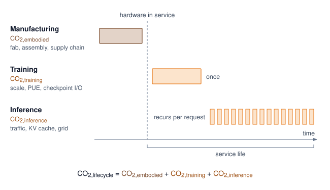

<!--
```{.tikz}
\providecolor{socnavy}{RGB}{15,23,42}
\providecolor{socdark}{RGB}{30,41,59}
\providecolor{socblue}{RGB}{29,78,216}
\providecolor{socteal}{RGB}{15,118,110}
\providecolor{socgreen}{RGB}{22,101,52}
\providecolor{socamber}{RGB}{180,83,9}
\providecolor{socred}{RGB}{185,28,28}

\providecolor{cardbg}{RGB}{248,250,252}
\providecolor{badgeblue}{RGB}{239,246,255}
\providecolor{badgeteal}{RGB}{240,253,250}
\providecolor{badgegreen}{RGB}{240,253,244}
\providecolor{badgeamber}{RGB}{254,252,232}
\providecolor{badgered}{RGB}{254,242,242}

\providecolor{borderblue}{RGB}{191,219,254}
\providecolor{borderteal}{RGB}{153,246,228}
\providecolor{bordergreen}{RGB}{187,247,208}
\providecolor{borderamber}{RGB}{253,230,138}
\providecolor{borderred}{RGB}{254,202,202}
\providecolor{bordergray}{RGB}{226,232,240}

\scalebox{0.75}{%
\begin{tikzpicture}[
    font=\sffamily,
    >=Stealth,
    colcard/.style={
        rounded corners=3.5pt,
        line width=0.6pt,
        inner sep=8pt,
        minimum width=5.0cm,
        minimum height=7.8cm,
        anchor=north
    },
    itemchip/.style={
        draw=bordergray,
        fill=white,
        rounded corners=2pt,
        line width=0.5pt,
        inner sep=3.5pt,
        minimum width=4.5cm,
        minimum height=0.52cm,
        align=center,
        anchor=south
    }
]

% ============================================================
% COLUMN 1: MANUFACTURING (EMBODIED)
% ============================================================
\node[draw=borderamber, fill=badgeamber!30, colcard] (col1) at (0, 0) {};

\node[anchor=north, align=center, inner sep=0pt] at ($(col1.north)+(0, -0.35)$) {
    {\setlength{\fboxsep}{2.5pt}\fcolorbox{borderamber}{white}{\bfseries\fontsize{5.5}{6.5}\selectfont\textcolor{socamber}{STAGE 1 $\cdot$ EMBODIED CARBON}}}\\[4pt]
    {\large\bfseries\textcolor{socnavy}{Manufacturing}}\\[1.5pt]
    {\scriptsize\textcolor{gray!75!black}{Silicon, Packaging \& Assembly}}\\[6pt]
    {\setlength{\fboxsep}{2.5pt}\fcolorbox{borderamber}{white}{\fontsize{6.5}{7.5}\selectfont\textcolor{socamber}{150--200 kg $\text{CO}_2$ / Accelerator}}}\\[6pt]
    {\fontsize{24}{28}\selectfont\bfseries\textcolor{socamber}{30\%}}\\[1.5pt]
    {\fontsize{6}{7}\selectfont\textcolor{gray!70!black}{\bfseries TYPICAL LIFECYCLE SHARE}}
};

\node[itemchip, draw=borderamber!70] (i1_4) at ($(col1.south)+(0, 0.45)$) {{\fontsize{6.5}{7.5}\selectfont\bfseries\textcolor{socdark}{Global Freight \& Supply Logistics}}};
\node[itemchip, draw=borderamber!70] (i1_3) at ($(i1_4.north)+(0, 0.2)$) {{\fontsize{6.5}{7.5}\selectfont\bfseries\textcolor{socdark}{Rare-Earth Extraction \& Refining}}};
\node[itemchip, draw=borderamber!70] (i1_2) at ($(i1_3.north)+(0, 0.2)$) {{\fontsize{6.5}{7.5}\selectfont\bfseries\textcolor{socdark}{Server Chassis \& PCB Substrates}}};
\node[itemchip, draw=borderamber!70] (i1_1) at ($(i1_2.north)+(0, 0.2)$) {{\fontsize{6.5}{7.5}\selectfont\bfseries\textcolor{socdark}{Silicon Fabrication \& Lithography}}};

% ============================================================
% COLUMN 2: TRAINING (OPERATIONAL)
% ============================================================
\node[draw=borderred, fill=badgered!30, colcard] (col2) at (5.5, 0) {};

\node[anchor=north, align=center, inner sep=0pt] at ($(col2.north)+(0, -0.35)$) {
    {\setlength{\fboxsep}{2.5pt}\fcolorbox{borderred}{white}{\bfseries\fontsize{5.5}{6.5}\selectfont\textcolor{socred}{STAGE 2 $\cdot$ OPERATIONAL CARBON}}}\\[4pt]
    {\large\bfseries\textcolor{socnavy}{Model Training}}\\[1.5pt]
    {\scriptsize\textcolor{gray!75!black}{Cluster Scaling \& Optimization}}\\[6pt]
    {\setlength{\fboxsep}{2.5pt}\fcolorbox{borderred}{white}{\fontsize{6.5}{7.5}\selectfont\textcolor{socred}{GPT-3: 1,287 MWh ($\approx$552 t $\text{CO}_2$)}}}\\[6pt]
    {\fontsize{24}{28}\selectfont\bfseries\textcolor{socred}{50\%}}\\[1.5pt]
    {\fontsize{6}{7}\selectfont\textcolor{gray!70!black}{\bfseries TYPICAL LIFECYCLE SHARE}}
};

\node[itemchip, draw=borderred!70] (i2_4) at ($(col2.south)+(0, 0.45)$) {{\fontsize{6.5}{7.5}\selectfont\bfseries\textcolor{socdark}{Checkpoint Warm-up \& Storage I/O}}};
\node[itemchip, draw=borderred!70] (i2_3) at ($(i2_4.north)+(0, 0.2)$) {{\fontsize{6.5}{7.5}\selectfont\bfseries\textcolor{socdark}{All-to-All Gradient Sync Overhead}}};
\node[itemchip, draw=borderred!70] (i2_2) at ($(i2_3.north)+(0, 0.2)$) {{\fontsize{6.5}{7.5}\selectfont\bfseries\textcolor{socdark}{Regional Grid Carbon Intensity}}};
\node[itemchip, draw=borderred!70] (i2_1) at ($(i2_2.north)+(0, 0.2)$) {{\fontsize{6.5}{7.5}\selectfont\bfseries\textcolor{socdark}{$\text{Compute FLOPs} \times \text{PUE} \times \text{Time}$}}};

% ============================================================
% COLUMN 3: INFERENCE (OPERATIONAL)
% ============================================================
\node[draw=borderblue, fill=badgeblue!30, colcard] (col3) at (11.0, 0) {};

\node[anchor=north, align=center, inner sep=0pt] at ($(col3.north)+(0, -0.35)$) {
    {\setlength{\fboxsep}{2.5pt}\fcolorbox{borderblue}{white}{\bfseries\fontsize{5.5}{6.5}\selectfont\textcolor{socblue}{STAGE 3 $\cdot$ OPERATIONAL CARBON}}}\\[4pt]
    {\large\bfseries\textcolor{socnavy}{Fleet Inference}}\\[1.5pt]
    {\scriptsize\textcolor{gray!75!black}{Production Serving at Scale}}\\[6pt]
    {\setlength{\fboxsep}{2.5pt}\fcolorbox{borderblue}{white}{\fontsize{6.5}{7.5}\selectfont\textcolor{socblue}{Scales with Lifetime Query Volume}}}\\[6pt]
    {\fontsize{24}{28}\selectfont\bfseries\textcolor{socblue}{20\%}}\\[1.5pt]
    {\fontsize{6}{7}\selectfont\textcolor{gray!70!black}{\bfseries TYPICAL LIFECYCLE SHARE}}
};

\node[itemchip, draw=borderblue!70] (i3_4) at ($(col3.south)+(0, 0.45)$) {{\fontsize{6.5}{7.5}\selectfont\bfseries\textcolor{socdark}{Continuous Fleet Standby Idle Power}}};
\node[itemchip, draw=borderblue!70] (i3_3) at ($(i3_4.north)+(0, 0.2)$) {{\fontsize{6.5}{7.5}\selectfont\bfseries\textcolor{socdark}{Temporal Grid Intensity Variation}}};
\node[itemchip, draw=borderblue!70] (i3_2) at ($(i3_3.north)+(0, 0.2)$) {{\fontsize{6.5}{7.5}\selectfont\bfseries\textcolor{socdark}{Dynamic Host \& KV-Cache Memory Draw}}};
\node[itemchip, draw=borderblue!70] (i3_1) at ($(i3_2.north)+(0, 0.2)$) {{\fontsize{6.5}{7.5}\selectfont\bfseries\textcolor{socdark}{Per-Token Energy $\times$ Request Volume}}};

% Top horizontal flow arrows between columns
\draw[->, line width=1.0pt, draw=socdark!50, shorten >=4pt, shorten <=4pt] ($(col1.north east)+(0, -0.7)$) -- ($(col2.north west)+(0, -0.7)$);
\draw[->, line width=1.0pt, draw=socdark!50, shorten >=4pt, shorten <=4pt] ($(col2.north east)+(0, -0.7)$) -- ($(col3.north west)+(0, -0.7)$);

% ============================================================
% BOTTOM SECTION: INTEGRATED LIFECYCLE EQUATION & INSIGHT CARD
% ============================================================
\node[
    draw=bordergray,
    fill=cardbg,
    rounded corners=3.5pt,
    line width=0.6pt,
    inner sep=8pt,
    anchor=north,
    text width=15.8cm
] (bottom_card) at (5.5, -8.1) {
    % Formula Box
    \begin{center}
    {\setlength{\fboxsep}{4pt}\fcolorbox{borderblue}{white}{%
        \parbox{0.96\linewidth}{%
            \centering
            {\fontsize{6.5}{8}\selectfont\bfseries\textcolor{socblue}{SYSTEM LIFECYCLE CARBON EQUATION}}\\[3pt]
            {\fontsize{7.5}{9.5}\selectfont\bfseries\textcolor{socnavy}{$\text{Total CO}_2 = \text{Embodied CO}_2 + (\text{Training Energy} \times \text{PUE} \times \text{Grid CI}) + (\sum \text{Tokens} \times \text{Energy/Token} \times \text{Grid CI})$}}%
        }%
    }}
    \end{center}\vspace{4pt}

    % Key Insight Box
    {\fontsize{7.5}{9.5}\selectfont\bfseries\textcolor{socred}{Key Architectural Insight:}}\;
    {\fontsize{7}{9}\selectfont\textcolor{socdark!90}{In regions with clean energy grids (hydro, nuclear), embodied manufacturing emissions dominate the total carbon balance. Extending accelerator hardware replacement cadences from 3 to 5 years and driving multi-tenant GPU utilization deliver far greater lifetime carbon savings than minor algorithmic tuning alone.}}
};

\end{tikzpicture}
}
```
-->

:::

That single-deployment snapshot in @fig-carbon-lifecycle tells only part of the story. The balance changes with serving volume and duration: a model serving millions of queries per day can exceed its entire training carbon footprint within months, or within days for higher-traffic services, making inference optimization the highest-impact sustainability intervention for production systems over a model's service life.

::: {.column-margin}
```{=latex}
\vspace*{-13mm}
```
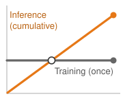{width="100%" fig-alt="Two curves over a model's service life: a flat blue training-emissions baseline and a rising red cumulative-inference curve that climbs steeply past it, crossing over so inference dominates total emissions."}

*Cumulative inference emissions overtake the one-time training cost.*
:::

```{python}
#| echo: false
#| label: inference-lifecycle-example-calc
# ┌─────────────────────────────────────────────────────────────────────────────
# │ INFERENCE LIFECYCLE EXAMPLE (LEGO)
# ├─────────────────────────────────────────────────────────────────────────────
# │ Context: @sec-sustainable-ai-lifecycle-carbon-accounting-99a1
# │
# │ Goal: Quantify annual inference emissions and training crossover time.
# │ Show: 3.65 GWh/year, ~1,566 t CO2/year, ~1 day crossover.
# │ How: queries/day * kWh/query * 365 * grid intensity.
# │
# └─────────────────────────────────────────────────────────────────────────────
from mlsysim import Hardware, Infrastructure, Systems
from mlsysim.fmt import check, fmt, fmt_carbon_intensity, fmt_count, fmt_emissions, fmt_energy, fmt_int, fmt_time
from mlsysim.physics.quantities import energy_from_power, carbon_from_energy
from mlsysim.core.units import hour, kilowatt, kWh, kilogram, metric_ton, gram, watt

# ┌── LEGO ───────────────────────────────────────────────
class InferenceLifecycleExample:
    """Inference emissions example for a high-volume deployed model."""

    # ┌── 1. LOAD (Constants) ──────────────────────────────────────────────
    queries_per_day = 10_000_000
    kwh_per_query = 0.001 * kWh  # pedagogical per-query energy
    days_per_year = DAYS_PER_YEAR
    us_grid = Infrastructure.Grids.US_Avg
    grid_ci = us_grid.carbon_intensity_kg_kwh * (kilogram / kWh)
    n_gpus = 64
    training_days = 14
    training_duration = training_days * HOURS_PER_DAY * hour
    a100_tdp = Hardware.Cloud.A100.tdp
    rack = Systems.Racks.DGX_H100_4Node
    cooling_kw = 2.7 * kilowatt  # same cooling row as @tbl-rack-power; exclude before PUE
    it_power_multiplier = ((rack.accelerator_power + rack.non_accelerator_power - cooling_kw) / rack.accelerator_power).to("").magnitude
    pue = us_grid.pue
    gpu_energy_kwh = (energy_from_power(a100_tdp, training_duration) * n_gpus).to(kWh)
    facility_energy_kwh = gpu_energy_kwh * it_power_multiplier * pue
    training_carbon = carbon_from_energy(facility_energy_kwh, us_grid.carbon_intensity_g_kwh * (gram / kWh))

    # ┌── 2. EXECUTE (The Compute) ────────────────────────────────────────
    daily_energy = queries_per_day * kwh_per_query
    annual_energy = daily_energy * days_per_year
    annual_carbon = carbon_from_energy(annual_energy, grid_ci)
    daily_carbon = carbon_from_energy(daily_energy, grid_ci)
    crossover_days = training_carbon.to(kilogram).magnitude / daily_carbon.to(kilogram).magnitude

    # ┌── 3. GUARD (Invariants) ──────────────────────────────────────────
    check(annual_carbon.to(metric_ton).magnitude > 1500, f"Unexpected annual inference tCO2: {annual_carbon.to(metric_ton).magnitude:.1f}")
    check(crossover_days < 2, f"Expected crossover under 2 days, got {crossover_days:.2f}")

    # ┌── 4. OUTPUT (Formatting) ──────────────────────────────────────────────
    queries_per_day_str = fmt_count(queries_per_day, scale="M", precision=0, commas=False, scale_style="word")
    kwh_per_query_str = fmt_energy(kwh_per_query, unit=kWh, precision=3, commas=False)
    daily_energy_kwh_str = fmt_energy(daily_energy, unit=kWh, precision=0, commas=True)
    annual_energy_kwh_str = fmt_energy(annual_energy, unit=kWh, precision=0, commas=True)
    grid_ci_kg_per_kwh_str = fmt_carbon_intensity(grid_ci, unit=kilogram / kWh, precision=3, commas=False)
    annual_emissions_kg_str = fmt_emissions(annual_carbon.to(kilogram), unit=kilogram, commas=True)
    annual_emissions_tonnes_str = fmt_emissions(annual_carbon.to(metric_ton), unit=metric_ton, precision=1)
    days_per_year_str = fmt_time(days_per_year, 'day', precision=0, commas=False, per='year')
    crossover_days_str = fmt_time(crossover_days, 'day', precision=1, commas=False, style='word')
```

```{python}
#| echo: false
# ┌── LEGO ───────────────────────────────────────────────
# │ Context: Inference lifecycle crossover prose below.
# │ Goal: Recap training emissions total for inference crossover comparison.
from mlsysim.physics.quantities import energy_from_power, carbon_from_energy
from mlsysim import Hardware, Infrastructure, Systems
from mlsysim.core.units import hour, kilowatt, kWh, gram, metric_ton

class TrainingEmissionsRecap:
    n_gpus = 64
    training_days = 14
    training_duration = training_days * HOURS_PER_DAY * hour
    a100_tdp = Hardware.Cloud.A100.tdp
    rack = Systems.Racks.DGX_H100_4Node
    cooling_kw = 2.7 * kilowatt  # same cooling row as @tbl-rack-power; exclude before PUE
    it_power_multiplier = ((rack.accelerator_power + rack.non_accelerator_power - cooling_kw) / rack.accelerator_power).to("").magnitude
    us_grid = Infrastructure.Grids.US_Avg
    pue = us_grid.pue
    gpu_energy_kwh = (energy_from_power(a100_tdp, training_duration) * n_gpus).to(kWh)
    facility_energy_kwh = gpu_energy_kwh * it_power_multiplier * pue
    total_carbon = carbon_from_energy(facility_energy_kwh, us_grid.carbon_intensity_g_kwh * (gram / kWh))
    from mlsysim.fmt import fmt_emissions

    # ┌── 4. OUTPUT (Formatting) ──────────────────────────────────────────────
    emissions_tons_str = fmt_emissions(total_carbon.to(metric_ton), unit=metric_ton, precision=1, commas=False)
```

For models deployed at scale, inference emissions often dominate the lifecycle. Consider a model serving `{python} InferenceLifecycleExample.queries_per_day_str` queries per day at `{python} InferenceLifecycleExample.kwh_per_query_str` of attributed facility electricity per query, including its share of idle capacity and support systems. At this serving rate, daily energy consumption reaches `{python} InferenceLifecycleExample.daily_energy_kwh_str` (`{python} InferenceLifecycleExample.queries_per_day_str` queries $\times$ `{python} InferenceLifecycleExample.kwh_per_query_str`), accumulating over `{python} InferenceLifecycleExample.days_per_year_str` days to `{python} InferenceLifecycleExample.annual_energy_kwh_str` per year. Evaluated against the average US grid carbon intensity of `{python} InferenceLifecycleExample.grid_ci_kg_per_kwh_str`, this electricity demand produces `{python} InferenceLifecycleExample.annual_emissions_tonnes_str` (`{python} InferenceLifecycleExample.annual_emissions_kg_str`) of greenhouse gas emissions annually.

Compared with the earlier 7B/64-A100 training example (`{python} TrainingEmissionsRecap.emissions_tons_str`), cumulative inference emissions exceed training emissions after approximately `{python} InferenceLifecycleExample.crossover_days_str` of deployment at this scale. For larger training runs, the crossover can shift to weeks or months depending on query volume, per-query energy, and grid intensity. The lifecycle perspective therefore sets the priority: optimize inference efficiency for widely-deployed models, and focus training efficiency efforts on models that undergo frequent retraining or experimental iteration.

#### Regional grid intensity data sources {#sec-sustainable-ai-regional-grid-intensity-data-sources-0b88}

Accurate carbon accounting requires grid intensity data matched to the decision being made. Real-time carbon intensity varies with generation mix, which changes hourly based on demand, renewable availability, and plant dispatch decisions. The data source choice depends on whether the team is estimating a future job, scheduling a live workload, or auditing a completed run.

The US Energy Information Administration publishes historical grid emissions factors by region, updated annually. These averages provide a coarse baseline for inventories or early planning, but they do not resolve the hourly marginal effect needed to schedule a flexible workload. Electricity Maps provides time-resolved, flow-traced average and lifecycle intensity estimates across covered grids, while WattTime provides marginal operating-emissions signals for estimating the generator response to added or removed load. For retrospective analysis of completed training runs, time-matched average factors support attributional inventories; marginal factors instead estimate how shifting or eliminating a run would change system emissions. @Lst-carbon-calculation implements a partial lifecycle carbon calculator\index{Lifecycle carbon calculation!implementation} that integrates energy measurements with an explicitly selected grid-intensity signal:

::: {#lst-carbon-calculation lst-cap="**Lifecycle Carbon Calculation**: Computing total carbon footprint including operational and embodied emissions."}

```{.python}
def calculate_carbon_footprint(
    gpu_power_watts: float,
    num_gpus: int,
    training_hours: float,
    it_power_multiplier: float,
    pue: float,
    grid_intensity_gco2_kwh: float,
    gpu_embodied_kg: float,
    gpu_lifetime_years: float,
) -> dict:
    """Estimate operational emissions plus allocated GPU manufacturing emissions."""

    # Operational emissions
    energy_wh = gpu_power_watts * num_gpus * training_hours
    gpu_energy_kwh = (energy_wh * watt * hour).to(kWh).magnitude
    it_energy_kwh = gpu_energy_kwh * it_power_multiplier
    facility_energy_kwh = it_energy_kwh * pue
    # g CO2 → kg (mlsysim does not export mass pint units yet).
    operational_kg = (
        facility_energy_kwh * grid_intensity_gco2_kwh / THOUSAND
    )

    # Embodied emissions (amortized)
    daily_embodied = gpu_embodied_kg / (gpu_lifetime_years * 365)
    training_days = training_hours / 24
    embodied_kg = num_gpus * training_days * daily_embodied

    return {
        "energy_kwh": facility_energy_kwh,
        "operational_carbon_kg": operational_kg,
        "embodied_carbon_kg": embodied_kg,
        "total_carbon_kg": operational_kg + embodied_kg,
        "embodied_fraction": embodied_kg
        / (operational_kg + embodied_kg),
    }


# Example: 7B model training
_us_grid = Infrastructure.Grids.US_Avg
result = calculate_carbon_footprint(
    gpu_power_watts=400,
    num_gpus=64,
    training_hours=336,  # 14 days
    it_power_multiplier=TrainingEmissions.it_power_multiplier,
    pue=_us_grid.pue,
    grid_intensity_gco2_kwh=_us_grid.carbon_intensity_g_kwh,
    gpu_embodied_kg=Hardware.Cloud.A100.embodied_carbon_kg,
    gpu_lifetime_years=4,
)
print(
    f"Total carbon footprint: {result['total_carbon_kg']:.0f} kg CO2"
)
print(f"Embodied fraction: {result['embodied_fraction']:.1%}")
```

:::

Teams can integrate this partial carbon account directly into their orchestration dashboards using this programmatic approach. Calculating operational and embodied emissions for individual training runs, however, captures only one dimension of the problem. The macro-level patterns of how dense AI data centers consume resources at scale reveal additional constraints and optimization opportunities.

## Data Center Energy and Resource Consumption {#sec-sustainable-ai-data-center-energy-consumption-patterns-09c0}

A training cluster can fit its accelerator power budget yet exceed its facility budget once support systems and cooling enter the account. The infrastructure feasibility problem is already established; the sustainability decision is whether a change in power delivery or cooling reduces lifecycle cost while preserving that feasible operating envelope. The relevant comparison includes annual energy, local water use, equipment lifetime, and the energy wasted when cooling failures interrupt useful work.

Facility sustainability therefore has to be read as a chain of constraints rather than as a single PUE number. Persistent megawatt demand sets the grid and emissions exposure, power delivery determines how much electricity becomes useful IT load, cooling determines whether dense racks can operate without throttling, and water use determines whether a technically efficient site is locally sustainable. The physical mechanisms below matter here because each assigns losses or resource use to a different accounting boundary.

### Data center energy and AI workloads {#sec-sustainable-ai-data-center-energy-ai-workloads-b1a8}

At facility scale, the optimization target is no longer a single model but the overhead and grid context surrounding every watt of IT power. The PUE and geographic calculations already showed why the same IT workload can impose different facility and carbon costs; here the relevant change is aggregate demand. In its 2025 *Energy and AI* analysis, IEA estimated data-center electricity-use emissions at about 180 Mt and projected roughly 300 Mt by 2035 in its Base Case while remaining below 1.5 percent of total energy-sector emissions.[^fn-emissions-carbon-scale] The energy burden grows with data-center capacity, training workloads, and inference demand [@patterson2021carbon], so component efficiency must be evaluated against fleet expansion [@thompson2023compute; @dodge2022].

[^fn-emissions-carbon-scale]: **Data Center Emissions Scale**\index{Data Center Emissions Scale!definition}: In IEA's 2025 *Energy and AI* analysis, data centers consumed roughly 1--2 percent of global electricity, with AI contributing to demand growth. IEA estimated emissions from data-center electricity use at about 180 Mt and projected around 300 Mt by 2035 in its Base Case while remaining below 1.5 percent of total energy-sector emissions. The largest hyperscale facilities can draw over 100 MW continuously, equivalent to powering tens of thousands of homes.

#### Energy demands in data centers {#sec-sustainable-ai-energy-demands-data-centers-b7ba}

The relevant facility quantity is persistent megawatt-class load, not the model name alone. Companies such as Meta operate hyperscale data centers spanning multiple football fields in size, housing large fleets of AI-optimized servers.[^fn-hyperscale-facility-footprint] Unofficial estimates have suggested GPT-4 may have used on the order of tens of thousands of A100-class GPUs for months [@semianalysisGPT4], but OpenAI has not disclosed GPT-4's hardware, training compute, model size, or training duration. These facilities rely on high-performance AI accelerators such as NVIDIA H100 GPUs, whose architecture targets high-throughput tensor workloads and improved performance per watt over prior generations [@choquette2023]. Lower-precision methods can improve compute and memory efficiency by replacing full-precision arithmetic when model accuracy permits [@gholami2022].

[^fn-hyperscale-facility-footprint]: **Hyperscale Data Center Footprint**\index{Hyperscale Data Center Footprint!definition}: Meta's Prineville facility spans 230,000 m² and houses over 150,000 servers; major cloud fleets consume country-scale electricity annually. These physical scales matter for sustainability because each facility's power demand (100--300 MW) locks in decades of grid-dependency decisions that no algorithmic optimization can undo.

AI's rapid adoption across industries drives this dramatic energy consumption. @Fig-ai-data-center-demand illustrates a high-growth scenario in which AI workloads add materially to total data center energy demand after 2024. @masanet2020energy show why this scenario should be read against the historical context: efficiency gains have previously moderated data center energy growth, but sustained demand growth can erode that offset.

::: {#fig-ai-data-center-demand fig-env="figure" fig-pos="htb" fig-cap="**Projected Demand**: An illustrative high-growth scenario shows AI workloads adding materially to data center power demand by 2030. @masanet2020energy document the historical efficiency gains that previously moderated data center energy growth; the stacked values are scenario assumptions, not a direct forecast from that source." fig-alt="Stacked bar chart showing an illustrative high-growth data center power demand scenario from 2015 to 2030. Dark blue bars show non-AI demand growing from 200 to 780 TWh. Light blue shows AI demand growing from 0 to 240 TWh. Gray line shows efficiency gains declining then stabilizing."}

```{python}
#| echo: false
#| warning: false
#| fig-align: center
from binder.tools.figures import style as book_style
import matplotlib.pyplot as plt

book_style.set_book_style()
COLORS = book_style.COLORS

fig, ax = plt.subplots(figsize=(10, 5.5))

years = list(range(2015, 2031))
dc_demand = [200, 200, 200, 200, 200, 210, 220, 230, 250, 290, 340, 400, 480, 570, 670, 780]
ai_demand = [0, 0, 0, 0, 0, 0, 0, 0, 0, 10, 20, 40, 70, 110, 170, 240]
efficiency_gains = [20, 19, 18, 17, 15, 12, 9, 6, 3, 1.5, 2, 2.5, 3, 3.2, 3.5, 3.7]

bar_width = 0.72

ax.bar(
    years,
    dc_demand,
    bar_width,
    label='Data Center ex-AI',
    color=COLORS['BlueLine'],
    edgecolor='white',
    linewidth=0.8,
)
ax.bar(
    years,
    ai_demand,
    bar_width,
    bottom=dc_demand,
    label='AI Workloads',
    color=COLORS['BlueL'],
    edgecolor='white',
    linewidth=0.8,
)

ax.set_xlabel('Year', fontsize=9.5, fontweight='bold', color=COLORS['primary'])
ax.set_ylabel('Data Center Energy Demand (TWh)', fontsize=9.5, fontweight='bold', color=COLORS['primary'])
ax.set_ylim(0, 1150)
ax.tick_params(colors=COLORS['primary'], labelsize=8.5)
ax.grid(True, linestyle='--', alpha=0.4, axis='y')

ax2 = ax.twinx()
line_eff = ax2.plot(years, efficiency_gains, color=COLORS['OrangeLine'], linewidth=2.4, marker='o', markersize=4, label='Efficiency Gains (%)')
ax2.set_ylabel('Power Efficiency Gains (%)', fontsize=9.5, fontweight='bold', color=COLORS['OrangeLine'])
ax2.set_ylim(0, 25)
ax2.tick_params(colors=COLORS['OrangeLine'], labelsize=8.5)
ax2.spines['right'].set_visible(True)
ax2.spines['right'].set_color(COLORS['OrangeLine'])
ax2.spines['top'].set_visible(False)
ax2.grid(False)

ax.axvline(x=2024, linestyle='--', color=COLORS['secondary'], linewidth=1.4)
ax.text(2024.2, 1080, '2024 Inflection', fontsize=8.0, fontweight='bold', color=COLORS['secondary'], va='bottom', ha='left')

# Combined legend
lines1, labels1 = ax.get_legend_handles_labels()
lines2, labels2 = ax2.get_legend_handles_labels()
ax.legend(
    lines1 + lines2, labels1 + labels2, loc='upper left', fontsize=8.5, frameon=True, facecolor='white', framealpha=0.95, edgecolor=COLORS['grid']
)

ax.text(
    2028,
    450,
    'Power Demand\nAccelerating',
    fontsize=8.5,
    fontweight='bold',
    ha='center',
    va='center',
    color=COLORS['primary'],
    bbox=dict(boxstyle='round,pad=0.3', facecolor='white', edgecolor=COLORS['BlueLine'], lw=0.9),
)
ax.text(
    2018.5,
    880,
    'Efficiency Gains\nDecelerating',
    fontsize=8.5,
    fontweight='bold',
    ha='center',
    va='center',
    color=COLORS['OrangeLine'],
    bbox=dict(boxstyle='round,pad=0.3', facecolor='white', edgecolor=COLORS['OrangeLine'], lw=0.9),
)

plt.tight_layout()
plt.show()
```

:::

Beyond computational demands, cooling can account for 30--40 percent of facility energy in the conventional air-cooled data-center designs surveyed by @ebrahimi2014. This is a design-regime range, not a constant for modern hyperscale or liquid-cooled facilities; @sec-sustainable-ai-cooling derives the site-specific overhead through PUE and the cooling architecture.

While @fig-ai-data-center-demand projects global trends, the United States alone illustrates how cloud and AI infrastructure can reshape national energy planning. @Fig-energy-gap presents US data center electricity consumption data from the Lawrence Berkeley National Laboratory (LBNL), showing that consumption tripled from 58 TWh in 2014 to 176 TWh in 2023. LBNL's projection treats AI workloads as an important driver of further growth and projects a doubling or tripling by 2028, with the high-end scenario implying that data centers would consume approximately 12 percent of US electricity. This trajectory represents a physical constraint on AI scaling that software optimization alone cannot remove.

::: {#fig-energy-gap fig-env="figure" fig-pos="htb" fig-cap="**The Energy Gap**: US data center electricity consumption tripled from 58 TWh (2014) to 176 TWh (2023). LBNL projects a further doubling to 325 to 580 TWh by 2028, with AI workloads treated as an important driver of growth. At the high end, data centers would consume approximately 12 percent of US electricity, representing a physical constraint on AI scaling that software optimization alone cannot remove." fig-alt="Bar chart showing US data center electricity: 58 TWh in 2014, 176 TWh in 2023, projected 325 to 580 TWh by 2028. Bars colored blue for historical and red for projections."}

```{python}
#| echo: false
#| warning: false
import numpy as np
import matplotlib.pyplot as plt
from binder.tools.figures import style as book_style

fig, ax, COLORS, plt = book_style.setup_plot(figsize=(8.5, 5.0))

labels = ['2014\n(Historical)', '2023\n(Recent)', '2028\n(Low Proj.)', '2028\n(High Proj.)']
values = [58, 176, 325, 580]
colors = [COLORS['BlueLine'], COLORS['BlueLine'], COLORS['RedLine'], COLORS['RedLine']]
alphas = [1.0, 1.0, 0.75, 0.95]

bars = ax.bar(labels, values, color=colors, width=0.48, edgecolor='white', linewidth=1.2, zorder=3)
for bar, alpha in zip(bars, alphas):
    bar.set_alpha(alpha)

for bar, val in zip(bars, values):
    ax.text(
        bar.get_x() + bar.get_width() / 2,
        bar.get_height() + 14,
        f'{val} TWh',
        ha='center',
        va='bottom',
        fontsize=9.0,
        fontweight='bold',
        color=COLORS['primary'],
    )

ax.text(
    bars[1].get_x() + bars[1].get_width() / 2,
    bars[1].get_height() / 2,
    '~4.4%\nof US\nelectricity',
    ha='center',
    va='center',
    fontsize=8.0,
    color='white',
    fontweight='bold',
)
ax.text(
    bars[3].get_x() + bars[3].get_width() / 2,
    bars[3].get_height() / 2,
    '~12%\nof US\nelectricity',
    ha='center',
    va='center',
    fontsize=8.0,
    color='white',
    fontweight='bold',
)

ax.axhline(y=58, color=COLORS['BlueLine'], linestyle=':', linewidth=1.4, alpha=0.7, label='2014 Baseline (58 TWh)')
ax.legend(loc='upper right', bbox_to_anchor=(0.72, 0.96), fontsize=8.0, frameon=True, facecolor='white', framealpha=0.95, edgecolor=COLORS['grid'])

ax.annotate('', xy=(1, 176), xytext=(0, 58), arrowprops=dict(arrowstyle='<->', color=COLORS['OrangeLine'], lw=1.5))
ax.text(
    0.5,
    130,
    '3× growth\nin 9 years',
    fontsize=8.0,
    fontweight='bold',
    color=COLORS['OrangeLine'],
    ha='center',
    bbox=dict(boxstyle='round,pad=0.25', facecolor='white', edgecolor=COLORS['OrangeLine'], lw=0.8),
)

ax.text(
    0.03,
    0.95,
    'Source: LBNL 2024 US Data Center\nEnergy Usage Report',
    transform=ax.transAxes,
    fontsize=7.5,
    va='top',
    ha='left',
    color=COLORS['secondary'],
    style='italic',
)

ax.set_ylabel('Electricity Consumption (TWh)', fontsize=9.5, fontweight='bold', color=COLORS['primary'])
ax.set_ylim(0, 680)
ax.tick_params(colors=COLORS['primary'], labelsize=8.5)
ax.grid(True, linestyle='--', alpha=0.4, axis='y')

plt.tight_layout()
plt.show()
```

:::

### Distributed systems energy optimization {#sec-sustainable-ai-distributed-systems-energy-optimization-5e83}

Large-scale AI training inherently requires distributed systems coordination, creating additional energy overhead that compounds computational demands. Distributed parallelism strategies exchange gradients, parameters, or activations while synchronization stalls leave idle accelerators drawing baseline power.[^fn-parallelism-communication-overhead] The resulting energy share cannot be inferred from cluster size alone because topology, collective algorithm, message volume, overlap, and utilization determine the account. Some all-to-all patterns also increase traffic faster than aggregate useful work as the participating set grows.

::: {.column-margin .margin-pointer}
↩ Data, tensor, and pipeline parallelism execution models are developed in @sec-distributed-training-systems.
:::

[^fn-parallelism-communication-overhead]: **Parallelism Energy Overhead**\index{Parallelism Energy Overhead!definition}: Data, model, and pipeline parallelism impose distinct communication and idle-power costs. Data parallelism reduces gradients, tensor parallelism exchanges partial activations, and pipeline parallelism introduces bubbles. A valid comparison holds model quality and time-to-train constant, then measures network energy and the additional powered time caused by coordination.

Addressing these communication overheads, cluster-wide energy optimization requires coordinated resource management that extends beyond individual server efficiency across four primary operational levers. Dynamic workload placement consolidates compatible jobs so genuinely unused hardware can enter lower-power sleep states, with true savings verified at the facility meter rather than inferred from idle node counts. Carbon-aware scheduling shifts flexible, non-urgent workloads toward time windows or geographic regions with lower decision-relevant emissions factors, subject to data-movement overhead, completion deadlines, and reliability bounds. Multi-tenant sharing raises accelerator compute and memory occupancy across concurrent tasks, provided resource contention, memory bandwidth interference, and queueing delays do not provoke additional retraining iterations. Finally, adaptive batch processing groups compatible small requests when the resulting throughput gains outweigh queueing latency and convergence penalties. The common pattern across these levers is utilization discipline: the system saves energy by avoiding powered-on capacity that performs no useful model work.

### Carbon benchmarks across AI workloads {#sec-sustainable-ai-ai-energy-consumption-compared-industries-3d5d}

The environmental impact of AI workloads has emerged as a concern, with carbon emissions approaching levels comparable to established carbon-intensive sectors. @strubell2019 made this concern concrete by estimating that development-scale training and architecture search for a large NLP model could emit as much carbon as several passenger vehicles over their lifetimes. @patterson2021carbon later showed that the most widely quoted architecture-search estimate depended strongly on proxy-task, hardware, data-center efficiency, and grid carbon-intensity assumptions. To contextualize AI's environmental footprint\index{Carbon Footprint!benchmarks}, larger and more accurate BERT-family models carry meaningfully higher per-query carbon (@fig-carbonfootprint). The scatter shows that the highest-accuracy variants sit near the top-right of the plot and that the carbon cost rises faster than the accuracy gain. The same trade-off reinforces the need for more sustainable AI practices.[^fn-nas-carbon-footprint]

[^fn-nas-carbon-footprint]: **Neural Architecture Search (NAS) Carbon Cost**\index{Neural Architecture Search!carbon cost}: The ~284,000 kg CO~2~e figure from @strubell2019 represents an unoptimized Evolved Transformer search that drops sharply when accounting for TPU hardware, grid mix, and proxy tasks [@patterson2021carbon]. The systems lesson is boundary discipline: search, tuning, and failed trials belong inside the carbon accounting boundary, but reusable architecture search should be amortized across all downstream deployments. Efficient NAS techniques (weight sharing, hardware-aware search) reduce this search budget, making meta-optimization a primary sustainability lever [@elsken2019].

::: {#fig-carbonfootprint fig-env="figure" fig-pos="htb" fig-cap="**Carbon Footprint Benchmarks**: Scatter plot of CO~2~ emissions per inference (vertical axis) against task accuracy (horizontal axis) for several BERT-family models. Higher-accuracy variants sit near the top-right of the plot; carbon cost rises faster than accuracy gain, emphasizing the environmental impact of pushing toward marginal accuracy improvements." fig-alt="Scatter plot of CO2 per inference vs. accuracy for BERT-family models. Higher-accuracy points sit in the top-right; carbon cost rises faster than accuracy gain."}
```{python}
#| echo: false
#| warning: false
import matplotlib.pyplot as plt
import numpy as np
from binder.tools.figures import style as book_style

fig, ax, COLORS, plt = book_style.setup_plot(figsize=(9.2, 5.2))

c_dark = COLORS['primary']
c_blue = COLORS['BlueLine']
c_red = COLORS['RedLine']
c_green = COLORS['GreenLine']
c_gray = COLORS['secondary']
c_border = COLORS['grid']

small_models = [
    (73.0, 0.20, 'MobileBERT', c_green, (-10, 5), 'right', 'bottom'),
    (74.0, 0.26, 'TinyBERT', c_green, (10, -5), 'left', 'top'),
    (77.0, 0.46, 'DistilBERT', c_green, (10, -5), 'left', 'top'),
]

med_models = [
    (83.0, 1.45, 'BERT-base', c_blue, (10, -5), 'left', 'top'),
    (85.0, 2.30, 'RoBERTa', c_blue, (10, -5), 'left', 'top'),
    (84.0, 3.50, 'BERT-large', c_blue, (-10, 5), 'right', 'bottom'),
]

large_models = [
    (88.0, 80.0, 'GPT-3 (175B)', c_red, (10, -5), 'left', 'top'),
    (90.5, 250.0, 'PaLM (540B)', c_red, (10, -5), 'left', 'top'),
    (92.5, 450.0, 'GPT-4 (est.)', c_red, (10, -12), 'left', 'top'),
]

ax.axvspan(76.5, 91.5, ymin=0, ymax=0.35, color=COLORS['GreenL'], alpha=0.4, zorder=1)
ax.text(84.0, 0.15, 'Efficiency Zone', color=c_green, fontsize=8.5, fontweight='bold', ha='center', va='center')

spline_acc = np.array([73.0, 74.0, 77.0, 83.0, 85.0, 88.0, 90.5, 92.5])
spline_co2 = np.array([0.20, 0.26, 0.46, 1.45, 2.30, 80.0, 250.0, 450.0])

poly = np.polyfit(spline_acc, np.log10(spline_co2), 3)
smooth_acc = np.linspace(72.5, 93.0, 100)
smooth_co2 = 10 ** np.polyval(poly, smooth_acc)

ax.plot(smooth_acc, smooth_co2, color=c_red, linestyle='--', linewidth=2.0, zorder=2)
ax.text(93.2, 700.0, 'Pareto\nFrontier', color=c_red, fontsize=8.5, fontweight='bold', va='center', ha='left')

for group, col, sym, grp_lbl in [
    (small_models, c_green, 'o', 'Small efficient models'),
    (med_models, c_blue, 's', 'Medium models'),
    (large_models, c_red, '^', 'Large frontier models'),
]:
    accs = [m[0] for m in group]
    co2s = [m[1] for m in group]
    ax.plot(accs, co2s, sym, color=col, markersize=7.0, markeredgecolor='#FFFFFF', markeredgewidth=1.2, label=grp_lbl, zorder=4)
    for m in group:
        ax.annotate(
            m[2],
            (m[0], m[1]),
            xytext=m[4],
            textcoords='offset points',
            fontsize=7.8,
            fontweight='bold',
            color=col,
            ha=m[5],
            va=m[6],
            bbox=dict(boxstyle='round,pad=0.2', facecolor='#FFFFFF', edgecolor=c_border, lw=0.6, alpha=0.9),
        )

ax.annotate(
    r"10$\times$ $\mathregular{CO_2}$ for +1% accuracy",
    xy=(88.0, 80.0),
    xytext=(79.0, 20.0),
    fontsize=8.0,
    fontweight='bold',
    color=c_red,
    ha='center',
    va='center',
    bbox=dict(boxstyle='round,pad=0.3', facecolor='#FFFFFF', edgecolor=c_red, lw=1.0),
    arrowprops=dict(arrowstyle='->', color=c_red, lw=1.2),
)

ax.text(
    0.98,
    0.02,
    'Illustrative data; relative magnitudes from Strubell et al. 2019, Patterson et al. 2021',
    transform=ax.transAxes,
    fontsize=7.0,
    fontstyle='italic',
    color=c_gray,
    ha='right',
    va='bottom',
)

ax.set_yscale('log')
ax.set_xlim(70, 96)
ax.set_ylim(0.08, 1200)
ax.set_xlabel('Task Accuracy (%)', fontsize=9.5, fontweight='bold', color=c_dark)
ax.set_ylabel(r'$\mathrm{CO}_2$ per Inference (mg, log scale)', fontsize=9.5, fontweight='bold', color=c_dark)
ax.legend(loc='upper left', frameon=True, facecolor='#FFFFFF', edgecolor=c_border, fontsize=8.0)
ax.tick_params(colors=c_dark, labelsize=8.5)
ax.grid(True, which='major', linestyle='--', alpha=0.55)
ax.grid(True, which='minor', linestyle=':', alpha=0.25)

plt.tight_layout()
plt.show()
```
:::

The training phase of large natural language processing models can produce carbon dioxide emissions comparable to hundreds of transcontinental flights. At the broader industry scale, AI and data-center emissions are growing rapidly, but the IEA-scale estimates in this chapter do not yet support a direct parity claim with commercial aviation. As AI applications scale to serve billions of users globally, the cumulative emissions from continuous inference operations may ultimately exceed those generated during training.

The operational lesson is that carbon estimates must separate training-only results from deployed inference. @Fig-meta-analysis provides a detailed analysis of carbon emissions\index{Carbon Footprint!operational, large-scale ML} across various large-scale machine learning tasks at Meta, illustrating the environmental impact of different AI applications and architectures. This quantitative assessment of AI's carbon footprint grounds mitigation strategies in measured environmental costs rather than estimates.

::: {#fig-meta-analysis fig-env="figure" fig-pos="htb" fig-cap="**Operational Carbon Footprint of Large-Scale ML Tasks**: Stacked bars show lifetime CO~2~e for Meta's recommendation models (RM-1 through RM-5), a language model (LM), and several open-source large models (BERT-NAS, Evolved Transformer, T5, Meena, GShard-600B, Switch Transformer, GPT-3). Recommendation models are dominated by inference (solid black), while the public open-source baselines report training-only footprints (hatched), underscoring that inference serving at scale can rival or exceed training emissions for deployed systems. Source: [@wu2022sustainable]." fig-alt="Stacked bar chart of CO2e in kilograms for 13 ML models. Facebook RM-1 is tallest near 0.85 million kg with large inference portion; GPT-3 shows a training-only footprint near 0.55 million kg."}
```{python}
#| echo: false
#| warning: false
import matplotlib.pyplot as plt
import numpy as np
from binder.tools.figures import style as book_style

fig, ax, COLORS, plt = book_style.setup_plot(figsize=(10.5, 4.8))

c_dark = COLORS['primary']
c_blue = COLORS['BlueLine']
c_orange = COLORS['OrangeLine']
c_green = COLORS['GreenLine']
c_border = COLORS['grid']

meta_names = ['LM', 'RM-1', 'RM-2', 'RM-3', 'RM-4', 'RM-5']
meta_offline = np.array([0.02, 0.35, 0.25, 0.13, 0.14, 0.16])
meta_online = np.array([0.00, 0.04, 0.03, 0.02, 0.02, 0.02])
meta_infer = np.array([0.10, 0.46, 0.28, 0.24, 0.20, 0.26])

pub_names = ['BERT-NAS', 'Evolved\nTransformer', 'T5', 'Meena', 'GShard\n600B', 'Switch\nTransformer', 'GPT-3']
pub_vals = np.array([0.28, 0.008, 0.05, 0.09, 0.008, 0.07, 0.55])

x_meta = np.arange(len(meta_names))
x_pub = np.arange(len(pub_names)) + len(meta_names) + 0.8
width = 0.52

ax.bar(x_meta, meta_offline, width, label='Offline Training', color=COLORS['BlueFill'], edgecolor=c_blue, hatch='///', linewidth=1.1)
ax.bar(x_meta, meta_online, width, bottom=meta_offline, label='Online Training', color=COLORS['OrangeL'], edgecolor=c_orange, linewidth=1.1)
ax.bar(x_meta, meta_infer, width, bottom=meta_offline + meta_online, label='Inference', color=c_blue, edgecolor=c_dark, linewidth=1.1)

ax.bar(x_pub, pub_vals, width, label='Public Baseline (Training-Only)', color=COLORS['GreenFill'], edgecolor=c_green, hatch='\\\\\\', linewidth=1.1)

split_x = (x_meta[-1] + x_pub[0]) / 2
ax.axvline(split_x, color=COLORS['secondary'], linestyle='--', linewidth=1.2)

ax.text(
    (x_meta[0] + x_meta[-1]) / 2,
    0.98,
    'Meta Production Models (Lifecycle Breakdown)',
    ha='center',
    va='top',
    fontsize=8.2,
    fontweight='bold',
    color=c_blue,
    bbox=dict(boxstyle='round,pad=0.3', facecolor='#FFFFFF', edgecolor=c_blue, lw=0.9),
)

ax.text(
    (x_pub[0] + x_pub[-1]) / 2,
    0.98,
    'Public Benchmark Models (Training-Only)',
    ha='center',
    va='top',
    fontsize=8.2,
    fontweight='bold',
    color=c_green,
    bbox=dict(boxstyle='round,pad=0.3', facecolor='#FFFFFF', edgecolor=c_green, lw=0.9),
)

ax.legend(loc='upper right', bbox_to_anchor=(0.88, 0.88), frameon=True, facecolor='#FFFFFF', edgecolor=c_border, fontsize=7.8)

all_x = np.concatenate([x_meta, x_pub])
all_labels = meta_names + pub_names
ax.set_xticks(all_x)
ax.set_xticklabels(all_labels, fontsize=7.8, fontweight='bold', color=c_dark, rotation=30, ha='right')

ax.set_ylim(0, 1.08)
ax.set_ylabel(r'$\mathrm{CO}_2\mathrm{e}$ (Million kg)', fontsize=9.2, fontweight='bold', color=c_dark)
ax.tick_params(colors=c_dark, labelsize=8.0)
ax.grid(True, linestyle='--', alpha=0.5, axis='y')

plt.tight_layout()
plt.show()
```
:::

### Comprehensive carbon accounting methodologies {#sec-sustainable-ai-comprehensive-carbon-accounting-methodologies-62fc}

AI's impact extends beyond operational energy consumption. Comprehensive carbon footprint assessment integrates the Three-Phase Lifecycle Analysis (training, inference, manufacturing) with the three standard emission scopes defined by the Greenhouse Gas (GHG) Protocol. With AI projected to grow rapidly through 2030, understanding total lifecycle costs across all phases and scopes is essential for identifying the most impactful sustainability interventions.

Within an owned data-center facility boundary, Scope 1 emissions\index{Scope 1 emissions!direct emissions}\index{Scope 1 emissions!backup generators and refrigerants}\index{Scope 1 emissions!direct operational emissions} include direct combustion in owned generators and refrigerant leakage from cooling equipment. Purchased electricity used to run cooling belongs in Scope 2, not Scope 1.

Scope 2 emissions\index{Scope 2 emissions!indirect energy emissions}\index{Scope 2 emissions!purchased electricity}\index{Scope 2 emissions!grid energy mix} represent indirect emissions from purchased electricity, steam, heat, and cooling consumed by the reporting organization. Purchased electricity is often the dominant category for an operator's owned facility, and it varies dramatically by geographic location and grid energy mix. Electricity used by a cloud provider is Scope 2 for that provider, but a customer's purchased cloud service is generally accounted for in the customer's Scope 3 value chain. The physical electrons do not change; the reporting boundary does. The placement example in @sec-sustainable-ai-scale-environmental-impact-ac9a uses a declared pair of illustrative factors; actual accounting requires factors matched to the location, time, and method.

Scope 3 emissions\index{Scope 3 emissions!value chain emissions}\index{Scope 3 emissions!hardware manufacturing and supply chain}\index{Scope 3 emissions!accelerator embodied carbon} constitute the most complex category, encompassing hardware manufacturing, cloud supply chains, transportation, disposal, and downstream use. Semiconductor manufacturing is carbon-intensive.[^fn-euv-lithography-energy] For low-utilization hardware or clean-grid deployments, embodied accelerator emissions can rival months or years of operation; for sustained high-power training on carbon-intensive grids, the break-even can be much shorter. Under company-wide or value-chain AI accounting, Scope 3 can dominate even when Scope 2 dominates a single owned facility's operational footprint.

[^fn-euv-lithography-energy]: **Lithography and Embodied Energy**\index{EUV Lithography Energy Cost!definition}: Advanced semiconductor fabrication can use energy-intensive lithography, including extreme ultraviolet (EUV) processes. Emissions per usable chip depend on the process sequence, facility energy mix, yield, die area, and allocation method. Neither transistor count nor a nominal process-node label alone determines the number of exposure steps or manufacturing footprint.

Downstream use can also enter Scope 3, including end-user smartphones, IoT devices, and edge computing[^fn-edge-intelligence-paradox]. Companywide totals do not by themselves identify the footprint of a particular AI service; that attribution still requires workload-level accounting.

[^fn-edge-intelligence-paradox]: **Edge AI Energy Trade-off**\index{Edge AI Energy Paradox!definition}\index{Edge Computing!energy paradox}: Edge inference can reduce network transfers and response latency, while distributing computation across devices with different duty cycles and power states. It does not eliminate network or cloud work. Compare local compute, idle power, sensors, communications, and any remaining server work over the same service period; distributed consumption is harder to attribute, but remains part of the accounting boundary.

Operational emissions capture only the production phase of AI. Software development itself adds another layer of environmental impact that is rarely accounted for.

::: {#psp-sustainable-ai-hidden-carbon-cost-software .callout-perspective title="Hidden carbon cost of software"}

Beyond direct training and inference energy use, the entire software development ecosystem for AI has a significant, though difficult to measure, carbon footprint. The millions of continuous integration/continuous deployment (CI/CD) pipeline runs, constant code recompilation during development, operation of massive version control systems like GitHub, and the computational resources consumed by code review systems, automated testing frameworks, and collaborative development platforms all contribute to environmental impact. Large AI research organizations may run thousands of experimental training runs, most of which never reach production, consuming substantial energy in the exploration process. The entire ecosystem of AI development is energy-intensive, extending well beyond the final model training and inference phases.

:::

The **Greenhouse Gas (GHG) Protocol**\index{Greenhouse Gas Protocol!definition}[^fn-ghg-protocol-scope] framework [@ghgprotocol2023] provides the standard categorization for these emissions, summarized in @fig-ghg-protocol. That reporting boundary is the basis for the following classification exercise.

[^fn-ghg-protocol-scope]: **Greenhouse Gas (GHG) Protocol**\index{Greenhouse Gas Protocol!three-scope accounting}\index{GHG Protocol|see{Greenhouse Gas Protocol}}: The framework distinguishes direct emissions, purchased energy, and other value-chain emissions [@ghgprotocol2023]. Their relative shares depend on the reporting organization and workload boundary. Explicit classification prevents purchased cloud services or manufacturing from disappearing from an account limited to an operator's own electricity.

::: {#fig-ghg-protocol fig-env="figure" fig-pos="htb" fig-cap="**GHG Emission Scopes**: Hub-and-spoke layout placing the reporting organization at the center, with Scope 1 (direct emissions), Scope 2 (purchased energy), and Scope 3 (value chain) arranged as distinct branches around it. Each branch lists representative emission sources, supporting comprehensive environmental-impact assessment. Source: Circularise." fig-alt="Hub-and-spoke diagram with reporting organization at center and three branches: Scope 1 (direct emissions from owned sources), Scope 2 (purchased energy emissions), and Scope 3 (value chain emissions including manufacturing and disposal)."}
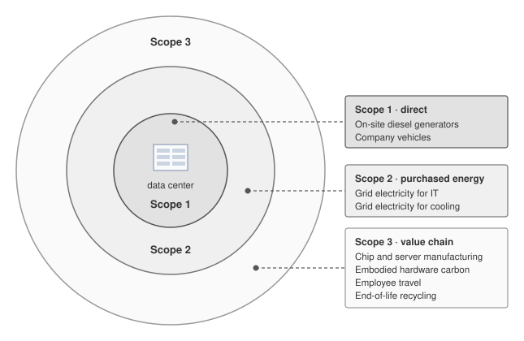

<!--
```{.tikz}
\providecolor{socnavy}{RGB}{15,23,42}
\providecolor{socdark}{RGB}{30,41,59}
\providecolor{socblue}{RGB}{29,78,216}
\providecolor{socteal}{RGB}{15,118,110}
\providecolor{socgreen}{RGB}{22,101,52}
\providecolor{socamber}{RGB}{180,83,9}
\providecolor{socred}{RGB}{185,28,28}

\providecolor{cardbg}{RGB}{248,250,252}
\providecolor{badgeblue}{RGB}{239,246,255}
\providecolor{badgeteal}{RGB}{240,253,250}
\providecolor{badgegreen}{RGB}{240,253,244}
\providecolor{badgeamber}{RGB}{254,252,232}
\providecolor{badgered}{RGB}{254,242,242}

\providecolor{borderblue}{RGB}{191,219,254}
\providecolor{borderteal}{RGB}{153,246,228}
\providecolor{bordergreen}{RGB}{187,247,208}
\providecolor{borderamber}{RGB}{253,230,138}
\providecolor{borderred}{RGB}{254,202,202}
\providecolor{bordergray}{RGB}{226,232,240}

\scalebox{0.78}{%
\begin{tikzpicture}[
    font=\sffamily,
    >=Stealth,
    callcard/.style={
        fill=white,
        rounded corners=3pt,
        line width=0.6pt,
        inner sep=6pt,
        align=left
    },
    leader/.style={
        line width=0.7pt,
        dashed
    }
]

% ============================================================
% THREE CONCENTRIC ORBITAL ZONES
% ============================================================
% Scope 3 (outermost: 5.0cm radius)
\draw[borderblue, fill=badgeblue!30, line width=0.9pt] (0, 0) circle (5.0cm);

% Scope 2 (middle: 3.35cm radius)
\draw[borderamber, fill=badgeamber!35, line width=0.8pt] (0, 0) circle (3.35cm);

% Scope 1 (innermost: 1.90cm radius)
\draw[borderred, fill=badgered!40, line width=0.8pt] (0, 0) circle (1.90cm);

% ============================================================
% CENTER: DATA CENTER RACK ICON & LABEL
% ============================================================
\node[draw=socdark!50, fill=white, rounded corners=2.5pt, line width=0.6pt, minimum width=1.6cm, minimum height=1.35cm, inner sep=0pt] (dc_box) at (0, 0.18) {};

% Server Blades
\foreach \y in {0.60, 0.39, 0.18, -0.03} {
    \draw[fill=badgeblue, draw=socblue!40, rounded corners=1pt, line width=0.4pt] (-0.65, \y-0.065) rectangle (-0.06, \y+0.065);
    \draw[fill=badgegreen, draw=socgreen!40, rounded corners=1pt, line width=0.4pt] (0.06, \y-0.065) rectangle (0.65, \y+0.065);
    \fill[socgreen!80] (0.52, \y) circle (0.8pt);
    \fill[socblue!80] (-0.52, \y) circle (0.8pt);
}
% Network / Power indicator below blades
\draw[fill=gray!15, draw=gray!40, rounded corners=1pt, line width=0.4pt] (-0.65, -0.32) rectangle (0.65, -0.19);
\foreach \x in {-0.45, -0.22, 0.0, 0.22, 0.45} {
    \fill[socamber] (\x, -0.255) circle (0.7pt);
}

% Center Label
\node[anchor=north, align=center] at (0, -0.66) {
    {\fontsize{7}{8.5}\selectfont\bfseries\textcolor{socnavy}{AI Data Center}}\\[1pt]
    {\fontsize{5.5}{6.5}\selectfont\textcolor{gray!75!black}{Facility \& Compute Core}}
};

% ============================================================
% ZONE EMBEDDED LABELS
% ============================================================
% Scope 1 Label
\node[anchor=south, align=center] at (0, 1.20) {
    {\fontsize{7.5}{9}\selectfont\bfseries\textcolor{socred}{Scope 1}}\\[0.5pt]
    {\fontsize{5.5}{6.5}\selectfont\textcolor{socred!85!black}{Direct Emissions}}
};

% Scope 2 Label
\node[anchor=south, align=center] at (-1.6, 2.30) {
    {\fontsize{7.5}{9}\selectfont\bfseries\textcolor{socamber}{Scope 2}}\\[0.5pt]
    {\fontsize{5.5}{6.5}\selectfont\textcolor{socamber!90!black}{Purchased Energy}}
};

% Scope 3 Banner at Top
\node[draw=borderblue, fill=white, rounded corners=2.5pt, line width=0.6pt, inner sep=3.5pt, anchor=south] at (0, 5.08) {
    {\fontsize{7}{8.5}\selectfont\bfseries\textcolor{socblue}{SCOPE 3 $\cdot$ VALUE CHAIN EMISSIONS (UPSTREAM \& DOWNSTREAM)}}
};

% ============================================================
% CALLOUT CARDS WITH LEADER LINES
% ============================================================

% Scope 1 Callout Right
\fill[socred] (1.90, 0) circle (1.8pt);
\draw[leader, draw=socred!80] (1.90, 0) -- (2.7, 0);
\node[callcard, draw=borderred, anchor=west, text width=5.0cm] at (2.7, 0) {
    {\setlength{\fboxsep}{2pt}\fcolorbox{borderred}{badgered!50}{\fontsize{5.5}{6.5}\selectfont\bfseries\textcolor{socred}{SCOPE 1 $\cdot$ DIRECT EMISSIONS}}}\\[3pt]
    {\fontsize{6.5}{8}\selectfont\textcolor{socred}{\footnotesize$\blacktriangleright$}\;\textcolor{socdark}{On-site backup diesel generator sets}}\\[1.5pt]
    {\fontsize{6.5}{8}\selectfont\textcolor{socred}{\footnotesize$\blacktriangleright$}\;\textcolor{socdark}{Direct facility heating \& chiller fuels}}\\[1.5pt]
    {\fontsize{6.5}{8}\selectfont\textcolor{socred}{\footnotesize$\blacktriangleright$}\;\textcolor{socdark}{Company vehicle fleet operations}}
};

% Scope 2 Callout Left
\fill[socamber] (-3.35, -0.8) circle (1.8pt);
\draw[leader, draw=socamber!80] (-3.35, -0.8) -- (-4.1, -0.8);
\node[callcard, draw=borderamber, anchor=east, text width=5.0cm] at (-4.1, -0.8) {
    {\setlength{\fboxsep}{2pt}\fcolorbox{borderamber}{badgeamber!50}{\fontsize{5.5}{6.5}\selectfont\bfseries\textcolor{socamber}{SCOPE 2 $\cdot$ INDIRECT ENERGY}}}\\[3pt]
    {\fontsize{6.5}{8}\selectfont\textcolor{socamber}{\footnotesize$\blacktriangleright$}\;\textcolor{socdark}{Purchased grid electricity for servers}}\\[1.5pt]
    {\fontsize{6.5}{8}\selectfont\textcolor{socamber}{\footnotesize$\blacktriangleright$}\;\textcolor{socdark}{Central cooling tower \& pump power}}\\[1.5pt]
    {\fontsize{6.5}{8}\selectfont\textcolor{socamber}{\footnotesize$\blacktriangleright$}\;\textcolor{socdark}{Off-site district chilling \& steam draw}}
};

% Scope 3 Top-Left: Supply Chain Manufacturing
\fill[socblue] (-3.53, 3.53) circle (1.8pt);
\draw[leader, draw=socblue!80] (-3.53, 3.53) -- (-4.2, 3.53);
\node[callcard, draw=borderblue, anchor=east, text width=5.2cm] at (-4.2, 3.53) {
    {\setlength{\fboxsep}{2pt}\fcolorbox{borderblue}{badgeblue!50}{\fontsize{5.5}{6.5}\selectfont\bfseries\textcolor{socblue}{SCOPE 3 $\cdot$ UPSTREAM SUPPLY CHAIN}}}\\[3pt]
    {\fontsize{6.5}{8}\selectfont\textcolor{socblue}{\footnotesize$\blacktriangleright$}\;\textcolor{socdark}{Silicon wafer fab \& EUV lithography}}\\[1.5pt]
    {\fontsize{6.5}{8}\selectfont\textcolor{socblue}{\footnotesize$\blacktriangleright$}\;\textcolor{socdark}{Advanced 2.5D/3D packaging \& substrates}}\\[1.5pt]
    {\fontsize{6.5}{8}\selectfont\textcolor{socblue}{\footnotesize$\blacktriangleright$}\;\textcolor{socdark}{Datacenter physical plant construction}}
};

% Scope 3 Top-Right: Embodied Hardware
\fill[socblue] (3.53, 3.53) circle (1.8pt);
\draw[leader, draw=socblue!80] (3.53, 3.53) -- (4.2, 3.53);
\node[callcard, draw=borderblue, anchor=west, text width=5.2cm] at (4.2, 3.53) {
    {\setlength{\fboxsep}{2pt}\fcolorbox{borderblue}{badgeblue!50}{\fontsize{5.5}{6.5}\selectfont\bfseries\textcolor{socblue}{SCOPE 3 $\cdot$ EMBODIED HARDWARE}}}\\[3pt]
    {\fontsize{6.5}{8}\selectfont\textcolor{socblue}{\footnotesize$\blacktriangleright$}\;\textcolor{socdark}{Accelerator GPU/TPU raw materials}}\\[1.5pt]
    {\fontsize{6.5}{8}\selectfont\textcolor{socblue}{\footnotesize$\blacktriangleright$}\;\textcolor{socdark}{High-Bandwidth Memory (HBM) stacks}}\\[1.5pt]
    {\fontsize{6.5}{8}\selectfont\textcolor{socblue}{\footnotesize$\blacktriangleright$}\;\textcolor{socdark}{Global air \& maritime freight logistics}}
};

% Scope 3 Bottom: Downstream Lifecycle & E-Waste
\fill[socblue] (0, -5.0) circle (1.8pt);
\draw[leader, draw=socblue!80] (0, -5.0) -- (0, -5.45);
\node[callcard, draw=borderblue, anchor=north, text width=8.8cm, align=center] at (0, -5.45) {
    {\setlength{\fboxsep}{2pt}\fcolorbox{borderblue}{badgeblue!50}{\fontsize{5.5}{6.5}\selectfont\bfseries\textcolor{socblue}{SCOPE 3 $\cdot$ DOWNSTREAM LIFECYCLE \& ASSET RETIREMENT}}}\\[3.5pt]
    {\fontsize{6.5}{8}\selectfont\textcolor{socdark}{Hardware decommissioning $\cdot$ E-waste shredding \& rare metal recycling $\cdot$ Employee business travel}}
};

\end{tikzpicture}%
}
```
-->

:::

Categorizing these emissions into Scope 1, 2, and 3 frameworks provides a standardized vocabulary for corporate environmental reporting. Correctly applying this framework in practice requires classifying the various hidden emission sources across a typical ML platform's operational lifecycle.

::: {#chk-sustainable-ai-accounting-invisible-carbon .callout-checkpoint title="Accounting for invisible carbon"}

Audit the carbon footprint of a machine learning platform by classifying the following emission sources into Scope 1 (Direct), Scope 2 (Indirect Energy), or Scope 3 (Value Chain). State the reporting organization before assigning each scope:

- [ ] **Backup generation**: classify diesel burned by backup generators during a grid outage at an owned facility.
- [ ] **Leased cloud cluster**: classify the electricity for both reporting entities—the cloud operator that purchases it and the customer that purchases the compute service.
- [ ] **Embodied manufacturing**: classify the embodied carbon emitted during the manufacturing of the GPUs by TSMC.
- [ ] **End-user operation**: classify emissions from the end-user's smartphone battery while running a deployed mobile inference app.

:::

Accurately classifying these hidden emissions forces engineering teams to take responsibility for the entire value chain of their deployments. The abstract energy metrics of a facility, and the resulting carbon footprint, are ultimately governed by the physical thermodynamics of the rack. Delivering 120 kW to a single cabinet and extracting the resulting heat requires moving beyond traditional air conditioning.

### Power delivery {#sec-sustainable-ai-power-delivery}

Capacity planning fails when engineers budget only accelerator TDP. Electricity loses energy and reliability margin at each transformation before it reaches a GPU's voltage regulators, so the delivery path identifies both the facility bottleneck and the heat that cooling must remove. The path starts outside the building: utility power arrives as high-voltage AC, typically 13.8--69 kV depending on the country and facility size, and a dedicated substation or transformer yard steps it down to medium voltage. The largest ML facilities require their own substation, which takes 18--24 months to build and requires coordination with the local utility. The grid connection is the ultimate bottleneck: no amount of engineering inside the building can deliver more power than the grid provides.

::: {.column-margin}
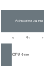{width="100%" fig-alt="Time ladder comparing a 24-month substation path with a 6-month GPU procurement path, with the fourfold lag marked as a ratio annotation."}

*Substation lead time can run 4$\times$ longer than GPU procurement.*
:::

```{python}
#| echo: false
#| label: grid-queue-calc
# ┌─────────────────────────────────────────────────────────────────────────────
# │ GRID QUEUE (LEGO)
# └─────────────────────────────────────────────────────────────────────────────
from mlsysim import Hardware, Infrastructure, Systems
from mlsysim.fmt import check, fmt, fmt_count, fmt_power, fmt_time
from mlsysim.core.units import GW, kilowatt, MW

class GridQueue:
    """The lead-time bottleneck of the ML fleet."""

    # ┌── 1. LOAD ──────────────────────────────────────────
    gpu_lead_time_months = Infrastructure.Capacity.GpuLeadTimeMonths
    substation_lead_time_months = Infrastructure.Capacity.SubstationLeadTimeMonths
    grid_queue_size_gw = Infrastructure.Capacity.GridInterconnectionQueueGw
    cluster_gpus = Systems.Clusters.Training_10K.total_accelerators
    rack = Systems.Racks.DGX_H100_4Node
    cluster_gpu_power = cluster_gpus * Hardware.Cloud.H100.tdp
    cooling_kw = 2.7 * kilowatt  # same cooling row as @tbl-rack-power; exclude before PUE
    it_power_multiplier = ((rack.accelerator_power + rack.non_accelerator_power - cooling_kw) / rack.accelerator_power).to("").magnitude
    cluster_power = cluster_gpu_power * it_power_multiplier
    # ┌── 2. EXECUTE ───────────────────────────────────────
    lead_time_ratio = substation_lead_time_months / gpu_lead_time_months
    # ┌── 3. GUARD ─────────────────────────────────────────
    check(lead_time_ratio == 4, f"Ratio {lead_time_ratio} unexpected")
    check(cluster_power.to(MW).magnitude > 9, "10K cluster IT power should include non-GPU rack support load")

    @classmethod
    def plot(cls):
        """Visualizes the Interconnection Queue."""
        from binder.tools.figures import style as book_style

        return book_style.bar_compare(
            labels=["GPU Silicon", "Grid Substation"],
            values=[cls.gpu_lead_time_months, cls.substation_lead_time_months],
            title="Fleet Deployment Lead Times",
            ylabel="Lead Time (Months)",
            goal_line=6,  # Target turnaround for logic layer
        )

    # ┌── 4. OUTPUT ────────────────────────────────────────
    ratio_mult_str = fmt_multiple(lead_time_ratio, precision=0, commas=False)
    queue_gw_str = fmt_power(grid_queue_size_gw * GW, unit=GW, precision=0, commas=False)
    gpu_lead_time_months_str = fmt_time(gpu_lead_time_months, 'month', precision=0, commas=False, style='word')
    substation_lead_time_months_str = fmt_time(substation_lead_time_months, 'month', precision=0, commas=False, style='word')
    cluster_gpus_str = fmt_count(cluster_gpus, commas=True, label="GPU")
    cluster_gpu_power_mw_str = fmt_power(cluster_gpu_power, unit=MW, precision=0, commas=False)
    cluster_power_mw_str = fmt_power(cluster_power, unit=MW, precision=1, commas=False)
```

::: {#psp-sustainable-ai-interconnection-queue .callout-perspective title="The interconnection queue"}

Deploying `{python} GridQueue.cluster_gpus_str` and deploying the electrical substation required to power their IT load (`{python} GridQueue.cluster_power_mw_str`, after the `{python} GridQueue.cluster_gpu_power_mw_str` GPU subtotal is expanded for rack support power) operate on different timelines. On the silicon path, GPU supply chains are volatile, but typical enterprise lead times are `{python} GridQueue.gpu_lead_time_months_str`. On the infrastructure path, permitting, engineering, procurement, construction, and grid connection for a new 10+ MW substation averages `{python} GridQueue.substation_lead_time_months_str`. Infrastructure therefore takes `{python} GridQueue.ratio_mult_str` longer to deploy than the accelerators themselves.

**Systems insight**: In the era of the ML fleet, the primary bottleneck is not the supply chain of silicon, but the interconnection queue of the grid. The US generation-and-storage interconnection queue is distinct from a data center's load-connection request; neither queue total directly measures available capacity for a new ML facility. An engineer who optimizes for GPU utilization without a 2-year power roadmap will find their fleet "electrically stranded": expensive silicon sitting in a dark building waiting for a transformer.

:::

Inside the facility, an uninterruptible power supply (UPS)\index{Uninterruptible Power Supply!power conditioning and battery backup} conditions incoming power and provides battery backup during brief outages. Modern online double-conversion UPS systems convert AC to DC, charge a battery bank, and then convert back to AC, which ensures clean power but loses 3--5 percent efficiency. High-efficiency eco-mode designs bypass that double conversion during normal operation, achieving 98--99 percent efficiency with slightly less protection against input anomalies. The PDU\index{Power Distribution Unit!voltage step-down and rack delivery} then distributes conditioned power from the UPS to racks, often providing the final AC step-down from 480 V to 208/240 V for servers.

Some ML facilities use **48 V DC distribution**\index{48 V DC Distribution!definition} to reduce current on high-power distribution paths. Delivering 5,600 W requires approximately 467 A at 12 V or 117 A at 48 V. At equal delivered power and conductor resistance, the fourfold reduction in current reduces $I^2R$ distribution losses\index{Power Distribution!distribution losses} sixteenfold. Actual savings depend on conductor design, parallel paths, and conversion losses; higher-voltage delivery is a design option, not proof that every lower-voltage implementation is infeasible.

```{python}
#| echo: false
#| label: distribution-efficiency-savings-calc
# ┌─────────────────────────────────────────────────────────────────────────────
# │ DISTRIBUTION-EFFICIENCY SAVINGS SCENARIO (LEGO)
# ├─────────────────────────────────────────────────────────────────────────────
# │ Context: narrative prose immediately below — 95% vs 98% distribution efficiency.
# │
# │ Goal: Quantify the power and electricity-cost savings of a distribution-
# │       efficiency improvement across an ML facility.
# │ Show: ~1 kW/rack → ~300 kW facility → ~36 nodes (9 four-node racks) → ~$546k.
# │ How: per_rack = rack_power·gain; facility = per_rack·n_racks; nodes =
# │      facility / (rack_power/nodes_per_rack); cost = facility·hours·years·rate.
# │
# └─────────────────────────────────────────────────────────────────────────────
from mlsysim import Infrastructure
from mlsysim.fmt import check, fmt, fmt_percent, fmt_power, fmt_usd
from mlsysim.core.units import kW, hour

class DistributionEfficiencySavings:
    # ┌── 1. LOAD ──────────────────────────────────────────
    low_eff = 0.95  # baseline distribution efficiency
    high_eff = 0.98  # improved distribution efficiency
    rack_power = 33 * kW  # scenario rack power density
    n_racks = 300  # scenario facility size
    nodes_per_rack = 4  # scenario: four-node racks
    lifecycle_years = 3  # scenario amortization window
    rate = Infrastructure.Pricing.OnPremises.ElectricityPerKwh.rate

    # ┌── 2. EXECUTE ───────────────────────────────────────
    gain = high_eff - low_eff
    per_rack_saved = rack_power * gain
    facility_saved = per_rack_saved * n_racks
    node_power = rack_power / nodes_per_rack
    additional_nodes = round((facility_saved / node_power).to("").magnitude)
    additional_racks = additional_nodes / nodes_per_rack
    lifecycle_hours = lifecycle_years * 365 * 24 * hour
    lifecycle_energy_kwh = (facility_saved * lifecycle_hours).to("kWh")
    savings = (lifecycle_energy_kwh * rate).to("dollar").magnitude

    # ┌── 3. GUARD ─────────────────────────────────────────
    check(abs(per_rack_saved.to(kW).magnitude - 0.99) < 0.01, "Per-rack saving drifted")
    check(abs(facility_saved.to(kW).magnitude - 297) < 1, "Facility saving drifted")
    check(540000 < savings < 550000, f"Lifecycle savings drifted: {savings}")

    # ┌── 4. OUTPUT (Formatting) ───────────────────────────
    low_eff_pct_str = fmt_percent(low_eff, precision=0, commas=False, style="prose")
    high_eff_pct_str = fmt_percent(high_eff, precision=0, commas=False, style="prose")
    rack_power_kw_str = fmt_power(rack_power, unit=kW, precision=0, commas=False)
    gain_pct_str = fmt_percent(gain, precision=0, commas=False, style="prose")
    per_rack_saved_kw_str = fmt_power(per_rack_saved, unit=kW, precision=2, commas=False)
    n_racks_str = fmt(n_racks, precision=0, commas=False)
    facility_saved_kw_str = fmt_power(facility_saved, unit=kW, precision=0, commas=False)
    additional_nodes_str = fmt(additional_nodes, precision=0, commas=False)
    additional_racks_str = fmt(additional_racks, precision=0, commas=False)
    lifecycle_years_str = fmt(lifecycle_years, precision=0, commas=False)
    rate_str = fmt_usd(rate, precision=2, commas=False, per="kWh")
    savings_usd_str = fmt_usd(savings, precision=0, commas=True, approx=True)
```

At ML rack power densities, the difference between `{python} DistributionEfficiencySavings.low_eff_pct_str` and `{python} DistributionEfficiencySavings.high_eff_pct_str` distribution efficiency is meaningful. For a `{python} DistributionEfficiencySavings.rack_power_kw_str` rack, a `{python} DistributionEfficiencySavings.gain_pct_str` efficiency improvement saves approximately `{python} DistributionEfficiencySavings.per_rack_saved_kw_str` of power per rack. Across a facility with `{python} DistributionEfficiencySavings.n_racks_str` racks, this saves `{python} DistributionEfficiencySavings.facility_saved_kw_str`, enough to power roughly `{python} DistributionEfficiencySavings.additional_nodes_str` additional GPU nodes, or about `{python} DistributionEfficiencySavings.additional_racks_str` four-node racks under this rack-power mix. Over a `{python} DistributionEfficiencySavings.lifecycle_years_str`-year lifecycle at `{python} DistributionEfficiencySavings.rate_str`, the efficiency improvement saves `{python} DistributionEfficiencySavings.savings_usd_str` in electricity costs.

The final conversions happen at the server and baseboard. Each server contains power supply units that convert rack-level voltage to 12 V DC or directly to the multiple voltages needed by baseboard components. A DGX H100, for example, uses multiple high-efficiency power supply units rated for 10 kW total, with N+1 redundancy so one failed unit does not take the node offline. Voltage regulator modules then convert 12 V DC to the 0.7--1.0 V required by the GPU core and the 1.1--1.2 V required by HBM. These regulators must respond to load changes within microseconds as the GPU moves between idle and full-load computation, and they operate at 90--95 percent efficiency.

```{python}
#| echo: false
from mlsysim.fmt import check, fmt, fmt_count, fmt_power, fmt_power_rate, fmt_qty_int, fmt_time
from mlsysim.core.units import GW, watt, kilowatt, microsecond, second

class H100TdpRackRecap:
    # ┌── 1. LOAD ──────────────────────────────────────────
    gpu_tdp = Hardware.Cloud.H100.tdp
    cluster_gpus = Systems.Clusters.Training_1K.total_accelerators
    comm_phase = 400 * watt  # pedagogical idle/sync draw during AllReduce
    transition = 100 * microsecond  # scenario assumption: voltage-regulator load-transition window

    # ┌── 2. EXECUTE ───────────────────────────────────────
    power_delta = gpu_tdp - comm_phase
    cluster_power_delta = power_delta * cluster_gpus
    power_rate = cluster_power_delta / transition

    # ┌── 3. GUARD ─────────────────────────────────────────
    check(cluster_power_delta.to(kilowatt).magnitude > 300, "Power ramp should exceed 300 kW")

    # ┌── 4. OUTPUT (Formatting) ──────────────────────────────────────────────
    tdp_w_str = fmt_power(gpu_tdp, unit=watt, precision=0, commas=False)
    cluster_gpus_str = fmt(cluster_gpus, precision=0, commas=False)
    comm_phase_w_str = fmt_power(comm_phase, unit=watt, precision=0, commas=False)
    power_delta_w_str = fmt_power(power_delta, unit=watt, precision=0, commas=False)
    power_delta_kw_str = fmt_qty_int(cluster_power_delta, kilowatt, commas=False)
    transition_us_str = fmt_time(transition, unit=microsecond, precision=0, commas=False)
    power_rate_gw_per_s_str = fmt_power_rate(power_rate, unit=GW / second, precision=2, commas=False)
    node_power_budget_kw_str = fmt_power(7 * kilowatt, unit=kilowatt, precision=0, commas=False)
    node_gpus_str = fmt_count(Systems.Nodes.DGX_H100.accelerators_per_node, commas=False, label="GPU")
    node_gpu_only_kw_str = fmt_power(
        Hardware.Cloud.H100.tdp * Systems.Nodes.DGX_H100.accelerators_per_node,
        unit=kilowatt,
        precision=1,
        commas=False,
    )
```

::: {#chk-sustainable-ai-power-delivery-physics .callout-checkpoint title="Power delivery physics"}

Verify the data center power path:

- [ ] **Grid stress**: explain why synchronous ML training creates more stress on the power grid than asynchronous web traffic.
- [ ] **Power ramp**: define the "Power Ramp" problem and explain how supercapacitor banks address it.
- [ ] **Power budgeting**: explain why a node with `{python} H100TdpRackRecap.node_gpus_str` at `{python} H100TdpRackRecap.tdp_w_str` each is budgeted at ~`{python} H100TdpRackRecap.node_power_budget_kw_str` rather than `{python} H100TdpRackRecap.node_gpu_only_kw_str`.
- [ ] **AC-DC conversion**: evaluate the true-or-false claim that converting high-voltage AC to low-voltage DC at the rack level is more efficient than doing it at the server level.

:::

At `{python} H100TdpRackRecap.tdp_w_str` per GPU, the voltage regulator module dissipates 35--70 W of heat, which must be cooled along with the GPU itself. This voltage-regulator heat is sometimes overlooked in thermal design: in a liquid-cooled system where cold plates cover the GPUs, the voltage regulators are typically still air-cooled by small fans, creating a thermal management challenge for the remaining components that do not have direct liquid cooling contact.

The cumulative efficiency across all five stages is typically 85--90 percent, meaning that for every 100 W entering the delivery chain, 10--15 W is lost as heat before reaching the transistors. Facility-side conversion losses upstream of the IT boundary contribute to PUE, while baseboard voltage-regulator losses remain part of the measured IT load.

To make this concrete, consider the power budget for a single rack containing four DGX H100 nodes:

```{python}
#| echo: false
#| label: rack-power-budget-calc
# ┌─────────────────────────────────────────────────────────────────────────────
# │ RACK POWER BUDGET (LEGO)
# ├─────────────────────────────────────────────────────────────────────────────
# │ Context: @tbl-rack-power and surrounding prose.
# │
# │ Goal:    Itemize power budget for a 4-node DGX H100 rack.
# │ Show:    Per-component kW and percentage of rack total.
# │ How:     GPU power from mlsysim constants; other components as inputs;
# │          total = sum; percentages = component/total × 100.
# │
# └─────────────────────────────────────────────────────────────────────────────
from mlsysim.fmt import check, fmt, fmt_percent, fmt_power
from mlsysim.core.units import kilowatt, watt

class RackPowerBudget:
    # ┌── 1. LOAD (Constants) ──────────────────────────────────────────────
    rack = Systems.Racks.DGX_H100_4Node
    gpu_tdp = rack.node.accelerator.tdp
    gpus_per_node = rack.node.accelerators_per_node
    nodes_per_rack = rack.nodes_per_rack
    non_accelerator_power = rack.non_accelerator_power

    host_kw = 3.2 * kilowatt  # scenario assumption
    nvswitch_kw = 1.6 * kilowatt  # scenario assumption
    ib_kw = 0.8 * kilowatt  # scenario assumption
    conversion_kw = 2.8 * kilowatt  # scenario: conversion losses inside the IT boundary
    cooling_kw = 2.7 * kilowatt  # scenario assumption

    # ┌── 2. EXECUTE (The Compute) ─────────────────────────────────────────
    num_gpus = gpus_per_node * nodes_per_rack
    gpu_power = num_gpus * gpu_tdp
    gpu_kw = gpu_power.to(kilowatt)
    non_gpu_kw = host_kw + nvswitch_kw + ib_kw + conversion_kw + cooling_kw
    total_kw = rack.total_power

    gpu_pct = round(gpu_kw.magnitude / total_kw.to(kilowatt).magnitude * 100)
    host_pct = round(host_kw.magnitude / total_kw.to(kilowatt).magnitude * 100)
    nvswitch_pct = round(nvswitch_kw.magnitude / total_kw.to(kilowatt).magnitude * 100)
    ib_pct = round(ib_kw.magnitude / total_kw.to(kilowatt).magnitude * 100)
    conversion_pct = round(conversion_kw.magnitude / total_kw.to(kilowatt).magnitude * 100)
    cooling_pct = round(cooling_kw.magnitude / total_kw.to(kilowatt).magnitude * 100)
    pct_sum = gpu_pct + host_pct + nvswitch_pct + ib_pct + conversion_pct + cooling_pct
    cooling_pue = (total_kw / (total_kw - cooling_kw)).to("").magnitude

    # ┌── 3. GUARD (Invariants) ───────────────────────────────────────────
    check(num_gpus == 32, f"Expected 32 GPUs, got {num_gpus}")
    check(abs(gpu_kw.magnitude - 22.4) < 0.1, f"GPU power ({gpu_kw.magnitude:.1f} kW)")
    check(
        abs(non_gpu_kw.to(kilowatt).magnitude - non_accelerator_power.to(kilowatt).magnitude) < 0.1,
        "Rack support-power breakdown should match the rack profile",
    )
    check(abs(total_kw.to(kilowatt).magnitude - 33.5) < 0.1, f"Total rack power ({total_kw.to(kilowatt).magnitude:.1f} kW)")
    check(pct_sum == 100, f"Percentages sum to {pct_sum}, expected 100")

    # ┌── 4. OUTPUT (Formatting) ──────────────────────────────────────────
    num_gpus_str = fmt(num_gpus, precision=0, commas=False)
    gpu_tdp_w_str = fmt_power(gpu_tdp, unit=watt, precision=0, commas=False)
    gpu_kw_str = fmt_power(gpu_kw, unit=kilowatt, precision=1, commas=False)
    host_kw_str = fmt_power(host_kw, unit=kilowatt, precision=1, commas=False)
    nvswitch_kw_str = fmt_power(nvswitch_kw, unit=kilowatt, precision=1, commas=False)
    ib_kw_str = fmt_power(ib_kw, unit=kilowatt, precision=1, commas=False)
    conversion_kw_str = fmt_power(conversion_kw, unit=kilowatt, precision=1, commas=False)
    cooling_kw_str = fmt_power(cooling_kw, unit=kilowatt, precision=1, commas=False)
    total_kw_str = fmt_power(total_kw, unit=kilowatt, precision=1, commas=False)

    gpu_pct_str = fmt_percent(round(gpu_pct) / 100, precision=0, commas=False, style='symbol')
    host_pct_str = fmt_percent(round(host_pct) / 100, precision=0, commas=False, style='symbol')
    nvswitch_pct_str = fmt_percent(round(nvswitch_pct) / 100, precision=0, commas=False, style='symbol')
    ib_pct_str = fmt_percent(round(ib_pct) / 100, precision=0, commas=False, style='symbol')
    conversion_pct_str = fmt_percent(round(conversion_pct) / 100, precision=0, commas=False, style='symbol')
    cooling_pct_str = fmt_percent(round(cooling_pct) / 100, precision=0, commas=False, style='symbol')
    cooling_pue_str = fmt(cooling_pue, precision=2, commas=False)
```

@Tbl-rack-power itemizes a rack-attributed power budget rather than only GPU TDP. In this scenario, host, fabric, and equipment-side conversion losses belong to the IT load; the cooling row is an illustrative non-IT allocation. The later facility calculations remove that cooling allocation before applying PUE. Facility-side conversion losses are covered by PUE and must not be added again.

| **Component**                                                                   |                **Power (kW)**                |              **% of Rack Total**              |
|:--------------------------------------------------------------------------------|:--------------------------------------------:|:---------------------------------------------:|
| **GPU compute**                                                                 |    `{python} RackPowerBudget.gpu_kw_str`     |     `{python} RackPowerBudget.gpu_pct_str`    |
| **Host CPUs and DRAM**                                                          |    `{python} RackPowerBudget.host_kw_str`    |    `{python} RackPowerBudget.host_pct_str`    |
| **NVSwitch fabric**                                                             |  `{python} RackPowerBudget.nvswitch_kw_str`  |  `{python} RackPowerBudget.nvswitch_pct_str`  |
| **InfiniBand HCAs**                                                             |     `{python} RackPowerBudget.ib_kw_str`     |     `{python} RackPowerBudget.ib_pct_str`     |
| **IT-equipment conversion losses**                                              | `{python} RackPowerBudget.conversion_kw_str` | `{python} RackPowerBudget.conversion_pct_str` |
| **Allocated non-IT overhead (PUE ~`{python} RackPowerBudget.cooling_pue_str`)** |  `{python} RackPowerBudget.cooling_kw_str`   |   `{python} RackPowerBudget.cooling_pct_str`  |
| **Total**                                                                       | **`{python} RackPowerBudget.total_kw_str`**  |                    **100%**                   |

: **Power Budget for a Four-Node DGX H100 Rack**: GPUs consume two thirds of this illustrative rack-attributed total. Host systems, networking, and equipment-side conversion losses form the remaining IT load; the final overhead row represents the scenario's non-IT allocation. The conversion row excludes facility-side losses, which belong in PUE. Applying a different facility PUE requires replacing the non-IT allocation, not multiplying the full table total. {#tbl-rack-power}

Evaluating DGX H100 power allocation (@tbl-rack-power) reveals that `{python} RackPowerBudget.num_gpus_str` GPUs at `{python} RackPowerBudget.gpu_tdp_w_str` each deliver `{python} RackPowerBudget.gpu_kw_str`, but that GPU subtotal alone understates the true rack power requirement by roughly 50 percent. Infrastructure planners who size their facility based on GPU TDP alone will underestimate the electrical load and may discover during commissioning that their power capacity is insufficient.

ML training workloads can impose **synchronous transients**\index{Synchronous Transients!definition} on the power chain. Coordinated computation and communication phases can align load changes across workers. Pipeline stages, overlap, and independent jobs can reduce that correlation; the cluster need not execute entirely in lockstep.

These **power ramps**\index{Power Ramps!definition} must be characterized at the electrical boundary of interest. Accelerator-side changes can occur faster than upstream equipment responds, but local capacitance and converter controls filter their propagation. Measure both the load step and the resulting voltage response before assigning a facility or grid-level consequence.

::: {#exmp-sustainable-ai-power-ramp-sizing .callout-example title="Power-ramp sizing"}

**Scenario**: A 512-GPU training cluster experiences intermittent node resets during synchronized training steps.

**Diagnosis**: Test whether coordinated load steps cause a local voltage drop that crosses the accelerator protection threshold. Correlate reset logs with load and voltage measurements; the cluster size alone does not establish the cause.

**Systems lesson**: Match the remedy to the measured electrical boundary. Local decoupling, regulator tuning, load staggering, or added ride-through capacity\index{Energy Buffering!supercapacitor ride-through} can address different parts of the transient; verify the response after the change.

:::

ML data centers use several layers of power conditioning. Local decoupling and voltage regulators address fast device-side changes. Rack-level storage, including supercapacitor banks\index{Energy Buffering!supercapacitor banks}, can bridge a measured energy deficit while upstream supplies respond. Required capacity follows the integral of that deficit over time, not a universal energy allowance per rack.

Battery-backed UPS systems\index{Energy Buffering!battery-backed UPS} support longer disturbances and outages. Their response depends on topology, converters, controls, and operating mode; storage chemistry alone does not determine the response time seen by the load.

At the facility connection, electrical design must assess loading, voltage regulation, harmonics, protection, and the response of the complete power chain. A rapid accelerator-side step does not by itself imply transformer saturation or a voltage disturbance at the utility connection.

For an illustrative device-side calculation, assume `{python} H100TdpRackRecap.cluster_gpus_str` GPUs change together from `{python} H100TdpRackRecap.comm_phase_w_str` to `{python} H100TdpRackRecap.tdp_w_str` each over `{python} H100TdpRackRecap.transition_us_str`. The assumed aggregate step is `{python} H100TdpRackRecap.power_delta_kw_str`, giving a ramp rate of `{python} H100TdpRackRecap.power_rate_gw_per_s_str`. This is a load-side scenario, not a measured utility input. Local decoupling and regulator response\index{Energy Buffering!transient smoothing} determine how much of it appears upstream.

::: {.column-margin}
{width="100%" fig-alt="Two curves over time: a blue low-amplitude load line and a red accelerating power spike."}

*Coordinated phases can create abrupt load changes.*
:::

The power delivery chain itself introduces inefficiencies at each stage. Utility-to-medium-voltage transformation loses 1--2 percent. The UPS loses 3--5 percent (modern double-conversion designs) or 1--2 percent (eco-mode designs that bypass the inverter during normal operation). The PDU loses 2--3 percent. Voltage regulation on the baseboard loses another 5--8 percent. Cumulatively, 10--15 percent of the power drawn from the grid is dissipated as heat in the delivery chain before it ever reaches a transistor. Only losses upstream of the IT boundary contribute to PUE; baseboard voltage regulation is part of the IT load. A PUE of 1.10 means that all non-IT facility loads, including facility-side conversion and cooling, consume 10 percent above the IT load.

```{python}
#| echo: false
#| label: mega-cluster-facility-power-calc
# ┌─────────────────────────────────────────────────────────────────────────────
# │ MEGA-CLUSTER FACILITY POWER (LEGO)
# ├─────────────────────────────────────────────────────────────────────────────
# │ Context: narrative prose immediately below — grid-scale power draw.
# │
# │ Goal: Quantify the IT and facility-level power draw of a 100,000-GPU cluster.
# │ Show: 70 MW GPU subtotal → ~105 MW IT after rack support → ~117 MW facility.
# │ How: IT = n_gpus × H100 TDP × rack IT multiplier; facility = IT × effective_pue.
# │
# └─────────────────────────────────────────────────────────────────────────────
from mlsysim import Hardware, Systems
from mlsysim.fmt import check, fmt, fmt_power
from mlsysim.core.units import watt, kilowatt, MW

class MegaClusterFacilityPower:
    # ┌── 1. LOAD ──────────────────────────────────────────
    cluster_gpus = Systems.Clusters.Mega_100K.total_accelerators
    gpu_tdp = Hardware.Cloud.H100.tdp
    rack = Systems.Racks.DGX_H100_4Node
    cooling_kw = 2.7 * kilowatt  # same cooling row as @tbl-rack-power; exclude before PUE
    it_power_multiplier = ((rack.accelerator_power + rack.non_accelerator_power - cooling_kw) / rack.accelerator_power).to("").magnitude
    pue = Systems.Clusters.Mega_100K.effective_pue

    # ┌── 2. EXECUTE ───────────────────────────────────────
    accelerator_power = (cluster_gpus * gpu_tdp).to(MW)
    it_power = accelerator_power * it_power_multiplier
    facility_power = it_power * pue

    # ┌── 3. GUARD ─────────────────────────────────────────
    check(abs(accelerator_power.magnitude - 70) < 0.5, f"Accelerator power drifted: {accelerator_power.magnitude} MW")
    check(it_power.magnitude > 90, f"IT power should include non-GPU support load: {it_power.magnitude} MW")
    check(facility_power.magnitude > it_power.magnitude, "Facility power must exceed IT power")

    # ┌── 4. OUTPUT (Formatting) ───────────────────────────
    cluster_gpus_str = fmt(cluster_gpus, precision=0, commas=True)
    gpu_tdp_w_str = fmt_power(gpu_tdp, unit=watt, precision=0, commas=False)
    accelerator_power_mw_str = fmt_power(accelerator_power, unit=MW, precision=0, commas=False)
    it_power_mw_str = fmt_power(it_power, unit=MW, precision=1, commas=False)
    facility_power_mw_str = fmt_power(facility_power, unit=MW, precision=1, commas=False)
```

At the largest scales, the data center's power draw represents a significant fraction of the local electrical grid's capacity. A `{python} MegaClusterFacilityPower.cluster_gpus_str`-GPU cluster at `{python} MegaClusterFacilityPower.gpu_tdp_w_str` per GPU has a `{python} MegaClusterFacilityPower.accelerator_power_mw_str` accelerator subtotal, but rack-profile support power raises the IT load to `{python} MegaClusterFacilityPower.it_power_mw_str` before PUE. With PUE, the total facility draw approaches `{python} MegaClusterFacilityPower.facility_power_mw_str`. This is equivalent to powering a small city. Such installations require dedicated feeds from the electrical grid, often with purpose-built substations and transmission lines. The lead time for grid interconnection can exceed two years, making power availability one of the longest-lead-time constraints in building ML infrastructure.

At large-cluster scale, the same delivery limit becomes a grid-procurement problem rather than an electricity bill. Later large systems often lack energy disclosures comparable to the chapter's opening anchor, which is precisely why the measurement contract requires workload telemetry instead of relying on public model cards alone.

This grid-procurement problem worsens when model and data growth multiply each other. At fixed training tokens per parameter, doubling the model parameters also doubles the token count, so training work grows by approximately 4$\times$; energy does so only at unchanged realized efficiency. More generally, when model size and dataset size increase simultaneously, total training energy grows approximately with their product. A model with 10$\times$ the parameters, trained on 10$\times$ the data, therefore requires approximately 100$\times$ the training work; energy grows by that factor only if realized FLOPs per joule remain unchanged.

```{python}
#| echo: false
#| label: wind-farm-equivalent-calc
# ┌─────────────────────────────────────────────────────────────────────────────
# │ WIND-FARM ENERGY EQUIVALENT (LEGO)
# ├─────────────────────────────────────────────────────────────────────────────
# │ Context: narrative prose immediately below — facility-vs-wind-farm comparison.
# │
# │ Goal: Compare the annual energy of a 100 MW training facility to the annual
# │       output of an equal-nameplate wind farm at a typical capacity factor.
# │ Show: 876 GWh facility vs ~263 GWh/wind farm → ~3.3 wind-farm equivalents.
# │ How: facility = power × 8760 h; wind = power × capacity_factor × 8760 h.
# │
# └─────────────────────────────────────────────────────────────────────────────
from mlsysim.fmt import check, fmt, fmt_energy, fmt_percent, fmt_power
from mlsysim.core.units import MW, GWh, hour

class WindFarmEquivalent:
    # ┌── 1. LOAD ──────────────────────────────────────────
    facility_power = 100 * MW  # scenario training-facility nameplate
    hours_per_year = 8760 * hour  # full-capacity operation for one year
    capacity_factor = 0.30  # scenario wind-farm capacity factor

    # ┌── 2. EXECUTE ───────────────────────────────────────
    facility_energy = (facility_power * hours_per_year).to(GWh)
    wind_energy = facility_energy * capacity_factor
    wind_equiv = (facility_energy / wind_energy).to("").magnitude

    # ┌── 3. GUARD ─────────────────────────────────────────
    check(abs(facility_energy.magnitude - 876) < 1, "Facility annual energy drifted")
    check(abs(wind_equiv - (1 / capacity_factor)) < 0.01, "Wind-farm equivalent drifted")

    # ┌── 4. OUTPUT (Formatting) ───────────────────────────
    facility_power_mw_str = fmt_power(facility_power, unit=MW, precision=0, commas=False)
    facility_energy_gwh_str = fmt_energy(facility_energy, unit=GWh, precision=0, commas=True)
    capacity_factor_pct_str = fmt_percent(capacity_factor, precision=0, commas=False, style="prose")
    wind_energy_gwh_str = fmt_energy(wind_energy, unit=GWh, precision=1, commas=True)
    wind_equiv_str = fmt(wind_equiv, precision=1, commas=False)
```

The electricity consumed by a single large-model training campaign can become nonnegligible relative to the output of a power plant. A `{python} WindFarmEquivalent.facility_power_mw_str` training facility operating at full capacity for one year consumes `{python} WindFarmEquivalent.facility_energy_gwh_str`, which a `{python} WindFarmEquivalent.facility_power_mw_str` wind farm cannot match (at `{python} WindFarmEquivalent.capacity_factor_pct_str` capacity factor, a wind farm produces about `{python} WindFarmEquivalent.wind_energy_gwh_str` per year, so the training facility would require the equivalent of approximately `{python} WindFarmEquivalent.wind_equiv_str` large wind farms).

Power availability and power source therefore become the same infrastructure decision. Organizations training large models may seek to match their electricity consumption with renewable energy generation, either by locating data centers near renewable sources (hydro, wind, solar) or by purchasing renewable energy certificates (RECs) to offset their grid consumption.

Direct investment in clean generation is the strongest form of this decision because it adds capacity rather than only reallocating credits. Microsoft, for example, has signed agreements to purchase nuclear energy from restarted reactors, recognizing that the scale and consistency of ML training loads require baseload power sources that renewable intermittent sources alone cannot provide. Google has similarly invested in geothermal energy projects, which provide consistent power output independent of weather conditions.

```{python}
#| echo: false
# ┌── LEGO ───────────────────────────────────────────────
class InfraFrontierStragglerRecap8:

    # ┌── 4. OUTPUT (Formatting) ──────────────────────────────────────────────
    frontier_params_b_str = fmt_params(Models.Language.GPT3.parameters, scale="B", precision=0, commas=False)
```

The carbon intensity\index{Carbon Intensity!regional grid variance} of the energy grid dictates the true environmental cost of a training run. A facility powered by hydroelectric dams in the Pacific Northwest emits approximately 50 g CO~2~/kWh, while a gas-heavy grid produces around 400 g CO~2~/kWh and a coal-heavy one roughly twice that again. A single training run for the `{python} InfraFrontierStragglerRecap8.frontier_params_b_str` model, consuming approximately 1,287 MWh, implies a carbon impact ranging from 64 tonnes to 515 tonnes depending solely on location---an 8$\times$ variance that makes site selection a first-order decarbonization lever. This pairing of Pacific Northwest hydro against the stated gas-heavy grid sits at the conservative end of the geographic span established in @sec-sustainable-ai-scale-environmental-impact-ac9a; a cleaner hydro grid widens it further. This environmental calculus can drive infrastructure decisions: organizations that can locate training clusters in low-carbon regions may achieve both lower electricity costs (hydroelectric power is often cheaper than fossil-fuel generation) and lower carbon footprints, a rare alignment of economic and environmental incentives.

### Cooling {#sec-sustainable-ai-cooling}

```{python}
#| echo: false
# ┌── LEGO ───────────────────────────────────────────────
# │ Context: @sec-sustainable-ai-cooling rack heat load.
from mlsysim import Hardware, Systems
from mlsysim.core.units import kilowatt
from mlsysim.fmt import check, fmt_power

class SustainableCoolingRackPowerRecap:
    # ┌── 1. LOAD (Constants) ──────────────────────────────────────────────
    rack = Systems.Racks.DGX_H100_4Node
    node_gpu_power = rack.node.accelerator.tdp * rack.node.accelerators_per_node
    nodes_per_rack = rack.nodes_per_rack
    non_gpu_power = rack.non_accelerator_power

    # ┌── 2. EXECUTE (The Compute) ────────────────────────────────────────
    rack_power = rack.total_power - 2.7 * kilowatt  # exclude the scenario's allocated non-IT overhead

    # ┌── 3. GUARD (Invariants) ───────────────────────────────────────────
    check(rack_power.to(kilowatt).magnitude > node_gpu_power.to(kilowatt).magnitude, "Rack power should exceed one node's GPU power.")

    # ┌── 4. OUTPUT (Formatting) ─────────────────────────────────────────────
    rack_power_kw_str = fmt_power(rack_power, unit=kilowatt, precision=1, commas=False)
```

Every watt of electrical power delivered to a GPU is ultimately converted to heat. The first law of thermodynamics guarantees this: the electrical energy is converted to computational work (switching transistors), but the "work" product is just bit flips in memory, which themselves have negligible energy. All of the input energy exits the system as thermal energy that must be physically removed from the chip, transported out of the rack, and rejected to the environment. The fundamental physics of heat transfer establishes an unavoidable constraint: the IT electrical load inside the rack, represented by `{python} SustainableCoolingRackPowerRecap.rack_power_kw_str` must be carried away as heat at the same average rate in steady operation. Allocated non-IT facility overhead produces additional heat outside this rack boundary. If cooling falls behind even briefly, chip temperatures rise, triggering thermal throttling that reduces clock speeds and throughput. At extreme temperatures, the silicon can sustain permanent damage.

::: {.column-margin}
```{=latex}
\vspace*{-25mm}
```
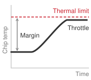{width="100%" fig-alt="A curve that stays flat and low in a green safe zone, then bends sharply upward and turns red as thermal load nears the cooling limit. The green-to-red recoloring marks the throttling tipping point: safe below it, steeply worse above."}

*Below the thermal limit the chip runs safely; cross it and throttling climbs steeply.*
:::

Air cooling, the dominant technology for decades, works by blowing room-temperature air across heat sinks attached to the chips. The air absorbs heat at a rate determined by its specific heat capacity, roughly 1.0 kJ/kg/K. The heated air is exhausted from the rear of the rack, typically 15--20 degrees Celsius warmer than the inlet, and directed to a computer room air conditioning (CRAC) unit that cools it before recirculating.

The fundamental problem is that air is a poor thermal conductor. Its thermal conductivity is only 0.026 W/m/K, compared to 0.6 W/m/K for water and 400 W/m/K for copper. Removing a large heat load with air requires substantial volumetric flow. Fan power depends on that flow, pressure drop, and fan efficiency; rack power alone does not specify a fixed cooling fraction.

The physics can be made precise with a simple calculation. The heat removal capacity of a fluid flow is:

$$Q = \dot{m} \times c_p \times \Delta T$$

```{python}
#| echo: false
#| label: air-cooling-mass-flow-calc
# ┌─────────────────────────────────────────────────────────────────────────────
# │ AIR-COOLING MASS-FLOW SCENARIO (LEGO)
# ├─────────────────────────────────────────────────────────────────────────────
# │ Context: narrative prose immediately below — air-cooling worked example.
# │
# │ Goal: Compute the mass flow, volumetric flow, and CFM required to remove a
# │       fixed heat load with air, from the heat-removal equation Q = m_dot·cp·ΔT.
# │ Show: 6.6 kg/s mass flow, 5.5 m^3/s volumetric flow, ~11,700 CFM.
# │ How: m_dot = Q / (cp·ΔT); V_dot = m_dot / rho; convert to CFM.
# │
# └─────────────────────────────────────────────────────────────────────────────
from mlsysim.core.units import K, J, feet, kg, kW, meter, minute, second, watt
from mlsysim.fmt import (
    check,
    fmt,
    fmt_density,
    fmt_int,
    fmt_magnitude,
    fmt_mass_flow,
    fmt_power,
    fmt_specific_heat,
    fmt_temperature,
    fmt_volumetric_flow,
)

_m3 = meter**3
_cfm_unit = feet**3 / minute

class AirCoolingMassFlow:
    # ┌── 1. LOAD ──────────────────────────────────────────
    # Physical / scenario constants (no canonical mlsysim home yet):
    cp = 1005 * J / (kg * K)  # specific heat capacity of air at constant pressure
    delta_t = 15 * K  # inlet 20 C → outlet 35 C
    air_density = 1.2 * kg / _m3  # sea-level dry air
    heat_load = 100 * kW  # rack heat load to remove

    # ┌── 2. EXECUTE ───────────────────────────────────────
    mass_flow = (heat_load / (cp * delta_t)).to(kg / second)
    volumetric_flow = (mass_flow / air_density).to(_m3 / second)
    cfm = volumetric_flow.to(_cfm_unit)

    # ┌── 3. GUARD ─────────────────────────────────────────
    check(6.5 < mass_flow.magnitude < 6.7, f"Air mass flow drifted: {mass_flow.magnitude:.2f} kg/s")
    check(5.4 < volumetric_flow.magnitude < 5.6, f"Volumetric flow drifted: {volumetric_flow.magnitude:.2f} m^3/s")

    # ┌── 4. OUTPUT (Formatting) ───────────────────────────
    cp_j_per_kg_k_str = fmt_specific_heat(cp, precision=0, commas=True)
    cp_j_per_kg_k_value_str = fmt_magnitude(cp, unit=J / (kg * K), precision=0, commas=True)
    delta_t_k_str = fmt_temperature(delta_t, unit=K, precision=0, commas=False)
    delta_t_k_value_str = fmt_magnitude(delta_t, unit=K, precision=0, commas=False)
    heat_load_kw_str = fmt_power(heat_load, unit=kW, precision=0, commas=False)
    heat_load_w_value_str = fmt_magnitude(heat_load, unit=watt, precision=0, commas=True)
    air_density_str = fmt_density(air_density, unit=kg / _m3, precision=1, commas=False)
    mass_flow_kg_per_s_str = fmt_mass_flow(mass_flow, unit=kg / second, precision=1, commas=False)
    volumetric_flow_m3_per_s_str = fmt_volumetric_flow(volumetric_flow, unit=_m3 / second, precision=1, commas=False)
    cfm_str = fmt_int(round(cfm.magnitude))
```

where $Q$ is the heat removed (watts), $\dot{m}$ is the mass flow rate (kg/s), $c_p$ is the specific heat capacity (J/kg/K), and $\Delta T$ is the temperature difference between outlet and inlet. For air with $c_p$ of `{python} AirCoolingMassFlow.cp_j_per_kg_k_str` and a typical $\Delta T$ of `{python} AirCoolingMassFlow.delta_t_k_str` (inlet at 20 degrees C, outlet at 35 degrees C), removing `{python} AirCoolingMassFlow.heat_load_kw_str` requires a mass flow rate of `{python} AirCoolingMassFlow.heat_load_w_value_str` $\div$ (`{python} AirCoolingMassFlow.cp_j_per_kg_k_value_str` $\times$ `{python} AirCoolingMassFlow.delta_t_k_value_str`) $\approx$ `{python} AirCoolingMassFlow.mass_flow_kg_per_s_str`. At sea-level air density of `{python} AirCoolingMassFlow.air_density_str`, this corresponds to a volumetric flow rate of `{python} AirCoolingMassFlow.volumetric_flow_m3_per_s_str`, or approximately `{python} AirCoolingMassFlow.cfm_str` CFM (cubic feet per minute). Moving this much air through the confined space of a server rack requires powerful fans that themselves consume substantial power.

At higher power densities, the airflow and pressure required to cool a rack raise fan energy and can make air cooling impractical before the IT load itself reaches a power limit. The exact crossover depends on rack geometry, inlet temperature, pressure drop, and fan-control policy rather than on one universal rack-power threshold. The PUE[^fn-pue-facility-metric] metric captures aggregate facility overhead: a PUE of 1.5 means that each watt of IT load is accompanied by 0.5 W of non-IT facility load, which includes cooling and facility-side power conversion.

```{python}
#| echo: false

# ┌─────────────────────────────────────────────────────────────────────────────
# │ PUE SAVINGS HOUSEHOLD EQUIVALENCE (LEGO)
# ├─────────────────────────────────────────────────────────────────────────────
# │ Context: @sec-sustainable-ai-cooling; PUE footnote and cooling-overhead prose.
# │ Goal: Keep the PUE power saving, dollar saving, and household equivalent
# │       tied to one calculation.
# │ How: saved_power = IT_load × (old_PUE - new_PUE); household-years use
# │      ReferenceStats.EnergyAnchors.USHouseholdAnnualElectricity.
# └─────────────────────────────────────────────────────────────────────────────

from mlsysim.fmt import check, fmt, fmt_power, fmt_usd
from mlsysim.core.units import MW, MWh, hour, kilowatt, kWh, USD
from mlsysim import Hardware, Infrastructure, ReferenceStats, Systems

class PueSavings:
    """PUE power and household equivalence for a 10,000-GPU cluster."""

    # ┌── 1. LOAD ──────────────────────────────────────────────────────────
    cluster_gpus = Systems.Clusters.Training_10K.total_accelerators
    rack = Systems.Racks.DGX_H100_4Node
    accelerator_power = cluster_gpus * Hardware.Cloud.H100.tdp
    cooling_kw = 2.7 * kilowatt  # same cooling row as @tbl-rack-power; exclude before PUE
    it_power_multiplier = ((rack.accelerator_power + rack.non_accelerator_power - cooling_kw) / rack.accelerator_power).to("").magnitude
    it_power = accelerator_power * it_power_multiplier
    pue_air_simple = Infrastructure.FacilityCooling.SimpleAir.pue
    pue_air_industry = Infrastructure.FacilityCooling.Legacy.pue
    pue_liquid = Infrastructure.FacilityCooling.StateOfArt.pue
    electricity_rate = Infrastructure.Pricing.OnPremises.ElectricityPerKwh.rate
    household_mwh_per_year = ReferenceStats.EnergyAnchors.USHouseholdAnnualElectricity

    # ┌── 2. EXECUTE ───────────────────────────────────────────────────────
    diff_15_to_11 = it_power * (pue_air_simple - pue_liquid)
    diff_158_to_110 = it_power * (pue_air_industry - pue_liquid)
    saved_15_to_11 = diff_15_to_11 * HOURS_PER_YEAR * hour
    saved_158_to_110 = diff_158_to_110 * HOURS_PER_YEAR * hour
    savings_15_to_11_usd = (saved_15_to_11 * electricity_rate).to(USD)
    savings_158_to_110_usd = (saved_158_to_110 * electricity_rate).to(USD)
    households_158_to_110 = saved_158_to_110 / household_mwh_per_year
    households_158_to_110_rounded = round(households_158_to_110.to("").magnitude / 100) * 100

    # ┌── 3. GUARD ─────────────────────────────────────────────────────────
    check(abs(diff_15_to_11.to(MW).magnitude - 3.85) < 0.01, f"Expected ~3.85 MW, got {diff_15_to_11.to(MW).magnitude}")
    check(3700 < households_158_to_110.to("").magnitude < 3900, "Household equivalent should be about 3,800")

    # ┌── 4. OUTPUT ────────────────────────────────────────────────────────
    it_power_mw_str = fmt_power(it_power, unit=MW, precision=2, commas=False)
    diff_15_to_11_mw_str = fmt_power(diff_15_to_11, unit=MW, precision=2, commas=False)
    diff_158_to_110_mw_str = fmt_power(diff_158_to_110, unit=MW, precision=2, commas=False)
    savings_15_to_11_musd_str = fmt_usd(savings_15_to_11_usd, precision=1, scale="M")
    savings_158_to_110_musd_str = fmt_usd(savings_158_to_110_usd, precision=1, scale="M")
    households_158_to_110_str = fmt(households_158_to_110_rounded, precision=0, commas=True)
```

Reducing non-IT overhead lowers facility electricity at fixed IT load; PUE captures cooling and facility-side electrical losses together. At the scale of a 10,000-GPU cluster consuming `{python} PueSavings.it_power_mw_str` of IT power after rack support load, the difference between PUE 1.5 and PUE 1.1 is `{python} PueSavings.diff_15_to_11_mw_str` of additional facility power, costing approximately `{python} PueSavings.savings_15_to_11_musd_str` per year under the stated electricity-rate assumption.

[^fn-pue-facility-metric]: **PUE Cluster Savings**\index{Power Usage Effectiveness!savings}: The scenario compares fixed PUE values of 1.58 and 1.10; these inputs are not a current industry or vendor inventory. For a 10,000-GPU cluster consuming `{python} PueSavings.it_power_mw_str` of IT power after rack support load, reducing PUE from 1.58 to 1.10 saves `{python} PueSavings.diff_158_to_110_mw_str` of non-IT overhead---roughly `{python} PueSavings.savings_158_to_110_musd_str` per year in electricity and the equivalent of removing `{python} PueSavings.households_158_to_110_str` residential homes from the grid. The PUE assumption must cover all non-IT loads at the selected facility boundary.

```{python}
#| echo: false
from mlsysim.fmt import check, fmt, fmt_power, fmt_usd
from mlsysim.core.units import watt, kilowatt, hour, USD, kWh

class H100TdpCoolingRecap:
    n_gpus = Systems.Clusters.Training_1K.total_accelerators
    gpu_tdp = Hardware.Cloud.H100.tdp
    pue_air = (Infrastructure.FacilityCooling.Typical.pue + Infrastructure.FacilityCooling.Legacy.pue) / 2
    # Printed beside the product so the label and the arithmetic agree; the
    # prose previously said 1.5 while the average of 1.40 and 1.58 is 1.49.
    pue_liquid = (Infrastructure.FacilityCooling.LiquidCooled.pue + Infrastructure.FacilityCooling.StateOfArt.pue) / 2
    electricity_rate = Infrastructure.Pricing.OnPremises.ElectricityPerKwh.rate
    hours_per_year = HOURS_PER_YEAR * hour

    it_power = n_gpus * gpu_tdp
    air_total = it_power * pue_air
    air_cooling = air_total - it_power
    liquid_total = it_power * pue_liquid
    liquid_cooling = liquid_total - it_power
    savings = air_cooling - liquid_cooling
    annual_savings_usd = (savings * hours_per_year * electricity_rate).to(USD)
    lifecycle_years = 3
    three_year_savings_usd = annual_savings_usd * lifecycle_years

    # ┌── 4. OUTPUT (Formatting) ──────────────────────────────────────────────
    tdp_w_str = fmt_power(gpu_tdp, unit=watt, precision=0, commas=False)
    n_gpus_str = fmt(n_gpus, precision=0)
    it_power_kw_str = fmt_power(it_power, unit=kilowatt, precision=1, commas=False)
    air_total_kw_str = fmt_power(air_total, unit=kilowatt, precision=1, commas=False)
    air_cooling_kw_str = fmt_power(air_cooling, unit=kilowatt, precision=1, commas=False)
    pue_air_str = fmt(pue_air, precision=2, commas=False)
    liquid_total_kw_str = fmt_power(liquid_total, unit=kilowatt, precision=1, commas=False)
    liquid_cooling_kw_str = fmt_power(liquid_cooling, unit=kilowatt, precision=1, commas=False)
    savings_kw_str = fmt_power(savings, unit=kilowatt, precision=1, commas=False)
    annual_savings_str = fmt_usd(annual_savings_usd)
    electricity_rate_str = fmt_usd(electricity_rate, precision=2, commas=False, per="kWh")
    three_year_savings_str = fmt_usd(three_year_savings_usd)
```

Water has a specific heat capacity of 4.18 kJ/kg/K, over four times that of air, and a thermal conductivity roughly 25$\times$ higher. These physical properties make water an inherently superior heat transfer medium. To appreciate the magnitude of the difference, consider how much fluid must flow to remove `{python} H100TdpCoolingRecap.tdp_w_str` from a single GPU. Air at a 15-degree temperature rise requires tens of liters per second of airflow (a small wind tunnel). Water at the same temperature rise requires only about 0.01 liters per second (a thin stream). This thousands-fold difference in volumetric flow rate is why air cooling requires massive fans and carefully designed airflow paths, while liquid cooling requires only thin pipes and small pumps.

Direct-to-chip liquid cooling\index{Liquid Cooling!direct-to-chip}\index{Direct-to-Chip Liquid Cooling!cold plate mechanism} routes chilled water (or a specialized dielectric coolant) through machined copper cold plates mounted directly on each GPU package. The cold plate makes physical contact with the GPU's heat spreader through a thin layer of thermal interface material, creating a thermal path with a resistance of less than 0.1 K/W. The coolant absorbs heat within millimeters of the die surface and carries it via manifolds and pipes to a coolant distribution unit (CDU)\index{Coolant Distribution Unit!cooling loop isolation} at the rack or row level.

The CDU transfers heat from the chip-level coolant loop (a closed loop using deionized water or dielectric fluid) to the building's chilled water loop, which rejects the heat to the outside environment via cooling towers or dry coolers. This two-loop design isolates the chip-level coolant (which must be ultra-pure to avoid mineral deposits on the cold plates) from the building-level water (which is less rigorously filtered).

Because liquid coolant is far more effective at absorbing heat per unit volume, the server-level fans are eliminated entirely (or reduced to small units for auxiliary components like DIMMs and VRMs). If cooling consumes 3--8 percent of IT power, that contribution alone adds 0.03--0.08 to PUE; facility-side electrical losses and other non-IT loads must also be included. An additional benefit is noise reduction: liquid-cooled data centers are dramatically quieter than their air-cooled counterparts, which matters for facilities co-located with offices or in noise-regulated areas.

A more aggressive approach, immersion cooling\index{Cooling!immersion}\index{Immersion Cooling!dielectric fluid}, submerges entire server boards in a tank of nonconductive dielectric fluid. The fluid absorbs heat through direct contact with every component surface, eliminating the need for cold plates, fans, and even heat sinks. Fluid contact shortens some heat-transfer paths, but flow, local heat flux, material compatibility, and heat-exchanger capacity still determine component temperatures.

Single-phase immersion cooling\index{Immersion Cooling!single-phase} uses a fluid that remains liquid throughout the process, with heat carried away by convection currents in the tank. The heated fluid rises to the surface, is pumped through a heat exchanger to reject the heat to the building's chilled water loop, and returns to the bottom of the tank.

Two-phase immersion cooling\index{Immersion Cooling!two-phase} takes this further: fluid boils at heated surfaces, carries latent heat to a condenser, and returns as liquid. Heat removal depends on the fluid, pressure, condenser capacity, and operating conditions. The complete facility still consumes energy for heat rejection and electrical distribution; the cooling mechanism alone does not specify its PUE.

The trade-off is serviceability: accessing a failed component requires draining or partially submerging in fluid, and the dielectric fluids themselves are expensive (\$20--50 per liter). A single immersion tank holding four server boards may contain 500-1,000 liters of fluid, representing \$10,000-50,000 in coolant cost alone. The operational procedures for immersion-cooled facilities differ sharply from air-cooled ones, requiring specialized training for technicians and different approaches to cable management, since all connectors must be compatible with prolonged fluid exposure. Standard copper cables and connectors can corrode or swell when exposed to some dielectric fluids, necessitating the use of specialized fluid-resistant materials that add cost and reduce the available supply chain options. @Tbl-cooling-limits compares the air and liquid regimes that determine when these operational costs become unavoidable.

| **Design Question**     | **Air Cooling**                                                                | **Direct-to-Chip Liquid Cooling**                                             |
|:------------------------|:-------------------------------------------------------------------------------|:------------------------------------------------------------------------------|
| **Heat path**           | Chip to heat sink to moving air                                                | Chip to cold plate to coolant loop                                            |
| **Binding limits**      | Airflow, pressure drop, inlet temperature, and allowable component temperature | Cold-plate resistance, flow, coolant temperature, and heat-rejection capacity |
| **Parasitic loads**     | Server and facility fans; conditioning where required                          | Pumps, CDU, heat rejection, and any residual air cooling                      |
| **Service constraints** | Air containment, filters, and access paths                                     | Fluid compatibility, leak management, and maintainable connections            |
| **Facility metric**     | Measure complete IT and non-IT energy                                          | Measure the same boundary; liquid cooling does not determine PUE by itself    |

: **Cooling Architecture Trade-Offs**: Feasible rack density follows from the particular equipment and facility design. There is no universal rack-power threshold or PUE that separates air and liquid cooling. Compare qualified operating envelopes and total facility energy. {#tbl-cooling-limits}

The architecture comparison in @fig-cooling-comparison shows why liquid cooling can support higher heat flux: it moves heat through a short thermal path into a fluid with high volumetric heat capacity. The required density and ambient conditions determine whether an air, liquid, or hybrid design meets the operating envelope.

```{python}
#| echo: false
# ┌── LEGO ───────────────────────────────────────────────
class InfraFrontierStragglerRecap9:

    # ┌── 4. OUTPUT (Formatting) ──────────────────────────────────────────────
    frontier_params_b_str = fmt_params(Models.Language.GPT3.parameters, scale="B", precision=0, commas=False)
```

```{python}
#| echo: false
# ┌── LEGO ───────────────────────────────────────────────
class RackPowerCoolingRecap:
    # ┌── 1. LOAD ──────────────────────────────────────────
    rack = Systems.Racks.DGX_H100_4Node

    # ┌── 4. OUTPUT (Formatting) ──────────────────────────────────────────────
    rack_power_kw_str = fmt_power(
        rack.total_power,
        unit=kilowatt,
        precision=1,
        commas=False,
    )
```

@Fig-cooling-comparison and @tbl-cooling-limits separate physical feasibility from lifecycle economics. First establish that the proposed system meets component temperature and serviceability requirements at the design load. Then compare installed capital cost, pumps and fans, heat rejection, water, maintenance, and useful lifetime under the same workload. A higher-density liquid-cooled installation may reduce operating energy, but its payback period cannot be inferred from rack power alone.

::: {#nbk-sustainable-ai-cooling-tax .callout-notebook title="The cooling tax"}

Consider a `{python} H100TdpCoolingRecap.n_gpus_str`-GPU cluster of H100s at `{python} H100TdpCoolingRecap.tdp_w_str` each. To isolate the PUE multiplier, this simplified calculation treats accelerator power as the entire IT load and assigns all non-IT overhead to cooling. It therefore understates facility power by omitting host, memory, network, and storage support; a procurement estimate must restore those terms before applying PUE.

- IT power\index{IT power!cluster cooling calculation}: `{python} H100TdpCoolingRecap.n_gpus_str` $\times$ `{python} H100TdpCoolingRecap.tdp_w_str` = `{python} H100TdpCoolingRecap.it_power_kw_str`
- Air cooling (PUE `{python} H100TdpCoolingRecap.pue_air_str`): Total facility power = `{python} H100TdpCoolingRecap.it_power_kw_str` $\times$ `{python} H100TdpCoolingRecap.pue_air_str` = `{python} H100TdpCoolingRecap.air_total_kw_str`. Cooling overhead = `{python} H100TdpCoolingRecap.air_cooling_kw_str`.
- Liquid cooling (PUE 1.08): Total facility power = `{python} H100TdpCoolingRecap.it_power_kw_str` $\times$ 1.08 = `{python} H100TdpCoolingRecap.liquid_total_kw_str`. Cooling overhead = `{python} H100TdpCoolingRecap.liquid_cooling_kw_str`.

**Savings**: Liquid cooling saves `{python} H100TdpCoolingRecap.savings_kw_str` of continuous power. At `{python} H100TdpCoolingRecap.electricity_rate_str`, the annual savings are approximately `{python} H100TdpCoolingRecap.annual_savings_str`. Over a 3-year hardware lifecycle, the cooling savings alone total `{python} H100TdpCoolingRecap.three_year_savings_str`, which often exceeds the capital cost of installing the liquid cooling infrastructure.

:::

::: {#fig-cooling-comparison fig-env="figure" fig-pos="htb" fig-cap="**Air and Liquid Heat Paths**: Air transfers chip heat through a heat sink and moving air; direct-to-chip liquid cooling transfers it through a cold plate and coolant. Both require heat rejection. Capacity, parasitic energy, and water use depend on the engineered system rather than the cooling medium alone." fig-alt="Two parallel paths show chip heat flowing through a heat sink and air or a cold plate and coolant to heat rejection."}

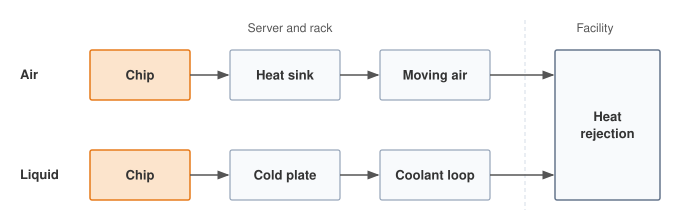

:::

The final link in the cooling chain is **heat rejection**\index{Heat Rejection!definition}: getting the heat from the building's chilled water loop to the outside environment. The dominant technology is the cooling tower, which sprays warm water over a fill medium and uses evaporation to carry heat into the atmosphere. Evaporative cooling is thermally efficient (the latent heat of vaporization of water is 2,260 kJ/kg, compared to 4.18 kJ/kg/K for sensible heating), but it consumes water.

A 10 MW data center with evaporative cooling towers can consume well over 100 million liters of water per year, depending on climate and cooling design, which has become a significant concern in water-stressed regions. To put this in perspective, 140 million liters is roughly 311--368 household-years of water use using the earlier 380,000--450,000-liter annual household baseline. As ML data centers grow to 100 MW and beyond, their water footprint becomes a meaningful factor in local resource planning.

Dry coolers, which use fans to blow air over a radiator without evaporation, eliminate water consumption but work efficiently only when the ambient air temperature is well below the coolant temperature, limiting their effectiveness in hot climates. Many facilities use hybrid approaches: dry coolers during cool weather and evaporative towers during heat waves.

**Waste heat reuse**\index{Waste Heat Reuse!definition} treats thermal output as a resource. A liquid-cooling loop returning water at 50--65 degrees Celsius supplies low-grade heat that may serve nearby district heating\index{District Heating!municipal heat networks}, greenhouses, or other suitable sinks. Usability depends on the required supply temperature, seasonal demand, and transport losses; a heat pump may be needed. If an illustrative 10 MW thermal stream has an 80--90 percent recovery fraction, 8--9 MW is recovered before accounting for heat-pump electricity. Heat-pump output includes that electrical input and must be accounted for separately. Crediting useful heat does not reduce PUE below 1.0; report export through energy reuse effectiveness\index{Energy Reuse Effectiveness!heat export} or a separate net-energy balance.

The viability of waste heat reuse depends on the proximity of heat consumers. Urban data centers, despite their higher land and electricity costs, are often better positioned for waste heat reuse than remote facilities because they are close to residential and commercial heating loads. The result is a counterintuitive economic optimization: a data center in a Nordic city may have higher electricity costs but lower net operating costs after waste heat revenues, compared to a remote facility with cheaper electricity but no heat consumers nearby.

```{python}
#| echo: false
# ┌── LEGO ───────────────────────────────────────────────
class InfraFrontierRackCoolingChoiceRecap:

    # ┌── 4. OUTPUT (Formatting) ──────────────────────────────────────────────
    frontier_params_b_str = fmt_params(Models.Language.GPT3.parameters, scale="B", precision=0, commas=False)
```

For a dense training fleet, cooling is a configuration constraint. The aggregate accelerator TDP sets only part of the heat load; hosts, memory, networking, and conversion losses add to it. Rack layout and cooling capacity determine whether the intended configuration can sustain its workload or must reduce density or power. Liquid cooling is one way to expand that envelope, with its own serviceability and lifecycle costs.

#### Cooling system reliability {#sec-sustainable-ai-cooling-reliability}

Cooling failures\index{Liquid Cooling!reliability and failure modes} threaten both hardware and useful fleet work. When coolant flow stops, a dense rack loses heat-removal capacity and must throttle or shut down before thermal runaway\index{Liquid Cooling!thermal runaway}. N+1 redundancy in coolant distribution units\index{Coolant Distribution Unit!N+1 redundancy}, temperature monitoring, and automatic load shedding limit the affected capacity. An emergency air path can support reduced-power operation where the facility design provides one.

Serviceability also changes the failure budget. Leaks can damage equipment and drain cooling capacity, while quick-disconnect fittings allow node replacement without draining the entire loop. Their seals and coolant compatibility therefore belong in the maintenance plan. The fleet-level consequence depends on how much synchronized work shares the failed cooling domain.

```{python}
#| echo: false
#| label: straggler-failure-cost-calc
# ┌─────────────────────────────────────────────────────────────────────────────
# │ STRAGGLER FAILURE-COST SCENARIO (LEGO)
# ├─────────────────────────────────────────────────────────────────────────────
# │ Context: narrative prose immediately below — cooling-failure economics.
# │
# │ Goal: Quantify the lockstep-straggler cost of a cooling failure that idles a
# │       full synchronous training cluster for the CDU repair window.
# │ Show: $4,096 direct (256 GPUs) vs $160,000 full-cluster idle (10,000 GPUs).
# │ How: direct = failed_gpus·rate·hours; cluster = total_gpus·rate·hours.
# │
# └─────────────────────────────────────────────────────────────────────────────
from mlsysim import Systems, Infrastructure
from mlsysim.fmt import check, fmt, fmt_int, fmt_time, fmt_usd
from mlsysim.core.units import hour

class StragglerFailureCost:
    # ┌── 1. LOAD ──────────────────────────────────────────
    failed_gpus = 256  # scenario: GPUs in the shut-down rack
    cluster_gpus = Systems.Clusters.Training_10K.total_accelerators
    repair_duration = 4 * hour  # scenario: CDU pump repair window
    gpu_hour_rate = Infrastructure.Pricing.Cloud.GpuTrainingPerHour.rate

    # ┌── 2. EXECUTE ───────────────────────────────────────
    idle_gpus = cluster_gpus - failed_gpus
    repair_hours = repair_duration.to(hour).magnitude
    rate = gpu_hour_rate.to("dollar/hour").magnitude
    direct_cost = failed_gpus * rate * repair_hours
    cluster_cost = cluster_gpus * rate * repair_hours

    # ┌── 3. GUARD ─────────────────────────────────────────
    check(abs(direct_cost - 4096) < 1, f"Direct straggler cost drifted: {direct_cost}")
    check(abs(cluster_cost - 160000) < 1, f"Cluster straggler cost drifted: {cluster_cost}")

    # ┌── 4. OUTPUT (Formatting) ───────────────────────────
    failed_gpus_str = fmt(failed_gpus, precision=0, commas=False)
    cluster_gpus_str = fmt(cluster_gpus, precision=0, commas=True)
    idle_gpus_str = fmt(idle_gpus, precision=0, commas=True)
    repair_hours_str = fmt_time(repair_duration, unit=hour, precision=0, commas=False, style="word")
    gpu_hour_rate_str = fmt_usd(rate, precision=0, commas=False)
    direct_cost_str = fmt_usd(direct_cost, precision=0, commas=True)
    cluster_cost_str = fmt_usd(cluster_cost, precision=0, commas=True)
```

The economics of cooling reliability shift dramatically when moving from independent inference servers to tightly coupled training clusters. In a distributed training run using synchronous parallelism, a cooling-loop failure that idles a pod-scale slice can halt the entire job. Consider a cooling failure that triggers a thermal shutdown of a `{python} StragglerFailureCost.failed_gpus_str`-GPU pod within a `{python} StragglerFailureCost.cluster_gpus_str`-GPU cluster. The direct hardware cost is negligible, but the opportunity cost is immense. If the repair time for a CDU pump is `{python} StragglerFailureCost.repair_hours_str`, the immediate loss of `{python} StragglerFailureCost.failed_gpus_str` GPUs at `{python} StragglerFailureCost.gpu_hour_rate_str` per GPU-hour is only `{python} StragglerFailureCost.direct_cost_str`. However, assuming the job cannot continue elastically after losing those workers, the remaining `{python} StragglerFailureCost.idle_gpus_str` GPUs also sit idle, burning electricity without making progress. This straggler effect inflates the cost to `{python} StragglerFailureCost.cluster_cost_str` in lost compute time. When adding the overhead of checkpoint retrieval and the rollback to the last saved state---often losing 30 to 60 minutes of computation---the illustrative lost-compute total reaches \$180,000--\$200,000 before any additional recovery delay. Compare expected outage losses and recovery behavior against the cost of N+1 cooling redundancy rather than treating redundancy as an unconditional requirement.

::: {.column-margin}
{width="100%" fig-alt="Blast-radius fan with one red cooling-failure source sending arrows to six blue affected groups, labeled to show that a pod-scale cooling failure idles the synchronized training job."}

*One cooling failure can idle the whole training job.*
:::

Coolant condition is another reliability input. **Deionized water**\index{Deionized Water!definition} and compatible inhibitors control **galvanic corrosion**\index{Galvanic Corrosion!definition}, the damage caused by electrochemical differences between metals in the loop. **Biofilm**\index{Biofilm!definition} on heat-transfer surfaces impedes cooling and increases pumping demand. Maintenance must preserve coolant chemistry and heat-transfer performance; the sustainability account includes both that overhead and the useful work lost when cooling fails.

## Training vs. Inference Energy Analysis {#sec-sustainable-ai-training-vs-inference-energy-analysis-4cb5}

Cooling infrastructure manages the intense thermal load of the cluster, but the total magnitude of that load depends on whether the fleet is executing a concentrated training run or a globally distributed inference workload. Training a massive language model is a spectacular, highly visible energy event, akin to launching a rocket. Deploying that same model to serve a billion daily queries is like operating an international airline fleet. Training burns thousands of megawatt-hours in a single, concentrated burst over several months; inference burns energy continuously, query by query, year after year. Understanding where the majority of the energy budget goes dictates where optimization efforts must concentrate.

Optimization opportunities differ across lifecycle phases. Training optimizations focus on computational efficiency and hardware utilization, while inference optimizations emphasize latency, throughput, and edge deployment strategies. Matching the sustainability intervention to the dominant energy consumer for each application yields the greatest returns.

### Training energy demands {#sec-sustainable-ai-training-energy-demands-1ff6}

Training large AI models can require computational infrastructure with hundreds of thousands of cores and specialized AI accelerators operating continuously for months. Microsoft's 2020 disclosure of the OpenAI dedicated supercomputer, built specifically for large-scale AI training at the time, reported 285,000 CPU cores, 10,000 GPUs, and network bandwidth exceeding 400 gigabits per second per server [@microsoft2020openaiSupercomputer]. This 2020 figure remains useful as a calibrated reference point rather than a claim about the largest infrastructure available in later generations.

The intensive computational loads generate heat that cooling infrastructure must continuously remove, the overhead quantified for the cooling treatment in @sec-sustainable-ai-cooling. Reducing it requires co-optimization of hardware architecture, parallelism strategy, and algorithmic efficiency.

Training energy costs occur once per completed run, but model development can require many runs, followed by retraining during service. Each run affects facility sizing, checkpoint storage, and carbon accounting. The primary sustainability challenge often emerges during deployment, where inference workloads continuously serve millions or billions of users and can overtake the accumulated training energy when request volume is large enough.

### Inference energy costs {#sec-sustainable-ai-inference-energy-costs-aec9}

Inference workloads execute every time an AI model responds to queries, classifies images, or makes predictions. Unlike training, inference scales dynamically and continuously across applications such as search engines, recommendation systems, and generative AI models. Although each individual inference request consumes far less energy compared to training, the cumulative energy usage from high-volume deployed services can rival or exceed training-related consumption [@wu2022sustainable].

For example, AI-driven search engines handle billions of queries per day, recommendation systems provide personalized content continuously, and generative AI services such as ChatGPT or DALL-E have substantial per-query computational costs. The inference energy footprint is high in transformer-based models due to high memory and computational bandwidth requirements.

Early market forecasts anticipated this shift: a 2017 McKinsey projection (@fig-mckinsey-analysis) expected the data-center inference market to roughly double from 4-5 to 9-10 billion dollars and edge inference to climb from near zero to 4-4.5 billion dollars by 2025, both outpacing the slower-growing training market. The stronger evidence is physical rather than economic. The Meta lifecycle measurements in @fig-meta-analysis show inference serving at scale rivaling or exceeding training emissions for deployed recommendation models, and the chapter's own accounting shows continuous serving overtaking a one-time training run once request volume is large enough.

::: {#fig-mckinsey-analysis fig-env="figure" fig-pos="htb" fig-cap="**AI Hardware Market Growth**: McKinsey analysis comparing 2017 market estimates with then-projected 2025 data center and edge markets. Inference workloads dominated the projected growth, with edge inference treated as a significant new segment while training markets grew more gradually in the projection." fig-alt="Two grouped bar charts comparing 2017 market estimates with then-projected 2025 market projections. Data center inference doubles from 4-5 to 9-10 billion dollars. Edge inference grows from near zero to 4-4.5 billion dollars. Training markets grow more slowly."}

```{python}
#| echo: false
#| warning: false
import matplotlib.pyplot as plt
import numpy as np
from binder.tools.figures import style as book_style

book_style.set_book_style()
COLORS = book_style.COLORS
fig, (ax1, ax2) = plt.subplots(1, 2, figsize=(11.0, 5.0))

c_dark = COLORS['primary']
c_blue = COLORS['BlueLine']
c_proj_blue = COLORS['BlueLine']
c_gray = COLORS['secondary']
c_green = COLORS['GreenLine']
c_orange = COLORS['OrangeLine']
c_border = COLORS['grid']

cats = ['INFERENCE', 'TRAINING']
x = np.arange(len(cats))
width = 0.32

dc_2017 = [4.5, 0.8]
dc_2025 = [9.5, 4.5]

b1 = ax1.bar(x - width / 2, dc_2017, width, label='2017 Baseline', color='#E2E8F0', edgecolor=c_gray, linewidth=1.2)
b2 = ax1.bar(x + width / 2, dc_2025, width, label='2025* Projected', color=COLORS['BlueFill'], edgecolor=c_blue, linewidth=1.2)

ax1.text(x[0] - width / 2, 4.5 + 0.25, '$4.5B', ha='center', va='bottom', fontsize=8.2, fontweight='bold', color=c_dark)
ax1.text(x[0] + width / 2, 9.5 + 0.25, '$9.5B', ha='center', va='bottom', fontsize=8.2, fontweight='bold', color=c_blue)
ax1.text(x[1] - width / 2, 0.8 + 0.25, '<$1B', ha='center', va='bottom', fontsize=8.2, fontweight='bold', color=c_gray)
ax1.text(x[1] + width / 2, 4.5 + 0.25, '$4.5B', ha='center', va='bottom', fontsize=8.2, fontweight='bold', color=c_proj_blue)

ax1.text(
    x[0] + width / 2,
    11.2,
    '+111%',
    ha='center',
    va='bottom',
    fontsize=8.0,
    fontweight='bold',
    color=c_green,
    bbox=dict(boxstyle='round,pad=0.25', facecolor='#FFFFFF', edgecolor=c_green, lw=0.9),
)

ax1.set_xticks(x)
ax1.set_xticklabels(cats, fontsize=9.0, fontweight='bold', color=c_dark)
ax1.set_ylim(0, 13.0)
ax1.set_ylabel('Market Size ($ Billion)', fontsize=9.2, fontweight='bold', color=c_dark)
ax1.set_title('(a) Data Center Total Market', fontsize=9.8, fontweight='bold', color=c_dark)
ax1.legend(loc='upper left', frameon=True, facecolor='#FFFFFF', edgecolor=c_border, fontsize=8.0)
ax1.tick_params(colors=c_dark, labelsize=8.5)
ax1.grid(True, linestyle='--', alpha=0.5, axis='y')

ax1.text(
    0.5,
    -0.15,
    'Data Center inference reaches 2× data center training volume',
    transform=ax1.transAxes,
    ha='center',
    va='top',
    fontsize=7.6,
    fontstyle='italic',
    color=c_gray,
)

edge_2017 = [0.08, 0.08]
edge_2025 = [4.25, 1.25]

b3 = ax2.bar(x - width / 2, edge_2017, width, label='2017 Baseline', color='#E2E8F0', edgecolor=c_gray, linewidth=1.2)
b4 = ax2.bar(x + width / 2, [edge_2025[0], 0], width, label='2025* Inference', color=COLORS['GreenFill'], edgecolor=c_green, linewidth=1.2)
b5 = ax2.bar(x + width / 2, [0, edge_2025[1]], width, label='2025* Training', color=COLORS['OrangeL'], edgecolor=c_orange, linewidth=1.2)

ax2.text(x[0] - width / 2, 0.08 + 0.15, '<$0.1B', ha='center', va='bottom', fontsize=8.2, fontweight='bold', color=c_gray)
ax2.text(x[0] + width / 2, 4.25 + 0.15, '$4.25B', ha='center', va='bottom', fontsize=8.2, fontweight='bold', color=c_green)
ax2.text(x[1] - width / 2, 0.08 + 0.15, '<$0.1B', ha='center', va='bottom', fontsize=8.2, fontweight='bold', color=c_gray)
ax2.text(x[1] + width / 2, 1.25 + 0.15, '$1.25B', ha='center', va='bottom', fontsize=8.2, fontweight='bold', color=c_orange)

ax2.text(
    x[0] + width / 2,
    5.2,
    'NEW SEGMENT (~40×)',
    ha='center',
    va='bottom',
    fontsize=7.8,
    fontweight='bold',
    color=c_green,
    bbox=dict(boxstyle='round,pad=0.25', facecolor='#FFFFFF', edgecolor=c_green, lw=0.9),
)

ax2.set_xticks(x)
ax2.set_xticklabels(cats, fontsize=9.0, fontweight='bold', color=c_dark)
ax2.set_ylim(0, 6.8)
ax2.set_ylabel('Market Size ($ Billion)', fontsize=9.2, fontweight='bold', color=c_dark)
ax2.set_title('(b) Edge Total Market', fontsize=9.8, fontweight='bold', color=c_dark)
ax2.legend(loc='upper left', frameon=True, facecolor='#FFFFFF', edgecolor=c_border, fontsize=8.0)
ax2.tick_params(colors=c_dark, labelsize=8.5)
ax2.grid(True, linestyle='--', alpha=0.5, axis='y')

ax2.text(
    0.5,
    -0.15,
    'Edge inference emerges as a massive independent market category',
    transform=ax2.transAxes,
    ha='center',
    va='top',
    fontsize=7.6,
    fontstyle='italic',
    color=c_gray,
)

plt.tight_layout()
plt.show()
```

:::

Inference workloads, like other software services, scale with demand. An always-available service consumes energy both while processing requests and while maintaining capacity for expected latency and availability. The sustainability account must include query volume, workload mix, and idle provisioned resources.

#### The energy inefficiency of the decode phase {#sec-sustainable-ai-energy-inefficiency-decode-phase-24da}

::: {.column-margin .margin-pointer}
↩ Prefill-decode phase bifurcation, KV-cache dynamics, and batching mechanisms are analyzed in @sec-inference-scale.
:::

Prefill and decode stress different resources, but their energy comparison requires a declared serving workload. @Fig-prefill-decode-energy shows the reuse opportunity: prefill applies weights across prompt positions, while each decode iteration applies them across the active sequences. Batch size, context length, precision, and the latency target determine the realized traffic and utilization.

::: {#fig-prefill-decode-energy fig-env="figure" fig-pos="htb" fig-cap="**Reuse in Prefill and Decode**: Prefill reuses weights across prompt positions; a decode iteration can reuse weights across active sequences. At small batches, weight and KV-cache traffic can leave arithmetic units underused. These paths show mechanisms, not measured utilization or a universal energy-per-token ratio." fig-alt="Two panels connect weights and token work to compute, distinguishing prompt positions from one new token per active sequence."}

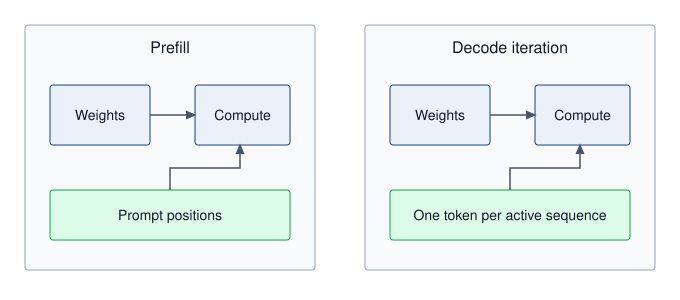

:::

The prefill/decode distinction summarized in @fig-prefill-decode-energy affects energy through data movement, utilization, and runtime. During prefill\index{Inference!prefill phase}, processing multiple prompt positions can reuse weights. During decode\index{Inference!decode phase}, an iteration produces one token per active sequence; batching amortizes weight reads across those outputs. Longer contexts add KV-cache traffic, and larger batches can shift the binding constraint toward compute or the latency budget.

Static power waste\index{Static Power!decode phase idleness}\index{Inference!static power waste} occurs when powered circuitry waits rather than producing useful outputs. Reducing that waiting can improve energy efficiency, but a comparison must meter the same hardware boundary and preserve output quality, context, latency, and serving load. Prompt processing and autoregressive generation perform different work; equal token counts alone do not establish a fair energy ratio.

#### Edge AI impact {#sec-sustainable-ai-edge-ai-impact-6694}

The edge intelligence architectures from @sec-edge-intelligence enable inference beyond centralized data centers. This distributed approach offers unique sustainability advantages by reducing data transmission energy costs and lowering dependency on high-power cloud infrastructure. Instead of routing every AI request to centralized cloud servers, models can be deployed directly on user devices or at edge computing nodes.

However, running inference at the edge does not eliminate energy concerns, especially when AI is deployed at scale. Autonomous vehicles, for instance, require millisecond-latency AI inference, meaning cloud processing is impractical. Instead, vehicles use onboard AI accelerators that function as "data centers on wheels" [@sudhakar2023]. These embedded computing systems process real-time sensor data equivalent to small data centers, consuming significant power even without relying on cloud inference.

Similarly, consumer devices such as smartphones, wearables, and IoT sensors individually consume milliwatts to watts of power but collectively add terawatt-hours to global energy use due to their sheer numbers. Therefore, the efficiency benefits of edge computing must be balanced against the extensive scale of device deployment.

Edge deployment can be more sustainable than cloud deployment when designed correctly. The combination of eliminated data transmission, local processing efficiency, and duty-cycled operation can reduce total system energy consumption by orders of magnitude compared to always-connected cloud inference.

#### Edge and mobile power budgets {#sec-sustainable-ai-edge-mobile-power-budgets-b3b2-b3b2}

ARM-based edge devices operate under fundamentally different power constraints than data center accelerators. The engineering choice is to match each inference workload to the smallest power tier that still satisfies latency and accuracy.

Power budgets reflect the physical constraints of battery capacity, thermal dissipation, and deployment environment. @Tbl-edge-power-budgets groups edge AI power budget categories\index{Edge AI!power budget categories} and shows how these constraints propagate: TinyML devices operating from coin cells or energy harvesting cannot exceed milliwatt average power, mobile devices must balance user experience with battery life, and automotive systems face thermal constraints within enclosed vehicle compartments despite having access to vehicle power.

| **Platform Category**  | **Idle Power** | **Active Power** | **Peak Power** | **Example Devices**                                                                   |
|:-----------------------|:--------------:|:----------------:|:--------------:|:--------------------------------------------------------------------------------------|
| **TinyML (MCU)**       | 1--100 $\mu$W  |     1--50 mW     |     100 mW     | Arduino Nano 33, STM32H7, Nordic nRF5340                                              |
| **Mobile NPU**         |   10--100 mW   |     0.5--5 W     |      10 W      | Pixel Tensor, Apple Neural Engine, Snapdragon NPU                                     |
| **Edge GPU/TPU**       |     1--5 W     |     5--30 W      |      75 W      | NVIDIA Jetson Orin NX (10--25 W) and AGX Orin (15--60 W), Google Edge TPU, RPi AI Kit |
| **Autonomous Vehicle** |    10--50 W    |    50--200 W     |     500 W      | Tesla FSD Computer, Mobileye EyeQ, NVIDIA Drive                                       |

: **Edge AI Power Budget Categories**: Edge platforms span five orders of magnitude in power consumption, from sub-milliwatt TinyML systems to automotive compute platforms approaching data center power levels. Sustainable deployment requires matching workload requirements to appropriate power tiers. {#tbl-edge-power-budgets}

#### TinyML power state dynamics {#sec-sustainable-ai-tinyml-power-state-dynamics-ceaf}

While @sec-edge-intelligence examines TinyML from a systems architecture perspective, the energy efficiency of on-device inference is equally a sustainability consideration: each of the billions of edge inference calls aggregates into measurable carbon footprint at fleet scale. TinyML efficiency depends heavily on duty cycling, where devices alternate between deep sleep and active inference. @Eq-tinyml-duty-cycle expresses average power as a weighted sum of active and sleep power:

$$P_{\text{average}} = P_{\text{active}} \times \frac{t_{\text{inference}}}{T_{\text{period}}} + P_{\text{sleep}} \times \frac{T_{\text{period}} - t_{\text{inference}}}{T_{\text{period}}}$$ {#eq-tinyml-duty-cycle}

Consider a keyword-spotting model running on a Cortex-M4 microcontroller in the Archetype C (Federated MobileNet) regime (@sec-vol2-introduction-archetypes). The device operates with an active inference power of 15 mW for 20 ms during each detection cycle, transitions to a deep-sleep draw of 10 microamps at 3.3 V (33 microwatts) between evaluations, and repeats on a 1-second detection period during continuous listening. Substituting these values into @eq-tinyml-duty-cycle yields the average power draw:

$$P_{\text{average}} = 15 \text{ mW} \times \frac{20 \text{ ms}}{1000 \text{ ms}} + 0.033 \text{ mW} \times \frac{980 \text{ ms}}{1000 \text{ ms}}$$

$$P_{\text{average}} = 0.30 \text{ mW} + 0.032 \text{ mW} = 0.33 \text{ mW}$$

At this average power, a 250 mAh coin cell battery (at 3.0V nominal) provides approximately 2,270 hours of operation, nearly 95 days under the idealized energy budget. This is a compute-only lifetime estimate. Continuous listening also requires powered sensing and input buffering while the microcontroller sleeps; their energy, regulator losses, and usable battery capacity must enter a deployment estimate. These power-aware design principles carry directly into practical industrial deployment scenarios.

::: {#nbk-sustainable-ai-battery-life-tinyml .callout-notebook title="Battery life for TinyML"}

**Problem**: Calculate the operating lifetime of an anomaly-detection TinyML autoencoder deployed on a factory sensor node powered by two AA batteries (3000 mAh at 3.0 V). The system runs on an ARM Cortex-M4 microcontroller clocked at 80 MHz, consuming 12 mW during a 5 ms inference burst at 10 Hz (a 5 percent duty cycle) and 16.5 $\mu\text{W}$ (5 $\mu\text{A}$ at 3.3 V) during the intervening 95 ms sleep interval.

**Math**:

1. Average power: $P_{\text{avg}} = 12 \text{ mW} \times 0.05 + 0.0165 \text{ mW} \times 0.95 = 0.616 \text{ mW}$.
2. Battery capacity: $E_{\text{battery}} = 3000 \text{ mAh} \times 3.0 \text{ V} = 9000 \text{ mWh}$.
3. Battery lifetime: $t_{\text{life}} = \frac{9000 \text{ mWh}}{0.616 \text{ mW}} \approx 14,610 \text{ hours} \approx 1.7 \text{ years}$.

**Systems insight**: The modeled inference and sleep states fit nearly two years of the stated nominal battery capacity. Sensing, communication, power conversion, and battery derating shorten the deployed lifetime unless they are already included in the measured power terms. Duty cycling makes a long-lived deployment possible, but the device-level energy boundary determines whether it achieves that lifetime.

:::

#### On-device learning and the battery wall {#sec-sustainable-ai-edge-learning-battery}

While inference on TinyML devices is highly efficient, on-device learning introduces a much steeper energy challenge. Personalizing a model to a user's specific voice or gait requires backpropagation, which typically adds backward computation to the forward pass. A dense training step may require roughly 2--3$\times$ the forward arithmetic, while activation, gradient, and optimizer-state memory must be budgeted separately.

```{python}
#| echo: false
#| label: sustainable-mobile-power-envelope
# ┌─────────────────────────────────────────────────────────────────────────────
# │ MOBILE POWER ENVELOPE (LEGO)
# ├─────────────────────────────────────────────────────────────────────────────
# │ Context: @sec-sustainable-ai-edge-learning-battery on-device learning prose.
# │
# │ Goal: Keep mobile sustained and burst power ranges sourced from MLSysIM.
# │ Show: Shared power-envelope ranges for sustained and burst mobile ML.
# │ How: Pull ReferenceStats.MobilePower anchors, validate ordering, format ranges.
# │
# └─────────────────────────────────────────────────────────────────────────────
from mlsysim import ReferenceStats
from mlsysim.core.units import watt
from mlsysim.fmt import check, fmt_qty_range

class SustainableMobilePowerEnvelope:
    """Shared mobile power ranges for sustainable on-device learning prose."""

    # ┌── 1. LOAD (Constants) ──────────────────────────────────────────────
    sustained_low = ReferenceStats.MobilePower.MobileMlSustainedLow
    sustained_high = ReferenceStats.MobilePower.MobileMlSustainedHigh
    burst_low = ReferenceStats.MobilePower.MobileMlBurstLow
    burst_high = ReferenceStats.MobilePower.MobileMlBurstHigh

    # ┌── 3. GUARD (Invariants) ───────────────────────────────────────────
    check(
        sustained_low.to(watt).magnitude < sustained_high.to(watt).magnitude < burst_low.to(watt).magnitude < burst_high.to(watt).magnitude,
        "Mobile sustained and burst power ranges should be ordered.",
    )

    # ┌── 4. OUTPUT (Formatting) ─────────────────────────────────────────────
    sustained_range_str = fmt_qty_range(
        sustained_low,
        sustained_high,
        watt,
        precision=0,
        commas=False,
    )
    burst_range_str = fmt_qty_range(
        burst_low,
        burst_high,
        watt,
        precision=0,
        commas=False,
    )
```

The TDP of mobile processors creates hard constraints that shape every aspect of on-device learning strategies. Modern smartphones typically maintain sustained processing at `{python} SustainableMobilePowerEnvelope.sustained_range_str` for ML workloads to prevent thermal discomfort, but can burst to `{python} SustainableMobilePowerEnvelope.burst_range_str` for brief periods before thermal throttling occurs. This TDP determines the entire feasible space of adaptive algorithms.

```{python}
#| echo: false
#| label: on-device-learning-energy-calc
# ┌─────────────────────────────────────────────────────────────────────────────
# │ ON-DEVICE LEARNING ENERGY (LEGO)
# ├─────────────────────────────────────────────────────────────────────────────
# │ Context: @sec-sustainable-ai-edge-learning-battery ("The energy of
# │          learning" .callout-notebook)
# │
# │ Goal: Quantify why full 1B-parameter phone fine-tuning is infeasible.
# │ Show: 5% of phone-battery budget supports only hundreds of tokens.
# │ How: Battery Wh -> joules; budget / joules per token.
# │
# └─────────────────────────────────────────────────────────────────────────────
from mlsysim import ReferenceStats
from mlsysim.fmt import check, fmt, fmt_count, fmt_energy, fmt_params, fmt_percent
from mlsysim.core.units import Wh, joule

# ┌── LEGO ───────────────────────────────────────────────
class OnDeviceLearningEnergy:
    """Phone battery budget for on-device language model fine-tuning."""

    # ┌── 1. LOAD (Constants) ──────────────────────────────────────────────
    phone_battery = ReferenceStats.PhoneBattery.EnergyWh
    battery_budget_pct = 5
    model_params = 1_000_000_000
    forward_nj_per_param = 2
    backward_nj_per_param = 4
    nanojoules_per_joule = 1_000_000_000

    # ┌── 2. EXECUTE (The Compute) ────────────────────────────────────────
    budget_energy = phone_battery * battery_budget_pct / 100
    train_nj_per_param = forward_nj_per_param + backward_nj_per_param
    joules_per_token = train_nj_per_param * model_params / nanojoules_per_joule * joule
    token_capacity = (budget_energy / joules_per_token).to("").magnitude

    # ┌── 3. GUARD (Invariants) ──────────────────────────────────────────
    check(440 <= token_capacity <= 460, f"Unexpected phone fine-tuning capacity: {token_capacity:.0f}")

    # ┌── 4. OUTPUT (Formatting) ──────────────────────────────────────────────
    phone_battery_wh_str = fmt_energy(phone_battery, unit=Wh, precision=0, commas=False)
    phone_battery_j_str = fmt_energy(phone_battery, unit=joule, precision=0)
    battery_budget_pct_str = fmt_percent(round(battery_budget_pct) / 100, precision=0, commas=False, style='prose')
    budget_j_str = fmt_energy(budget_energy, unit=joule, precision=0)
    model_params_b_str = fmt_params(model_params)
    forward_nj_per_param_value_str = fmt(forward_nj_per_param, precision=0, commas=False)
    backward_nj_per_param_value_str = fmt(backward_nj_per_param, precision=0, commas=False)
    train_nj_per_param_value_str = fmt(train_nj_per_param, precision=0, commas=False)
    joules_per_token_j_str = fmt_energy(joules_per_token, unit=joule, precision=0, commas=False, per="token")
    token_capacity_str = fmt_count(token_capacity, label="token")
```

::: {#nbk-sustainable-ai-energy-learning .callout-notebook title="The energy of learning"}

**Problem**: Consider fine-tuning a small language model (`{python} OnDeviceLearningEnergy.model_params_b_str` parameters) on a user's smartphone overnight. Is this feasible within a `{python} OnDeviceLearningEnergy.battery_budget_pct_str` battery budget?

**Math**:

1.  Phone battery: Typical capacity is approximately `{python} OnDeviceLearningEnergy.phone_battery_wh_str`, or about `{python} OnDeviceLearningEnergy.phone_battery_j_str`.
2.  Budget: `{python} OnDeviceLearningEnergy.battery_budget_pct_str` of `{python} OnDeviceLearningEnergy.phone_battery_j_str` = `{python} OnDeviceLearningEnergy.budget_j_str`.
3.  training cost\index{On-Device Learning!training cost}:
    *   Forward pass: $\approx$ `{python} OnDeviceLearningEnergy.forward_nj_per_param_value_str` nJ/param.
    *   Backward pass: $\approx$ `{python} OnDeviceLearningEnergy.backward_nj_per_param_value_str` nJ/param.
    *   Total per token: `{python} OnDeviceLearningEnergy.train_nj_per_param_value_str` nJ/param $\times 10^9$ params = `{python} OnDeviceLearningEnergy.joules_per_token_j_str`.
4.  Capacity: `{python} OnDeviceLearningEnergy.budget_j_str` / `{python} OnDeviceLearningEnergy.joules_per_token_j_str` = `{python} OnDeviceLearningEnergy.token_capacity_str`.

**Systems insight**: The calculation establishes a token capacity, not whether the proposed adaptation fits. That decision also requires the token count needed to reach the quality target, the available memory, and sustained device power. If the required work exceeds the battery budget, parameter-efficient fine-tuning\index{Parameter-Efficient Fine-Tuning!on-device energy savings} or sparse updates are candidates for reducing cost; their measured energy and achieved quality must establish whether they close the gap.

:::

The local-processing decision compares the energy of the required computation with the communication and remote computation it avoids. Per-bit radio costs motivate the comparison, but the full job must also include repeated training rounds and model transfers.

:::: {#psp-sustainable-ai-energy-hierarchy .callout-perspective title="The energy hierarchy"}

::: {.column-margin}
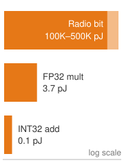{width="100%" fig-alt="Energy ladder showing wireless transmission around 250,000 pJ per bit dwarfing a 4 pJ FP32 multiply and a 0.1 pJ INT32 add; the radio-to-multiply range is annotated separately."}

*Radio transmission dwarfs local arithmetic in energy.*
:::

**Trade-off**: The architectural choice between processing data locally and sending it to the cloud is governed by an energy budget. The physics of energy consumption provides a clear answer based on the energy-to-communication ratio\index{Energy-to-communication ratio!local vs. cloud offloading}.

Energy cost per operation (approximate):

*   32-bit integer add: 0.1 pJ
*   32-bit float mult: 4 pJ
*   Wireless transmit (1 bit): 100,000--500,000 pJ (Bluetooth/Wi-Fi)

**Systems insight**: Under these illustrative component costs, a transmitted bit consumes far more energy than one arithmetic operation. This motivates local processing but does not establish an offloading threshold: include memory, radio startup and protocol overhead, idle power, and remote computation in the full edge-cloud comparison. Local processing wins only when those complete terms favor it.

::::

#### Energy harvesting for autonomous edge AI {#sec-sustainable-ai-energy-harvesting-autonomous-edge-ai-ac2b-autonomous-edge-ai-ac2b}

With sufficient optimization, TinyML enables energy-autonomous operation where devices harvest ambient energy rather than relying on batteries:

```{python}
#| echo: false
from mlsysim.fmt import check, fmt_area

# ┌── LEGO ───────────────────────────────────────────────
class EnergyHarvestingArea:
    """Solar-harvesting area references for TinyML energy budgets."""

    solar_cell_area = 1 * ureg.centimeter**2
    kws_solar_area = 5 * ureg.centimeter**2

    check(kws_solar_area == 5 * solar_cell_area, "Keyword-spotting solar area should be five 1 cm^2 cells.")

    # ┌── 4. OUTPUT (Formatting) ──────────────────────────────────────────────
    solar_cell_area_cm2_str = fmt_area(solar_cell_area, unit=ureg.centimeter**2, commas=False)
    kws_solar_area_cm2_str = fmt_area(kws_solar_area, unit=ureg.centimeter**2, commas=False)
```

Consider the energy harvesting power budgets\index{Energy Harvesting!power budgets} in @tbl-energy-harvesting: a keyword spotting model optimized to 0.5 mW average power can operate indefinitely on approximately `{python} EnergyHarvestingArea.kws_solar_area_cm2_str` of indoor solar harvesting only under bright indoor conditions near the top of the listed range. Typical indoor deployments need additional area, energy storage, duty cycling, or a lower average-power model to leave margin for conversion losses and dim lighting. This perpetual operation model represents the ultimate sustainable edge AI deployment, where operational energy comes entirely from ambient sources.

| **Harvesting Source**                                                       |  **Typical Power**   | **Viable TinyML Applications** |
|:----------------------------------------------------------------------------|:--------------------:|:-------------------------------|
| **Indoor solar (`{python} EnergyHarvestingArea.solar_cell_area_cm2_str`)**  |  10--100 microwatts  | Periodic sensor classification |
| **Outdoor solar (`{python} EnergyHarvestingArea.solar_cell_area_cm2_str`)** |   1--10 milliwatts   | Continuous keyword spotting    |
| **Thermoelectric (body heat)**                                              |  10--100 microwatts  | Wearable gesture recognition   |
| **RF harvesting (Wi-Fi)**                                                   |   1--10 microwatts   | Ultra-low-duty sensor nodes    |
| **Vibration piezoelectric**                                                 | 100 microwatts--1 mW | Industrial monitoring          |

: **Energy Harvesting Power Budgets**: Ambient energy harvesting enables batteryless TinyML deployments when average power consumption remains within harvesting capacity. Solar harvesting provides the highest power density for most deployments. {#tbl-energy-harvesting}

#### Cascade inference architecture {#sec-sustainable-ai-cascade-inference-architecture-c710}

Beyond individual device efficiency, architectural patterns determine total system energy consumption across edge-cloud boundaries. A cascade architecture deploys a task-appropriate small edge model to filter inputs before cloud inference. @Eq-cascade-energy expresses total energy as the sum of local processing plus probabilistically-triggered cloud costs:

$$E_{\text{cascade}} = E_{\text{edge}} + p_{\text{escalate}} \times (E_{\text{transmit}} + E_{\text{cloud}})$$ {#eq-cascade-energy}

where $p_{\text{escalate}}$ is the probability of requiring cloud inference (measured on the deployment input distribution).

Consider an illustrative visual inspection system where a lightweight edge model, such as MobileNet-v3 tiny, consumes 0.5 mJ per image classification, whereas a high-capacity cloud model, such as ResNet-152, requires 50 mJ per inference. Transmitting an image across a cellular uplink adds 10 mJ. If the edge model resolves routine cases locally and escalates only ambiguous inputs—yielding an escalation rate $p_{\text{escalate}}$ of 10 percent—substituting these parameters into @eq-cascade-energy gives the average cascade energy:

$$E_{\text{cascade}} = 0.5 + 0.10 \times (10 + 50) = 0.5 + 6.0 = 6.5 \text{ mJ/image}$$

Compared to always-cloud inference at 60 mJ per image, this illustrative cascade reduces the modeled energy by 89 percent. Quality requires a separate test of local decisions, missed escalations, and the cloud model; the energy calculation does not establish accuracy retention.

#### Wake-word triggered systems {#sec-sustainable-ai-wakeword-triggered-systems-c878}

Always-on systems employ hierarchical wake detection to minimize average power across cascading stages of increasing capability and draw. An ultra-low-power analog front end consumes approximately 10 microwatts while continuously monitoring the acoustic environment for voice activity. Upon detecting speech energy, the front end activates a compact neural network wake detector, which draws roughly 100 microwatts to classify speech patterns. Only when this secondary classifier confirms a valid wake word does the device trigger full-model inference on the primary accelerator, drawing 10 mW for a brief 50 ms evaluation window.

```{python}
#| echo: false
#| label: wake-word-power-calc
# ┌─────────────────────────────────────────────────────────────────────────────
# │ WAKE-WORD AVERAGE POWER (LEGO)
# ├─────────────────────────────────────────────────────────────────────────────
# │ Context: @sec-sustainable-ai-wakeword-triggered-systems-c878
# │
# │ Goal: Keep the wake-word duty-cycle arithmetic synchronized with prose.
# │ Show: 0.0155 mW average power, 15.5 microwatts, about 645x reduction.
# │ How: Sum always-on, speech-gated, and wake-word-gated power terms.
# │
# └─────────────────────────────────────────────────────────────────────────────
from mlsysim.core.units import milliwatt, watt, uW, second
from mlsysim.fmt import MarkdownStr, check, fmt, fmt_power

class WakeWordPower:
    # ┌── 1. LOAD ──────────────────────────────────────────────────────────────
    vad_power = 0.01 * milliwatt  # scenario assumption
    speech_activity = 0.05
    wake_detector_power = 0.1 * milliwatt  # scenario assumption
    wake_rate = 0.001 / second  # illustrative events per second
    full_model_power = 10 * milliwatt  # scenario assumption
    full_model_duration = 0.05 * second

    # ┌── 2. EXECUTE ──────────────────────────────────────────────────────────
    avg_power = vad_power + speech_activity * wake_detector_power + wake_rate * full_model_power * full_model_duration
    avg_power_uw = avg_power.to(uW).magnitude
    reduction = full_model_power.to(milliwatt).magnitude / avg_power.to(milliwatt).magnitude

    # ┌── 3. GUARD ────────────────────────────────────────────────────────────
    check(abs(avg_power.to(milliwatt).magnitude - 0.0155) < 1e-9, f"Expected 0.0155 mW, got {avg_power.to(milliwatt).magnitude}")
    check(640 < reduction < 650, f"Expected about 645x, got {reduction}")

    # ┌── 4. OUTPUT ───────────────────────────────────────────────────────────
    _avg_power_mw_str = fmt_power(avg_power, unit=milliwatt, precision=4, commas=False)
    avg_power_uw_str = fmt_power(avg_power, unit=uW, precision=1, commas=False)
    reduction_mult_str = fmt_multiple(reduction, precision=1, commas=False)
    # Operand magnitudes (mW) for the substitution display, pinned to the LOAD vars.
    _vad_mw = vad_power.to(milliwatt).magnitude
    _wake_mw = wake_detector_power.to(milliwatt).magnitude
    _full_mw = full_model_power.to(milliwatt).magnitude
    avg_power_math = fmt_display_math(
        f"P_{{\\text{{average}}}} = {_vad_mw:g} + {speech_activity:g} \\times {_wake_mw:g} + "
        f"{wake_rate.to(1 / second).magnitude:g} \\times {_full_mw:g} \\times {full_model_duration.to(second).magnitude:g} = {_avg_power_mw_str}"
    )
```

For an illustrative speech-active fraction of 5 percent and a wake-event rate of 0.001 per second (one event per 1,000 seconds), each full-model event lasts 0.05 seconds. Its average power contribution is event rate times event energy:

`{python} WakeWordPower.avg_power_math`

The hierarchical approach achieves `{python} WakeWordPower.avg_power_uw_str` average power compared to 10 mW for always-active full inference, a `{python} WakeWordPower.reduction_mult_str` reduction within this modeled boundary. Battery lifetime also requires battery capacity, conversion losses, sensors, and other device loads.

#### Federated learning energy analysis {#sec-sustainable-ai-federated-learning-energy-analysis-2c07}

Training at the edge keeps raw data local but replaces its transfer with repeated model downloads and client-update uploads. @Eq-federated-energy contrasts the energy trade-offs between federated and centralized approaches, where $R$ is the number of rounds and $N_{\text{clients}}$ is the number of participating clients per round:

$$E_{\text{federated}} = R \left[N_{\text{clients}} \left(E_{\text{local\_train}} + E_{\text{download}} + E_{\text{upload}}\right) + E_{\text{aggregation}}\right]$$
$$E_{\text{centralized}} = N_{\text{clients}} \times E_{\text{raw\_data\_upload}} + E_{\text{cloud\_train}}$$ {#eq-federated-energy}

Federated learning becomes more energy-efficient only when repeated model communication, local training, and aggregation consume less energy than raw-data transfer and centralized training. Data being larger than one model update is insufficient by itself because downloads and uploads recur across rounds. For privacy-sensitive applications with rich sensor data, federated approaches can still achieve both privacy *and* energy benefits when the full communication and computation terms favor local training. The edge analysis leaves one more lifecycle term: the physical supply chain that produces the devices and accelerators.

### Water, chemicals, and critical materials {#sec-sustainable-ai-water-usage-caae}

AI's environmental footprint extends beyond electricity consumption to include physical resources---water, hazardous chemicals, and critical materials---that require different assessment approaches. Comprehensive assessment requires measuring additional ecological impacts including water consumption, hazardous chemical usage, rare material extraction, and biodiversity disruption that often receive less attention despite their ecological significance. Modern semiconductor fabrication plants producing AI chips require millions of liters of water daily and use over 250 hazardous substances in their processes. In regions already facing water stress, such as Taiwan, Arizona, and Singapore, this intensive usage threatens local ecosystems and communities. AI hardware also relies heavily on scarce materials like gallium, indium, arsenic, and helium, which face both geopolitical supply risks and depletion concerns [@jha2014; @chen2006].

Water accounting requires more than a single WUE\index{Water Usage Effectiveness!accounting limitations} ratio. **Water withdrawal**\index{Water withdrawal!definition} measures water removed from a source, whereas **water consumption**\index{Water consumption!definition} measures the portion not returned to the same watershed in a usable form. The account must separate direct on-site cooling water from indirect water used to generate electricity and manufacture hardware, then attach each flow to its watershed, season, and local scarcity [@iso140462014; @thegreengrid2011wue]. One liter consumed during a wet season in a low-stress basin is not equivalent to one liter consumed during a drought in a stressed basin, so decision-grade comparisons report both physical volume and a stress-weighted result. Reclaimed-water percentages also need a declared denominator because recirculating water inside a facility can reduce withdrawal without eliminating evaporative consumption.

Semiconductor fabrication uses water for processing, cleaning, and supporting utilities [@cooper2011]. Report gross process flow, freshwater withdrawal, recycled flow, and consumption separately. @Fig-water-cycle shows how treated water can return to processing and reduce new withdrawals; the reuse fraction alone does not establish evaporation or net consumption.

[^fn-fab-water-consumption]: **Semiconductor Water Scale**\index{Semiconductor Water Scale!definition}\index{Semiconductor Fabrication!water consumption}: A fab water inventory must separate intake, internal reuse, discharge, and consumption. Water per usable die depends on process flow, yield, allocation, and site conditions; a smaller process-node label does not establish a universal per-die multiplier.

::: {#fig-water-cycle fig-env="figure" fig-pos="htb" fig-cap="**Semiconductor Water Cycle**: Intake supplies process water; treatment returns part of the flow for reuse. Recycling can reduce freshwater withdrawal, while evaporation and other unreturned flows determine consumption. State the denominator of any reuse fraction." fig-alt="Water flows from intake through purification and fabrication, with treatment and a reuse loop; an outgoing evaporation flow represents consumption. Discharge must also be included in a complete account."}
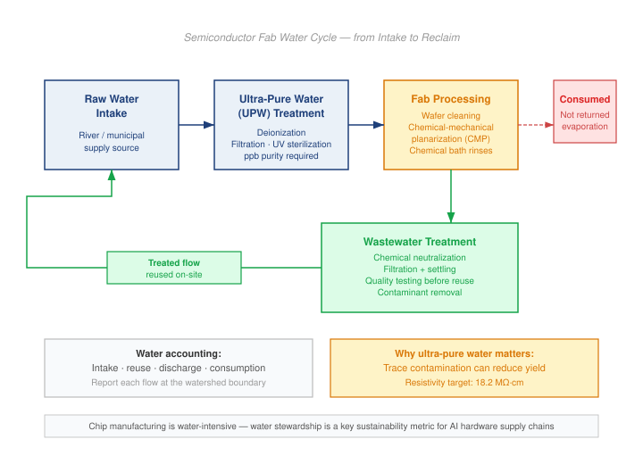

<!--
```{.tikz}
\providecolor{socnavy}{RGB}{30,41,59}        % Deep Oxford Navy (#1E293B)
\providecolor{socdark}{RGB}{51,65,85}        % Dark Slate (#334155)
\providecolor{socblue}{RGB}{37,99,235}       % Primary Datapath Blue (#2563EB)
\providecolor{socteal}{RGB}{15,118,110}      % Slate Teal (#0F766E)
\providecolor{socgreen}{RGB}{22,101,52}      % Forest Sage (#166534)
\providecolor{socamber}{RGB}{180,83,9}       % Warm Ochre / Amber (#B45309)
\providecolor{socred}{RGB}{185,28,28}        % Crimson / Burgundy (#B91C1C)

\providecolor{cardbg}{RGB}{255,255,255}
\providecolor{badgeblue}{RGB}{239,246,255}   % Soft blue tint
\providecolor{badgeteal}{RGB}{240,253,250}   % Soft teal tint
\providecolor{badgegreen}{RGB}{240,253,244}  % Soft green tint
\providecolor{badgeamber}{RGB}{254,243,199}  % Soft amber tint
\providecolor{badgered}{RGB}{254,242,242}    % Soft red tint

\providecolor{borderblue}{RGB}{191,219,254}
\providecolor{borderteal}{RGB}{153,246,228}
\providecolor{bordergreen}{RGB}{187,247,208}
\providecolor{borderamber}{RGB}{253,230,138}
\providecolor{borderred}{RGB}{254,202,202}
\providecolor{bordergray}{RGB}{226,232,240}


\scalebox{0.75}{%
\begin{tikzpicture}[
    font=\sffamily,
    >=Stealth,
    flowcard/.style={
        draw=bordergray,
        fill=white,
        rounded corners=3.5pt,
        line width=0.6pt,
        inner sep=6pt,
        minimum width=4.9cm,
        minimum height=3.8cm,
        anchor=north
    },
    infocard/.style={
        draw=bordergray,
        fill=white,
        rounded corners=3.5pt,
        line width=0.6pt,
        inner sep=7pt,
        minimum width=7.6cm,
        minimum height=3.4cm,
        anchor=north
    }
]

% ============================================================
% TOP HEADER CHIP
% ============================================================
\node[
    draw=borderteal,
    fill=badgeteal,
    rounded corners=2.5pt,
    line width=0.5pt,
    inner sep=3.5pt
] at (0, 0.55) {\bfseries\fontsize{6.5}{7.5}\selectfont\textcolor{socteal}{SEMICONDUCTOR FABRICATION WATER CYCLE $\cdot$ CLOSED-LOOP CIRCULARITY}};

% ============================================================
% ROW 1: PRIMARY SUPPLY PIPELINE (LEFT TO RIGHT)
% ============================================================

% Card 1: Raw Water Intake
\node[draw=borderblue, fill=cardbg, flowcard] (raw) at (-5.4, 0) {};
\node[anchor=north, text width=4.4cm, align=left, inner sep=0pt] at ($(raw.north)+(0, -0.30)$) {
    \centering
    {\setlength{\fboxsep}{2pt}\fcolorbox{borderblue}{badgeblue}{\bfseries\fontsize{5}{6}\selectfont\textcolor{socblue}{STAGE 1 $\cdot$ SOURCE}}}\\[3pt]
    {\bfseries\fontsize{7.5}{9}\selectfont\textcolor{socnavy}{Raw Water Intake}}\\[1.5pt]
    {\fontsize{5.5}{6.5}\selectfont\textcolor{gray!70!black}{Municipal \& Surface Sourcing}}\par
    \vspace{6pt}
    \raggedright
    {\fontsize{6}{7.5}\selectfont\textcolor{socdark}{\textbullet~River, aquifer \& municipal grid supply}}\\[3pt]
    {\fontsize{6}{7.5}\selectfont\textcolor{socdark}{\textbullet~Pre-treatment: settling \& media filtration}}\\[3pt]
    {\fontsize{6}{7.5}\selectfont\textcolor{socdark}{\textbullet~Water softening: hardness ion removal}}
};

% Card 2: UPW Treatment
\node[draw=borderteal, fill=cardbg, flowcard] (upw) at (0, 0) {};
\node[anchor=north, text width=4.4cm, align=left, inner sep=0pt] at ($(upw.north)+(0, -0.30)$) {
    \centering
    {\setlength{\fboxsep}{2pt}\fcolorbox{borderteal}{badgeteal}{\bfseries\fontsize{5}{6}\selectfont\textcolor{socteal}{STAGE 2 $\cdot$ PURIFY}}}\\[3pt]
    {\bfseries\fontsize{7.5}{9}\selectfont\textcolor{socnavy}{Ultrapure Water (UPW)}}\\[1.5pt]
    {\fontsize{5.5}{6.5}\selectfont\textcolor{gray!70!black}{Sub-ppb Purity Standard}}\par
    \vspace{6pt}
    \raggedright
    {\fontsize{6}{7.5}\selectfont\textcolor{socdark}{\textbullet~Two-pass high-flux Reverse Osmosis (RO)}}\\[3pt]
    {\fontsize{6}{7.5}\selectfont\textcolor{socdark}{\textbullet~Continuous Electrodeionization (CEDI)}}\\[3pt]
    {\fontsize{6}{7.5}\selectfont\textcolor{socteal}{\bfseries\textbullet~Purity Target: $18.2\text{ M}\Omega\cdot\text{cm}$ at $25^\circ\text{C}$}}
};

% Card 3: Fab Cleanroom Processing
\node[draw=borderamber, fill=cardbg, flowcard] (fab) at (5.4, 0) {};
\node[anchor=north, text width=4.4cm, align=left, inner sep=0pt] at ($(fab.north)+(0, -0.30)$) {
    \centering
    {\setlength{\fboxsep}{2pt}\fcolorbox{borderamber}{badgeamber}{\bfseries\fontsize{5}{6}\selectfont\textcolor{socamber}{STAGE 3 $\cdot$ FAB USAGE}}}\\[3pt]
    {\bfseries\fontsize{7.5}{9}\selectfont\textcolor{socnavy}{Fab Cleanroom Rinse}}\\[1.5pt]
    {\fontsize{5.5}{6.5}\selectfont\textcolor{gray!70!black}{Sub-nm Wafer Manufacturing}}\par
    \vspace{6pt}
    \raggedright
    {\fontsize{6}{7.5}\selectfont\textcolor{socdark}{\textbullet~Post-etch chemical cleans \& wafer rinses}}\\[3pt]
    {\fontsize{6}{7.5}\selectfont\textcolor{socdark}{\textbullet~CMP slurry removal \& brush scrubber sweeps}}\\[3pt]
    {\fontsize{6}{7.5}\selectfont\textcolor{socdark}{\textbullet~Immersion lithography rinse stations}}
};

% Horizontal Forward Arrows between Stages
\draw[->, line width=1.2pt, socblue, shorten >=3pt, shorten <=3pt] (raw.east) -- (upw.west);
\draw[->, line width=1.2pt, socteal, shorten >=3pt, shorten <=3pt] (upw.east) -- (fab.west);

% ============================================================
% ROW 2: CIRCULAR RECOVERY LOOP (RIGHT TO LEFT)
% ============================================================

% Card 4: Wastewater Treatment (Below Fab)
\node[draw=borderamber, fill=cardbg, flowcard] (waste) at (5.4, -5.6) {};
\node[anchor=north, text width=4.4cm, align=left, inner sep=0pt] at ($(waste.north)+(0, -0.30)$) {
    \centering
    {\setlength{\fboxsep}{2pt}\fcolorbox{borderamber}{badgeamber}{\bfseries\fontsize{5}{6}\selectfont\textcolor{socamber}{STAGE 4 $\cdot$ RECOVERY}}}\\[3pt]
    {\bfseries\fontsize{7.5}{9}\selectfont\textcolor{socnavy}{Wastewater Treatment}}\\[1.5pt]
    {\fontsize{5.5}{6.5}\selectfont\textcolor{gray!70!black}{Stream Segregation \& Polish}}\par
    \vspace{6pt}
    \raggedright
    {\fontsize{6}{7.5}\selectfont\textcolor{socdark}{\textbullet~Segregated copper, fluoride \& CMP drains}}\\[3pt]
    {\fontsize{6}{7.5}\selectfont\textcolor{socdark}{\textbullet~Chemical precipitation \& settling filters}}\\[3pt]
    {\fontsize{6}{7.5}\selectfont\textcolor{socred}{\bfseries\textbullet~20\%--40\% Consumptive Evaporation}}
};

% Card 5: Closed-Loop Reclaim (Below UPW)
\node[draw=bordergreen, fill=badgegreen!25, flowcard] (reclaim) at (0, -5.6) {};
\node[anchor=north, text width=4.4cm, align=left, inner sep=0pt] at ($(reclaim.north)+(0, -0.30)$) {
    \centering
    {\setlength{\fboxsep}{2pt}\fcolorbox{bordergreen}{badgegreen}{\bfseries\fontsize{5}{6}\selectfont\textcolor{socgreen}{STAGE 5 $\cdot$ CIRCULARITY}}}\\[3pt]
    {\bfseries\fontsize{7.5}{9}\selectfont\textcolor{socgreen}{On-Site Water Reclaim}}\\[1.5pt]
    {\fontsize{5.5}{6.5}\selectfont\textcolor{socnavy}{Advanced Polish \& Recycle}}\par
    \vspace{6pt}
    \raggedright
    {\fontsize{6}{7.5}\selectfont\textcolor{socdark}{\textbullet~Secondary RO \& ion exchange polishing}}\\[3pt]
    {\fontsize{6}{7.5}\selectfont\textcolor{socdark}{\textbullet~185\,nm UV trace organic destruction}}\\[3pt]
    {\fontsize{6}{7.5}\selectfont\textcolor{socgreen}{\bfseries\textbullet~Recovers 60\%--80\% of intake on-site}}
};

% Card 6: Facility Utility Reuse (Below Raw)
\node[draw=borderblue, fill=cardbg, flowcard] (reuse) at (-5.4, -5.6) {};
\node[anchor=north, text width=4.4cm, align=left, inner sep=0pt] at ($(reuse.north)+(0, -0.30)$) {
    \centering
    {\setlength{\fboxsep}{2pt}\fcolorbox{borderblue}{badgeblue}{\bfseries\fontsize{5}{6}\selectfont\textcolor{socblue}{STAGE 6 $\cdot$ FACILITY REUSE}}}\\[3pt]
    {\bfseries\fontsize{7.5}{9}\selectfont\textcolor{socnavy}{Utility Plant Operations}}\\[1.5pt]
    {\fontsize{5.5}{6.5}\selectfont\textcolor{gray!70!black}{Secondary Cooling \& Scrubbers}}\par
    \vspace{6pt}
    \raggedright
    {\fontsize{6}{7.5}\selectfont\textcolor{socdark}{\textbullet~Data center \& fab cooling tower loops}}\\[3pt]
    {\fontsize{6}{7.5}\selectfont\textcolor{socdark}{\textbullet~Wet scrubber acid gas neutralization}}\\[3pt]
    {\fontsize{6}{7.5}\selectfont\textcolor{socblue}{\bfseries\textbullet~Displaces municipal potable water draw}}
};

% Vertical connection: Fab down to Waste
\draw[->, line width=1.2pt, socamber, shorten >=3pt, shorten <=3pt] (fab.south) -- (waste.north);
\node[
    draw=borderamber,
    fill=badgeamber,
    rounded corners=2pt,
    line width=0.5pt,
    inner sep=2.5pt
] at (5.4, -4.7) {\bfseries\fontsize{5}{6}\selectfont\textcolor{socamber}{Spent Process Water}};

% Horizontal connection: Waste left to Reclaim
\draw[->, line width=1.2pt, socgreen, shorten >=3pt, shorten <=3pt] (waste.west) -- (reclaim.east);

% Horizontal connection: Reclaim left to Reuse
\draw[->, line width=1.2pt, socblue, shorten >=3pt, shorten <=3pt] (reclaim.west) -- (reuse.east);

% Vertical connection: Reclaim UP to UPW (Primary circular loop)
\draw[->, line width=1.3pt, socgreen, shorten >=3pt, shorten <=3pt] (reclaim.north) -- (upw.south);
\node[
    draw=bordergreen,
    fill=badgegreen,
    rounded corners=2pt,
    line width=0.5pt,
    inner sep=3pt
] at (0, -4.7) {\bfseries\fontsize{5.5}{6.5}\selectfont\textcolor{socgreen}{60\%--80\% High-Purity Reclaim Loop}};

% ============================================================
% ROW 3: BENCHMARK & SYSTEM INSIGHT CARDS
% ============================================================

% Info Card Left: Fab Intensity Benchmark
\node[draw=borderblue, fill=cardbg, infocard] (bench) at (-4.0, -10.0) {};
\node[anchor=north west, inner sep=0pt, text width=7.0cm, align=left] at ($(bench.north west)+(0.3, -0.30)$) {
    {\setlength{\fboxsep}{2pt}\fcolorbox{borderblue}{badgeblue}{\bfseries\fontsize{5}{6}\selectfont\textcolor{socblue}{FAB WATER CONSUMPTION BENCHMARK}}}\\[4pt]
    {\fontsize{7}{8.5}\selectfont\bfseries\textcolor{socnavy}{Silicon Manufacturing Water Intensity}}\\[3.5pt]
    {\fontsize{6}{7.5}\selectfont\textcolor{socdark}{\textbullet~\textbf{1--3 Gallons/$\text{cm}^2$}: Average water demand per unit finished wafer}}\\[2.5pt]
    {\fontsize{6}{7.5}\selectfont\textcolor{socdark}{\textbullet~\textbf{5--10 Million Gal/Day}: Megafab intake (city of 50,000 equivalent)}}\\[2.5pt]
    {\fontsize{6}{7.5}\selectfont\textcolor{gray!70!black}{\textbullet~\textbf{Embodied Scale}: Large dies ($\approx 800\text{ mm}^2$) amplify fab water}}
};

% Info Card Right: Why UPW Matters
\node[draw=borderamber, fill=cardbg, infocard] (upw_why) at (4.0, -10.0) {};
\node[anchor=north west, inner sep=0pt, text width=7.0cm, align=left] at ($(upw_why.north west)+(0.3, -0.30)$) {
    {\setlength{\fboxsep}{2pt}\fcolorbox{borderamber}{badgeamber}{\bfseries\fontsize{5}{6}\selectfont\textcolor{socamber}{PURITY SPECIFICATION CRITICALITY}}}\\[4pt]
    {\fontsize{7}{8.5}\selectfont\bfseries\textcolor{socnavy}{Why Ultrapure Water (UPW) is Mandatory}}\\[3.5pt]
    {\fontsize{6}{7.5}\selectfont\textcolor{socdark}{\textbullet~\textbf{Sub-nm Gate Integrity}: Trace ions short-circuit nanometer gates}}\\[2.5pt]
    {\fontsize{6}{7.5}\selectfont\textcolor{socdark}{\textbullet~\textbf{Theoretical Limit}: $18.2\text{ M}\Omega\cdot\text{cm}$ resistivity (zero mobile ions)}}\\[2.5pt]
    {\fontsize{6}{7.5}\selectfont\textcolor{gray!70!black}{\textbullet~\textbf{Energy Penalty}: UPW polishing consumes $2\text{--}3\text{ kWh}/\text{m}^3$}}
};

% ============================================================
% BOTTOM SUMMARY BANNER
% ============================================================
\node[
    draw=bordergray,
    fill=cardbg,
    rounded corners=3.5pt,
    line width=0.6pt,
    inner sep=7pt,
    anchor=north,
    text width=15.4cm
] (bottom_summary) at (0, -13.9) {
    {\fontsize{7}{8.5}\selectfont\bfseries\textcolor{socnavy}{Supply Chain Water Stewardship Mandate:}}\;
    {\fontsize{6.5}{8}\selectfont\textcolor{socnavy}{AI accelerator silicon production is profoundly water-intensive. Advanced foundries withdraw up to 10 million gallons of ultrapure water per day. Responsible full-lifecycle AI sustainability demands auditing embodied fab water intensity ($\text{gal/chip}$) alongside operational data center Water Usage Effectiveness ($\text{WUE}$).}}
};

\end{tikzpicture}
}
```
-->

:::

The critical takeaway from @fig-water-cycle is that reuse and consumption answer different questions. A fabrication plant can recycle substantial process water while still consuming water through evaporation or other unreturned flows. Site decisions require the complete watershed account.

Fabrication is also heavily reliant on hazardous chemicals for etching, doping, and cleaning. Strong acids (hydrofluoric, sulfuric), volatile organic compounds like xylene, and highly toxic gases (arsine, phosphine) are used in massive quantities---a large fab may consume over 2,000 metric tons of acids annually [@kim2018]. These substances create hazardous waste streams requiring extensive treatment to prevent ecological harm.

AI hardware depends on a suite of scarce and geopolitically sensitive **critical materials**\index{Critical Materials!definition}\index{Critical Materials!AI hardware}. While silicon is abundant, high-performance chips require rare elements like gallium, indium, tantalum, and helium. Materials such as indium appear in critical-materials and endangered-elements analyses because supply can depend on byproduct extraction, substitution options, and recycling constraints [@rhodes2019endangered]. The geographic concentration of rare earth refining creates significant supply chain vulnerabilities. @Tbl-material_depletion quantifies the scope of this material dependency challenge.

| **Material**            | **Application in AI Semiconductor Manufacturing**             | **Supply Concerns**                                                                 |
|:------------------------|:--------------------------------------------------------------|:------------------------------------------------------------------------------------|
| **Silicon (Si)**        | Primary substrate for chips, wafers, transistors              | • Processing constraints<br>• Geopolitical risks                                    |
| **Gallium (Ga)**        | GaN-based power amplifiers, high-frequency components         | • Limited availability<br>• Byproduct of aluminum and zinc production               |
| **Germanium (Ge)**      | High-speed transistors, photodetectors, optical interconnects | • Scarcity<br>• Geographically concentrated                                         |
| **Indium (In)**         | Indium tin oxide, optoelectronics                             | • Limited reserves<br>• Recycling dependency                                        |
| **Tantalum (Ta)**       | Capacitors, stable integrated components                      | • Conflict mineral<br>• Vulnerable supply chains                                    |
| **Rare earth elements** | Magnets, sensors, high-performance electronics                | • High geopolitical risks<br>• Environmental extraction concerns                    |
| **Cobalt (Co)**         | Batteries for edge computing devices                          | • Human rights issues<br>• Geographical concentration (Congo)                       |
| **Tungsten (W)**        | Interconnects, barriers, heat sinks                           | • Limited production sites<br>• Geopolitical concerns                               |
| **Copper (Cu)**         | Interconnects, barriers, heat sinks                           | • Limited high-purity sources<br>• Geopolitical concerns                            |
| **Helium (He)**         | Semiconductor cooling, plasma etching, EUV lithography        | • Nonrenewable<br>• Irretrievable atmospheric loss<br>• Limited extraction capacity |

: **Critical Materials for AI Hardware**: Semiconductor manufacturing relies on specific materials, including silicon, gallium, germanium, indium, tantalum, cobalt, tungsten, copper, helium, and rare earth elements, that face increasing supply constraints and geopolitical risks, potentially impacting AI hardware production and innovation. The table details these materials, their applications in AI systems, and the associated supply vulnerabilities requiring proactive mitigation strategies. {#tbl-material_depletion}

The construction and operation of fabs and data centers also directly impacts natural ecosystems through habitat disruption, water stress, and pollution from chemical discharge. Semiconductor-industry effluents can contaminate nearby fluvial sediments with heavy metals and trace elements [@hsu2016]. Waste generation from fabrication---including gaseous emissions, VOC-laden air, and metal-contaminated wastewater---requires advanced treatment systems, and the end-of-life disposal of AI hardware contributes to a growing e-waste crisis, with only 17.4 percent of global e-waste properly recycled [@singh2022].

The environmental toll of computational demand extends far beyond atmospheric carbon, manifesting as severe water stress and ecological disruption around manufacturing hubs. These supply-chain costs converge on the next design lever: how long massive, resource-intensive hardware clusters remain useful before they become waste.

## Hardware Lifecycle and E-Waste {#sec-sustainable-ai-hardware-lifecycle-environmental-assessment-66ee}

The environmental cost of an AI accelerator begins long before its first FLOP is calculated [@gupta2022chasing; @luccioni2023estimating; @nvidia2025hgxh100pcf]. The per-H100 manufacturing footprint quantified in @sec-sustainable-ai-embodied-carbon-assessment-9de0 is incurred entirely at fabrication.[^fn-lca-hardware-footprint] The fleet of thousands of such processors required to train the 175B parameter model---consuming 1,287 MWh of electricity---represents a significant upfront carbon investment before any computation occurs. A comprehensive **life cycle assessment (LCA)**\index{Life Cycle Assessment!definition} quantifies the cumulative environmental impact across four key phases: design, manufacture, use, and disposal. LCA can reveal manufacturing as a major share of lifecycle impact, making it a critical sustainability lever that operational efficiency improvements alone cannot address.

These four phases organize decisions over time; the earlier training, inference, and embodied-carbon account groups the emissions those decisions create. Experimentation contributes training and infrastructure costs, deployed training and inference enter the use phase, and manufacturing and disposal enter the embodied inventory. The groupings overlap and must not be added as independent totals.

[^fn-lca-hardware-footprint]: **Life Cycle Assessment (LCA)**\index{Life Cycle Assessment!ISO 14040 standard}\index{LCA|see{Life Cycle Assessment}}: Standardized by ISO 14040/14044, LCA traces environmental impact from raw material extraction through disposal [@iso140402006lca; @iso140442006lca]. For AI hardware, LCA separates embodied manufacturing emissions from operational energy use, making hardware refresh cycles and accelerator lifespan extension first-order sustainability levers that operational efficiency alone cannot substitute.

Before comparing hardware lifetimes, we need the amount of service each candidate fleet must deliver. The training-inference comparison fixes that operational demand over the proposed service interval.

::: {#chk-sustainable-ai-training-inference-flip .callout-checkpoint title="The training-inference flip"}

Consider a vision model where training requires 2,000 GPU-hours at an average power draw of 300 W. Once deployed, the model serves 1 million requests per day, with each request taking 50 ms at an average draw of 100 W.

- [ ] **Training energy**: calculate the total energy used for training.
- [ ] **Inference energy**: calculate the total energy used for inference over a 2-year product lifespan.
- [ ] **Optimization focus**: use the "Inference-to-Training Ratio" to select the optimization target that maximizes sustainability.

:::

Life Cycle Assessments can show that discarding functional hardware purely for modest efficiency gains causes more environmental harm through embodied carbon than it saves in operational power. Evaluating the tipping point where new hardware becomes environmentally justified requires estimating the intersection of training costs, inference scale, and hardware lifespans.

Each of the four primary lifecycle stages\index{Life Cycle Assessment!AI system lifecycle} contributes to an AI system's total environmental footprint. @Fig-ai-lca visualizes this progression from design through disposal, highlighting the interdependencies between phases and the environmental impact categories associated with each stage.

::: {#fig-ai-lca fig-env="figure" fig-pos="htb" fig-cap="**AI System Lifecycle**: Analyzing AI systems across design, manufacture, use, and disposal stages exposes the full environmental impact beyond operational energy consumption, encompassing resource depletion and electronic waste. This lifecycle assessment allows targeted interventions to improve sustainability throughout the entire AI system's existence." fig-alt="Four connected arrow boxes showing AI lifecycle phases: Design with computer icon, Manufacture with factory icon, Use with mobile device icon, and Disposal with recycling bin icon. Labeled as Life Cycle Analysis."}
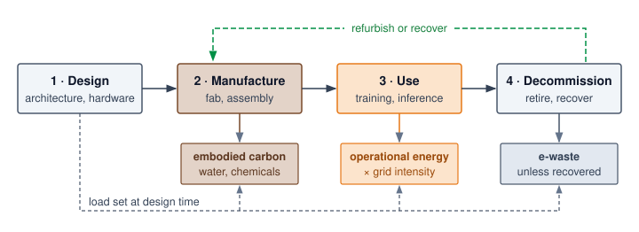

<!--
```{.tikz}
\definecolor{socnavy}{HTML}{1E293B}     % Deep Oxford Navy / Titles
\definecolor{socdark}{HTML}{334155}     % Slate Dark / Primary items
\definecolor{socblue}{HTML}{1D4ED8}     % Direct primary datapath
\definecolor{borderblue}{HTML}{93C5FD}  % Slate blue border
\definecolor{badgeblue}{HTML}{EFF6FF}   % Soft blue tint
\definecolor{socteal}{HTML}{0F766E}     % Muted Slate Teal / Fabric
\definecolor{borderteal}{HTML}{99F6E4}  % Teal border
\definecolor{badgeteal}{HTML}{F0FDFA}   % Soft teal tint
\definecolor{socgreen}{HTML}{166534}    % Forest Sage / Success
\definecolor{bordergreen}{HTML}{86EFAC} % Green border
\definecolor{badgegreen}{HTML}{F0FDF4}  % Soft green tint
\definecolor{socamber}{HTML}{B45309}    % Warm Ochre / Warning
\definecolor{borderamber}{HTML}{FCD34D} % Amber border
\definecolor{badgeamber}{HTML}{FFFBEB}  % Soft amber tint
\definecolor{socred}{HTML}{B91C1C}      % Crimson / Danger
\definecolor{borderred}{HTML}{FCA5A5}   % Red border
\definecolor{badgered}{HTML}{FEF2F2}    % Soft red tint
\definecolor{bordergray}{HTML}{CBD5E1}  % Slate frame border
\definecolor{cardbg}{HTML}{FFFFFF}      % Pure card background
\scalebox{0.75}{%
\begin{tikzpicture}[
    >=Stealth,
    font=\sffamily,
    phasecard/.style={
        fill=white,
        rounded corners=3.5pt,
        line width=0.6pt,
        inner sep=0pt,
        minimum width=3.48cm,
        minimum height=8.7cm,
        anchor=north
    },
    accentchip/.style={
        rounded corners=2.5pt,
        line width=0.5pt,
        inner sep=4pt,
        align=center,
        anchor=south
    }
]

% ============================================================
% TOP HEADER CHIP
% ============================================================
\node[
    draw=borderteal,
    fill=badgeteal,
    rounded corners=2.5pt,
    line width=0.5pt,
    inner sep=3.5pt
] at (0, 0.5) {\bfseries\fontsize{6.5}{7.5}\selectfont\textcolor{socteal}{LIFE CYCLE ASSESSMENT (LCA) $\cdot$ AI HARDWARE \& INFRASTRUCTURE FOOTPRINT}};

% ============================================================
% 4 PILLARS (CARDS)
% ============================================================

% CARD 1: SYSTEM DESIGN
\node[draw=bordergreen, fill=cardbg, phasecard] (c1) at (-5.70, 0) {};
\node[anchor=north, text width=3.25cm, align=left, inner sep=0pt] at ($(c1.north)+(0, -0.25)$) {
    \centering
    {\setlength{\fboxsep}{2pt}\fcolorbox{bordergreen}{badgegreen}{\bfseries\fontsize{5}{6}\selectfont\textcolor{socgreen}{STAGE 1 $\cdot$ SYSTEM DESIGN}}}\\[2.5pt]
    {\bfseries\fontsize{7.5}{9}\selectfont\textcolor{socnavy}{System Architecture}}\\[1.5pt]
    {\fontsize{5.5}{6.5}\selectfont\textcolor{gray!70!black}{Specification \& Planning}}\par
    \vspace{5pt}
    \raggedright
    {\fontsize{6.5}{7.5}\selectfont\bfseries\textcolor{socdark}{Architecture Selection}}\\[1pt]
    {\fontsize{5.5}{6.5}\selectfont\textcolor{gray!75!black}{Dense vs. sparse MoE routing}}\\[4pt]
    {\fontsize{6.5}{7.5}\selectfont\bfseries\textcolor{socdark}{Parameter Budgeting}}\\[1pt]
    {\fontsize{5.5}{6.5}\selectfont\textcolor{gray!75!black}{INT4/FP8 quantization \& pruning}}\\[4pt]
    {\fontsize{6.5}{7.5}\selectfont\bfseries\textcolor{socdark}{Accelerator Sizing}}\\[1pt]
    {\fontsize{5.5}{6.5}\selectfont\textcolor{gray!75!black}{Domain ASIC vs. GPU trade-offs}}\\[4pt]
    {\fontsize{6.5}{7.5}\selectfont\bfseries\textcolor{socdark}{Facility Siting}}\\[1pt]
    {\fontsize{5.5}{6.5}\selectfont\textcolor{gray!75!black}{Grid carbon intensity \& low PUE}}
};
\node[draw=bordergreen, fill=badgegreen, accentchip, text width=3.05cm] at ($(c1.south)+(0, 0.35)$) {
    {\bfseries\fontsize{5.5}{6.5}\selectfont\textcolor{socgreen}{System Leverage Principle}}\\[1.5pt]
    {\fontsize{5}{6}\selectfont\textcolor{socnavy}{Architects 90\%+ of lifecycle load}}
};

% CARD 2: MANUFACTURE
\node[draw=borderblue, fill=cardbg, phasecard] (c2) at (-1.90, 0) {};
\node[anchor=north, text width=3.25cm, align=left, inner sep=0pt] at ($(c2.north)+(0, -0.25)$) {
    \centering
    {\setlength{\fboxsep}{2pt}\fcolorbox{borderblue}{badgeblue}{\bfseries\fontsize{5}{6}\selectfont\textcolor{socblue}{STAGE 2 $\cdot$ HARDWARE FAB}}}\\[2.5pt]
    {\bfseries\fontsize{7.5}{9}\selectfont\textcolor{socnavy}{Silicon Manufacturing}}\\[1.5pt]
    {\fontsize{5.5}{6.5}\selectfont\textcolor{gray!70!black}{Fab, Assembly \& Logistics}}\par
    \vspace{5pt}
    \raggedright
    {\fontsize{6.5}{7.5}\selectfont\bfseries\textcolor{socdark}{Silicon Fabrication}}\\[1pt]
    {\fontsize{5.5}{6.5}\selectfont\textcolor{gray!75!black}{$300\,\text{mm}$ EUV wafer fabrication}}\\[4pt]
    {\fontsize{6.5}{7.5}\selectfont\bfseries\textcolor{socdark}{Mineral Extraction}}\\[1pt]
    {\fontsize{5.5}{6.5}\selectfont\textcolor{gray!75!black}{Copper, gold \& rare-earth mining}}\\[4pt]
    {\fontsize{6.5}{7.5}\selectfont\bfseries\textcolor{socdark}{Packaging \& Board}}\\[1pt]
    {\fontsize{5.5}{6.5}\selectfont\textcolor{gray!75!black}{2.5D CoWoS \& high-density PCB}}\\[4pt]
    {\fontsize{6.5}{7.5}\selectfont\bfseries\textcolor{socdark}{Global Freight}}\\[1pt]
    {\fontsize{5.5}{6.5}\selectfont\textcolor{gray!75!black}{Air \& ocean multimodal transit}}
};
\node[draw=borderblue, fill=badgeblue, accentchip, text width=3.05cm] at ($(c2.south)+(0, 0.35)$) {
    {\bfseries\fontsize{5.5}{6.5}\selectfont\textcolor{socblue}{Embodied Carbon Burden}}\\[1.5pt]
    {\fontsize{5}{6}\selectfont\textcolor{socnavy}{Emits 1--2 years operational draw}}
};

% CARD 3: USE & OPERATE
\node[draw=borderamber, fill=cardbg, phasecard] (c3) at (1.90, 0) {};
\node[anchor=north, text width=3.25cm, align=left, inner sep=0pt] at ($(c3.north)+(0, -0.25)$) {
    \centering
    {\setlength{\fboxsep}{2pt}\fcolorbox{borderamber}{badgeamber}{\bfseries\fontsize{5}{6}\selectfont\textcolor{socamber}{STAGE 3 $\cdot$ OPERATIONAL RUN}}}\\[2.5pt]
    {\bfseries\fontsize{7.5}{9}\selectfont\textcolor{socnavy}{Fleet Operations}}\\[1.5pt]
    {\fontsize{5.5}{6.5}\selectfont\textcolor{gray!70!black}{Training \& Serving Workloads}}\par
    \vspace{5pt}
    \raggedright
    {\fontsize{6.5}{7.5}\selectfont\bfseries\textcolor{socdark}{Cluster Pre-Training}}\\[1pt]
    {\fontsize{5.5}{6.5}\selectfont\textcolor{gray!75!black}{Megawatt-scale compute farms}}\\[4pt]
    {\fontsize{6.5}{7.5}\selectfont\bfseries\textcolor{socdark}{Autoregressive Serving}}\\[1pt]
    {\fontsize{5.5}{6.5}\selectfont\textcolor{gray!75!black}{Memory bandwidth decode tax}}\\[4pt]
    {\fontsize{6.5}{7.5}\selectfont\bfseries\textcolor{socdark}{Data Center PUE}}\\[1pt]
    {\fontsize{5.5}{6.5}\selectfont\textcolor{gray!75!black}{Chillers \& distribution losses}}\\[4pt]
    {\fontsize{6.5}{7.5}\selectfont\bfseries\textcolor{socdark}{Continuous Retraining}}\\[1pt]
    {\fontsize{5.5}{6.5}\selectfont\textcolor{gray!75!black}{Periodic RLHF \& fine-tuning}}
};
\node[draw=borderamber, fill=badgeamber, accentchip, text width=3.05cm] at ($(c3.south)+(0, 0.35)$) {
    {\bfseries\fontsize{5.5}{6.5}\selectfont\textcolor{socamber}{Operational Energy Tax}}\\[1.5pt]
    {\fontsize{5}{6}\selectfont\textcolor{socnavy}{Driven by marginal grid carbon}}
};

% CARD 4: DECOMMISSION
\node[draw=borderred, fill=cardbg, phasecard] (c4) at (5.70, 0) {};
\node[anchor=north, text width=3.25cm, align=left, inner sep=0pt] at ($(c4.north)+(0, -0.25)$) {
    \centering
    {\setlength{\fboxsep}{2pt}\fcolorbox{borderred}{badgered}{\bfseries\fontsize{5}{6}\selectfont\textcolor{socred}{STAGE 4 $\cdot$ DECOMMISSION}}}\\[2.5pt]
    {\bfseries\fontsize{7.5}{9}\selectfont\textcolor{socnavy}{End-of-Life Disposal}}\\[1.5pt]
    {\fontsize{5.5}{6.5}\selectfont\textcolor{gray!70!black}{Retirement, Toxics \& Circularity}}\par
    \vspace{5pt}
    \raggedright
    {\fontsize{6.5}{7.5}\selectfont\bfseries\textcolor{socdark}{Server Retirement}}\\[1pt]
    {\fontsize{5.5}{6.5}\selectfont\textcolor{gray!75!black}{Rapid 3--5 year hyperscale refresh}}\\[4pt]
    {\fontsize{6.5}{7.5}\selectfont\bfseries\textcolor{socdark}{Toxic Waste Streams}}\\[1pt]
    {\fontsize{5.5}{6.5}\selectfont\textcolor{gray!75!black}{Lead solder, bromine \& PFAS}}\\[4pt]
    {\fontsize{6.5}{7.5}\selectfont\bfseries\textcolor{socdark}{Material Recovery}}\\[1pt]
    {\fontsize{5.5}{6.5}\selectfont\textcolor{gray!75!black}{Under 20\% metal recovery}}\\[4pt]
    {\fontsize{6.5}{7.5}\selectfont\bfseries\textcolor{socdark}{Secondary Lifespan}}\\[1pt]
    {\fontsize{5.5}{6.5}\selectfont\textcolor{gray!75!black}{Refurbishment for tier-2 cloud}}
};
\node[draw=borderred, fill=badgered, accentchip, text width=3.05cm] at ($(c4.south)+(0, 0.35)$) {
    {\bfseries\fontsize{5.5}{6.5}\selectfont\textcolor{socred}{E-Waste Burden}}\\[1.5pt]
    {\fontsize{5}{6}\selectfont\textcolor{socnavy}{Landfill volume \& leaching liability}}
};

% Horizontal arrows between stages at badge level
\draw[->, line width=0.8pt, socgreen!80!black, shorten >=2.5pt, shorten <=2.5pt] ($(c1.north east)+(0, -0.38)$) -- ($(c2.north west)+(0, -0.38)$);
\draw[->, line width=0.8pt, socblue!80!black, shorten >=2.5pt, shorten <=2.5pt] ($(c2.north east)+(0, -0.38)$) -- ($(c3.north west)+(0, -0.38)$);
\draw[->, line width=0.8pt, socamber!80!black, shorten >=2.5pt, shorten <=2.5pt] ($(c3.north east)+(0, -0.38)$) -- ($(c4.north west)+(0, -0.38)$);

% ============================================================
% MIDDLE SECTION: CARBON FOOTPRINT SPLIT
% ============================================================
\node[
    draw=bordergray,
    fill=cardbg,
    rounded corners=3.5pt,
    line width=0.6pt,
    minimum width=15.1cm,
    minimum height=1.9cm,
    anchor=north
] (splitbox) at (0, -9.05) {};

\node[anchor=west, font=\bfseries\fontsize{6.5}{7.5}\selectfont, text=socnavy] at (-7.25, -9.40) {
    TYPICAL HYPERSCALE AI SYSTEM LIFECYCLE CARBON FOOTPRINT BREAKDOWN
};

% Stacked Bar segments (Total width: 14.5cm, spanning from -7.25 to +7.25)
% Segment 1: Design (5% -> 0.725cm)
\draw[draw=bordergreen, fill=badgegreen, rounded corners=2pt, line width=0.5pt] (-7.25, -9.75) rectangle (-6.525, -10.35);
\node[socgreen, font=\bfseries\fontsize{5.5}{6.5}\selectfont] at (-6.89, -10.05) {5\%};

% Segment 2: Embodied (45% -> 6.525cm)
\draw[draw=borderblue, fill=badgeblue, rounded corners=2pt, line width=0.5pt] (-6.475, -9.75) rectangle (0.05, -10.35);
\node[socblue, font=\bfseries\fontsize{6.5}{7.5}\selectfont] at (-3.21, -10.05) {45\% $\cdot$ Embodied Hardware Fab};

% Segment 3: Operational (40% -> 5.80cm)
\draw[draw=borderamber, fill=badgeamber, rounded corners=2pt, line width=0.5pt] (0.10, -9.75) rectangle (5.90, -10.35);
\node[socamber, font=\bfseries\fontsize{6.5}{7.5}\selectfont] at (3.00, -10.05) {40\% $\cdot$ Operational Power Draw};

% Segment 4: Decommission (10% -> 1.45cm)
\draw[draw=borderred, fill=badgered, rounded corners=2pt, line width=0.5pt] (5.95, -9.75) rectangle (7.40, -10.35);
\node[socred, font=\bfseries\fontsize{5.5}{6.5}\selectfont] at (6.67, -10.05) {10\% Waste};

% ============================================================
% BOTTOM SECTION: EMBODIED CARBON DOMINANCE PRINCIPLE
% ============================================================
\node[
    draw=borderblue,
    fill=badgeblue!40,
    rounded corners=3.5pt,
    line width=0.6pt,
    text width=14.5cm,
    inner sep=8pt,
    anchor=north
] (botcard) at (0, -11.30) {
    {\setlength{\fboxsep}{2pt}\fcolorbox{borderblue}{badgeblue}{\bfseries\fontsize{5.5}{6.5}\selectfont\textcolor{socblue}{EMBODIED CARBON DOMINANCE PRINCIPLE}}}\\[3.5pt]
    {\fontsize{7}{9}\selectfont\textcolor{socnavy}{Fabricating advanced accelerator silicon and high-bandwidth memory (HBM) packages emits greenhouse gases equivalent to 1--2 years of continuous, full-load operational power draw. Because hardware production carries this immense upfront carbon debt, extending server operational lifespans from 3 to 5 years and maximizing hardware utilization deliver substantially greater lifetime emissions reductions than software-only algorithmic pruning.}}
};

\end{tikzpicture}
}
```
-->

:::

The lifecycle sequence is not a static taxonomy. The binding sustainability problem shifts as the system matures: design creates experimental waste, manufacturing locks in embodied carbon, use couples the workload to grid and cooling constraints, disposal externalizes e-waste, and lifespan extension becomes the lever that amortizes all earlier emissions over more useful work.

### Design and experimentation phase {#sec-sustainable-ai-design-phase-0954}

The design phase\index{Life Cycle Assessment!design and architecture phase} encompasses the research, development, and optimization of ML models before deployment. Public training-energy figures generally describe a final run rather than the trial-and-error that preceded it. Automated architecture search can evaluate many configurations, but its footprint depends on whether the boundary includes proxy searches, full runs, data-center overhead, grid mix, and reuse across downstream models [@strubell2019; @patterson2021carbon]. Later efficient NAS methods use weight sharing, continuous relaxations, and hardware-aware search to reduce that search budget [@elsken2019]. @Tbl-training-emissions identifies the boundaries needed before comparing final-run footprints across model scales.

| **Accounting input**             | **Why it matters**                                                     |
|:---------------------------------|:-----------------------------------------------------------------------|
| **Training work**                | Operation count describes workload scale, not energy by itself         |
| **Measured energy and boundary** | Includes the declared accelerator, IT, or facility components          |
| **Grid factor and period**       | Converts electricity to emissions under the selected accounting method |
| **Development scope**            | Separates the final run from search, failed runs, and evaluation       |

: **Training Carbon Comparisons**: Compare model footprints only after aligning workload, energy boundary, grid factors, and development scope. The chapter's opening GPT-3 scenario supplies one worked account; operation counts alone do not rank model emissions. {#tbl-training-emissions}

Addressing the design phase's sustainability challenges requires innovations in training efficiency: sparse training, low-precision arithmetic, weight-sharing, and energy-aware NAS approaches. Transfer learning and fine-tuning pretrained models reuse pretrained representations instead of requiring every task to be trained from scratch [@Raffel2020exploring].

### Manufacturing phase {#sec-sustainable-ai-manufacturing-phase-4ce1}

The manufacturing footprint\index{Life Cycle Assessment!manufacturing and fabrication} combines the embodied carbon established in @sec-sustainable-ai-embodied-carbon-assessment-9de0 with the water, chemical, and material demands in @sec-sustainable-ai-water-usage-caae. Accelerator design changes how much of that resource investment produces a usable device.

Two structural properties of AI accelerators amplify this manufacturing footprint relative to conventional chips. First, high-performance AI chips are typically fabricated at or near the reticle limit---the maximum die area a single lithography exposure can print. Larger dies yield fewer chips per wafer and are disproportionately vulnerable to random defects: a defect density that kills 5 percent of small dies may kill 20 percent or more of a reticle-limit die, effectively wasting the water, chemicals, and EUV energy consumed in fabricating every defective unit. Second, the memory bandwidth requirements of large-scale inference and training demand advanced 2.5D and 3D packaging---such as TSMC's Chip-on-Wafer-on-Substrate (CoWoS) process---that places high bandwidth memory stacks alongside the accelerator on an interposer within a package. This integration introduces additional fabrication stages, chemical cleaning cycles, and precision baking steps that a conventional monolithic CPU does not require. The result is that each viable AI accelerator embodies substantially more water consumption, hazardous chemical use, and process energy than its wafer area alone would suggest, making hardware longevity and high utilization first-order sustainability levers rather than secondary concerns.

Longer useful service spreads that manufacturing investment across more work. Lower-toxicity materials, recycling, and cleaner manufacturing address the production burden itself [@cenci2021; @irimia-vladu2014].

### Use phase {#sec-sustainable-ai-use-phase-a0a1}

The operational energy consumed during training and inference\index{Life Cycle Assessment!operational use phase} is detailed in @sec-sustainable-ai-training-vs-inference-energy-analysis-4cb5. What merits attention here is the pattern of this consumption and its interaction with grid infrastructure. The 1,287 MWh required to train the 175B model represents a high, continuous power draw---but the character of that draw is not uniform across workload types, and that distinction shapes what scheduling interventions are practical.

A large distributed training run draws sustained aggregate power with the correlated phase transitions described in the power-delivery analysis, and is often described as inflexible. This characterization understates the scheduling flexibility that distributed training already builds in for fault tolerance. Because a single hardware failure in a thousand-node cluster can corrupt a run, production training systems checkpoint state to persistent storage every few minutes to hours. That checkpointing infrastructure is exactly the mechanism that enables carbon-aware scheduling: a training job can be paused during the late-afternoon grid peak (when solar generation drops and fossil peaker plants come online), with cluster state saved to checkpoint, and resumed when overnight wind generation raises renewable availability. The same engineering that protects against hardware failures thus doubles as a scheduling lever for grid decarbonization---a coupling of fault tolerance and sustainability. Online inference has tighter delay budgets and may support bounded preemption, while offline inference can often be deferred more freely.

The **duck curve**\index{Duck Curve!definition} describes the net-load ramp as solar generation falls. A constant data-center load raises the level of net demand but does not by itself increase the ramp rate. A flexible load can reduce the required ramp by curtailing during that interval\index{Duck Curve!training pause during peak ramp}. Schedule from local forecasts and marginal emissions signals; a universal daily pause window would ignore regional generation and transmission conditions.

### Disposal, e-waste, and embedded AI {#sec-sustainable-ai-disposal-phase-b4f1}

The rapid pace of innovation in AI hardware creates a relentless upgrade cycle\index{Life Cycle Assessment!disposal and e-waste} [@slade2007], contributing to a growing global crisis of electronic waste (e-waste)\index{Electronic waste!AI hardware obsolescence}. Globally, humanity generates over 50 million metric tons of e-waste annually, of which only 17.4 percent is formally documented as collected and properly recycled [@singh2022]. The high-performance servers used for training large models have a typical service life of just three to five years before they are considered obsolete. Discarded AI hardware contains toxic materials---lead, mercury, cadmium, and beryllium---that can leach into soil and groundwater when disposed of in landfills or informal recycling facilities [@grossman2007high].

Memory capacity, bandwidth, and interconnect compatibility can motivate replacement before accelerators physically fail. In tightly integrated systems, a new accelerator generation may require baseboard, networking, or server changes; PCIe-based designs can offer different upgrade options. Evaluate the actual compatibility boundary and reuse path. Replacement does not automatically mean disposal, and a functioning retired node may remain useful for less demanding workloads.

The problem is compounded by the rise of **embedded AI**\index{Embedded AI!definition}, where machine learning capabilities are integrated into billions of consumer devices. @Fig-iot-number traces the connected-device population\index{IoT!device growth} from 8.6 billion in 2019 to a projected 29.42 billion by 2030, a more than threefold rise over the decade with the historical-to-projected boundary falling around 2024 [@Statista_2022]. That trajectory creates a distributed, low-value, and exceptionally difficult-to-recycle form of e-waste. Many AI-powered IoT sensors, wearables, and smart appliances are built with short lifespans and limited upgradability, making them difficult or impossible to repair or recycle [@Balde_2017]. Nonreplaceable lithium-ion batteries, sealed enclosures, and proprietary components ensure that even minor failures lead to complete device replacement.

::: {#fig-iot-number fig-env="figure" fig-pos="htb" fig-cap="**IoT Device Growth**: Rapid expansion in the number of connected devices amplifies the environmental impact of embedded AI systems, as short device lifecycles contribute to escalating electronic waste. Projections approaching 30 billion devices by 2030 necessitate sustainable design and improved recycling infrastructure to mitigate the growing e-waste crisis." fig-alt="Bar chart showing IoT device growth from 8.6 billion in 2019 to projected 29.42 billion in 2030. Steady annual increases of approximately 2 billion devices per year. Asterisks mark projected values from 2024 onward."}

```{python}
#| echo: false
#| warning: false
import matplotlib.pyplot as plt
import numpy as np
from binder.tools.figures import style as book_style

fig, ax, COLORS, plt = book_style.setup_plot(figsize=(9.5, 4.8))

c_dark = COLORS['primary']
c_blue = COLORS['BlueLine']
c_proj = COLORS['VioletLine']
c_gray = COLORS['secondary']
c_border = COLORS['grid']

hist_yrs = ['2019', '2020', '2021', '2022', '2023']
hist_vals = [8.6, 9.8, 11.3, 13.1, 15.1]

proj_yrs = ['2024*', '2025*', '2026*', '2027*', '2028*', '2029*', '2030*']
proj_vals = [17.8, 19.1, 21.1, 23.1, 25.2, 27.3, 29.4]

x_hist = np.arange(len(hist_yrs))
x_proj = np.arange(len(proj_yrs)) + len(hist_yrs)
width = 0.58

b_hist = ax.bar(x_hist, hist_vals, width, label='Historical Data', color=COLORS['BlueFill'], edgecolor=c_blue, linewidth=1.2)
b_proj = ax.bar(x_proj, proj_vals, width, label='Statista Projections (*)', color=COLORS['VioletL'], edgecolor=c_proj, hatch='///', linewidth=1.2)

for x_val, y_val in zip(x_hist, hist_vals):
    ax.text(x_val, y_val + 0.5, f'{y_val}', ha='center', va='bottom', fontsize=7.8, fontweight='bold', color=c_blue)

for x_val, y_val in zip(x_proj, proj_vals):
    ax.text(x_val, y_val + 0.5, f'{y_val}', ha='center', va='bottom', fontsize=7.8, fontweight='bold', color=c_proj)

split_x = len(hist_yrs) - 0.5
ax.axvline(split_x, color=c_gray, linestyle='--', linewidth=1.2)
ax.text(
    split_x,
    34.0,
    'Historical / Projection Split',
    ha='center',
    va='bottom',
    fontsize=7.8,
    fontweight='bold',
    color=c_gray,
    bbox=dict(boxstyle='round,pad=0.25', facecolor='#FFFFFF', edgecolor=c_gray, lw=0.8),
)

all_x = np.concatenate([x_hist, x_proj])
all_yrs = hist_yrs + proj_yrs
ax.set_xticks(all_x)
ax.set_xticklabels(all_yrs, fontsize=8.0, fontweight='bold', color=c_dark)
ax.set_ylim(0, 37.0)
ax.set_ylabel('Active Connected Devices (Billions)', fontsize=9.2, fontweight='bold', color=c_dark)
ax.legend(loc='upper left', frameon=True, facecolor='#FFFFFF', edgecolor=c_border, fontsize=8.2)
ax.tick_params(colors=c_dark, labelsize=8.0)
ax.grid(True, linestyle='--', alpha=0.5, axis='y')

plt.tight_layout()
plt.show()
```

:::

Short product lifecycles accelerate the cycle: limited software support windows, proprietary components that prevent repair, and sealed designs that make disassembly difficult all push devices toward replacement instead of reuse. A disproportionate share of this e-waste burden falls on developing nations, which often receive shipments of discarded electronics from wealthier countries, leading to significant environmental and social costs for populations least equipped to manage them.

### Hardware lifespan extension {#sec-sustainable-ai-extending-hardware-lifespan-b028}

Countering the linear "take-make-dispose" model requires a shift toward a **circular economy**\index{Circular Economy!definition} [@stahel2016] that prioritizes reuse, refurbishment, and recycling. When embodied carbon dominates the lifecycle account, extending the functional lifespan of AI hardware\index{Circular Economy!hardware lifespan extension} is one of the largest reduction levers because it amortizes high manufacturing emissions over a longer period. Extending server life from three to five years reduces embodied carbon per year of service by 40 percent, a gain that can exceed many local software optimizations.

Four lifecycle interventions extend hardware service life by making systems repairable, upgradeable, supported, and reusable. Ensuring systems remain repairable, right-to-repair\index{Right-to-Repair!hardware lifespan extension}\index{Circular Economy!right-to-repair} initiatives and legislation dismantle artificial service restrictions by guaranteeing access to replacement components, specialized tools, schematics, and diagnostic firmware [@ftc2021nixingfix]. Supporting modular upgradeability, modular design\index{Circular Economy!modular design} decouples accelerators, memory modules, and high-speed networking fabrics, preventing entire server chassis from being scrapped when only a single subsystem reaches obsolescence [@framework2022modular]. Maintaining operational viability requires extended support cycles\index{Circular Economy!extended support cycles}, where vendors provide prolonged driver updates, kernel backports, and security patches that keep functional accelerators secure and operational rather than pushing them into premature retirement [@forti2020ewaste]. Finally, structured secondary-use programs\index{Circular Economy!secondary-use programs} cascade older accelerator generations from primary latency-critical serving fleets into batch processing, internal development clusters, and academic research environments, continuing to amortize their initial embodied carbon rather than routing them to disposal.

These interventions move sustainability from disposal management to lifecycle engineering. For a replacement decision, we compare two ways of delivering the same future service: continued operation of the existing fleet and operation of a replacement fleet. The original manufacturing emissions have already occurred under either choice. Replacement adds a new manufacturing burden, which must be weighed against operational savings over the remaining service interval, along with disposal and any useful second life for the retired hardware. A lower annual amortized figure alone cannot settle that decision.

## Mitigation Strategies {#sec-sustainable-ai-part-iii-implementation-solutions-232d}

When a data center hits its absolute power ceiling, the operator cannot simply buy more GPUs. Supporting additional useful work requires reducing the power needed for that work, changing its schedule, or securing additional feasible capacity. Algorithmic optimization can reduce executed work and data movement; infrastructure changes can reduce overhead. Carbon-aware placement addresses a different constraint by changing the emissions associated with electricity use, even when energy demand stays fixed.

The measurement frameworks developed in earlier sections revealed where environmental costs concentrate: training dominates for research workloads, inference dominates for deployed services, and manufacturing contributes a baseline that operational efficiency cannot eliminate. The findings guide implementation strategy along three axes: algorithmic optimization reduces per-operation costs, infrastructure choices determine whether those savings translate to actual emissions reduction, and policy frameworks ensure industry-wide adoption.

Implementation must account for Jevons Paradox[^fn-jevons-efficiency-paradox] (principle \ref{pri-jevons-paradox}): making models 10$\times$ more efficient can increase total usage enough to erase or even exceed the expected energy savings, because cheaper computation enables entirely new applications that were previously economically infeasible. This **rebound effect**\index{Rebound Effect!definition}\index{Jevons Paradox!efficiency rebound} is why sustainability strategies must focus on absolute limits (carbon budgets\index{Carbon budget!absolute limits}, renewable sourcing) rather than just rate efficiency (FLOP/s per watt), combining technical optimization with usage governance that prevents efficiency gains from being offset by exponential growth in deployment scale.

### Multi-layer mitigation strategy framework {#sec-sustainable-ai-multilayer-mitigation-strategy-framework-80f2}

The most counterintuitive obstacle to sustainable AI is not inefficiency but success, which is why mitigation must choose both which layer owns each reduction and which absolute budget prevents rebound. Energy-efficient model design, optimized hardware deployment, sustainable infrastructure operations, and carbon-aware scheduling each attack a different term in the lifecycle footprint. Framework selection matters only insofar as it changes computation, memory movement, utilization, or reporting. Lifecycle-aware design keeps the optimization from ending at deployment by checking whether savings survive training, inference, manufacturing, and use.

[^fn-jevons-efficiency-paradox]: **Jevons Paradox**\index{Jevons Paradox!definition}: @jevons1865coal described how efficiency could stimulate demand enough to increase total coal use. As an illustrative AI scenario, a tenfold reduction in measured energy per task accompanied by a hundredfold increase in task volume raises total energy tenfold. Price reductions alone do not establish either energy factor; measure both unit energy and demand.

@Fig-jevons-ai captures this effect: as the cost per unit of computation drops, usage rises faster than efficiency brings the per-unit cost down, so total consumption, and environmental impact, rises rather than falls.

::: {#fig-jevons-ai fig-env="figure" fig-pos="htb" fig-cap="**Jevons Paradox in AI Workloads**: Decreasing unit computation costs ($P_1 \to P_2$) expands workload demand ($Q_1 \to Q_2$) when demand elasticity exceeds unity. While per-operation efficiency yields theoretical savings on base volume, the induced rebound consumption surge from new automated and agentic workloads can exceed total savings, producing higher net energy consumption unless constrained by absolute budget controls." fig-alt="Supply-demand chart illustrating Jevons Paradox. The vertical axis shows unit cost dropping from P1 to P2, while the horizontal axis shows AI compute volume expanding from Q1 to Q2. Shaded areas contrast theoretical savings against a larger rebound consumption surge."}

```{python}
#| echo: false
#| warning: false
import matplotlib.pyplot as plt
import numpy as np
from binder.tools.figures import style as book_style

book_style.set_book_style()
COLORS = book_style.COLORS
fig, (ax_curve, ax_trap) = plt.subplots(1, 2, figsize=(11.5, 5.2), gridspec_kw={'width_ratios': [1.3, 1.0]})

c_dark = COLORS['primary']
c_gray = COLORS['secondary']
c_border = COLORS['grid']

q0, q1 = 2.4, 7.6
p0, p1 = 4.8, 2.4

ax_curve.fill_between([0, q0], [0, 0], [p1, p1], color='#F8FAFC', edgecolor=c_border, lw=1.0)
ax_curve.text(q0 / 2, p1 / 2, 'Retained\nBase Volume', ha='center', va='center', fontsize=8.0, color=c_gray)

ax_curve.fill_between([0, q0], [p1, p1], [p0, p0], color=COLORS['GreenL'], edgecolor=COLORS['GreenLine'], linestyle='--', lw=1.2)
ax_curve.text(
    q0 / 2,
    (p0 + p1) / 2,
    "THEORETICAL\nSAVINGS\n(Cost Drop × $Q_0$)",
    ha='center',
    va='center',
    fontsize=7.8,
    fontweight='bold',
    color=COLORS['GreenLine'],
    linespacing=1.2,
)

ax_curve.fill_between([q0, q1], [0, 0], [p1, p1], color=COLORS['RedL'], edgecolor=COLORS['RedLine'], linestyle='--', lw=1.2)
ax_curve.text(
    (q0 + q1) / 2,
    p1 / 2,
    "REBOUND CONSUMPTION\nSURGE\n\nArea(Rebound) > Area(Savings)",
    ha='center',
    va='center',
    fontsize=7.8,
    fontweight='bold',
    color=COLORS['RedLine'],
    linespacing=1.2,
)

q_vals = np.linspace(0.8, 9.5, 100)
p_vals = 4.8 * (q0 / q_vals) ** 0.65
ax_curve.plot(q_vals, p_vals, color=COLORS['BlueLine'], linewidth=2.8, zorder=4)

ax_curve.plot(q0, p0, 'o', color=COLORS['BlueLine'], markersize=7.0, zorder=5)
ax_curve.plot(q1, p1, 'o', color=COLORS['RedLine'], markersize=7.0, zorder=5)

ax_curve.text(
    6.0,
    3.8,
    'Elastic Demand Curve: D(P)',
    color=COLORS['BlueLine'],
    fontsize=8.0,
    fontweight='bold',
    bbox=dict(boxstyle='round,pad=0.25', facecolor='#FFFFFF', edgecolor=COLORS['BlueLine'], lw=0.9),
)

ax_curve.set_xlim(0, 10.2)
ax_curve.set_ylim(0, 6.5)
ax_curve.set_xticks([q0, q1])
ax_curve.set_xticklabels([r'$Q_0$: Base Volume', r'$Q_1$: Rebound Volume'], fontsize=8.0, fontweight='bold', color=c_dark)
ax_curve.set_yticks([p1, p0])
ax_curve.set_yticklabels([r'$P_1$: Reduced Cost', r'$P_0$: Initial Cost'], fontsize=8.0, fontweight='bold', color=c_dark)
ax_curve.set_xlabel('AI Compute Volume', fontsize=9.2, fontweight='bold', color=c_dark)
ax_curve.set_ylabel('Unit Cost ($ / FLOP)', fontsize=9.2, fontweight='bold', color=c_dark)
ax_curve.set_title('(a) Demand Elasticity & Rebound Surge', fontsize=9.8, fontweight='bold', color=c_dark)
ax_curve.tick_params(colors=c_dark, labelsize=8.0)
ax_curve.grid(True, linestyle='--', alpha=0.4)

ax_trap.axis('off')
ax_trap.set_xlim(0, 1)
ax_trap.set_ylim(0, 1)

ax_trap.text(0.5, 0.98, '(b) The Jevons Efficiency Trap', fontsize=9.8, fontweight='bold', color=c_dark, ha='center', va='top')

trap1_text = (
    r"$\mathbf{1.\ ELASTICITY\ >\ 1\ MECHANISM}$" + "\n"
    r"• Unit Gain: Quantization & pruning slash cost −50%" + "\n"
    r"• Transition: Batch luxury becomes omnipresent utility" + "\n"
    r"• Dynamics: Lower unit cost explodes aggregate demand"
)
ax_trap.text(
    0.04,
    0.90,
    trap1_text,
    ha='left',
    va='top',
    fontsize=7.5,
    color=c_dark,
    linespacing=1.3,
    bbox=dict(boxstyle='round,pad=0.45', facecolor='#FFFBEB', edgecolor=COLORS['OrangeLine'], lw=0.9),
)

trap2_text = (
    r"$\mathbf{2.\ SYSTEMS\ REBOUND\ LEVERS}$" + "\n"
    r"• Agentic Loops: Multi-step tool loops execute 100$\times$ calls" + "\n"
    r"• Continuous AI: Streaming edge computer vision & audio" + "\n"
    r"• Synthetic Data: LLM pipelines generating pre-training tokens" + "\n"
    r"• Speculation: Speculative sampling and tree branch search"
)
ax_trap.text(
    0.04,
    0.60,
    trap2_text,
    ha='left',
    va='top',
    fontsize=7.5,
    color=c_dark,
    linespacing=1.3,
    bbox=dict(boxstyle='round,pad=0.45', facecolor='#FEF2F2', edgecolor=COLORS['RedLine'], lw=0.9),
)

trap3_text = (
    r"$\mathbf{3.\ ABSOLUTE\ BUDGET\ CONTROLS}$" + "\n"
    r"• Datacenter: Enforce hard aggregate MW power envelopes" + "\n"
    r"• Matching: Hourly 24/7 carbon matching & curtailment" + "\n"
    r"• Governance: Quota throttling for automated agent loops"
)
ax_trap.text(
    0.04,
    0.26,
    trap3_text,
    ha='left',
    va='top',
    fontsize=7.5,
    color=c_dark,
    linespacing=1.3,
    bbox=dict(boxstyle='round,pad=0.45', facecolor='#F0FDF4', edgecolor=COLORS['GreenLine'], lw=0.9),
)

ax_trap.text(
    0.5, 0.01, 'Economic Principle: Jevons (1865) / Khazzoom-Brookes', fontsize=7.2, fontstyle='italic', color=c_gray, ha='center', va='bottom'
)

plt.tight_layout()
plt.show()
```

:::

The paradox has profound implications for sustainable AI strategy because total energy depends on both per-query cost and demand elasticity.

::: {#chk-sustainable-ai-efficiency-trap-jevons-paradox .callout-checkpoint title="The efficiency trap (Jevons Paradox)"}

An engineering team optimizes a translation service, reducing measured energy per query by 50 percent (2$\times$ efficiency gain) at fixed quality. Assume the service passes that saving through as a proportional price reduction and that grid intensity stays unchanged.

- [ ] **Inelastic demand**: calculate the change in total energy consumption when demand is inelastic and price change does not affect usage.
- [ ] **Elastic demand**: calculate the net change in total energy consumption when a 50 percent cost reduction leads to a 300 percent increase in query volume.
- [ ] **Rebound effect**: define how this "rebound effect" challenges the assumption that "efficient models are automatically green models."

:::

Jevons Paradox does not invalidate efficiency as a strategy; it simply means that efficiency must be paired with governance and capacity planning. At the level of individual systems, efficiency remains a central lever because it directly reduces cost, latency, and energy per useful operation.

::: {#psp-sustainable-ai-efficiency-as-sustainability .callout-perspective title="Efficiency as sustainability"}

Model optimizations become sustainability tools only when they reduce measured lifecycle cost at fixed quality. Pruning can remove computation and memory traffic when the hardware skips the resulting structure. Quantization reduces representation size and may accelerate supported kernels, while knowledge distillation trades additional training for a smaller serving model. Each technique can also fail to reduce wall energy when its overhead or deployment regime leaves the dominant term unchanged.

Performance engineering supplies candidate interventions, but the environmental result still needs measurement. A faster run reduces energy only if the shorter duration outweighs any increase in average power; lower memory use helps only if it removes powered work or capacity. Hardware-software co-design becomes a sustainability gain when these savings survive the lifecycle boundary and the deployed workload volume.

The fundamental insight is that sustainable AI engineering overlaps strongly with efficient AI engineering, but extends beyond it. The engineering principles that enable systems to scale, perform better, and cost less to operate can also reduce environmental impact, but sustainability adds lifecycle accounting, carbon-aware placement, absolute resource budgets, water and materials constraints, and governance against rebound effects. Sustainability is an integral part of good systems engineering, not a synonym for efficiency alone.

:::

### Lifecycle-aware development methodologies {#sec-sustainable-ai-lifecycleaware-development-methodologies-bf40}

Lifecycle-aware development starts from the largest environmental term in the workload and then selects the intervention that changes that term. Algorithmic design, infrastructure optimization, operational practice, and governance reduce impact only when they are sequenced around the measured bottleneck rather than applied as a generic checklist [@uddin2012].

#### Energy-efficient algorithmic design {#sec-sustainable-ai-energyefficient-algorithmic-design-e71c}

Many deep learning models rely on billions of parameters, requiring trillions of FLOPs during training and inference.[^fn-flops-distinction-metric] While these large models achieve top benchmark scores, research indicates that much of their computational complexity is unnecessary. Many parameters contribute little to final predictions, leading to wasteful resource consumption. Sustainable AI development treats energy efficiency as a design constraint rather than an optimization afterthought, requiring hardware-software co-design approaches that simultaneously optimize algorithmic choices and their hardware implementation for maximum efficiency per unit of computational capability.

[^fn-flops-distinction-metric]: **FLOP/s vs. FLOPs**\index{FLOP/s vs. FLOPs!definition}\index{FLOP/s!energy distinction}: FLOP/s denotes a rate; FLOPs denotes an operation count. Neither alone determines energy. Integrating system power over execution time includes arithmetic, data movement, idle intervals, and supporting components. A faster implementation can reduce static energy by finishing sooner, but its total saving depends on the power required to achieve that rate.

When the measured bottleneck is unused structure, bit width, or serving scale, the sustainable design lever changes. @Tbl-sustainable-ai-algorithmic-levers maps the bottleneck to the intervention that changes the energy term.

| **Technique**                                      | **Measured bottleneck** | **Energy mechanism**                                                                          | **Representative evidence**                                                                                                        |
|:---------------------------------------------------|:------------------------|:----------------------------------------------------------------------------------------------|:-----------------------------------------------------------------------------------------------------------------------------------|
| **Pruning**                                        | Unused model structure  | Removes redundant weights, reducing model size, compute, and memory movement during inference | Structured pruning can remove complete channels or blocks; measure energy and quality for the resulting executable model           |
| **Quantization**                                   | Bit width               | Lowers numerical precision so arithmetic units and memory transfers move fewer bits           | Q8BERT demonstrates an 8-bit BERT representation with a smaller model footprint and task-dependent quality retention [@zafrir2019] |
| **Knowledge distillation** [@hinton2015distilling] | Serving scale           | Moves repeated inference cost into a one-time teacher-student training process                | DistilBERT retains 97% of BERT accuracy with 40% fewer parameters and 60% faster inference [@sanh2019distilbert]                   |

: **Algorithmic Energy Levers by Bottleneck**: Pruning, quantization, and distillation reduce energy through different mechanisms, so the right choice depends on the measured bottleneck rather than on a generic compression goal. {#tbl-sustainable-ai-algorithmic-levers tbl-colwidths="[18,24,34,24]"}

The table's three levers have different deployment caveats: pruning[^fn-pruning-energy-savings] depends on sparsity structure and hardware support, quantization[^fn-quantization-energy-savings] can affect arithmetic and memory movement, and knowledge distillation[^fn-distillation-sustainability-efficiency] amortizes its extra training cost across repeated serving.

[^fn-pruning-energy-savings]: **Pruning Energy Impact**\index{Pruning Energy Impact!definition}: Pruning saves inference energy only when the implementation eliminates arithmetic or memory transfers at the required quality. Unstructured sparsity\index{Unstructured sparsity!energy impact} in large language models (LLMs) can reduce stored weights without delivering a proportional wall-energy saving. Sparse formats, supported kernels, indexing, load balance, and static power determine the realized result; a parameter sparsity percentage is not an energy-reduction factor.

[^fn-quantization-energy-savings]: **Quantization Energy Savings**\index{Quantization Energy Savings!definition}: Lower precision reduces representation size and can reduce arithmetic and memory energy, but neither term scales universally with the square or ratio of bit width. Hardware support, kernel fusion, conversion costs, batching, and whether execution is compute- or memory-bound determine the realized result [@gholami2022]. Report model size separately from measured wall energy, and compare both at the required quality and latency.

[^fn-distillation-sustainability-efficiency]: **Knowledge Distillation**\index{Knowledge Distillation!sustainability}: Introduced by @hinton2015distilling, distillation trains a compact "student" model on soft probability targets from a larger "teacher," capturing inter-class relationships that hard labels discard. DistilBERT retains 97 percent of BERT's accuracy with 40 percent fewer parameters and 60 percent faster inference. The sustainability comparison must amortize teacher and student training across the actual serving volume and measure energy at the required output quality.

Pruning, quantization, and distillation form the core toolkit for sustainable AI development, but their sustainability value depends on the measured bottleneck. The design question is not how to implement each compression method from first principles; it is how to rank these levers against memory movement, serving volume, carbon intensity, and lifecycle cost.

While model compression, efficient architectures, and carbon-aware scheduling provide the technical mechanisms for efficiency, deploying them haphazardly yields diminishing returns. To achieve maximum impact, engineering teams must synthesize these isolated techniques into a coherent, prioritized strategy that attacks the largest sources of emissions first.

::: {#chk-sustainable-ai-prioritizing-decarbonization-strategy .callout-checkpoint title="Prioritizing decarbonization strategy"}

Deploying a 70B LLM for a latency-sensitive application:

- [ ] **Technique ranking**: state the measurements needed to rank INT4 quantization, unstructured pruning, carbon-aware scheduling, and knowledge distillation for this service. Separate reduced energy demand from reduced carbon per unit of energy.
- [ ] **Systems justification**: propose a conditional ranking for a memory-bound service at fixed quality and latency, including hardware support, expected serving volume, extra training cost, and whether requests can move across regions or time.

:::

#### TinyML optimization stack {#sec-sustainable-ai-tinyml-optimization-stack-7d4a}

TinyML makes the lifecycle argument concrete because the environmental budget appears as a hard physical envelope rather than a reporting category. A microcontroller deployment must fit the model and its peak activations into kilobytes of SRAM, finish inference before the sensor or user-facing deadline expires, and remain within a milliwatt or microwatt power budget. Replacing FP32 values with INT8 values reduces their stored representation to one quarter of the bytes; whether energy falls depends on integer-kernel support and the remaining system load. Structured pruning can add savings when sparsity maps to hardware-visible work removal. Those techniques often get a model into the right range, but energy-harvesting devices require a stricter sequence: first make the memory plan feasible, then reduce switching activity, and only then search for an architecture that uses the harvested-energy budgets in @tbl-energy-harvesting well. @Tbl-tinyml-optimization summarizes extreme TinyML optimization techniques\index{TinyML!extreme optimization techniques} at the end of that sequence.

| **Technique**                           | **Typical Accuracy Impact** | **Memory Reduction** |               **Energy Reduction**              |
|:----------------------------------------|:---------------------------:|:--------------------:|:-----------------------------------------------:|
| **Binary Neural Networks**              |        task-dependent       |   up to 32$\times$   | order-of-magnitude when bit operations dominate |
| **Neural Architecture Search for MCUs** |            varies           |    task-dependent    |            2--5$\times$ vs. baseline            |

: **Extreme TinyML Optimization Techniques**: For energy-harvesting devices operating on microwatt budgets, these techniques push beyond conventional INT8/pruning approaches, trading model quality, search cost, and deployment specificity for the dramatic efficiency gains required for truly autonomous operation [@courbariaux2016binarized; @lin2020mcunet; @prakash2023tinyml]. {#tbl-tinyml-optimization}

That optimization sequence unfolds across three disciplined passes. First, the memory fit pass addresses the strict memory boundaries of microcontrollers, which typically operate with only 64 KB to 2 MB of SRAM. Because a model with small weights can still fail if a single intermediate tensor exceeds available working memory, this pass begins with peak activation analysis\index{Memory Analysis!layer-wise} rather than parameter counts alone. TinyML runtimes enforce this constraint through in-place operations,\index{In-place operations!tensor arena} tensor-arena planning,\index{Tensor Arena!optimization} and operator fusion\index{Operator fusion!TinyML memory reduction} to reuse buffers and eliminate fragmentation.

Once the memory plan is physically feasible, the switching energy pass evaluates whether standard INT8 arithmetic remains too costly for the power envelope. On devices sustained by solar, vibration, or RF harvesting, binary neural networks\index{Binary neural network!switching energy} become justified because XNOR-style operations\index{XNOR operations!bit arithmetic} replace multi-bit multiply-accumulate logic with single-cycle bit operations [@courbariaux2016binarized]. This reduction comes with task-dependent accuracy degradation, making binary networks appropriate when remaining continuously active within the ambient harvesting budgets of @tbl-energy-harvesting takes precedence over classification margins.

Finally, the architecture search pass automates model design once SRAM capacity, latency deadlines, and harvested-energy boundaries are mathematically explicit. Specialized frameworks navigate this constrained design space: MCUNet\index{MCUNet!microcontroller NAS} jointly searches neural network architectures and memory-scheduling schedules, achieving ImageNet-scale accuracy on 256 KB SRAM devices [@lin2020mcunet]; Once-for-All Networks\index{Once-for-All Networks!amortized supernet} amortize training overhead by training a supernet from which tailored sub-networks are extracted without retraining [@Cai2020]; and ProxylessNAS\index{ProxylessNAS!hardware latency and energy} directly optimizes candidate topologies against measured device latency and energy [@cai2019proxylessnas].

These methods should not be read as a menu of sustainable techniques. They are responses to a specific failure: the hand-designed model cannot simultaneously satisfy SRAM, latency, and harvested-energy constraints. The lifecycle budget must record the resulting trade-offs because accuracy loss, extra search or distillation training, and rebound-driven deployment growth can erase nominal per-inference savings.

#### Lifecycle-aware systems {#sec-sustainable-ai-lifecycleaware-systems-5f26}

Many AI deployments operate with a short-term mindset: train a model, deploy it, replace it a few months later, and treat the discarded training run or device generation as yesterday's cost. Lifecycle-aware systems treat that churn as part of the footprint. If the model will be updated repeatedly, the first sustainability question is whether the next update requires full retraining. Incremental learning and transfer learning reduce this waste because fine-tuning pretrained models on new datasets can cut computational cost by orders of magnitude compared with training from scratch [@Raffel2020exploring].

The deployment boundary matters just as much as the training boundary. Edge deployment can reduce communication energy by running inference on specialized low-power hardware at the point of use [@xu2020edge], but the lifecycle account must include the embodied carbon of manufacturing and replacing those devices. Embedding LCA methodologies into AI workflows allows teams to see this trade-off early: a cloud model, an edge model, and a hybrid cascade may have different winners depending on query volume, device lifetime, grid carbon intensity, and retraining frequency [@iso140402006lca; @iso140442006lca]. @henderson2020towards argue for systematic reporting of ML energy and carbon footprints precisely so these comparisons can be made consistently. As Jevons Paradox warns, the accounting must also include usage growth, because optimizing one stage may increase total impact if lower costs enable wider deployment.

#### Benchmarks and operating metrics {#sec-sustainable-ai-policy-incentives-3370}

Benchmarks matter when they make efficiency visible at procurement and design time. The ML.ENERGY Leaderboard [@mlenergy2023leaderboard] ranks models by energy efficiency and carbon footprint, encouraging researchers to optimize for sustainability alongside accuracy. MLCommons extends the same idea into standardized measurement: the MLPerf benchmark suite defines power-measurement protocols for data center and edge deployments, making sustainability claims comparable across hardware, software stacks, and workload classes.

The right efficiency metric depends on the serving regime. Batch inference is naturally expressed as correct samples per joule,\index{Samples per joule!batch inference} latency-sensitive serving as SLO-compliant queries per joule,\index{Queries per joule!latency-sensitive serving} and generative workloads as joules per accepted output token\index{Joules per token!generative serving} at a declared quality threshold. Raw throughput per joule rewards systems that lower accuracy, truncate outputs, or miss latency objectives. Standardization does not make one platform universally green; it fixes useful work, quality, the measurement window, and the energy denominator well enough for procurement and architecture decisions to be argued quantitatively.

For sub-watt TinyML deployments, the MLPerf Tiny benchmark suite\index{MLPerf Tiny!benchmark suite} provides the same discipline at microcontroller scale. @Tbl-mlperf-tiny summarizes benchmark tasks and typical energy requirements spanning from sub-millijoule to multi-millijoule ranges. The measurement methodology requires external power monitors such as INA219, INA226, or Joulescope-class instruments and specifies warm-up periods, measurement windows, and statistical reporting requirements so that tiny efficiency claims can be reproduced across submissions.

| **Benchmark**            | **Task**                                |  **Reference** **Model**  | **Typical Energy** **(mJ/inference)** |
|:-------------------------|:----------------------------------------|:-------------------------:|:-------------------------------------:|
| **Visual Wake Words**    | Image Classification (person detection) | MobileNetV1 0.25 (250 KB) |               0.1-1.0 mJ              |
| **Keyword Spotting**     | Audio Classification (12 keywords)      |       DS-CNN (19 KB)      |              0.05-0.5 mJ              |
| **Anomaly Detection**    | Time Series (machine health)            |  Deep Autoencoder (5 KB)  |              0.01-0.1 mJ              |
| **Image Classification** | Visual Recognition (CIFAR-10)           |      ResNet-8 (70 KB)     |               0.5-5.0 mJ              |

: **MLPerf Tiny Benchmark Suite**: Standardized benchmarks for TinyML systems measure accuracy, latency, and energy consumption on microcontroller-class hardware. Reference models define benchmark workloads, not minimum deployment sizes or guaranteed optimization gains. {#tbl-mlperf-tiny}

Energy and latency still have to be read together through the energy-delay product (EDP)\index{Energy-delay product!energy-latency trade-off}\index{EDP|see{Energy-delay product}} (@eq-energy-delay-product), which balances energy consumption against response time by penalizing solutions that save power only by taking too long:

$$\text{EDP} = E \times T = P_{\text{average}} \times T^2$$ {#eq-energy-delay-product}

where $E$ is energy consumed, $T$ is execution time, and $P_{\text{average}}$ is average power. The quadratic delay term penalizes solutions that achieve low energy through excessive delays. Lower EDP is preferable under this particular trade-off score, after quality and latency requirements have been satisfied. It does not authorize missing a service deadline or replace energy per completed task.

For TinyML deployments, EDP helps identify optimal operating points. A microcontroller running at reduced clock frequency consumes less power but takes longer to complete inference. The EDP-minimizing configuration often operates at moderate frequencies where voltage can be reduced (exploiting the quadratic voltage term in CMOS power) without excessive latency penalties.

Sustainability metrics complement traditional performance benchmarks by creating evaluation frameworks that account for both capability and environmental impact. The EU AI Act's 2024 requirements for providers of general-purpose AI models to document known or estimated model energy consumption illustrate how these metrics can move from voluntary reporting practice toward compliance requirements.

### Infrastructure optimization {#sec-sustainable-ai-infrastructure-optimization-1d41}

Algorithmic optimizations reduce per-operation energy, but the operational environment determines whether those savings translate to actual emissions reduction. Infrastructure-level innovations address the physical context where computational efficiency gains are realized: renewable energy integration, carbon-aware workload scheduling, and AI-driven cooling optimization each target a different layer of the data center stack.

#### Green data centers {#sec-sustainable-ai-green-data-centers-2580}

A single hyperscale data center can consume over 100 MW of power---comparable to a small city.[^fn-pue-efficiency-gap] Reducing this footprint requires three complementary strategies: renewable energy integration, advanced cooling, and AI-driven optimization.

[^fn-pue-efficiency-gap]: **PUE Gap**\index{PUE Gap!definition}\index{PUE!hyperscale efficiency gap}: The PUE model in @sec-sustainable-ai-facilitylevel-power-metrics-5558 shows that facility overhead scales with every watt of IT load. At 100 MW, even a small PUE change therefore represents megawatts of cooling and power-delivery capacity, but its carbon value still depends on the grid signal.

Major cloud providers have announced renewable-energy commitments, but intermittency remains a challenge. AI infrastructure must incorporate energy storage solutions and intelligent scheduling that shifts workloads to times of peak renewable availability. Google's published 2030 target for 24/7 carbon-free energy[^fn-cfe-decarbonization-challenge] illustrates the harder version of this goal: matching electricity consumption with carbon-free generation, including nuclear as well as renewables, hour by hour rather than only on an annual basis.

[^fn-cfe-decarbonization-challenge]: **24/7 Carbon-Free Energy (CFE)**\index{24/7 Carbon-Free Energy!definition}: Hourly matching strengthens the time resolution of electricity procurement and accounting. Its physical impact depends on deliverability, additional clean supply, storage, and grid conditions. It does not eliminate manufacturing emissions or prove that every consumed electron came from a carbon-free generator.

Cooling claims a large share of data center electricity (the cooling-overhead figure established for the PUE treatment in @sec-sustainable-ai-cooling).[^fn-cooling-rack-density] Liquid cooling, which transfers heat directly from accelerators using specially designed coolants, is significantly more effective than traditional air cooling and is used in high-density AI clusters. Software control of that cooling is the other lever: the DeepMind optimization in @sec-sustainable-ai-case-study-deepmind-energy-efficiency-84fd reclaimed a substantial fraction of cooling energy without any hardware change, demonstrating AI improving the sustainability of its own infrastructure.

[^fn-cooling-rack-density]: **Cooling Energy Density**\index{Cooling Energy Density!definition}: AI accelerator racks can exceed 100 kW per cabinet, far above the design envelope of many conventional air-cooled facilities. Direct liquid cooling removes heat closer to the device and can reduce fan and chiller work, but the realized facility-energy reduction depends on coolant temperatures, pumps, heat rejection, climate, and the air-cooling baseline. For AI data centers, the cooling system is no longer passive infrastructure overhead but an active constraint on how many accelerators can be physically co-located.

#### Carbon-aware scheduling {#sec-sustainable-ai-carbonaware-scheduling-c2db}

::: {.column-margin .margin-pointer}
↩ Cluster scheduling policies, preemption mechanics, and job queues are formulated in @sec-fleet-orchestration.
:::

Grid carbon intensity varies with location, generation mix, and time. **Carbon-aware scheduling**\index{Carbon-Aware Scheduling!definition} shifts flexible work toward lower-emissions opportunities while respecting deadlines and capacity. Its benefit depends on the selected average or marginal signal and the additional energy caused by the move.

Carbon-aware scheduling is fundamentally a load-shifting software problem\index{Load Shifting!software}\index{Carbon-Aware Scheduling!load shifting}. The scheduler queries grid carbon intensity APIs\index{Carbon-Aware Scheduling!grid intensity APIs} (for example, ElectricityMap, WattTime) and combines the chosen signal with workload flexibility. A feasible shift must finish before the deadline, retain access to data and accelerator capacity, and preserve the job's reliability constraints. Its net benefit must exceed checkpoint, transfer, restart, and idle-capacity emissions. Pausing useful work without reducing the cluster's powered load can erase the expected saving.

Google's carbon-intelligent computing platform[^fn-scheduling-energy-results] illustrates this approach by using forecasts and virtual capacity limits to delay flexible work [@radovanovic2021carbonaware]. In @fig-carbon-scheduling, scheduling changes the emissions factor applied to workload electricity. That is a carbon intervention, not automatically an energy reduction; checkpointing, transfer, and a different runtime can also change electricity consumption.

::: {#fig-carbon-scheduling fig-env="figure" fig-pos="htb" fig-cap="**Carbon Scheduling in the Lifecycle Account**: The accounting map is recalled from @fig-energy-intervention. Scheduling changes the grid factor and may also change facility energy through transfer, restart, or execution differences. Compute the resulting emissions rather than adding an assumed scheduling multiplier to energy-efficiency gains." fig-alt="Work, execution, facility, grid, and hardware interventions enter separate terms of the lifecycle account."}


:::

[^fn-scheduling-energy-results]: **Carbon-Aware Scheduling at Scale**\index{Carbon-Aware Scheduling at Scale!definition}\index{Carbon-Aware Scheduling!results}: Google's system forecasts carbon intensity and flexible demand, then sets virtual capacity curves that shift work within operational constraints [@radovanovic2021carbonaware]. This demonstrates a scheduling mechanism; a deployment's saving depends on its workload flexibility, grid signal, and power response.

The effectiveness of carbon-aware scheduling depends on grid data matched to the decision. Time-matched average intensity attributes emissions to consumed electricity; marginal emissions\index{Carbon-Aware Scheduling!marginal vs. average emissions} estimate the response to changing demand. Electricity Maps and WattTime expose signals with different methodologies and coverage.[^fn-marginal-grid-emissions] @Fig-carbon-aware-scheduling places that forecast inside a constrained scheduling decision rather than assuming that every job can move to the cleanest hour.

[^fn-marginal-grid-emissions]: **Marginal vs. Average Emissions**\index{Marginal vs. Average Emissions!definition}\index{Grid Carbon!marginal emissions}: An average factor describes the electricity mix attributed to consumption. A marginal factor estimates the emissions change caused by changing demand. Neither is a universal multiplier for the other; use a documented methodology, forecast horizon, and region appropriate to the decision.

::: {#fig-carbon-aware-scheduling fig-env="figure" fig-pos="htb" fig-cap="**A Feasible Carbon-Aware Schedule**: Dynamic grid carbon forecasts inform workload execution windows bounded by job completion deadlines and cluster capacity headroom. Net operational carbon accounts for avoided high-carbon generation alongside checkpointing, state migration, and idle-wait overheads." fig-alt="A grid forecast flows through a feasible-window decision to a scheduled job; deadline and capacity constrain the decision."}

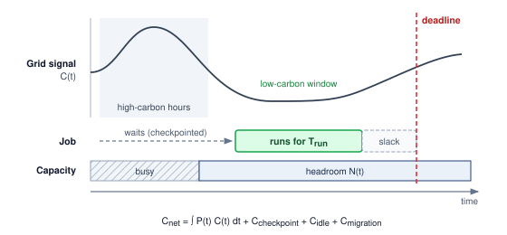

:::

Renewable energy variability presents a scheduling challenge. @Fig-europe-energy-grid illustrates one pattern of generation over time; wind availability has no universal morning-and-evening peak. Local forecasts, dispatch, transmission constraints, and the chosen emissions signal determine the feasible lower-carbon windows.

::: {#fig-europe-energy-grid fig-env="figure" fig-pos="htb" fig-cap="**European Energy Mix**: Renewable energy sources exhibit significant temporal variability, necessitating fossil fuel supplementation to meet consistent demand. Understanding this fluctuation is important for effectively scheduling AI workloads to periods of high renewable energy availability. Source: Energy-Charts (Fraunhofer ISE)." fig-alt="Stacked area chart of European energy production showing temporal variability. Solar peaks at midday, wind varies throughout day. Nuclear provides constant baseload. Fossil fuels supplement when renewables fall short."}

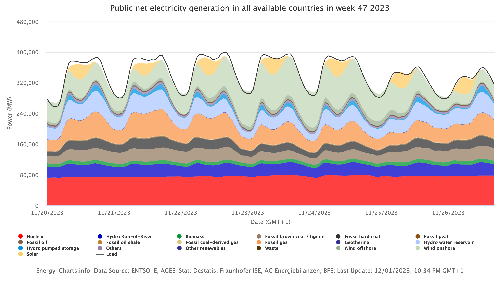

:::

Energy-aware AI frameworks complement scheduling when they optimize the workload rather than only shifting its location. Zeus improved training energy efficiency by 15.3--75.8 percent across its evaluated workloads by automatically finding energy-performance trade-offs [@jie2023zeus], while Perseus reduced large-model training energy consumption by up to 30 percent by mitigating energy bloat [@chung2024]. These tools, alongside CodeCarbon for emissions tracking [@schmidt2021codecarbon], democratize energy optimization beyond hyperscale companies.

Scheduling changes where and when work runs; the cooling interventions established in @sec-sustainable-ai-cooling change facility overhead. Liquid cooling\index{Liquid Cooling!thermal design space} and immersion cooling\index{Immersion Cooling!dense accelerator clusters} still require pumps, coolant distribution, and heat rejection in the energy boundary. The combined strategy must measure these interventions together rather than add their isolated savings.

### Google sustainability framework case study {#sec-sustainable-ai-case-study-googles-framework-e4c2}

The value of Google's case study is that it decomposes mitigation across the same layers this chapter has tracked: model, machine, mechanization, and map. @Tbl-sustainable-ai-google-four-ms summarizes the "4 Ms" that Google engineers identified for reducing the carbon footprint of rapidly expanding AI workloads [@patterson2022].

::: {.content-visible when-format="pdf"}
\clearpage
:::

| **Lever**                                                              | **Intervention**                                                                                      | **Reported efficiency effect**                                                                                                 | **Example mechanism**                                                        |
|:-----------------------------------------------------------------------|:------------------------------------------------------------------------------------------------------|:-------------------------------------------------------------------------------------------------------------------------------|:-----------------------------------------------------------------------------|
| **Model**\index{Google Sustainability Framework!model}                 | Select efficient AI architectures such as sparse models or neural-architecture-search-derived designs | 5--10$\times$ lower computation requirements without compromising model quality                                                | Evolved Transformer and Primer                                               |
| **Machine**\index{Google Sustainability Framework!machine}             | Use AI-specific hardware rather than general-purpose systems                                          | 2--5$\times$ performance-per-watt improvement; TPUs show 5--13$\times$ greater carbon efficiency relative to nonoptimized GPUs | Tensor Processing Units                                                      |
| **Mechanization**\index{Google Sustainability Framework!mechanization} | Run optimized cloud infrastructure at high utilization                                                | 1.4--2$\times$ energy reduction compared to conventional on-premises data centers                                              | Lower facility PUE than the industry-average baseline used in the 2021 study |
| **Map**\index{Google Sustainability Framework!map}                     | Place data centers in regions with low-carbon electricity supplies                                    | 5--10$\times$ lower gross emissions                                                                                            | Real-time monitoring of renewable energy usage across infrastructure         |

: **Google's 4 Ms Sustainability Framework**: The framework combines model architecture, hardware specialization, infrastructure efficiency, and carbon-aware placement so improvements compound across the AI stack. {#tbl-sustainable-ai-google-four-ms tbl-colwidths="[18,32,30,20]"}

The combined effect of these practices produces multiplicative efficiency gains. For instance, implementing the optimized Transformer model on TPUs in strategically located data centers reduced energy consumption by a factor of 83 and CO~2~ emissions by a factor of 747.

In the period studied by @patterson2022, AI workloads represented less than 15 percent of Google's total energy consumption despite expanding deployment. That share is evidence about relative consumption; it does not by itself establish constant or declining absolute energy when the denominator also changes. Assess absolute growth from measured energy totals alongside the reported efficiency improvements.

Empirical case studies demonstrate how sustainable-AI engineering can improve both capability and environmental impact. For example, @patterson2022 compare GPT-3 with Google's GLaM and report improved quality metrics alongside reduced training computation and lower-carbon energy sources, while the GLaM model paper explains the mixture-of-experts architecture behind that efficient scaling [@du2022glam].

The strategy in the case study---combining systematic measurement, carbon-aware development, transparency in reporting, and renewable energy transition---is useful as a framework for sustainable AI scaling. The analysis also argues that earlier extrapolations overstated ML energy requirements by large factors because they did not account for efficiency improvements and workload measurement boundaries, underscoring the importance of empirical measurement over theoretical projections.

### Engineering guidelines for sustainable AI development {#sec-sustainable-ai-engineering-guidelines-sustainable-ai-development-309d}

Measurement, optimization, and scheduling frameworks provide the analytical foundation, but implementation requires prioritization organized around the dominant lifecycle term.

Measurement must precede optimization. Profiling frameworks such as CarbonTracker and CodeCarbon track emissions across training runs [@anthony2020carbontracker; @schmidt2021codecarbon]; establishing empirical baselines is essential for validating whether technical interventions produce genuine reductions or merely displace energy across system boundaries.

Geographic and temporal siting provides an immediate operational lever. Comparing candidate deployment sites requires pairing workload electricity with documented grid carbon-intensity factors for the target operating window, while accounting for facility overhead, inter-site data transfer penalties, runtime changes, and reliability constraints before claiming a net emissions reduction.

Algorithmic efficiency attacks computational volume directly. Rather than defaulting to the largest trainable parameter count, teams evaluate pruning, quantization, and knowledge distillation against target latency and accuracy thresholds. Quantization does not guarantee proportional energy savings: realized benefits depend on integer kernel support, memory bandwidth bottlenecks, data conversion overhead, and batching constraints. Similarly, avoiding training from scratch preserves significant compute: transfer learning and parameter-efficient fine-tuning reduce computational demand by orders of magnitude relative to full-scale pretraining.

Finally, platform selection and lifecycle governance complete the framework. Energy-efficient accelerators, such as TPUs and specialized inference processors, lower operational draw, but their efficiency must be evaluated across the complete hardware lifecycle. Longer refresh cycles and responsible e-waste stewardship extend the amortization window of manufacturing emissions. Because embodied carbon dominates on clean grids while operational electricity dominates on fossil-heavy grids, hardware longevity remains a context-dependent trade-off rather than an automatic win.

The cumulative impact of individual technical choices depends on systemic, industry-wide adoption. Without external pressure, market forces prioritize speed and scale over efficiency. Policy and regulatory frameworks translate engineering possibilities into industry-wide practice by making sustainable choices a financial and legal imperative.

## Policy, Regulation, and the Path Forward {#sec-sustainable-ai-policy-regulation-9668}

If a company can slash its cloud computing bill by relocating its training cluster to a region powered entirely by cheap, high-emission coal, the market alone will not prevent them from doing so. Engineering ingenuity can provide the tools for efficient computation, but it requires policy, regulation, and carbon pricing to ensure that using those tools becomes a financial and legal imperative rather than a corporate public relations talking point alone.

For a systems reader, policy is the control plane that changes the objective function. Reporting rules make hidden energy and embodied-carbon costs measurable, carbon pricing turns location into a scheduling variable, and procurement standards make lifecycle accounting part of infrastructure design. The regulatory mechanisms in @sec-sustainable-ai-regulatory-mechanisms-global-coordination-4180 matter because they determine which optimizations become economically rational at fleet scale.

### Regulatory mechanisms {#sec-sustainable-ai-regulatory-mechanisms-global-coordination-4180}

Effective AI sustainability governance operates through a combination of mandatory reporting, emission restrictions, and financial incentives, though global policy fragmentation presents an implementation challenge. The European Union has taken a leading role with mandatory approaches, such as the EU AI Act\index{EU AI Act!energy reporting}[^fn-ai-act-energy] and the **Corporate Sustainability Reporting Directive (CSRD)**\index{Corporate Sustainability Reporting Directive!definition}\index{CSRD|see{Corporate Sustainability Reporting Directive}}.[^fn-csrd-sustainability-reporting] The AI Act creates separate obligations for general-purpose AI models and for general-purpose AI models with systemic risk, including documentation of computational resources and known or estimated model energy consumption. The CSRD mandates that large companies disclose their environmental impacts, including Scope 1, 2, and 3 emissions from AI operations, according to standardized, audited reporting frameworks. This regulatory shift transforms energy monitoring from an optional optimization into a legal necessity.

[^fn-ai-act-energy]: **EU AI Act (2024)**\index{EU AI Act!high-impact FLOP threshold}: The EU AI Act, adopted in 2024, is an early broad AI regulatory framework that creates obligations for general-purpose AI models and additional obligations for models with systemic risk, including models presumed to have high-impact capabilities above $10^{25}$ FLOPs of training compute. Technical documentation must include computational resources and known or estimated model energy consumption. For violations by providers of general-purpose AI models, Article 101 permits fines up to 3 percent of annual worldwide turnover or EUR 15 million; the separate 7 percent maximum applies to prohibited-practice violations.

[^fn-csrd-sustainability-reporting]: **Corporate Sustainability Reporting Directive (CSRD)**\index{Corporate Sustainability Reporting Directive!value chain reporting}: As amended by Directive (EU) 2026/470, the CSRD scope covers EU companies with more than 1,000 employees and more than EUR 450 million in net annual turnover. Covered companies report material sustainability information under standardized European Sustainability Reporting Standards frameworks. For AI infrastructure, this reporting can expose previously hidden costs such as the embodied carbon of GPU procurement, energy from outsourced cloud training, and end-of-life hardware disposal in the value chain.

Policy can also impose a priced resource constraint. A hypothetical emissions cap for AI operations would specify tonnes of CO~2~e and allow trading of unused emissions allowances, following the general logic of **emissions trading systems (ETS)**\index{Emissions trading systems!definition}.[^fn-ets-cap-trade] A power cap in MW or an energy budget in MWh would constrain different quantities and must not be called the same credit. The EU **Carbon Border Adjustment Mechanism**\index{Carbon Border Adjustment Mechanism!definition}, by contrast, applies to embedded emissions in specified imported goods and electricity; it does not generally price an AI service by its compute location.

[^fn-ets-cap-trade]: **Emissions Trading for Compute**\index{Emissions trading for compute!definition}\index{Emissions trading!compute cap}: Applying cap-and-trade to AI emissions is a policy analogy here, not a description of an established compute-allowance market. Such a design would need a declared emissions boundary, measurement method, enforcement mechanism, and rules for trading allowances.

To balance these restrictions, government incentives play a proactive role. Financial support, tax benefits, and grants for Green AI research can make sustainability a competitive advantage. Governments can also use their public procurement power, mandating that vendors meet sustainability benchmarks such as operating on carbon-neutral data centers or using energy-efficient models. Broader corporate reporting frameworks---the Greenhouse Gas Protocol, Task Force on Climate-related Financial Disclosures, and International Sustainability Standards Board---scrutinize Scope 3 emissions\index{Scope 3 emissions!procurement and value chain}, encompassing the substantial embodied carbon of GPU procurement and data center construction alongside operational emissions of outsourced cloud compute.

### Industry self-regulation and standards {#sec-sustainable-ai-selfregulation-02df}

Alongside government mandates, the AI industry is driving significant environmental improvements through self-regulation and common standards. The most visible commitments from major cloud providers---Google, Microsoft, and Amazon---focus on matching data center electricity consumption with renewable energy procurement and increasing direct clean-energy supply. Going further, the push for 24/7 carbon-free energy (CFE) aims to match every hour of energy consumption with real-time clean energy procurement, moving beyond annual averages and carbon offsets that can obscure actual emissions from fossil-fuel-reliant grids [@monyei2018].

Internal carbon pricing is another effective self-regulatory tool. Assigning a "shadow price" to carbon emissions integrates environmental costs directly into financial decision-making for AI projects, naturally prioritizing investments in energy-efficient hardware and low-emission models. Voluntary checklists and open-source tools promote accountability when they feed those same project decisions: projects like **CodeCarbon**\index{CodeCarbon!definition} and **ML CO~2~ Impact**\index{ML CO~2~ Impact!definition} provide frameworks that allow developers to estimate and track model carbon footprints directly within their workflows [@schmidt2021codecarbon; @lacoste2019quantifying].

Standardized benchmarks provide the objective data needed to validate these efforts. **MLCommons**\index{MLCommons!definition}, through its MLPerf benchmark suite, has incorporated power measurement protocols for both data center and edge deployments. Establishing metrics like "samples per Joule" and "Joules per token" allows MLCommons to enable fair, transparent comparison of AI system efficiency across different hardware and software platforms. These benchmarks, combined with independent sustainability audits from organizations like the Green Software Foundation, create a measurable mechanism for holding the industry accountable and driving competition toward genuinely greener AI.

### Public engagement and environmental justice {#sec-sustainable-ai-public-engagement-9850}

Effective AI sustainability governance requires public support, which depends on transparency, clear communication, and equitable access. Currently, public understanding of AI's environmental impact is limited and often polarized between narratives of technological salvation and ecological disaster. Fostering informed discourse requires moving beyond **greenwashing**\index{Greenwashing!definition}[^fn-greenwashing-ai-reporting]---the practice of making misleading claims about environmental responsibility---toward genuine, verifiable transparency.

[^fn-greenwashing-ai-reporting]: **Greenwashing in AI**\index{Greenwashing in AI!definition}: Manifests as claiming "carbon neutrality" through offsets while expanding data center capacity, or highlighting per-query efficiency gains while total compute grows 10$\times$. Green-claims rules can require verifiable evidence for environmental claims. For ML engineers, the technical litmus test is whether sustainability reporting covers all three GHG Protocol scopes, or conveniently omits Scope 3 (hardware manufacturing, cloud supply chain) where much of AI's carbon can reside.

Pledge-style disclosure is useful only when it creates auditable data rather than reputational cover. The **Montréal Carbon Pledge**\index{Montréal Carbon Pledge!definition}, originally a commitment by institutional investors to measure and disclose carbon footprints annually, is a useful model precisely because its value lies in the disclosed data, not the pledge itself; the same standard applies to an AI organization, whose sustainability claims are only as credible as the workload-level measurements behind them.

Transparency establishes the evidence base; environmental justice asks how the burdens and benefits revealed by that evidence are distributed. As @sec-sustainable-ai-environmental-justice-responsible-development-3923 established, an ML fleet allocates electricity demand, water use, land pressure, and e-waste across communities that often do not share in its economic benefits, which is why site selection is part of the engineering design space. At the policy layer, this distributional question becomes a reporting requirement: social impact assessments and equitable-access provisions for large-scale AI projects turn the fairness concern into auditable obligations rather than aspirations.

### Future research directions {#sec-sustainable-ai-future-challenges-58e2}

The research agenda follows the same engineering logic as the mitigation framework: reduce data movement, close the measurement gap, and avoid redundant computation. **Non-von Neumann computing architectures**\index{Non-von Neumann computing architectures!definition},[^fn-vonneumann-memory-bottleneck] including **neuromorphic computing**\index{Neuromorphic computing!definition} and **in-memory computing**\index{In-memory computing!definition}, can reduce selected transfers. Evaluate the remaining arithmetic, conversion, control, and peripheral energy at the required quality; eliminating one cost does not eliminate the whole system account.

[^fn-vonneumann-memory-bottleneck]: **Von Neumann Bottleneck**\index{Von Neumann bottleneck!definition}\index{Von Neumann!bottleneck energy cost}: Separating processing from memory requires data transfers whose energy depends on locality and arithmetic intensity. If movement contributes a fraction $q$ of total energy, eliminating that term alone gives at most a $1/(1-q)$ reduction factor when the remaining terms are unchanged. For an illustrative 60--80 percent share, that bound is 2.5--5$\times$, before accounting for replacement circuitry.

A critical implementation barrier is the "measurement gap": AI teams need standardized, workload-level reporting of energy use and carbon emissions rather than relying only on coarse proxy metrics [@henderson2020towards]. Coarse methods often rely on proxies such as GPU-hours multiplied by average grid intensity, which fail to capture the real-world dynamics required by reporting regimes that care about time, location, and workload boundary. Developing and standardizing granular, real-time energy and carbon accounting tools is essential for both compliance and effective optimization.

A second research direction reduces redundant computation before it reaches the accelerator. Data selection, model design, and training procedure all affect the environmental cost of learning [@wu2022sustainable]. Smarter data sampling, active learning, and data valuation can reduce work spent on low-value examples, but the resulting model quality and coverage must be measured rather than assumed. An integrated approach combining algorithmic efficiency, hardware innovation, renewable energy adoption, and transparent governance is necessary to align AI development with environmental constraints.

Minimizing redundant computation through smarter data curation directly aligns regulatory compliance with operational efficiency. The most dangerous obstacles to sustainable AI are not technical limitations but incorrect assumptions, miscalculations that cause well-intentioned teams to inadvertently increase their environmental footprint.

## Fallacies and Pitfalls {#sec-sustainable-ai-fallacies-pitfalls-ee9a}

Sustainability involves counterintuitive physics where efficiency improvements can increase total consumption and geographic choices can outweigh component-level optimizations. These fallacies and pitfalls capture errors that waste compute budgets and planetary resources through misallocated optimization effort.

::: {.fallacy-pitfall}

**Fallacy**: *Cloud computing automatically makes AI systems more environmentally sustainable.*

Engineers assume cloud providers operate efficiently and sustainably. Cloud infrastructure can improve utilization and facility efficiency, but it transfers neither the physical footprint nor the customer's accounting responsibility out of existence. Training a 7B model on `{python} TrainingEmissions.n_gpus_str` A100s for `{python} TrainingEmissions.training_days_str` produces `{python} TrainingEmissions.emissions_tons_str` CO~2~ on the US average grid (`{python} TrainingEmissions.grid_ci_g_per_kwh_str`) but only `{python} TrainingEmissions.quebec_emissions_kg_str` CO~2~ on Quebec's hydroelectric grid (`{python} TrainingEmissions.quebec_ci_g_per_kwh_str` operational), a roughly `{python} TrainingEmissions.emissions_ratio_mult_str` difference for this US-average-versus-Quebec pairing. Coal-powered grids emit 800–1000 g CO~2~/kWh while well-managed hydroelectric sources emit 10–50 g CO~2~/kWh in operational accounting, not lifecycle-zero. As demonstrated in @sec-sustainable-ai-carbon-footprint-calculation-c2fe, cloud comparisons must disclose region, energy boundary, utilization, embodied allocation, and whether the electricity is Scope 2 for the provider or Scope 3 for the customer.

:::

::: {.fallacy-pitfall}

**Pitfall**: *Focusing only on operational energy consumption while ignoring embodied carbon and lifecycle impacts.*

Teams optimize training efficiency while ignoring manufacturing emissions. In low-carbon grids, embodied carbon can dominate fleet-level footprint accounting. As quantified in @sec-sustainable-ai-embodied-carbon-assessment-9de0, an A100 accelerator embodies roughly 150 kg CO~2~ from manufacturing [@luccioni2023estimating]; for the earlier 14-day, 64-A100 training run, the unamortized upfront burden is roughly 9.6 metric tons CO~2~. Amortized over a 4-year service life, the share attributable to this specific 14-day job is about 90 kg. The job comparison must use that allocated share; a fleet lifecycle comparison must instead compare the full manufacturing burden against operations over the same fleet lifetime. Comparing the entire manufacturing burden with one short job's electricity would mix boundaries. Extending hardware lifetime from three to five years reduces amortized embodied carbon by 40 percent, but procurement decisions must also evaluate the operational cost of retaining the hardware.

:::

::: {.fallacy-pitfall}

**Fallacy**: *TDP is actual power consumption.*

Thermal design power is a hardware design specification, not the measured power of a particular workload. Actual draw depends on the device, configured power limit, utilization, memory traffic, clocks, and idle intervals. A TDP-based calculation is a stated capacity scenario; it does not establish serving energy or facility energy. Carbon and electricity-cost estimates that drive placement decisions (@sec-sustainable-ai-carbon-footprint-calculation-c2fe) should use measured power over the workload interval and include the support systems within the chosen boundary.

:::

::: {.fallacy-pitfall}

**Pitfall**: *Using PUE as a complete environmental metric.*

Data-center operators report PUE in sustainability disclosures and engineers may treat it as a complete environmental score. PUE measures only facility energy relative to IT energy. A lower-PUE facility can still cause more electricity-related emissions if its grid factor is sufficiently higher, and neither factor accounts for hardware manufacturing or local water stress. Compare matched emissions factors and complete lifecycle boundaries rather than ranking sites by PUE alone.

:::

::: {.fallacy-pitfall}

**Fallacy**: *Efficiency improvements automatically reduce total environmental impact.*

Engineers assume that halving inference cost cuts environmental impact in half. Jevons Paradox warns that efficiency improvements can increase total consumption by enabling expanded usage. In a rebound scenario, suppose reducing token cost from \$0.06 to \$0.002 per 1,000 tokens accompanies a proportional 30$\times$ reduction in measured energy per query at fixed output length and quality. A 100$\times$ increase in query volume then raises total energy and, at unchanged grid intensity, emissions. Price alone would not establish that result. Any implementation change that lowers per-query energy can still raise total energy when usage grows by a larger factor. Teams that optimize efficiency without usage governance can therefore transform sustainability wins into consumption growth, requiring carbon budgets and usage caps of the kind motivated by the Jevons analysis in @fig-jevons-ai.

:::

::: {.fallacy-pitfall}

**Pitfall**: *Treating carbon offsets as a substitute for reducing actual emissions.*

Organizations may purchase offsets without establishing that the credited reduction is additional, durable, independently verified, and free of double counting. An offset does not change the electricity consumed by the workload or its immediate emissions. Teams should report physical emissions reductions separately from compensation claims, with the offset boundary and uncertainty visible. Geographic placement can reduce electricity-related emissions when the complete workload comparison supports it; neither an offset purchase nor a renewable label substitutes for that calculation.

:::

::: {.fallacy-pitfall}

**Fallacy**: *Component-level optimization guarantees lifecycle improvement.*

Teams reduce training cost to improve sustainability without analyzing deployment scale. A training change that increases serving energy must be evaluated over expected query volume: the crossover occurs when accumulated additional serving emissions exceed the one-time training saving. Edge deployment adds device manufacturing and replacement to any avoided data-center and transmission emissions. Keeping hardware longer avoids new manufacturing but may consume more operating energy than replacement. Each comparison requires the same useful service, grid-factor boundary, and lifetime; there is no universal query count or upgrade age that settles it. Effective sustainability requires the complete account in @sec-sustainable-ai-lifecycle-carbon-accounting-99a1.

:::

::: {.fallacy-pitfall}

**Pitfall**: *Evaluating sustainability at the component boundary instead of the lifecycle boundary.*

A model aggressively pruned to save training energy, only to require massive computational overhead during inference to compensate for lost accuracy, illustrates the danger of localized optimization. The same mistake appears when hardware teams report accelerator efficiency without procurement carbon, platform teams report PUE without grid intensity, or model teams report training emissions without expected serving volume. Avoiding these systemic pitfalls requires the lifecycle boundary developed in @sec-sustainable-ai-lifecycle-carbon-accounting-99a1: training, serving, embodied carbon, regional grid mix, hardware lifetime, and demand growth must be evaluated together before a change can be called sustainable.

:::

## Summary {#sec-sustainable-ai-summary-8cec}

The lifecycle boundary connects training, serving, embodied carbon, grid mix, hardware lifetime, and demand growth. Sustainable AI asks whether the Machine Learning Fleet can operate within available energy, water, and material resources even after its models and infrastructure have been optimized.

The measurement contract makes comparisons meaningful by fixing useful work, required quality, system boundaries, attribution, time, location, and uncertainty. Operational and embodied carbon accounting then identify which lifecycle term an intervention can change. Memory traffic, idle equipment, cooling, and power delivery can all consume energy beyond useful arithmetic; lower FLOP counts alone do not establish lower environmental impact.

Mitigation follows that diagnosis. Algorithm and hardware changes must reduce measured resource use while preserving quality, latency, and reliability; scheduling must account for grid intensity and the cost of moving work; hardware replacement must weigh operational savings against new manufacturing emissions. Water availability and the distribution of environmental burdens also matter when choosing where and how a fleet can grow.

::: {.callout-takeaways title="Efficiency alone is not enough"}

* **Power is a hard ceiling**: A fleet cannot compute past the megawatts, cooling, water, and grid capacity its site can supply. Sustainability is therefore an existence constraint on model scale, not a public-relations layer around an otherwise finished architecture.
* **Demand can outrun efficiency**: Lower energy per query does not ensure lower fleet energy use. At fixed work per query, total energy rises when query volume grows by a larger factor than per-query energy falls, so efficiency targets need an absolute resource budget.
* **Memory traffic can dominate serving energy**: During bandwidth-bound autoregressive decode, accelerators can draw power while waiting for weights and state. Quantization, batching, or memory-optimized hardware help sustainability only when they reduce measured energy at the required quality, latency, and reliability.
* **Carbon starts before boot**: Hardware manufacturing creates emissions before the first query runs, and its lifecycle share rises on clean grids and under low utilization. Keeping or replacing hardware therefore requires comparing new manufacturing emissions with operational savings over the same future service.
* **Location changes the footprint**: Moving flexible work to a cleaner grid can reduce operational carbon only when the saving exceeds transfer, restart, and idle-capacity emissions. Placement must also preserve deadlines, data access, capacity, and reliability; regional intensity ratios alone do not establish the net benefit.

:::

Sustainability changes the scale at which efficiency must be judged. A reduction per query is a local result; the fleet result depends on how many queries run, where they run, and what hardware their service requires over time. The Jevons paradox of AI (principle \ref{pri-jevons-paradox}) makes the distinction consequential: efficiency creates room within a resource budget, while demand determines how much of that room is consumed. Deployment decisions therefore need both a useful-work efficiency target and an absolute resource budget.

::: {.callout-chapter-connection title="From sustainability to responsibility"}

The environmental footprint of the ML fleet is quantifiable and constrained, which makes physical viability part of the system design problem. Security, robustness, and sustainability together form the engineering foundation of production AI. A system that is technically sound, however, can still cause social harm. Production systems require governance frameworks, fairness audits, and ethical guardrails to ensure the fleet serves societal interests, completing the transition from how to build the machine to whom it serves.

:::

::: {.column-margin .margin-pointer}
↪ Governance frameworks, algorithmic fairness, and ethical guardrails are examined in @sec-responsible-ai.
:::

<!-- This is here to make sure that quizzes are inserted properly before a part begins. -->

::: { .quiz-end }
:::
