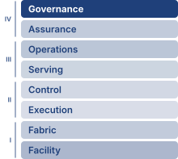

# Sustainable AI {#sec-sustainable-ai}

::: {layout-narrow}
::: {.column-margin}

\chapterminitoc

:::

::: {.content-visible when-format="pdf"}
\noindent
{fig-alt="Sustainable fleet cutaway connecting compute racks to power delivery, cooling loops, grid sources, carbon accounting, efficiency controls, and lifecycle management."}
:::

::: {.content-visible unless-format="pdf"}
{fig-alt="Sustainable fleet cutaway connecting compute racks to power delivery, cooling loops, grid sources, carbon accounting, efficiency controls, and lifecycle management."}
:::

:::

## Purpose {.unnumbered .unlisted}

::: {.content-visible when-format="pdf"}
\begin{marginfigure}
\mlfleetstack{55}{35}{15}{20}{25}{40}{35}{100}
\end{marginfigure}
:::

::: {.content-visible unless-format="pdf"}
::: {.column-margin}
{width="100%" fig-alt="Fleet Machine Learning Systems Stack"}

*Fleet stack focus for this chapter.*
:::
:::

_Why do power limits determine what machine learning systems can exist, not just what they cost to operate?_

Power is an operational expense and a physical constraint on what can be built. A data center has a power budget determined by electrical infrastructure and cooling capacity; a training run that exceeds it cannot proceed at the intended scale regardless of its financial budget. Adding accelerators only helps if the site can supply their electricity and remove their heat. A design that runs efficiently on one machine can therefore become infeasible when replicated across a fleet. The consequences reach beyond a delayed training run. Power reserved for training may be unavailable to serving, while equipment kept ready for failures consumes resources even when it performs no useful work. Moving work to another location can relieve one constraint while changing its emissions, access to data, or ability to meet deadlines. Efficiency improves these choices, but lower energy per request does not ensure lower total consumption when demand grows. Nor does a clean electricity supply erase the environmental cost of manufacturing and replacing equipment. Engineers must judge feasible designs over their useful lives and account for the communities sharing their water and electricity supplies. Sustainability therefore belongs alongside accuracy, latency, and reliability in system design: a fleet must deliver useful service within resource limits that its performance targets cannot override. In C³ terms, compute, communication, and coordination draw on a shared physical budget, so their combined resource demand determines whether the fleet can operate at all.

::: {.content-visible when-format="pdf"}

\newpage

:::

::: {.callout-learning-objectives}

- Explain why facility power and cooling limits constrain which ML systems can physically exist
- Analyze how scaling-driven compute growth, hardware efficiency, and demand rebound shape fleet resource demand
- Calculate operational, embodied, and lifecycle carbon from energy use, power usage effectiveness, manufacturing, and grid intensity
- Analyze how computation, memory movement, power delivery, cooling, and water availability constrain sustainable fleet operation
- Compare training, inference, edge, and federated workloads by energy, carbon, and battery budgets
- Design mitigation strategies across algorithms, infrastructure, scheduling, hardware lifetime, and carbon-aware operations
- Evaluate sustainability claims using lifecycle emissions evidence and the distribution of environmental burdens

:::

```{python}
#| echo: false
from mlsysim import *
from mlsysim.core.units import *

# ┌─────────────────────────────────────────────────────────────────────────────
# │ CHAPTER START
# ├─────────────────────────────────────────────────────────────────────────────
# │ Context: Chapter initialization and global imports
# │
# │ Why: Registers this chapter with the mlsys registry and provides shared
# │      imports for all subsequent calculation cells.
# │
# └─────────────────────────────────────────────────────────────────────────────
from mlsysim.fmt import MarkdownStr, check, fmt
```

```{python}
#| echo: false
#| label: gpt3-household-energy-anchor
# ┌─────────────────────────────────────────────────────────────────────────────
# │ GPT-3 HOUSEHOLD ENERGY ANCHOR (LEGO)
# ├─────────────────────────────────────────────────────────────────────────────
# │ Context: Chapter-wide GPT-3 household-year comparison.
# │
# │ Goal: Keep the GPT-3 training-energy and household-year comparison sourced
# │       from mlsysim rather than repeated as local prose literals.
# │ Scope: chapter-anchor — chapter-wide GPT-3 household-year comparison.
# │ Show: 1,287 MWh; 10.7 MWh/household-year; about 120 household-years.
# │ How: Models.Language.GPT3.training_energy_mwh /
# │      ReferenceStats.EnergyAnchors.USHouseholdAnnualElectricity.
# │
# └─────────────────────────────────────────────────────────────────────────────
from mlsysim import Models, ReferenceStats
from mlsysim.fmt import check, fmt, fmt_energy
from mlsysim.core.units import MWh

class Gpt3HouseholdEnergyAnchor:
    """GPT-3 training energy expressed in US household-years."""

    # ┌── 1. LOAD ──────────────────────────────────────────────────────────
    gpt3_training_energy = Models.Language.GPT3.training_energy_mwh
    us_household_annual_energy = ReferenceStats.EnergyAnchors.USHouseholdAnnualElectricity

    # ┌── 2. EXECUTE ───────────────────────────────────────────────────────
    gpt3_household_years = (gpt3_training_energy / us_household_annual_energy).to("").magnitude
    gpt3_household_years_rounded = round(gpt3_household_years)

    # ┌── 3. GUARD ─────────────────────────────────────────────────────────
    check(119 <= gpt3_household_years <= 121, f"Expected ~120 household-years, got {gpt3_household_years:.1f}")

    # ┌── 4. OUTPUT ────────────────────────────────────────────────────────
    gpt3_training_mwh_str = fmt_energy(gpt3_training_energy, unit=MWh, precision=0, commas=True)
    us_household_annual_mwh_str = fmt_energy(us_household_annual_energy, unit=MWh, precision=1, commas=False)
    gpt3_household_years_str = fmt(gpt3_household_years_rounded, precision=0, commas=False)
```

## The Energy Ceiling {#sec-sustainable-ai-sustainable-ai-engineering-discipline-6d39}

```{python}
#| echo: false
#| label: joule-energy-scale-anchor
# ┌─────────────────────────────────────────────────────────────────────────────
# │ JOULE ENERGY SCALE ANCHOR (LEGO)
# ├─────────────────────────────────────────────────────────────────────────────
# │ Context: [^fn-joule-energy-scale] footnote immediately below.
# │
# │ Goal: Tie the per-second joule anchor to the A100 registry TDP.
# │ Show: 400 J every second (400 W).
# │ How: Hardware.Cloud.A100.tdp; one watt is one joule per second.
# │
# └─────────────────────────────────────────────────────────────────────────────
from mlsysim import Hardware
from mlsysim.core.units import joule, second, watt
from mlsysim.fmt import check, fmt_energy, fmt_power

class JouleEnergyScaleAnchor:
    """A100 peak power expressed as joules per second."""

    # ┌── 1. LOAD ──────────────────────────────────────────────────────────
    a100_tdp = Hardware.Cloud.A100.tdp

    # ┌── 2. EXECUTE ───────────────────────────────────────────────────────
    joules_per_second = (a100_tdp * (1 * second)).to(joule)

    # ┌── 3. GUARD ─────────────────────────────────────────────────────────
    check(abs(a100_tdp.to(watt).magnitude - 400) < 1, f"A100 TDP drifted from 400 W: {a100_tdp}")

    # ┌── 4. OUTPUT ────────────────────────────────────────────────────────
    a100_tdp_w_str = fmt_power(a100_tdp, unit=watt, precision=0, commas=False)
    joules_per_second_j_str = fmt_energy(joules_per_second, unit=joule, precision=0, commas=False)
```

Robustness was bought in compute. Adversarial training multiplies gradient work, and self-consistency sampling and randomized smoothing spend accelerator time on every request they cover. Each of those operations draws power and sheds heat, so a model can be secure against adversaries and robust under distribution shift yet still fail if the available grid cannot power its accelerators or the facility cannot cool them. **Sustainability**\index{Sustainability!definition} begins at that boundary, where accuracy, latency, and reliability are no longer enough because the system must also fit within power, cooling, water, carbon, and hardware lifetime budgets. Energy is the ultimate currency of machine learning, and power density is the ceiling on data-center computational capacity.[^fn-joule-energy-scale]

When an engineer optimizes a database query to save 100 ms, that is ordinary performance tuning. At fleet scale, the same saving repeated billions of times per day can reduce electrical demand, cooling load, and carbon emissions if it reduces measured energy per completed query [@lacoste2019quantifying]. A system that exceeds its operating envelope has failed operationally in the same sense as one that crashes, because it cannot be deployed at the intended scale.

[^fn-joule-energy-scale]: **Joule Energy Scale**\index{Joule!definition}: An A100 modeled at its rated thermal design power consumes `{python} JouleEnergyScaleAnchor.joules_per_second_j_str` every second (`{python} JouleEnergyScaleAnchor.a100_tdp_w_str`); actual workload power requires measurement. Large-model training has no single defensible joule range: model size, hardware count, realized power, utilization, and run duration can each shift total energy by orders of magnitude. The engineering lesson lies in the conversion from repeated per-operation costs to facility energy, so this chapter reports measured or modeled workload energy rather than assigning every large run to one fixed range.

That ceiling makes sustainability a design constraint, not a reporting category. The same engineering discipline that budgets memory, bandwidth, and fault tolerance must also budget joules, cooling load, embodied carbon, and hardware replacement cycles.

Physical feasibility establishes which fleets can run. Sustainability then compares the environmental cost of feasible designs over their useful lives, starting from workload energy at a declared measurement boundary, extending the account to carbon, water, and manufacturing, and letting the dominant lifecycle term decide among efficiency, placement, and hardware reuse. Communication and coordination belong in that account alongside compute, because transfers, synchronization stalls, and recovery keep equipment powered even when useful computation stops. Under the Fleet Law, a distributed step costs its average fleet power multiplied by its step time, so every second of exposed communication or synchronization is also a block of joules; @eq-sustainable-ai-step-energy writes that account out where the chapter turns to distributed training.

Contemporary machine learning applications operate at industrial scale, with individual campuses drawing power at the level of heavy industrial plants. Training a single large AI model can consume as much electricity as roughly `{python} Gpt3HouseholdEnergyAnchor.gpt3_household_years_str` US homes do in an entire year. The scaling laws that motivate fleet-scale training (principle \ref{pri-universal-scaling}) price each further loss reduction in additional compute, data, and parameters, so compute demand has grown faster than hardware efficiency [@sevilla2022]. This book calls the resulting gap the **sustainability paradox**\index{Sustainability Paradox!definition}. Sustainable AI treats that gap as a first-class systems problem rather than an externality to be managed after deployment.

::: {.column-margin .margin-pointer}
↩ The power-law scaling of loss with compute, data, and parameters, and the compute-optimal allocation that follows from it, are established in @sec-vol2-intro-ai-scaling-laws-a043.
:::

::: {#dfn-sustainable-ai-sustainable-ai .callout-definition title="Sustainable AI"}

***Sustainable AI***\index{Sustainable AI!definition} is the systems engineering practice of measuring and optimizing the full environmental cost of ML systems (energy, water, and embodied carbon across training, inference, and hardware manufacturing) and incorporating those costs as explicit constraints in architecture decisions alongside performance and accuracy objectives [@vanwynsberghe2021sustainable; @lannelongue2021; @henderson2020towards].

1.  **Significance**: Training GPT-3 consumed approximately `{python} Gpt3HouseholdEnergyAnchor.gpt3_training_mwh_str` of energy [@li2020estimating], equivalent to roughly `{python} Gpt3HouseholdEnergyAnchor.gpt3_household_years_str` US household-years of electricity. The same lifecycle logic applies after training: pretrained models can often be adapted with far less work than training from scratch, and high-volume inference can eventually dominate total energy. Sustainable AI therefore tracks both one-time training runs and recurring serving workloads rather than treating model training as the whole footprint.
2.  **Distinction**: Unlike corporate sustainability reporting (which aggregates energy usage into annual CO~2~ disclosures), sustainable AI engineering operates at the individual workload level, selecting hardware based on FLOP/s per watt efficiency, scheduling training during periods of high renewable availability, and choosing model architectures that minimize inference FLOPs rather than simply maximizing accuracy.
3.  **Common pitfall**: A frequent misconception is that switching to renewable energy solves the sustainability problem. For hardware-intensive ML, embodied carbon (the carbon emitted manufacturing the chips, servers, and cooling equipment before they ever run a training job) can rival operational carbon on clean grids or at low utilization, and for battery-powered consumer devices manufacturing can account for most of the lifecycle footprint [@gupta2022chasing], making hardware longevity and utilization rate as important as energy source.

:::

The environmental impact of AI systems spans the complete lifecycle: from semiconductor manufacturing and data center construction to model training, inference deployment, and electronic waste [@vanwynsberghe2021sustainable; @gupta2022chasing; @luccioni2023estimating]. Treating this full lifecycle as an engineering problem rather than a corporate responsibility exercise transforms sustainability from a vague objective into a measurable engineering requirement. Optimizing this footprint requires first grounding intuition in the raw physical energy of a single large-model training run.

Any such calculation first has to fix what the energy measurement includes. This is the accounting discipline that the energy-scale invariant (@eq-energy-scale-invariant) imposes on fleet comparisons, applied here to a single run. Accelerator energy excludes host processors, host memory, networking, and storage. IT energy includes those supporting systems; facility energy additionally includes cooling and facility-side power losses. Power usage effectiveness (PUE) is the ratio of facility energy to IT energy over the same interval (@eq-pue); @sec-sustainable-ai-facilitylevel-power-metrics-5558 gives its formal definition and what it leaves out. Dividing useful training FLOPs by realized FLOPs per joule gives energy at the efficiency metric's stated boundary. If that boundary is IT equipment, multiplying by PUE gives facility energy; if it already includes the facility, applying PUE again double counts overhead. The opening calculations use one completed training run as their unit of work and account for operational electricity. Manufacturing and other lifecycle terms enter separately.

```{python}
#| echo: false
#| label: energy-of-intelligence-checkpoint-calc
# ┌─────────────────────────────────────────────────────────────────────────────
# │ ENERGY-OF-INTELLIGENCE CHECKPOINT INPUTS (LEGO)
# ├─────────────────────────────────────────────────────────────────────────────
# │ Context: @chk-sustainable-ai-energy-intelligence (problem-statement inputs).
# │
# │ Goal: Pin the checkpoint's scenario inputs (model size, training FLOPs) to
# │       the GPT-3 registry and the PUE to the state-of-the-art facility
# │       profile; end-to-end efficiency is a round scenario assumption in LOAD.
# │ Show: 175B parameters; 3.14 × 10^23 FLOPs; PUE 1.1; 50 GFLOP/J.
# │ How: Read parameters and training_ops from Models.Language.GPT3 and PUE from
# │      Infrastructure.FacilityCooling.StateOfArt; format the efficiency.
# │
# └─────────────────────────────────────────────────────────────────────────────
from mlsysim import Infrastructure, Models
from mlsysim.fmt import check, fmt, fmt_compute_efficiency, fmt_math, fmt_params, sci_latex
from mlsysim.core.units import GFLOP, J

class EnergyOfIntelligenceCheckpoint:
    # ┌── 1. LOAD ──────────────────────────────────────────
    model_params = Models.Language.GPT3.parameters
    train_flops = Models.Language.GPT3.training_ops
    pue = Infrastructure.FacilityCooling.StateOfArt.pue
    efficiency = 50 * GFLOP / J  # scenario assumption: round end-to-end IT-boundary training efficiency

    # ┌── 3. GUARD ─────────────────────────────────────────
    check(abs(train_flops.to("flop").magnitude - 3.14e23) < 1e21, "GPT-3 training FLOPs drifted from 3.14e23")
    check(abs(pue - 1.1) < 0.005, f"Checkpoint PUE drifted from 1.1: {pue}")

    # ┌── 4. OUTPUT (Formatting) ───────────────────────────
    model_params_b_str = fmt_params(model_params, scale="B", precision=0)
    train_flops_math = fmt_math(sci_latex(train_flops.to("flop").magnitude, precision=2))
    pue_str = fmt(pue, precision=1, commas=False)
    efficiency_gflop_per_j_str = fmt_compute_efficiency(efficiency, unit=GFLOP / J, precision=0, commas=False)
```

::: {#chk-sustainable-ai-energy-intelligence .callout-checkpoint title="The energy of intelligence"}

A `{python} EnergyOfIntelligenceCheckpoint.model_params_b_str` parameter model requires approximately `{python} EnergyOfIntelligenceCheckpoint.train_flops_math` FLOPs to train. Assuming a data center PUE of `{python} EnergyOfIntelligenceCheckpoint.pue_str` and a realized training efficiency of `{python} EnergyOfIntelligenceCheckpoint.efficiency_gflop_per_j_str` measured across the IT equipment, including support systems but excluding facility overhead:

- [ ] **Training energy**: calculate the total energy consumption in megawatt-hours (MWh).
- [ ] **Household-years**: convert the training run's energy into household-years using the average US household consumption of `{python} Gpt3HouseholdEnergyAnchor.us_household_annual_mwh_str` per year.
- [ ] **Reported value**: compare the calculated estimate with the `{python} Gpt3HouseholdEnergyAnchor.gpt3_training_mwh_str` reported for GPT-3 in the definition above, and identify which assumption (the realized efficiency or the PUE) would have to change to reconcile the two.
- [ ] **Metric boundary**: assess whether household-years captures the true environmental cost by separating energy consumption (MWh) from carbon intensity, the grams of CO~2~ the grid emits per kilowatt-hour delivered (g CO~2~/kWh).

:::

That household-year figure is the stake; it is also only the electricity entering the building. The next question is where that energy physically goes: how much reaches the accelerators, how much the cooling and power-delivery overhead consumes, and how the grid behind the meter converts those kilowatts into carbon.

## The Scale of Environmental Impact {#sec-sustainable-ai-scale-environmental-impact-ac9a}

A training run measured in megawatt-hours is hard to reason about, because few engineers carry an intuition for what a megawatt-hour of grid electricity costs the atmosphere. The introduction quoted GPT-3's training emissions as one of the costs that scaling imposes (@sec-vol2-intro-sustainability-cost-implications-0473). The derivation behind that figure converts the run's energy into emissions with a grid factor and then into a familiar anchor, the CO~2~ of a trans-Atlantic flight, which turns an abstract number into one with physical stakes.

```{python}
#| echo: false
#| label: carbon-cost-training-calc
# ┌─────────────────────────────────────────────────────────────────────────────
# │ CARBON COST OF TRAINING (LEGO)
# ├─────────────────────────────────────────────────────────────────────────────
# │ Context: @sec-sustainable-ai-scale-environmental-impact-ac9a
# │
# │ Goal: Quantify carbon emissions for GPT-3 training and compare to flights.
# │ Show: ~552,000 kg CO2 (~552 flights) at US avg grid intensity.
# │ How: Energy * Grid_Intensity; Flight_equiv = Emissions / kg_per_flight.
# │
# └─────────────────────────────────────────────────────────────────────────────
from mlsysim.fmt import check, fmt, fmt_carbon_intensity, fmt_emissions, fmt_energy, fmt_multiple, fmt_ratio
from mlsysim.physics.quantities import carbon_from_energy
from mlsysim.core.units import MWh, kWh, kilogram, gram
from mlsysim import Literature, ReferenceStats

# ┌── LEGO ───────────────────────────────────────────────
class CarbonCostGPT3:
    """Quantify the environmental impact of a large model training run."""

    # ┌── 1. LOAD (Constants) ──────────────────────────────────────────────
    energy = Models.Language.GPT3.training_energy_mwh
    us_grid = Infrastructure.Grids.US_Avg
    hydro_grid = Infrastructure.Grids.Quebec
    grid_ci_us = us_grid.carbon_intensity_kg_kwh * (kilogram / kWh)
    grid_ci_low = hydro_grid.carbon_intensity_kg_kwh * (kilogram / kWh)
    flight_co2 = ReferenceStats.EmissionsAnchors.TransatlanticRoundTripCo2Kg * kilogram

    # ┌── 2. EXECUTE (The Compute) ────────────────────────────────────────
    energy_kwh = energy.to(kWh)
    total_carbon = carbon_from_energy(energy, grid_ci_us)
    flight_ratio = (total_carbon / flight_co2).to("").magnitude
    low_carbon_emissions = carbon_from_energy(energy, grid_ci_low)

    # ┌── 3. GUARD (Invariants) ──────────────────────────────────────────
    check(total_carbon.to(kilogram).magnitude > 500_000, f"Expected >500k kg CO2, got {total_carbon.to(kilogram).magnitude:.0f}")
    check(low_carbon_emissions < 0.1 * total_carbon, "Prose says a hydro-heavy grid emits a small fraction as much")

    # ┌── 4. OUTPUT (Formatting) ──────────────────────────────────────────────
    training_mwh_str = fmt_energy(energy, unit=MWh, precision=0, commas=True)
    energy_kwh_str = fmt_energy(energy_kwh, unit=kWh, precision=0, commas=True)
    total_emissions_kg_str = fmt_emissions(total_carbon.to(kilogram), unit=kilogram, commas=True)
    flight_ratio_str = fmt_ratio(flight_ratio, precision=1)
    grid_ci_us_kg_str = fmt_carbon_intensity(grid_ci_us, unit=kilogram / kWh, precision=3, commas=False)
    co2_per_flight_kg_str = fmt_emissions(flight_co2, unit=kilogram, commas=False)
```

::: {#nbk-sustainable-ai-carbon-cost-training .callout-notebook title="The carbon cost of training"}

**Problem**: A team trains a large model (GPT-3 size), treating `{python} CarbonCostGPT3.training_mwh_str` as facility electricity for this comparison. How much CO~2~ is emitted under the stated grid factor, and how does that compare to a trans-Atlantic flight?

**Math**:

1.  **Energy**: Training energy consumption\index{Training!energy consumption} is `{python} CarbonCostGPT3.training_mwh_str` = `{python} CarbonCostGPT3.energy_kwh_str`.
2.  Carbon intensity (US average): $\approx$ `{python} CarbonCostGPT3.grid_ci_us_kg_str`.
3.  Total Emissions: Training emissions\index{Carbon Footprint!training emissions} are `{python} CarbonCostGPT3.energy_kwh_str` $\times$ `{python} CarbonCostGPT3.grid_ci_us_kg_str` $\approx$ `{python} CarbonCostGPT3.total_emissions_kg_str`.
4.  Comparison:
    *   One passenger, NY to London (round trip): $\approx$ `{python} CarbonCostGPT3.co2_per_flight_kg_str`.
    *   Ratio: `{python} CarbonCostGPT3.total_emissions_kg_str` / `{python} CarbonCostGPT3.co2_per_flight_kg_str` = `{python} CarbonCostGPT3.flight_ratio_str`.

**Systems insight**: Under these assumptions, a single training run emits as much carbon as hundreds of trans-Atlantic passenger round trips. The calculation holds facility energy fixed, so changing the grid factor changes the attributed emissions. The same energy on a hydro-heavy grid would emit a small fraction as much, the placement lever that notebook \ref{nbk-sustainable-ai-geography-carbon} quantifies.

:::

```{python}
#| echo: false
#| label: archetype-a-tdp
# ┌─────────────────────────────────────────────────────────────────────────────
# │ ARCHETYPE A: H100 TDP REFERENCE (LEGO)
# ├─────────────────────────────────────────────────────────────────────────────
# │ Context: callout-lighthouse "Archetype A (GPT-4/Llama-3): The energy wall"
# │
# │ Goal: Provide H100 per-chip TDP for the 25k-GPU energy-wall framing.
# │ Show: ~700 W per chip.
# │ How: pulling Hardware.Cloud.H100.tdp from mlsysim.core.units.
# │
# └─────────────────────────────────────────────────────────────────────────────
from mlsysim import Systems
from mlsysim.fmt import assert_qty_close, check, fmt, fmt_int, fmt_power
from mlsysim.core.units import MW, watt

class ArchetypeATdp:
    """H100 per-chip TDP for the Archetype A energy framing."""

    # ┌── 1. LOAD (Constants) ──────────────────────────────────────────────
    fleet = Systems.Clusters.Reference_25K_H100
    tdp = fleet.node.accelerator.tdp
    cluster_gpus = fleet.total_accelerators
    reference_gpus = Systems.Clusters.Training_1K.total_accelerators  # book's 1,024-GPU reference cluster

    # ┌── 2. EXECUTE (The Compute) ────────────────────────────────────────
    accelerator_power = cluster_gpus * tdp
    scale_vs_reference = cluster_gpus / reference_gpus

    # ┌── 3. GUARD (Invariants) ──────────────────────────────────────────
    check(tdp.to(watt).magnitude > 500, "H100 TDP should exceed 500 W")
    assert_qty_close(accelerator_power, 17.5, MW, rel=1e-3)

    # ┌── 4. OUTPUT (Formatting) ──────────────────────────────────────────────
    h_h100_tdp_w_str = fmt_power(tdp, unit=watt, precision=0, commas=False)
    cluster_gpus_str = fmt(cluster_gpus, precision=0, commas=True)
    cluster_accel_mw_str = fmt_power(accelerator_power, unit=MW, precision=1, commas=False)
    reference_gpus_str = fmt(reference_gpus, precision=0, commas=True)
    scale_vs_reference_str = fmt_int(scale_vs_reference, commas=False)  # prose says "roughly"
```

That arithmetic shows the carbon cost of one run; at large-cluster scale, the next constraint is whether enough power can be delivered to the cluster at all.

::: {#lhs-sustainable-ai-archetype-gpt-4-llama-3-energy-wall .callout-lighthouse title="Archetype A (GPT-4/Llama-3): The energy wall"}

Training at the scale of Archetype A (GPT-4/Llama-3) exposes the power problem most sharply. At frontier scale, roughly `{python} ArchetypeATdp.scale_vs_reference_str` times the `{python} ArchetypeATdp.reference_gpus_str`-GPU reference cluster used throughout this book, a single `{python} ArchetypeATdp.cluster_gpus_str`-GPU cluster drawing `{python} ArchetypeATdp.h_h100_tdp_w_str` per chip requires `{python} ArchetypeATdp.cluster_accel_mw_str` of accelerator power before server, network, and cooling overhead. The constraint is physical, not financial: it is a grid capacity problem. Organizations operating Archetype A workloads may need dedicated power infrastructure or regions with excess renewable energy, making carbon-aware scheduling (shifting nonurgent work toward cleaner grid hours) and geographic optimization (placing workloads where power, cooling, and carbon constraints fit the job) fleet decisions as consequential as capacity planning.

:::

That accelerator draw alone, before server, network, and cooling overhead, makes grid capacity a condition of deployment. Among sites that can supply the required power, the emissions factor and facility overhead then determine the carbon attributed to a fixed workload. The placement calculations separate those effects, starting with the grid factor alone.

```{python}
#| echo: false
#| label: carbon-frontier-notebook
# ┌─────────────────────────────────────────────────────────────────────────────
# │ CARBON-PERFORMANCE FRONTIER (NOTEBOOK)
# ├─────────────────────────────────────────────────────────────────────────────
# │ Context: "The Geography of Carbon" .callout-notebook
# │
# │ Goal: Quantify the carbon footprint difference between geographic regions.
# │ Show: ratio ≈ 41x—inline in notebook result.
# │ How: Carbon = Energy_kWh * Intensity_g/kWh.
# │
# └─────────────────────────────────────────────────────────────────────────────
from mlsysim import Infrastructure, ReferenceStats
from mlsysim.fmt import check, fmt, fmt_carbon_intensity, fmt_emissions, fmt_energy
from mlsysim.physics.quantities import carbon_from_energy
from mlsysim.core.units import MWh, kWh, gram, metric_ton

class CarbonFrontier:
    # ┌── 1. LOAD ──────────────────────────────────────────
    energy = ReferenceStats.CarbonPlacementProfile.TrainingRunEnergy
    quebec_grid = Infrastructure.Grids.Quebec
    poland_grid = Infrastructure.Grids.Poland
    intensity_quebec = quebec_grid.carbon_intensity_g_kwh * (gram / kWh)
    intensity_poland = poland_grid.carbon_intensity_g_kwh * (gram / kWh)
    # ┌── 2. EXECUTE ───────────────────────────────────────
    energy_kwh = energy.to(kWh)
    quebec_carbon = carbon_from_energy(energy, intensity_quebec)
    poland_carbon = carbon_from_energy(energy, intensity_poland)
    ratio = (poland_carbon / quebec_carbon).to("").magnitude
    # ┌── 3. GUARD ─────────────────────────────────────────
    check(40 < ratio < 42, f"Quebec-vs-Poland ratio {ratio:.1f} unexpected (prose and margin figure say 41x)")
    # ┌── 4. OUTPUT ────────────────────────────────────────
    cf_energy_mwh_str = fmt_energy(energy, unit=MWh, precision=0, commas=True)
    energy_kwh_str = fmt_energy(energy_kwh, unit=kWh, precision=0, commas=True)
    quebec_g_str = fmt_emissions(quebec_carbon, unit=gram, commas=True)
    poland_g_str = fmt_emissions(poland_carbon, unit=gram, commas=True)
    cf_quebec_tonnes_str = fmt_emissions(quebec_carbon.to(metric_ton), unit=metric_ton)
    cf_poland_tonnes_str = fmt_emissions(poland_carbon.to(metric_ton), unit=metric_ton)
    cf_ratio_mult_str = fmt_multiple(ratio, precision=0, commas=False)
    intensity_quebec_g_kwh_str = fmt_carbon_intensity(intensity_quebec, unit=gram / kWh, precision=0, commas=False)
    intensity_poland_g_kwh_str = fmt_carbon_intensity(intensity_poland, unit=gram / kWh, precision=0, commas=False)
```

The introduction previewed this geographic factor as a spread of roughly `{python} CarbonFrontier.cf_ratio_mult_str` between hydro- and coal-dominated grids. Notebook \ref{nbk-sustainable-ai-geography-carbon} derives that spread by holding facility energy constant and varying only the grid factor.

::: {.column-margin}
{width="100%" fig-alt="Carbon-emissions ladder for the same training job: Poland is about 8,200 tonnes CO2, Quebec about 200 tonnes, with the 41 times difference shown as an annotation rather than a third bar."}

*The same job's carbon emissions depend on where it runs.*
:::

:::: {#nbk-sustainable-ai-geography-carbon .callout-notebook title="The geography of carbon"}

**Problem**: A team is choosing a data center for a `{python} CarbonFrontier.cf_energy_mwh_str` training run, comparing Site A in Quebec (hydropower, `{python} CarbonFrontier.intensity_quebec_g_kwh_str` $\text{CO}_2$) against Site B in Poland (coal-heavy, `{python} CarbonFrontier.intensity_poland_g_kwh_str` $\text{CO}_2$). Both factors are rounded annual grid averages on the same emissions boundary, the values @fig-carbon-intensity later applies across nine regions; they are not hourly or marginal signals. How does the location affect a model's carbon footprint?

**Math**:
Carbon = Energy $\times$ Grid Intensity.

1. Site A emissions: `{python} CarbonFrontier.energy_kwh_str` $\times$ `{python} CarbonFrontier.intensity_quebec_g_kwh_str` = `{python} CarbonFrontier.quebec_g_str` = `{python} CarbonFrontier.cf_quebec_tonnes_str` $\text{CO}_2$.
2. Site B emissions: `{python} CarbonFrontier.energy_kwh_str` $\times$ `{python} CarbonFrontier.intensity_poland_g_kwh_str` = `{python} CarbonFrontier.poland_g_str` = `{python} CarbonFrontier.cf_poland_tonnes_str` $\text{CO}_2$.
3. Ratio: `{python} CarbonFrontier.cf_poland_tonnes_str` / `{python} CarbonFrontier.cf_quebec_tonnes_str` = `{python} CarbonFrontier.cf_ratio_mult_str` difference.

**Systems insight**: The Quebec-versus-Poland pair gives a `{python} CarbonFrontier.cf_ratio_mult_str` difference in attributed emissions at the same facility energy. This comparison isolates the grid factor; it does not rank placement against an unmeasured algorithmic change. A fleet decision must compare feasible sites and schedules using both workload energy and the emissions associated with supplying it.

::::

The ratio holds only at equal facility electricity and these annual-average factors. A second gain from waiting for cleaner hours, the temporal lever taken up after the placement example below, therefore cannot simply be multiplied onto it; the joint schedule must be evaluated as one decision.

A real placement decision weighs more than the grid factor. Adding electricity prices, facility overhead, and an internal carbon price turns the comparison into a placement objective, priced as a modeled total cost of ownership (TCO) over three candidate regions (the US-average grid, Quebec, and Iowa). The notebook above isolated the grid factor by holding facility energy fixed. This objective must instead let facility overhead differ from region to region, so it starts one boundary earlier, holding the run's IT energy fixed and letting each region apply its own PUE. That choice separates the carbon charge from the cost of facility overhead.

::: {.column-margin .margin-pointer}
↩ The total-cost-of-ownership model that prices ownership, maintenance, and electricity is established in @sec-ml-operations-scale-tco-equation-169d.
:::

```{python}
#| echo: false
#| label: placement-optimizer-example
# ┌─────────────────────────────────────────────────────────────────────────────
# │ PLACEMENT OPTIMIZER (TIER 3)
# ├─────────────────────────────────────────────────────────────────────────────
# │ Context: Callout "Automated Carbon-Aware Scheduling"
# │
# │ Goal: Demonstrate the placement optimizer finding the cheapest geographic placement.
# │ Show: Ownership and maintenance dominate the total and are identical across
# │       regions; without a carbon price Quebec wins only on facility overhead,
# │       and a $100/ton tax widens its margin mostly through the carbon charge.
# │ How: Size the run duration so the Frontier_8K fleet's modeled IT energy equals
# │      the carbon-placement reference energy, then invoke
# │      mlsysim.solvers.PlacementOptimizer over three regions.
# │
# └─────────────────────────────────────────────────────────────────────────────
from mlsysim import Infrastructure, Literature, ReferenceStats, Systems
from mlsysim.engine.solvers.economics import EconomicsModel
from mlsysim.solvers import PlacementOptimizer
from mlsysim.fmt import MarkdownStr, check, fmt, fmt_energy, fmt_time, fmt_usd
from mlsysim.core.units import MWh

# ┌── LEGO ───────────────────────────────────────────────
class AutoPlacement:
    '''
    Namespace for automated Workload Placement.
    Scenario: Finding the optimal region for the carbon-placement reference run.
    '''

    # ┌── 1. LOAD (Constants) ───────────────────────────────────────────────
    fleet = Systems.Clusters.Frontier_8K
    energy = ReferenceStats.CarbonPlacementProfile.TrainingRunEnergy  # IT energy of the run
    carbon_tax = 100.0  # scenario policy assumption: $/ton carbon tax
    mfu = Literature.Training.MfuHigh
    # The fleet's modeled IT energy per day is region-independent (PUE enters
    # only at the facility boundary), so it sets the run duration.
    it_energy_per_day = EconomicsModel().solve(fleet, duration_days=1, grid=Infrastructure.Grids.US_Avg, mfu=mfu).it_energy_kwh.to(MWh)
    duration_days = (energy / it_energy_per_day).to("").magnitude

    # ┌── 2. EXECUTE (The Compute) ─────────────────────────────────────────
    optimizer = PlacementOptimizer()
    res = optimizer.solve(fleet, duration_days=duration_days, regions=["US_Avg", "Quebec", "Iowa"], carbon_tax_per_ton=carbon_tax, mfu=mfu)
    best_region = res.best_region
    check_it_energy = EconomicsModel().solve(fleet, duration_days=duration_days, grid=Infrastructure.Grids.Quebec, mfu=mfu).it_energy_kwh.to(MWh)
    res_no_tax = optimizer.solve(fleet, duration_days=duration_days, regions=["US_Avg", "Quebec", "Iowa"], carbon_tax_per_ton=0.0, mfu=mfu)
    objective_by_region = {c["region"]: c["objective"] for c in res.top_candidates}
    no_tax_by_region = {c["region"]: c["objective"] for c in res_no_tax.top_candidates}
    us_gap_usd = objective_by_region["US_Avg"] - objective_by_region["Quebec"]
    iowa_gap_usd = objective_by_region["Iowa"] - objective_by_region["Quebec"]
    no_tax_us_gap_usd = no_tax_by_region["US_Avg"] - no_tax_by_region["Quebec"]
    carbon_share_of_us_gap = 1 - no_tax_us_gap_usd / us_gap_usd

    # ┌── 3. GUARD (Invariants) ───────────────────────────────────────────
    check(best_region == "Quebec", f"Quebec should be optimal with ${carbon_tax}/ton tax")
    check(abs((check_it_energy / energy).to("").magnitude - 1) < 1e-6, "Modeled run IT energy must equal the reference run energy")
    check(res_no_tax.best_region == "Quebec", "Prose says Quebec already wins on facility overhead without a carbon price")
    check(0 < no_tax_us_gap_usd < us_gap_usd < iowa_gap_usd, "Prose orders the no-tax, US-average, and Iowa gaps")
    check(carbon_share_of_us_gap > 0.5, "Prose says most of the taxed gap is the carbon charge")

    # ┌── 4. OUTPUT (Formatting) ──────────────────────────────────────────────
    best_region_str = MarkdownStr(best_region)
    total_tco_str = fmt_usd(res.objective_value, precision=1, scale="M")
    carbon_tax_str = fmt_usd(carbon_tax, precision=0, commas=False, per="tonne")
    energy_mwh_str = fmt_energy(energy, unit=MWh, precision=0, commas=True)
    fleet_gpus_str = fmt(fleet.total_accelerators, precision=0, commas=True)
    duration_days_str = fmt_time(round(duration_days), 'day', precision=0, commas=False, style='word')
    no_tax_us_gap_str = fmt_usd(round(no_tax_us_gap_usd, -3), precision=0, commas=True)
    us_gap_musd_str = fmt_usd(us_gap_usd, precision=1, scale="M")
    iowa_gap_musd_str = fmt_usd(iowa_gap_usd, precision=1, scale="M")
```

::: {#exmp-sustainable-ai-automated-carbon-aware-scheduling-tier-3-optimizer .callout-example title="Automated carbon-aware placement"}

**Scenario**: A team is planning a large training run requiring `{python} AutoPlacement.energy_mwh_str` of IT energy, which occupies an `{python} AutoPlacement.fleet_gpus_str`-GPU frontier-scale cluster for about `{python} AutoPlacement.duration_days_str`. The team is choosing among three candidate regions (US average, Quebec, and Iowa) with different facility overheads (PUE) and grid carbon intensities.

**Diagnosis**: With an internal carbon tax of `{python} AutoPlacement.carbon_tax_str`, the placement model adds a carbon charge to each region's modeled cost of ownership and selects `{python} AutoPlacement.best_region_str` for a total cost of `{python} AutoPlacement.total_tco_str`. Hardware ownership and maintenance make up most of that total and are the same in every region, so the candidates differ only in facility overhead and carbon. Without a carbon price, Quebec's lower PUE saves about `{python} AutoPlacement.no_tax_us_gap_str` against the US-average placement. With the tax, the US-average and Iowa placements cost `{python} AutoPlacement.us_gap_musd_str` and `{python} AutoPlacement.iowa_gap_musd_str` more than Quebec, and most of each gap is the carbon charge.

**Systems lesson**: Carbon-aware placement adds an explicit carbon price to the fleet scheduling objective. The selected region minimizes the modeled cost among these candidates under the stated assumptions. A deployment decision must also check capacity, data transfer, deadlines, and reliability.

:::

The placement example compares regions using a fixed annual grid factor for each candidate. Temporal scheduling adds another decision by allowing a flexible job to wait for lower-carbon hours within one region. These are distinct levers, and their relative value depends on the available regions and the job's deadline; @sec-sustainable-ai-geographic-temporal-optimization-492c develops the temporal lever once the measurement contract has fixed which grid signal it should use.

```{python}
#| echo: false
#| label: global-datacenter-electricity-2030
# ┌─────────────────────────────────────────────────────────────────────────────
# │ GLOBAL DATA-CENTER ELECTRICITY PROJECTION (LEGO)
# ├─────────────────────────────────────────────────────────────────────────────
# │ Context: prose immediately below and its data-center scale footnote.
# │
# │ Goal: Pin the IEA 2030 data-center electricity projection to the registry.
# │ Show: about 945 TWh by 2030, just under 3 percent of global electricity.
# │ How: Literature.DatacenterElectricity.Global2030Twh / Global2030ShareOfElectricity.
# │
# └─────────────────────────────────────────────────────────────────────────────
from mlsysim import Literature
from mlsysim.core.units import ureg
from mlsysim.fmt import check, fmt_energy, fmt_percent

_TWh = ureg.terawatt_hour

class GlobalDatacenterElectricity2030:
    """IEA (2025) projection of global data-center electricity use in 2030."""

    # ┌── 1. LOAD ──────────────────────────────────────────────────────────
    global_2030 = float(Literature.DatacenterElectricity.Global2030Twh) * _TWh
    share_2030 = float(Literature.DatacenterElectricity.Global2030ShareOfElectricity)

    # ┌── 3. GUARD ─────────────────────────────────────────────────────────
    check(abs(global_2030.to(_TWh).magnitude - 945) < 1, "IEA 2030 projection drifted from 945 TWh")
    check(0.025 < share_2030 <= 0.03, "Prose says 'just under 3 percent'")

    # ┌── 4. OUTPUT ────────────────────────────────────────────────────────
    global_2030_twh_str = fmt_energy(global_2030, unit=_TWh, precision=0, commas=False)
    share_2030_pct_str = fmt_percent(share_2030, precision=0, commas=False, style="prose")
```

The GPT-3 household-year calculation above anchors the workload scale. The fleet-scale consequence is larger. IEA projects global data-center electricity consumption to reach about `{python} GlobalDatacenterElectricity2030.global_2030_twh_str` by 2030, just under `{python} GlobalDatacenterElectricity2030.share_2030_pct_str` of global electricity demand, with AI-accelerated servers driving much of the growth.[^fn-datacenter-power-scale] Historical studies document rapid growth in training compute [@sevilla2022], but a compute multiplier is not an energy multiplier without a matching efficiency measurement.

[^fn-datacenter-power-scale]: **Data Center Industrial Scale**\index{Data Center Industrial Scale!definition}\index{Data Center!industrial electricity demand}: IEA's 2025 *Energy and AI* analysis projects data centers to consume about `{python} GlobalDatacenterElectricity2030.global_2030_twh_str` of electricity by 2030, just under `{python} GlobalDatacenterElectricity2030.share_2030_pct_str` of global electricity demand. This is an electricity-demand metric, not directly comparable to aviation or cement shares of global emissions. AI infrastructure competes with other loads for deliverable power; expansion requires available capacity, additional supply, or a reduction or shift in competing demand, not necessarily new generation within the same region.

```{python}
#| echo: false
#| label: hgx-h100-embodied-carbon
# ┌─────────────────────────────────────────────────────────────────────────────
# │ HGX H100 EMBODIED CARBON (LEGO)
# ├─────────────────────────────────────────────────────────────────────────────
# │ Context: [^fn-gpu-embodied-carbon] footnote immediately below.
# │
# │ Goal: Keep the per-GPU and eight-GPU baseboard embodied carbon consistent.
# │ Show: 1,312 kg CO2e per eight-GPU baseboard; 164 kg CO2e per H100.
# │ How: Hardware.Cloud.H100.embodied_carbon_kg × Systems.Nodes.DGX_H100
# │      accelerators_per_node.
# │
# └─────────────────────────────────────────────────────────────────────────────
from mlsysim import Hardware, Systems
from mlsysim.core.units import kilogram
from mlsysim.fmt import check, fmt, fmt_mass

class HgxH100EmbodiedCarbon:
    """NVIDIA HGX H100 product carbon footprint, total and per GPU."""

    # ┌── 1. LOAD ──────────────────────────────────────────────────────────
    per_gpu = Hardware.Cloud.H100.embodied_carbon_kg * kilogram
    gpus_per_baseboard = Systems.Nodes.DGX_H100.accelerators_per_node

    # ┌── 2. EXECUTE ───────────────────────────────────────────────────────
    baseboard = per_gpu * gpus_per_baseboard

    # ┌── 3. GUARD ─────────────────────────────────────────────────────────
    check(gpus_per_baseboard == 8, "HGX H100 baseboard carries eight GPUs")
    check(abs(baseboard.to(kilogram).magnitude - 1312) < 1, f"Baseboard footprint drifted: {baseboard}")

    # ┌── 4. OUTPUT ────────────────────────────────────────────────────────
    per_gpu_kg_str = fmt_mass(per_gpu, unit=kilogram, precision=0, commas=False)
    baseboard_kg_str = fmt_mass(baseboard, unit=kilogram, precision=0, commas=True)
```

Beyond direct energy consumption, AI systems drive environmental impact through hardware manufacturing and resource consumption. Producing processors and their supporting equipment requires materials and industrial processes whose impacts precede the first training run.[^fn-gpu-embodied-carbon] At the other end of the hardware's life, retired equipment joins the electronic-waste stream whose scale @sec-sustainable-ai-disposal-phase-b4f1 quantifies. Rising workload requirements can motivate accelerator replacement before physical failure; whether replacement creates waste depends on the equipment's reuse and disposal path.[^fn-ewaste-hardware-disposal]

[^fn-gpu-embodied-carbon]: **GPU Manufacturing Embodied Carbon**\index{GPU Manufacturing Embodied Carbon!definition}: NVIDIA's HGX H100 product carbon footprint reports `{python} HgxH100EmbodiedCarbon.baseboard_kg_str` CO~2~e (CO~2~-equivalent, which expresses other greenhouse gases as the mass of CO~2~ with the same warming effect) for an eight-H100 baseboard, or roughly `{python} HgxH100EmbodiedCarbon.per_gpu_kg_str` CO~2~e per H100 if allocated evenly across the eight GPUs [@nvidia2025hgxh100pcf]. Advanced-node manufacturing also consumes ultrapure water, specialty gases, and chemicals that an energy-only account never sees, so a per-GPU carbon figure understates the full manufacturing footprint.

[^fn-ewaste-hardware-disposal]: **AI Hardware E-waste**\index{AI Hardware E-waste!definition}: Retiring an accelerator does not necessarily create waste: equipment may be redeployed, resold, or recycled. Estimate disposal impacts from the actual equipment inventory, material composition, and end-of-life route. Extending useful service life can defer manufacturing and disposal, while certified handling limits exposure to hazardous materials in discarded electronics.

These environmental challenges are part of the energy ceiling, not an add-on to it, because the communities that host land, water, grid capacity, and waste streams also carry part of the system cost. These scale calculations turn sustainability into an allocation problem. AI progress creates benefits in one part of the system while assigning electricity, water, land, and disposal costs to another, so environmental responsibility must be treated as part of systems design rather than as postdeployment reporting. @Sec-sustainable-ai-environmental-justice-responsible-development-3923 examines how site selection distributes these burdens across communities.

## Exponential Growth vs. Physical Constraints {#sec-sustainable-ai-exponential-growth-vs-physical-constraints-0f4e}

```{python}
#| echo: false
#| label: compute-growth-trend
# ┌─────────────────────────────────────────────────────────────────────────────
# │ TRAINING COMPUTE GROWTH (LEGO)
# ├─────────────────────────────────────────────────────────────────────────────
# │ Context: @fig-ai-compute-growth and the growth prose immediately below.
# │
# │ Goal: Quantify the growth of frontier training compute from the registry
# │       trend so the "demand outpaces efficiency" claim carries a number.
# │ Show: AlexNet (2012) to GPT-4-class (2023) ≈ 17 million times; fitted
# │       doubling time ≈ 6 months.
# │ How: Literature.ComputeTrend (Sevilla et al. 2022); least-squares fit of
# │      log2(FLOPs) against year.
# │
# └─────────────────────────────────────────────────────────────────────────────
import numpy as np
from mlsysim import Literature
from mlsysim.fmt import check, fmt, fmt_int, fmt_math, sci_latex

class ComputeGrowthTrend:
    """Growth of training compute across notable models (Sevilla et al. 2022)."""

    # ┌── 1. LOAD ──────────────────────────────────────────────────────────
    entries = Literature.ComputeTrend.entries
    flops_by_model = {e["model"]: e["flops"] for e in entries}
    first_model = "AlexNet"
    last_model = "GPT-4-class"

    # ┌── 2. EXECUTE ───────────────────────────────────────────────────────
    years = np.array([e["year"] for e in entries], dtype=float)
    log2_flops = np.log2([e["flops"] for e in entries])
    slope_doublings_per_year, intercept = np.polyfit(years, log2_flops, 1)
    doubling_months = 12 / slope_doublings_per_year
    growth_factor = flops_by_model[last_model] / flops_by_model[first_model]
    years_by_model = dict(zip([e["model"] for e in entries], years))
    span_years = int(years_by_model[last_model] - years_by_model[first_model])

    # ┌── 3. GUARD ─────────────────────────────────────────────────────────
    check(5 < doubling_months < 7, f"Prose says a doubling time near six months, got {doubling_months:.1f}")
    check(1e7 < growth_factor < 3e7, f"Prose says roughly 17 million times, got {growth_factor:.3g}")

    # ┌── 4. OUTPUT ────────────────────────────────────────────────────────
    first_flops_math = fmt_math(sci_latex(flops_by_model[first_model], precision=1))
    last_flops_math = fmt_math(sci_latex(flops_by_model[last_model], precision=0))
    growth_million_str = fmt_int(growth_factor / 1e6, commas=False)
    doubling_months_str = fmt_int(doubling_months, commas=False)  # prose says "near"
    first_year_str = fmt(years_by_model[first_model], precision=0, commas=False)
    last_year_str = fmt(years_by_model[last_model], precision=0, commas=False)
    span_years_str = fmt_int(span_years, commas=False)
```

Growth in computational demand can outpace improvements in realized efficiency. @sevilla2022 estimate that the training compute of notable machine learning models doubled roughly every six months after 2010, far faster than the two-year cadence historically associated with transistor scaling. The introduction traced this growth from AlexNet onward across seven to eight orders of magnitude (@fig-training-compute-trend); @fig-ai-compute-growth extends the same series through Grok-3 in 2025, which carries the span to the upper end of that range, about eight orders of magnitude, against a fitted doubling cadence of roughly `{python} ComputeGrowthTrend.doubling_months_str` months. In `{python} ComputeGrowthTrend.first_year_str`, AlexNet required about `{python} ComputeGrowthTrend.first_flops_math` FLOPs of training compute, whereas GPT-4-class systems in `{python} ComputeGrowthTrend.last_year_str` reached `{python} ComputeGrowthTrend.last_flops_math`, an expansion of roughly `{python} ComputeGrowthTrend.growth_million_str` million in `{python} ComputeGrowthTrend.span_years_str` years. Larger models, longer training runs, and rising serving volume each add to that total work through a different mechanism. Energy per operation can fall while total fleet energy rises; the outcome depends on how much useful work the fleet performs and how efficiently it performs that work.[^fn-compute-growth-scaling]

::: {#fig-ai-compute-growth fig-env="figure" fig-pos="htb" fig-cap="**Training Compute of Notable Models**: Training compute of notable models from 2012 to 2025 on a logarithmic axis, with estimates after 2022 from the same Epoch AI series [@sevilla2022; @epochai2024compute]. The solid least-squares fit corresponds to a doubling time of roughly six months; the dashed line doubles every two years, the cadence historically associated with transistor scaling, and the shaded gap between them widens every year. The axis counts operations rather than joules, so converting the trend into energy requires the realized efficiency of each run at a stated measurement boundary." fig-alt="Scatter plot of training compute in FLOPs against year on a log axis, rising from about 10 to the 18 for AlexNet in 2012 to about 10 to the 26 in 2025, with a solid red straight-line fit and a shallower gray dashed line that starts at the AlexNet point and doubles every two years. The region between the two lines is shaded and widens toward 2025."}

```{python}
#| echo: false
#| warning: false
# ┌─────────────────────────────────────────────────────────────────────────────
# │ TRAINING COMPUTE GROWTH (FIGURE)
# ├─────────────────────────────────────────────────────────────────────────────
# │ Context: @fig-ai-compute-growth.
# │ Goal: Plot the registry compute trend with its fitted doubling line.
# │ How: Reuse ComputeGrowthTrend (Literature.ComputeTrend, Sevilla et al. 2022).
# └─────────────────────────────────────────────────────────────────────────────
import numpy as np
import matplotlib.pyplot as plt
from binder.tools.figures import style as book_style

fig, ax, COLORS, plt = book_style.setup_plot(figsize=(6.5, 3.9))
_labelled = {"AlexNet", "ResNet-50", "BERT-Large", "GPT-3", "PaLM", "GPT-4-class", "Grok-3"}
_entries = sorted(ComputeGrowthTrend.entries, key=lambda e: e["year"])
ax.scatter(
    [e["year"] for e in _entries],
    [e["flops"] for e in _entries],
    s=34,
    color=COLORS['BlueLine'],
    edgecolor='white',
    linewidth=0.6,
    zorder=3,
)
_fit_years = np.linspace(2012, 2025, 50)
_fit = 2 ** (ComputeGrowthTrend.slope_doublings_per_year * _fit_years + ComputeGrowthTrend.intercept)
# Reference: the two-year transistor-scaling cadence the prose compares against,
# anchored at the first (AlexNet) point so the shaded gap shows the divergence.
_first = _entries[0]
_moore = _first["flops"] * 2 ** ((_fit_years - _first["year"]) / 2.0)
ax.fill_between(_fit_years, _moore, _fit, where=_fit >= _moore, color=COLORS['RedL'], alpha=0.45, lw=0, zorder=1)
ax.plot(_fit_years, _moore, '--', color=COLORS['secondary'], linewidth=1.4, zorder=2)
ax.plot(_fit_years, _fit, '-', color=COLORS['RedLine'], linewidth=1.8, zorder=2)
# Direct labels on the two trend lines instead of a legend.
ax.text(
    2022.4,
    2 ** (ComputeGrowthTrend.slope_doublings_per_year * 2022.4 + ComputeGrowthTrend.intercept) / 40,
    f'fit: doubling every\n{ComputeGrowthTrend.doubling_months:.0f} months',
    ha='left',
    va='top',
    fontsize=10.5,
    color=COLORS['RedLine'],
    fontweight='bold',
)
ax.text(
    2025.0,
    _first["flops"] * 2 ** ((2025.0 - _first["year"]) / 2.0) / 3,
    'doubling every 2 years\n(transistor cadence)',
    ha='right',
    va='top',
    fontsize=10.5,
    color=COLORS['secondary'],
)
for e in _entries:
    if e["model"] in _labelled:
        # Place each label on the side of the point away from the fit line.
        _fit = 2 ** (ComputeGrowthTrend.slope_doublings_per_year * e["year"] + ComputeGrowthTrend.intercept)
        _above = e["flops"] >= _fit
        ax.annotate(
            e["model"],
            (e["year"], e["flops"]),
            textcoords='offset points',
            xytext=(-6, 5) if _above else (6, -6),
            ha='right' if _above else 'left',
            va='bottom' if _above else 'top',
            fontsize=10,
            color=COLORS['primary'],
        )
ax.set_yscale('log')
ax.set_xlim(2011.3, 2026.3)
ax.set_ylim(1e17, 3e27)  # headroom so end labels clear the frame
ax.set_xlabel('Publication year')
ax.set_ylabel('Training compute (FLOPs)')
fig.tight_layout()
plt.show()
plt.close()
```

:::

[^fn-compute-growth-scaling]: **AI Compute Growth**\index{AI Compute Growth Rate!definition}\index{AI Compute Growth!doubling time}: Historical training-compute studies describe particular sets of models and periods [@sevilla2022]. A compute-growth trend does not itself establish an energy-growth rate: converting FLOPs to joules requires realized efficiency and a consistent system boundary.

Historically, semiconductor scaling combined greater transistor density with lower switching energy. Moore's Law described the growth in transistor count, while Dennard scaling explained how reducing dimensions and voltage together could preserve power density. Transistor count alone did not guarantee better energy efficiency. Once voltage scaling encountered leakage and other device limits, a denser chip could no longer assume proportional power savings.[^fn-dennard-scaling-sustainability] Further efficiency gains require improvements in devices, architecture, and the work performed by the application.

[^fn-dennard-scaling-sustainability]: **Dennard Scaling**\index{Dennard Scaling!sustainability}: Robert Dennard observed in 1974 that smaller transistors could operate at constant power density by reducing voltage proportionally. This scaling pattern ended around 2005 when leakage current made further voltage reduction impractical. Perspective \ref{psp-compute-infrastructure-end-dennard-scaling} drew the facility consequence, that every refresh must fit installed power and cooling. The consequence for AI sustainability is equally direct: without Dennard scaling, each process node no longer delivers proportional power savings, which pushes efficiency work toward specialized accelerators, such as GPUs and the Tensor Processing Unit (TPU), that exploit architectural parallelism rather than transistor physics alone.

At a fixed accounting boundary, energy depends on total work divided by realized work per joule. Improvements in execution efficiency reduce IT energy, and PUE then adds the facility overhead on top of that IT energy. Algorithmic changes can also reduce the work required to meet a quality target. These effects must be measured together rather than inferred from a historical compute curve.

Per-job efficiency and total demand can move in opposite directions. Fleet energy is the energy per completed job multiplied by the number of completed jobs, so a fleet forecast must state both factors, including the workload mix. Cheaper jobs can raise the job count faster than they lower the energy of each one. If energy per task falls tenfold while task volume rises a hundredfold, fleet energy rises tenfold. This rebound is a second way demand can outrun efficiency, distinct from the sustainability paradox defined at the start of the chapter. The paradox concerns how much compute each frontier model requires as scaling laws push quality upward; rebound concerns how many tasks run once each task becomes cheaper. The mitigation strategies of @sec-sustainable-ai-part-iii-implementation-solutions-232d treat rebound under its historical name, the Jevons paradox.

## Power Envelopes and the Energy Wall {#sec-sustainable-ai-energy-wall}

The energy account divides work by realized work per joule, then applies facility overhead at the appropriate boundary. Physical infrastructure imposes a separate power constraint. The grid connection, electrical distribution, and cooling system limit the active fleet that can operate safely. A long run may consume substantial energy while remaining within its power envelope. Conversely, a short run may exceed available power even if its total energy is modest.

The two limits obey different arithmetic (@fig-energy-wall). The power limit is instantaneous. A facility cannot draw more than its grid feed ($\FacilityPower\le \GridFeedCapacity$), which caps the number of servers active at once ($\PoweredServerCount\le \InformationTechnologyPower/ \ServerPower$) regardless of how long a job runs. The energy account is cumulative, integrating average power over wall-clock time to give run energy ($\TotalEnergy = \AveragePower\times \JobDuration$). Exceeding electrical or thermal capacity can force power limiting, throttling, or protective shutdown. Cumulative energy instead enters the electricity and emissions accounts, which also depend on tariffs and the applicable grid emissions factors.

::: {#fig-energy-wall fig-env="figure" fig-pos="htb" fig-cap="**Power and Energy Boundaries**: Substation grid feeds and facility cooling capacities impose instantaneous power caps on active accelerator concurrency. Integrating instantaneous power over wall-clock duration yields cumulative run energy; instantaneous power constraints and cumulative energy budgets represent distinct physical limits." fig-alt="Two panels. Panel a stacks equal server power slabs above a facility overhead block, up to a red grid-capacity line; a dashed slab for one more server crosses the line. Brackets mark one server, IT power, and facility power. Panel b plots power against wall-clock time as a fluctuating curve below the same cap, with the area under it shaded as total energy, a dashed average-power line, and a bracket marking job duration."}


:::

The energy wall is therefore a workload-specific feasibility problem, not a universal multiplier. Engineers must fit the required work, deadline, and quality target within available power and cooling, then calculate energy over the actual runtime. More efficient hardware helps only to the extent that the workload uses its efficiency and the resulting demand remains within those constraints.

## Data Center Grid Dynamics {#sec-sustainable-ai-grid-dynamics}

Sustainable AI requires looking beyond the server rack to the electrical grid interface. Both conventional and ML data centers have variable loads. Synchronized training phases can correlate power changes across many accelerators, reducing the smoothing that independent workloads provide.

::: {#ws-sustainable-ai-ireland-grid-constraint .callout-war-story title="When the grid became the bottleneck (2022)"}

**Context**: In July 2022, the Government of Ireland published its *Government Statement on the Role of Data Centres in Ireland's Enterprise Strategy*, addressing electricity constraints on further development in a country where data centers had become a substantial source of demand [@ireland2022datacentres; @iea2024datacentresireland].

**Mechanism**: Demand growth outpaced grid expansion. The statement reported that Dublin needed significant transmission reinforcement before it could accommodate new data-center power requests.

**Impact**: Grid connection capacity became the gating input for proposed Dublin facilities. New requests had to wait for transmission reinforcement or look to other regions, while contracted projects and existing sites continued to operate.

**Fix**: The statement prioritized network reinforcement, suitable regional locations, and development aligned with additional renewable supply. These were proposed responses to the constraint, not evidence that operators had already resolved it.

**Systems lesson**: Sustainable AI is constrained by interconnection, geography, and power-system adequacy. Efficient accelerators help, but the fleet cannot scale faster than the grid that feeds it, moving the binding constraint from the chip to the substation.

:::

Training phases can change accelerator demand rapidly, but a device-side load step does not propagate unchanged to the utility connection. Its amplitude depends on per-device power, the number of coordinated workers, and computation-communication overlap. Local regulators, decoupling, power converters, and UPS controls shape the upstream response. **Energy buffering**\index{Energy Buffering!definition} supplies or absorbs energy during a load change; its location, capacity, and control response must match the electrical boundary being protected.

Heat is the paired facility constraint because a data center converts electrical energy into thermal output that must leave the equipment. Some of that heat can serve a nearby demand. A **district heating**\index{District Heating!definition} connection supplies a municipal heat network, while **industrial coupling**\index{Industrial Coupling!definition} directs recoverable heat toward a compatible process. The benefit depends on the temperature, timing, and distance of the receiving demand, along with any pumping or heat-pump energy needed to supply it. Useful recovery can displace another heat source; it does not eliminate the fleet's electrical consumption[^fn-pue-efficiency-evolution] [@ebrahimi2014].

[^fn-pue-efficiency-evolution]: **PUE Boundary**\index{Power Usage Effectiveness!datacenter efficiency metric}: The facility-to-IT ratio glossed with the opening energy boundary [@thegreengrid2007pue], formalized in @sec-sustainable-ai-facilitylevel-power-metrics-5558, says nothing about where recovered heat goes. Lowering non-IT overhead improves facility efficiency, but the metric does not capture the carbon intensity of electricity or the water consumed for cooling. Carbon usage effectiveness\index{Carbon Usage Effectiveness!datacenter metric}\index{CUE|see{Carbon Usage Effectiveness}} and water usage effectiveness\index{Water Usage Effectiveness!datacenter metric} therefore expose constraints that PUE alone leaves invisible.

## Training-Scale Energy Concentration {#sec-sustainable-ai-training-scale-energy-concentration}

The grid, siting, and heat-reuse constraints become severe because large training campaigns concentrate energy demand into long, synchronized runs. The GPT-3 anchor established the total scale; the new systems concern is its temporal concentration and the additional energy from distributed-training communication.[^fn-comm-energy-overhead]

[^fn-comm-energy-overhead]: **Training Communication Overhead**\index{Training Communication Overhead!definition}: Distributed training adds network transfers, synchronization stalls, and checkpoint I/O to the energy account. The fraction is workload- and topology-dependent: parallelism strategy, tensor sizes, link technology, utilization loss, and any extra iterations determine whether communication is a secondary term or the binding energy cost. The measurement contract must therefore meter or model these terms for the actual run rather than apply a universal percentage.

Concentration in time is what separates a training campaign from the same energy spread across a year of ordinary load. A frontier run holds the `{python} ArchetypeATdp.cluster_accel_mw_str` accelerator draw of the Archetype A cluster, before servers, network, and cooling, for the weeks or months the run lasts, and its synchronized computation and communication phases swing that draw together across the cluster, as described under grid dynamics above. The facility must therefore provision for the sustained peak rather than for the annual average, and the grid sees one large, correlated load rather than many small independent ones. That concentration makes efficiency improvements an engineering imperative. Large generative models intensify the problem when successive generations increase parameter counts, token budgets, or both.

```{python}
#| echo: false
#| label: kaplan-compute-exponent-cost
# ┌─────────────────────────────────────────────────────────────────────────────
# │ KAPLAN COMPUTE-EXPONENT COST (LEGO)
# ├─────────────────────────────────────────────────────────────────────────────
# │ Context: scaling-laws paragraph immediately below (@fig-model-scaling).
# │
# │ Goal: Turn the compute exponent into the compute multiple that a fixed
# │       fractional loss reduction requires, so "multiplicative" carries a number.
# │ Show: exponent 0.050; a 10 percent lower compute-limited loss needs about
# │       8.2x the compute.
# │ How: L ∝ C^(-alpha) gives C2/C1 = (L1/L2)^(1/alpha); alpha from
# │      Literature.KaplanScalingLaws (Kaplan et al. 2020).
# │
# └─────────────────────────────────────────────────────────────────────────────
from mlsysim import Literature
from mlsysim.fmt import check, fmt, fmt_multiple, fmt_percent

class KaplanComputeExponentCost:
    """Compute multiple bought by one fixed fractional loss reduction."""

    # ┌── 1. LOAD ──────────────────────────────────────────────────────────
    alpha_compute = next(e["alpha"] for e in Literature.KaplanScalingLaws.entries if e["axis"] == "compute")
    loss_reduction = 0.10  # pedagogical target: a 10 percent lower loss within the studied range

    # ┌── 2. EXECUTE ───────────────────────────────────────────────────────
    inverse_exponent = 1 / alpha_compute
    compute_mult = (1 / (1 - loss_reduction)) ** inverse_exponent

    # ┌── 3. GUARD ─────────────────────────────────────────────────────────
    check(abs(alpha_compute - 0.050) < 1e-9, f"Prose quotes a compute exponent of 0.050, got {alpha_compute}")
    check(8 < compute_mult < 8.5, f"Prose expects about 8.2x compute, got {compute_mult:.2f}")

    # ┌── 4. OUTPUT ────────────────────────────────────────────────────────
    loss_reduction_pct_str = fmt_percent(loss_reduction, precision=0, commas=False, style="prose")
    inverse_exponent_str = fmt(inverse_exponent, precision=0, commas=False)
    compute_mult_str = fmt_multiple(compute_mult, precision=1, commas=False)
```

The scaling laws introduced in @sec-vol2-intro-ai-scaling-laws-a043 explain why that concentration keeps growing. Within the ranges studied by @kaplan2020scaling, test loss falls along smooth power laws\index{Scaling Laws!model} as compute, dataset tokens, and non-embedding parameters each expand over several orders of magnitude, with exponents of $-0.050$, $-0.095$, and $-0.076$ respectively (@fig-model-scaling). These are the power laws the introduction presented (@fig-kaplan-scaling), redrawn here as three fitted lines with their exponents printed, because for an energy account the exponent itself is the quantity of interest. An exponent that small means each fixed fractional reduction in loss costs a multiplicative increase in the resource. Because required compute scales as the loss ratio raised to the power `{python} KaplanComputeExponentCost.inverse_exponent_str`, lowering compute-limited loss by `{python} KaplanComputeExponentCost.loss_reduction_pct_str` takes `{python} KaplanComputeExponentCost.compute_mult_str` the compute, and the next `{python} KaplanComputeExponentCost.loss_reduction_pct_str` costs the same multiple again. The diminishing return in principle \ref{pri-universal-scaling} therefore arrives at the facility as a multiplicative increase in training energy unless realized FLOPs per joule improve at the same pace. Within these studied regimes, quality gains were purchasable with hardware and data, which is why compute demand has outrun hardware efficiency. Beyond training, high-volume deployed systems such as large-scale recommender systems and generative services require continuous inference at scale, consuming energy even after training completes. The cumulative energy burden therefore depends on both the one-time training run and the sustained query volume that follows deployment.

::: {#fig-model-scaling fig-env="figure" fig-pos="htb" fig-cap="**Model Scaling Laws**: In the ranges studied by @kaplan2020scaling, increasing model size, dataset size, and compute consistently reduced test loss. Each law is normalized to its loss at the smallest studied value, so on these log-log axes its slope is its exponent; the dashed staircase on the compute law marks the compute multiple that buys each successive fixed fractional reduction in loss. The figure reproduces source-paper notation, where $\Glyph{N}$ denotes parameter count and $\Glyph{C_{\text{min}}}$ denotes compute; elsewhere this book uses $\Parameters$ for parameter count and $\Operations$ for operation count. These scaling laws explain why larger models, more data, and increased compute became attractive design choices within that regime." fig-alt="Log-log plot of test loss relative to its starting value against the resource as a multiple of its smallest studied value. Three straight lines start at 1: dataset size in green with exponent minus 0.095 over a hundredfold range, parameters in blue with exponent minus 0.076 over a millionfold range, and compute in orange with exponent minus 0.050 over ten orders of magnitude, ending lowest. A dashed orange staircase of three tinted steps on the compute line is labeled each 10 percent lower loss costs 8.2 times compute."}

```{python}
#| echo: false
#| warning: false
# ┌─────────────────────────────────────────────────────────────────────────────
# │ MODEL SCALING LAWS (FIGURE)
# ├─────────────────────────────────────────────────────────────────────────────
# │ Context: @fig-model-scaling—Model Scaling Laws
# │
# │ Goal: Show that test loss falls as a power law in compute, data, and params.
# │ Show: The three Kaplan et al. (2020) power-law fits over their studied ranges.
# │ How: Plot L = (X / x_c)^(-alpha) from Literature.KaplanScalingLaws (the
# │      published fit constants), so the figure regenerates from source-of-truth.
# │
# └─────────────────────────────────────────────────────────────────────────────
# ┌── 1. CANVAS ────────────────────────────────────────────────────────────────
import sys

sys.path.insert(0, ".")
import numpy as np
import matplotlib.pyplot as plt
from matplotlib.ticker import ScalarFormatter
from binder.tools.figures import style as book_style
from binder.tools.figures.style import COLORS
from mlsysim import Literature

book_style.set_book_style()
fig, ax = plt.subplots(figsize=(6.5, 3.9))

# ┌── 2. ARRAYS ────────────────────────────────────────────────────────────────
# Source of truth: Literature.KaplanScalingLaws (Kaplan et al. 2020 fit constants).
# Each law is normalized to its loss at the smallest studied value and plotted
# against multiples of that value, so the three slopes share one log-log frame
# and the exponent is read directly as the slope.
laws = {e["axis"]: e for e in Literature.KaplanScalingLaws.entries}
series = [
    ("compute", r"compute $C_{\min}$", COLORS["OrangeLine"]),
    ("params", r"parameters $N$", COLORS["BlueLine"]),
    ("data", r"dataset $D$", COLORS["GreenLine"]),
]

# ┌── 3. RENDER ────────────────────────────────────────────────────────────────
for key, name, color in series:
    e = laws[key]
    x = np.logspace(np.log10(e["x_min"]), np.log10(e["x_max"]), 200)
    loss = (x / e["x_c"]) ** (-e["alpha"])
    mult = x / e["x_min"]
    rel = loss / loss[0]
    ax.plot(mult, rel, color=color, lw=2.2, solid_capstyle="round")
    ax.plot(mult[-1], rel[-1], "o", color=color, ms=5)
    # End labels sit off the line: data below-left, compute below-left so the
    # x range can stop just past the last studied value, parameters to the right.
    _off = {"data": (4, -10), "compute": (-2, -10), "params": (8, 0)}[key]
    ax.annotate(
        f"{name}\nexponent $-${e['alpha']:.3f}",
        (mult[-1], rel[-1]),
        textcoords="offset points",
        xytext=_off,
        ha="left" if key == "params" else "right",
        va="center" if key == "params" else "top",
        fontsize=10.5,
        color=color,
        fontweight="bold",
    )

# The prose's point on the compute law: a fixed 10 percent loss cut costs a
# fixed compute multiple (KaplanComputeExponentCost, same constants).
_e = laws["compute"]
_m0 = 1e5
_m1 = _m0 * KaplanComputeExponentCost.compute_mult
_r0 = _m0 ** (-_e["alpha"])
_r1 = _m1 ** (-_e["alpha"])
# The staircase is the focal mark: each tinted step buys the same fractional
# loss cut for the same compute multiple, three times in a row.
_xs, _ys = [_m0], [_r0]
_m = _m0
for _k in range(3):
    _mn = _m * KaplanComputeExponentCost.compute_mult
    _ra, _rb = _m ** (-_e["alpha"]), _mn ** (-_e["alpha"])
    ax.fill([_m, _mn, _mn], [_ra, _ra, _rb], color=COLORS["OrangeL"], alpha=0.9, lw=0, zorder=1)
    _xs += [_mn, _mn]
    _ys += [_ra, _rb]
    _m = _mn
ax.plot(_xs, _ys, color=COLORS["OrangeLine"], lw=1.8, ls="--", zorder=3)
ax.annotate(
    f"each {KaplanComputeExponentCost.loss_reduction_pct_str} lower loss\ncosts {KaplanComputeExponentCost.compute_mult_str} compute",
    (_m0, _r0),
    textcoords="offset points",
    xytext=(2, 12),
    ha="left",
    va="bottom",
    fontsize=10.5,
    fontweight="bold",
    color=COLORS["OrangeLine"],
)

# ┌── 4. DECORATE ──────────────────────────────────────────────────────────────
ax.set_xscale("log")
ax.set_yscale("log")
ax.set_xlim(0.6, 4e10)
ax.set_xticks([1, 1e2, 1e4, 1e6, 1e8, 1e10])
ax.set_ylim(0.235, 1.05)
ax.set_yticks([0.25, 0.3, 0.4, 0.5, 0.6, 0.8, 1.0])
ax.yaxis.set_major_formatter(plt.FuncFormatter(lambda v, _: f"{v:g}"))
ax.yaxis.set_minor_formatter(plt.NullFormatter())
ax.set_xlabel("Resource, as a multiple of the smallest studied value")
ax.set_ylabel("Test loss, relative to start")
ax.grid(True, which="major", linestyle="--", alpha=0.4)
for _spine in ("top", "right"):
    ax.spines[_spine].set_visible(False)
fig.tight_layout()
plt.show()
plt.close()
```

:::

The production of AI chips adds emissions before the operator uses them, so expanding the fleet can add manufacturing impact even when each new device uses less energy per useful task. An operator's inventory records that fabrication under Scope 3\index{Scope 3 emissions!semiconductor fabrication}, the category for emissions in its supply chain rather than in its own operations or purchased electricity. @Sec-sustainable-ai-embodied-carbon-assessment-9de0 quantifies the manufacturing term, and @sec-sustainable-ai-comprehensive-carbon-accounting-methodologies-62fc assigns it to reporting scopes.

## Architectures That Avoid Unneeded Work {#sec-sustainable-ai-theoretical-efficiency-limits-d880}

The hardware choice is the first place where energy physics becomes an architecture decision. Specialized datapaths and local data reuse can reduce energy per useful operation, but a comparison must match workload, precision, achieved quality, and measurement boundary.[^fn-pjmac-energy-hierarchy] Chip arithmetic alone excludes memory and supporting systems; end-to-end energy also includes their activity and execution time.

[^fn-pjmac-energy-hierarchy]: **pJ/FLOP and pJ/multiply-accumulate (MAC)**\index{Multiply-Accumulate!energy conversion}: A floating-point MAC is conventionally counted as two FLOPs, one multiplication and one addition. An integer MAC also contains two arithmetic operations, but is not two floating-point operations. Unit conversion cannot compensate for different precision, memory traffic, utilization, or measurement boundaries. Compare joules per completed task at fixed quality before inferring a hardware energy advantage.

Under a fixed power envelope, the cheapest joule is the one the hardware never spends, so the choice of which work an architecture performs at all bears directly on the ceiling. Alternative computing architectures expose potential sources of efficiency: selective activation, local state, and reduced communication. Comparing their energy with a dense model requires a shared task, quality threshold, latency target, and measurement boundary.

The architectural opportunity is to avoid work that the task does not need. A periodically evaluated dense model may repeat computation on unchanged inputs, while an event-driven design can respond only when a relevant signal changes. The comparison reduces to two rates. A dense model evaluated $\DenseEvaluationRate$ times per second at energy $\DenseEvaluationEnergy$ per evaluation draws $\DenseEvaluationRate \DenseEvaluationEnergy$ whether or not its input changed. An event-driven design that fires $\InputEventRate$ times per second at energy $\EventProcessingEnergy$ draws $\InputEventRate \EventProcessingEnergy+ \EventDetectionPower$, where $\EventDetectionPower$ is the constant power of the circuitry that watches for events. Skipping work pays only while $\InputEventRate \EventProcessingEnergy+ \EventDetectionPower< \DenseEvaluationRate \DenseEvaluationEnergy$, so the advantage shrinks as inputs change more often or as detection itself grows expensive. Dense execution can also reuse data and power down idle circuitry, so the comparison must examine the implemented workload rather than the architecture label alone.

### Principles of high-efficiency computing {#sec-sustainable-ai-principles-highefficiency-computing-6a9b}

High-efficiency computing targets avoidable activation, training work, and data movement. Selective and event-driven architectures can skip updates when relevant signals do not change, allowing inactive components to power down when hardware permits; static power, sensing, and communication overhead remain part of the energy ledger.[^fn-eventdriven-energy-efficiency] Local learning and improved sample efficiency\index{Local learning!sample efficiency} address different costs. Keeping an update local can reduce communication, while requiring fewer examples or optimization steps can reduce training work; neither property guarantees the other. Evaluation must include auxiliary preprocessing, adaptation, and inference costs at the required accuracy. Sparsity and sparse interconnects offer another route when execution skips arithmetic or transfers, but indexing, routing, load imbalance, and synchronization can consume the nominal saving.

[^fn-eventdriven-energy-efficiency]: **Event-driven Computing**\index{Event-driven Computing!definition}: Computation triggered by input changes can avoid periodic work on slowly changing signals. Its energy advantage depends on event rate, static power, sensing overhead, and the hardware implementation; dense batch workloads need a separate comparison.

Event-driven and sparse computation point toward research directions for sustainable AI. Architectures that implement **spiking neural networks (SNNs)**\index{Spiking Neural Networks!definition}, event-driven models that communicate through discrete spikes, or sparse activation patterns can reduce energy because a neuron that does not spike neither computes nor sends a message, so switching and communication track input activity rather than a fixed clock[^fn-snn-neuromorphic-efficiency] [@prakash2023tinyml]. Local learning algorithms and self-supervised approaches offer additional pathways toward more sample-efficient and energy-conscious systems.

[^fn-snn-neuromorphic-efficiency]: **Spiking Neural Networks (SNNs)**\index{Spiking Neural Networks!neuromorphic efficiency}: These models communicate through discrete spikes. Sparse activity can reduce communication and switching, but the complete comparison includes training, encoding, sensing, and the hardware used to execute the model. A saving measured on one temporal task does not transfer automatically to other workloads.

These directions expand the design space without making one architecture universally sustainable. The relevant improvement is less measured lifecycle impact per useful task at the required quality and service level. Dense, sparse, and event-driven implementations must meet the same comparison contract.

Whichever architecture runs the work, each lever acts at one accounting tier (@fig-energy-intervention). Work reduction and execution efficiency change IT energy; facility overhead scales that energy to the facility total; a regional grid factor converts facility kilowatt-hours into operational carbon; and hardware amortization adds embodied emissions at its own boundary. Because these terms carry different units and compound at different layers, isolated efficiency percentages cannot be multiplied into a single composite reduction factor.

::: {#fig-energy-intervention fig-env="figure" fig-pos="htb" fig-cap="**Interventions and Their Accounting Boundaries**: Work and execution changes affect IT energy; facility overhead converts that energy to a facility total. A chosen grid factor converts electricity to emissions, while hardware lifecycle emissions enter separately. Evaluate the complete configuration at fixed useful work rather than multiplying unrelated improvement factors." fig-alt="A vertical chain from fixed useful work through IT energy, a multiply-by-PUE node, facility energy, a multiply-by-kg-CO2e-per-kWh node, electricity carbon, an add-embodied node, and the lifecycle account. The first two tiers sit on a band labeled kWh and the last two on a band labeled kg CO2e. Lever boxes on the left point at what each one changes: work reduction and execution efficiency at IT energy, facility overhead at the PUE node, grid factor at the carbon-factor node, and hardware lifecycle at the embodied node."}


:::

Selecting an intervention requires a measured baseline and a consistent boundary. The energy account must first identify where the workload spends its joules; the carbon account then adds electricity supply and hardware lifecycle. Those measurements determine which architectural change can reduce the complete footprint.

## Energy Measurement and Modeling {#sec-sustainable-ai-part-ii-measurement-assessment-fb0b}

Engineers cannot optimize what they cannot measure. A cluster consuming five megawatts during a large language model training run directs only a fraction of that power into matrix multiplications; host processors, memory, networking, power conversion, and cooling consume the rest. Effective energy modeling requires decomposing the monolithic data center power bill into granular, component-level metrics that engineers can target for optimization.

Power delivery networks and cooling systems establish hard physical constraints on data center compute capacity. Systematic measurement turns these constraints into numbers an engineer can act on. This section first fixes what a comparable measurement must record and which lifecycle phase it should target, then builds the power model from the transistor to the facility, converts that model into per-operation and per-byte metrics, and closes with the instruments that measure each term. Just as performance engineering requires profiling before optimization, sustainable AI engineering requires measurement before mitigation.

::: {.column-margin .margin-pointer}
↩ The power-delivery path, thermal design power, and cooling limits of accelerators are established in @sec-compute-power-wall.
:::

The decision procedure is the same throughout the chapter: measure the dominant lifecycle term, identify the physical bottleneck behind it, choose the intervention that changes that term, and check whether rebound effects erase the gain. Operational electricity, embodied carbon, cooling overhead, water use, and e-waste each call for different levers. Moving a job changes its operational setting without undoing emissions already incurred in manufacturing. Keeping hardware longer changes future procurement needs but also extends its operating energy account. Sustainable design therefore traces each intervention through the terms it changes before comparing the full result.

A sustainability claim is comparable only when it satisfies a **measurement contract**\index{Sustainability Measurement Contract!definition}. The contract first names the functional unit, such as one completed training run or 1,000 served requests at a specified output quality. It then fixes the system boundary, including which compute, memory, network, facility, manufacturing, and end-of-life terms enter the account [@iso140402006lca; @iso140442006lca]. The record must also state the attribution rule for shared infrastructure and embodied emissions; the carbon signal and whether it is average or marginal; the time and location of operation; the quality, latency, and reliability constraints that define useful work; and the uncertainty range and sensitivity to consequential assumptions. A result that omits any of these fields may still diagnose one component, but it cannot support an end-to-end comparison.

This contract separates two questions that otherwise become conflated. Attributional accounting\index{Carbon Accounting!attributional} allocates an inventory of observed emissions to workloads for reporting, typically using average grid intensity and an explicit share of common infrastructure. Consequential accounting\index{Carbon Accounting!consequential} estimates how a decision changes emissions, for example by modeling the generator affected when a scheduler moves one megawatt-hour of demand. The former answers what share of an existing footprint belongs to a workload; the latter answers whether changing the workload changes the footprint [@present2024carbonfactor]. Carbon-aware scheduling therefore needs a signal appropriate for consequential analysis even when the organization's retrospective inventory uses attributional averages. The available marginal factors may be historical estimates, forecasts, or unavailable at the workload's required time and location, so the contract must record the source, resolution, and uncertainty rather than treating "marginal" as a universally observable datum.

### Carbon accountability and lifecycle phases {#sec-sustainable-ai-carbon-footprint-analysis-ccc5}

Carbon footprint analysis turns sustainability from a general obligation into a design constraint. It links energy consumption, grid carbon intensity, and lifecycle resource demands to the same decisions that already govern performance and efficiency. Teams that build and deploy AI systems therefore need a workload-level accounting model before they can choose among larger models, lower-power hardware, cleaner regions, or deferred training.

The accounting model matters because it makes the trade-off between capability and resource use auditable, so that extra tuning effort, hardware constraints, or task-dependent accuracy changes can be weighed explicitly against environmental benefit [@schwartz2020; @patterson2021carbon].

Traceability is the technical bridge between sustainability measurement and accountability, and it is the engineering response to a transparency gap, the absence of per-model energy, carbon, and water ledgers that would let anyone outside the team check a claim. Accountability means auditability of resource claims. A team should be able to connect a model version, training run, serving workload, region, energy source, and lifecycle estimate well enough that carbon and water claims can be checked.

For measurement to constrain design, reported metrics must expose workload-level cost rather than aggregate cloud-scale claims, which stay opaque when reporting holds at the company-total level. The practical standard is therefore accountability for resource usage across the full AI lifecycle, and it requires the same evidence chain used for latency, accuracy, and reliability: a claim should connect to logs, meters, model versions, and deployment decisions rather than to aggregate sustainability pledges alone. The carbon-footprint calculation in @sec-sustainable-ai-carbon-footprint-calculation-c2fe makes that evidence chain explicit by combining workload energy, facility PUE, grid carbon intensity, and embodied carbon, but it first needs to know which lifecycle phase dominates.

#### Three-phase lifecycle assessment framework {#sec-sustainable-ai-threephase-lifecycle-assessment-framework-883a}

The practical question is which lifecycle phase dominates a given workload, because the answer determines the optimization lever. Effective carbon footprint measurement therefore separates three phases that collectively determine environmental impact: training, inference, and the manufacturing of the hardware both run on. Two other groupings appear later in the chapter, the reporting scopes of @sec-sustainable-ai-comprehensive-carbon-accounting-methodologies-62fc and the lifecycle stages of @sec-sustainable-ai-hardware-lifecycle-environmental-assessment-66ee. Both regroup these same emissions, by reporting organization and by time, rather than adding new ones; @tbl-sustainable-ai-emission-views maps the three groupings onto one another.

```{python}
#| echo: false
#| label: optimizer-state-footprint
# ┌─────────────────────────────────────────────────────────────────────────────
# │ OPTIMIZER STATE FOOTPRINT (LEGO)
# ├─────────────────────────────────────────────────────────────────────────────
# │ Context: [^fn-optimizer-memory-overhead] footnote immediately below.
# │
# │ Goal: Derive the Adam moment and parameter bytes for a 70B model in FP32.
# │ Show: 560 GB of moments; 840 GB with parameters; DRAM at 160 pJ/byte.
# │ How: bytes = params × 4 × (2 moments, or 3 with the parameters).
# │
# └─────────────────────────────────────────────────────────────────────────────
from mlsysim import Hardware, Models
from mlsysim.core.units import BYTES_FP32, GB, byte
from mlsysim.fmt import check, fmt_energy_per_byte, fmt_memory

class OptimizerStateFootprint:
    """Adam state for a 70B-parameter model stored in FP32."""

    # ┌── 1. LOAD ──────────────────────────────────────────────────────────
    params = Models.Language.Llama2_70B.parameters.to("param").magnitude
    bytes_per_value = BYTES_FP32.to(byte).magnitude
    dram = Hardware.Tech.Memory.DRAM.energy_per_byte

    # ┌── 2. EXECUTE ───────────────────────────────────────────────────────
    moments = (2 * params * bytes_per_value * byte).to(GB)
    params_and_moments = (3 * params * bytes_per_value * byte).to(GB)

    # ┌── 3. GUARD ─────────────────────────────────────────────────────────
    check(abs(moments.magnitude - 560) < 15, f"Moment bytes drifted: {moments}")

    # ┌── 4. OUTPUT ────────────────────────────────────────────────────────
    moments_str = fmt_memory(moments, unit=GB, precision=0, commas=False)
    params_and_moments_str = fmt_memory(params_and_moments, unit=GB, precision=0, commas=False)
    dram_str = fmt_energy_per_byte(dram, precision=0, commas=False)
```

For training-centric research workloads, the training phase often dominates operational emissions because mathematical optimization requires sustained parallel computation.[^fn-optimizer-memory-overhead] Geographic placement then changes the operational result because an identical workload can encounter very different grid intensities.[^fn-grid-carbon-variance]

[^fn-optimizer-memory-overhead]: **Optimizer Memory as Energy Cost**\index{Optimizer Memory as Energy Cost!definition}: Adaptive Moment Estimation (Adam) stores per-parameter first and second moment estimates, unlike plain stochastic gradient descent (SGD). For a 70B model in FP32, these two moment buffers total about `{python} OptimizerStateFootprint.moments_str`, bringing parameters plus moments to about `{python} OptimizerStateFootprint.params_and_moments_str` (excluding gradients). The sustainability implication is direct: larger optimizer state means more off-chip memory traffic per training step, and at roughly `{python} OptimizerStateFootprint.dram_str` for a DRAM access, memory movement can dominate the energy budget of parameter updates.

[^fn-grid-carbon-variance]: **Carbon Intensity Variance**\index{Carbon Intensity Variance!definition}: Regional averages and time-varying grid factors answer different questions. A generation technology's lifecycle factor is neither a measured regional average nor the marginal emissions response to another job. Scheduling must choose the signal appropriate to its decision and retain the source, period, and boundary.

For high-volume production services, the inference phase can dominate lifetime emissions because serving repeats continuously after training ends, so its cumulative impact scales with deployment breadth and usage frequency.

The manufacturing phase contributes embodied carbon\index{Embodied Carbon!hardware manufacturing} from hardware production, including material extraction, semiconductor fabrication, and supply chain logistics.[^fn-embodied-hardware-carbon] For a fixed manufacturing footprint, longer operation on a carbon-intensive grid increases operational emissions and lowers the embodied share of the total. Cleaner electricity or less operating time raises that relative share without changing the manufacturing emissions already incurred. Operational efficiency does not undo those emissions; procurement, design, reuse, and service-life decisions determine future embodied costs.

```{python}
#| echo: false
#| label: gpu-emissions-scenario
# ┌─────────────────────────────────────────────────────────────────────────────
# │ GPU EMISSIONS SCENARIO (LEGO)
# ├─────────────────────────────────────────────────────────────────────────────
# │ Context: @sec-sustainable-ai-scale-environmental-impact-ac9a—operational emissions
# │
# │ Goal: Quantify H100 operational emissions for lifecycle comparison.
# │ Show: ~700 W H100 power consumption.
# │ How: pulling Hardware.Cloud.H100.tdp from mlsysim.core.units.
# │
# └─────────────────────────────────────────────────────────────────────────────
from mlsysim import Hardware, Infrastructure
from mlsysim.core.units import kilogram, kWh, ureg, watt
from mlsysim.fmt import check, fmt_mass, fmt_power

class GpuEmissionsScenario:
    """H100 operational footprint reference."""

    # ┌── 1. LOAD (Constants) ──────────────────────────────────────────────
    h_h100_tdp = Hardware.Cloud.H100.tdp
    h100_embodied = Hardware.Cloud.H100.embodied_carbon_kg * kilogram
    us_grid_ci = Infrastructure.Grids.US_Avg.carbon_intensity_kg_kwh * (kilogram / kWh)

    # ┌── 2. EXECUTE (The Compute) ────────────────────────────────────────
    # Continuous operation at TDP on the US-average grid, per week.
    weekly_operational = (h_h100_tdp * (1 * ureg.week)).to(kWh) * us_grid_ci
    weeks_to_match_embodied = (h100_embodied / weekly_operational).to("").magnitude

    # ┌── 3. GUARD (Invariants) ──────────────────────────────────────────
    check(h_h100_tdp.to(watt).magnitude == 700, "H100 TDP should be 700W")
    check(3 <= weeks_to_match_embodied <= 4, f"Footnote says three to four weeks, got {weeks_to_match_embodied:.2f}")

    # ┌── 4. OUTPUT (Formatting) ──────────────────────────────────────────────
    h_h100_tdp_w_str = fmt_power(h_h100_tdp, unit=watt, precision=0, commas=False)
    h100_embodied_kg_str = fmt_mass(h100_embodied, unit=kilogram, precision=0, commas=False)
```

[^fn-embodied-hardware-carbon]: **Embodied Carbon Break-Even**\index{Embodied Carbon!hardware lifecycle}: Embodied carbon covers manufacturing, transport, and end-of-life treatment rather than use. Allocating NVIDIA's HGX H100 baseboard product carbon footprint evenly across its eight GPUs gives roughly `{python} GpuEmissionsScenario.h100_embodied_kg_str` CO~2~e per H100 [@nvidia2025hgxh100pcf]; assuming continuous accelerator power of `{python} GpuEmissionsScenario.h_h100_tdp_w_str` on the average U.S. grid, the modeled operational emissions match that allocation in roughly three to four weeks. This comparison omits host and facility overhead and uses rated power rather than a measured workload trace. A cleaner grid lengthens the modeled interval, but this equality alone does not decide whether replacing hardware reduces future emissions.

#### Geographic and temporal optimization {#sec-sustainable-ai-geographic-temporal-optimization-492c}

Carbon intensity varies across geographic locations and time periods, creating optimization opportunities. Temporal scheduling can reduce emissions when deadline-tolerant workloads are shifted toward lower-carbon hours or regions, with the realized gain depending on workload flexibility, grid mix, and whether the scheduler uses average or marginal emissions [@patterson2022; @radovanovic2021carbonaware]. **Carbon-aware scheduling**\index{Carbon-Aware Scheduling!definition} automates that shift, moving flexible, nonurgent work toward times and regions with lower carbon intensity while respecting its deadline and the available capacity. Its mechanics, including the cost of the move itself, are developed in @sec-sustainable-ai-carbonaware-scheduling-c2db.

Development-time carbon tracking\index{Carbon Footprint!tracking} matters when it feeds placement and complexity decisions rather than becoming a report after the fact. Tools such as CarbonTracker [@anthony2020carbontracker] and CodeCarbon [@schmidt2021codecarbon] wrap the workload boundary, estimate energy from hardware counters or utilization models, attach the local grid intensity, and record the resulting emissions alongside the experiment metadata. The important systems pattern is not the API call but the timing of the measurement: the estimate must appear while model size, training duration, region, and schedule are still adjustable, before the run has already consumed its energy.

### Power modeling fundamentals {#sec-sustainable-ai-power-modeling-fundamentals-67cb-67cb}

Understanding where energy goes in AI systems requires grounding in the physics of digital computation. The CMOS power equation\index{CMOS power equation!digital circuit foundation} provides the foundation for reasoning about energy consumption in digital processors, but the useful model must climb three levels: chip power explains why voltage, precision, and activity matter; optimization techniques show how algorithms change those variables; and facility-level metrics reveal whether chip-level savings survive cooling and power-delivery overhead.

#### The CMOS power equation {#sec-sustainable-ai-cmos-power-equation-a33a-a33a}

Every digital circuit consumes power through two fundamental mechanisms. **Dynamic power**\index{Dynamic Power!definition} arises from switching transistors between states, while **static power**\index{Static Power!definition} results from leakage current\index{Static Power!leakage current}\index{Leakage current!transistor states} that flows even when transistors are nominally off. @Eq-cmos-power formalizes the total power consumption:

$$\TotalChipPower= \DynamicPower+ \LeakagePower = \SwitchingActivityFactor \SwitchedCapacitance \SupplyVoltage^2 \ClockFrequency+ \SupplyVoltage \LeakageCurrent$$ {#eq-cmos-power}

The dynamic power component $\DynamicPower= \SwitchingActivityFactor \SwitchedCapacitance \SupplyVoltage^2 \ClockFrequency$ depends on four parameters. The **switching activity factor**\index{Switching Activity Factor!definition} $\SwitchingActivityFactor$ summarizes capacitance-weighted switching per clock cycle under the chosen counting convention. It is not useful compute utilization: at fixed $\SwitchedCapacitance$, $\SupplyVoltage$, and $\ClockFrequency$, increasing switching raises dynamic power. The effective load capacitance $\SwitchedCapacitance$ reflects the circuits and interconnect being switched. Supply voltage $\SupplyVoltage$ enters quadratically, while clock frequency $\ClockFrequency$ sets the rate of switching opportunities. Useful work per joule depends on how much productive computation those transitions accomplish.

The static power component $\LeakagePower = \SupplyVoltage\cdot \LeakageCurrent$ depends on leakage current, whose temperature sensitivity varies with device technology, voltage, and operating point. Rising temperature can increase leakage, adding heat that further raises temperature. Cooling and power control must keep this feedback within a stable operating range. A leakage model therefore needs parameters appropriate to the device rather than a universal temperature-doubling rule [@dayarathna2016].

```{python}
#| echo: false
#| label: voltage-scaling-dynamic-power-calc
# ┌─────────────────────────────────────────────────────────────────────────────
# │ VOLTAGE-SCALING DYNAMIC-POWER REDUCTION (LEGO)
# ├─────────────────────────────────────────────────────────────────────────────
# │ Context: narrative prose immediately below — quadratic voltage dependence.
# │
# │ Goal: Quantify the dynamic-power reduction from a supply-voltage drop using
# │       the V^2 term of the CMOS power equation (@eq-cmos-power).
# │ Show: 1.0 V → 0.8 V decreases dynamic power by 36 percent.
# │ How: reduction = 1 - (V_low / V_high)^2.
# │
# └─────────────────────────────────────────────────────────────────────────────
from mlsysim.fmt import check, fmt, fmt_percent, fmt_voltage

class VoltageScalingDynamicPower:
    # ┌── 1. LOAD ──────────────────────────────────────────
    v_high = 1.0 * volt  # nominal supply voltage (V)
    v_low = 0.8 * volt  # reduced supply voltage (V)

    # ┌── 2. EXECUTE ───────────────────────────────────────
    power_reduction = 1 - (v_low / v_high) ** 2  # dynamic power ∝ V^2

    # ┌── 3. GUARD ─────────────────────────────────────────
    check(0 < power_reduction < 1, "Voltage scaling reduction must be a fraction")

    # ┌── 4. OUTPUT (Formatting) ───────────────────────────
    # Voltage labels; the load-bearing computed value is the V^2 power reduction below.
    v_high_str = fmt_voltage(v_high, unit=volt, precision=0, commas=False)
    v_low_str = fmt_voltage(v_low, unit=volt, precision=1, commas=False)
    power_reduction_pct_str = fmt_percent(power_reduction, precision=0, commas=False, style="prose")
```

The quadratic voltage dependence means that reducing voltage from `{python} VoltageScalingDynamicPower.v_high_str` to `{python} VoltageScalingDynamicPower.v_low_str` decreases dynamic power by `{python} VoltageScalingDynamicPower.power_reduction_pct_str` when activity, capacitance, and frequency stay fixed. The circuit must still complete its transitions within each clock period. A lower voltage may therefore require a lower frequency, which further reduces dynamic power but can lengthen execution. The energy benefit depends on both the resulting runtime and the static power consumed during it.

#### Physical mechanisms of energy optimization {#sec-sustainable-ai-optimization-techniques-save-energy-832c}

The power equation illuminates why specific optimization techniques can improve efficiency. Quantization reduces numerical precision, which can shrink arithmetic units and reduce bytes moved through the memory hierarchy. The realized energy change depends on the implemented kernels, packing and conversion overhead, memory traffic, utilization, and the original bottleneck [@gholami2022]. Lower precision does not by itself permit a lower supply voltage: voltage and frequency remain constrained by the physical implementation, process, and timing margins. Quantization therefore changes the operation and data-movement terms, but only measurement establishes the end-to-end reduction.

Pruning removes weights from neural networks, but it does not remove physical transistors from an existing accelerator. It saves dynamic energy when the resulting execution skips arithmetic or data movement. Structured pruning can map to smaller dense kernels; unstructured pruning needs an implementation that exploits the sparse pattern without spending the savings on indexing and irregular memory access. The power equation explains the benefit through reduced switching activity and powered execution time, not a change to the fabricated circuit capacitance $\SwitchedCapacitance$.

Specialized accelerators can improve useful work per joule by reducing instruction-control overhead, reusing data locally, and mapping operations to suitable datapaths. Keeping arithmetic units productive can amortize static and support power, but raising switching activity without raising useful output only raises power.

#### Facility-level power metrics {#sec-sustainable-ai-facilitylevel-power-metrics-5558}

The PUE ratio has carried every facility-energy estimate since the opening energy boundary; the chip-level model now explains what happens inside the IT term, so the ratio itself needs its precise definition and its blind spots. @Eq-sustainable-ai-pue restates the ratio of @eq-pue at this chapter's facility boundary\index{Power Usage Effectiveness!overhead metric}:

$$\text{PUE} = \frac{\FacilityPower}{\InformationTechnologyPower}$$ {#eq-sustainable-ai-pue}

::: {#dfn-sustainable-ai-pue .callout-definition title="Power usage effectiveness (PUE)"}

***Power usage effectiveness (PUE)***\index{Power Usage Effectiveness!definition} is the data-center efficiency ratio ML system operators use to compare total facility power consumption against the power consumed specifically by IT equipment $(\FacilityPower/ \InformationTechnologyPower)$.

1.  **Significance**: It measures the infrastructure overhead of the data center. A PUE of 1.0 is the theoretical ideal; a PUE of 1.10 means that for every 100 watts consumed by IT equipment, an additional 10 watts are required for non-IT facility overhead, including cooling and facility-side power distribution.
2.  **Distinction**: Unlike computing efficiency (which focuses on FLOP/s per watt), PUE focuses on facility efficiency\index{Efficiency!facility}: it measures non-IT overhead relative to IT consumption. Idle equipment and power losses inside the IT measurement boundary remain in the denominator; PUE does not measure useful computation.
3.  **Common pitfall**: A frequent misconception is that a low PUE means a "green" data center. PUE measures only overhead efficiency, not the carbon intensity of the energy source; a coal-powered data center can have a better PUE than a solar-powered one while having a much higher environmental impact.

:::

```{python}
#| echo: false
#| label: pue-efficiency-notebook
# ┌─────────────────────────────────────────────────────────────────────────────
# │ PUE EFFICIENCY GAINS (NOTEBOOK)
# ├─────────────────────────────────────────────────────────────────────────────
# │ Context: "PUE: The Cost of Cooling" .callout-notebook
# │
# │ Goal: Quantify annual energy savings from PUE optimization.
# │ Show: savings_mwh ≈ 8,400 MWh—inline in notebook result.
# │ How: Energy = P_IT * (PUE_old - PUE_new) * 8760.
# │
# └─────────────────────────────────────────────────────────────────────────────
from mlsysim.fmt import check, fmt, fmt_energy, fmt_power, fmt_usd
from mlsysim.core.units import MW, MWh, hour, kWh, USD, HOURS_PER_YEAR
from mlsysim import Infrastructure

class PueEfficiency:
    # ┌── 1. LOAD ──────────────────────────────────────────
    p_it = 2.0 * MW  # pedagogical scenario — ~3000 H100s
    pue_old = Infrastructure.FacilityCooling.Legacy.pue
    pue_new = Infrastructure.FacilityCooling.StateOfArt.pue
    electricity_rate = Infrastructure.Pricing.OnPremises.ElectricityPerKwh.rate
    # ┌── 2. EXECUTE ───────────────────────────────────────
    diff = pue_old - pue_new
    annual_savings = (p_it * diff * HOURS_PER_YEAR * hour).to(MWh)
    annual_savings_usd = (annual_savings * electricity_rate).to(USD)
    # ┌── 3. GUARD ─────────────────────────────────────────
    check(8000 < annual_savings.to(MWh).magnitude < 9000, f"Savings {annual_savings.to(MWh).magnitude:.0f} MWh unexpected")
    # ┌── 4. OUTPUT ────────────────────────────────────────
    pue_it_mw_str = fmt_power(p_it, unit=MW, precision=0, commas=False)
    pue_old_str = fmt(pue_old, precision=2, commas=False)
    pue_new_str = fmt(pue_new, precision=2, commas=False)
    pue_diff_str = fmt(diff, precision=2, commas=False)
    hours_per_year_str = fmt_time(HOURS_PER_YEAR, 'hour', precision=0, commas=False, per='year')
    electricity_rate_per_mwh_str = fmt_usd(electricity_rate, precision=0, commas=False, per="MWh")
    pue_savings_mwh_str = fmt_energy(annual_savings, unit=MWh, precision=1, commas=True)
    pue_savings_usd_str = fmt_usd(annual_savings_usd, precision=0)
```

::: {.column-margin}
{width="100%" fig-alt="Two horizontal PUE bars showing the same IT energy base plus infrastructure overhead: plus 58 percent at PUE 1.58 and plus 10 percent at PUE 1.10."}

*PUE measures facility overhead on top of IT energy.*
:::

::: {#nbk-sustainable-ai-pue-cost-cooling .callout-notebook title="PUE: The cost of cooling"}

**Problem**: A team operates a `{python} PueEfficiency.pue_it_mw_str` cluster. If the facility can be optimized from a legacy air-cooled PUE (`{python} PueEfficiency.pue_old_str`) to state-of-the-art (`{python} PueEfficiency.pue_new_str`), how much energy and money does that save annually?

**Math**:
Energy saved is the difference in infrastructure overhead $(\text{PUE}-1)$ across the IT load.

1. **Overhead Reduction**\index{PUE!overhead reduction}: `{python} PueEfficiency.pue_old_str` - `{python} PueEfficiency.pue_new_str` = `{python} PueEfficiency.pue_diff_str`.
2. **Annual energy savings**: `{python} PueEfficiency.pue_it_mw_str` $\times$ `{python} PueEfficiency.pue_diff_str` $\times$ `{python} PueEfficiency.hours_per_year_str` $\approx$ `{python} PueEfficiency.pue_savings_mwh_str`.
3. **Financial Savings**\index{PUE!financial savings}: `{python} PueEfficiency.pue_savings_mwh_str` $\times$ `{python} PueEfficiency.electricity_rate_per_mwh_str` $\approx$ `{python} PueEfficiency.pue_savings_usd_str`. This facility-only saving leaves the model unchanged and scales with reducible non-IT overhead, so cooling optimization matters most in inefficient facilities.

:::

```{python}
#| echo: false
#| label: pue-industry-average-2022
# ┌─────────────────────────────────────────────────────────────────────────────
# │ INDUSTRY-AVERAGE PUE (LEGO)
# ├─────────────────────────────────────────────────────────────────────────────
# │ Context: industry-average PUE prose immediately below.
# │
# │ Goal: Pin the surveyed 2022 average PUE and its overhead share to the registry.
# │ Show: PUE ~1.55; roughly 55 percent additional energy beyond IT.
# │ How: Infrastructure.FacilityCooling.Typical.pue; overhead = PUE - 1.
# │
# └─────────────────────────────────────────────────────────────────────────────
from mlsysim import Infrastructure
from mlsysim.fmt import check, fmt, fmt_percent

class PueIndustryAverage2022:
    """Uptime Institute 2022 survey-average PUE."""

    # ┌── 1. LOAD ──────────────────────────────────────────────────────────
    pue = Infrastructure.FacilityCooling.Typical.pue

    # ┌── 2. EXECUTE ───────────────────────────────────────────────────────
    overhead_fraction = pue - 1

    # ┌── 3. GUARD ─────────────────────────────────────────────────────────
    check(abs(pue - 1.55) < 0.005, f"Uptime 2022 average PUE drifted: {pue}")

    # ┌── 4. OUTPUT ────────────────────────────────────────────────────────
    pue_str = fmt(pue, precision=2, commas=False)
    overhead_pct_str = fmt_percent(overhead_fraction, precision=0, commas=False, style="prose")
```

A PUE of 1.0 would mean no measured non-IT overhead, not that all electricity produces useful computation. Idle servers and stalled accelerators remain inside the IT denominator. Surveyed data centers reported an average PUE near `{python} PueIndustryAverage2022.pue_str`\index{Power Usage Effectiveness!industry average} in 2022, meaning that roughly `{python} PueIndustryAverage2022.overhead_pct_str` additional energy beyond IT consumption went to infrastructure, with older air-cooled sites higher still [@davis2022uptime]. Leading hyperscale facilities achieve PUE between 1.1 and 1.2 through advanced cooling techniques including free-air cooling in cold climates, liquid cooling for high-density GPU clusters, and optimized power distribution.

@Eq-wue formalizes **water usage effectiveness (WUE)**\index{Water Usage Effectiveness!definition}, capturing the water consumption that evaporative cooling and other processes require:

$$\text{WUE} = \frac{\FacilityWaterConsumption}{\InformationTechnologyEnergy}$$ {#eq-wue}

```{python}
#| echo: false
#| label: wue-training-water-footprint
# ┌─────────────────────────────────────────────────────────────────────────────
# │ WUE TRAINING WATER FOOTPRINT (LEGO)
# ├─────────────────────────────────────────────────────────────────────────────
# │ Context: WUE prose immediately below (@eq-wue).
# │
# │ Goal: Convert the carbon-placement reference run's IT energy into water use
# │       at an evaporative WUE, and express it in US household-years of water.
# │ Show: WUE 0.5 (air-cooled) and 1.8 L/kWh (evaporative); 10,000 MWh ->
# │       18 million liters -> about 40 to 47 household-years.
# │ How: water = IT energy × Infrastructure.FacilityCooling.Typical.wue;
# │      household-years = water / ReferenceStats.WaterAnchors band.
# │
# └─────────────────────────────────────────────────────────────────────────────
from mlsysim import Infrastructure, ReferenceStats
from mlsysim.infrastructure.registry import WUE_AIR_COOLED
from mlsysim.core.units import MWh, kWh, ureg
from mlsysim.fmt import check, fmt, fmt_count, fmt_energy, fmt_int

_liter = ureg.liter

class WueTrainingWaterFootprint:
    """Water footprint of the reference training run at an evaporative WUE."""

    # ┌── 1. LOAD ──────────────────────────────────────────────────────────
    it_energy = ReferenceStats.CarbonPlacementProfile.TrainingRunEnergy
    wue_air = float(WUE_AIR_COOLED) * _liter / kWh
    wue_evaporative = float(Infrastructure.FacilityCooling.Typical.wue) * _liter / kWh
    household_low = ReferenceStats.WaterAnchors.UsHouseholdAnnualWaterLow
    household_high = ReferenceStats.WaterAnchors.UsHouseholdAnnualWaterHigh

    # ┌── 2. EXECUTE ───────────────────────────────────────────────────────
    water = (it_energy * wue_evaporative).to(_liter)
    household_years_low = (water / household_high).to("").magnitude
    household_years_high = (water / household_low).to("").magnitude

    # ┌── 3. GUARD ─────────────────────────────────────────────────────────
    check(abs(water.to(_liter).magnitude - 18e6) < 1e5, f"Water footprint drifted: {water}")
    check(39.5 < household_years_low < household_years_high < 48, "Household-year band drifted")

    # ┌── 4. OUTPUT ────────────────────────────────────────────────────────
    wue_air_str = fmt(wue_air.to(_liter / kWh).magnitude, precision=1, commas=False)
    wue_evaporative_str = fmt(wue_evaporative.to(_liter / kWh).magnitude, precision=1, commas=False)
    it_energy_mwh_str = fmt_energy(it_energy, unit=MWh, precision=0, commas=True)
    water_million_liters_str = fmt_int(water.to(_liter).magnitude / 1e6, commas=False)
    household_low_liters_str = fmt(household_low.to(_liter).magnitude, precision=0, commas=True)
    household_high_liters_str = fmt(household_high.to(_liter).magnitude, precision=0, commas=True)
    household_years_low_str = fmt_int(household_years_low, commas=False)
    household_years_high_str = fmt_int(household_years_high, commas=False)
```

The units are liters per kilowatt-hour\index{Water Usage Effectiveness!units and typical ranges}, with typical values ranging from `{python} WueTrainingWaterFootprint.wue_air_str` to 2.0 L/kWh depending on climate and cooling technology. A data center with WUE of `{python} WueTrainingWaterFootprint.wue_evaporative_str` L/kWh training a model requiring `{python} WueTrainingWaterFootprint.it_energy_mwh_str` of IT energy would consume `{python} WueTrainingWaterFootprint.water_million_liters_str` million liters of water, equivalent to roughly `{python} WueTrainingWaterFootprint.household_years_low_str`--`{python} WueTrainingWaterFootprint.household_years_high_str` US household-years of water use under a `{python} WueTrainingWaterFootprint.household_low_liters_str`--`{python} WueTrainingWaterFootprint.household_high_liters_str` L/year household baseline. A facility-energy estimate must first be converted to the IT boundary before applying this WUE.

Facility-level metrics identify where engineering intervention yields the greatest returns. The case study in @sec-sustainable-ai-case-study-deepmind-energy-efficiency-84fd demonstrates how ML-driven optimization of PUE translates directly into measurable energy savings.

#### DeepMind energy efficiency case study {#sec-sustainable-ai-case-study-deepmind-energy-efficiency-84fd}

Google's cooling systems illustrate how operating settings affect PUE [-@google2023cooling]. Server load, weather, and interactions among pumps and chillers complicate fixed operating heuristics [@buyya2010energyefficient]. Building on earlier work predicting PUE [@gao2014machine], DeepMind trained neural networks from facility telemetry to predict future PUE and recommend settings. Additional models predicted temperature and pressure to check those recommendations against operating constraints.

In the reported live-site test, the system reduced cooling energy consumption by 40 percent and overall PUE overhead by 15 percent [@barroso2019; @evans2016deepmind]. By @eq-sustainable-ai-pue, a 15 percent cut in overhead removes 15 percent of the non-IT term (PUE minus 1), not 15 percent of total facility energy. At equal IT energy, the same fractional overhead reduction saves more electricity where the initial overhead is larger. The reported result establishes a benefit for the tested facility, not an identical saving at every site.

The saving came from changing how the existing pumps, chillers, and cooling towers were operated rather than from installing new cooling equipment, which makes control software a lever available to a facility that cannot be rebuilt. The transferable lesson is to evaluate operating controls alongside equipment changes. Telemetry supports the prediction, operating limits constrain the recommendation, and metered energy establishes whether the change saves electricity.

#### Carbon intensity and regional variation {#sec-sustainable-ai-carbon-intensity-regional-variation-db41-regional-variation-db41}

The carbon impact attributed to electricity depends on the selected emissions factor and its boundary. Generation-technology lifecycle factors include fuel supply, construction, operation, and decommissioning. Regional grid factors instead reflect an electricity mix over a stated place and period; operational factors may exclude upstream lifecycle emissions. @Tbl-carbon-intensity distinguishes these inputs before they enter the calculation\index{Carbon Intensity!by energy source}.

| **Factor**               | **What It Describes**                                              | **Appropriate Use**                                                                          |
|:-------------------------|:-------------------------------------------------------------------|:---------------------------------------------------------------------------------------------|
| **Generation lifecycle** | Emissions across the lifecycle of an electricity technology        | Comparing generation options under consistent lifecycle assumptions                          |
| **Grid average**         | Emissions attributed to an electricity mix over a place and period | Attributing workload electricity emissions with a declared operational or lifecycle boundary |
| **Grid marginal**        | Estimated change in emissions when demand changes                  | Evaluating a proposed shift or reduction in electricity demand                               |

: **Electricity Emissions Factor Boundaries**: A technology factor is not a regional grid measurement. Record the period, location, imports, greenhouse gases, and lifecycle coverage before comparing or multiplying a factor by workload electricity. {#tbl-carbon-intensity}

```{python}
#| echo: false
#| label: regional-grid-carbon
# ┌─────────────────────────────────────────────────────────────────────────────
# │ REGIONAL GRID CARBON (LEGO)
# ├─────────────────────────────────────────────────────────────────────────────
# │ Context: @fig-carbon-intensity and the prose immediately above it.
# │
# │ Goal: Apply registry grid-average factors to one fixed facility energy so
# │       the regional spread is a number, not a schematic.
# │ Show: Norway 10 to Poland 820 g CO2/kWh (82x) on the reference run.
# │ How: Infrastructure.Grids.* carbon_intensity_g_kwh (IEA WEO 2023, rounded;
# │      Quebec from Hydro-Quebec) × ReferenceStats.CarbonPlacementProfile energy.
# │      The illustrative Iowa contrast grid is excluded.
# │
# └─────────────────────────────────────────────────────────────────────────────
from mlsysim import Infrastructure, ReferenceStats
from mlsysim.core.units import MWh, gram, kWh, metric_ton
from mlsysim.fmt import check, fmt_carbon_intensity, fmt_energy, fmt_multiple
from mlsysim.physics.quantities import carbon_from_energy

def _grid_tonnes(energy, g_per_kwh):
    """Operational tonnes of CO2 for one energy under one grid factor."""
    return carbon_from_energy(energy, g_per_kwh * (gram / kWh)).to(metric_ton).magnitude

class RegionalGridCarbon:
    """Operational carbon of one fixed facility energy across regional grids."""

    # ┌── 1. LOAD ──────────────────────────────────────────────────────────
    energy = ReferenceStats.CarbonPlacementProfile.TrainingRunEnergy
    region_names = {
        "Norway": "Norway",
        "Quebec": "Quebec",
        "France": "France",
        "EU_Avg": "EU average",
        "Germany": "Germany",
        "US_Avg": "US average",
        "China_Avg": "China",
        "India_Avg": "India",
        "Poland": "Poland",
    }
    factors = {label: getattr(Infrastructure.Grids, key).carbon_intensity_g_kwh for key, label in region_names.items()}

    # ┌── 2. EXECUTE ───────────────────────────────────────────────────────
    tonnes = dict(zip(factors, map(_grid_tonnes, [energy] * len(factors), factors.values())))
    lowest = min(factors, key=factors.get)
    highest = max(factors, key=factors.get)
    spread = factors[highest] / factors[lowest]

    # ┌── 3. GUARD ─────────────────────────────────────────────────────────
    check(lowest == "Norway" and highest == "Poland", "Prose names Norway and Poland as the extremes")
    check(50 < spread < 100, f"Prose says nearly two orders of magnitude, got {spread:.0f}x")

    # ┌── 4. OUTPUT ────────────────────────────────────────────────────────
    energy_mwh_str = fmt_energy(energy, unit=MWh, precision=0, commas=True)
    lowest_g_str = fmt_carbon_intensity(factors[lowest] * (gram / kWh), unit=gram / kWh, precision=0, commas=False)
    highest_g_str = fmt_carbon_intensity(factors[highest] * (gram / kWh), unit=gram / kWh, precision=0, commas=False)
    spread_mult_str = fmt_multiple(spread, precision=0, commas=False)
```

@Fig-carbon-intensity applies regional electricity factors to a fixed `{python} RegionalGridCarbon.energy_mwh_str` facility-energy account. The assumed factors range from `{python} RegionalGridCarbon.lowest_g_str` for Norway (100 t $\text{CO}_2$ for the workload) to `{python} RegionalGridCarbon.highest_g_str` for Poland (8,200 t $\text{CO}_2$), producing a calculated `{python} RegionalGridCarbon.spread_mult_str` emissions ratio. These rounded annual-average factors [@iea2023weo], the same ones notebook \ref{nbk-sustainable-ai-geography-carbon} used for Quebec and Poland, illustrate the effect of placement while holding facility energy constant; they are not measurements of the same job run at every site. Actual placement decisions require time-matched grid evidence and must include changes in facility overhead and the energy needed to move or resume the work.

::: {#fig-carbon-intensity fig-env="figure" fig-pos="htb" fig-cap="**Comparing Regional Electricity Emissions**: Operational carbon of one fixed facility-energy workload under rounded annual grid-average factors for each region [@iea2023weo]; the Quebec factor is the utility's reported mix. With facility electricity held fixed, the regional generation mix alone changes operational carbon by nearly two orders of magnitude. Open circles mark regional averages. Annual averages do not capture hourly or marginal emissions, or the lifecycle emissions of generation." fig-alt="Dot plot on a logarithmic axis of tonnes of CO2 for the same 10,000 MWh in nine regions, from 100 tonnes in Norway and 200 in Quebec up to 8,200 tonnes in Poland, each labeled with its grid factor in grams per kWh. US and EU averages are open circles. Norway and Poland, the two extremes, are drawn with larger dark dots and bold labels, and the regions between them in gray. A horizontal bracket above the plot runs from 100 to 8,200 tonnes along the axis and reads nearly two orders of magnitude."}

```{python}
#| echo: false
#| warning: false
# ┌─────────────────────────────────────────────────────────────────────────────
# │ REGIONAL GRID CARBON (FIGURE)
# ├─────────────────────────────────────────────────────────────────────────────
# │ Context: @fig-carbon-intensity.
# │ Goal: Plot RegionalGridCarbon tonnes per region for one fixed energy.
# └─────────────────────────────────────────────────────────────────────────────
import matplotlib.pyplot as plt
from binder.tools.figures import style as book_style

fig, ax, COLORS, plt = book_style.setup_plot(figsize=(7.2, 4.0))
_items = sorted(RegionalGridCarbon.tonnes.items(), key=lambda kv: kv[1])
_labels = [k for k, _ in _items]
_vals = [v for _, v in _items]
_y = list(range(len(_labels)))
_n = len(_labels)
# Dots only on a log axis (no stems: on a log scale a bar length from an
# arbitrary left limit means nothing). The two extremes the caption contrasts
# are the focal marks; the regions between them recede to gray.
_lo = min(_vals) / 2.0
for _yy, _k, _v in zip(_y, _labels, _vals):
    _avg = 'average' in _k
    _end = _yy in (0, _n - 1)
    _c = COLORS['primary'] if _end else COLORS['secondary']
    ax.plot(_v, _yy, 'o', ms=11 if _end else 7.5, zorder=3, color='white' if _avg else _c, mec=_c, mew=1.6)
    ax.text(
        _v * 1.22,
        _yy,
        f"{_v:,.0f} t  ({RegionalGridCarbon.factors[_k]:.0f} g/kWh)",
        va='center',
        fontsize=10 if _end else 9.5,
        color=_c,
        fontweight='bold' if _end else 'normal',
    )
ax.set_yticks(_y)
ax.set_yticklabels(_labels)
for _i, _t in enumerate(ax.get_yticklabels()):
    if _i in (0, _n - 1):
        _t.set_fontweight('bold')
        _t.set_color(COLORS['primary'])
    else:
        _t.set_color(COLORS['secondary'])
ax.set_xscale('log')
ax.set_xlim(_lo, max(_vals) * 6.5)
ax.set_ylim(-0.7, _n + 0.9)
# Horizontal span bar along the log axis, from the cleanest to the most
# carbon-intensive grid: the spread is a distance in x, not a count of rows.
_ys = _n + 0.15
_x0, _x1 = min(_vals), max(_vals)
ax.annotate(
    '', xy=(_x1, _ys), xytext=(_x0, _ys), arrowprops=dict(arrowstyle='|-|', mutation_scale=4, color=COLORS['primary'], lw=1.3, shrinkA=0, shrinkB=0)
)
for _xx, _yy in ((_x0, 0), (_x1, _n - 1)):
    ax.plot([_xx, _xx], [_yy + 0.32, _ys], color=COLORS['grid'], lw=1.0, ls=':', zorder=1)
ax.text(
    (_x0 * _x1) ** 0.5, _ys + 0.3, 'nearly two orders of magnitude', ha='center', va='bottom', fontsize=10, fontweight='bold', color=COLORS['primary']
)
ax.set_xlabel(f"Operational emissions for {RegionalGridCarbon.energy.to('MWh').magnitude:,.0f} MWh (t CO$_2$, log scale)", fontsize=12.5)
ax.grid(True, linestyle='--', alpha=0.4, axis='x')
ax.grid(False, axis='y')
for _spine in ('top', 'right'):
    ax.spines[_spine].set_visible(False)
from matplotlib.ticker import FuncFormatter

ax.xaxis.set_major_formatter(FuncFormatter(lambda _x, _p: f"{_x:,.0f}"))
fig.tight_layout()
plt.show()
plt.close()
```

:::

### Systematic energy metrics {#sec-sustainable-ai-systematic-energy-metrics-5779-5779}

Quantifying energy efficiency requires systematic metrics that enable comparison across hardware architectures and algorithmic approaches. The metric ladder moves from energy per operation to energy per byte and then to the roofline relationship between arithmetic intensity and data movement. That progression matters because an optimization that reduces FLOPs may do little for a workload whose energy is spent moving bytes.

#### Energy per operation {#sec-sustainable-ai-energy-per-operation-776a-776a}

A basic metric for computational energy efficiency is energy consumed per operation, typically measured in picojoules. State the operation type and precision: a floating-point multiply-accumulate is conventionally two FLOPs, whereas an integer MAC is two integer arithmetic operations.

```{python}
#| echo: false
#| label: energy-per-op-coefficients
# ┌─────────────────────────────────────────────────────────────────────────────
# │ EFFECTIVE ENERGY PER OPERATION BY ARCHITECTURE (LEGO)
# ├─────────────────────────────────────────────────────────────────────────────
# │ Context: @tbl-energy-per-op and the energy-per-byte comparison below it.
# │
# │ Goal: Show the order-of-magnitude effective energy coefficients the
# │       chapter's energy models use, and contrast them with a bare FP32
# │       multiply so the 10 pJ/FLOP GPU coefficient is justified, not assumed.
# │ Show: CPU 100, GPU 10, TPU-class systolic 1, ASIC 0.1 pJ/FLOP; FP32
# │       multiply 3.7 pJ (45 nm).
# │ How: Hardware.Tech.EffectiveCompute.*.energy_per_flop;
# │      Hardware.Tech.Op.FlopFp32.energy (Horowitz 2014).
# │
# └─────────────────────────────────────────────────────────────────────────────
from mlsysim import Hardware
from mlsysim.core.units import flop, pJ
from mlsysim.fmt import check, fmt, fmt_energy_per_flop, fmt_multiple

class EnergyPerOpCoefficients:
    """Architecture-effective energy per FLOP used by the chapter's models."""

    # ┌── 1. LOAD ──────────────────────────────────────────────────────────
    cpu = Hardware.Tech.EffectiveCompute.Cpu.energy_per_flop
    gpu = Hardware.Tech.EffectiveCompute.Gpu.energy_per_flop
    tpu = Hardware.Tech.EffectiveCompute.Tpu.energy_per_flop
    asic = Hardware.Tech.EffectiveCompute.Asic.energy_per_flop
    fp32_mult = Hardware.Tech.Op.FlopFp32.energy

    # ┌── 2. EXECUTE ───────────────────────────────────────────────────────
    cpu_to_asic = (cpu / asic).to("").magnitude
    gpu_over_mult = (gpu / fp32_mult).to("").magnitude

    # ┌── 3. GUARD ─────────────────────────────────────────────────────────
    check(asic < tpu < gpu < cpu, "Coefficients must fall from CPU to fixed-function ASIC")
    check(abs(cpu_to_asic - 1000) < 1, "Prose says the coefficients span three orders of magnitude")
    check(gpu_over_mult > 2, "The effective GPU coefficient should sit well above a bare FP32 multiply")

    # ┌── 4. OUTPUT ────────────────────────────────────────────────────────
    cpu_str = fmt_energy_per_flop(cpu, unit=pJ / flop, precision=0, commas=False)
    gpu_str = fmt_energy_per_flop(gpu, unit=pJ / flop, precision=0, commas=False)
    tpu_str = fmt_energy_per_flop(tpu, unit=pJ / flop, precision=0, commas=False)
    asic_str = fmt_energy_per_flop(asic, unit=pJ / flop, precision=1, commas=False)
    fp32_mult_pj_value_str = fmt(fp32_mult.to(pJ / flop).magnitude, precision=1, commas=False)
```

Hardware architecture changes which overheads can be reduced. @Tbl-energy-per-op pairs each architecture class with the effective energy coefficient this chapter's models use and with the measurement needed to test it. The coefficients span three orders of magnitude, from `{python} EnergyPerOpCoefficients.cpu_str` for a general-purpose core, where instruction fetch and control dominate each operation, to `{python} EnergyPerOpCoefficients.asic_str` for a fixed-function datapath. They fold local operand delivery and control into each operation, which is why the GPU coefficient of `{python} EnergyPerOpCoefficients.gpu_str` sits well above the roughly `{python} EnergyPerOpCoefficients.fp32_mult_pj_value_str` pJ of a bare FP32 multiply at 45 nm [@horowitz2014]. They are order-of-magnitude modeling inputs, not a ranking of products.

| **Architecture**                            |         **Effective energy (model)**        | **Potential energy advantage**            | **Comparison must include**                           |
|:--------------------------------------------|:-------------------------------------------:|:------------------------------------------|:------------------------------------------------------|
| **General-purpose CPU**                     |  `{python} EnergyPerOpCoefficients.cpu_str` | Flexible execution for diverse workloads  | Instruction overhead and achieved utilization         |
| **GPU**                                     |  `{python} EnergyPerOpCoefficients.gpu_str` | Parallel arithmetic and data reuse        | Precision, occupancy, and memory traffic              |
| **Systolic accelerator**                    |  `{python} EnergyPerOpCoefficients.tpu_str` | Local reuse across a regular datapath     | Supported shapes, precision, and data movement        |
| **Edge accelerator or fixed-function ASIC** | `{python} EnergyPerOpCoefficients.asic_str` | Specialized low-power execution           | Host, memory, peripherals, and duty cycle             |
| **Analog or in-memory compute**             |                 Not modeled                 | Reduced movement for supported operations | Conversion, peripheral circuits, and achieved quality |

: **Architecture and Energy Measurement**: The effective-energy column gives the order-of-magnitude coefficient this chapter's energy models assign to each architecture class, including local operand delivery and control. Specialization can reduce execution overhead, but device specifications with different operation types and system boundaries do not establish an end-to-end energy ranking. Compare the same useful task at the required quality. {#tbl-energy-per-op}

Precision affects energy per operation through implementation-specific arithmetic and data movement. Narrower formats can reduce circuit area, switched capacitance, and memory traffic, but bit width alone does not determine wall energy. The measurement contract requires a matched workload and quality target, with the same memory and supporting-system boundary.

#### Energy per byte {#sec-sustainable-ai-energy-per-byte-5d87-5d87}

Data movement often dominates energy consumption in AI workloads with low arithmetic intensity. The following illustrative cost model assigns per-byte energy across storage and communication boundaries. These coefficients teach the cost of movement; they are not universal measurements of every platform:

```{python}
#| echo: false
#| label: sustainable-ai-memory-hierarchy-energy
# ┌─────────────────────────────────────────────────────────────────────────────
# │ PER-BYTE MEMORY-HIERARCHY ENERGY (LEGO)
# ├─────────────────────────────────────────────────────────────────────────────
# │ Context: @tbl-energy-per-byte rows.
# │ Goal: Single-source the per-byte data-movement hierarchy from mlsysim.
# │ How:  Hardware.Tech.Movement.* (pedagogical per-byte rungs); DRAM = device
# │       figure Hardware.Tech.Memory.DRAM.energy_per_byte (160) per the single-source decision.
# └─────────────────────────────────────────────────────────────────────────────
from mlsysim import Hardware
from mlsysim.fmt import check, fmt, fmt_energy, fmt_energy_per_byte, fmt_energy_per_flop, fmt_multiple
from mlsysim.core.units import BYTES_FP32, flop, pJ, byte

class MemoryHierarchyEnergy:
    # ┌── 1. LOAD (Constants) ──────────────────────
    reg = Hardware.Tech.Movement.Register.energy_per_byte
    l1 = Hardware.Tech.Movement.L1.energy_per_byte
    l2 = Hardware.Tech.Movement.L2.energy_per_byte
    # DRAM per-byte energy sourced from Hardware.Tech (taxonomy refactor; energy-as-property).
    dram = Hardware.Tech.Memory.DRAM.energy_per_byte
    nvme = Hardware.Tech.Movement.Nvme.energy_per_byte
    net = Hardware.Tech.Movement.Network.energy_per_byte

    e_compute = Hardware.Tech.EffectiveCompute.Gpu.energy_per_flop  # architecture-effective GPU coefficient
    fp32_bytes = BYTES_FP32.to(byte).magnitude

    # ┌── 2. EXECUTE ──────────────────────────────
    operand_energy = (fp32_bytes * byte * dram).to(pJ)
    operand_over_flop = (operand_energy / (e_compute * flop)).to("").magnitude

    # ┌── 3. GUARD (Invariants) ────────────────────
    check(reg < l1 < l2 < dram < nvme < net, "per-byte energy must increase down the memory hierarchy")
    check(abs(operand_over_flop - 64) < 0.5, f"Operand-to-FLOP energy ratio drifted: {operand_over_flop}")

    # ┌── 4. OUTPUT (Formatting) ───────────────────
    reg_pj_per_byte_str = fmt_energy_per_byte(reg, precision=1, commas=False)
    l1_pj_per_byte_str = fmt_energy_per_byte(l1, precision=0, commas=False)
    l2_pj_per_byte_str = fmt_energy_per_byte(l2, precision=0, commas=False)
    dram_pj_per_byte_str = fmt_energy_per_byte(dram, precision=0, commas=False)
    nvme_pj_per_byte_str = fmt_energy_per_byte(nvme, precision=0)
    net_pj_per_byte_str = fmt_energy_per_byte(net, precision=0, lower_bound=True)
    e_compute_str = fmt_energy_per_flop(e_compute, unit=pJ / flop, precision=0, commas=False)
    fp32_bytes_str = fmt(fp32_bytes, precision=0, commas=False)
    operand_pj_str = fmt_energy(operand_energy, unit=pJ, precision=0, commas=False)
    operand_over_flop_mult_str = fmt_multiple(operand_over_flop, precision=0, commas=False)
```

::: {.column-margin}
```{=latex}
\vspace*{-42mm}
```
{width="100%" fig-alt="Two bars on one linear scale: a long blue bar for fetching one FP32 operand from DRAM at 640 pJ and a hairline orange bar for one GPU FLOP at 10 pJ, with a 64 times ratio marked on a leader between them."}

*Fetching an FP32 operand from DRAM costs `{python} MemoryHierarchyEnergy.operand_over_flop_mult_str` the FLOP that uses it.*
:::

@Tbl-energy-per-byte reveals a critical insight about memory hierarchy energy costs\index{Memory Hierarchy!energy costs}: movement from DRAM\index{DRAM!energy cost} can dominate arithmetic under the modeled coefficients. The rows trace the path from registers through L1 cache\index{L1 cache!energy cost} and L2 cache\index{L2 cache!energy cost} to DRAM, Non-Volatile Memory Express (NVMe), and network transfers. Under the GPU coefficient of `{python} MemoryHierarchyEnergy.e_compute_str` from @tbl-energy-per-op, accessing one FP32 operand from DRAM (`{python} MemoryHierarchyEnergy.fp32_bytes_str` bytes $\times$ `{python} MemoryHierarchyEnergy.dram_pj_per_byte_str` = `{python} MemoryHierarchyEnergy.operand_pj_str`) costs `{python} MemoryHierarchyEnergy.operand_over_flop_mult_str` the energy of the operation that consumes it. These coefficients agree with the movement costs priced per bit in @sec-compute-infrastructure-energy-cost-data-movement-3cd1 once the units match. That section's DRAM figure of about 20 pJ per bit is this table's `{python} MemoryHierarchyEnergy.dram_pj_per_byte_str`, and its 320 pJ fetch is one 16-bit operand where this example fetches a 4-byte FP32 operand. The bare FP16 multiply-accumulate of about 1 pJ quoted there sits below the effective GPU coefficient here because that coefficient folds control and local operand delivery into each operation.

| **Memory Level** |             **Energy Cost** **(pJ/byte)**             |
|:-----------------|:-----------------------------------------------------:|
| **Register**     |  `{python} MemoryHierarchyEnergy.reg_pj_per_byte_str` |
| **L1 Cache**     |  `{python} MemoryHierarchyEnergy.l1_pj_per_byte_str`  |
| **L2 Cache**     |  `{python} MemoryHierarchyEnergy.l2_pj_per_byte_str`  |
| **DRAM**         | `{python} MemoryHierarchyEnergy.dram_pj_per_byte_str` |
| **NVMe SSD**     | `{python} MemoryHierarchyEnergy.nvme_pj_per_byte_str` |
| **Network**      |  `{python} MemoryHierarchyEnergy.net_pj_per_byte_str` |

: **Illustrative Movement-Energy Coefficients**: The model assigns energy per byte at each stated boundary. Real values depend on transfer size, locality, link or device implementation, and supporting-system coverage. {#tbl-energy-per-byte}

The resulting design levers target data movement as well as arithmetic. On-chip SRAM and registers support operand reuse, while systolic arrays pass operands and partial sums between neighboring processing elements instead of repeatedly returning to off-chip memory. Compression and sparse representations can reduce transferred data when saved payload exceeds metadata and conversion overhead. The energy benefit therefore depends on the implemented memory traffic, rather than solely on nominal model size or arithmetic throughput.

#### Arithmetic intensity and energy roofline {#sec-sustainable-ai-arithmetic-intensity-energy-roofline-6d13-roofline-6d13}

::: {.column-margin .margin-pointer}
↩ The performance roofline and its ridge point are established in @sec-compute-roofline.
:::

Arithmetic intensity connects the operation count to the data-movement volume. Combined with energy per operation and per byte, it identifies which contribution dominates this energy model; it does not by itself identify the resource limiting execution speed. @Eq-energy-arithmetic-intensity defines the workload ratio. In these equations, $\Operations$ is the operation count in FLOPs, $\DataVolume$ is data volume in bytes, $\EnergyPerOperation$ is energy per FLOP, and $\EnergyPerByteMoved$ is energy per byte moved:

$$\ArithmeticIntensity= \frac{\Operations}{\DataVolume}$$ {#eq-energy-arithmetic-intensity}

At fixed energy coefficients, arithmetic intensity measured in FLOP/byte determines the relative size of the compute and movement terms. @Eq-energy-total expresses modeled energy $\TotalEnergy$ at the chip-and-memory boundary as their sum (the facility total $\FacilityEnergy$ appears later in @eq-total-energy), while @eq-energy-roofline isolates the roofline-style dominant term. Static power and supporting systems require additional terms if the comparison includes them:

$$\TotalEnergy = \Operations\times \EnergyPerOperation + \DataVolume \times \EnergyPerByteMoved$$ {#eq-energy-total}

$$\DominantComponentEnergy= \max\left(\Operations\times \EnergyPerOperation, \DataVolume \times \EnergyPerByteMoved\right)$$ {#eq-energy-roofline}

The maximum identifies the larger energy contribution, not the sum. Near balance, omitting the other term substantially understates the modeled energy. @Eq-ai-crossover defines the crossover arithmetic intensity\index{Energy Roofline Model!crossover arithmetic intensity}\index{Crossover arithmetic intensity!compute and memory balance} where compute and memory energy balance:

$$\EnergyCrossoverIntensity= \frac{\EnergyPerByteMoved}{\EnergyPerOperation}$$ {#eq-ai-crossover}

```{python}
#| echo: false
#| label: sustainable-ai-matmul-energy
# ┌─────────────────────────────────────────────────────────────────────────────
# │ ENERGY CROSSOVER + MATMUL WORKED EXAMPLE (LEGO)
# ├─────────────────────────────────────────────────────────────────────────────
# │ Context: @eq-ai-crossover prose and @exmp-sustainable-ai-matmul-energy-analysis.
# │
# │ Goal: Pin the energy crossover and the MatMul compute/memory energies to
# │       mlsysim so they cannot drift; the small matrix sits exactly at the
# │       crossover (AI = N/6 = crossover) so compute and memory energy balance.
# │ How:  E_compute = ENERGY_EFF_GPU (architecture-effective); E_move =
# │       Hardware.Tech.Memory.DRAM.energy_per_byte (device). crossover = E_move/E_compute.
# │
# └─────────────────────────────────────────────────────────────────────────────
from mlsysim import Hardware
from mlsysim.core.units import BYTES_FP32
from mlsysim.core.units import byte, pJ, flop
from mlsysim.fmt import MarkdownStr, check, fmt, fmt_display_math, fmt_energy_per_byte, fmt_energy_per_flop, fmt_math

class MatMulEnergyAnalysis:
    # ┌── 1. LOAD (Constants) ──────────────────────
    e_compute = Hardware.Tech.EffectiveCompute.Gpu.energy_per_flop.to(pJ / flop).magnitude
    # E_move sourced from Hardware.Tech (taxonomy refactor; energy-as-property).
    e_move = Hardware.Tech.Memory.DRAM.energy_per_byte.to(pJ / byte).magnitude  # 160 (device)
    bytes_fp32 = BYTES_FP32.to(byte).magnitude  # 4
    n_large = 1000
    n_vec = 1000

    # ┌── 2. EXECUTE (The Compute) ─────────────────
    crossover_ai = e_move / e_compute  # 16 FLOP/byte
    n_small = int(round(6 * crossover_ai))  # matrix that sits at the crossover (AI = N/6)
    ai_small = n_small / 6
    comp_small_pj = 2 * n_small**3 * e_compute
    mem_small_pj = 3 * n_small**2 * bytes_fp32 * e_move
    ai_large = n_large / 6
    comp_large_pj = 2 * n_large**3 * e_compute
    mem_large_pj = 3 * n_large**2 * bytes_fp32 * e_move
    vec_bytes = 3 * n_vec * bytes_fp32
    ai_vec = n_vec / vec_bytes
    comp_vec_pj = n_vec * e_compute
    mem_vec_pj = vec_bytes * e_move

    # ┌── 3. GUARD (Invariants) ────────────────────
    check(abs(ai_small - crossover_ai) < 1e-9, "small matrix must sit at the energy crossover")
    check(abs(comp_small_pj - mem_small_pj) < 1.0, "compute and memory energy must balance at the crossover")
    check(ai_large > crossover_ai > ai_vec, "large case compute-bound; vector case memory-bound")

    # ┌── 4. OUTPUT (Formatting) ───────────────────
    e_compute_str = fmt_energy_per_flop(Hardware.Tech.EffectiveCompute.Gpu.energy_per_flop, unit=pJ / flop, precision=0, commas=False)
    e_move_str = fmt_energy_per_byte(Hardware.Tech.Memory.DRAM.energy_per_byte, unit=pJ / byte, precision=0, commas=False)
    n_small_str = fmt(n_small, precision=0, commas=False)
    crossover_eq_math = fmt_display_math(
        rf"\EnergyCrossoverIntensity = \frac{{{e_move:.0f} \text{{ pJ/byte}}}}{{{e_compute:.0f} \text{{ pJ/FLOP}}}} = {crossover_ai:.0f} \text{{ FLOP/byte}}"
    )
    ai_small_eq_math = fmt_math(rf"\ArithmeticIntensity = {n_small}/6 = {ai_small:.0f}")
    comp_small_eq_math = fmt_math(
        rf"2 \times {n_small}^3 \times {e_compute:.0f} \text{{ pJ}} = {comp_small_pj/1e6:.2f}\,\MicroUnitPrefix\text{{J}} = {comp_small_pj/1e9:.4f}\text{{ mJ}}"
    )
    mem_small_eq_math = fmt_math(
        rf"3 \times {n_small}^2 \times {bytes_fp32:.0f} \times {e_move:.0f} \text{{ pJ}} = {mem_small_pj/1e6:.2f}\,\MicroUnitPrefix\text{{J}} = {mem_small_pj/1e9:.4f}\text{{ mJ}}"
    )
    ai_large_eq_math = fmt_math(rf"\ArithmeticIntensity = {n_large}/6 = {ai_large:.0f}")
    comp_large_eq_math = fmt_math(rf"2 \times 10^9 \times {e_compute:.0f} \text{{ pJ}} = {comp_large_pj/1e9:.0f}\text{{ mJ}}")
    mem_large_eq_math = fmt_math(rf"3 \times 10^6 \times {bytes_fp32:.0f} \times {e_move:.0f} \text{{ pJ}} = {mem_large_pj/1e9:.2f}\text{{ mJ}}")
    ai_vec_eq_math = fmt_math(rf"\ArithmeticIntensity = {n_vec}/{vec_bytes:.0f} = {ai_vec:.3f}")
    comp_vec_eq_math = fmt_math(rf"{n_vec} \times {e_compute:.0f} \text{{ pJ}} = {comp_vec_pj/1e9:.5f}\text{{ mJ}}")
    mem_vec_eq_math = fmt_math(rf"{vec_bytes:.0f} \times {e_move:.0f} \text{{ pJ}} = {mem_vec_pj/1e9:.5f}\text{{ mJ}}")
```

For a GPU with $\EnergyPerOperation$ of `{python} MatMulEnergyAnalysis.e_compute_str` and $\EnergyPerByteMoved$ of `{python} MatMulEnergyAnalysis.e_move_str` (DRAM access):

`{python} MatMulEnergyAnalysis.crossover_eq_math`

The **energy roofline model**\index{Energy Roofline Model!definition} in @fig-energy-roofline bounds energy efficiency (GFLOP/J) against arithmetic intensity (FLOP/byte), with a 16 FLOP/byte crossover under the stated component costs. Below this point, the larger energy contribution is memory movement (160 pJ/byte); above it, arithmetic sets the horizontal upper bound of 100 GFLOP/J (10 pJ/FLOP). The piecewise bound keeps only the larger contribution, whereas actual energy includes both and any omitted system overhead. Its crossover therefore answers a different question from the performance ridge, which depends on peak throughput and memory bandwidth. A workload can be memory-bandwidth-bound in execution time while arithmetic contributes more of its modeled dynamic energy.

::: {#fig-energy-roofline fig-env="figure" fig-pos="htb" fig-cap="**Energy Roofline Model**: Just as performance rooflines limit FLOP/s based on bandwidth, energy rooflines limit FLOP/J. The dashed curve uses the dominant energy term (blue where data movement dominates, orange where arithmetic dominates); the solid curve includes both compute and memory energy using the same coefficients as the worked example. At the crossover both terms contribute equally, so total-energy efficiency is half the dominant-term bound. Static and other system energy require additional terms." fig-alt="Log-log plot with a light blue region left of a dotted crossover line at 16 FLOP per byte, labeled movement-bound at 160 pJ per byte, and a light orange region right of it, labeled compute-bound at 10 pJ per FLOP. A dashed blue diagonal bound meets a dashed orange horizontal bound at a filled dot. A solid dark curve for compute plus memory energy rises below them and passes through an open dot labeled half the bound at the crossover."}
```{python}
#| echo: false
#| warning: false
# Reuse the energy coefficients from the adjacent worked example.
import numpy as np
import matplotlib.pyplot as plt
from binder.tools.figures import style as book_style

fig, ax, COLORS, plt = book_style.setup_plot(figsize=(6.5, 3.9))
ai = np.logspace(-1, 3, 160)
e_compute = MatMulEnergyAnalysis.e_compute  # pJ/FLOP
e_move = MatMulEnergyAnalysis.e_move  # pJ/byte
ridge = e_move / e_compute
ceiling = 1000 / e_compute  # GFLOP/J
bound = np.minimum(ceiling, 1000 * ai / e_move)
combined = 1000 / (e_compute + e_move / ai)
assert np.all(combined <= bound)
assert abs((1000 / (e_compute + e_move / ridge)) - ceiling / 2) < 1e-9
# Roofline grammar: blue where data movement bounds the energy, orange where arithmetic does.
_mem = ai <= ridge
ax.axvspan(ai[0], ridge, color=COLORS['BlueL'], alpha=0.35, lw=0, zorder=0)
ax.axvspan(ridge, ai[-1], color=COLORS['OrangeL'], alpha=0.35, lw=0, zorder=0)
ax.loglog(ai[_mem], bound[_mem], '--', color=COLORS['BlueLine'], lw=1.8)
ax.loglog(ai[~_mem], bound[~_mem], '--', color=COLORS['OrangeLine'], lw=1.8)
ax.loglog(ai, combined, color=COLORS['primary'], lw=2.2)
# Crossover: ridge dot on the bound, dropline, and the half-bound point on the total.
ax.plot([ridge, ridge], [ai[0] * 0 + 0.45, ceiling], color=COLORS['secondary'], ls=':', lw=1.2)
ax.plot(ridge, ceiling, 'o', color=COLORS['primary'], ms=6, zorder=4)
ax.plot(ridge, ceiling / 2, 'o', color='white', mec=COLORS['primary'], mew=1.6, ms=6, zorder=4)
ax.annotate(
    f'crossover\n{ridge:g} FLOP/byte',
    (ridge, 0.45),
    textcoords='offset points',
    xytext=(6, 4),
    ha='left',
    va='bottom',
    fontsize=10.5,
    color=COLORS['primary'],
)
ax.annotate(
    'half the bound', (ridge, ceiling / 2), textcoords='offset points', xytext=(8, -4), ha='left', va='top', fontsize=10.5, color=COLORS['primary']
)
# Direct labels for the regimes and the two curves (no legend, no corner text box).
ax.text(0.13, 40, f'movement-bound\n{e_move:g} pJ/byte', ha='left', va='center', fontsize=11, color=COLORS['BlueLine'], fontweight='bold')
ax.text(900, ceiling * 1.12, f'compute-bound, {e_compute:g} pJ/FLOP', ha='right', va='bottom', fontsize=11, color='#9a4a0b', fontweight='bold')
ax.text(850.0, 1000 / (e_compute + e_move / 850.0) * 0.82, 'compute + memory energy', ha='right', va='top', fontsize=10.5, color=COLORS['primary'])
ax.set_xlim(ai[0], ai[-1])
ax.set_ylim(0.45, ceiling * 1.6)
ax.set_xlabel('Arithmetic intensity (FLOP/byte)')
ax.set_ylabel('Energy efficiency (GFLOP/J)')
fig.tight_layout()
# Name the dashed bound along its own slope, just above the diagonal.
fig.canvas.draw()
_p0 = ax.transData.transform((0.5, 1000 * 0.5 / e_move))
_p1 = ax.transData.transform((5.0, 1000 * 5.0 / e_move))
_ang = np.degrees(np.arctan2(_p1[1] - _p0[1], _p1[0] - _p0[0]))
ax.text(
    0.9,
    1000 * 0.9 / e_move * 1.18,
    'dominant-term bound',
    rotation=_ang,
    rotation_mode='anchor',
    ha='left',
    va='bottom',
    fontsize=10.5,
    color=COLORS['BlueLine'],
)
plt.show()
plt.close()
```
:::

This framework applies directly to the most common operation in deep learning: matrix multiplication.

::: {#nbk-sustainable-ai-matmul-energy-analysis .callout-notebook title="MatMul energy analysis"}

**Problem**: How do matrix dimensions $\SquareGemmDimension$ dictate whether arithmetic energy $\EnergyPerOperation$ or memory energy $\EnergyPerByteMoved$ dominates matrix multiplication $\GemmOutputMatrix= \GemmLeftOperand\GemmRightOperand$?

**Math**:

1. Operation & byte count: $2\SquareGemmDimension^3$ FLOPs and $12\SquareGemmDimension^2$ bytes at FP32, assuming ideal reuse: read each input once and write the output once at the modeled memory boundary. Tiling and limited capacity can increase measured traffic.
2. Arithmetic intensity: $\ArithmeticIntensity= \frac{\SquareGemmDimension}{6}$ FLOP/byte, so the matrix sits exactly at the energy crossover when $\SquareGemmDimension$ = `{python} MatMulEnergyAnalysis.n_small_str` (`{python} MatMulEnergyAnalysis.ai_small_eq_math`), the small-matrix row below.
3. Regime comparison: @tbl-matmul-energy-bottleneck-comparison compares energy terms across small, large, and vector work.

| **Workload**                                                                       | **Arithmetic intensity**                                   | **Compute energy**                                 | **Memory energy**                                 | **Optimization priority**           |
|:-----------------------------------------------------------------------------------|:-----------------------------------------------------------|:---------------------------------------------------|:--------------------------------------------------|:------------------------------------|
| Small matrix ($\SquareGemmDimension=$ `{python} MatMulEnergyAnalysis.n_small_str`) | `{python} MatMulEnergyAnalysis.ai_small_eq_math` FLOP/byte | `{python} MatMulEnergyAnalysis.comp_small_eq_math` | `{python} MatMulEnergyAnalysis.mem_small_eq_math` | Balanced at the crossover           |
| Large matrix ($\SquareGemmDimension = 1000$)                                       | `{python} MatMulEnergyAnalysis.ai_large_eq_math` FLOP/byte | `{python} MatMulEnergyAnalysis.comp_large_eq_math` | `{python} MatMulEnergyAnalysis.mem_large_eq_math` | Improve compute efficiency          |
| Vector addition ($\VectorElementCount= 1000$)                                      | `{python} MatMulEnergyAnalysis.ai_vec_eq_math` FLOP/byte   | `{python} MatMulEnergyAnalysis.comp_vec_eq_math`   | `{python} MatMulEnergyAnalysis.mem_vec_eq_math`   | Reduce data movement through fusion |

: **Energy Bottleneck Comparison**: The same energy model classifies small dense work, large dense work, and element-wise work by their dominant energy term. {#tbl-matmul-energy-bottleneck-comparison}

**Systems insight**: Energy optimization follows the same bottleneck logic as latency optimization. Dense matrix multiply rewards efficient arithmetic; element-wise work rewards reducing memory movement.

:::

The energy roofline model reveals why different optimization strategies suit different workloads. When arithmetic dominates the energy account, large dense matrix operations benefit from lower energy per executed operation. When data movement dominates, element-wise kernels benefit from data layout optimization, kernel fusion to reduce memory round-trips, and on-chip memory utilization. Faster execution alone does not establish either saving; average power and execution time must be measured together. This framework guides architectural and algorithmic choices for sustainable AI system design.

### Energy measurement techniques {#sec-sustainable-ai-energy-measurement-techniques-590e-techniques-590e}

Quantifying AI system energy consumption requires measurement at multiple levels of the hardware stack, from chip-level instrumentation to facility-wide monitoring. The method choice is itself an engineering trade-off: hardware counters provide fine attribution, mobile profilers expose platform-specific subsystems, edge instruments capture duty-cycle behavior, and system-level tools connect component measurements to the facility overhead that component counters miss.

#### Hardware power counters {#sec-sustainable-ai-hardware-power-counters-0ec9}

Modern processors expose manufacturer-provided power telemetry that software can query through device interfaces. These counters provide workload-correlated estimates within the rails and sampling windows the device reports; they are not universal ground truth for wall-plug energy, and their update rate, calibration, and component coverage vary by platform. External instruments remain necessary when a comparison requires traceable total energy or finer temporal resolution.

Intel's **running average power limit (RAPL)**\index{Running Average Power Limit!definition} interface exposes cumulative energy counters for supported power domains, with coverage depending on the processor. A controlled measurement samples the relevant counter before and after the workload and divides the energy delta by elapsed time to recover average power. This makes RAPL useful for host-side work, provided the account identifies the domains actually reported and handles counter rollover. Package and subdomain counters must not be added when their coverage overlaps. RAPL does not measure discrete GPU energy, and access can require elevated permissions.

NVIDIA GPUs expose power information through the NVIDIA Management Library, accessible via the `nvidia-smi` command-line tool or programmatic bindings. GPU power monitoring\index{GPU!power monitoring} must distinguish an instantaneous reading from a sensor-averaged value; the reported behavior depends on the device and query. Integrating samples requires a cadence and workload interval appropriate to that averaging window. Sampling an averaged signal more frequently does not recover short power spikes. Supported accumulated-energy counters can simplify interval accounting, but their scope and resolution still need checking, and neither method supplies full facility energy by itself.

Edge devices and microcontrollers often lack built-in power counters and require external instrumentation. Select current range, voltage measurement, sampling rate, and analog bandwidth to capture the workload's active and sleep intervals. Board-level monitors can integrate inference energy; resolving shorter events requires adequate instrument bandwidth and careful treatment of filtering and aliasing. A fast sample rate alone cannot attribute energy to individual operations.

#### Mobile platform energy profiling {#sec-sustainable-ai-mobile-platform-energy-profiling-7f9d}

On mobile platforms, measurement depends on how much subsystem attribution the host operating system exposes. Some platforms report per-rail or per-component power for the CPU, GPU, neural processing unit, and radio, which lets a developer see which subsystem dominates total draw. Others expose only relative energy-impact scores or thermal states, which are useful for spotting regressions during development but cannot support an absolute energy claim. Vendor profilers that correlate power traces with kernel execution sit between these extremes. The design question is therefore not which tool to use but whether the reported quantity covers the electrical boundary the comparison needs; a relative score cannot be converted into joules per inference. When it cannot, external instrumentation is required. @Tbl-edge-power-monitors summarizes edge power measurement instruments\index{Edge power measurement!instrument comparison} by measurement role and the checks each role requires.

| **Instrument class**             | **Measurement role**                | **Required checks**                                        |
|:---------------------------------|:------------------------------------|:-----------------------------------------------------------|
| **Board current monitor**        | Integrate energy on selected rails  | Voltage, sample interval, shunt losses, and event duration |
| **Multi-rail monitor**           | Attribute energy among components   | Channel synchronization and coverage                       |
| **Wide-range external analyzer** | Capture sleep and active intervals  | Bandwidth, range transitions, and calibration              |
| **Automated power analyzer**     | Repeat duty-cycle and battery tests | Triggering, integration window, and supply behavior        |

: **Edge Power Measurement Instruments**: Choose instrumentation by the event duration, dynamic range, and electrical boundary being measured. Verify configured specifications rather than assuming one device is universally sufficient. {#tbl-edge-power-monitors}

#### Edge measurement methodology {#sec-sustainable-ai-edge-measurement-methodology-c02a}

Edge energy measurements are useful only when they reflect the deployed duty cycle rather than an idealized active-only inference burst. Reproducible evaluation requires controls matched to that workload. Simultaneous current and voltage logging must span the active and quiescent states being measured, capturing rail voltage fluctuations rather than inferring power from current alone. A sustained-load comparison requires thermal and frequency stabilization; cold starts and periodic bursts instead need measurements of their actual state transitions. Realistic duty-cycle accounting\index{Duty cycle!edge inference power} records both peak inference draw and time-averaged power across typical idle intervals. Component attribution may isolate or subtract peripheral loads to expose accelerator consumption, but a deployment estimate must include the radios, sensors, and other subsystems needed to deliver the service. For duty cycle accounting, @eq-edge-duty-cycle expresses this relationship between active and idle power:

$$\AveragePower= \ActiveInferencePower\times \InferenceDutyCycle + \StandbyPower\times (1 - \InferenceDutyCycle)$$ {#eq-edge-duty-cycle}

where $\InferenceDutyCycle$ is the duty cycle (fraction of time performing inference).

#### System-level energy profiling {#sec-sustainable-ai-systemlevel-energy-profiling-eecf}

Comprehensive energy accounting requires combining chip-level measurements with infrastructure overhead. The component terms must be disjoint: GPU-board telemetry that already includes device memory must not be added to another measurement of that same memory. They must also cover the IT boundary, with storage and server support loads included in the relevant measured terms. @Eq-total-energy formalizes total energy as the sum of those component contributions scaled by facility overhead:

$$\FacilityEnergy= (\CpuEnergy+ \GpuEnergy+ \MemorySubsystemEnergy+ \NetworkEnergy) \times \text{PUE}$$ {#eq-total-energy}

No single counter spans the full energy path, so system-level profilers like Intel VTune, NVIDIA Nsight Systems, and open-source tools such as PowerJoular aggregate measurements across components. On-chip counters estimate device power and may differ in sampling rate, coverage, and calibration; a rack power distribution unit (PDU) provides an independent measurement of the downstream IT load. A rack PDU does not measure central chillers, pumps, lighting, or upstream conversion losses. Facility energy must instead come from facility meters or from an explicitly time-matched PUE applied to the measured IT load.

@Eq-facility-power expresses the relationship between measured component power and total facility power:

$$\FacilityPower= \InformationTechnologyPower\times \text{PUE} = (\AggregateServerPower+ \NetworkEquipmentPower+ \StorageEquipmentPower) \times \text{PUE}$$ {#eq-facility-power}

Facility energy is still not a footprint. Converting it to emissions requires a grid factor, and the hardware that drew it carries manufacturing emissions that no power meter records.

## Carbon Footprint Calculation {#sec-sustainable-ai-carbon-footprint-calculation-c2fe}

Consider a data center supplied by a hydro-heavy grid. Its operational carbon intensity can be far below a fossil-heavy grid, but hydroelectric generation is not lifecycle-zero, and the AI system is not carbon-free. Reservoir construction and operation have impacts, while mining the silicon, manufacturing the GPUs, and pouring the concrete for the data center emitted carbon before the servers were turned on. A complete footprint calculation must account for operational electricity, embodied carbon, and the ecological effects excluded from a carbon-only metric.

The accounting model builds that footprint term by term. It first fixes whose inventory each emission belongs to, then gives operational carbon, embodied carbon, and their lifecycle sum each an equation that generalizes across workloads, grids, and amortization assumptions, and it closes by applying all three to one large training run.

### Comprehensive carbon accounting methodologies {#sec-sustainable-ai-comprehensive-carbon-accounting-methodologies-62fc}

The training, inference, and manufacturing account groups emissions by the activity that produces them. The three emission scopes defined by the **Greenhouse Gas (GHG) Protocol**\index{Greenhouse Gas Protocol!definition} [@ghgprotocol2023], an accounting standard for organizational emissions inventories, instead classify them relative to a reporting organization. These are different views of the same footprint, not additional totals to add together. Connecting the workload account to the organizational inventory requires naming who owns the equipment, purchases the electricity, and buys the service.

Within an owned data-center facility boundary, Scope 1 emissions\index{Scope 1 emissions!direct emissions}\index{Scope 1 emissions!backup generators and refrigerants}\index{Scope 1 emissions!direct operational emissions} include direct combustion in owned generators and refrigerant leakage from cooling equipment. Purchased electricity used to run cooling belongs in Scope 2, not Scope 1.

Scope 2 emissions\index{Scope 2 emissions!indirect energy emissions}\index{Scope 2 emissions!purchased electricity}\index{Scope 2 emissions!grid energy mix} represent indirect emissions from purchased electricity, steam, heat, and cooling consumed by the reporting organization. Purchased electricity is often the dominant category for an operator's owned facility, and it varies dramatically by geographic location and grid energy mix. Electricity used by a cloud provider is Scope 2 for that provider, but a customer's purchased cloud service is generally accounted for in the customer's Scope 3 value chain. The physical electrons do not change; the reporting boundary does. The placement example in @sec-sustainable-ai-scale-environmental-impact-ac9a uses a declared pair of illustrative factors; actual accounting requires factors matched to the location, time, and method.

Scope 3 emissions\index{Scope 3 emissions!value chain emissions}\index{Scope 3 emissions!hardware manufacturing and supply chain}\index{Scope 3 emissions!accelerator embodied carbon} constitute the most complex category, encompassing hardware manufacturing, cloud supply chains, transportation, disposal, and downstream use. Semiconductor manufacturing is carbon-intensive.[^fn-euv-lithography-energy] The manufacturer reports the same fabrication emissions inside its own organizational boundary, so the two inventories describe one physical emission from two sides. How long operation takes to match that embodied term depends on how hard and on which grid the hardware runs. At rated power on the US-average grid, an H100's operational emissions equal its allocated manufacturing footprint in roughly three to four weeks, the break-even worked with the lifecycle phases (@sec-sustainable-ai-threephase-lifecycle-assessment-framework-883a); at low utilization or on a clean grid, the same equality takes months or years. Under company-wide or value-chain AI accounting, Scope 3 can dominate even when Scope 2 dominates a single owned facility's operational footprint.

[^fn-euv-lithography-energy]: **Lithography and Embodied Energy**\index{EUV Lithography Energy Cost!definition}: Advanced semiconductor fabrication can use energy-intensive lithography, including extreme ultraviolet (EUV) processes. Emissions per usable chip depend on the process sequence, facility energy mix, yield, die area, and allocation method. Neither transistor count nor a nominal process-node label alone determines the number of exposure steps or manufacturing footprint.

Downstream use can also enter Scope 3, including end-user smartphones, IoT devices, and edge computing.[^fn-edge-intelligence-paradox] Companywide totals do not by themselves identify the footprint of a particular AI service; that attribution still requires workload-level accounting.

[^fn-edge-intelligence-paradox]: **Edge AI Energy Trade-off**\index{Edge AI Energy Paradox!definition}\index{Edge Computing!energy paradox}: Edge inference can reduce network transfers and response latency, while distributing computation across devices with different duty cycles and power states. It does not eliminate network or cloud work. Compare local compute, idle power, sensors, communications, and any remaining server work over the same service period; distributed consumption is harder to attribute, but remains part of the accounting boundary.

```{python}
#| echo: false
#| label: search-overhead-calc
# ┌─────────────────────────────────────────────────────────────────────────────
# │ DEVELOPMENT SEARCH OVERHEAD (LEGO)
# ├─────────────────────────────────────────────────────────────────────────────
# │ Context: development-scope prose immediately below.
# │
# │ Goal: Show how a hyperparameter or architecture sweep multiplies the
# │       reported final-run footprint.
# │ Show: 50 candidates at one-tenth scale = 5x the final run.
# │ How: overhead = k × f (final-run equivalents).
# │
# └─────────────────────────────────────────────────────────────────────────────
from mlsysim.fmt import check, fmt, fmt_multiple, fmt_percent

class SearchOverhead:
    """Final-run equivalents consumed by a development sweep."""

    # ┌── 1. LOAD ──────────────────────────────────────────────────────────
    k = 50  # scenario assumption: candidates trained in the sweep
    f = 0.1  # scenario assumption: each candidate's cost relative to the final run

    # ┌── 2. EXECUTE ───────────────────────────────────────────────────────
    overhead = k * f

    # ┌── 3. GUARD ─────────────────────────────────────────────────────────
    check(overhead > 1, "The sweep should exceed the reported run")

    # ┌── 4. OUTPUT ────────────────────────────────────────────────────────
    k_str = fmt(k, precision=0, commas=False)
    f_str = fmt_percent(f, precision=0, commas=False, style="prose")
    overhead_mult_str = fmt_multiple(overhead, precision=0, commas=False)
```

The operational emissions of a final training run and its deployed service omit the development that produced them, including failed experiments, hyperparameter searches, and the build and test infrastructure. Repeated experiments can exceed the cost of the final run. A search that trains $\SweepCandidateCount$ candidates at a fraction $\SweepCandidateCostFraction$ of the final run's cost adds $\SweepCandidateCount \SweepCandidateCostFraction$ final-run equivalents before the chosen model starts, so a sweep of `{python} SearchOverhead.k_str` candidates at `{python} SearchOverhead.f_str` of full scale costs `{python} SearchOverhead.overhead_mult_str` the run that gets reported. Continuous integration, compilation, and evaluation add further work whose contribution depends on run frequency and scale. The development boundary must record these activities before assigning their emissions to the reporting organization's inventory; the phase of model development does not itself determine the emissions scope.

The GHG Protocol[^fn-ghg-protocol-scope] arranges these scopes as concentric reporting boundaries that widen outward from the operator's direct control (@fig-ghg-protocol). On-site diesel generators sit in Scope 1, purchased grid electricity for compute and cooling in Scope 2, and upstream semiconductor fabrication and end-of-life recycling in Scope 3.

[^fn-ghg-protocol-scope]: **Greenhouse Gas (GHG) Protocol**\index{Greenhouse Gas Protocol!three-scope accounting}\index{GHG Protocol|see{Greenhouse Gas Protocol}}: The framework distinguishes direct emissions, purchased energy, and other value-chain emissions [@ghgprotocol2023]. Their relative shares depend on the reporting organization and workload boundary. Explicit classification prevents purchased cloud services or manufacturing from disappearing from an account limited to an operator's own electricity.

::: {#fig-ghg-protocol fig-env="figure" fig-pos="htb" fig-cap="**GHG Emission Scopes**: Concentric rings place the reporting organization's data center at the center, with Scope 1 (direct emissions) innermost, Scope 2 (purchased energy) around it, and Scope 3 (value chain) outermost. Representative sources sit inside each ring. The rings show reporting distance from the operator's direct control, not relative size. Scope definitions follow the GHG Protocol [@ghgprotocol2023]." fig-alt="Three concentric circles around a small server-rack icon standing for the data center: a slate blue-gray inner disk labeled Scope 1 with diesel generators and fleet vehicles on separate lines, an orange middle ring labeled Scope 2, purchased energy, with grid electricity for IT and cooling, and a brown outer ring labeled Scope 3, value chain, with semiconductor fabrication at the upper left, end-of-life recycling at the upper right, and employee travel at the bottom. An arrow runs diagonally outward from the edge of the Scope 1 disk across the Scope 2 and Scope 3 boundaries, marked with a dot at each crossing, and reads farther from direct control at its outer end."}


:::

With the scopes and the development boundary defined, the activity phases of @sec-sustainable-ai-threephase-lifecycle-assessment-framework-883a, the lifecycle stages of @sec-sustainable-ai-hardware-lifecycle-environmental-assessment-66ee, and the scopes can be laid side by side (@tbl-sustainable-ai-emission-views). Each row is one set of emissions seen three ways, so a total built from one column must never be added to a total built from another.

| **Activity phase**                                | **Lifecycle stage**             | **Scope for an owner-operator**                                   | **Scope for a cloud customer**         |
|:--------------------------------------------------|:--------------------------------|:------------------------------------------------------------------|:---------------------------------------|
| **Training** (development runs and the final run) | Design and experimentation; use | Scope 2 for purchased electricity; Scope 1 for on-site generation | Scope 3 (purchased service)            |
| **Inference** (serving)                           | Use                             | Scope 2 for purchased electricity; Scope 1 for on-site generation | Scope 3 (purchased service)            |
| **Manufacturing** (embodied carbon)               | Manufacture; disposal           | Scope 3 (capital goods and end-of-life treatment)                 | Scope 3 (within the purchased service) |

: **Three Views of One Footprint**: The activity phases group emissions by the work that causes them, the lifecycle stages by when they occur, and the GHG scopes by which organization reports them. The same physical emissions appear once in each view; the scope assignment changes with the reporting organization, not with the hardware. {#tbl-sustainable-ai-emission-views tbl-colwidths="[28,22,30,20]"}

Categorizing these emissions into Scope 1, 2, and 3 frameworks provides a standardized vocabulary for corporate environmental reporting. Correctly applying this framework in practice requires classifying the various hidden emission sources across a typical ML platform's operational lifecycle.

::: {#chk-sustainable-ai-accounting-invisible-carbon .callout-checkpoint title="Accounting for invisible carbon"}

Audit the carbon footprint of a machine learning platform by classifying the following emission sources into Scope 1 (Direct), Scope 2 (Indirect Energy), or Scope 3 (Value Chain). State the reporting organization before assigning each scope:

- [ ] **Backup generation**: classify diesel burned by backup generators during a grid outage at an owned facility.
- [ ] **Leased cloud cluster**: classify the electricity for both reporting entities, the cloud operator that purchases it and the customer that purchases the compute service.
- [ ] **Embodied manufacturing**: classify the embodied carbon emitted during the manufacturing of the GPUs by TSMC.
- [ ] **End-user operation**: classify emissions from the end-user's smartphone battery while running a deployed mobile inference app.

:::

### Operational carbon calculation {#sec-sustainable-ai-operational-carbon-calculation-4627-calculation-4627}

Operational carbon emissions result from electricity consumption during training and inference, scaled by grid carbon intensity. @Eq-operational-carbon quantifies this as the product of facility-level energy and grid carbon intensity:

$$\text{CO}_{2,\text{operational}} = \FacilityEnergy\times \text{CO}_{2,\text{grid}}$$ {#eq-operational-carbon}

where $\FacilityEnergy$ is the facility-level energy from @eq-total-energy (component energy already scaled by $\text{PUE}$) and $\text{CO}_{2,\text{grid}}$ is the carbon intensity of the electricity grid. The facility overhead enters once, through $\FacilityEnergy$, so it does not appear again in the carbon equation. A concrete training emissions calculation illustrates this framework.

```{python}
#| echo: false
#| label: training-emissions-setup
from mlsysim.fmt import fmt_power, fmt_time

# ┌─────────────────────────────────────────────────────────────────────────────
# │ TRAINING EMISSIONS CALCULATION (LEGO)
# ├─────────────────────────────────────────────────────────────────────────────
# │ Context: @sec-sustainable-ai-operational-carbon-calculation-4627-calculation-4627
# │          notebook; reused by the embodied-carbon recap, the listing, the
# │          inference crossover, and the cloud fallacy (single 64-A100 setup).
# │
# │ Goal: Compute operational and amortized embodied carbon for the Lab_64_A100
# │       cluster training a 7B model for the mid-scale window (64 A100s, 14 days).
# │ Show: ~8,602 kWh GPU energy → ~11,827 kWh IT → ~13,247 kWh facility → ~5,683 kg
# │       CO2 (US average); ~92 kg amortized embodied; ~9.6 t unamortized burden.
# │ How: GPU energy = n_gpus * Hardware.Cloud.A100.tdp * hours; IT adds rack support;
# │      facility = IT * PUE; embodied = n_gpus * days * per-GPU carbon / (life * 365).
# │
# └─────────────────────────────────────────────────────────────────────────────

from mlsysim.fmt import (
    fmt,
    fmt_carbon_intensity,
    fmt_params,
    fmt_time,
    fmt_power,
    fmt_energy,
    fmt_emissions,
    fmt_multiple,
    fmt_percent,
    check,
)
from mlsysim import Hardware, Infrastructure, Models, ReferenceStats, Systems
from mlsysim.physics.quantities import energy_from_power, carbon_from_energy
from mlsysim.core.units import Wh, watt, hour, kilowatt, kWh, gram, kilogram, metric_ton

# ┌── LEGO ───────────────────────────────────────────────
# │ Context: Training-emissions worked example and fallacy recap.
# │ Goal: Keep the 7B-on-A100 operational-carbon comparison single-sourced.
# │ Scope: chapter-anchor — the fallacy recap intentionally reuses the
# │ training-emissions worked example's US-vs-Quebec result.
class TrainingEmissions:
    """Namespace for 7B model training emissions worked example."""

    # ┌── 1. LOAD (Constants) ──────────────────────────────────────────────
    n_gpus = Systems.Clusters.Lab_64_A100.total_accelerators
    training_days = ReferenceStats.MidScaleTrainingCarbonProfile.TrainingDays.to("day").magnitude
    training_duration = training_days * HOURS_PER_DAY * hour
    a100_tdp = Hardware.Cloud.A100.tdp
    rack = Systems.Racks.DGX_H100_4Node
    it_power_multiplier = (rack.it_power / rack.accelerator_power).to("").magnitude  # @tbl-rack-power total less its non-IT cooling allocation
    us_grid = Infrastructure.Grids.US_Avg
    quebec_grid = Infrastructure.Grids.Quebec
    pue = us_grid.pue
    grid_ci = us_grid.carbon_intensity_g_kwh * (gram / kWh)
    quebec_ci = quebec_grid.carbon_intensity_g_kwh * (gram / kWh)
    embodied_carbon_per_accelerator = Hardware.Cloud.A100.embodied_carbon_kg * kilogram
    embodied_lifetime_years = Infrastructure.Pricing.Capital.AcceleratorExtendedServiceLifeYears.rate
    standard_lifetime_years = Infrastructure.Pricing.Capital.AcceleratorServiceLifeYears.rate
    hours_per_day = HOURS_PER_DAY
    days_per_year = DAYS_PER_YEAR
    model_params = Models.Language.Llama2_7B.parameters  # the 7B model trained in this scenario

    # ┌── 2. EXECUTE (The Compute) ────────────────────────────────────────
    gpu_energy = energy_from_power(a100_tdp, training_duration) * n_gpus
    gpu_energy_kwh = gpu_energy.to(kWh)
    it_energy_kwh = gpu_energy_kwh * it_power_multiplier
    facility_energy_kwh = it_energy_kwh * pue
    total_carbon = carbon_from_energy(facility_energy_kwh, grid_ci)
    quebec_carbon = carbon_from_energy(facility_energy_kwh, quebec_ci)
    emissions_ratio = (total_carbon / quebec_carbon).to("").magnitude
    embodied_daily_carbon = embodied_carbon_per_accelerator / (embodied_lifetime_years * days_per_year)
    embodied_training_carbon = n_gpus * training_days * embodied_daily_carbon
    embodied_us_ratio_pct = (embodied_training_carbon / total_carbon).to("").magnitude * 100
    embodied_quebec_total_share_pct = (embodied_training_carbon / (quebec_carbon + embodied_training_carbon)).to("").magnitude * 100
    upfront_burden = n_gpus * embodied_carbon_per_accelerator  # unamortized cluster manufacturing burden

    # ┌── 3. GUARD (Invariants) ──────────────────────────────────────────
    check(a100_tdp.to(watt).magnitude == 400, f"Expected 400 W for A100, got {a100_tdp.to(watt).magnitude}")
    check(abs(facility_energy_kwh.magnitude - it_energy_kwh.magnitude * pue) < 0.05, "Facility energy must equal IT energy × PUE")
    check(1.3 < it_power_multiplier < 1.4, f"Unexpected rack IT multiplier: {it_power_multiplier:.2f}")
    embodied_training_value = embodied_training_carbon.to(kilogram).magnitude
    check(91 < embodied_training_value < 93, f"Unexpected embodied training kg: {embodied_training_value:.1f}")
    check(embodied_lifetime_years > standard_lifetime_years, "Extended service life must exceed the standard life")
    check(abs(upfront_burden.to(metric_ton).magnitude - 9.6) < 0.05, f"Upfront burden drifted: {upfront_burden.to(metric_ton)}")

    # ┌── 4. OUTPUT (Formatting) ──────────────────────────────────────────────
    training_hours_str = fmt_time(training_duration, hour, precision=0, commas=True, style='word')
    training_days_str = fmt_time(training_days, 'day', precision=0, commas=False, style='word')
    n_gpus_str = fmt(n_gpus, precision=0, commas=False)
    pue_str = fmt(pue, precision=2, commas=False)
    grid_ci_g_per_kwh_str = fmt_carbon_intensity(grid_ci, unit=gram / kWh, precision=0, commas=False)
    quebec_ci_g_per_kwh_str = fmt_carbon_intensity(quebec_ci, unit=gram / kWh, precision=0, commas=False)
    gpu_energy_kwh_str = fmt_energy(gpu_energy_kwh, unit=kWh, precision=1, commas=True)
    it_energy_kwh_str = fmt_energy(it_energy_kwh, unit=kWh, precision=1, commas=True)
    it_power_multiplier_str = fmt(it_power_multiplier, precision=2, commas=False)
    facility_energy_kwh_str = fmt_energy(facility_energy_kwh, unit=kWh, precision=1, commas=True)
    emissions_tons_str = fmt_emissions(total_carbon.to(metric_ton), unit=metric_ton, precision=1, commas=False)
    quebec_emissions_kg_str = fmt_emissions(quebec_carbon.to(kilogram), unit=kilogram, precision=1)
    emissions_ratio_mult_str = fmt_multiple(emissions_ratio, precision=1, commas=False)
    model_params_b_str = fmt_params(model_params, scale="B", precision=0)
    a100_tdp_w_str = fmt_power(a100_tdp, unit=watt, precision=0, commas=False)
    # Embodied-carbon recap outputs (amortized share of the same run).
    embodied_kg_per_accelerator_str = fmt_emissions(embodied_carbon_per_accelerator, unit=kilogram, commas=False)
    standard_lifetime_years_attr_str = fmt_time(standard_lifetime_years, 'year', precision=0, commas=False, style='word', attributive=True)
    upfront_burden_t_str = fmt_emissions(upfront_burden.to(metric_ton), unit=metric_ton, precision=1, commas=False)
    embodied_training_kg_round_str = fmt_emissions(
        round(embodied_training_carbon.to(kilogram).magnitude, -1) * kilogram, unit=kilogram, precision=0, commas=False
    )
    embodied_lifetime_years_str = fmt_time(embodied_lifetime_years, 'year', precision=0, commas=False, style='word')
    embodied_lifetime_years_attr_str = fmt_time(embodied_lifetime_years, 'year', precision=0, commas=False, style='word', attributive=True)
    days_per_year_str = fmt_time(days_per_year, 'day', precision=0, commas=False, per='year')
    embodied_daily_kg_str = fmt_emissions(embodied_daily_carbon, unit=kilogram, precision=3, commas=False)
    training_days_attr_str = fmt_time(training_days, 'day', precision=0, commas=False, style='word', attributive=True)
    embodied_training_kg_str = fmt_emissions(embodied_training_carbon, unit=kilogram, precision=1)
    emissions_kg_str = fmt_emissions(total_carbon.to(kilogram), unit=kilogram, precision=1, commas=True)
```

::: {#nbk-sustainable-ai-training-emissions-calculation .callout-notebook title="Training emissions calculation"}

**Problem**: Quantify the operational carbon footprint of training a `{python} TrainingEmissions.model_params_b_str` parameter model on `{python} TrainingEmissions.n_gpus_str` A100 GPUs for `{python} TrainingEmissions.training_days_str`, assuming continuous accelerator draw at the rated power and the stated rack-support and facility overheads.

**Math**:

1. Compute energy: `{python} TrainingEmissions.n_gpus_str` GPUs $\times$ `{python} TrainingEmissions.a100_tdp_w_str` $\times$ `{python} TrainingEmissions.training_hours_str` = `{python} TrainingEmissions.gpu_energy_kwh_str`.
2. Apply IT support and PUE: host processors, memory, and networking add to the accelerator load. This calculation borrows the ratio of IT power to accelerator power from the DGX H100 rack profile itemized later in @tbl-rack-power, a modeling proxy for an A100 server's support load rather than a measurement of it, which scales accelerator energy by `{python} TrainingEmissions.it_power_multiplier_str` to `{python} TrainingEmissions.it_energy_kwh_str`, so total facility energy = `{python} TrainingEmissions.it_energy_kwh_str` $\times$ `{python} TrainingEmissions.pue_str` = `{python} TrainingEmissions.facility_energy_kwh_str`.
3. Calculate emissions: On US average grid (`{python} TrainingEmissions.grid_ci_g_per_kwh_str` $\text{CO}_2$), emissions = `{python} TrainingEmissions.emissions_tons_str`. On Quebec hydro grid (`{python} TrainingEmissions.quebec_ci_g_per_kwh_str`), emissions = `{python} TrainingEmissions.quebec_emissions_kg_str`.

**Systems insight**: The grid factor alone produces a `{python} TrainingEmissions.emissions_ratio_mult_str` difference in training emissions for this pairing, the same placement lever quantified in notebook \ref{nbk-sustainable-ai-geography-carbon}. The model architecture is unchanged.

:::

### Embodied carbon assessment {#sec-sustainable-ai-embodied-carbon-assessment-9de0}

```{python}
#| echo: false
#| label: embodied-share-same-denominator
# ┌─────────────────────────────────────────────────────────────────────────────
# │ EMBODIED SHARE ON ONE DENOMINATOR (LEGO)
# ├─────────────────────────────────────────────────────────────────────────────
# │ Context: embodied-carbon opener and A100 recap in this section.
# │
# │ Goal: Express the amortized embodied carbon of the 64-A100 run as a share of
# │       total emissions on both grids, so the US and Quebec shares compare.
# │ Show: about 1.6 percent of total (US average) vs about 25.8 percent (Quebec).
# │ How: embodied / (operational + embodied), reusing TrainingEmissions.
# │
# └─────────────────────────────────────────────────────────────────────────────
from mlsysim.fmt import check, fmt_percent

class EmbodiedShareSameDenominator:
    """Embodied share of total emissions for the same run on two grids."""

    # ┌── 1. LOAD ──────────────────────────────────────────────────────────
    embodied = TrainingEmissions.embodied_training_carbon
    us_operational = TrainingEmissions.total_carbon
    quebec_operational = TrainingEmissions.quebec_carbon

    # ┌── 2. EXECUTE ───────────────────────────────────────────────────────
    us_total_share = (embodied / (us_operational + embodied)).to("").magnitude
    quebec_total_share = (embodied / (quebec_operational + embodied)).to("").magnitude

    # ┌── 3. GUARD ─────────────────────────────────────────────────────────
    check(us_total_share < 0.05 < 0.2 < quebec_total_share, "Prose contrasts a small US share with a large Quebec share")
    check(abs(quebec_total_share * 100 - TrainingEmissions.embodied_quebec_total_share_pct) < 1e-9, "Quebec share must match TrainingEmissions")

    # ┌── 4. OUTPUT ────────────────────────────────────────────────────────
    us_total_share_pct_str = fmt_percent(us_total_share, precision=1, commas=False, style="prose")
    quebec_total_share_pct_str = fmt_percent(quebec_total_share, precision=1, commas=False, style="prose")
```

The training-emissions notebook priced electricity only. At the same energy use, a lower grid emissions factor reduces operational carbon and increases the relative importance of chip fabrication and data center construction. For that same A100 run, the amortized manufacturing share derived at the end of this section is about `{python} EmbodiedShareSameDenominator.us_total_share_pct_str` of total emissions on the US-average grid but about `{python} EmbodiedShareSameDenominator.quebec_total_share_pct_str` on Quebec's grid. Whether embodied carbon becomes the largest term depends on the manufacturing footprint, utilization, and service life, so those quantities must enter the comparison before an engineer can choose between reducing electricity use and extending hardware service.

```{python}
#| echo: false
#| label: accelerator-embodied-footprints
# ┌─────────────────────────────────────────────────────────────────────────────
# │ ACCELERATOR EMBODIED FOOTPRINTS (LEGO)
# ├─────────────────────────────────────────────────────────────────────────────
# │ Context: embodied-carbon prose immediately below (@eq-embodied-daily).
# │
# │ Goal: Pin the A100 and H100 manufacturing footprints to the registry.
# │ Show: ~150 kg CO2e per A100; ~164 kg CO2e per H100.
# │ How: Hardware.Cloud.{A100,H100}.embodied_carbon_kg.
# │
# └─────────────────────────────────────────────────────────────────────────────
from mlsysim import Hardware
from mlsysim.core.units import kilogram
from mlsysim.fmt import check, fmt_mass

class AcceleratorEmbodiedFootprints:
    """Per-accelerator manufacturing footprints cited in the embodied-carbon account."""

    # ┌── 1. LOAD ──────────────────────────────────────────────────────────
    a100 = Hardware.Cloud.A100.embodied_carbon_kg * kilogram
    h100 = Hardware.Cloud.H100.embodied_carbon_kg * kilogram

    # ┌── 3. GUARD ─────────────────────────────────────────────────────────
    check(a100 < h100, "The H100 allocation exceeds the A100 estimate in the prose ordering")

    # ┌── 4. OUTPUT ────────────────────────────────────────────────────────
    a100_kg_str = fmt_mass(a100, unit=kilogram, precision=0, commas=False)
    h100_kg_str = fmt_mass(h100, unit=kilogram, precision=0, commas=False)
```

Embodied carbon encompasses emissions from raw material extraction, semiconductor fabrication, assembly, transportation, and end-of-life disposal. For AI hardware, manufacturing emissions are dominated by the energy-intensive nature of advanced semiconductor processes.

Advanced-node AI accelerators carry substantial manufacturing footprints: an NVIDIA A100 GPU embodies approximately `{python} AcceleratorEmbodiedFootprints.a100_kg_str` CO~2~e per unit [@luccioni2023estimating], and NVIDIA's HGX H100 product carbon footprint implies roughly `{python} AcceleratorEmbodiedFootprints.h100_kg_str` CO~2~e per H100 when the baseboard footprint is allocated evenly across its eight GPUs [@nvidia2025hgxh100pcf], including wafer fabrication at advanced process nodes, high-bandwidth memory production, and packaging. @Eq-embodied-daily amortizes this embodied carbon over the hardware lifetime to compute per-use emissions:

$$\text{CO}_{2,\text{embodied,daily}} = \frac{\text{CO}_{2,\text{manufacturing}}}{\HardwareServiceLife\times 365}$$ {#eq-embodied-daily}
with $\HardwareServiceLife$ in years.

The manufacturing emissions have already occurred when the hardware enters service. Amortization allocates that burden over time; it does not describe additional manufacturing emissions accumulating each day. Utilization and service life determine how much useful work shares the initial burden.

```{python}
#| echo: false
#| label: embodied-carbon-amort-calc
from mlsysim.fmt import check, fmt, fmt_carbon_intensity, fmt_emissions, fmt_energy, fmt_percent, fmt_power, fmt_time
from mlsysim.physics.quantities import energy_from_power, carbon_from_energy
from mlsysim.core.units import kilowatt, kWh, kilogram, hour, gram

# ┌── LEGO ───────────────────────────────────────────────
class EmbodiedCarbonAmort:
    """Quantify the hidden carbon cost of hardware manufacturing."""

    # ┌── 1. LOAD (Constants) ──────────────────────────────────────────────
    n_gpus = 8
    h100_tdp = Hardware.Cloud.H100.tdp
    t_job = 10 * hour  # scenario assumption
    mfg_carbon_per_gpu = Hardware.Cloud.H100.embodied_carbon_kg * kilogram
    lifetime_years = Infrastructure.Pricing.Capital.AcceleratorServiceLifeYears.rate
    ci_dirty = Infrastructure.Grids.US_Avg.carbon_intensity_kg_kwh * (kilogram / kWh)
    ci_clean = Infrastructure.Grids.Quebec.carbon_intensity_kg_kwh * (kilogram / kWh)

    # ┌── 2. EXECUTE (The Compute) ────────────────────────────────────────
    op_energy = energy_from_power(h100_tdp, t_job) * n_gpus
    op_carbon_dirty = carbon_from_energy(op_energy.to(kWh), ci_dirty)
    op_carbon_clean = carbon_from_energy(op_energy.to(kWh), ci_clean)

    total_mfg_carbon = n_gpus * mfg_carbon_per_gpu
    total_lifetime_hr = lifetime_years * DAYS_PER_YEAR * HOURS_PER_DAY
    hourly_rent_kg = (total_mfg_carbon / (total_lifetime_hr * hour)).to(kilogram / hour)
    embodied_carbon_job = hourly_rent_kg * t_job

    share_clean_pct = (embodied_carbon_job / (op_carbon_clean + embodied_carbon_job)).to("").magnitude * 100

    # ┌── 3. GUARD (Invariants) ──────────────────────────────────────────
    check(embodied_carbon_job.to(kilogram).magnitude < 1.0, f"Expected small amortized cost, got {embodied_carbon_job.to(kilogram).magnitude:.2f}")

    # ┌── 4. OUTPUT (Formatting) ──────────────────────────────────────────────
    h_h100_tdp_kw_str = fmt_power(h100_tdp, unit=kilowatt, precision=1, commas=False)
    op_energy_kwh_str = fmt_energy(op_energy.to(kWh), unit=kWh, precision=0, commas=False)
    ci_dirty_g_per_kwh_str = fmt_carbon_intensity(ci_dirty, unit=kilogram / kWh, precision=3, commas=False)
    ci_clean_g_per_kwh_str = fmt_carbon_intensity(ci_clean, unit=kilogram / kWh, precision=3, commas=False)
    mfg_carbon_per_gpu_kg_str = fmt_emissions(mfg_carbon_per_gpu, unit=kilogram, commas=False)
    total_mfg_carbon_kg_str = fmt_emissions(total_mfg_carbon, unit=kilogram, commas=False)
    lifetime_years_str = fmt_time(lifetime_years, 'year', precision=0, commas=False, style='word')
    total_lifetime_hr_str = fmt_time(total_lifetime_hr * hour, hour, precision=0, commas=False, style='word')
    hourly_rent_kg_str = fmt_emissions(hourly_rent_kg.to(kilogram / hour), unit=kilogram / hour, precision=3, commas=False)
    op_carbon_dirty_kg_str = fmt_emissions(op_carbon_dirty.to(kilogram), unit=kilogram, commas=False)
    op_carbon_clean_kg_str = fmt_emissions(op_carbon_clean.to(kilogram), unit=kilogram, commas=False)
    embodied_carbon_job_kg_str = fmt_emissions(embodied_carbon_job.to(kilogram), unit=kilogram, commas=False)
    share_clean_pct_str = fmt_percent(share_clean_pct / 100, precision=1, commas=False, style='prose')
    t_job_hr_str = fmt_time(t_job, hour, precision=0, commas=False, style='word')
    n_gpus_str = fmt(n_gpus, precision=0, commas=False)
```

::: {#psp-sustainable-ai-embodied-carbon-amortization .callout-perspective title="Embodied carbon amortization"}

Renting a GPU for an hour uses hardware whose manufacturing emissions have already occurred. The workload account allocates a share of those emissions to the rental interval, regardless of whether the monetary fee explicitly prices carbon.

Expressing @eq-embodied-daily per hour and multiplying by the job's duration makes that allocation explicit\index{Embodied Carbon!amortization formula}:
$$\text{CO}_{2,\text{total}} = \text{CO}_{2,\text{operational}} + \left( \frac{\text{CO}_{2,\text{manufacturing}}}{\HardwareServiceLife \times 365 \times 24} \times \JobDuration \right)$$
with $\HardwareServiceLife$ in years and $\JobDuration$ in hours.

**Scenario**: Training a model for `{python} EmbodiedCarbonAmort.t_job_hr_str` on `{python} EmbodiedCarbonAmort.n_gpus_str` NVIDIA H100s. This accelerator-only illustration uses thermal design power (TDP) as a constant-power assumption and excludes host, network, and facility energy. Its embodied share uses the allocated baseboard footprint; it is not a complete fleet lifecycle inventory.

*   Operational: `{python} EmbodiedCarbonAmort.n_gpus_str` $\times$ `{python} EmbodiedCarbonAmort.h_h100_tdp_kw_str` $\times$ `{python} EmbodiedCarbonAmort.t_job_hr_str` = `{python} EmbodiedCarbonAmort.op_energy_kwh_str`. At `{python} EmbodiedCarbonAmort.ci_dirty_g_per_kwh_str` (US-average grid) = `{python} EmbodiedCarbonAmort.op_carbon_dirty_kg_str`.
*   Embodied: `{python} EmbodiedCarbonAmort.n_gpus_str` $\times$ `{python} EmbodiedCarbonAmort.mfg_carbon_per_gpu_kg_str` = `{python} EmbodiedCarbonAmort.total_mfg_carbon_kg_str`.
*   Amortization: Lifetime = `{python} EmbodiedCarbonAmort.lifetime_years_str`, the standard service life (`{python} EmbodiedCarbonAmort.total_lifetime_hr_str`).
    *   Hourly "Rent" = `{python} EmbodiedCarbonAmort.total_mfg_carbon_kg_str` / `{python} EmbodiedCarbonAmort.total_lifetime_hr_str` $\approx$ `{python} EmbodiedCarbonAmort.hourly_rent_kg_str`.
    *   Job Cost = `{python} EmbodiedCarbonAmort.hourly_rent_kg_str` $\times$ `{python} EmbodiedCarbonAmort.t_job_hr_str` = `{python} EmbodiedCarbonAmort.embodied_carbon_job_kg_str`.

**Systems insight**: For long-lived hardware in dirty grids, electricity dominates (`{python} EmbodiedCarbonAmort.op_carbon_dirty_kg_str` vs. `{python} EmbodiedCarbonAmort.embodied_carbon_job_kg_str`). However, in clean grids (hydro, `{python} EmbodiedCarbonAmort.ci_clean_g_per_kwh_str`), operational drops to `{python} EmbodiedCarbonAmort.op_carbon_clean_kg_str`, making embodied carbon a significant fraction (~`{python} EmbodiedCarbonAmort.share_clean_pct_str`) of the total footprint.

:::

The perspective's H100 job, like the lifecycle notebook later in this chapter, amortizes over the `{python} TrainingEmissions.standard_lifetime_years_attr_str` standard service life. Returning to the earlier A100 training run, the recap that follows keeps that setup's own assumption, a `{python} TrainingEmissions.embodied_lifetime_years_attr_str` extended service life. The difference matters because a longer life spreads the same manufacturing carbon over more service, lowering the per-job share; the sensitivity analysis after the lifecycle notebook treats service life as one of the assumptions that can reverse a decision. For an accelerator with `{python} TrainingEmissions.embodied_kg_per_accelerator_str` embodied carbon (the A100 estimate cited earlier) and that `{python} TrainingEmissions.embodied_lifetime_years_attr_str` data center lifetime, the first step is daily amortization: `{python} TrainingEmissions.embodied_kg_per_accelerator_str` / (`{python} TrainingEmissions.embodied_lifetime_years_str` $\times$ `{python} TrainingEmissions.days_per_year_str`) $\approx$ `{python} TrainingEmissions.embodied_daily_kg_str`/day.

The second step assigns that daily share to the job. A training run lasting `{python} TrainingEmissions.training_days_str` on `{python} TrainingEmissions.n_gpus_str` accelerators carries `{python} TrainingEmissions.n_gpus_str` $\times$ `{python} TrainingEmissions.training_days_str` $\times$ `{python} TrainingEmissions.embodied_daily_kg_str` $\approx$ `{python} TrainingEmissions.embodied_training_kg_str` CO~2~ of amortized embodied carbon.

Added to the `{python} TrainingEmissions.emissions_kg_str` of operational emissions calculated earlier for the US average grid, the embodied contribution of `{python} TrainingEmissions.embodied_training_kg_str` is approximately `{python} EmbodiedShareSameDenominator.us_total_share_pct_str` of the run's total emissions. If training occurred in Quebec's low-carbon grid, where the same run produced `{python} TrainingEmissions.quebec_emissions_kg_str` of operational emissions, the same embodied contribution would be about `{python} EmbodiedShareSameDenominator.quebec_total_share_pct_str` of the total. The manufacturing term did not change; the cleaner grid shrank everything around it.

### Lifecycle carbon accounting {#sec-sustainable-ai-lifecycle-carbon-accounting-99a1}

The workload account groups operational emissions into training and inference, then adds embodied emissions. @Eq-lifecycle-carbon aggregates these contributions; completeness depends on the inventory assigned to each term. Development experiments and supporting services must enter that inventory rather than disappear when the account starts with the final training run:

$$\text{CO}_{2,\text{lifecycle}} = \text{CO}_{2,\text{training}} + \text{CO}_{2,\text{inference}} + \text{CO}_{2,\text{embodied}}$$ {#eq-lifecycle-carbon}

Each term has its own physical drivers (@fig-carbon-lifecycle). The embodied term $\text{CO}_{2,\text{embodied}}$ is fixed before the hardware runs, at roughly `{python} AcceleratorEmbodiedFootprints.a100_kg_str` to `{python} AcceleratorEmbodiedFootprints.h100_kg_str` CO~2~e per accelerator for the devices priced above. The training term $\text{CO}_{2,\text{training}}$ is a one-time cost set by cluster scale, PUE, and checkpoint I/O, while the inference term $\text{CO}_{2,\text{inference}}$ recurs for as long as request traffic and KV-cache residency keep serving replicas powered. Their relative proportions therefore shift over the deployment lifetime, as the worked account in notebook \ref{nbk-sustainable-ai-lifecycle-carbon-estimation} and the serving crossover in @sec-sustainable-ai-inference-energy-costs-aec9 show.

::: {#fig-carbon-lifecycle fig-env="figure" fig-pos="htb" fig-cap="**The Carbon Lifecycle of an ML System**: Manufacturing contributes embodied carbon, while training and inference contribute operational carbon through energy, facility overhead, and grid intensity. Block widths show timing, not magnitude. The relative size of each term is workload-specific: serving volume, grid factor, and hardware lifetime determine which one dominates." fig-alt="Three lanes on a shared time axis with a dashed marker for when the hardware enters service and a bracket for service life. Manufacturing is one brown block before the hardware enters service; training is one orange block after it, marked once; inference is a long row of small orange blocks, marked recurs per request, extending to the end of service life. Each lane lists its drivers, and the lifecycle carbon equation below sums the embodied, training, and inference terms."}


:::

The equations become a decision tool once each factor is measured or declared. A worked account for a large training run shows how the operational and embodied terms combine, and which of them dominates.

```{python}
#| echo: false
from mlsysim.fmt import fmt_int, fmt_mass, fmt_power, fmt_qty_int

# ┌─────────────────────────────────────────────────────────────────────────────
# │ LIFECYCLE CARBON ESTIMATION (LEGO)
# ├─────────────────────────────────────────────────────────────────────────────
# │ Context: @sec-sustainable-ai-lifecycle-carbon-accounting-99a1 ("Partial
# │          lifecycle carbon estimation" .callout-notebook)
# │
# │ Goal: Compute operational and amortized embodied carbon for a 70B run.
# │ Show: ~680 tonnes operational + ~9 tonnes embodied (guarded 650-700 t).
# │ How: GPU power * rack IT multiplier * hours * PUE * grid intensity; embodied /
# │      (accelerator service life in months).
# │
# └─────────────────────────────────────────────────────────────────────────────

# ┌── LEGO ───────────────────────────────────────────────
from mlsysim.fmt import fmt_int, fmt, fmt_power, fmt_energy, fmt_emissions, fmt_time, check
from mlsysim.core.units import gram, hour, kilogram, kilowatt, kWh, metric_ton, watt
from mlsysim.physics import carbon_from_energy

class LifecycleCarbonEstimate:
    """Worked lifecycle carbon estimate for a 70B training run."""

    # ┌── 1. LOAD (Constants) ──────────────────────────────────────────────
    from mlsysim import Systems, Infrastructure

    fleet = Systems.Clusters.Production_2K
    rack = Systems.Racks.DGX_H100_4Node
    n_gpus = fleet.total_accelerators
    training_days = 30
    h_h100 = fleet.node.accelerator
    baseline_grid = Infrastructure.Grids.US_Avg
    effective_pue = baseline_grid.pue

    # Amortization details
    embodied_kg_per_gpu = h_h100.embodied_carbon_kg
    lifecycle_years = Infrastructure.Pricing.Capital.AcceleratorServiceLifeYears.rate
    amortization_months = lifecycle_years * 12
    amortization_window_months = 1  # scenario assumption: the job occupies one month

    # ┌── 2. EXECUTE (The Compute) ────────────────────────────────────────
    accelerator_power = n_gpus * h_h100.tdp
    it_power_multiplier = (rack.it_power / rack.accelerator_power).to("").magnitude  # @tbl-rack-power total less its non-IT cooling allocation
    it_power = accelerator_power * it_power_multiplier
    facility_power = it_power * effective_pue
    hours_per_day = HOURS_PER_DAY
    facility_energy = (facility_power * hours_per_day * training_days * hour).to(kWh)

    operational_carbon = carbon_from_energy(
        facility_energy,
        baseline_grid.carbon_intensity_g_kwh * (gram / kWh),
    ).to(metric_ton)
    operational_tonnes = operational_carbon.magnitude
    embodied_carbon = (n_gpus * embodied_kg_per_gpu * kilogram / amortization_months).to(metric_ton)
    embodied_tonnes = embodied_carbon.magnitude
    total_carbon = operational_carbon + embodied_carbon
    total_tonnes = total_carbon.magnitude
    total_facility_energy_kwh = facility_energy.magnitude
    facility_power_kw_mag = facility_power.to(kilowatt).magnitude

    # ┌── 3. GUARD (Invariants) ──────────────────────────────────────────
    check(650 < operational_tonnes < 700, f"Unexpected operational carbon: {operational_tonnes:.1f} t")
    check(1.3 < it_power_multiplier < 1.4, f"Unexpected rack IT multiplier: {it_power_multiplier:.2f}")
    check(
        abs(total_facility_energy_kwh - facility_power_kw_mag * hours_per_day * training_days) < 1.0,
        "Facility energy must match power × hours × days",
    )

    # ┌── 4. OUTPUT (Formatting) ──────────────────────────────────────────────
    n_gpus_str = fmt(n_gpus, precision=0)
    training_days_str = fmt_time(training_days, 'day', precision=0, style='word')
    h_h100_tdp_w_str = fmt_power(h_h100.tdp, unit=watt, precision=0, commas=False)
    gpu_tdp_kw_str = fmt_power(h_h100.tdp, unit=kilowatt, precision=1, commas=False)
    hours_per_day_str = fmt_time(hours_per_day, 'hour', precision=0, commas=False, per='day')
    pue_str = fmt(effective_pue, precision=2, commas=False)
    grid_ci_str = fmt(baseline_grid.carbon_intensity_g_kwh, precision=0, commas=False)
    accelerator_power_kw_str = fmt_power(accelerator_power, unit=kilowatt, precision=1, commas=True)
    it_power_kw_str = fmt_power(it_power, unit=kilowatt, precision=1, commas=True)
    facility_power_kw_str = fmt_power(facility_power, unit=kilowatt, precision=1, commas=True)
    facility_energy_kwh_str = fmt_energy(facility_energy, unit=kWh, precision=1, commas=True)
    amortization_months_value_str = fmt(amortization_months, precision=0, commas=False)
    amortization_window_months_value_str = fmt(amortization_window_months, precision=0, commas=False)
    lifecycle_years_value_str = fmt(lifecycle_years, precision=0, commas=False)
    operational_tonnes_str = fmt_emissions(operational_carbon, unit=metric_ton, precision=1)
    embodied_kg_per_gpu_str = fmt_mass(embodied_kg_per_gpu * kilogram, unit=kilogram, precision=0, commas=False)
    embodied_tonnes_str = fmt_emissions(embodied_carbon, unit=metric_ton, precision=1, commas=False)
    total_tonnes_str = fmt_emissions(total_carbon, unit=metric_ton, precision=1)
```

::: {#nbk-sustainable-ai-lifecycle-carbon-estimation .callout-notebook title="Partial lifecycle carbon estimation"}

**Problem**: Estimate facility operational emissions plus allocated accelerator-baseboard manufacturing emissions for training a 70B parameter model.

Variables: `{python} LifecycleCarbonEstimate.n_gpus_str` H100 GPUs, `{python} LifecycleCarbonEstimate.training_days_str`, `{python} LifecycleCarbonEstimate.h_h100_tdp_w_str` TDP, rack-profile support power, PUE `{python} LifecycleCarbonEstimate.pue_str`, grid intensity `{python} LifecycleCarbonEstimate.grid_ci_str` g $\text{CO}_2$/kWh.

**Math**: Accelerator power = `{python} LifecycleCarbonEstimate.n_gpus_str` $\times$ `{python} LifecycleCarbonEstimate.gpu_tdp_kw_str` $\approx$ `{python} LifecycleCarbonEstimate.accelerator_power_kw_str`. Applying the DGX H100 rack profile for host, memory, networking, and conversion support raises the IT load to `{python} LifecycleCarbonEstimate.it_power_kw_str`; facility power = `{python} LifecycleCarbonEstimate.it_power_kw_str` $\times$ `{python} LifecycleCarbonEstimate.pue_str` $\approx$ `{python} LifecycleCarbonEstimate.facility_power_kw_str`. Energy = `{python} LifecycleCarbonEstimate.facility_power_kw_str` $\times$ `{python} LifecycleCarbonEstimate.hours_per_day_str` $\times$ `{python} LifecycleCarbonEstimate.training_days_str` $\approx$ `{python} LifecycleCarbonEstimate.facility_energy_kwh_str`. Emissions $\approx$ `{python} LifecycleCarbonEstimate.operational_tonnes_str` $\text{CO}_2$.

Embodied: Assume manufacturing footprint is $\approx$ `{python} LifecycleCarbonEstimate.embodied_kg_per_gpu_str` $\text{CO}_2$ per H100 GPU, allocating NVIDIA's HGX H100 baseboard product carbon footprint evenly across its eight GPUs [@nvidia2025hgxh100pcf]. This worked account uses time-based allocation: it assigns the job the fraction of manufacturing emissions corresponding to its `{python} LifecycleCarbonEstimate.amortization_window_months_value_str`-month occupancy of a `{python} LifecycleCarbonEstimate.lifecycle_years_value_str`-year service life. Under that declared rule, (`{python} LifecycleCarbonEstimate.n_gpus_str` $\times$ `{python} LifecycleCarbonEstimate.embodied_kg_per_gpu_str`) $\times$ (`{python} LifecycleCarbonEstimate.amortization_window_months_value_str` month / `{python} LifecycleCarbonEstimate.amortization_months_value_str` months) $\approx$ `{python} LifecycleCarbonEstimate.embodied_tonnes_str` $\text{CO}_2$.

**Result**: `{python} LifecycleCarbonEstimate.operational_tonnes_str` + `{python} LifecycleCarbonEstimate.embodied_tonnes_str` $\approx$ `{python} LifecycleCarbonEstimate.total_tonnes_str` $\text{CO}_2$.

**Systems insight**: The operational term dominates this partial lifecycle account. It includes facility electricity and allocated HGX baseboard manufacturing, but omits manufacturing of host systems, networking, storage, and facility infrastructure, as well as other unmodeled lifecycle stages. A complete footprint must extend the inventory to those boundaries.

:::

Time is one defensible allocation basis, not a universal one. Shared fleets may instead allocate embodied emissions by accelerator-hours, reserved capacity, or a workload's share of useful computation. The chosen denominator must be reported and applied consistently; otherwise a low-utilization job can appear artificially inexpensive merely because another tenant absorbs the idle capacity. These workload shares support engineering comparisons; they do not determine the reporting year or category in a corporate emissions inventory. Procurement decisions need the unallocated fleet total as well as the workload-attributed share, because amortization changes ownership of an emission in the ledger but does not remove it from the atmosphere.

Every lifecycle estimate should therefore carry an uncertainty interval rather than a single authoritative total. Average workload power, PUE, grid intensity, hardware lifetime, utilization, and manufacturing footprint are measured or modeled with different errors. A sensitivity analysis varies the assumptions that could reverse the decision, including clean-grid versus carbon-intensive operation, three- versus five-year service life, and low versus high serving volume. It then reports whether the preferred design remains preferred. Precision in arithmetic cannot compensate for an unstable system boundary.

The balance among these terms changes with serving volume and duration. A high-volume service can exceed its entire training footprint within months, or within days at higher traffic, a crossover that @sec-sustainable-ai-inference-energy-costs-aec9 works through for a deployed model.

The account becomes an engineering tool when it runs on every job rather than once after the fact. @Lst-carbon-calculation implements a partial lifecycle carbon calculator\index{Lifecycle carbon calculation!implementation} that combines measured energy, the rack support multiplier, a declared facility PUE, an explicitly selected grid-intensity factor, and amortized embodied carbon. Its example reproduces the 64-A100 run, with each input drawn from the facility, grid, or hardware profile it describes; @sec-sustainable-ai-regional-grid-intensity-data-sources-0b88 compares the sources of the grid factor.

::: {#lst-carbon-calculation lst-cap="**Lifecycle Carbon Calculation**: Computing total carbon footprint including operational and embodied emissions."}

```{.python}
from mlsysim import Hardware, Infrastructure, ReferenceStats, Systems


def calculate_carbon_footprint(
    gpu_power_watts: float,
    num_gpus: int,
    training_hours: float,
    it_power_multiplier: float,
    pue: float,
    grid_intensity_gco2_kwh: float,
    gpu_embodied_kg: float,
    gpu_lifetime_years: float,
) -> dict:
    """Estimate operational emissions plus allocated GPU manufacturing emissions."""

    # Operational emissions (plain floats: watts, hours, kWh, grams)
    gpu_energy_kwh = gpu_power_watts * num_gpus * training_hours / 1000
    it_energy_kwh = gpu_energy_kwh * it_power_multiplier  # + host, net
    facility_energy_kwh = it_energy_kwh * pue  # overhead, applied once
    operational_kg = (
        facility_energy_kwh * grid_intensity_gco2_kwh / 1000
    )

    # Embodied emissions (amortized by time over the service life)
    daily_embodied = gpu_embodied_kg / (gpu_lifetime_years * 365)
    training_days = training_hours / 24
    embodied_kg = num_gpus * training_days * daily_embodied

    return {
        "energy_kwh": facility_energy_kwh,
        "operational_carbon_kg": operational_kg,
        "embodied_carbon_kg": embodied_kg,
        "total_carbon_kg": operational_kg + embodied_kg,
        "embodied_fraction": embodied_kg
        / (operational_kg + embodied_kg),
    }


# Example: 7B model training on a 64-GPU A100 cluster for 14 days.
# Each input names its source: PUE is a facility property, the
# grid factor a property of the electricity supply.
_rack = Systems.Racks.DGX_H100_4Node  # proxy support-load profile
_facility = Infrastructure.FacilityCooling.BestAir  # PUE 1.12
_grid = Infrastructure.Grids.US_Avg  # annual-average factor
_run = ReferenceStats.MidScaleTrainingCarbonProfile
result = calculate_carbon_footprint(
    gpu_power_watts=Hardware.Cloud.A100.tdp.m_as("W"),  # 400 W
    num_gpus=Systems.Clusters.Lab_64_A100.total_accelerators,  # 64
    training_hours=_run.TrainingDays.m_as("h"),  # 336 h
    it_power_multiplier=(
        _rack.it_power / _rack.accelerator_power
    ).m_as(""),
    pue=_facility.pue,
    grid_intensity_gco2_kwh=_grid.carbon_intensity_g_kwh,
    gpu_embodied_kg=Hardware.Cloud.A100.embodied_carbon_kg,
    gpu_lifetime_years=(  # 4-year extended service life
        Infrastructure.Pricing.Capital
        .AcceleratorExtendedServiceLifeYears.rate
    ),
)
print(
    f"Total carbon footprint: {result['total_carbon_kg']:.0f} kg CO2"
)
print(f"Embodied fraction: {result['embodied_fraction']:.1%}")
```

:::

Teams can integrate this partial carbon account directly into orchestration dashboards. Calculating operational and embodied emissions for individual training runs, however, captures only one dimension of fleet resource use. At campus scale, data centers introduce power-delivery and cooling constraints that individual run metrics leave invisible.

## Data Center Energy and Resource Consumption {#sec-sustainable-ai-data-center-energy-consumption-patterns-09c0}

A training cluster can fit its accelerator power budget yet exceed its facility budget once support systems and cooling enter the account. Whether a facility can host the cluster at all is a feasibility question; the sustainability question is whether a change in power delivery or cooling reduces lifecycle cost while preserving that feasible operating envelope. The relevant comparison includes annual energy, local water use, equipment lifetime, and the energy wasted when cooling failures interrupt useful work.

Facility sustainability therefore has to be read as a chain of constraints rather than as a single PUE number. Persistent megawatt demand sets the grid and emissions exposure, power delivery determines how much electricity becomes useful IT load, cooling determines whether dense racks can operate without throttling, and water use determines whether a technically efficient site is locally sustainable. The physical mechanisms below matter here because each assigns losses or resource use to a different accounting boundary.

### Data center energy and AI workloads {#sec-sustainable-ai-data-center-energy-ai-workloads-b1a8}

```{python}
#| echo: false
#| label: hyperscale-campus-scale
# ┌─────────────────────────────────────────────────────────────────────────────
# │ HYPERSCALE CAMPUS SCALE (LEGO)
# ├─────────────────────────────────────────────────────────────────────────────
# │ Context: @sec-sustainable-ai-data-center-energy-ai-workloads-b1a8 prose and
# │          footnotes immediately below.
# │
# │ Goal: Pin the hyperscale campus load anchor and its household equivalent.
# │ Show: 100 MW campus; continuous draw ≈ tens of thousands of US homes.
# │ How: ReferenceStats.FacilityScaleAnchors.HyperscaleCampusPower × hours/year
# │      / ReferenceStats.EnergyAnchors.USHouseholdAnnualElectricity.
# │
# └─────────────────────────────────────────────────────────────────────────────
from mlsysim import ReferenceStats
from mlsysim.core.units import MW, hour, HOURS_PER_YEAR
from mlsysim.fmt import check, fmt_power

class HyperscaleCampusScale:
    """Hyperscale campus power anchor."""

    # ┌── 1. LOAD ──────────────────────────────────────────────────────────
    campus_power = ReferenceStats.FacilityScaleAnchors.HyperscaleCampusPower
    household_annual = ReferenceStats.EnergyAnchors.USHouseholdAnnualElectricity

    # ┌── 2. EXECUTE ───────────────────────────────────────────────────────
    homes_equivalent = (campus_power * HOURS_PER_YEAR * hour / household_annual).to("").magnitude

    # ┌── 3. GUARD ─────────────────────────────────────────────────────────
    check(10_000 <= homes_equivalent < 100_000, f"Footnote says tens of thousands of homes, got {homes_equivalent:.0f}")

    # ┌── 4. OUTPUT ────────────────────────────────────────────────────────
    campus_power_mw_str = fmt_power(campus_power, unit=MW, precision=0, commas=False)
```

At facility scale, the optimization target is no longer a single model but the overhead and grid context surrounding every watt of IT power. The PUE and geographic calculations already showed why the same IT workload can impose different facility and carbon costs; here the relevant change is aggregate demand. The same IEA *Energy and AI* analysis behind the 2030 electricity projection cited at the chapter's opening also tracks emissions, a different quantity. It estimated emissions from data-center electricity use at about 180 Mt at the time of the analysis and projected roughly 300 Mt by 2035 in its Base Case, still below 1.5 percent of total energy-sector emissions.[^fn-emissions-carbon-scale] The energy burden grows with data-center capacity, training workloads, and inference demand [@patterson2021carbon], so component efficiency must be evaluated against fleet expansion [@thompson2021; @dodge2022].

[^fn-emissions-carbon-scale]: **Data Center Emissions Scale**\index{Data Center Emissions Scale!definition}: IEA's 2025 *Energy and AI* analysis reports three distinct quantities. Data centers consumed roughly 1--2 percent of global electricity at the time of the analysis, a share projected to approach `{python} GlobalDatacenterElectricity2030.share_2030_pct_str` by 2030, with AI contributing to demand growth. Emissions from data-center electricity use, about 180 Mt at that time, are projected at around 300 Mt by 2035 in the Base Case, below 1.5 percent of total energy-sector emissions. The largest hyperscale facilities can draw over `{python} HyperscaleCampusScale.campus_power_mw_str` continuously, equivalent to powering tens of thousands of homes.

#### Energy demands in data centers {#sec-sustainable-ai-energy-demands-data-centers-b7ba}

The relevant facility quantity is persistent megawatt-class load, not the model name alone. Hyperscale campuses house large fleets of accelerator servers and hold loads of `{python} HyperscaleCampusScale.campus_power_mw_str` or more for years at a time.[^fn-hyperscale-facility-footprint] A newer accelerator lowers a job's energy only when that workload realizes the efficiency gain. Even then, lower energy per job need not reduce campus demand if the fleet uses the released capacity to perform more work.

[^fn-hyperscale-facility-footprint]: **Hyperscale Data Center Footprint**\index{Hyperscale Data Center Footprint!definition}: A hyperscale campus makes long-lived investments in substations and transmission connections. Algorithmic improvements can reduce demand but do not remove the costs already incurred for that capacity. Supply contracts and operating schedules remain adjustable, subject to their terms and the physical connection.

Whether that demand keeps growing depends on the race between workload growth and efficiency. @masanet2020energy show that efficiency gains held global data-center energy nearly flat through the 2010s even as computing output grew several-fold; sustained AI demand growth can erode that offset, which is why the IEA projection cited earlier rises rather than remaining flat.

Beyond computational demands, cooling can account for 30--40 percent of facility energy in the conventional air-cooled data-center designs surveyed by @ebrahimi2014. This is a design-regime range, not a constant for modern hyperscale or liquid-cooled facilities; @sec-sustainable-ai-cooling derives the site-specific overhead through PUE and the cooling architecture.

```{python}
#| echo: false
#| label: us-datacenter-electricity
# ┌─────────────────────────────────────────────────────────────────────────────
# │ US DATA-CENTER ELECTRICITY (LEGO)
# ├─────────────────────────────────────────────────────────────────────────────
# │ Context: @fig-energy-gap (caption and plot) and the prose immediately below.
# │
# │ Goal: Pin the LBNL 2024 historical values and 2028 projections to the registry.
# │ Show: 58 TWh (2014) → 176 TWh (2023), about 3× in nine years; 325 to 580 TWh
# │       projected for 2028 (a doubling to tripling of 2023).
# │ How: Literature.DatacenterElectricity.Us*Twh; growth = ratio of values.
# │
# └─────────────────────────────────────────────────────────────────────────────
from mlsysim import Literature
from mlsysim.core.units import ureg
from mlsysim.fmt import check, fmt, fmt_energy, fmt_percent

_TWh = ureg.terawatt_hour

class UsDatacenterElectricity:
    """LBNL (2024) United States data-center electricity use, TWh."""

    # ┌── 1. LOAD ──────────────────────────────────────────────────────────
    us_2014 = float(Literature.DatacenterElectricity.Us2014Twh)
    us_2023 = float(Literature.DatacenterElectricity.Us2023Twh)
    us_2028_low = float(Literature.DatacenterElectricity.Us2028LowTwh)
    us_2028_high = float(Literature.DatacenterElectricity.Us2028HighTwh)
    us_2023_share = 0.044  # literature value (LBNL 2024: 4.4% of US electricity in 2023); not yet in registry
    us_2028_high_share = 0.12  # literature value (LBNL 2024 high scenario: ~12% in 2028); not yet in registry

    # ┌── 2. EXECUTE ───────────────────────────────────────────────────────
    growth_2014_2023 = us_2023 / us_2014
    growth_2028_low = us_2028_low / us_2023
    growth_2028_high = us_2028_high / us_2023

    # ┌── 3. GUARD ─────────────────────────────────────────────────────────
    check(2.8 < growth_2014_2023 < 3.2, "Prose says consumption tripled from 2014 to 2023")
    check(1.7 < growth_2028_low < 2.1 and 2.9 < growth_2028_high < 3.5, "Prose says a doubling or tripling by 2028")

    # ┌── 4. OUTPUT ────────────────────────────────────────────────────────
    us_2014_twh_str = fmt_energy(us_2014 * _TWh, unit=_TWh, precision=0, commas=False)
    us_2023_twh_str = fmt_energy(us_2023 * _TWh, unit=_TWh, precision=0, commas=False)
    us_2028_low_value_str = fmt(us_2028_low, precision=0, commas=False)
    us_2028_high_twh_str = fmt_energy(us_2028_high * _TWh, unit=_TWh, precision=0, commas=False)
    us_2023_share_str = fmt_percent(us_2023_share, precision=1, commas=False, style="prose")
    us_2028_high_share_str = fmt_percent(us_2028_high_share, precision=0, commas=False, style="prose")
```

The United States alone illustrates how cloud and AI infrastructure can reshape national energy planning. US data center electricity consumption roughly tripled from `{python} UsDatacenterElectricity.us_2014_twh_str` in 2014 to `{python} UsDatacenterElectricity.us_2023_twh_str` in 2023, reaching `{python} UsDatacenterElectricity.us_2023_share_str` of national supply, according to measurements and projections from Lawrence Berkeley National Laboratory (LBNL) (@fig-energy-gap). For 2028, LBNL's scenarios range from `{python} UsDatacenterElectricity.us_2028_low_value_str` to `{python} UsDatacenterElectricity.us_2028_high_twh_str`; the high end would consume roughly `{python} UsDatacenterElectricity.us_2028_high_share_str` of all US electrical generation. These scenarios describe possible demand, not a measured capacity ceiling. They motivate evaluating efficiency gains alongside the generation, transmission, and connection capacity needed to serve that demand.

::: {#fig-energy-gap fig-env="figure" fig-pos="htb" fig-cap="**The Energy Gap**: US data center electricity consumption tripled from `{python} UsDatacenterElectricity.us_2014_twh_str` (2014) to `{python} UsDatacenterElectricity.us_2023_twh_str` (2023). LBNL projects consumption of `{python} UsDatacenterElectricity.us_2028_low_value_str` to `{python} UsDatacenterElectricity.us_2028_high_twh_str` by 2028, with AI workloads treated as an important driver of growth. At the high end, data centers would consume approximately `{python} UsDatacenterElectricity.us_2028_high_share_str` of US electricity, motivating evaluation of the generation, transmission, and connection capacity needed to serve that projected demand." fig-alt="Bar chart of US data center electricity: gray bars at 58 TWh in 2014 and 176 TWh in 2023, and a 2028 projection drawn as a hatched bar up to the 325 TWh low scenario topped by a dashed outline band that extends to the 580 TWh high scenario, marking the projected range."}

```{python}
#| echo: false
#| warning: false
import numpy as np
import matplotlib.pyplot as plt
from binder.tools.figures import style as book_style

fig, ax, COLORS, plt = book_style.setup_plot(figsize=(6.0, 3.8))

# Source of truth: Literature.DatacenterElectricity (LBNL 2024).
_u = UsDatacenterElectricity
_x = [0, 1, 2]
_w = 0.5
# Measured years: solid neutral bars.
ax.bar(_x[:2], [_u.us_2014, _u.us_2023], width=_w, color=COLORS['secondary'], edgecolor='white', linewidth=0.8, zorder=3)
# 2028 projection: hatched bar to the low scenario, then an outline-only band for the scenario range.
ax.bar(_x[2], _u.us_2028_low, width=_w, color='white', edgecolor=COLORS['secondary'], hatch='///', linewidth=0.9, zorder=3)
ax.bar(
    _x[2],
    _u.us_2028_high - _u.us_2028_low,
    bottom=_u.us_2028_low,
    width=_w,
    color='#F2F2F2',
    edgecolor=COLORS['secondary'],
    linestyle=(0, (3, 2)),
    linewidth=0.9,
    zorder=3,
)
for _y in (_u.us_2028_low, _u.us_2028_high):
    ax.plot([_x[2] - _w / 2 - 0.05, _x[2] + _w / 2 + 0.05], [_y] * 2, color=COLORS['primary'], lw=1.6, zorder=4, solid_capstyle='butt')
ax.text(_x[2], (_u.us_2028_low + _u.us_2028_high) / 2, 'scenario\nrange', ha='center', va='center', fontsize=10, color=COLORS['secondary'], zorder=5)

def _label(x, y, top, sub=None):
    # One order everywhere: bold value first, gray share line beneath.
    if sub:
        ax.text(x, y + 10, sub, ha='center', va='bottom', fontsize=10, color=COLORS['secondary'])
        y += 42
    ax.text(x, y + 10, top, ha='center', va='bottom', fontsize=11, fontweight='bold', color=COLORS['primary'])

_label(0, _u.us_2014, f'{_u.us_2014:.0f} TWh')
_label(1, _u.us_2023, f'{_u.us_2023:.0f} TWh', f'{_u.us_2023_share * 100:.1f}% of US')
# Both scenario values share one style, set beside their ticks: bold value, gray line beneath.
for _y, _name, _sub in [(_u.us_2028_high, 'high scenario', f'~{_u.us_2028_high_share * 100:.0f}% of US'), (_u.us_2028_low, 'low scenario', None)]:
    ax.text(_x[2] + _w / 2 + 0.1, _y, f'{_y:.0f} TWh', ha='left', va='bottom', fontsize=11, fontweight='bold', color=COLORS['primary'])
    ax.text(_x[2] + _w / 2 + 0.1, _y - 6, _name + (f',\n{_sub}' if _sub else ''), ha='left', va='top', fontsize=10, color=COLORS['secondary'])

# Measured growth, 2014 to 2023: corner of the 2014 bar to the top-left corner of the 2023 bar.
ax.annotate(
    '',
    xy=(1 - _w / 2, _u.us_2023),
    xytext=(0 + _w / 2, _u.us_2014),
    arrowprops=dict(arrowstyle='->', color=COLORS['primary'], lw=1.0, shrinkA=0, shrinkB=0),
)
ax.text(
    0.47,
    (_u.us_2014 + _u.us_2023) / 2 + 22,
    f'{_u.growth_2014_2023:.0f}× in {2023 - 2014} years',
    ha='right',
    va='bottom',
    fontsize=10,
    color=COLORS['primary'],
    rotation=0,
)

ax.set_xticks(_x)
ax.set_xticklabels(['2014', '2023', '2028\n(projected)'])
ax.set_xlim(-0.45, 2.95)
ax.set_ylim(0, 660)
ax.set_ylabel('US data center electricity (TWh/year)')
ax.grid(True, axis='y')
ax.grid(False, axis='x')

plt.tight_layout()
plt.show()
```

:::

### Carbon benchmarks across AI workloads {#sec-sustainable-ai-ai-energy-consumption-compared-industries-3d5d}

The environmental impact of AI workloads has become a measurable concern, even though the IEA estimate cited earlier puts emissions from data-center electricity use at about 180 Mt, below 1.5 percent of total energy-sector emissions. @strubell2019 made this concern concrete by estimating that development-scale training and architecture search for a large NLP model could emit as much carbon as several passenger vehicles over their lifetimes. @patterson2021carbon later showed that the most widely quoted architecture-search estimate depended strongly on proxy-task, hardware, data-center efficiency, and grid carbon-intensity assumptions. Carbon benchmarks\index{Carbon Footprint!benchmarks} are therefore only as good as the boundary behind them. Two estimates of the same search can differ by orders of magnitude when one assumes older hardware, an average facility, and a fossil-heavy grid while the other measures the deployed configuration.[^fn-nas-carbon-footprint]

[^fn-nas-carbon-footprint]: **Neural Architecture Search (NAS) Carbon Cost**\index{Neural Architecture Search!carbon cost}: The ~284,000 kg CO~2~e figure from @strubell2019 represents an unoptimized Evolved Transformer search that drops sharply when accounting for TPU hardware, grid mix, and proxy tasks [@patterson2021carbon]. The systems lesson is boundary discipline: search, tuning, and failed trials belong inside the carbon accounting boundary, but reusable architecture search should be amortized across all downstream deployments. Efficient NAS techniques (weight sharing, hardware-aware search) reduce this search budget, making meta-optimization a primary sustainability lever [@elsken2019].

The GPT-3 calculation in notebook \ref{nbk-sustainable-ai-carbon-cost-training} put one training run at hundreds of trans-Atlantic passenger round trips. Such run-level comparisons convey scale, but they do not by themselves describe the footprint of a deployed service.

The operational lesson is that carbon accounting must distinguish training from recurring inference over a declared observation period. In @fig-meta-analysis, the Meta recommendation workloads (RM-1 through RM-5) split operational emissions roughly evenly between training and inference, while inference dominates the language-model example. RM-1 totals approximately 0.85 million kg $\text{CO}_2\text{e}$ in the plotted account. The public baselines, including GPT-3 and BERT-NAS, report training only; their bars do not establish a lifetime training-to-inference ratio. For high-traffic Archetype B deployments (@sec-introduction-archetype-b-dlrm-scale-fa6d), both recurring serving and model updates belong in the account before deciding which phase offers the larger reduction.

::: {#fig-meta-analysis fig-env="figure" fig-pos="htb" fig-cap="**Operational Carbon Footprint of Large-Scale ML Tasks**: Stacked bars show operational CO~2~e over the reported accounting periods for Meta's recommendation models (RM-1 through RM-5), a language model (LM), and several open-source large models (BERT-NAS, Evolved Transformer, T5, Meena, GShard-600B, Switch Transformer, GPT-3). The recommendation-model bars divide roughly evenly between training (light and mid orange) and inference (solid orange), while the public open-source baselines report training-only footprints (hatched gray outline), underscoring that inference serving at scale can rival or exceed training emissions for deployed systems. Source: [@wu2022sustainable]." fig-alt="Horizontal stacked bar chart of operational CO2e in million kilograms for 13 ML models in two groups. Meta production models stack a light orange offline training segment, a thin mid orange online training segment, and a solid saturated orange inference segment, all in one orange family; the segments are labeled directly on the RM-1 bar. Public benchmark models are white bars with gray hatching. RM-1 is longest, near 0.85 million kg, and a bracket over its inference segment reads inference rivals training. GPT-3, labeled training only, reaches near 0.55 million kg."}
```{python}
#| echo: false
#| warning: false
import matplotlib.pyplot as plt
import numpy as np
from binder.tools.figures import style as book_style

fig, ax, COLORS, plt = book_style.setup_plot(figsize=(7.0, 5.6))

# Values digitized from Wu et al. (2022), million kg CO2e; not registry-backed.
meta_names = ['LM', 'RM-1', 'RM-2', 'RM-3', 'RM-4', 'RM-5']
meta_offline = np.array([0.02, 0.35, 0.25, 0.13, 0.14, 0.16])
meta_online = np.array([0.00, 0.04, 0.03, 0.02, 0.02, 0.02])
meta_infer = np.array([0.10, 0.46, 0.28, 0.24, 0.20, 0.26])

pub_names = ['BERT-NAS', 'Evolved Transformer', 'T5', 'Meena', 'GShard-600B', 'Switch Transformer', 'GPT-3']
pub_vals = np.array([0.28, 0.008, 0.05, 0.09, 0.008, 0.07, 0.55])

# Horizontal bars so every model name reads unrotated. RM-1 gets headroom above
# it for the one comparison the caption makes: its inference segment against
# its training segments.
y_meta = np.array([0.0, 1.9, 2.9, 3.9, 4.9, 5.9])
y_pub = np.arange(len(pub_names)) + 7.9
h = 0.62

# Every Meta segment is operational carbon, so all three stay in the orange
# (operational) family, light to saturated: offline training is the tint, online
# training a mid orange mixed from the two contract oranges, inference the solid
# line orange. Brown is kept out because this chapter uses it for embodied carbon.
# Public training-only baselines are neutral: white fill, gray hatch.
from matplotlib.colors import to_rgb as _rgb

_oL, _oS = np.array(_rgb(COLORS['OrangeL'])), np.array(_rgb(COLORS['OrangeLine']))
c_train_off = COLORS['OrangeL']
c_train_on = tuple(0.5 * _oL + 0.5 * _oS)
c_infer = COLORS['OrangeLine']
c_edge = tuple(0.7 * _oS)  # darkened line orange: segment edges and the focal bracket
ax.barh(y_meta, meta_offline, h, color=c_train_off, edgecolor=c_edge, linewidth=0.7, zorder=3)
ax.barh(y_meta, meta_online, h, left=meta_offline, color=c_train_on, edgecolor=c_edge, linewidth=0.7, zorder=3)
ax.barh(y_meta, meta_infer, h, left=meta_offline + meta_online, color=c_infer, edgecolor=c_edge, linewidth=0.7, zorder=3)

import matplotlib as _mpl
from matplotlib.transforms import blended_transform_factory as _blend

with _mpl.rc_context({'hatch.color': COLORS['secondary'], 'hatch.linewidth': 0.8}):
    ax.barh(y_pub, pub_vals, h, color='white', edgecolor=COLORS['secondary'], hatch='///', linewidth=0.8, zorder=3)

# Direct segment labels on RM-1 (the legend's job, done in place).
_r = 1
_y1 = y_meta[_r]
_tr = meta_offline[_r] + meta_online[_r]
_tot = _tr + meta_infer[_r]
ax.text(meta_offline[_r] / 2, _y1, 'offline training', ha='center', va='center', fontsize=9, color=COLORS['primary'], zorder=4)
ax.text(_tr + meta_infer[_r] / 2, _y1, 'inference', ha='center', va='center', fontsize=9.5, color=COLORS['primary'], fontweight='bold', zorder=4)
_xon = meta_offline[_r] + meta_online[_r] / 2
ax.annotate(
    'online training',
    xy=(_xon, _y1 - h / 2),
    xytext=(_xon - 0.03, _y1 - 1.05),
    ha='right',
    va='center',
    fontsize=9,
    color=COLORS['primary'],
    arrowprops=dict(arrowstyle='-', color=COLORS['secondary'], lw=0.8, shrinkA=2, shrinkB=0, connectionstyle='angle,angleA=0,angleB=90'),
)
# Focal comparison: RM-1's inference segment against all of its training.
_yb = _y1 - 0.62
ax.plot([_tr, _tr, _tot, _tot], [_yb + 0.12, _yb, _yb, _yb + 0.12], color=c_edge, lw=1.3, zorder=4, solid_joinstyle='miter')
ax.text((_tr + _tot) / 2, _yb - 0.12, 'inference rivals training', ha='center', va='bottom', fontsize=9.5, fontweight='bold', color=c_edge)
# Direct label on GPT-3.
ax.text(pub_vals[-1] + 0.015, y_pub[-1], 'training only', ha='left', va='center', fontsize=9, color=COLORS['secondary'])

ax.set_yticks(np.concatenate([y_meta, y_pub]))
ax.set_yticklabels(meta_names + pub_names, fontsize=9.5, color=COLORS['primary'])
ax.tick_params(axis='y', length=0)
_tf = _blend(ax.transAxes, ax.transData)
for _yh, _txt in [(y_meta[0] - 0.95, 'Meta production models'), (y_pub[0] - 0.95, 'Public benchmark models')]:
    ax.text(-0.02, _yh, _txt, transform=_tf, ha='right', va='center', fontsize=9.5, fontweight='bold', color=COLORS['primary'])
ax.axhline((y_meta[-1] + y_pub[0]) / 2, color=COLORS['grid'], lw=0.8, ls='--')
ax.set_ylim(y_pub[-1] + 0.6, y_meta[0] - 1.4)
ax.set_xlim(0, 0.95)
ax.set_xlabel(r'Operational $\mathrm{CO}_2\mathrm{e}$ (million kg)')
ax.grid(True, axis='x')
ax.grid(False, axis='y')
for _spine in ('top', 'right'):
    ax.spines[_spine].set_visible(False)
plt.tight_layout()
plt.show()
```
:::

```{python}
#| echo: false
#| label: dense-rack-power-anchor
# ┌─────────────────────────────────────────────────────────────────────────────
# │ DENSE RACK POWER ANCHOR (LEGO)
# ├─────────────────────────────────────────────────────────────────────────────
# │ Context: transition prose immediately below.
# │
# │ Goal: Pin the single-cabinet power figure to a named rack-scale system.
# │ Show: 120 kW per cabinet (GB200 NVL72).
# │ How: Hardware.Cloud.GB200_NVL72.tdp.
# │
# └─────────────────────────────────────────────────────────────────────────────
from mlsysim import Hardware
from mlsysim.core.units import kilowatt
from mlsysim.fmt import check, fmt_power

class DenseRackPowerAnchor:
    """Rack-scale power of an NVL72-class cabinet."""

    # ┌── 1. LOAD ──────────────────────────────────────────────────────────
    cabinet_power = Hardware.Cloud.GB200_NVL72.tdp

    # ┌── 3. GUARD ─────────────────────────────────────────────────────────
    check(abs(cabinet_power.to(kilowatt).magnitude - 120) < 1, f"GB200 NVL72 power drifted: {cabinet_power}")

    # ┌── 4. OUTPUT ────────────────────────────────────────────────────────
    cabinet_power_kw_str = fmt_power(cabinet_power, unit=kilowatt, precision=0, commas=False)
```

Whichever phase dominates, every operational term in these accounts begins as electricity delivered to a rack and leaves as heat that must be removed from it. Delivering `{python} DenseRackPowerAnchor.cabinet_power_kw_str` to a single cabinet (the rated draw of one GB200 NVL72 rack) starts at the substation, and every conversion stage between the grid and the chip takes its share along the way.

### Power delivery {#sec-sustainable-ai-power-delivery}

@Sec-compute-power-wall traced the electrical path from the grid to the voltage regulator and introduced the PUE ratio (@eq-pue); this section asks where along that path energy and reliability margin are lost, and which of those losses a sustainability account must carry. Capacity planning fails when engineers budget only accelerator TDP. The first constraint sits outside the building. Large grid-supplied ML facilities need sufficient substation and utility-interconnection capacity. Internal distribution improvements cannot raise that import limit; on-site generation or storage adds a separate supply whose capacity, duration, and reliability must enter the design.

```{python}
#| echo: false
#| label: grid-queue-calc
# ┌─────────────────────────────────────────────────────────────────────────────
# │ GRID QUEUE (LEGO)
# └─────────────────────────────────────────────────────────────────────────────
from mlsysim import Hardware, Infrastructure, Systems
from mlsysim.fmt import check, fmt, fmt_count, fmt_power, fmt_time
from mlsysim.core.units import GW, kilowatt, MW

class GridQueue:
    """The lead-time bottleneck of the ML fleet."""

    # ┌── 1. LOAD ──────────────────────────────────────────
    gpu_lead_time_months = Infrastructure.Capacity.GpuLeadTimeMonths
    substation_lead_time_months = Infrastructure.Capacity.SubstationLeadTimeMonths
    grid_queue_size_gw = Infrastructure.Capacity.GridInterconnectionQueueGw
    cluster_gpus = Systems.Clusters.Training_10K.total_accelerators
    rack = Systems.Racks.DGX_H100_4Node
    cluster_gpu_power = cluster_gpus * Hardware.Cloud.H100.tdp
    it_power_multiplier = (rack.it_power / rack.accelerator_power).to("").magnitude  # @tbl-rack-power total less its non-IT cooling allocation
    cluster_power = cluster_gpu_power * it_power_multiplier
    # ┌── 2. EXECUTE ───────────────────────────────────────
    lead_time_ratio = substation_lead_time_months / gpu_lead_time_months
    # ┌── 3. GUARD ─────────────────────────────────────────
    check(lead_time_ratio == 4, f"Ratio {lead_time_ratio} unexpected")
    check(cluster_power.to(MW).magnitude > 9, "10K cluster IT power should include non-GPU rack support load")

    @classmethod
    def plot(cls):
        """Visualizes the Interconnection Queue."""
        from binder.tools.figures import style as book_style

        return book_style.bar_compare(
            labels=["GPU Silicon", "Grid Substation"],
            values=[cls.gpu_lead_time_months, cls.substation_lead_time_months],
            title="Fleet Deployment Lead Times",
            ylabel="Lead Time (Months)",
            goal_line=6,  # Target turnaround for logic layer
        )

    # ┌── 4. OUTPUT ────────────────────────────────────────
    ratio_mult_str = fmt_multiple(lead_time_ratio, precision=0, commas=False)
    gpu_lead_time_months_str = fmt_time(gpu_lead_time_months, 'month', precision=0, commas=False, style='word')
    substation_lead_time_months_str = fmt_time(substation_lead_time_months, 'month', precision=0, commas=False, style='word')
    cluster_gpus_str = fmt_count(cluster_gpus, commas=True, label="GPU")
    cluster_gpu_power_mw_str = fmt_power(cluster_gpu_power, unit=MW, precision=0, commas=False)
    cluster_power_mw_str = fmt_power(cluster_power, unit=MW, precision=1, commas=False)
```

::: {.column-margin}
{width="100%" fig-alt="Time ladder comparing a 24-month substation path with a 6-month GPU procurement path, with the fourfold lag marked as a ratio annotation."}

*Substation lead time can run `{python} GridQueue.ratio_mult_str` longer than GPU procurement.*
:::

::: {#psp-sustainable-ai-interconnection-queue .callout-perspective title="The interconnection queue"}

Deploying `{python} GridQueue.cluster_gpus_str` and deploying the electrical substation required to power their IT load (`{python} GridQueue.cluster_power_mw_str`, after the `{python} GridQueue.cluster_gpu_power_mw_str` GPU subtotal is expanded for rack support power) operate on different timelines. In this planning comparison, GPU procurement takes `{python} GridQueue.gpu_lead_time_months_str`, while permitting, engineering, procurement, construction, and grid connection for a new 10+ MW substation take `{python} GridQueue.substation_lead_time_months_str`. The infrastructure path is therefore `{python} GridQueue.ratio_mult_str` longer than the accelerator path. Actual schedules depend on the site, utility, equipment availability, and approvals, so the ratio illustrates a dependency rather than a universal lead time.

**Systems insight**: In this comparison, power delivery determines when the fleet can begin useful work even if the accelerators arrive on schedule. The US generation-and-storage interconnection queue is distinct from a data center's load-connection request; neither queue total directly measures available capacity for a new ML facility. Procurement must therefore follow a site-specific power-delivery schedule. Otherwise, delivered silicon can remain "electrically stranded" while the facility waits for its connection or transformer.

:::

```{python}
#| echo: false
#| label: delivery-chain-losses
# ┌─────────────────────────────────────────────────────────────────────────────
# │ DELIVERY-CHAIN LOSSES AND 48 V DISTRIBUTION (LEGO)
# ├─────────────────────────────────────────────────────────────────────────────
# │ Context: power-delivery prose immediately below.
# │
# │ Goal: Compound the per-stage conversion losses instead of stating a total,
# │       and derive the 12 V versus 48 V current and I^2R comparison.
# │ Show: stage losses compound to roughly 9 to 17 percent; one eight-GPU
# │       H100 baseboard (5,600 W) draws ~467 A at 12 V and ~117 A at 48 V,
# │       a sixteenfold I^2R reduction at equal resistance.
# │ How: best = 1 - prod(1 - low losses, eco-mode UPS); worst = 1 - prod(1 -
# │      high losses, double-conversion UPS); I = P / V; loss ratio = (I12/I48)^2.
# │
# └─────────────────────────────────────────────────────────────────────────────
from mlsysim import Hardware, Systems
from mlsysim.core.units import A, V, watt
from mlsysim.fmt import check, fmt, fmt_percent_range, fmt_power, fmt_qty_int, fmt_voltage

class DeliveryChainLosses:
    """Compounded delivery-chain loss and the 48 V current argument."""

    # ┌── 1. LOAD ──────────────────────────────────────────────────────────
    # scenario assumption: typical per-stage loss ranges (fraction of input power)
    transformer = (0.01, 0.02)
    ups_double_conversion = (0.03, 0.05)
    ups_eco_mode = (0.01, 0.02)
    pdu = (0.02, 0.03)
    regulator = (0.05, 0.08)
    baseboard_power = Hardware.Cloud.H100.tdp * Systems.Nodes.DGX_H100.accelerators_per_node
    v_low = 12 * V
    v_high = 48 * V

    # ┌── 2. EXECUTE ───────────────────────────────────────────────────────
    best = 1 - (1 - transformer[0]) * (1 - ups_eco_mode[0]) * (1 - pdu[0]) * (1 - regulator[0])
    worst = 1 - (1 - transformer[1]) * (1 - ups_double_conversion[1]) * (1 - pdu[1]) * (1 - regulator[1])
    i_low = (baseboard_power / v_low).to(A)
    i_high = (baseboard_power / v_high).to(A)
    current_ratio = (i_low / i_high).to("").magnitude
    loss_ratio = current_ratio**2

    # ┌── 3. GUARD ─────────────────────────────────────────────────────────
    check(0.08 < best < 0.10 and 0.16 < worst < 0.18, f"Compounded loss drifted: {best:.3f}-{worst:.3f}")
    check(abs(current_ratio - 4) < 1e-9 and abs(loss_ratio - 16) < 1e-9, "Prose says fourfold current, sixteenfold loss")

    # ┌── 4. OUTPUT ────────────────────────────────────────────────────────
    transformer_str = fmt_percent_range(*transformer, precision=0)
    ups_double_str = fmt_percent_range(*ups_double_conversion, precision=0)
    ups_eco_str = fmt_percent_range(*ups_eco_mode, precision=0)
    pdu_str = fmt_percent_range(*pdu, precision=0)
    regulator_str = fmt_percent_range(*regulator, precision=0)
    compounded_str = fmt_percent_range(round(best, 2), round(worst, 2), precision=0)  # prose says "roughly"
    baseboard_power_w_str = fmt_power(baseboard_power, unit=watt, precision=0, commas=True)
    i_low_str = fmt_qty_int(i_low, A, commas=False)  # prose says "approximately"
    i_high_str = fmt_qty_int(i_high, A, commas=False)
    v_low_str = fmt_voltage(v_low, unit=V, precision=0, commas=False)
    v_high_str = fmt_voltage(v_high, unit=V, precision=0, commas=False)
```

Inside the facility, every conversion stage turns part of the delivered power into heat. Using typical stage efficiencies, utility-to-medium-voltage transformation loses `{python} DeliveryChainLosses.transformer_str`; an online double-conversion uninterruptible power supply (UPS)\index{Uninterruptible Power Supply!conversion losses} loses `{python} DeliveryChainLosses.ups_double_str`, while an eco-mode design that bypasses double conversion during normal operation loses `{python} DeliveryChainLosses.ups_eco_str`; the power distribution unit (PDU)\index{Power Distribution Unit!conversion losses} loses `{python} DeliveryChainLosses.pdu_str`; and voltage regulation on the baseboard loses another `{python} DeliveryChainLosses.regulator_str`. Compounding these stage losses, roughly `{python} DeliveryChainLosses.compounded_str` of the power drawn from the grid is dissipated as heat before it reaches a transistor, depending mainly on the UPS mode and the voltage regulators, and the server power supplies add their own conversion loss on top, bringing the end-to-end path close to the roughly 80 percent efficiency traced in @sec-compute-power-wall. The accounting boundary decides where each loss appears. Losses upstream of the IT boundary, such as the transformer, UPS, and facility distribution, raise PUE; server power supplies and baseboard voltage regulators sit inside the measured IT load, and their heat must be removed by the same cooling system that serves the accelerators. Higher-voltage distribution is one of the few design changes that shrinks this overhead directly. Delivering the `{python} DeliveryChainLosses.baseboard_power_w_str` of one eight-GPU H100 baseboard requires approximately `{python} DeliveryChainLosses.i_low_str` at `{python} DeliveryChainLosses.v_low_str` but `{python} DeliveryChainLosses.i_high_str` at **48 V DC**\index{48 V DC Distribution!definition}; at equal conductor resistance the fourfold reduction in current cuts $\ConductorCurrent^2\ElectricalResistance$ distribution losses\index{Power Distribution!distribution losses} sixteenfold, although the realized saving depends on conductor design and the added conversion stages.

```{python}
#| echo: false
#| label: distribution-efficiency-savings-calc
# ┌─────────────────────────────────────────────────────────────────────────────
# │ DISTRIBUTION-EFFICIENCY SAVINGS SCENARIO (LEGO)
# ├─────────────────────────────────────────────────────────────────────────────
# │ Context: narrative prose immediately below — 95% vs 98% distribution efficiency.
# │
# │ Goal: Quantify the power and electricity-cost savings of a distribution-
# │       efficiency improvement across an ML facility.
# │ Show: ~1 kW/rack → ~300 kW facility → ~36 nodes (9 four-node racks) → ~$546k.
# │ How: per_rack = rack_power·gain; facility = per_rack·n_racks; nodes =
# │      facility / (rack_power/nodes_per_rack); cost = facility·hours·years·rate.
# │
# └─────────────────────────────────────────────────────────────────────────────
from mlsysim import Infrastructure
from mlsysim.fmt import check, fmt, fmt_percent, fmt_power, fmt_usd
from mlsysim.core.units import kW, hour, HOURS_PER_YEAR

class DistributionEfficiencySavings:
    # ┌── 1. LOAD ──────────────────────────────────────────
    low_eff = 0.95  # baseline distribution efficiency
    high_eff = 0.98  # improved distribution efficiency
    rack_power = 33 * kW  # scenario rack power density
    n_racks = 300  # scenario facility size
    nodes_per_rack = 4  # scenario: four-node racks
    lifecycle_years = Infrastructure.Pricing.Capital.AcceleratorServiceLifeYears.rate  # hardware service life
    rate = Infrastructure.Pricing.OnPremises.ElectricityPerKwh.rate

    # ┌── 2. EXECUTE ───────────────────────────────────────
    gain = high_eff - low_eff
    per_rack_saved = rack_power * gain
    facility_saved = per_rack_saved * n_racks
    node_power = rack_power / nodes_per_rack
    additional_nodes = round((facility_saved / node_power).to("").magnitude)
    additional_racks = additional_nodes / nodes_per_rack
    lifecycle_hours = lifecycle_years * HOURS_PER_YEAR * hour
    lifecycle_energy_kwh = (facility_saved * lifecycle_hours).to("kWh")
    savings = (lifecycle_energy_kwh * rate).to("dollar").magnitude

    # ┌── 3. GUARD ─────────────────────────────────────────
    check(abs(per_rack_saved.to(kW).magnitude - 0.99) < 0.01, "Per-rack saving drifted")
    check(abs(facility_saved.to(kW).magnitude - 297) < 1, "Facility saving drifted")
    check(540000 < savings < 550000, f"Lifecycle savings drifted: {savings}")

    # ┌── 4. OUTPUT (Formatting) ───────────────────────────
    low_eff_pct_str = fmt_percent(low_eff, precision=0, commas=False, style="prose")
    high_eff_pct_str = fmt_percent(high_eff, precision=0, commas=False, style="prose")
    rack_power_kw_str = fmt_power(rack_power, unit=kW, precision=0, commas=False)
    gain_pct_str = fmt_percent(gain, precision=0, commas=False, style="prose")
    per_rack_saved_kw_str = fmt_power(per_rack_saved, unit=kW, precision=2, commas=False)
    n_racks_str = fmt(n_racks, precision=0, commas=False)
    facility_saved_kw_str = fmt_power(facility_saved, unit=kW, precision=0, commas=False)
    additional_nodes_str = fmt(additional_nodes, precision=0, commas=False)
    additional_racks_str = fmt(additional_racks, precision=0, commas=False)
    lifecycle_years_str = fmt(lifecycle_years, precision=0, commas=False)
    rate_str = fmt_usd(rate, precision=2, commas=False, per="kWh")
    savings_usd_str = fmt_usd(savings, precision=0, commas=True, approx=True)
```

At ML rack power densities, the difference between `{python} DistributionEfficiencySavings.low_eff_pct_str` and `{python} DistributionEfficiencySavings.high_eff_pct_str` distribution efficiency is meaningful. Using `{python} DistributionEfficiencySavings.rack_power_kw_str` as a reference rack load, a first-order estimate applies the difference between those efficiencies as `{python} DistributionEfficiencySavings.gain_pct_str` of that load, yielding approximately `{python} DistributionEfficiencySavings.per_rack_saved_kw_str` per rack. Across `{python} DistributionEfficiencySavings.n_racks_str` racks, the estimated reduction is `{python} DistributionEfficiencySavings.facility_saved_kw_str`, equivalent to roughly `{python} DistributionEfficiencySavings.additional_nodes_str` GPU nodes or `{python} DistributionEfficiencySavings.additional_racks_str` four-node racks under this power mix. Sustaining that reduction over a `{python} DistributionEfficiencySavings.lifecycle_years_str`-year lifecycle at `{python} DistributionEfficiencySavings.rate_str` gives estimated electricity savings of `{python} DistributionEfficiencySavings.savings_usd_str`. An exact fixed-load comparison divides delivered power by each efficiency before subtracting input powers. The released capacity can support more work or lower consumption; spending it on additional nodes does not preserve the same electricity saving.

```{python}
#| echo: false
from mlsysim.fmt import check, fmt, fmt_count, fmt_power, fmt_power_rate, fmt_qty_int, fmt_time
from mlsysim.core.units import GW, watt, kilowatt, microsecond, second

class H100TdpRackRecap:
    # ┌── 1. LOAD ──────────────────────────────────────────
    gpu_tdp = Hardware.Cloud.H100.tdp
    cluster_gpus = Systems.Clusters.Training_1K.total_accelerators
    comm_phase = 400 * watt  # pedagogical idle/sync draw during AllReduce
    transition = 100 * microsecond  # scenario assumption: voltage-regulator load-transition window

    # ┌── 2. EXECUTE ───────────────────────────────────────
    power_delta = gpu_tdp - comm_phase
    cluster_power_delta = power_delta * cluster_gpus
    power_rate = cluster_power_delta / transition

    # ┌── 3. GUARD ─────────────────────────────────────────
    check(cluster_power_delta.to(kilowatt).magnitude > 300, "Power ramp should exceed 300 kW")

    # ┌── 4. OUTPUT (Formatting) ──────────────────────────────────────────────
    tdp_w_str = fmt_power(gpu_tdp, unit=watt, precision=0, commas=False)
    cluster_gpus_str = fmt(cluster_gpus, precision=0, commas=True)
    comm_phase_w_str = fmt_power(comm_phase, unit=watt, precision=0, commas=False)
    power_delta_w_str = fmt_power(power_delta, unit=watt, precision=0, commas=False)
    power_delta_kw_str = fmt_qty_int(cluster_power_delta, kilowatt, commas=False)
    transition_us_str = fmt_time(transition, unit=microsecond, precision=0, commas=False)
    power_rate_gw_per_s_str = fmt_power_rate(power_rate, unit=GW / second, precision=2, commas=False)
    node_gpus_str = fmt_count(Systems.Nodes.DGX_H100.accelerators_per_node, commas=False, label="GPU")
    node_gpu_only_kw_str = fmt_power(
        Hardware.Cloud.H100.tdp * Systems.Nodes.DGX_H100.accelerators_per_node,
        unit=kilowatt,
        precision=1,
        commas=False,
    )
```

To make this concrete, consider the power budget for a single rack containing four DGX H100 nodes:

```{python}
#| echo: false
#| label: rack-power-budget-calc
# ┌─────────────────────────────────────────────────────────────────────────────
# │ RACK POWER BUDGET (LEGO)
# ├─────────────────────────────────────────────────────────────────────────────
# │ Context: @tbl-rack-power and surrounding prose.
# │
# │ Goal:    Itemize power budget for a 4-node DGX H100 rack.
# │ Show:    Per-component kW and percentage of rack total.
# │ How:     GPU power and the support-power components from the
# │          Systems.Racks.DGX_H100_4Node profile; the component sum is guarded
# │          against the registry aggregate; percentages = component/total × 100.
# │
# └─────────────────────────────────────────────────────────────────────────────
from mlsysim.fmt import check, fmt, fmt_percent, fmt_power
from mlsysim.core.units import kilowatt, watt

class RackPowerBudget:
    # ┌── 1. LOAD (Constants) ──────────────────────────────────────────────
    rack = Systems.Racks.DGX_H100_4Node
    gpu_tdp = rack.node.accelerator.tdp
    gpus_per_node = rack.node.accelerators_per_node
    nodes_per_rack = rack.nodes_per_rack
    non_accelerator_power = rack.non_accelerator_power

    host_kw = rack.host_power.to(kilowatt)
    nvswitch_kw = rack.switch_power.to(kilowatt)
    ib_kw = rack.network_power.to(kilowatt)
    conversion_kw = rack.conversion_loss_power.to(kilowatt)  # conversion losses inside the IT boundary
    cooling_kw = rack.cooling_allocation_power.to(kilowatt)  # allocated non-IT overhead

    # ┌── 2. EXECUTE (The Compute) ─────────────────────────────────────────
    num_gpus = gpus_per_node * nodes_per_rack
    gpu_power = num_gpus * gpu_tdp
    gpu_kw = gpu_power.to(kilowatt)
    non_gpu_kw = host_kw + nvswitch_kw + ib_kw + conversion_kw + cooling_kw
    total_kw = rack.total_power

    gpu_pct = round(gpu_kw.magnitude / total_kw.to(kilowatt).magnitude * 100)
    host_pct = round(host_kw.magnitude / total_kw.to(kilowatt).magnitude * 100)
    nvswitch_pct = round(nvswitch_kw.magnitude / total_kw.to(kilowatt).magnitude * 100)
    ib_pct = round(ib_kw.magnitude / total_kw.to(kilowatt).magnitude * 100)
    conversion_pct = round(conversion_kw.magnitude / total_kw.to(kilowatt).magnitude * 100)
    cooling_pct = round(cooling_kw.magnitude / total_kw.to(kilowatt).magnitude * 100)
    pct_sum = gpu_pct + host_pct + nvswitch_pct + ib_pct + conversion_pct + cooling_pct
    cooling_pue = (total_kw / (total_kw - cooling_kw)).to("").magnitude

    # ┌── 3. GUARD (Invariants) ───────────────────────────────────────────
    check(num_gpus == 32, f"Expected 32 GPUs, got {num_gpus}")
    check(abs(gpu_kw.magnitude - 22.4) < 0.1, f"GPU power ({gpu_kw.magnitude:.1f} kW)")
    check(
        abs(non_gpu_kw.to(kilowatt).magnitude - non_accelerator_power.to(kilowatt).magnitude) < 0.1,
        "Rack support-power breakdown should match the rack profile",
    )
    check(abs(total_kw.to(kilowatt).magnitude - 33.5) < 0.1, f"Total rack power ({total_kw.to(kilowatt).magnitude:.1f} kW)")
    check(pct_sum == 100, f"Percentages sum to {pct_sum}, expected 100")

    # ┌── 4. OUTPUT (Formatting) ──────────────────────────────────────────
    num_gpus_str = fmt(num_gpus, precision=0, commas=False)
    gpu_tdp_w_str = fmt_power(gpu_tdp, unit=watt, precision=0, commas=False)
    gpu_kw_str = fmt_power(gpu_kw, unit=kilowatt, precision=1, commas=False)
    host_kw_str = fmt_power(host_kw, unit=kilowatt, precision=1, commas=False)
    nvswitch_kw_str = fmt_power(nvswitch_kw, unit=kilowatt, precision=1, commas=False)
    ib_kw_str = fmt_power(ib_kw, unit=kilowatt, precision=1, commas=False)
    conversion_kw_str = fmt_power(conversion_kw, unit=kilowatt, precision=1, commas=False)
    cooling_kw_str = fmt_power(cooling_kw, unit=kilowatt, precision=1, commas=False)
    total_kw_str = fmt_power(total_kw, unit=kilowatt, precision=1, commas=False)

    gpu_pct_str = fmt_percent(round(gpu_pct) / 100, precision=0, commas=False, style='symbol')
    host_pct_str = fmt_percent(round(host_pct) / 100, precision=0, commas=False, style='symbol')
    nvswitch_pct_str = fmt_percent(round(nvswitch_pct) / 100, precision=0, commas=False, style='symbol')
    ib_pct_str = fmt_percent(round(ib_pct) / 100, precision=0, commas=False, style='symbol')
    conversion_pct_str = fmt_percent(round(conversion_pct) / 100, precision=0, commas=False, style='symbol')
    cooling_pct_str = fmt_percent(round(cooling_pct) / 100, precision=0, commas=False, style='symbol')
    cooling_pue_str = fmt(cooling_pue, precision=2, commas=False)
```

```{python}
#| echo: false
#| label: rack-it-subtotal-calc
# ┌─────────────────────────────────────────────────────────────────────────────
# │ RACK IT SUBTOTAL (LEGO)
# ├─────────────────────────────────────────────────────────────────────────────
# │ Context: @tbl-rack-power IT-subtotal row and the sizing prose below it.
# │
# │ Goal: Separate the rack's IT load from its allocated non-IT overhead so the
# │       prose can compare each against the GPU subtotal.
# │ Show: 30.8 kW IT subtotal, about 38 percent above the 22.4 kW GPU subtotal;
# │       33.5 kW with the non-IT allocation, about 50 percent above.
# │ How: IT = rack total − allocated non-IT overhead; ratios against GPU power.
# │
# └─────────────────────────────────────────────────────────────────────────────
from mlsysim.fmt import check, fmt_percent, fmt_power
from mlsysim.core.units import kilowatt

class RackItSubtotal:
    """IT-only and rack-attributed totals relative to the GPU subtotal."""

    # ┌── 1. LOAD ──────────────────────────────────────────────────────────
    gpu_kw = RackPowerBudget.gpu_kw
    total_kw = RackPowerBudget.total_kw.to(kilowatt)
    cooling_kw = RackPowerBudget.cooling_kw

    # ┌── 2. EXECUTE ───────────────────────────────────────────────────────
    it_kw = total_kw - cooling_kw
    it_over_gpu = (it_kw / gpu_kw).to("").magnitude - 1
    total_over_gpu = (total_kw / gpu_kw).to("").magnitude - 1

    # ┌── 3. GUARD ─────────────────────────────────────────────────────────
    check(0 < it_over_gpu < total_over_gpu, "IT subtotal must sit between the GPU subtotal and the rack total")
    check(abs(total_over_gpu - 0.5) < 0.05, f"Prose says roughly 50 percent above the GPU subtotal, got {total_over_gpu:.2f}")

    # ┌── 4. OUTPUT ────────────────────────────────────────────────────────
    it_kw_str = fmt_power(it_kw, unit=kilowatt, precision=1, commas=False)
    it_over_gpu_pct_str = fmt_percent(round(it_over_gpu * 100) / 100, precision=0, commas=False, style="prose")  # prose says "about"
    total_over_gpu_pct_str = fmt_percent(round(total_over_gpu * 100) / 100, precision=0, commas=False, style="prose")  # prose says "about"
```

@Tbl-rack-power itemizes a rack-attributed power budget rather than only GPU TDP. In this scenario, host, fabric, and equipment-side conversion losses belong to the IT load and sum to the IT subtotal; the row below it is an illustrative non-IT allocation at the stated PUE. A facility calculation multiplies the IT subtotal by its own PUE rather than reusing that allocation, and facility-side conversion losses are covered by PUE and must not be added again.

| **Component**                                                                   |                **Power (kW)**                |              **% of Rack Total**              |
|:--------------------------------------------------------------------------------|:--------------------------------------------:|:---------------------------------------------:|
| **GPU compute**                                                                 |    `{python} RackPowerBudget.gpu_kw_str`     |     `{python} RackPowerBudget.gpu_pct_str`    |
| **Host CPUs and DRAM**                                                          |    `{python} RackPowerBudget.host_kw_str`    |    `{python} RackPowerBudget.host_pct_str`    |
| **NVSwitch fabric**                                                             |  `{python} RackPowerBudget.nvswitch_kw_str`  |  `{python} RackPowerBudget.nvswitch_pct_str`  |
| **InfiniBand HCAs**                                                             |     `{python} RackPowerBudget.ib_kw_str`     |     `{python} RackPowerBudget.ib_pct_str`     |
| **IT-equipment conversion losses**                                              | `{python} RackPowerBudget.conversion_kw_str` | `{python} RackPowerBudget.conversion_pct_str` |
| **IT subtotal**                                                                 |   **`{python} RackItSubtotal.it_kw_str`**    |                                               |
| **Allocated non-IT overhead (PUE ~`{python} RackPowerBudget.cooling_pue_str`)** |  `{python} RackPowerBudget.cooling_kw_str`   |   `{python} RackPowerBudget.cooling_pct_str`  |
| **Total**                                                                       | **`{python} RackPowerBudget.total_kw_str`**  |                    **100%**                   |

: **Power Budget for a Four-Node DGX H100 Rack**: GPUs consume two thirds of this illustrative rack-attributed total. Host systems, networking, and equipment-side conversion losses form the remaining IT load; the final overhead row represents the scenario's non-IT allocation. The conversion row excludes facility-side losses, which belong in PUE. Applying a different facility PUE requires replacing the non-IT allocation, not multiplying the full table total. {#tbl-rack-power}

Evaluating DGX H100 power allocation (@tbl-rack-power) reveals that `{python} RackPowerBudget.num_gpus_str` GPUs at `{python} RackPowerBudget.gpu_tdp_w_str` each deliver `{python} RackPowerBudget.gpu_kw_str`, but host, fabric, and conversion losses raise the IT subtotal to `{python} RackItSubtotal.it_kw_str`, about `{python} RackItSubtotal.it_over_gpu_pct_str` above the GPU subtotal. That IT subtotal is the load to multiply by a facility's PUE; the table's final row is one such allocation, which brings the rack-attributed total to about `{python} RackItSubtotal.total_over_gpu_pct_str` above the GPU subtotal. Infrastructure planners who size their facility based on GPU TDP alone will underestimate the electrical load and may discover during commissioning that their power capacity is insufficient.

Synchronized training also changes the shape of the load. The correlated power swings introduced with grid dynamics (@sec-sustainable-ai-grid-dynamics) now appear inside the delivery chain, where coordinated computation and communication phases align across thousands of accelerators; @sec-compute-power-delivery-transients analyzes how local decoupling, voltage regulators, and UPS controls filter these **synchronous transients**\index{Synchronous Transients!sustainability consequence} before they reach the utility connection.

For an illustrative device-side calculation, assume `{python} H100TdpRackRecap.cluster_gpus_str` GPUs change together from `{python} H100TdpRackRecap.comm_phase_w_str` to `{python} H100TdpRackRecap.tdp_w_str` each over `{python} H100TdpRackRecap.transition_us_str`. The assumed aggregate step is `{python} H100TdpRackRecap.power_delta_kw_str`, giving a ramp rate of `{python} H100TdpRackRecap.power_rate_gw_per_s_str`. This is a load-side scenario, not a measured utility input. Its sustainability consequence appears at the interconnection. Rack- or facility-level energy buffering (@sec-sustainable-ai-grid-dynamics)\index{Energy Buffering!transient smoothing}, sized to the measured energy deficit rather than to a fixed allowance per rack, lets the grid see a smoother load, and a well-characterized, controllable load is easier both to connect and to schedule against grid conditions.

::: {#chk-sustainable-ai-power-delivery-physics .callout-checkpoint title="Power delivery physics"}

Verify the data center power path:

- [ ] **Load correlation**: explain why synchronous ML training produces more correlated load changes at the facility connection than independent web traffic.
- [ ] **Loss accounting**: identify which conversion losses in the delivery chain raise PUE and which remain inside the measured IT load.
- [ ] **Power budgeting**: use @tbl-rack-power to explain why a node with `{python} H100TdpRackRecap.node_gpus_str` at `{python} H100TdpRackRecap.tdp_w_str` each must be budgeted well above its `{python} H100TdpRackRecap.node_gpu_only_kw_str` GPU subtotal.
- [ ] **AC-DC conversion**: identify the conversion-stage efficiencies, distribution losses, load profile, and reliability requirements needed to compare rack-level and server-level conversion at the same delivered IT load.

:::

```{python}
#| echo: false
#| label: mega-cluster-facility-power-calc
# ┌─────────────────────────────────────────────────────────────────────────────
# │ MEGA-CLUSTER FACILITY POWER (LEGO)
# ├─────────────────────────────────────────────────────────────────────────────
# │ Context: narrative prose immediately below — grid-scale power draw.
# │
# │ Goal: Quantify the IT and facility-level power draw of a 100,000-GPU cluster.
# │ Show: 70 MW GPU subtotal → ~105 MW IT after rack support → ~117 MW facility.
# │ How: IT = n_gpus × H100 TDP × rack IT multiplier; facility = IT × effective_pue.
# │
# └─────────────────────────────────────────────────────────────────────────────
from mlsysim import Hardware, Systems
from mlsysim.fmt import check, fmt, fmt_power
from mlsysim.core.units import watt, kilowatt, MW

class MegaClusterFacilityPower:
    # ┌── 1. LOAD ──────────────────────────────────────────
    cluster_gpus = Systems.Clusters.Mega_100K.total_accelerators
    gpu_tdp = Hardware.Cloud.H100.tdp
    rack = Systems.Racks.DGX_H100_4Node
    it_power_multiplier = (rack.it_power / rack.accelerator_power).to("").magnitude  # @tbl-rack-power total less its non-IT cooling allocation
    pue = Systems.Clusters.Mega_100K.effective_pue

    # ┌── 2. EXECUTE ───────────────────────────────────────
    accelerator_power = (cluster_gpus * gpu_tdp).to(MW)
    it_power = accelerator_power * it_power_multiplier
    facility_power = it_power * pue

    # ┌── 3. GUARD ─────────────────────────────────────────
    check(abs(accelerator_power.magnitude - 70) < 0.5, f"Accelerator power drifted: {accelerator_power.magnitude} MW")
    check(it_power.magnitude > 90, f"IT power should include non-GPU support load: {it_power.magnitude} MW")
    check(facility_power.magnitude > it_power.magnitude, "Facility power must exceed IT power")

    # ┌── 4. OUTPUT (Formatting) ───────────────────────────
    cluster_gpus_str = fmt(cluster_gpus, precision=0, commas=True)
    gpu_tdp_w_str = fmt_power(gpu_tdp, unit=watt, precision=0, commas=False)
    accelerator_power_mw_str = fmt_power(accelerator_power, unit=MW, precision=0, commas=False)
    it_power_mw_str = fmt_power(it_power, unit=MW, precision=1, commas=False)
    facility_power_mw_str = fmt_power(facility_power, unit=MW, precision=1, commas=False)
```

At the largest scales, the data center's power draw represents a significant fraction of the local electrical grid's capacity. A `{python} MegaClusterFacilityPower.cluster_gpus_str`-GPU cluster, roughly a hundred times the book's `{python} ArchetypeATdp.reference_gpus_str`-GPU reference cluster, at `{python} MegaClusterFacilityPower.gpu_tdp_w_str` per GPU has a `{python} MegaClusterFacilityPower.accelerator_power_mw_str` accelerator subtotal, but rack-profile support power raises the IT load to `{python} MegaClusterFacilityPower.it_power_mw_str` before PUE. With PUE, the total facility draw approaches `{python} MegaClusterFacilityPower.facility_power_mw_str`, the load of a small city. Such installations require dedicated feeds from the electrical grid, often with purpose-built substations and transmission lines. The substation lead time of `{python} GridQueue.substation_lead_time_months_str` in the interconnection-queue perspective above makes power availability one of the longest-lead-time constraints in building ML infrastructure.

At large-cluster scale, the same delivery limit becomes a grid-procurement problem rather than an electricity bill. Later large systems often lack energy disclosures comparable to the chapter's opening anchor, which is precisely why the measurement contract requires workload telemetry instead of relying on published model documentation alone.

This grid-procurement problem worsens when model and data growth multiply each other. Compute-optimal allocation (@sec-vol2-intro-computeoptimal-resource-allocation-541a) scales parameters and tokens together, and at fixed training tokens per parameter, doubling the model parameters also doubles the token count, so training work grows by approximately 4$\times$; energy does so only at unchanged realized efficiency. More generally, under the same dense-training cost model, computational work grows approximately with the product of parameter count and training-token count. A model with 10$\times$ the parameters, trained on 10$\times$ the data, therefore requires approximately 100$\times$ the training work; energy grows by that factor only if realized FLOPs per joule remain unchanged.

```{python}
#| echo: false
#| label: wind-farm-equivalent-calc
# ┌─────────────────────────────────────────────────────────────────────────────
# │ WIND-FARM ENERGY EQUIVALENT (LEGO)
# ├─────────────────────────────────────────────────────────────────────────────
# │ Context: narrative prose immediately below — facility-vs-wind-farm comparison.
# │
# │ Goal: Compare the annual energy of a 100 MW training facility to the annual
# │       output of an equal-nameplate wind farm at a typical capacity factor.
# │ Show: 876 GWh facility vs ~263 GWh/wind farm → ~3.3 wind-farm equivalents.
# │ How: facility = ReferenceStats.FacilityScaleAnchors.HyperscaleCampusPower ×
# │      hours/year; wind = power × capacity_factor × hours/year.
# │
# └─────────────────────────────────────────────────────────────────────────────
from mlsysim import ReferenceStats
from mlsysim.fmt import check, fmt, fmt_energy, fmt_percent, fmt_power
from mlsysim.core.units import MW, GWh, hour, HOURS_PER_YEAR

class WindFarmEquivalent:
    # ┌── 1. LOAD ──────────────────────────────────────────
    facility_power = ReferenceStats.FacilityScaleAnchors.HyperscaleCampusPower  # training-facility nameplate
    hours_per_year = HOURS_PER_YEAR * hour  # full-capacity operation for one year
    capacity_factor = 0.30  # scenario wind-farm capacity factor

    # ┌── 2. EXECUTE ───────────────────────────────────────
    facility_energy = (facility_power * hours_per_year).to(GWh)
    wind_energy = facility_energy * capacity_factor
    wind_equiv = (facility_energy / wind_energy).to("").magnitude

    # ┌── 3. GUARD ─────────────────────────────────────────
    check(abs(facility_energy.magnitude - 876) < 1, "Facility annual energy drifted")
    check(abs(wind_equiv - (1 / capacity_factor)) < 0.01, "Wind-farm equivalent drifted")

    # ┌── 4. OUTPUT (Formatting) ───────────────────────────
    facility_power_mw_str = fmt_power(facility_power, unit=MW, precision=0, commas=False)
    facility_energy_gwh_str = fmt_energy(facility_energy, unit=GWh, precision=0, commas=True)
    capacity_factor_pct_str = fmt_percent(capacity_factor, precision=0, commas=False, style="prose")
    wind_energy_gwh_str = fmt_energy(wind_energy, unit=GWh, precision=1, commas=True)
    wind_equiv_str = fmt(wind_equiv, precision=1, commas=False)
```

The electricity consumed by a single large-model training campaign can become nonnegligible relative to the output of a power plant. A `{python} WindFarmEquivalent.facility_power_mw_str` training facility operating at full capacity for one year consumes `{python} WindFarmEquivalent.facility_energy_gwh_str`, which a `{python} WindFarmEquivalent.facility_power_mw_str` wind farm cannot match (at `{python} WindFarmEquivalent.capacity_factor_pct_str` capacity factor, a wind farm produces about `{python} WindFarmEquivalent.wind_energy_gwh_str` per year, so the training facility would require the equivalent of approximately `{python} WindFarmEquivalent.wind_equiv_str` large wind farms).

Power availability and power source are connected infrastructure decisions, but annual energy matching does not establish continuous supply. Organizations training large models may locate near renewable sources or purchase renewable energy certificates (RECs) to claim the attributes of renewable generation. A certificate does not physically deliver electricity or remove the facility's demand from the grid; the design must still provide power when and where the workload runs.

Procurement can also support additional low-carbon supply. Microsoft's 2024 agreement with Constellation supported a planned nuclear-reactor restart, while Google's geothermal partnership with Fervo began supplying the Nevada grid in 2023. These examples address the need for generation beyond variable wind and solar output. They do not make one generation technology mandatory; the engineering requirement is a supply portfolio that meets the facility's demand across time, with transmission, storage, and workload flexibility accounted for.

Once power is available, its carbon intensity\index{Carbon Intensity!regional grid variance} determines the emissions attributed to each megawatt-hour under the chosen accounting method. The placement comparison in notebook \ref{nbk-sustainable-ai-geography-carbon} already showed how far that factor can move one run's emissions; at facility scale the same lever becomes a siting decision that persists for the life of the building. Low-carbon electricity can coincide with favorable prices, but neither follows from the other. A siting comparison must evaluate the delivered tariff and emissions factor separately, alongside power availability and the workload's location constraints.

### Cooling {#sec-sustainable-ai-cooling}

```{python}
#| echo: false
# ┌── LEGO ───────────────────────────────────────────────
# │ Context: @sec-sustainable-ai-cooling rack heat load.
from mlsysim import Hardware, Systems
from mlsysim.core.units import kilowatt
from mlsysim.fmt import check, fmt_power

class SustainableCoolingRackPowerRecap:
    # ┌── 1. LOAD (Constants) ──────────────────────────────────────────────
    rack = Systems.Racks.DGX_H100_4Node
    node_gpu_power = rack.node.accelerator.tdp * rack.node.accelerators_per_node
    nodes_per_rack = rack.nodes_per_rack
    non_gpu_power = rack.non_accelerator_power

    # ┌── 2. EXECUTE (The Compute) ────────────────────────────────────────
    rack_power = rack.it_power  # rack total less its allocated non-IT cooling overhead

    # ┌── 3. GUARD (Invariants) ───────────────────────────────────────────
    check(rack_power.to(kilowatt).magnitude > node_gpu_power.to(kilowatt).magnitude, "Rack power should exceed one node's GPU power.")

    # ┌── 4. OUTPUT (Formatting) ─────────────────────────────────────────────
    rack_power_kw_str = fmt_power(rack_power, unit=kilowatt, precision=1, commas=False)
```

@Sec-compute-rack established the thermal envelope of dense racks; the sustainability question is how much energy and water removing that heat costs, and how the choice between air and liquid cooling changes both once rack densities push beyond what traditional air conditioning can extract. Nearly all electrical energy consumed by a GPU eventually becomes heat through switching, leakage, and resistive losses. During a transient, some energy raises the temperature of the chip and surrounding materials. In steady operation, that stored thermal energy stops increasing, so cooling must remove heat at approximately the rate of electrical consumption. The IT electrical load inside the rack, represented by `{python} SustainableCoolingRackPowerRecap.rack_power_kw_str`, therefore sets the steady heat-removal requirement. Allocated non-IT facility overhead produces additional heat outside this rack boundary. When heat removal falls behind generation, temperatures rise; the available thermal margin determines how long the system can tolerate the imbalance before throttling reduces clock speeds and throughput. Sustained overheating can damage the hardware.

::: {.column-margin}
```{=latex}
\vspace*{-25mm}
```
{width="100%" fig-alt="Schematic of chip temperature over time: a flat line at steady temperature, a vertical arrow marking the margin up to a dashed red thermal limit, then a rise that levels off just under the limit where throttling holds it."}

*When cooling falls behind, temperature climbs through the thermal margin until throttling caps it.*
:::

```{python}
#| echo: false
#| label: coolant-thermal-properties
# ┌─────────────────────────────────────────────────────────────────────────────
# │ COOLANT THERMAL PROPERTIES (LEGO)
# ├─────────────────────────────────────────────────────────────────────────────
# │ Context: air-cooling prose immediately below.
# │
# │ Goal: Pin air's specific heat and the air/water/copper thermal
# │       conductivities to the physical-constants module.
# │ Show: air c_p ≈ 1.0 kJ/kg/K; conductivity 0.026 (air), 0.6 (water),
# │       400 (copper) W/m/K.
# │ How: mlsysim.physics.constants AIR_SPECIFIC_HEAT, THERMAL_CONDUCTIVITY_*.
# │
# └─────────────────────────────────────────────────────────────────────────────
from mlsysim.physics.constants import (
    AIR_SPECIFIC_HEAT,
    THERMAL_CONDUCTIVITY_AIR,
    THERMAL_CONDUCTIVITY_COPPER,
    THERMAL_CONDUCTIVITY_WATER,
)
from mlsysim.core.units import K, kg, kJ, meter, watt
from mlsysim.fmt import check, fmt_magnitude

_conductivity = watt / (meter * K)

class CoolantThermalProperties:
    """Heat-transfer properties of air, water, and copper."""

    # ┌── 1. LOAD ──────────────────────────────────────────────────────────
    air_cp = AIR_SPECIFIC_HEAT
    k_air = THERMAL_CONDUCTIVITY_AIR
    k_water = THERMAL_CONDUCTIVITY_WATER
    k_copper = THERMAL_CONDUCTIVITY_COPPER

    # ┌── 3. GUARD ─────────────────────────────────────────────────────────
    check(k_air < k_water < k_copper, "Prose orders air < water < copper conductivity")

    # ┌── 4. OUTPUT ────────────────────────────────────────────────────────
    air_cp_kj_value_str = fmt_magnitude(air_cp, unit=kJ / (kg * K), precision=1, commas=False)
    k_air_value_str = fmt_magnitude(k_air, unit=_conductivity, precision=3, commas=False)
    k_water_value_str = fmt_magnitude(k_water, unit=_conductivity, precision=1, commas=False)
    k_copper_value_str = fmt_magnitude(k_copper, unit=_conductivity, precision=0, commas=False)
```

Air cooling, the dominant technology for decades, works by blowing room-temperature air across heat sinks attached to the chips. The air absorbs heat at a rate determined by its specific heat capacity, roughly `{python} CoolantThermalProperties.air_cp_kj_value_str` kJ/kg/K. The heated air is exhausted from the rear of the rack, typically 15--20 degrees Celsius warmer than the inlet, and directed to a computer room air conditioning (CRAC) unit that cools it before recirculating.

The fundamental problem is that air is a poor thermal conductor. Its thermal conductivity is only `{python} CoolantThermalProperties.k_air_value_str` W/m/K, compared to `{python} CoolantThermalProperties.k_water_value_str` W/m/K for water and `{python} CoolantThermalProperties.k_copper_value_str` W/m/K for copper. Removing a large heat load with air requires substantial volumetric flow. Fan power depends on that flow, pressure drop, and fan efficiency; rack power alone does not specify a fixed cooling fraction.

The physics can be made precise with a simple calculation. The heat removal capacity of a fluid flow is:

$$\CoolantHeatLoad = \CoolantMassFlowRate\times \SpecificHeatCapacity\times \FiniteChange\CoolantTemperature$$

```{python}
#| echo: false
#| label: air-cooling-mass-flow-calc
# ┌─────────────────────────────────────────────────────────────────────────────
# │ AIR-COOLING MASS-FLOW SCENARIO (LEGO)
# ├─────────────────────────────────────────────────────────────────────────────
# │ Context: narrative prose immediately below — air-cooling worked example.
# │
# │ Goal: Compute the mass flow, volumetric flow, and CFM required to remove a
# │       fixed heat load with air, from the heat-removal equation Q = m_dot·cp·ΔΘ.
# │ Show: 6.6 kg/s mass flow, 5.5 m^3/s volumetric flow, ~11,700 CFM.
# │ How: m_dot = Q / (cp·ΔΘ); V_dot = m_dot / rho; convert to CFM. Air
# │      properties from mlsysim.physics.constants; Q from
# │      Infrastructure.Racks.AI_High.
# │
# └─────────────────────────────────────────────────────────────────────────────
from mlsysim import Infrastructure
from mlsysim.physics.constants import AIR_DENSITY_SEA_LEVEL, AIR_SPECIFIC_HEAT
from mlsysim.core.units import K, J, feet, kg, kW, meter, minute, second, watt
from mlsysim.fmt import (
    check,
    fmt,
    fmt_density,
    fmt_int,
    fmt_magnitude,
    fmt_mass_flow,
    fmt_power,
    fmt_specific_heat,
    fmt_temperature,
    fmt_volumetric_flow,
)

_m3 = meter**3
_cfm_unit = feet**3 / minute

class AirCoolingMassFlow:
    # ┌── 1. LOAD ──────────────────────────────────────────
    cp = AIR_SPECIFIC_HEAT  # specific heat capacity of air at constant pressure
    delta_t = 15 * K  # scenario assumption: inlet 20 C → outlet 35 C
    air_density = AIR_DENSITY_SEA_LEVEL  # sea-level dry air
    heat_load = Infrastructure.Racks.AI_High.power_kw * kW  # high-density AI rack heat load

    # ┌── 2. EXECUTE ───────────────────────────────────────
    mass_flow = (heat_load / (cp * delta_t)).to(kg / second)
    volumetric_flow = (mass_flow / air_density).to(_m3 / second)
    cfm = volumetric_flow.to(_cfm_unit)

    # ┌── 3. GUARD ─────────────────────────────────────────
    check(6.5 < mass_flow.magnitude < 6.7, f"Air mass flow drifted: {mass_flow.magnitude:.2f} kg/s")
    check(5.4 < volumetric_flow.magnitude < 5.6, f"Volumetric flow drifted: {volumetric_flow.magnitude:.2f} m^3/s")

    # ┌── 4. OUTPUT (Formatting) ───────────────────────────
    cp_j_per_kg_k_str = fmt_specific_heat(cp, precision=0, commas=True)
    cp_j_per_kg_k_value_str = fmt_magnitude(cp, unit=J / (kg * K), precision=0, commas=True)
    delta_t_k_str = fmt_temperature(delta_t, unit=K, precision=0, commas=False)
    delta_t_k_value_str = fmt_magnitude(delta_t, unit=K, precision=0, commas=False)
    heat_load_kw_str = fmt_power(heat_load, unit=kW, precision=0, commas=False)
    heat_load_w_value_str = fmt_magnitude(heat_load, unit=watt, precision=0, commas=True)
    air_density_str = fmt_density(air_density, unit=kg / _m3, precision=1, commas=False)
    mass_flow_kg_per_s_str = fmt_mass_flow(mass_flow, unit=kg / second, precision=1, commas=False)
    volumetric_flow_m3_per_s_str = fmt_volumetric_flow(volumetric_flow, unit=_m3 / second, precision=1, commas=False)
    cfm_str = fmt_int(round(cfm.magnitude))
```

where $\CoolantHeatLoad$ is the heat removed (watts), $\CoolantMassFlowRate$ is the mass flow rate (kg/s), $\SpecificHeatCapacity$ is the specific heat capacity (J/kg/K), and $\FiniteChange\CoolantTemperature$ is the temperature difference between outlet and inlet. For air with $\SpecificHeatCapacity$ of `{python} AirCoolingMassFlow.cp_j_per_kg_k_str` and a typical $\FiniteChange\CoolantTemperature$ of `{python} AirCoolingMassFlow.delta_t_k_str` (inlet at 20 degrees C, outlet at 35 degrees C), removing `{python} AirCoolingMassFlow.heat_load_kw_str` requires a mass flow rate of `{python} AirCoolingMassFlow.heat_load_w_value_str` $\div$ (`{python} AirCoolingMassFlow.cp_j_per_kg_k_value_str` $\times$ `{python} AirCoolingMassFlow.delta_t_k_value_str`) $\approx$ `{python} AirCoolingMassFlow.mass_flow_kg_per_s_str`. At sea-level air density of `{python} AirCoolingMassFlow.air_density_str`, this corresponds to a volumetric flow rate of `{python} AirCoolingMassFlow.volumetric_flow_m3_per_s_str`, or approximately `{python} AirCoolingMassFlow.cfm_str` CFM (cubic feet per minute). Moving this much air through the confined space of a server rack requires powerful fans that themselves consume substantial power.

At higher power densities, the airflow and pressure required to cool a rack raise fan energy and can make air cooling impractical before the IT load itself reaches a power limit. The exact crossover depends on rack geometry, inlet temperature, pressure drop, and fan-control policy rather than on one universal rack-power threshold. PUE (@eq-sustainable-ai-pue) captures facility fans, chillers, and facility-side conversion losses as overhead on top of the IT load. Server fans lie within the IT load itself, so their energy remains in the denominator as well as the facility total. Cooling choices must therefore be compared using total facility energy for the same useful work, not PUE alone.

```{python}
#| echo: false
from mlsysim.fmt import check, fmt, fmt_power, fmt_time, fmt_usd
from mlsysim.core.units import watt, kilowatt, hour, USD, kWh

class H100TdpCoolingRecap:
    n_gpus = Systems.Clusters.Training_1K.total_accelerators
    gpu_tdp = Hardware.Cloud.H100.tdp
    pue_air = Infrastructure.FacilityCooling.Typical.pue
    # Air case uses the Uptime 2022 industry-average PUE directly, so the
    # printed label and the multiplier are the same two-decimal value.
    pue_liquid = (Infrastructure.FacilityCooling.LiquidCooled.pue + Infrastructure.FacilityCooling.StateOfArt.pue) / 2
    electricity_rate = Infrastructure.Pricing.OnPremises.ElectricityPerKwh.rate
    hours_per_year = HOURS_PER_YEAR * hour

    it_power = n_gpus * gpu_tdp
    air_total = it_power * pue_air
    air_cooling = air_total - it_power
    liquid_total = it_power * pue_liquid
    liquid_cooling = liquid_total - it_power
    savings = air_cooling - liquid_cooling
    annual_savings_usd = (savings * hours_per_year * electricity_rate).to(USD)
    lifecycle_years = Infrastructure.Pricing.Capital.AcceleratorServiceLifeYears.rate
    three_year_savings_usd = annual_savings_usd * lifecycle_years

    # ┌── 4. OUTPUT (Formatting) ──────────────────────────────────────────────
    tdp_w_str = fmt_power(gpu_tdp, unit=watt, precision=0, commas=False)
    n_gpus_str = fmt(n_gpus, precision=0)
    it_power_kw_str = fmt_power(it_power, unit=kilowatt, precision=1, commas=False)
    air_total_kw_str = fmt_power(air_total, unit=kilowatt, precision=1, commas=True)
    air_cooling_kw_str = fmt_power(air_cooling, unit=kilowatt, precision=1, commas=False)
    pue_air_str = fmt(pue_air, precision=2, commas=False)
    liquid_total_kw_str = fmt_power(liquid_total, unit=kilowatt, precision=1, commas=False)
    liquid_cooling_kw_str = fmt_power(liquid_cooling, unit=kilowatt, precision=1, commas=False)
    savings_kw_str = fmt_power(savings, unit=kilowatt, precision=1, commas=False)
    annual_savings_str = fmt_usd(annual_savings_usd)
    electricity_rate_str = fmt_usd(electricity_rate, precision=2, commas=False, per="kWh")
    three_year_savings_str = fmt_usd(three_year_savings_usd)
    pue_liquid_str = fmt(pue_liquid, precision=2, commas=False)
    lifecycle_years_attr_str = fmt_time(lifecycle_years, 'year', precision=0, commas=False, style='word', attributive=True)
```

```{python}
#| echo: false
#| label: coolant-flow-comparison
# ┌─────────────────────────────────────────────────────────────────────────────
# │ AIR VS. WATER COOLANT FLOW (LEGO)
# ├─────────────────────────────────────────────────────────────────────────────
# │ Context: water-cooling prose immediately below.
# │
# │ Goal: Compare air and water as coolants for one H100 at a 15 K rise.
# │ Show: water c_p 4.18 kJ/kg/K (over 4× air); conductivity ~23× air; air
# │       needs tens of L/s, water ~0.01 L/s, a thousands-fold difference.
# │ How: flow = P / (c_p · ΔΘ · ρ) with mlsysim.physics.constants properties and
# │      Hardware.Cloud.H100.tdp.
# │
# └─────────────────────────────────────────────────────────────────────────────
from mlsysim import Hardware
from mlsysim.physics.constants import (
    AIR_DENSITY_SEA_LEVEL,
    AIR_SPECIFIC_HEAT,
    THERMAL_CONDUCTIVITY_AIR,
    THERMAL_CONDUCTIVITY_WATER,
    WATER_SPECIFIC_HEAT,
)
from mlsysim.core.units import K, kg, kJ, second, ureg
from mlsysim.fmt import check, fmt, fmt_magnitude, fmt_multiple

_liter = ureg.liter

class CoolantFlowComparison:
    """Volumetric coolant flow needed to remove one H100's heat."""

    # ┌── 1. LOAD ──────────────────────────────────────────────────────────
    gpu_power = Hardware.Cloud.H100.tdp
    delta_t = 15 * K  # scenario assumption: same rise as the air-cooling example
    water_density = 1 * kg / _liter  # scenario assumption: liquid water, ~1 kg per liter

    # ┌── 2. EXECUTE ───────────────────────────────────────────────────────
    cp_ratio = (WATER_SPECIFIC_HEAT / AIR_SPECIFIC_HEAT).to("").magnitude
    k_ratio = (THERMAL_CONDUCTIVITY_WATER / THERMAL_CONDUCTIVITY_AIR).to("").magnitude
    air_flow = (gpu_power / (AIR_SPECIFIC_HEAT * delta_t) / AIR_DENSITY_SEA_LEVEL).to(_liter / second)
    water_flow = (gpu_power / (WATER_SPECIFIC_HEAT * delta_t) / water_density).to(_liter / second)
    flow_ratio = (air_flow / water_flow).to("").magnitude

    # ┌── 3. GUARD ─────────────────────────────────────────────────────────
    check(4 < cp_ratio < 5, "Prose says water's specific heat is over four times air's")
    check(10 <= air_flow.magnitude < 100, "Prose says air needs tens of liters per second")
    check(0.005 < water_flow.magnitude < 0.015, "Prose says water needs about 0.01 L/s")
    check(1_000 <= flow_ratio < 10_000, "Prose says the flow difference is thousands-fold")

    # ┌── 4. OUTPUT ────────────────────────────────────────────────────────
    water_cp_kj_value_str = fmt_magnitude(WATER_SPECIFIC_HEAT, unit=kJ / (kg * K), precision=2, commas=False)
    k_ratio_mult_str = fmt_multiple(round(k_ratio), precision=0, commas=False)
    water_flow_value_str = fmt(water_flow.magnitude, precision=2, commas=False)
```

Water has a specific heat capacity of `{python} CoolantFlowComparison.water_cp_kj_value_str` kJ/kg/K, over four times that of air, and a thermal conductivity roughly `{python} CoolantFlowComparison.k_ratio_mult_str` higher. Its much greater density also lets a small fluid volume carry substantial heat. To appreciate the magnitude of the difference, consider how much fluid must flow to remove `{python} H100TdpCoolingRecap.tdp_w_str` from a single GPU. Air at a 15-degree temperature rise requires tens of liters per second of airflow (a small wind tunnel). Water at the same temperature rise requires only about `{python} CoolantFlowComparison.water_flow_value_str` liters per second (a thin stream). This thousands-fold difference in volumetric flow permits compact liquid paths, but it does not determine pumping energy. Pressure drop through cold plates, pipes, and fittings, together with pump efficiency, determines the power needed to sustain that flow.

Direct-to-chip liquid cooling\index{Liquid Cooling!direct-to-chip}\index{Direct-to-Chip Liquid Cooling!cold plate mechanism} routes coolant through cold plates mounted on GPU packages. The cold plate contacts the heat spreader through thermal interface material; the resulting thermal resistance depends on the package, interface, plate design, and flow. The coolant carries heat through manifolds and pipes to a coolant distribution unit (CDU)\index{Coolant Distribution Unit!cooling loop isolation} at the rack or row level. The permissible supply temperature depends on the equipment, so liquid cooling need not require chilled water.

In a two-loop design, the CDU transfers heat from the chip-level coolant to the facility water loop, which carries it toward cooling towers or dry coolers. Isolation lets each loop maintain its required fluid chemistry and pressure. The chip-level coolant must satisfy the equipment's compatibility and cleanliness requirements to control deposits, corrosion, and blockage; purity alone does not establish suitability.

Liquid cooling can reduce server airflow requirements, although memory modules (DIMMs), voltage regulator modules (VRMs), and other components without cold plates may still need fans. If facility cooling consumes 3--8 percent of IT power, that contribution alone adds 0.03--0.08 to PUE; facility-side electrical losses and other non-IT loads must also be included. Reducing server-fan power changes the IT load instead, so it does not translate directly into the same PUE reduction. Lower fan demand can also reduce noise, subject to the remaining fans, pumps, and heat-rejection equipment.

A more aggressive approach, immersion cooling\index{Cooling!immersion}\index{Immersion Cooling!dielectric fluid}, submerges entire server boards in a tank of nonconductive dielectric fluid. The fluid absorbs heat from wetted surfaces, replacing server airflow; high-heat-flux components may still need heat sinks or directed flow. Fluid contact shortens some heat-transfer paths, but flow, local heat flux, material compatibility, and heat-exchanger capacity still determine component temperatures.

Single-phase immersion cooling\index{Immersion Cooling!single-phase} uses a fluid that remains liquid throughout the process, with heat carried away by convection currents in the tank. The heated fluid rises to the surface, is pumped through a heat exchanger to reject the heat to the building's chilled water loop, and returns to the bottom of the tank.

Two-phase immersion cooling\index{Immersion Cooling!two-phase} takes this further: fluid boils at heated surfaces, carries latent heat to a condenser, and returns as liquid. Heat removal depends on the fluid, pressure, condenser capacity, and operating conditions. The complete facility still consumes energy for heat rejection and electrical distribution; the cooling mechanism alone does not specify its PUE.

```{python}
#| echo: false
#| label: immersion-fluid-cost
# ┌─────────────────────────────────────────────────────────────────────────────
# │ IMMERSION FLUID COST (LEGO)
# ├─────────────────────────────────────────────────────────────────────────────
# │ Context: immersion serviceability prose immediately below.
# │
# │ Goal: Derive the per-tank coolant cost range from fluid price and volume.
# │ Show: $20 to $50 per liter × 500 to 1,000 liters = $10,000 to $50,000.
# │ How: low = price_low × volume_low; high = price_high × volume_high.
# │
# └─────────────────────────────────────────────────────────────────────────────
from mlsysim.fmt import check, fmt, fmt_usd

class ImmersionFluidCost:
    """Coolant inventory cost of one immersion tank."""

    # ┌── 1. LOAD ──────────────────────────────────────────────────────────
    price_low, price_high = 20, 50  # scenario assumption: dielectric fluid, $ per liter
    volume_low, volume_high = 500, 1000  # scenario assumption: liters per four-board tank

    # ┌── 2. EXECUTE ───────────────────────────────────────────────────────
    cost_low = price_low * volume_low
    cost_high = price_high * volume_high

    # ┌── 3. GUARD ─────────────────────────────────────────────────────────
    check(cost_low < cost_high, "Cost range must be ordered")

    # ┌── 4. OUTPUT ────────────────────────────────────────────────────────
    price_low_str = fmt_usd(price_low, precision=0, commas=False)
    price_high_str = fmt_usd(price_high, precision=0, commas=False)
    volume_low_str = fmt(volume_low, precision=0, commas=True)
    volume_high_str = fmt(volume_high, precision=0, commas=True)
    cost_low_str = fmt_usd(cost_low, precision=0, commas=True)
    cost_high_str = fmt_usd(cost_high, precision=0, commas=True)
```

The trade-off is serviceability. Accessing a failed component requires handling fluid-wetted hardware, and the dielectric fluids themselves are expensive (`{python} ImmersionFluidCost.price_low_str`--`{python} ImmersionFluidCost.price_high_str` per liter). A single immersion tank holding four server boards may contain `{python} ImmersionFluidCost.volume_low_str`--`{python} ImmersionFluidCost.volume_high_str` liters of fluid, representing `{python} ImmersionFluidCost.cost_low_str`--`{python} ImmersionFluidCost.cost_high_str` in coolant cost alone. The operational procedures for immersion-cooled facilities differ sharply from air-cooled ones, requiring specialized training for technicians and different approaches to cable management, since all wetted materials must be compatible with prolonged fluid exposure. Depending on the fluid and its additives, metals can corrode, while polymer insulation and seals can swell or degrade. Qualifying compatible materials adds engineering work and can constrain component choices. @Tbl-cooling-limits compares the air and liquid regimes in which these serviceability costs enter the design decision.

```{python}
#| echo: false
#| label: cooling-design-points
# ┌─────────────────────────────────────────────────────────────────────────────
# │ COOLING DESIGN POINTS (LEGO)
# ├─────────────────────────────────────────────────────────────────────────────
# │ Context: @tbl-cooling-limits "Example design point" and "Facility metric" rows.
# │
# │ Goal: Anchor the air and liquid columns with registry rack densities and
# │       facility PUE profiles, without implying a universal threshold.
# │ Show: 12 kW enterprise rack vs 120 kW GB200 NVL72; PUE 1.12 best air vs
# │       1.06 liquid-cooled facility profile.
# │ How: Infrastructure.Racks.Traditional.power_kw; Hardware.Cloud.GB200_NVL72.tdp;
# │      Infrastructure.FacilityCooling.{BestAir,LiquidCooled}.pue.
# │
# └─────────────────────────────────────────────────────────────────────────────
from mlsysim import Hardware, Infrastructure
from mlsysim.core.units import kW
from mlsysim.fmt import check, fmt, fmt_multiple, fmt_power

class CoolingDesignPoints:
    """Registry design points for the air and liquid columns of the cooling table."""

    # ┌── 1. LOAD ──────────────────────────────────────────────────────────
    air_rack = Infrastructure.Racks.Traditional.power_kw * kW
    liquid_rack = Hardware.Cloud.GB200_NVL72.tdp
    pue_best_air = Infrastructure.FacilityCooling.BestAir.pue
    pue_liquid = Infrastructure.FacilityCooling.LiquidCooled.pue

    # ┌── 2. EXECUTE ───────────────────────────────────────────────────────
    density_ratio = (liquid_rack / air_rack).to("").magnitude

    # ┌── 3. GUARD ─────────────────────────────────────────────────────────
    check(density_ratio > 5, "The liquid-cooled rack should be several times denser than the air-cooled rack")
    check(pue_liquid < pue_best_air, "Liquid-cooled facility profile should report the lower PUE")

    # ┌── 4. OUTPUT ────────────────────────────────────────────────────────
    air_rack_kw_str = fmt_power(air_rack, unit=kW, precision=0, commas=False)
    liquid_rack_kw_str = fmt_power(liquid_rack, unit=kW, precision=0, commas=False)
    density_ratio_mult_str = fmt_multiple(density_ratio, precision=0, commas=False)
    pue_best_air_str = fmt(pue_best_air, precision=2, commas=False)
    pue_liquid_str = fmt(pue_liquid, precision=2, commas=False)
```

| **Design Question**      | **Air Cooling**                                                                                                                                           | **Direct-to-Chip Liquid Cooling**                                                                                                                       |
|:-------------------------|:----------------------------------------------------------------------------------------------------------------------------------------------------------|:--------------------------------------------------------------------------------------------------------------------------------------------------------|
| **Heat path**            | Chip to heat sink to moving air                                                                                                                           | Chip to cold plate to coolant loop                                                                                                                      |
| **Binding limits**       | Airflow, pressure drop, inlet temperature, and allowable component temperature                                                                            | Cold-plate resistance, flow, coolant temperature, and heat-rejection capacity                                                                           |
| **Parasitic loads**      | Server and facility fans; conditioning where required                                                                                                     | Pumps, CDU, heat rejection, and any residual air cooling                                                                                                |
| **Service constraints**  | Air containment, filters, and access paths                                                                                                                | Fluid compatibility, leak management, and maintainable connections                                                                                      |
| **Facility metric**      | Measure complete IT and non-IT energy                                                                                                                     | Measure the same boundary; liquid cooling does not determine PUE by itself                                                                              |
| **Example design point** | Enterprise rack near `{python} CoolingDesignPoints.air_rack_kw_str`; best air-cooled facility profile PUE `{python} CoolingDesignPoints.pue_best_air_str` | GB200 NVL72 rack at `{python} CoolingDesignPoints.liquid_rack_kw_str`; liquid-cooled facility profile PUE `{python} CoolingDesignPoints.pue_liquid_str` |

: **Cooling Architecture Trade-Offs**: Feasible rack density follows from the particular equipment and facility design. The example design points differ by `{python} CoolingDesignPoints.density_ratio_mult_str` in rack power, yet there is no universal rack-power threshold or PUE that separates air and liquid cooling. Compare qualified operating envelopes and total facility energy. {#tbl-cooling-limits}

The parallel heat-transfer conduits diagrammed in @fig-cooling-comparison trace why direct-to-chip liquid cooling supports higher heat flux than forced air: cold plates route chip heat directly into circulating fluid with high volumetric heat capacity before reaching facility heat rejection, whereas air systems rely on convective dissipation across finned heat sinks. Ambient wet-bulb temperature (the lowest temperature that evaporation can bring outdoor air to, which bounds evaporative heat rejection) and rack power density determine whether an air, liquid, or hybrid loop satisfies the chip junction temperature envelope.

Pairing these dissipation paths with the engineering trade-offs in @tbl-cooling-limits separates thermodynamic feasibility from lifecycle economics. First establish that the proposed cooling medium maintains die temperatures and component serviceability under peak workload. Then compare installed capital expenditure, pumping and fan parasitics, water consumption, maintenance overhead, and equipment lifespan under the same computational load. A higher-density liquid-cooled installation may reduce operational energy, but its capital payback period cannot be inferred from rack power alone.

::: {#nbk-sustainable-ai-cooling-tax .callout-notebook title="The cooling tax"}

Consider a `{python} H100TdpCoolingRecap.n_gpus_str`-GPU cluster of H100s at `{python} H100TdpCoolingRecap.tdp_w_str` each. To isolate the PUE multiplier, this simplified calculation treats accelerator power as the entire IT load and assigns all non-IT overhead to cooling. It therefore understates facility power by omitting host, memory, network, and storage support; a procurement estimate must restore those terms before applying PUE.

- IT power\index{IT power!cluster cooling calculation}: `{python} H100TdpCoolingRecap.n_gpus_str` $\times$ `{python} H100TdpCoolingRecap.tdp_w_str` = `{python} H100TdpCoolingRecap.it_power_kw_str`
- Air cooling (PUE `{python} H100TdpCoolingRecap.pue_air_str`): Total facility power = `{python} H100TdpCoolingRecap.it_power_kw_str` $\times$ `{python} H100TdpCoolingRecap.pue_air_str` = `{python} H100TdpCoolingRecap.air_total_kw_str`. Cooling overhead = `{python} H100TdpCoolingRecap.air_cooling_kw_str`.
- Liquid cooling (PUE `{python} H100TdpCoolingRecap.pue_liquid_str`): Total facility power = `{python} H100TdpCoolingRecap.it_power_kw_str` $\times$ `{python} H100TdpCoolingRecap.pue_liquid_str` = `{python} H100TdpCoolingRecap.liquid_total_kw_str`. Cooling overhead = `{python} H100TdpCoolingRecap.liquid_cooling_kw_str`.

**Savings**: Liquid cooling saves `{python} H100TdpCoolingRecap.savings_kw_str` of continuous power. At `{python} H100TdpCoolingRecap.electricity_rate_str`, the annual savings are approximately `{python} H100TdpCoolingRecap.annual_savings_str`. Over a `{python} H100TdpCoolingRecap.lifecycle_years_attr_str` hardware lifecycle, the cooling savings alone total `{python} H100TdpCoolingRecap.three_year_savings_str`, which is the figure to set against the installed capital cost of the liquid-cooling system when computing its payback period.

:::

::: {#fig-cooling-comparison fig-env="figure" fig-pos="htb" fig-cap="**Air and Liquid Heat Paths**: Air transfers chip heat through a heat sink and moving air; direct-to-chip liquid cooling transfers it through a cold plate and coolant. Both require heat rejection. Capacity, parasitic energy, and water use depend on the engineered system rather than the cooling medium alone." fig-alt="Two side-by-side cross sections above a shared heat rejection box, separated from it by a dashed line between server and rack and facility. Air: a thin supply line rises from heat rejection and feeds cool air arrows through a finned heat sink on a chip; the warm air leaving it collects into one line that runs down to heat rejection. Direct-to-chip liquid: a cool supply tube rises from heat rejection to a cold plate on the chip, and a warm return tube carries heat back down to heat rejection."}


:::

```{python}
#| echo: false
#| label: cooling-tower-water-use
# ┌─────────────────────────────────────────────────────────────────────────────
# │ COOLING-TOWER WATER USE (LEGO)
# ├─────────────────────────────────────────────────────────────────────────────
# │ Context: heat-rejection prose immediately below.
# │
# │ Goal: Size the annual water draw of a 10 MW evaporatively cooled facility
# │       and express it in US household-years of water.
# │ Show: 10 MW × 8,760 h × 1.8 L/kWh ≈ 158 million liters ≈ 350 to 415
# │       household-years; water c_p 4.18 kJ/kg/K.
# │ How: ReferenceStats.FacilityScaleAnchors.ReferenceItLoad × hours/year ×
# │      Infrastructure.FacilityCooling.Typical.wue; ReferenceStats.WaterAnchors.
# │
# └─────────────────────────────────────────────────────────────────────────────
from mlsysim import Infrastructure, ReferenceStats
from mlsysim.physics.constants import WATER_SPECIFIC_HEAT
from mlsysim.core.units import K, kg, kJ, kWh, MW, hour, ureg, HOURS_PER_YEAR
from mlsysim.fmt import check, fmt, fmt_int, fmt_magnitude, fmt_power

_liter = ureg.liter

class CoolingTowerWaterUse:
    """Annual evaporative water use of a reference IT load."""

    # ┌── 1. LOAD ──────────────────────────────────────────────────────────
    it_load = ReferenceStats.FacilityScaleAnchors.ReferenceItLoad
    wue = float(Infrastructure.FacilityCooling.Typical.wue) * _liter / kWh
    latent_heat = 2260 * kJ / kg  # physical constant (water, ~100 C); not yet in mlsysim.physics.constants
    household_low = ReferenceStats.WaterAnchors.UsHouseholdAnnualWaterLow
    household_high = ReferenceStats.WaterAnchors.UsHouseholdAnnualWaterHigh

    # ┌── 2. EXECUTE ───────────────────────────────────────────────────────
    annual_it_energy = (it_load * HOURS_PER_YEAR * hour).to(kWh)
    annual_water = (annual_it_energy * wue).to(_liter)
    household_years_low = (annual_water / household_high).to("").magnitude
    household_years_high = (annual_water / household_low).to("").magnitude

    # ┌── 3. GUARD ─────────────────────────────────────────────────────────
    check(annual_water.magnitude > 100e6, "Prose says well over 100 million liters per year")
    check(household_years_low < household_years_high, "Household-year band must be ordered")

    # ┌── 4. OUTPUT ────────────────────────────────────────────────────────
    it_load_mw_str = fmt_power(it_load, unit=MW, precision=0, commas=False)
    wue_str = fmt(wue.to(_liter / kWh).magnitude, precision=1, commas=False)
    annual_water_million_liters_str = fmt_int(annual_water.magnitude / 1e6, commas=False)
    household_years_low_str = fmt_int(household_years_low, commas=False)
    household_years_high_str = fmt_int(household_years_high, commas=False)
    water_cp_kj_value_str = fmt_magnitude(WATER_SPECIFIC_HEAT, unit=kJ / (kg * K), precision=2, commas=False)
    latent_heat_kj_value_str = fmt_magnitude(latent_heat, unit=kJ / kg, precision=0, commas=True)
    campus_power_mw_str = fmt_power(ReferenceStats.FacilityScaleAnchors.HyperscaleCampusPower, unit=MW, precision=0, commas=False)
```

The final link in the cooling chain is **heat rejection**\index{Heat Rejection!definition}: getting heat from the facility water loop to the outside environment. A cooling tower sprays warm water over a fill medium, packing that spreads the water into thin films to enlarge its contact with the air, and uses evaporation to carry heat into the atmosphere. Evaporating a kilogram of water removes its latent heat of vaporization, `{python} CoolingTowerWaterUse.latent_heat_kj_value_str` kJ/kg. Sensible heating instead depends on both the specific heat capacity, `{python} CoolingTowerWaterUse.water_cp_kj_value_str` kJ/kg/K, and the permitted temperature rise. Evaporation can therefore carry substantial heat with a small mass flow, but the evaporated water must be replaced.

A `{python} CoolingTowerWaterUse.it_load_mw_str` data center with evaporative cooling towers can consume well over 100 million liters of water per year, depending on climate and cooling design, which has become a significant concern in water-stressed regions. At the evaporative WUE of `{python} CoolingTowerWaterUse.wue_str` L/kWh used earlier, continuous operation consumes about `{python} CoolingTowerWaterUse.annual_water_million_liters_str` million liters per year, roughly `{python} CoolingTowerWaterUse.household_years_low_str`--`{python} CoolingTowerWaterUse.household_years_high_str` household-years of water use under the earlier annual household baseline. As ML data centers grow to `{python} CoolingTowerWaterUse.campus_power_mw_str` and beyond, their water footprint becomes a meaningful factor in local resource planning.

Dry coolers use fans to blow air over a radiator without evaporating cooling water. They avoid that direct water consumption, although electricity generation can still carry an upstream water burden. Heat rejection depends on the temperature difference between coolant and ambient air, so hot weather can reduce capacity or require more fan power. Hybrid designs use dry cooling when conditions permit and evaporative assistance when needed, trading water consumption against electrical demand and thermal margin.

**Waste heat reuse**\index{Waste Heat Reuse!definition} treats thermal output as a resource. It is the district-heating and industrial coupling introduced in @sec-sustainable-ai-grid-dynamics, evaluated now at the temperatures a liquid loop delivers. A liquid-cooling loop returning water at 50--65 degrees Celsius supplies low-grade heat that may serve nearby district heating\index{District Heating!municipal heat networks}, greenhouses, or other suitable sinks. Usability depends on the required supply temperature, seasonal demand, and transport losses; a heat pump may be needed. If an illustrative 10 MW thermal stream has an 80--90 percent recovery fraction, 8--9 MW is recovered before accounting for heat-pump electricity. Heat-pump output includes that electrical input and must be accounted for separately. Crediting useful heat does not reduce PUE below 1.0. Exported heat is instead reported through energy reuse effectiveness (ERE)\index{Energy Reuse Effectiveness!heat export}, which subtracts the reused energy from total facility energy before dividing by IT energy, or through a separate net-energy balance.

The viability of waste heat reuse depends on the proximity of heat consumers. Urban data centers, despite their higher land and electricity costs, are often better positioned for waste heat reuse than remote facilities because they are close to residential and commercial heating loads. The result is a counterintuitive economic optimization: a data center in a Nordic city may have higher electricity costs but lower net operating costs after waste heat revenues, compared to a remote facility with cheaper electricity but no heat consumers nearby.

For a dense training fleet, cooling is a configuration constraint. The aggregate accelerator TDP sets only part of the heat load; hosts, memory, networking, and conversion losses add to it. Rack layout and cooling capacity determine whether the intended configuration can sustain its workload or must reduce density or power. Liquid cooling is one way to expand that envelope, with its own serviceability and lifecycle costs.

#### Cooling system reliability {#sec-sustainable-ai-cooling-reliability}

Cooling failures\index{Liquid Cooling!reliability and failure modes} threaten both hardware and useful fleet work. When coolant flow stops, a dense rack loses heat-removal capacity and must throttle or shut down before thermal runaway\index{Liquid Cooling!thermal runaway}. N+1 redundancy in CDUs\index{Coolant Distribution Unit!N+1 redundancy}, temperature monitoring, and automatic load shedding limit the affected capacity. An emergency air path can support reduced-power operation where the facility design provides one.

Serviceability also changes the failure budget. Leaks can damage equipment and drain cooling capacity, while quick-disconnect fittings allow node replacement without draining the entire loop. Their seals and coolant compatibility therefore belong in the maintenance plan. The fleet-level consequence depends on how much synchronized work shares the failed cooling domain.

```{python}
#| echo: false
#| label: straggler-failure-cost-calc
# ┌─────────────────────────────────────────────────────────────────────────────
# │ COOLING-FAILURE BLAST-RADIUS COST (LEGO)
# ├─────────────────────────────────────────────────────────────────────────────
# │ Context: narrative prose immediately below — cooling-failure economics.
# │
# │ Goal: Quantify the synchronous blast radius of a cooling failure that idles
# │       a full synchronous training cluster for the CDU repair window.
# │ Show: $4,096 direct (256 GPUs) vs $160,000 full-cluster idle (10,000 GPUs);
# │       $180,000 to $200,000 with a 30 to 60 minute checkpoint rollback.
# │ How: direct = failed_gpus·rate·hours; cluster = total_gpus·rate·hours;
# │      total = total_gpus·rate·(repair + rollback).
# │
# └─────────────────────────────────────────────────────────────────────────────
from mlsysim import Systems, Infrastructure
from mlsysim.fmt import check, fmt, fmt_int, fmt_time, fmt_usd
from mlsysim.core.units import hour

class StragglerFailureCost:
    # ┌── 1. LOAD ──────────────────────────────────────────
    failed_gpus = 256  # scenario: GPUs in the shut-down rack
    cluster_gpus = Systems.Clusters.Training_10K.total_accelerators
    repair_duration = 4 * hour  # scenario: CDU pump repair window
    rollback_low, rollback_high = 0.5 * hour, 1.0 * hour  # scenario: work lost to the last checkpoint
    gpu_hour_rate = Infrastructure.Pricing.Cloud.GpuTrainingPerHour.rate

    # ┌── 2. EXECUTE ───────────────────────────────────────
    idle_gpus = cluster_gpus - failed_gpus
    repair_hours = repair_duration.to(hour).magnitude
    rate = gpu_hour_rate.to("dollar/hour").magnitude
    direct_cost = failed_gpus * rate * repair_hours
    cluster_cost = cluster_gpus * rate * repair_hours
    total_low = cluster_gpus * rate * (repair_hours + rollback_low.to(hour).magnitude)
    total_high = cluster_gpus * rate * (repair_hours + rollback_high.to(hour).magnitude)

    # ┌── 3. GUARD ─────────────────────────────────────────
    check(abs(direct_cost - 4096) < 1, f"Direct straggler cost drifted: {direct_cost}")
    check(abs(cluster_cost - 160000) < 1, f"Cluster straggler cost drifted: {cluster_cost}")

    # ┌── 4. OUTPUT (Formatting) ───────────────────────────
    failed_gpus_str = fmt(failed_gpus, precision=0, commas=False)
    cluster_gpus_str = fmt(cluster_gpus, precision=0, commas=True)
    idle_gpus_str = fmt(idle_gpus, precision=0, commas=True)
    repair_hours_str = fmt_time(repair_duration, unit=hour, precision=0, commas=False, style="word")
    gpu_hour_rate_str = fmt_usd(rate, precision=0, commas=False)
    direct_cost_str = fmt_usd(direct_cost, precision=0, commas=True)
    cluster_cost_str = fmt_usd(cluster_cost, precision=0, commas=True)
    rollback_low_min_str = fmt(rollback_low.to("minute").magnitude, precision=0, commas=False)
    rollback_high_min_str = fmt(rollback_high.to("minute").magnitude, precision=0, commas=False)
    total_low_str = fmt_usd(total_low, precision=0, commas=True)
    total_high_str = fmt_usd(total_high, precision=0, commas=True)
```

```{python}
#| echo: false
#| label: cooling-failure-rollback-energy
# ┌─────────────────────────────────────────────────────────────────────────────
# │ COOLING-FAILURE ROLLBACK ENERGY (LEGO)
# ├─────────────────────────────────────────────────────────────────────────────
# │ Context: cooling-failure paragraph immediately below; converts the
# │          StragglerFailureCost rollback window from dollars into joules.
# │
# │ Goal: Price the work discarded by a checkpoint rollback in energy.
# │ Show: 10,000 H100s × 30 to 60 minutes × 700 W ≈ 3.5 to 7 MWh of
# │       accelerator energy repeated, before host and facility overhead.
# │ How: energy = cluster_gpus × rollback duration × accelerator TDP.
# │
# └─────────────────────────────────────────────────────────────────────────────
from mlsysim import Systems
from mlsysim.core.units import MWh
from mlsysim.fmt import check, fmt, fmt_energy

class CoolingFailureRollbackEnergy:
    """Accelerator energy repeated after a cooling-failure rollback."""

    # ┌── 1. LOAD ──────────────────────────────────────────────────────────
    cluster = Systems.Clusters.Training_10K
    gpus = StragglerFailureCost.cluster_gpus
    tdp = cluster.node.accelerator.tdp  # rated power: an upper-end scenario, not a trace
    rollback_low = StragglerFailureCost.rollback_low
    rollback_high = StragglerFailureCost.rollback_high

    # ┌── 2. EXECUTE ───────────────────────────────────────────────────────
    energy_low = (gpus * tdp * rollback_low).to(MWh)
    energy_high = (gpus * tdp * rollback_high).to(MWh)

    # ┌── 3. GUARD ─────────────────────────────────────────────────────────
    check(abs(energy_low.magnitude - 3.5) < 0.05 and abs(energy_high.magnitude - 7.0) < 0.05, f"Rollback energy drifted: {energy_low}, {energy_high}")

    # ┌── 4. OUTPUT ────────────────────────────────────────────────────────
    energy_low_value_str = fmt(energy_low.magnitude, precision=1, commas=False)
    energy_high_mwh_str = fmt_energy(energy_high, unit=MWh, precision=0, commas=False)
```

The economics of cooling reliability shift when moving from independent inference servers to tightly coupled training clusters. In a distributed training run using synchronous parallelism, a cooling-loop failure that idles a pod-scale slice can halt the entire job. Consider a cooling failure that triggers a thermal shutdown of a `{python} StragglerFailureCost.failed_gpus_str`-GPU pod within a `{python} StragglerFailureCost.cluster_gpus_str`-GPU cluster, about ten times the `{python} ArchetypeATdp.reference_gpus_str`-GPU reference cluster. The example counts lost compute capacity, excluding repair and replacement costs. If the repair time for a CDU pump is `{python} StragglerFailureCost.repair_hours_str`, the immediate loss of `{python} StragglerFailureCost.failed_gpus_str` GPUs at `{python} StragglerFailureCost.gpu_hour_rate_str` per GPU-hour is `{python} StragglerFailureCost.direct_cost_str`. Assuming the job cannot continue elastically and the remaining `{python} StragglerFailureCost.idle_gpus_str` GPUs remain unavailable for other work, the synchronous blast radius inflates the cost to `{python} StragglerFailureCost.cluster_cost_str` in lost compute time. Adding checkpoint retrieval and rollback of `{python} StragglerFailureCost.rollback_low_min_str` to `{python} StragglerFailureCost.rollback_high_min_str` minutes of lost computation brings the illustrative lost-compute total to `{python} StragglerFailureCost.total_low_str`--`{python} StragglerFailureCost.total_high_str` before any additional recovery delay. Those capacity costs are dollars, not joules. The energy account starts from the work later discarded. Rerunning the `{python} StragglerFailureCost.rollback_low_min_str` to `{python} StragglerFailureCost.rollback_high_min_str` minutes since the last checkpoint on all `{python} StragglerFailureCost.cluster_gpus_str` accelerators at rated power repeats about `{python} CoolingFailureRollbackEnergy.energy_low_value_str`--`{python} CoolingFailureRollbackEnergy.energy_high_mwh_str` of accelerator energy, before host and facility overhead. Power drawn by idle accelerators during the outage and the restart work add to that total, and both must be read from the actual shutdown or idle states rather than assumed. Compare expected outage losses and recovery behavior against the cost of N+1 cooling redundancy rather than treating redundancy as an unconditional requirement.

::: {.column-margin}
{width="100%" fig-alt="Blast-radius fan: one red square labeled CDU sends gray arrows to six identical blue dots."}

*One cooling failure can idle the whole training job.*
:::

Coolant condition is another reliability input. **Deionized water**\index{Deionized Water!definition} and compatible inhibitors control **galvanic corrosion**\index{Galvanic Corrosion!definition}, the damage caused by electrochemical differences between metals in the loop. **Biofilm**\index{Biofilm!definition} on heat-transfer surfaces impedes cooling and increases pumping demand. Maintenance must preserve coolant chemistry and heat-transfer performance; the sustainability account includes both that overhead and the useful work lost when cooling fails.

## Training vs. Inference Energy Analysis {#sec-sustainable-ai-training-vs-inference-energy-analysis-4cb5}

Cooling infrastructure manages the intense thermal load of the cluster, but the total magnitude of that load depends on whether the fleet is executing a concentrated training run or a globally distributed inference workload. Training a large language model is a concentrated, highly visible energy event that consumes thousands of megawatt-hours over weeks or months. Serving the same model to a billion daily queries is the opposite shape of load: energy spent continuously, query by query, year after year. Understanding where the majority of the energy budget goes dictates where optimization efforts must concentrate.

Training and inference share opportunities to reduce computation, data movement, and idle power, but their success criteria differ. Training must reach the target model quality within its completion budget; inference must serve the required demand at the agreed quality and latency. The lifecycle energy account identifies which phase contributes most, while those constraints determine which interventions can reduce its cost without sacrificing useful work.

### Training energy demands {#sec-sustainable-ai-training-energy-demands-1ff6}

```{python}
#| echo: false
#| label: microsoft-openai-2020-cluster
# ┌─────────────────────────────────────────────────────────────────────────────
# │ MICROSOFT-OPENAI 2020 SUPERCOMPUTER (LEGO)
# ├─────────────────────────────────────────────────────────────────────────────
# │ Context: training-energy-demands prose immediately below.
# │ Goal: Pin the disclosed GPU count to the registry.
# │ Show: 10,000 GPUs.
# │ How: Literature.TrainingRuns.MicrosoftOpenAI2020Gpus. The CPU-core and
# │      per-server bandwidth figures are cited from the same disclosure.
# └─────────────────────────────────────────────────────────────────────────────
from mlsysim import Literature
from mlsysim.fmt import check, fmt

class MicrosoftOpenAI2020:
    """GPU count of the 2020 Microsoft supercomputer built for OpenAI."""

    # ┌── 1. LOAD ──────────────────────────────────────────────────────────
    gpus = Literature.TrainingRuns.MicrosoftOpenAI2020Gpus

    # ┌── 3. GUARD ─────────────────────────────────────────────────────────
    check(gpus == 10_000, f"Disclosed GPU count drifted: {gpus}")

    # ┌── 4. OUTPUT ────────────────────────────────────────────────────────
    gpus_str = fmt(gpus, precision=0, commas=True)
```

Training large AI models can require computational infrastructure with hundreds of thousands of cores and specialized AI accelerators operating continuously for months. Microsoft's 2020 disclosure of the OpenAI dedicated supercomputer, built specifically for large-scale AI training at the time, reported 285,000 CPU cores, `{python} MicrosoftOpenAI2020.gpus_str` GPUs, and network bandwidth exceeding 400 gigabits per second per server [@microsoft2020openaiSupercomputer]. This 2020 figure remains useful as a calibrated reference point rather than a claim about the largest infrastructure available in later generations.

The intensive computational loads generate heat that cooling infrastructure must continuously remove, the overhead quantified for the cooling treatment in @sec-sustainable-ai-cooling. Reducing it requires co-optimization of hardware architecture, parallelism strategy, and algorithmic efficiency.

Three training accounts have appeared so far, at very different scales: the GPT-3 run at `{python} Gpt3HouseholdEnergyAnchor.gpt3_training_mwh_str`, the `{python} TrainingEmissions.model_params_b_str` model on `{python} TrainingEmissions.n_gpus_str` A100s at `{python} TrainingEmissions.facility_energy_kwh_str` of facility energy (`{python} TrainingEmissions.emissions_tons_str` on the US-average grid), and the 70B model of notebook \ref{nbk-sustainable-ai-lifecycle-carbon-estimation} at `{python} LifecycleCarbonEstimate.operational_tonnes_str` of operational emissions. Each is a single final run. Development multiplies each one, because a sweep of $\SweepCandidateCount$ candidates at a fraction $\SweepCandidateCostFraction$ of full scale adds $\SweepCandidateCount \SweepCandidateCostFraction$ final-run equivalents (`{python} SearchOverhead.overhead_mult_str` for the sweep in @sec-sustainable-ai-comprehensive-carbon-accounting-methodologies-62fc), and retraining during service repeats part of that cost. Training energy is therefore paid once per completed run but recurs across the model's development and update cycle, and each run also affects facility sizing and checkpoint storage.

#### Distributed systems energy optimization {#sec-sustainable-ai-distributed-systems-energy-optimization-5e83}

Distributing a training job across accelerators introduces coordination costs alongside the energy spent on computation. Distributed parallelism strategies exchange gradients, parameters, or activations while synchronization stalls leave idle accelerators drawing baseline power.[^fn-parallelism-communication-overhead] The resulting energy share cannot be inferred from cluster size alone because topology, collective algorithm, message volume, overlap, and utilization determine the account. Some all-to-all patterns also increase traffic faster than aggregate useful work as the participating set grows.

::: {.column-margin .margin-pointer}
↩ Parallelism strategy selection and the communication cost of each strategy are established in @sec-distributed-training-systems-systems-engineering-tradeoffs-selecting-parallelism-strategy-b344.
:::

The Fleet Law (@eq-fleet-law) turns this overhead into an energy account. If the fleet draws average power $\AveragePower$ while executing one step on $\DeviceCount$ accelerators, the energy of that step is approximately

$$\TrainingStepEnergy\approx \AveragePower\times \DistributedStepTime(\DeviceCount) = \AveragePower\left( \frac{\IronLawComputeTime}{\DeviceCount} + \CommunicationTime(\DeviceCount) + \SynchronizationTime(\DeviceCount) - \OverlappedTime \right)$$ {#eq-sustainable-ai-step-energy}

The compute term accounts for local mathematical work; communication and synchronization make the distributed update possible. When these costs remain exposed, they extend the step while accelerators, hosts, and the fabric continue drawing power, adding powered time on the communication and coordination axes of C³. Their energy share depends on power during those intervals as well as on their duration. A quarter of the step spent in unhidden communication accounts for a quarter of its energy only if average fleet power during that interval equals the average over the whole step; accelerators stalled at a collective can draw less than at full arithmetic load, so the share must be read from a power trace. Overlap, smaller messages, and fewer stragglers shorten the step, and they save energy to the extent that the shorter powered interval is not offset by higher average power or by extra work to reach the same model quality. The parallelism choices of @sec-distributed-training-systems are therefore sustainability choices as well.

[^fn-parallelism-communication-overhead]: **Parallelism Energy Overhead**\index{Parallelism Energy Overhead!definition}: Data, model, and pipeline parallelism impose distinct communication and idle-power costs. Data parallelism reduces gradients, tensor parallelism exchanges partial activations, and pipeline parallelism introduces bubbles. A valid comparison reaches the same model-quality target under the same completion constraint, then measures each strategy's runtime and system energy, including communication and waiting. Fixing time-to-train by assumption would hide one of the effects the comparison needs to expose.

Beyond the communication term, coordinated resource management offers four levers with distinct effects on energy and emissions. Dynamic workload placement consolidates compatible jobs so genuinely unused hardware can enter lower-power sleep states, with true savings verified at the facility meter rather than inferred from idle node counts. Carbon-aware scheduling (@sec-sustainable-ai-geographic-temporal-optimization-492c) can reduce emissions even when energy use is unchanged, subject to data-movement overhead, completion deadlines, and reliability bounds. Multi-tenant sharing raises accelerator compute and memory occupancy across concurrent tasks, but contention can lengthen execution and increase energy per completed job. Adaptive inference batching groups compatible requests to improve throughput within their latency limits; changing training batch size instead requires checking the work needed to reach the target model quality. Each lever must therefore be evaluated against completed useful work and its service constraints, rather than occupancy alone.

All of these training costs stop accruing when the run stops. For high-volume services, the larger term is often the deployment that follows, as the crossover calculation in @sec-sustainable-ai-inference-energy-costs-aec9 shows.

### Inference energy costs {#sec-sustainable-ai-inference-energy-costs-aec9}

Inference workloads execute every time an AI model responds to queries, classifies images, or makes predictions. Unlike training, inference scales dynamically and continuously across applications such as search engines, recommendation systems, and generative AI models. Although each inference request consumes far less energy than a training run, the cumulative energy of a high-volume deployed service can rival or exceed its training energy [@wu2022sustainable].

::: {.column-margin}
```{=latex}
\vspace*{-13mm}
```
{width="100%" fig-alt="Two lines over a model's service life: a flat gray line labeled training (once) and an orange line labeled inference (cumulative) that starts at zero, crosses the training line at a marked point, and ends far above it."}

*Cumulative inference emissions overtake the one-time training cost.*
:::

```{python}
#| echo: false
#| label: inference-lifecycle-example-calc
# ┌─────────────────────────────────────────────────────────────────────────────
# │ INFERENCE LIFECYCLE EXAMPLE (LEGO)
# ├─────────────────────────────────────────────────────────────────────────────
# │ Context: @sec-sustainable-ai-inference-energy-costs-aec9
# │
# │ Goal: Quantify annual inference emissions and training crossover time.
# │ Show: 3.65 GWh/year, ~1,566 t CO2/year, ~1 day crossover.
# │ How: queries/day * kWh/query * 365 * grid intensity.
# │
# └─────────────────────────────────────────────────────────────────────────────
from mlsysim import Hardware, Infrastructure, ReferenceStats, Systems
from mlsysim.fmt import check, fmt, fmt_carbon_intensity, fmt_count, fmt_emissions, fmt_energy, fmt_int, fmt_time
from mlsysim.physics.quantities import energy_from_power, carbon_from_energy
from mlsysim.core.units import hour, kilowatt, kWh, kilogram, metric_ton, gram, watt

# ┌── LEGO ───────────────────────────────────────────────
class InferenceLifecycleExample:
    """Inference emissions example for a high-volume deployed model."""

    # ┌── 1. LOAD (Constants) ──────────────────────────────────────────────
    queries_per_day = 10_000_000
    kwh_per_query = 0.001 * kWh  # pedagogical per-query energy
    days_per_year = DAYS_PER_YEAR
    us_grid = Infrastructure.Grids.US_Avg
    grid_ci = us_grid.carbon_intensity_kg_kwh * (kilogram / kWh)
    training_carbon = TrainingEmissions.total_carbon  # the 64-A100 run from the training-emissions notebook

    # ┌── 2. EXECUTE (The Compute) ────────────────────────────────────────
    daily_energy = queries_per_day * kwh_per_query
    annual_energy = daily_energy * days_per_year
    annual_carbon = carbon_from_energy(annual_energy, grid_ci)
    daily_carbon = carbon_from_energy(daily_energy, grid_ci)
    crossover_days = training_carbon.to(kilogram).magnitude / daily_carbon.to(kilogram).magnitude

    # ┌── 3. GUARD (Invariants) ──────────────────────────────────────────
    check(annual_carbon.to(metric_ton).magnitude > 1500, f"Unexpected annual inference tCO2: {annual_carbon.to(metric_ton).magnitude:.1f}")
    check(crossover_days < 2, f"Expected crossover under 2 days, got {crossover_days:.2f}")

    # ┌── 4. OUTPUT (Formatting) ──────────────────────────────────────────────
    queries_per_day_str = fmt_count(queries_per_day, scale="M", precision=0, commas=False, scale_style="word")
    kwh_per_query_str = fmt_energy(kwh_per_query, unit=kWh, precision=3, commas=False)
    daily_energy_kwh_str = fmt_energy(daily_energy, unit=kWh, precision=0, commas=True)
    annual_energy_kwh_str = fmt_energy(annual_energy, unit=kWh, precision=0, commas=True)
    grid_ci_kg_per_kwh_str = fmt_carbon_intensity(grid_ci, unit=kilogram / kWh, precision=3, commas=False)
    annual_emissions_kg_str = fmt_emissions(annual_carbon.to(kilogram), unit=kilogram, commas=True)
    annual_emissions_tonnes_str = fmt_emissions(annual_carbon.to(metric_ton), unit=metric_ton, precision=1, commas=True)
    days_per_year_str = fmt_time(days_per_year, 'day', precision=0, commas=False, per='year')
    crossover_days_str = fmt_time(crossover_days, 'day', precision=1, commas=False, style='word')
```

A worked example makes the crossover concrete. Consider a model serving `{python} InferenceLifecycleExample.queries_per_day_str` queries per day at `{python} InferenceLifecycleExample.kwh_per_query_str` of attributed facility electricity per query, including its share of idle capacity and support systems. At this serving rate, daily energy consumption reaches `{python} InferenceLifecycleExample.daily_energy_kwh_str` (`{python} InferenceLifecycleExample.queries_per_day_str` queries $\times$ `{python} InferenceLifecycleExample.kwh_per_query_str`), which accumulates to `{python} InferenceLifecycleExample.annual_energy_kwh_str` over a year of continuous service. Evaluated against the average US grid carbon intensity of `{python} InferenceLifecycleExample.grid_ci_kg_per_kwh_str`, this electricity demand produces `{python} InferenceLifecycleExample.annual_emissions_tonnes_str` (`{python} InferenceLifecycleExample.annual_emissions_kg_str`) of greenhouse gas emissions annually.

Compared with the earlier `{python} TrainingEmissions.model_params_b_str`/`{python} TrainingEmissions.n_gpus_str`-A100 training example (`{python} TrainingEmissions.emissions_tons_str`), the smallest of the three training accounts and therefore the fastest to overtake, cumulative inference emissions exceed training emissions after approximately `{python} InferenceLifecycleExample.crossover_days_str` of deployment at this scale. The serving scenario and the training run describe different models, so the comparison does not trace one model's lifecycle; it shows how quickly this serving volume would overtake a training run of that size. For larger training runs, the crossover can shift to weeks or months depending on query volume, per-query energy, and grid intensity. The lifecycle perspective therefore sets the priority: optimize inference efficiency for widely deployed models, and focus training efficiency efforts on models that undergo frequent retraining or experimental iteration.

Production measurements in @fig-meta-analysis show why this crossover must remain workload-specific. Inference dominates the language-model account, while training and inference contribute roughly equally for the recommendation models. Training FLOPs alone omit serving costs, but the larger phase must be established from the service's measured workload and observation period.

Inference workloads, like other software services, scale with demand. An always-available service consumes energy both while processing requests and while maintaining capacity for expected latency and availability. The sustainability account must include query volume, workload mix, and idle provisioned resources.

::: {#chk-sustainable-ai-training-inference-flip .callout-checkpoint title="The training-inference flip"}

Consider a vision model where training requires 2,000 GPU-hours at an average accelerator power draw of 300 W. Once deployed, the model serves 1 million requests per day for 730 days, with each request occupying an accelerator for 50 ms at an average draw of 100 W. Assume requests do not overlap on an accelerator. This active-only account excludes idle capacity, host systems, networking, and facility overhead.

- [ ] **Training energy**: calculate the accelerator energy accounted for during training.
- [ ] **Inference energy**: calculate the active-request accelerator energy subtotal over the stated product lifespan.
- [ ] **Optimization focus**: compute the ratio of these inference and training subtotals and identify which phase merits investigation. Explain why choosing the largest achievable lifecycle reduction also requires the omitted energy terms and the savings available from candidate interventions.

:::

#### The energy inefficiency of the decode phase {#sec-sustainable-ai-energy-inefficiency-decode-phase-24da}

Prefill and decode stress distinct memory and arithmetic pathways, so meaningful energy comparisons require a declared serving workload. @Fig-prefill-decode-energy diagrams these contrasting computational dataflows: prefill amortizes loaded weights across all prompt positions simultaneously, whereas each autoregressive decode iteration reuses weights only across active sequence batch slots to emit one token at a time. Batch size, context length, precision, and the latency target dictate whether memory bandwidth or arithmetic execution limits realized utilization.

::: {.column-margin .margin-pointer}
↩ Why small-batch decode is bound by memory bandwidth, and how batching reuses each weight load, is established in @sec-inference-scale-batching-differs-across-model-types-2026.
:::

::: {#fig-prefill-decode-energy fig-env="figure" fig-pos="htb" fig-cap="**Reuse in Prefill and Decode**: Prefill reuses weights across prompt positions; a decode iteration can reuse weights across active sequences. At small batches, weight and KV-cache traffic can leave arithmetic units underused. These paths show mechanisms, not measured utilization or a universal energy-per-token ratio." fig-alt="Two panels. In prefill, one weights block fans out to all eight compute lanes, each fed by one new prompt position. In a decode iteration, the same weights fan out to only four busy lanes; the other four are dashed and labeled idle. Each busy lane holds one new token above a column of KV cache cells labeled read each step, one column per active sequence."}


:::

The structural dataflow split diagrammed in @fig-prefill-decode-energy governs per-token energy through data movement and arithmetic intensity. During prefill\index{Inference!prefill phase}, parallel matrix operations reuse weights across prompt positions and can achieve high compute utilization when the workload exposes enough parallel work. During decode\index{Inference!decode phase}, each iteration produces one token per active sequence while accessing model parameters and an expanding KV cache. At small batches, this traffic can leave arithmetic units underused; batching improves weight reuse, subject to memory capacity and latency constraints.

```{python}
#| echo: false
#| label: decode-energy-split
# ┌─────────────────────────────────────────────────────────────────────────────
# │ DECODE ENERGY SPLIT (LEGO)
# ├─────────────────────────────────────────────────────────────────────────────
# │ Context: decode-phase paragraph immediately below; applies the energy
# │          roofline (@eq-ai-crossover) to one decode step.
# │
# │ Goal: Quantify how much of a small-batch decode step's modeled dynamic
# │       energy goes to weight movement rather than arithmetic.
# │ Show: batch 1, FP16 weights: 1 FLOP/byte; 320 pJ movement vs 20 pJ
# │       arithmetic per parameter (16x, about 94 percent); balance near batch 16.
# │ How: per parameter per token, 2 FLOPs at the effective GPU coefficient and
# │      2 bytes from DRAM; batch B reuses each weight load B times. Weights
# │      only; KV-cache traffic would add to the movement term.
# │
# └─────────────────────────────────────────────────────────────────────────────
from mlsysim import Hardware
from mlsysim.core.units import BYTES_FP16, byte, flop, pJ
from mlsysim.fmt import check, fmt, fmt_multiple, fmt_percent

class DecodeEnergySplit:
    """Modeled dynamic energy of one weight's use in a batch-1 decode step."""

    # ┌── 1. LOAD ──────────────────────────────────────────────────────────
    e_compute = Hardware.Tech.EffectiveCompute.Gpu.energy_per_flop.to(pJ / flop).magnitude
    e_move = Hardware.Tech.Memory.DRAM.energy_per_byte.to(pJ / byte).magnitude
    bytes_per_param = BYTES_FP16.to(byte).magnitude
    flops_per_param_token = 2  # one multiply-accumulate per weight per token

    # ┌── 2. EXECUTE ───────────────────────────────────────────────────────
    intensity_batch1 = flops_per_param_token / bytes_per_param
    compute_pj = flops_per_param_token * e_compute
    move_pj = bytes_per_param * e_move
    move_over_compute = move_pj / compute_pj
    move_share = move_pj / (move_pj + compute_pj)
    crossover = e_move / e_compute
    balance_batch = crossover / intensity_batch1

    # ┌── 3. GUARD ─────────────────────────────────────────────────────────
    check(abs(intensity_batch1 - 1) < 1e-9, "FP16 decode at batch 1 should sit at 1 FLOP/byte")
    check(0.9 < move_share < 0.97, f"Prose says movement is most of the modeled energy, got {move_share:.3f}")
    check(abs(balance_batch - 16) < 1e-9, "Balance batch should equal the 16 FLOP/byte crossover")

    # ┌── 4. OUTPUT ────────────────────────────────────────────────────────
    bytes_per_param_str = fmt(bytes_per_param, precision=0, commas=False)
    intensity_batch1_str = fmt(intensity_batch1, precision=0, commas=False)
    crossover_str = fmt(crossover, precision=0, commas=False)
    compute_pj_str = fmt(compute_pj, precision=0, commas=False)
    move_pj_str = fmt(move_pj, precision=0, commas=False)
    move_over_compute_mult_str = fmt_multiple(move_over_compute, precision=0, commas=False)
    move_share_pct_str = fmt_percent(round(move_share, 2), precision=0, commas=False, style="prose")  # prose says "about"
    balance_batch_str = fmt(balance_batch, precision=0, commas=False)
```

The energy roofline of @sec-sustainable-ai-arithmetic-intensity-energy-roofline-6d13-roofline-6d13 puts a number on that underuse. At batch size one, each decode step reads every FP16 weight (`{python} DecodeEnergySplit.bytes_per_param_str` bytes) to perform two FLOPs with it, an arithmetic intensity of `{python} DecodeEnergySplit.intensity_batch1_str` FLOP/byte against an energy crossover of `{python} DecodeEnergySplit.crossover_str` FLOP/byte (@eq-ai-crossover). Under the chapter's modeled coefficients, moving each parameter's bytes from DRAM costs `{python} DecodeEnergySplit.move_pj_str` pJ while the arithmetic on it costs `{python} DecodeEnergySplit.compute_pj_str` pJ, so movement is `{python} DecodeEnergySplit.move_over_compute_mult_str` the arithmetic and about `{python} DecodeEnergySplit.move_share_pct_str` of the modeled dynamic energy per generated token, before any KV-cache traffic is counted. The coefficient is the table's off-package DRAM value; the high-bandwidth memory that feeds an accelerator costs less per byte (@sec-compute-infrastructure-energy-cost-data-movement-3cd1), which narrows the ratio without reversing it at batch one. Batching $\BatchSize$ sequences reuses each weight load $\BatchSize$ times and raises the intensity to $\BatchSize$ FLOP/byte, so the two terms balance only near a batch of `{python} DecodeEnergySplit.balance_batch_str`. Batching is therefore the first energy lever for decode, bounded by memory capacity for the KV cache and by the latency target.

Static power waste\index{Static Power!decode phase idleness}\index{Inference!static power waste} occurs when powered circuitry waits rather than producing useful outputs. Reducing that waiting can improve energy efficiency, but a comparison must meter the same hardware boundary and preserve output quality, context, latency, and serving load. Prompt processing and autoregressive generation perform different work; equal token counts alone do not establish a fair energy ratio.

### Edge execution and the fleet energy account {#sec-sustainable-ai-edge-ai-impact-6694}

Edge intelligence moves inference onto user devices or nearby computing nodes. Local execution can avoid transferring raw inputs to a data center, but it also adds or extends computation at the edge. The sustainability comparison must include both effects, together with any remaining cloud work and the hardware needed to serve the same task. Device power budgets constrain both local inference and learning, so the comparison must account for duty cycling, selective cloud escalation, and the repeated computation and model transfers required by federated training.

::: {.column-margin .margin-pointer}
↩ The power, memory, and compute budgets of edge devices, and how on-device training amplifies them, are established in @sec-edge-intelligence-design-constraints-c776.
:::

Running inference at the edge does not eliminate energy concerns. In autonomous vehicles, time-critical perception and control must operate within response deadlines despite variable network connectivity. Onboard computation therefore remains part of the operating budget. @sudhakar2023 model the potential emissions of a widely deployed autonomous-vehicle fleet, showing how device power and operating time can accumulate at global scale. Their comparison concerns fleet-level scenarios, not an assertion that each vehicle consumes as much energy as a data center.

The same accounting applies to smartphones, wearables, and sensors. Aggregate operational energy depends on the number of devices, their power states, and the time spent in each state. A small average draw per device can still produce a large fleet total; attributing that total to AI requires separating the additional workload from the device's other functions.

Local processing and duty cycling can reduce energy when they avoid enough communication and remote work to offset the device's added costs. The comparison must preserve task quality and service availability and include device manufacturing when deployment requires new hardware. These conditions lead directly to the power and energy budgets that constrain the edge design.

#### Edge and mobile power budgets {#sec-sustainable-ai-edge-mobile-power-budgets-b3b2-b3b2}

Edge devices operate within battery, thermal, and supply limits that differ from those of data center accelerators. These limits follow from the deployment rather than the processor's instruction set. The engineering choice is to match each inference workload to a device that meets latency and accuracy requirements within its sustained power and energy budgets.

```{python}
#| echo: false
#| label: edge-power-tier-anchors
# ┌─────────────────────────────────────────────────────────────────────────────
# │ EDGE POWER TIER ANCHORS (LEGO)
# ├─────────────────────────────────────────────────────────────────────────────
# │ Context: @tbl-edge-power-budgets example devices and the Archetype C phone
# │          envelope in @sec-sustainable-ai-tinyml-power-state-dynamics-ceaf.
# │
# │ Goal: Pin the named Jetson configurable power ranges and the Archetype C
# │       phone envelope to the registry.
# │ Show: Jetson Orin NX 10--25 W; Jetson AGX Orin 15--60 W; phones 2--10 W.
# │ How: Hardware.Edge.{JetsonOrinNX,JetsonAGXOrin}.tdp_min/tdp_max;
# │      ReferenceStats.MobilePower sustained-low to burst-high.
# │
# └─────────────────────────────────────────────────────────────────────────────
from mlsysim import Hardware, ReferenceStats
from mlsysim.core.units import watt
from mlsysim.fmt import check, fmt_qty_range

class EdgePowerTierAnchors:
    """Named edge-device power ranges used in the edge power-budget table."""

    # ┌── 1. LOAD ──────────────────────────────────────────────────────────
    orin_nx = Hardware.Edge.JetsonOrinNX
    agx_orin = Hardware.Edge.JetsonAGXOrin
    phone_low = ReferenceStats.MobilePower.MobileMlSustainedLow
    phone_high = ReferenceStats.MobilePower.MobileMlBurstHigh

    # ┌── 3. GUARD ─────────────────────────────────────────────────────────
    check(orin_nx.tdp_min < orin_nx.tdp_max <= agx_orin.tdp_max, "Jetson power ranges should be ordered")
    check(phone_low < phone_high, "Phone envelope should be ordered")

    # ┌── 4. OUTPUT ────────────────────────────────────────────────────────
    orin_nx_range_str = fmt_qty_range(orin_nx.tdp_min, orin_nx.tdp_max, watt, precision=0, commas=False)
    agx_orin_range_str = fmt_qty_range(agx_orin.tdp_min, agx_orin.tdp_max, watt, precision=0, commas=False)
    phone_range_str = fmt_qty_range(phone_low, phone_high, watt, precision=0, commas=False)
```

Power budgets reflect the physical constraints of battery capacity, thermal dissipation, and deployment environment. @Tbl-edge-power-budgets groups edge AI power budget categories\index{Edge AI!power budget categories} and shows how these constraints propagate. TinyML\index{TinyML!definition} devices (microcontrollers that run small models in kilobytes of memory) must fit average demand to battery-life or harvesting targets while also supporting peak draw. Mobile devices must balance user experience with battery life, and automotive systems face thermal constraints within enclosed vehicle compartments despite having access to vehicle power.

| **Platform Category**  |       **Idle Power**       | **Active Power** | **Peak Power** | **Example Devices**                                                                                                                                                      |
|:-----------------------|:--------------------------:|:----------------:|:--------------:|:-------------------------------------------------------------------------------------------------------------------------------------------------------------------------|
| **TinyML (MCU)**       | 1--100 $\MicroUnitPrefix$W |     1--50 mW     |     100 mW     | Arduino Nano 33, STM32H7, Nordic nRF5340                                                                                                                                 |
| **Mobile NPU**         |         10--100 mW         |     0.5--5 W     |      10 W      | Pixel Tensor, Apple Neural Engine, Snapdragon NPU                                                                                                                        |
| **Edge GPU/TPU**       |           1--5 W           |     5--30 W      |      75 W      | NVIDIA Jetson Orin NX (`{python} EdgePowerTierAnchors.orin_nx_range_str`) and AGX Orin (`{python} EdgePowerTierAnchors.agx_orin_range_str`), Google Edge TPU, RPi AI Kit |
| **Autonomous Vehicle** |          10--50 W          |    50--200 W     |     500 W      | Tesla FSD Computer, Mobileye EyeQ, NVIDIA Drive                                                                                                                          |

: **Edge AI Power Budget Categories**: Edge platforms span five orders of magnitude in power consumption, from sub-milliwatt TinyML systems to automotive compute platforms approaching data center power levels. Sustainable deployment requires matching workload requirements to appropriate power tiers. {#tbl-edge-power-budgets}

#### TinyML power state dynamics {#sec-sustainable-ai-tinyml-power-state-dynamics-ceaf}

TinyML devices are the smallest members of edge fleets, sitting below the `{python} EdgePowerTierAnchors.phone_range_str` phones of Archetype C (Federated MobileNet) in both memory and power. Their energy efficiency is a sustainability concern because billions of edge inference calls add up to a measurable carbon footprint at fleet scale. TinyML efficiency depends heavily on duty cycling, where devices alternate between deep sleep and active inference. The duty-cycle model of @eq-edge-duty-cycle applies directly, with $\InferenceDutyCycle = \InferenceActiveTime/\DutyCyclePeriod$ and the deep-sleep draw in place of idle power.

```{python}
#| echo: false
#| label: tinyml-duty-cycle-calc
# ┌─────────────────────────────────────────────────────────────────────────────
# │ TINYML DUTY CYCLE AND BATTERY LIFE (LEGO)
# ├─────────────────────────────────────────────────────────────────────────────
# │ Context: keyword-spotting duty-cycle prose immediately below.
# │
# │ Goal: Keep the duty-cycle substitution and the coin-cell lifetime computed
# │       rather than typed, using @eq-edge-duty-cycle.
# │ Show: 15 mW × 2% + 33 µW × 98% ≈ 0.33 mW; 250 mAh × 3.0 V = 750 mWh →
# │       ~2,260 hours ≈ 94 days.
# │ How: P_avg = P_active·δ + P_sleep·(1 − δ); lifetime = E_battery / P_avg.
# │
# └─────────────────────────────────────────────────────────────────────────────
from mlsysim.core.units import A, V, hour, milliwatt, ms, second, uW
from mlsysim.fmt import check, fmt, fmt_display_math, fmt_energy, fmt_int, fmt_power, fmt_time

class TinymlDutyCycle:
    """Keyword-spotting duty cycle on a microcontroller and its coin-cell lifetime."""

    # ┌── 1. LOAD ──────────────────────────────────────────────────────────
    p_active = 15 * milliwatt  # scenario assumption: active inference power
    t_inference = 20 * ms  # scenario assumption: inference window per cycle
    t_period = 1 * second  # scenario assumption: detection period
    i_sleep = 10e-6 * A  # scenario assumption: deep-sleep current
    v_supply = 3.3 * V  # scenario assumption: supply voltage
    battery_mah = 250  # scenario assumption: coin-cell capacity (mAh)
    battery_v = 3.0 * V  # scenario assumption: coin-cell nominal voltage

    # ┌── 2. EXECUTE ───────────────────────────────────────────────────────
    p_sleep = (i_sleep * v_supply).to(uW)
    duty = (t_inference / t_period).to("").magnitude
    active_term = (p_active * duty).to(milliwatt)
    sleep_term = (p_sleep * (1 - duty)).to(milliwatt)
    p_average = active_term + sleep_term
    battery_energy = (battery_mah * 1e-3 * A * hour * battery_v).to("mWh")
    lifetime = (battery_energy / p_average).to(hour)
    lifetime_days = lifetime.to("day").magnitude

    # ┌── 3. GUARD ─────────────────────────────────────────────────────────
    check(0.3 < p_average.magnitude < 0.35, f"Average power drifted: {p_average}")
    check(90 < lifetime_days < 100, f"Coin-cell lifetime drifted: {lifetime_days:.0f} days")

    # ┌── 4. OUTPUT ────────────────────────────────────────────────────────
    p_active_str = fmt_power(p_active, unit=milliwatt, precision=0, commas=False)
    t_inference_str = fmt_time(t_inference, unit=ms, precision=0, commas=False)
    t_period_str = fmt_time(t_period, unit=second, precision=0, commas=False)
    i_sleep_ua_str = fmt(i_sleep.to("microampere").magnitude, precision=0, commas=False)
    v_supply_str = fmt(v_supply.to(V).magnitude, precision=1, commas=False)
    p_sleep_str = fmt_power(p_sleep, unit=uW, precision=0, commas=False)
    avg_power_math = fmt_display_math(
        rf"P_{{\text{{avg}}}} = {p_active.to(milliwatt).magnitude:g}\text{{ mW}} \times {duty:.2f}"
        rf" + {p_sleep.to(milliwatt).magnitude:.3f}\text{{ mW}} \times {1 - duty:.2f}"
        rf" = {active_term.magnitude:.2f} + {sleep_term.magnitude:.3f} \approx {p_average.magnitude:.2f}\text{{ mW}}"
    )
    battery_mah_str = fmt(battery_mah, precision=0, commas=False)
    battery_v_str = fmt(battery_v.to(V).magnitude, precision=0, commas=False)
    battery_mwh_str = fmt_energy(battery_energy, unit="mWh", precision=0, commas=True)
    lifetime_hours_str = fmt_int(round(lifetime.magnitude, -1), commas=True)  # prose says "approximately"
    lifetime_days_str = fmt_int(lifetime_days, commas=False)  # prose says "about"
```

Consider a keyword-spotting model on a Cortex-M4 microcontroller, an extreme case that obeys the same battery arithmetic as the Archetype C phones. The device draws `{python} TinymlDutyCycle.p_active_str` of active inference power for `{python} TinymlDutyCycle.t_inference_str` in each detection cycle, falls to a deep-sleep draw of `{python} TinymlDutyCycle.i_sleep_ua_str` microamps at `{python} TinymlDutyCycle.v_supply_str` V (`{python} TinymlDutyCycle.p_sleep_str`) between evaluations, and repeats on a `{python} TinymlDutyCycle.t_period_str` detection period during continuous listening. Substituting these values into @eq-edge-duty-cycle yields the average power draw:

`{python} TinymlDutyCycle.avg_power_math`

A `{python} TinymlDutyCycle.battery_mah_str` mAh coin cell at `{python} TinymlDutyCycle.battery_v_str` V nominal stores `{python} TinymlDutyCycle.battery_mwh_str`, enough for approximately `{python} TinymlDutyCycle.lifetime_hours_str` hours, about `{python} TinymlDutyCycle.lifetime_days_str` days, under this idealized budget. The estimate covers compute only. Continuous listening also requires powered sensing and input buffering while the microcontroller sleeps, and their energy, regulator losses, and battery derating must enter any deployment estimate.

#### On-device learning and the battery wall {#sec-sustainable-ai-edge-learning-battery}

On-device learning can require more work and memory than inference alone. When personalization uses gradient-based fine-tuning, backpropagation adds backward computation to the forward pass; other adaptation methods have different costs. A dense training step may require roughly 2--3$\times$ the forward arithmetic, while activation, gradient, and optimizer-state memory must be budgeted separately.

```{python}
#| echo: false
#| label: sustainable-mobile-power-envelope
# ┌─────────────────────────────────────────────────────────────────────────────
# │ MOBILE POWER ENVELOPE (LEGO)
# ├─────────────────────────────────────────────────────────────────────────────
# │ Context: @sec-sustainable-ai-edge-learning-battery on-device learning prose.
# │
# │ Goal: Keep mobile sustained and burst power ranges sourced from MLSysIM.
# │ Show: Shared power-envelope ranges for sustained and burst mobile ML.
# │ How: Pull ReferenceStats.MobilePower anchors, validate ordering, format ranges.
# │
# └─────────────────────────────────────────────────────────────────────────────
from mlsysim import ReferenceStats
from mlsysim.core.units import watt
from mlsysim.fmt import check, fmt_qty_range

class SustainableMobilePowerEnvelope:
    """Shared mobile power ranges for sustainable on-device learning prose."""

    # ┌── 1. LOAD (Constants) ──────────────────────────────────────────────
    sustained_low = ReferenceStats.MobilePower.MobileMlSustainedLow
    sustained_high = ReferenceStats.MobilePower.MobileMlSustainedHigh
    burst_low = ReferenceStats.MobilePower.MobileMlBurstLow
    burst_high = ReferenceStats.MobilePower.MobileMlBurstHigh

    # ┌── 3. GUARD (Invariants) ───────────────────────────────────────────
    check(
        sustained_low.to(watt).magnitude < sustained_high.to(watt).magnitude < burst_low.to(watt).magnitude < burst_high.to(watt).magnitude,
        "Mobile sustained and burst power ranges should be ordered.",
    )

    # ┌── 4. OUTPUT (Formatting) ─────────────────────────────────────────────
    sustained_range_str = fmt_qty_range(
        sustained_low,
        sustained_high,
        watt,
        precision=0,
        commas=False,
    )
    burst_range_str = fmt_qty_range(
        burst_low,
        burst_high,
        watt,
        precision=0,
        commas=False,
    )
```

The mobile power envelope constrains how long an on-device update can run. In the representative budget used here, sustained processing remains within `{python} SustainableMobilePowerEnvelope.sustained_range_str`, while bursts can reach `{python} SustainableMobilePowerEnvelope.burst_range_str` for limited periods. Thermal headroom depends on the device and its operating conditions. An adaptive algorithm must fit this sustained envelope as well as the available battery energy, memory, and update deadline; processor TDP alone does not establish feasibility.

```{python}
#| echo: false
#| label: on-device-learning-energy-calc
# ┌─────────────────────────────────────────────────────────────────────────────
# │ ON-DEVICE LEARNING ENERGY (LEGO)
# ├─────────────────────────────────────────────────────────────────────────────
# │ Context: @sec-sustainable-ai-edge-learning-battery ("The energy of
# │          learning" .callout-notebook)
# │
# │ Goal: Quantify why full 1B-parameter phone fine-tuning is infeasible.
# │ Show: 5% of phone-battery budget supports only hundreds of tokens.
# │ How: Battery Wh -> joules; budget / joules per token.
# │
# └─────────────────────────────────────────────────────────────────────────────
from mlsysim import ReferenceStats
from mlsysim.fmt import check, fmt, fmt_count, fmt_energy, fmt_params, fmt_percent
from mlsysim.core.units import Wh, joule

# ┌── LEGO ───────────────────────────────────────────────
class OnDeviceLearningEnergy:
    """Phone battery budget for on-device language model fine-tuning."""

    # ┌── 1. LOAD (Constants) ──────────────────────────────────────────────
    phone_battery = ReferenceStats.PhoneBattery.EnergyWh
    battery_budget_pct = 5
    model_params = 1_000_000_000
    forward_nj_per_param = 2
    backward_nj_per_param = 4
    nanojoules_per_joule = 1_000_000_000

    # ┌── 2. EXECUTE (The Compute) ────────────────────────────────────────
    budget_energy = phone_battery * battery_budget_pct / 100
    train_nj_per_param = forward_nj_per_param + backward_nj_per_param
    joules_per_token = train_nj_per_param * model_params / nanojoules_per_joule * joule
    token_capacity = (budget_energy / joules_per_token).to("").magnitude

    # ┌── 3. GUARD (Invariants) ──────────────────────────────────────────
    check(440 <= token_capacity <= 460, f"Unexpected phone fine-tuning capacity: {token_capacity:.0f}")

    # ┌── 4. OUTPUT (Formatting) ──────────────────────────────────────────────
    phone_battery_wh_str = fmt_energy(phone_battery, unit=Wh, precision=0, commas=False)
    phone_battery_j_str = fmt_energy(phone_battery, unit=joule, precision=0, commas=True)
    battery_budget_pct_str = fmt_percent(round(battery_budget_pct) / 100, precision=0, commas=False, style='prose')
    budget_j_str = fmt_energy(budget_energy, unit=joule, precision=0, commas=True)
    model_params_b_str = fmt_params(model_params)
    forward_nj_per_param_value_str = fmt(forward_nj_per_param, precision=0, commas=False)
    backward_nj_per_param_value_str = fmt(backward_nj_per_param, precision=0, commas=False)
    train_nj_per_param_value_str = fmt(train_nj_per_param, precision=0, commas=False)
    joules_per_token_j_str = fmt_energy(joules_per_token, unit=joule, precision=0, commas=False, per="token")
    token_capacity_str = fmt_count(token_capacity, label="token")
```

::: {#nbk-sustainable-ai-energy-learning .callout-notebook title="The energy of learning"}

**Problem**: Consider fine-tuning a small language model (`{python} OnDeviceLearningEnergy.model_params_b_str` parameters) on a user's smartphone overnight. Is this feasible within a `{python} OnDeviceLearningEnergy.battery_budget_pct_str` battery budget?

**Math**:

1.  Phone battery: Typical capacity is approximately `{python} OnDeviceLearningEnergy.phone_battery_wh_str`, or about `{python} OnDeviceLearningEnergy.phone_battery_j_str`.
2.  Budget: `{python} OnDeviceLearningEnergy.battery_budget_pct_str` of `{python} OnDeviceLearningEnergy.phone_battery_j_str` = `{python} OnDeviceLearningEnergy.budget_j_str`.
3.  Training cost\index{On-Device Learning!training cost}, using illustrative per-parameter energy coefficients for a mobile accelerator (assumed for this scenario, not measured on a particular phone), with the backward pass at twice the forward cost because it computes gradients with respect to both activations and weights, so one training step costs about three forward passes:
    *   Forward pass: $\approx$ `{python} OnDeviceLearningEnergy.forward_nj_per_param_value_str` nJ/param.
    *   Backward pass: $\approx$ `{python} OnDeviceLearningEnergy.backward_nj_per_param_value_str` nJ/param.
    *   Total per token: `{python} OnDeviceLearningEnergy.train_nj_per_param_value_str` nJ/param $\times 10^9$ params = `{python} OnDeviceLearningEnergy.joules_per_token_j_str`.
4.  Capacity: `{python} OnDeviceLearningEnergy.budget_j_str` / `{python} OnDeviceLearningEnergy.joules_per_token_j_str` = `{python} OnDeviceLearningEnergy.token_capacity_str`.

**Systems insight**: The calculation establishes a token capacity, not whether the proposed adaptation fits. That decision also requires the token count needed to reach the quality target, the available memory, and sustained device power. If the required work exceeds the battery budget, parameter-efficient fine-tuning\index{Parameter-Efficient Fine-Tuning!on-device energy savings} or sparse updates are candidates for reducing cost; their measured energy and achieved quality must establish whether they close the gap.

:::

The local-processing decision compares the energy of the required computation with the communication and remote computation it avoids. Per-bit radio costs motivate the comparison, but the full job must also include repeated training rounds and model transfers.

```{python}
#| echo: false
#| label: edge-energy-hierarchy
# ┌─────────────────────────────────────────────────────────────────────────────
# │ EDGE ENERGY HIERARCHY (LEGO)
# ├─────────────────────────────────────────────────────────────────────────────
# │ Context: "The energy hierarchy" .callout-perspective immediately below.
# │
# │ Goal: Pin the per-operation arithmetic energies to Hardware.Tech.Op.
# │ Show: INT32 add 0.1 pJ; FP32 multiply 3.7 pJ (Horowitz 2014, 45 nm).
# │ How: Hardware.Tech.Op.AddInt32.energy and Hardware.Tech.Op.FlopFp32.energy.
# │      The wireless per-bit range has no registry home and stays in prose.
# │
# └─────────────────────────────────────────────────────────────────────────────
from mlsysim import Hardware
from mlsysim.core.units import ureg
from mlsysim.fmt import check, fmt_magnitude

class EdgeEnergyHierarchy:
    """Per-operation energies for the local-versus-radio comparison."""

    # ┌── 1. LOAD ──────────────────────────────────────────────────────────
    int32_add = Hardware.Tech.Op.AddInt32.energy
    fp32_mult = Hardware.Tech.Op.FlopFp32.energy

    # ┌── 3. GUARD ─────────────────────────────────────────────────────────
    check(int32_add < fp32_mult, "INT32 add should cost less than an FP32 multiply")

    # ┌── 4. OUTPUT ────────────────────────────────────────────────────────
    int32_add_pj_value_str = fmt_magnitude(int32_add, unit=ureg.picojoule / ureg.flop, precision=1, commas=False)
    fp32_mult_pj_value_str = fmt_magnitude(fp32_mult, unit=ureg.picojoule / ureg.flop, precision=1, commas=False)
```

:::: {#psp-sustainable-ai-energy-hierarchy .callout-perspective title="The energy hierarchy"}

::: {.column-margin}
```{=latex}
\vspace*{-12mm}
```
{width="100%" fig-alt="Log-scale energy ladder: a radio bit at 100,000 to 500,000 pJ, drawn as a solid bar with a lighter band for the range, dwarfs a 3.7 pJ FP32 multiply and a 0.1 pJ INT32 add."}

*Radio transmission dwarfs local arithmetic in energy.*
:::

**Trade-off**: The architectural choice between processing data locally and sending it to the cloud is governed by an energy budget. The energy-to-communication ratio\index{Energy-to-communication ratio!local vs. cloud offloading} motivates comparing local work with transmission, but a decision requires the total energy of each alternative at the required quality and latency.

Energy cost per operation (approximate):

*   32-bit integer add: `{python} EdgeEnergyHierarchy.int32_add_pj_value_str` pJ
*   32-bit float mult: `{python} EdgeEnergyHierarchy.fp32_mult_pj_value_str` pJ
*   Wireless transmit (1 bit): 100,000--500,000 pJ (Bluetooth/Wi-Fi)

**Systems insight**: Under these illustrative component costs, a transmitted bit consumes far more energy than one arithmetic operation. The radio cost is quoted per bit; multiplied by eight it reaches roughly 0.8 to 4 million pJ per byte, about two orders of magnitude above the lower bound given for the wired network row of @tbl-energy-per-byte. This motivates local processing but does not establish an offloading threshold: include memory, radio startup and protocol overhead, idle power, and remote computation in the full edge-cloud comparison. Local processing wins only when those complete terms favor it.

::::

#### Energy harvesting for autonomous edge AI {#sec-sustainable-ai-energy-harvesting-autonomous-edge-ai-ac2b-autonomous-edge-ai-ac2b}

TinyML can operate from harvested ambient energy when the available supply supports the full device workload. Sustained operation requires both an adequate long-term energy budget and a way to handle intervals when harvesting falls below demand, through storage, duty cycling, or suspended execution.

```{python}
#| echo: false
#| label: energy-harvesting-area
from mlsysim.core.units import ureg
from mlsysim.fmt import check, fmt_area

# ┌── LEGO ───────────────────────────────────────────────
class EnergyHarvestingArea:
    """Solar-harvesting area references for TinyML energy budgets."""

    solar_cell_area = 1 * ureg.centimeter**2
    kws_solar_area = 5 * ureg.centimeter**2

    check(kws_solar_area == 5 * solar_cell_area, "Keyword-spotting solar area should be five 1 cm^2 cells.")

    # ┌── 4. OUTPUT (Formatting) ──────────────────────────────────────────────
    solar_cell_area_cm2_str = fmt_area(solar_cell_area, unit=ureg.centimeter**2, commas=False)
    kws_solar_area_cm2_str = fmt_area(kws_solar_area, unit=ureg.centimeter**2, commas=False)
```

Consider the energy harvesting power budgets\index{Energy Harvesting!power budgets} in @tbl-energy-harvesting. A keyword spotting model optimized to 0.5 mW average power matches the nominal output of approximately `{python} EnergyHarvestingArea.kws_solar_area_cm2_str` of indoor solar harvesting only near the top of the listed illumination range, before conversion losses and other device loads. This average-power comparison does not establish uninterrupted operation. The design must cover sensing, storage losses, and periods of dim or absent light, or permit the workload to pause. Ambient supply removes the need for purchased operating electricity only when it covers that complete budget; manufacturing, storage, maintenance, and disposal still enter the lifecycle account.

| **Harvesting Source**                                                       |  **Typical Power**   | **Viable TinyML Applications** |
|:----------------------------------------------------------------------------|:--------------------:|:-------------------------------|
| **Indoor solar (`{python} EnergyHarvestingArea.solar_cell_area_cm2_str`)**  |  10--100 microwatts  | Periodic sensor classification |
| **Outdoor solar (`{python} EnergyHarvestingArea.solar_cell_area_cm2_str`)** |   1--10 milliwatts   | Continuous keyword spotting    |
| **Thermoelectric (body heat)**                                              |  10--100 microwatts  | Wearable gesture recognition   |
| **RF harvesting (Wi-Fi)**                                                   |   1--10 microwatts   | Ultra-low-duty sensor nodes    |
| **Vibration piezoelectric**                                                 | 100 microwatts--1 mW | Industrial monitoring          |

: **Energy Harvesting Power Budgets**: Ambient energy harvesting enables batteryless TinyML deployments when average power consumption remains within harvesting capacity. Solar harvesting provides the highest power density for most deployments. {#tbl-energy-harvesting}

#### Cascade inference architecture {#sec-sustainable-ai-cascade-inference-architecture-c710}

Beyond individual device efficiency, architectural patterns determine total system energy consumption across edge-cloud boundaries. A cascade architecture deploys a task-appropriate small edge model to filter inputs before cloud inference. @Eq-cascade-energy expresses total energy as the sum of local processing plus probabilistically-triggered cloud costs:

$$\CascadeInferenceEnergy= \LocalInferenceEnergy + \CascadeEscalationProbability\times (\CloudOffloadEnergy + \CloudInferenceEnergy)$$ {#eq-cascade-energy}

where $\CascadeEscalationProbability$ is the probability of requiring cloud inference (measured on the deployment input distribution).

```{python}
#| echo: false
#| label: cascade-energy-calc
# ┌─────────────────────────────────────────────────────────────────────────────
# │ EDGE-CLOUD CASCADE ENERGY (LEGO)
# ├─────────────────────────────────────────────────────────────────────────────
# │ Context: cascade example immediately below (@eq-cascade-energy).
# │
# │ Goal: Keep the cascade substitution and its saving versus always-cloud
# │       inference computed from the stated per-stage energies.
# │ Show: 0.5 + 0.10 × (10 + 50) = 6.5 mJ/image vs 60 mJ → 89 percent saving.
# │ How: E = E_edge + p·(E_tx + E_cloud); saving = 1 − E / (E_tx + E_cloud).
# │
# └─────────────────────────────────────────────────────────────────────────────
from mlsysim.fmt import check, fmt, fmt_display_math, fmt_percent

class CascadeEnergy:
    """Average energy per image for an edge-first cascade."""

    # ┌── 1. LOAD ──────────────────────────────────────────────────────────
    e_edge_mj = 0.5  # scenario assumption: small edge classifier, mJ per image
    e_cloud_mj = 50.0  # scenario assumption: large cloud model, mJ per inference
    e_tx_mj = 10.0  # scenario assumption: cellular uplink of one image, mJ
    p_escalate = 0.10  # scenario assumption: fraction of inputs escalated

    # ┌── 2. EXECUTE ───────────────────────────────────────────────────────
    escalated_mj = p_escalate * (e_tx_mj + e_cloud_mj)
    e_cascade_mj = e_edge_mj + escalated_mj
    e_cloud_only_mj = e_tx_mj + e_cloud_mj
    saving = 1 - e_cascade_mj / e_cloud_only_mj

    # ┌── 3. GUARD ─────────────────────────────────────────────────────────
    check(0.85 < saving < 0.95, f"Cascade saving drifted: {saving:.3f}")

    # ┌── 4. OUTPUT ────────────────────────────────────────────────────────
    e_edge_str = fmt(e_edge_mj, precision=1, commas=False)
    e_cloud_str = fmt(e_cloud_mj, precision=0, commas=False)
    e_tx_str = fmt(e_tx_mj, precision=0, commas=False)
    p_escalate_str = fmt_percent(p_escalate, precision=0, commas=False, style="prose")
    e_cloud_only_str = fmt(e_cloud_only_mj, precision=0, commas=False)
    saving_str = fmt_percent(round(saving, 2), precision=0, commas=False, style="prose")
    cascade_math = fmt_display_math(
        rf"E_{{\text{{cascade}}}} = {e_edge_mj:g} + {p_escalate:.2f} \times ({e_tx_mj:g} + {e_cloud_mj:g})"
        rf" = {e_edge_mj:g} + {escalated_mj:.1f} = {e_cascade_mj:.1f} \text{{ mJ/image}}"
    )
```

Consider an illustrative visual inspection system where a lightweight edge model, such as MobileNetV3-Small, consumes `{python} CascadeEnergy.e_edge_str` mJ per image classification, whereas a high-capacity cloud model, such as ResNet-152, requires `{python} CascadeEnergy.e_cloud_str` mJ per inference. Transmitting an image across a cellular uplink adds `{python} CascadeEnergy.e_tx_str` mJ. If the edge model resolves routine cases locally and escalates only ambiguous inputs, for an escalation rate $\CascadeEscalationProbability$ of `{python} CascadeEnergy.p_escalate_str`, substituting these parameters into @eq-cascade-energy gives the average cascade energy:

`{python} CascadeEnergy.cascade_math`

Compared to always-cloud inference at `{python} CascadeEnergy.e_cloud_only_str` mJ per image, this illustrative cascade reduces the modeled energy by `{python} CascadeEnergy.saving_str`. Quality requires a separate test of local decisions, missed escalations, and the cloud model; the energy calculation says nothing about accuracy.

#### Wake-word triggered systems {#sec-sustainable-ai-wakeword-triggered-systems-c878}

```{python}
#| echo: false
#| label: wake-word-power-calc
# ┌─────────────────────────────────────────────────────────────────────────────
# │ WAKE-WORD AVERAGE POWER (LEGO)
# ├─────────────────────────────────────────────────────────────────────────────
# │ Context: @sec-sustainable-ai-wakeword-triggered-systems-c878
# │
# │ Goal: Keep the wake-word duty-cycle arithmetic synchronized with prose.
# │ Show: 0.0155 mW average power, 15.5 microwatts, about 645x reduction.
# │ How: Sum always-on, speech-gated, and wake-word-gated power terms.
# │
# └─────────────────────────────────────────────────────────────────────────────
from mlsysim.core.units import milliwatt, watt, uW, second
from mlsysim.fmt import MarkdownStr, check, fmt, fmt_display_math, fmt_multiple, fmt_percent, fmt_power, fmt_time

class WakeWordPower:
    # ┌── 1. LOAD ──────────────────────────────────────────────────────────────
    vad_power = 0.01 * milliwatt  # scenario assumption
    speech_activity = 0.05
    wake_detector_power = 0.1 * milliwatt  # scenario assumption
    wake_rate = 0.001 / second  # illustrative events per second
    full_model_power = 10 * milliwatt  # scenario assumption
    full_model_duration = 0.05 * second

    # ┌── 2. EXECUTE ──────────────────────────────────────────────────────────
    avg_power = vad_power + speech_activity * wake_detector_power + wake_rate * full_model_power * full_model_duration
    avg_power_uw = avg_power.to(uW).magnitude
    reduction = full_model_power.to(milliwatt).magnitude / avg_power.to(milliwatt).magnitude

    # ┌── 3. GUARD ────────────────────────────────────────────────────────────
    check(abs(avg_power.to(milliwatt).magnitude - 0.0155) < 1e-9, f"Expected 0.0155 mW, got {avg_power.to(milliwatt).magnitude}")
    check(640 < reduction < 650, f"Expected about 645x, got {reduction}")

    # ┌── 4. OUTPUT ───────────────────────────────────────────────────────────
    avg_power_uw_str = fmt_power(avg_power, unit=uW, precision=1, commas=False)
    reduction_mult_str = fmt_multiple(round(reduction), precision=0, commas=False)  # prose says "roughly"
    vad_power_uw_str = fmt_power(vad_power, unit=uW, precision=0, commas=False)
    wake_detector_power_uw_str = fmt_power(wake_detector_power, unit=uW, precision=0, commas=False)
    full_model_power_str = fmt_power(full_model_power, unit=milliwatt, precision=0, commas=False)
    full_model_duration_ms_str = fmt_time(full_model_duration, unit='ms', precision=0, commas=False)
    full_model_duration_s_str = fmt_time(full_model_duration, unit=second, precision=2, commas=False)
    speech_activity_pct_str = fmt_percent(speech_activity, precision=0, commas=False, style='prose')
    wake_rate_str = fmt(wake_rate.to(1 / second).magnitude, precision=3, commas=False)
    wake_interval_s_str = fmt_time(1 / wake_rate, unit=second, precision=0, commas=True)
    # Operand magnitudes (mW) for the substitution display, pinned to the LOAD vars.
    _vad_mw = vad_power.to(milliwatt).magnitude
    _wake_mw = wake_detector_power.to(milliwatt).magnitude
    _full_mw = full_model_power.to(milliwatt).magnitude
    avg_power_math = fmt_display_math(
        f"P_{{\\text{{avg}}}} = {_vad_mw:g} + {speech_activity:g} \\times {_wake_mw:g} + "
        f"{wake_rate.to(1 / second).magnitude:g} \\times {_full_mw:g} \\times {full_model_duration.to(second).magnitude:g} = {avg_power.to(milliwatt).magnitude:.4f}\\text{{ mW}}"
    )
```

Always-on systems can use hierarchical wake detection to reduce average power across stages of increasing capability and draw. In this illustrative model, an analog front end consumes `{python} WakeWordPower.vad_power_uw_str` while monitoring for voice activity. A detected event activates a compact neural network wake detector drawing `{python} WakeWordPower.wake_detector_power_uw_str`. A positive wake decision then triggers full-model inference at `{python} WakeWordPower.full_model_power_str` for `{python} WakeWordPower.full_model_duration_ms_str`. The energy calculation uses those assumed state powers and event rates; a deployed system must also account for false activations, missed wake words, and transition costs when evaluating its energy and service quality.

For an illustrative speech-active fraction of `{python} WakeWordPower.speech_activity_pct_str` and a wake-event rate of `{python} WakeWordPower.wake_rate_str` per second (one event per `{python} WakeWordPower.wake_interval_s_str`), each full-model event lasts `{python} WakeWordPower.full_model_duration_s_str`. The front end draws continuously, the wake detector draws only during speech, and the full model contributes its event rate times its event energy:

`{python} WakeWordPower.avg_power_math`

The hierarchical approach achieves `{python} WakeWordPower.avg_power_uw_str` average power compared to `{python} WakeWordPower.full_model_power_str` for always-active full inference, a reduction of roughly `{python} WakeWordPower.reduction_mult_str` within this modeled boundary. Battery lifetime also requires battery capacity, conversion losses, sensors, and other device loads.

#### Federated learning energy analysis {#sec-sustainable-ai-federated-learning-energy-analysis-2c07}

Training at the edge keeps raw data local but replaces its transfer with repeated model downloads and client-update uploads. This is the regime of Archetype C (Federated MobileNet), where phones train a shared model within a sustained power budget of a few watts. @Eq-federated-energy contrasts the energy trade-offs between federated and centralized approaches, where $\FederatedRoundCount$ is the number of rounds, $\ParticipatingClientCount$ is the number of participating clients per round, $\ClientUpdateUploadEnergy$ is one client-update upload, $\RawDataUploadEnergy$ is one client's raw-data upload, and $\CloudTrainingRunEnergy$ is the energy of one centralized cloud training run:

$$\FederatedTrainingEnergy= \FederatedRoundCount\left[\ParticipatingClientCount\left(\ClientLocalTrainingEnergy+ \ModelDownloadEnergy+ \ClientUpdateUploadEnergy\right) + \ServerAggregationEnergy\right]$$
$$\CentralizedTrainingEnergy= \ParticipatingClientCount\times \RawDataUploadEnergy+ \CloudTrainingRunEnergy$$ {#eq-federated-energy}

Federated learning becomes more energy-efficient only when repeated model communication, local training, and aggregation consume less energy than raw-data transfer and centralized training at comparable model quality. The comparison must cover the same client population and account for repeated participation across rounds. Data being larger than one model update is insufficient by itself because downloads and uploads recur. Privacy *and* energy benefits require separate evidence: keeping raw data local does not by itself prevent updates from revealing private information, and any protection mechanism adds its own costs to the energy account.

Training, serving, and edge deployment all draw operational energy, and none of these accounts includes the hardware that performs the work. That physical supply chain, from fabrication through disposal, is the lifecycle term the next section examines.

## Hardware Lifecycle and E-Waste {#sec-sustainable-ai-hardware-lifecycle-environmental-assessment-66ee}

The environmental cost of an AI accelerator begins long before its first FLOP is calculated [@gupta2022chasing; @luccioni2023estimating; @nvidia2025hgxh100pcf]. The per-H100 manufacturing footprint quantified in @sec-sustainable-ai-embodied-carbon-assessment-9de0 is incurred before the device is ever powered on.[^fn-lca-hardware-footprint] A training fleet of a few thousand such accelerators therefore carries a manufacturing debt of the same order as the operational emissions of a GPT-3-scale training run on the US-average grid (about `{python} CarbonCostGPT3.total_emissions_kg_str`). A comprehensive **life cycle assessment (LCA)**\index{Life Cycle Assessment!definition} quantifies the cumulative environmental impact across four key phases: design, manufacture, use, and disposal. LCA can reveal manufacturing as a major share of lifecycle impact, making it a critical sustainability lever that operational efficiency improvements alone cannot address.

These four phases organize the same emissions by time rather than by activity or reporting scope, as the second column of @tbl-sustainable-ai-emission-views records, so a phase total must never be added to an activity or scope total.

[^fn-lca-hardware-footprint]: **Life Cycle Assessment (LCA)**\index{Life Cycle Assessment!ISO 14040 standard}\index{LCA|see{Life Cycle Assessment}}: Standardized by ISO 14040/14044, LCA traces environmental impact from raw material extraction through disposal [@iso140402006lca; @iso140442006lca]. For AI hardware, LCA separates embodied manufacturing emissions from operational energy use, making hardware refresh cycles and accelerator lifespan extension first-order sustainability levers that operational efficiency alone cannot substitute.

Life Cycle Assessments can show that discarding functional hardware purely for modest efficiency gains causes more environmental harm through embodied carbon than it saves in operational power. The tipping point where new hardware becomes environmentally justified depends on utilization and grid intensity, a break-even worked in @sec-sustainable-ai-extending-hardware-lifespan-b028.

Each of the four lifecycle stages\index{Life Cycle Assessment!AI system lifecycle} adds its burden through a distinct physical mechanism (@fig-ai-lca). System design fixes much of the lifetime load, manufacturing embeds carbon, water, and chemical burdens during fabrication, operation draws grid electricity for training and serving, and decommissioning produces electronic waste unless hardware is refurbished or its components recovered.

::: {#fig-ai-lca fig-env="figure" fig-pos="htb" fig-cap="**AI System Lifecycle**: Four stages in sequence, each dropping the burden it adds, with a recovery loop from decommissioning back to manufacture. Design decisions fix much of the load the later stages carry; manufacturing adds embodied carbon, water, and chemicals; use adds operational energy at the grid's carbon intensity; decommissioning adds e-waste unless hardware is refurbished or its components recovered." fig-alt="Four stage boxes left to right: design, manufacture, use, and decommission, each with two activities. Manufacture drops a brown box of embodied carbon, water, and chemicals; use drops an orange box of operational energy times grid intensity; decommission drops a box of e-waste unless recovered. A dashed line from design runs under all three burden boxes, labeled load set at design time. A dashed green loop labeled refurbish or recover returns from decommission to manufacture."}


:::

The lifecycle sequence connects design choices to costs incurred at different times. Experimentation consumes resources before deployment; manufacturing adds embodied carbon; and use couples the workload to grid and cooling constraints. Retirement creates a choice among reuse, recovery, and disposal. Extending useful service spreads the hardware's embodied burden over more work, but it does not reverse emissions already incurred. The environmental benefit depends on the replacement it avoids and the operating cost of keeping the existing equipment in service.

### Design and experimentation phase {#sec-sustainable-ai-design-phase-0954}

The design phase\index{Life Cycle Assessment!design and architecture phase} encompasses the research, development, and optimization of ML models before deployment. Public training-energy figures generally describe a final run rather than the trial-and-error that preceded it. Automated neural architecture search (NAS) can evaluate many configurations, and @sec-sustainable-ai-ai-energy-consumption-compared-industries-3d5d showed that two estimates of the same search can differ by orders of magnitude depending on whether the boundary includes proxy searches, full runs, data-center overhead, grid mix, and reuse across downstream models [@strubell2019; @patterson2021carbon]. Later efficient NAS methods use weight sharing, continuous relaxations, and hardware-aware search to reduce that search budget [@elsken2019]. Excluding search does not make the remaining figures comparable either, because final runs also resist ranking by model size (@tbl-training-emissions).

```{python}
#| echo: false
#| label: public-training-footprints
# ┌─────────────────────────────────────────────────────────────────────────────
# │ PUBLIC TRAINING FOOTPRINTS (LEGO)
# ├─────────────────────────────────────────────────────────────────────────────
# │ Context: @tbl-training-emissions and the design-phase prose around it.
# │
# │ Goal: Restore the quantitative anchor for final-run training footprints and
# │       show that parameter count does not rank emissions.
# │ Show: GShard-600B emits under a tenth of T5-11B; emissions per MWh vary
# │       about threefold with the grid factor.
# │ How: GPT-3 energy from Models.Language.GPT3 and its carbon from
# │      CarbonCostGPT3 (US-average factor); the other rows are literature
# │      values from Patterson et al. (2021), Table 4, not yet in the registry.
# │
# └─────────────────────────────────────────────────────────────────────────────
from mlsysim.core.units import MWh, metric_ton
from mlsysim import Models
from mlsysim.fmt import check, fmt, fmt_int, fmt_magnitude, fmt_params

class PublicTrainingFootprints:
    """Final-run training energy and emissions reported by Patterson et al. (2021)."""

    # ┌── 1. LOAD ──────────────────────────────────────────────────────────
    # Literature values (Patterson et al. 2021, Table 4); not yet in the registry.
    t5_params, t5_energy, t5_carbon = 11e9, 86 * MWh, 47 * metric_ton
    meena_params, meena_energy, meena_carbon = 2.6e9, 232 * MWh, 96 * metric_ton
    gshard_params, gshard_energy, gshard_carbon = 600e9, 24 * MWh, 4.3 * metric_ton
    switch_params, switch_energy, switch_carbon = 1.5e12, 179 * MWh, 59 * metric_ton
    # GPT-3 comes from the registry and the opening notebook (US-average factor).
    gpt3_params = Models.Language.GPT3.parameters
    gpt3_energy = CarbonCostGPT3.energy
    gpt3_carbon = CarbonCostGPT3.total_carbon.to(metric_ton)

    # ┌── 2. EXECUTE ───────────────────────────────────────────────────────
    t5_intensity = (t5_carbon / t5_energy).to(metric_ton / MWh).magnitude
    meena_intensity = (meena_carbon / meena_energy).to(metric_ton / MWh).magnitude
    gshard_intensity = (gshard_carbon / gshard_energy).to(metric_ton / MWh).magnitude
    switch_intensity = (switch_carbon / switch_energy).to(metric_ton / MWh).magnitude
    gpt3_intensity = (gpt3_carbon / gpt3_energy).to(metric_ton / MWh).magnitude
    intensities = (t5_intensity, meena_intensity, gshard_intensity, switch_intensity, gpt3_intensity)
    factor_spread = max(intensities) / min(intensities)
    gshard_over_t5 = (gshard_carbon / t5_carbon).to("").magnitude

    # ┌── 3. GUARD ─────────────────────────────────────────────────────────
    check(gshard_over_t5 < 0.1, "Prose says GShard-600B emitted under a tenth of T5")
    check(gshard_params > 50 * t5_params, "Prose contrasts a 600B model with an 11B model")
    check(2.5 < factor_spread < 3.5, f"Prose says emissions per MWh vary about threefold, got {factor_spread:.2f}")
    check(540 < gpt3_carbon.magnitude < 560, "GPT-3 row should match the opening notebook")

    # ┌── 4. OUTPUT ────────────────────────────────────────────────────────
    t5_params_str = fmt_params(t5_params)
    meena_params_str = fmt_params(meena_params)
    gshard_params_str = fmt_params(gshard_params)
    switch_params_str = fmt_params(switch_params)
    gpt3_params_str = fmt_params(gpt3_params)
    t5_energy_str = fmt(t5_energy.to(MWh).magnitude, precision=0, commas=True)
    meena_energy_str = fmt(meena_energy.to(MWh).magnitude, precision=0, commas=True)
    gshard_energy_str = fmt(gshard_energy.to(MWh).magnitude, precision=0, commas=True)
    switch_energy_str = fmt(switch_energy.to(MWh).magnitude, precision=0, commas=True)
    gpt3_energy_str = fmt(gpt3_energy.to(MWh).magnitude, precision=0, commas=True)
    t5_tonnes_value_str = fmt_magnitude(t5_carbon, unit=metric_ton, precision=0, commas=False)
    meena_tonnes_value_str = fmt_magnitude(meena_carbon, unit=metric_ton, precision=0, commas=False)
    gshard_tonnes_value_str = fmt_magnitude(gshard_carbon, unit=metric_ton, precision=1, commas=False)
    switch_tonnes_value_str = fmt_magnitude(switch_carbon, unit=metric_ton, precision=0, commas=False)
    gpt3_tonnes_value_str = fmt_int(gpt3_carbon.magnitude, commas=False)
    t5_intensity_str = fmt(t5_intensity, precision=2, commas=False)
    meena_intensity_str = fmt(meena_intensity, precision=2, commas=False)
    gshard_intensity_str = fmt(gshard_intensity, precision=2, commas=False)
    switch_intensity_str = fmt(switch_intensity, precision=2, commas=False)
    gpt3_intensity_str = fmt(gpt3_intensity, precision=2, commas=False)
    factor_spread_str = fmt_int(factor_spread, commas=False)  # prose says "about"
```

| **Model**              |                     **Parameters**                    |                    **Energy (MWh)**                   |                   **Emissions (t CO~2~e)**                  |                   **t CO~2~e per MWh**                   |
|:-----------------------|:-----------------------------------------------------:|:-----------------------------------------------------:|:-----------------------------------------------------------:|:--------------------------------------------------------:|
| **T5**                 |   `{python} PublicTrainingFootprints.t5_params_str`   |   `{python} PublicTrainingFootprints.t5_energy_str`   |   `{python} PublicTrainingFootprints.t5_tonnes_value_str`   |   `{python} PublicTrainingFootprints.t5_intensity_str`   |
| **Meena**              |  `{python} PublicTrainingFootprints.meena_params_str` |  `{python} PublicTrainingFootprints.meena_energy_str` |  `{python} PublicTrainingFootprints.meena_tonnes_value_str` | `{python} PublicTrainingFootprints.meena_intensity_str`  |
| **GShard-600B**        | `{python} PublicTrainingFootprints.gshard_params_str` | `{python} PublicTrainingFootprints.gshard_energy_str` | `{python} PublicTrainingFootprints.gshard_tonnes_value_str` | `{python} PublicTrainingFootprints.gshard_intensity_str` |
| **Switch Transformer** | `{python} PublicTrainingFootprints.switch_params_str` | `{python} PublicTrainingFootprints.switch_energy_str` | `{python} PublicTrainingFootprints.switch_tonnes_value_str` | `{python} PublicTrainingFootprints.switch_intensity_str` |
| **GPT-3**              |  `{python} PublicTrainingFootprints.gpt3_params_str`  |  `{python} PublicTrainingFootprints.gpt3_energy_str`  |  `{python} PublicTrainingFootprints.gpt3_tonnes_value_str`  |  `{python} PublicTrainingFootprints.gpt3_intensity_str`  |

: **Final-Run Training Footprints**: Reported energy and operational emissions of five large training runs [@patterson2021carbon]. Each row is a final run under its authors' boundary; search, failed runs, and evaluation are excluded, and the grid factor differs by data center. Compare footprints only after aligning workload, energy boundary, grid factor, and development scope. {#tbl-training-emissions}

The reported final run for the 600-billion-parameter GShard model emitted under a tenth as much as the 11-billion-parameter T5 run. The table records both lower energy use and lower emissions per megawatt-hour for GShard; across the five runs, the latter quantity varies by a factor of about `{python} PublicTrainingFootprints.factor_spread_str`. These different workloads and operating conditions do not isolate the saving from sparse activation alone. Parameter count therefore cannot rank their emissions, and operation count would still need an execution-efficiency and grid account. Search and failed experiments require a separate development inventory before these final-run figures can support a lifecycle comparison.

Addressing the design phase's sustainability challenges requires innovations in training efficiency: sparse training, low-precision arithmetic, weight-sharing, and energy-aware NAS approaches. Transfer learning and fine-tuning pretrained models reuse pretrained representations instead of requiring every task to be trained from scratch [@Raffel2020exploring].

### Water, chemicals, and critical materials {#sec-sustainable-ai-water-usage-caae}

Before an accelerator exists, its fabrication consumes physical resources that an energy account alone does not quantify: ultrapure water, process chemicals, and materials. Their burdens occur across extraction, refining, fabrication, and assembly sites, rather than solely where the finished hardware operates. Water demand must be evaluated against local availability and competing uses, while material supply depends on the component and manufacturing process [@jha2014; @chen2006]. These resource accounts extend the lifecycle boundary beyond carbon without reducing unlike impacts to a single energy total.

Water accounting requires more than a single WUE\index{Water Usage Effectiveness!accounting limitations} ratio. **Water withdrawal**\index{Water withdrawal!definition} measures water removed from a source, whereas **water consumption**\index{Water consumption!definition} measures the portion not returned to the same watershed in a usable form. The account must separate direct on-site cooling water, which @eq-wue and the cooling-tower calculation in @sec-sustainable-ai-cooling estimate, from indirect water used to generate electricity and manufacture hardware, then attach each flow to its watershed, season, and local scarcity [@iso140462014; @thegreengrid2011wue]. One liter consumed during a wet season in a low-stress basin is not equivalent to one liter consumed during a drought in a stressed basin, so decision-grade comparisons report both physical volume and a stress-weighted result. Reclaimed-water percentages also need a declared denominator because recirculating water inside a facility can reduce withdrawal without eliminating evaporative consumption.

Semiconductor fabrication uses ultrapure water for chemical-mechanical planarization, wet etching, and wafer rinsing [@cooper2011].[^fn-fab-water-consumption] Complete environmental accounting requires auditing gross process flow, freshwater withdrawal, recycled volume, and evaporative consumption as distinct quantities. @Fig-water-cycle distinguishes internal reuse from flows that leave the facility. Treatment returns reclaimed water to the intake stream and can reduce freshwater withdrawal, whereas evaporation remains a consumptive loss within the local water account. That classification does not mean the water permanently disappears from the hydrological cycle.

[^fn-fab-water-consumption]: **Semiconductor Water Scale**\index{Semiconductor Water Scale!definition}\index{Semiconductor Fabrication!water consumption}: A fab water inventory must separate intake, internal reuse, discharge, and consumption. Water per usable die depends on process flow, yield, allocation, and site conditions; a smaller process-node label does not establish a universal per-die multiplier.

::: {#fig-water-cycle fig-env="figure" fig-pos="htb" fig-cap="**Semiconductor Water Cycle**: Intake supplies process water; treatment returns part of the flow for reuse. Recycling can reduce freshwater withdrawal, while evaporation and other unreturned flows determine consumption. State the denominator of any reuse fraction." fig-alt="A watershed band on the left supplies a withdrawal arrow to intake, which flows through ultrapure water treatment to fab processing. Fab processing sends water down to wastewater treatment and loses evaporation to a consumed box on the right, drawn as the focal element with a brown tint and heavy outline. Wastewater treatment sends a green reused flow back to intake, an unreturned flow to the consumed box, and a discharged flow back to the watershed."}


:::

The separate flows in @fig-water-cycle show why a recycling fraction cannot determine absolute consumption. The same reuse percentage can accompany very different intake volumes and evaporative losses. Facility siting therefore requires the underlying water volumes and local watershed conditions, not a reuse percentage alone.

Fabrication also uses chemical products for etching, doping, and cleaning: strong acids such as hydrofluoric and sulfuric acid, organic solvents, and toxic dopant gases such as arsine and phosphine. Their hazard comes from toxicity, reactivity, and the treatment burden of the waste streams they produce, not from their energy content. Chemical inventories and safety data sheets identify hazardous ingredients, although undisclosed formulations can limit the assessment [@kim2018]. The environmental account needs the substances and quantities used at the specific facility, together with their release and treatment pathways. An energy total alone cannot describe these chemical burdens.

AI hardware and its manufacturing supply chain depend on **critical materials**\index{Critical Materials!definition}\index{Critical Materials!AI hardware} whose supply disruption can constrain production. Criticality is not synonymous with geological rarity or membership in the rare earth group. Materials such as indium appear in critical-materials and endangered-elements analyses because supply can depend on byproduct extraction, substitution options, and recycling constraints [@rhodes2019endangered]. The relevant dependency may lie in a processor, package, peripheral component, or fabrication process. @Tbl-material_depletion summarizes these different roles across the hardware system.

| **Material**            | **Application in AI Semiconductor Manufacturing**             | **Supply Concerns**                                                                 |
|:------------------------|:--------------------------------------------------------------|:------------------------------------------------------------------------------------|
| **Silicon (Si)**        | Primary substrate for chips, wafers, transistors              | • Processing constraints<br>• Geopolitical risks                                    |
| **Gallium (Ga)**        | GaN-based power amplifiers, high-frequency components         | • Limited availability<br>• Byproduct of aluminum and zinc production               |
| **Germanium (Ge)**      | High-speed transistors, photodetectors, optical interconnects | • Scarcity<br>• Geographically concentrated                                         |
| **Indium (In)**         | Indium tin oxide, optoelectronics                             | • Limited reserves<br>• Recycling dependency                                        |
| **Tantalum (Ta)**       | Capacitors, stable integrated components                      | • Conflict mineral<br>• Vulnerable supply chains                                    |
| **Rare earth elements** | Magnets, sensors, high-performance electronics                | • High geopolitical risks<br>• Environmental extraction concerns                    |
| **Cobalt (Co)**         | Batteries for edge computing devices                          | • Human rights issues<br>• Geographical concentration (Congo)                       |
| **Tungsten (W)**        | Contact and via plugs, diffusion barriers                     | • Limited production sites<br>• Geopolitical concerns                               |
| **Copper (Cu)**         | On-chip interconnect wiring, heat spreaders                   | • Limited high-purity sources<br>• Geopolitical concerns                            |
| **Helium (He)**         | Semiconductor cooling, plasma etching, EUV lithography        | • Nonrenewable<br>• Irretrievable atmospheric loss<br>• Limited extraction capacity |

: **Critical Materials for AI Hardware**: Semiconductor manufacturing relies on specific materials, including silicon, gallium, germanium, indium, tantalum, cobalt, tungsten, copper, helium, and rare earth elements, that face increasing supply constraints and geopolitical risks, potentially impacting AI hardware production and innovation. The table details these materials, their applications in AI systems, and the associated supply vulnerabilities requiring proactive mitigation strategies. {#tbl-material_depletion}

The construction and operation of fabs and data centers also directly impacts natural ecosystems through habitat disruption, water stress, and pollution from chemical discharge. Semiconductor-industry effluents can contaminate nearby fluvial sediments with heavy metals and trace elements [@hsu2016]. Waste generation from fabrication, including gaseous emissions, VOC-laden air, and metal-contaminated wastewater, requires advanced treatment systems, and end-of-life hardware adds the e-waste stream examined in @sec-sustainable-ai-disposal-phase-b4f1.

These water, chemical, and material demands are what fabrication spends to produce each usable accelerator. The manufacturing phase that follows explains why an AI accelerator spends more of them than its wafer area suggests.

### Manufacturing phase {#sec-sustainable-ai-manufacturing-phase-4ce1}

The manufacturing footprint\index{Life Cycle Assessment!manufacturing and fabrication} combines the embodied carbon established in @sec-sustainable-ai-embodied-carbon-assessment-9de0 with the water, chemical, and material demands in @sec-sustainable-ai-water-usage-caae. Accelerator design changes how much of that resource investment produces a usable device.

Two structural properties of AI accelerators enlarge this footprint per usable device. First, high-performance accelerators are often fabricated at or near the reticle limit, the maximum die area a single lithography exposure can print. A larger die yields fewer candidates per wafer, and because the probability that a die escapes every random defect falls roughly exponentially with its area, a defect density that kills 5 percent of small dies may kill 20 percent or more of reticle-limit dies. The water, chemicals, and lithography energy spent on every defective die must then be allocated to the working ones. Second, the memory bandwidth that large-scale training and inference require pushes accelerators toward advanced 2.5D and 3D packaging, such as TSMC's Chip-on-Wafer-on-Substrate (CoWoS), which places high bandwidth memory stacks beside the logic die on an interposer. The inventory must include those memory stacks, the interposer, and the added assembly stages rather than counting only the accelerator die. Each usable accelerator therefore embodies more process water, chemicals, and energy than its logic-die area alone suggests.

Longer useful service spreads that manufacturing investment across more work, while lower-toxicity materials, recycling, and cleaner manufacturing address the production burden itself [@cenci2021; @irimia-vladu2014].

### Use phase {#sec-sustainable-ai-use-phase-a0a1}

The operational energy consumed during training and inference\index{Life Cycle Assessment!operational use phase} is detailed in @sec-sustainable-ai-training-vs-inference-energy-analysis-4cb5. What merits attention here is the pattern of this consumption and its interaction with grid infrastructure. A GPT-3-scale run spreads `{python} Gpt3HouseholdEnergyAnchor.gpt3_training_mwh_str` over weeks of sustained power draw, but the character of that draw differs across workload types, and the difference shapes which scheduling interventions are practical.

A large distributed training run draws sustained aggregate power with the correlated phase transitions described in @sec-sustainable-ai-power-delivery, but its completion deadline may leave scheduling flexibility. Checkpoints created for fault recovery also provide restart points for deliberate pauses. A carbon-aware scheduler can use them to shift work toward lower-emissions intervals when the expected benefit exceeds checkpoint, restart, and idle-power costs. The decision requires a local emissions forecast and enough deadline slack; late-afternoon or overnight operation is not universally preferable. Fault tolerance thus supplies a mechanism for flexibility without proving that every pause saves emissions. Online inference has tighter delay budgets and may support bounded preemption, while offline inference can often be deferred more freely.

::: {.column-margin .margin-pointer}
↩ Checkpoint-restart mechanics and the failure-driven choice of checkpoint interval are established in @sec-fault-tolerance-reliability-reliability-checkpoint-restart-fundamentals-0ac2.
:::

The **duck curve**\index{Duck Curve!definition} describes the ramp in net load (demand minus variable solar and wind output) as solar generation falls in the evening. A constant data-center load raises the level of net demand but does not by itself increase the ramp rate. A flexible load can reduce the required ramp by curtailing during that interval\index{Duck Curve!training pause during peak ramp}. Schedule from local forecasts and marginal emissions signals; a universal daily pause window would ignore regional generation and transmission conditions.

### Disposal, e-waste, and embedded AI {#sec-sustainable-ai-disposal-phase-b4f1}

Hardware upgrade cycles\index{Life Cycle Assessment!disposal and e-waste} [@slade2007] connect AI deployment to the broader electronic waste (e-waste)\index{Electronic waste!AI hardware obsolescence} problem. In 2019, global e-waste reached roughly 54 million metric tons [@forti2020ewaste], of which 17.4 percent was documented as formally collected and recycled [@singh2022]. These totals cover electrical and electronic equipment generally, not AI hardware alone. Replacement schedules also differ from physical lifetimes; a server retired from one workload may still support another. When equipment is discarded, hazardous substances in its components require controlled recovery and treatment rather than uncontrolled dumping or processing [@grossman2007high].

Memory capacity, bandwidth, and interconnect compatibility can motivate replacement before accelerators physically fail. In tightly integrated systems, a new accelerator generation may require baseboard, networking, or server changes; PCIe-based designs can offer different upgrade options. Evaluate the actual compatibility boundary and reuse path. Replacement does not automatically mean disposal, and a functioning retired node may remain useful for less demanding workloads.

The deployment of **embedded AI**\index{Embedded AI!definition} integrates inference into edge appliances and consumer electronics. @Fig-iot-number charts the broader connected-device fleet\index{IoT!device growth}, with historical estimates rising from 8.6 billion in 2019 to 15.1 billion in 2023 and a projection of 29.4 billion by 2030 [@Statista_2022]. These counts indicate the scale of the device ecosystem, not the number of AI systems or the amount of e-waste. Waste generation also depends on service life, repair, and reuse. Adhesive enclosures, nonreplaceable batteries, and proprietary components can make repair difficult, increasing the risk that a limited failure leads to whole-device disposal [@Balde_2017].

::: {#fig-iot-number fig-env="figure" fig-pos="htb" fig-cap="**IoT Device Growth**: Connected devices worldwide, with historical counts through 2023 (unhatched) and projections from 2024 onward (hatched) [@Statista_2022]. The counts describe the connected-device ecosystem, not the number of AI systems or the amount of e-waste. Waste generation also depends on service lifetimes, repair, reuse, and disposal." fig-alt="Bar chart showing IoT device growth from 8.6 billion in 2019 to projected 29.42 billion in 2030. Steady annual increases of approximately 2 billion devices per year. Hatched bars mark projected values from 2024 onward, and value labels appear only on 2019, 2023, and 2030."}

```{python}
#| echo: false
#| warning: false
import matplotlib.pyplot as plt
import numpy as np
from binder.tools.figures import style as book_style

fig, ax, COLORS, plt = book_style.setup_plot(figsize=(6.5, 3.6))

c_dark = COLORS['primary']
c_gray = COLORS['secondary']
c_border = COLORS['grid']

# Values from the cited Statista series (billions of connected devices); not registry-backed.
hist_yrs = ['2019', '2020', '2021', '2022', '2023']
hist_vals = [8.6, 9.8, 11.3, 13.1, 15.1]

proj_yrs = ['2024', '2025', '2026', '2027', '2028', '2029', '2030']
proj_vals = [17.8, 19.1, 21.1, 23.1, 25.2, 27.3, 29.4]

x_hist = np.arange(len(hist_yrs))
x_proj = np.arange(len(proj_yrs)) + len(hist_yrs)
width = 0.62

ax.bar(x_hist, hist_vals, width, color=c_gray, edgecolor=c_gray, linewidth=0.9, zorder=3)
ax.bar(x_proj, proj_vals, width, color='white', edgecolor=c_gray, hatch='///', linewidth=0.9, zorder=3)

# Value labels only where the story turns: the first count, the last
# historical count, and the end of the projection.
for x_val, y_val in [(x_hist[0], hist_vals[0]), (x_hist[-1], hist_vals[-1]), (x_proj[-1], proj_vals[-1])]:
    ax.text(x_val, y_val + 0.6, f'{y_val:.1f}', ha='center', va='bottom', fontsize=10, fontweight='bold', color=c_dark)

split_x = len(hist_yrs) - 0.5
ax.axvline(split_x, color=c_border, linestyle='--', linewidth=0.9)
ax.text(split_x - 0.2, 33.5, 'Historical', ha='right', va='center', fontsize=9.5, color=c_dark)
ax.text(split_x + 0.2, 33.5, 'Projected (Statista)', ha='left', va='center', fontsize=9.5, color=c_dark)

all_x = np.concatenate([x_hist, x_proj])
all_yrs = hist_yrs + proj_yrs
ax.set_xticks(all_x)
ax.set_xticklabels(all_yrs, fontsize=9, rotation=0)
ax.tick_params(axis='y', labelsize=9.5)
ax.set_xlim(-0.6, x_proj[-1] + 0.6)
ax.set_ylim(0, 36.0)
ax.set_ylabel('Connected devices (billions)', fontsize=10)
ax.grid(True, axis='y')
ax.grid(False, axis='x')
for _spine in ('top', 'right'):
    ax.spines[_spine].set_visible(False)

plt.tight_layout()
plt.show()
```

:::

Limited software support, restricted repair, and difficult disassembly can push devices toward replacement instead of reuse. The lifecycle boundary must then follow the retired equipment to its next use or treatment destination. Moving hardware out of the operator's inventory does not remove its environmental burden; the account must distinguish useful reuse, controlled recovery, and disposal that transfers costs to other communities.

### Hardware lifespan extension {#sec-sustainable-ai-extending-hardware-lifespan-b028}

```{python}
#| echo: false
#| label: lifespan-extension-calc
# ┌─────────────────────────────────────────────────────────────────────────────
# │ LIFESPAN EXTENSION (LEGO)
# ├─────────────────────────────────────────────────────────────────────────────
# │ Context: @sec-sustainable-ai-extending-hardware-lifespan-b028 and the
# │          embodied-carbon pitfall in the fallacies.
# │
# │ Goal: Derive the per-year embodied-carbon reduction from extending service.
# │ Show: 3 → 5 years cuts embodied carbon per service-year by 40 percent.
# │ How: reduction = 1 − short / long.
# │
# └─────────────────────────────────────────────────────────────────────────────
from mlsysim import Infrastructure
from mlsysim.fmt import check, fmt_percent, fmt_time

class LifespanExtension:
    """Embodied carbon per year of service under a longer hardware life."""

    # ┌── 1. LOAD ──────────────────────────────────────────────────────────
    short_years = Infrastructure.Pricing.Capital.AcceleratorServiceLifeYears.rate
    long_years = 5  # scenario assumption: extended five-year server life

    # ┌── 2. EXECUTE ───────────────────────────────────────────────────────
    reduction = 1 - short_years / long_years

    # ┌── 3. GUARD ─────────────────────────────────────────────────────────
    check(abs(reduction - 0.4) < 1e-9, f"Lifespan reduction drifted: {reduction}")

    # ┌── 4. OUTPUT ────────────────────────────────────────────────────────
    short_years_str = fmt_time(short_years, 'year', precision=0, commas=False, style='word')
    long_years_str = fmt_time(long_years, 'year', precision=0, commas=False, style='word')
    reduction_pct_str = fmt_percent(reduction, precision=0, commas=False, style="prose")
```

Countering the linear "take-make-dispose" model requires a shift toward a **circular economy**\index{Circular Economy!definition} [@stahel2016] that prioritizes reuse, refurbishment, and recycling. Extending the functional lifespan of AI hardware\index{Circular Economy!hardware lifespan extension} spreads a fixed manufacturing footprint over more service. Extending server life from `{python} LifespanExtension.short_years_str` to `{python} LifespanExtension.long_years_str` reduces embodied carbon allocated per year of service by `{python} LifespanExtension.reduction_pct_str`. This allocation result motivates evaluating longer use, but a claim of avoided emissions requires comparing the replacement and operating costs of the alternatives.

Four lifecycle interventions support longer hardware service by making systems repairable, upgradeable, supported, and reusable. Right-to-repair\index{Right-to-Repair!hardware lifespan extension}\index{Circular Economy!right-to-repair} initiatives seek to reduce service restrictions, including barriers to replacement parts, tools, and repair information [@ftc2021nixingfix]. Modular design\index{Circular Economy!modular design} supports upgradeability by separating replaceable subsystems so that an accelerator or network upgrade need not require discarding the entire chassis. Extended support cycles\index{Circular Economy!extended support cycles} provide the driver updates and security patches needed to keep functioning equipment usable. Secondary-use programs\index{Circular Economy!secondary-use programs} match retired accelerators to workloads they can still serve, such as batch processing, development, or research. Each intervention must preserve the performance, compatibility, and security required for useful continued operation.

```{python}
#| echo: false
#| label: replacement-break-even
# ┌─────────────────────────────────────────────────────────────────────────────
# │ HARDWARE REPLACEMENT BREAK-EVEN (LEGO)
# ├─────────────────────────────────────────────────────────────────────────────
# │ Context: replacement-decision paragraph immediately below.
# │
# │ Goal: Work the tipping point at which a more efficient replacement repays
# │       its own manufacturing emissions, on a carbon-intensive and a clean grid.
# │ Show: replacement with the H100 embodied allocation (164 kg CO2e) that
# │       halves energy for the same work, at rated 700 W continuously: about
# │       6.5 weeks (US average, 429 g/kWh) vs about 2.7 years (Quebec, 20 g/kWh).
# │ How: break-even = embodied / (saved fraction × operational emissions per
# │      unit time), reusing GpuEmissionsScenario; 50 percent saving matches the
# │      halved per-query energy of the efficiency-trap checkpoint.
# │
# └─────────────────────────────────────────────────────────────────────────────
from mlsysim import Infrastructure
from mlsysim.core.units import kWh, kilogram, ureg
from mlsysim.fmt import check, fmt, fmt_percent

class ReplacementBreakEven:
    """Time for a replacement accelerator to repay its manufacturing emissions."""

    # ┌── 1. LOAD ──────────────────────────────────────────────────────────
    embodied = GpuEmissionsScenario.h100_embodied
    power = GpuEmissionsScenario.h_h100_tdp  # rated power: continuous upper-end scenario
    us_ci = GpuEmissionsScenario.us_grid_ci
    quebec_ci = Infrastructure.Grids.Quebec.carbon_intensity_kg_kwh * (kilogram / kWh)
    saved_fraction = 0.5  # replacement completes the same work at half the energy

    # ┌── 2. EXECUTE ───────────────────────────────────────────────────────
    us_saving_per_week = saved_fraction * (power * (1 * ureg.week)).to(kWh) * us_ci
    quebec_saving_per_week = saved_fraction * (power * (1 * ureg.week)).to(kWh) * quebec_ci
    us_weeks = (embodied / us_saving_per_week).to("").magnitude
    quebec_years = ((embodied / quebec_saving_per_week).to("").magnitude * ureg.week).to(ureg.year).magnitude

    # ┌── 3. GUARD ─────────────────────────────────────────────────────────
    check(5 < us_weeks < 8, f"US break-even drifted: {us_weeks:.1f} weeks")
    check(2 < quebec_years < 3, f"Quebec break-even drifted: {quebec_years:.2f} years")

    # ┌── 4. OUTPUT ────────────────────────────────────────────────────────
    saved_pct_str = fmt_percent(saved_fraction, precision=0, commas=False, style="prose")
    us_weeks_str = fmt(us_weeks, precision=1, commas=False)
    quebec_years_str = fmt(quebec_years, precision=1, commas=False)
```

These interventions move sustainability from disposal management to lifecycle engineering. A replacement decision compares two ways of delivering the same future service, continued operation of the existing fleet and operation of a replacement fleet. The original manufacturing emissions have already occurred under either choice. Replacement adds a new manufacturing burden that pays back only through operational savings over the remaining service interval, so the tipping point is the time those savings take to equal it. Suppose a replacement accelerator carries the same allocated manufacturing footprint as an H100 (`{python} GpuEmissionsScenario.h100_embodied_kg_str` CO~2~e) and completes the same work with `{python} ReplacementBreakEven.saved_pct_str` less energy. Against an existing accelerator running continuously at the rated `{python} GpuEmissionsScenario.h_h100_tdp_w_str`, the replacement repays its manufacturing emissions in about `{python} ReplacementBreakEven.us_weeks_str` weeks on the US-average grid, but only after about `{python} ReplacementBreakEven.quebec_years_str` years on Quebec's grid, nearly the whole of a `{python} TrainingEmissions.standard_lifetime_years_attr_str` standard service life. Lower utilization stretches both intervals in proportion. The same upgrade can therefore repay itself within weeks on a fossil-heavy grid and become a net loss on a clean one if the replacement leaves service before it breaks even. This accelerator-only account omits host and facility overhead, and disposal and any useful second life for the retired hardware shift it further, so a lower annual amortized figure alone cannot settle the decision.

## Mitigation Strategies {#sec-sustainable-ai-part-iii-implementation-solutions-232d}

When a data center hits its absolute power ceiling, the operator cannot simply buy more GPUs. Supporting additional useful work requires reducing the power needed for that work, changing its schedule, or securing additional feasible capacity. Algorithmic optimization can reduce executed work and data movement; infrastructure changes can reduce overhead. Carbon-aware placement addresses a different constraint by changing the emissions associated with electricity use, even when energy demand stays fixed.

The measurement frameworks identify where environmental costs concentrate in a particular workload. Repeated experiments can make development dominant; sustained serving can make inference dominant; and clean electricity or limited use can increase the relative importance of manufacturing. The measured balance guides intervention. Algorithmic changes can reduce the number or cost of operations, infrastructure changes affect execution and facility overhead, and governance sets the budgets and incentives under which those choices operate.

Implementation must account for the rebound introduced with fleet growth in @sec-sustainable-ai-exponential-growth-vs-physical-constraints-0f4e, known as the Jevons paradox[^fn-jevons-efficiency-paradox] (principle \ref{pri-jevons-paradox}). The tenfold-efficiency, hundredfold-volume example there supplied the arithmetic; the mechanism is that cheaper computation enables applications that were previously economically infeasible, so usage can grow enough to erase or exceed the expected energy savings. This **rebound effect**\index{Rebound Effect!definition}\index{Jevons Paradox!efficiency rebound} makes absolute outcomes, including carbon budgets\index{Carbon budget!absolute limits}, necessary companions to rate efficiency (FLOP/s per watt). Renewable sourcing changes the emissions associated with electricity but does not cap consumption. Governance must track workload growth against the intended resource budget to determine whether efficiency gains reduce the fleet's total impact.

### Multi-layer mitigation strategy framework {#sec-sustainable-ai-multilayer-mitigation-strategy-framework-80f2}

The most counterintuitive obstacle to sustainable AI is not inefficiency but success, which is why mitigation must choose both which layer owns each reduction and which absolute budget prevents rebound. Energy-efficient model design, optimized hardware deployment, sustainable infrastructure operations, and carbon-aware scheduling each attack a different term in the lifecycle footprint. Framework selection matters only insofar as it changes computation, memory movement, utilization, or reporting. Lifecycle-aware design keeps the optimization from ending at deployment by checking whether savings survive training, inference, manufacturing, and use.

[^fn-jevons-efficiency-paradox]: **Jevons Paradox**\index{Jevons Paradox!definition}: @jevons1865coal described how efficiency could stimulate demand enough to increase total coal use. Price reductions alone do not establish either energy factor; measure both unit energy and demand.

@Fig-jevons-ai illustrates rebound on an elastic demand curve ($\DemandPriceElasticity> 1$). When unit cost falls from $\ComputeUnitCost_0$ to $\ComputeUnitCost_1$, the green shaded area represents the saving on baseline volume $\ComputeDemandVolume_0$. Demand expands to $\ComputeDemandVolume_1$, creating a red area ($\ComputeUnitCost_1 (\ComputeDemandVolume_1 - \ComputeDemandVolume_0)$) that exceeds the original saving in this schematic. With monetary unit cost on the vertical axis, the areas measure expenditure. They represent energy only under an additional assumption that unit cost changes in proportion to energy per operation; an emissions comparison also needs the applicable carbon intensity.

::: {#fig-jevons-ai fig-env="figure" fig-pos="htb" fig-cap="**Jevons Paradox in AI Workloads**: A schematic elastic demand curve. When unit cost falls from $\ComputeUnitCost_0$ to $\ComputeUnitCost_1$, demand grows from $\ComputeDemandVolume_0$ to $\ComputeDemandVolume_1$. The green rectangle is the expenditure saved on the original volume; the red rectangle is the expenditure on added volume at the lower unit cost. In this schematic, the red area exceeds the green. These areas represent energy only if unit cost changes proportionally to energy per operation; an emissions comparison also requires carbon intensity." fig-alt="Demand curve on axes of unit cost versus AI compute volume. Cost drops from P0 to P1 while volume grows from Q0 to Q1. A green rectangle marks savings on base volume, a larger red rectangle marks expenditure on added volume, and a gray rectangle marks retained base volume."}

```{python}
#| echo: false
#| warning: false
# ┌─────────────────────────────────────────────────────────────────────────────
# │ JEVONS REBOUND (FIGURE)
# ├─────────────────────────────────────────────────────────────────────────────
# │ Context: @fig-jevons-ai.
# │ Goal: Show why a unit-cost drop can raise total expenditure.
# │ Show: Schematic elastic demand curve; no measured values are plotted.
# │ How: Constant-elasticity curve fitted through (Q0, P0) and (Q1, P1) so both
# │      marked points lie on it; shaded areas compare savings with rebound.
# └─────────────────────────────────────────────────────────────────────────────
import matplotlib.pyplot as plt
import numpy as np
from binder.tools.figures import style as book_style

fig, ax, COLORS, plt = book_style.setup_plot(figsize=(6.5, 3.9))

c_dark = COLORS['primary']
c_gray = COLORS['secondary']

# Schematic coordinates (unitless): the unit cost halves while volume grows ~3x.
q0, q1 = 2.4, 7.6
p0, p1 = 4.8, 2.4
# Exponent chosen so the curve P(Q) = p0 * (q0 / Q) ** k passes through both points.
k = np.log(p0 / p1) / np.log(q1 / q0)

ax.fill_between([0, q0], [0, 0], [p1, p1], color='#F8FAFC', edgecolor=COLORS['grid'], lw=1.0)
ax.text(q0 / 2, p1 / 2, 'Retained\nbase volume', ha='center', va='center', fontsize=10.5, color=c_gray)

ax.fill_between([0, q0], [p1, p1], [p0, p0], color=COLORS['GreenL'], edgecolor=COLORS['GreenLine'], linestyle='--', lw=1.2)
ax.text(
    q0 / 2,
    (p0 + p1) / 2,
    'Savings on\nbase volume\n' r'$(P_0 - P_1)\,Q_0$',
    ha='center',
    va='center',
    fontsize=10.5,
    fontweight='bold',
    color=COLORS['GreenLine'],
    linespacing=1.3,
)

ax.fill_between([q0, q1], [0, 0], [p1, p1], color=COLORS['RedL'], edgecolor=COLORS['RedLine'], linestyle='--', lw=1.2)
ax.text(
    (q0 + q1) / 2,
    p1 / 2,
    'Added-volume expenditure\n' r'$P_1\,(Q_1 - Q_0)$' '\nexceeds the savings',
    ha='center',
    va='center',
    fontsize=10.5,
    fontweight='bold',
    color=COLORS['RedLine'],
    linespacing=1.3,
)

q_vals = np.linspace(1.3, 9.6, 200)
ax.plot(q_vals, p0 * (q0 / q_vals) ** k, color=COLORS['BlueLine'], linewidth=2.4, zorder=4)
ax.plot(q0, p0, 'o', color=COLORS['BlueLine'], markersize=7.0, zorder=5)
ax.plot(q1, p1, 'o', color=COLORS['RedLine'], markersize=7.0, zorder=5)
ax.text(6.3, 3.55, 'Elastic demand\n(elasticity > 1)', color=COLORS['BlueLine'], fontsize=10.5, fontweight='bold', ha='left')

ax.set_xlim(0, 10.2)
ax.set_ylim(0, 6.5)
ax.set_xticks([q0, q1])
ax.set_xticklabels([r'$Q_0$: base volume', r'$Q_1$: rebound volume'], fontsize=10.5, color=c_dark)
ax.set_yticks([p1, p0])
ax.set_yticklabels([r'$P_1$: reduced cost', r'$P_0$: initial cost'], fontsize=10.5, color=c_dark)
ax.set_xlabel('AI compute volume')
ax.set_ylabel('Unit cost per operation')
ax.grid(True, linestyle='--', alpha=0.4)
fig.tight_layout()
plt.show()
```

:::

Total energy depends on measured energy per query and query volume. Demand elasticity describes how volume responds to price; translating that response into energy requires a separate account of how unit energy changes.

::: {#chk-sustainable-ai-efficiency-trap-jevons-paradox .callout-checkpoint title="The efficiency trap (Jevons paradox)"}

An engineering team optimizes a translation service, reducing measured energy per query by 50 percent (2$\times$ efficiency gain) at fixed quality. Assume the service passes that saving through as a proportional price reduction and that grid intensity stays unchanged.

- [ ] **Inelastic demand**: calculate the change in total energy consumption when demand is inelastic and price change does not affect usage.
- [ ] **Elastic demand**: calculate the net change in total energy consumption when a 50 percent cost reduction leads to a 300 percent increase in query volume.
- [ ] **Rebound effect**: define how this "rebound effect" challenges the assumption that "efficient models are automatically green models."

:::

The Jevons paradox does not invalidate efficiency as a strategy; it makes governance and capacity planning part of the result. At the level of individual systems, reducing energy per useful task remains a direct sustainability lever. A reduction in latency or monetary cost is a candidate improvement whose energy effect must still be measured.

::: {#psp-sustainable-ai-efficiency-as-sustainability .callout-perspective title="Efficiency as sustainability"}

Model optimizations become sustainability tools only when they reduce measured lifecycle cost at fixed quality. Pruning can remove computation and memory traffic when the hardware skips the resulting structure. Quantization reduces representation size and may accelerate supported kernels, while knowledge distillation trades additional training for a smaller serving model. Each technique can also fail to reduce wall energy when its overhead or deployment regime leaves the dominant term unchanged.

Performance engineering supplies candidate interventions, but the environmental result still needs measurement. A faster run reduces energy only if the shorter duration outweighs any increase in average power; lower memory use helps only if it removes powered work or capacity. Hardware-software co-design becomes a sustainability gain when these savings survive the lifecycle boundary and the deployed workload volume.

The fundamental insight is that sustainable AI engineering overlaps strongly with efficient AI engineering, but extends beyond it. The engineering principles that enable systems to scale, perform better, and cost less to operate can also reduce environmental impact, but sustainability adds lifecycle accounting, carbon-aware placement, absolute resource budgets, water and materials constraints, and governance against rebound effects. Sustainability is an integral part of good systems engineering, not a synonym for efficiency alone.

:::

### Lifecycle-aware development methodologies {#sec-sustainable-ai-lifecycleaware-development-methodologies-bf40}

Lifecycle-aware development starts from the largest environmental term in the workload and then selects the intervention that changes that term. Algorithmic design, infrastructure optimization, operational practice, and governance reduce impact only when they are sequenced around the measured bottleneck rather than applied as a generic checklist [@uddin2012].

#### Energy-efficient algorithmic design {#sec-sustainable-ai-energyefficient-algorithmic-design-e71c}

Large deep learning models can require substantial computation during training and inference.[^fn-flops-distinction-metric] The engineering question is how much of that work a particular task needs at its required quality. Parameter count alone does not identify redundant computation, and removing weights saves energy only if the resulting implementation avoids work or data movement. Sustainable algorithm design therefore evaluates the model and its execution together, measuring energy per useful task rather than treating a smaller representation as sufficient evidence of improvement.

[^fn-flops-distinction-metric]: **FLOP/s vs. FLOPs**\index{FLOP/s vs. FLOPs!definition}\index{FLOP/s!energy distinction}: FLOP/s denotes a rate; FLOPs denotes an operation count. Neither alone determines energy. Integrating system power over execution time includes arithmetic, data movement, idle intervals, and supporting components. A faster implementation can reduce static energy by finishing sooner, but its total saving depends on the power required to achieve that rate.

When the measured bottleneck is unused structure, bit width, or serving scale, the sustainable design lever changes. @Tbl-sustainable-ai-algorithmic-levers maps the bottleneck to the intervention that changes the energy term.

| **Technique**                                      | **Measured bottleneck** | **Energy mechanism**                                                                          | **Representative evidence**                                                                                                        |
|:---------------------------------------------------|:------------------------|:----------------------------------------------------------------------------------------------|:-----------------------------------------------------------------------------------------------------------------------------------|
| **Pruning**                                        | Unused model structure  | Removes redundant weights, reducing model size, compute, and memory movement during inference | Structured pruning can remove complete channels or blocks; measure energy and quality for the resulting executable model           |
| **Quantization**                                   | Bit width               | Lowers numerical precision so arithmetic units and memory transfers move fewer bits           | Q8BERT demonstrates an 8-bit BERT representation with a smaller model footprint and task-dependent quality retention [@zafrir2019] |
| **Knowledge distillation** [@hinton2015distilling] | Serving scale           | Moves repeated inference cost into a one-time teacher-student training process                | DistilBERT retains 97% of BERT accuracy with 40% fewer parameters and 60% faster inference [@sanh2019distilbert]                   |

: **Algorithmic Energy Levers by Bottleneck**: Pruning, quantization, and distillation reduce energy through different mechanisms, so the right choice depends on the measured bottleneck rather than on a generic compression goal. {#tbl-sustainable-ai-algorithmic-levers tbl-colwidths="[18,24,34,24]"}

The table's three levers have different deployment caveats: pruning[^fn-pruning-energy-savings] depends on sparsity structure and hardware support, quantization[^fn-quantization-energy-savings] can affect arithmetic and memory movement, and knowledge distillation[^fn-distillation-sustainability-efficiency] amortizes its extra training cost across repeated serving.

[^fn-pruning-energy-savings]: **Pruning Energy Impact**\index{Pruning Energy Impact!definition}: Pruning saves inference energy only when the implementation eliminates arithmetic or memory transfers at the required quality. Unstructured sparsity\index{Unstructured sparsity!energy impact} in large language models (LLMs) can reduce stored weights without delivering a proportional wall-energy saving. Sparse formats, supported kernels, indexing, load balance, and static power determine the realized result; a parameter sparsity percentage is not an energy-reduction factor.

[^fn-quantization-energy-savings]: **Quantization Energy Savings**\index{Quantization Energy Savings!definition}: Lower precision reduces representation size and can reduce arithmetic and memory energy, but neither term scales universally with the square or ratio of bit width. Hardware support, kernel fusion, conversion costs, batching, and whether execution is compute- or memory-bound determine the realized result [@gholami2022]. Report model size separately from measured wall energy, and compare both at the required quality and latency.

[^fn-distillation-sustainability-efficiency]: **Knowledge Distillation**\index{Knowledge Distillation!sustainability}: Introduced by @hinton2015distilling, distillation trains a compact "student" model on soft probability targets from a larger "teacher," capturing inter-class relationships that hard labels discard. The sustainability comparison must amortize teacher and student training across the actual serving volume and measure energy at the required output quality.

Pruning, quantization, and distillation form the core toolkit for sustainable AI development, but their sustainability value depends on the measured bottleneck. The design question is not how to implement each compression method from first principles; it is how to rank these levers against memory movement, serving volume, carbon intensity, and lifecycle cost.

While model compression, efficient architectures, and carbon-aware scheduling provide the technical mechanisms for efficiency, deploying them haphazardly yields diminishing returns. To achieve maximum impact, engineering teams must synthesize these isolated techniques into a coherent, prioritized strategy that attacks the largest sources of emissions first.

::: {#chk-sustainable-ai-prioritizing-decarbonization-strategy .callout-checkpoint title="Prioritizing decarbonization strategy"}

Deploying a 70B LLM for a latency-sensitive application:

- [ ] **Technique ranking**: state the measurements needed to rank INT4 quantization, unstructured pruning, carbon-aware scheduling, and knowledge distillation for this service. Separate reduced energy demand from reduced carbon per unit of energy.
- [ ] **Systems justification**: propose a conditional ranking for a memory-bound service at fixed quality and latency, including hardware support, expected serving volume, extra training cost, and whether requests can move across regions or time.

:::

#### Lifecycle-aware systems {#sec-sustainable-ai-lifecycleaware-systems-5f26}

Repeated model updates add to the lifecycle footprint even when each deployed version is efficient. The relevant comparison is the work required to maintain the service's quality over time, including development and retraining; a retraining cycle that repeats the development sweep of @sec-sustainable-ai-comprehensive-carbon-accounting-methodologies-62fc pays its `{python} SearchOverhead.overhead_mult_str` final-run multiple again on every update. Transfer learning and fine-tuning can reuse a pretrained model instead of repeating training from scratch [@Raffel2020exploring], but the comparison must include adaptation, evaluation, and any additional work needed to recover quality on the target task. Reuse is a candidate saving whose value depends on that complete update cycle.

The deployment boundary matters just as much as the training boundary. Edge deployment can reduce communication energy by running inference on specialized low-power hardware at the point of use [@xu2020edge], but the lifecycle account must include the embodied carbon of manufacturing and replacing those devices. Embedding LCA methodologies into AI workflows allows teams to see this trade-off early: a cloud model, an edge model, and a hybrid cascade may have different winners depending on query volume, device lifetime, grid carbon intensity, and retraining frequency [@iso140402006lca; @iso140442006lca]. @henderson2020towards argue for systematic reporting of ML energy and carbon footprints precisely so these comparisons can be made consistently. As the Jevons paradox warns, the accounting must also include usage growth, because optimizing one stage may increase total impact if lower costs enable wider deployment.

#### Benchmarks and operating metrics {#sec-sustainable-ai-policy-incentives-3370}

Benchmarks matter when they make efficiency visible at procurement and design time. The ML.ENERGY Leaderboard [@mlenergy2023leaderboard] reports inference energy measurements under declared model and serving configurations. MLPerf power submissions pair performance results with system-level power measurements under benchmark rules. These results support comparisons within the stated workload, quality, and measurement conditions; converting them into carbon footprints still requires electricity and lifecycle accounting beyond the benchmark.

The right efficiency metric depends on the serving regime. Batch inference is naturally expressed as correct samples per joule,\index{Samples per joule!batch inference} latency-sensitive serving as SLO-compliant queries per joule,\index{Queries per joule!latency-sensitive serving} and generative workloads as joules per accepted output token\index{Joules per token!generative serving} at a declared quality threshold. Raw throughput per joule rewards systems that lower accuracy, truncate outputs, or miss latency objectives. Standardization does not make one platform universally green; it fixes useful work, quality, the measurement window, and the energy denominator well enough for procurement and architecture decisions to be argued quantitatively.

For sub-watt TinyML deployments, the MLPerf Tiny benchmark suite\index{MLPerf Tiny!benchmark suite} applies this discipline to constrained devices [@banbury2021mlperftiny]. Tasks include visual wake words, keyword spotting, anomaly detection, and image classification. The closed division constrains implementations to reference-equivalent models, while the open division permits broader model choices. Reading accuracy, latency, and energy together within the declared division prevents a change in task or model quality from masquerading as a hardware-efficiency gain.

Energy and latency still have to be read together through the energy-delay product (EDP)\index{Energy-delay product!energy-latency trade-off}\index{EDP|see{Energy-delay product}} (@eq-energy-delay-product), which balances energy consumption against response time by penalizing solutions that save power only by taking too long:

$$\text{EDP} = \TotalEnergy \times \Time= \AveragePower\times \Time^2$$ {#eq-energy-delay-product}

where $\TotalEnergy$ is energy consumed, $\Time$ is execution time, and $\AveragePower$ is average power. The quadratic delay term penalizes solutions that achieve low energy through excessive delays. Lower EDP is preferable under this particular trade-off score, after quality and latency requirements have been satisfied. It does not authorize missing a service deadline or replace energy per completed task.

For TinyML deployments, EDP provides a score for comparing feasible operating points. Reducing clock frequency can lower power while extending execution; reducing voltage can lower switching energy as well, when the hardware permits it. Static power and the longer active interval can offset those gains. The preferred setting therefore comes from measured energy and delay across supported configurations, after excluding settings that miss the workload's deadlines.

Sustainability metrics complement performance benchmarks by recording the resource cost of useful work. Regulation is beginning to require such records. The EU AI Act's documentation obligations for covered general-purpose models, examined with the other regulatory mechanisms in @sec-sustainable-ai-regulatory-mechanisms-global-coordination-4180, include known or estimated energy consumption. Such requirements make the measurement boundary and provenance part of the reporting evidence rather than an optional annotation to a performance result.

### Infrastructure optimization {#sec-sustainable-ai-infrastructure-optimization-1d41}

Algorithmic optimizations can reduce operation counts, data movement, or the energy of execution. The operational environment determines the facility overhead and emissions associated with that work. Renewable energy integration, carbon-aware workload scheduling, and cooling optimization act on these surrounding terms, so each intervention must be evaluated at the boundary it changes.

#### Green data centers {#sec-sustainable-ai-green-data-centers-2580}

```{python}
#| echo: false
#| label: green-datacenter-scale
# ┌─────────────────────────────────────────────────────────────────────────────
# │ GREEN DATA-CENTER SCALE (LEGO)
# ├─────────────────────────────────────────────────────────────────────────────
# │ Context: @sec-sustainable-ai-green-data-centers-2580 prose and
# │          [^fn-pue-efficiency-gap] immediately below.
# │
# │ Goal: Reuse the hyperscale campus power anchor at the green-data-center
# │       section.
# │ Show: 100 MW.
# │ How: ReferenceStats.FacilityScaleAnchors.HyperscaleCampusPower.
# │
# └─────────────────────────────────────────────────────────────────────────────
from mlsysim import ReferenceStats
from mlsysim.core.units import MW
from mlsysim.fmt import check, fmt_power

class GreenDatacenterScale:
    """Hyperscale campus power for the green-data-center discussion."""

    # ┌── 1. LOAD ──────────────────────────────────────────────────────────
    campus_power = ReferenceStats.FacilityScaleAnchors.HyperscaleCampusPower

    # ┌── 3. GUARD ─────────────────────────────────────────────────────────
    check(abs(campus_power.to(MW).magnitude - 100) < 1, "Prose frames the campus as a small-city load")

    # ┌── 4. OUTPUT ────────────────────────────────────────────────────────
    campus_power_mw_str = fmt_power(campus_power, unit=MW, precision=0, commas=False)
```

A single hyperscale data center can consume over `{python} GreenDatacenterScale.campus_power_mw_str` of power, comparable to a small city.[^fn-pue-efficiency-gap] Renewable energy integration, advanced cooling, and AI-driven optimization offer complementary interventions. Their value depends on whether the measured problem lies in the electricity source, heat-removal overhead, or operating controls.

[^fn-pue-efficiency-gap]: **PUE Gap**\index{PUE Gap!definition}\index{PUE!hyperscale efficiency gap}: The PUE model in @sec-sustainable-ai-facilitylevel-power-metrics-5558 shows that facility overhead scales with every watt of IT load. At `{python} GreenDatacenterScale.campus_power_mw_str`, even a small PUE change therefore represents megawatts of cooling and power-delivery capacity, but its carbon value still depends on the grid signal.

Major cloud providers have announced renewable-energy commitments, but variable generation leaves a supply-matching problem. Storage and flexible scheduling can help address it alongside transmission and other generation sources; the appropriate combination depends on the site and workload. Google's published 2030 target for 24/7 carbon-free energy[^fn-cfe-decarbonization-challenge] illustrates the harder version of this goal: matching electricity consumption with carbon-free generation, including nuclear as well as renewables, hour by hour rather than only on an annual basis.

[^fn-cfe-decarbonization-challenge]: **24/7 Carbon-Free Energy (CFE)**\index{24/7 Carbon-Free Energy!definition}: Hourly matching strengthens the time resolution of electricity procurement and accounting. Its physical impact depends on deliverability, additional clean supply, storage, and grid conditions. It does not eliminate manufacturing emissions or prove that every consumed electron came from a carbon-free generator.

Cooling overhead depends on rack density, climate, and the heat-removal design, as quantified in @sec-sustainable-ai-cooling.[^fn-cooling-rack-density] Liquid cooling can support dense accelerator configurations, but its energy benefit depends on the complete pumping and heat-rejection system. Control policy supplies another lever. The DeepMind case in @sec-sustainable-ai-case-study-deepmind-energy-efficiency-84fd shows how measured operating data can guide cooling adjustments within thermal constraints; its reported savings describe the evaluated site rather than a universal reduction for any facility.

[^fn-cooling-rack-density]: **Cooling Energy Density**\index{Cooling Energy Density!definition}: AI accelerator racks can exceed 100 kW per cabinet, far above the design envelope of many conventional air-cooled facilities. Direct liquid cooling removes heat closer to the device and can reduce fan and chiller work, but the realized facility-energy reduction depends on coolant temperatures, pumps, heat rejection, climate, and the air-cooling baseline. For AI data centers, the cooling system is no longer passive infrastructure overhead but an active constraint on how many accelerators can be physically co-located.

#### Regional grid intensity data sources {#sec-sustainable-ai-regional-grid-intensity-data-sources-0b88}

Every carbon-aware decision inherits the quality of the grid signal behind it, and the right signal depends on the decision. Grid carbon intensity varies with generation mix, which changes hourly with demand, renewable availability, and plant dispatch. The US Energy Information Administration publishes historical grid emissions factors by region, updated annually; these averages give a coarse baseline for inventories or early planning, but they cannot resolve the hourly effect of moving a flexible workload. Electricity Maps provides time-resolved, flow-traced average and lifecycle intensity estimates across covered grids, while WattTime provides marginal operating-emissions signals that estimate the generator response to added or removed load.

The two kinds of signal answer the two questions that the measurement contract (@sec-sustainable-ai-part-ii-measurement-assessment-fb0b) separated. Time-matched average factors support the attributional inventory of a completed run. Marginal factors support the consequential question of how shifting or eliminating a run would change system emissions, which is the question a scheduler asks.

#### Carbon-aware scheduling {#sec-sustainable-ai-carbonaware-scheduling-c2db}

Carbon-aware scheduling, introduced with the geographic and temporal levers in @sec-sustainable-ai-geographic-temporal-optimization-492c, now has the grid signals it needs. Its benefit depends on the signal it acts on and on the additional energy the move itself causes.

::: {.column-margin .margin-pointer}
↩ Scheduling against an external price signal, trading waiting and preemption against deadlines, is established in @sec-fleet-orchestration-cost-scheduling.
:::

Carbon-aware scheduling is fundamentally a load-shifting software problem\index{Load Shifting!software}\index{Carbon-Aware Scheduling!load shifting}. The scheduler queries one of the grid signals compared above\index{Carbon-Aware Scheduling!grid intensity APIs} and combines it with workload flexibility. A feasible shift must finish before the deadline, retain access to data and accelerator capacity, and preserve the job's reliability constraints. Its net benefit must exceed checkpoint, transfer, restart, and idle-capacity emissions. Pausing useful work without reducing the cluster's powered load can erase the expected saving.

Google's carbon-intelligent computing platform[^fn-scheduling-energy-results] illustrates this approach by using forecasts and virtual capacity limits to delay flexible work [@radovanovic2021carbonaware]. In the multi-tier accounting cascade of @fig-energy-intervention, temporal load shifting modulates the grid emissions factor applied to facility electricity rather than reducing raw compute FLOPs. That is a carbon intervention, not automatically an energy reduction; checkpointing, transfer, and a different runtime can also change electricity consumption.

[^fn-scheduling-energy-results]: **Carbon-Aware Scheduling at Scale**\index{Carbon-Aware Scheduling at Scale!definition}\index{Carbon-Aware Scheduling!results}: Google's system forecasts carbon intensity and flexible demand, then sets virtual capacity curves that shift work within operational constraints [@radovanovic2021carbonaware]. This demonstrates a scheduling mechanism; a deployment's saving depends on its workload flexibility, grid signal, and power response.

Because a scheduler asks how moving a job changes emissions, it needs a marginal signal\index{Carbon-Aware Scheduling!marginal vs. average emissions} rather than the average factor an inventory uses, and the providers compared above expose signals with different methodologies and coverage.[^fn-marginal-grid-emissions] A feasible schedule must satisfy three constraints on one time axis at once, the grid carbon signal $\text{CO}_{2,\text{grid}}(\TimeInstant)$, the job's execution state, and cluster headroom $\ClusterHeadroom(\TimeInstant)$ (@fig-carbon-aware-scheduling). The job waits, checkpointed, through the high-carbon peak, runs for $\JobDuration$ in a low-carbon trough where headroom exists, and still finishes with slack before its deadline. Waiting pays only when the avoided grid emissions exceed the checkpoint I/O, idle standby, and state migration that the wait itself causes.

[^fn-marginal-grid-emissions]: **Marginal vs. Average Emissions**\index{Marginal vs. Average Emissions!definition}\index{Grid Carbon!marginal emissions}: An average factor describes the electricity mix attributed to consumption; a marginal factor estimates the emissions change caused by changing demand. The pair applies the attributional-versus-consequential split of the measurement contract in @sec-sustainable-ai-part-ii-measurement-assessment-fb0b to the grid signal. Neither factor is a universal multiplier for the other; use a documented methodology, forecast horizon, and region appropriate to the decision.

::: {#fig-carbon-aware-scheduling fig-env="figure" fig-pos="htb" fig-cap="**A Feasible Carbon-Aware Schedule**: Three constraints share one time axis. The job waits, checkpointed, through the high-carbon hours of the grid signal and runs in the low-carbon window only where cluster headroom exists, finishing with slack before the deadline. The equation below the timeline charges the shift for its checkpoint, idle-wait, and migration carbon, so waiting pays only when the avoided emissions exceed those terms. The curve is schematic, not a measured grid trace." fig-alt="Timeline with three lanes over a shared time axis. The top lane shows a schematic grid carbon curve with a shaded high-carbon peak and a later low-carbon trough. The job lane shows a dashed waiting arrow, then a green block running under the trough, then a slack block before a red dashed deadline line. The capacity lane shows a hatched busy period followed by available headroom. An equation below sums integrated power times carbon intensity with checkpoint, idle, and migration terms."}


:::

Renewable generation variability complicates batch training dispatch across power grids. @Fig-europe-energy-grid charts hourly electricity generation across the European Union over a full week in November 2023, stacking resource generation bands beneath the total demand curve, which peaks between 310 and 365 GW on weekdays. Nuclear remains near 70 GW, solar contributes midday output, and wind ranges from 27 GW on Sunday to 111 GW on Thursday. The resulting generation mix varies across days as well as within each day. Wind contributes to that variation, but demand, other generation, storage, and electricity exchanges also affect fossil dispatch. Carbon-aware scheduling therefore needs regional grid forecasts rather than a fixed assumption about which hours are cleanest.

::: {#fig-europe-energy-grid fig-env="figure" fig-pos="htb" fig-cap="**European Electricity Generation over One Week**: Hourly public net generation by source for the European Union in week 47 of 2023 (20 to 26 November), stacked, with the load curve on top. Nuclear forms a nearly flat base, hydro follows the daily demand cycle, and solar adds only small midday bulges this late in the year. Wind swings across days rather than hours, from about 27 GW on Sunday to about 111 GW on Thursday, so the fossil gas and coal that fill the remaining gap move from day to day. Lower-carbon windows for deferrable training therefore come from the forecast for a specific week and region, not from a fixed daily pattern. Source: Energy-Charts (Fraunhofer ISE) public power data, from ENTSO-E and national statistics." fig-alt="Stacked area chart of hourly European Union electricity generation in gigawatts over seven days, 20 to 26 November 2023, with a black load line on top. From bottom to top the bands are nuclear, flat near 70 GW; hydro, rising and falling each day; biomass and other; wind, thin early in the week, widest on Thursday and Friday, and thin again on Sunday; solar, small midday bumps; fossil gas; and coal, lignite, and oil. The wind band is drawn in saturated navy while the other bands are pale tints, and the bands and load line are labeled directly at the right edge, except solar, which is labeled at its Tuesday midday bulge. Brackets on the wind band mark its thinnest hour, 27 GW on Sunday, and its widest, 111 GW on Thursday. Load peaks between about 310 and 365 GW each weekday."}

```{python}
#| echo: false
#| warning: false
# ┌─────────────────────────────────────────────────────────────────────────────
# │ EUROPEAN GENERATION MIX, ONE WEEK (FIGURE)
# ├─────────────────────────────────────────────────────────────────────────────
# │ Context: @fig-europe-energy-grid.
# │ Goal: Show that wind moves across days while nuclear stays flat and solar
# │       adds only a small midday bulge in late November, so fossil fill moves.
# │ How: Hourly EU public net generation, 2023-11-20 to 2023-11-26 (CET),
# │      from the Energy-Charts API (api.energy-charts.info/public_power,
# │      country=eu), grouped into seven source classes; values in MW.
# └─────────────────────────────────────────────────────────────────────────────
import pandas as pd
import matplotlib.dates as mdates
from binder.tools.figures import style as book_style

_grid = pd.read_csv("vol2/15_sustainable_ai/data/europe_generation_2023w47.csv", parse_dates=["time_cet"])
fig, ax, COLORS, plt = book_style.setup_plot(figsize=(7.0, 3.5))
_layers = [
    ("nuclear", "Nuclear", "#94A3B8"),
    ("hydro", "Hydro", "#0E7490"),
    ("biomass_other", "Biomass, other", "#A3B18A"),
    ("wind", "Wind", "#1F407A"),
    ("solar", "Solar", "#EAB308"),
    ("gas", "Fossil gas", "#E67817"),
    ("coal_oil", "Coal, lignite, oil", "#78492A"),
]
_t = _grid["time_cet"]
_polys = ax.stackplot(
    _t,
    [_grid[k] / 1000 for k, _, _ in _layers],
    colors=[c for _, _, c in _layers],
    linewidth=0,
    zorder=2,
)
# Wind is the focal band; every other source is a muted tint.
for _p, (_k, _, _) in zip(_polys, _layers):
    _p.set_alpha(0.95 if _k == "wind" else 0.32)
ax.plot(_t, _grid["load"] / 1000, color=COLORS["primary"], linewidth=1.3, zorder=3)
ax.set_xlim(_t.iloc[0], _t.iloc[-1])
ax.set_ylim(0, 400)
ax.xaxis.set_major_locator(mdates.HourLocator(byhour=12))
ax.xaxis.set_major_formatter(mdates.DateFormatter("%a %d"))
ax.xaxis.set_minor_locator(mdates.DayLocator())
ax.tick_params(axis="x", which="major", length=0)
ax.tick_params(axis="x", which="minor", length=4)
ax.set_xlabel("November 2023 (CET)")
ax.set_ylabel("Generation (GW)")
ax.grid(axis="x", visible=False)

# Cumulative band edges (GW) for direct labels and the wind annotations.
_cum = {}
_base = _grid["nuclear"] * 0.0
for _k, _, _ in _layers:
    _cum[_k] = (_base, _base + _grid[_k] / 1000)
    _base = _base + _grid[_k] / 1000

# Direct labels at the right edge, at each band's midpoint in the final hour.
_x_end = _t.iloc[-1]
for _k, _lbl, _c in _layers:
    if _k == "solar":
        continue
    _lo, _hi = _cum[_k]
    _y = (_lo.iloc[-1] + _hi.iloc[-1]) / 2
    ax.annotate(
        _lbl,
        xy=(_x_end, _y),
        xytext=(6, 0),
        textcoords="offset points",
        va="center",
        ha="left",
        fontsize=9,
        annotation_clip=False,
        color=_c if _k == "wind" else COLORS["primary"],
        fontweight="bold" if _k == "wind" else "normal",
    )
ax.annotate(
    "Load",
    xy=(_x_end, _grid["load"].iloc[-1] / 1000),
    xytext=(6, 0),
    textcoords="offset points",
    va="center",
    ha="left",
    fontsize=9,
    color=COLORS["primary"],
    annotation_clip=False,
)
# Solar is near zero at midnight, so label it at a midday bulge (Tuesday).
_si = _grid.loc[_t.dt.day == 21, "solar"].idxmax()
_slo, _shi = _cum["solar"]
ax.annotate(
    "Solar",
    xy=(_t.iloc[_si], (_slo.iloc[_si] + _shi.iloc[_si]) / 2),
    xytext=(0, 34),
    textcoords="offset points",
    ha="center",
    va="bottom",
    fontsize=9,
    color=COLORS["primary"],
    arrowprops=dict(arrowstyle="-", color=COLORS["secondary"], lw=0.7),
)

# Wind's thinnest (Sunday) and widest (Thursday) hours: bracket the band thickness.
for _i, _txt, _dy in [(_grid["wind"].idxmin(), "27 GW", -30), (_grid["wind"].idxmax(), "111 GW", 30)]:
    _lo, _hi = _cum["wind"]
    _x = _t.iloc[_i]
    _anchor = _hi.iloc[_i] if _dy > 0 else _lo.iloc[_i]
    ax.annotate(
        "",
        xy=(_x, _lo.iloc[_i]),
        xytext=(_x, _hi.iloc[_i]),
        arrowprops=dict(arrowstyle="|-|,widthA=0.25,widthB=0.25", color="white", lw=1.1, shrinkA=0, shrinkB=0),
        zorder=4,
    )
    # The Thursday label sits in the white space above the weekly load peak so the
    # load line never crosses it; the leader still lands on the bracket top.
    _xyt, _tc = ((_x, 378), "data") if _dy > 0 else ((0, _dy), "offset points")
    ax.annotate(
        _txt,
        xy=(_x, _anchor),
        xytext=_xyt,
        textcoords=_tc,
        ha="center",
        va="bottom" if _dy > 0 else "top",
        fontsize=9.5,
        fontweight="bold",
        color="#1F407A",
        arrowprops=dict(arrowstyle="-", color="#1F407A", lw=0.8, shrinkA=2, shrinkB=0),
        zorder=5,
    )
fig.tight_layout()
plt.show()
plt.close()
```

:::

Energy-aware AI frameworks complement scheduling when they optimize the workload rather than only shifting its location. Zeus improved training energy efficiency by 15.3--75.8 percent across its evaluated workloads by automatically finding energy-performance trade-offs [@jie2023zeus], while Perseus reduced large-model training energy consumption by up to 30 percent by mitigating energy bloat [@chung2024]. These tools, alongside CodeCarbon for emissions tracking [@schmidt2021codecarbon], democratize energy optimization beyond hyperscale companies.

Scheduling changes where and when work runs; the cooling interventions established in @sec-sustainable-ai-cooling change facility overhead. Liquid cooling\index{Liquid Cooling!thermal design space} and immersion cooling\index{Immersion Cooling!dense accelerator clusters} still require pumps, coolant distribution, and heat rejection in the energy boundary. The combined strategy must measure these interventions together rather than add their isolated savings.

### Google sustainability framework case study {#sec-sustainable-ai-case-study-googles-framework-e4c2}

The value of Google's case study is that it groups mitigation into four levers that correspond to terms this chapter has tracked, namely the model's work, the machine's efficiency, the facility's overhead, and the grid's carbon factor. @Tbl-sustainable-ai-google-four-ms summarizes the "4 Ms" that Google engineers identified for reducing the carbon footprint of rapidly expanding AI workloads [@patterson2022].

::: {.content-visible when-format="pdf"}
\clearpage
:::

| **Lever**                                                              | **Intervention**                                                                                      | **Reported efficiency effect**                                                                                                 | **Example mechanism**                                                        |
|:-----------------------------------------------------------------------|:------------------------------------------------------------------------------------------------------|:-------------------------------------------------------------------------------------------------------------------------------|:-----------------------------------------------------------------------------|
| **Model**\index{Google Sustainability Framework!model}                 | Select efficient AI architectures such as sparse models or neural-architecture-search-derived designs | 5--10$\times$ lower computation requirements without compromising model quality                                                | Evolved Transformer and Primer                                               |
| **Machine**\index{Google Sustainability Framework!machine}             | Use AI-specific hardware rather than general-purpose systems                                          | 2--5$\times$ performance-per-watt improvement; TPUs show 5--13$\times$ greater carbon efficiency relative to nonoptimized GPUs | Tensor Processing Units                                                      |
| **Mechanization**\index{Google Sustainability Framework!mechanization} | Run optimized cloud infrastructure at high utilization                                                | 1.4--2$\times$ energy reduction compared to conventional on-premises data centers                                              | Lower facility PUE than the industry-average baseline used in the 2021 study |
| **Map**\index{Google Sustainability Framework!map}                     | Place data centers in regions with low-carbon electricity supplies                                    | 5--10$\times$ lower gross emissions                                                                                            | Real-time monitoring of renewable energy usage across infrastructure         |

: **Google's 4 Ms Sustainability Framework**: The framework combines model architecture, hardware specialization, infrastructure efficiency, and carbon-aware placement each acting on a different term of the footprint. Their combined effect requires a consistent end-to-end account: component factors can be multiplied only when they describe compatible workloads and measurement boundaries. {#tbl-sustainable-ai-google-four-ms tbl-colwidths="[18,32,30,20]"}

@patterson2022 combine model, hardware, facility, and electricity-source improvements in a comparison of Transformer training configurations. Their example reports an energy reduction factor of 83 and a CO~2~ emissions reduction factor of 747 relative to its stated baseline. A combined factor can come from a consistent accounting model supported by measurements, but the component ratios must refer to compatible workloads and boundaries. Multiplying unrelated best-case factors does not establish the same result.

In the period studied by @patterson2022, AI workloads represented less than 15 percent of Google's total energy consumption despite expanding deployment. That share is evidence about relative consumption; it does not by itself establish constant or declining absolute energy when the denominator also changes. Assess absolute growth from measured energy totals alongside the reported efficiency improvements.

Empirical case studies demonstrate how sustainable-AI engineering can improve both capability and environmental impact. For example, @patterson2022 compare GPT-3 with Google's GLaM and report improved quality metrics alongside reduced training computation and lower-carbon energy sources, while the GLaM model paper explains the mixture-of-experts architecture behind that efficient scaling [@du2022glam].

::: {.column-margin .margin-pointer}
↩ Mixture-of-experts execution and the All-to-All routing it requires are established in @sec-distributed-training-systems-systems-expert-parallelism-mixture-experts-bc45.
:::

The strategy in the case study, which combines systematic measurement, carbon-aware development, transparency in reporting, and renewable energy transition, is useful as a framework for sustainable AI scaling. The analysis also argues that earlier extrapolations overstated ML energy requirements by large factors because they did not account for efficiency improvements and workload measurement boundaries, underscoring the importance of empirical measurement over theoretical projections.

### Engineering guidelines for sustainable AI development {#sec-sustainable-ai-engineering-guidelines-sustainable-ai-development-309d}

Measurement, optimization, and scheduling frameworks provide the analytical foundation, but implementation requires prioritization organized around the dominant lifecycle term.

Measurement must precede optimization. The development-time trackers introduced with the geographic and temporal levers (@sec-sustainable-ai-geographic-temporal-optimization-492c) supply the empirical baseline, which is what distinguishes a genuine reduction from energy merely displaced across a system boundary.

Geographic and temporal siting provides an immediate operational lever. Comparing candidate deployment sites requires pairing workload electricity with documented grid carbon-intensity factors for the target operating window, while accounting for facility overhead, inter-site data transfer penalties, runtime changes, and reliability constraints before claiming a net emissions reduction.

Algorithmic efficiency attacks computational volume directly. Rather than defaulting to the largest trainable parameter count, teams evaluate pruning, quantization, and knowledge distillation against target latency and accuracy thresholds. Each lever saves energy only through the bottleneck it changes (@tbl-sustainable-ai-algorithmic-levers); for quantization, realized benefits depend on integer kernel support, memory bandwidth bottlenecks, data conversion overhead, and batching constraints. Transfer learning and parameter-efficient fine-tuning can avoid some work required by training from scratch, but their benefit depends on the adaptation task, achieved quality, and total update cost.

Platform selection and lifecycle governance complete the framework. An accelerator with better energy per task may draw more instantaneous power while finishing sooner; its value depends on the workload and complete hardware lifecycle. Longer service spreads manufacturing emissions over more useful work and may avoid replacement, but it also preserves the existing equipment's operating costs. The balance between embodied and operational emissions therefore makes hardware longevity a context-dependent trade-off rather than an automatic win.

The cumulative impact of technical choices depends on the incentives under which organizations deploy them. Electricity prices reward some efficiency gains, but prices need not capture water stress, manufacturing emissions, or local environmental burdens. Policy and regulatory frameworks can bring those omitted costs into reporting, procurement, and investment decisions.

## Policy, Regulation, and the Path Forward {#sec-sustainable-ai-policy-regulation-9668}

A training cluster can reduce its electricity bill by moving to a cheaper region while increasing its emissions. If the bill omits that environmental cost, a cost-minimizing placement decision may favor the higher-emissions site. Reporting requirements expose the trade-off; carbon pricing, procurement conditions, and other policy instruments can change the incentives. Their effect depends on which activities they cover and how organizations implement them.

For a systems reader, policy is the control plane that changes the objective function. Reporting rules make hidden energy and embodied-carbon costs measurable, carbon pricing turns location into a scheduling variable, and procurement standards make lifecycle accounting part of infrastructure design. The regulatory mechanisms in @sec-sustainable-ai-regulatory-mechanisms-global-coordination-4180 matter because they determine which optimizations become economically rational at fleet scale.

### Regulatory mechanisms {#sec-sustainable-ai-regulatory-mechanisms-global-coordination-4180}

Reporting rules act at different organizational boundaries. The EU AI Act\index{EU AI Act!energy reporting}[^fn-ai-act-energy] includes model-level technical-documentation obligations, while the **Corporate Sustainability Reporting Directive (CSRD)**\index{Corporate Sustainability Reporting Directive!definition}\index{CSRD|see{Corporate Sustainability Reporting Directive}}[^fn-csrd-sustainability-reporting] addresses sustainability reporting by covered companies. Model energy records can inform both, but neither establishes a universal requirement to meter every AI job. Engineers must identify the covered entity or model, applicable dates and exemptions, and the evidence the reporting method requires.

[^fn-ai-act-energy]: **EU AI Act (2024)**\index{EU AI Act!high-impact FLOP threshold}: The Act presumes high-impact capabilities above $10^{25}$ FLOPs of training compute and imposes additional obligations on general-purpose models with systemic risk. Annex XI includes computational resources and known or estimated energy consumption in required technical documentation; qualifying open-source models without systemic risk can be exempt from these documentation obligations. Article 101 permits fines for specified provider violations up to 3 percent of annual worldwide turnover or EUR 15 million, whichever is higher. Application dates, model scope, and exemptions must be checked before turning these provisions into an engineering reporting requirement.

[^fn-csrd-sustainability-reporting]: **Corporate Sustainability Reporting Directive (CSRD)**\index{Corporate Sustainability Reporting Directive!value chain reporting}: Directive (EU) 2026/470 narrows reporting thresholds to more than 1,000 employees and more than EUR 450 million in net annual turnover, assessed at group level where applicable. Member States must transpose its reporting amendments by March 19, 2027; entity scope, exemptions, and reporting-year rules still determine applicability. Covered reporting follows European Sustainability Reporting Standards rather than a separate inventory of AI jobs. The engineering contribution is traceable information on relevant electricity, procurement, and value-chain impacts.

Policy can also impose a priced resource constraint. A hypothetical emissions cap for AI operations would specify tonnes of CO~2~e and allow trading of unused emissions allowances, following the general logic of **emissions trading systems (ETS)**\index{Emissions trading systems!definition}.[^fn-ets-cap-trade] A power cap in MW or an energy budget in MWh would constrain different quantities and must not be called the same credit. The EU **Carbon Border Adjustment Mechanism**\index{Carbon Border Adjustment Mechanism!definition}, by contrast, applies to embedded emissions in specified imported goods and electricity; it does not generally price an AI service by its compute location.

[^fn-ets-cap-trade]: **Emissions Trading for Compute**\index{Emissions trading for compute!definition}\index{Emissions trading!compute cap}: Applying cap-and-trade to AI emissions is a policy analogy here, not a description of an established compute-allowance market. Such a design would need a declared emissions boundary, measurement method, enforcement mechanism, and rules for trading allowances.

Incentives and procurement conditions can change which designs organizations choose. A grant can support efficiency research, while a procurement contract can require declared energy measurements or lifecycle evidence. These conditions need measurable criteria rather than an undefined "green" label. Scope 3 emissions\index{Scope 3 emissions!procurement and value chain} also depend on whose inventory is being prepared: purchased hardware and outsourced cloud services enter the customer's value-chain account, while the supplier classifies its own activities within its organizational boundary. The same physical emissions must not be added twice merely because two organizations report them.

### Industry self-regulation and standards {#sec-sustainable-ai-selfregulation-02df}

Voluntary commitments and common standards supplement government requirements, but a commitment is not evidence of a measured reduction. Annual renewable-energy matching and 24/7 carbon-free energy (CFE) address different time resolutions. Hourly matching makes periods of unmatched demand visible, while the resulting physical emissions still depend on the generation and grid context [@monyei2018]. Evaluating a provider's progress therefore requires the reported method and results, rather than merely its announced target.

Internal carbon pricing gives emissions a weight in project decisions. A "shadow price" lets an organization compare alternatives using both financial cost and attributed emissions; its influence depends on the price, accounting boundary, and whether decision makers use it. Measurement tools supply inputs to that comparison. Projects like **CodeCarbon**\index{CodeCarbon!definition} and **ML CO~2~ Impact**\index{ML CO~2~ Impact!definition} let developers estimate model carbon footprints within their workflows [@schmidt2021codecarbon; @lacoste2019quantifying], but the estimates still need declared power, location, and allocation assumptions.

Standardized benchmarks provide evidence for particular efficiency claims. **MLCommons**\index{MLCommons!definition} defines MLPerf power-measurement protocols that connect system energy with workload performance under declared conditions. The Green Software Foundation's Software Carbon Intensity specification addresses a different boundary, combining operational and allocated embodied emissions per functional unit. A benchmark result or a calculation method is not itself an independent sustainability audit. Accountability requires checking the reported inputs, scope, and comparison against the claim being made.

### Public engagement and transparency {#sec-sustainable-ai-public-engagement-9850}

Effective AI sustainability governance requires evidence that matches the claim. Misleading presentation of environmental performance, or **greenwashing**\index{Greenwashing!definition},[^fn-greenwashing-ai-reporting] can arise from selective boundaries or omitted trade-offs as well as unsupported offset claims. Accountability combines workload telemetry with facility measurements and supply-chain inventories. Runtime power counters alone cannot establish Scope 1–3 completeness or the environmental costs of manufacturing.

[^fn-greenwashing-ai-reporting]: **Greenwashing in AI**\index{Greenwashing in AI!definition}: Typical forms are claiming "carbon neutrality" through offsets while expanding data center capacity, or highlighting per-query efficiency gains while total compute grows faster. Green-claims rules can require verifiable evidence for environmental claims. For ML engineers, the technical litmus test is whether sustainability reporting covers all three GHG Protocol scopes, or conveniently omits Scope 3 (hardware manufacturing, cloud supply chain) where much of AI's carbon can reside.

Pledge-style disclosure is useful only when it creates auditable data rather than reputational cover. The **Montréal Carbon Pledge**\index{Montréal Carbon Pledge!definition}, originally a commitment by institutional investors to measure and disclose carbon footprints annually, is a useful model precisely because its value lies in the disclosed data, not the pledge itself; the same standard applies to an AI organization, whose sustainability claims are only as credible as the workload-level measurements behind them.

### Environmental justice and responsible development {#sec-sustainable-ai-environmental-justice-responsible-development-3923}

Transparency establishes the evidence base; environmental justice asks how the burdens and benefits revealed by that evidence are distributed. Site selection is where much of that distribution is decided, which makes it an environmental-justice decision rather than a facilities decision alone. Environmental sustainability extends ML systems responsibility from model behavior to ecological stewardship [@vinuesa2020]. The computational resources required for AI development concentrate environmental costs on specific communities while distributing benefits unequally across global populations. Data centers impose both grid demand and cooling-water demand, and the local burden depends on the energy mix, watershed, and competing regional uses.

That geographic concentration creates environmental-justice risks that align with broader responsible AI frameworks.[^fn-siting-environmental-justice] The fairness claim here is narrow and systems-specific. An ML fleet allocates benefits, electricity demand, water use, land pressure, and e-waste across different communities. Communities hosting AI infrastructure can bear disproportionate environmental burdens while having limited access to AI's economic benefits.

[^fn-siting-environmental-justice]: **Environmental Justice in Data Center Siting**\index{Environmental Justice in Data Center Siting!definition}: A site-cost model can omit burdens borne by nearby residents, such as competing water demand or changes to local infrastructure. A low financial cost therefore does not establish a low community burden. Site evaluation must identify who benefits, who bears the resource costs, and how affected communities participate in the decision alongside the analysis of grid intensity and water stress.

These distributional concerns fall into four groups (@fig-ethical-ai). Environmental justice concerns local water withdrawal and grid strain; intergenerational equity concerns atmospheric $\text{CO}_2$ persistence and long-lived infrastructure; resource competition concerns agricultural and municipal claims on land, water, and minerals; and the transparency gap concerns undisclosed per-model energy, carbon, and water ledgers. Engineering acts most directly on the last group, because auditable telemetry is what allows the other three to be assessed at all; the measurement contract of @sec-sustainable-ai-part-ii-measurement-assessment-fb0b supplies that telemetry.

::: {#fig-ethical-ai fig-env="figure" fig-pos="htb" fig-cap="**Ethical AI Concerns**: The distributional concerns raised by AI infrastructure fall into four groups. Environmental justice, intergenerational equity, and resource competition stand on the transparency layer, because each can be assessed only with the per-model energy, carbon, and water ledgers that the transparency gap leaves undisclosed. That layer, drawn with the heavier outline, is the one engineering telemetry addresses most directly." fig-alt="Three light neutral cards across the top, titled environmental justice, intergenerational equity, and resource competition, each listing its terms: water withdrawal and grid strain; CO2 persistence and long-lived infrastructure; agricultural and municipal claims on land, water, and minerals. Below them a wide band with a heavier dark outline, titled transparency gap and marked as where engineering acts, holds one shared per-model ledger, a single centered row of energy, carbon, and water columns whose dashed cells read undisclosed. A single gray trunk rises from the band, labeled assessed with telemetry, and branches into one arrow up to each of the three cards."}


:::

Impact assessments and community participation make these trade-offs visible before a site is committed. Any claim that such an assessment is legally required must identify the applicable jurisdiction, rule, and project scope.

### Future research directions {#sec-sustainable-ai-future-challenges-58e2}

The research agenda follows the same engineering logic as the mitigation framework: reduce data movement, close the measurement gap, and avoid redundant computation. **Non-von Neumann computing architectures**\index{Non-von Neumann computing architectures!definition},[^fn-vonneumann-memory-bottleneck] including **neuromorphic computing**\index{Neuromorphic computing!definition} and **in-memory computing**\index{In-memory computing!definition}, can reduce selected transfers, extending the event-driven and spiking designs of @sec-sustainable-ai-theoretical-efficiency-limits-d880 from avoided work to avoided movement. Evaluate the remaining arithmetic, conversion, control, and peripheral energy at the required quality; eliminating one cost does not eliminate the whole system account.

[^fn-vonneumann-memory-bottleneck]: **Von Neumann Bottleneck**\index{Von Neumann bottleneck!definition}\index{Von Neumann!bottleneck energy cost}: Separating processing from memory requires data transfers whose energy depends on locality and arithmetic intensity. If movement contributes a fraction $\DataMovementEnergyFraction$ of total energy, eliminating that term alone gives at most a $1/(1-\DataMovementEnergyFraction)$ reduction factor when the remaining terms are unchanged. For an illustrative 60--80 percent share, that bound is 2.5--5$\times$, before accounting for replacement circuitry.

A critical implementation barrier is the "measurement gap": AI teams need standardized, workload-level reporting of energy use and carbon emissions rather than relying only on coarse proxy metrics [@henderson2020towards]. Coarse methods often rely on proxies such as GPU-hours multiplied by average grid intensity, which fail to capture the real-world dynamics required by reporting regimes that care about time, location, and workload boundary. Developing and standardizing granular, real-time energy and carbon accounting tools is essential for both compliance and effective optimization.

A second research direction reduces redundant computation before it reaches the accelerator. Data selection, model design, and training procedure all affect the environmental cost of learning [@wu2022sustainable]. Smarter data sampling, active learning, and data valuation can reduce work spent on low-value examples, but the resulting model quality and coverage must be measured rather than assumed. An integrated approach combining algorithmic efficiency, hardware innovation, renewable energy adoption, and transparent governance is necessary to align AI development with environmental constraints.

Reducing redundant computation can improve operational efficiency, but compliance and environmental benefit require their own evidence. A sustainable design must show that the saved work survives the complete lifecycle account and the resulting deployment scale. Incorrect boundaries or assumptions can otherwise turn a local improvement into a larger total footprint.

## Fallacies and Pitfalls {#sec-sustainable-ai-fallacies-pitfalls-ee9a}

Sustainability involves counterintuitive physics where efficiency improvements can increase total consumption and geographic choices can outweigh component-level optimizations. These fallacies and pitfalls capture errors that waste compute budgets and planetary resources through misallocated optimization effort.

::: {.fallacy-pitfall}

**Fallacy**: *Cloud computing automatically makes AI systems more environmentally sustainable.*

Engineers assume cloud providers operate efficiently and sustainably. Cloud infrastructure can improve utilization and facility efficiency, but it transfers neither the physical footprint nor the customer's accounting responsibility out of existence. Training a `{python} TrainingEmissions.model_params_b_str` model on `{python} TrainingEmissions.n_gpus_str` A100s for `{python} TrainingEmissions.training_days_str` produces `{python} TrainingEmissions.emissions_tons_str` CO~2~ on the US average grid (`{python} TrainingEmissions.grid_ci_g_per_kwh_str`) but only `{python} TrainingEmissions.quebec_emissions_kg_str` CO~2~ on Quebec's hydroelectric grid (`{python} TrainingEmissions.quebec_ci_g_per_kwh_str` operational), a roughly `{python} TrainingEmissions.emissions_ratio_mult_str` difference for this US-average-versus-Quebec pairing. The hydroelectric figure is an operational factor, not a lifecycle-zero one. As demonstrated in @sec-sustainable-ai-carbon-footprint-calculation-c2fe, cloud comparisons must disclose region, energy boundary, utilization, embodied allocation, and whether the electricity is Scope 2 for the provider or Scope 3 for the customer.

:::

::: {.fallacy-pitfall}

**Pitfall**: *Focusing only on operational energy consumption while ignoring embodied carbon and lifecycle impacts.*

Teams optimize training efficiency while ignoring manufacturing emissions. In low-carbon grids, embodied carbon can dominate fleet-level footprint accounting. As quantified in @sec-sustainable-ai-embodied-carbon-assessment-9de0, an A100 accelerator embodies roughly `{python} TrainingEmissions.embodied_kg_per_accelerator_str` CO~2~ from manufacturing [@luccioni2023estimating]; for the earlier `{python} TrainingEmissions.training_days_attr_str`, `{python} TrainingEmissions.n_gpus_str`-A100 training run, the unamortized upfront burden is roughly `{python} TrainingEmissions.upfront_burden_t_str` CO~2~. Amortized over a `{python} TrainingEmissions.embodied_lifetime_years_attr_str` service life, the share attributable to this specific job is about `{python} TrainingEmissions.embodied_training_kg_round_str`. The job comparison must use that allocated share; a fleet lifecycle comparison must instead compare the full manufacturing burden against operations over the same fleet lifetime. Comparing the entire manufacturing burden with one short job's electricity would mix boundaries. Extending hardware lifetime from `{python} LifespanExtension.short_years_str` to `{python} LifespanExtension.long_years_str` reduces amortized embodied carbon by `{python} LifespanExtension.reduction_pct_str`, but procurement decisions must also evaluate the operational cost of retaining the hardware.

:::

::: {.fallacy-pitfall}

**Fallacy**: *TDP is actual power consumption.*

Thermal design power is a hardware design specification, not the measured power of a particular workload. Actual draw depends on the device, configured power limit, utilization, memory traffic, clocks, and idle intervals. A TDP-based calculation is a stated capacity scenario; it does not establish serving energy or facility energy. Carbon and electricity-cost estimates that drive placement decisions (@sec-sustainable-ai-carbon-footprint-calculation-c2fe) should use measured power over the workload interval and include the support systems within the chosen boundary.

:::

::: {.fallacy-pitfall}

**Pitfall**: *Using PUE as a complete environmental metric.*

Data-center operators report PUE in sustainability disclosures and engineers may treat it as a complete environmental score. PUE measures only facility energy relative to IT energy. A lower-PUE facility can still cause more electricity-related emissions if its grid factor is sufficiently higher, and neither factor accounts for hardware manufacturing or local water stress. Compare matched emissions factors and complete lifecycle boundaries rather than ranking sites by PUE alone.

:::

```{python}
#| echo: false
#| label: rebound-scenario-calc
# ┌─────────────────────────────────────────────────────────────────────────────
# │ REBOUND SCENARIO (LEGO)
# ├─────────────────────────────────────────────────────────────────────────────
# │ Context: efficiency fallacy immediately below.
# │ Goal: Derive the per-query gain and net energy growth of the rebound case.
# │ Show: $0.06 → $0.002 per 1,000 tokens = 30× gain; 100× volume → ~3.3× energy.
# │ How: gain = old / new price (proportional energy); net = volume / gain.
# └─────────────────────────────────────────────────────────────────────────────
from mlsysim.fmt import check, fmt_multiple, fmt_usd

class ReboundScenario:
    """Net energy change when volume grows faster than per-query efficiency."""

    # ┌── 1. LOAD ──────────────────────────────────────────────────────────
    price_old = 0.06  # scenario assumption: $ per 1,000 tokens before optimization
    price_new = 0.002  # scenario assumption: $ per 1,000 tokens after optimization
    volume_growth = 100  # scenario assumption: growth in query volume

    # ┌── 2. EXECUTE ───────────────────────────────────────────────────────
    unit_gain = price_old / price_new  # energy per query assumed proportional to price
    net_growth = volume_growth / unit_gain

    # ┌── 3. GUARD ─────────────────────────────────────────────────────────
    check(net_growth > 1, "Rebound scenario must raise total energy")

    # ┌── 4. OUTPUT ────────────────────────────────────────────────────────
    price_old_str = fmt_usd(price_old, precision=2, commas=False)
    price_new_str = fmt_usd(price_new, precision=3, commas=False)
    unit_gain_mult_str = fmt_multiple(unit_gain, precision=0, commas=False)
    volume_growth_mult_str = fmt_multiple(volume_growth, precision=0, commas=False)
    net_growth_mult_str = fmt_multiple(net_growth, precision=1, commas=False)
```

::: {.fallacy-pitfall}

**Fallacy**: *Efficiency improvements automatically reduce total environmental impact.*

Engineers assume that halving inference cost cuts environmental impact in half. The Jevons paradox warns that efficiency improvements can increase total consumption by enabling expanded usage. In a rebound scenario, suppose reducing token cost from `{python} ReboundScenario.price_old_str` to `{python} ReboundScenario.price_new_str` per 1,000 tokens accompanies a proportional `{python} ReboundScenario.unit_gain_mult_str` reduction in measured energy per query at fixed output length and quality. A `{python} ReboundScenario.volume_growth_mult_str` increase in query volume then raises total energy by `{python} ReboundScenario.net_growth_mult_str` and, at unchanged grid intensity, emissions by the same factor. Any implementation change that lowers per-query energy can still raise total energy when usage grows by a larger factor. Teams must therefore evaluate deployment volume against the intended carbon or resource budget; per-query gains alone do not control the rebound illustrated in @fig-jevons-ai, where the red area of new consumption at the lower unit cost completely swallows the green area of initial efficiency savings.

:::

::: {.fallacy-pitfall}

**Pitfall**: *Treating carbon offsets as a substitute for reducing actual emissions.*

Organizations may purchase offsets without establishing that the credited reduction is additional, durable, independently verified, and free of double counting. An offset does not change the electricity consumed by the workload or its immediate emissions. Teams should report physical emissions reductions separately from compensation claims, with the offset boundary and uncertainty visible. Geographic placement can reduce electricity-related emissions when the complete workload comparison supports it; neither an offset purchase nor a renewable label substitutes for that calculation.

:::

::: {.fallacy-pitfall}

**Fallacy**: *Component-level optimization guarantees lifecycle improvement.*

Teams reduce training cost to improve sustainability without analyzing deployment scale. A training change that increases serving energy must be evaluated over expected query volume: the crossover occurs when accumulated additional serving emissions exceed the one-time training saving. Edge deployment adds device manufacturing and replacement to any avoided data-center and transmission emissions. Keeping hardware longer avoids new manufacturing but may consume more operating energy than replacement. Each comparison requires the same useful service, grid-factor boundary, and lifetime; there is no universal query count or upgrade age that settles it. Effective sustainability requires the complete account in @sec-sustainable-ai-lifecycle-carbon-accounting-99a1.

:::

::: {.fallacy-pitfall}

**Pitfall**: *Evaluating sustainability at the component boundary instead of the lifecycle boundary.*

A pruned model may contain fewer weights while its sparse representation adds indexing and execution overhead. If those costs outweigh the arithmetic and transfers avoided, the smaller model need not consume less energy. The same boundary error appears when hardware teams report accelerator efficiency without procurement carbon, platform teams report PUE without grid intensity, or model teams report training emissions without expected serving volume. The lifecycle boundary in @sec-sustainable-ai-lifecycle-carbon-accounting-99a1 requires evaluating training, serving, embodied carbon, regional grid mix, hardware lifetime, and demand growth together before calling a change sustainable.

:::

## Summary {#sec-sustainable-ai-summary-8cec}

The lifecycle boundary connects training, serving, embodied carbon, grid mix, hardware lifetime, and demand growth. Sustainable AI asks whether the machine learning fleet can operate within available energy, water, and material resources even after its models and infrastructure have been optimized.

The measurement contract makes comparisons meaningful by fixing useful work, required quality, system boundaries, attribution, time, location, and uncertainty. Operational and embodied carbon accounting then identify which lifecycle term an intervention can change. Memory traffic, idle equipment, cooling, and power delivery can all consume energy beyond useful arithmetic; lower FLOP counts alone do not establish lower environmental impact.

The Fleet Law connects execution time to the fleet energy account. A step's energy is approximately its average fleet power times $\DistributedStepTime(\DeviceCount)$ (@eq-sustainable-ai-step-energy), so exposed communication and synchronization extend the interval over which the system draws power. Recovery adds further work outside successful steps. The C³ terms therefore matter to both performance and sustainability, although the power trace determines their energy cost. PUE extends an IT-energy estimate to the facility boundary, the grid factor attributes operational emissions, and embodied carbon adds the hardware lifecycle burden rather than converting operating joules.

Mitigation follows that diagnosis. Algorithm and hardware changes must reduce measured resource use while preserving quality, latency, and reliability; scheduling must account for grid intensity and the cost of moving work; hardware replacement must weigh operational savings against new manufacturing emissions. Water availability and the distribution of environmental burdens also matter when choosing where and how a fleet can grow.

::: {.callout-takeaways title="Efficiency alone is not enough"}

* **Power is a hard ceiling**: A fleet cannot compute past the megawatts, cooling, water, and grid capacity its site can supply. Sustainability is therefore an existence constraint on model scale, not a public-relations layer around an otherwise finished architecture.
* **Demand can outrun efficiency**: Lower energy per query does not ensure lower fleet energy use. At fixed work per query, total energy rises when query volume grows by a larger factor than per-query energy falls, so efficiency targets need an absolute resource budget.
* **Memory traffic can dominate serving energy**: During bandwidth-bound autoregressive decode, accelerators can draw power while waiting for weights and state. Quantization, batching, or memory-optimized hardware help sustainability only when they reduce measured energy at the required quality, latency, and reliability.
* **Carbon starts before boot**: Hardware manufacturing creates emissions before the first query runs, and its lifecycle share rises on clean grids and under low utilization. Keeping or replacing hardware therefore requires comparing new manufacturing emissions with operational savings over the same future service.
* **Location changes the footprint**: Moving flexible work to a cleaner grid can reduce operational carbon only when the saving exceeds transfer, restart, and idle-capacity emissions. Placement must also preserve deadlines, data access, capacity, and reliability; regional intensity ratios alone do not establish the net benefit.

:::

Sustainability changes the scale at which efficiency must be judged. A reduction per query is a local result; the fleet result depends on how many queries run, where they run, and what hardware their service requires over time. Two forces push demand past efficiency. The sustainability paradox introduced at the start of the chapter is the first, as scaling laws (principle \ref{pri-universal-scaling}) price each further quality gain in more compute per model. The Jevons paradox of AI (principle \ref{pri-jevons-paradox}) is the second, as cheaper work invites more of it. Both make the distinction consequential, because efficiency creates room within a resource budget while demand determines how much of that room is consumed. Deployment decisions therefore need both a useful-work efficiency target and an absolute resource budget.

::: {.callout-chapter-connection title="From sustainability to responsibility"}

A fleet that is secure, robust, and within its power budget is not automatically fit to deploy. Security, robustness, and sustainability each answer a technical question about what a production system can support. The siting analysis in @sec-sustainable-ai-environmental-justice-responsible-development-3923 already showed that a feasible fleet can place its water, grid, and waste burdens on communities that see little of its benefit. The model's decisions raise the same question about the people they act on. An accurate, fast model can still concentrate its errors among people with little power to challenge them. Responsible AI therefore asks who receives the system's benefits, who bears its costs, and how an affected person can contest a decision. The carbon inventory and lifecycle account built here become one input to the assurance record that answers it. They supply evidence for that judgment; they do not settle whose interests the fleet should serve.

:::

::: {.column-margin .margin-pointer}
↪ Governance frameworks, algorithmic fairness, and ethical guardrails are developed in @sec-responsible-ai.
:::

<!-- This is here to make sure that quizzes are inserted properly before a part begins. -->

::: { .quiz-end }
:::
