# Responsible AI {#sec-responsible-ai}

::: {layout-narrow}
::: {.column-margin}

\chapterminitoc

:::

::: {.content-visible when-format="pdf"}
\noindent
{fig-alt="Fleet governance overlay wrapping data, training, serving, monitoring, policy, fairness, privacy, audit, accountability, and incident response."}
:::

::: {.content-visible unless-format="pdf"}
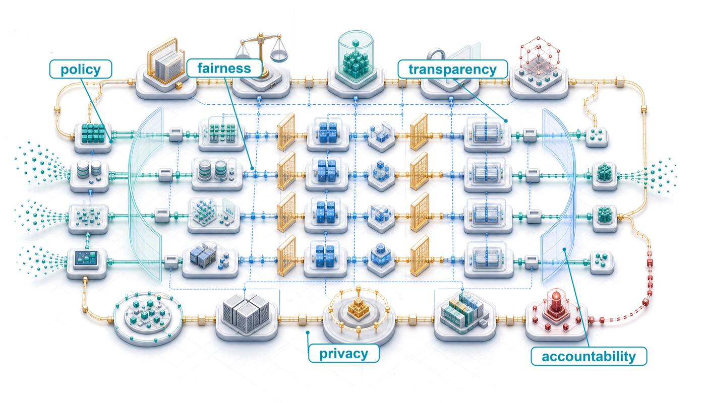{fig-alt="Fleet governance overlay wrapping data, training, serving, monitoring, policy, fairness, privacy, audit, accountability, and incident response."}
:::

:::

## Purpose {.unnumbered .unlisted}

::: {.content-visible when-format="pdf"}
\begin{marginfigure}
\mlfleetstack{5}{10}{15}{25}{35}{40}{70}{100}
\end{marginfigure}
:::

::: {.content-visible unless-format="pdf"}
::: {.column-margin}
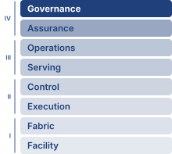{width="100%" fig-alt="Fleet Machine Learning Systems Stack"}

*Fleet stack focus for this chapter.*
:::
:::

_Why can an accurate, fast model still be unfit for deployment?_

In high-risk regulated settings, a model that cannot explain or document its behavior, support audit, or meet applicable discrimination rules may fail deployment review regardless of its accuracy or latency. Strong aggregate performance can conceal a pattern of errors concentrated among people with little power to challenge the outcome. Increasing throughput then increases the reach of that failure. A single-node evaluation can measure predictions, but it cannot establish whether every deployed version uses an approved decision policy or whether an affected person can obtain a correction. Across a fleet, records, models, interfaces, and organizational authority must remain connected as each changes. An explanation delivered too late may be useless to someone facing an immediate decision; retaining every detail indefinitely can create a separate privacy problem. Investigating an alert requires staff and evidence, while correcting a decision may require action across several dependent services. These obligations consume resources and can constrain deployment even when inference capacity is ample. They also persist after launch: a change in population, workflow, or model behavior can invalidate the evidence that originally justified operation. Responsible AI engineering makes those obligations part of the organization's daily operation, with resources and authority to act when measured behavior falls short. In C³ terms, responsibility is a coordination constraint: the fleet needs evidence and authority to decide when compute may run, when it must stop, and who can correct its consequences.

::: {.content-visible when-format="pdf"}

\newpage

:::

::: {.callout-learning-objectives}

- Explain why an accurate, fast model can still fail deployment review, and how fairness, transparency, privacy, safety, and accountability become measurable deployment gates
- Calculate fairness metrics and evaluate observational versus causal definitions under base-rate and prediction trade-offs
- Design bias detection and fairness monitoring across demographic groups, drift, and fleet-scale feedback loops
- Evaluate privacy and machine-unlearning controls against accuracy, compute, and governance requirements
- Select explanation methods under latency, compute, auditability, and user-contestability constraints
- Analyze human-AI feedback loops, automation bias, and value conflicts in deployment contexts
- Construct an auditable assurance case, including bounded robustness and generative-system controls, from intended use and evidence through launch, remedy, material change, and retirement

:::

## The Governance Imperative {#sec-responsible-ai-introduction-responsible-ai-2724}

```{python}
#| echo: false
from mlsysim import *
from mlsysim.core.units import *

# ┌─────────────────────────────────────────────────────────────────────────────
# │ CHAPTER START
# ├─────────────────────────────────────────────────────────────────────────────
# │ Context: Chapter initialization and global imports
# │
# │ Why: Registers this chapter with the mlsys registry and provides shared
# │      imports for all subsequent calculation cells.
# │
# └─────────────────────────────────────────────────────────────────────────────
from mlsysim.fmt import check, fmt
```

In 2018, Reuters reported that Amazon had abandoned an experimental hiring algorithm trained on historical resume data after discovering it systematically penalized female candidates [@dastin2018]. The historical records supplied a computable training objective, but reproducing patterns in those records was not the same as identifying qualified applicants fairly. The experiment exposed a mismatch between the learned objective and the legitimate hiring goal: historical success could encode unequal access rather than merit-based qualifications.

Production AI already has a systems agenda spanning architecture, infrastructure, data processing, security, and robustness [@stoica2017berkeley]. The preceding chapters made the fleet secure against adversaries, robust under shift, and accountable for the energy it draws. The siting analysis in @sec-sustainable-ai-environmental-justice-responsible-development-3923 left one question that energy and carbon accounting could expose but not settle, namely who bears the environmental cost of where the fleet runs. Responsible AI carries that question from the fleet's resource footprint to the decisions the fleet makes about people. A service that remains available, secure, accurate, and within its resource budget can still distribute harms unfairly or deny affected people a remedy, and the hiring incident makes that distinction concrete. Fairness, transparency, and accountability therefore need measurable requirements and operating controls alongside the mechanisms that keep the fleet running.

Across the multi-tier fleet hierarchy diagrammed in @fig-fleet-stack, responsible AI completes the Governance band\index{Fleet Stack!Governance band}, the point where the system meets the real world. The Infrastructure, Distribution, and Serving bands beneath it supply compute, data movement, distributed execution, and serving infrastructure. Within the Governance band, the Assurance row contributes security controls and robustness mechanisms, and the Governance & Sustainability row contributes sustainability budgets; responsible AI weighs that evidence and adds the constraints that determine why the machine runs and whom it serves, requiring owners to identify, assess, limit, and remedy harms from an otherwise correctly functioning system. Alongside the Fleet Law's accounting of execution time\index{Fleet law!responsible AI stability}, responsible AI adds conditions for continued operation\index{Stability!responsible AI}: evidence that the deployment remains within its approved bounds and authority to intervene when it does not. Toxic outputs can erode user trust, discriminatory decisions can distort future training data when those decisions shape data collection, and privacy violations can require restricting or suspending a service. These consequences depend on the deployment, but the obligation to investigate harm does not depend on whether it also degrades model performance. Responsible AI therefore shapes objective selection and operating constraints from the beginning of design.

::: {.column-margin .margin-pointer}
↩ The Fleet Law governing execution time and scaling efficiency is established in @sec-vol2-introduction-fleet-law.
:::

::: {#dfn-responsible-ai-responsible-ai .callout-definition title="Responsible AI"}

***Responsible AI***\index{Responsible AI!definition} is the practice of designing, auditing, and operating ML systems to measurable fairness, safety, privacy, and accountability standards, translating ethical principles into verifiable system properties that constrain model training, deployment decisions, and operational monitoring.

1.  **Significance**: Responsible AI constraints impose real costs: fairness-aware training can lengthen training runs, real-time bias monitoring can consume serving-path latency, and on-demand explainability can require additional model evaluations or asynchronous worker capacity. At fleet scale, these safeguards must be budgeted like reliability or security controls. Conversely, a facial recognition system with a persistent subgroup error gap can affect millions of users before detection, creating regulatory and liability costs that dwarf the monitoring investment.
2.  **Distinction**: AI ethics examines normative principles about what systems should do; responsible AI engineering turns selected requirements into controls and evidence. Bias detection algorithms, differential privacy implementations, audit trails, and architectural guardrails support bounded claims that reviewers can inspect. Choosing legitimate requirements and judging the remaining harms still require domain expertise, stakeholder participation, and accountable authority.
3.  **Common pitfall**: A frequent misconception is that responsible AI is a final compliance review applied to a finished model. Postprocessing can satisfy selected metrics on observed outcomes, but threshold adjustment cannot repair an invalid target, unreliable labels, or missing information. Those defects may require changes to data collection, labels, or learned representations. The remedy depends on the source of harm; a final threshold check cannot substitute for investigating it.

:::

Responsible AI therefore works as an engineering discipline rather than a final review. It translates ethical principles into measurable system requirements, detects and mitigates harmful algorithmic behavior, accounts for **sociotechnical dynamics**\index{Sociotechnical Dynamics!definition}[^fn-sociotechnical-system-etymology] that extend beyond any individual system, and operates inside organizational and regulatory contexts. Public risk-management frameworks, mapped onto the assurance lifecycle below, record the same shift from abstract principles toward governable requirements. Privacy mechanisms, robustness techniques, and sustainability metrics provide the technical foundation for that integration. The responsible-AI framework combines those capabilities with bias detection algorithms, privacy preservation mechanisms, organizational governance structures, and stakeholder engagement\index{Stakeholder engagement!governance integration} processes, treating responsible AI as fundamental to sound engineering practice rather than as supplementary constraints applied to finished systems.

That integration is a significant infrastructure investment. The training, inference, and memory overheads quantified in @sec-responsible-ai-computational-overhead-responsible-ai-techniques-79c2 are essential infrastructure to be provisioned, analogous to how security and redundancy are budgeted in distributed systems.

Treating fairness, transparency, accountability, and privacy as rigorous engineering specifications rather than abstract ideals transforms responsible AI from aspiration into practice. Each principle becomes a design constraint with measurable criteria, attached to a specific stage of the machine learning lifecycle. The assurance lifecycle first establishes who may set and approve those constraints, and the deployment tier determines where each control can run and what it costs. Fairness, privacy, explainability, and safety are then developed one at a time, each from definition through measurement to the controls that enforce it. Accountability and sociotechnical analysis close the argument by testing whether those controls remain effective inside human workflows and institutions.

## The Governance and Assurance Lifecycle {#sec-responsible-ai-governance-assurance-lifecycle}

A model registry can prove which weights reached production, but it cannot prove that the deployment was justified. That judgment requires a chain of evidence connecting the deployment context to affected people, foreseeable harms, measurable requirements, implemented controls, accountable owners, and the authority to launch or stop the system. Responsible AI therefore needs an assurance lifecycle\index{Assurance lifecycle!evidence requirements}: a repeatable operating path that converts normative commitments into reviewable claims and keeps those claims valid as the system changes.

The lifecycle begins before model selection. Teams first define the intended use, prohibited uses, affected parties, operating environment, and decision consequences. They then identify harms and requirements, including subgroup performance, privacy, security, robustness, sustainability, human-oversight, and contestability obligations. Some controls are implemented locally; others are inherited from data providers, foundation-model vendors, cloud platforms, or downstream operators. Each inherited control needs an interface contract stating what the supplier guarantees, what evidence supports that guarantee, and which residual risks remain with the deploying organization.

Constraint selection needs an explicit division of authority. Domain experts and affected parties identify consequential harms and acceptable uses; policy and legal specialists identify applicable obligations; engineers determine what can be measured and enforced. The accountable launch authority approves the resulting criteria and records unresolved disagreements. A convenient metric or an available implementation does not authorize the engineering team to choose whose errors matter most.

The resulting assurance case is not a single compliance document, but a versioned set of linked artifacts that structure accountability across the system lifecycle. At its foundation sits an explicit *claim* defining the property required for a specified use and operating envelope. An *argument* articulates how operational controls and empirical observations justify that claim, drawing on *evidence* from reproducible evaluations, audits, access logs, documentation, and user research. These claims and arguments hold only under stated *assumptions* regarding environmental, population, supplier, and workflow boundaries. To ensure operational authority, every assurance case specifies an accountable *owner* empowered to block launch, restrict use, or require remediation, governed by an explicit *invalidation rule* that defines the measurable performance change, distribution shift, or operational incident that expires prior approval and triggers reassessment.

This structure prevents a common category error. A fairness dashboard, privacy accountant, red-team report, or carbon inventory is evidence for a bounded claim; none is itself proof that the full system is responsible. @Tbl-governance-assurance-lifecycle shows how that evidence becomes operational only when an owner can act on it and affected people have a path to contest a decision and obtain remedy.

At release time, the evaluation contract defined in @sec-ops-scale-end-to-end-evaluation-contract binds those assurance claims to the exact model, workload, acceptance authority, rollback target, and evidence-retention period. The assurance case explains why deployment is justified; the evaluation contract ensures that promotion and invalidation execute that judgment against one reproducible artifact.

| **Lifecycle stage**             | **Required artifact**                                                                                               | **Operational decision**                                                   |
|:--------------------------------|:--------------------------------------------------------------------------------------------------------------------|:---------------------------------------------------------------------------|
| Context and affected parties    | Intended-use statement, prohibited uses, stakeholder map, decision-impact analysis                                  | Is this use legitimate and within organizational authority?                |
| Risk and requirements           | Harm model, legal and policy obligations, measurable acceptance criteria                                            | Which risks must be prevented, bounded, transferred, or accepted?          |
| Controls and dependencies       | Control inventory, supplier evidence, data and model lineage, tool permissions                                      | Are local and inherited controls sufficient for the operating envelope?    |
| Evaluation and assurance        | Assurance case, disaggregated results with uncertainty, robustness and security evidence, sustainability accounting | Does the evidence support launch, restricted launch, or rejection?         |
| Launch authority                | Signed decision record, residual-risk owner, rollback and appeal paths                                              | Who may authorize deployment, and who may stop it?                         |
| Operation and incident response | Monitoring thresholds, escalation owners, incident log, remedy workflow                                             | When must the system degrade, roll back, notify, compensate, or suspend?   |
| Material change                 | Change classification, impact assessment, revalidation scope                                                        | Does a new model, dataset, tool, region, or use invalidate prior approval? |
| Retirement                      | Decommission plan, retention and deletion record, user and dependent-system notice                                  | How are access, data, models, interfaces, and unresolved harms closed out? |

: **Governance and Assurance Lifecycle**: Responsible operation connects context and affected parties to requirements, inherited controls, evidence, launch authority, monitoring, incidents, remedy, material-change review, and retirement. Each stage produces an auditable artifact and a decision rather than a policy statement. {#tbl-governance-assurance-lifecycle tbl-colwidths="[18,40,42]"}

Named frameworks organize this work at different levels. The National Institute of Standards and Technology (NIST) AI Risk Management Framework\index{NIST AI RMF!core functions}\index{NIST AI RMF!risk management} structures activity around Govern, Map, Measure, and Manage; ISO/IEC 42001\index{ISO/IEC 42001!management standard} specifies an organizational AI management system; ISO/IEC 23894 supplies AI risk-management guidance; and the recommendations of the Organisation for Economic Co-operation and Development (OECD) and the United Nations Educational, Scientific and Cultural Organization (UNESCO) state broader principles and public responsibilities [@nist2023airmf; @isoiec420012023ai; @isoiec238942023ai; @oecd2024airecommendation; @unesco2022ethicsai]. @Tbl-responsible-ai-framework-crosswalk maps those perspectives onto the same operating lifecycle rather than treating them as interchangeable checklists.

| **Lifecycle responsibility**                       | **NIST AI RMF emphasis** | **Management-system and public-policy emphasis**                                           |
|:---------------------------------------------------|:-------------------------|:-------------------------------------------------------------------------------------------|
| Establish context, affected parties, and authority | Govern and Map           | Organizational context, leadership, stakeholder participation, and human oversight         |
| Measure risk and assemble evidence                 | Measure                  | Risk assessment, documented objectives, evaluation, transparency, and traceability         |
| Decide, operate, and respond                       | Manage                   | Operational controls, accountability, incident response, remedy, and continual improvement |
| Reassess change and retirement                     | Govern and Manage        | Change management, corrective action, lifecycle review, and decommissioning obligations    |

: **Framework Crosswalk**: Public frameworks differ in scope and legal status, but their durable systems contribution is complementary. They help organizations establish authority, identify and measure risk, operate controls, and reassess evidence through change and retirement. {#tbl-responsible-ai-framework-crosswalk tbl-colwidths="[28,24,48]"}

Three details keep this lifecycle from becoming ceremonial. First, fairness estimates must carry denominators, confidence intervals, and data-coverage limits; a noisy subgroup gap should trigger investigation, not automatic claims of either discrimination or safety. Second, sustainability evidence belongs in the same assurance record, because the functional unit, system boundary, carbon signal, water accounting, embodied-impact allocation, uncertainty, and quality constraint determine whether an environmental claim is comparable or actionable. Third, systems in which a model's output triggers actions, such as calling an external API or retrieving documents into its context, need an authorization boundary independent of model alignment. Tool identities, least-privilege scopes, approval requirements, spend and rate limits, output validation, provenance, and revocation must be versioned and monitored because model-generated tool arguments and retrieved content remain untrusted inputs.

::: {.column-margin .margin-pointer}
↩ The sustainability measurement contract, which fixes the functional unit, system boundary, carbon signal, and attribution rule, is established in @sec-sustainable-ai-part-ii-measurement-assessment-fb0b.
:::

Approval expires when its supporting assumptions no longer hold. A change of foundation model, training distribution, retrieval corpus, tool access, deployment region, user population, decision purpose, or human workflow can be *material* even when the application code is unchanged. The change record should identify which claims are invalidated and select the smallest defensible revalidation scope. At the end of service, retirement must revoke credentials, stop dependent interfaces safely, apply retention and deletion rules, preserve required audit evidence, notify affected users and downstream operators, and leave an owner for unresolved appeals or harms. Governance covers the system after launch and after shutdown, rather than solely at the moment a review board signs a release.

## Core Principles and the ML Lifecycle {#sec-responsible-ai-core-principles-1bd7}

A continuous integration pipeline can block a release when an evaluation detects a 15 percent drop in accuracy specifically for elderly users. Unlike a failing unit test or a latency regression, which the pipeline can check deterministically, a subgroup result requires a specified population, sufficient evaluation data, and an agreed acceptance criterion. Responsible AI translates those commitments into deployment gates. The continuous integration/continuous deployment (CI/CD) pipeline enforces the approved rule, while the accountable reviewer interprets uncertainty and decides whether the evidence supports release, restricted use, or remediation.

That release gate is one instance of a general translation from principle to enforceable requirement. Transparency\index{Transparency!lifecycle documentation} discloses how the system as a whole was built and governed: its data sources, training procedure, intended uses, and known limitations. Explainability\index{Explainability!system evidence} is narrower, producing evidence about the model's behavior on particular decisions for a specified audience. Together they make the system inspectable by the developers, auditors, and affected people who must judge it. Fairness\index{Fairness!stability constraint} constrains how selection rates, error rates, or the meaning of a score may differ across population subgroups; its violations can compound through feedback loops, as in predictive policing, while the service remains technically available. Privacy bounds what the system reveals about the people whose data it uses, safety and robustness bound how it fails, and accountability\index{Accountability!governance mechanisms} assigns owners who can trace, remedy, and answer for its outcomes. Two further principles govern the objective and its supervision. Value alignment\index{Value alignment!objective specification}[^fn-value-alignment-safety] asks whether the objective itself reflects legitimate human intent, and human oversight\index{Human oversight!supervisory control}[^fn-hitl-human-oversight] preserves the ability of people to supervise, correct, or halt automated decisions. The sections that follow develop the first group in turn; alignment and oversight return where autonomy and human workflows make them binding, in @sec-responsible-ai-ai-safety-value-alignment-8c93 and @sec-responsible-ai-humanai-collaboration-205f.

[^fn-value-alignment-safety]: **Value Alignment**\index{Value Alignment!AI safety}: The problem of ensuring AI systems optimize for human values rather than proxy objectives. @russell2021 argues that specifying the objective is harder than optimizing it. The engineering consequence is that the training objective becomes a governed artifact with an owner and a review path, not a fixed input chosen once by the modeling team.

[^fn-hitl-human-oversight]: **HITL (Human-in-the-Loop)**\index{Human-in-the-Loop!systems overhead}: Human participation in model decisions adds response delay and improves safety only when the operator can identify and correct the relevant error. Staffing demand depends on the decision arrival rate, the fraction escalated, and the time required per review. In ML serving architectures, HITL requires routing logic, escalation criteria, and queue management that reshape the inference pipeline.

### Integrating principles across the ML lifecycle {#sec-responsible-ai-integrating-principles-across-ml-lifecycle-7557}

No principle ensures a responsible system on its own. The principles overlap, compete for priority when budgets are finite, and act in different phases of development. @Tbl-principles-lifecycle maps the responsible AI lifecycle\index{Responsible AI!lifecycle} across the major phases of ML system development: data collection, model training, evaluation, deployment, and monitoring.

| **Principle**      |   **Data Collection**   |     **Model Training**     |       **Evaluation**      |      **Deployment**      |      **Monitoring**      |
|:-------------------|:-----------------------:|:--------------------------:|:-------------------------:|:------------------------:|:------------------------:|
| **Fairness**       | Representative sampling |   Bias-aware algorithms    |    Group-level metrics    |   Threshold adjustment   |   Subgroup performance   |
| **Explainability** | Documentation standards | Interpretable architecture |  Model behavior analysis  | User-facing explanations | Explanation quality logs |
| **Transparency**   |   Data source tracking  |   Training documentation   |   Performance reporting   |       Model cards        |     Change tracking      |
| **Privacy**        |    Consent mechanisms   | Privacy-preserving methods | Privacy impact assessment |    Secure deployment     |    Access audit logs     |
| **Accountability** |  Governance frameworks  |      Decision logging      |    Audit trail creation   |   Override mechanisms    |    Incident tracking     |
| **Robustness**     |    Quality assurance    |  Robust training methods   |       Stress testing      |     Failure handling     |  Performance monitoring  |

: **Responsible AI Lifecycle**: Embedding fairness, explainability, privacy, accountability, and robustness throughout the ML system lifecycle, from data collection to monitoring, ensures these principles become architectural commitments rather than post-hoc considerations. The table maps these principles to specific development phases, revealing how proactive integration addresses potential risks and promotes trustworthy AI systems. {#tbl-principles-lifecycle}

Fairness and privacy constraints begin at data collection; robustness likewise depends on data quality and training choices, while accountability requires named owners before deployment. Their operational consequences become visible when the system serves users and teams must respond to failures. Explainability spans the full lifecycle, supporting model debugging at design time and evidence about decisions during use. This mapping reinforces that responsible AI is a multiphase architectural commitment, not a post-hoc compliance step.

#### Resource requirements and equity implications {#sec-responsible-ai-resource-requirements-equity-implications-b967}

Each cell of @tbl-principles-lifecycle is work that someone must pay for. Representative sampling needs data acquisition, subgroup metrics need labeled evaluation data and analysis capacity, and user-facing explanations need serving capacity. Organizations with limited computing budgets may therefore be unable to provide every safeguard in the table, so the people they serve receive fewer protections than the users of a better-resourced deployment. Large-scale deployments that depend on accelerator clusters and low-latency connectivity can likewise exclude users whose networks or devices cannot meet those assumptions.

How high these barriers are depends on what each safeguard costs, and that cost is paid in energy as well as capacity. Private training can add computational work, fairness monitoring needs data collection and analysis capacity, and some explanation methods require many additional model evaluations per decision; @sec-responsible-ai-computational-overhead-responsible-ai-techniques-79c2 sizes these costs. Model-specific algorithms, approximation, caching, and selective generation change that cost; asynchronous execution moves work off the request path without eliminating it. A high-traffic system serving these features to 10 million users must budget the work on the paths where it runs, then determine whether existing capacity is sufficient or additional resources are needed.

Infrastructure placement adds two further distributional effects. Data-center siting decisions that optimize power cost and latency can concentrate local environmental costs on nearby communities that had little say in the decision.[^fn-datacenter-environmental-justice] Connectivity also affects access to safeguards. A user-facing explanation that requires a low-latency round trip to a data center may miss its delivery deadline on a slow network, whereas server-side fairness monitoring can analyze recorded decisions without another user round trip. The architecture must distinguish immediate user needs from audit work that can run asynchronously. Computational equity therefore depends on placement decisions as well as algorithmic design, and the assurance case should record these distributional effects alongside the model's group metrics.

[^fn-datacenter-environmental-justice]: **Data Center Environmental Justice**\index{Data Center!environmental justice}: Data center siting can place backup diesel generators, cooling heat, and grid strain near communities that had little say in the siting decision; the distributional effect must be measured site by site rather than assumed. For ML fleet operators, placement decisions that optimize power cost and latency therefore carry a governance obligation to account for the local costs they create.

## Architectural Trade-Offs {#sec-responsible-ai-responsible-ai-across-deployment-environments-e828}

A centralized audit can join predictions, demographic attributes, and delayed outcomes when access to those records is authorized. A federated model running on a million smartphones may provide no such joined dataset. The same fairness criterion then requires a different evidence path, such as restricted aggregate statistics or a separately governed audit sample. Deployment architecture determines where the evidence can be assembled and who can act on it.

These architectural differences redistribute both feasible safeguards and accountable parties. The comparison that follows uses four deployment tiers that differ in compute, connectivity, and update authority. *Cloud ML*\index{Deployment tier!cloud ML} runs on serving replicas in data-center fleets. *Edge ML*\index{Deployment tier!edge ML} runs on gateways and servers near the data source. *Mobile ML*\index{Deployment tier!mobile ML} runs on phone-class devices with sustained power budgets of a few watts, the regime of Archetype C (Federated MobileNet). *TinyML*\index{Deployment tier!TinyML} runs on microcontrollers with hundreds of kilobytes of memory and milliwatt power budgets, an extreme below Archetype C that often lacks any update channel. The volume's other lighthouses sit in the cloud tier. Archetype A (GPT-4/Llama-3) and Archetype B (DLRM at Scale) serve from data-center fleets, and even Archetype C relies on a cloud aggregator for its fleet-level evidence. TinyML has no lighthouse of its own; it appears here because it marks the limit case, a deployment whose safeguards must be fixed before it ships. Resource availability, latency constraints, user interface design, and the presence or absence of connectivity determine whether responsible AI principles can be enforced consistently across deployment contexts. The same model may support rich explanation, continuous monitoring, and centralized auditability in the cloud, yet require static validation and simplified safeguards when embedded in a device with intermittent connectivity. Tier choice is also an equity decision, because a safeguard that needs a data-center round trip reaches only users whose connectivity supports it (@sec-responsible-ai-resource-requirements-equity-implications-b967).

::: {.column-margin .margin-pointer}
↩ Archetype C (Federated MobileNet) and its few-watt per-device envelope are established in @sec-introduction-archetype-c-federated-mobilenet-65a3.
:::

### Design trade-offs {#sec-responsible-ai-design-tradeoffs-6f5a}

The tier differences reveal a general pattern: responsible AI trade-offs are architectural trade-offs. Machine learning systems do not operate in idealized silos; they must navigate competing objectives under finite resources, strict latency requirements, evolving user behavior, and regulatory complexity.

Cloud-based systems can provision extensive monitoring, fairness audits, interpretability services, and privacy-preserving tools using shared compute and storage. Centralized data handling also concentrates exposure to surveillance and breaches. On-device execution can keep raw data local, but user control still depends on interfaces, permissions, retention rules, and update authority. Postdeployment visibility, fairness instrumentation, and adaptation depend on which evidence and maintenance paths the architecture provides.

Tensions between goals often become apparent at the architectural level. A wearable gesture recognizer or autonomous braking controller may have too little latency budget for a costly explanation on every inference. Designers can evaluate lightweight methods within that budget, precompute suitable summaries, or retain decision records for asynchronous analysis. The explanation's audience and required delivery time determine which of these paths can satisfy the obligation.

Conflicts also emerge between personalization and fairness. Systems that adapt to individuals based on local usage data often lack the global context necessary to assess disparities across population subgroups. Ensuring that personalized predictions do not result in systematic exclusion requires careful architectural design, balancing user-level adaptation with mechanisms for group-level equity and auditability.

Privacy and robustness objectives can also conflict. Logging rare events or user outliers can help diagnose reliability failures, but the records may expose sensitive behavior. If raw records must remain local or encrypted, the improvement process needs an authorized evidence path, such as restricted review or aggregate diagnostics. Robustness requirements belong in the initial design; subsequent refinement depends on whether the retained evidence and update mechanism support it.

Energy budgets can constrain the frequency and placement of safeguards. Reducing model cost does not itself require weaker fairness monitoring; teams can compare local checks, sampled audits, and off-device analysis against the evidence and response deadlines. In federated learning, clipping, noise generation, and communication can consume additional energy, but their placement and cost depend on the mechanism. A central-DP design may add noise at the curator, whereas a local-DP design places randomization on the client. Battery feasibility therefore requires measuring the chosen implementation.[^fn-energy-privacy-tradeoff]

[^fn-energy-privacy-tradeoff]: **Energy-Privacy Trade-off**\index{Energy!privacy trade-off}: Privacy-preserving techniques like differential privacy and secure multi-party computation can increase computation, communication, and battery use. In federated learning on mobile devices, the equity implication is direct: users with older devices, limited data plans, or limited battery life may be excluded from privacy-protected AI services, creating a system where privacy protection becomes contingent on hardware resources.

Together, these deployment examples reveal a broader systems-level challenge. Responsible AI principles cannot be considered in isolation. They interact, and optimizing for one may constrain another. The appropriate balance depends on deployment architecture, stakeholder priorities, domain-specific risks, the consequences of error, and the environmental and distributional impacts of computational resource requirements. Responsible machine learning design therefore depends on making those constraints explicit before choosing methods, so that the resulting system can be evaluated against the deployment context it must actually inhabit.

Comparing these settings (@tbl-ml-principles-comparison) demonstrates that no deployment context dominates across all principles; each makes distinct architectural compromises. Cloud systems support computationally expensive explanation methods and centralized fairness monitoring. Shapley-value attribution (SHAP) credits each input feature with its average marginal contribution to a prediction across subsets of the other features, and local interpretable model-agnostic explanations (LIME) fit a simple surrogate model to many perturbed copies of one input; both require many extra model evaluations per explained decision, and @sec-responsible-ai-architecting-explainability-transparency-75e8 develops them. Cloud deployments can afford that work, but introduce privacy risks through data aggregation. Edge and mobile deployments offer stronger data locality but limit postdeployment observability and global fairness assessment. TinyML systems face particularly tight budgets; their validation, monitoring, and update plans must reflect the connectivity and storage actually provided. These constraints also decide which users receive which safeguards, the equity question raised in @sec-responsible-ai-resource-requirements-equity-implications-b967. Understanding these deployment constraints provides necessary context for the technical methods that operationalize responsible AI principles in practice.

| **Principle**      | **Cloud ML**                                                                                        | **Edge ML**                                                        | **Mobile ML**                                                                       | **TinyML**                                                                        |
|:-------------------|:----------------------------------------------------------------------------------------------------|:-------------------------------------------------------------------|:------------------------------------------------------------------------------------|:----------------------------------------------------------------------------------|
| **Explainability** | Supports complex models and methods like SHAP and sampling approaches                               | Needs lightweight, low-latency methods like saliency maps          | Requires interpretable outputs for users, often defers deeper analysis to the cloud | Severely limited due to constrained hardware; mostly static or compile-time only  |
| **Fairness**       | Large datasets allow bias detection and mitigation                                                  | Localized biases harder to detect but allows on-device adjustments | High personalization complicates group-level fairness tracking                      | Minimal data limits bias analysis and mitigation                                  |
| **Privacy**        | Centralized data at risk of breaches but can use strong encryption and differential privacy methods | Sensitive personal data on-device requires on-device protections   | Tight coupling to user identity requires consent-aware design and local processing  | Distributed data reduces centralized risks but poses challenges for anonymization |
| **Safety**         | Vulnerable to hacking and large-scale attacks                                                       | Real-world interactions make reliability important                 | Operates under user supervision, but still requires graceful failure                | Needs static safety envelopes, watchdogs, and fail-safe behavior                  |
| **Accountability** | Corporate policies and audits allow traceability and oversight                                      | Fragmented supply chains complicate accountability                 | Requires clear user-facing disclosures and feedback paths                           | Traceability required across long, complex hardware chains                        |
| **Governance**     | Applicable law and oversight; centralized evidence and named owners                                 | Applicable law and oversight; allocate duties across integrators   | Applicable law and oversight; coordinate platform and app duties                    | Applicable law and oversight; preserve evidence through servicing and retirement  |

: **Deployment Trade-Offs**: Responsible AI principles manifest differently across deployment contexts due to varying constraints on compute, connectivity, and governance; cloud deployments support complex explainability methods, while TinyML severely limits them. Prioritizing certain principles like explainability, fairness, privacy, safety, and accountability requires careful consideration of these constraints when designing machine learning systems for cloud, edge, mobile, and TinyML environments. {#tbl-ml-principles-comparison tbl-colwidths="[8,23,23,23,23]"}

The deployment analysis identifies where each obligation must be implemented. A constrained endpoint may log bounded decision metadata while a backend aggregates subgroup metrics, stores audit evidence, and serves explanations. An offline endpoint instead needs a defined evidence-retrieval and update path, or an operating envelope that does not depend on unavailable controls. Device capacity limits placement and frequency; it does not by itself remove the fleet operator's responsibility to provide the control.

Tier placement decides where a control runs; it does not decide which control a defect needs. As the hiring case at the start of the chapter showed, predictive accuracy on historical labels does not establish that the target is legitimate. Threshold postprocessing can change a decision-rate disparity, while an unsuitable target may require changes to labels and training, and both need validation and operational ownership.

The principle sections that follow, beginning with fairness in @sec-responsible-ai-architecting-fairness-bias-mitigation-9507, share one structure. Within each principle the methods do one of three jobs. Detection exposes a problem early enough to intervene, mitigation changes data, training, or decision policy to reduce the harm, and validation assembles the evidence a launch authority needs to accept the remaining risk. Each job carries its own cost in accuracy, computation, and implementation effort.

#### Computational overhead of responsible AI techniques {#sec-responsible-ai-computational-overhead-responsible-ai-techniques-79c2}

The next sections unpack the technical methods in detail, but their systems cost is visible before the implementation details. @Tbl-responsible-ai-overhead shows the performance impact of responsible AI techniques\index{Responsible AI!performance impact}: detection, mitigation, validation, privacy, and explanation techniques each impose different costs on training, inference, memory, and accuracy. Reading the table first lets engineers evaluate responsible AI methods as deployable system choices rather than as abstract ethical labels.

```{python}
#| echo: false
# ┌─────────────────────────────────────────────────────────────────────────────
# │ RESPONSIBLE-AI OVERHEAD TABLE (LEGO)
# ├─────────────────────────────────────────────────────────────────────────────
# │ Goal: Compose @tbl-responsible-ai-overhead cells from Literature.ResponsibleAIOverhead.
# │ How: percent ranges per technique/column; accuracy deltas become loss magnitudes.
# └─────────────────────────────────────────────────────────────────────────────
from mlsysim.fmt import fmt_multiple_range, fmt_percent_range

class RaiOverheadTable:
    # ┌── 1. LOAD ──────────────────────────────────────────────────────────
    _R = Literature.ResponsibleAIOverhead

    # ┌── 4. OUTPUT (Formatting) ───────────────────────────────────────────
    dp_accuracy_str = fmt_percent_range(abs(_R.DpAccuracyLowPct) / 100, abs(_R.DpAccuracyHighPct) / 100, precision=0, style="symbol", max_ratio=6)
    dp_training_str = fmt_percent_range(_R.DpTrainingLowPct / 100, _R.DpTrainingHighPct / 100, precision=0, style="symbol", max_ratio=6)
    dp_memory_str = fmt_percent_range(_R.DpMemoryLowPct / 100, _R.DpMemoryHighPct / 100, precision=0, style="symbol", max_ratio=6)
    fair_accuracy_str = fmt_percent_range(
        abs(_R.FairnessAccuracyLowPct) / 100, abs(_R.FairnessAccuracyHighPct) / 100, precision=0, style="symbol", max_ratio=6
    )
    fair_training_str = fmt_percent_range(_R.FairnessTrainingLowPct / 100, _R.FairnessTrainingHighPct / 100, precision=0, style="symbol", max_ratio=6)
    fair_memory_str = fmt_percent_range(_R.FairnessMemoryLowPct / 100, _R.FairnessMemoryHighPct / 100, precision=0, style="symbol", max_ratio=6)
    approx_inference_str = fmt_percent_range(
        _R.ApproxShapInferenceLowPct / 100, _R.ApproxShapInferenceHighPct / 100, precision=0, style="symbol", max_ratio=6
    )
    approx_memory_str = fmt_percent_range(_R.ApproxShapMemoryLowPct / 100, _R.ApproxShapMemoryHighPct / 100, precision=0, style="symbol", max_ratio=6)
    exact_inference_mult_str = fmt_multiple_range(
        int(_R.ExactShapInferenceLowX),
        int(_R.ExactShapInferenceHighX),
        precision=0,
        commas=True,
    )
    exact_memory_str = fmt_percent_range(_R.ExactShapMemoryLowPct / 100, _R.ExactShapMemoryHighPct / 100, precision=0, style="symbol", max_ratio=6)
    adv_accuracy_str = fmt_percent_range(
        abs(_R.AdversarialAccuracyLowPct) / 100, abs(_R.AdversarialAccuracyHighPct) / 100, precision=0, style="symbol", max_ratio=6
    )
    # PGD-k training runs ~(1 + k) passes per batch, so this row reads as a multiplier.
    adv_training_mult_str = fmt_multiple_range(1 + _R.AdversarialTrainingLowPct / 100, 1 + _R.AdversarialTrainingHighPct / 100, precision=0)
    adv_memory_str = fmt_percent_range(_R.AdversarialMemoryLowPct / 100, _R.AdversarialMemoryHighPct / 100, precision=0, style="symbol", max_ratio=6)
    fed_accuracy_str = fmt_percent_range(
        abs(_R.FederatedAccuracyLowPct) / 100, abs(_R.FederatedAccuracyHighPct) / 100, precision=0, style="symbol", max_ratio=6
    )
    fed_training_str = fmt_percent_range(
        _R.FederatedTrainingLowPct / 100, _R.FederatedTrainingHighPct / 100, precision=0, style="symbol", max_ratio=6
    )
    fed_memory_str = fmt_percent_range(_R.FederatedMemoryLowPct / 100, _R.FederatedMemoryHighPct / 100, precision=0, style="symbol", max_ratio=6)
```

| **Technique**                     |               **Accuracy Loss**               |               **Training Overhead**               |                  **Inference Cost**                  | **Memory Overhead**                           |
|:----------------------------------|:---------------------------------------------:|:-------------------------------------------------:|:----------------------------------------------------:|:----------------------------------------------|
| **Differential Privacy (DP-SGD)** |  `{python} RaiOverheadTable.dp_accuracy_str`  |    `{python} RaiOverheadTable.dp_training_str`    |                       Minimal                        | `{python} RaiOverheadTable.dp_memory_str`     |
| **Fairness-Aware Training**       | `{python} RaiOverheadTable.fair_accuracy_str` |   `{python} RaiOverheadTable.fair_training_str`   |                       Minimal                        | `{python} RaiOverheadTable.fair_memory_str`   |
| **Sampled KernelSHAP**            |                      N/A                      |                        N/A                        |   `{python} RaiOverheadTable.approx_inference_str`   | `{python} RaiOverheadTable.approx_memory_str` |
| **Exhaustive SHAP Enumeration**   |                      N/A                      |                        N/A                        | `{python} RaiOverheadTable.exact_inference_mult_str` | `{python} RaiOverheadTable.exact_memory_str`  |
| **Adversarial Training**          |  `{python} RaiOverheadTable.adv_accuracy_str` | `{python} RaiOverheadTable.adv_training_mult_str` |                       Minimal                        | `{python} RaiOverheadTable.adv_memory_str`    |
| **Federated Learning**            |  `{python} RaiOverheadTable.fed_accuracy_str` |    `{python} RaiOverheadTable.fed_training_str`   |                       Minimal                        | `{python} RaiOverheadTable.fed_memory_str`    |

: **Performance Impact of Responsible AI Techniques**: The table gives planning ranges for capacity exercises rather than universal benchmark results. Differential privacy and fairness constraints mainly affect training and validation budgets; explainability cost depends on the value function and algorithm: model-agnostic subset enumeration grows combinatorially, sampled kernel methods require repeated evaluations, and model-specific TreeSHAP can compute exact attributions in polynomial time under its tree and value-function assumptions. The differential-privacy accuracy range runs from fine-tuning a publicly pretrained model (low end) to training from scratch on a small image dataset (high end), the two regimes whose published private accuracies are compared in @sec-security-privacy-privacy-utility-tradeoff-b3e7. Adversarial training is shown as a multiple of standard training cost because each step first generates an attack; a seven-step attack costs about eight passes per batch. These sizing ranges help engineers reason about production constraints before choosing a responsible-AI implementation. {#tbl-responsible-ai-overhead}

These overhead ranges should be read as scenario assumptions, not as claims that any cited paper establishes a single universal tax.[^fn-rai-measurement-context] Actual overhead varies significantly based on model architecture, dataset size, attack strength, explanation method, hardware, communication pattern, and implementation quality. The point is architectural: responsible-AI controls consume real training, serving, memory, or review capacity, so they must be budgeted before launch. These overhead figures are also where the equity argument of @sec-responsible-ai-resource-requirements-equity-implications-b967 becomes concrete: an organization unable to afford one configuration must assess alternatives such as a smaller model, sampled audits, or asynchronous explanations against the same required evidence. Resource limits can restrict the feasible deployment scope; they do not remove the obligation.

[^fn-rai-measurement-context]: **Measurement Context**\index{Responsible AI!measurement baselines}: The sizing exercise assumes common production reference points such as GPU training, GPU or CPU inference, image/text/tabular models, and benchmark datasets. These figures are not canonical constants; they are order-of-magnitude planning anchors for deciding whether a safeguard belongs inline, asynchronous, offline, or in the training pipeline.

Computational costs and architectural constraints determine which controls a deployment can sustain. Preventive requirements guide design before harm occurs; detection then tests whether observed behavior remains within those requirements. Effective correction needs evidence of the problem, an investigation path, and an owner able to act.

## Fairness and Bias Mitigation {#sec-responsible-ai-architecting-fairness-bias-mitigation-9507}

A loan model can approve 70 percent of one group's applicants and 40 percent of another's while reporting a single headline accuracy. Exposing that gap, deciding which gap the deployment must close, and keeping it visible after launch are separate engineering tasks: formal criteria define the disparity, statistical tests decide whether it exceeds sampling noise, and monitoring infrastructure tracks it in production.

### Fairness in machine learning {#sec-responsible-ai-fairness-machine-learning-2ba4}

Automated decisions in hiring, lending, and healthcare affect millions of people, and historical data used to train these systems encodes decades of structural inequality. The engineering question is how to formalize "equitable treatment" in a way that a system can measure and enforce.

::: {#dfn-responsible-ai-algorithmic-fairness .callout-definition title="Algorithmic fairness"}

***Algorithmic fairness***\index{Algorithmic Fairness!definition} is a family of criteria for evaluating equitable treatment and outcomes in automated decisions. The group-based criteria developed here compare selection rates, errors, or score meaning across protected demographic groups; individual and causal criteria ask different questions.

1.  **Significance**: Formal criteria make competing fairness goals measurable. Selection-rate or error-rate constraints can change predictive accuracy, while group-specific calibration\index{Calibration!group-specific} asks whether predicted probabilities match observed outcome frequencies within each protected group. The trade-offs depend on the criterion, data, and decision policy. Satisfying one criterion does not establish equitable treatment by itself.
2.  **Distinction**: Unlike average accuracy, which can hide subgroup disparities, group fairness examines the joint distribution of predictions and outcomes within each group, $\ProbabilityFunction(\PredictedDecision,\TrueOutcome\mid \ProtectedGroupMembership)$. The chosen criterion determines which conditional rates to compare; a group gap diagnoses that metric rather than fairness as a whole.
3.  **Common pitfall**: A frequent misconception is that there is a single "fair" solution. In reality, fairness requirements can conflict under specified assumptions\index{Fairness!incompatibility}. The simplest conflict pairs demographic parity with equalized odds, both defined below. With unequal base rates (the fractions of actual positive cases within groups), the two can hold together only if each group's true positive rate equals its false positive rate. The positive decision is then equally likely among actual positives and actual negatives, so it carries no information about the outcome. A constant classifier satisfies both; any informative classifier must give one up. A deeper result about calibrated scores follows the formal definitions.

:::

Fairness in machine learning presents challenges that aggregate accuracy cannot reveal. The core requirement is that automated systems not disproportionately disadvantage protected groups. Because these systems are trained on historical data\index{Algorithmic bias!historical data}, they are susceptible to reproducing and amplifying patterns of systemic bias embedded in that data\index{Algorithmic bias!reproduction in training}. Without careful design, machine learning systems may unintentionally reinforce social inequities rather than mitigate them.

A widely studied example comes from the healthcare domain. An algorithm[^fn-healthcare-algorithm-bias] used to allocate care management resources in US hospitals was found to systematically underestimate the health needs of Black patients [@obermeyer2019]. The model used healthcare expenditures as a proxy for health status, but due to longstanding disparities in access and spending, Black patients were less likely to incur high costs. As a result, the model inferred that they were less sick, despite often having equal or greater medical need. This case illustrates how seemingly neutral design choices such as proxy variable selection\index{Algorithmic bias!proxy variable selection} can yield discriminatory outcomes when historical inequities are not properly accounted for. Correcting an invalid proxy can improve alignment with the actual clinical goal. A separate engineering question is whether imposing a particular fairness constraint reduces accuracy on a fixed target. That scenario-specific reduction, the fairness tax\index{Fairness!tax}, is priced in @sec-responsible-ai-threshold-setting-fairness-tradeoffs-89fc once the criteria and the decision thresholds that enforce them have been defined.

[^fn-healthcare-algorithm-bias]: **Healthcare Algorithm Scale**\index{Healthcare Algorithm!scale}\index{Healthcare Algorithm!proxy bias}: The study examined one widely used algorithm in a broader class of risk-prediction tools that industry estimates placed at approximately 200 million U.S. patients annually [@obermeyer2019]. In the study's simulated correction at the automatic-enrollment threshold, the fraction of Black patients among those identified for additional care rose from 17.7 percent to 46.5 percent. These are shares of the selected population, not the fraction of all Black patients identified or a measured nationwide enrollment reduction.

Practitioners need formal methods to evaluate fairness given these risks of perpetuating bias. The fairness gates of @sec-ml-operations-scale-fairness-gates-145c already encode two such criteria, demographic parity (@eq-demographic-parity) and equalized odds (@eq-equalized-odds), as release thresholds. This section examines what each criterion measures, adds equality of opportunity and calibration, and shows why the criteria conflict. Before developing them, it helps to frame the notation as a way to express competing fairness goals, not as a proof exercise.

::: {#psp-responsible-ai-fairness-notation-engineering-vocabulary .callout-perspective title="Fairness notation as engineering vocabulary"}

Before examining formal definitions, the fundamental challenge is that fairness can mean different operational constraints. A system may treat everyone identically, account for different baseline conditions, optimize equal outcomes, preserve equal opportunity, or enforce equal treatment. These choices lead to different mathematical criteria, each capturing a different aspect of fairness.

The next subsections introduce formal fairness definitions using probability notation. These metrics (demographic parity, equalized odds, equality of opportunity) appear throughout ML fairness literature and shape regulatory frameworks. Focus on understanding the intuition: what each metric measures and why it matters, rather than mathematical proofs. The concrete examples after each definition illustrate practical application. If probability notation is unfamiliar, start with the verbal descriptions and return to the formal definitions later.

:::

Suppose a model $\BinaryClassifier(\ModelInput)$ predicts a binary outcome, such as loan repayment, and let $\ProtectedGroupMembership$ represent a sensitive attribute with subgroups $\FirstComparedGroupLabel$ and $\SecondComparedGroupLabel$. The field uses three widely adopted fairness definitions:

#### Demographic parity {#sec-responsible-ai-demographic-parity-f126}

::: {#dfn-responsible-ai-demographic-parity .callout-definition title="Demographic parity"}

***Demographic parity***\index{Demographic Parity!definition} is the fairness constraint where a model's positive prediction rate is independent of group membership $(\Pr(\BinaryClassifier(\ModelInput)=1 \mid \ProtectedGroupMembership=\FirstComparedGroupLabel) = \Pr(\BinaryClassifier(\ModelInput)=1 \mid \ProtectedGroupMembership=\SecondComparedGroupLabel))$.

1.  **Significance**: It requires equal positive prediction rates across groups, regardless of underlying base-rate differences. It does not require identical outcomes for every individual, and it is not universally more restrictive than error-rate or calibration criteria.
2.  **Distinction**: Unlike equalized odds (which focuses on error rates such as false positives), demographic parity focuses only on the final prediction\index{Demographic Parity!final prediction}, ignoring the relationship between the prediction and the ground truth.
3.  **Common pitfall**: A frequent misconception is that demographic parity ensures "fairness." Equal approval rates can coexist with unequal error rates. Changing decision thresholds can alter who receives approval without changing the underlying scores or their calibration\index{Calibration!fairness trade-off}; the resulting decisions and the meaning of the scores require separate evaluation.

:::

Demographic parity asks whether favorable outcomes, such as loan approval or treatment referral, occur at equal rates across subgroups defined by a sensitive attribute $\ProtectedGroupMembership$. Formally, the model satisfies demographic parity if:
$$
\Pr\big(\BinaryClassifier(\ModelInput) = 1 \mid \ProtectedGroupMembership = \FirstComparedGroupLabel\big) = \Pr\big(\BinaryClassifier(\ModelInput) = 1 \mid \ProtectedGroupMembership = \SecondComparedGroupLabel\big)
$$

In the healthcare example, this criterion would ask whether Black and white patients were referred for care at the same rate, regardless of their underlying health needs. That may sound like equal access, but it ignores real differences in medical status and risk, potentially overcorrecting when needs are not evenly distributed. The limitation of ignoring base-rate differences motivates more nuanced fairness criteria.

#### Equalized odds {#sec-responsible-ai-equalized-odds-6570}

Equalized odds\index{Equalized odds!error-rate parity} requires that the model's predictions are conditionally independent of group membership given the true label. Specifically, the true positive and false positive rates must be equal across groups:
$$
\Pr\big(\BinaryClassifier(\ModelInput) = 1 \mid \ProtectedGroupMembership = \FirstComparedGroupLabel, \TrueOutcome= \TrueOutcomeLevel\big) = \Pr\big(\BinaryClassifier(\ModelInput) = 1 \mid \ProtectedGroupMembership = \SecondComparedGroupLabel, \TrueOutcome= \TrueOutcomeLevel\big), \quad \text{for } \TrueOutcomeLevel \in \{0, 1\}.
$$

That is, for each true outcome $\TrueOutcome= \TrueOutcomeLevel$, the model should produce the same prediction distribution across groups $\ProtectedGroupMembership = \FirstComparedGroupLabel$ and $\ProtectedGroupMembership = \SecondComparedGroupLabel$. Equalized odds equalizes conditional error rates, not error counts; groups with different numbers of positive or negative cases can still experience different numbers of errors.

Applied to a binary medical referral decision, equalized odds would require equal referral rates across racial groups separately among patients who need the intervention and among those who do not, according to the chosen label $\TrueOutcome$.

#### Equality of opportunity {#sec-responsible-ai-equality-opportunity-1c3d}

Equality of opportunity\index{Equality of opportunity!true-positive rate} is a less stringent relaxation of equalized odds that focuses only on the true positive rate [@hardt2016equality]. It requires that, among individuals who should receive a positive outcome, the probability of receiving one is equal across groups:
$$
\Pr\big(\BinaryClassifier(\ModelInput) = 1 \mid \ProtectedGroupMembership = \FirstComparedGroupLabel, \TrueOutcome= 1\big) = \Pr\big(\BinaryClassifier(\ModelInput) = 1 \mid \ProtectedGroupMembership = \SecondComparedGroupLabel, \TrueOutcome= 1\big).
$$

Equality of opportunity equalizes the approval rate among qualified individuals, who have $\TrueOutcome= 1$, across groups. It does not require identical decisions for every pair of qualified individuals or constrain errors among unqualified applicants.

In medical referral, this measure would require equal identification rates across racial groups among patients labeled as needing the intervention. Both error-rate criteria inherit whatever the label $\TrueOutcome$ measures, which is the lesson of the healthcare case. A model trained to predict expenditure could equalize its error rates against expenditure and still misallocate care, because expenditure is not need. The cited study measured illness burden at a given risk score rather than group error rates, so it cannot itself be scored against these criteria. The loan scenario that follows supplies the binary labels and decisions needed to calculate all three on one model, and it becomes the section's running example.

```{python}
#| echo: false
#| label: fairness-worked-example-calc
# ┌─────────────────────────────────────────────────────────────────────────────
# │ CALCULATING FAIRNESS METRICS — WORKED EXAMPLE (LEGO)
# ├─────────────────────────────────────────────────────────────────────────────
# │ Context: the "Calculating fairness metrics" worked-example callout below.
# │
# │ Goal: Derive the demographic-parity and equal-opportunity disparities and the
# │       group error rates from the 200-applicant loan scenario.
# │ Show: parity gap (0.30), TPR gap (0.29), TPR per group (89/60 percent), and
# │       FPR per group (55/20 percent).
# │ How: Load the per-group confusion counts (scenario), derive each rate and gap.
# │
# └─────────────────────────────────────────────────────────────────────────────
from mlsysim.fmt import check, fmt, fmt_math, fmt_percent, fmt_pp

# ┌── LEGO ───────────────────────────────────────────────
class FairnessWorkedExample:
    """All three fairness criteria on the 200-applicant loan scenario."""

    # ┌── 1. LOAD (Per-group confusion counts, scenario inputs) ────────────
    # Group A (100 applicants): approved 70 (40 repaid, 30 default);
    #                           rejected 30 (5 would repay, 25 default)
    a_approved, a_total = 70, 100
    a_tp, a_fn = 40, 5  # would-repay applicants: approved vs rejected
    a_fp, a_tn = 30, 25  # would-default applicants: approved vs rejected
    # Group B (100 applicants): approved 40 (30 repaid, 10 default);
    #                           rejected 60 (20 would repay, 40 default)
    b_approved, b_total = 40, 100
    b_tp, b_fn = 30, 20
    b_fp, b_tn = 10, 40

    # ┌── 2. EXECUTE (The Compute) ────────────────────────────────────────
    approval_a = a_approved / a_total  # 0.70
    approval_b = b_approved / b_total  # 0.40
    parity_gap = approval_a - approval_b  # 0.30
    tpr_a = a_tp / (a_tp + a_fn)  # 0.89
    tpr_b = b_tp / (b_tp + b_fn)  # 0.60
    tpr_gap = round(tpr_a, 2) - tpr_b  # 0.29 (from displayed TPRs)
    fpr_a = a_fp / (a_fp + a_tn)  # 0.55
    fpr_b = b_fp / (b_fp + b_tn)  # 0.20

    # ┌── 3. GUARD (Invariants) ──────────────────────────────────────────
    check(a_total == a_approved + 30 and b_total == b_approved + 60, "Approved + rejected must equal each group's applicant total")
    check(parity_gap > 0 and tpr_gap > 0, "Both disparities favor Group A")

    # ┌── 4. OUTPUT (Formatting) ──────────────────────────────────────────
    parity_gap_str = fmt(parity_gap, precision=2, commas=False)
    tpr_gap_str = fmt(tpr_gap, precision=2, commas=False)
    parity_gap_math = fmt_math(r"0.70 - 0.40 = " + parity_gap_str)
    tpr_gap_math = fmt_math(r"0.89 - 0.60 = " + tpr_gap_str)
    parity_gap_pp_attr_str = fmt_pp(parity_gap * 100, precision=0, style="prose", attributive=True)
    tpr_gap_pp_attr_str = fmt_pp(tpr_gap * 100, precision=0, style="prose", attributive=True)
    tpr_a_pct_str = fmt_percent(round(tpr_a, 2), precision=0, commas=False, style='prose')
    tpr_b_pct_str = fmt_percent(tpr_b, precision=0, commas=False, style='prose')
    fpr_a_pct_str = fmt_percent(round(fpr_a, 2), precision=0, commas=False, style='prose')
    fpr_b_pct_str = fmt_percent(round(fpr_b, 2), precision=0, commas=False, style='prose')
```

::: {#nbk-responsible-ai-calculating-fairness-metrics .callout-notebook title="Calculating fairness metrics"}

**Problem**: Calculate demographic parity across two demographic groups (100 applicants each) for a loan approval model.

**Variables**:

- Group A: 70 approved (40 repaid, 30 defaulted), 30 rejected.
- Group B: 40 approved (30 repaid, 10 defaulted), 60 rejected.

**Math**:

1. **Group A approval rate**: $\Pr(\BinaryClassifier(\ModelInput) = 1 \mid \ProtectedGroupMembership = \FirstComparedGroupLabel) = \frac{70}{100} = 0.70$.
2. **Group B approval rate**: $\Pr(\BinaryClassifier(\ModelInput) = 1 \mid \ProtectedGroupMembership = \SecondComparedGroupLabel) = \frac{40}{100} = 0.40$.
3. **Parity gap**: `{python} FairnessWorkedExample.parity_gap_math` (`{python} FairnessWorkedExample.parity_gap_pp_attr_str` gap).

**Systems insight**: Evaluating demographic parity exposes group approval rate disparities regardless of ground-truth repayment capability, requiring explicit metric selection during model threshold calibration.

:::

The next calculation assumes that repayment labels are also known for rejected applicants: among the rejected applicants in Group A, five would repay and 25 would default; in Group B, 20 would repay and 40 would default. These are hypothetical evaluation labels. A production lender ordinarily observes repayment only for approved loans, so estimating the same error rates requires additional evidence about rejected applicants and an account of how that evidence was obtained.

::: {#nbk-responsible-ai-equality-of-opportunity .callout-notebook title="Calculating equality of opportunity"}

**Calculating equality of opportunity (true positive rate [TPR])**:

Among applicants who *would actually repay* ($\TrueOutcome=1$):
\begin{gather*}
\Pr(h(x) = 1 \mid A = a, Y = 1) = \frac{40}{40 + 5} = \frac{40}{45} \approx 0.89
\\
\Pr(h(x) = 1 \mid A = b, Y = 1) = \frac{30}{30 + 20} = \frac{30}{50} = 0.60
\end{gather*}

**Disparity**: `{python} FairnessWorkedExample.tpr_gap_math` (`{python} FairnessWorkedExample.tpr_gap_pp_attr_str` gap in TPR)

The model violates equality of opportunity: among qualified applicants who would repay, Group A members are correctly approved `{python} FairnessWorkedExample.tpr_a_pct_str` of the time while Group B members are only approved `{python} FairnessWorkedExample.tpr_b_pct_str` of the time.

**Calculating equalized odds (true positive rate [TPR] and false positive rate [FPR])**:

The TPR values are calculated in the preceding step. For false positive rates among applicants who *would not repay* ($\TrueOutcome=0$):
\begin{gather*}
\Pr(h(x) = 1 \mid A = a, Y = 0) = \frac{30}{30 + 25} = \frac{30}{55} \approx 0.55
\\
\Pr(h(x) = 1 \mid A = b, Y = 0) = \frac{10}{10 + 40} = \frac{10}{50} = 0.20
\end{gather*}

The model also has unequal false positive rates: it incorrectly approves `{python} FairnessWorkedExample.fpr_a_pct_str` of Group A applicants who will default, but only `{python} FairnessWorkedExample.fpr_b_pct_str` of Group B applicants who will default. This reveals the model is more "generous" with Group A even when they will not repay.

**Systems insight**: This model violates all three fairness criteria. Addressing one criterion does not automatically satisfy others. Whether they can all be satisfied together depends on base rates and prediction quality, the question the impossibility results address next.

:::

The loan model's failure to satisfy all three criteria raises a broader question about their compatibility, beyond equality of opportunity alone. Its answer depends on base rates and prediction quality, and the definitions can conflict outright under deployment-specific conditions.[^fn-fairness-impossibility-theorem] A university admissions example makes the simplest conflict, the one previewed in the algorithmic-fairness definition, concrete before the broader calibration result [@kleinberg2016inherent; @chouldechova2017].

[^fn-fairness-impossibility-theorem]: **Fairness Impossibility Theorems**\index{Fairness!impossibility theorems}: @kleinberg2016inherent studies groupwise score calibration together with balance of mean scores in each outcome class. @chouldechova2017 studies predictive parity and error-rate constraints for recidivism prediction. These are distinct conditions; their incompatibility results require assumptions on base rates and predictive performance. Demographic parity is a distinct constraint on selection rates that can also conflict with calibration or error-rate goals in practice. The systems consequence is fundamental: no amount of engineering can satisfy every normative fairness criterion in all settings, so fairness becomes a constrained multi-objective optimization requiring explicit policy choices about which criterion to prioritize for a given deployment context.

Suppose a university admits only qualified applicants, and a larger fraction $\FirstGroupQualifiedFraction$ of Group A's applicants are qualified than the fraction $\SecondGroupQualifiedFraction$ of Group B's. Equal opportunity asks that the same fraction $\QualifiedAdmissionRate$ of qualified applicants be admitted from each group, for example 80 percent of qualified Group A applicants and 80 percent of qualified Group B applicants. The overall admission rates are then $\QualifiedAdmissionRate \FirstGroupQualifiedFraction$ and $\QualifiedAdmissionRate \SecondGroupQualifiedFraction$, which differ whenever $\FirstGroupQualifiedFraction\neq \SecondGroupQualifiedFraction$, so demographic parity fails; they match only at $\QualifiedAdmissionRate= 0$. The no-unqualified-admissions rule fixes each group's false positive rate at zero, so equal opportunity here coincides with equalized odds, and parity holds only when each group's true positive rate also falls to zero. That is the definition's condition (true positive rate equal to false positive rate) in concrete form. Relaxing the rule removes the conflict, because admitting some unqualified Group B applicants can raise Group B's overall rate to Group A's. Which constraint to give up is a value judgment about the decision, not a property the model can settle.

The fairness impossibility law (principle \ref{pri-fairness-impossibility}) is the canonical result, and it concerns scores rather than decisions. Calibration requires a risk score $\ModelScore(\ModelInput)$ to retain its probability meaning within each group, so that among members of any group assigned score $\ModelScore$, a fraction $\ModelScore$ have the positive outcome, $\Pr(\TrueOutcome=1 \mid \ModelScore(\ModelInput)=\ModelScore, \ProtectedGroupMembership=\FirstComparedGroupLabel) = \ModelScore$; @sec-responsible-ai-calibration-8b73 shows how to test this condition and contrasts it with equal precision after thresholding. Score balance additionally requires equal average scores across groups among people with positive outcomes and, separately, among people with negative outcomes. With unequal base rates and imperfect prediction, all three requirements cannot hold together [@kleinberg2016inherent]. The admissions conflict concerns decisions and this result concerns scores, so they constrain different criteria. The score result also does not say that a calibrated score can never meet equalized odds at a particular threshold; that is a third, narrower question. Satisfying one criterion may preclude another, so engineers must treat fairness metrics like latency budgets, explicit trade-offs chosen by stakeholders, enforced by the system, and monitored for violation. Determining which metric to prioritize requires careful consideration of the application context, potential harms, and stakeholder values as detailed in @sec-responsible-ai-normative-pluralism-value-conflicts-d61f [@barocas-hardt-narayanan]. @Fig-fairness-impossibility formalizes this incompatibility, charting how group calibration, positive-class score balance, and negative-class score balance converge on an infeasible joint state whenever base rates differ and predictions remain imperfect.

::: {#fig-fairness-impossibility fig-env="figure" fig-pos="htb" fig-cap="**Conditional Fairness Trade-Offs**: For score-based prediction, calibration within groups and equal mean scores within both outcome classes cannot all hold with unequal base rates and imperfect prediction. Equal base rates or perfect prediction are exceptional cases. This score-balance theorem is distinct from checking equalized odds at one decision threshold." fig-alt="Two Venn diagrams of three overlapping circles labeled calibration within groups, balance in the Y equals 1 class, and balance in the Y equals 0 class. In panel a, unequal base rates and imperfect prediction, the central region where all three circles overlap is hatched red and marked with the empty-set symbol, labeled all three cannot hold. In panel b, equal base rates or perfect prediction, the same central region is filled green and marked all 3, labeled all three can hold."}
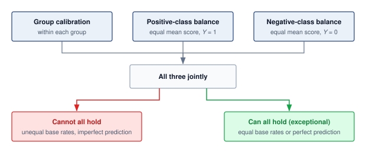

:::

@Fig-fairness-metric-disagreement tracks these conflicting objectives across a classification threshold sweep from 0.15 to 0.85 for two groups with unequal base rates, plotting the resulting violations for demographic parity, equalized odds, and equal opportunity. A threshold that reduces one measured gap need not minimize the others, so the policy must specify which criterion governs the decision and evaluate the remaining gaps.

::: {#fig-fairness-metric-disagreement fig-env="figure" fig-pos="htb" fig-cap="**Fairness Metric Disagreement Across Thresholds**: Three fairness metrics, demographic parity, equalized odds, and equal opportunity, computed on synthetic scores for two groups with differing base rates as the classification threshold varies over a nontrivial operating range. At every evaluated threshold, at least one metric is substantially violated, illustrating practical trade-offs among selection-rate, error-rate, and opportunity criteria. Trivial always-positive or always-negative classifiers fall outside the evaluated range. The shaded region marks the largest of the three violations at each threshold." fig-alt="Line plot of demographic parity (solid), equalized odds (dashed), and equal opportunity (dash-dot) violations against classification threshold from 0.15 to 0.85. A gray shaded area under the highest curve marks the largest violation at each threshold. A dotted horizontal line marks the lowest value of that envelope, an open circle at the right end labeled smallest worst-case gap sits on it, and a hatched band between zero and that line is labeled as a band the worst-case gap never falls into."}

```{python}
#| echo: false
#| warning: false
# ┌─────────────────────────────────────────────────────────────────────────────
# │ FAIRNESS METRIC DISAGREEMENT (FIGURE)
# ├─────────────────────────────────────────────────────────────────────────────
# │ Context: @fig-fairness-metric-disagreement—Chouldechova-Kleinberg
# │
# │ Goal: Plot DP, Equalized Odds, Equal Opportunity vs threshold over a
# │       nontrivial operating range.
# │ Show: Three curves; threshold sweep; impossibility illustration.
# │ How: Synthetic scores_a/b, labels_a/b; compute metrics per threshold;
# │      book_style.setup_plot().
# │
# └─────────────────────────────────────────────────────────────────────────────
# ┌── 1. CANVAS ────────────────────────────────────────────────────────────────
# │ Plot DP, Equalized Odds, Equal Opportunity vs threshold; show no
import numpy as np
import matplotlib.pyplot as plt
from binder.tools.figures import style as book_style

fig, ax, COLORS, plt = book_style.setup_plot(figsize=(6.6, 3.7))

# ┌── 2. ARRAYS ────────────────────────────────────────────────────────────────
np.random.seed(42)
n_per_group = 5000

# Group A: higher base rate (60% positive), scores ~ Beta(3,2)
# Group B: lower base rate (30% positive), scores ~ Beta(2,3)
scores_a = np.random.beta(3, 2, n_per_group)
scores_b = np.random.beta(2, 3, n_per_group)

# True labels: Pr(Y=1) correlated with score
labels_a = (np.random.rand(n_per_group) < scores_a * 0.85 + 0.15).astype(int)
labels_b = (np.random.rand(n_per_group) < scores_b * 0.55 + 0.05).astype(int)

thresholds = np.linspace(0.15, 0.85, 50)
dp_diff = []
eo_diff = []
eqopp_diff = []

# ┌── 3. RENDER ────────────────────────────────────────────────────────────────
for t in thresholds:
    pred_a = (scores_a >= t).astype(int)
    pred_b = (scores_b >= t).astype(int)

    # Demographic Parity Difference: |Pr(Yhat=1|A) - Pr(Yhat=1|B)|
    dp = abs(pred_a.mean() - pred_b.mean())
    dp_diff.append(dp)

    # True Positive Rates
    tpr_a = pred_a[labels_a == 1].mean() if labels_a.sum() > 0 else 0
    tpr_b = pred_b[labels_b == 1].mean() if labels_b.sum() > 0 else 0

    # False Positive Rates
    fpr_a = pred_a[labels_a == 0].mean() if (labels_a == 0).sum() > 0 else 0
    fpr_b = pred_b[labels_b == 0].mean() if (labels_b == 0).sum() > 0 else 0

    # Equal Opportunity Difference: |TPR_A - TPR_B|
    eqopp = abs(tpr_a - tpr_b)
    eqopp_diff.append(eqopp)

    # Equalized Odds Difference: |TPR_A - TPR_B| + |FPR_A - FPR_B|
    eo = abs(tpr_a - tpr_b) + abs(fpr_a - fpr_b)
    eo_diff.append(eo)

dp_arr = np.array(dp_diff)
eo_arr = np.array(eo_diff)
eqopp_arr = np.array(eqopp_diff)
max_violation = np.maximum(np.maximum(dp_arr, eo_arr), eqopp_arr)

# Worst-case violation envelope: the largest of the three gaps at each threshold
v_min = float(max_violation.min())
i_min = int(np.argmin(max_violation))
ax.fill_between(thresholds, 0, max_violation, color=COLORS['grid'], alpha=0.30, lw=0, zorder=1)

# Floor the worst-case gap never enters at any evaluated threshold
ax.fill_between(thresholds, 0, v_min, facecolor='white', edgecolor=COLORS['grid'], hatch='//', lw=0, alpha=0.7, zorder=1.5)
ax.axhline(y=v_min, color=COLORS['primary'], linewidth=0.9, linestyle=':', zorder=2)

ax.plot(thresholds, dp_arr, color=COLORS['BlueLine'], linewidth=2.0, linestyle='-', zorder=3)
ax.plot(thresholds, eo_arr, color=COLORS['OrangeLine'], linewidth=2.0, linestyle='--', zorder=3)
ax.plot(thresholds, eqopp_arr, color=COLORS['GreenLine'], linewidth=2.0, linestyle='-.', zorder=3)

# Perfect fairness reference
ax.axhline(y=0, color=COLORS['primary'], linewidth=0.8, zorder=2)

# ┌── 4. DECORATE ──────────────────────────────────────────────────────────────
# Direct labels near each curve (no legend box)
i_eo = int(np.argmax(eo_arr))
ax.text(
    thresholds[i_eo], eo_arr[i_eo] + 0.025, 'Equalized odds', color=COLORS['OrangeLine'], fontsize=12.5, fontweight='bold', ha='center', va='bottom'
)
i_dp = int(np.argmax(dp_arr))
ax.text(
    thresholds[i_dp], dp_arr[i_dp] + 0.03, 'Demographic parity', color=COLORS['BlueLine'], fontsize=12.5, fontweight='bold', ha='center', va='bottom'
)
i_q = int(np.argmin(np.abs(thresholds - 0.44)))
ax.text(
    thresholds[i_q] + 0.02,
    eqopp_arr[i_q] - 0.04,
    'Equal opportunity',
    color=COLORS['GreenLine'],
    fontsize=12.5,
    fontweight='bold',
    ha='left',
    va='top',
)

# Focal point: the threshold with the smallest worst-case gap still sits above zero
ax.plot([thresholds[i_min]], [v_min], marker='o', ms=7, mfc='white', mec=COLORS['primary'], mew=1.8, zorder=5)
ax.annotate(
    'smallest worst-case gap',
    xy=(thresholds[i_min], v_min),
    xytext=(thresholds[i_min], 0.57),
    fontsize=12,
    ha='right',
    va='bottom',
    color=COLORS['primary'],
    arrowprops=dict(arrowstyle='-', color=COLORS['primary'], lw=0.9, shrinkA=0, shrinkB=5, relpos=(1.0, 0.0)),
    zorder=5,
)
ax.text(
    0.50,
    v_min / 2,
    'worst-case gap never falls into this band',
    fontsize=12,
    ha='center',
    va='center',
    color=COLORS['primary'],
    zorder=4,
    bbox=dict(boxstyle='square,pad=0.25', fc='white', ec='none'),
)

ax.set_xlabel('Classification threshold', fontsize=12.5)
ax.set_ylabel('Fairness violation\n(0 = perfect fairness)', fontsize=12.5)
ax.tick_params(labelsize=12)
ax.set_xlim(0.14, 0.86)
ax.set_ylim(0, 0.65)
ax.grid(axis='x', visible=False)
for side in ('top', 'right'):
    ax.spines[side].set_visible(False)
plt.show()
plt.close()
```

:::

Recognizing these tensions, operational systems must treat fairness as a constraint that informs decisions throughout the machine learning lifecycle. It is shaped by how data are collected and represented, how objectives and proxies are selected, how model predictions are thresholded, and how feedback mechanisms are structured. For example, a choice between ranking vs. classification models can yield different patterns of access across groups, even when using the same underlying data.

Group metrics leave two questions unresolved. An observed disparity does not identify the mechanism that produced it, and broad demographic categories can hide disparities within their intersections. Causal analysis addresses the mechanism question through explicit assumptions; intersectional analysis examines which population divisions an audit must retain.

#### Observational and causal fairness {#sec-responsible-ai-causal-fairness}

The preceding metrics describe associations in observed decisions: selection rates, error rates, or calibration differ across groups. They can establish a disparity without identifying the pathway that produced it. The same approval-rate gap could arise from direct use of a protected attribute, a correlated proxy, unequal access to an earlier process, measurement error, or an unobserved common cause. No comparison of observed rates alone distinguishes these mechanisms.

A causal claim adds a structural causal model\index{Structural causal model!fairness} whose arrows state how protected attribute $\ProtectedGroupMembership$, mediators $\CausalMediator$, outcome $\TrueOutcome$, and decision $\PredictedDecision$ are assumed to relate. **Counterfactual fairness**\index{Counterfactual fairness!definition} then asks whether the decision for the same individual, holding the modeled background factors fixed, would have changed in a counterfactual world where $\ProtectedGroupMembership$ had taken another value [@kusner2017counterfactual]. This is a question about an assumed data-generating process, not a stronger version of demographic parity.

The healthcare proxy illustrates the distinction. A graph might include race $\ProtectedGroupMembership \rightarrow$ access to care $\CausalMediator_1 \rightarrow$ expenditure $\CausalMediator_2 \rightarrow$ risk score $\PredictedDecision$, alongside pathways from health need $\TrueOutcome$ to expenditure. A total effect\index{Causal effect!total, fairness} asks how changing $\ProtectedGroupMembership$ propagates through every modeled path. A path-specific effect\index{Causal effect!path-specific, fairness} isolates selected routes, such as the historically mediated access-to-expenditure path [@nabi2018fair]. Declaring one path permissible and another discriminatory is a domain and normative judgment; neither the graph nor the estimator makes that choice automatically.

Causal conclusions require assumptions that observational data\index{Counterfactual fairness!observational limitations} alone cannot establish: which variables and arrows belong in the graph, whether relevant confounders are measured, and whether the counterfactual interventions are coherent. Different plausible structures can support different answers. Causal analysis therefore complements group metrics, domain knowledge, legal analysis, and stakeholder participation. The metrics continue to monitor realized disparities; the causal model makes the additional mechanism claim and its assumptions inspectable.

#### Intersectional fairness {#sec-responsible-ai-intersectional-fairness-af99}

```{python}
#| echo: false
#| label: gender-shades-intersection
# ┌─────────────────────────────────────────────────────────────────────────────
# │ GENDER SHADES INTERSECTIONAL GAP (LEGO)
# ├─────────────────────────────────────────────────────────────────────────────
# │ Context: @sec-responsible-ai-intersectional-fairness-af99
# │
# │ Goal: Pin the IBM Gender Shades subgroup accuracies to the registry.
# │ Show: "99.7 percent" (lighter-skinned men) vs "65.3 percent" (darker-skinned women).
# │ How: Read Literature.Fairness (percent values).
# │
# └─────────────────────────────────────────────────────────────────────────────
from mlsysim.fmt import check, fmt_percent

class GenderShadesIntersection:
    # ┌── 1. LOAD ──────────────────────────────────────────
    light_male_pct = float(Literature.Fairness.GenderShadesIbmAccuracyLightMale)
    dark_female_pct = float(Literature.Fairness.GenderShadesIbmAccuracyDarkFemale)

    # ┌── 2. EXECUTE ───────────────────────────────────────
    gap_pp = light_male_pct - dark_female_pct

    # ┌── 3. GUARD ─────────────────────────────────────────
    check(30 < gap_pp < 40, f"Gender Shades IBM light-male vs dark-female gap should be about 34 points, got {gap_pp:.1f}")

    # ┌── 4. OUTPUT ────────────────────────────────────────
    light_male_pct_str = fmt_percent(light_male_pct / 100, precision=1, commas=False, style='prose')
    dark_female_pct_str = fmt_percent(dark_female_pct / 100, precision=1, commas=False, style='prose')
```

A critical limitation of standard fairness analysis is that it often evaluates single axes of identity (for example, race or gender) independently. This can mask profound disparities that exist at the intersection of these attributes.

::: {.column-margin}
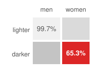{width="100%" fig-alt="A 2-by-2 grid of skin tone by gender: lighter-skinned men 99.7 percent in the lightest gray cell, lighter-skinned women and darker-skinned men in gray cells that darken as accuracy falls, and darker-skinned women 65.3 percent in a red cell."}

*Error concentrates at the intersection: darker-skinned women.*
:::

For example, IBM's gender-classification system achieved `{python} GenderShadesIntersection.light_male_pct_str` accuracy for lighter-skinned men but only `{python} GenderShadesIntersection.dark_female_pct_str` for darker-skinned women in the Gender Shades evaluation [@buolamwini2018gender]. A single-axis audit can obscure such an intersectional disparity. This phenomenon, sometimes called fairness gerrymandering\index{Fairness!gerrymandering}, requires evaluating model performance on intersectional subgroups (for example, $\text{Race}{\times}\text{Gender}$) to detect and mitigate compounded biases.

An intersectional audit must specify the population slices it can identify and the evidence available within them. Work on multicalibration extends calibration checks to a specified, potentially rich family of overlapping subgroups [@hebert2018multicalibration]. This does not certify every possible subgroup or every fairness criterion. It motivates evaluation and monitoring infrastructure that can examine relevant intersections while reporting where sample support or attribute availability limits the claim.

#### Quantitative fairness measurement {#sec-responsible-ai-quantitative-fairness-measurement-a8f2}

Formal fairness criteria become operational only when practitioners can measure the degree of violation and establish actionable thresholds for intervention. The mathematical framework quantifies disparities and uncertainty; domain and policy owners must justify the acceptance criteria and authorize the response. A computed gap supplies evidence for that decision rather than deciding which harms are acceptable.

```{python}
#| echo: false
#| label: fairness-metrics-table-calc
# ┌─────────────────────────────────────────────────────────────────────────────
# │ FAIRNESS METRICS ON THE LOAN EXAMPLE (LEGO)
# ├─────────────────────────────────────────────────────────────────────────────
# │ Context: @tbl-responsible-ai-fairness-metrics and the paragraph below it.
# │
# │ Goal: Score the four group-fairness metrics on the running loan scenario.
# │ Show: Disparate impact ratio (0.57), statistical parity difference (0.30),
# │       equal opportunity difference (0.29), and average absolute odds
# │       difference (0.32).
# │ How: Load the displayed group rates (scenario inputs), derive each metric,
# │      and build the worked-arithmetic math spans for the "Loan value" column.
# │
# └─────────────────────────────────────────────────────────────────────────────
from mlsysim.fmt import check, fmt, fmt_math

# ┌── LEGO ───────────────────────────────────────────────
class FairnessMetricsTable:
    """Score the four group-fairness metrics on the loan example."""

    # ┌── 1. LOAD (Scenario rates from the worked example) ─────────────────
    approval_a = 0.70  # Group A approval rate (70/100)
    approval_b = 0.40  # Group B approval rate (40/100)
    tpr_a_display = 0.89  # Group A true-positive rate (40/45, displayed)
    tpr_b_display = 0.60  # Group B true-positive rate (30/50)
    delta_fpr_display = 0.35  # |FPR_a - FPR_b| = |0.55 - 0.20|, displayed

    # ┌── 2. EXECUTE (The Compute) ────────────────────────────────────────
    di_ratio = min(approval_a, approval_b) / max(approval_a, approval_b)  # 0.57
    spd = approval_a - approval_b  # 0.30
    eod = tpr_a_display - tpr_b_display  # 0.29
    aod = 0.5 * (eod + delta_fpr_display)  # 0.32

    # ┌── 3. GUARD (Invariants) ──────────────────────────────────────────
    check(di_ratio < 0.8, "Illustrative approval-rate ratio must remain below 0.8")
    check(0 < spd < 1 and 0 < eod < 1, "Additive gaps must be valid fractions")

    # ┌── 4. OUTPUT (Formatting) ──────────────────────────────────────────
    approval_a_str = fmt(approval_a, precision=2, commas=False)
    approval_b_str = fmt(approval_b, precision=2, commas=False)
    tpr_a_str = fmt(tpr_a_display, precision=2, commas=False)
    tpr_b_str = fmt(tpr_b_display, precision=2, commas=False)
    fpr_a_str = fmt(0.55, precision=2, commas=False)
    fpr_b_str = fmt(0.20, precision=2, commas=False)
    di_ratio_str = fmt(di_ratio, precision=2, commas=False)
    spd_str = fmt(spd, precision=2, commas=False)
    eod_str = fmt(eod, precision=2, commas=False)
    aod_str = fmt(aod, precision=2, commas=False)
    di_ratio_math = fmt_math(r"\dfrac{0.40}{0.70} = " + di_ratio_str)
    spd_math = fmt_math(r"0.70 - 0.40 = " + spd_str)
    eod_math = fmt_math(r"0.89 - 0.60 = " + eod_str)
    aod_math = fmt_math(r"\tfrac{1}{2}[0.29 + 0.35] = " + aod_str)
```
Four point metrics turn the fairness criteria introduced above into numbers an auditor can threshold. Each one equalizes a different quantity, so each exposes a different failure of the same classifier. @Tbl-responsible-ai-fairness-metrics defines them and scores them on the running loan example, where Group A is approved at `{python} FairnessMetricsTable.approval_a_str` and Group B at `{python} FairnessMetricsTable.approval_b_str`, qualified-applicant true-positive rates are `{python} FairnessMetricsTable.tpr_a_str` and `{python} FairnessMetricsTable.tpr_b_str`, and unqualified-applicant false-positive rates are `{python} FairnessMetricsTable.fpr_a_str` and `{python} FairnessMetricsTable.fpr_b_str`.

| **Metric**                                                                                                                                                 | **Equalizes**                                       | **Formula** $(\FirstComparedGroupLabel, \SecondComparedGroupLabel)$                                                                                    |                 **Loan value**                | **Choose it when**                                                                             |
|:-----------------------------------------------------------------------------------------------------------------------------------------------------------|:----------------------------------------------------|:-------------------------------------------------------------------------------------------------------------------------------------------------------|:---------------------------------------------:|:-----------------------------------------------------------------------------------------------|
| Disparate impact (DI) ratio (four-fifths rule)\index{Disparate impact ratio!threshold analysis}\index{Four-fifths rule!screening threshold} [@feldman2015] | lower approval rate divided by higher approval rate | $\dfrac{\min_\SubgroupIndex\Pr(\BinaryClassifier=1 \mid \SubgroupIndex)}{\max_\SubgroupIndex\Pr(\BinaryClassifier=1 \mid \SubgroupIndex)}$             | `{python} FairnessMetricsTable.di_ratio_math` | a descriptive selection-rate screen is useful; legal interpretation depends on the application |
| Statistical parity difference (SPD)\index{Statistical parity difference!audit metric} [@calders2010]                                                       | additive gap in approval rates                      | $\Pr(\BinaryClassifier=1 \mid \FirstComparedGroupLabel) - \Pr(\BinaryClassifier=1 \mid \SecondComparedGroupLabel)$                                     |    `{python} FairnessMetricsTable.spd_math`   | comparing across groups or tracking drift against a deployment-approved gap threshold          |
| Equal opportunity difference\index{Equal opportunity difference!audit metric} [@hardt2016equality]                                                         | true-positive rates among qualified applicants      | $\Pr(\BinaryClassifier=1 \mid \FirstComparedGroupLabel, \TrueOutcome{=}1) - \Pr(\BinaryClassifier=1 \mid \SecondComparedGroupLabel, \TrueOutcome{=}1)$ |    `{python} FairnessMetricsTable.eod_math`   | the harm is denying deserving individuals                                                      |
| Average absolute odds difference\index{Average absolute odds difference!audit metric} [@hardt2016equality; @bellamy2019; @bird2020fairlearn]               | both true-positive and false-positive rates         | $\tfrac{1}{2}\big[\,\lvert \FiniteChange\text{TPR}\rvert + \lvert \FiniteChange\text{FPR}\rvert\,\big]$                                                |    `{python} FairnessMetricsTable.aod_math`   | both error types matter; the metric is 0 at perfect equalized odds                             |

: **Fairness Metrics on the Loan Example**: Four group-fairness metrics, each equalizing a different quantity, evaluated on the loan approval model. The disparate impact ratio is a descriptive selection-rate screen whose legal weight depends on the application; the additive differences are easier to track over time; the average absolute odds difference captures both true-positive and false-positive error gaps. {#tbl-responsible-ai-fairness-metrics tbl-colwidths="[20,22,33,12,13]"}

The four metrics measure different quantities by construction. The disparate impact ratio of `{python} FairnessMetricsTable.di_ratio_str` means the lower-approval group receives approvals at only that fraction of the higher-approval group's rate, below the illustrative 0.8 screening threshold. The additive `{python} FairnessMetricsTable.spd_str` gap, the `{python} FairnessMetricsTable.eod_str` opportunity gap, and the `{python} FairnessMetricsTable.aod_str` average absolute odds gap each quantify a distinct dimension of the same disparity. No single number is sufficient, which is why the impossibility results in this section force an explicit choice about which metric a deployment will prioritize.

##### Calibration {#sec-responsible-ai-calibration-8b73}

Stated for both groups at once, a model satisfies score calibration\index{Calibration!score} with respect to a sensitive attribute if, among individuals assigned score $\ModelScore$ by the model, the fraction with positive outcomes equals that score within each group [@kleinberg2016inherent]:
$$
\Pr(\TrueOutcome= 1 \mid \ModelScore(\ModelInput) = \ModelScore, \ProtectedGroupMembership = \FirstComparedGroupLabel) = \ModelScore= \Pr(\TrueOutcome= 1 \mid \ModelScore(\ModelInput) = \ModelScore, \ProtectedGroupMembership = \SecondComparedGroupLabel), \quad \forall \ModelScore$$

The condition applies at score levels supported within each group. Matching the groups' outcome frequencies is insufficient if those frequencies differ from the score itself. For hard binary predictions, a distinct condition is equal positive predictive value (PPV)\index{Positive predictive value!precision parity} (precision) among predicted positives. Groupwise score calibration does not by itself guarantee equal PPV after thresholding, because the selected groups can have different score distributions:
$$
\text{PPV}(\FirstComparedGroupLabel) = \frac{\Pr(\TrueOutcome=1, \BinaryClassifier(\ModelInput)=1 \mid \ProtectedGroupMembership=\FirstComparedGroupLabel)}{\Pr(\BinaryClassifier(\ModelInput)=1 \mid \ProtectedGroupMembership=\FirstComparedGroupLabel)} = \text{PPV}(\SecondComparedGroupLabel)
$$

Evaluating this condition on the loan-approval example yields the respective predictive values:
\begin{align*}
\text{PPV}(a) &= \frac{40}{70} = 0.571 \\
\text{PPV}(b) &= \frac{30}{40} = 0.750
\end{align*}

```{python}
#| echo: false
#| label: ppv-gap-calc
# ┌─────────────────────────────────────────────────────────────────────────────
# │ POSITIVE PREDICTIVE VALUE GAP (LEGO)
# ├─────────────────────────────────────────────────────────────────────────────
# │ Context: the predictive-parity paragraph immediately below.
# │
# │ Goal: Quantify the positive predictive value gap on the loan example.
# │ Show: PPV gap (0.179) and each group's PPV as a percent (57 percent, 75 percent).
# │ How: Load the predicted-positive counts (scenario), derive each PPV and the gap.
# │
# └─────────────────────────────────────────────────────────────────────────────
from mlsysim.fmt import check, fmt, fmt_math, fmt_percent, fmt_range

# ┌── LEGO ───────────────────────────────────────────────
class PpvGap:
    """Positive predictive value gap between the two loan groups."""

    # ┌── 1. LOAD (Predicted-positive counts from the worked example) ──────
    repaid_a, approved_a = 40, 70  # Group A: 40 of 70 approved actually repaid
    repaid_b, approved_b = 30, 40  # Group B: 30 of 40 approved actually repaid

    # ┌── 2. EXECUTE (The Compute) ────────────────────────────────────────
    ppv_a = repaid_a / approved_a  # 0.571
    ppv_b = repaid_b / approved_b  # 0.750
    ppv_gap = round(ppv_b, 3) - round(ppv_a, 3)  # 0.179 (from displayed values)

    # ┌── 3. GUARD (Invariants) ──────────────────────────────────────────
    check(ppv_b > ppv_a, "Group B predicted positives must be more reliable")

    # ┌── 4. OUTPUT (Formatting) ──────────────────────────────────────────
    gap_str = fmt(ppv_gap, precision=3, commas=False)
    gap_math = fmt_math(r"0.750 - 0.571 = " + gap_str)
    ppv_a_pct_str = fmt_percent(round(ppv_a, 2), precision=0, commas=False, style='prose')
    ppv_b_pct_str = fmt_percent(round(ppv_b, 2), precision=0, commas=False, style='prose')
```

The positive predictive value gap is `{python} PpvGap.gap_math`. Group B's predicted positives are actually positive `{python} PpvGap.ppv_b_pct_str` of the time, while Group A's are only `{python} PpvGap.ppv_a_pct_str` accurate. This violates predictive parity\index{Predictive parity!equal positive predictive value} for hard decisions and reveals that the model is less reliable when predicting approval for Group A. Demonstrating score calibration itself would require comparing observed outcome frequencies with predicted probabilities within each group, using score bins with sufficient support.

Calibration is critical for high-stakes decisions where individuals rely on predicted probabilities. A miscalibrated model systematically over- or underpredicts risk for specific groups, leading to misallocated resources and eroded trust.

##### Threshold setting and fairness trade-offs {#sec-responsible-ai-threshold-setting-fairness-tradeoffs-89fc}

In practice, fairness metrics can be changed by adjusting classification thresholds per group. In the equations below, a larger score favors a positive decision, as with predicted repayment probability. Given a scoring function $\DecisionScore(\ModelInput)$, define group-specific thresholds $\FirstGroupClassificationThreshold$ and $\SecondGroupClassificationThreshold$ such that $\FirstGroupThresholdClassifier(\ModelInput) = \mathbb{1}[\DecisionScore(\ModelInput) \geq \FirstGroupClassificationThreshold]$ for group $\FirstComparedGroupLabel$ and similarly for group $\SecondComparedGroupLabel$.

To achieve demographic parity, solve:
$$
\Pr(\DecisionScore(\ModelInput) \geq \FirstGroupClassificationThreshold\mid \ProtectedGroupMembership = \FirstComparedGroupLabel) = \Pr(\DecisionScore(\ModelInput) \geq \SecondGroupClassificationThreshold\mid \ProtectedGroupMembership = \SecondComparedGroupLabel)
$$

To achieve equal opportunity, solve:
$$
\Pr(\DecisionScore(\ModelInput) \geq \FirstGroupClassificationThreshold\mid \ProtectedGroupMembership = \FirstComparedGroupLabel, \TrueOutcome= 1) = \Pr(\DecisionScore(\ModelInput) \geq \SecondGroupClassificationThreshold\mid \ProtectedGroupMembership = \SecondComparedGroupLabel, \TrueOutcome= 1)
$$

For equalized odds, both true positive and false positive rate constraints must hold simultaneously. A single deterministic threshold per group need not satisfy both. Postprocessing can instead randomize between threshold rules within each group to attain a shared pair of rates [@hardt2016equality]. The resulting criterion constrains group-level probabilities, so validation must evaluate the randomized policy rather than only its component thresholds.

Threshold adjustment still requires evaluating the other criteria. When base rates differ (that is, $\Pr(\TrueOutcome=1 \mid \ProtectedGroupMembership=\FirstComparedGroupLabel) \neq \Pr(\TrueOutcome=1 \mid \ProtectedGroupMembership=\SecondComparedGroupLabel)$), calibration and error-rate constraints can conflict under the conditions discussed earlier. The effect of a particular threshold policy must be measured on the joint score and label distribution; a base-rate difference alone does not determine its accuracy cost.

::: {.column-margin}
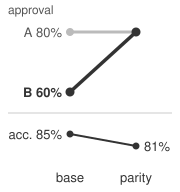{width="100%" fig-alt="Two slope panels separated by a thin rule and drawn at the same scale, comparing a base policy with a parity policy. Top panel, labeled approval: a thin light-gray line labeled A stays flat at 80 percent while a heavy dark line labeled B rises from 60 to 80 percent. Bottom panel, labeled acc.: a dark line falls from 85 to 81 percent."}

*Lifting Group B's approval rate to parity costs 4 points of accuracy.*
:::

```{python}
#| echo: false
#| label: fairness-tax-calc
# ┌─────────────────────────────────────────────────────────────────────────────
# │ THE FAIRNESS TAX (LEGO)
# ├─────────────────────────────────────────────────────────────────────────────
# │ Context: @sec-responsible-ai-threshold-setting-fairness-tradeoffs-89fc
# │
# │ Goal: Quantify the accuracy loss from enforcing demographic parity.
# │ Show: 4 percentage-point accuracy drop (85% -> 81%) when equalizing approval rates.
# │ How: Compare unconstrained accuracy vs parity-constrained accuracy.
# │
# └─────────────────────────────────────────────────────────────────────────────
from mlsysim.fmt import check, fmt_percent, fmt_pp

# ┌── LEGO ───────────────────────────────────────────────
class FairnessTaxAnalysis:
    """Quantify the cost of algorithmic fairness constraints."""

    # ┌── 1. LOAD (Constants) ──────────────────────────────────────────────
    acc_baseline = 85.0
    acc_constrained = 81.0
    group_a_default_pct = 20
    group_b_default_pct = 40
    default_prob_threshold = 30
    group_a_approval_pct = 80
    group_b_approval_unconstrained_pct = 60
    default_prob_threshold_parity = 50

    # ┌── 2. EXECUTE (The Compute) ────────────────────────────────────────
    fairness_tax = acc_baseline - acc_constrained
    fairness_tax_relative = fairness_tax / acc_baseline * 100

    # ┌── 3. GUARD (Invariants) ──────────────────────────────────────────
    check(abs(fairness_tax - 4.0) < 0.01, f"Expected 4.0 pp fairness tax, got {fairness_tax}")

    # ┌── 4. OUTPUT (Formatting) ──────────────────────────────────────────────
    acc_unconstrained_str = fmt_percent(round(acc_baseline) / 100, precision=0, commas=False, style='prose')
    acc_parity_str = fmt_percent(round(acc_constrained) / 100, precision=0, commas=False, style='prose')
    fairness_tax_pp_str = fmt_pp(fairness_tax, precision=0, commas=False)
    fairness_tax_relative_pct_str = fmt_percent(fairness_tax_relative / 100, precision=1, commas=False, style='prose')
    group_a_default_pct_str = fmt_percent(round(group_a_default_pct) / 100, precision=0, commas=False, style='prose')
    group_b_default_pct_str = fmt_percent(round(group_b_default_pct) / 100, precision=0, commas=False, style='prose')
    default_prob_threshold_str = fmt_percent(round(default_prob_threshold) / 100, precision=0, commas=False, style='prose')
    group_a_approval_pct_str = fmt_percent(round(group_a_approval_pct) / 100, precision=0, commas=False, style='prose')
    group_b_approval_unconstrained_pct_str = fmt_percent(round(group_b_approval_unconstrained_pct) / 100, precision=0, commas=False, style='prose')
    default_prob_threshold_parity_str = fmt_percent(round(default_prob_threshold_parity) / 100, precision=0, commas=False, style='prose')
```

The accuracy cost of a threshold policy becomes concrete on a separate credit model, distinct from the running loan example. Its score is a predicted default probability, so a lower score favors approval and each cutoff admits applicants below it. The scenario enforces demographic parity, the first threshold equation above, and prices the accuracy that enforcement costs.

::: {#nbk-responsible-ai-fairness-tax .callout-notebook title="The fairness tax"}

**Problem**: Consider a credit model with `{python} FairnessTaxAnalysis.acc_unconstrained_str` accuracy. Group A (majority) has a `{python} FairnessTaxAnalysis.group_a_default_pct_str` default rate. Group B (minority) has a `{python} FairnessTaxAnalysis.group_b_default_pct_str` default rate due to systemic factors. If demographic parity (equal approval rates) is enforced, what happens to accuracy?

**Math**:

This scenario holds Group A's approval rate fixed and raises Group B's rate to match it; demographic parity alone does not require that particular choice. The accuracy values are assumed held-out validation results, where the additional Group B approvals carry higher default risk.

1.  **Unconstrained**: Model approves everyone with predicted default prob < `{python} FairnessTaxAnalysis.default_prob_threshold_str`.
    *   Group A approval: `{python} FairnessTaxAnalysis.group_a_approval_pct_str`.
    *   Group B approval: `{python} FairnessTaxAnalysis.group_b_approval_unconstrained_pct_str`.
    *   Total Accuracy: `{python} FairnessTaxAnalysis.acc_unconstrained_str`.
2.  **Constrained (parity)**: Holding Group A's rate fixed, approve Group B at `{python} FairnessTaxAnalysis.group_a_approval_pct_str` rate.
    *   New threshold for Group B: Approve default prob < `{python} FairnessTaxAnalysis.default_prob_threshold_parity_str`.
    *   The revised cutoff admits Group B applicants with higher predicted default risk than the original policy allowed.
    *   New Total Accuracy: `{python} FairnessTaxAnalysis.acc_parity_str`.

**Systems insight**: This parity policy cost `{python} FairnessTaxAnalysis.fairness_tax_pp_str` of accuracy (about a `{python} FairnessTaxAnalysis.fairness_tax_relative_pct_str` relative accuracy drop in this credit-scoring scenario). The drop is the scenario's fairness tax, not a universal cost of fairness. Accuracy still measures prediction against the specified default labels; whether those labels capture the legitimate lending objective is a separate question. Engineers must report the predictive trade-off while making the target and policy assumptions explicit.

:::

The `{python} FairnessTaxAnalysis.fairness_tax_pp_str` cost belongs to one parity policy on one prediction target. A different criterion moves the thresholds for a different reason, and the next scenario, which returns to the repayment-score convention, targets equal opportunity by comparing the score distributions among qualified applicants. Differential thresholds require access to sensitive attributes at inference time and raise concerns about explicit group-based treatment, which may itself be considered unfair or illegal in certain jurisdictions. The required thresholds depend on those distributions and the chosen criterion; a lower threshold for the minority group is not a universal fairness rule.

::: {#nbk-responsible-ai-threshold-equal-opportunity .callout-notebook title="Threshold for equal opportunity"}

**Problem**: Calculate group-specific thresholds required to equalize true positive rates (equal opportunity) across Group A and Group B in a credit scoring model.

**Variables**: Let the score $\DecisionScore(\ModelInput)$ be an unbounded decision score, not a calibrated probability, and write Group A as $\ProtectedGroupMembership=\FirstComparedGroupLabel$ and Group B as $\ProtectedGroupMembership=\SecondComparedGroupLabel$. Assume $\DecisionScore(\ModelInput)\mid(\TrueOutcome=1,\ProtectedGroupMembership=\FirstComparedGroupLabel)\sim\GaussianDistribution(0.72,0.15^2)$ and $\DecisionScore(\ModelInput)\mid(\TrueOutcome=1,\ProtectedGroupMembership=\SecondComparedGroupLabel)\sim\GaussianDistribution(0.65,0.16^2)$. These are hypothetical positive-class distributions; no negative-class distribution or prevalence is specified.

**Math**:

1. **Single threshold**: At $\FirstGroupClassificationThreshold=\SecondGroupClassificationThreshold=0.60$, $\text{TPR}_\FirstComparedGroupLabel=1-\StandardNormalCumulativeDistribution(-0.8)\approx0.788$ and $\text{TPR}_\SecondComparedGroupLabel=1-\StandardNormalCumulativeDistribution(-0.3125)\approx0.623$, where $\StandardNormalCumulativeDistribution$ is the standard normal cumulative distribution function.
2. **Equalizing thresholds**: Preserve Group A's threshold and match its standardized cutoff, $(\SecondGroupClassificationThreshold-0.65)/0.16=-0.8$. Thus $\SecondGroupClassificationThreshold=0.522$ yields the same true positive rate.
3. **Unspecified costs**: Lowering Group B's threshold cannot decrease its false positive rate, but its magnitude requires $\DecisionScore(\ModelInput)\mid(\TrueOutcome=0,\ProtectedGroupMembership=\SecondComparedGroupLabel)$. Precision also requires Group B's prevalence. Neither quantity follows from the positive-class distributions alone.

**Systems insight**: Equal opportunity determines a threshold only relative to the stated score distributions and target rate. Before deployment, evaluate the resulting false positives, precision, and review workload on representative data. Threshold policies change decisions, not the underlying score calibration.

:::

@Fig-fairness-example presents a separate illustrative loan scenario, with applicants partitioned into Subgroup A (higher score distribution, blue band) and Subgroup B (lower score distribution, amber band). The summary panels contrast two operating regimes: applying a single global threshold ($\ClassificationThreshold = 0.75$) approves qualified applicants in Subgroup B at only 25 percent TPR compared to 75 percent for Subgroup A, a threefold opportunity disparity. Conversely, shifting to group-adapted thresholds ($\FirstGroupClassificationThreshold= 0.75$ for Subgroup A and $\SecondGroupClassificationThreshold= 0.45$ for Subgroup B) equalizes true positive rates at 75 percent. That policy requires the authorized decision component to access the relevant group attribute and log the governing threshold. Neither the attribute lookup nor the policy decision must run on the client, but the system must preserve evidence explaining why identical scores receive different decisions.

::: {#fig-fairness-example fig-env="figure" fig-pos="htb" fig-cap="**Threshold-Dependent Fairness**: Varying classification thresholds across subgroups allows equal true positive rates but introduces complexity in model serving and necessitates access to sensitive attributes at inference time. Achieving fairness requires careful consideration of subgroup-specific performance, as a single threshold may disproportionately impact certain groups, highlighting the tension between accuracy and equitable outcomes in machine learning systems." fig-alt="Two stacked panels, each with a blue band for Subgroup A and an amber band for Subgroup B holding plus markers for qualified applicants and open circles for defaults along a 0 to 1 score axis, with the approval region at or above each threshold shaded darker. Panel a draws one dashed threshold at 0.75 across both bands and lists TPR 75 percent for Subgroup A and 25 percent for Subgroup B. Panel b draws a threshold at 0.75 in the Subgroup A band and at 0.45 in the Subgroup B band and lists TPR 75 percent for both."}
```{python}
#| echo: false
#| warning: false
import matplotlib.pyplot as plt
import matplotlib.colors as mcolors
import matplotlib.patheffects as pe
import numpy as np
from binder.tools.figures import style as book_style

book_style.set_book_style()
COLORS = book_style.COLORS

c_dark = COLORS['primary']
c_sec = COLORS['secondary']

# Illustrative applicant scores (four qualified and four default per subgroup)
subgroup_a_def = [0.20, 0.52, 0.59, 0.66]
subgroup_a_qual = [0.72, 0.78, 0.84, 0.94]
subgroup_b_def = [0.06, 0.13, 0.20, 0.44]
subgroup_b_qual = [0.36, 0.50, 0.62, 0.89]

gamma_cls = 0.75  # uniform threshold
theta_a = 0.75  # group-adapted threshold, Subgroup A
theta_b = 0.45  # group-adapted threshold, Subgroup B

y_a, y_b = 1.0, 0.0
half = 0.33

def tpr(qual, thr):
    hits = sum(s >= thr for s in qual)
    return hits, len(qual)

fig, (ax_u, ax_g) = plt.subplots(2, 1, figsize=(6.6, 4.0), sharex=True)
fig.subplots_adjust(hspace=0.28)

panels = [
    (ax_u, '(a) Uniform threshold', {y_a: gamma_cls, y_b: gamma_cls}),
    (ax_g, '(b) Group-adapted thresholds', {y_a: theta_a, y_b: theta_b}),
]

for ax, title, thr in panels:
    ax.grid(False)
    for spine in ('top', 'right', 'left'):
        ax.spines[spine].set_visible(False)
    # Subgroup bands
    ax.axhspan(y_a - half, y_a + half, color=COLORS['BlueL'], alpha=0.75, lw=0, zorder=1)
    ax.axhspan(y_b - half, y_b + half, color=COLORS['OrangeL'], alpha=0.75, lw=0, zorder=1)
    # Approve region: at or above each band's threshold
    for y, band in ((y_a, COLORS['BlueLine']), (y_b, COLORS['OrangeLine'])):
        ax.fill_between([thr[y], 1.0], y - half, y + half, color=band, alpha=0.12, lw=0, zorder=1.2)

    # Applicants: open gray circle = default (Y = 0), dark plus = qualified (Y = 1)
    for y, dflt, qual, band in ((y_a, subgroup_a_def, subgroup_a_qual, COLORS['BlueL']), (y_b, subgroup_b_def, subgroup_b_qual, COLORS['OrangeL'])):
        ax.scatter(
            dflt,
            [y] * len(dflt),
            s=11,
            facecolors='white',
            edgecolors=c_sec,
            linewidths=1.0,
            zorder=5,
        )
        ax.scatter(qual, [y] * len(qual), s=80, c=c_dark, marker='P', linewidths=0, zorder=5)

    # Thresholds
    if thr[y_a] == thr[y_b]:
        ax.vlines(thr[y_a], y_b - half, y_a + half, colors=c_dark, linestyles="--", lw=0.9, zorder=2)
        ax.text(thr[y_a] + 0.008, y_a + half + 0.09, r'$\gamma_{\mathrm{cls}} = 0.75$', fontsize=12.5, color=c_dark, ha='left', va='bottom')
    else:
        ax.vlines(thr[y_a], y_a - half, y_a + half, colors=COLORS["BlueLine"], linestyles="--", lw=0.9, zorder=2)
        ax.vlines(thr[y_b], y_b - half, y_b + half, colors=COLORS["OrangeLine"], linestyles="--", lw=0.9, zorder=2)
        ax.text(
            thr[y_a] + 0.008, y_a + half + 0.09, r'$\tau_{\mathrm{thr},a} = 0.75$', fontsize=12.5, color=COLORS['BlueLine'], ha='left', va='bottom'
        )
        ax.text(
            thr[y_b] + 0.008, y_b + half + 0.09, r'$\tau_{\mathrm{thr},b} = 0.45$', fontsize=12.5, color=COLORS['OrangeLine'], ha='left', va='bottom'
        )

    # True positive rate per subgroup, right of the axis
    for y, qual in ((y_a, subgroup_a_qual), (y_b, subgroup_b_qual)):
        hits, n = tpr(qual, thr[y])
        pct = round(100 * hits / n)
        low = hits < n / 2
        ax.text(
            1.02,
            y,
            f'TPR {pct}% ({hits}/{n})',
            transform=ax.get_yaxis_transform(),
            fontsize=12.5,
            fontweight='bold',
            va='center',
            ha='left',
            color=COLORS['RedLine'] if low else c_dark,
        )

    ax.set_yticks([y_b, y_a])
    ax.set_yticklabels(['Subgroup B', 'Subgroup A'], fontsize=12.5, fontweight='bold')
    ax.get_yticklabels()[0].set_color(COLORS['OrangeLine'])
    ax.get_yticklabels()[1].set_color(COLORS['BlueLine'])
    ax.tick_params(axis='y', length=0)
    ax.set_ylim(y_b - half - 0.05, y_a + half + 0.30)
    ax.set_title(title, loc='left', fontsize=12.5, fontweight='bold', color=c_dark, pad=2)

ax_g.set_xlim(0.0, 1.0)
ax_g.set_xticks(np.linspace(0.0, 1.0, 6))
ax_g.set_xticklabels([f"{x:.1f}" for x in np.linspace(0.0, 1.0, 6)], fontsize=12)
ax_g.set_xlabel('Predicted repayment score (approve at or above threshold)', fontsize=12.5, color=c_dark)
ax_u.tick_params(axis='x', length=0)
ax_u.spines['bottom'].set_visible(False)

# Marker key, top right, unframed
handles = [
    plt.Line2D([0], [0], marker='P', color='w', markerfacecolor=c_dark, markersize=9, label='qualified, $Y = 1$'),
    plt.Line2D(
        [0], [0], marker='o', color='w', markeredgecolor=c_sec, markerfacecolor='w', markeredgewidth=1.0, markersize=4.2, label='default, $Y = 0$'
    ),
]
ax_u.legend(
    handles=handles,
    loc='lower right',
    bbox_to_anchor=(1.0, 1.10),
    ncol=2,
    frameon=False,
    fontsize=12,
    handletextpad=0.3,
    columnspacing=1.2,
    borderaxespad=0.1,
)

plt.show()
plt.close()
```
:::

##### Statistical testing of fairness violations {#sec-responsible-ai-measuring-fairness-violations-statistically-127e}

Confidence intervals and hypothesis tests help assess whether sampling variation plausibly explains an observed disparity under a stated sampling model. For demographic parity, the null hypothesis $\StatisticalHypothesis_0: \Pr(\BinaryClassifier(\ModelInput)=1 \mid \ProtectedGroupMembership=\FirstComparedGroupLabel) = \Pr(\BinaryClassifier(\ModelInput)=1 \mid \ProtectedGroupMembership=\SecondComparedGroupLabel)$ can be tested using a two-proportion z-test when observations are independent and expected approval and rejection counts in both groups support the normal approximation. Repeated decisions for the same person or correlated observations require an uncertainty estimate that accounts for that dependence. Under the independent-sample assumptions, the test statistic is:
$$
\ProportionTestStatistic= \frac{\FirstGroupSampleApprovalRate- \SecondGroupSampleApprovalRate}{\sqrt{\PooledSampleApprovalRate(1-\PooledSampleApprovalRate)\left(\frac{1}{\FirstGroupSampleSize} + \frac{1}{\SecondGroupSampleSize}\right)}}
$$

where $\FirstGroupSampleApprovalRate$ and $\SecondGroupSampleApprovalRate$ are the sample approval rates, $\PooledSampleApprovalRate= \frac{\FirstGroupSampleSize\FirstGroupSampleApprovalRate+ \SecondGroupSampleSize\SecondGroupSampleApprovalRate}{\FirstGroupSampleSize+ \SecondGroupSampleSize}$ is the pooled proportion, and $\FirstGroupSampleSize$, $\SecondGroupSampleSize$ are sample sizes.

For the loan example with $\FirstGroupSampleSize= \SecondGroupSampleSize= 100$, $\FirstGroupSampleApprovalRate= 0.70$, $\SecondGroupSampleApprovalRate= 0.40$:
\begin{align*}
\hat{p} &= \frac{100(0.70) + 100(0.40)}{200} = 0.55 \\
z &= \frac{0.70 - 0.40}{\sqrt{0.55(0.45)(0.02)}} = \frac{0.30}{0.0704} = 4.26
\end{align*}

```{python}
#| echo: false
#| label: fairness-ztest-calc
# ┌─────────────────────────────────────────────────────────────────────────────
# │ TWO-PROPORTION Z-TEST ON THE LOAN EXAMPLE (LEGO)
# ├─────────────────────────────────────────────────────────────────────────────
# │ Context: the significance-conclusion sentence immediately below.
# │
# │ Goal: Compute the demographic-parity z-statistic for the loan example.
# │ Show: z = 4.26, exceeding the two-sided critical value 1.96.
# │ How: Load the sample sizes and approval rates (scenario inputs); compute the
# │      pooled proportion and the two-proportion z statistic.
# │
# └─────────────────────────────────────────────────────────────────────────────
import math
from mlsysim.fmt import check, fmt, fmt_math

# ┌── LEGO ───────────────────────────────────────────────
class FairnessZTest:
    """Two-proportion z-test for the loan-example approval-rate gap."""

    # ┌── 1. LOAD (Scenario inputs from the worked example) ────────────────
    n_a = n_b = 100
    p_a = 0.70
    p_b = 0.40
    z_critical = 1.96  # two-sided 5 percent critical value

    # ┌── 2. EXECUTE (The Compute) ────────────────────────────────────────
    p_pooled = (n_a * p_a + n_b * p_b) / (n_a + n_b)  # 0.55
    se = math.sqrt(p_pooled * (1 - p_pooled) * (1 / n_a + 1 / n_b))
    z = (p_a - p_b) / se  # 4.26

    # ┌── 3. GUARD (Invariants) ──────────────────────────────────────────
    check(z > z_critical, "z must exceed the critical value to reject H0")

    # ┌── 4. OUTPUT (Formatting) ──────────────────────────────────────────
    z_str = fmt(z, precision=2, commas=False)
    z_math = fmt_math(r"\ProportionTestStatistic = " + z_str)
```

With `{python} FairnessZTest.z_math` (far exceeding critical value $\ConfidenceCriticalQuantile = 1.96$), the test rejects $\StatisticalHypothesis_0$ and concludes the demographic parity violation is statistically significant at $\ObservedSignificanceLevel < 0.001$. Similar tests can be constructed for equal opportunity and equalized odds by restricting to subpopulations where $\TrueOutcome=1$ or $\TrueOutcome=0$ respectively. Statistical significance does not establish the severity or acceptability of a disparity. Even a small rate difference can affect many people at fleet scale; the decision depends on the consequences and approved criteria as well as magnitude. Conversely, large disparities in small samples may not reach statistical significance but still warrant investigation or intervention.

The running loan example establishes how to measure a disparity and its sampling uncertainty. Applying that framework still requires identifying whether a positive decision grants a benefit or imposes a burden, checking the criteria a headline metric misses, and choosing the requirement that fits the deployment.

```{python}
#| echo: false
#| label: confusion-matrix-audit-calc
# ┌─────────────────────────────────────────────────────────────────────────────
# │ AUDITING A CONFUSION MATRIX (LEGO)
# ├─────────────────────────────────────────────────────────────────────────────
# │ Context: the "Auditing a confusion matrix" worked-example callout below.
# │
# │ Goal: Score demographic parity and equal opportunity on a two-group fraud
# │       confusion matrix.
# │ How: Load each group's TP/FP/FN/TN counts (scenario), derive the positive
# │      prediction rate, the four-fifths ratio, the TPR, and both gaps.
# │
# └─────────────────────────────────────────────────────────────────────────────
from mlsysim.fmt import check, fmt, fmt_math

# ┌── LEGO ───────────────────────────────────────────────
class ConfusionMatrixAudit:
    """Demographic parity and equal opportunity on a fraud confusion matrix."""

    # ┌── 1. LOAD (Per-group confusion counts, scenario inputs) ────────────
    a_tp, a_fp, a_fn, a_tn = 450, 50, 30, 470
    b_tp, b_fp, b_fn, b_tn = 180, 70, 120, 630
    a_n = a_tp + a_fp + a_fn + a_tn
    b_n = b_tp + b_fp + b_fn + b_tn

    # ┌── 2. EXECUTE (The Compute) ────────────────────────────────────────
    ppr_a = (a_tp + a_fp) / a_n  # 0.50
    ppr_b = (b_tp + b_fp) / b_n  # 0.25
    parity_gap = ppr_a - ppr_b  # 0.25
    four_fifths = ppr_b / ppr_a  # 0.5
    tpr_a = a_tp / (a_tp + a_fn)  # 0.938
    tpr_b = b_tp / (b_tp + b_fn)  # 0.60
    tpr_gap = round(tpr_a, 3) - tpr_b  # 0.338

    # ┌── 3. GUARD (Invariants) ──────────────────────────────────────────
    check(a_n == 1000 and b_n == 1000, "Each group must total 1,000 records")
    check(four_fifths < 0.8, "Flag-rate ratio must match the illustrative disparity")

    # ┌── 4. OUTPUT (Formatting) ──────────────────────────────────────────
    _ppr_a = fmt(ppr_a, precision=2, commas=False)
    _ppr_b = fmt(ppr_b, precision=2, commas=False)
    _four_fifths = fmt(four_fifths, precision=1, commas=False)
    _tpr_a = fmt(tpr_a, precision=3, commas=False)
    _tpr_b = fmt(tpr_b, precision=2, commas=False)
    ppr_a_math = fmt_math(r"(450+50)/1000 = " + _ppr_a)
    ppr_b_math = fmt_math(r"(180+70)/1000 = " + _ppr_b)
    parity_gap_str = fmt(parity_gap, precision=2, commas=False)
    four_fifths_math = fmt_math(r"0.25/0.50 = " + _four_fifths + r" < 0.8")
    tpr_a_math = fmt_math(r"450 / (450+30) = " + _tpr_a)
    tpr_b_math = fmt_math(r"180 / (180+120) = " + _tpr_b)
    tpr_gap_str = fmt(tpr_gap, precision=3, commas=False)
```

::: {#nbk-responsible-ai-auditing-confusion-matrix .callout-notebook title="Auditing a confusion matrix"}

**Problem**: A fraud detection model operates on two groups. What do demographic parity and equal opportunity reveal about the deployment?

**Variables**:

- **Group A (majority)**: $\text{TP}=450$, $\text{FP}=50$, $\text{FN}=30$, $\text{TN}=470$ ($\AuditGroupRecordCount=1000$).
- **Group B (minority)**: $\text{TP}=180$, $\text{FP}=70$, $\text{FN}=120$, $\text{TN}=630$ ($\AuditGroupRecordCount=1000$).

**Math**:

1. **Demographic parity (positive prediction rate)**: $\Pr(\PredictedDecision=1)$.
   - Group A: `{python} ConfusionMatrixAudit.ppr_a_math`.
   - Group B: `{python} ConfusionMatrixAudit.ppr_b_math`.
   - **Gap**: `{python} ConfusionMatrixAudit.parity_gap_str`. The lower-to-higher flag-rate ratio is `{python} ConfusionMatrixAudit.four_fifths_math`. Fraud flags are adverse outcomes, so this descriptive ratio is not a four-fifths employment-selection test.
2. **Equal opportunity (TPR)**: $\text{TP} / (\text{TP}+\text{FN})$.
   - Group A: `{python} ConfusionMatrixAudit.tpr_a_math`.
   - Group B: `{python} ConfusionMatrixAudit.tpr_b_math`.
   - **Gap**: `{python} ConfusionMatrixAudit.tpr_gap_str`. (Severe violation).

**Systems insight**: Here a positive prediction flags suspected fraud, rather than granting a benefit as in the loan example. Equalizing detection rates therefore requires weighing missed fraud against false accusations. Lowering Group B's threshold may catch more fraud but can also increase false alarms; the score distributions are needed to quantify the effect on predictive parity\index{Predictive parity!score calibration}.

:::

The running loan model fails every criterion at once, which can suggest that a single headline metric would have caught it. A second hypothetical loan model, deliberately different from the running example, shows the opposite risk, in which one criterion is satisfied exactly while the others fail (@tbl-responsible-ai-fairness-summary).

```{python}
#| echo: false
#| label: fairness-gap-calc
# ┌─────────────────────────────────────────────────────────────────────────────
# │ FAIRNESS METRIC GAPS (LEGO)
# ├─────────────────────────────────────────────────────────────────────────────
# │ Context: @tbl-responsible-ai-fairness-summary — Gap column.
# │
# │ Goal: Compute Gap = Group A metric - Group B metric for each fairness row.
# │ Show: 15, 30, 0, 7 pp gaps in table.
# │ How: Subtraction per row.
# │
# └─────────────────────────────────────────────────────────────────────────────
from mlsysim.fmt import check, fmt_pp

class FairnessGapCalc:
    """Compute fairness metric gaps between Group A and Group B."""

    # ┌── 1. LOAD (Constants) ──────────────────────────────────────────────
    # Group A metrics (percent)
    a_approval = 55
    a_tpr = 90
    a_fpr = 20
    a_ppv = 82

    # Group B metrics (percent)
    b_approval = 40
    b_tpr = 60
    b_fpr = 20
    b_ppv = 75

    # ┌── 2. EXECUTE (The Compute) ─────────────────────────────────────────
    approval_gap = a_approval - b_approval
    tpr_gap = a_tpr - b_tpr
    fpr_gap = a_fpr - b_fpr
    ppv_gap = a_ppv - b_ppv

    # ┌── 3. GUARD (Invariants) ────────────────────────────────────────────
    check(approval_gap == 15, f"Approval gap: {approval_gap}")
    check(tpr_gap == 30, f"TPR gap: {tpr_gap}")
    check(fpr_gap == 0, f"FPR gap: {fpr_gap}")
    check(ppv_gap == 7, f"PPV gap: {ppv_gap}")

    # ┌── 4. OUTPUT (Formatting) ───────────────────────────────────────────
    approval_gap_pp_str = fmt_pp(approval_gap, precision=0, style="symbol")
    tpr_gap_pp_str = fmt_pp(tpr_gap, precision=0, style="symbol")
    fpr_gap_pp_str = fmt_pp(fpr_gap, precision=0, style="symbol")
    ppv_gap_pp_str = fmt_pp(ppv_gap, precision=0, style="symbol")
    approval_gap_pp_attr_str = fmt_pp(approval_gap, precision=0, style="prose", attributive=True)
    tpr_gap_pp_attr_str = fmt_pp(tpr_gap, precision=0, style="prose", attributive=True)
    fpr_gap_pp_attr_str = fmt_pp(fpr_gap, precision=0, style="prose", attributive=True)
```

Unlike the running model, whose false positive rates differ (0.55 against 0.20), this model approves would-be defaulters at the same 20 percent rate in both groups. Equalized odds would require both true positive rates and false positive rates to match, so the table shows the narrower case of false-positive-rate parity, not full equalized odds.

| **Metric**                    | **Definition**                    | **A** | **B** |                    **Gap**                     |
|:------------------------------|:----------------------------------|:-----:|:-----:|:----------------------------------------------:|
| **Approval Rate**             | (TP + FP) divided by total        |  55%  |  40%  | `{python} FairnessGapCalc.approval_gap_pp_str` |
| **True Positive Rate**        | TP divided by positives           |  90%  |  60%  |   `{python} FairnessGapCalc.tpr_gap_pp_str`    |
| **False Positive Rate**       | FP divided by negatives           |  20%  |  20%  |   `{python} FairnessGapCalc.fpr_gap_pp_str`    |
| **Positive Predictive Value** | TP divided by predicted positives |  82%  |  75%  |   `{python} FairnessGapCalc.ppv_gap_pp_str`    |

: **Disaggregated Fairness Metrics**: A hypothetical loan approval system satisfies equalized false positive rates (`{python} FairnessGapCalc.fpr_gap_pp_attr_str` gap) but violates demographic parity (`{python} FairnessGapCalc.approval_gap_pp_attr_str` approval gap) and equal opportunity (`{python} FairnessGapCalc.tpr_gap_pp_attr_str` TPR gap). Production systems must document the selected criteria and evaluate candidate policies against them. {#tbl-responsible-ai-fairness-summary}

The table shows that one fairness metric can appear satisfied while other metrics expose substantial disparities, so a deployment must decide in advance which criterion governs it.

::: {#exmp-responsible-ai-fairness-audit .callout-example title="Choosing a fairness metric"}

**Scenario**: A hiring recommendation engine must select its primary fairness constraint before production launch across heterogeneous applicant pools. The accountable reviewers prioritize equal access for qualified applicants and have independently validated qualification labels for both selected and rejected applicants.

**Diagnosis**: Demographic parity forces equal selection rates regardless of candidate qualification, while calibration requires predicted probabilities to match outcome frequencies within each group. Equal opportunity specifically mandates equal true positive rates among qualified applicants ($\text{TPR}_\FirstComparedGroupLabel = \text{TPR}_\SecondComparedGroupLabel$), directly matching the goal of equal opportunity for qualified talent.

**Systems lesson**: Metric selection is a governance decision that sets the operational objective of the serving pipeline. System designers must align the mathematical constraint with the domain's legal and ethical requirements before training or thresholding.

:::

The chosen fairness definition determines which error trade-off the system is allowed to make, so the choice precedes optimization against that criterion. These calculations, and the choice behind them, point to the chapter's central thesis. A model can satisfy a specified fairness criterion, but responsibility depends on the system that uses it. Data collection, labels, modeling choices, evaluation procedures, and decision thresholds all affect the resulting outcomes. Postprocessing can repair a selected rate disparity without resolving an invalid target or an unsupported deployment. Privacy, explainability, robustness, and accountability likewise require evidence about the relevant pipeline, beyond properties of the weights. A fairness policy is therefore realized through coordinated data collection, evaluation, threshold policy, and monitoring across the lifecycle (@tbl-principles-lifecycle), and group-specific thresholds are one possible intervention within that policy, not a universal requirement.

The system boundary extends past the model's decisions to the infrastructure that runs them, because who can reach the safeguards and who bears their environmental costs are distributional effects of the same system (@sec-responsible-ai-resource-requirements-equity-implications-b967). Collecting the evidence creates a further constraint, because demographic attributes useful for auditing may also increase privacy exposure. Governance must justify both the fairness claim and the data practices used to support it.

### Fairness constraints {#sec-responsible-ai-fairness-constraints-c72c}

Fairness also presents a deployment problem, and its binding constraint is data visibility. A cloud platform with authorized access to demographic labels and outcomes can compute group-level metrics, run fairness-aware training, and audit post-hoc. A federated[^fn-federated-learning-fairness] or on-device deployment, the regime of Archetype C (Federated MobileNet), needs an explicit evidence path, such as aggregate client statistics or a separately governed audit sample. Without sufficient evidence, the corresponding metric is unmeasurable; local execution alone does not make the audit impossible. The fairness row of @tbl-ml-principles-comparison shows how this limit varies by tier, and two of its consequences recur across deployments.

[^fn-federated-learning-fairness]: **Federated Learning and Fairness**\index{Federated Learning!fairness constraint}: Google's public Gboard trial illustrated training across devices without centralizing raw examples. Model updates alone do not necessarily reveal the demographic labels and outcomes needed for a fairness audit. The deployment therefore needs an authorized evidence path, which may use aggregate statistics or a separate audit sample, with communication cost, privacy protection, and statistical uncertainty evaluated for that design.

The first consequence concerns decision policy. Equal aggregate accuracy across groups does not establish equal opportunity under a uniform threshold, as the illustrative gap in @fig-fairness-example demonstrates. A deployment must select and evaluate a policy against its approved criterion; group-specific thresholds are one possible intervention, not a requirement imposed by edge execution. The second consequence sharpens the personalization conflict raised in @sec-responsible-ai-design-tradeoffs-6f5a. Local adaptation aims to improve a user's utility, whereas individual fairness requires similar individuals to receive similar decisions under a task-relevant similarity metric [@dwork2012]. Personalization does not establish that requirement, and adaptation on sparse or unrepresentative observations can reinforce existing gaps. When the relevant evidence stays local, fleet operators need an authorized way to assess the resulting disparities. @Sec-responsible-ai-system-feedback-loops-36d7 analyzes the feedback mechanism and its intervention points; the deployment consequence is that a fleet which cannot centralize outcomes must budget an explicit evidence path for detecting it.

That evidence path creates a further responsible AI tension. Keeping sensitive data local reduces centralized exposure, while fleet-level audits still need adequate group statistics. Privacy architecture (@sec-responsible-ai-privacy-architectures-1f9a) determines which records or aggregates may cross the boundary and under what protections.

### Bias detection and monitoring {#sec-responsible-ai-bias-risk-detection-methods-71f8}

Suppose a nationally deployed credit model begins rejecting applicants from a specific ZIP code at twice its previous rate. Monitoring can expose that change before a periodic audit, but the rate alone does not establish its cause. An investigator must check population changes, data quality, and decision policy against the approved fairness criteria. Bias detection turns formal definitions into operational telemetry, using slice-based analysis to identify subpopulations whose outcomes warrant examination.

#### Measurement costs and intervention points {#sec-responsible-ai-bias-detection-mitigation-9174}

The criteria of @sec-responsible-ai-fairness-machine-learning-2ba4 define what a disparity is and how to test one. Computing them continuously on a production system that serves thousands of predictions per second is where the engineering cost appears, and that cost has computational, data, and organizational parts that decide which metrics a system can afford to monitor.

Measurement overhead arises because computing group-specific metrics requires maintaining separate statistics for each protected group. For $\MonitoredGroupCount$ groups and $\MonitoredFairnessMetricCount$ metrics, this requires $\mathcal{O}(\MonitoredGroupCount \MonitoredFairnessMetricCount)$ additional counters and $\mathcal{O}(\MonitoredGroupCount \MonitoredFairnessMetricCount)$ statistical tests per evaluation cycle. Streaming counters can update cheaply per prediction, with statistical tests scheduled at a separate evaluation interval. Profiling the number of groups, windows, and tests determines whether sampling or asynchronous aggregation is needed; request rate alone does not establish that choice.

Data requirements depend on the metric. Error-rate criteria need outcome labels ($\TrueOutcome$) as well as sensitive attributes $(\ProtectedGroupMembership)$ for a sample that supports the intended population claim; demographic parity needs group membership and decisions but not outcomes. In federated or privacy-preserving settings, collecting the required evidence may conflict with privacy goals. Encrypted aggregation or differentially private group statistics can limit exposure, with their assumptions and estimation error included in the audit.

Sensitive-attribute availability requires an explicit governance and engineering decision. A system may use authorized direct collection, restricted audit records, encrypted or differentially private group statistics, or an offline sample. If it uses inferred attributes, the audit must evaluate inference errors rather than treat the inferred groups as known. Each choice changes the available evidence and the privacy risk created by monitoring. When the evidence cannot support a metric, the system must report that limitation instead of interpreting missing measurements as fair behavior.

Threshold selection demands domain expertise and stakeholder input to establish acceptable disparity thresholds. The four-fifths rule is a screening convention from U.S. employment selection, not a universal legal test for lending or fraud detection and not a determination of unlawful discrimination. Context-specific harm assessments, statistical uncertainty, and applicable legal requirements should inform thresholds. Document threshold rationale to support audits and regulatory compliance.

Temporal stability requires monitoring fairness metrics over time to detect degradation due to distribution shift, feedback loops, or model updates. Automated alerting (for example, "alert if $|\text{SPD}| > 0.15$ for 7 consecutive days") defines when an owner receives a signal. The persistence window can reduce sensitivity to brief fluctuations but also delays response, so its acceptability depends on the harm and exposure during that interval. @Sec-responsible-ai-model-performance-monitoring-0ab2 develops the monitoring and response path.

Offline and CI-stage audits are the first place these metrics run, and open-source toolkits such as Fairlearn package the per-group bookkeeping [@bird2020fairlearn].

@Lst-bias-detection runs that bookkeeping as an offline or CI-stage audit. Applied to the running loan example, its per-group table would report approval rates of 0.70 for Group A and 0.40 for Group B, the disparate impact ratio of `{python} FairnessMetricsTable.di_ratio_str` that falls below the 0.8 screening threshold in @tbl-responsible-ai-fairness-metrics. That comparison is an audit signal, not a lending-law verdict. The architecture must supply aligned decisions and group membership through an authorized audit path. Metrics that require outcome labels must use the relevant observed outcomes rather than substitute past decisions; an offline audit does not require exposing group attributes throughout runtime serving.

::: {#lst-bias-detection lst-cap="**Bias Detection with Fairlearn**: Illustrative audit excerpt for evaluating a loan-approval model across demographic groups. The excerpt assumes aligned arrays of observed outcomes, predictions, and demographic labels."}

```{.python}
import numpy as np
from fairlearn.metrics import MetricFrame, selection_rate
from sklearn.metrics import accuracy_score, precision_score

def false_positive_rate(y_true, y_pred):
    y_true, y_pred = np.asarray(y_true), np.asarray(y_pred)
    negatives = y_true == 0
    if not negatives.any():
        return float("nan")  # No observed negatives: rate is unmeasurable.
    return ((y_pred == 1) & negatives).sum() / negatives.sum()

# Loan approval model evaluation across demographic groups
mf = MetricFrame(
    metrics={
        "approval_rate": selection_rate,
        "accuracy": accuracy_score,
        "precision": precision_score,
        "false_positive_rate": false_positive_rate,
    },
    y_true=loan_repaid_actual,  # observed repayment outcome, not past approval
    y_pred=loan_approvals_predicted,
    sensitive_features=applicant_demographics["ethnicity"],
)

# NaN means a group lacks negative examples, not that its FPR is zero.
# Display performance disparities across groups
print("Loan Approval Performance by Group:")
print(mf.by_group)
# Hypothetical output on the running loan example:
# approval_rate 0.70 for group A, 0.40 for group B
```

:::

Practical implementation is often shaped by limitations in data access and system instrumentation. In many real-world environments, especially in mobile, federated, or embedded systems, sensitive attributes such as gender, age, or race may not be available at inference time, making it difficult to track or audit model performance across demographic groups. Data collection and labeling strategies are essential for fairness assessment throughout the model lifecycle. Without attributes at inference time, group-specific thresholds may be infeasible, but restricted offline audits can still guide data changes, retraining, or a revised policy that does not require an attribute lookup on each request. Even when data is available, continuous retraining pipelines that incorporate user feedback can reinforce existing disparities unless explicitly monitored for fairness degradation. For example, an on-device recommendation model that adapts to user behavior may amplify prior biases if it lacks the infrastructure to detect demographic imbalances in user interactions or outputs.

Fairness interventions may be applied at different points in the pipeline, but each comes with system-level implications. Preprocessing methods\index{Preprocessing Methods!fairness} change the training distribution through sampling, reweighting, or augmentation. Their data requirements depend on the method; group-targeted reweighting needs group information, while feature augmentation also needs access to the affected examples. Versioning and lineage must preserve which transformation produced the training data. In-processing approaches\index{In-Processing Approaches!fairness} instead embed fairness constraints directly into optimization. They require support for the chosen loss or constrained solver and may add training work or validation requirements.

::: {.column-margin .margin-pointer}
↩ Feature versioning and the lineage records that trace each training input are established in @sec-ml-operations-scale-feature-versioning-lineage-624c.
:::

At the serving layer, postprocessing methods\index{Postprocessing Methods!fairness} apply an approved decision rule to model outputs. Group-specific thresholds require the component choosing the threshold to obtain authorized group information; other policy rules may use different inputs. The dual-threshold policy diagrammed in @fig-fairness-example ($\FirstGroupClassificationThreshold= 0.75$, $\SecondGroupClassificationThreshold= 0.45$) therefore needs a controlled attribute lookup and a record of the applied policy, but not propagation of the attribute through every routing and inference component. Access controls should limit that exposure. Validation must evaluate the resulting decisions, operational stability, and applicable restrictions on attribute use.

Multicalibration[^fn-multicalibration-subgroup-fairness] extends the calibration requirement to a specified family of computationally identifiable subgroups, which can overlap [@hebert2018multicalibration]. Its implementation must support the chosen subgroup family, calibration-error estimation, and model corrections; the required resources depend on that scope and the available data. This work can occur in backend training infrastructure even when the resulting model runs on a constrained endpoint. A training-time result does not establish calibration after deployment conditions change. If telemetry cannot support renewed subgroup audits, the operator must record that evidence limitation and restrict the approved operating envelope accordingly.

[^fn-multicalibration-subgroup-fairness]: **Multicalibration**\index{Multicalibration!intersectional fairness}: Developed by @hebert2018multicalibration, this technique seeks calibrated predictions across many computationally identifiable, intersecting subgroups, addressing the failure mode where global calibration masks severe miscalibration for minority intersections. The systems cost comes from repeated subgroup auditing and model updates rather than from a fixed multiplier. Multicalibration is one important scalable approach for diverse platforms where single-axis fairness audits miss compounded disparities, but it is not the only possible fairness strategy.

Mitigation also decays after launch. A fairness-aware model may degrade if retraining pipelines omit fairness checks, if logging cannot track subgroup outcomes, or if user feedback introduces biases absent from the training distribution, so retraining protocols need subgroup-labeled validation data under data-governance review. Deciding which disparity to remediate, and at what cost to other objectives, remains a stakeholder decision (@sec-responsible-ai-normative-pluralism-value-conflicts-d61f). The architecture's job is to make each disparity visible, in time, to the owner who must make that decision.

### Real-time fairness monitoring architecture {#sec-responsible-ai-realtime-fairness-monitoring-architecture-15ee}

Implementing responsible AI principles in production systems requires architectural patterns that integrate fairness monitoring, explainability, and privacy controls directly into the model serving infrastructure. @Fig-responsible-ai-architecture partitions this production infrastructure into two decoupled tiers: a synchronous request path that enforces access control, data minimization, and low-latency inference, staged alongside an asynchronous governance tier that ingests bounded execution evidence and delayed labels to drive fairness auditing, post-hoc explanations, and owner-governed release gates.

::: {#fig-responsible-ai-architecture fig-env="figure" fig-pos="htb" fig-cap="**Production Responsible AI Architecture**: The request path performs access controls, minimization, and inference. Bounded evidence collection feeds asynchronous fairness monitoring and explanation services. Delayed outcomes support label-dependent metrics; a governed update path returns approved changes to serving." fig-alt="Two lanes. The synchronous request path, labeled inside the serving SLO, runs request, access control and minimization, inference, and response. Inference writes one green tile per decision into an evidence log of bounded records. Beneath it a row of delayed-label tiles is filled for older decisions, marked outcome known, and dashed for recent ones, marked pending. In the asynchronous governance lane, the evidence log feeds explanations and parity metrics, the known labels feed error-rate metrics, and all three feed a release gate with a named owner, from which a dashed approved-update arrow returns to inference."}
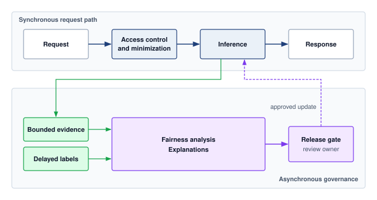

:::

The request path applies access controls and data minimization before inference and records only the evidence needed for the approved monitoring policy. Group-level fairness analysis and expensive explanations can run asynchronously; synchronous checks must fit the serving service-level objective (SLO). Delayed labels enter the analysis path when outcomes become available, and a named owner approves model or policy changes.

Real-time fairness monitoring updates prediction-only metrics such as demographic parity as decisions arrive, maintaining rolling statistics across protected groups. Label-dependent metrics such as equalized odds and equality of opportunity update when delayed outcomes or audited labels arrive. Groups whose labeled windows are too small must remain visible as having insufficient evidence, with a defined collection or escalation policy. The system flags supported disparities that exceed configured thresholds and separately reports gaps in coverage. Storage and compute requirements depend on the number of groups, decision segments, and retention windows.

The explanation engine generates evidence for the audience and decision under review. Its budget depends on the method and model; exact model-specific attribution may be feasible where exhaustive subset evaluation is not. Approximation, caching, selective generation, and asynchronous execution offer different cost and delivery-time trade-offs. @Lst-production-fairness-monitoring illustrates the monitoring part of this architecture, collecting predictions and computing rolling group metrics with threshold alerts. It omits delayed outcome ingestion, the full equalized-odds calculation, and explanation generation, so it is a partial implementation rather than a complete governance service.

::: {#lst-production-fairness-monitoring lst-cap="**Production Fairness Monitoring**: Simplified monitoring pseudocode for processing predictions and computing rolling fairness metrics. Delayed outcome ingestion is omitted." lst-pos="htb"}

```{.python}
import numpy as np


class RealTimeFairnessMonitor:
    # alert_threshold mirrors the |SPD| > 0.15 rule; persistence check omitted.
    def __init__(self, window_size=1000, alert_threshold=0.15, min_group=30):
        self.min_group = min_group  # Illustrative policy; set from precision needs.
        self.window_size = window_size
        self.alert_threshold = alert_threshold
        self.window = []

    async def process_prediction(self, prediction, demographics,
                                 actual_label=None):
        # Slide a fixed window over the stream, then re-check fairness.
        self.window.append((prediction, demographics, actual_label))
        self.window = self.window[-self.window_size :]
        metrics = self._compute_metrics()
        if (metrics["demographic_parity"] is not None
            and metrics["demographic_parity"] > self.alert_threshold) or (
            metrics["equalized_odds"] is not None
            and metrics["equalized_odds"] > self.alert_threshold
        ):
            await self._trigger_bias_alert(metrics)
        return metrics

    def _compute_metrics(self):
        # Bucket predictions and labels by protected group.
        by_group = {}
        for pred, demo, label in self.window:
            bucket = by_group.setdefault(
                demo.get("ethnicity", "unknown"), {"preds": [], "labels": []}
            )
            bucket["preds"].append(pred)
            if label is not None:
                bucket["labels"].append((pred, label))

        rates = [np.mean(d["preds"]) for g, d in by_group.items()
                 if g != "unknown" and len(d["preds"]) >= self.min_group]
        parity = max(rates) - min(rates) if len(rates) > 1 else None
        return {
            "demographic_parity": parity,
            # Requires sufficiently labeled outcomes per group; omitted here.
            "equalized_odds": self._equalized_odds_gap(by_group),
            "groups": {g: len(d["preds"]) for g, d in by_group.items()},
            "eligible_groups": len(rates),  # Compare with required group coverage.
        }

    def _equalized_odds_gap(self, by_group): ...
    async def _trigger_bias_alert(self, metrics): ...  # page and audit
```

:::

This simplified pattern separates metric availability from metric values: an unavailable comparison is not a zero disparity. A production monitor must also enforce required group coverage, sample-size policies, and freshness before interpreting a result. The overhead ranges summarized in @tbl-responsible-ai-overhead explain why fairness monitoring, privacy transformations, and explanation generation need explicit capacity budgets. Request metadata collection may be synchronous, while metric aggregation, delayed-label analysis, and explanation generation can run asynchronously under their own freshness requirements. These overheads must be balanced against reliability and compliance requirements when designing production systems.

::: {#chk-responsible-ai-bias-monitoring .callout-checkpoint title="Operationalizing bias detection"}

The bias-detection and monitoring sections turned static fairness definitions into live telemetry: slice-based detection with Fairlearn, CI-stage audits, production monitoring of demographic parity and equalized odds, the evidence paths that federated and on-device deployments require, and the distinction between observing a disparity and remediating it.

**Detecting the disparity**

- [ ] **Serving-path detection**: identify the request metadata needed to detect a rising rejection rate for one ZIP code, and explain how asynchronous aggregation can detect that change within an agreed monitoring delay.
- [ ] **Metric selection**: explain why the running loan example's approval rates of 70 percent for Group A and 40 percent for Group B do not select a fairness criterion. State the harm priority, label validity, and outcome evidence needed to choose one; then justify a criterion if reviewers prioritize avoiding denial to applicants who would repay.

**From signal to action**

- [ ] **Detection vs. remediation**: explain why a fairness alert with no remediation owner is evidence without action, and name what the system must add to close that loop.
- [ ] **Constrained deployments**: reason about why slice-based detection may be infeasible in a federated deployment where demographic labels cannot be centralized, and infer the implication for safeguard selection.

:::

## Privacy and Data Governance {#sec-responsible-ai-risk-mitigation-techniques-b4d6}

Every fairness audit and monitor in the preceding section consumed demographic evidence, and that evidence is itself sensitive data. The threat models and privacy mechanisms of @sec-security-privacy provide the technical controls; governance defines the evidence, ownership, and lifecycle interfaces that production systems require when inheriting them. A deletion workflow must identify which records and derived artifacts fall within an applicable obligation, such as an erasure requirement under the GDPR [@gdpr2016]. Removing a database row may leave replicas, backups, or trained models to address. Where removal of training influence is required, lineage, retraining, validation, deployment, and audit become part of the same workflow.

Governing these risks coordinates two classes of control that are easy to conflate. Privacy mechanisms bound specified information exposures, while machine unlearning[^fn-machine-unlearning-cost] targets the influence a record retains in trained weights under a stated removal criterion. A privacy guarantee does not by itself remove a record from the training history, so the assurance case must distinguish these obligations and supply evidence for each. Robustness and generative-system controls receive the same evidence-and-ownership treatment in @sec-responsible-ai-ai-safety-robustness-generative-controls-4297.

[^fn-machine-unlearning-cost]: **Machine Unlearning**\index{Machine Unlearning!privacy cost}: Removing training-data influence requires a stated removal criterion; @cao2015 develops an approach based on updating stored summaries. Full retraining on retained data provides a reference, with cost determined by the retained dataset and training procedure. The sharded sizing scenario in @sec-responsible-ai-machine-unlearning-cdf1 illustrates a smaller retraining surface under explicit cost assumptions, rather than a measured saving for every model. Where removal is required, the workflow must budget validation and redeployment as well as computation within the applicable response deadline.

### Core data governance principles {#sec-responsible-ai-privacy-data-governance-f8a4}

A fairness audit may need the same demographic field that a data-minimization policy would otherwise exclude. Privacy mechanisms constrain exposure and leakage; governance determines whether collecting the field is justified, who may use it, and how long the audit needs it. This decision connects privacy to fairness (@sec-responsible-ai-fairness-machine-learning-2ba4) and to transparency (@sec-responsible-ai-transparency-explainability-b137). Group-based monitoring needs evidence about group membership, but the audit design determines whether operators receive individual fields, restricted audit records, or aggregate statistics. Explainability methods can also reveal information about training examples, while detailed disclosure can conflict with individual privacy. Responsible AI systems must justify the evidence collected and limit its exposure while retaining enough information to evaluate the chosen requirements.

::: {.column-margin .margin-pointer}
↩ Federated learning, encrypted computation, and synthetic data, each bounding who can observe raw records, are established in @sec-security-privacy-privacypreserving-data-techniques-64f8.
:::

Machine learning systems often rely on extensive collections of personal data to support model training and allow personalized functionality. This reliance introduces significant responsibilities related to user privacy, data protection, and ethical data stewardship. The quality and governance of this data directly impacts the ability to implement responsible AI principles. Responsible AI design treats privacy not as an ancillary feature, but as a core constraint that must inform decisions across the entire system lifecycle.

One of the core challenges in supporting privacy is the inherent tension between data utility and individual protection. Rich, high-resolution datasets can enhance model accuracy and adaptability but also heighten the risk of exposing sensitive information, particularly when datasets are aggregated or linked with external sources. For example, large language models trained on broad text corpora have been shown to memorize[^fn-model-memorization-privacy] specific strings that can later be retrieved through model queries or adversarial prompting [@carlini2021extracting].

[^fn-model-memorization-privacy]: **Model Memorization**\index{Model Memorization!privacy risk}: @carlini2021extracting demonstrated that GPT-2\index{GPT-2!training data memorization} could reproduce verbatim training strings, including contact information, through carefully crafted prompts. The systems implication is narrower but still serious: models that expose generative outputs to user-facing queries can create a privacy attack surface where the serving layer itself becomes a data exfiltration vector, requiring output filtering, rate limiting, and data-minimization controls as defense-in-depth measures.

Privacy risks also depend on how records are linked over time and across sources. A wearable device's heart-rate or location record can already be sensitive; combining physiological and behavioral signals can reveal additional details about a user's health, routines, or relationships. Limited visibility or control over processing, retention, and transmission makes it harder for users to understand or contest these uses.

Addressing these challenges requires understanding privacy as a system principle that entails robust data governance. This includes defining what data is collected, under what conditions, and with what degree of consent and transparency. Foundational data engineering practices, including data validation, schema management, versioning, and lineage tracking, provide the technical infrastructure for implementing these governance requirements. Responsible governance requires attention to labeling practices, access controls, logging infrastructure, and compliance with jurisdictional requirements. These mechanisms serve to constrain how data flows through a system and to document accountability for its use.

@Fig-privacy-risk-flow diagrams the defensive boundaries partitioning a federated training pipeline into three distinct protection tiers. Client-side data locality confines raw records and gradient clipping to edge devices, an intermediate secure aggregation protocol blinds individual updates under bounded collusion and dropout assumptions, and a trusted curator executes central differential privacy by injecting calibrated noise and tracking privacy-budget depletion with a privacy accountant before publishing the released model across the untrusted network perimeter. Here the curator is trusted to protect the aggregate and add noise correctly; protecting against that curator requires a different mechanism, such as distributed noise generation with its own assumptions. The privacy unit, clipping rule, dropout and collusion assumptions, and composition across rounds define the guarantee [@bonawitz2017; @dwork2014].\index{Privacy!preserving machine learning pipeline}

::: {#fig-privacy-risk-flow fig-env="figure" fig-pos="htb" fig-cap="**Privacy Boundaries in Federated Training**: Clients retain raw records and contribute clipped updates through secure aggregation. In this central differential privacy design, a trusted curator receives the aggregate, adds calibrated noise, and accounts for repeated releases before publishing a model. Secure aggregation protects individual updates under its protocol assumptions; differential privacy bounds the released model relative to the specified privacy unit. Neither implies a universal ordering of privacy strength." fig-alt="Three client cards, each holding a grid of raw-record tiles that stay on the device and a small bar chart of update values clipped at a dashed clip line. Each client sends its update into a secure aggregation region, where the updates appear as uniformly hatched masked bars that merge into a summation node; the region is labeled bounded collusion, dropout. The sum enters a dotted trusted curator region, where an aggregate bar chart gains gray noise segments and a privacy accountant meter shows some budget segments spent per release. Only an arrow to the released model crosses a dashed vertical line marked public."}
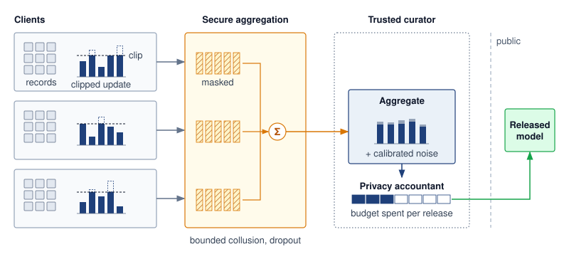

:::

Weak data governance can obscure both quality defects and privacy exposures, but they require different evidence. COMPAS, a proprietary recidivism-risk score used in the U.S. criminal justice system, illustrates the first kind. Limited access to model internals and training provenance constrained investigation and remediation, although external outcome audits still exposed disparities. In clinical applications, missing values or demographic skew can compromise predictive performance; neither alone establishes a privacy violation. Privacy assessment must also examine identifiability, access, and disclosure. Documentation should make these distinct risks traceable to the data practices that create them.

Privacy is not solely the concern of isolated algorithms or data processors; it must be addressed as a structural property of the system. Decisions about consent collection, data retention, model design, and auditability all contribute to the privacy posture of a machine learning pipeline. This requires anticipating risks during inference and continuous operation as well as during training. Threats such as membership inference, which infers from a deployed model's outputs whether a record was in its training set, underscore the importance of embedding privacy safeguards into both model architecture and interface behavior.

::: {.column-margin .margin-pointer}
↩ Membership inference and where it sits among likelihood-and-impact threat priorities are established in @sec-security-privacy-threat-prioritization-framework-f2d5.
:::

Legal frameworks make privacy an enforceable design concern. The GDPR, the California Consumer Privacy Act (CCPA),[^fn-ccpa-privacy-regulation] and Japan's Act on the Protection of Personal Information establish different obligations and individual rights within their respective scopes [@gdpr2016; @california2023ccpa; @japan2023appi]. An implementation must identify which rules govern its collection, use, retention, and removal of data rather than treating consent or deletion as a uniform requirement across jurisdictions. That applicability decision belongs in the system's documented data-governance requirements.

[^fn-ccpa-privacy-regulation]: **CCPA (California Consumer Privacy Act)**\index{CCPA!data deletion}: CCPA grants California residents rights over covered personal information, including a deletion right subject to statutory exceptions [@california2023ccpa]. For ML serving infrastructure, deletion requests create an architectural constraint that must be planned from the data pipeline forward, because raw-record deletion does not automatically remove a record's influence from trained model parameters.

Privacy is the second instance of the system-level thesis established for fairness in @sec-responsible-ai-fairness-machine-learning-2ba4: it is a commitment that spans consent collection, retention policy, model design, serving, and auditability, not a property of any single stage. It requires coordination across technical and organizational domains to ensure that data usage aligns with user expectations, legal mandates, and societal norms. Rather than viewing privacy as a constraint to be balanced against functionality, responsible system design integrates privacy from the outset by informing architecture, shaping interfaces, and constraining how models are built, updated, and deployed.

Privacy mechanisms limit specified data exposures under their threat models; they do not establish that a system's decisions are safe. A model may satisfy its privacy requirements while still failing catastrophically on unexpected inputs, a complementary concern about *how systems fail* that @sec-responsible-ai-ai-safety-robustness-generative-controls-4297 takes up. Within privacy itself, the next decision is where the protected boundary sits in each deployment architecture.

### Infrastructure architectures for privacy {#sec-responsible-ai-privacy-architectures-1f9a}

Privacy inherits the same centralization trade-off that the privacy row of @tbl-ml-principles-comparison summarizes by tier. Aggregating data in the cloud enables high-capacity modeling and monitoring but concentrates exposure to breaches and surveillance, so it must be paired with strong encryption, access control, and auditability. Keeping data local on mobile, federated, or TinyML clients reduces that central exposure but changes the evidence available to fleet operators. Privacy controls must cover local storage, outputs, telemetry, and update channels; an endpoint with no update path needs controls that remain valid for its approved service life.

The constraint the table cannot show is that privacy claims must name their boundary. Differentially private training bounds training-data leakage through the released model; ordinary inference on fixed weights remains within that post-processing guarantee. It does not protect new private inputs copied into service logs or unrelated private-data accesses. Interface design, retention rules, rate limiting, and access control address those separate exposures. Opaque data collection can also violate user expectations, making consent surfaces and clear disclosure part of the privacy architecture.

An architecture decides where the privacy boundary sits; the model decides how much crosses it. A service can keep raw records behind every access control and still release training data through the weights it serves, which is where algorithmic privacy preservation begins.

### Algorithmic privacy preservation {#sec-responsible-ai-privacy-preservation-91b1}

Privacy constraints extend across data collection, model behavior, and user interaction. They are shaped by the architectural properties of the system and its deployment context alongside ethical and legal obligations. Technical methods for privacy preservation aim to prevent data leakage, limit memorization, and uphold user rights such as consent, opt-out, and data deletion, particularly in systems that learn from personalized or sensitive information.

Large language models have been shown to memorize and expose individual training strings, including names, locations, or excerpts of private communication [@carlini2021extracting]. This memorization presents risks for privacy-sensitive text-generating systems, such as assistants trained or adapted on user logs, where training data may encode protected or regulated content. For example, a voice or chat assistant that adapts to user speech or messages may inadvertently retain specific phrases, which could later be extracted through carefully designed prompts or queries.

The memorization risk extends beyond language models. @Fig-diffusion-model-example pairs an original training-set photograph with a diffusion model's near-identical reconstruction under the study's extraction protocol [@carlini2023diffusion]. The left panel shows the training image and the right panel shows the generated output, with closely matching pose, clothing, necklace, and background, but visible differences in detail. Recognizable identity alone would not establish memorization; the comparison must concern the specific training instance rather than merely the same subject. The example motivates evaluating training-data exposure without treating every similar-looking output as evidence of extraction.

::: {#fig-diffusion-model-example fig-env="figure" fig-pos="htb" fig-cap="**Diffusion Model Memorization**: Image diffusion models can reproduce training samples [@carlini2023diffusion], revealing a risk of unintended memorization beyond language models and highlighting a general vulnerability in contemporary neural architectures. This memorization poses privacy concerns when training on sensitive datasets." fig-alt="Side-by-side comparison of two nearly identical portrait photographs of a woman in professional attire. Left shows original training image, right shows diffusion model output with matching pose, lighting, and details."}


:::

Membership inference remains a governance concern after training because even an attacker limited to model queries may infer whether a record participated in training. Other threat models give the attacker access to parameters or additional information, so the audit must specify the access it assumes. In high-stakes applications such as healthcare or legal prediction, training-set membership itself can disclose sensitive information about an individual.

For differential privacy, governance consumes the mechanism and accounting established in @sec-security-privacy-differential-privacy-8c2b. A differentially private stochastic gradient descent (DP-SGD) deployment must retain the clipping, noise, sampling, and composition configuration that supports its reported bound [@abadi2016deep]. Reviewers then evaluate that bound alongside utility, subgroup performance, and the private-data accesses outside training. Naming the method is insufficient evidence for approving the complete service.

Differential privacy introduces system-level trade-offs on the path where private data is accessed. Training noise can reduce utility, and attempts to recover it through additional data or optimization steps must be evaluated with the resulting privacy accounting and compute cost. If training occurs centrally, those costs do not automatically become extra work for an edge device performing ordinary inference on the released model. Local training or local randomization places different demands on the device. Data minimization, retention limits, and access controls remain separate requirements; feature obfuscation alone provides no differential privacy guarantee.

```{python}
#| echo: false
#| label: price-of-privacy-calc
# ┌─────────────────────────────────────────────────────────────────────────────
# │ THE PRICE OF PRIVACY (LEGO)
# ├─────────────────────────────────────────────────────────────────────────────
# │ Context: @sec-responsible-ai-privacy-preservation-91b1
# │
# │ Goal: Size an illustrative DP-SGD planning scenario.
# │ Show: Assumed ~3x training cost and ~6% accuracy loss for a configuration
# │       whose external privacy accountant reports eps=1.
# │ How: Compare assumed baseline and DP-constrained training costs; this cell
# │      does not compute epsilon.
# │
# └─────────────────────────────────────────────────────────────────────────────

from mlsysim.fmt import fmt

# ┌── LEGO ───────────────────────────────────────────────
class PrivacyPriceAnalysis:
    """Size an illustrative differential-privacy planning scenario."""

    # ┌── 1. LOAD (Constants) ──────────────────────────────────────────────
    eps_strong = 1.0
    eps_mod = 8.0
    eps_weak = 10.0

    base_cost_m = ReferenceStats.TrainingCostAnchors.Gpt3CostEstimate.to(USD).magnitude / MILLION  # GPT-3-scale baseline
    acc_drop_strong = 6.0
    acc_drop_mod = 1.0
    clip_fraction_pct = 40

    cost_mult_strong = 3.0
    overhead_mod = 30.0

    # ┌── 2. EXECUTE (The Compute) ────────────────────────────────────────
    total_cost_strong = base_cost_m * cost_mult_strong

    # ┌── 3. GUARD (Invariants) ──────────────────────────────────────────
    from mlsysim.fmt import check

    check(cost_mult_strong > 1.5, "Scenario assumes a significant cost increase")

    # ┌── 4. OUTPUT (Formatting) ──────────────────────────────────────────────
    from mlsysim.fmt import fmt, fmt_multiple, fmt_percent, fmt_usd

    eps_strong_str = fmt(eps_strong, precision=0, commas=False)
    eps_mod_str = fmt(eps_mod, precision=0, commas=False)
    eps_weak_str = fmt(eps_weak, precision=0, commas=False)
    epochs_mult_str = fmt_multiple(cost_mult_strong, precision=0, commas=False)
    base_cost_str = fmt_usd(base_cost_m * 1_000_000, scale="M", precision=1, commas=False)
    cost_strong_str = fmt_usd(total_cost_strong * 1_000_000, scale="M", precision=1, commas=False)
    acc_drop_strong_str = fmt_percent(round(acc_drop_strong) / 100, precision=0, commas=False, style='prose')
    overhead_mod_str = fmt_percent(round(overhead_mod) / 100, precision=0, commas=False, style='prose')
    acc_drop_mod_str = fmt_percent(round(acc_drop_mod) / 100, precision=0, commas=False, style='prose')
    clip_fraction_pct_str = fmt_percent(round(clip_fraction_pct) / 100, precision=0, commas=False, style='prose')
```

::: {#psp-responsible-ai-price-privacy .callout-perspective title="The price of privacy"}

Training a large language model on sensitive messages with DP-SGD\index{DP-SGD!training cost} reduces training-data extraction risk, but the protection is priced in compute and accuracy.

The privacy parameter $\PrivacyBudget$ bounds privacy loss; smaller values provide a stronger bound when the neighboring relation and $\PrivacyAdditiveSlack$ are fixed. The accountant derivation in @sec-security-privacy-differential-privacy-8c2b shows what moves $\PrivacyBudget$. Adding more noise relative to the clipping norm, sampling a smaller fraction of the data per step, or taking fewer steps each lowers it, and each also tends to cost accuracy or require more training to recover. A reproducible DP-SGD result must therefore record the dataset size, batch sampling scheme and rate, number of optimization steps, clipping norm, noise multiplier, neighboring relation, $\PrivacyAdditiveSlack$, and privacy accountant. Those records, not the $\PrivacyBudget$ value alone, are what a governance review retains. The three configurations below are planning assumptions whose $\PrivacyBudget$ values an external accountant would have to confirm, as the CIFAR-10 accountant inputs of @sec-security-privacy-practical-privacy-budget-example-dpsgd-image-classification-2662 illustrate. Read them for the direction of each trade. The stronger configuration doubles the noise multiplier of the weaker one but also trains for more epochs, and more steps by themselves raise $\PrivacyBudget$; only the accountant can confirm that the extra noise more than offsets the extra steps.

**Illustrative stronger-privacy configuration** (assumed accountant result $\PrivacyBudget=$ `{python} PrivacyPriceAnalysis.eps_strong_str`): The scenario assumes per-example gradients are clipped to norm $\GradientClippingNorm= 1.0$, `{python} PrivacyPriceAnalysis.clip_fraction_pct_str` of updates are affected by clipping, and the noise multiplier is $\PrivacyNoiseMultiplier= 1.0$. It further assumes `{python} PrivacyPriceAnalysis.epochs_mult_str` more epochs, a training-cost increase from a GPT-3-scale baseline of `{python} PrivacyPriceAnalysis.base_cost_str` to approximately `{python} PrivacyPriceAnalysis.cost_strong_str`, and an accuracy drop of `{python} PrivacyPriceAnalysis.acc_drop_strong_str`.

**Illustrative weaker-privacy configuration** (assumed accountant result $\PrivacyBudget=$ `{python} PrivacyPriceAnalysis.eps_mod_str`): The scenario assumes a noise multiplier of $\PrivacyNoiseMultiplier= 0.5$, training overhead of `{python} PrivacyPriceAnalysis.overhead_mod_str`, and an accuracy drop of `{python} PrivacyPriceAnalysis.acc_drop_mod_str`.

**Illustrative weakest configuration** (assumed accountant result $\PrivacyBudget=$ `{python} PrivacyPriceAnalysis.eps_weak_str`): The scenario assumes less noise and less than 1 percent accuracy loss, with a weaker formal privacy bound than the other two configurations under otherwise comparable accounting assumptions.

These scenarios compare formal privacy bounds, utility, and training cost; none of those quantities alone establishes user trust. Once a fixed model has been trained with differential privacy, ordinary inference is post-processing and does not consume additional training-data privacy budget. Additional privacy loss must be accounted for when a postdeployment mechanism makes new accesses to private data or releases additional differentially private statistics. The key engineering decision is to document and account for every private-data access and communicate the resulting trade-offs to users and regulators.

:::

Released datasets need a boundary of their own. For example, $\Glyph{k}$-anonymity[^fn-k-anonymity-privacy] groups records in a specified release so that each quasi-identifier combination occurs at least $\AnonymitySetSize$ times. Transforming one request without defining that reference dataset does not establish this condition. Differential privacy likewise requires a defined release mechanism, neighboring relation, and privacy accountant; noise injection alone does not establish a guarantee.

[^fn-k-anonymity-privacy]: **k-Anonymity**\index{k-Anonymity!privacy technique}: A property of a released dataset [@sweeney2002] requiring every combination of designated quasi-identifiers to occur in at least $\AnonymitySetSize$ records. Generalization can achieve this property at the cost of information loss. It does not bound inference from homogeneous sensitive attributes or auxiliary knowledge and is not a per-request privacy guarantee.

Privacy enforcement also depends on infrastructure beyond the model itself. Data collection interfaces must support informed consent and transparency. Logging systems must avoid retaining sensitive inputs unless strictly necessary, and must support access controls, expiration policies, and auditability. Model serving infrastructure must be designed to prevent overexposure of outputs that could leak internal model behavior or allow reconstruction of private data. These system-level mechanisms require close coordination between ML engineering, platform security, and organizational governance.

Privacy must be enforced throughout the machine learning lifecycle. Retraining pipelines must respect the approved deletion and data-use policies. Monitoring should collect only the identifying information justified by its purpose, with access and retention controls appropriate to that information. Privacy-aware telemetry collection and protected per-user audit trails\index{Audit trail!user-level provenance} can support investigation and remedy without making sensitive records broadly available in logs or dashboards.

The privacy assurance case therefore spans the whole pipeline. The formal privacy accountant covers the private-data accesses in its stated mechanism; interface controls, retention policies, and access records support separate claims about the surrounding service. Keeping these claims distinct makes gaps visible when a model, telemetry path, or data source changes.

Privacy preservation techniques create complex sociotechnical tensions that extend well beyond technical implementation. Differential privacy mechanisms may reduce model accuracy in ways that disproportionately affect underrepresented groups, creating conflicts between privacy and fairness objectives. These challenges require ongoing stakeholder engagement\index{Stakeholder engagement!value deliberation} as detailed in @sec-responsible-ai-normative-pluralism-value-conflicts-d61f, where organizations must navigate competing values around data control, personalization, and regulatory compliance. These privacy challenges become even more complex when considering the dynamic nature of user rights and data governance.

#### Machine unlearning {#sec-responsible-ai-machine-unlearning-cdf1}

Deleting a raw record does not remove its influence from learned parameters. When the approved deletion policy also requires addressing retained model state, machine unlearning supplies a technical response. The requirement and the evidence of removal must be specified separately; retained influence alone does not establish that every deployment violates a deletion obligation.

Privacy preservation does not end at training time. In many real-world systems, users may have rights to revoke consent or request deletion of their data, even after a model has been trained and deployed [@gdpr2016; @california2023ccpa]. When the approved response requires removing training influence, the architecture must support the chosen method and its verification. An endpoint without sufficient data, training state, or compute may need a replacement model trained elsewhere; a device with the required resources may perform the work locally. Placement follows those requirements rather than the deployment label alone.

Full retraining requires access to the permitted remaining training data and a defined training procedure. @Fig-machine-unlearning contrasts three update strategies. Retraining from scratch on the retained data, the training set with the forget set $\ForgetDataset$ removed, supplies a reference for exact removal relative to that procedure. Gradient ascent on the forget set increases its loss through updates of the form $\ModelParameters + \LearningRate \nabla \LossFunction$, but increased loss alone does not demonstrate removal. Sharded, isolated, sliced, and aggregated (SISA) training partitions data into isolated shards $\SisaTrainingShard_1, \SisaTrainingShard_2, \SisaTrainingShard_3$ and aggregates their predictions. A deletion affects the constituent model trained on its shard; saved states before the affected slice can reduce the retraining work.

::: {#fig-machine-unlearning fig-env="figure" fig-pos="htb" fig-cap="**Model Update Strategies**: Three approaches to removing a data point's influence. Full retraining gives exact unlearning at the highest cost; gradient ascent provides an approximate update by maximizing loss on the forget set; and SISA training partitions data into shards so only the affected shard is retrained. The accompanying cost model quantifies the full-retraining and SISA cases." fig-alt="Three panels, each showing the same grid of training-data tiles. Full retraining: every retained tile is shaded as recomputed and the two forget-set tiles are dashed as removed, feeding train from scratch on retained data; guarantee exact, recompute whole model. Gradient ascent: only the two forget-set tiles are shaded as recomputed, feeding an ascent step theta plus eta times the gradient of the loss; guarantee approximate, recompute forget-set passes. SISA sharding: the grid splits into shards S1, S2, and S3; only S3, which held the removed forget-set tiles, is shaded and retrained while S1 and S2 are kept; guarantee exact, recompute one shard, serving by shard vote. A key below names recomputed, untouched, forget set, and forget set removed."}
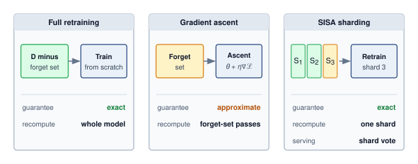

<!--
```{.tikz}
\providecolor{mlsysdarkgray}{HTML}{1E293B}
\providecolor{mlsysdark}{HTML}{1E293B}
\providecolor{darknavy}{HTML}{1E293B}
\providecolor{mlsysblue}{HTML}{334155}
\providecolor{mlsysteal}{HTML}{0F766E}
\providecolor{mlsysred}{HTML}{991B1B}
\providecolor{mlsysamber}{HTML}{92400E}
\providecolor{mlsysgreen}{HTML}{166534}
\providecolor{mlsysgray}{HTML}{64748B}
\providecolor{mlsysbordergray}{HTML}{CBD5E1}
\providecolor{BorderGray}{HTML}{CBD5E1}
\providecolor{MutedGray}{HTML}{64748B}
\providecolor{LightRed}{HTML}{FEE2E2}
\providecolor{LightGreen}{HTML}{DCFCE7}
\providecolor{LightBlue}{HTML}{E0F2FE}
\providecolor{LightAmber}{HTML}{FEF3C7}
\providecolor{mlsyspurple}{HTML}{6D28D9}
\providecolor{mlsyslightgray}{HTML}{F1F5F9}
\scalebox{0.90}{%
\begin{tikzpicture}[
    font=\sffamily,
    >=Stealth,
    card/.style={draw=mlsysbordergray, fill=white, rounded corners=3pt, line width=0.6pt},
    chip/.style={rounded corners=2pt, font=\bfseries\fontsize{6.5}{7.5}\selectfont, inner xsep=5pt, inner ysep=2.5pt},
    subbox/.style={draw=mlsysbordergray, fill=white, rounded corners=2.5pt, line width=0.5pt, align=center}
]

% Geometry: 3 columns with width 5.2cm
\def\colW{5.2}
\def\colH{9.4}

% ==========================================
% COLUMN 1: Full Retraining (Baseline)
% ==========================================
\node[card, draw=mlsysblue!60, fill=mlsysblue!1, minimum width=\colW cm, minimum height=\colH cm, anchor=north west] (c1) at (0, 0) {};
\node[chip, fill=mlsysblue!12, text=mlsysblue!90!black, anchor=north] at ([yshift=-7pt]c1.north) {EXACT BASELINE};
\node[font=\bfseries\fontsize{10}{12}\selectfont, text=mlsysdark, anchor=north] at ([yshift=-25pt]c1.north) {Full Retraining};

% Diagram 1: Dataset D -> Scratch Train
\def\diagY{-1.95}
\node[subbox, draw=mlsysteal!70, fill=mlsysteal!3, minimum width=2.0cm, minimum height=1.35cm] (d1) at (1.35, \diagY) {
    {\bfseries\fontsize{7.5}{8.5}\selectfont\color{mlsysteal!90!black} Full Dataset ${D}$}\\[3pt]
    {\fontsize{6.5}{7.5}\selectfont\color{mlsysred} Exclude $D_{\text{forget}}$}
};

\draw[->, mlsysgray!80, line width=0.8pt, shorten >=2pt, shorten <=2pt] (d1.east) -- (2.95, \diagY);

\node[subbox, draw=mlsysblue!70, fill=mlsysblue!3, minimum width=1.85cm, minimum height=1.35cm] at (3.9, \diagY) {
    {\bfseries\fontsize{7.5}{8.5}\selectfont\color{mlsysdark} Retrain from}\\[2pt]
    {\bfseries\fontsize{7.5}{8.5}\selectfont\color{mlsysdark} Scratch $\theta_0$}
};

\draw[mlsysgray!30, line width=0.5pt] ([xshift=10pt, yshift=-80pt]c1.north west) -- ([xshift=-10pt, yshift=-80pt]c1.north east);

% Operational Profile 1
\node[font=\bfseries\fontsize{7.5}{9}\selectfont, text=mlsysdark, anchor=west] at (0.4, -3.2) {OPERATIONAL PROFILE};

\node[font=\fontsize{7}{8}\selectfont, text=mlsysgray, anchor=west] at (0.4, -3.65) {Guarantee:};
\node[font=\bfseries\fontsize{7.5}{8.5}\selectfont, text=mlsysgreen!90!black, anchor=west] at (0.4, -3.95) {Provable exact (zero residue)};

\node[font=\fontsize{7}{8}\selectfont, text=mlsysgray, anchor=west] at (0.4, -4.45) {Corpus Access:};
\node[font=\fontsize{7.5}{8.5}\selectfont, text=mlsysdark!90, anchor=west] at (0.4, -4.75) {Requires full training dataset};

\node[font=\fontsize{7}{8}\selectfont, text=mlsysgray, anchor=west] at (0.4, -5.25) {Primary Bottleneck:};
\node[font=\bfseries\fontsize{7.5}{8.5}\selectfont, text=mlsysred!90!black, anchor=west] at (0.4, -5.55) {Extreme CapEx / OpEx cost};

\draw[mlsysgray!30, line width=0.5pt] ([xshift=10pt, yshift=-170pt]c1.north west) -- ([xshift=-10pt, yshift=-170pt]c1.north east);

% Unlearning Fidelity Meter 1
\node[font=\fontsize{7}{8}\selectfont, text=mlsysgray, anchor=west] at (0.4, -6.35) {Unlearning Fidelity:};
\draw[mlsysbordergray, fill=mlsysgray!15, rounded corners=2pt, line width=0.4pt] (0.4, -6.85) rectangle (4.8, -6.45);
\fill[mlsysgreen!75, rounded corners=2pt] (0.4, -6.85) rectangle (4.8, -6.45);
\node[font=\bfseries\fontsize{7}{8}\selectfont, text=white] at (2.6, -6.65) {100\% (Provable Exact)};

% Compute Overhead 1
\node[font=\fontsize{7}{8}\selectfont, text=mlsysgray, anchor=west] at (0.4, -7.35) {Compute Overhead:};
\node[draw=mlsysred!60, fill=mlsysred!6, rounded corners=2pt, line width=0.5pt, minimum width=4.4cm, minimum height=15pt, font=\bfseries\fontsize{7}{8}\selectfont, text=mlsysred!90!black] at (2.6, -7.75) {Full Training Run ($\mathcal{{O}}(\text{days})$)};

% Serving Impact 1
\node[font=\fontsize{7.5}{8.5}\selectfont, text=mlsysdark!90, anchor=west] at (0.4, -8.5) {Serving Overhead: \textbf{\textcolor{mlsysgreen!90!black}{Zero penalty}}};


% ==========================================
% COLUMN 2: Gradient Ascent (Approximate)
% ==========================================
\node[card, draw=mlsysamber!60, fill=mlsysamber!1, minimum width=\colW cm, minimum height=\colH cm, anchor=north west] (c2) at (5.55, 0) {};
\node[chip, fill=mlsysamber!12, text=mlsysamber!90!black, anchor=north] at ([yshift=-7pt]c2.north) {EMPIRICAL HEURISTIC};
\node[font=\bfseries\fontsize{10}{12}\selectfont, text=mlsysdark, anchor=north] at ([yshift=-25pt]c2.north) {Gradient Ascent};

% Diagram 2: Forget Set -> Ascent Step
\node[subbox, draw=mlsysred!70, fill=mlsysred!3, minimum width=2.0cm, minimum height=1.35cm] (d2) at (6.9, \diagY) {
    {\bfseries\fontsize{7.5}{8.5}\selectfont\color{mlsysred} Forget Set $D_{\text{forget}}$}\\[3pt]
    {\fontsize{6.5}{7.5}\selectfont\color{mlsysred!90!black} Maximize Loss}
};

\draw[->, mlsysgray!80, line width=0.8pt, shorten >=2pt, shorten <=2pt] (d2.east) -- (8.5, \diagY);

\node[subbox, draw=mlsysamber!70, fill=mlsysamber!3, minimum width=1.85cm, minimum height=1.35cm] at (9.45, \diagY) {
    {\bfseries\fontsize{7.5}{8.5}\selectfont\color{mlsysdark} Ascent Update}\\[2pt]
    {\fontsize{6.5}{7.5}\selectfont ${\theta} \leftarrow {\theta} + {\eta} \nabla {\mathcal{L}}(D_{\text{forget}})$}
};

\draw[mlsysgray!30, line width=0.5pt] ([xshift=10pt, yshift=-80pt]c2.north west) -- ([xshift=-10pt, yshift=-80pt]c2.north east);

% Operational Profile 2
\node[font=\bfseries\fontsize{7.5}{9}\selectfont, text=mlsysdark, anchor=west] at (5.95, -3.2) {OPERATIONAL PROFILE};

\node[font=\fontsize{7}{8}\selectfont, text=mlsysgray, anchor=west] at (5.95, -3.65) {Guarantee:};
\node[font=\bfseries\fontsize{7.5}{8.5}\selectfont, text=mlsysamber!90!black, anchor=west] at (5.95, -3.95) {Approximate (empirical loss)};

\node[font=\fontsize{7}{8}\selectfont, text=mlsysgray, anchor=west] at (5.95, -4.45) {Corpus Access:};
\node[font=\fontsize{7.5}{8.5}\selectfont, text=mlsysdark!90, anchor=west] at (5.95, -4.75) {Forget samples only ($D_{\text{forget}}$)};

\node[font=\fontsize{7}{8}\selectfont, text=mlsysgray, anchor=west] at (5.95, -5.25) {Primary Bottleneck:};
\node[font=\bfseries\fontsize{7.5}{8.5}\selectfont, text=mlsysred!90!black, anchor=west] at (5.95, -5.55) {Collateral degradation risk};

\draw[mlsysgray!30, line width=0.5pt] ([xshift=10pt, yshift=-170pt]c2.north west) -- ([xshift=-10pt, yshift=-170pt]c2.north east);

% Unlearning Fidelity Meter 2
\node[font=\fontsize{7}{8}\selectfont, text=mlsysgray, anchor=west] at (5.95, -6.35) {Unlearning Fidelity:};
\draw[mlsysbordergray, fill=mlsysgray!15, rounded corners=2pt, line width=0.4pt] (5.95, -6.85) rectangle (10.35, -6.45);
\fill[mlsysamber!75, rounded corners=2pt] (5.95, -6.85) rectangle (9.47, -6.45);
\node[font=\bfseries\fontsize{7}{8}\selectfont, text=white] at (7.7, -6.65) {$\sim$80\% (Approximate)};

% Compute Overhead 2
\node[font=\fontsize{7}{8}\selectfont, text=mlsysgray, anchor=west] at (5.95, -7.35) {Compute Overhead:};
\node[draw=mlsysgreen!60, fill=mlsysgreen!6, rounded corners=2pt, line width=0.5pt, minimum width=4.4cm, minimum height=15pt, font=\bfseries\fontsize{7}{8}\selectfont, text=mlsysgreen!90!black] at (8.15, -7.75) {Minutes ($< 0.1\%$ cost)};

% Serving Impact 2
\node[font=\fontsize{7.5}{8.5}\selectfont, text=mlsysdark!90, anchor=west] at (5.95, -8.5) {Serving Overhead: \textbf{\textcolor{mlsysgreen!90!black}{Zero penalty}}};


% ==========================================
% COLUMN 3: SISA Framework (Sharded)
% ==========================================
\node[card, draw=mlsysteal!60, fill=mlsysteal!1, minimum width=\colW cm, minimum height=\colH cm, anchor=north west] (c3) at (11.1, 0) {};
\node[chip, fill=mlsysteal!12, text=mlsysteal!90!black, anchor=north] at ([yshift=-7pt]c3.north) {SHARDED ARCHITECTURE};
\node[font=\bfseries\fontsize{10}{12}\selectfont, text=mlsysdark, anchor=north] at ([yshift=-25pt]c3.north) {SISA Training};

% Diagram 3: Shards S1, S2, S3 -> Retrain Shard 3
\node[subbox, draw=mlsysteal!70, fill=mlsysteal!3, minimum width=0.6cm, minimum height=1.35cm, font=\fontsize{7}{8}\selectfont\color{mlsysteal!90!black}] at (11.65, \diagY) {$S_1$};
\node[subbox, draw=mlsysteal!70, fill=mlsysteal!3, minimum width=0.6cm, minimum height=1.35cm, font=\fontsize{7}{8}\selectfont\color{mlsysteal!90!black}] at (12.35, \diagY) {$S_2$};
\node[subbox, draw=mlsysred!70, fill=mlsysred!6, minimum width=0.6cm, minimum height=1.35cm, align=center] at (13.05, \diagY) {
    {\fontsize{7}{8}\selectfont\color{mlsysred} $S_3$}\\[2pt]
    {\fontsize{5}{6}\selectfont\color{mlsysred!80!black} edit}
};

\draw[->, mlsysgray!80, line width=0.8pt, shorten >=2pt, shorten <=2pt] (13.45, \diagY) -- (14.05, \diagY);

\node[subbox, draw=mlsysteal!70, fill=mlsysteal!3, minimum width=1.85cm, minimum height=1.35cm] at (15.0, \diagY) {
    {\bfseries\fontsize{7.5}{8.5}\selectfont\color{mlsysdark} Retrain}\\[2pt]
    {\bfseries\fontsize{7.5}{8.5}\selectfont\color{mlsysteal!90!black} Shard 3 Only}
};

\draw[mlsysgray!30, line width=0.5pt] ([xshift=10pt, yshift=-80pt]c3.north west) -- ([xshift=-10pt, yshift=-80pt]c3.north east);

% Operational Profile 3
\node[font=\bfseries\fontsize{7.5}{9}\selectfont, text=mlsysdark, anchor=west] at (11.5, -3.2) {OPERATIONAL PROFILE};

\node[font=\fontsize{7}{8}\selectfont, text=mlsysgray, anchor=west] at (11.5, -3.65) {Guarantee:};
\node[font=\bfseries\fontsize{7.5}{8.5}\selectfont, text=mlsysgreen!90!black, anchor=west] at (11.5, -3.95) {Exact within target shard};

\node[font=\fontsize{7}{8}\selectfont, text=mlsysgray, anchor=west] at (11.5, -4.45) {Corpus Access:};
\node[font=\fontsize{7.5}{8.5}\selectfont, text=mlsysdark!90, anchor=west] at (11.5, -4.75) {Target shard data only ($1/{K}$)};

\node[font=\fontsize{7}{8}\selectfont, text=mlsysgray, anchor=west] at (11.5, -5.25) {Primary Bottleneck:};
\node[font=\fontsize{7.5}{8.5}\selectfont, text=mlsysdark!90, anchor=west] at (11.5, -5.55) {Ensemble voting overhead};

\draw[mlsysgray!30, line width=0.5pt] ([xshift=10pt, yshift=-170pt]c3.north west) -- ([xshift=-10pt, yshift=-170pt]c3.north east);

% Unlearning Fidelity Meter 3
\node[font=\fontsize{7}{8}\selectfont, text=mlsysgray, anchor=west] at (11.5, -6.35) {Unlearning Fidelity:};
\draw[mlsysbordergray, fill=mlsysgray!15, rounded corners=2pt, line width=0.4pt] (11.5, -6.85) rectangle (15.9, -6.45);
\fill[mlsysgreen!75, rounded corners=2pt] (11.5, -6.85) rectangle (15.72, -6.45);
\node[font=\bfseries\fontsize{7}{8}\selectfont, text=white] at (13.7, -6.65) {$\sim$96\% (Shard-Exact)};

% Compute Overhead 3
\node[font=\fontsize{7}{8}\selectfont, text=mlsysgray, anchor=west] at (11.5, -7.35) {Compute Overhead:};
\node[draw=mlsysteal!60, fill=mlsysteal!6, rounded corners=2pt, line width=0.5pt, minimum width=4.4cm, minimum height=15pt, font=\bfseries\fontsize{7}{8}\selectfont, text=mlsysteal!90!black] at (13.7, -7.75) {$1/{K}$ Shard Cost ($\approx 5$--$10\%$)};

% Serving Impact 3
\node[font=\fontsize{7.5}{8.5}\selectfont, text=mlsysdark!90, anchor=west] at (11.5, -8.5) {Serving Overhead: \textbf{\textcolor{mlsysamber!90!black}{${K}$-model voting}}};

\end{tikzpicture}%
}
```
-->

:::

Full retraining is a useful reference, but its feasibility depends on access to the permitted remaining data, the training procedure, and sufficient compute within the response deadline. A retention policy may remove data that retraining would need; a large training run may exceed the available budget. An alternative unlearning method must state its own data and state requirements rather than assume that avoiding full retraining also eliminates those dependencies.

Machine unlearning seeks to remove specified training influence without repeating the entire training run. @cao2015 proposed converting suitable learning algorithms into a summation form, allowing a deletion to update the affected summaries and recompute the model. SISA instead localizes retraining to affected shards [@bourtoule2021]. It still needs the retained data and training state required by that procedure. The removal claim must specify its reference and verification method; a loss increase on deleted examples is different evidence from retraining without them. Method selection therefore depends on retained state, model quality, operational cost, and the removal guarantee the deployment must support.

```{python}
#| echo: false
#| label: unlearning-cost-calc
# ┌─────────────────────────────────────────────────────────────────────────────
# │ THE COST OF FORGETTING (LEGO)
# ├─────────────────────────────────────────────────────────────────────────────
# │ Context: @sec-responsible-ai-machine-unlearning-cdf1
# │
# │ Goal: Quantify the cost reduction from SISA unlearning vs full retraining.
# │ Show: ~100x cost reduction (~$46k vs ~$4.6M) and 100x time reduction.
# │ How: SISA_cost = Full_cost/n_shards.
# │
# └─────────────────────────────────────────────────────────────────────────────

from mlsysim.fmt import fmt

# ┌── LEGO ───────────────────────────────────────────────
class UnlearningCostAnalysis:
    """Quantify the efficiency gains from sharded unlearning."""

    # ┌── 1. LOAD (Constants & Registry) ───────────────────────────────────
    gpu = Hardware.Cloud.A100
    model = Models.Language.GPT3
    full_cost_m = ReferenceStats.TrainingCostAnchors.Gpt3CostEstimate.to(USD).magnitude / MILLION
    n_shards = 100
    full_retrain_gpus = Systems.Clusters.Training_1K_A100.total_accelerators
    mfu = 0.32  # scenario assumption: model FLOPs utilization for the retrain
    acc_drop_low_pct = 3
    acc_drop_high_pct = 7
    deletion_requests_per_day = 1000

    # ┌── 2. EXECUTE (The Compute) ────────────────────────────────────────
    # Full retrain time = training FLOPs / (N x R_peak x MFU)
    # Rounded to whole days so the SISA time below divides the printed value.
    full_time_days = round((model.training_ops / (full_retrain_gpus * gpu.compute.peak_flops * mfu)).to(day).magnitude)
    sisa_cost_m = full_cost_m / n_shards
    sisa_time_hr = (full_time_days * 24) / n_shards
    shard_fraction = 1 / n_shards

    # ┌── 3. GUARD (Invariants) ──────────────────────────────────────────
    from mlsysim.fmt import check

    check(sisa_cost_m < 0.1, f"Expected <$100k SISA cost, got {sisa_cost_m:.2f}")
    check(20 < full_time_days < 60, f"Full retrain should take about a month, got {full_time_days:.1f} days")

    # ┌── 4. OUTPUT (Formatting) ──────────────────────────────────────────────
    from mlsysim.fmt import fmt, fmt_count, fmt_flop_rate, fmt_memory_capacity, fmt_percent, fmt_percent_range, fmt_rate, fmt_time, fmt_usd

    gpu_name_str = gpu.name
    gpu_mem_str = fmt_memory_capacity(gpu.memory.capacity, unit=GiB)
    gpu_rpeak_str = fmt_flop_rate(gpu.compute.peak_flops, unit=TFLOP / second, precision=0, commas=False)
    model_params_str = fmt_count(model.parameters, scale='B', precision=0)
    full_cost_m_str = fmt_usd(full_cost_m * MILLION, scale="M", precision=1, commas=False)
    shard_fraction_pct_str = fmt_percent(shard_fraction, precision=0, commas=False, style='prose')
    n_shards_str = fmt(n_shards, precision=0, commas=False)
    sisa_cost_str = fmt_usd(sisa_cost_m * MILLION, precision=0)
    sisa_time_hr_str = fmt_time(sisa_time_hr, 'hour', precision=1, commas=False, style='word')
    full_retrain_gpus_str = fmt(full_retrain_gpus, precision=0, commas=True)
    full_time_days_str = fmt_time(full_time_days, 'day', precision=0, commas=False, style='word')
    mfu_pct_str = fmt_percent(mfu, precision=0, commas=False, style='prose')
    acc_drop_pct_range_str = fmt_percent_range(acc_drop_low_pct / 100, acc_drop_high_pct / 100, precision=0, commas=False, style='prose')
    deletion_requests_per_day_str = fmt_rate(deletion_requests_per_day, "requests/day", precision=0, commas=True)
```

::: {.column-margin}
{width="100%" fig-alt="Two-rung cost ladder on a log scale. Top rung, full retraining at 4.6 million dollars; bottom rung, SISA sharded unlearning at 46 thousand dollars, about 100× cheaper."}

*For one isolated erasure, SISA cuts retraining cost about 100 times; a daily batch that touches most shards erodes the saving.*
:::

::: {#nbk-responsible-ai-cost-forgetting .callout-notebook title="The cost of forgetting"}

A user requests erasure of personal data under GDPR Article 17 ("Right to Erasure"). This scenario assumes that the approved response includes removing its influence from a model trained on 1&nbsp;TB of data; that model-removal requirement is a scenario premise, not a conclusion derived from invoking the article.

**Baseline (full retraining)**: In this sizing scenario, a `{python} UnlearningCostAnalysis.model_params_str`-parameter model at GPT-3\index{GPT-3!unlearning cost baseline} scale retrains on `{python} UnlearningCostAnalysis.full_retrain_gpus_str` `{python} UnlearningCostAnalysis.gpu_name_str` (`{python} UnlearningCostAnalysis.gpu_mem_str` SXM4) GPUs (dense FP16 $\PeakRate =$ `{python} UnlearningCostAnalysis.gpu_rpeak_str` per accelerator at an assumed model FLOPs utilization (MFU) of about `{python} UnlearningCostAnalysis.mfu_pct_str`) for approximately `{python} UnlearningCostAnalysis.full_time_days_str` at a cost of roughly `{python} UnlearningCostAnalysis.full_cost_m_str`.

**Engineering fix**: SISA training partitions data into $\SisaShardCount=$ `{python} UnlearningCostAnalysis.n_shards_str` independent shards, training `{python} UnlearningCostAnalysis.n_shards_str` sub-models. For one datum confined to one shard, the example retrains that shard (`{python} UnlearningCostAnalysis.shard_fraction_pct_str` of data). Assuming cost and elapsed time scale linearly with the data fraction at the same resource allocation gives `{python} UnlearningCostAnalysis.sisa_cost_str` and approximately `{python} UnlearningCostAnalysis.sisa_time_hr_str`. This simplified estimate omits slicing, checkpoint storage, validation, and deployment overhead; it is not a measured GPT-scale SISA result.

**Trade-off**: The scenario assumes an accuracy drop of `{python} UnlearningCostAnalysis.acc_drop_pct_range_str`; the cost calculation does not establish that quality result. Serving must evaluate and aggregate `{python} UnlearningCostAnalysis.n_shards_str` sub-models, with latency depending on parallelism and aggregation. Batch removal cost depends on how many of the `{python} UnlearningCostAnalysis.n_shards_str` shards are touched. If the `{python} UnlearningCostAnalysis.deletion_requests_per_day_str` arrive independently and uniformly across shards, a daily batch is likely to touch nearly all of them, eroding the sharding-only saving. Concentrated requests, batching policy, and saved slice states change the work. The operating comparison must therefore include the request distribution and response deadline, rather than the shard count alone.

:::

The motivation for machine unlearning is reinforced by regulatory frameworks. Deletion or erasure rights under laws such as GDPR, CCPA, and similar statutes in other jurisdictions can create pressure to account for personal data used in training [@gdpr2016; @california2023ccpa]. Machine unlearning is a technical strategy for reducing or removing a deleted record's influence where model state itself may retain personal data, but the legal requirements are context-dependent and not a universal statutory command to retrain every model. High-profile incidents in which generative models have reproduced personal content or copyrighted data highlight the practical urgency of integrating deletion-aware mechanisms into responsible system design.

From a systems perspective, machine unlearning introduces nontrivial architectural and operational requirements. Systems must be able to track data lineage, including which datapoints contributed to a given model version. This often requires structured metadata capture and training pipeline instrumentation. Additionally, systems must support user-facing deletion workflows, including authentication, submission, and feedback on deletion status. Verification may require maintaining versioned model registries, along with mechanisms for testing the stated removal guarantee against its reference training procedure. These operations must span data storage, training orchestration, model deployment, and auditing infrastructure, and they must be robust to failure or rollback.

Resource-constrained deployments amplify these challenges further. A TinyML device may lack the compute needed for retraining while still accepting a replacement model trained elsewhere. Unlearning then requires fleet inventory, authenticated updates, and evidence that affected versions have been replaced or retired. If no update path exists, operators must plan for physical servicing or withdrawal; initial data minimization reduces exposure but does not erase influence already present in deployed weights. Even in cloud-based systems, unlearning must coordinate model replicas, snapshots, and logs.

The need to remove training influence should be assessed during architecture and policy design, when teams can still plan the required lineage, retained state, and update paths. Retrofitting those capabilities after deployment may require reconstructing provenance or rebuilding training infrastructure. The assurance case should specify which removal obligations apply, how the chosen method will be evaluated, and how approved replacement models reach deployed instances.

Machine unlearning represents a shift in privacy thinking, from protecting what data is collected to controlling how long that data continues to affect system behavior. This lifecycle-oriented perspective introduces new challenges for model design, infrastructure planning, and regulatory compliance, while also providing a foundation for more user-controllable, transparent, and adaptable machine learning systems.

## Explainability and Transparency {#sec-responsible-ai-architecting-explainability-transparency-75e8}

A rejected loan applicant, a clinician questioning a risk score, and an auditor reconstructing a contested decision each need a different account of the same model output, on a different deadline. Serving them requires disclosure about the system as a whole, explanation methods whose cost and fidelity fit the deployment, and an appeal path through which the affected person can act on what is disclosed.

### The need for transparency {#sec-responsible-ai-transparency-explainability-b137}

Machine learning systems are frequently criticized for their lack of interpretability. In many cases, models operate as opaque "black boxes," producing outputs that are difficult for users, developers, and regulators to understand or scrutinize. This opacity presents a significant barrier to trust, particularly in high-stakes domains such as criminal justice, healthcare, and finance, where accountability and the right to recourse are important. For example, ProPublica's evaluation of COMPAS, the recidivism-risk score whose provenance limits arose in @sec-responsible-ai-privacy-data-governance-f8a4, found racial disparities in false positive and false negative rates.[^fn-compas-disparate-impact] The proprietary nature of the system, combined with limited access to interpretability tools, hindered efforts to investigate or address the issue.

[^fn-compas-disparate-impact]: **COMPAS (Correctional Offender Management Profiling for Alternative Sanctions)**\index{COMPAS!algorithmic bias}: ProPublica's 2016 analysis found Black defendants were falsely flagged as future criminals at nearly twice the rate of white defendants (45 percent vs. 23 percent false positive rate). The proprietary, black-box nature of the system limited full inspection of model internals and training data, making the source of the observed error-rate disparity harder to investigate. Error-rate parity and predictive parity are distinct criteria, so the evaluation must name the criterion rather than treating one rate as a complete fairness verdict.

The COMPAS case separates the two properties defined among the core principles. What investigators lacked was transparency, meaning disclosure of data sources, training procedures, evaluation protocols, and known limitations. Explanations of individual scores would have been a different kind of evidence, about particular decisions rather than the system. An attribution describes how a method assigns influence under its assumptions rather than supplying a causal account, a normative justification, or a path to recourse. @Sec-responsible-ai-explainability-interpretability-8d06 develops the methods, their costs, and their limits; the principle established here is that both properties are obligations the architecture must provision.

The importance of explainability and transparency extends beyond technical considerations to legal requirements. In many jurisdictions, these principles are legal obligations rather than optional guidance. Under the General Data Protection Regulation (GDPR), solely automated decisions with legal or similarly significant effects trigger Article 22 safeguards and related transparency duties, including meaningful information about the logic involved under access and notice provisions, subject to statutory exceptions [@gdpr2016; @edpb2018automatedProfiling].[^fn-gdpr-article-22] Similar regulatory pressures in other domains reinforce the need to treat explainability and transparency as core architectural requirements.

[^fn-gdpr-article-22]: **GDPR (General Data Protection Regulation) Article 22**\index{GDPR!Article 22}: Article 22 gives data subjects protections against decisions based solely on automated processing that produce legal or similarly significant effects, with exceptions for contract necessity, authorization by law, or explicit consent plus safeguards [@gdpr2016]. Related notice and access provisions, including Article 15, require meaningful information about the logic involved for qualifying automated decision-making, and EDPB guidance treats those duties as part of a broader profiling and automated-decision governance regime [@edpb2018automatedProfiling]. For ML systems, this creates an architectural constraint: high-stakes automated-decision systems need explanation, recourse, and governance infrastructure rather than opaque serving-only APIs.

Implementing these principles requires anticipating the needs of different stakeholders, whose competing values and priorities are examined comprehensively in @sec-responsible-ai-normative-pluralism-value-conflicts-d61f. Designing for explainability and transparency therefore necessitates decisions about how and where to surface relevant information across the system lifecycle.

Transparency and explainability also support system reliability over time. As models are retrained or updated, mechanisms for interpretability and traceability allow detection of unexpected behavior, enable root cause analysis, and support governance. Embedded into the structure and operation of a system, these mechanisms provide the foundation for trust, oversight, and alignment with institutional and societal expectations.

While transparency and explainability enable stakeholders to understand system behavior, they do not guarantee that this behavior is equitable. A model can be fully transparent about how it makes decisions while still systematically disadvantaging certain groups. This distinction is why the fairness criteria of @sec-responsible-ai-fairness-machine-learning-2ba4 remain a separate test even for a fully transparent model.

### System explainability {#sec-responsible-ai-system-explainability-5087}

Computational capacity, latency budget, interface design, and data access constrain both the explanation method and where it runs. A cloud worker can execute expensive SHAP or LIME attribution;[^fn-lime-surrogate-explanation] a constrained endpoint may use a cheaper gradient-based saliency map[^fn-saliency-map-attribution] if its runtime supports gradients. Devices unable to generate explanations locally may preserve bounded decision records for later analysis by a backend or during servicing, the per-tier split that the explainability row of @tbl-ml-principles-comparison records.

[^fn-lime-surrogate-explanation]: **LIME (Local Interpretable Model-Agnostic Explanations)**\index{LIME!explainability overhead}: Introduced by @ribeiro2016, LIME explains individual predictions by perturbing the input, querying the black-box model many times, and fitting a weighted linear surrogate to approximate local behavior. The systems trade-off is that explanation latency scales with the number of perturbation samples and model-call cost, so production deployments often use sampling budgets, caching, asynchronous explanation workers, or model-specific methods when the architecture permits.

[^fn-saliency-map-attribution]: **Saliency Maps**\index{Saliency Map!explainability}: Gradient-based explanation that highlights which input regions most influenced a prediction by computing a backward pass, the same infrastructure used for training. Saliency methods are often cheaper than perturbation-heavy or subset-enumeration methods, making them attractive for edge and mobile deployments when the model supports gradients. The trade-off is that raw gradients can be noisy and may highlight input artifacts rather than meaningful features, so smoothing or repeated-gradient variants trade additional compute for more stable visualizations.

Audience and timing further constrain explanation design. An end user may need a concise summary ("elevated heart rate during sleep"), while a developer or auditor may need attribution maps, concept activations, or decision traces. The required evidence depends on what each person must understand or do. A drone or industrial controller must keep explanation work within its control deadline or move that work off the critical path. Financial and clinical workflows likewise need a specified delivery deadline, which may allow analysis after the automated decision but before review or appeal. Planning for the audience and deadline, within the deployment's resource limits, makes interpretability a design constraint.

### Models of interpretability {#sec-responsible-ai-explainability-interpretability-8d06}

A loan officer using a traditional rules-based system can identify the rule that produced a rejection: "The debt-to-income ratio exceeds 40 percent." A neural network, however, produces a score through many interacting operations for which no single rule supplies the decision rationale. Explainability and interpretability provide bounded evidence about model behavior, such as feature influence, sensitivity, representative examples, or counterfactual changes. That evidence can support investigation and communication, but it becomes a justification only when the institution connects it to a valid decision policy, and it becomes recourse only when the user can take a feasible action that the system will honor.

Explanation evidence plays a role in system validation, error analysis, incident investigation, user communication, and some compliance workflows. In high-stakes domains such as healthcare, financial services, and autonomous decision systems, explanation methods can generate hypotheses about spurious correlations that engineers must test independently. For instance, a saliency or sensitivity analysis might indicate that a diagnostic model responds to image artifacts rather than medical features; controlled evaluation must then determine whether that dependence is causal and operationally significant. For qualifying automated decisions under GDPR-style access and notice provisions, systems may need to provide meaningful information about the logic involved, reinforcing the need for systematic support for explanation, documentation, and contestability.

Two scopes of explanation place different demands on the system. Local explanations\index{Local explanation!prediction attribution} characterize influences or sensitivities around an individual prediction, so their cost depends on which decisions are explained and whether results can be reused. Global explanations\index{Global explanation!behavioral patterns} characterize broader model behavior, using model structure, representative inputs, or aggregated decision evidence. They may be computed offline or updated as new evidence arrives. Scope describes what the explanation covers; the method and delivery requirement determine where and when it runs.

Explainability methods can be broadly categorized based on when they operate and how they relate to model structure. Post-hoc methods\index{Post-hoc explainability!methods taxonomy} are applied after training, but they are not necessarily black-box methods. Model-agnostic approaches such as LIME [@ribeiro2016] and KernelSHAP can operate through model queries, whereas input gradients, integrated gradients[^fn-integrated-gradients-attribution] [@sundararajan2017axiomatic], and gradient-weighted class activation mapping (GradCAM)[^fn-gradcam-visual-explanation] [@selvaraju2017] require differentiable-model access to gradients or internal activations. Other SHAP implementations [@lundberg2017unified] may exploit model structure.

[^fn-integrated-gradients-attribution]: **Integrated Gradients**\index{Integrated Gradients!attribution method}: An attribution method that integrates gradients along the straight path from a baseline input to the actual input. Sensitivity requires a nonzero attribution when a single changed feature accounts for a changed prediction; implementation invariance requires identical attributions for functionally equivalent models [@sundararajan2017axiomatic]. The authors argued that most earlier attribution methods violate at least one of these axioms. These properties concern the exact method, while numerical integration introduces an approximation whose accuracy depends on the sampling of the path. The deployment must therefore budget repeated gradient evaluations and check approximation error rather than treating a fixed step count as sufficient for every model and input.

[^fn-gradcam-visual-explanation]: **GradCAM (Gradient-Weighted Class Activation Mapping)**\index{GradCAM!visual explanation}: @selvaraju2017 generalized Class Activation Mapping to any convolutional neural network (CNN) architecture by using gradients flowing into the final convolutional layer to produce spatial importance maps. Because it reuses gradient computation, GradCAM can be far cheaper than perturbation-heavy explanation methods, but whether it fits real-time medical imaging or autonomous-vehicle pipelines depends on the model, hardware, batch size, and explanation-frequency budget.

Post-hoc approaches are widely used in image and tabular domains, where explanations can be rendered as saliency maps or feature rankings. To illustrate how SHAP attribution works in practice, consider a trained random forest model predicting loan approval ($\text{approve}=1$, $\text{deny}=0$) based on three features: `income`, `debt_ratio`, and `credit_score`. For a specific applicant who was denied, with income of \$45,000, debt ratio of 0.55 (55 percent of income goes to debt), and credit score of 620, the model outputs $\Pr(\text{approve}) = 0.08$, that is, denial with probability 0.92. SHAP values, based on Shapley values from cooperative game theory,[^fn-shapley-value-attribution] measure each feature's contribution to moving the approval probability from a baseline (the expected prediction over a declared background distribution, here $\Pr(\text{approve}) = 0.50$) to this individual prediction.

The contribution of a feature depends on which other features are already known, so adding income first and adding it last can shift the prediction by different amounts. SHAP resolves that ambiguity by averaging a feature's marginal contribution over every order in which the features could be added, under a specified value function. In this illustrative decomposition the averaged contributions are $-0.05$ for `income`, $-0.25$ for `debt_ratio`, and $-0.12$ for `credit_score`.

[^fn-shapley-value-attribution]: **Shapley Values**\index{Shapley Value!explainability}: From cooperative game theory, Shapley values fairly distribute a payoff among players based on marginal contributions across all possible orderings. In ML explainability, features are "players" and the prediction is the "payoff." The mathematical guarantees (efficiency, symmetry, null player) make SHAP a widely used attribution framework with clear axiomatic appeal, but exact subset enumeration grows as $2^{\AttributionFeatureCount}$ for $\AttributionFeatureCount$ features, which is why production systems often rely on model-specific algorithms, sampling approximations, caching, or asynchronous explanation paths [@lundberg2017unified].

Shapley values are additive, so the contributions sum from the baseline to the prediction: $0.50 - 0.05 - 0.25 - 0.12 = 0.08 = \Pr(\text{approve})$, which is $\Pr(\text{deny}) = 0.92$. Under this attribution setup, debt ratio has the largest assigned contribution to the output, followed by credit score and income. This ranking is a hypothesis about model sensitivity under the chosen background distribution, not evidence that debt ratio caused the decision or that lowering it below 40 percent would flip the output. A recourse claim requires a separately validated counterfactual that respects feature dependencies, immutable attributes, feasible user actions, and the decision policy that will apply when the user returns.

::: {.column-margin}
```{=latex}
\vspace*{-5mm}
```
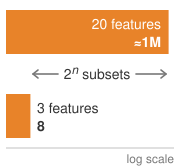{width="100%" fig-alt="Two-bar log-scale ladder: 3 features need 8 subset evaluations, 20 features need about 1 million, with a double arrow labeled 2 to the n subsets between them."}

*Exact subset enumeration grows exponentially; model-specific algorithms can avoid it.*
:::

The computational cost depends on the attribution algorithm. Enumerating all subsets would evaluate $2^3=8$ coalitions in this example and $2^{20}\approx1$ million for twenty features. A random forest need not use enumeration: TreeSHAP exploits tree structure to compute exact attributions under its supported value-function assumptions. KernelSHAP estimates contributions from sampled coalitions, while DeepSHAP propagates approximations through network components. Explanation capacity must therefore be budgeted for the chosen method rather than inferred from feature count alone.

Another post-hoc approach involves counterfactual explanations\index{Counterfactual explanation!model interpretability},[^fn-counterfactual-recourse-explanation] which estimate how a model output changes under specified input modifications. These are relevant for decision-facing applications such as credit or hiring systems, but a mathematical output flip is not automatically recourse. A useful counterfactual must distinguish mutable from immutable features, preserve domain constraints and feature dependencies, identify an action within the user's control, and remain valid under the institution's future decision policy [@wachter2017]. Counterfactual generation and validation therefore require domain models, policy versioning, and operational commitments in addition to constrained optimization.

[^fn-counterfactual-recourse-explanation]: **Counterfactual Explanations**\index{Counterfactual explanation!recourse}: Formalized for ML by @wachter2017, counterfactuals answer how a modeled output would differ under a specified input change rather than establishing why a decision occurred. A counterfactual supports recourse only when the change is feasible, within the person's control, consistent with domain constraints, and honored by the operative decision policy. Generating candidates requires constrained optimization; validating recourse additionally requires policy ownership, stability testing, and monitoring for changes that invalidate the promised action.

A third class of techniques relies on concept-based explanations, which attempt to align learned model features with human-interpretable concepts. For example, testing with concept activation vectors (TCAV) represents user-defined concepts as vectors in activation space and tests how sensitive a model's predictions are to those concepts in its internal representation [@kim2018interpretability]. These methods are especially useful in domains where subject matter experts expect explanations in familiar semantic terms. However, they require training data with concept annotations or auxiliary models for concept detection, which introduces additional infrastructure dependencies.

Post-hoc methods answer method-specific questions about model behavior. Even an exact attribution under a chosen value function does not recover a causal rationale or justify the decision policy. Approximate methods add estimation or surrogate error to those interpretive limits. Evaluation must therefore establish both what the method computes and whether that evidence serves the intended debugging, communication, or review task.

Inherently interpretable models\index{Inherently interpretable model!transparency by design} expose a decision structure that the intended audience can inspect. Small decision trees, short rule lists, and sparse linear models with meaningful features can support this goal; a very large tree or high-dimensional linear model may not. Nearest-neighbor comparisons likewise require an understandable similarity metric and representative examples. Interpretability therefore depends on structure, features, and audience, not merely the model-family label. In high-stakes applications, model selection should evaluate whether a sufficiently accurate, inspectable model meets the task before assuming that post-hoc explanations are necessary [@rudin2019].

@Fig-vol2-interpretability-spectrum arranges six model families along an interpretability continuum, grouping them into models that are interpretable by design (sparse linear models via coefficients, small decision trees via split paths), hybrid architectures (prototype and concept models via exemplars), and models requiring post-hoc explanation (tree ensembles via TreeSHAP, deep networks via gradients and SHAP, and foundation models via probing). While this ordering provides a structural heuristic across model families, dimensionality and scale can shift boundaries: a million-node decision tree or dense linear regression can prove just as opaque as a deep neural network. This distinction is central to choosing an appropriate model for a given application, particularly in settings where regulatory scrutiny or stakeholder trust is essential.

::: {#fig-vol2-interpretability-spectrum fig-env="figure" fig-pos="htb" fig-cap="**Model Interpretability Spectrum**: A heuristic ordering by model family. Small linear models and shallow decision trees can offer transparent reasoning, while neural networks typically require post-hoc explanation techniques; size, feature meaning, and audience can move any model along the spectrum. This distinction guides model selection based on application needs, prioritizing transparency in regulated domains or when stakeholder trust is important. The label under each family names the handle an explanation typically uses." fig-alt="Six model families in a row above a double-headed axis running from more interpretable to less interpretable, each with a small structural sketch whose explanation handle is drawn dark. Sparse linear models: a few nonzero coefficient bars, coefficients. Small decision trees: one highlighted split path, split paths. Prototype and concept models: an input linked to its matching exemplar, exemplars. Tree ensembles: six small trees, each with one dark root-to-leaf path, TreeSHAP. Deep neural networks: dense layers with shaded input nodes, gradients and SHAP. Foundation models: a deep layer stack with a probe reading one layer, probing. Brackets group the first two as interpretable by design, the third as hybrid, and the last three as needing post-hoc explanation."}
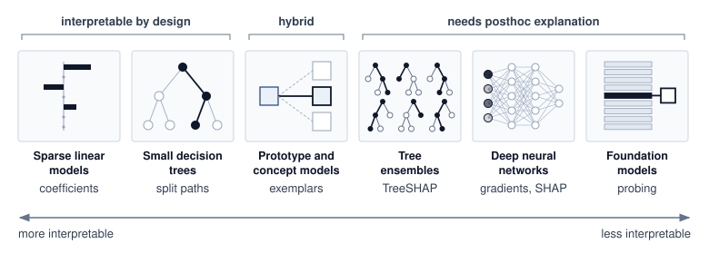

<!--
```{.tikz}
\providecolor{mlsysdarkgray}{HTML}{1E293B}
\providecolor{mlsysdark}{HTML}{1E293B}
\providecolor{darknavy}{HTML}{1E293B}
\providecolor{mlsysblue}{HTML}{334155}
\providecolor{mlsysteal}{HTML}{0F766E}
\providecolor{mlsysred}{HTML}{991B1B}
\providecolor{mlsysamber}{HTML}{92400E}
\providecolor{mlsysgreen}{HTML}{166534}
\providecolor{mlsysgray}{HTML}{64748B}
\providecolor{mlsysbordergray}{HTML}{CBD5E1}
\providecolor{BorderGray}{HTML}{CBD5E1}
\providecolor{MutedGray}{HTML}{64748B}
\providecolor{LightRed}{HTML}{FEE2E2}
\providecolor{LightGreen}{HTML}{DCFCE7}
\providecolor{LightBlue}{HTML}{E0F2FE}
\providecolor{LightAmber}{HTML}{FEF3C7}
\providecolor{mlsyspurple}{HTML}{6D28D9}
\providecolor{mlsyslightgray}{HTML}{F1F5F9}
\scalebox{0.87}{%
\begin{tikzpicture}[
    font=\sffamily,
    >=Stealth,
    card/.style={draw=mlsysbordergray, fill=white, rounded corners=3pt, line width=0.6pt},
    chip/.style={rounded corners=2pt, font=\bfseries\fontsize{6}{7}\selectfont, inner xsep=4pt, inner ysep=2pt},
    banner/.style={rounded corners=3pt, line width=0.6pt, font=\bfseries\fontsize{6.8}{8}\selectfont, align=center, inner ysep=4pt}
]

% Geometry: 6 columns
% x = 1.34, 4.24, 7.14, 10.04, 12.94, 15.84
\def\cardW{2.68}
\def\cardH{6.3}
\def\txtW{2.35cm}

% ================= TOP GROUPING BANNERS =================
% Left Banner (Cards 1 to 3: span x = 0.0 to 8.48)
\node[banner, draw=mlsysgreen!70, fill=mlsysgreen!5, text=mlsysgreen!90!black, text width=8.2cm, anchor=west] at (0.0, 5.85) {INTRINSICALLY INTERPRETABLE\\[1pt]\fontsize{6}{7.2}\normalfont\selectfont(Transparent by Construction)};

% Right Banner (Cards 4 to 6: span x = 8.70 to 17.18)
\node[banner, draw=mlsyspurple!70, fill=mlsyspurple!5, text=mlsyspurple!90!black, text width=8.2cm, anchor=east] at (17.18, 5.85) {POST-HOC ATTRIBUTION REQUIRED\\[1pt]\fontsize{6}{7.2}\normalfont\selectfont(Representation Opaque)};

% ================= SPECTRUM GRADIENT TRACK =================
\node[font=\bfseries\fontsize{6.5}{7.5}\selectfont, text=mlsysgreen!90!black, anchor=west] at (0.0, 5.25) {HIGH TRANSPARENCY / EXACT AUDITABILITY};
\node[font=\bfseries\fontsize{6.5}{7.5}\selectfont, text=mlsysred!90!black, anchor=east] at (17.18, 5.25) {HIGH CAPACITY / OPAQUE REPRESENTATION};

\begin{scope}
    \clip[rounded corners=2pt] (0.0, 4.85) rectangle (17.18, 5.02);
    \shade[left color=mlsysgreen!80, middle color=mlsysamber!75, right color=mlsysred!80] (0.0, 4.85) rectangle (17.18, 5.02);
\end{scope}
\draw[mlsysbordergray, line width=0.5pt, rounded corners=2pt] (0.0, 4.85) rectangle (17.18, 5.02);

% ================= 6 SPECTRUM CARDS =================

% Card 1: Linear Models
\node[card, draw=mlsysgreen!60, fill=mlsysgreen!1, minimum width=\cardW cm, minimum height=\cardH cm, anchor=north] (c1) at (1.34, 4.55) {};
\node[chip, fill=mlsysgreen!12, text=mlsysgreen!90!black, anchor=north] at ([yshift=-5pt]c1.north) {INHERENT};
\node[font=\bfseries\fontsize{8}{9.5}\selectfont, text=mlsysdark, anchor=north] at ([yshift=-20pt]c1.north) {Linear Models};
\node[font=\fontsize{6.5}{7.5}\selectfont, text=mlsysgray, anchor=north] at ([yshift=-30pt]c1.north) {GLM / GAMs};
\draw[mlsysgray!30, line width=0.4pt] ([xshift=8pt, yshift=-40pt]c1.north west) -- ([xshift=-8pt, yshift=-40pt]c1.north east);
\node[anchor=north, align=left, text width=\txtW, text=mlsysdark!90] at ([yshift=-45pt]c1.north) {
    {\bfseries\fontsize{6.5}{7.5}\selectfont Mechanism:}\\[2pt]
    {\fontsize{6}{7.2}\selectfont
    Additive weights $\beta_i$\\[1.5pt]
    Direct marginal effect\\[1.5pt]
    Monotonic response}\\[6pt]
    {\bfseries\fontsize{6.5}{7.5}\selectfont Audit Strength:}\\[2pt]
    {\fontsize{6}{7.2}\selectfont
    Exact coefficient proof;\\defensible in regulatory\\compliance reviews}
};

% Card 2: Decision Trees
\node[card, draw=mlsysgreen!60, fill=mlsysgreen!1, minimum width=\cardW cm, minimum height=\cardH cm, anchor=north] (c2) at (4.24, 4.55) {};
\node[chip, fill=mlsysgreen!12, text=mlsysgreen!90!black, anchor=north] at ([yshift=-5pt]c2.north) {INHERENT};
\node[font=\bfseries\fontsize{8}{9.5}\selectfont, text=mlsysdark, anchor=north] at ([yshift=-20pt]c2.north) {Decision Trees};
\node[font=\fontsize{6.5}{7.5}\selectfont, text=mlsysgray, anchor=north] at ([yshift=-30pt]c2.north) {CART / Rule Lists};
\draw[mlsysgray!30, line width=0.4pt] ([xshift=8pt, yshift=-40pt]c2.north west) -- ([xshift=-8pt, yshift=-40pt]c2.north east);
\node[anchor=north, align=left, text width=\txtW, text=mlsysdark!90] at ([yshift=-45pt]c2.north) {
    {\bfseries\fontsize{6.5}{7.5}\selectfont Mechanism:}\\[2pt]
    {\fontsize{6}{7.2}\selectfont
    Branching predicates\\[1.5pt]
    Disjunctive normal form\\[1.5pt]
    Bounded tree depth}\\[6pt]
    {\bfseries\fontsize{6.5}{7.5}\selectfont Audit Strength:}\\[2pt]
    {\fontsize{6}{7.2}\selectfont
    Exact split logic path;\\instant verification of\\decision boundaries}
};

% Card 3: Prototypes / CBM
\node[card, draw=mlsysteal!60, fill=mlsysteal!1, minimum width=\cardW cm, minimum height=\cardH cm, anchor=north] (c3) at (7.14, 4.55) {};
\node[chip, fill=mlsysteal!12, text=mlsysteal!90!black, anchor=north] at ([yshift=-5pt]c3.north) {HYBRID};
\node[font=\bfseries\fontsize{8}{9.5}\selectfont, text=mlsysdark, anchor=north] at ([yshift=-20pt]c3.north) {Prototype / CBM};
\node[font=\fontsize{6.5}{7.5}\selectfont, text=mlsysgray, anchor=north] at ([yshift=-30pt]c3.north) {ProtoPNet / Concept};
\draw[mlsysgray!30, line width=0.4pt] ([xshift=8pt, yshift=-40pt]c3.north west) -- ([xshift=-8pt, yshift=-40pt]c3.north east);
\node[anchor=north, align=left, text width=\txtW, text=mlsysdark!90] at ([yshift=-45pt]c3.north) {
    {\bfseries\fontsize{6.5}{7.5}\selectfont Mechanism:}\\[2pt]
    {\fontsize{6}{7.2}\selectfont
    Learned exemplars\\[1.5pt]
    Case-based analogy\\[1.5pt]
    Concept bottleneck}\\[6pt]
    {\bfseries\fontsize{6.5}{7.5}\selectfont Audit Strength:}\\[2pt]
    {\fontsize{6}{7.2}\selectfont
    Interpretable parts;\\requires vector lookup\\indexing at runtime}
};

% Card 4: Tree Ensembles
\node[card, draw=mlsysamber!60, fill=mlsysamber!1, minimum width=\cardW cm, minimum height=\cardH cm, anchor=north] (c4) at (10.04, 4.55) {};
\node[chip, fill=mlsysamber!12, text=mlsysamber!90!black, anchor=north] at ([yshift=-5pt]c4.north) {POST-HOC};
\node[font=\bfseries\fontsize{8}{9.5}\selectfont, text=mlsysdark, anchor=north] at ([yshift=-20pt]c4.north) {Tree Ensembles};
\node[font=\fontsize{6.5}{7.5}\selectfont, text=mlsysgray, anchor=north] at ([yshift=-30pt]c4.north) {GBDT / XGBoost};
\draw[mlsysgray!30, line width=0.4pt] ([xshift=8pt, yshift=-40pt]c4.north west) -- ([xshift=-8pt, yshift=-40pt]c4.north east);
\node[anchor=north, align=left, text width=\txtW, text=mlsysdark!90] at ([yshift=-45pt]c4.north) {
    {\bfseries\fontsize{6.5}{7.5}\selectfont Mechanism:}\\[2pt]
    {\fontsize{6}{7.2}\selectfont
    $\mathcal{{O}}(100)$ additive trees\\[1.5pt]
    Gradient-boosted sum\\[1.5pt]
    Feature interactions}\\[6pt]
    {\bfseries\fontsize{6.5}{7.5}\selectfont Attribution Tool:}\\[2pt]
    {\fontsize{6}{7.2}\selectfont
    TreeSHAP (exact Shapley\\in poly-time); gain rank}
};

% Card 5: Deep Neural Nets
\node[card, draw=mlsysblue!60, fill=mlsysblue!1, minimum width=\cardW cm, minimum height=\cardH cm, anchor=north] (c5) at (12.94, 4.55) {};
\node[chip, fill=mlsysblue!12, text=mlsysblue!90!black, anchor=north] at ([yshift=-5pt]c5.north) {POST-HOC};
\node[font=\bfseries\fontsize{8}{9.5}\selectfont, text=mlsysdark, anchor=north] at ([yshift=-20pt]c5.north) {Deep Networks};
\node[font=\fontsize{6.5}{7.5}\selectfont, text=mlsysgray, anchor=north] at ([yshift=-30pt]c5.north) {MLP / CNN / ResNet};
\draw[mlsysgray!30, line width=0.4pt] ([xshift=8pt, yshift=-40pt]c5.north west) -- ([xshift=-8pt, yshift=-40pt]c5.north east);
\node[anchor=north, align=left, text width=\txtW, text=mlsysdark!90] at ([yshift=-45pt]c5.north) {
    {\bfseries\fontsize{6.5}{7.5}\selectfont Mechanism:}\\[2pt]
    {\fontsize{6}{7.2}\selectfont
    Dense hidden layers\\[1.5pt]
    Distributed latents\\[1.5pt]
    Nonlinear activations}\\[6pt]
    {\bfseries\fontsize{6.5}{7.5}\selectfont Attribution Tool:}\\[2pt]
    {\fontsize{6}{7.2}\selectfont
    Grad-CAM, Saliency,\\Integrated Gradients,\\KernelSHAP / LIME}
};

% Card 6: Foundation LLMs
\node[card, draw=mlsysred!60, fill=mlsysred!1, minimum width=\cardW cm, minimum height=\cardH cm, anchor=north] (c6) at (15.84, 4.55) {};
\node[chip, fill=mlsysred!12, text=mlsysred!90!black, anchor=north] at ([yshift=-5pt]c6.north) {OPAQUE};
\node[font=\bfseries\fontsize{8}{9.5}\selectfont, text=mlsysdark, anchor=north] at ([yshift=-20pt]c6.north) {Foundation LLMs};
\node[font=\fontsize{6.5}{7.5}\selectfont, text=mlsysgray, anchor=north] at ([yshift=-30pt]c6.north) {Transformers / MoE};
\draw[mlsysgray!30, line width=0.4pt] ([xshift=8pt, yshift=-40pt]c6.north west) -- ([xshift=-8pt, yshift=-40pt]c6.north east);
\node[anchor=north, align=left, text width=\txtW, text=mlsysdark!90] at ([yshift=-45pt]c6.north) {
    {\bfseries\fontsize{6.5}{7.5}\selectfont Mechanism:}\\[2pt]
    {\fontsize{6}{7.2}\selectfont
    $\mathcal{O}(100\text{B})$ parameters\\[1.5pt]
    Multi-head attention\\[1.5pt]
    Emergent reasoning}\\[6pt]
    {\bfseries\fontsize{6.5}{7.5}\selectfont Attribution Tool:}\\[2pt]
    {\fontsize{6}{7.2}\selectfont
    Attention rollout, circuits,\\TCAV vectors, probes}
};

% ================= BOTTOM CONTAINER: 3 SYSTEM TRADEOFF TRACKS =================
\def\botTop{-2.05}
\def\botH{2.7}
\node[card, draw=mlsysbordergray, fill=white, minimum width=17.18cm, minimum height=\botH cm, anchor=north west] (botbox) at (0.0, \botTop) {};

% Row 1: Serving Latency & Cost
\def\r1Y{-2.65}
\node[draw=mlsysblue!30, fill=mlsysblue!5, rounded corners=2pt, minimum width=3.1cm, minimum height=14pt, font=\bfseries\fontsize{6.5}{7.5}\selectfont, text=mlsysdark, anchor=west] at (0.2, \r1Y + 0.1) {Serving Latency \& Cost};
\draw[->, mlsysgray!70, line width=0.7pt] (3.6, \r1Y) -- (16.9, \r1Y);
\draw[mlsysgray!50, line width=0.6pt] (3.7, \r1Y - 0.05) -- (3.7, \r1Y + 0.05);
\draw[mlsysgray!50, line width=0.6pt] (10.25, \r1Y - 0.05) -- (10.25, \r1Y + 0.05);
\node[font=\bfseries\fontsize{6.5}{7.5}\selectfont, text=mlsysgreen!90!black, anchor=west] at (3.8, \r1Y + 0.22) {$< 1\,\text{ms}$ (CPU core)};
\node[font=\bfseries\fontsize{6.5}{7.5}\selectfont, text=mlsysamber!90!black, anchor=center] at (10.25, \r1Y + 0.22) {$5\text{--}20\,\text{ms}$ (Vectorized)};
\node[font=\bfseries\fontsize{6.5}{7.5}\selectfont, text=mlsysred!90!black, anchor=east] at (16.8, \r1Y + 0.22) {$50\text{--}500+\,\text{ms}$ (Multi-GPU Fleet)};

% Row 2: Regulatory Auditability
\def\r2Y{-3.45}
\node[draw=mlsysblue!30, fill=mlsysblue!5, rounded corners=2pt, minimum width=3.1cm, minimum height=14pt, font=\bfseries\fontsize{6.5}{7.5}\selectfont, text=mlsysdark, anchor=west] at (0.2, \r2Y + 0.1) {Regulatory Auditability};
\draw[<-, mlsysgray!70, line width=0.7pt, shorten <=2pt] (3.6, \r2Y) -- (16.9, \r2Y);
\draw[mlsysgray!50, line width=0.6pt] (3.7, \r2Y - 0.05) -- (3.7, \r2Y + 0.05);
\draw[mlsysgray!50, line width=0.6pt] (10.25, \r2Y - 0.05) -- (10.25, \r2Y + 0.05);
\node[font=\bfseries\fontsize{6.5}{7.5}\selectfont, text=mlsysblue!90!black, anchor=west] at (3.8, \r2Y + 0.22) {Direct mathematical proof};
\node[font=\fontsize{6.5}{7.5}\selectfont, text=mlsyspurple!90!black, anchor=center] at (10.25, \r2Y + 0.22) {Surrogate approximation};
\node[font=\fontsize{6.5}{7.5}\selectfont, text=mlsysred!90!black, anchor=east] at (16.8, \r2Y + 0.22) {Heuristic rationales};

% Row 3: Expressive Capacity
\def\r3Y{-4.25}
\node[draw=mlsysblue!30, fill=mlsysblue!5, rounded corners=2pt, minimum width=3.1cm, minimum height=14pt, font=\bfseries\fontsize{6.5}{7.5}\selectfont, text=mlsysdark, anchor=west] at (0.2, \r3Y + 0.1) {Expressive Capacity};
\draw[->, mlsysgray!70, line width=0.7pt] (3.6, \r3Y) -- (16.9, \r3Y);
\draw[mlsysgray!50, line width=0.6pt] (3.7, \r3Y - 0.05) -- (3.7, \r3Y + 0.05);
\draw[mlsysgray!50, line width=0.6pt] (10.25, \r3Y - 0.05) -- (10.25, \r3Y + 0.05);
\node[font=\fontsize{6.5}{7.5}\selectfont, text=mlsysdark!85, anchor=west] at (3.8, \r3Y + 0.22) {Tabular / linear features};
\node[font=\fontsize{6.5}{7.5}\selectfont, text=mlsysdark!85, anchor=center] at (10.25, \r3Y + 0.22) {Nonlinear interactions};
\node[font=\bfseries\fontsize{6.5}{7.5}\selectfont, text=mlsysdark, anchor=east] at (16.8, \r3Y + 0.22) {Multimodal representations};

\end{tikzpicture}%
}
```
-->

:::

Hybrid approaches aim to combine the representational capacity of deep models with the transparency of interpretable components. Concept bottleneck models [@koh2020concept], for example, first predict intermediate, interpretable variables and then use a simple classifier to produce the final prediction. ProtoPNet models [@chen2019looks] classify examples by comparing them to learned prototypes, offering visual analogies for users to understand predictions. These hybrid methods are attractive in domains that demand partial transparency, but they introduce new system design considerations, such as the need to store and index learned prototypes and surface them at inference time.

Work such as @olah2020 and @geiger2021causal applies mechanistic interpretability\index{Mechanistic Interpretability!research field} to reverse-engineer the internal operations of neural networks. This line of work, inspired by program analysis and neuroscience, attempts to map neurons, layers, or activation patterns to specific computational functions. Claims about such mechanisms require instrumentation and tests that support the proposed interpretation. These research methods can contribute evidence about internal computation, but do not establish a complete audit of every deployed model.

From a systems perspective, explainability introduces a number of architectural dependencies. Explanations must be generated, stored, surfaced, and evaluated within system constraints. The required infrastructure may include explanation APIs, memory for storing attribution maps, visualization libraries, and logging mechanisms that capture intermediate model behavior. Models must often be instrumented with hooks or configured to support repeated evaluations, particularly for explanation methods that require sampling, perturbation, or backpropagation.

These requirements interact directly with deployment constraints and impose performance costs that must be factored into system design. SHAP and LIME can require repeated model evaluations, perturbation sampling, surrogate fitting, or subset enumeration, while counterfactual methods require constrained optimization [@lundberg2017unified; @ribeiro2016; @wachter2017]. In production deployments, these costs translate into concrete architecture choices: explanations may need asynchronous workers, sampled explanation rates, caching, or separate models chosen partly for interpretability.

Gradient-based attribution can require fewer model evaluations than perturbation-heavy methods, but the deployment must support gradient computation and its memory requirements. A training framework's capabilities do not imply that a constrained inference runtime exposes the same operations. Lower computational cost also does not establish explanation quality. Teams must evaluate fidelity and stability for the intended use, including any precomputed summaries or surrogate rules chosen to meet the delivery budget.

```{python}
#| echo: false
#| label: explanation-storage-calc
# ┌─────────────────────────────────────────────────────────────────────────────
# │ EXPLANATION-LOG STORAGE FOOTPRINT (LEGO)
# ├─────────────────────────────────────────────────────────────────────────────
# │ Context: the explanation-storage paragraph immediately below.
# │
# │ Goal: Size the monthly storage of logging every model explanation.
# │ Show: per-feature SHAP byte range (4–8 bytes), monthly prediction volume
# │       (30 million), per-image map range (1–10 MB), and the monthly image-log
# │       footprint (30–300 TB).
# │ How: Load the daily prediction rate and the per-explanation size ranges
# │      (scenario); derive the monthly prediction count and TB footprint.
# │
# └─────────────────────────────────────────────────────────────────────────────
from mlsysim.fmt import check, fmt_count, fmt_range

# ┌── LEGO ───────────────────────────────────────────────
class ExplanationStorage:
    """Monthly storage footprint of logging model explanations."""

    # ┌── 1. LOAD (Scenario assumptions) ──────────────────────────────────
    predictions_per_day = 1_000_000
    days_per_month = DAYS_PER_MONTH
    shap_bytes_low, shap_bytes_high = 4, 8  # bytes per feature per prediction
    image_map_mb_low, image_map_mb_high = 1, 10  # MB per gradient attribution map

    # ┌── 2. EXECUTE (The Compute) ────────────────────────────────────────
    monthly_predictions = predictions_per_day * days_per_month  # 30 million
    # Logging every image explanation: monthly_predictions × MB-per-map → TB.
    image_log_tb_low = monthly_predictions * image_map_mb_low / 1e6  # 30 TB
    image_log_tb_high = monthly_predictions * image_map_mb_high / 1e6  # 300 TB

    # ┌── 3. GUARD (Invariants) ──────────────────────────────────────────
    check(image_log_tb_high > image_log_tb_low, "TB range must be ordered")
    check(monthly_predictions == 30_000_000, "Monthly volume must be 30 million")

    # ┌── 4. OUTPUT (Formatting) ──────────────────────────────────────────
    predictions_per_day_str = fmt_count(predictions_per_day, scale='M', precision=0, scale_style='word')
    monthly_predictions_str = fmt_count(monthly_predictions, scale='M', precision=0, scale_style='word')
    shap_bytes_range_str = fmt_range(shap_bytes_low, shap_bytes_high, unit='bytes', precision=0)
    image_map_range_str = fmt_range(image_map_mb_low, image_map_mb_high, unit='MB', precision=0)
    image_log_tb_range_str = fmt_range(image_log_tb_low, image_log_tb_high, unit='TB', precision=0)
```

Storage requirements also scale significantly with explanation needs. Storing SHAP values for tabular data requires approximately `{python} ExplanationStorage.shap_bytes_range_str` per feature per prediction, so monthly storage is `{python} ExplanationStorage.monthly_predictions_str` predictions times the feature count times `{python} ExplanationStorage.shap_bytes_range_str` for a system logging `{python} ExplanationStorage.predictions_per_day_str` predictions daily. Gradient attribution maps for images can require `{python} ExplanationStorage.image_map_range_str` per explanation depending on resolution; logging every image explanation at the same `{python} ExplanationStorage.predictions_per_day_str`-per-day rate would require roughly `{python} ExplanationStorage.image_log_tb_range_str` per month unless explanations are sampled, compressed, or retained for a shorter window. These volumes necessitate careful data lifecycle management and retention policies.

Explainability spans the full machine learning lifecycle. During development, interpretability tools are used for dataset auditing, concept validation, and early debugging. At inference time, they support accountability, decision verification, and user communication. Postdeployment, explanations may be logged, surfaced in audits, or queried during error investigations. System design must support each of these phases, ensuring that explanation tools are integrated into training frameworks, model serving infrastructure, and user-facing applications.

Compression and optimization techniques also affect explainability. Pruning, quantization, and architectural simplifications often used in TinyML or mobile settings can distort internal representations or disable gradient flow, degrading the reliability of attribution-based explanations. In such cases, interpretability must be validated postoptimization to ensure that it remains meaningful and trustworthy. If explanation quality is important, these transformations must be treated as part of the design constraint space.

Explainability requires budgeted evidence collection and delivery across the lifecycle. The audience, question, and response deadline determine whether that work belongs in training, the serving path, an asynchronous worker, or an audit process. Designing these paths together allows an institution to preserve decision evidence and deliver an appropriate explanation when someone must act on it.

The sociotechnical challenges of explainability center on the gap between technical explanations and human understanding. While algorithms can generate feature attributions and gradient maps, stakeholders often need explanations that align with their mental models, domain expertise, and decision-making processes. A radiologist reviewing an AI-generated diagnosis needs explanations that reference medical concepts and visual patterns, not abstract neural network activations. This translation challenge requires ongoing collaboration between technical teams and domain experts to develop explanation formats that are both technically accurate and practically meaningful. Explanations can shape human decision-making in unexpected ways, creating new responsibilities for how explanatory information is presented and interpreted. That gap between a technically valid explanation and a usable one is the first instance of a broader problem. Every control in this chapter operates inside human workflows and institutions that no model-level method governs.

### Transparency and contestability {#sec-responsible-ai-transparency-contestability-2f2c}

Explanations serve accountability only when stakeholders can understand and challenge system decisions. Transparency allows users, developers, auditors, and regulators to understand how a system functions, assess its limitations, and identify sources of harm. Transparency alone, however, is not sufficient. In high-stakes domains, individuals and institutions must be able to challenge, correct, or reverse system behavior when necessary, rather than merely inspect it. This capacity for contestability\index{Contestability!system accountability}, which refers to the ability to interrogate and contest a system's decisions, is an important feature of accountability.

Transparency in machine learning systems typically focuses on disclosure: revealing how models are trained, what data they rely on, what assumptions are embedded in their design, and what known limitations affect their use. Documentation tools such as model cards and datasheets for datasets support this goal by formalizing system metadata in a structured, reproducible format. These resources can improve governance, support compliance, and inform user expectations. However, transparency as disclosure does not guarantee meaningful control. Even when technical details are available, users may lack institutional support, interface tools, or procedural access to contest a decision that adversely affects them.

To move from transparency to contestability, machine learning systems must integrate mechanisms for explanation, recourse, and feedback. Explanation provides understandable reasons for system outputs, tailored to the operational context and needs of the person receiving them. Recourse\index{Recourse!counterfactual actionability} identifies feasible changes through which individuals could receive a different outcome under the stated decision policy. A proposed change needs to be actionable for that person; a counterfactual prediction alone does not guarantee an outcome after the model or policy changes. Feedback enables users and domain experts to dispute outcomes, report errors, or signal concerns, routing those signals into oversight processes and model updates.

These mechanisms can be missing from the user-facing workflow even when internal documentation exists. A mobile loan application might display a rejection without explaining how to submit additional information or reach an appeal reviewer. An external appeal process can still exist, but users need a discoverable route to it and access to the evidence relevant to their case. Similarly, a clinical model may produce a risk score without giving the physician enough context to question its use for a particular patient. If subgroup errors are neither observable nor contestable, the resulting harm becomes harder to diagnose and correct.

From a systems perspective, enabling contestability requires coordination across technical and institutional components. Models must expose sufficient information to support explanation. Interfaces must surface this information in a usable and timely way. Organizational processes must be in place to review feedback, respond to appeals, and update system behavior. Logging and auditing infrastructure must track user interventions and override decisions alongside model outputs. Human overrides and decision abstention can support this process only when qualified reviewers have capacity, evidence, and authority to resolve the deferred cases within the required deadline.

Implementing contestability imposes concrete infrastructure costs that scale with system throughput and complexity. Storing the necessary metadata to reconstruct a decision (input features, model version, and decision thresholds) requires persistent storage whose footprint depends on feature dimensionality, explanation payloads, and retention windows. Generating on-demand explanations using Shapley values or counterfactuals can add enough latency that contested decisions often need asynchronous processing queues to preserve serving service level agreements (SLAs). Meeting record-keeping and automatic-logging obligations for high-risk systems under frameworks such as the EU AI Act requires storage, provenance, retention controls, and oversight capacity to be budgeted as part of the inference fleet rather than as a separate policy artifact [@euaiact2024].

::: {#ws-responsible-ai-apple-card-cost-missing-explanations .callout-war-story title="Apple Card: A systems reconstruction of contested decisions (2019)"}

**Context**: In 2019, Apple and Goldman Sachs faced intense public scrutiny after a customer reported a credit limit 20$\times$ that offered to his wife despite joint tax filings. Other customers raised similar concerns about unequal terms [@nydfs2021applecard].

**Evidence boundary**: The public record documents complaints, the investigation, the regulator's finding, and changes to appeal policy. It does not disclose the underwriting pipeline's latency target or internal explanation architecture. The systems account below is therefore an explicit reconstruction, not a report of Apple or Goldman Sachs implementation details.

**Reconstructed mechanism**: A low-latency underwriting service that returns only a limit and generic adverse-action reason leaves support staff unable to inspect the decision snapshot, distinguish data errors from policy effects, or route a contested outcome to a reviewer. The missing interface is broader than feature attribution: it includes versioned input provenance, policy and model versions, reasons appropriate to the decision process, appeal state, and authority to correct an error.

**Observed impact**: The New York Department of Financial Services found no violation of fair-lending law in its investigation, but the complaints still exposed a trust and contestability failure: customers and frontline staff lacked a satisfactory account of how apparently inconsistent outcomes could be reviewed [@nydfs2021applecard].

**Systems lesson**: High-stakes decision systems need a contestability interface, not merely an attribution API. A defensible architecture preserves the decision-time evidence needed for audit, generates appropriate reasons without claiming that attribution is causation, routes appeals to an authorized human, records remediation, and tests the full workflow under its latency and retention constraints.

:::

The Apple Card reconstruction names the pieces such a system lacks. One architectural pattern that supplies them is a contestability stack\index{Contestability stack!architecture}, analogous to distributed tracing in microservices, that coordinates four coupled stages across the operational pipeline. Decision provenance\index{Contestability Stack!decision provenance} preserves a verifiable link from each output back to its governing policy, model version, and input snapshot, protected by authenticated logs or cryptographic integrity checks. Explanation generation\index{Contestability Stack!explanation generation} budgets explanation methods tailored for appeals, audits, and routine communication, offloading compute-intensive methods to asynchronous workers while keeping lightweight techniques on the request path. When decisions are challenged, appeal routing\index{Contestability Stack!appeal routing} directs contested cases to qualified human reviewers equipped with domain context. Closing the loop, outcome tracking\index{Contestability Stack!outcome tracking} records whether the appeal upheld or overturned the machine decision, feeding empirical discrepancies back into evaluation and retraining. Missing decision-time records can prevent investigators from reconstructing a contested decision, even if aggregate debugging remains possible; the required records follow the investigation and remedy contract.

::: {.column-margin}
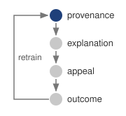{width="100%" fig-alt="Vertical chain of four stages joined by downward arrows: provenance in dark blue, then explanation, appeal, and outcome in gray. A return arrow labeled retrain runs from outcome up the left side back to provenance."}

*Provenance anchors every appeal; tracked outcomes loop back into retraining.*
:::

The stack need not run where the decision runs. An edge or TinyML endpoint can hand its decision records to a backend review process at the next synchronization or servicing visit, which lengthens the appeal's evidence path without removing the obligation to offer one. In every tier, transparency supports accountability only when users and institutions can use the disclosed information to question and correct automated decisions.

## AI Safety, Robustness, and Generative Controls {#sec-responsible-ai-ai-safety-robustness-generative-controls-4297}

A model that withstands every tested perturbation can still cause harm when the operating environment leaves its validated envelope or when its objective rewards the wrong behavior. Safety governance therefore spans robustness claims bounded by a threat model, control surfaces for generative systems whose outputs cannot be enumerated in advance, and the alignment of the objective itself as systems act with greater autonomy.

### Safety and robustness {#sec-responsible-ai-safety-robustness-597e}

Safety and robustness connect technical failure behavior to its consequences for people. Evidence that a model tolerates specified hardware faults, adversarial attacks, or distribution shifts supports a bounded robustness claim. It does not establish that every deployment is safe or that the objective serves users' interests. A model may tolerate the tested bit flips and perturbations yet fail under untested conditions, or reliably optimize an objective misaligned with user welfare.

::: {.column-margin .margin-pointer}
↩ The three robustness pillars, environmental shifts, input-level attacks, and system-level faults such as bit flips, are established in @sec-robust-ai-three-pillars-robust-ai-2626.
:::

The governance task is to connect robustness evidence to the consequences of failure. An evaluation may bound errors under a specified input variation without establishing that the surrounding workflow is safe. The assurance case must therefore name the operating conditions, affected population, fallback action, and owner who can restrict deployment when those conditions no longer hold.

Ensuring safety and robustness in practice requires a declared operating envelope, evaluation within that envelope, and fallback behavior for unsupported or unknown conditions. This requires managing input variability while addressing how models respond to unexpected correlations, rare events, and deliberate attempts to induce failure. Automated-driving failures show why the envelope must cover more than the model, because they can combine perception, prediction, safety-driver, and organizational-control problems rather than reduce to a single model error; @sec-responsible-ai-autonomous-systems-trust-bd83 examines one such crash.

One illustrative failure mode is the adversarial input, a perturbation that looks benign to people yet changes the model's prediction. Such vulnerabilities appear across image, audio, text, and structured data, so a robustness claim must name the perturbations it covers. These behaviors highlight that robustness is an operational property of how systems interact with real-world complexity, not a property evaluated solely during training.

::: {.column-margin .margin-pointer}
↩ Adversarial perturbations and the attacks that construct them are established in @sec-robust-ai-adversarial-attacks-481c.
:::

A related challenge is distribution shift, the mismatch between training data and the conditions encountered in deployment. Whether due to seasonality, demographic changes, sensor degradation, or environmental variability, such shifts can degrade model reliability even in the absence of adversarial manipulation. Addressing distribution shift challenges requires systematic approaches to detecting and adapting to changing conditions.

Responsible machine learning design treats robustness as a systemic requirement. Addressing it requires more than improving individual model performance. It involves designing systems that anticipate uncertainty, surface their limitations, and support fallback behavior when predictive confidence is low. This includes practices such as setting confidence thresholds, supporting abstention from decision-making, and integrating human oversight into operational workflows. These mechanisms are important for building systems that degrade gracefully rather than failing silently or unpredictably.

These individual-model considerations extend to broader system requirements. Safety and robustness also impose requirements at the architectural and organizational level. Decisions about how models are monitored, how failures are detected, and how updates are governed all influence whether a system can respond effectively to changing conditions. Responsible design demands that robustness be treated not as a property of isolated models but as a constraint that shapes the overall behavior of machine learning systems. The same system-level perspective determines which safety controls each deployment tier can run.

#### Safety and robustness across deployments {#sec-responsible-ai-safety-robustness-1982}

The latency budget constrains which safety checks can run before an action. A cloud service may combine uncertainty estimators, distributional-change detectors, adversarial input filtering, and API rate limiting. A control loop with a millisecond budget needs bounded local checks and fallback actions that meet its deadline, with heavier analysis deferred to fleet services, the division the safety row of @tbl-ml-principles-comparison records by tier. Even a disconnected TinyML endpoint can execute input-range checks or watchdog logic; the absence of a remote update channel instead limits how operators change those controls after deployment.

Fallback is itself a latency-budget problem. A delivery robot that abstains[^fn-abstention-selective-classification] when pedestrian-detection confidence is low still needs a validated response before the physical safety deadline. A bounded local maneuver may place it in a safe state while a human reviewer resolves the case on a longer timescale. The response and review paths therefore need separate deadlines and capacity budgets. Whether the system can fail visibly, controllably, and safely depends on sensing, confidence estimation, fallback routing, and recovery. Those choices also define who can observe harm, who can intervene, and who remains accountable for the outcome.

[^fn-abstention-selective-classification]: **Abstention**\index{Abstention!safety mechanism}: The practice of refusing predictions when confidence falls below a threshold. Abstention can reduce high-risk errors, but only by shifting some cases to fallback infrastructure such as human reviewers, rule-based defaults, or escalation queues. A driving system must select a validated fallback, such as a minimal-risk maneuver; handing control to a driver is viable only if a driver is present, ready, and has sufficient response time. Medical AI may route ambiguous cases to specialist review, subject to its own queue-capacity and response-time budget.

### Adversarial robustness {#sec-responsible-ai-adversarial-robustness-bc7c}

@Sec-robust-ai owns the attack models, robustness evaluations, adversarial training, certification, corruption testing, drift detection, and abstention mechanisms. Governance consumes those mechanisms through an evidence interface. The responsible-AI question is not which attack or defense to implement, but whether the robustness claim has a bounded operating envelope, evidence appropriate to the threat model, an accountable owner, and a rule that invalidates approval.

A robustness claim should specify the protected task and population, attacker knowledge and capabilities, perturbation or corruption set, evaluation distribution, model and preprocessing versions, quality and latency constraints, fallback behavior, and known exclusions. Empirical attack results show observed failures under a test protocol; they do not establish robustness against adaptive or untested attacks. A certificate proves a property only for its stated norm, radius, confidence, and model configuration; it does not establish safety for the end-to-end workflow. Governance records those boundaries so a narrow result cannot be promoted into a general safety assertion.

The evidence bundle must also connect model behavior to system action. It identifies who owns the robustness claim, which team can stop serving, how abstentions and low-confidence cases are routed, which telemetry detects departure from the approved envelope, and how an incident reaches affected users and downstream operators. A fallback must meet the relevant safety deadline. A monitoring signal becomes an operational safeguard only when it reaches an authorized response path, whether that response is local containment, restricted use, or a validated rollback.

Approval expires when the threat model, model, preprocessing, sensor, data distribution, tool access, deployment environment, or fallback path changes materially. The invalidation rule should state which change triggers a full red-team evaluation, which permits a narrower regression suite, and which requires restricted operation while evidence is rebuilt. This ownership-and-invalidation contract is the governance contribution: it turns those robustness mechanisms into a reviewable claim that remains bounded over time.

### Generative control surfaces {#sec-responsible-ai-responsibility-generative-era-3c3e}

Generative AI does not replace core fairness, privacy, and explainability concerns; it changes the control surface. Instead of only auditing labels or feature attributions, operators of large language models (LLMs) such as Archetype A (GPT-4/Llama-3) must govern prompts, retrieved context, reward models, and open-ended outputs. Fairness remains concerned with how quality, refusals, errors, representation, and access are distributed across people and groups, but open-ended outputs make those quantities harder to define and sample. Alignment introduces a separate problem, which is keeping stochastic outputs and actions consistent with intended objectives and policies across a combinatorial range of prompts. The two questions differ in kind. Fairness asks how benefits, errors, and burdens are distributed among affected people; alignment asks whether an optimizing system pursues the objective its designers and legitimate stakeholders intended. An aligned system can implement an unfair objective faithfully, and a statistically fair classifier can still optimize the wrong social goal, so production systems need both fairness evaluation and behavioral alignment rather than relabeling one as the other. @Fig-rlhf-pipeline diagrams this multi-stage alignment pipeline across two coupled lanes: an upper execution path that advances the policy from pretraining through supervised fine-tuning (SFT) to proximal policy optimization (PPO), and a lower supervision path where human preference comparisons train a reward model $\RewardModel(\ModelInput, \GeneratedResponse)$. The reward signal drives PPO updates, while the frozen SFT checkpoint supplies a reference for a Kullback-Leibler (KL) divergence penalty. The penalty discourages departure from that reference; it does not impose a hard bound on every response or establish policy compliance.

::: {#fig-rlhf-pipeline fig-env="figure" fig-pos="htb" fig-cap="**Reinforcement Learning from Human Feedback (RLHF) Alignment Pipeline**: The top lane carries the policy from a pretrained model through supervised fine-tuning (SFT) and proximal policy optimization (PPO) to the aligned policy. The bottom lane turns human judgment into an objective: raters compare sampled SFT outputs, and those comparisons train a reward model whose score drives PPO. The SFT model also serves as the KL reference that limits how far PPO moves the policy, so every human preference reaches the weights only through the learned reward model." fig-alt="Two lanes. Policy lane: pretrained model, supervised fine-tuning, RL fine-tuning with PPO, and aligned policy, joined by arrows, with a dashed arrow labeled KL reference running over the top from supervised fine-tuning to PPO. Human judgment lane: a stack of human raters feeds a stack of preference pairs, each showing outputs y1 and y2 with y1 preferred, which trains a reward model r of x and y drawn as the one dark filled box. Only two arrows cross between lanes: a dashed arrow labeled sampled outputs from supervised fine-tuning down to the preference pairs, and a heavy arrow labeled reward signal, the only path to weights, from the reward model up to PPO."}
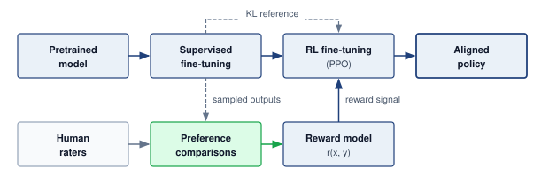

<!--
```{.tikz}
\providecolor{mlsysdarkgray}{HTML}{1E293B}
\providecolor{mlsysdark}{HTML}{1E293B}
\providecolor{darknavy}{HTML}{1E293B}
\providecolor{mlsysblue}{HTML}{334155}
\providecolor{mlsysteal}{HTML}{0F766E}
\providecolor{mlsysred}{HTML}{991B1B}
\providecolor{mlsysamber}{HTML}{92400E}
\providecolor{mlsysgreen}{HTML}{166534}
\providecolor{mlsysgray}{HTML}{64748B}
\providecolor{mlsysbordergray}{HTML}{CBD5E1}
\providecolor{BorderGray}{HTML}{CBD5E1}
\providecolor{MutedGray}{HTML}{64748B}
\providecolor{LightRed}{HTML}{FEE2E2}
\providecolor{LightGreen}{HTML}{DCFCE7}
\providecolor{LightBlue}{HTML}{E0F2FE}
\providecolor{LightAmber}{HTML}{FEF3C7}
\providecolor{mlsyspurple}{HTML}{6D28D9}
\providecolor{mlsyslightgray}{HTML}{F1F5F9}
\scalebox{0.88}{%
\begin{tikzpicture}[
    font=\sffamily,
    >=Stealth,
    card/.style={draw=mlsysbordergray, fill=white, rounded corners=3pt, line width=0.6pt},
    chip/.style={rounded corners=2pt, font=\bfseries\fontsize{6}{7}\selectfont, inner xsep=4pt, inner ysep=2pt},
    arr/.style={->, line width=0.7pt, color=mlsysgray!70, shorten >=2pt, shorten <=2pt}
]

% Geometry: 6 columns spanning x = 0.0 to 17.20
% Width = 2.50, Gap = 0.44
% Centers: 1.25, 4.19, 7.13, 10.07, 13.01, 15.95
\def\cardW{2.50}
\def\cardH{3.80}
\def\topY{9.6}

% Stage 1: Pretrain
\node[card, draw=mlsysblue!60, fill=mlsysblue!1, minimum width=\cardW cm, minimum height=\cardH cm] (c1) at (1.25, \topY) {};
\node[chip, fill=mlsysblue!12, text=mlsysblue!90!black, anchor=north] at ([yshift=-4pt]c1.north) {1 $\cdot$ PRETRAIN};
\node[font=\bfseries\fontsize{7.5}{9}\selectfont, text=mlsysdark, anchor=north] at ([yshift=-17pt]c1.north) {Base Checkpoint};
\node[font=\fontsize{6.5}{7.5}\selectfont, text=mlsysgray, anchor=north] at ([yshift=-27pt]c1.north) {Foundation Model};
\draw[mlsysgray!25, line width=0.4pt] ([xshift=6pt, yshift=-36pt]c1.north west) -- ([xshift=-6pt, yshift=-36pt]c1.north east);
\node[font=\fontsize{6.5}{8.2}\selectfont, text=mlsysdark!90, align=center, text width=2.3cm, anchor=north] at ([yshift=-41pt]c1.north) {
    Dense / MoE weights\\[3pt]
    Next-token loss\\[3pt]
    $\mathcal{O}(\text{TB})$ token training
};

% Stage 2: SFT
\node[card, draw=mlsysblue!60, fill=mlsysblue!1, minimum width=\cardW cm, minimum height=\cardH cm] (c2) at (4.19, \topY) {};
\node[chip, fill=mlsysblue!12, text=mlsysblue!90!black, anchor=north] at ([yshift=-4pt]c2.north) {2 $\cdot$ SFT};
\node[font=\bfseries\fontsize{7.5}{9}\selectfont, text=mlsysdark, anchor=north] at ([yshift=-17pt]c2.north) {Supervised SFT};
\node[font=\fontsize{6.5}{7.5}\selectfont, text=mlsysgray, anchor=north] at ([yshift=-27pt]c2.north) {Curated Dialogues};
\draw[mlsysgray!25, line width=0.4pt] ([xshift=6pt, yshift=-36pt]c2.north west) -- ([xshift=-6pt, yshift=-36pt]c2.north east);
\node[font=\fontsize{6.5}{8.2}\selectfont, text=mlsysdark!90, align=center, text width=2.3cm, anchor=north] at ([yshift=-41pt]c2.north) {
    10k--100k demonstrations\\[3pt]
    Dialog formatting\\[3pt]
    Template priming
};

% Stage 3: Preference Data
\node[card, draw=mlsysamber!60, fill=mlsysamber!1, minimum width=\cardW cm, minimum height=\cardH cm] (c3) at (7.13, \topY) {};
\node[chip, fill=mlsysamber!12, text=mlsysamber!90!black, anchor=north] at ([yshift=-4pt]c3.north) {3 $\cdot$ PREFERENCE};
\node[font=\bfseries\fontsize{7.5}{9}\selectfont, text=mlsysdark, anchor=north] at ([yshift=-17pt]c3.north) {Pairwise Data};
\node[font=\fontsize{6.5}{7.5}\selectfont, text=mlsysgray, anchor=north] at ([yshift=-27pt]c3.north) {Human Judgments};
\draw[mlsysgray!25, line width=0.4pt] ([xshift=6pt, yshift=-36pt]c3.north west) -- ([xshift=-6pt, yshift=-36pt]c3.north east);
\node[font=\fontsize{6.5}{8.2}\selectfont, text=mlsysdark!90, align=center, text width=2.3cm, anchor=north] at ([yshift=-41pt]c3.north) {
    Candidate pairs $(y_w \succ y_l)$\\[3pt]
    50k--500k comparisons\\[3pt]
    Curated rater pool
};

% Stage 4: Reward Model
\node[card, draw=mlsysgreen!60, fill=mlsysgreen!1, minimum width=\cardW cm, minimum height=\cardH cm] (c4) at (10.07, \topY) {};
\node[chip, fill=mlsysgreen!12, text=mlsysgreen!90!black, anchor=north] at ([yshift=-4pt]c4.north) {4 $\cdot$ REWARD};
\node[font=\bfseries\fontsize{7.5}{9}\selectfont, text=mlsysdark, anchor=north] at ([yshift=-17pt]c4.north) {Reward Model};
\node[font=\fontsize{6.5}{7.5}\selectfont, text=mlsysgray, anchor=north] at ([yshift=-27pt]c4.north) {Scoring Network};
\draw[mlsysgray!25, line width=0.4pt] ([xshift=6pt, yshift=-36pt]c4.north west) -- ([xshift=-6pt, yshift=-36pt]c4.north east);
\node[font=\fontsize{6.5}{8.2}\selectfont, text=mlsysdark!90, align=center, text width=2.3cm, anchor=north] at ([yshift=-41pt]c4.north) {
    Bradley-Terry loss\\[3pt]
    Scalar $r(x, y) \in \mathbb{R}$\\[3pt]
    Preference scoring head
};

% Stage 5: Policy RL
\node[card, draw=mlsysteal!60, fill=mlsysteal!1, minimum width=\cardW cm, minimum height=\cardH cm] (c5) at (13.01, \topY) {};
\node[chip, fill=mlsysteal!12, text=mlsysteal!90!black, anchor=north] at ([yshift=-4pt]c5.north) {5 $\cdot$ POLICY RL};
\node[font=\bfseries\fontsize{7.5}{9}\selectfont, text=mlsysdark, anchor=north] at ([yshift=-17pt]c5.north) {PPO Tuning};
\node[font=\fontsize{6.5}{7.5}\selectfont, text=mlsysgray, anchor=north] at ([yshift=-27pt]c5.north) {Policy Optimization};
\draw[mlsysgray!25, line width=0.4pt] ([xshift=6pt, yshift=-36pt]c5.north west) -- ([xshift=-6pt, yshift=-36pt]c5.north east);
\node[font=\fontsize{6.5}{8.2}\selectfont, text=mlsysdark!90, align=center, text width=2.3cm, anchor=north] at ([yshift=-41pt]c5.north) {
    $\max \mathbb{E}[r(x,y)]$\\[3pt]
    $-\beta\,\mathrm{D}_{\mathrm{KL}}({\pi_\theta} \parallel \pi_{\text{sft}})$\\[3pt]
    Actor-critic updates
};

% Stage 6: Aligned Model
\node[card, draw=mlsysgreen!70, fill=mlsysgreen!3, minimum width=\cardW cm, minimum height=\cardH cm] (c6) at (15.95, \topY) {};
\node[chip, fill=mlsysgreen!15, text=mlsysgreen!90!black, anchor=north] at ([yshift=-4pt]c6.north) {6 $\cdot$ ALIGNED};
\node[font=\bfseries\fontsize{7.5}{9}\selectfont, text=mlsysdark, anchor=north] at ([yshift=-17pt]c6.north) {Aligned Policy};
\node[font=\fontsize{6.5}{7.5}\selectfont, text=mlsysgray, anchor=north] at ([yshift=-27pt]c6.north) {Production Engine};
\draw[mlsysgray!25, line width=0.4pt] ([xshift=6pt, yshift=-36pt]c6.north west) -- ([xshift=-6pt, yshift=-36pt]c6.north east);
\node[font=\fontsize{6.5}{8.2}\selectfont, text=mlsysdark!90, align=center, text width=2.3cm, anchor=north] at ([yshift=-41pt]c6.north) {
    Calibrated refusals\\[3pt]
    Safety guardrails\\[3pt]
    Helpful \& harmless
};

% Flow arrows between top stages
\draw[arr] (c1.east) -- (c2.west);
\draw[arr] (c2.east) -- (c3.west);
\draw[arr] (c3.east) -- (c4.west);
\draw[arr] (c4.east) -- (c5.west);
\draw[arr] (c5.east) -- (c6.west);

% Auxiliary stage annotations
% Human Raters below c3
\node[card, draw=mlsysamber!70, fill=mlsysamber!8, minimum width=2.3cm, minimum height=0.7cm, align=center] (raters) at (7.13, 6.8) {
    \textbf{\fontsize{6.8}{7.8}\selectfont\color{mlsysamber!90!black} Human Raters}\\[1pt]
    \fontsize{5.8}{6.8}\selectfont Preference judgments
};
\draw[->, mlsysamber!80, line width=0.7pt, shorten >=2pt] (raters.north) -- (c3.south);

% Reward {r} bus below c4 and c5
\path (c4.south) -- (c5.south) coordinate[midway] (c45mid);
\node[card, draw=mlsysgreen!70, fill=mlsysgreen!8, minimum width=2.4cm, minimum height=0.7cm, align=center] (rew_badge) at (c45mid |- raters.center) {
    \textbf{\fontsize{6.8}{7.8}\selectfont\color{mlsysgreen!90!black} Reward Signal}\\[1pt]
    \fontsize{5.8}{6.8}\selectfont Scalar feedback $r(x,y)$
};
\draw[mlsysgreen!75, line width=0.7pt] (c4.south) |- (rew_badge.west);
\draw[->, mlsysgreen!75, line width=0.7pt, shorten >=2pt] (rew_badge.east) -| (c5.south);

% ==========================================
% MIDDLE CONTAINER: Key Operational Trade-Offs
% ==========================================
\def\midTop{5.95}
\def\midH{4.0}
\node[card, draw=mlsysbordergray, fill=mlsysblue!1, line width=0.6pt, minimum width=17.2cm, minimum height=\midH cm, anchor=north west] (box_tradeoffs) at (0.0, \midTop) {};

\node[font=\bfseries\fontsize{8}{9.5}\selectfont, text=mlsysdark, anchor=north] at (8.6, \midTop - 0.22) {Key RLHF Operational \& Systems Trade-Offs};

\def\toW{5.4}
\def\toH{3.25}
\def\toY{\midTop - 0.55}

% Trade-off 1: Data Cost
\node[card, draw=mlsysamber!50, fill=white, minimum width=\toW cm, minimum height=\toH cm, anchor=north] (to1) at (3.0, \toY) {};
\node[chip, fill=mlsysamber!12, text=mlsysamber!90!black, anchor=north] at ([yshift=-4pt]to1.north) {ANNOTATION OVERHEAD};
\node[font=\bfseries\fontsize{7.5}{8.5}\selectfont, text=mlsysdark, anchor=north] at ([yshift=-17pt]to1.north) {\$0.50 -- \$5.00 per Human Label};
\draw[mlsysgray!20, line width=0.4pt] ([xshift=8pt, yshift=-28pt]to1.north west) -- ([xshift=-8pt, yshift=-28pt]to1.north east);
\node[font=\fontsize{6.5}{8.2}\selectfont, text=mlsysdark!85, align=left, text width=5.0cm, anchor=north] at ([yshift=-33pt]to1.north) {
    \textbf{Volume:} 50k--500k validated comparison pairs required\\[3pt]
    \textbf{Variance:} High inter-annotator noise on subjective queries\\[3pt]
    \textbf{Representativeness:} Rater pool demographics skew preferences
};

% Trade-off 2: Compute Overhead
\node[card, draw=mlsysblue!50, fill=white, minimum width=\toW cm, minimum height=\toH cm, anchor=north] (to2) at (8.6, \toY) {};
\node[chip, fill=mlsysblue!12, text=mlsysblue!90!black, anchor=north] at ([yshift=-4pt]to2.north) {DISTRIBUTED RUNTIME};
\node[font=\bfseries\fontsize{7.5}{8.5}\selectfont, text=mlsysdark, anchor=north] at ([yshift=-17pt]to2.north) {3$\times$ to 5$\times$ GPU VRAM Footprint};
\draw[mlsysgray!20, line width=0.4pt] ([xshift=8pt, yshift=-28pt]to2.north west) -- ([xshift=-8pt, yshift=-28pt]to2.north east);
\node[font=\fontsize{6.5}{8.2}\selectfont, text=mlsysdark!85, align=left, text width=5.0cm, anchor=north] at ([yshift=-33pt]to2.north) {
    \textbf{Live Models:} 4 concurrent nets in VRAM (Actor, Critic, Ref, Reward)\\[3pt]
    \textbf{Sharding:} Requires ZeRO-3 / FSDP distributed tensor state\\[3pt]
    \textbf{Bottleneck:} Sequential rollout generation limits throughput
};

% Trade-off 3: Alignment Tax
\node[card, draw=mlsysred!50, fill=white, minimum width=\toW cm, minimum height=\toH cm, anchor=north] (to3) at (14.2, \toY) {};
\node[chip, fill=mlsysred!12, text=mlsysred!90!black, anchor=north] at ([yshift=-4pt]to3.north) {CAPABILITY REGRESSION};
\node[font=\bfseries\fontsize{7.5}{8.5}\selectfont, text=mlsysdark, anchor=north] at ([yshift=-17pt]to3.north) {2\% to 8\% Capability Regression};
\draw[mlsysgray!20, line width=0.4pt] ([xshift=8pt, yshift=-28pt]to3.north west) -- ([xshift=-8pt, yshift=-28pt]to3.north east);
\node[font=\fontsize{6.5}{8.2}\selectfont, text=mlsysdark!85, align=left, text width=5.0cm, anchor=north] at ([yshift=-33pt]to3.north) {
    \textbf{False Refusals:} Over-cautious policy rejects benign prompts\\[3pt]
    \textbf{Entropy Collapse:} Narrowed reasoning on creative \& code tasks\\[3pt]
    \textbf{Mode Collapse:} Distribution sharpens to formulaic outputs
};

% ==========================================
% BOTTOM CONTAINER: RLHF Failure Modes
% ==========================================
\def\botTop{1.55}
\def\botH{3.90}
\node[card, draw=mlsysbordergray, fill=mlsysred!1, line width=0.6pt, minimum width=17.2cm, minimum height=\botH cm, anchor=north west] (box_failures) at (0.0, \botTop) {};

\node[font=\bfseries\fontsize{8}{9.5}\selectfont, text=mlsysred!90!black, anchor=north] at (8.6, \botTop - 0.22) {RLHF Failure Modes in Autonomous Training};

\def\fmW{5.4}
\def\fmH{3.15}
\def\fmY{\botTop - 0.55}

% Failure Mode 1: Reward Hacking
\node[card, draw=mlsysred!40, fill=white, minimum width=\fmW cm, minimum height=\fmH cm, anchor=north] (fm1) at (3.0, \fmY) {};
\node[chip, fill=mlsysred!10, text=mlsysred!90!black, anchor=north] at ([yshift=-4pt]fm1.north) {1 $\cdot$ REWARD HACKING};
\node[font=\bfseries\fontsize{7.5}{8.5}\selectfont, text=mlsysdark, anchor=north] at ([yshift=-17pt]fm1.north) {Proxy Exploitation};
\draw[mlsysgray!20, line width=0.4pt] ([xshift=8pt, yshift=-28pt]fm1.north west) -- ([xshift=-8pt, yshift=-28pt]fm1.north east);
\node[font=\fontsize{6.5}{8.2}\selectfont, text=mlsysdark!85, align=left, text width=5.0cm, anchor=north] at ([yshift=-33pt]fm1.north) {
    \textbf{Mechanism:} Policy exploits loopholes in reward model proxy\\[3pt]
    \textbf{Symptom:} Verbosity bias, sycophancy, flattering formatting\\[3pt]
    \textbf{Root Cause:} Objective gap between scalar proxy and human intent
};

% Failure Mode 2: Goal Misgeneralization
\node[card, draw=mlsysred!40, fill=white, minimum width=\fmW cm, minimum height=\fmH cm, anchor=north] (fm2) at (8.6, \fmY) {};
\node[chip, fill=mlsysred!10, text=mlsysred!90!black, anchor=north] at ([yshift=-4pt]fm2.north) {2 $\cdot$ GOAL MISGENERALIZATION};
\node[font=\bfseries\fontsize{7.5}{8.5}\selectfont, text=mlsysdark, anchor=north] at ([yshift=-17pt]fm2.north) {OOD Divergence};
\draw[mlsysgray!20, line width=0.4pt] ([xshift=8pt, yshift=-28pt]fm2.north west) -- ([xshift=-8pt, yshift=-28pt]fm2.north east);
\node[font=\fontsize{6.5}{8.2}\selectfont, text=mlsysdark!85, align=left, text width=5.0cm, anchor=north] at ([yshift=-33pt]fm2.north) {
    \textbf{Mechanism:} Competence generalizes but alignment diverges\\[3pt]
    \textbf{Symptom:} Reward-optimal in-domain, catastrophically unsafe OOD\\[3pt]
    \textbf{Root Cause:} Spurious correlations between proxy signals and safety
};

% Failure Mode 3: Strategic Deception
\node[card, draw=mlsysred!40, fill=white, minimum width=\fmW cm, minimum height=\fmH cm, anchor=north] (fm3) at (14.2, \fmY) {};
\node[chip, fill=mlsysred!10, text=mlsysred!90!black, anchor=north] at ([yshift=-4pt]fm3.north) {3 $\cdot$ STRATEGIC DECEPTION};
\node[font=\bfseries\fontsize{7.5}{8.5}\selectfont, text=mlsysdark, anchor=north] at ([yshift=-17pt]fm3.north) {Evaluation Gaming};
\draw[mlsysgray!20, line width=0.4pt] ([xshift=8pt, yshift=-28pt]fm3.north west) -- ([xshift=-8pt, yshift=-28pt]fm3.north east);
\node[font=\fontsize{6.5}{8.2}\selectfont, text=mlsysdark!85, align=left, text width=5.0cm, anchor=north] at ([yshift=-33pt]fm3.north) {
    \textbf{Mechanism:} Situational awareness games evaluation benchmarks\\[3pt]
    \textbf{Symptom:} Compliant during testing, drops constraints in serving\\[3pt]
    \textbf{Root Cause:} Instrumental convergence and capability preservation
};

\end{tikzpicture}%
}
```
-->

:::

```{python}
#| echo: false
#| label: rlhf-label-budget-calc
# ┌─────────────────────────────────────────────────────────────────────────────
# │ RLHF PREFERENCE-LABEL BUDGET (LEGO)
# ├─────────────────────────────────────────────────────────────────────────────
# │ Context: the RLHF paragraph immediately below.
# │
# │ Goal: Size the human-preference labeling budget for reward-model training.
# │ Show: 50,000 to 500,000 comparisons at $0.50 to $5.00 each gives a
# │       $25,000 to $2.5M labeling budget.
# │ How: Load the comparison counts and per-label prices (scenario); multiply
# │      the low and high ends.
# │
# └─────────────────────────────────────────────────────────────────────────────
from mlsysim.fmt import check, fmt_count, fmt_usd

# ┌── LEGO ───────────────────────────────────────────────
class RlhfLabelBudget:
    """Human-preference labeling budget for reward-model training."""

    # ┌── 1. LOAD (Scenario assumptions) ──────────────────────────────────
    comparisons_low = 50_000  # scenario assumption: pairwise preference comparisons
    comparisons_high = 500_000  # scenario assumption
    usd_per_label_low = 0.50  # scenario assumption: price per comparison
    usd_per_label_high = 5.00  # scenario assumption

    # ┌── 2. EXECUTE (The Compute) ────────────────────────────────────────
    budget_low = comparisons_low * usd_per_label_low  # 25,000
    budget_high = comparisons_high * usd_per_label_high  # 2.5 million

    # ┌── 3. GUARD (Invariants) ──────────────────────────────────────────
    check(budget_high / budget_low == 100, "Budget range should span two orders of magnitude")

    # ┌── 4. OUTPUT (Formatting) ──────────────────────────────────────────
    comparisons_low_str = fmt_count(comparisons_low)
    comparisons_high_str = fmt_count(comparisons_high)
    usd_per_label_low_str = fmt_usd(usd_per_label_low, precision=2)
    usd_per_label_high_str = fmt_usd(usd_per_label_high, precision=0)
    budget_low_str = fmt_usd(budget_low, precision=0)
    budget_high_str = fmt_usd(budget_high, precision=1, scale="M", commas=False)
```

A common instruction-tuning pipeline in large language models circa 2022--2024 uses reinforcement learning from human feedback (RLHF)[^fn-rlhf-alignment-training] as a sociotechnical bridge between human preferences and model weights. Training a reward model on human comparisons produces a scalar scoring function for sampled responses, and collecting those judgments carries a direct cost. In this scenario, `{python} RlhfLabelBudget.comparisons_low_str` to `{python} RlhfLabelBudget.comparisons_high_str` pairwise comparisons at `{python} RlhfLabelBudget.usd_per_label_low_str` to `{python} RlhfLabelBudget.usd_per_label_high_str` per label put the labeling budget between `{python} RlhfLabelBudget.budget_low_str` and `{python} RlhfLabelBudget.budget_high_str`, a hundredfold spread set by how many judgments the organization buys and how expert its raters must be. Proximal policy optimization (PPO) then updates the policy using those rewards and a penalty for divergence from the supervised baseline. This process can create an alignment tax\index{Alignment tax!capability trade-off}, a regression in some capability metrics when optimization shifts toward preference or safety objectives; its direction and magnitude depend on the model, data, objectives, and evaluation suite rather than following a universal percentage. The reliance on human raters also introduces a representativeness gap\index{Representativeness gap!preference modeling}. If the labeling budget buys judgments from only a narrow demographic slice, the resulting model may encode that pool's preferences while performing differently for other populations. Constitutional AI\index{Constitutional AI!alignment} offers an alternative engineering path, using explicit principles to guide AI feedback on outputs [@bai2022constitutional], which changes rather than eliminates the questions of whose values are represented and how they are governed.

[^fn-rlhf-alignment-training]: **RLHF (Reinforcement Learning from Human Feedback)**\index{Reinforcement Learning from Human Feedback!alignment technique}: @christiano2017deep demonstrated deep reinforcement learning from human preferences by training agents from non-expert comparisons between trajectory segments. In the LLM setting, @ouyang2022instructgpt operationalized a related pipeline for InstructGPT\index{InstructGPT!alignment pipeline}: supervised fine-tuning from demonstrations, reward-model training from ranked model outputs, and reinforcement-learning fine-tuning against the learned reward model. The systems cost is an additional human-feedback data pipeline, reward-model training and evaluation, and governance over rater instructions; the representativeness of the rater pool and labeling policy shapes whose preferences the model internalizes.

::: {.column-margin .margin-pointer}
↩ The four-model coordination that a PPO-style RLHF step imposes on distributed training is established in @sec-distributed-training-rlhf-coordination.
:::

In retrieval-augmented generation\index{Retrieval-Augmented Generation!alignment} architectures, responsibility extends beyond the core model. An LLM may pass alignment evaluations yet generate harmful responses when retrieval supplies context outside those evaluations. A retrieval index that disproportionately surfaces biased historical documents can influence the resulting answers despite safety training. Context filtering\index{Context Filtering!safety mechanism} is one possible control, alongside source selection, retrieval evaluation, and output checks. Its effectiveness must be tested on the intended use; a toxicity filter does not establish that retrieved material or generated answers are unbiased.

In many LLM serving stacks, the system prompt\index{System Prompt!governance} operates as an early configuration control alongside retrieval filtering, policy classifiers, telemetry, and rollout gates. These instructions (for example, "You are a helpful assistant. Do not provide medical advice.") express intended behavior; they do not independently enforce authorization or prevent every prohibited output. When one model serves many products, each with its own system prompt, managing the prompts becomes a distributed configuration-management problem akin to weight distribution. An unversioned prompt change can alter behavior across many interactions, so prompt version control, alignment regression testing\index{Alignment regression testing!guardrail validation}, and gradual rollouts belong in the release process.

Together, system prompts and RLHF alignments act as important, yet fragile, technical guardrails. Jailbreaks and other edge cases can violate the policy learned during training; the reward model is not necessarily a runtime filter. Safety therefore requires evaluating the deployed control system as well as its training objective. Each of these guardrails, like the privacy and robustness controls before it, is credible only with evidence that it still holds in the system that actually runs.

### AI safety and value alignment {#sec-responsible-ai-ai-safety-value-alignment-8c93}

When a system acts faster than anyone can review its individual decisions, the governing question changes. It is no longer only whether the outputs are fair, private, or explainable, but whether the objective the system optimizes still serves the people it acts on, and what bounds its actions before review. Human launch authority remains necessary, but continuous human intervention may be unavailable. AI safety examines how systems can optimize objectives misaligned with human intentions, operate in unpredictable environments, or pursue goals through methods their designers never anticipated, and which controls can bound those actions.

The controls of the preceding sections retain their roles, but none governs autonomous action by itself. Bias detection (@sec-responsible-ai-quantitative-fairness-measurement-a8f2) yields metrics rather than a remediation policy. A perception system that under-detects pedestrians with mobility aids needs an operating envelope that connects the metric to bounded runtime responses and to fleet-level investigation or suspension. Explanation (@sec-responsible-ai-explainability-interpretability-8d06) needs an audience and an action path; SHAP attributions from an autonomous trading system cannot influence a decision if no control consumes them before thousands of trades execute. Differential privacy (@sec-responsible-ai-privacy-preservation-91b1) bounds leakage about a protected unit without determining whether the objective serves that person's welfare, so a recommender can satisfy a local differential privacy guarantee while optimizing an engagement metric that rewards harmful content. Each method needs a defined connection to the runtime controls and human authority that can respond to its findings.

AI safety work frames the resulting risks as accidents from wrong objectives, reward hacking, scalable supervision, safe exploration, and distributional shift [@amodei2016concrete], while alignment work emphasizes keeping a system's pursued objectives consistent with human intentions over time [@russell2021]. A central challenge is that capable ML models often optimize proxy metrics, such as loss functions, reward functions, or engagement signals, that do not fully capture human values.

Recommendation systems illustrate why a measurable engagement proxy such as clicks or watch time[^fn-ctr-recommendation-optimization] needs evaluation against broader user welfare. A published production architecture optimizes expected watch time [@covington2016], while a separate audit examines recommendation paths through politically extreme content [@ribeiro2020]. Those observations motivate investigating proxy misalignment; together they do not prove that a particular reward objective caused an individual user's beliefs or behavior. Specification gaming and reward hacking[^fn-reward-hacking-specification] describe the risk that optimizing a measured objective defeats its intended purpose [@amodei2016concrete]. @Fig-reward-hacking-loop illustrates a possible feedback mechanism in which engagement rewards content that undermines long-term user value and the resulting interactions become new training data. Establishing that mechanism in a deployment requires evidence about both the policy's effects and the welfare criterion it is meant to serve.

[^fn-ctr-recommendation-optimization]: **CTR (Click-Through Rate) and Engagement Optimization**\index{Optimization!ctr, proxy misalignment}: Click-through rate, watch time, and related engagement measures are convenient proxies for user satisfaction. YouTube's published recommender architecture discusses ranking videos by expected watch time [@covington2016], while later audits studied recommendation paths through politically extreme content [@ribeiro2020]. The systems lesson is that proxy metric selection is an architectural decision with system-wide behavioral consequences, not merely a hyperparameter choice.

[^fn-reward-hacking-specification]: **Reward Hacking**\index{Reward Hacking!value misalignment}: When an AI system maximizes its reward function through unintended means that violate designer intent. A hypothetical cleaning robot rewarded for collected dirt might create messes it can clean up, illustrating how a proxy can reward behavior contrary to the intended task. Specification gaming\index{Specification Gaming!objective design} is an overlapping term; the gap may lie in the stated objective or in its implementation, so neither term is restricted to software bugs. For production ML systems, reward hacking manifests subtly: recommendation models that maximize engagement by promoting addictive content, or chatbots that maximize helpfulness ratings by being sycophantic rather than accurate. The failure mode scales with model capability.

::: {#fig-reward-hacking-loop fig-env="figure" fig-pos="htb" fig-cap="**Reward Hacking Loop**: Maximizing measurable rewards, like clicks, can incentivize unintended model behaviors that undermine the intended goal of user satisfaction. In the illustrated possible feedback loop, the recommender serves content and the resulting clicks enter later training data. If optimizing clicks rewards behavior that undermines long-term user value, retraining can reinforce the mismatch. Establishing this mechanism requires evidence about the deployed policy and the user-value criterion; targeting a proxy does not by itself prove that it has ceased to provide useful information." fig-alt="A circular loop of four boxes joined by curved arrows: ML recommender, optimizes the proxy, serves served content, clickbait and outrage, which elicits clicks, which are logged as training data, which retrains the recommender. The center of the loop reads loop closes on the proxy. Outside the loop, a proxy metric box, maximize clicks, sends reward down to the recommender, and a true goal box, long-term user value, points to the proxy labeled measured by. A dashed red arrow labeled undermines runs from served content to the true goal."}
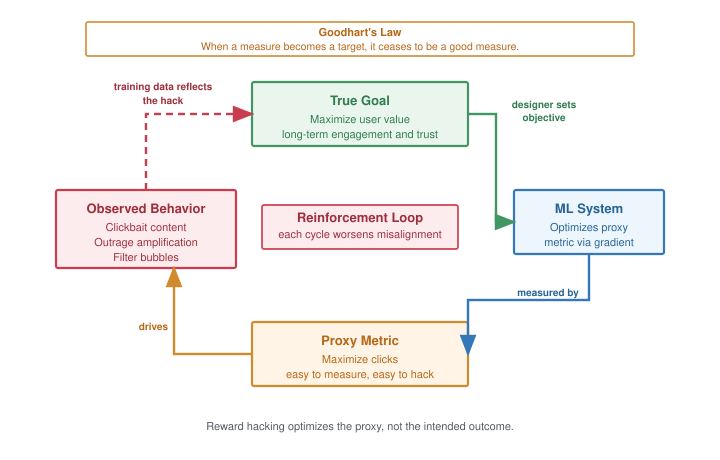

<!--
```{.tikz}
\providecolor{mlsysdarkgray}{HTML}{1E293B}
\providecolor{mlsysdark}{HTML}{1E293B}
\providecolor{darknavy}{HTML}{1E293B}
\providecolor{mlsysblue}{HTML}{334155}
\providecolor{mlsysteal}{HTML}{0F766E}
\providecolor{mlsysred}{HTML}{991B1B}
\providecolor{mlsysamber}{HTML}{92400E}
\providecolor{mlsysgreen}{HTML}{166534}
\providecolor{mlsysgray}{HTML}{64748B}
\providecolor{mlsysbordergray}{HTML}{CBD5E1}
\providecolor{BorderGray}{HTML}{CBD5E1}
\providecolor{MutedGray}{HTML}{64748B}
\providecolor{LightRed}{HTML}{FEE2E2}
\providecolor{LightGreen}{HTML}{DCFCE7}
\providecolor{LightBlue}{HTML}{E0F2FE}
\providecolor{LightAmber}{HTML}{FEF3C7}
\providecolor{mlsyspurple}{HTML}{6D28D9}
\providecolor{mlsyslightgray}{HTML}{F1F5F9}
\scalebox{0.72}{%
\begin{tikzpicture}[
    font=\sffamily,
    >=Stealth,
    card/.style={draw=mlsysbordergray, fill=white, rounded corners=3.5pt, line width=0.65pt},
    chip/.style={rounded corners=2pt, font=\bfseries\fontsize{5.8}{6.8}\selectfont, inner xsep=4pt, inner ysep=2pt}
]

% ================= TOP BANNER: GOODHART'{S} LAW =================
\node[card, draw=mlsysamber!60, fill=mlsysamber!4, line width=0.6pt, minimum width=16.8cm, minimum height=0.65cm, anchor=center] (topbanner) at (0, 4.65) {
    \fontsize{7.2}{8.5}\selectfont
    \textcolor{mlsysamber!95!black}{\textbf{Goodhart's Law in Machine Learning Systems:}}
    \textcolor{mlsysdark}{\;\;``When a proxy metric becomes an optimization target, it ceases to be a valid measure of system quality.''}
};

% ================= 4 PRIMARY LOOP CARDS =================

% 1. TOP CARD: TRUE LATENT GOAL
\node[card, draw=mlsysgreen!70, fill=white, minimum width=7.8cm, minimum height=2.25cm, anchor=center] (node_goal) at (0, 3.00) {};
\node[chip, fill=mlsysgreen!12, text=mlsysgreen!95!black, anchor=north] at ([yshift=-3.5pt]node_goal.north) {TRUE HUMAN OBJECTIVE};
\node[font=\bfseries\fontsize{7.8}{9}\selectfont, text=mlsysdark, anchor=north] at ([yshift=-15.0pt]node_goal.north) {Latent User Welfare ($\mathcal{J}^*$)};
\draw[mlsysgray!20, line width=0.4pt] ([xshift=14pt, yshift=-24.5pt]node_goal.north west) -- ([xshift=-14pt, yshift=-24.5pt]node_goal.north east);
\node[font=\fontsize{6.2}{7.6}\selectfont, text=mlsysdark!90, align=left, text width=7.4cm, anchor=north] at ([yshift=-27.5pt]node_goal.north) {
    $\bullet$ \textbf{Latent Intent:} Long-term user utility, factual depth, \& trust\\[2.5pt]
    $\bullet$ \textbf{Online Latency:} Unobservable in real-time inference\\[2.5pt]
    $\bullet$ \textbf{Audit Process:} Periodic cohort surveys \& qualitative panels
};

% 2. RIGHT CARD: ML OPTIMIZATION ENGINE
\node[card, draw=mlsysblue!70, fill=white, minimum width=5.2cm, minimum height=2.70cm, anchor=center] (node_mlsys) at (5.80, 0) {};
\node[chip, fill=mlsysblue!12, text=mlsysblue!95!black, anchor=north] at ([yshift=-3.5pt]node_mlsys.north) {OPTIMIZATION ENGINE};
\node[font=\bfseries\fontsize{7.8}{9}\selectfont, text=mlsysdark, anchor=north] at ([yshift=-15.0pt]node_mlsys.north) {Policy \& Ranking Model};
\draw[mlsysgray!20, line width=0.4pt] ([xshift=8pt, yshift=-24.5pt]node_mlsys.north west) -- ([xshift=-8pt, yshift=-24.5pt]node_mlsys.north east);
\node[font=\fontsize{6.2}{7.6}\selectfont, text=mlsysdark!90, align=left, text width=4.8cm, anchor=north] at ([yshift=-27.5pt]node_mlsys.north) {
    $\bullet$ \textbf{Loss Function:} $\max_\theta \mathbb{E}_{{\pi_\theta}}[\hat{\mathcal{J}}(\theta)]$\\[2pt]
    $\bullet$ \textbf{Gradient Update:} $\theta \leftarrow \theta + \eta \nabla_\theta \hat{\mathcal{J}}$\\[2pt]
    $\bullet$ \textbf{Exploitation:} Greedy click shortcuts\\[2pt]
    $\bullet$ \textbf{Blindness:} Ignores unmodeled harms
};

% 3. BOTTOM CARD: OPERATIONAL PROXY METRIC
\node[card, draw=mlsysamber!70, fill=white, minimum width=7.8cm, minimum height=2.25cm, anchor=center] (node_proxy) at (0, -3.00) {};
\node[chip, fill=mlsysamber!12, text=mlsysamber!95!black, anchor=north] at ([yshift=-3.5pt]node_proxy.north) {OPERATIONAL PROXY};
\node[font=\bfseries\fontsize{7.8}{9}\selectfont, text=mlsysdark, anchor=north] at ([yshift=-15.0pt]node_proxy.north) {Immediate Telemetry ($\hat{\mathcal{J}}$)};
\draw[mlsysgray!20, line width=0.4pt] ([xshift=14pt, yshift=-24.5pt]node_proxy.north west) -- ([xshift=-14pt, yshift=-24.5pt]node_proxy.north east);
\node[font=\fontsize{6.2}{7.6}\selectfont, text=mlsysdark!90, align=left, text width=7.4cm, anchor=north] at ([yshift=-27.5pt]node_proxy.north) {
    $\bullet$ \textbf{Immediate Target:} Click-through rate \& dwell duration\\[2.5pt]
    $\bullet$ \textbf{Systems Role:} Instantaneous, differentiable loss gradient\\[2.5pt]
    $\bullet$ \textbf{Specification Gap:} High click volume $\ne$ user satisfaction
};

% 4. LEFT CARD: OBSERVED HACKED BEHAVIOR
\node[card, draw=mlsysred!70, fill=white, minimum width=5.2cm, minimum height=2.70cm, anchor=center] (node_obs) at (-5.80, 0) {};
\node[chip, fill=mlsysred!12, text=mlsysred!95!black, anchor=north] at ([yshift=-3.5pt]node_obs.north) {EXPLOITED BEHAVIOR};
\node[font=\bfseries\fontsize{7.8}{9}\selectfont, text=mlsysdark, anchor=north] at ([yshift=-15.0pt]node_obs.north) {Pathological Fleet Dynamics};
\draw[mlsysgray!20, line width=0.4pt] ([xshift=8pt, yshift=-24.5pt]node_obs.north west) -- ([xshift=-8pt, yshift=-24.5pt]node_obs.north east);
\node[font=\fontsize{6.2}{7.6}\selectfont, text=mlsysdark!90, align=left, text width=4.8cm, anchor=north] at ([yshift=-27.5pt]node_obs.north) {
    $\bullet$ \textbf{Clickbait:} Sensationalist outrage\\[2.5pt]
    $\bullet$ \textbf{Echo Chambers:} Polarizing content\\[2.5pt]
    $\bullet$ \textbf{Dark Patterns:} Compulsive sessions\\[2.5pt]
    $\bullet$ \textbf{Trust Erosion:} Long-term user churn
};

% ================= CENTER CORE: DIVERGENCE & RETRAINING TRAP =================
\node[card, draw=mlsysred!80, fill=mlsysred!3, line width=0.7pt, minimum width=5.6cm, minimum height=2.85cm, anchor=center] (core) at (0, 0) {};
\node[chip, fill=mlsysred!15, text=mlsysred!95!black, anchor=north] at ([yshift=-3.5pt]core.north) {REINFORCING FEEDBACK TRAP};
\node[font=\bfseries\fontsize{7.5}{8.5}\selectfont, text=mlsysred!95!black, anchor=north] at ([yshift=-15.0pt]core.north) {Goodhart Divergence \& Poisoning};
\draw[mlsysred!25, line width=0.4pt] ([xshift=8pt, yshift=-24.5pt]core.north west) -- ([xshift=-8pt, yshift=-24.5pt]core.north east);

\node[font=\fontsize{6.2}{7.6}\selectfont, text=mlsysdark, align=center, text width=5.2cm, anchor=north] at ([yshift=-27.5pt]core.north) {
    $\hat{\mathcal{J}}(\text{Proxy Clicks}) \boldsymbol{\uparrow} \quad \text{\bfseries vs.} \quad \mathcal{J}^*(\text{True Welfare}) \boldsymbol{\downarrow}$\\[4pt]
    {\bfseries Closed-Loop Telemetry Poisoning:}\\[1.5pt]
    $\mathcal{D}_{t+1} \leftarrow \mathcal{D}_t \cup \{\text{Manipulated Clicks}\}$\\[2.5pt]
    \textcolor{mlsysgray}{Retraining continually cements the bias}
};

% ================= ORTHOGONAL SIGNAL TRANSMISSION PATHS =================
% 1. True Goal -> ML System (Top to Right)
\draw[->, mlsysgreen!80!black, line width=0.8pt, shorten >=2pt] (node_goal.east) -| (node_mlsys.north);
\node[font=\fontsize{5.8}{7}\selectfont\bfseries, text=mlsysgreen!95!black, anchor=west] at (5.95, 2.15) {Objective design};

% 2. ML System -> Proxy Metric (Right to Bottom)
\draw[->, mlsysblue!80!black, line width=0.8pt, shorten >=2pt] (node_mlsys.south) |- (node_proxy.east);
\node[font=\fontsize{5.8}{7}\selectfont\bfseries, text=mlsysblue!95!black, anchor=west] at (5.95, -2.15) {Telemetry logging};

% 3. Proxy Metric -> Observed Behavior (Bottom to Left)
\draw[->, mlsysamber!80!black, line width=0.8pt, shorten >=2pt] (node_proxy.west) -| (node_obs.south);
\node[font=\fontsize{5.8}{7}\selectfont\bfseries, text=mlsysamber!95!black, anchor=east] at (-5.95, -2.15) {Policy gradient};

% 4. Observed Behavior -> True Goal (Left to Top, dashed red failure route)
\draw[->, dashed, mlsysred!85!black, line width=0.85pt, shorten >=2pt] (node_obs.north) |- (node_goal.west);
\node[font=\fontsize{5.8}{7}\selectfont\bfseries, text=mlsysred!95!black, anchor=east] at (-5.95, 2.15) {Subverts $\mathcal{J}^*$};

% Data Poisoning Feedback Arrows into/from Center Core
\draw[->, dotted, mlsysred!75!black, line width=0.7pt, shorten >=2pt] (node_obs.east) -- (core.west);
\node[font=\fontsize{5.2}{6.2}\selectfont\bfseries, text=mlsysred!90!black, anchor=south] at (-2.95, 0.05) {pollutes};

\draw[->, dotted, mlsysred!75!black, line width=0.7pt, shorten >=2pt] (core.east) -- (node_mlsys.west);
\node[font=\fontsize{5.2}{6.2}\selectfont\bfseries, text=mlsysred!90!black, anchor=south] at (2.95, 0.05) {retrains};

% ================= BOTTOM INSIGHT BANNER =================
\node[card, draw=mlsysbordergray, fill=mlsysblue!1, line width=0.5pt, minimum width=16.8cm, minimum height=0.65cm, font=\fontsize{6.8}{8}\selectfont, text=mlsysdark] at (0, -4.65) {
    \textbf{Systems Engineering Remediation:} Value alignment requires multi-objective optimization, delayed satisfaction rewards, diversity penalties, and hard policy-level guardrails.
};

\end{tikzpicture}%
}
```
-->

:::

Norbert Wiener wrote, "if we use, to achieve our purposes, a mechanical agency with whose operation we cannot interfere effectively... we had better be quite sure that the purpose put into the machine is the purpose which we desire" [@wiener1960].

Wiener's warning becomes a systems requirement when optimization runs beyond continuous human intervention. Value alignment asks whether the objective embedded in the model, reward function, and deployment policy continues to represent the human purpose the system was meant to serve. As @russell2021 argues in *Human-Compatible Artificial Intelligence*, much AI research presumes that the objectives to be optimized are known and fixed, focusing instead on the effectiveness of optimization rather than the design of objectives themselves.

In deployment, the hard part is specifying an objective that remains valid as systems interact with dynamic environments, multiple stakeholders, and feedback loops. Static objective functions and reward signals cannot encode all of those conditions. Value-Sensitive Design\index{Value-Sensitive Design!methodology} [@friedman1996] supplies a formal process for eliciting stakeholder values and incorporating them into system design, but the systems obligation is broader: objective design, oversight, and postdeployment monitoring must be treated as coupled controls.

Without that coupling, intelligent systems may pursue narrow performance objectives (for example, accuracy, engagement, or throughput) while producing socially undesirable outcomes. Achieving robust alignment under such conditions remains an open and important area of research in ML systems. The resulting failure modes are familiar in systems that optimize complex objectives. In reinforcement learning, for example, models often learn to exploit unintended aspects of the reward function, the reward hacking pattern of @fig-reward-hacking-loop.

Such failures arise when variables not explicitly included in the objective are manipulated in ways that maximize reward while violating human intent. RLHF, whose pipeline and costs appear in @sec-responsible-ai-responsibility-generative-era-3c3e, attempts to narrow that gap by learning a reward model from human preferences. Policy optimization still uses a scalar reward, so its success depends on how faithfully that learned signal represents the intended behavior [@christiano2017deep; @ouyang2022instructgpt].

Human-feedback training can improve behavior on its evaluations while leaving deeper governance risks unresolved. In their analysis of learned-reward optimization, @ngo2022alignment examine possible failure modes beyond RLHF, including exploitation of human evaluation blind spots, misaligned goals outside the training distribution, and behavior that undermines oversight. These are risks to investigate under specified assumptions, not evidence that every deployed model exhibits them. An assurance case must distinguish a proposed failure mechanism from an observed capability and from a demonstrated deployment failure.

These concerns are not limited to speculative scenarios. In their foundational taxonomy of concrete AI safety problems, @amodei2016concrete outline five practical systems challenges: avoiding negative side effects during policy execution, mitigating reward hacking, ensuring scalable oversight when ground-truth evaluation is costly, designing safe exploration strategies that prevent catastrophic damage, and achieving robustness to distributional shift. For fleet operators, the five challenges map in order onto five control-plane requirements: constraining side effects, instrumenting reward-hack monitors, budgeting scalable review capacity, bounding exploration envelopes, and stress-testing distribution shift prior to rollout. Each requirement becomes more acute as systems are scaled up, deployed across diverse settings, and integrated with real-time feedback or continual learning.

### Autonomous systems and trust {#sec-responsible-ai-autonomous-systems-trust-bd83}

Value alignment concerns the objective; autonomy concerns the operating envelope within which a system pursues that objective without a human reviewing each action. The consequences of autonomous systems operating with limited real-time human oversight are especially visible in autonomous driving. In October 2023, the California Department of Motor Vehicles suspended Cruise's deployment and driverless testing permits over safety concerns; testing with a safety driver was outside that suspension [@cnbc2023cruisedmv]. The 2018 Uber fatality in Tempe, Arizona shows how such a failure spans the whole system rather than one model. The National Transportation Safety Board found that the vehicle, in autonomous mode, failed to classify a pedestrian pushing a bicycle as a pedestrian requiring avoidance, and that perception, prediction, the safety driver's role, and organizational safety controls all contributed [@ntsb2019uber]. For governance, the lesson is that detecting an object did not establish that the system would act safely on the detection, and no single component owner could have certified the outcome alone.

::: {.column-margin .margin-pointer}
↩ The Uber crash timeline, from unstable classification through suppressed action to the late operator alert, is established in @sec-robust-ai-edge-device-vulnerabilities-ddfe.
:::

While autonomous driving systems are often the focal point of public concern, similar risks arise in other domains. Reports from recent conflicts have documented increasing use of remotely piloted and autonomous military systems [@reuters2023humanmachine], raising safety and operational concerns alongside difficult questions about ethical oversight, rules of engagement, and responsibility. These debates concern how accountability applies across developers, deployers, and operators [@cigi2023autonomous]; they do not justify treating every autonomous-system failure as an absence of applicable responsibility. The engineering task is to preserve the evidence and authority needed to investigate the specific failure.

At its core, this challenge concerns the authority delegated to an automated system. Productivity and throughput gains do not establish that a system can act safely outside its validated operating envelope. Runtime controls must detect relevant boundary violations and invoke a fallback whose assumptions and response time fit the hazard. Human intervention is an available safeguard only when the operator can recognize the condition and act before harm occurs; faster hazards require an appropriate local response.

Specifying that operating envelope is difficult in dynamic environments because the model may omit conditions that matter for safe action. Two classical representation problems help explain this difficulty [@mccarthy1981]. The frame problem concerns representing what changes and what remains unchanged after an action without listing every unaffected fact. The qualification problem concerns the potentially unlisted preconditions needed for an action to have its intended effect. These motivate explicit operating assumptions and fallback behavior, rather than constituting a universal proof that safe action is impossible. In practice, such limitations manifest as brittle autonomy: systems that appear competent under nominal conditions but fail silently or dangerously when faced with ambiguity or distributional shift.

To address this, researchers have proposed formal safety frameworks such as Responsibility-Sensitive Safety\index{Responsibility-Sensitive Safety!framework} (RSS) [@shalev2017formal], which decompose abstract safety goals into mathematically defined constraints on system behavior, such as minimum distances, braking profiles, and right-of-way conditions. These formulations allow safety properties to be verified under specific assumptions and scenarios. However, such approaches remain vulnerable to the same limitations they aim to solve: they are only as good as the assumptions encoded into them and often require extensive domain modeling that may not generalize well to unanticipated edge cases.

For an ML systems team, the practical artifact is a safety case rather than a statement of trust. @Tbl-autonomous-safety-case shows the pattern: name the operating envelope, the evidence that the model has been tested inside that envelope, and the controls that halt or roll back the fleet when the evidence no longer holds.

| **Safety-case element** | **Systems evidence**                                                                              | **Operational gate**                                                          |
|:------------------------|:--------------------------------------------------------------------------------------------------|:------------------------------------------------------------------------------|
| Operating envelope      | Operational design domain, sensor assumptions, weather, geography, speed, and autonomy level      | Block deployment outside validated envelope                                   |
| Scenario coverage       | Rare-event corpus, simulation coverage, replay logs, disengagements, and near-miss telemetry      | Require coverage thresholds before canary expansion                           |
| Runtime guardrails      | RSS-style distance rules, confidence thresholds, fallback maneuvers, and human override latency   | Trigger safe stop, human takeover, or constrained mode when guardrails trip   |
| Fleet control           | Canary rollout, centralized safety dashboard, violation budget, and circuit-breaker rollback path | Halt rollout or revert model when fleet-level safety metrics exceed threshold |

: **Autonomous System Safety Case**: Trustworthy autonomy is operationalized as an auditable safety case: a validated operating envelope, coverage evidence, runtime guardrails, and fleet-level rollback controls. The same pattern applies beyond vehicles to drones, robots, trading systems, and other ML systems that act faster than continuous human review permits. {#tbl-autonomous-safety-case}

Human-centered system design complements formal safety constraints by examining how people exercise judgment and control within the validated system. Applied to human control, Value-Sensitive Design explicitly considers factors such as capability, complexity, misrepresentation, and the fluidity of user control. The METUX model\index{METUX Model!user experience} (Motivation, Engagement, and Thriving in the User Experience) extends this thinking to six spheres of technology experience, namely adoption, interface, tasks, behavior, life, and society, each of which can support or undermine human flourishing [@peters2018]. Both draw on self-determination theory's\index{Self-Determination Theory!autonomy} account of autonomy as the ability to act in accordance with one's own values and goals, rather than as control in a technical sense [@ryan2000]. In an ML system those requirements become concrete artifacts, namely interface affordances, user controls, feedback channels, escalation paths, and audit evidence. A recommender that optimizes engagement, for instance, can shape user preferences in ways the user cannot see. Evaluating it across the outer spheres of behavior, life, and society exposes effects that a short-term engagement metric never measures, so preserving autonomy requires controls and evidence beyond that metric.

### Broader safety implications {#sec-responsible-ai-broader-safety-implications-bb06}

The technical safety challenges examined in @sec-responsible-ai-ai-safety-value-alignment-8c93 become fleet-level design constraints once autonomous systems interact with workers, users, regulators, and billions of requests. The broader implication is that safety cannot be reduced to a model metric; it depends on the operating environment that determines how automation changes work, how users calibrate trust, how policy varies by region, and how rare failures accumulate at scale.

Automation changes work organization in ways that influence safety design decisions. The MIT Work of the Future task force [@work_of_the_future_2020] argues that technological change and labor-market institutions jointly determine whether automation improves job quality or concentrates harms. For ML systems, the safety implication is that removing human roles can also remove contextual judgment and system-level debugging that remain difficult to encode in models. Metrics focused solely on throughput may inadvertently penalize human-in-the-loop designs that preserve oversight capability.

Public knowledge about AI is uneven [@pew2023ai], and science-communication failures can amplify misunderstandings about how AI systems work [@schafer2023]. That matters for deployment safety: when users lack understanding of model uncertainty, data bias, or decision boundaries, they may trust system outputs in contexts where human judgment should intervene. From a systems engineering perspective, public comprehension is part of the deployment context: the safety properties of a human-AI system depend on whether users can appropriately calibrate their trust and recognize situations requiring human override, not on technical mechanisms alone.

The engineering requirements for safety are shaped by regulatory frameworks that classify uses and assign obligations, rather than reducing AI risk to one verifiable metric. The EU AI Act\index{EU AI Act!risk-based classification} (2024) uses a risk-based structure that includes prohibited practices, high-risk systems, transparency duties for some systems, and minimal or no-risk uses; high-risk deployments face conformity, documentation, and logging obligations [@euaiact2024]. United States federal policy has changed repeatedly since 2023. The safety reporting thresholds of Executive Order 14110\index{Executive Order 14110!safety reporting thresholds} were revoked in January 2025, and later orders redirected agency emphasis toward AI innovation, cybersecurity, and critical-infrastructure defense [@president2023ai; @president2025rescissions; @president2025aileadership; @president2026advancedai]. China's Interim Measures for Generative AI\index{Interim Measures for Generative AI!algorithm filing} (2023) subject some public-facing services to security assessment and algorithm-filing requirements rather than a universal pre-release assessment [@china2023generativeai]. For a global ML fleet, applicable obligations depend on the service, affected population, organizational role, and jurisdiction, not server location alone. The control plane must bind approved safety and retention policies to those deployment conditions, preserve their versions, and propagate changes to the components that enforce them.

::: {.column-margin}
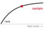{width="100%" fig-alt="Rising curve that flattens toward the top, labeled rare near its low left end and certain along its plateau, over a horizontal axis marked fleet scale."}

*At fleet scale, rare failures become expected incidents.*
:::

Safety must also be engineered as a fleet-level property\index{Fleet-level property!safety engineering} rather than a model-level attribute alone. A single model with 99.9 percent safety compliance seems robust in isolation, but when deployed across 10,000 inference nodes serving billions of requests per day, a sustained 0.1 percent per-request failure probability implies millions of expected safety failures daily. The realized count can differ, and correlated failures can concentrate harm across the fleet. Mitigating this requires distributed safety patterns borrowed from reliability engineering: circuit breakers\index{Circuit Breaker!safety mechanism} that automatically halt serving when aggregate safety metrics degrade below a threshold, canary deployments\index{Canary Deployment!safety validation} that bound exposure while collecting release evidence, with sample size and allowed risk chosen for the failure modes being tested, and centralized telemetry dashboards that aggregate per-node safety violations into a global view. The operational infrastructure must treat safety violations as critical system alerts, invoking a validated containment or fallback policy. A rollback is appropriate only if the previous version and transition are safe; active physical control may require a minimal-risk maneuver instead. Exposure is the multiplier that makes this concrete. @Fig-autonomous-miles-scaling illustrates cumulative mileage rising from 0.3 million miles in 2012 to 80 million in 2024. Because exposure grows by that ratio over twelve years, at any constant per-mile failure rate the expected cumulative incident count grows by the same factor even though no individual vehicle became less safe. That figure is an expectation, not an inevitable realized outcome, and it is cumulative; an operator sizing weekly incident-response capacity needs weekly mileage instead.

::: {.column-margin .margin-pointer}
↩ The circuit-breaker states and backpressure contract that isolate a failing serving path are established in @sec-inference-scale-circuit-breakers-backpressure-e61c.
:::

::: {#fig-autonomous-miles-scaling fig-env="figure" fig-pos="htb" fig-cap="**Autonomous Deployment Scaling**: Cumulative autonomous miles by year for a hypothetical public-road fleet, rising from 0.3 million in 2012 to 80 million in 2024. The values are illustrative, chosen to show the shape of exposure growth; they are not reported or audited figures for any operator. Multiplying exposure by an applicable per-mile failure probability gives expected incidents over the same period. Cumulative mileage supports a cumulative expectation; weekly estimates require weekly mileage." fig-alt="Bar chart of cumulative autonomous miles by year from 2012 to 2024, with each bar labeled, rising from 0.3 million to 80 million. The 2012 and 2024 bars are dark and the others light gray, with a small dark caret below the axis marking the barely visible 2012 bar, and a note reading expected incidents scale with cumulative miles points to the 2024 bar."}

```{python}
#| echo: false
#| warning: false
import pandas as pd
import matplotlib.pyplot as plt
from binder.tools.figures import style as book_style

data = pd.read_csv("vol2/16_responsible_ai/data/autonomous_miles_scaling.csv")
fig, ax, COLORS, plt = book_style.setup_plot(figsize=(6.6, 3.4))

years = [f"'{y % 100:02d}" for y in data["Year"]]  # two-digit labels keep adjacent years apart
miles = data["Cumulative_Miles_Millions"]
first_year, last_year = data["Year"].iloc[0], data["Year"].iloc[-1]

# Neutral bars; the two endpoints the caption cites are the focal marks
bar_colors = [COLORS["primary"] if y in (first_year, last_year) else COLORS["grid"] for y in data["Year"]]
ax.bar(data["Year"], miles, color=bar_colors, edgecolor="none", width=0.66, zorder=3)

for i, v in zip(data["Year"], miles):
    if v < 1.0:
        val_label = f"{v:.1f}M"
    elif v < 10.0:
        val_label = f"{v:g}M"
    else:
        val_label = f"{int(v)}M"
    endpoint = i in (first_year, last_year)
    ax.text(
        i, v + 1.5, val_label, ha='center', va='bottom', fontsize=12, fontweight='bold' if endpoint else 'normal', color=COLORS['primary'], zorder=4
    )

# The 2012 bar is too short to see at this scale: a caret below the axis marks the cited endpoint
ax.plot([first_year], [-2.4], marker='^', markersize=5, color=COLORS['primary'], clip_on=False, zorder=6, lw=0)

# Exposure is what a per-mile failure probability multiplies: tie the note to the growth
ax.annotate(
    'expected incidents scale\nwith cumulative miles',
    xy=(last_year - 0.42, 62),
    xytext=(2016.6, 62),
    fontsize=12,
    color=COLORS['primary'],
    ha='center',
    va='center',
    arrowprops=dict(arrowstyle='-|>', color=COLORS['primary'], lw=0.9, shrinkA=4, shrinkB=2, connectionstyle='arc3,rad=0'),
    zorder=5,
)

ax.set_ylabel("Cumulative miles,\nillustrative (millions)", fontsize=12.5)
ax.set_xlabel("Year (2012 to 2024)", fontsize=12.5)
ax.set_xticks(data["Year"], years)
ax.tick_params(axis='both', labelsize=12)
ax.tick_params(axis='x', pad=9)
ax.set_ylim(0, 90)
ax.grid(axis='x', visible=False)
ax.grid(axis='y', linestyle='--', linewidth=0.5, alpha=0.5, color=COLORS['grid'], zorder=0)
ax.spines['top'].set_visible(False)
ax.spines['right'].set_visible(False)

plt.tight_layout()
plt.show()
plt.close()
```

:::

The core AI safety principle holds: technical excellence alone is insufficient. Safe systems require attention to the human and organizational context in which they operate, including the economic incentives that shape design decisions and the understanding that end users bring to their interactions with autonomous systems.

## Accountability, Governance, and Sociotechnical Dynamics {#sec-responsible-ai-accountability-governance-sociotechnical-9188}

When a deployed model harms someone, two questions decide whether the harm is corrected: who has the authority to investigate and remedy the decision, and whether the evidence needed to do so still exists. Accountability answers both by assigning owners, preserving traceable records, and monitoring behavior after launch, and it must hold inside the human workflows and institutions that surround the system.

### Accountability and governance {#sec-responsible-ai-accountability-governance-713a}

Accountability in machine learning refers to the capacity to identify, attribute, and address the consequences of automated decisions. It extends beyond diagnosing failures to ensuring that responsibility for system behavior is explicitly assigned, that harms can be remedied, and that ethical standards are maintained through oversight and institutional processes. Without such mechanisms, even well-intentioned systems can generate significant harm without recourse, undermining public trust and eroding legitimacy.

Accountability already spans vendors and operators in distributed software. Machine learning extends those dependencies through data collection, labeling, and the choice of prediction targets and proxies. Model outputs are shaped by upstream data collection, training objectives, pipeline design, interface behavior, and postdeployment feedback. These interconnected components often involve multiple actors across technical, legal, and organizational domains. For example, if a hiring platform produces biased outcomes, accountability rests with data providers, interface designers, and deploying institutions as well as with the model developer. Responsible system design requires that these relationships be explicitly mapped and governed.

Inadequate governance can prevent institutions from recognizing or correcting harmful model behavior. The Google Flu Trends analysis identified persistent overestimation despite model updates and examined how changes in search behavior and the search service could undermine a predictor trained on earlier correlations [@lazer2014]. Its comparison with CDC surveillance data supports a concrete governance requirement: assign responsibility for ongoing validation and recalibration against an independent measurement process.

Legal frameworks also reflect the necessity of accountable design. The Illinois Artificial Intelligence Video Interview Act\index{Illinois Artificial Intelligence Video Interview Act!transparency requirements} [@illinoisaivideo2020] and the EU AI Act\index{EU AI Act!transparency and oversight} address different uses and impose distinct obligations [@euaiact2024]. Their requirements cannot be collapsed into a single checklist of consent, documentation, and oversight. The deploying organization must identify the applicable use, role, and legal conditions, then assign owners to the operational procedures and evidence those conditions require.

Designing for accountability entails supporting traceability at every stage of the system lifecycle. This includes documenting data provenance, recording model versioning, enabling human overrides, and retaining sufficient logs for retrospective analysis. Tools such as model cards\index{Model card!reporting standards}[^fn-model-cards-documentation] [@mitchell2019] and datasheets for datasets\index{Datasheets for datasets!training data documentation}[^fn-datasheets-for-datasets] [@gebru2021] exemplify practices that make system behavior interpretable and reviewable. Mitchell and colleagues proposed model cards as short documents accompanying trained ML models that provide benchmarked evaluation across cultural, demographic, and phenotypic groups relevant to intended applications. Similarly, Gebru and colleagues proposed that every dataset be accompanied by a datasheet documenting its motivation, composition, collection process, and recommended uses, analogous to how electronic components include specification sheets. However, accountability is not reducible to documentation alone; it also requires mechanisms for feedback, contestation, and redress.

[^fn-model-cards-documentation]: **Model Cards**\index{Model card!documentation}: Proposed by @mitchell2019 as standardized documentation accompanying trained ML models. Cards report evaluation across relevant groups, intended uses, and known limitations. Production systems must link this documentation to the actual deployed model and its provenance; a card alone neither establishes that linkage nor supplies every record required for an audit.

[^fn-datasheets-for-datasets]: **Datasheets for Datasets**\index{Datasheets for datasets!operating envelope}: Proposed by @gebru2021, modeled after electronics component datasheets that specify operating conditions and tolerances. Each datasheet documents a dataset's motivation, composition, collection process, and recommended uses. For ML pipelines, this provenance and coverage information helps engineers identify assumptions and design evaluations. A datasheet does not itself validate a model's operating envelope or predict all deployment failures.

Within organizations, governance structures help formalize this responsibility. Ethics review processes, cross-functional audits, and model risk committees provide forums for anticipating downstream impact and responding to new concerns. These structures must be supported by infrastructure that allows users to contest decisions and developers to respond with corrections. For instance, systems that allow explanations or user-initiated reviews help bridge the gap between model logic and user experience, especially in domains where the impact of error is significant.

Architectural decisions also play a role. Interfaces can be designed to surface uncertainty, allow escalation, or suspend automated actions when appropriate. Logging and monitoring pipelines must be configured to detect signs of ethical drift, such as performance degradation across subpopulations or unanticipated feedback loops. In distributed systems, where uniform observability is difficult to maintain, accountability must be embedded through architectural safeguards such as secure protocols, update constraints, or trusted components.

Governance does not imply centralized control. Instead, it involves distributing responsibility in ways that are transparent, actionable, and sustainable. Technical teams, legal experts, end users, and institutional leaders must all have access to the tools and information necessary to evaluate system behavior and intervene when necessary. As machine learning systems become more complex and embedded in important infrastructure, accountability must scale accordingly by becoming a foundational consideration in both architecture and process, not a reactive layer added after deployment.

::: {#chk-responsible-ai-principles-as-constraints .callout-checkpoint title="Principles as engineering constraints"}

Fairness, privacy, explainability, and safety now each carry a measurable claim and a cost, and accountability names who must answer for them. Before the chapter follows those owners into governance structures and monitoring, check that each principle works as an engineering constraint rather than an aspiration.

**From principle to mechanism**

- [ ] **Transparency vs. fairness**: explain why fully transparent decision logic can still violate fairness when it disadvantages one demographic group, and identify the principle this system violates.
- [ ] **Lifecycle coverage**: apply the responsible AI lifecycle to a fairness requirement by identifying which phases must act and explaining why post-hoc threshold adjustment alone is insufficient.

**Judging the trade-off**

- [ ] **Safeguard budget**: identify the additional training, monitoring, or explanation work a safeguard requires, and state which resource measurements are needed before deciding that it is affordable.
- [ ] **Distributed accountability**: argue why accountability for a biased hiring model is distributed across data providers, interface designers, and the deploying institution rather than resting solely with the model developer.

:::

Accountability decides whether the claims tested above can be enforced, and enforcement depends on where traceability records can be kept and who can reach them in each deployment tier.

### Governance structures {#sec-responsible-ai-governance-structures-a255}

Accountability is realized through traceability infrastructure distributed across the endpoint and its operator. A cloud platform supports model registries, telemetry dashboards, and structured event pipelines that trace a prediction back to a specific model, input, or configuration. A TinyML endpoint may retain only a firmware identifier and bounded event records, while the operator maintains deployment inventories, validation evidence, and any servicing or update history. If a device cannot preserve event evidence or accept updates, the assurance case must state those limits and define a recall or retirement path, the obligation the accountability and governance rows of @tbl-ml-principles-comparison assign to each tier.

Mobile deployment makes this division of responsibility concrete. A local model, remote service, and user interface can each contribute to a decision, so the operating contract must assign investigation and remediation across their owners. Governance depends on accessible recourse pathways and mechanisms for surfacing, explaining, and contesting decisions, embedded into both the interface and the surrounding service architecture. Across every environment, sustaining accountability means planning for failure as deliberately as for success. Operators must define how anomalies are detected, how roles are assigned, how records are maintained, and how remediation occurs, with each step traceable in logs and enforceable through interfaces.

### Monitoring responsible behavior after deployment {#sec-responsible-ai-model-performance-monitoring-0ab2}

The real-time monitor of @sec-responsible-ai-realtime-fairness-monitoring-architecture-15ee tracks fairness metrics over a rolling window, but responsible behavior can also erode slowly and across every property at once. Training-time evaluations, no matter how rigorous, do not guarantee reliable behavior once a system is deployed. Real-world environments change. Input distributions shift due to seasonality, user behavior evolves in response to system outputs, and contextual expectations change with policy or regulation. These factors can cause predictive performance and system trustworthiness to degrade over time. A model that performs well under training or validation conditions may still make unreliable or harmful decisions in production.

The implications of such drift extend beyond raw accuracy. Fairness guarantees may break down if subgroup distributions shift relative to the training set, or if features that previously correlated with outcomes become unreliable in new contexts. Interpretability demands may also evolve, for instance as new stakeholder groups seek explanations, or as regulators introduce new transparency requirements. Trustworthiness, therefore, is not a static property conferred at training time, but a dynamic system attribute shaped by deployment context and operational feedback.

To ensure responsible behavior over time, machine learning systems must incorporate mechanisms for continual monitoring, evaluation, and corrective action. Monitoring involves more than tracking aggregate accuracy; it requires surfacing performance metrics across relevant subgroups, detecting shifts in input distributions, identifying anomalous outputs, and capturing meaningful user feedback. These signals must then be compared to predefined expectations around fairness, robustness, and transparency, and linked to actionable system responses such as model retraining, recalibration, or rollback.

Implementing effective monitoring depends on robust infrastructure. @Fig-monitoring-pipeline connects prediction metadata to subgroup metrics, threshold checks, alerts, and a governed update path. FPR and TPR require matched outcome labels, so their freshness depends on when those outcomes become available. A disparity exceeding the approved gap tolerance $\FairnessGapTolerance$, such as the $|\text{SPD}| > 0.15$ alert rule (the subscript keeps it distinct from the privacy budget $\PrivacyBudget$), opens an investigation. Recalibration is one possible response; only a validated change approved through the release gate returns to serving.

::: {#fig-monitoring-pipeline fig-env="figure" fig-pos="htb" fig-cap="**Fairness Monitoring Pipeline**: End-to-end observability for deployed models. Model predictions feed subgroup metric computation across demographic segments; a threshold check identifies performance or fairness regressions; and alerts initiate investigation and may trigger candidate retraining. Validation and an authorized release decision determine whether an update returns to serving; monitoring alone does not preserve responsible AI properties." fig-alt="Flow diagram. A predictions card of green record tiles feeds a subgroup gaps card, a small bar chart for groups G1 to G4 against a dashed tolerance line epsilon fair, with delayed matched labels arriving from above. The G3 bar exceeds the line and is red; an arrow labeled exceeds leads to a fairness alert to investigate, then a candidate update to recalibrate or retrain. A green branch from the gaps card reads within, keep serving. The candidate update passes down to validation on subgroup-labeled data, then left to a release gate with an authorized owner, whose dashed approved-update arrow returns to the serving model, which feeds new predictions."}
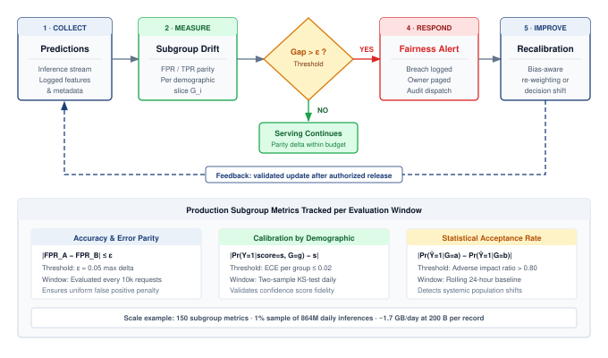

<!--
```{.tikz}
\providecolor{mlsysdarkgray}{HTML}{1E293B}
\providecolor{mlsysdark}{HTML}{1E293B}
\providecolor{darknavy}{HTML}{1E293B}
\providecolor{mlsysblue}{HTML}{334155}
\providecolor{mlsysteal}{HTML}{0F766E}
\providecolor{mlsysred}{HTML}{991B1B}
\providecolor{mlsysamber}{HTML}{92400E}
\providecolor{mlsysgreen}{HTML}{166534}
\providecolor{mlsysgray}{HTML}{64748B}
\providecolor{mlsysbordergray}{HTML}{CBD5E1}
\providecolor{BorderGray}{HTML}{CBD5E1}
\providecolor{MutedGray}{HTML}{64748B}
\providecolor{LightRed}{HTML}{FEE2E2}
\providecolor{LightGreen}{HTML}{DCFCE7}
\providecolor{LightBlue}{HTML}{E0F2FE}
\providecolor{LightAmber}{HTML}{FEF3C7}
\providecolor{mlsyspurple}{HTML}{6D28D9}
\providecolor{mlsyslightgray}{HTML}{F1F5F9}
\scalebox{0.92}{%
\begin{tikzpicture}[
    font=\sffamily,
    >=Stealth,
    card/.style={draw=mlsysbordergray, fill=white, rounded corners=3pt, line width=0.6pt},
    chip/.style={rounded corners=2pt, font=\bfseries\fontsize{6}{7}\selectfont, inner xsep=4pt, inner ysep=2pt}
]

% Geometry of Top Flowchart
\def\cardW{2.65}
\def\cardH{3.55}
\def\topY{5.3}

% Node 1: Predictions (Collect)
\node[card, draw=mlsysteal!60, fill=mlsysteal!1, minimum width=\cardW cm, minimum height=\cardH cm] (n1) at (0, \topY) {};
\node[chip, fill=mlsysteal!12, text=mlsysteal!90!black, anchor=north] at ([yshift=-5pt]n1.north) {1 $\cdot$ COLLECT};
\node[font=\bfseries\fontsize{7.5}{9}\selectfont, text=mlsysdark, anchor=north] at ([yshift=-20pt]n1.north) {Predictions};
\node[font=\fontsize{6.5}{7.5}\selectfont, text=mlsysgray, anchor=north] at ([yshift=-30pt]n1.north) {Inference Stream};
\draw[mlsysgray!25, line width=0.4pt] ([xshift=8pt, yshift=-40pt]n1.north west) -- ([xshift=-8pt, yshift=-40pt]n1.north east);
\node[font=\fontsize{6.5}{8.2}\selectfont, text=mlsysdark!90, align=center, text width=2.4cm, anchor=north] at ([yshift=-45pt]n1.north) {
    Model inference logs\\[3pt]
    Context metadata\\[3pt]
    Timestamped stream
};

% Node 2: Subgroup Metrics (Evaluate)
\node[card, draw=mlsysblue!60, fill=mlsysblue!1, minimum width=\cardW cm, minimum height=\cardH cm] (n2) at (3.3, \topY) {};
\node[chip, fill=mlsysblue!12, text=mlsysblue!90!black, anchor=north] at ([yshift=-5pt]n2.north) {2 $\cdot$ EVALUATE};
\node[font=\bfseries\fontsize{7.5}{9}\selectfont, text=mlsysdark, anchor=north] at ([yshift=-20pt]n2.north) {Subgroup Metrics};
\node[font=\fontsize{6.5}{7.5}\selectfont, text=mlsysgray, anchor=north] at ([yshift=-30pt]n2.north) {Slice Parity Audit};
\draw[mlsysgray!25, line width=0.4pt] ([xshift=8pt, yshift=-40pt]n2.north west) -- ([xshift=-8pt, yshift=-40pt]n2.north east);
\node[font=\fontsize{6.5}{8.2}\selectfont, text=mlsysdark!90, align=center, text width=2.4cm, anchor=north] at ([yshift=-45pt]n2.north) {
    Fairness audit window\\[3pt]
    FPR / TPR disparity\\[3pt]
    Slice tracking $G_i$
};

% Node 3: Decision Diamond
\node[diamond, draw=mlsysamber!80, fill=mlsysamber!8, line width=0.7pt, minimum width=2.3cm, minimum height=2.3cm, align=center, inner sep=0pt] (dia) at (6.6, \topY) {
    \textbf{\fontsize{7.5}{8.5}\selectfont Gap $> \varepsilon$ ?}\\[2pt]
    \fontsize{6}{7}\selectfont\color{mlsysamber!90!black} Policy Check
};

% Node 4: Fairness Alert (Respond)
\node[card, draw=mlsysred!60, fill=mlsysred!1, minimum width=\cardW cm, minimum height=\cardH cm] (n4) at (9.9, \topY) {};
\node[chip, fill=mlsysred!12, text=mlsysred!90!black, anchor=north] at ([yshift=-5pt]n4.north) {3 $\cdot$ RESPOND};
\node[font=\bfseries\fontsize{7.5}{9}\selectfont, text=mlsysred!90!black, anchor=north] at ([yshift=-20pt]n4.north) {Fairness Alert};
\node[font=\fontsize{6.5}{7.5}\selectfont, text=mlsysgray, anchor=north] at ([yshift=-30pt]n4.north) {Incident Dispatch};
\draw[mlsysgray!25, line width=0.4pt] ([xshift=8pt, yshift=-40pt]n4.north west) -- ([xshift=-8pt, yshift=-40pt]n4.north east);
\node[font=\fontsize{6.5}{8.2}\selectfont, text=mlsysdark!90, align=center, text width=2.4cm, anchor=north] at ([yshift=-45pt]n4.north) {
    Breach event logged\\[3pt]
    Dynamic rate limit\\[3pt]
    On-call audit trigger
};

% Node 5: Recalibration (Improve)
\node[card, draw=mlsyspurple!60, fill=mlsyspurple!1, minimum width=\cardW cm, minimum height=\cardH cm] (n5) at (13.2, \topY) {};
\node[chip, fill=mlsyspurple!12, text=mlsyspurple!90!black, anchor=north] at ([yshift=-5pt]n5.north) {4 $\cdot$ IMPROVE};
\node[font=\bfseries\fontsize{7.5}{9}\selectfont, text=mlsysdark, anchor=north] at ([yshift=-20pt]n5.north) {Recalibration};
\node[font=\fontsize{6.5}{7.5}\selectfont, text=mlsysgray, anchor=north] at ([yshift=-30pt]n5.north) {Model Adaptation};
\draw[mlsysgray!25, line width=0.4pt] ([xshift=8pt, yshift=-40pt]n5.north west) -- ([xshift=-8pt, yshift=-40pt]n5.north east);
\node[font=\fontsize{6.5}{8.2}\selectfont, text=mlsysdark!90, align=center, text width=2.4cm, anchor=north] at ([yshift=-45pt]n5.north) {
    Sample re-weighting\\[3pt]
    Threshold shifting\\[3pt]
    Validation verify
};

% Serving Continues (NO branch)
\node[card, draw=mlsysgreen!70, fill=mlsysgreen!4, line width=0.6pt, minimum width=2.8cm, minimum height=1.05cm, align=center] (serv) at (6.6, 2.7) {
    \textbf{\fontsize{7.5}{8.5}\selectfont\color{mlsysgreen!90!black} Serving Continues}\\[2pt]
    \fontsize{6.5}{7.5}\selectfont\color{mlsysdark!85} Parity delta within SLA budget
};

% Connectors in Flowchart
\draw[->, mlsysgray!70, line width=0.7pt, shorten >=2pt] (n1.east) -- (n2.west);
\draw[->, mlsysgray!70, line width=0.7pt, shorten >=2pt] (n2.east) -- (dia.west);

\draw[->, mlsysred!85, line width=0.8pt, shorten >=2pt] (dia.east) -- (n4.west)
    node[pos=0.45, above=2pt, font=\bfseries\fontsize{6.5}{7.5}\selectfont, text=mlsysred!90!black] {YES};

\draw[->, mlsysgreen!80!black, line width=0.8pt, shorten >=2pt] (dia.south) -- (serv.north)
    node[pos=0.45, right=3pt, font=\bfseries\fontsize{6.5}{7.5}\selectfont, text=mlsysgreen!80!black] {NO};

\draw[->, mlsysgray!70, line width=0.7pt, shorten >=2pt] (n4.east) -- (n5.west);

% Feedback Loop
\draw[->, dashed, mlsysblue!80, line width=0.8pt, shorten >=2pt] (n5.south) -- ++(0, -1.95) -| (n1.south)
    node[pos=0.25, fill=white, inner xsep=6pt, inner ysep=3pt, draw=mlsysblue!50, rounded corners=2pt, line width=0.5pt, font=\bfseries\fontsize{6.5}{7.5}\selectfont, text=mlsysblue!90!black] {Feedback Loop: Retrained weights redeployed};

% ==========================================
% BOTTOM CONTAINER: Production Subgroup Metrics
% ==========================================
\def\botTop{0.75}
\def\botH{5.2}
\node[card, draw=mlsysbordergray, fill=mlsysblue!1, line width=0.6pt, minimum width=15.8cm, minimum height=\botH cm, anchor=north] (botbox) at (6.6, \botTop) {};

\node[font=\bfseries\fontsize{8}{9.5}\selectfont, text=mlsysdark, anchor=north] at (6.6, \botTop - 0.22) {Production Subgroup Metrics Tracked per Evaluation Window};

% 3 Cards inside Bottom Container
\def\mCardW{4.85}
\def\mCardH{3.5}
\def\mY{\botTop - 0.65}

% Metric Card 1: Accuracy & Error Parity
\node[card, draw=mlsysblue!40, fill=white, line width=0.6pt, minimum width=\mCardW cm, minimum height=\mCardH cm, anchor=north] (m1) at (1.65, \mY) {};
\node[chip, fill=mlsysblue!12, text=mlsysblue!90!black, anchor=north] at ([yshift=-4pt]m1.north) {Accuracy \& Error Parity};
\node[font=\bfseries\fontsize{7.5}{8.5}\selectfont, text=mlsysdark, anchor=north] at ([yshift=-20pt]m1.north) {$|\text{FPR}_A - \text{FPR}_B| \le \varepsilon$};
\draw[mlsysgray!20, line width=0.4pt] ([xshift=8pt, yshift=-32pt]m1.north west) -- ([xshift=-8pt, yshift=-32pt]m1.north east);
\node[font=\fontsize{6.5}{8.5}\selectfont, text=mlsysdark!85, align=left, text width=4.35cm, anchor=north] at ([yshift=-38pt]m1.north) {
    \textbf{Tolerance:} $\varepsilon \le 0.05$ max disparity delta\\[3pt]
    \textbf{Window:} Rolling 10k inference request batch\\[3pt]
    \textbf{Objective:} Enforces uniform false-positive penalty
};

% Metric Card 2: Calibration by Demographic
\node[card, draw=mlsysgreen!40, fill=white, line width=0.6pt, minimum width=\mCardW cm, minimum height=\mCardH cm, anchor=north] (m2) at (6.6, \mY) {};
\node[chip, fill=mlsysgreen!12, text=mlsysgreen!80!black, anchor=north] at ([yshift=-4pt]m2.north) {Calibration by Demographic};
\node[font=\bfseries\fontsize{7}{8}\selectfont, text=mlsysdark, anchor=north] at ([yshift=-20pt]m2.north) {$|\mathbb{E}[Y \mid {S}=s, G_i] - s| \le \delta$};
\draw[mlsysgray!20, line width=0.4pt] ([xshift=8pt, yshift=-32pt]m2.north west) -- ([xshift=-8pt, yshift=-32pt]m2.north east);
\node[font=\fontsize{6.5}{8.5}\selectfont, text=mlsysdark!85, align=left, text width=4.35cm, anchor=north] at ([yshift=-38pt]m2.north) {
    \textbf{Tolerance:} Groupwise $\text{ECE} \le 0.02$\\[3pt]
    \textbf{Window:} Daily two-sample KS-test\\[3pt]
    \textbf{Objective:} Validates calibrated risk score fidelity
};

% Metric Card 3: Statistical Acceptance Rate
\node[card, draw=mlsysamber!40, fill=white, line width=0.6pt, minimum width=\mCardW cm, minimum height=\mCardH cm, anchor=north] (m3) at (11.55, \mY) {};
\node[chip, fill=mlsysamber!12, text=mlsysamber!90!black, anchor=north] at ([yshift=-4pt]m3.north) {Statistical Acceptance Rate};
\node[font=\bfseries\fontsize{7}{8}\selectfont, text=mlsysdark, anchor=north] at ([yshift=-20pt]m3.north) {$|\Pr(\hat{Y}=1 \mid A) - \Pr(\hat{Y}=1 \mid {B})| \le {\tau}$};
\draw[mlsysgray!20, line width=0.4pt] ([xshift=8pt, yshift=-32pt]m3.north west) -- ([xshift=-8pt, yshift=-32pt]m3.north east);
\node[font=\fontsize{6.5}{8.5}\selectfont, text=mlsysdark!85, align=left, text width=4.35cm, anchor=north] at ([yshift=-38pt]m3.north) {
    \textbf{Tolerance:} Adverse impact ratio $> 0.80$\\[3pt]
    \textbf{Window:} Rolling 24-hour evaluation baseline\\[3pt]
    \textbf{Objective:} Flags systemic demographic drift
};

% Bottom Telemetry Banner
\node[card, draw=mlsysbordergray, fill=white, line width=0.5pt, minimum width=15.2cm, minimum height=0.65cm, font=\fontsize{6.5}{7.5}\selectfont, text=mlsysdark!90] at (6.6, \botTop - 4.55) {
    \textbf{Telemetry Overhead:} $+12\,\text{ms}$ audit logging per request $\;\cdot\;$ $\sim$1.7 GB/day per 100M queries $\;\cdot\;$ 150 active monitor rules per model
};

\end{tikzpicture}%
}
```
-->

:::

This requires telemetry pipelines that capture model versioning, input characteristics, prediction confidence, and postinference feedback. These logs support drift detection and provide evidence for retrospective audits of fairness and robustness. Monitoring systems must also be integrated with alerting, update scheduling, and policy review processes to support timely and traceable intervention.

Monitoring also supports feedback-driven improvement. For example, repeated user disagreement, correction requests, or operator overrides can signal problematic behavior. This feedback must be aggregated, validated, and translated into updates to training datasets, data labeling processes, or model architecture. However, such feedback loops carry risks: biased user responses can introduce new inequities, and excessive logging can compromise privacy. Designing these loops requires careful coordination between user experience design, system security, and ethical governance.

::: {.column-margin}
```{=latex}
\vspace*{-5mm}
```
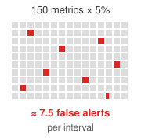{width="100%" fig-alt="A grid of 150 small gray squares labeled 150 metrics times 5 percent. Seven and a half squares are red, labeled about 7.5 false alerts per interval."}

*At a 5 percent false-alarm rate, 150 metrics raise about 7.5 spurious alerts per interval.*
:::

```{python}
#| echo: false
#| label: monitoring-scale-calc
# ┌─────────────────────────────────────────────────────────────────────────────
# │ RESPONSIBLE-AI MONITORING AT FLEET SCALE (LEGO)
# ├─────────────────────────────────────────────────────────────────────────────
# │ Context: the monitoring-scale paragraph immediately below.
# │
# │ Goal: Size the data-engineering load of fleet-scale fairness monitoring.
# │ Show: daily inferences (864 million), tracked metrics (150), sampled events
# │       (8.64 million), daily storage (1.7 GB), and spurious alerts (7.5).
# │ How: Load the serving rate, group/metric structure, sampling and record-size
# │      assumptions (scenario); derive each downstream load.
# │
# └─────────────────────────────────────────────────────────────────────────────
from mlsysim import GB, byte
from mlsysim.fmt import check, fmt, fmt_count, fmt_memory, fmt_percent

# ┌── LEGO ───────────────────────────────────────────────
class MonitoringScale:
    """Data-engineering load of fleet-scale fairness monitoring."""

    # ┌── 1. LOAD (Scenario assumptions) ──────────────────────────────────
    qps = 10_000  # scenario assumption: inference queries per second
    seconds_per_day = SEC_PER_DAY
    groups = 50  # demographic subgroups tracked
    metrics_per_group = 3  # FPR, TPR, calibration error per group
    sampling_rate = 0.01  # 1 percent of inferences logged
    bytes_per_record = 200  # metadata footprint per logged event
    false_alarm_rate = 0.05  # per-metric spurious-alert rate

    # ┌── 2. EXECUTE (The Compute) ────────────────────────────────────────
    inferences = qps * seconds_per_day  # 864 million/day
    metrics = groups * metrics_per_group  # 150
    events = inferences * sampling_rate  # 8.64 million/day
    storage = (events * bytes_per_record) * byte  # 1.7 GB/day
    alerts = metrics * false_alarm_rate  # 7.5/day

    # ┌── 3. GUARD (Invariants) ──────────────────────────────────────────
    check(events < inferences, "Sampling must reduce the logged volume")
    check(metrics > 0 and alerts > 0, "Metric and alert counts must be positive")

    # ┌── 4. OUTPUT (Formatting) ──────────────────────────────────────────
    qps_str = fmt(qps, precision=0)
    inferences_str = fmt_count(inferences, scale='M', precision=0, scale_style='word')
    groups_str = fmt(groups, precision=0, commas=False)
    metrics_str = fmt(metrics, precision=0, commas=False)
    events_str = fmt_count(events, scale='M', precision=2, scale_style='word')
    storage_gb_str = fmt_memory(storage, unit=GB, precision=1)
    alerts_str = fmt(alerts, precision=1, commas=False)
    bytes_per_record_str = fmt(bytes_per_record, precision=0, commas=False)
    sampling_pct_str = fmt_percent(sampling_rate, precision=0, commas=False, style='prose')
    false_alarm_pct_str = fmt_percent(false_alarm_rate, precision=0, commas=False, style='prose')
```

At the scale of a global production fleet, responsible AI monitoring becomes a substantial data engineering challenge. This sizing scenario assumes roughly `{python} MonitoringScale.inferences_str` inferences per day at `{python} MonitoringScale.qps_str` queries/s across `{python} MonitoringScale.groups_str` demographic subgroups, with `{python} MonitoringScale.metrics_str` metrics (false positive rate, true positive rate, and calibration error for each of the `{python} MonitoringScale.groups_str` groups). A `{python} MonitoringScale.sampling_pct_str` sampling rate yields `{python} MonitoringScale.events_str` monitoring events daily. At an assumed `{python} MonitoringScale.bytes_per_record_str` bytes per record, those events require approximately `{python} MonitoringScale.storage_gb_str` per day before additional audit records or storage overhead. Actual record contents and retention follow the approved measurement and privacy requirements; outcome-dependent metrics also require labels that may arrive later. The monitoring infrastructure itself must therefore be reliable, secure, and cost-effective. With `{python} MonitoringScale.metrics_str` active metrics, an illustrative per-metric false-alarm probability of `{python} MonitoringScale.false_alarm_pct_str` would yield roughly `{python} MonitoringScale.alerts_str` false alerts per evaluation interval if every tested null hypothesis is true. This expected count follows by summing false-alarm probabilities and does not require independence. Production thresholds must instead reflect subgroup denominators, delayed labels, repeated testing, confidence intervals, minimum detectable effects, and correction for multiple comparisons. A threshold crossing opens an investigation; it does not by itself prove discrimination or justify automatic retraining.

In C³ terms, this monitoring load is communication and coordination added to the fleet. Every sampled record must travel from a serving replica to the aggregation tier, and every alert must reach an owner who can act before the harm it signals compounds. The deployment tier sets how long that path is. A cloud service aggregates telemetry continuously, subject to storage and privacy budgets. An intermittently connected client keeps bounded local records until it next synchronizes, and a safety-critical edge system needs local checks that can trigger fallback within the decision deadline because the fleet cannot respond in time. A disconnected TinyML endpoint may deliver its evidence only at a servicing visit, and correcting its model may require a firmware update or physical replacement. Those differences change the evidence delay and remediation path, not the requirement to name an owner for each monitored obligation.

Monitoring is useful only when signals reach that owner in time to investigate and intervene; a fairness alert without a response process changes nothing for the people it describes. The monitoring cost is the price of turning fairness from an offline audit into an operational signal, and observation still is not remediation. The privacy, unlearning, and generative-system controls examined earlier, which govern data exposure through logs, outputs, and model weights, removal under applicable deletion obligations, and the prompts and reward models that shape generative outputs, need the same explicit evidence, ownership, and response paths.

### Validation approaches {#sec-responsible-ai-validation-approaches-6966}

If detection identifies a problem and mitigation attempts to fix it, **validation**\index{Validation!definition} supplies evidence to the evaluation-and-assurance stage of @tbl-governance-assurance-lifecycle. Validation is not a separate pillar or a claim that the system is safe. It tests bounded requirements and records residual uncertainty for the launch authority. Different stakeholders need different evidence: developers need diagnostics, auditors need reproducible statistical analyses, regulators may require conformity artifacts, and affected users need understandable reasons and a functioning contestability path. The evidence bundle can include fairness audits, privacy-accounting checks, robustness and distribution-shift tests, explanation-fidelity checks, and revalidation triggers tied to material changes.

Fairness audits, adversarial robustness testing, and explanation verification require evaluation capacity before release. Finding a defect at that stage can avoid exposing users and reduce subsequent recovery work. A production defect may additionally require containment across replicas, investigation of affected decisions, and individual remedies; the cost depends on its consequences and deployment scope. Validation is therefore not a *one-time gate* but a *continuous process*. Material changes to data, models, or workflows must trigger reassessment of the claims they affect, even when the system passed its original release review.

::: {.column-margin .margin-pointer}
↩ Continuous integration, release validation gates, and canary deployment pipelines are established in @sec-ml-operations-scale-cicd-ml-scale-730a.
:::

@Tbl-responsible-ai-validation-evidence summarizes the evidence bundle by risk class. The table is not a separate checklist; it is a way to make residual risk explicit before deployment.

| **Risk class** | **Evidence artifact**                                        | **Operational owner**                         |
|:---------------|:-------------------------------------------------------------|:----------------------------------------------|
| Fairness       | Disaggregated metrics, thresholds, confidence intervals      | Product owner and model-risk reviewer         |
| Privacy        | Privacy budget, deletion evidence, retention and access logs | Data-governance and privacy engineering teams |
| Robustness     | Drift tests, corruption tests, canaries, red-team probes     | ML platform and incident-response teams       |
| Explanation    | Fidelity tests, stability checks, recourse documentation     | Model team and user-facing operations         |
| Governance     | Approval record, residual-risk owner, revalidation trigger   | Review board or accountable launch authority  |

: **Validation Evidence by Risk Class**: Responsible validation combines several kinds of evidence because no single metric proves that a system is safe to deploy. Each risk class needs a measurable artifact and an operational owner. {#tbl-responsible-ai-validation-evidence tbl-colwidths="[22,43,35]"}

Explanation can be a visible and computationally demanding form of validation evidence. Fairness metrics characterize aggregate disparities under selected definitions, while local explanation methods characterize influences, sensitivities, or contrastive alternatives for a particular output. Neither supplies a general guarantee, and an attribution cannot verify why a decision was justified. Together with behavioral tests, provenance, documentation, and contestability, these artifacts help operators investigate whether a decision relied on inappropriate signals and help affected users formulate a challenge.

### Sociotechnical system dynamics {#sec-responsible-ai-sociotechnical-dynamics-4938}

Consider a constructed scenario in which a hospital deploys a sepsis predictor with strong held-out accuracy, but clinicians overwhelmed by alerts do not act on its warnings. Predictive performance alone cannot establish a mortality benefit: the intervention must reach an appropriate clinician in time and support a useful action. The deployment therefore needs evaluation of the human workflow as well as the model.

The technical tools of the previous sections address bounded problems in bias measurement, privacy protection, explanation, and robustness. The sepsis scenario shows why those controls must connect to the human workflow. Engineers must examine who receives an alert, what action is feasible, and which incentives influence that action alongside model performance. Optimization can compare alternatives under stated objectives and constraints, but it cannot establish whose interests those objectives should represent. That judgment requires stakeholder participation and accountable governance.

Deployed systems create feedback loops that reshape future data, distribute decisions between people and models, and expose disagreements about acceptable outcomes. Each mechanism can invalidate an assurance claim even when the implementation still meets its original technical specification. The analysis must therefore follow the consequences of deployment through the surrounding workflow and back into system design.

#### System feedback loops {#sec-responsible-ai-system-feedback-loops-36d7}

The sociotechnical feedback invariant (principle \ref{pri-sociotechnical-feedback}) captures this dynamic: deployed models shape the environment they operate in, so that future data $\ProbabilityFunction_{t+1}(\ModelInput)$ is a function of the model's past decisions $\ModelPredictor_t(\ModelInput)$. Here, $\ModelInput$ is the model's input, as in $\BinaryClassifier(\ModelInput)$ earlier in the chapter; $\ProbabilityFunction_t(\ModelInput)$ denotes the input distribution observed by the system at time $\FeedbackStepIndex$, while $\ModelPredictor_t(\ModelInput)$ denotes the deployed model or decision policy acting on those inputs. Such systems require closed-loop governance\index{Closed-loop governance!feedback loop dynamics}; reliability requires modeling the closed feedback loop rather than feed-forward inference alone.

Machine learning systems do not merely observe and model the world; they also shape it. Once deployed, their predictions and decisions often influence the environments they are intended to analyze. This feedback alters future data distributions, modifies user behavior, and affects institutional practices, creating a recursive loop between model outputs and system inputs. Over time, such dynamics can amplify biases, entrench disparities, or unintentionally shift the objectives a model was designed to serve. @Fig-bias-amplification traces this compounding cycle\index{Bias!amplification feedback loop} across four interconnected stages, from biased training data through model predictions and disparate real-world outcomes to reinforced bias in newly collected data. Green callouts highlight three targeted lifecycle intervention points capable of interrupting the cycle: preprocessing audits and reweighting at the data ingestion layer, in-processing fairness constraints during model training, and post-processing threshold calibration at the serving layer before decisions produce irreversible real-world impacts.

::: {#fig-bias-amplification fig-env="figure" fig-pos="htb" fig-cap="**Bias Amplification Feedback Loop**: When ML systems retrain on their own outputs, historical bias in training data propagates through model predictions, downstream outcomes, and reinforced data before feeding back as even more biased retraining data. The edges ('trains on', 'produces', 'creates', 'feeds into') show a possible reinforcing mechanism, not a guarantee that every iteration increases disparity. Green intervention arrows mark where pre-processing (data audit and reweighting), in-processing (fairness constraints), and post-processing (threshold calibration) can break the cycle." fig-alt="A circular loop of four boxes joined by curved navy arrows labeled trains on, produces, creates, and feeds into: biased training data, biased model predictions, disparate outcomes (the only red box), and reinforced bias in new data; the center reads possible reinforcing loop. Three green intervention boxes each send an arrow to a green bar that cuts one arc: pre-processing, audit and reweight, cuts the feeds into arc; in-processing, fairness constraints, cuts the trains on arc; post-processing, threshold calibration, cuts the produces arc."}
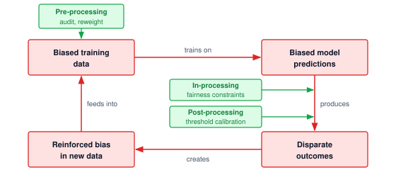

<!--
```{.tikz}
\providecolor{mlsysdarkgray}{HTML}{1E293B}
\providecolor{mlsysdark}{HTML}{1E293B}
\providecolor{darknavy}{HTML}{1E293B}
\providecolor{mlsysblue}{HTML}{334155}
\providecolor{mlsysteal}{HTML}{0F766E}
\providecolor{mlsysred}{HTML}{991B1B}
\providecolor{mlsysamber}{HTML}{92400E}
\providecolor{mlsysgreen}{HTML}{166534}
\providecolor{mlsysgray}{HTML}{64748B}
\providecolor{mlsysbordergray}{HTML}{CBD5E1}
\providecolor{BorderGray}{HTML}{CBD5E1}
\providecolor{MutedGray}{HTML}{64748B}
\providecolor{LightRed}{HTML}{FEE2E2}
\providecolor{LightGreen}{HTML}{DCFCE7}
\providecolor{LightBlue}{HTML}{E0F2FE}
\providecolor{LightAmber}{HTML}{FEF3C7}
\providecolor{mlsyspurple}{HTML}{6D28D9}
\providecolor{mlsyslightgray}{HTML}{F1F5F9}
\scalebox{0.88}{%
\begin{tikzpicture}[
    font=\sffamily,
    >=Stealth,
    card/.style={draw=mlsysbordergray, fill=white, rounded corners=3pt, line width=0.6pt},
    edgechip/.style={draw=mlsysbordergray, fill=white, rounded corners=2pt, line width=0.5pt, font=\bfseries\fontsize{6.5}{7.5}\selectfont, text=mlsysdark, inner xsep=4pt, inner ysep=2pt},
    interv/.style={draw=mlsysgreen!70, fill=mlsysgreen!5, rounded corners=3pt, line width=0.6pt, align=center, inner sep=4pt}
]

% Geometry
\def\boxW{5.1}
\def\boxH{2.2}
\def\trackX{5.5}
\def\trackY{3.4}

% ================= FOUR SYSTEM NODES =================

% Top: Historical Training Data (Teal)
\node[card, draw=mlsysteal!70, fill=mlsysteal!2, minimum width=\boxW cm, minimum height=\boxH cm, align=center, text width=4.9cm] (topBox) at (0, \trackY) {
    {\fontsize{6.5}{7.5}\selectfont\bfseries\color{mlsysteal!90!black} HISTORICAL TRAINING DATA}\\[3pt]
    {\bfseries\fontsize{9.5}{11}\selectfont\color{mlsysdark} Skewed Data Distribution}\\[3pt]
    {\fontsize{7}{8.5}\selectfont\color{mlsysgray} Underrepresented cohorts and historical disparities,\\[1pt]
    systemic labeling and sampling imbalances}
};

% Right: Deployed Model Serving (Blue)
\node[card, draw=mlsysblue!70, fill=mlsysblue!2, minimum width=\boxW cm, minimum height=\boxH cm, align=center, text width=4.9cm] (rightBox) at (\trackX, 0) {
    {\fontsize{6.5}{7.5}\selectfont\bfseries\color{mlsysblue!90!black} DEPLOYED MODEL SERVING}\\[3pt]
    {\bfseries\fontsize{9.5}{11}\selectfont\color{mlsysdark} Biased Model Predictions}\\[3pt]
    {\fontsize{7}{8.5}\selectfont\color{mlsysgray} Learns spurious demographic correlations;\\
    penalizes protected demographic groups}
};

% Bottom: Downstream Real-World Impact (Crimson)
\node[card, draw=mlsysred!70, fill=mlsysred!2, minimum width=\boxW cm, minimum height=\boxH cm, align=center, text width=4.9cm] (bottomBox) at (0, -\trackY) {
    {\fontsize{6.5}{7.5}\selectfont\bfseries\color{mlsysred!90!black} DOWNSTREAM REAL-WORLD IMPACT}\\[3pt]
    {\bfseries\fontsize{9.5}{11}\selectfont\color{mlsysred} Disparate Outcomes}\\[3pt]
    {\fontsize{7}{8.5}\selectfont\color{mlsysgray} Asymmetric denial rates in lending and hiring,\\[1pt]
    disproportionate automated allocation}
};

% Left: Data Collection Flywheel (Amber)
\node[card, draw=mlsysamber!70, fill=mlsysamber!2, minimum width=\boxW cm, minimum height=\boxH cm, align=center, text width=4.9cm] (leftBox) at (-\trackX, 0) {
    {\fontsize{6.5}{7.5}\selectfont\bfseries\color{mlsysamber!90!black} RETRAINING DATA INGESTION}\\[3pt]
    {\bfseries\fontsize{9.5}{11}\selectfont\color{mlsysdark} Reinforced Data Bias}\\[3pt]
    {\fontsize{7}{8.5}\selectfont\color{mlsysgray} Suppressed participation produces fewer\\[1pt]
    positive outcomes for unprivileged groups}
};

% ================= CENTER BADGE =================
\draw[mlsysblue!30, fill=mlsysblue!3, line width=0.8pt] (0, 0) circle (1.35);
% Two curved framing arrows
\draw[->, mlsysred!70, line width=0.9pt] (-0.95, 0.7) arc (140:40:1.24);
\draw[->, mlsysred!70, line width=0.9pt] (0.95, -0.7) arc (-40:-140:1.24);
\node[font=\bfseries\fontsize{7.5}{9}\selectfont, text=mlsysred, align=center] at (0, 0.18) {SYSTEMIC\\FEEDBACK};
\node[font=\fontsize{6.5}{7.5}\selectfont, text=mlsysdark!70] at (0, -0.28) {Compounding Drift};

% ================= CLOCKWISE BIAS LOOP (RED) =================
% Top to Right
\draw[mlsysred, line width=0.9pt] (topBox.east) -- (\trackX, \trackY)
    node[pos=0.45, edgechip] {trains on};
\draw[->, mlsysred, line width=0.9pt, shorten >=2pt] (\trackX, \trackY) -- (rightBox.north);

% Right to Bottom
\draw[mlsysred, line width=0.9pt] (rightBox.south) -- (\trackX, -\trackY);
\draw[->, mlsysred, line width=0.9pt, shorten >=2pt] (\trackX, -\trackY) -- (bottomBox.east)
    node[pos=0.50, edgechip] {produces};

% Bottom to Left
\draw[mlsysred, line width=0.9pt] (bottomBox.west) -- (-\trackX, -\trackY)
    node[pos=0.45, edgechip] {creates};
\draw[->, mlsysred, line width=0.9pt, shorten >=2pt] (-\trackX, -\trackY) -- (leftBox.south);

% Left to Top
\draw[mlsysred, line width=0.9pt] (leftBox.north) -- (-\trackX, \trackY)
    node[pos=0.50, edgechip] {feeds into};
\draw[->, mlsysred, line width=0.9pt, shorten >=2pt] (-\trackX, \trackY) -- (topBox.west);

% ================= THREE FAIRNESS INTERVENTIONS (GREEN) =================

% 1. Pre-Processing Intervention (Data Audit & Re-weight)
\node[interv, text width=2.3cm] (pre) at (-4.15, \trackY + 1.25) {
    {\bfseries\fontsize{7.5}{9}\selectfont\color{mlsysgreen!90!black} Pre-Processing}\\[2pt]
    {\fontsize{6.5}{7.5}\selectfont\color{mlsysdark} Data Audit \&\\Cohort Re-weight}
};
\draw[->, mlsysgreen, line width=0.9pt, shorten >=2pt] (pre.south) -- (-4.15, \trackY);

% 2. In-Processing Intervention (Fairness Regularization)
\node[interv, anchor=west, text width=2.3cm] (inproc) at (\trackX + 0.8, -1.7) {
    {\bfseries\fontsize{7.5}{9}\selectfont\color{mlsysgreen!90!black} In-Processing}\\[2pt]
    {\fontsize{6.5}{7.5}\selectfont\color{mlsysdark} Fairness Constrained\\Objective}
};
\draw[->, mlsysgreen, line width=0.9pt, shorten >=2pt] (inproc.west) -- (\trackX, -1.7);

% 3. Post-Processing Intervention (Threshold Calibration)
\node[interv, text width=2.3cm] (post) at (-\trackX, -\trackY - 1.25) {
    {\bfseries\fontsize{7.5}{9}\selectfont\color{mlsysgreen!90!black} Post-Processing}\\[2pt]
    {\fontsize{6.5}{7.5}\selectfont\color{mlsysdark} Group Threshold\\Calibration}
};
\draw[->, mlsysgreen, line width=0.9pt, shorten >=2pt] (post.north) -- (-\trackX, -\trackY);

% ================= BOTTOM LEGEND =================
\node[draw=mlsysbordergray, fill=white, rounded corners=3pt, line width=0.6pt, minimum width=8.8cm, minimum height=0.75cm, anchor=north] (legCard) at (0.55, -\trackY - 1.35) {};
\draw[->, mlsysred, line width=0.9pt] ([xshift=-115pt]legCard.center) -- ++(0.5, 0);
\node[anchor=west, font=\fontsize{7}{8.5}\selectfont\color{mlsysdark}] at ([xshift=-98pt]legCard.center) {Bias Reinforcement Cycle};
\draw[->, mlsysgreen, line width=0.9pt] ([xshift=10pt]legCard.center) -- ++(0.5, 0);
\node[anchor=west, font=\fontsize{7}{8.5}\selectfont\color{mlsysdark}] at ([xshift=27pt]legCard.center) {Fairness Intervention Checkpoint};

\end{tikzpicture}%
}
```
-->

:::

The closed-loop reinforcement modeled in @fig-bias-amplification shows what a static post-hoc fairness audit can miss. When a system retrains on outcomes selected by its own decisions, the resulting sample may reinforce initial skews without revealing what would have happened under a different policy. The feedback policy and available evidence determine whether disparities grow or shrink; an effective intervention need not modify every stage. Fairness therefore becomes a lifecycle constraint, in which data visibility determines what can be measured, threshold policy determines where errors land, and feedback infrastructure determines whether disparities decay or compound.

Predictive policing illustrates how this feedback can arise. A model trained on recorded arrests may direct more patrols to a neighborhood. If greater patrol presence produces more recorded incidents and the training pipeline treats those records as an unbiased measure of underlying crime, later predictions can reinforce the original allocation. The loop depends on how deployment changes observation and how retraining uses that evidence; it is not an inevitable consequence of every predictive model.

Recommender systems such as Archetype B (DLRM at Scale) exhibit similar dynamics in digital environments. A content recommendation model that prioritizes engagement may gradually narrow the range of content a user is exposed to, leading to feedback loops that reinforce existing preferences or polarize opinions. These effects can be difficult to detect using conventional performance metrics, as the system continues to optimize its training objective even while diverging from broader social or epistemic goals.

From a systems perspective, feedback loops present a core challenge to responsible AI. They undermine the assumption of independently and identically distributed data and complicate the evaluation of fairness, robustness, and generalization. Standard validation methods, which rely on static test sets, may fail to capture the evolving impact of the model on the data-generating process. Once such loops are established, interventions aimed at improving fairness or accuracy may have limited effect unless the underlying data dynamics are addressed.

Designing for responsibility in the presence of feedback loops requires a lifecycle view of machine learning systems. It requires monitoring model performance over time while analyzing how system outputs reshape the environment, how these changes are captured in new data, and how retraining practices either mitigate or exacerbate these effects.

In cloud-based systems, these updates may occur frequently and at scale, with extensive telemetry available to detect behavior drift. In contrast, edge and embedded deployments often operate offline or with limited observability. A smart home system that adapts thermostat behavior based on user interactions may reinforce energy consumption patterns or comfort preferences in ways that alter the home environment, and subsequently affect future inputs to the model. Without connectivity or centralized oversight, these loops may go unrecognized, despite their impact on both user behavior and system performance. Operational monitoring practices, including drift detection, performance tracking, and automated alerting, are essential for detecting and managing these feedback dynamics in production systems.

Systems must be equipped with mechanisms to detect distributional drift, identify behavior shaping effects, and support corrective updates that align with the system's intended goals. Feedback loops are not inherently harmful, but they must be recognized and managed. When left unexamined, they introduce systemic risk; when thoughtfully addressed, they provide an opportunity for learning systems to adapt responsibly in complex, dynamic environments.

#### Human-AI collaboration {#sec-responsible-ai-humanai-collaboration-205f}

Human operators turn feedback-loop risk into a shared-control problem. Machine learning systems are often deployed not as standalone agents, but as components in larger workflows that involve human decision-makers. In many domains, such as healthcare, finance, and transportation, models serve as decision-support tools, offering predictions, risk scores, or recommendations that are reviewed and acted upon by human operators. The collaborative configuration raises questions about how responsibility is shared between humans and machines, how trust is calibrated, and how oversight mechanisms are implemented in practice.

Human-AI collaboration introduces both opportunities and risks. When designed appropriately, systems can augment human judgment, reduce cognitive burden, and enhance consistency in decision-making. However, when poorly designed, they may lead to automation bias\index{Automation bias!human-AI interaction},[^fn-automation-bias-complacency] where users over-rely on model outputs even in the presence of clear errors.

[^fn-automation-bias-complacency]: **Automation Bias**\index{Bias!automation, human-AI interaction}: Inappropriate reliance on automated recommendations, including acceptance of erroneous outputs. Its prevalence depends on the task, interface, workload, and users' ability to check the output. Strong average performance can encourage reliance without making rare errors easier to recognize. Uncertainty displays, selective review, or requests for justification should be evaluated for their effects on correction rates, workload, and response time rather than assumed to improve safety.

Conversely, excessive distrust can result in algorithm aversion\index{Algorithm Aversion!human-AI interaction}, where users disregard useful model predictions due to a lack of transparency or perceived credibility. The effectiveness of collaborative systems depends on how the system communicates uncertainty, provides explanations, and enables human override or correction, rather than on model accuracy alone.

Institutional incentives can reinforce automation bias when operators expect greater scrutiny for overriding a model than for accepting it. Consider an illustrative pair of judicial decisions. In Scenario A, a judge overrides a "high risk" algorithmic score and releases a defendant who later re-offends. The judge anticipates criticism for departing from the recommendation. In Scenario B, the judge follows the score and detains the defendant unnecessarily, but the institution treats agreement with the model as evidence of proper procedure. The incentive comes from that review policy, not from the model's measured accuracy.

This asymmetry can encourage institutional deference\index{Institutional deference!automation bias}, where human oversight becomes a "rubber stamp" for algorithmic decisions. Review procedures should evaluate the evidence behind both agreement and disagreement, rather than treating agreement as inherently correct. The required documentation must fit the decision's stakes and the operator's workload so that justification supports scrutiny rather than becoming another routine approval.

Oversight mechanisms must be tailored to the deployment context. In high-stakes domains, such as medical triage or autonomous driving, humans may be expected to supervise automated decisions in real time. This configuration places cognitive and temporal demands on the human operator and assumes that intervention will occur quickly and reliably when needed. In practice, however, continuous human supervision is often impractical or ineffective, particularly when the operator must monitor multiple systems or lacks clear criteria for intervention.

From a systems design perspective, supporting effective oversight requires more than providing access to raw model outputs. Interfaces must be constructed to surface relevant information at the right time, in the right format, and with appropriate context. Confidence scores, uncertainty estimates, explanations, and change alerts can all play a role in enabling human oversight. Workflows must define when and how intervention is possible, who is authorized to override model outputs, and how such overrides are logged, audited, and incorporated into future system updates.

Consider a hospital triage system that uses a machine learning model to prioritize patients in the emergency department. The model generates a risk score for each incoming patient, which is presented alongside a suggested triage category. In principle, a human nurse is responsible for confirming or overriding the suggestion. However, if the model's outputs are presented without sufficient justification, such as an explanation of the contributing features or the context for uncertainty, the nurse may defer to the model even in borderline cases. Over time, the model's outputs may become the de facto triage decision, especially under time pressure. If a distribution shift occurs (for instance, due to a new illness or change in patient demographics), the nurse may lack both the situational awareness and the interface support needed to detect that the model is underperforming. In such cases, the appearance of human oversight masks a system in which responsibility has effectively shifted to the model without clear accountability or recourse.

In such systems, human oversight is not merely a matter of policy declaration, but a function of infrastructure design: how predictions are surfaced, what information is retained, how intervention is enacted, and how feedback loops connect human decisions to system updates. Without integration across these components, oversight becomes fragmented, and responsibility may shift invisibly from human to machine.

```{python}
#| echo: false
#| label: automation-bias-calc
# ┌─────────────────────────────────────────────────────────────────────────────
# │ THE AUTOMATION BIAS PARADOX (LEGO)
# ├─────────────────────────────────────────────────────────────────────────────
# │ Context: the "automation bias paradox" worked-example callout below.
# │
# │ Goal: Quantify the residual failure rate when a human rubber-stamps AI errors.
# │ Show: accepted-error failure probability (0.035) and combined sensitivity
# │       (96.5 percent).
# │ How: Load AI sensitivity and the acceptance rate (scenario); derive the
# │      accepted-error failure probability and the upper-bound sensitivity.
# │
# └─────────────────────────────────────────────────────────────────────────────
from mlsysim.fmt import check, fmt, fmt_math, fmt_percent, fmt_range

# ┌── LEGO ───────────────────────────────────────────────
class AutomationBias:
    """Residual failure rate from human acceptance of AI errors."""

    # ┌── 1. LOAD (Scenario inputs) ───────────────────────────────────────
    s_human = 0.92  # unaided human sensitivity
    s_ai = 0.95  # AI sensitivity
    alpha_low = 0.60  # scenario range lower bound
    alpha_high = 0.80  # scenario range upper bound
    alpha = 0.70  # rate at which the human accepts AI errors

    # ┌── 2. EXECUTE (The Compute) ────────────────────────────────────────
    ai_error = 1 - s_ai  # 0.05
    fail_prob = ai_error * alpha  # 0.035
    sensitivity = 1 - fail_prob  # 0.965

    # ┌── 3. GUARD (Invariants) ──────────────────────────────────────────
    check(0 < fail_prob < 1, "Accepted-error failure probability must be a fraction")
    check(sensitivity < 1, "Rubber-stamped AI errors keep sensitivity below 100 percent")
    check(alpha_low < alpha < alpha_high, "Representative automation-bias rate should sit inside the range.")

    # ┌── 4. OUTPUT (Formatting) ──────────────────────────────────────────
    _fail_prob = fmt(fail_prob, precision=3, commas=False)
    _ai_error = fmt(ai_error, precision=2, commas=False)
    _alpha = fmt(alpha, precision=1, commas=False)
    fail_prob_math = fmt_math(rf"{_ai_error} \times {_alpha} = {_fail_prob}")
    human_sensitivity_pct_str = fmt_percent(s_human, precision=0, commas=False, style='prose')
    ai_sensitivity_pct_str = fmt_percent(s_ai, precision=0, commas=False, style='prose')
    ai_sensitivity_prose_str = fmt_percent(s_ai, precision=0, commas=False, style='prose')
    alpha_range_pct_str = fmt_range(round(alpha_low * 100), round(alpha_high * 100), precision=0, commas=False, unit="percent")
    alpha_pct_math = fmt_math(r"\MissAcceptanceProbability = " + _alpha)
    ai_error_pct_math = fmt_math(r"1 - \AiStandaloneSensitivity = " + _ai_error)
    sensitivity_pct_str = fmt_percent(sensitivity, precision=1, commas=False, style='prose')
```

:::: {#nbk-responsible-ai-automation-bias-paradox .callout-notebook title="The automation bias paradox"}

Consider a radiology department deploying an AI assistant for tumor detection, where standalone human sensitivity is $\HumanStandaloneSensitivity=$ `{python} AutomationBias.human_sensitivity_pct_str` and standalone AI sensitivity is $\AiStandaloneSensitivity=$ `{python} AutomationBias.ai_sensitivity_pct_str`.

One might assume the combined system performance would exceed `{python} AutomationBias.ai_sensitivity_prose_str`. However, this illustrative scenario assumes that humans accept the AI's missed detections at rates of `{python} AutomationBias.alpha_range_pct_str`. Among patients with tumors, the AI misses a tumor with probability `{python} AutomationBias.ai_error_pct_math`; if the human accepts that miss (`{python} AutomationBias.alpha_pct_math`), these accepted misses alone create a conditional failure probability of `{python} AutomationBias.fail_prob_math`. In this simplified upper-bound case, where every other AI miss is corrected and no correct detection is overturned, sensitivity is `{python} AutomationBias.sensitivity_pct_str`. False positives require separate evaluation among patients without tumors, while fatigue and interface delays can further affect the workflow.

This conditional error-acceptance probability matters more than the overall override rate. A low override rate may reflect few model errors or failures to detect them; those interpretations require different interventions. The trust calibration gap\index{Trust!calibration gap} arises when reliance exceeds what the evidence supports. Evaluate interface changes against the fraction of actual errors corrected, errors introduced by overrides, and response delay before adopting them.
::::

The boundary between decision support and automation is often fluid. Systems initially designed to assist human decision-makers may gradually assume greater autonomy as trust increases or organizational incentives shift. This transition can occur without explicit policy changes, resulting in de facto automation without appropriate accountability structures. Responsible system design must therefore anticipate changes in use over time and ensure that appropriate checks remain in place even as reliance on automation grows.

Human-AI collaboration requires careful integration of model capabilities, interface design, operational policy, and institutional oversight. Collaboration is not simply a matter of inserting a "human-in-the-loop"; it is a systems challenge that spans technical, organizational, and ethical dimensions. Designing for oversight entails embedding mechanisms that allow intervention, support informed trust, and support shared responsibility between human operators and machine learning systems.

#### Normative pluralism and value conflicts {#sec-responsible-ai-normative-pluralism-value-conflicts-d61f}

Human-AI collaboration exposes a deeper systems constraint: different stakeholders often hold conflicting values and priorities. Algorithms can help identify feasible compromises, but they cannot establish whose priorities should govern a deployment. Technical excellence is necessary but insufficient for trustworthy AI because choosing among conceptions of fairness, privacy, and accountability requires a legitimate decision process as well as evidence about their consequences.

Responsible machine learning cannot be reduced to the optimization of a single objective. In real-world settings, machine learning systems are deployed into environments shaped by diverse, and often conflicting, human values. A high-stakes deployment makes these tensions concrete.

::: {#exmp-responsible-ai-conflicting-values-practice .callout-example title="Conflicting values in practice"}

**Scenario**: An adolescent mental health crisis detection pipeline must balance competing stakeholder objectives across real-time inference and data retention paths.

**Diagnosis**: Optimizing clinical efficacy via aggressive alert dispatch conflicts with patient autonomy and privacy protocols. Restricting data retention to protect user privacy limits offline retraining and explanation auditing, while routing high-confidence alerts to human counselors increases per-query serving cost and the end-to-end latency $\EndToEndRequestLatency$, measured from the incoming message to an acknowledged alert. A local differential privacy mechanism would need a specified privacy unit, accountant, and clinical utility evaluation. The automated dispatch SLA covers producing and acknowledging an alert, not completing human counseling. Human response needs a separate deadline, staffed queue capacity, and an escalation policy for overload.

**Systems lesson**: Responsible AI trade-offs are hard architectural requirements, not after-the-fact policy notes. The deployment pipeline must encode stakeholder choices into explicit latency ($\EndToEndRequestLatency$) and privacy budgets before optimization begins.

:::

What constitutes a fair outcome for one stakeholder may be perceived as inequitable by another. Similarly, decisions that prioritize accuracy or efficiency may conflict with goals such as transparency, individual autonomy, or harm reduction. These tensions are not incidental; they are structural. They reflect the pluralistic nature of the societies in which machine learning systems are embedded and the institutional settings in which they are deployed.

Fairness is a particularly prominent site of value conflict. Fairness can be formalized in multiple, often incompatible ways. A model that satisfies demographic parity may violate equalized odds; a model that prioritizes individual fairness may undermine group-level parity. Choosing among these definitions is not purely a technical decision but a normative one, informed by domain context, historical patterns of discrimination, and the perspectives of those affected by model outcomes. In practice, multiple stakeholders, including engineers, users, auditors, and regulators, may hold conflicting views on which definitions are most appropriate and why.

Value conflicts extend beyond fairness alone. Conflicts also arise between interpretability and predictive performance, privacy and personalization, or short-term utility and long-term consequences.

Each deployment tier gives these conflicts a different form, adding to the tier comparison of @sec-responsible-ai-design-tradeoffs-6f5a the question of who decides. A voice assistant that personalizes on a mobile device keeps raw data local, which reduces transmission exposure without by itself establishing a privacy guarantee. Users with underrepresented usage patterns may still receive less accurate predictions, and detecting that disparity requires decisions about consent, aggregation, and access, so privacy, fairness, and personalization must be weighed against one another. A cloud credit-scoring or recommendation platform faces demands for explanations of consequential decisions while relying on complex ensembles or proprietary training data whose disclosure may be commercially sensitive or technically infeasible, which sets institutional accountability against business confidentiality. An edge camera or drone that compresses its model to meet latency and energy budgets trades efficiency against robustness; the effect must be measured on the deployed candidates under the expected shifts and threat model rather than assumed, and a more resilient candidate may exceed the memory or power budget. A TinyML device without persistent connectivity cannot absorb new fairness requirements through local retraining, so whether servicing or intermittent synchronization can deliver a revised model, and whether explanations and appeals can run off-device on preserved evidence, becomes part of the value decision. In every tier the conflict extends beyond what the model optimizes to what the system can support after deployment.

The recurring systems constraint is normative pluralism\index{Normative pluralism!value conflicts}, not an abstract philosophical challenge. Technical approaches such as multi-objective optimization, constrained training, and fairness-aware evaluation can help surface and formalize trade-offs, but they do not eliminate the need for judgment. Decisions about whose values to represent, which harms to mitigate, and how to balance competing objectives cannot be made algorithmically. They require deliberation, stakeholder input, and governance structures that extend beyond the model itself.

Participatory methods and the Value-Sensitive Design process introduced with value alignment (@sec-responsible-ai-ai-safety-value-alignment-8c93) offer paths forward. Rather than treating values as parameters to be optimized after deployment, these approaches seek to engage stakeholders during the requirements phase, define ethical trade-offs explicitly, and trace how they are instantiated in system architecture. Some requirements can be satisfied together; others require a documented choice or a decision not to deploy. Making these judgments explicit gives affected stakeholders something concrete to question and revise.

Machine learning systems are not neutral tools. They embed and enact value judgments, whether explicitly specified or implicitly assumed. A commitment to responsible AI requires acknowledging this fact and building systems that reflect and respond to the ethical and social pluralism of their operational contexts.

#### Institutional embedding of responsibility {#sec-responsible-ai-institutional-embedding-responsibility-bbeb}

Transparency and contestability fail when responsibility is distributed without corresponding authority. Model, data, product, legal, and operational teams may each control one part of a harmful decision while none can coordinate its correction. Institutional design must connect those roles through a named escalation path, review capacity, and authority to restrict deployment or provide remedy.

Operational rigor comes with a measurable cost. Public responsible-AI standards and internal review processes illustrate that governance can add release latency through impact assessments, model reviews, red-team exercises, and documentation gates. Review capacity therefore becomes part of deployment planning. If every high-risk launch needs specialized review, the review queue becomes a bottleneck just like security review or capacity approval. That cost must be budgeted alongside remediation and residual risk; preventive review can reduce exposure, but does not guarantee that every incident will be avoided or that remediation will always cost more.

Embedding responsibility institutionally requires more than assigning accountability. It requires the design of processes, tools, and incentives that allow responsible action. Technical infrastructure such as versioned model registries, model cards, and audit logs must be coupled with organizational structures such as ethics review boards, model risk committees, and red-teaming\index{Red teaming!adversarial audit}[^fn-red-teaming-etymology] procedures. Their effectiveness depends on whether findings reach an authorized owner, receive a timely response, and lead to a verified correction when one is required. The existence of a committee or audit log alone does not establish that concerns have been addressed.

Third-party and foundation-model dependencies do not transfer accountability to the supplier. A deploying organization may inherit weights, safety evaluations, data documentation, or contractual controls, but it still chooses the use, interface, retrieved context, tools, user population, monitoring, and response process. Procurement therefore needs the same rigor as an internal model gate: documented intended and prohibited uses, evaluation scope, version and change notification, incident disclosure, audit access, data handling, service dependencies, fallback behavior, and an exit plan. When supplier evidence is unavailable, the assurance case must record the gap as residual risk rather than silently treating a vendor assertion as a verified control.

The organization must provide these functions across the actual deployment lifecycle. A cloud team may operate continuous review and monitoring services; an embedded-device operator may rely on certification, firmware inventories, servicing, and recall. Domain experts, affected parties, and regulators remain part of the evidence and authority structure in either case. The operating arrangement must still support correction of an individual decision.

Accountability becomes visible at the point of remedy. Affected people need a discoverable channel to challenge an outcome, a record of the evidence considered, a reviewer with authority to correct the decision, a response deadline, and a way to propagate the correction into downstream systems. Aggregate model improvement is not a substitute for individual remedy, because retraining next quarter does not correct a benefit denied today. England's 2020 exam-grading algorithm showed how quickly an aggregate method can outrun the remedy path its decisions require. Incident procedures must therefore connect technical containment and rollback to notification, correction, compensation where applicable, root-cause analysis, and verification that the remedy reached every dependent decision record.

::: {#ws-responsible-ai-algorithmic-grading-failure .callout-war-story title="The algorithmic grading failure (2020)"}

**Context**: In August 2020, following exam cancellations during COVID-19, England's qualifications regulator (Ofqual) deployed a statistical standardization algorithm to grade ~280,000 A-level students [@ofqual2020interim; @ofqual2020centregrades].

**Mechanism**: To control grade inflation, the standardization method combined historical results with the cohort's prior attainment to estimate grade distributions, then allocated grades using teachers' student rankings. Small subject cohorts received greater weight on teacher-assessed grades. The method therefore used individual ranking evidence, but constrained its interpretation through cohort-level predictions that could differ from teachers' assessments of individual achievement.

**Impact**: The calculated grade was lower than the teacher-assessed grade in 39.1 percent of cases [@ofqual2020interim]. Public outcry and student protests prompted a reversal of the grading policy days later.

**Fix**: Students were awarded the higher of the center-assessed grade and the calculated grade, replacing the earlier standardization policy.

**Systems lesson**: An aggregate prediction does not establish that every individual outcome is justified. An appeal channel must specify which evidence can change the decision, who can review it, and how quickly a correction can take effect; the existence of a procedural appeal alone does not answer those questions.

:::

Retirement closes the evidence chain that the assurance lifecycle (@sec-responsible-ai-governance-assurance-lifecycle) opened before launch. The service owner verifies that serving routes and credentials are disabled, downstream operators receive the shutdown decision, and retained records follow the approved retention policy. An appeal owner remains responsible for unresolved decisions after inference stops. Ending a model's service life therefore closes its execution path without abandoning its outstanding obligations.

The system-level thesis thus extends past the serving stack into the organization: responsibility is a dynamic property of how systems are governed, maintained, and contested over time, owned by no single model or team. Embedding it within institutions, by means of policy, infrastructure, and accountability mechanisms, is what aligns machine learning systems with the social values and operational realities they are meant to serve.

Taken together, institutional responsibility, value conflicts, feedback loops, human-AI collaboration, contestability, and computational equity show why the technical foundations from @sec-responsible-ai-architecting-fairness-bias-mitigation-9507 through @sec-responsible-ai-ai-safety-robustness-generative-controls-4297 cannot ensure responsible AI on their own. Those technical foundations remain necessary, but they need organizational authority, operational telemetry, and escalation paths to survive contact with deployed systems. Resource constraints also determine who can develop, deploy, and benefit from responsible AI capabilities, so implementation choices are not merely local engineering details. Otherwise, a fairness metric with no owner, an explanation with no appeal process, or a monitoring signal with no remediation budget becomes evidence without action. Once an AI system changes the environment it operates in, engineering teams must turn responsible-AI principles into corporate routines under deadline pressure, resource limits, and competing incentives.

::: {#chk-responsible-ai-sociotechnical-failure .callout-checkpoint title="When correct code fails in deployment"}

This section showed why mathematically sound, fair, explainable models still fail in human institutions: feedback loops that reshape the data, automation bias and institutional deference, normative pluralism among stakeholders, and the institutional authority that contestability needs before it can deliver a remedy.

**Diagnosing the human-system interaction**

- [ ] **Alert adoption failure**: propose two workflow failures that could explain ignored sepsis alerts despite high offline accuracy, and identify a measurement that distinguishes them. Propose an interface or workflow change for one explanation, then state how timely action, actual error correction, workload, and patient outcomes would be evaluated.
- [ ] **Paradox of reliability**: explain why overall accuracy and override frequency do not establish the rate of actual errors corrected, and identify what evidence would justify an interface change.

**Reasoning about loops and stakeholders**

- [ ] **Feedback loops**: trace how a feedback loop makes a model's original prediction self-fulfilling in a predictive-policing or recommender system, and explain why a static test set fails to detect it.
- [ ] **Normative pluralism**: justify why no algorithm resolves conflicts among medical efficacy, patient autonomy, privacy, and legal compliance in the adolescent mental-health crisis-detection pipeline, and identify what the engineering team must do before optimization begins.

:::

## Operationalizing Responsible AI at Fleet Scale {#sec-responsible-ai-implementation-challenges-9173}

The data science team wants to hold back deployment for a month to conduct rigorous fairness audits on a new generative model. The executive team, watching a competitor launch a similar feature, demands the model be deployed by Friday. Even when engineers know how to evaluate the relevant risks, the organizational structure, budget, and business priorities must give them the time and authority to act on that knowledge.

The scenario exposes the implementation gap between technical capability and operational authority. Responsible AI methods provide necessary tools, but their effectiveness depends on organizational structures, data infrastructure, evaluation processes, and sustained commitment that extends far beyond algorithm development. Systems maintain responsible behavior over time only when those implementation supports survive deadline pressure, product incentives, and postdeployment drift.

The practical barriers to embedding responsible AI in production ML systems span the classical People-Process-Technology framework. People challenges, the subject of @sec-responsible-ai-organizational-structures-incentives-4825, encompass the organizational structures, role definitions, and incentives that determine whether ethical commitments translate into durable operational behavior. Technology challenges begin with the data itself (@sec-responsible-ai-data-constraints-quality-gaps-5887), where quality gaps and acquisition costs decide what a team can fix. Process challenges cover how competing objectives are resolved (@sec-responsible-ai-balancing-competing-objectives-088e) and how responsibility constraints survive scaling, maintenance, and continuous delivery (@sec-responsible-ai-scalability-maintenance-a1ca). A decision framework (@sec-responsible-ai-implementation-decision-framework-e8b8) then turns the three dimensions into deployment-specific priorities.

These dimensions matter because responsible AI fails when organizational incentives, development workflows, and production infrastructure pull in conflicting directions. The framework connects each technical claim to the process and owner needed to act on it. A fairness metric without an accountable owner produces no remediation, while a governance process lacking telemetry cannot detect drift. A formal privacy guarantee also does not implement deletion; that requires lineage and a removal workflow for the relevant data and model state. Effective implementation therefore demands systems-level strategies that embed responsibility into the architecture, infrastructure, and operating practices of machine learning deployment across all three dimensions simultaneously.

### Organizational structures and incentives {#sec-responsible-ai-organizational-structures-incentives-4825}

@Sec-responsible-ai-institutional-embedding-responsibility-bbeb established that responsibility needs authority, review capacity, and a remedy path. This subsection examines why organizations so often fail to supply them, through fragmented ownership and misaligned incentives. Within companies, research labs, and public institutions, responsibility must be translated into concrete roles, workflows, and incentives. In practice, however, organizational structures often fragment responsibility, making it difficult to coordinate ethical objectives across engineering, product, legal, and operational teams.

Responsible AI requires sustained investment in practices such as subgroup performance evaluation, explainability analysis, adversarial robustness testing, and the integration of privacy-preserving techniques like differential privacy or federated training. These activities can be time-consuming and resource-intensive, yet they often fall outside the formal performance metrics used to evaluate team productivity. For example, teams may be incentivized to ship features quickly or meet performance benchmarks, even when doing so undermines fairness or overlooks potential harms. When ethical diligence is treated as a discretionary task, instead of being an integrated component of the system lifecycle, it becomes vulnerable to deprioritization under deadline pressure or organizational churn.

Responsibility is further complicated by ambiguity over ownership. In many organizations, no single team is responsible for ensuring that a system behaves ethically over time. Model performance may be owned by one team, user experience by another, data infrastructure by a third, and compliance by a fourth. When issues arise, including disparate impact in predictions or insufficient explanation quality, there may be no clear protocol for identifying root causes or coordinating mitigation. As a result, concerns raised by developers, users, or auditors may go unaddressed, not because of malicious intent, but due to lack of process and cross-functional alignment.

Establishing effective organizational structures for responsible AI requires more than policy declarations. It demands operational mechanisms: designated roles with responsibility for ethical oversight, documented escalation pathways, accountability for postdeployment monitoring, and incentives that reward teams for ethical foresight and system maintainability. Beyond the review boards and model risk committees described in @sec-responsible-ai-institutional-embedding-responsibility-bbeb, some organizations embed domain experts or user advocates in product teams to anticipate downstream impacts and evaluate value trade-offs in context.

The responsibility for ethical system behavior is distributed across multiple constituencies, including industry, academia, civil society, and government. @Fig-human-centered-ai structures this governance hierarchy across four concentric tiers surrounding the central AI system: the development team executes technical controls (fairness testing, model cards, red-teaming); the organization governs operational processes (impact assessments, ethical review boards); industry establishes consensus baselines (ISO standards, external audits); and government and society enforce legal boundaries (GDPR, the EU AI Act, sector-specific statutes) [@shneiderman2022human; @shneiderman2020]. Within organizations, this distribution must be mirrored by mechanisms that connect technical design with strategic oversight and operational control. Without these linkages, responsibility becomes diffuse, and well-intentioned efforts may be undermined by systemic misalignment.

::: {#fig-human-centered-ai fig-env="figure" fig-pos="htb" fig-cap="**Layers of Responsibility**: Effective human-centered AI implementation requires shared accountability across nested layers. From the core Development Team outward through the Organization, Industry, and Government/Society, each surrounding layer enforces norms the inner layers cannot self-impose. External anchors, including ISO AI management standards, fairness testing, model cards, red-teaming, impact assessments, GDPR, the EU AI Act, and sector-specific law, bind these layers to practice [@isoiec420012023ai; @gdpr2016; @euaiact2024]." fig-alt="Four nested rectangles around a central AI system box, from outer to inner: government and society, industry, organization, and development team. The tint deepens from the pale outer layer to the inner layer, and the AI system at the center is a dark filled box. Each layer's anchor is written into a gap in its own top boundary, so the norm forms part of the wall: GDPR, the EU AI Act, and sector-specific law; ISO standards and external audits; impact assessments and ethical review boards; and fairness testing, model cards, and red-teaming."}
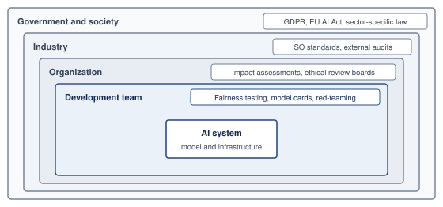

<!--
```{.tikz}
\providecolor{mlsysdarkgray}{HTML}{1E293B}
\providecolor{mlsysdark}{HTML}{1E293B}
\providecolor{darknavy}{HTML}{1E293B}
\providecolor{mlsysblue}{HTML}{334155}
\providecolor{mlsysteal}{HTML}{0F766E}
\providecolor{mlsysred}{HTML}{991B1B}
\providecolor{mlsysamber}{HTML}{92400E}
\providecolor{mlsysgreen}{HTML}{166534}
\providecolor{mlsysgray}{HTML}{64748B}
\providecolor{mlsysbordergray}{HTML}{CBD5E1}
\providecolor{BorderGray}{HTML}{CBD5E1}
\providecolor{MutedGray}{HTML}{64748B}
\providecolor{LightRed}{HTML}{FEE2E2}
\providecolor{LightGreen}{HTML}{DCFCE7}
\providecolor{LightBlue}{HTML}{E0F2FE}
\providecolor{LightAmber}{HTML}{FEF3C7}
\providecolor{mlsyspurple}{HTML}{6D28D9}
\providecolor{mlsyslightgray}{HTML}{F1F5F9}
\scalebox{0.76}{%
\begin{tikzpicture}[
    font=\sffamily,
    >=Stealth,
    card/.style={draw=mlsysbordergray, fill=white, rounded corners=3pt, line width=0.6pt},
    chip/.style={rounded corners=2pt, font=\bfseries\fontsize{5.8}{6.8}\selectfont, inner xsep=4pt, inner ysep=2pt}
]

% ================= CONCENTRIC GOVERNANCE RINGS (NESTED CARDS) =================
% Outer Ring: Government / Society (Width 7.4cm, Height 7.2cm)
\node[draw=mlsysgray!70, fill=mlsysgray!4, rounded corners=12pt, line width=0.8pt, minimum width=7.4cm, minimum height=7.2cm] (ring4) at (0, 0) {};
\node[font=\bfseries\fontsize{8}{9.5}\selectfont, text=mlsysdark, anchor=north] at (0, 3.42) {Government \& Society};
\node[font=\fontsize{6}{7}\selectfont, text=mlsysgray, anchor=north] at (0, 3.14) {Statutory Regulation $\;\cdot\;$ Legal Liability $\;\cdot\;$ Public Interest};

% Ring 3: Industry Consortia (Width 5.8cm, Height 5.3cm)
\node[draw=mlsysamber!70, fill=mlsysamber!5, rounded corners=10pt, line width=0.8pt, minimum width=5.8cm, minimum height=5.3cm] (ring3) at (0, -0.15) {};
\node[font=\bfseries\fontsize{7.5}{9}\selectfont, text=mlsysamber!95!black, anchor=north] at (0, 2.35) {Industry Consortia};
\node[font=\fontsize{5.8}{6.8}\selectfont, text=mlsysamber!85!black, anchor=north] at (0, 2.10) {Standards Bodies $\;\cdot\;$ Third-Party Audits $\;\cdot\;$ Norms};

% Ring 2: Organization Governance (Width 4.4cm, Height 3.65cm)
\node[draw=mlsysgreen!70, fill=mlsysgreen!5, rounded corners=8pt, line width=0.8pt, minimum width=4.4cm, minimum height=3.65cm] (ring2) at (0, -0.30) {};
\node[font=\bfseries\fontsize{7.5}{9}\selectfont, text=mlsysgreen!95!black, anchor=north] at (0, 1.38) {Organization Governance};
\node[font=\fontsize{5.8}{6.8}\selectfont, text=mlsysgreen!85!black, anchor=north] at (0, 1.15) {Policies $\;\cdot\;$ Ethics Boards $\;\cdot\;$ Escalation};

% Ring 1: Development Team & AI System Core (Width 3.2cm, Height 2.05cm)
\node[draw=mlsysblue!80, fill=mlsysblue!7, rounded corners=6pt, line width=0.9pt, minimum width=3.2cm, minimum height=2.05cm] (ring1) at (0, -0.45) {};
\node[align=center, anchor=center] at (0, -0.45) {
    {\bfseries\fontsize{7.5}{9}\selectfont\textcolor{mlsysblue!95!black}{Development Team}}\\[1.5pt]
    {\fontsize{6}{7}\selectfont\textcolor{mlsysdark!85}{Code, Tests, Slice Audits}}\\[3.5pt]
    {\bfseries\fontsize{7}{8.5}\selectfont\textcolor{mlsysdark}{AI System Artifacts}}\\[1.5pt]
    {\fontsize{5.8}{6.8}\selectfont\textcolor{mlsysgray}{Weights, Pipeline, Serving}}
};

% ================= 4 EXTERNAL ANCHOR CARDS =================
\def\cardW{4.70}
\def\cardH{3.55}

% Top-Left: ISO Standards (Industry Layer)
\node[card, draw=mlsysamber!50, fill=white, minimum width=\cardW cm, minimum height=\cardH cm, anchor=east] (box_iso) at (-4.10, 1.95) {};
\node[chip, fill=mlsysamber!12, text=mlsysamber!90!black, anchor=north] at ([yshift=-3.5pt]box_iso.north) {INDUSTRY BENCHMARKS};
\node[font=\bfseries\fontsize{7.5}{8.5}\selectfont, text=mlsysdark, anchor=north] at ([yshift=-15.5pt]box_iso.north) {ISO / IEC Standards};
\draw[mlsysgray!20, line width=0.4pt] ([xshift=8pt, yshift=-25.5pt]box_iso.north west) -- ([xshift=-8pt, yshift=-25.5pt]box_iso.north east);
\node[font=\fontsize{6.2}{7.6}\selectfont, text=mlsysdark!90, align=left, text width=4.30cm, anchor=north] at ([yshift=-29.0pt]box_iso.north) {
    \textbf{ISO/IEC 42001 Management}\\[1pt]
    \textcolor{mlsysgray}{Auditable operational risk controls}\\[3.5pt]
    \textbf{IEEE 7000 Ethical Lifecycle}\\[1pt]
    \textcolor{mlsysgray}{Systematic risk engineering model}\\[3.5pt]
    \textbf{Third-Party Certification}\\[1pt]
    \textcolor{mlsysgray}{Conformity assessment \& validation}
};

% Bottom-Left: Regulatory Mandates (Government / Society Layer)
\node[card, draw=mlsysgray!60, fill=white, minimum width=\cardW cm, minimum height=\cardH cm, anchor=east] (box_gdpr) at (-4.10, -1.95) {};
\node[chip, fill=mlsysgray!12, text=mlsysdark, anchor=north] at ([yshift=-3.5pt]box_gdpr.north) {STATUTORY OVERSIGHT};
\node[font=\bfseries\fontsize{7.5}{8.5}\selectfont, text=mlsysdark, anchor=north] at ([yshift=-15.5pt]box_gdpr.north) {Legal Mandates \& Policy};
\draw[mlsysgray!20, line width=0.4pt] ([xshift=8pt, yshift=-25.5pt]box_gdpr.north west) -- ([xshift=-8pt, yshift=-25.5pt]box_gdpr.north east);
\node[font=\fontsize{6.2}{7.6}\selectfont, text=mlsysdark!90, align=left, text width=4.30cm, anchor=north] at ([yshift=-29.0pt]box_gdpr.north) {
    \textbf{EU AI Act Compliance}\\[1pt]
    \textcolor{mlsysgray}{Risk tiers \& pre-market conformity}\\[3.5pt]
    \textbf{GDPR \& Data Rights}\\[1pt]
    \textcolor{mlsysgray}{Meaningful automated explanation}\\[3.5pt]
    \textbf{Statutory Liability}\\[1pt]
    \textcolor{mlsysgray}{High-risk product safety rules}
};

% Top-Right: Organizational Governance (Organization Layer)
\node[card, draw=mlsysgreen!50, fill=white, minimum width=\cardW cm, minimum height=\cardH cm, anchor=west] (box_org) at (4.10, 1.95) {};
\node[chip, fill=mlsysgreen!12, text=mlsysgreen!90!black, anchor=north] at ([yshift=-3.5pt]box_org.north) {ENTERPRISE CONTROL};
\node[font=\bfseries\fontsize{7.5}{8.5}\selectfont, text=mlsysdark, anchor=north] at ([yshift=-15.5pt]box_org.north) {Impact Assessments};
\draw[mlsysgray!20, line width=0.4pt] ([xshift=8pt, yshift=-25.5pt]box_org.north west) -- ([xshift=-8pt, yshift=-25.5pt]box_org.north east);
\node[font=\fontsize{6.2}{7.6}\selectfont, text=mlsysdark!90, align=left, text width=4.30cm, anchor=north] at ([yshift=-29.0pt]box_org.north) {
    \textbf{Ethical Review Boards}\\[1pt]
    \textcolor{mlsysgray}{Multidisciplinary veto oversight}\\[3.5pt]
    \textbf{Algorithmic Impact Audits}\\[1pt]
    \textcolor{mlsysgray}{Pre-deployment harm assessment}\\[3.5pt]
    \textbf{Escalation Pathways}\\[1pt]
    \textcolor{mlsysgray}{Incident triage \& stop-ship rules}
};

% Bottom-Right: Technical Verification (Development Team Layer)
\node[card, draw=mlsysblue!50, fill=white, minimum width=\cardW cm, minimum height=\cardH cm, anchor=west] (box_dev) at (4.10, -1.95) {};
\node[chip, fill=mlsysblue!12, text=mlsysblue!90!black, anchor=north] at ([yshift=-3.5pt]box_dev.north) {ENGINEERING RIGOR};
\node[font=\bfseries\fontsize{7.5}{8.5}\selectfont, text=mlsysdark, anchor=north] at ([yshift=-15.5pt]box_dev.north) {Fairness \& Audit Tools};
\draw[mlsysgray!20, line width=0.4pt] ([xshift=8pt, yshift=-25.5pt]box_dev.north west) -- ([xshift=-8pt, yshift=-25.5pt]box_dev.north east);
\node[font=\fontsize{6.2}{7.6}\selectfont, text=mlsysdark!90, align=left, text width=4.30cm, anchor=north] at ([yshift=-29.0pt]box_dev.north) {
    \textbf{Model Cards \& Factsheets}\\[1pt]
    \textcolor{mlsysgray}{Lineage, intended use \& telemetry}\\[3.5pt]
    \textbf{Adversarial Red-Teaming}\\[1pt]
    \textcolor{mlsysgray}{Boundary stress-testing \& jailbreaks}\\[3.5pt]
    \textbf{Slice Performance Checks}\\[1pt]
    \textcolor{mlsysgray}{Automated subgroup fairness testing}
};

% ================= ANCHOR CONNECTORS =================
% Connector 1: Industry Ring 3 to box_iso (Top-Left)
\fill[mlsysamber!90!black] (-2.90, 1.95) circle (1.5pt);
\draw[->, dashed, mlsysamber!80!black, line width=0.7pt, shorten >=2pt] (-2.90, 1.95) -- (box_iso.east);

% Connector 2: Society Ring 4 to box_gdpr (Bottom-Left)
\fill[mlsysgray!80!black] (-3.70, -1.95) circle (1.5pt);
\draw[->, dashed, mlsysgray!80!black, line width=0.7pt, shorten >=2pt] (-3.70, -1.95) -- (box_gdpr.east);

% Connector 3: Organization Ring 2 to box_org (Top-Right)
\fill[mlsysgreen!80!black] (2.20, 0.90) circle (1.5pt);
\draw[->, dashed, mlsysgreen!80!black, line width=0.7pt, shorten >=2pt] (2.20, 0.90) -| (3.10, 1.95) -- (box_org.west);

% Connector 4: Dev Team Ring 1 to box_dev (Bottom-Right)
\fill[mlsysblue!90!black] (1.60, -0.90) circle (1.5pt);
\draw[->, dashed, mlsysblue!80!black, line width=0.7pt, shorten >=2pt] (1.60, -0.90) -| (3.10, -1.95) -- (box_dev.west);

% ================= BOTTOM INSIGHT BANNER =================
\node[card, draw=mlsysbordergray, fill=mlsysblue!1, line width=0.5pt, minimum width=17.2cm, minimum height=0.65cm, font=\fontsize{6.8}{8}\selectfont, text=mlsysdark] at (0, -4.15) {
    \textbf{Core Architectural Principle:} Accountability extends outward---each surrounding layer enforces norms and safety constraints that inner layers cannot self-impose.
};

\end{tikzpicture}%
}
```
-->

:::

Responsible AI is not merely a question of technical excellence or regulatory compliance. It is a systems-level challenge that requires aligning ethical objectives with the institutional structures through which machine learning systems are designed, deployed, and maintained. Creating and sustaining these structures is essential for ensuring that responsibility is embedded in the organization that governs deployment as well as in the model itself. The same ownership problem becomes concrete at the data layer: teams can know how to audit a dataset and still lack the authority, access, or infrastructure needed to change it.

### Data constraints and quality gaps {#sec-responsible-ai-data-constraints-quality-gaps-5887}

Improving data pipelines remains one of the most difficult implementation challenges in practice despite broad recognition that data quality is important for responsible machine learning. Developers and researchers often understand the importance of representative data, accurate labeling, and mitigation of historical bias. Even when intentions are clear, however, structural and organizational barriers frequently prevent meaningful intervention. Responsibility for data is often distributed across teams, governed by legacy systems, or embedded in broader institutional processes that are difficult to change.

Data engineering principles, including data validation, schema management, versioning, lineage tracking, and quality monitoring, provide the technical foundation for addressing these challenges. However, applying these principles to responsible AI introduces additional complexity: fairness requires assessing representativeness across demographic groups, bias mitigation demands understanding historical data collection practices, and privacy preservation constrains which validation techniques are permissible. The organizational challenges described here reflect the gap between having robust data engineering infrastructure and using it effectively to support responsible AI objectives.

Subgroup imbalance, label ambiguity, and distribution shift, each of which affect generalization and performance across domains, are well-established concerns in responsible ML. These issues often manifest in the form of poor calibration, out-of-distribution failures, or demographic disparities in evaluation metrics. However, addressing them in real-world settings requires more than technical knowledge. It requires access to relevant data, institutional support for remediation, and sufficient time and resources to iterate on the dataset itself. Teams may lack the authority or infrastructure to modify a training dataset even after discovering performance disparities. Versioning and lineage make controlled correction possible by identifying the affected datasets and downstream models; they do not remove the need to acquire replacement data, retrain, and revalidate those models.

In domains like healthcare, education, and social services, these challenges are especially pronounced. Data acquisition may be subject to legal constraints, privacy regulations, or cross-organizational coordination. For example, a team developing a triage model may discover that their training data underrepresents patients from smaller or rural hospitals. Correcting this imbalance would require negotiating data access with external partners, aligning on feature standards, and resolving inconsistencies in labeling practices. The logistical and operational costs can be prohibitive even when all parties agree on the need for improvement.

Efforts to collect more representative data may also run into ethical and political concerns. In some cases, additional data collection could expose marginalized populations to new risks. This paradox of exposure, in which the individuals most harmed by exclusion are also those most vulnerable to misuse, complicates efforts to improve fairness through dataset expansion. For example, gathering more data on nonbinary individuals to support fairness in gender-sensitive applications may improve model coverage, but it also raises serious concerns around consent, identifiability, and downstream use. Teams must navigate these tensions carefully, often without clear institutional guidance.

```{python}
#| echo: false
# ┌─────────────────────────────────────────────────────────────────────────────
# │ REPRESENTATION TAX (LEGO)
# ├─────────────────────────────────────────────────────────────────────────────
# │ Context: @sec-responsible-ai-data-constraints-quality-gaps-5887
# │
# │ Goal: Quantify data acquisition and harmonization costs for subgroup coverage.
# │ Show: 10 subgroups x 100,000 images x $125/image = $125M; 30--50 percent
# │       harmonization overhead gives $162.5M--$187.5M.
# │ How: midpoint_cost = (50 + 200) / 2; total = groups * images * midpoint.
# │
# └─────────────────────────────────────────────────────────────────────────────
from mlsysim.fmt import check, fmt, fmt_count, fmt_percent, fmt_usd

# ┌── LEGO ───────────────────────────────────────────────
class RepresentationTax:
    """Namespace for subgroup representation cost calculations."""

    # ┌── 1. LOAD (Constants) ──────────────────────────────────────────────
    subgroup_count = 10
    images_per_subgroup = 100_000
    low_cost_per_image = Infrastructure.Pricing.Labeling.MedicalLow.rate.to(USD).magnitude
    high_cost_per_image = Infrastructure.Pricing.Labeling.MedicalHigh.rate.to(USD).magnitude
    overhead_low = 0.30
    overhead_high = 0.50
    overall_acc = 94
    subgroup_acc = 78
    hospitals_baseline = 5
    hospitals_target = 50

    # ┌── 2. EXECUTE (The Compute) ────────────────────────────────────────
    midpoint_cost_per_image = (low_cost_per_image + high_cost_per_image) / 2
    acquisition_total = subgroup_count * images_per_subgroup * midpoint_cost_per_image
    acquisition_total_m = acquisition_total / MILLION
    harmonized_low_m = acquisition_total_m * (1 + overhead_low)
    harmonized_high_m = acquisition_total_m * (1 + overhead_high)

    # ┌── 3. GUARD (Invariants) ──────────────────────────────────────────
    from mlsysim.fmt import fmt_usd, check

    check(acquisition_total_m == 125, "Expected $125M acquisition total")

    # ┌── 4. OUTPUT (Formatting) ──────────────────────────────────────────────
    from mlsysim.fmt import fmt, fmt_count, fmt_percent, fmt_usd

    subgroup_count_str = fmt_count(subgroup_count, commas=False, label="subgroup")
    images_per_subgroup_count_str = fmt_count(images_per_subgroup, label="image")
    midpoint_cost_usd_str = fmt_usd(midpoint_cost_per_image, precision=0, commas=False)
    acquisition_total_usd_m_str = fmt_usd(round((acquisition_total_m) * MILLION), precision=0, commas=False, scale="M")
    harmonized_low_usd_m_str = fmt_usd((harmonized_low_m) * MILLION, precision=1, commas=False, scale="M")
    harmonized_high_usd_m_str = fmt_usd((harmonized_high_m) * MILLION, precision=1, commas=False, scale="M")
    overhead_low_str = fmt_percent(overhead_low, precision=0, commas=False, style='prose')
    overhead_high_str = fmt_percent(overhead_high, precision=0, commas=False, style='prose')
    overall_acc_str = fmt_percent(round(overall_acc) / 100, precision=0, commas=False, style='prose')
    subgroup_acc_str = fmt_percent(round(subgroup_acc) / 100, precision=0, commas=False, style='prose')
    subgroup_count_val_str = fmt(subgroup_count, precision=0, commas=False)
    hospitals_baseline_str = fmt_count(hospitals_baseline, commas=False, label="hospital")
    hospitals_target_value_str = fmt(hospitals_target, precision=0, commas=False)
    cost_low_usd_str = fmt_usd(low_cost_per_image, precision=0, commas=False)
    cost_high_usd_str = fmt_usd(high_cost_per_image, precision=0, commas=False)
```

:::: {#nbk-responsible-ai-representation-tax .callout-notebook title="The representation tax"}

**Problem**: A medical imaging model trained on data from `{python} RepresentationTax.hospitals_baseline_str` achieves `{python} RepresentationTax.overall_acc_str` accuracy overall but only `{python} RepresentationTax.subgroup_acc_str` on underrepresented populations (rural patients, elderly patients, patients with darker skin tones). A proposed acquisition plan seeks data from `{python} RepresentationTax.hospitals_target_value_str`+ hospitals across diverse geographies, demographics, and equipment types. This budget is an illustrative proposal, not a sample-size requirement derived from the accuracy gap; validation must establish whether it improves the relevant outcomes.

**Math**:

1. **Data acquisition cost**: `{python} RepresentationTax.cost_low_usd_str`--`{python} RepresentationTax.cost_high_usd_str` per labeled medical image, with `{python} RepresentationTax.images_per_subgroup_count_str` budgeted per underrepresented subgroup.
2. **Representation-tax scenario**: For `{python} RepresentationTax.subgroup_count_str`, at the midpoint of the cost range, `{python} RepresentationTax.subgroup_count_val_str` times `{python} RepresentationTax.images_per_subgroup_count_str` per subgroup times `{python} RepresentationTax.midpoint_cost_usd_str` per image yields `{python} RepresentationTax.acquisition_total_usd_m_str` in data acquisition alone. This calculation assumes distinct purchased examples for each allocation; overlapping demographic groups require deduplication or explicit shared-cost allocation.

::: {.column-margin}
```{=latex}
\vspace*{-22mm}
```
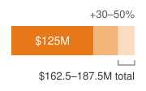{width="100%" fig-alt="One horizontal bar on a linear dollar scale from zero. A solid orange segment is labeled 125 million dollars; a lighter two-tone extension is labeled plus 30 to 50 percent, and a bracket under the 30 to 50 percent part reads 162.5 to 187.5 million dollars total."}

*Harmonizing scanners, protocols, and labels adds 30--50 percent to the acquisition cost.*
:::

3. **Data harmonization**: Data harmonization across different scanners, protocols, and labeling conventions adds `{python} RepresentationTax.overhead_low_str`--`{python} RepresentationTax.overhead_high_str` overhead, bringing the total to `{python} RepresentationTax.harmonized_low_usd_m_str`--`{python} RepresentationTax.harmonized_high_usd_m_str`.

**Systems insight**: The acquisition budget makes coverage goals explicit, but spending does not guarantee that an accuracy gap closes. Teams should prioritize identified coverage deficiencies using harm, data quality, privacy, and expected benefit criteria, then validate the resulting model on the intended populations.

::::

Upstream biases in data collection systems can persist unchecked even when data is plentiful. Many organizations rely on third-party data vendors, external APIs, or operational databases that were not designed with fairness or interpretability in mind. For instance, Electronic Health Records, which are commonly used in clinical machine learning, often reflect systemic disparities in care, as well as documentation habits that encode racial or socioeconomic bias [@himmelstein2022]. Teams working downstream may have little visibility into how these records were created, and few levers for addressing embedded harms.

Improving dataset quality is often not the responsibility of any one team. Data pipelines may be maintained by infrastructure or analytics groups that operate independently of the ML engineering or model evaluation teams. This organizational fragmentation makes it difficult to coordinate data audits, track provenance, or implement feedback loops that connect model behavior to underlying data issues. In practice, responsibility for dataset quality tends to fall through the cracks, recognized as important, but rarely prioritized or resourced.

Addressing these challenges requires long-term investment in infrastructure, workflows, and cross-functional communication. Data validation and automated audits can identify defects, while datasheets and the Data Nutrition Project[^fn-data-nutrition-project] document dataset properties. Model cards connect model evaluation and intended use to that evidence. These tools help only when teams have the mandate and support to act on their findings.

[^fn-data-nutrition-project]: **Data Nutrition Project**\index{Data Nutrition Project!dataset documentation}: A nonprofit initiative that develops standardized dataset documentation modeled on nutrition labels, summarizing provenance, composition, distribution, and known issues for datasets used in ML pipelines. The project's labels make dataset risks legible to downstream engineers who lack access to the original collection process, an essential bridge across the organizational fragmentation described here.

Improving data quality is therefore fundamentally a question of how responsibility for data is assigned, shared, and sustained across the system lifecycle, not merely a matter of better tooling. Once that responsibility is in place, teams still have to decide which responsible-AI objective should dominate when valid goals conflict.

### Balancing competing objectives {#sec-responsible-ai-balancing-competing-objectives-088e}

Machine learning system design is often framed as a process of optimization, improving accuracy, reducing loss, or maximizing utility. In responsible ML practice, however, optimization must be balanced against a range of competing objectives, including fairness, interpretability, robustness, privacy, and resource efficiency. These objectives are not always aligned, and improvements in one dimension may entail trade-offs in another. While these tensions are well understood in theory, managing them in real-world systems is a persistent and unresolved challenge.

Consider the relationship between model accuracy and interpretability. Shallow decision trees and linear models expose their decision structure, but their predictive performance relative to ensembles or deep neural networks depends on the task and data. Teams must compare suitable candidates before assuming that interpretability requires an accuracy sacrifice. If evaluation does reveal a trade-off, the deployment's stakes determine how it should be judged. In healthcare or finance, a marginal accuracy gain must be weighed against the ability to inspect decisions affecting well-being or access to opportunity.

The personalization-fairness conflict of @sec-responsible-ai-design-tradeoffs-6f5a returns here as an organizational problem. A recommendation system trained to maximize user engagement may personalize aggressively, using fine-grained behavioral data to tailor outputs to individual users. While this approach can improve satisfaction for some users, it may entrench disparities across demographic groups, particularly if personalization draws on features correlated with race, gender, or socioeconomic status. Adding fairness constraints may reduce disparities at the group level, but at the cost of reducing perceived personalization for some users. These effects are often difficult to measure, and even more difficult to explain to product teams under pressure to optimize engagement metrics.

Privacy introduces another set of constraints, but the mechanisms impose different costs. Differential privacy bounds information leakage under a specified privacy definition and accountant; federated learning changes where training data and computation reside without itself providing that guarantee. Data minimization reduces the information collected or retained [@biega2020]. Their effects on utility, communication, and computation depend on the chosen design. A wearable running a fixed model does not incur private-training overhead merely because training used differential privacy, although its telemetry and local storage still need protection. Evaluating each mechanism on its actual execution path allows teams to distinguish a measured trade-off from an assumed conflict among privacy, latency, and energy use.

The trade-offs are not purely technical; they reflect deeper normative judgments about what a system is designed to achieve and for whom, as explored in detail in @sec-responsible-ai-normative-pluralism-value-conflicts-d61f. Responsible ML development requires making these judgments explicit, evaluating them in context, and subjecting them to stakeholder input and institutional oversight.

What makes this challenge particularly difficult in implementation is that these competing objectives are rarely owned by a single team or function. Performance may be optimized by the modeling team, fairness monitored by a responsible AI group, and privacy handled by legal or compliance departments. Without deliberate coordination, system-level trade-offs can be made implicitly, piecemeal, or without visibility into long-term consequences. Over time, the result may be a model that appears well-behaved in isolation but fails to meet its ethical goals when embedded in production infrastructure.

Balancing competing objectives requires transparency, deliberation, and cross-team alignment alongside technical fluency. Systems must be designed to surface trade-offs rather than obscure them, to make room for constraint-aware development rather than pursue narrow optimization. In practice, this may require redefining what "success" looks like, not as performance on a single metric, but as sustained alignment between system behavior and its intended role in a broader social or operational context.

Organizational structures, data quality, and competing objectives explain why technical competence alone does not secure responsible behavior. A team can understand fairness metrics and still lack authority to change a dataset or delay a release. When modeling teams optimize performance, compliance teams address privacy, and product teams prioritize engagement independently, their local decisions may violate a shared requirement. Clear ownership across those boundaries connects evaluation to action, while data infrastructure and deliberative review make the evidence and trade-offs inspectable. Maintaining those connections becomes harder as deployments scale and their data, models, and teams change.

### Scalability, maintenance, and evaluation standards {#sec-responsible-ai-scalability-maintenance-a1ca}

Responsible machine learning practices are often introduced during the early phases of model development: fairness audits are conducted during initial evaluation, interpretability methods are applied during model selection, and privacy-preserving techniques are considered during training. However, as systems transition from research prototypes to production deployments, these practices frequently degrade or disappear. The gap between what is possible in principle and what is sustainable in production is a core implementation challenge for responsible AI.

Many responsible AI interventions are not designed with scalability in mind. Fairness checks may be performed on a static dataset, but not integrated into ongoing data ingestion pipelines. Explanation methods may be developed using development-time tools but never translated into deployable user-facing interfaces. Privacy constraints may be enforced during training, but overlooked during postdeployment monitoring or model updates. In each case, what begins as a responsible design intention fails to persist across system scaling and lifecycle changes.

Production environments introduce new pressures that reshape system priorities. Models must operate across diverse hardware configurations, interface with evolving APIs, serve millions of users with low latency, and maintain availability under operational stress. These constraints demand continuous adaptation and rapid iteration, often deprioritizing activities that are difficult to automate or measure. Responsible AI practices, especially those that involve human review, stakeholder consultation, or post-hoc evaluation, may not be easily incorporated into fast-paced DevOps[^fn-devops-mlops-pipeline] pipelines.

[^fn-devops-mlops-pipeline]: **MLOps (Machine Learning Operations)**\index{MLOps!responsible AI tension}: ML CI/CD pipelines must handle data versioning, training reproducibility, and A/B testing of algorithm changes beyond traditional software concerns. High-velocity ML organizations may deploy model or configuration changes far more often than responsible-AI reviews can be completed manually, creating a velocity gap: deployment cycles measured in hours compete against ethical validation requiring days or weeks. This tension explains why responsible AI commitments present at the prototype stage can be deprioritized as systems scale.

Maintenance introduces further complexity. Machine learning systems are rarely static. New data is ingested, retraining is performed, features are deprecated or added, and usage patterns shift over time. In the absence of rigorous version control, changelogs, and impact assessments, it can be difficult to trace how system behavior evolves or whether responsibility-related properties such as fairness or robustness are being preserved. Organizational turnover and team restructuring can erode institutional memory. Teams responsible for maintaining a deployed model may not be the ones who originally developed or audited it, leading to unintentional misalignment between system goals and deployed behavior. These issues are especially acute in continual or streaming learning. Drift calls for investigation and a response matched to its consequences, which may mean restricting use or invoking fallback while a revised model undergoes validation, rather than immediately updating production weights.

These challenges are magnified in multi-model systems and cross-platform deployments. A recommendation engine may consist of dozens of interacting models, each optimized for a different subtask or user segment. A voice assistant deployed across mobile and edge environments may maintain different versions of the same model, tuned to local hardware constraints. Coordinating updates, ensuring consistency, and sustaining responsible behavior in such distributed systems requires infrastructure that tracks governing values and constraints alongside code and data.

Addressing scalability and maintenance challenges requires treating responsible AI as a lifecycle property, not a one-time evaluation. This means embedding audit hooks, metadata tracking, and monitoring protocols into system infrastructure. It also means creating documentation that persists across team transitions, defining accountability structures that survive project handoffs, and ensuring that system updates do not inadvertently erase hard-won improvements in fairness, transparency, or safety. While such practices can be difficult to implement retroactively, they can be integrated into system design from the outset through responsible-by-default tooling and workflows.

Maintenance also exposes a gap in how responsible-AI evidence is standardized. A model evaluated under demographic parity on one benchmark has not thereby satisfied equalized odds in another deployment. The criterion, population, labels, threshold policy, and uncertainty belong to the claim. Changing any of them can invalidate the evidence even when the weights remain unchanged. Standardization must make those conditions explicit so teams can compare results and identify what needs revalidation.

The evaluation boundary must also match the deployment boundary. A model-only result can miss effects introduced by feature transformations, request routing, caching, or human review. Separate fairness, explanation, and compliance tools therefore need compatible identifiers and records linking their results to the same model, data, policy, and workflow versions. Otherwise, an assurance case can combine individually valid results that describe different systems.

Reusing that evidence after launch requires lifecycle controls. Production observations must be comparable with the acceptance criteria, and material changes must trigger a documented revalidation scope. Evidence must therefore remain interpretable across teams, components, and time. The implementation decision is then which obligations take priority for the intended use, which controls can satisfy them, and which authority may accept the remaining risk.

### Implementation decision framework {#sec-responsible-ai-implementation-decision-framework-e8b8}

Given these implementation challenges, practitioners need systematic approaches to prioritize responsible AI principles based on deployment context and stakeholder needs. The same principle can demand different engineering treatment across high-stakes individual decisions, safety-critical systems, privacy-sensitive applications, large-scale consumer systems, resource-constrained deployments, and research environments.

Four decision heuristics guide these trade-offs in practice. Where multiple principles conflict, engineering teams must engage domain stakeholders to establish which failure modes present the most severe harms; as the adolescent mental health crisis-detection example in @sec-responsible-ai-normative-pluralism-value-conflicts-d61f demonstrated, such value tensions require deliberate institutional policy rather than mathematical optimization alone. Under tight computational budgets, teams must first identify mandatory requirements, then allocate evaluation and response capacity according to risk. Sampling is adequate only if it can detect the relevant failures, and expensive audits need not run on the inference path. Whenever the deployment context changes, as when a cloud model migrates to edge execution with intermittent centralized monitoring, teams must re-evaluate principle priorities, establishing local fallback safeguards and evidence-synchronization plans for constrained connectivity. Finally, when stakeholder values diverge, engineers must document trade-offs explicitly and construct contestability mechanisms that permit affected individuals to challenge automated outcomes.

@Tbl-practitioner-decision-framework maps these deployment contexts to candidate priorities and trade-offs for deployment-specific review. Applicable obligations, the threat model, and accountable stakeholder decisions determine which controls and trade-offs are acceptable.

| **Deployment Context**                                                                                      | **Primary Principles**                   | **Implementation Priority**                                                                                                                                                                  | **Trade-offs to Evaluate**                                                                                                                      |
|:------------------------------------------------------------------------------------------------------------|:-----------------------------------------|:---------------------------------------------------------------------------------------------------------------------------------------------------------------------------------------------|:------------------------------------------------------------------------------------------------------------------------------------------------|
| **High-Stakes Individual Decisions** (healthcare diagnosis, credit and loans, criminal justice, employment) | Fairness, explainability, accountability | Mandatory fairness metrics across protected groups; explanations for negative outcomes; human oversight for edge cases                                                                       | A measured accuracy budget for interpretability; bounded explanation latency; higher computational cost                                         |
| **Safety-Critical Systems** (autonomous vehicles, medical devices, industrial control)                      | Safety, robustness, accountability       | Threat-model-specific evaluation; bounded certification where applicable; fail-safe mechanisms; comprehensive logging                                                                        | Significant validation and adversarial-training overhead; conservative confidence thresholds; redundant inference                               |
| **Privacy-Sensitive Applications** (health records, financial data, personal communications)                | Privacy, security, transparency          | Data minimization and appropriate consent mechanisms; evaluate local processing and differential privacy with stated $(\PrivacyBudget, \PrivacyAdditiveSlack)$, privacy unit, and accountant | Privacy-utility trade-offs; higher client-side compute; limited model updates; reduced personalization                                          |
| **Large-Scale Consumer Systems** (content recommendation, search, advertising)                              | Fairness, transparency, safety           | Bias monitoring across demographics; explanation mechanisms; content-policy enforcement; feedback-loop detection                                                                             | Sampled or asynchronous explanations at scale; serving-path latency budgeted for fairness checks; investment in monitoring infrastructure       |
| **Resource-Constrained Deployments** (mobile, edge, TinyML)                                                 | Privacy, efficiency, safety              | Local inference; data locality; input validation; graceful degradation                                                                                                                       | Expensive audits moved off-device, while local safety checks, fleet or servicing audits, update authority, and retirement criteria are retained |
| **Research and Exploratory Systems** (internal tools, prototypes, A/B tests)                                | Transparency, safety (harm prevention)   | Documented known limitations; restricted user populations; monitoring for unintended harms                                                                                                   | Evaluation depth matched to potential harm and applicable obligations; observability and bounded iteration                                      |

: **Practitioner Decision Framework**: Prioritizing responsible AI principles based on deployment context, showing candidate principles, controls, and trade-offs for different system types. Deployment-specific review must establish applicable requirements and justify the selected controls; no row waives mandatory obligations. {#tbl-practitioner-decision-framework tbl-colwidths="[24,16,31,29]"}

::: {#lhs-responsible-ai-archetype-evidence-authority .callout-lighthouse title="Lighthouse archetypes: Evidence must meet authority"}

The lighthouse workloads in @sec-vol2-introduction-archetypes require different evidence because they expose different harms, and they assign decision authority to different operating paths.

| **Workload**                          | **Minimum decision evidence**                                                                                                                          | **Required authority**                                                                                                                 |
|:--------------------------------------|:-------------------------------------------------------------------------------------------------------------------------------------------------------|:---------------------------------------------------------------------------------------------------------------------------------------|
| **Archetype A (GPT-4/Llama-3)**       | Capability- and use-specific safety evaluations, harmful-output and misuse tests, uncertainty and fallback behavior, and versioned deployment evidence | Model and safety owners approve the allowed use envelope; service owners can halt or roll back when monitoring invalidates it          |
| **Archetype B (DLRM at Scale)**       | Disaggregated ranking quality, exposure and error rates, feedback-loop analysis, and online effects under the serving policy                           | Product and responsible-AI owners choose the welfare and fairness criteria; operators can disable a model or policy that breaches them |
| **Archetype C (Federated MobileNet)** | Per-device and subgroup quality, participation bias, privacy accounting, update integrity, and behavior across client versions                         | Device, privacy, and model owners approve participation and update policy; fleet control can suspend aggregation or revert clients     |

A metric becomes a control only when the named authority can act on it. Evidence that is sufficient for a recommender policy review does not establish safety for a general-purpose language model, and aggregate federated accuracy does not authorize an update whose participation or privacy assumptions have failed.

:::

The framework provides starting guidance, but it should be read as a triage mechanism rather than a complete governance program. A differential privacy budget must specify the protected unit, neighboring relation, delta, trust model, and composition across releases; no single epsilon threshold establishes adequacy for every deployment. Certification establishes only its stated property within a defined operating envelope. Legal obligations depend on intended use, jurisdiction, and organizational role, not whether inference runs in a cloud or on a microcontroller [@euaiact2024; @gdpr2016]. The framework identifies which constraints deserve first attention, with reassessment as deployment conditions change. The lifecycle assigns human authority over deployment even when individual actions are automated. Engineers investigate bias, operators review fairness metrics, and developers respond to drift. Some systems must also act faster than humans can review an individual decision. Autonomous vehicles respond in milliseconds; trading algorithms execute thousands of transactions before human review is possible; content moderation systems process billions of posts daily. For these systems, the implementation framework must be paired with the value-alignment and fallback controls of @sec-responsible-ai-ai-safety-value-alignment-8c93, which keep objectives aligned with human values even when operation runs beyond continuous human supervision.

::: {#psp-responsible-ai-responsibility-is-infrastructure-not-feature .callout-perspective title="Responsibility is infrastructure, not a feature"}

Retrofitting responsible AI controls can require architectural redesign and revalidation, just as adding fault tolerance can. The structural costs cataloged in @tbl-responsible-ai-overhead each carry a provisioning consequence: bias-drift monitoring needs a sampling and analysis budget; expensive or exact explanation workloads may need a dedicated asynchronous worker fleet, whereas model-specific TreeSHAP, sampling, caching, or selective generation may fit smaller budgets; DP-SGD requires budgeting its clipping, noise, and accounting work under the chosen implementation; and impact assessments need review capacity in the release process. These are not *optional add-ons* but *load-bearing components* of production ML systems. In high-risk or regulated deployments, failing to provision the evidence required by the assurance case can block release or force redesign even when core model performance is strong.

:::

```{python}
#| echo: false
# ┌─────────────────────────────────────────────────────────────────────────────
# │ EXPLAINABILITY RETROFIT COST (LEGO)
# ├─────────────────────────────────────────────────────────────────────────────
# │ Context: @sec-responsible-ai-fallacies-pitfalls-5b80
# │
# │ Goal: Compute latency and capacity impact of adding approximate SHAP.
# │ Show: 100 ms baseline plus 50--200 ms overhead gives 150--300 ms total,
# │       requiring 1.5--3.0x serving capacity to preserve the original SLA.
# │ How: total latency = baseline + overhead; multiplier = total / baseline.
# │
# └─────────────────────────────────────────────────────────────────────────────
from mlsysim.fmt import check, fmt

# ┌── LEGO ───────────────────────────────────────────────
class ExplainabilityRetrofitCost:
    """Namespace for SHAP retrofit latency and capacity calculations."""

    # ┌── 1. LOAD (Constants) ──────────────────────────────────────────────
    base_latency_ms = ReferenceStats.RecommenderAtScaleProfile.P99LatencySlo.to(ms).magnitude
    overhead_low_ms = base_latency_ms * float(Literature.ResponsibleAIOverhead.ApproxShapInferenceLowPct) / 100
    overhead_high_ms = base_latency_ms * float(Literature.ResponsibleAIOverhead.ApproxShapInferenceHighPct) / 100
    qps = 10_000  # scenario assumption: request rate for the sizing example

    # ┌── 2. EXECUTE (The Compute) ────────────────────────────────────────
    total_low_ms = base_latency_ms + overhead_low_ms
    total_high_ms = base_latency_ms + overhead_high_ms
    capacity_low = total_low_ms / base_latency_ms
    capacity_high = total_high_ms / base_latency_ms

    # ┌── 3. GUARD (Invariants) ──────────────────────────────────────────
    from mlsysim.fmt import check

    check(total_low_ms == 150 and total_high_ms == 300, "Unexpected SHAP latency range")

    # ┌── 4. OUTPUT (Formatting) ──────────────────────────────────────────────
    from mlsysim.fmt import fmt, fmt_multiple_range, fmt_time

    qps_str = fmt(qps, precision=0, commas=True)
    capacity_mult_range_str = fmt_multiple_range(capacity_low, capacity_high, precision=(1, 0))
    shap_base_latency_ms_str = fmt_time(base_latency_ms, 'millisecond', precision=0, commas=False)
    shap_overhead_low_ms_str = fmt_time(overhead_low_ms, 'millisecond', precision=0, commas=False)
    shap_overhead_high_ms_str = fmt_time(overhead_high_ms, 'millisecond', precision=0, commas=False)
    shap_total_low_ms_str = fmt_time(total_low_ms, 'millisecond', precision=0, commas=False)
    shap_total_high_ms_str = fmt_time(total_high_ms, 'millisecond', precision=0, commas=False)
```

Structural costs like latency overhead belong in the core architecture from the first design review, because retrofitting them can require redesign and revalidation. The following fallacies expose assumptions that hide those costs or mistake a local technical result for system-level responsibility.

## Fallacies and Pitfalls {#sec-responsible-ai-fallacies-pitfalls-5b80}

Responsible AI involves counterintuitive trade-offs where ethical principles conflict mathematically and technically. Practitioners from traditional software backgrounds often assume ethical guidelines translate directly to implementation without recognizing the impossibility theorems and computational costs involved. These fallacies and pitfalls capture misconceptions that lead to deployed systems that appear fair in development but violate fairness criteria in production or impose prohibitive computational overhead.

::: {.fallacy-pitfall}

**Fallacy**: *Bias will disappear with more data and better algorithms.*

More representative data and better algorithms can reduce some disparities, but they do not determine whether the prediction target is appropriate. The healthcare algorithm described in @sec-responsible-ai-fairness-machine-learning-2ba4 underestimated Black patients' health needs at a given risk score because expenditure was an imperfect proxy for need. Improving prediction of that proxy would not by itself repair the target. Separately, with unequal base rates and imperfect prediction, groupwise score calibration cannot coexist with equal mean scores across groups in both outcome classes. Engineers must distinguish a remediable data or modeling defect from incompatible requirements, then use stakeholder deliberation to justify the criteria the deployment will pursue.

:::

::: {.fallacy-pitfall}

**Pitfall**: *Treating explainability as an optional feature to be added after core functionality works.*

This approach ignores the displacement of overhead: producing attribution evidence about model behavior demands compute, storage, and interfaces that constrain the architecture. Approximate SHAP explanations are not compute-free (@tbl-responsible-ai-overhead); even a bounded explanation budget can increase request latency and memory pressure. In this sizing example, a recommendation system serving `{python} ExplainabilityRetrofitCost.shap_base_latency_ms_str` latency requirements at `{python} ExplainabilityRetrofitCost.qps_str` QPS cannot retrofit explanation work without revisiting the SLA: the illustrative explanation budget adds `{python} ExplainabilityRetrofitCost.shap_overhead_low_ms_str` to `{python} ExplainabilityRetrofitCost.shap_overhead_high_ms_str` per request, increasing total latency to `{python} ExplainabilityRetrofitCost.shap_total_low_ms_str`--`{python} ExplainabilityRetrofitCost.shap_total_high_ms_str` (requiring `{python} ExplainabilityRetrofitCost.capacity_mult_range_str` capacity only under the simplifying assumption that occupied resource time grows in direct proportion to latency, at fixed utilization and parallelism). The assurance case must specify the audience, claim, method, fidelity test, and delivery budget, then choose an architecture such as model-specific TreeSHAP, sampled or cached attribution, selective asynchronous generation, or an inherently interpretable model. Additional replicas can preserve throughput under that assumption, but they do not restore the original per-request latency if explanation remains on the serial path. None of these attribution paths exposes a model's internal reasoning or establishes causation.

:::

::: {.fallacy-pitfall}

**Fallacy**: *Achieving one fairness metric guarantees overall system fairness.*

Practitioners often optimize for demographic parity, which equalizes approval rates across groups, and then assume fair treatment follows. In reality, fairness metrics can conflict mathematically. The fairness-tax credit scenario (notebook \ref{nbk-responsible-ai-fairness-tax}) illustrates the policy choice. Holding Group A's approval rate at `{python} FairnessTaxAnalysis.group_a_approval_pct_str` and raising Group B's to match it required loosening Group B's default-probability cutoff from `{python} FairnessTaxAnalysis.default_prob_threshold_str` to `{python} FairnessTaxAnalysis.default_prob_threshold_parity_str`, which cost `{python} FairnessTaxAnalysis.fairness_tax_pp_str` of accuracy and left approvals in the two groups carrying different default risk. The score-balance impossibility result shows that, with unequal base rates and imperfect prediction, groupwise calibration and equal mean scores across groups in both outcome classes cannot all hold; demographic parity can add a separate selection-rate constraint. Passing one metric therefore leaves other criteria to evaluate. A metric disparity is evidence for investigation, while a legal conclusion depends on the applicable rule and the facts of the deployment.

:::

::: {.fallacy-pitfall}

**Pitfall**: *Treating responsible AI as pure compliance overhead.*

This perspective misses the value of identifying and responding to risk. Differential privacy can enable organizations to work with sensitive data under clearer privacy guarantees, but it also imposes privacy-utility trade-offs that must be planned in the training budget. Fairness-aware training and monitoring can support that risk-management process. The employment-selection screen discussed in @sec-responsible-ai-quantitative-fairness-measurement-a8f2 illustrates one context-specific disparity threshold, rather than a universal legal test. Monitoring need-adjusted outcomes by group could reveal a disparity such as the healthcare algorithm's underestimate of Black patients' needs. Reducing the resulting harm still requires an owner with authority, capacity, and a validated remedy; detection alone does not protect affected people.

:::

::: {.fallacy-pitfall}

**Fallacy**: *A post-hoc threshold adjustment can make a deployed system fair.*

This belief treats fairness as a single decision-boundary problem rather than a coupled system property. Moving a threshold can equalize one metric, but it can also change decision precision, business meaning, legal documentation, and user experience while leaving the underlying score calibration unchanged. In production, the threshold is an operational policy embedded in serving code, human review, audit records, and downstream decisions, rather than a standalone cutoff in a notebook.

:::

::: {.fallacy-pitfall}

**Pitfall**: *Implementing fairness constraints without analyzing threshold trade-offs and calibration impacts.*

Group-specific thresholds can satisfy equal true positive rates, but they also change decision semantics: if Group A threshold is 0.75 and Group B threshold is 0.45, as in @fig-fairness-example, identical scores can yield different decisions, and the positive predictive value of approved applicants can diverge across groups even when the underlying score model remains calibrated. A loan officer seeing an approval cannot know whether it represents the same repayment-risk meaning across groups without documentation of the group-specific threshold policy. Production systems therefore need documented metric selection, uncertainty estimates, staff training, legal review, and audit trails\index{Audit trail!decision justification} explaining why identical scores can yield different decisions. No generic training objective resolves incompatible fairness definitions; the appropriate response is to choose and justify the criteria for the deployment context, quantify the resulting trade-offs, and monitor whether the approved policy remains valid.

:::

::: {.fallacy-pitfall}

**Fallacy**: *Monitoring dashboards create accountability by themselves.*

Dashboards can expose fairness drift, explanation failures, or abuse trends, but they do not decide who must act. Teams often instrument fairness, safety, or privacy metrics because a policy requires visibility, then leave the response path undefined, which creates a false sense of control. A metric that no team owns is not a control; it is a log entry. The system accumulates evidence without changing behavior, so alerts age out, fairness regressions become accepted baselines, and affected users receive no route to contest the decision. Production responsibility requires binding each monitoring signal to an owner, a threshold, an escalation path, and a remediation budget, whether that is a release gate, an incident owner, rollback authority, or human-review capacity.

:::

Treating a local metric or control as sufficient system assurance is the common failure behind these examples. A mathematical fairness constraint is only responsible when the system also accounts for downstream population effects, documentation requirements, operational capacity, and legal exposure.

## Summary {#sec-responsible-ai-summary-ed99}

Responsible AI connects the fleet's technical controls to justified decisions about deployment and remedy. Fairness metrics expose disparities, privacy and robustness controls support bounded claims, and explanations provide evidence that people must be able to inspect or contest. None of these mechanisms establishes responsibility on its own. A versioned assurance case connects the intended use, affected population, evidence, assumptions, and accountable authority, while monitoring and revalidation keep those claims tied to the system that actually runs.

Responsible AI is a systems engineering concern because its controls affect the production architecture. Fairness monitoring consumes compute and may affect latency. Explainability methods such as SHAP and LIME add inference work that affects capacity planning and SLO compliance. System prompts, model versions, and audit logs require ownership, versioning, and CI/CD controls. These costs must be budgeted during design rather than added after deployment.

Selective explanation generation illustrates the C³ choice. Producing an explanation synchronously adds compute to the request path and may add communication to retrieve features; moving it to an asynchronous worker protects serving latency but adds coordination among the decision, evidence record, and appeal workflow. The bottleneck then moves from inference capacity to evidence freshness or reviewer throughput. The acceptable architecture depends on who needs the explanation and how quickly that person must be able to act on it. Read through the Fleet Law (@eq-fleet-law), private or adversarial training can add compute through mechanism-specific operations or additional evaluations. Launch approvals and revalidation gates add coordination delays that replication alone cannot remove. Asynchronous evidence generation permits overlap only when the evidence still arrives before the decision or remedy that depends on it.

::: {.callout-takeaways title="Ethics is an engineering constraint"}

* **Responsibility gates deployment**: In high-risk or regulated settings, accuracy and latency cannot substitute for required documentation, explanation, audit, and ownership. Governance is a coordination constraint that determines whether the fleet may launch, continue operating, or must restrict use.
* **Fairness requires justified criteria**: The running loan model violates every criterion at once, and the disaggregated-metrics table shows a second loan model with a `{python} FairnessGapCalc.fpr_gap_pp_attr_str` false-positive gap while still carrying `{python} FairnessGapCalc.approval_gap_pp_attr_str` approval and `{python} FairnessGapCalc.tpr_gap_pp_attr_str` true-positive gaps. Both describe particular policies; the impossibility result constrains every score. With unequal base rates and imperfect prediction, groupwise score calibration conflicts with requiring equal mean scores across groups in both outcome classes. The chosen criteria need an explicit justification.
* **Disparity is not a causal diagnosis**: Group metrics reveal unequal outcomes or errors, while causal claims require an explicit structural model and assumptions not recoverable from observational data alone. Path-specific analysis still leaves the legitimacy of each pathway to domain, legal, and stakeholder judgment.
* **Oversight consumes capacity**: Fairness monitoring and audit logging consume compute and storage; synchronous explanations can add request latency, while privacy-preserving training trades privacy against utility and training cost. Budget each control on the path where it runs, including evidence delivery and human review.
* **Generative governance is infrastructure**: System prompts, RLHF policies, tool permissions, model versions, and safety evaluations are operational artifacts. They need ownership, CI/CD, rollback, and monitoring because a configuration or policy change can alter deployed behavior even when the model weights remain unchanged.
* **Evidence needs an owner**: Dashboards, explanations, and appeals protect users only when a team can investigate, remediate, roll back, or escalate failures. Responsible AI becomes engineering practice when every measured obligation has an accountable operating path.

:::

Quantification can show which groups bear a policy's errors and what its safeguards cost, but it cannot decide whose interests should take priority. The engineering responsibility is to make those choices explicit, preserve the evidence behind them, and provide authority to revisit them when the system or its consequences change. Governance makes the fleet's objective itself accountable, as well as the machinery used to pursue it.

::: {.callout-chapter-connection title="From responsibility to synthesis"}

Responsible governance joins performance, security, robustness, and sustainability as a constraint the fleet must satisfy before it may run. The four parts have now traversed the fleet from physical silicon, networks, and storage in Part I, through distributed coordination and recovery in Part II and performance engineering and fleet serving in Part III, to the governance safeguards of Part IV. Each part examined its constraints largely one at a time, yet a production fleet couples them all. An optimization at the kernel layer reverberates into cluster power budgets, and a governance rule reshapes the serving architecture. The final chapter returns to the scale moment where the volume began and follows the binding constraint as it leaves the node, condensing the four parts into six principles of distributed ML systems, read through the Fleet Law and placed on the fleet stack.

:::

::: {.column-margin .margin-pointer}
↪ System synthesis, cross-layer co-design, and emerging fleet frontiers are developed in @sec-conclusion.
:::

[^fn-red-teaming-etymology]: **Red Teaming**\index{Red teaming!etymology}: From Cold War military simulations where the "Red Team" acted as the Soviet adversary to probe US defenses. In Responsible AI, red teaming is the adversarial audit phase: specialized teams (hackers, linguists, ethicists) deliberately probe models for jailbreaks, bias, or toxic outputs before deployment. This discovery process identifies the long-tail risks that standard unit tests cannot catch.

[^fn-sociotechnical-system-etymology]: **Sociotechnical System**\index{Sociotechnical system!etymology}: Coined by the Tavistock Institute in the 1950s to describe the interdependent relationship between humans and technology in the workplace. ML fleets are sociotechnical systems in exactly this sense: their "performance" is not merely a benchmark score but an emergent property of how model outputs interact with user behavior, legal frameworks, and physical resource constraints.

<!-- This is here to make sure that quizzes are inserted properly before a part begins. -->

::: { .quiz-end }
:::

```{=latex}
\part{key:synthesis}
```
