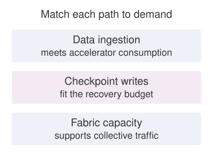

# Conclusion {#sec-conclusion}

::: {layout-narrow}
::: {.column-margin}

\chapterminitoc

:::

::: {.content-visible when-format="pdf"}
\noindent
{fig-alt="Blueprint-style fleet-scale ML systems map with labeled areas for infrastructure, fabric, storage, distributed training, serving, operations, security, sustainability, and governance."}
:::

::: {.content-visible unless-format="pdf"}
{fig-alt="Blueprint-style fleet-scale ML systems map with labeled areas for infrastructure, fabric, storage, distributed training, serving, operations, security, sustainability, and governance."}
:::

:::

## Purpose {.unnumbered .unlisted}

\begin{marginfigure}
\mlfleetstack{40}{40}{40}{40}{40}{40}{40}{40}
\end{marginfigure}

_Why must the unit of machine learning systems design become the fleet rather than the model?_

At fleet scale, a local improvement can move cost into a layer that its designer did not measure. Faster computation can expose a network bottleneck; larger jobs can lose more work to failure; a service that meets latency targets can still lack evidence required for deployment. The model remains central, but its accuracy and execution speed do not determine whether the complete system delivers useful work. Adding accelerators is therefore a design decision about shared resources and obligations, not simply a purchase of more arithmetic. If communication and recovery consume the saved execution time, the expansion can increase cost without improving progress. If the resulting service cannot preserve availability or account for its effects on users, successful training does not establish readiness for deployment. Single-node reasoning remains necessary because every participant still has local limits, but it cannot settle decisions whose consequences cross machines, teams, and operating boundaries. The engineering responsibility is to connect those consequences before accepting the design. That requires evidence about what improves, what becomes more constrained, and who owns the costs transferred elsewhere. A defensible decision may expand the fleet, change how work is distributed, or postpone release until the operating requirements can be met. In C³ terms, the task is to follow the binding compute, communication, or coordination constraint across layers and keep its displaced costs visible.

::: {.content-visible when-format="pdf"}

\newpage

:::

::: {.callout-learning-objectives}

- Synthesize the six principles into a constraint map for distributed ML systems
- Diagnose a fleet design's binding C³ term using measured execution costs and failure exposure
- Analyze how infrastructure, distributed training, inference, operations, and governance interact across the fleet stack
- Translate security, fairness, privacy, carbon, and reliability obligations into measurable design constraints
- Defend a fleet expansion or model-release decision using operational measurements and governance evidence

:::

## Synthesizing Distributed ML Systems {#sec-conclusion-synthesizing-distributed-ml-systems-bac9}

A frontier-model production system\index{Frontier model!fleet infrastructure} can span thousands of accelerators, with fabric links, storage tiers, schedulers, serving replicas, security controls, and governance checks supporting the same workload. Any one layer can bind the entire system. In the storage tier, a slow checkpoint can waste an entire training window. Across the interconnect, a congested fabric can erase scaling gains from added compute. In the serving pool, underprovisioned capacity can turn model quality into user-visible latency, while an unmeasured responsibility constraint can block deployment after the technical system works.

That coupling across the stack is what separates foundational ML engineering\index{DAM taxonomy@D·A·M taxonomy!single-node foundation} from distributed ML engineering\index{Distributed ML engineering!fleet stack shift}. The single-node foundation already couples models, data pipelines, execution, and deployment constraints. Distributed ML engineering extends that reasoning to shared infrastructure, distributed protocols, and governance across a fleet.

The physical substrate\index{Physical substrate!hardware limits}\index{Infrastructure!rates and physical limits} supplies the rates that higher layers inherit. Accelerator topology\index{Accelerator!topology}, data-loading throughput, and network contention constrain how the Distribution band\index{Fleet Stack!Distribution band} partitions, synchronizes, and recovers work. The Serving band\index{Fleet Stack!Serving band} converts that coordinated execution into a service with latency, availability, and cost obligations. The Governance band\index{Fleet Stack!Governance band} determines whether the service remains secure, robust, sustainable, and accountable. The six principles connect these inherited constraints to engineering decisions.

## Six Principles of Distributed ML Systems {#sec-conclusion-six-principles-distributed-ml-systems-746a}

The six engineering practices that opened this book (instrument first, design for 10$\times$ headroom, expect bottlenecks to migrate, treat failure as steady state, compound small efficiency gains, and co-design hardware with algorithms\index{Hardware-software co-design!fleet constraints}) become useful only when they name the constraint they are trying to move. The six principles in @tbl-vol2-principles supply those names by grouping the part-level principles into design questions. Communication draws on the bandwidth-latency trade-off and the Fleet Law, and in a serving fleet it also carries the tail-latency argument behind power-of-two-choices routing (principle \ref{pri-power-two-choices}). Routine failure draws on the Young-Daly checkpoint interval. Infrastructure brings together thermal, memory, bisection-bandwidth, and I/O limits, including the autoregressive bottleneck (principle \ref{pri-autoregressive-bottleneck}) that leaves small-batch decode waiting on memory bandwidth. Responsibility combines privacy, robustness, fairness, and feedback constraints. Sustainability applies resource accounting and the Jevons rebound argument, and its cost question extends over the model's whole life, because a heavily used model can spend more on inference than it did on training (principle \ref{pri-serving-cost-dominance}). Qualitative change at scale ties these constraints to the scaling laws that make fleets grow, to scaling efficiency, and to the displacement of overhead. Each grouping names the measurements that decide which earlier result to apply.

The single-node foundation\index{DAM taxonomy@D·A·M taxonomy!single-node vs. fleet} couples execution rates, captured by the iron law\index{Iron law!vs. fleet law} recalled in @sec-vol2-introduction-fleet-law, with reliability and operational constraints. Those constraints remain at fleet scale, where shared dependencies increase failure exposure, links contend, schedulers act on stale information, and governance spans distributed components. The Fleet Law extends the execution model\index{Fleet law!distributed step time}\index{Fleet law!C³ taxonomy mapping} ($T_{\text{step}}(N) = \frac{T_{\text{compute}}}{N} + T_{\text{comm}}(N) + T_{\text{sync}}(N) - T_{\text{overlap}}$), stated as @eq-fleet-law in @sec-vol2-introduction-fleet-law, decomposed term by term in @sec-appdx-c3-taxonomy-fleet-law, and used at key points across the text. The Fleet Law acts as the distributed counterpart to the iron law, translating single-machine execution into the mechanics of networked collectives and driving the operational behaviors observed at scale. Its three cost terms map directly onto the $C^3$ taxonomy\index{C³ taxonomy!fleet law mapping}\index{C³ taxonomy!compute, communication, coordination} that organizes this book: $T_{\text{compute}}/N$ is Compute\index{C³ taxonomy!compute}, $T_{\text{comm}}(N)$ is Communication\index{C³ taxonomy!communication}, and $T_{\text{sync}}(N)$ is Coordination\index{C³ taxonomy!coordination}. The overlap correction\index{Communication overlap!fleet law}, $T_{\text{overlap}}$, captures communication or coordination time hidden behind useful computation rather than defining a fourth $C^3$ axis.

These principles follow the four bands of the fleet stack\index{Fleet Stack!layered architecture}\index{Fleet Stack!working discipline} synthesized in @fig-fleet-stack-conclusion. At the physical foundation, infrastructure determines capability[^fn-hardware-capability-ceiling] because hardware physics sets the hard limits.

[^fn-hardware-capability-ceiling]: **Hardware Capability Ceiling**\index{Hardware Capability Ceiling!physical limits}: At fleet scale, hardware sets hard physical ceilings ($R_{\text{peak}}$, bisection bandwidth, thermal design power); finite compute and bandwidth limit attainable rates, while memory capacity and safe power and thermal envelopes constrain feasible configurations. A workload that demands more than an attainable rate still runs, only more slowly; one whose working state does not fit cannot run until it is partitioned, offloaded, or reduced.

In the operational reality of the Distribution and Serving bands, communication can dominate step time and failure is routine. The Fleet Law's network and synchronization terms make these operational costs explicit. In the Governance band, two principles act as normative constraints on what may be built rather than what is merely possible: responsibility constrains design, and sustainability is a first-order cost. Emerging from this stack is the sixth principle: scale creates qualitative change\index{Scale Moment!qualitative change}.

::: {#fig-fleet-stack-conclusion fig-env="figure" fig-pos="htb" fig-cap="**The Fleet Stack Revisited**: The eight rows and four bands that organized the book, one band per part. The Infrastructure band (Facility & Accelerators, Fabric & Storage) determines capability; the Distribution band (Distributed Execution, Reliability & Control) and the Serving band (Runtime & Serving, Operations) define the operating environment; the Governance band (Assurance, Governance & Sustainability) constrains what may be deployed. Scale changes the behavior of every band." fig-alt="Four-band stack, one band per part of the book, each holding two rows. Bottom: The Fleet, with Facility and Accelerators and Fabric and Storage. Next: Distributed ML, with Distributed Execution and Reliability and Control. Next: Deployment at Scale, with Runtime and Serving and Operations. Top: The Responsible Fleet, with Assurance and Governance and Sustainability. A vertical arrow labeled Scale Creates Qualitative Change runs alongside."}
{width="100%"}

<!--
```{.tikz}
\providecolor{mlsysblue}{RGB}{26, 86, 160}
\providecolor{mlsysgreen}{RGB}{16, 124, 65}
\providecolor{mlsysred}{RGB}{186, 24, 27}
\providecolor{mlsysamber}{RGB}{217, 119, 6}
\providecolor{mlsyspurple}{RGB}{124, 58, 237}
\providecolor{mlsysdarkgray}{RGB}{30, 41, 59}
\providecolor{mlsysgray}{RGB}{100, 116, 139}
\providecolor{mlsyslightgray}{RGB}{241, 245, 249}
\providecolor{bordergray}{RGB}{203, 213, 225}
\scalebox{0.78}{%
\begin{tikzpicture}[
  font=\sffamily,
  scale=0.95,
  every node/.style={align=center},
  tier/.style={
    draw=bordergray,
    fill=white,
    line width=0.65pt,
    rounded corners=3.5pt,
    minimum width=10.2cm,
    minimum height=1.78cm,
    inner sep=0pt
  },
  catbox/.style={
    line width=0.65pt,
    rounded corners=3pt,
    minimum width=2.9cm,
    minimum height=0.82cm,
    inner sep=2pt
  },
  card4/.style={
    draw=bordergray,
    fill=white,
    line width=0.6pt,
    rounded corners=2.5pt,
    minimum width=2.22cm,
    minimum height=0.78cm,
    inner sep=1.5pt
  },
  card3/.style={
    draw=bordergray,
    fill=white,
    line width=0.6pt,
    rounded corners=2.5pt,
    minimum width=3.00cm,
    minimum height=0.78cm,
    inner sep=2pt
  },
  buslink/.style={
    line width=0.7pt
  }
]

  % =========================================================================
  % TIER 1: INFRASTRUCTURE (Bottom)
  % =========================================================================
  \def\yI{0.0}
  \node[tier, draw=mlsysblue!70, fill=blue!2!white] (t1) at (0.50, \yI) {};
  \node[catbox, draw=mlsysblue!80, fill=blue!4!white, anchor=east] (cat1) at ([xshift=-0.55cm]t1.west) {
    {\fontsize{6.2}{7.2}\selectfont\textcolor{mlsysblue!80!black}{\textbf{LAYER I}}}\\[1pt]
    {\fontsize{7.5}{9}\selectfont\textbf{\textcolor{mlsysblue}{INFRASTRUCTURE}}}
  };
  % Bus coupling with tick slash
  \draw[buslink, draw=mlsysblue!60] (cat1.east) -- (t1.west);
  \draw[line width=0.7pt, draw=mlsysblue!75] ([xshift=0.28cm]cat1.east) ++(-2pt,-3.5pt) -- ++(4pt,7pt);

  % Header
  \node[anchor=center, font=\bfseries\fontsize{9}{11}\selectfont, text=mlsysblue!90!black]
    at (0.50, \yI + 0.46) {I. The Fleet};

  % Subcards (3 cards)
  \node[card3, draw=mlsysblue!45] (t1_c1) at (-2.70, \yI - 0.28) {
    {\fontsize{7.5}{9.5}\selectfont\textbf{\textcolor{mlsysdarkgray}{Compute Clusters}}}
  };
  \node[card3, draw=mlsysblue!45] (t1_c2) at (0.50, \yI - 0.28) {
    {\fontsize{7.5}{9.5}\selectfont\textbf{\textcolor{mlsysdarkgray}{High-Speed Interconnect}}}
  };
  \node[card3, draw=mlsysblue!45] (t1_c3) at (3.70, \yI - 0.28) {
    {\fontsize{7.5}{9.5}\selectfont\textbf{\textcolor{mlsysdarkgray}{Data Systems}}}
  };

  % =========================================================================
  % TIER 2: DISTRIBUTION
  % =========================================================================
  \def\yII{2.2}
  \node[tier, draw=mlsyspurple!70, fill=purple!2!white] (t2) at (0.50, \yII) {};
  \node[catbox, draw=mlsyspurple!80, fill=purple!4!white, anchor=east] (cat2) at ([xshift=-0.55cm]t2.west) {
    {\fontsize{6.2}{7.2}\selectfont\textcolor{mlsyspurple!80!black}{\textbf{LAYER II}}}\\[1pt]
    {\fontsize{7.5}{9}\selectfont\textbf{\textcolor{mlsyspurple}{DISTRIBUTION}}}
  };
  % Bus coupling with tick slash
  \draw[buslink, draw=mlsyspurple!60] (cat2.east) -- (t2.west);
  \draw[line width=0.7pt, draw=mlsyspurple!75] ([xshift=0.28cm]cat2.east) ++(-2pt,-3.5pt) -- ++(4pt,7pt);

  % Header
  \node[anchor=center, font=\bfseries\fontsize{9}{11}\selectfont, text=mlsyspurple!90!black]
    at (0.50, \yII + 0.46) {II. Distributed ML};

  % Subcards (3 cards)
  \node[card3, draw=mlsyspurple!45] (t2_c1) at (-2.70, \yII - 0.28) {
    {\fontsize{7.5}{9.5}\selectfont\textbf{\textcolor{mlsysdarkgray}{Parallelism}}}
  };
  \node[card3, draw=mlsyspurple!45] (t2_c2) at (0.50, \yII - 0.28) {
    {\fontsize{7.5}{9.5}\selectfont\textbf{\textcolor{mlsysdarkgray}{Communication Fabrics}}}
  };
  \node[card3, draw=mlsyspurple!45] (t2_c3) at (3.70, \yII - 0.28) {
    {\fontsize{7.5}{9.5}\selectfont\textbf{\textcolor{mlsysdarkgray}{Fault Tolerance}}}
  };

  % =========================================================================
  % TIER 3: SERVING
  % =========================================================================
  \def\yIII{4.4}
  \node[tier, draw=mlsysamber!70, fill=orange!3!white] (t3) at (0.50, \yIII) {};
  \node[catbox, draw=mlsysamber!80, fill=orange!5!white, anchor=east] (cat3) at ([xshift=-0.55cm]t3.west) {
    {\fontsize{6.2}{7.2}\selectfont\textcolor{mlsysamber!90!black}{\textbf{LAYER III}}}\\[1pt]
    {\fontsize{7.5}{9}\selectfont\textbf{\textcolor{mlsysamber!90!black}{SERVING}}}
  };
  % Bus coupling with tick slash
  \draw[buslink, draw=mlsysamber!60] (cat3.east) -- (t3.west);
  \draw[line width=0.7pt, draw=mlsysamber!75] ([xshift=0.28cm]cat3.east) ++(-2pt,-3.5pt) -- ++(4pt,7pt);

  % Header
  \node[anchor=center, font=\bfseries\fontsize{9}{11}\selectfont, text=mlsysamber!90!black]
    at (0.50, \yIII + 0.46) {III. Deployment at Scale};

  % Subcards (4 cards)
  \node[card4, draw=mlsysamber!45] (t3_c1) at (-3.20, \yIII - 0.28) {
    {\fontsize{7.5}{9.5}\selectfont\textbf{\textcolor{mlsysdarkgray}{Inference}}}
  };
  \node[card4, draw=mlsysamber!45] (t3_c2) at (-0.72, \yIII - 0.28) {
    {\fontsize{7.5}{9.5}\selectfont\textbf{\textcolor{mlsysdarkgray}{Performance}}}
  };
  \node[card4, draw=mlsysamber!45] (t3_c3) at (1.72, \yIII - 0.28) {
    {\fontsize{7.5}{9.5}\selectfont\textbf{\textcolor{mlsysdarkgray}{Edge}}}
  };
  \node[card4, draw=mlsysamber!45] (t3_c4) at (4.20, \yIII - 0.28) {
    {\fontsize{7.5}{9.5}\selectfont\textbf{\textcolor{mlsysdarkgray}{Fleet Operations}}}
  };

  % =========================================================================
  % TIER 4: GOVERNANCE (Top)
  % =========================================================================
  \def\yIV{6.6}
  \node[tier, draw=mlsysgreen!70, fill=green!2!white] (t4) at (0.50, \yIV) {};
  \node[catbox, draw=mlsysgreen!80, fill=green!4!white, anchor=east] (cat4) at ([xshift=-0.55cm]t4.west) {
    {\fontsize{6.2}{7.2}\selectfont\textcolor{mlsysgreen!80!black}{\textbf{LAYER IV}}}\\[1pt]
    {\fontsize{7.5}{9}\selectfont\textbf{\textcolor{mlsysgreen}{GOVERNANCE}}}
  };
  % Bus coupling with tick slash
  \draw[buslink, draw=mlsysgreen!60] (cat4.east) -- (t4.west);
  \draw[line width=0.7pt, draw=mlsysgreen!75] ([xshift=0.28cm]cat4.east) ++(-2pt,-3.5pt) -- ++(4pt,7pt);

  % Header
  \node[anchor=center, font=\bfseries\fontsize{9}{11}\selectfont, text=mlsysgreen!90!black]
    at (0.50, \yIV + 0.46) {IV. The Responsible Fleet};

  % Subcards (4 cards)
  \node[card4, draw=mlsysgreen!45] (t4_c1) at (-3.20, \yIV - 0.28) {
    {\fontsize{7.5}{9.5}\selectfont\textbf{\textcolor{mlsysdarkgray}{Security}}}
  };
  \node[card4, draw=mlsysgreen!45] (t4_c2) at (-0.72, \yIV - 0.28) {
    {\fontsize{7.5}{9.5}\selectfont\textbf{\textcolor{mlsysdarkgray}{Robustness}}}
  };
  \node[card4, draw=mlsysgreen!45] (t4_c3) at (1.72, \yIV - 0.28) {
    {\fontsize{7.5}{9.5}\selectfont\textbf{\textcolor{mlsysdarkgray}{Responsible AI}}}
  };
  \node[card4, draw=mlsysgreen!45] (t4_c4) at (4.20, \yIV - 0.28) {
    {\fontsize{7.5}{9.5}\selectfont\textbf{\textcolor{mlsysdarkgray}{Sustainability}}}
  };

  % =========================================================================
  % RIGHT: Scale Creates Qualitative Change (Progression Spine with Bus Hashes)
  % =========================================================================
  % Tier guide links to progression spine
  \draw[draw=mlsysdarkgray!30, line width=0.6pt, dashed] (t1.east) -- (6.35, \yI);
  \draw[draw=mlsysdarkgray!30, line width=0.6pt, dashed] (t2.east) -- (6.35, \yII);
  \draw[draw=mlsysdarkgray!30, line width=0.6pt, dashed] (t3.east) -- (6.35, \yIII);
  \draw[draw=mlsysdarkgray!30, line width=0.6pt, dashed] (t4.east) -- (6.35, \yIV);

  % Main progression bus line
  \draw[-{Stealth[scale=1.15, length=6.5pt, width=5pt]}, line width=1.5pt, color=mlsysdarkgray!85!black]
    (6.35, -0.65) -- (6.35, 7.45);

  % Bus hashes at each tier interface on the progression spine
  \foreach \yPos in {\yI, \yII, \yIII, \yIV} {
    \draw[line width=0.8pt, color=mlsysdarkgray!80] (6.22, \yPos - 0.12) -- (6.48, \yPos + 0.12);
    \draw[line width=0.8pt, color=mlsysdarkgray!80] (6.22, \yPos - 0.18) -- (6.48, \yPos + 0.06);
  }

  % Progression Spine Title
  \node[anchor=west, text width=2.6cm, align=left] at (6.75, 3.3) {
    {\fontsize{9.5}{12}\selectfont\textbf{\textcolor{mlsysdarkgray}{Scale Creates\\[2pt]Qualitative\\[2pt]Change}}}\\[5pt]
    {\fontsize{7.5}{9.5}\selectfont\textcolor{mlsysgray}{Emergent Systems\\[1pt]Principle}}
  };

\end{tikzpicture}%
}
```
-->

:::

@Tbl-vol2-principles is therefore a decision map rather than a glossary: the six principles of distributed ML systems\index{Distributed ML!governing principles} link each principle to the question, metric, and development context an engineer uses when diagnosing a fleet-scale design. The table and the walk that follows begin with communication to trace its interaction with failure and infrastructure. This explanatory order is not a ranking of bottlenecks; the workload and measurements determine which constraint binds, while @fig-fleet-stack-conclusion locates the corresponding band.

| **Principle**                            |       **Core Question**       | **Key Metric**                               | **Developed In**                                                                  |
|:-----------------------------------------|:-----------------------------:|:---------------------------------------------|:----------------------------------------------------------------------------------|
| **Communication can dominate**           |    What is the bottleneck?    | Network bandwidth utilization, P99 latency   | @sec-collective-communication, @sec-inference-scale                               |
| **Failure is routine**                   |       How do we recover?      | MTBF, checkpoint overhead, rollback time     | @sec-fault-tolerance-reliability, @sec-ops-scale                                  |
| **Infrastructure determines capability** |       What is possible?       | FLOP/s, memory bandwidth, device power       | @sec-compute-infrastructure, @sec-performance-engineering, @sec-edge-intelligence |
| **Responsibility constrains design**     |        Who is affected?       | Fairness metrics, audit trails               | @sec-responsible-ai                                                               |
| **Sustainability is a first-order cost** |       What is the cost?       | kWh per training run, cost per query, carbon | @sec-sustainable-ai, @sec-inference-scale                                         |
| **Scale creates qualitative change**     | What breaks at 1,000$\times$? | Scaling efficiency                           | @sec-distributed-training-systems                                                 |

: **Six Principles of Distributed ML Systems**: These principles capture the qualitative shifts that occur when ML systems move from single machines to distributed production. Each principle connects to specific metrics and to the chapters, in training and in deployment, where the concept is developed in depth. {#tbl-vol2-principles tbl-colwidths="[24,16,26,34]"}

```{python}
#| echo: false
#| label: conclusion-scale-facts
# ┌─────────────────────────────────────────────────────────────────────────────
# │ CONCLUSION SCALE FACTS (LEGO)
# ├─────────────────────────────────────────────────────────────────────────────
# │ Context: Six principles of distributed ML systems.
# │
# │ Goal: Keep local numerical claims tied to executable calculations.
# │ Scope: chapter-anchor — six-principles prose and chapter summary share scale facts.
# │ Show: p99 fan-out tail probability, Llama 3 failure cadence and cluster ratio, straggler drop.
# │ How: Direct probability and rate calculations from the stated assumptions.
# │
# └─────────────────────────────────────────────────────────────────────────────
from mlsysim import HOURS_PER_DAY, Systems
from mlsysim.fmt import check, fmt_count, fmt_int, fmt_multiple, fmt_percent, fmt_time

class ConclusionScaleFacts:
    # ┌── 1. LOAD ──────────────────────────────────────────
    tail_servers = 100
    tail_percentile = 0.99
    llama_failures = 419
    llama_days = 54
    hours_per_day = HOURS_PER_DAY
    straggler_speed = 0.80
    llama_gpus = 16384
    ref_gpus = Systems.Clusters.Training_1K.total_accelerators  # Archetype A reference cluster
    # ┌── 2. EXECUTE ───────────────────────────────────────
    tail_hit_probability = 1 - tail_percentile**tail_servers
    llama_hours_per_failure = llama_days * hours_per_day / llama_failures
    straggler_drop = 1 - straggler_speed
    llama_ref_ratio = llama_gpus / ref_gpus  # Llama 3 cluster vs. reference
    # ┌── 3. GUARD ─────────────────────────────────────────
    check(round(tail_hit_probability * 100) == 63, "Tail probability changed")
    check(3.0 < llama_hours_per_failure < 3.2, "Failure cadence changed")
    check(round(straggler_drop * 100) == 20, "Straggler throughput drop changed")
    check(llama_ref_ratio == 16, "Llama 3 cluster ratio changed")
    # ┌── 4. OUTPUT ────────────────────────────────────────
    tail_servers_str = fmt_count(tail_servers, commas=False, label="server")
    tail_percentile_str = fmt_int(tail_percentile * 100, commas=False)
    tail_hit_pct_str = fmt_percent(tail_hit_probability, precision=1, commas=False, style='prose')
    llama_failures_str = fmt_count(llama_failures, commas=False, label="unexpected interruption")
    llama_days_str = fmt_time(llama_days, "day", precision=0, commas=False, style="word")
    llama_hours_per_failure_str = fmt_time(llama_hours_per_failure, 'hour', precision=1, commas=False, style='word')
    straggler_speed_pct_str = fmt_percent(straggler_speed, precision=0, commas=False, style='prose')
    straggler_drop_pct_str = fmt_percent(straggler_drop, precision=0, commas=False, style='prose')
    llama_gpus_str = fmt_int(llama_gpus, commas=True)
    llama_ref_ratio_str = fmt_int(llama_ref_ratio, commas=False)
```

The first principle is that communication can become the binding term at scale [@jiang2024megascale; @narayanan2021], with its cost set by the bandwidth-latency trade-off (principle \ref{pri-alpha-beta-model}) inside the Fleet Law's $T_{\text{comm}}$ term. In many synchronous training regimes, gradient synchronization\index{Gradient synchronization!communication bottleneck} and straggler effects\index{Straggler!barrier latency} dominate unless topology, overlap, and batching are designed around them. Production inference systems that wait for every worker in a fan-out can also become latency-bound by tail effects[^fn-tail-effect-latency] [@dean2013], where the slowest worker determines response time regardless of how fast others complete.

[^fn-tail-effect-latency]: **Tail Latency**\index{Tail latency!fan-out probability}: A standard fan-out estimate of the tail effects analyzed in @sec-inference-scale: at the `{python} ConclusionScaleFacts.tail_percentile_str`th percentile, a request touching `{python} ConclusionScaleFacts.tail_servers_str` has a `{python} ConclusionScaleFacts.tail_hit_pct_str` chance of hitting at least one slow server, assuming independent server delays. Shared congestion correlates those delays and changes the probability.

Collective communication algorithms, including Ring AllReduce,[^fn-ring-allreduce-collective] popularized for deep learning by Horovod [@sergeev2018horovod], gradient compression,[^fn-gradient-compression-allreduce] and overlapping computation with communication\index{Communication overlap!collective hiding}, address communication bottlenecks. For dense collective workloads, conventional oversubscribed fabrics often bottleneck, motivating high-bisection fabrics\index{Bisection bandwidth!network fabric} and transport choices matched to ML communication patterns. Recognizing when communication is the active constraint clarifies when algorithmic optimizations will help and when they merely shift work between equally constrained resources. Expanding the communication fabric across thousands of nodes also introduces a new operational reality: component failure.

::: {.column-margin .margin-pointer}
↩ Ring collectives, communication overlap, and gradient compression are analyzed in @sec-collective-communication.
:::

[^fn-ring-allreduce-collective]: **Ring AllReduce**\index{Ring AllReduce!bandwidth optimality}: A collective that sends $2(N-1)M/N$ bytes per worker and receives the same amount for message size $M$, giving $T_{\text{allreduce}} \approx 2(N-1)\alpha + \frac{2(N-1)}{N}\frac{M}{\beta}$ under the $\alpha$-$\beta$ communication model, with $\beta$ denoting bandwidth in each full-duplex direction. The coefficient approaches 2$\times$ message volume per worker as $N$ grows, while remaining bandwidth-optimal for large messages.

[^fn-gradient-compression-allreduce]: **Gradient Compression**\index{Gradient Compression}: Sparsification, quantization, and error feedback reduce communication payload, while requiring evaluation against convergence and error-accumulation costs.

The second principle follows directly: at distributed scale, component failures occur not occasionally but continuously. Meta's experience training Llama 3\index{Llama 3!failure cadence} on `{python} ConclusionScaleFacts.llama_gpus_str` GPUs, `{python} ConclusionScaleFacts.llama_ref_ratio_str` times the Archetype A reference cluster, documented `{python} ConclusionScaleFacts.llama_failures_str` over `{python} ConclusionScaleFacts.llama_days_str`, averaging one interruption every `{python} ConclusionScaleFacts.llama_hours_per_failure_str` [@dubey2024llama]. Hardware failures, network partitions, and service disruptions are routine occurrences that systems must handle automatically, reserving human intervention for the rare event that automation cannot resolve. The synchronous nature of large-scale ML training amplifies the cost of each failure: a failed rank can stall every other rank in its collective. Under full-job checkpoint recovery, the affected job rolls back to its last checkpoint; other jobs in the fleet need not roll back. For a fixed amount of lost wall-clock progress, wasted accelerator-time grows with the size of the affected job, which is why checkpoint cadence\index{Checkpointing!cadence and recovery} and recovery architecture are not afterthoughts but first-order design dimensions.

Architects must embed failure handling from the beginning. Checkpointing strategies\index{Checkpointing!overhead trade-off} balance recovery granularity against overhead, and the Young-Daly interval (principle \ref{pri-young-daly}) sets that balance from measured write cost and failure rate. Elastic training[^fn-elastic-training-membership] dynamically adjusts to changing cluster membership, and graceful degradation\index{Graceful degradation!service availability} maintains service quality as capacity diminishes. Systems that treat failure as exceptional do not survive production deployment.

::: {.column-margin .margin-pointer}
↩ Checkpoint cadence, mean time between failures (MTBF) analysis, and elastic recovery protocols are derived in @sec-fault-tolerance-reliability.
:::

[^fn-elastic-training-membership]: **Elastic Training**\index{Elastic Training!dynamic membership}: Frameworks such as TorchElastic respond to membership changes by stopping surviving workers, reforming the worker group, and restarting workers with new ranks. The framework manages rendezvous and membership, while user code remains responsible for checkpoint, batch-size, and learning-rate semantics.

Communication and failure together constitute the operational reality of distributed systems, which the Distribution and Serving bands of the fleet stack must absorb. Both depend on the physical foundation beneath them, which makes infrastructure the third principle. Physical infrastructure constrains both feasible configurations and attainable rates. Memory capacity and safe power and cooling envelopes limit how much state and active hardware a configuration can support. Cluster-wide bisection bandwidth\index{Bisection bandwidth!scaling ceiling} instead limits how quickly distributed work can exchange data (principle \ref{pri-bisection-bandwidth}); insufficient bandwidth can make a deadline or cost target unattainable without making the computation impossible. Partitioning, batch size, and communication scheduling determine how those limits bind.

The memory wall\index{Memory Wall} makes this principle concrete: while compute (TFLOP/s) can be abundant, memory bandwidth (GB/s) often gates small-batch autoregressive decode\index{Decode Bottleneck} (principle \ref{pri-autoregressive-bottleneck}). Weight and KV-cache traffic from high-bandwidth memory (HBM)\index{HBM!decode bandwidth} can leave compute units underused. Batching amortizes weight reads across output tokens, so the binding constraint can shift toward compute, KV traffic, or the latency budget. Mastering the fleet requires understanding these physical limits, from chip-level thermal density\index{Thermal design power!hardware limits} to cluster-wide bisection bandwidth. Once infrastructure determines what the system can do, governance determines what the system is allowed to do.

::: {.column-margin}
{width="100%" fig-alt="Schematic roofline with a small-batch decode point on the memory-bandwidth slope below the compute ceiling."}

*Small-batch decode can sit left of the roofline ridge.*
:::

The fourth principle is that responsibility constrains design. Responsible AI\index{Responsible AI!engineering constraints} translates risk-management frameworks into engineering constraints [@nist2023airmf]. Safety-specific risks such as reward hacking\index{Reward hacking!safety risk}, distribution shift, and scalable oversight show why those constraints need implementation mechanisms [@amodei2016concrete]. Fairness, transparency, accountability, privacy, and safety are first-class requirements that shape system architecture throughout the ML lifecycle.

The fairness impossibility result\index{Fairness impossibility theorem} (principle \ref{pri-fairness-impossibility}) shows why this is a systems constraint and not a tuning problem: with unequal base rates and imperfect prediction, groupwise score calibration cannot coexist with equal mean scores across groups in both outcome classes [@kleinberg2016inherent], so engineers must choose which criterion to prioritize and build the monitoring to hold it. Engineers must design for fairness from inception, with monitoring infrastructure detecting degradation across demographic groups. The engineering methods for responsible AI, from bias detection to explainability mechanisms, carry the same weight as performance optimization. Environmental responsibility extends the Governance band into the physical resource budget.

The fifth principle is sustainability\index{Sustainable infrastructure!first-order cost}. Environmental impact of large-scale ML\index{Sustainable infrastructure!carbon footprint} elevates resource efficiency to a primary engineering constraint [@strubell2019; @patterson2021carbon]. The Jevons Paradox of AI\index{Jevons Paradox!rebound effect} adapts Jevons's resource-efficiency argument [@jevons1865coal] to explain why hardware efficiency gains alone do not eliminate power and carbon costs (principle \ref{pri-jevons-paradox}). Cheaper computation can expand deployment, so usage growth can offset per-query savings, and only an absolute carbon budget\index{Carbon Budget!fleet constraint} caps the total emissions that result.

::: {.column-margin .margin-pointer}
↩ Carbon accounting, energy metrics, and Jevons rebound effects are formalized in @sec-sustainable-ai.
:::

Sustainability thus transforms from environmental concern to engineering discipline. Energy costs can exceed model development budgets, thermal limits restrict hardware density, and power infrastructure requirements limit deployment locations. Carbon-aware scheduling\index{Carbon-aware scheduling!fleet placement}, lifecycle assessment,[^fn-lifecycle-assessment-sustainability] and efficiency optimization become essential engineering competencies alongside traditional performance metrics. These first five principles converge on the final insight: scale changes the behavior of the system itself.

[^fn-lifecycle-assessment-sustainability]: **Lifecycle Assessment**\index{Lifecycle Assessment}: @Sec-sustainable-ai evaluates environmental impact across a system's lifespan, including embodied carbon\index{Embodied carbon!hardware lifecycle} from hardware manufacturing. Embodied emissions can become a substantial share of total impact on clean grids or when hardware is lightly utilized.

The sixth principle returns to where the book began. Within a fitted regime, the empirical scaling laws (principle \ref{pri-universal-scaling}) make each further reduction in loss demand a multiplicative increase in compute, data, and parameters, which is why fleets keep growing. That growth carries systems across scales where behavior changes qualitatively\index{Scale Moment!production behavior}. A training job running on 8 GPUs may encounter communication bottlenecks, load imbalance, or synchronization overhead at 8,000 GPUs that never appeared at 8. A service with 100,000 concurrent user sessions can easily generate millions of daily request opportunities, so edge cases that occur one in a million times can still surface every day at production traffic volumes.

Scale is why distributed ML requires fundamentally different engineering approaches\index{Scale Moment!emergent phenomena}. The techniques that optimize single-machine performance, while necessary, prove insufficient. New phenomena emerge, including stragglers[^fn-straggler-mitigation-tail] that bottleneck clusters, network partitions\index{Network partition!distributed training} that split training, and heterogeneity across hardware generations\index{Hardware heterogeneity!fleet load balancing} that complicates load balancing.

[^fn-straggler-mitigation-tail]: **Stragglers**\index{Straggler!throughput impact}: In an illustrative barrier-dominated step with equal work per worker, a single worker running at `{python} ConclusionScaleFacts.straggler_speed_pct_str` of peer speed reduces cluster throughput by `{python} ConclusionScaleFacts.straggler_drop_pct_str`. See @sec-fault-tolerance-reliability for the broader straggler and mitigation analysis.

## The Complete Production System {#sec-conclusion-complete-production-system-3885}

```{python}
#| echo: false
#| label: conclusion-expansion
# ┌─────────────────────────────────────────────────────────────────────────────
# │ CONCLUSION EXPANSION EXAMPLE (LEGO)
# ├─────────────────────────────────────────────────────────────────────────────
# │ Context: Frontier-model expansion worked example in The Complete Production System.
# │
# │ Goal: Show how doubling the Archetype A reference cluster changes failure exposure.
# │ Scope: chapter-anchor — expansion worked example in The Complete Production System.
# │ Show: 1,024 -> 2,048 GPUs; GPU-only job MTBF ≈ 48.8 h -> 24.4 h; checkpoint overhead ≈ 1.41x.
# │ How: MTBF_job = MTBF_gpu / N; Young-Daly overhead ≈ sqrt(2·delta/MTBF_job), so it grows as sqrt(N).
# │
# └─────────────────────────────────────────────────────────────────────────────
import math
from mlsysim import Systems
from mlsysim.fmt import check, fmt_count, fmt_int, fmt_multiple, fmt_time

class ConclusionExpansion:
    # ┌── 1. LOAD ──────────────────────────────────────────
    gpu_mtbf_h = float(Systems.Reliability.Gpu.mttf_hours)
    ref_gpus = Systems.Clusters.Training_1K.total_accelerators  # Archetype A reference cluster
    expansion_factor = 2  # scenario: double the reference cluster
    # ┌── 2. EXECUTE ───────────────────────────────────────
    exp_gpus = ref_gpus * expansion_factor
    ref_job_mtbf_h = gpu_mtbf_h / ref_gpus
    exp_job_mtbf_h = gpu_mtbf_h / exp_gpus
    # Young-Daly optimum: overhead ≈ sqrt(2·delta/MTBF), independent of delta as a ratio
    ckpt_overhead_growth = math.sqrt(ref_job_mtbf_h / exp_job_mtbf_h)
    # ┌── 3. GUARD ─────────────────────────────────────────
    check(ref_gpus == 1024, "Reference cluster changed")
    check(abs(ckpt_overhead_growth - math.sqrt(expansion_factor)) < 1e-9, "Young-Daly scaling changed")
    # ┌── 4. OUTPUT ────────────────────────────────────────
    ref_gpus_str = fmt_count(ref_gpus, label="GPU", commas=True)
    exp_gpus_str = fmt_count(exp_gpus, label="GPU", commas=True)
    gpu_mtbf_str = fmt_time(gpu_mtbf_h, "hour", precision=0, commas=True, style="word")
    ref_job_mtbf_str = fmt_time(ref_job_mtbf_h, "hour", precision=1, commas=False, style="word")
    exp_job_mtbf_str = fmt_time(exp_job_mtbf_h, "hour", precision=1, commas=False, style="word")
    ckpt_overhead_growth_mult_str = fmt_multiple(ckpt_overhead_growth, precision=2, commas=False)
```

Consider Archetype A (GPT-4/Llama-3), whose running instance in this book is a GPT-3-class dense transformer trained with mixed precision on a reference cluster of `{python} ConclusionExpansion.ref_gpus_str` and then shipped into a global serving fleet. The model first creates a storage problem: checkpoint bursts must land without starving the data loaders. Storage and network pressure then shape the training loop, because collective communication must finish within each step, or every accelerator idles before the next optimizer update. At that scale, failures are expected rather than exceptional, so checkpoint cadence must follow the Young-Daly interval\index{Young-Daly formula!optimal interval}\index{Checkpointing!Young-Daly formula} from the observed failure rate [@young1974; @daly2006]. Once the model ships, serving service-level objectives (SLOs)\index{SLO!headroom for recovery} must leave headroom for rollback and fallback, and governance controls\index{Governance!fleet constraints} must decide which data, models, and outputs are allowed to reach users. These are not separate checklists. They are coupled rates, budgets, failure exposures, and policy constraints.

The production system begins with physical capacity, but capacity matters only when the rates line up. Physical compute infrastructure supplies accelerators, power, cooling, and fabric; the data tier determines whether data can arrive fast enough; and collective communication determines whether workers can synchronize without turning the network into the bottleneck. These subsystems must be co-designed\index{Hardware-software co-design!storage and communication}: data ingestion must meet accelerator consumption, checkpoint writes must fit the recovery budget, and the fabric must carry the actual collective traffic. These are distinct rates; matching them to workload demand matters more than making their raw bandwidths equal.

::: {.column-margin}
{width="100%" fig-alt="Three separate paths pair data ingestion with consumption, checkpoint writes with recovery budget, and fabric capacity with collective traffic."}

*Each path must meet its own workload demand.*
:::

Parallelization strategies must fit those physical rates and the expected failure pattern. Data parallelism\index{Data Parallelism!trade-offs}, tensor parallelism\index{Tensor Parallelism!trade-offs}, and pipeline parallelism\index{Pipeline Parallelism!trade-offs} are not interchangeable templates; each changes memory pressure, communication volume, checkpointing behavior, and scheduler complexity. Hybrid strategies\index{Hybrid Parallelism!systems support} become useful only when the surrounding storage, fabric, and recovery design can support the shape of the partition.

::: {.column-margin .margin-pointer}
↩ 3D parallelism, Megatron column-row sharding, and pipeline bubbles are developed in @sec-distributed-training-systems.
:::

Serving adds a separate acceptance boundary. Performance engineering and inference turn model capability into latency, throughput, and cost targets (@sec-performance-engineering, @sec-inference-scale). Edge deployment moves part of the work onto phone-class devices with their own power envelopes (@sec-edge-intelligence), and operations keeps every target meaningful as traffic and data distributions shift (@sec-ops-scale). Security and robustness controls sit on the same request path. Training throughput therefore does not establish that a model will meet live latency, recovery, security, subgroup, and carbon requirements. A fleet expansion raises two linked decisions, whether to accept the larger training job and whether to release the model it produces, and each needs its own evidence.

For our frontier-model case, suppose a proposed expansion doubles the reference cluster to `{python} ConclusionExpansion.exp_gpus_str` while retaining the fabric and checkpoint tier. Doubling $N$ halves $T_{\text{compute}}/N$, so we would first measure whether that saving exceeds the growth in $T_{\text{comm}}(N)$ and $T_{\text{sync}}(N)$. Failure exposure doubles as well. Counting GPU failures alone at the registry MTBF of `{python} ConclusionExpansion.gpu_mtbf_str` per GPU, the job's expected time between interruptions falls from `{python} ConclusionExpansion.ref_job_mtbf_str` to `{python} ConclusionExpansion.exp_job_mtbf_str`. Because the Young-Daly interval scales with the square root of that MTBF, the optimal checkpoint overhead rises by a factor of about `{python} ConclusionExpansion.ckpt_overhead_growth_mult_str` before any write contention with data loading is measured. Accepting the training expansion requires a net gain after communication, recovery, and resource costs. Releasing the resulting model remains a separate decision: its serving configuration must meet latency targets with recovery headroom and preserve the required security, subgroup, and carbon evidence. A failed gate requires revising the affected partition, placement, capacity allocation, or release plan before proceeding. The same measurements serve both decisions, but a pass on one never substitutes for a pass on the other.

These constraints can conflict. A communication optimization may increase failure exposure, sustainability requirements may restrict infrastructure choices, and governance controls may consume serving latency or capacity. The displacement of overhead\index{Displacement of overhead!cross-layer trade-offs} requires measuring those transferred costs before accepting a local speedup.

The three workloads traced through the book make the point that no single corner of the $C^3$ taxonomy\index{C³ taxonomy!workload archetypes}\index{C³ taxonomy!binding constraints} dominates. @Tbl-conclusion-archetype-binding-terms compares representative constraints in the running archetypes.

| **Archetype**                         | **Representative constraint** | **Operating regime**                                                                                                                                                                                                                                | **Primary engineering reading**                                                           |
|:--------------------------------------|:------------------------------|:----------------------------------------------------------------------------------------------------------------------------------------------------------------------------------------------------------------------------------------------------|:------------------------------------------------------------------------------------------|
| **Archetype A (GPT-4/Llama-3)**       | Communication                 | Partitioning GPT-4-class or Llama 3-class models\index{Frontier model!collective communication} across thousands of accelerators can make gradient synchronization and activation transfer consume more wall-clock time than arithmetic             | Read the fabric, collective, and checkpoint paths before adding compute                   |
| **Archetype B (DLRM at Scale)**       | Coordination                  | Sharding multi-terabyte DLRM\index{DLRM!coordination bottleneck} embedding tables across hundreds of nodes can make sparse feature routing, shard placement, and request scheduling determine whether all-to-all traffic meets tail-latency budgets | Read placement, routing, and scheduler behavior before changing the model                 |
| **Archetype C (Federated MobileNet)** | Local compute                 | Local training can exhaust the device compute or power budget\index{MobileNet!edge power envelope} before a global round encounters communication or client-availability limits                                                                     | Read the device power, memory, and duty-cycle limits before assuming cloud-scale remedies |

: **Archetypes and Binding $C^3$ Terms**: The same Fleet Law applies across the book's three running workloads, with the representative regimes shown here exposing different constraints. {#tbl-conclusion-archetype-binding-terms tbl-colwidths="[24,18,38,20]"}

The table describes representative operating regimes, not permanent assignments of archetypes to $C^3$ terms. Federated MobileNet can be device-compute-bound during local training yet communication- or coordination-bound during a global round with intermittent clients. The same six principles apply to all three; the engineer must measure the workload at the relevant boundary before choosing which term to reduce. The closing diagnostic is therefore procedural:

1. Start with the observed symptom: Name the user-visible or operator-visible failure.
2. Attach the metric: Choose the measurement that makes the symptom falsifiable.
3. Map to $C^3$: Identify whether compute, communication, or coordination is binding first.
4. Locate the fleet-stack row: Find the row that owns the intervention.
5. State the displaced cost: Describe what cost the proposed fix moves elsewhere.
6. Preserve governance evidence: Keep the audit, safety, security, or responsibility evidence needed to justify the decision.

Low model FLOPs utilization\index{Model FLOPs Utilization!fleet diagnostic} may point to communication or coordination rather than insufficient computation. A fairness alert may point to missing labels, insufficient review capacity, or a serving-path threshold policy rather than model weights alone. A security incident may point to artifact provenance, tool permissions, or rollback evidence rather than network perimeter failure. The discipline is to follow the constraint until the row that owns it and the trade-off it carries are visible.

The six steps culminate in the end-to-end evaluation contract\index{Evaluation contract!production release} from @sec-ops-scale-end-to-end-evaluation-contract: one versioned release record that binds the candidate to production-equivalent measurements, accountable acceptance authority, tested recovery, and explicit conditions that invalidate the evidence.

## Competencies Mastered {#sec-conclusion-mastered-da67}

The integrated production-system analysis defines competence as engineering judgment under constraint, not as a checklist of technologies. Mastery means recognizing which part of the stack binds, which failure mode a design invites, and which trade-off must remain visible as the system scales.

In the Infrastructure band, the governing question is which infrastructure limit binds the workload. An engineer who has mastered this material can match accelerator memory and compute to the model, provision storage and network bandwidth for the required rates, and account for power and cooling\index{Cooling!capacity constraint} as capacity constraints rather than facilities details.

In the Distribution band, the governing question is how to make a workload larger than any single machine behave as one coordinated system. An engineer can analyze communication patterns, select a parallelization strategy, and derive expected failure cadence from component MTBF\index{MTBF!failure cadence} and fleet size. For a gradient of size $M$, Ring AllReduce\index{Ring AllReduce!bandwidth scaling} sends and receives about $2M$ bytes per worker as cluster size grows, so its bandwidth term stays nearly flat in $N$ while failure exposure keeps rising. On `{python} ConclusionScaleFacts.llama_gpus_str` GPUs, Meta reported one unexpected interruption every `{python} ConclusionScaleFacts.llama_hours_per_failure_str` [@dubey2024llama]. The trade-off is among parallel speedup, communication cost, and recovery overhead.

In the Serving band, the governing question is how a trained model keeps serving value under live traffic and shifting distributions. An engineer can budget the serving tax\index{Serving tax!budgeting}, select batching and placement policies, and monitor both system performance and data and concept drift\index{Concept drift!monitoring} so that a working model does not become an inefficient or stale service.

In the Governance band, the governing question is who bears the costs and risks of the system's decisions. An engineer can translate security, privacy, fairness, robustness, and sustainability obligations into controls and evidence: access boundaries, privacy budgets\index{Privacy budget!differential privacy}, subgroup evaluations, adversarial and out-of-distribution tests\index{Out-of-distribution robustness!testing}, incident procedures, and resource accounting. These competencies distinguish systems engineering from model development because they place social, security, and environmental consequences in the operating path.

## Where the Binding Constraint Moves Next {#sec-conclusion-path-forward-caa2}

The same constraints apply to workloads that are only now emerging, and the binding constraint will keep moving as workloads and infrastructure change. Larger models run into systems limits: network fabrics constrain synchronization, memory systems constrain state residency, energy infrastructure constrains fleet growth, and governance constrains what may be deployed. Composition\index{Compound AI Systems!compositional scaling} is one natural pressure point, because systems can coordinate model calls with retrieval (looking up external information), tools (programs that perform requested actions), and verification (checking whether an output meets a stated requirement). A planner chooses the next action, and a failed check may trigger another attempt. Such a workflow can combine specialized capabilities rather than only enlarging one model. The systems lesson is not a new law of capability; it is the same fleet-stack discipline applied at a new boundary.

When useful work spans multiple components, the engineer must measure orchestration overhead, state movement, failure propagation, latency budgets, and governance evidence as part of the system itself. As illustrated in @fig-conclusion-traditional-vs-agentic, FLOPs per token and Joules per token measure the forward pass, while Joules per useful task completed\index{Goodput!agentic closed loop}\index{Energy efficiency!Joules per useful task} measures the full workflow. Conventional serving already requires end-to-end evaluation. In emerging agentic workloads\index{Agentic AI!fleet macro-efficiency}, model-directed actions and their results form a feedback loop, so that evaluation boundary must also include retries, tool execution, and verification.

::: {#fig-conclusion-traditional-vs-agentic fig-env="figure" fig-pos="htb" fig-cap="**From Model Serving to Closed-Loop Agentic Fleets**: The forward pass and the complete workflow have different accounting boundaries. FLOPs per token and Joules per token describe model execution; Joules per useful task includes planning, retrieval, tool execution, retries, and verification. Minimizing the latter requires evaluating the whole loop at the required quality and safety." fig-alt="Comparison of a model-execution accounting boundary and a complete agentic workflow boundary. The workflow includes planning, retrieval, tool execution, checks, and retries; its output has passed the specified checks."}
{width="100%"}

<!--
```{.tikz}
\providecolor{mlsysblue}{RGB}{26, 86, 160}
\providecolor{mlsysgreen}{RGB}{16, 124, 65}
\providecolor{mlsysred}{RGB}{186, 24, 27}
\providecolor{mlsysamber}{RGB}{217, 119, 6}
\providecolor{mlsyspurple}{RGB}{124, 58, 237}
\providecolor{mlsysdarkgray}{RGB}{30, 41, 59}
\providecolor{mlsysgray}{RGB}{100, 116, 139}
\providecolor{mlsyslightgray}{RGB}{241, 245, 249}
\providecolor{bordergray}{RGB}{203, 213, 225}
\scalebox{0.76}{%
\begin{tikzpicture}[
  font=\sffamily,
  scale=0.92, every node/.style={scale=0.92},
  box/.style={
    line width=0.65pt,
    rounded corners=3pt,
    inner sep=5pt,
    align=center
  },
  chip/.style={
    line width=0.55pt,
    rounded corners=2pt,
    inner sep=2.5pt,
    align=center
  },
  gate/.style={
    line width=0.65pt,
    rounded corners=2.5pt,
    inner sep=3pt,
    align=center
  },
  arr/.style={-{Stealth[scale=0.85, length=5pt, width=4pt]}, line width=0.8pt, color=mlsysdarkgray, shorten >=2pt, shorten <=2pt}
]

  % =========================================================================
  % PANEL A: TRADITIONAL AI
  % =========================================================================
  \node[draw=bordergray, fill=blue!2!white, line width=0.7pt, rounded corners=4pt,
        minimum width=17.0cm, minimum height=4.8cm, anchor=north west] (panelA) at (0, 0) {};

  % Header
  \node[anchor=north west, text=mlsysblue] at ([xshift=14pt, yshift=-10pt]panelA.north west) {
    {\fontsize{9.5}{11.5}\selectfont\textbf{(A) TRADITIONAL AI: STATELESS REQUEST-RESPONSE}}
  };
  \node[chip, draw=bordergray, fill=white,
        anchor=north east] at ([xshift=-14pt, yshift=-10pt]panelA.north east) {
    {\fontsize{7.5}{9.5}\selectfont\textcolor{mlsysdarkgray}{\textbf{Open--Loop Inference}}}
  };

  % Panel A Nodes
  \node[box, draw=bordergray, fill=white, text width=2.6cm, minimum height=1.2cm]
    (pA_in) at (2.1, -1.8) {
    {\fontsize{9}{11}\selectfont\textbf{Input}}\\[2pt]
    {\fontsize{7.5}{9.5}\selectfont\textcolor{mlsysgray}{User Prompt / Query}}
  };

  \node[box, draw=mlsysblue, fill=blue!5, text width=4.1cm, minimum height=1.4cm]
    (pA_fm) at (7.8, -1.8) {
    {\fontsize{9.5}{11.5}\selectfont\textbf{\textcolor{mlsysblue}{Foundation Model}}}\\[2pt]
    {\fontsize{7.5}{9.5}\selectfont\textcolor{mlsysdarkgray}{Forward Pass / KV Cache}}
  };

  \node[box, draw=bordergray, fill=white, text width=2.6cm, minimum height=1.2cm]
    (pA_out) at (14.0, -1.8) {
    {\fontsize{9.5}{11.5}\selectfont\textbf{Output}}\\[2pt]
    {\fontsize{7.5}{9.5}\selectfont\textcolor{mlsysgray}{Text Stream / JSON}}
  };

  % Panel A Arrows
  \draw[arr] (pA_in) -- (pA_fm)
    node[midway, above=2pt] {\fontsize{7.5}{9}\selectfont\textcolor{mlsysdarkgray}{Prompt Tokens}};
  \draw[arr] (pA_fm) -- (pA_out)
    node[midway, above=2pt] {\fontsize{7.5}{9}\selectfont\textcolor{mlsysdarkgray}{Completion Tokens}};

  % Target Micro-Efficiency
  \node[box, draw=mlsysblue!70, fill=blue!7, text width=4.8cm, minimum height=1.05cm]
    (pA_target) at (7.2, -3.55) {
    {\fontsize{8}{10}\selectfont\textbf{\textcolor{mlsysblue}{Target: Micro-Efficiency}}}\\[2pt]
    {\fontsize{7}{8.5}\selectfont\textbf{FLOPs / token} \quad\textbar\quad \textbf{Joules / token}}
  };
  \draw[->, line width=0.8pt, color=mlsysblue!70, shorten >=2pt] (pA_fm.south) -- (pA_fm.south |- pA_target.north);

  % Execution info box
  \node[box, draw=bordergray!80, fill=white,
        text width=5.8cm, anchor=west, inner sep=5pt] at (10.2, -3.55) {
    {\fontsize{7.5}{9.5}\selectfont\textbf{Execution:} Single forward pass; volatile state\\[2pt]
    \textbf{Environment:} Zero persistent external memory}
  };


  % =========================================================================
  % PANEL B: AGENTIC AI
  % =========================================================================
  \node[draw=bordergray, fill=purple!2!white, line width=0.7pt, rounded corners=4pt,
        minimum width=17.0cm, minimum height=10.0cm, anchor=north west] (panelB) at (0, -5.3) {};

  % Header
  \node[anchor=north west, text=mlsyspurple] at ([xshift=14pt, yshift=-10pt]panelB.north west) {
    {\fontsize{9.5}{11.5}\selectfont\textbf{(B) AGENTIC AI: CLOSED-LOOP TRAJECTORY EXECUTION}}
  };
  \node[chip, draw=bordergray, fill=white,
        anchor=north east] at ([xshift=-14pt, yshift=-10pt]panelB.north east) {
    {\fontsize{7.5}{9.5}\selectfont\textcolor{mlsyspurple}{\textbf{Stateful Feedback System}}}
  };

  % Top dashed box: Policy Engine
  \node[box, draw=mlsyspurple!80, dashed, fill=purple!5, line width=0.75pt,
        text width=9.6cm, minimum height=0.85cm, anchor=center] (pB_backbone) at (8.1, -6.55) {
    {\fontsize{8.5}{10.5}\selectfont\textbf{\textcolor{mlsyspurple!90!black}{Neural Foundation Model Backbone (Cognitive Policy Engine)}}}
  };

  % Row: Input Goal -> Planner -> Retrieval -> Tool
  \node[box, draw=bordergray, fill=white, text width=2.1cm, minimum height=1.3cm]
    (pB_in) at (1.8, -8.0) {
    {\fontsize{8.5}{10.5}\selectfont\textbf{Input Goal}}\\[2pt]
    {\fontsize{7}{9}\selectfont\textcolor{mlsysgray}{User Objective}}
  };

  \node[box, draw=mlsyspurple, fill=purple!6, text width=2.4cm, minimum height=1.3cm]
    (pB_plan) at (5.0, -8.0) {
    {\fontsize{8.5}{10.5}\selectfont\textbf{\textcolor{mlsyspurple}{Planner}}}\\[2pt]
    {\fontsize{7}{9}\selectfont\textcolor{mlsysdarkgray}{Decomposition}}
  };

  \node[box, draw=mlsyspurple, fill=purple!6, text width=2.4cm, minimum height=1.3cm]
    (pB_ret) at (8.1, -8.0) {
    {\fontsize{8.5}{10.5}\selectfont\textbf{\textcolor{mlsyspurple}{Retrieval}}}\\[2pt]
    {\fontsize{7}{9}\selectfont\textcolor{mlsysdarkgray}{Context \& Memory}}
  };

  \node[box, draw=mlsysamber, fill=orange!7, text width=2.4cm, minimum height=1.3cm]
    (pB_tool) at (11.2, -8.0) {
    {\fontsize{8.5}{10.5}\selectfont\textbf{\textcolor{mlsysamber!90!black}{Tool / Action}}}\\[2pt]
    {\fontsize{7}{9}\selectfont\textcolor{mlsysdarkgray}{Sandbox \& POSIX}}
  };

  % Down arrows from Policy Engine
  \draw[arr, color=mlsyspurple] (pB_backbone.south -| pB_plan.north) -- (pB_plan.north);
  \draw[arr, color=mlsyspurple] (pB_backbone.south -| pB_tool.north) -- (pB_tool.north);

  % Horizontal arrows between stages
  \draw[arr] (pB_in) -- (pB_plan);
  \draw[arr] (pB_plan) -- (pB_ret);
  \draw[arr] (pB_ret) -- (pB_tool);

  % Verification Oracle
  \node[box, draw=mlsysgreen, fill=green!6, text width=3.4cm, minimum height=1.4cm]
    (pB_oracle) at (11.2, -10.15) {
    {\fontsize{8.5}{10.5}\selectfont\textbf{\textcolor{mlsysgreen}{Verification Oracle}}}\\[2pt]
    {\fontsize{7}{9}\selectfont\textcolor{mlsysdarkgray}{Compilers, Linters \& Tests}}
  };

  % Output Box
  \node[box, draw=mlsysgreen, fill=green!6, text width=2.2cm, minimum height=1.4cm]
    (pB_out) at (15.7, -10.15) {
    {\fontsize{8.5}{10.5}\selectfont\textbf{\textcolor{mlsysgreen}{Output}}}\\[2pt]
    {\fontsize{7}{9}\selectfont\textcolor{mlsysdarkgray}{Certified Goal}}
  };

  % Downward arrows into Oracle
  % Mutations from Tool to Oracle
  \draw[arr] (pB_tool.south) -- (pB_oracle.north)
    node[midway, right=3pt] {\fontsize{7}{8.5}\selectfont\textcolor{mlsysdarkgray}{Mutations}};

  % Context from Retrieval to Oracle (goes down then right into upper left of Oracle)
  \draw[arr] (pB_ret.south) |- ([yshift=8pt]pB_oracle.west)
    node[pos=0.75, above=2pt] {\fontsize{7}{8.5}\selectfont\textcolor{mlsysdarkgray}{Context}};

  % Schematic Gate 1: Oracle -> Output (PASS / OK)
  \node[gate, fill=green!12, draw=mlsysgreen!75, text=mlsysgreen!90!black]
    (gate_pass) at (13.75, -10.15) {
    {\fontsize{6.8}{8}\selectfont\textbf{\ding{51} PASS / OK}}
  };
  \draw[arr, color=mlsysgreen, line width=0.9pt] (pB_oracle.east) -- (gate_pass.west);
  \draw[arr, color=mlsysgreen, line width=0.9pt] (gate_pass.east) -- (pB_out.west);

  % Schematic Gate 2: Oracle -> Fail / Retry
  \node[gate, fill=red!10, draw=mlsysred!75, text=mlsysred!90!black]
    (gate_fail) at (11.2, -11.35) {
    {\fontsize{6.8}{8}\selectfont\textbf{\ding{55} REVISE / RETRY}}
  };
  \draw[arr, color=mlsysred, line width=0.85pt] (pB_oracle.south) -- (gate_fail.north);

  % Closed-Loop Feedback Path:
  % Dedicated corridor badge node
  \node[gate, fill=red!5!white, draw=mlsysred!60, text=mlsysred!90!black, inner sep=3.5pt]
    (feedback_badge) at (8.1, -12.25) {
      {\fontsize{6.8}{8.2}\selectfont\textbf{RETRY / REPLAN FEEDBACK LOOP}}\\[1.5pt]
      {\fontsize{6}{7.2}\selectfont\textit{Error Diagnostics \& Execution Trace}}
    };

  % Segment 1: from gate_fail down to corridor level y=-12.25, then left into badge.east
  \draw[dashed, line width=0.85pt, color=mlsysred]
    (gate_fail.south) -- (11.2, -12.25) -- (feedback_badge.east);

  % Segment 2: out of badge.west, left to x=5.0, then vertically up into Planner.south
  \draw[-{Stealth[scale=0.85, length=5pt, width=4pt]}, dashed, line width=0.85pt, color=mlsysred, shorten >=2pt]
    (feedback_badge.west) -- (5.0, -12.25) -- (pB_plan.south);

  % Macro-Efficiency Box with generous breathing room
  \node[box, draw=mlsysgreen!80, fill=green!5!white, line width=0.7pt, text width=13.2cm, minimum height=1.25cm]
    (pB_macro) at (8.5, -13.8) {
    {\fontsize{8.5}{10.5}\selectfont\textbf{\textcolor{mlsysgreen}{Target: System-Wide Macro-Efficiency (Whole Loop)}}}\\[3pt]
    {\fontsize{7.5}{9.5}\selectfont\textbf{Joules / useful task} \quad\textbar\quad \textbf{Cost / resolved goal} \quad\textbar\quad \textbf{Trajectory Goodput}}
  };

\end{tikzpicture}%
}
```
-->

:::

```{python}
#| echo: false
#| label: fleet-evolution-notebook
# ┌─────────────────────────────────────────────────────────────────────────────
# │ FLEET EVOLUTION CALCULATOR (NOTEBOOK)
# ├─────────────────────────────────────────────────────────────────────────────
# │ Context: "Fleet-stack efficiency accounting" .callout-notebook
# │
# │ Goal: Quantify where the next 100x efficiency gain must come from.
# │ Scope: notebook-only — values used by the fleet-stack accounting notebook and its lead-in.
# │ Show: orchestration_gain ≈ 10x, hw_gain ≈ 4x, algorithm_gain ≈ 2.5x.
# │ How: Load ReferenceStats.FleetEvolution and solve Target = HW * Algorithm * Orchestration.
# │
# └─────────────────────────────────────────────────────────────────────────────
from mlsysim import ReferenceStats
from mlsysim.fmt import check, fmt_math, fmt_multiple

class FleetEvolution:
    # ┌── 1. LOAD ──────────────────────────────────────────
    profile = ReferenceStats.FleetEvolution
    target_gain = profile.TargetGain
    hw_gen_gain = profile.HardwareGain
    algo_pruning_gain = profile.AlgorithmGain
    # ┌── 2. EXECUTE ───────────────────────────────────────
    # Solve for required orchestration gain:
    orch_required = target_gain / (hw_gen_gain * algo_pruning_gain)
    # ┌── 3. GUARD ─────────────────────────────────────────
    check(orch_required == 10.0, f"Orch gain {orch_required} unexpected")
    # ┌── 4. OUTPUT ────────────────────────────────────────
    fe_target_gain_mult_str = fmt_multiple(target_gain, precision=0, commas=True)
    fe_hw_gain_mult_str = fmt_multiple(hw_gen_gain, precision=0, commas=True)
    fe_algo_gain_mult_str = fmt_multiple(algo_pruning_gain, precision=1, commas=True)
    fe_orch_gain_mult_str = fmt_multiple(orch_required, precision=0, commas=True)
    fe_known_gains_product_math = fmt_math(rf"({hw_gen_gain:.1f} \times {algo_pruning_gain:.1f})")
```

The following accounting example tests a target `{python} FleetEvolution.fe_target_gain_mult_str` efficiency gain. Its multiplicative factors must hold under the same workload and resource budget; the residual is a required orchestration improvement, not evidence that the improvement is available.

::: {.column-margin}
{width="100%" fig-alt="Three-rung gain ladder showing orchestration at 10 times, hardware at 4 times, and algorithmic compression at 2.5 times as multiplicative contributors toward a 100 times fleet-efficiency target."}

*Fleet efficiency needs hardware, algorithm, and orchestration gains together.*
:::

:::: {#nbk-conclusion-projecting-100-fleet .callout-notebook title="Fleet-stack efficiency accounting"}

**Problem**: Suppose a workload needs a `{python} FleetEvolution.fe_target_gain_mult_str` efficiency improvement over a large-cluster baseline. If a particular workload saw `{python} FleetEvolution.fe_hw_gain_mult_str` from hardware and `{python} FleetEvolution.fe_algo_gain_mult_str` from algorithmic compression, where would the remaining gain have to come from?

**Math**:
Under the assumed multiplicative accounting, total system gain is the product of compatible improvements across the fleet stack.

1. Hardware (physics): `{python} FleetEvolution.fe_hw_gain_mult_str` in this scenario.
2. Algorithm (math): `{python} FleetEvolution.fe_algo_gain_mult_str` from workload-compatible sparsity or distillation.
3. Orchestration (systems): `{python} FleetEvolution.fe_target_gain_mult_str` / `{python} FleetEvolution.fe_known_gains_product_math` = `{python} FleetEvolution.fe_orch_gain_mult_str`.

**Systems insight**: Because hardware and algorithmic gains both face diminishing returns, an aggressive `{python} FleetEvolution.fe_target_gain_mult_str` efficiency target cannot rely on one layer alone. Here, efficiency means useful task progress per fleet resource budget, not raw FLOP/s alone. In this illustrative scenario, system orchestration would need to supply the remaining `{python} FleetEvolution.fe_orch_gain_mult_str`. Reducing duplicate work, routing requests to appropriate components, reusing cached state, overlapping communication with computation, and validating outputs are candidate interventions, not demonstrated sources of that gain. If measurements cannot establish the required improvement within the latency and resource budgets, the target must be revised.

::::

In the fleet-stack frame, specialized components require production MLOps pipelines\index{MLOps!production lifecycle} to keep their versions, releases, and operating evidence consistent. The application orchestration layer\index{Orchestration!layer} schedules model calls, retrieval, tool execution, and verification under latency, cost, and failure budgets. It relies on the fleet scheduler for resource placement and on production lifecycle controls for versioning and release; those supporting mechanisms do not themselves decide the application's next action.

::: {.column-margin .margin-pointer}
↩ Cluster scheduling policies and production MLOps lifecycle pipelines are developed in @sec-fleet-orchestration and @sec-ops-scale.
:::

Any measured orchestration gains still depend on a physical fabric. Once software has reduced wasted model calls, duplicate retrieval, and avoidable coordination, the remaining frontier is the substrate that moves tokens, activations, and power through the fleet. The fleet-stack lens therefore also applies to research and deployment candidates beyond conventional transistor scaling. Technologies such as optical I/O\index{Optical Interconnect!optical I/O}, co-packaged optics\index{Optical Interconnect!co-packaged optics}, 3D integration\index{3D integration!bandwidth density}, neuromorphic event-driven substrates\index{Neuromorphic computing!event-driven substrates}\index{Non-von Neumann computing!neuromorphic substrates}, and hardware found through automated architecture search and AI-for-systems optimization\index{Hardware-software co-design!AI for systems} may change the physics of the fleet by reducing energy per bit, shortening communication paths, increasing bandwidth density, or moving memory closer to compute. The conclusion is not that any one substrate wins. The durable requirements remain the same: bandwidth optimization, fault tolerance, and responsible governance must hold even when the substrate changes.

```{python}
#| echo: false
#| label: post-silicon-notebook
# ┌─────────────────────────────────────────────────────────────────────────────
# │ POST-SILICON EFFICIENCY FRONTIER (NOTEBOOK)
# ├─────────────────────────────────────────────────────────────────────────────
# │ Context: "The Physics of Better Fabrics" .callout-notebook
# │
# │ Goal: Quantify the energy gap between electrical and optical fabric scenarios.
# │ Show: energy_gain ≈ 2x for a hypothetical electrical vs. optical link scenario.
# │ How: Ratio = E_electrical/E_optical.
# │
# └─────────────────────────────────────────────────────────────────────────────
from mlsysim.core.units import bit, pJ
from mlsysim.fmt import check, fmt_energy_per_bit, fmt_multiple

class PostSilicon:
    # ┌── 1. LOAD ──────────────────────────────────────────
    e_elec_pj_per_bit = 10.0 * pJ / bit  # hypothetical electrical-link scenario
    e_opt_pj_per_bit = 5.0 * pJ / bit  # hypothetical optical-link scenario
    # ┌── 2. EXECUTE ───────────────────────────────────────
    efficiency_gain = (e_elec_pj_per_bit / e_opt_pj_per_bit).to_base_units().magnitude
    # ┌── 3. GUARD ─────────────────────────────────────────
    check(efficiency_gain == 2.0, f"Gain {efficiency_gain} unexpected")
    # ┌── 4. OUTPUT ────────────────────────────────────────
    ps_elec_pj_per_bit_str = fmt_energy_per_bit(e_elec_pj_per_bit, precision=0, commas=False)
    ps_opt_pj_per_bit_str = fmt_energy_per_bit(e_opt_pj_per_bit, precision=0, commas=False)
    ps_efficiency_gain_mult_str = fmt_multiple(efficiency_gain, precision=0, commas=True)
```

Transformer models partitioned across thousands of accelerators create communication pressure through several mechanisms. Tensor parallelism\index{Tensor Parallelism!collective communication} uses frequent collectives across partitioned tensors, while mixture-of-experts (MoE)\index{MoE!all-to-all routing} routing uses all-to-all dispatch at each expert layer. At that scale, link energy accumulates across the volume of collective traffic, which makes lower-energy interconnects a plausible fabric-efficiency lever. The scaling pressure is not generic; it originates directly from the collective communication patterns.

::: {#nbk-conclusion-physics-better-fabrics .callout-notebook title="The physics of better fabrics"}

**Problem**: Large ML clusters running tensor parallelism and mixture-of-experts routing can hit the energy wall\index{Energy Wall} because collective traffic at scale makes interconnect energy a first-order cost. In a hypothetical scenario, an electrical link\index{Electrical Interconnect!energy per bit} uses `{python} PostSilicon.ps_elec_pj_per_bit_str`, while an optical link\index{Optical Interconnect!energy per bit} uses `{python} PostSilicon.ps_opt_pj_per_bit_str`. What efficiency dividend would this difference provide for the collective communication in these workloads?

**Math**:
For the same traffic volume and link-energy measurement boundary, compare the two hypothetical signaling costs.

1. Electrical cost: `{python} PostSilicon.ps_elec_pj_per_bit_str`.
2. Optical I/O scenario: `{python} PostSilicon.ps_opt_pj_per_bit_str`.
3. Efficiency gain: `{python} PostSilicon.ps_efficiency_gain_mult_str`.

**Systems insight**: Scaling further by doing "more of the same" eventually runs into the energy wall. The wall is driven by the volume and frequency of collective operations: AllReduce for gradient synchronization\index{AllReduce!gradient synchronization} and all-to-all dispatch\index{All-to-All!mixture-of-experts dispatch} for MoE layers grow with model and cluster size. Reducing communicated bytes, avoiding redundant exchanges, and lowering link energy per bit address different parts of that cost. Optical I/O\index{Optical Interconnect!fabric-efficiency lever} is a meaningful fabric-efficiency lever, but this scenario illustrates a link-energy improvement, not a proportional reduction in total fleet energy. In the machine learning fleet, the principles of data locality\index{Data Locality} and interconnect efficiency\index{Efficiency!interconnect} are first-order energy constraints, not optional optimizations.

:::

The outlook returns to the same measurement discipline: choose the unit of useful work, account for its full resource cost, and state which comparisons the evidence supports.

## Fallacies and Pitfalls {#sec-conclusion-fallacies-pitfalls}

The closing mistakes all come from optimizing the wrong unit of design. A model can improve while the fleet becomes slower, less reliable, more expensive, or harder to govern.

::: {.fallacy-pitfall}

**Fallacy**: *A faster model is automatically a better system.*

Raw model speed matters, but it is only one term in the fleet equation. A design that reduces kernel time while increasing checkpoint pressure, network contention, serving variance, or governance risk can make the total system worse. The systems question is whether the change improves useful throughput\index{Goodput!useful throughput} under the actual constraints: data movement, synchronization, failure recovery, power, latency, and accountability.

:::

::: {.fallacy-pitfall}

**Pitfall**: *Optimizing one layer while hiding the constraint it creates in another.*

A local improvement becomes dangerous when it moves cost to a layer that no one is measuring. Larger batches may raise accelerator utilization while worsening tail latency. Aggressive compression may reduce communication while increasing accuracy risk. Carbon-aware scheduling may lower emissions while requiring more slack in the service budget. Good engineering respects the displacement of overhead\index{Displacement of overhead!cross-layer optimization}, keeping the transferred constraint visible so the system can choose deliberately rather than inheriting a hidden bottleneck.

:::

::: {.fallacy-pitfall}

**Fallacy**: *Fleet-scale lessons are tied to today's hardware and software stack.*

Specific processors, frameworks, and serving engines will change, but the durable relationships remain. Data must reach compute at the required rate. Workers must communicate before synchronization stalls the job. Failures must be expected at large component counts. Serving systems must meet tail-latency budgets, and governance constraints must be engineered into the operating path. The technology names are examples; the rate, failure, and accountability relationships are the lesson.

:::

::: {.fallacy-pitfall}

**Pitfall**: *Treating governance and sustainability as external reviews rather than system constraints.*

Security, fairness, privacy, and carbon accounting are often postponed because they look less immediate than throughput or accuracy. At fleet scale, that postponement creates architectural debt\index{Architectural debt!delayed governance}. Retrofitting audit trails, demographic monitoring, access controls, deletion workflows, or carbon-aware placement after deployment is more expensive than budgeting for them when the serving path, data pipeline, and scheduler are designed.

:::

## Summary {#sec-conclusion-summary}

At fleet scale, the central engineering object is no longer a model, accelerator, or serving endpoint in isolation. It is the coupled system that moves data, schedules work, survives failure, serves users, and satisfies governance obligations under real physical and organizational constraints. The same method recurs across the book: identify the binding constraint, quantify the cost it imposes, and design the operating path so the constraint remains visible instead of being displaced into another layer.

::: {.callout-takeaways title="Systems that scale, endure, and serve"}

* **The fleet is the object**: The volume's six principles reduce to one habit: follow the binding constraint\index{Binding constraint!cross-layer analysis} across infrastructure, communication, coordination, serving, and governance. The fleet, not any single model or component, is the unit to build, measure, and optimize.
* **Scale changes the probability model**: With independent worker delays, at the `{python} ConclusionScaleFacts.tail_percentile_str`th percentile, touching `{python} ConclusionScaleFacts.tail_servers_str` gives a `{python} ConclusionScaleFacts.tail_hit_pct_str` chance of a slow server, and Llama 3 saw `{python} ConclusionScaleFacts.llama_failures_str` in `{python} ConclusionScaleFacts.llama_days_str`. Fleet behavior is not single-node behavior repeated.
* **Orchestration gains require system measurements**: Scheduling, placement, and communication overlap\index{Orchestration!efficiency gains} improve useful throughput only when their gains survive recovery costs, serving deadlines, and resource budgets. Measure the complete operating path before accepting a local improvement as a fleet-wide gain.
* **Obligations belong in the path**: Security, privacy, fairness, robustness, carbon, and auditability are production constraints\index{Governance!operating path integration}, not external reviews. The discipline is to design them into data pipelines, schedulers, serving paths, and operating procedures before scale makes the trade-off irreversible.

:::

::: {.callout-chapter-connection label="Closing Synthesis" title="The discipline of ML systems"}

The scale moment begins when adding machines changes the engineering problem. We can now evaluate that change by identifying the binding C$^3$ cost, tracing it through infrastructure and distributed execution, and testing the resulting service against its operating and governance obligations. A defensible design states whether to accept the fleet, revise it, or withhold deployment, making the evidence and displaced costs explicit.

:::

*Prof. Vijay Janapa Reddi, Harvard University*

::: { .quiz-end }
:::

```{=latex}
\part{key:backmatter}
```
