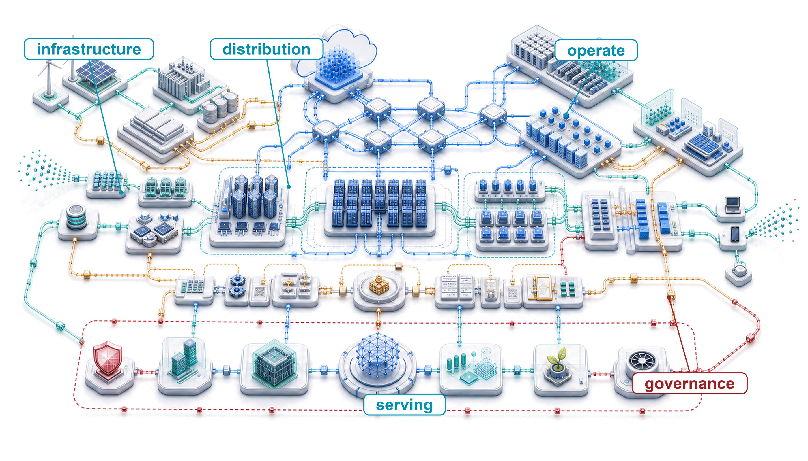
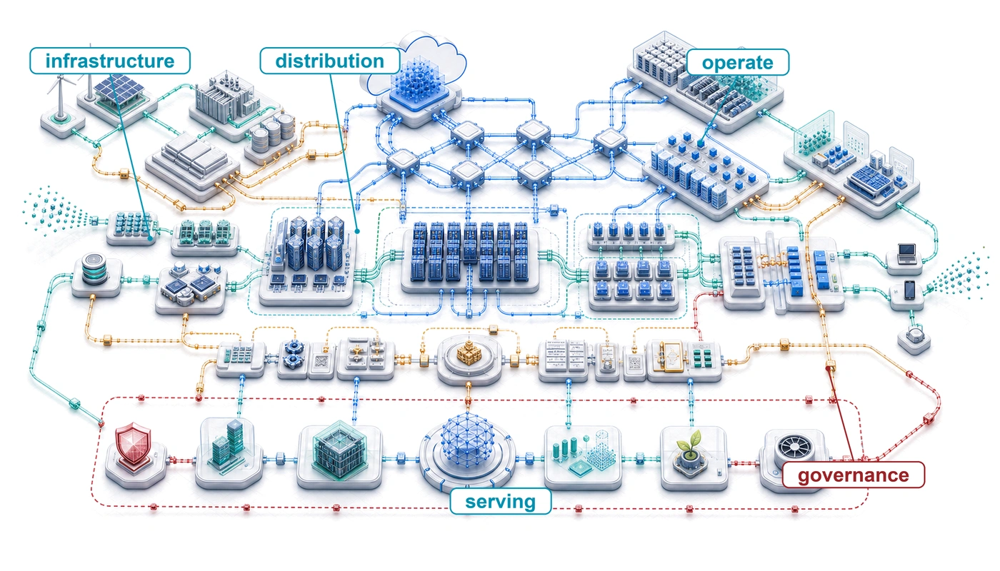
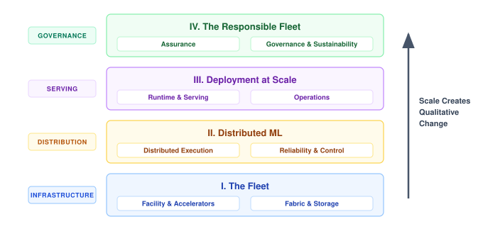
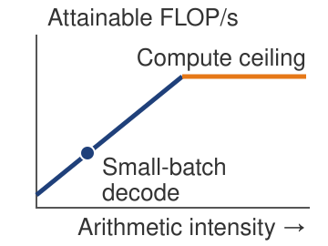
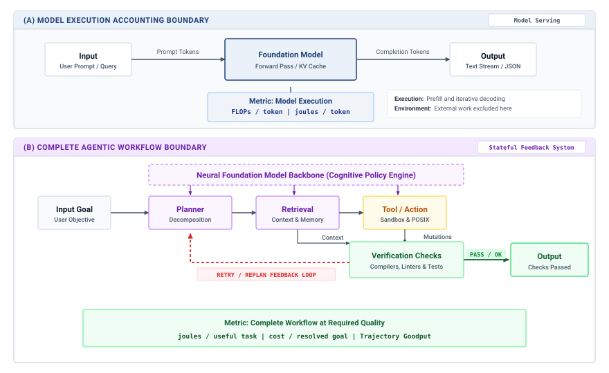
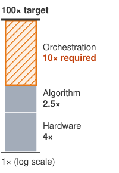

# Conclusion {#sec-conclusion}

::: {layout-narrow}
::: {.column-margin}

\chapterminitoc

:::

::: {.content-visible when-format="pdf"}
\noindent
{fig-alt="Blueprint-style fleet-scale ML systems map with labeled areas for infrastructure, fabric, storage, distributed training, serving, operations, security, sustainability, and governance."}
:::

::: {.content-visible unless-format="pdf"}
{fig-alt="Blueprint-style fleet-scale ML systems map with labeled areas for infrastructure, fabric, storage, distributed training, serving, operations, security, sustainability, and governance."}
:::

:::

## Purpose {.unnumbered .unlisted}

\begin{marginfigure}
\mlfleetstack{40}{40}{40}{40}{40}{40}{40}{40}
\end{marginfigure}

_Why must the unit of machine learning systems design become the fleet rather than the model?_

Machine learning at fleet scale is judged by the whole system, and a local improvement can move cost into a layer that its designer did not measure. Faster computation can expose a network bottleneck; larger jobs can lose more work to failure; a service that meets latency targets can still lack evidence required for deployment. The model remains central, but its accuracy and execution speed do not determine whether the complete system delivers useful work. Adding accelerators is therefore a design decision about shared resources and obligations, not simply a purchase of more arithmetic. If communication and recovery consume the saved execution time, the expansion can increase cost without improving progress. If the resulting service cannot preserve availability or account for its effects on users, successful training does not establish readiness for deployment. Single-node reasoning remains necessary because every participant still has local limits, but it cannot settle decisions whose consequences cross machines, teams, and operating boundaries. The engineering responsibility is to connect those consequences before accepting the design. That requires evidence about what improves, what becomes more constrained, and who owns the costs transferred elsewhere. A defensible decision may expand the fleet, change how work is distributed, or postpone release until the operating requirements can be met. In C³ terms, the task is to follow the binding compute, communication, or coordination constraint across layers and keep its displaced costs visible.

::: {.content-visible when-format="pdf"}

\newpage

:::

::: {.callout-learning-objectives}

- Synthesize the six principles into a constraint map for distributed ML systems
- Diagnose a fleet design's binding C³ term using measured execution costs and failure exposure
- Analyze how infrastructure, distributed training, inference, operations, and governance interact across the fleet stack
- Translate security, fairness, privacy, carbon, and reliability obligations into measurable design constraints
- Defend a fleet expansion or model-release decision using operational measurements and governance evidence

:::

## Synthesizing Distributed ML Systems {#sec-conclusion-synthesizing-distributed-ml-systems-bac9}

A faster accelerator can finish its local work sooner yet leave the training job waiting on the same congested collective. Scale creates qualitative change\index{Scale Moment!qualitative change} because the binding constraint can leave the node. It moves into the fabric that carries gradients, into the recovery machinery that restores state after routine failure, into the service contract that decides whether capacity reaches users in time, and into the obligations that decide whether the service may run at all. The book opened on that transition, the scale moment, and each of the four parts since has answered a share of the question it raised by naming a constraint, the measurement that exposes it, and the mechanism that moves it.

::: {.column-margin .margin-pointer}
↩ The scale moment and the qualitative shift to fleet-scale systems are established in @sec-vol2-introduction-scale-moment.
:::

A frontier-model production system\index{Frontier model!fleet infrastructure} can span thousands of accelerators, with fabric links, storage tiers, schedulers, serving replicas, security controls, and governance checks supporting the same workload. Any one layer can bind the entire system. In the storage tier, a slow checkpoint can waste an entire training window. Across the interconnect, a congested fabric can erase scaling gains from added compute. In the serving pool, underprovisioned capacity can turn model quality into user-visible latency, while an unmeasured responsibility constraint can block deployment after the technical system works.

That coupling across the stack is what separates foundational ML engineering\index{DAM taxonomy@D·A·M taxonomy!single-node foundation} from distributed ML engineering\index{Distributed ML engineering!fleet stack shift}. The single-node foundation already couples models, data pipelines, execution, and deployment constraints. Distributed ML engineering extends that reasoning to shared infrastructure, distributed protocols, and governance across a fleet.

The physical substrate\index{Physical substrate!hardware limits}\index{Infrastructure!rates and physical limits} supplies the rates that higher layers inherit. Accelerator topology\index{Accelerator!topology}, data-loading throughput, and network contention constrain how the Distribution band\index{Fleet Stack!Distribution band} partitions, synchronizes, and recovers work. The Serving band\index{Fleet Stack!Serving band} converts that coordinated execution into a service with latency, availability, and cost obligations. The Governance band\index{Fleet Stack!Governance band} determines whether the service remains secure, robust, sustainable, and accountable. Six principles state these inherited constraints as engineering claims, in the order of the book's four parts.

## Six Principles of Distributed ML Systems {#sec-conclusion-six-principles-distributed-ml-systems-746a}

A fleet that loses training progress to routine interruptions needs recovery capacity as part of normal operation. That requirement connects a principle to an engineering practice. The six engineering practices introduced with the fleet stack describe how a fleet engineer works; the six principles of distributed ML systems\index{Distributed ML!governing principles} condense the physical and institutional constraints developed across the four parts. Each explains why a practice is necessary. Failure exposure motivates recovery planning, while a bottleneck that can migrate after an optimization makes measurement necessary across the affected layers.

::: {.column-margin .margin-pointer}
↩ The six engineering practices, from instrument first to co-design hardware with algorithms, are established with the fleet stack in @sec-vol2-introduction-foundational-concepts.
:::

The Fleet Law (@eq-fleet-law), the distributed counterpart of the single-machine iron law\index{Iron law!vs. fleet law}, connects these principles to execution costs\index{Fleet law!distributed step time}\index{Fleet law!C³ taxonomy mapping}. Infrastructure sets the per-device rates behind $\IronlawTermTimesCompute/N$ and the link bandwidths behind $\CommunicationTime$. Communication and waiting contribute to $\CommunicationTime$ and $\SynchronizationTime$; neither is guaranteed to shrink as $N$ rises. Failure additionally requires accounting for lost work and recovery over the run. Serving applies the same accounting discipline to requests, including queueing and routing delay. Responsibility and sustainability constrain the acceptable design and require evidence beyond execution time. Their controls consume compute and coordination capacity, while energy accounting also needs power measurements over the stated boundary.

::: {.column-margin .margin-pointer}
↪ The term-by-term decomposition of the Fleet Law is developed in @sec-appdx-c3-taxonomy-component-decomposition.
:::

@Fig-fleet-stack-conclusion diagrams the textbook's four architectural bands—Infrastructure, Distribution, Serving, and Governance—aligning the eight stack rows with the six governing principles that constrain fleet execution\index{Fleet Stack!layered architecture}\index{Fleet Stack!working discipline}. Across the bottom tiers, the Infrastructure band determines physical capability. The Distribution band partitions execution across communication and failure recovery, while the Serving band bounds runtime delivery by its contract obligations. In the uppermost Governance band, assurance and sustainability connect deployment decisions to justified requirements and resource limits. The ascending arrow marks the scale moment across the stack. It gives the six principles a shared setting without implying that physical scaling alone determines which social obligations a system should satisfy.

::: {#fig-fleet-stack-conclusion fig-env="figure" fig-pos="htb" fig-cap="**The Fleet Stack Revisited**: The eight rows and four bands of @fig-fleet-stack, now annotated with the six principles, each placed beside the row or band that carries it. The Infrastructure and Serving principles span their whole band; the Distribution and Governance bands each carry one principle per row. The arrow runs the length of the stack because scale changes the behavior of every band." fig-alt="Stack of eight rows in four bands labeled Part I Infrastructure, Part II Distribution, Part III Serving, and Part IV Governance. Numbered principles sit to the right: 1 infrastructure determines capability beside the Infrastructure band, 2 communication can dominate beside Distributed Execution, 3 failure is routine beside Reliability and Control, 4 serving is bounded by its contract beside the Serving band, 5 responsibility constrains design beside Assurance, and 6 sustainability is a first-order cost beside Governance and Sustainability. An upward arrow on the left is labeled scale creates qualitative change."}
{width="100%"}
:::

@Tbl-vol2-principles is therefore a decision map rather than a glossary. Each row links a principle to the question, metric, and practice an engineer uses when diagnosing a fleet-scale design, and to the part and chapters that develop it. The part order is an order of dependency, not a ranking of bottlenecks; the workload and its measurements determine which constraint binds, while the layered tiers in @fig-fleet-stack-conclusion locate the governing architectural band.

| **Principle**                            |       **Core Question**        | **Key Metric**                                     | **Practice It Demands**                        | **Developed In**                                                                                     |
|:-----------------------------------------|:------------------------------:|:---------------------------------------------------|:-----------------------------------------------|:-----------------------------------------------------------------------------------------------------|
| **Infrastructure determines capability** |       What is possible?        | FLOP/s, memory and bisection bandwidth, rack power | Co-design hardware with algorithms             | Part I: @sec-compute-infrastructure, @sec-network-fabrics, @sec-data-storage                         |
| **Communication can dominate**           |    What is the bottleneck?     | Exposed communication time, scaling efficiency     | Expect bottlenecks to migrate                  | Part II: @sec-distributed-training-systems, @sec-collective-communication                            |
| **Failure is routine**                   |       How do we recover?       | MTBF, checkpoint overhead, rollback time           | Treat failure as steady state                  | Part II: @sec-fault-tolerance-reliability, @sec-fleet-orchestration                                  |
| **Serving is bounded by its contract**   | What reaches the user in time? | p99 latency within the SLO, cost per request       | Reserve headroom for recovery and tail latency | Part III: @sec-performance-engineering, @sec-inference-scale, @sec-edge-intelligence, @sec-ops-scale |
| **Responsibility constrains design**     |        Who is affected?        | Privacy budget, subgroup error rates, audit trails | Instrument first                               | Part IV: @sec-security-privacy, @sec-robust-ai, @sec-responsible-ai                                  |
| **Sustainability is a first-order cost** |       What is the cost?        | kWh per training run, energy per query, carbon     | Compound small efficiency gains                | Part IV: @sec-sustainable-ai                                                                         |

: **Six Principles of Distributed ML Systems**: The qualitative shifts that occur when ML systems move from single machines to distributed production, grouped by the part of the book that develops them. Each principle connects to a governing question, the metric that tests it, the engineering practice it makes necessary, and the chapters where the concept is developed in depth. {#tbl-vol2-principles tbl-colwidths="[20,15,20,17,28]"}

```{python}
#| echo: false
#| label: conclusion-scale-facts
# ┌─────────────────────────────────────────────────────────────────────────────
# │ CONCLUSION SCALE FACTS (LEGO)
# ├─────────────────────────────────────────────────────────────────────────────
# │ Context: Six principles of distributed ML systems.
# │
# │ Goal: Keep local numerical claims tied to executable calculations.
# │ Scope: chapter-anchor — six-principles prose, fallacies, and chapter summary share scale facts.
# │ Show: p99 fan-out tail probability, Llama 3 failure cadence, cluster ratio and
# │       effective training time, straggler drop.
# │ How: Direct probability and rate calculations from the stated assumptions.
# │
# └─────────────────────────────────────────────────────────────────────────────
from mlsysim import HOURS_PER_DAY, Literature, Models, Systems
from mlsysim.fmt import check, fmt_count, fmt_int, fmt_percent, fmt_time

class ConclusionScaleFacts:
    # ┌── 1. LOAD ──────────────────────────────────────────
    tail_servers = 100
    tail_percentile = 0.99
    llama_failures = Literature.TrainingRuns.Llama3_405B_UnexpectedInterruptions
    llama_days = Literature.TrainingRuns.Llama3_405B_SnapshotDays
    llama_effective_fraction = Literature.TrainingRuns.Llama3_405B_EffectiveTrainingTimeFraction
    hours_per_day = HOURS_PER_DAY
    straggler_speed = 0.80
    llama_gpus = Models.Language.Llama3_405B.training_accelerators_ref.magnitude
    ref_gpus = Systems.Clusters.Training_1K.total_accelerators  # Archetype A reference cluster
    # ┌── 2. EXECUTE ───────────────────────────────────────
    tail_hit_probability = 1 - tail_percentile**tail_servers
    llama_hours_per_failure = llama_days * hours_per_day / llama_failures
    straggler_drop = 1 - straggler_speed
    llama_ref_ratio = llama_gpus / ref_gpus  # Llama 3 cluster vs. reference
    # ┌── 3. GUARD ─────────────────────────────────────────
    check(round(tail_hit_probability * 100) == 63, "Tail probability changed")
    check(3.0 < llama_hours_per_failure < 3.2, "Failure cadence changed")
    check(round(straggler_drop * 100) == 20, "Straggler throughput drop changed")
    check(llama_ref_ratio == 16, "Llama 3 cluster ratio changed")
    # ┌── 4. OUTPUT ────────────────────────────────────────
    tail_servers_str = fmt_count(tail_servers, commas=False, label="server")
    tail_percentile_str = fmt_int(tail_percentile * 100, commas=False)
    tail_hit_pct_str = fmt_percent(tail_hit_probability, precision=1, commas=False, style='prose')
    llama_failures_str = fmt_count(llama_failures, commas=False, label="unexpected interruption")
    llama_days_str = fmt_time(llama_days, "day", precision=0, commas=False, style="word")
    llama_hours_per_failure_str = fmt_time(llama_hours_per_failure, 'hour', precision=1, commas=False, style='word')
    straggler_speed_pct_str = fmt_percent(straggler_speed, precision=0, commas=False, style='prose')
    straggler_drop_pct_str = fmt_percent(straggler_drop, precision=0, commas=False, style='prose')
    llama_gpus_str = fmt_int(llama_gpus, commas=True)
    llama_ref_ratio_str = fmt_int(llama_ref_ratio, commas=False)
    llama_effective_pct_str = fmt_percent(llama_effective_fraction, precision=0, commas=False, style='prose')
```

The first principle is that infrastructure determines capability. Physical infrastructure constrains both feasible configurations and attainable rates. Memory capacity and safe power and cooling envelopes limit how much state and active hardware a configuration can support. Cluster-wide bisection bandwidth\index{Bisection bandwidth!scaling ceiling} instead limits how quickly distributed work can exchange data (principle \ref{pri-bisection-bandwidth}); insufficient bandwidth can make a deadline or cost target unattainable without making the computation impossible. Storage sets a further ceiling, because accelerators that the data pipeline cannot feed sit idle regardless of their peak rate (principle \ref{pri-io-wall}). These are the memory, network, and energy walls of the scale moment, measured at the scale of the node, the fabric, and the facility. Partitioning, batch size, and communication scheduling determine how those limits bind, and mastering the fleet requires understanding them from chip-level thermal density\index{Thermal design power!hardware limits} to cluster-wide bisection bandwidth.

The second principle is that communication can become the binding term at scale [@jiang2024megascale; @narayanan2021], with its cost set by the bandwidth-latency trade-off (principle \ref{pri-alpha-beta-model}) inside the Fleet Law's $\CommunicationTime$ term. Communication intensity, the ratio of bytes crossing the network to local FLOPs, indicates network demand relative to arithmetic. Whether that demand dominates also depends on achieved compute and network rates, message sizes, topology, and overlap. Gradient synchronization\index{Gradient synchronization!communication bottleneck} and straggler effects\index{Straggler!barrier latency} must therefore be measured on the synchronous step's critical path rather than inferred from byte volume alone.

::: {.column-margin .margin-pointer}
↩ The communication-intensity ratio is established in @sec-vol2-introduction-ci-ratio.
:::

Collective communication algorithms, including Ring AllReduce,[^fn-ring-allreduce-collective] popularized for deep learning by Horovod [@sergeev2018horovod], gradient compression, and overlapping computation with communication\index{Communication overlap!collective hiding}, address communication bottlenecks. For dense collective workloads, conventional oversubscribed fabrics often bottleneck, motivating high-bisection fabrics\index{Bisection bandwidth!network fabric} and transport choices matched to ML communication patterns. Recognizing when communication is the active constraint clarifies when algorithmic optimizations will help and when they merely shift work between equally constrained resources, the displacement of overhead (principle \ref{pri-conservation-overhead}) that makes bottlenecks migrate. Expanding the fabric across thousands of nodes also multiplies the components that a job needs at the same instant, and that multiplication makes failure routine.

::: {.column-margin .margin-pointer}
↩ Ring collectives, communication overlap, and gradient compression are established in @sec-collective-communication.
:::

[^fn-ring-allreduce-collective]: **Ring AllReduce**\index{Ring AllReduce!bandwidth optimality}: A collective that sends $2(N-1)M/N$ bytes per worker and receives the same amount for message size $M$, giving $\CollectiveCompletionTimeRing \approx 2(N-1)\alpha + \frac{2(N-1)}{N}\frac{M}{\beta}$ under the $\alpha$-$\beta$ communication model, with $\beta$ denoting bandwidth in each full-duplex direction. The coefficient approaches 2$\times$ message volume per worker as $N$ grows, while remaining bandwidth-optimal for large messages.

The third principle is that failure is routine. A job that needs many components at once can encounter interruptions frequently enough that recovery becomes normal operation. The reliability gap\index{Reliability gap!routine failure} in @sec-vol2-introduction-reliability-gap follows from $(A_{\text{component}})^N$ under independent, identical component availability and an all-components-required boundary. Meta's experience training Llama 3\index{Llama 3!failure cadence} on `{python} ConclusionScaleFacts.llama_gpus_str` GPUs, `{python} ConclusionScaleFacts.llama_ref_ratio_str` times the Archetype A reference cluster, documented `{python} ConclusionScaleFacts.llama_failures_str` over `{python} ConclusionScaleFacts.llama_days_str`, averaging one unexpected interruption every `{python} ConclusionScaleFacts.llama_hours_per_failure_str` [@dubey2024llama]. Recovery should automate known failure paths and escalate cases whose safe response requires investigation. A failed rank can stall every other rank in its collective. Under full-job checkpoint recovery, the affected job rolls back to its last checkpoint; other jobs in the fleet need not roll back. For a fixed amount of lost wall-clock progress, wasted accelerator-time grows with the size of the affected job, which is why checkpoint cadence\index{Checkpointing!cadence and recovery} and recovery architecture are first-order design dimensions.

Architects must embed failure handling from the beginning. Checkpointing strategies\index{Checkpointing!overhead trade-off} balance write overhead against expected lost work, and the Young-Daly interval (principle \ref{pri-young-daly}) estimates that balance under its failure and checkpoint-cost assumptions. Elastic training[^fn-elastic-training-membership] supports changing cluster membership, while graceful degradation\index{Graceful degradation!service availability} preserves a defined level of service as capacity diminishes. Each mechanism needs a tested recovery contract; its name alone does not establish that progress or service quality survives a failure.

::: {.column-margin .margin-pointer}
↩ Checkpoint cadence, mean time between failures (MTBF) analysis, and elastic recovery protocols are established in @sec-fault-tolerance-reliability.
:::

[^fn-elastic-training-membership]: **Elastic Training**\index{Elastic Training!dynamic membership}: Frameworks such as TorchElastic respond to membership changes by stopping surviving workers, reforming the worker group, and restarting workers with new ranks. The framework manages rendezvous and membership, while user code remains responsible for checkpoint, batch-size, and learning-rate semantics.

Communication and failure together constitute the operational reality of the Distribution band. Deployment carries both into a setting where the unit of work is a user request rather than a training step, which gives the fourth principle, that serving is bounded by its contract\index{Service contract!useful capacity}. A serving fleet's useful capacity is the work it completes within its latency, availability, and cost targets, not the work its accelerators execute in isolation. Production inference that waits for every worker in a fan-out inherits tail effects[^fn-tail-effect-latency] [@dean2013], because completion depends on the slowest required response. Probing two replicas and choosing the less loaded (principle \ref{pri-power-two-choices}) limits the number of routing probes and can reduce queue imbalance. It does not bound every request's latency; the benefit depends on arrivals, service times, capacity, and the freshness of the load estimate.

[^fn-tail-effect-latency]: **Tail Latency**\index{Tail latency!fan-out probability}: A standard fan-out estimate makes the tail effects analyzed in @sec-inference-scale-load-balancing-request-routing-4997 concrete. At the `{python} ConclusionScaleFacts.tail_percentile_str`th percentile, a request touching `{python} ConclusionScaleFacts.tail_servers_str` has a `{python} ConclusionScaleFacts.tail_hit_pct_str` chance of hitting at least one slow server, assuming independent server delays. Shared congestion correlates those delays and changes the probability.

Inside each replica, the memory wall\index{Memory Wall} returns as a serving constraint. Compute (TFLOP/s) can be abundant while memory bandwidth (GB/s) gates small-batch autoregressive decode\index{Decode Bottleneck} (principle \ref{pri-autoregressive-bottleneck}), because weight and KV-cache traffic from high-bandwidth memory (HBM)\index{HBM!decode bandwidth} leaves compute units underused. Batching amortizes weight reads across output tokens, so the binding constraint can shift toward compute, KV traffic, or the latency budget; a replica's execution envelope must therefore be measured before any fleet-level policy is chosen. The contract also has a lifetime. A heavily used model can spend more on inference than it did on training (principle \ref{pri-serving-cost-dominance}), phone-class devices must fit local adaptation within their own power and thermal envelopes, and every release must carry the evidence that its targets still hold. Once the fleet can deliver a service, governance determines whether it is allowed to.

::: {.column-margin .margin-pointer}
↩ On-device adaptation within phone-class power and thermal envelopes is established in @sec-edge-intelligence-energy-thermal-constraint-analysis-3133.
:::

::: {.column-margin}
{width="100%" fig-alt="Schematic roofline with a small-batch decode point on the memory-bandwidth slope below the compute ceiling."}

*Small-batch decode can sit left of the roofline ridge.*
:::

The fifth principle is that responsibility constrains design. Responsible AI\index{Responsible AI!engineering constraints} translates risk-management frameworks into engineering constraints [@nist2023airmf]. Safety-specific risks such as reward hacking\index{Reward hacking!safety risk}, distribution shift, and scalable oversight show why those constraints need implementation mechanisms [@amodei2016concrete]. Fairness, transparency, accountability, privacy, and safety are first-class requirements that shape system architecture throughout the ML lifecycle. The part-level principles behind this one span privacy, because released outputs can disclose what a model learned (principle \ref{pri-information-leakage}); robustness, whose evaluation and defenses require mechanism-specific resource budgets (principle \ref{pri-robustness-compute-penalty}); and feedback, because deployed decisions can shape future training observations (principle \ref{pri-sociotechnical-feedback}).

The fairness impossibility result\index{Fairness impossibility theorem} (principle \ref{pri-fairness-impossibility}) shows why some requirements cannot be satisfied by tuning alone. With unequal base rates and imperfect prediction, groupwise score calibration cannot coexist with equal mean scores across groups in both outcome classes [@kleinberg2016inherent]. The deployment therefore needs justified criteria, evidence that they hold, and an owner authorized to respond when they fail. Monitoring exposes supported disparities but cannot choose the criterion or provide a remedy by itself. These obligations belong in the design alongside performance requirements. Environmental responsibility extends the Governance band into the physical resource budget.

The sixth principle is sustainability\index{Sustainable infrastructure!first-order cost}. Environmental impact of large-scale ML\index{Sustainable infrastructure!carbon footprint} elevates resource efficiency to a primary engineering constraint [@strubell2019; @patterson2021carbon]. The energy-scale invariant of @sec-introduction-energyscale-invariant-a0d6 supplies the accounting discipline, a fixed boundary for useful work and for the energy it consumes, and the Fleet Law explains why exposed communication and synchronization cost joules as well as seconds, since a step's energy is approximately its average power times $\DistributedStepTime$. The Jevons Paradox of AI\index{Jevons Paradox!rebound effect} adapts Jevons's resource-efficiency argument [@jevons1865coal] to explain why hardware efficiency gains alone do not eliminate power and carbon costs (principle \ref{pri-jevons-paradox}). Cheaper computation can expand deployment, so usage growth can offset per-query savings. An absolute carbon budget\index{Carbon Budget!fleet constraint} bounds emissions only when accounting and admission decisions enforce it over the stated lifecycle and time horizon.

::: {.column-margin .margin-pointer}
↩ Carbon accounting, energy metrics, and Jevons rebound effects are established in @sec-sustainable-ai.
:::

Sustainability thus transforms from environmental concern to engineering discipline. Energy costs can exceed model development budgets, thermal limits restrict hardware density, and power infrastructure requirements limit deployment locations. Carbon-aware scheduling\index{Carbon-aware scheduling!fleet placement}, lifecycle assessment,[^fn-lifecycle-assessment-sustainability] and efficiency optimization become essential engineering competencies alongside traditional performance metrics.

[^fn-lifecycle-assessment-sustainability]: **Lifecycle Assessment**\index{Lifecycle Assessment}: @Sec-sustainable-ai-hardware-lifecycle-environmental-assessment-66ee evaluates environmental impact across a system's lifespan, including embodied carbon\index{Embodied carbon!hardware lifecycle} from hardware manufacturing. Embodied emissions can become a substantial share of total impact on clean grids or when hardware is lightly utilized.

The six principles describe the qualitative change\index{Scale Moment!production behavior} that scale can produce. Empirical scaling laws (principle \ref{pri-universal-scaling}) estimate how model quality responds to resources within a fitted regime; they do not require an organization to keep expanding. Pursuing further loss reductions can require more compute and a different allocation of data and parameters. A training job running on 8 GPUs may encounter communication bottlenecks, load imbalance, or synchronization overhead at 8,000 GPUs that were negligible at 8. For a service with 100,000 concurrent user sessions, failure exposure depends on requests per session as well as concurrency. At millions of daily requests, a one-in-a-million per-request event warrants operational planning even though its daily occurrence is not certain. New fleet behavior emerges\index{Scale Moment!emergent phenomena} from familiar mechanisms, including stragglers[^fn-straggler-mitigation-tail] that bottleneck clusters, network partitions\index{Network partition!distributed training} that split training, and heterogeneity across hardware generations\index{Hardware heterogeneity!fleet load balancing} that complicates load balancing.

[^fn-straggler-mitigation-tail]: **Stragglers**\index{Straggler!throughput impact}: In an illustrative barrier-dominated step with equal work per worker, a single worker running at `{python} ConclusionScaleFacts.straggler_speed_pct_str` of peer speed reduces cluster throughput by `{python} ConclusionScaleFacts.straggler_drop_pct_str`.

Scaling laws and the Fleet Law (@eq-conclusion-fleet-law) together say when that growth pays and where it breaks:

$$ \DistributedStepTime = \frac{\IronlawTermTimesCompute}{N} + \CommunicationTime + \SynchronizationTime - \OverlappedTime $$ {#eq-conclusion-fleet-law}

Scaling pays while the quality gain a fitted curve predicts justifies the cost of delivering it. Increasing $N$ reduces the ideal compute term $\IronlawTermTimesCompute/N$ for fixed work and unchanged per-device rates; $\CommunicationTime$ and $\SynchronizationTime$ depend on the resulting partition and execution schedule. The expected interval between job interruptions falls as $1/N$ when independent, identical constant-rate component failures each interrupt the job. Correlated failures or different recovery boundaries require a different model. Within a fixed facility, power and cooling also constrain the feasible configuration, and a deployed model incurs serving costs throughout its use. The breakdown conditions of @tbl-scaling-breakdown identify where extrapolating a fitted quality curve becomes unreliable. Separately, the scaling wall\index{Scaling wall!fleet growth} of @sec-distributed-training-systems-systems-physics-scaling-amdahls-law-communication-4d7f marks where added communication and coordination consume the compute time saved (principle \ref{pri-scaling-efficiency}). These limits must be evaluated together in a complete production design.

## Review of Systems Competencies {#sec-conclusion-mastered-da67}

The proposed cluster expansion tests competence across the whole stack. Accepting it requires evidence that reduced compute time survives communication and recovery costs, while releasing its model requires a separate serving and governance judgment. Mastery means identifying those dependencies, choosing the measurements that test them, and defending the decision within the stated assumptions.

In the Infrastructure band, the governing question is which infrastructure limit binds the workload. An engineer who has mastered this material can match accelerator memory and compute to the model, provision storage and network bandwidth for the required rates, and account for power and cooling\index{Cooling!capacity constraint} as capacity constraints rather than facilities details.

In the Distribution band, the governing question is how to make a workload larger than any single machine behave as one coordinated system. An engineer can analyze communication patterns, select a parallelization strategy, and estimate failure cadence from component MTTF\index{MTTF!failure cadence}, fleet size, and the failure-dependence model. For a fixed gradient of size $M$, Ring AllReduce\index{Ring AllReduce!bandwidth scaling} sends and receives about $2M$ bytes per worker as cluster size grows. At unchanged effective link bandwidth, its bandwidth term approaches a constant in $N$, but its number of communication rounds and startup cost grow. The trade-off is among parallel speedup, exposed communication, and recovery overhead.

In the Serving band, the governing question is how a trained model keeps serving value under live traffic and shifting distributions. An engineer can budget the serving tax\index{Serving tax!budgeting}, select batching and placement policies, and monitor both system performance and data and concept drift\index{Concept drift!monitoring} so that a working model does not become an inefficient or stale service.

::: {.column-margin .margin-pointer}
↩ The serving tax that distributed execution adds to each request's latency budget is established in @sec-inference-scale-serving-tax-overhead-distribution-5ef3.
:::

In the Governance band, the governing question is who bears the costs and risks of the system's decisions. An engineer can translate security, privacy, fairness, robustness, and sustainability obligations into controls and evidence: access boundaries, privacy budgets\index{Privacy budget!differential privacy}, subgroup evaluations, adversarial and out-of-distribution tests\index{Out-of-distribution robustness!testing}, incident procedures, and resource accounting. These competencies connect model development to the consequences of deployment. They also supply a test of transfer: when a new workload or substrate appears, the engineer must identify its accounting boundary, constraints, and evidence requirements before accepting an efficiency claim.

## The Complete Production System {#sec-conclusion-complete-production-system-3885}

```{python}
#| echo: false
#| label: conclusion-expansion
# ┌─────────────────────────────────────────────────────────────────────────────
# │ CONCLUSION EXPANSION EXAMPLE (LEGO)
# ├─────────────────────────────────────────────────────────────────────────────
# │ Context: Frontier-model expansion worked example in The Complete Production System.
# │
# │ Goal: Show how doubling the Archetype A reference cluster changes failure exposure.
# │ Scope: chapter-anchor — expansion worked example in The Complete Production System.
# │ Show: 1,024 -> 2,048 GPUs; GPU-only job MTBF ≈ 48.8 h -> 24.4 h; checkpoint overhead ≈ 1.41x.
# │ How: MTBF_job = MTTF_gpu / N; Young-Daly overhead ≈ sqrt(2·delta/MTBF_job), so it grows as sqrt(N).
# │
# └─────────────────────────────────────────────────────────────────────────────
import math
from mlsysim import Systems
from mlsysim.fmt import check, fmt_count, fmt_multiple, fmt_time

class ConclusionExpansion:
    # ┌── 1. LOAD ──────────────────────────────────────────
    gpu_mtbf_h = float(Systems.Reliability.Gpu.mttf_hours)
    ref_gpus = Systems.Clusters.Training_1K.total_accelerators  # Archetype A reference cluster
    expansion_factor = 2  # scenario: double the reference cluster
    # ┌── 2. EXECUTE ───────────────────────────────────────
    exp_gpus = ref_gpus * expansion_factor
    ref_job_mtbf_h = gpu_mtbf_h / ref_gpus
    exp_job_mtbf_h = gpu_mtbf_h / exp_gpus
    # Young-Daly optimum: overhead ≈ sqrt(2·delta/MTBF_job), independent of delta as a ratio
    ckpt_overhead_growth = math.sqrt(ref_job_mtbf_h / exp_job_mtbf_h)
    # ┌── 3. GUARD ─────────────────────────────────────────
    check(ref_gpus == 1024, "Reference cluster changed")
    check(abs(ckpt_overhead_growth - math.sqrt(expansion_factor)) < 1e-9, "Young-Daly scaling changed")
    # ┌── 4. OUTPUT ────────────────────────────────────────
    ref_gpus_str = fmt_count(ref_gpus, label="GPU", commas=True)
    exp_gpus_str = fmt_count(exp_gpus, label="GPU", commas=True)
    gpu_mtbf_str = fmt_time(gpu_mtbf_h, "hour", precision=0, commas=True, style="word")
    ref_job_mtbf_str = fmt_time(ref_job_mtbf_h, "hour", precision=1, commas=False, style="word")
    exp_job_mtbf_str = fmt_time(exp_job_mtbf_h, "hour", precision=1, commas=False, style="word")
    ckpt_overhead_growth_mult_str = fmt_multiple(ckpt_overhead_growth, precision=2, commas=False)
```

Consider Archetype A (GPT-4/Llama-3), whose running instance in this book is a GPT-3-class dense transformer trained with mixed precision on a reference cluster of `{python} ConclusionExpansion.ref_gpus_str` and then shipped into a global serving fleet. Checkpoint bursts must land without starving the data loaders, while collective results must arrive before the computations that depend on them. Communication can overlap independent work, but its exposed remainder delays progress. At that scale, recovery planning uses observed write costs and failure rates, with the Young-Daly interval\index{Young-Daly formula!optimal interval}\index{Checkpointing!Young-Daly formula} supplying an approximation where its assumptions hold [@young1974; @daly2006]. Serving service-level objectives (SLOs)\index{SLO!headroom for recovery} require headroom for rollback and fallback, while governance controls\index{Governance!fleet constraints} enforce approved conditions on which data, models, and outputs may reach users. These are coupled rates, budgets, failure exposures, and policy constraints that must be designed before deployment.

The production system begins with physical capacity, but capacity matters only when the rates line up. Physical compute infrastructure supplies accelerators, power, cooling, and fabric; the data tier determines whether data can arrive fast enough; and collective communication determines whether workers can synchronize without turning the network into the bottleneck. These subsystems must be co-designed\index{Hardware-software co-design!storage and communication}: data ingestion must meet accelerator consumption, checkpoint writes must fit the recovery budget, and the fabric must carry the actual collective traffic. These are distinct rates; matching them to workload demand matters more than making their raw bandwidths equal.

Parallelization strategies must fit those physical rates and the expected failure pattern. Data parallelism\index{Data Parallelism!trade-offs}, tensor parallelism\index{Tensor Parallelism!trade-offs}, and pipeline parallelism\index{Pipeline Parallelism!trade-offs} are not interchangeable templates; each changes memory pressure, communication volume, checkpointing behavior, and scheduler complexity. Hybrid strategies\index{Hybrid Parallelism!systems support} become useful only when the surrounding storage, fabric, and recovery design can support the shape of the partition.

::: {.column-margin .margin-pointer}
↩ How data, tensor, pipeline, and hybrid partitioning each move memory pressure, communication volume, and the pipeline bubble is established in @sec-distributed-training-systems-systems-parallelism-strategy-comparison-d92a.
:::

Serving adds a separate acceptance boundary. The contract of the fourth principle judges the model by its latency, availability, and cost on live traffic, whether it runs in a data center replica or on a phone-class device. Some security and robustness controls execute on the request path; others operate during training, release review, or asynchronous monitoring. Each needs an evidence and response path suited to its obligation. Training throughput therefore does not establish that a model will meet live latency, recovery, security, subgroup, and carbon requirements. A fleet expansion raises two linked decisions, whether to accept the larger training job and whether to release the model it produces, and each needs its own evidence.

For our frontier-model case, suppose a proposed expansion doubles the reference cluster to `{python} ConclusionExpansion.exp_gpus_str` while retaining the fabric and checkpoint tier. Doubling $N$ halves the ideal $\IronlawTermTimesCompute/N$ term for fixed work at unchanged per-device rates, so we would first measure whether that saving survives the changes in $\CommunicationTime$ and $\SynchronizationTime$ and their overlap. Assume independent GPU failures at an identical constant rate, with each failure interrupting the job. Counting those failures alone at the registry mean time to failure (MTTF) of `{python} ConclusionExpansion.gpu_mtbf_str` per GPU, the job's expected time between interruptions falls from `{python} ConclusionExpansion.ref_job_mtbf_str` to `{python} ConclusionExpansion.exp_job_mtbf_str`. Under the first-order Young-Daly model with unchanged checkpoint write time, the optimized checkpoint-and-rework overhead rises by a factor of about `{python} ConclusionExpansion.ckpt_overhead_growth_mult_str`. Write contention with data loading or a changed checkpoint size would require revising that estimate. Accepting the training expansion requires a net gain after communication, recovery, and resource costs. Releasing the resulting model remains a separate decision, because its serving configuration must meet latency targets with recovery headroom and preserve the required security, subgroup, and carbon evidence. A failed gate requires revising the affected partition, placement, capacity allocation, or release plan before proceeding. The decisions share provenance and resource measurements, but each also needs evidence specific to its operating contract.

These constraints can conflict. A communication optimization may increase failure exposure, sustainability requirements may restrict infrastructure choices, and governance controls may consume serving latency or capacity. The displacement of overhead\index{Displacement of overhead!cross-layer trade-offs} requires measuring those transferred costs before accepting a local speedup.

The three workloads introduced as lighthouse archetypes show that no single corner of the $C^3$ taxonomy\index{C³ taxonomy!workload archetypes}\index{C³ taxonomy!binding constraints} dominates. @Tbl-conclusion-archetype-binding-terms follows each of them up the fleet stack. Its first row repeats the representative binding term with which each workload was first characterized; the rows below record what each band of the stack, and the part of the book that develops it, showed about that workload.

::: {.column-margin .margin-pointer}
↩ The three lighthouse archetypes, and whether each stresses compute, communication, or coordination, are established in @sec-vol2-introduction-archetypes.
:::

| **Fleet Stack Band**          | **Archetype A (GPT-4/Llama-3)**                                                                                                                                                                                        | **Archetype B (DLRM at Scale)**                                                                                                                       | **Archetype C (Federated MobileNet)**                                                                                                                                                             |
|:------------------------------|:-----------------------------------------------------------------------------------------------------------------------------------------------------------------------------------------------------------------------|:------------------------------------------------------------------------------------------------------------------------------------------------------|:--------------------------------------------------------------------------------------------------------------------------------------------------------------------------------------------------|
| **Representative C$^3$ term** | Communication, fleet-wide                                                                                                                                                                                              | Coordination, in routing and placement                                                                                                                | Local compute, within the device envelope                                                                                                                                                         |
| **Infrastructure (Part I)**   | Training state and checkpoints far exceed one accelerator's memory\index{Frontier model!collective communication}, motivating partitioning; frequent tensor-parallel collectives favor the fastest interconnect domain | Multi-terabyte embedding tables\index{DLRM!coordination bottleneck} exceed any device's memory, and live feature lookups demand random-access storage | Phone-class power, memory, and thermal envelopes\index{MobileNet!edge power envelope} cap what local training can attempt                                                                         |
| **Distribution (Part II)**    | 3D parallelism and AllReduce must fit the step budget, and Young-Daly checkpoint cadence tracks interruptions measured in hours                                                                                        | Embedding sharding turns lookups into AllToAll exchanges whose hottest receiver sets completion time                                                  | Federated averaging replaces AllReduce, and over-selection with round deadlines bounds the wait for intermittent clients                                                                          |
| **Serving (Part III)**        | Small-batch decode is bound by memory bandwidth, so batching, KV-cache policy, and lifetime serving cost shape deployment                                                                                              | Feature-parallel sharding and routing must hold tail latency within budget at millions of queries per second                                          | Adaptation runs only in admitted windows that preserve the foreground deadline, and rollouts span weeks of version skew                                                                           |
| **Governance (Part IV)**      | Data provenance, output leakage, and the energy of each training run gate release                                                                                                                                      | Recommendations shape future training data, requiring fairness and drift evidence with accountable response across the serving lifecycle              | Secure aggregation limits visibility of individual updates; differential privacy bounds released information under stated accounting assumptions; participation bias shapes whose data contribute |

: **Archetypes Across the Fleet Stack**: The book's three running workloads traced through the four bands of the fleet stack, one band per part, beneath the representative binding $C^3$ term with which the introduction characterized each. The same Fleet Law applies to all three; the regimes shown here expose different constraints, not permanent bottleneck assignments. {#tbl-conclusion-archetype-binding-terms tbl-colwidths="[16,28,28,28]"}

Read down a column to trace the constraints one workload encounters across the bands; read across a row to compare how a band constrains different workloads. These constraints need not all bind at once. The representative terms describe operating regimes, not permanent assignments of archetypes to $C^3$ terms. Federated MobileNet can be device-compute-bound during local training yet communication- or coordination-bound during a global round with intermittent clients. The same six principles apply to all three; the engineer must measure the workload at the relevant boundary before choosing which term to reduce. The closing diagnostic is therefore procedural:

1. Start with the observed symptom: Name the user-visible or operator-visible failure.
2. Attach the metric: Choose the measurement that makes the symptom falsifiable.
3. Map to $C^3$: Identify whether compute, communication, or coordination is binding first.
4. Locate the fleet-stack row: Find the row that owns the intervention.
5. State the displaced cost: Describe what cost the proposed fix moves elsewhere.
6. Preserve governance evidence: Keep the audit, safety, security, or responsibility evidence needed to justify the decision.

Low model FLOPs utilization\index{Model FLOPs Utilization!fleet diagnostic} may point to communication or coordination rather than insufficient computation. A fairness alert may point to missing labels, insufficient review capacity, or a serving-path threshold policy rather than model weights alone. A security incident may point to artifact provenance, tool permissions, or rollback evidence rather than network perimeter failure. The discipline is to follow the constraint until the row that owns it and the trade-off it carries are visible.

The six steps culminate in the end-to-end evaluation contract\index{Evaluation contract!production release}: one versioned release record that binds the candidate to production-equivalent measurements, accountable acceptance authority, tested recovery, and explicit conditions that invalidate the evidence.

::: {.column-margin .margin-pointer}
↩ The end-to-end evaluation contract and its versioned release record are established in @sec-ops-scale-end-to-end-evaluation-contract.
:::

## Where the Binding Constraint Moves Next {#sec-conclusion-path-forward-caa2}

The principles of fleet scaling and the C$^3$ Fleet Law are not static; they apply equally as the operational boundary expands. Below, we examine how these established frameworks diagnose the next generation of system constraints, such as test-time compute and novel hardware substrates.

### Orchestration and test-time compute

A service that adds a verification call and retries failed answers can improve accepted output quality while increasing latency and energy per completed task. The same fleet constraints govern this larger accounting boundary. Network fabrics constrain communication, memory systems constrain state residency, and governance constrains which actions may execute. Test-time computation, introduced alongside pretraining and posttraining in @sec-vol2-intro-resourceconstrained-scaling-regimes-062d, adds work to the serving path, where each additional model step consumes part of the query's latency and resource budget. Composition\index{Compound AI Systems!compositional scaling} extends the workflow through retrieval (looking up external information), tools (programs that perform requested actions), and verification (checking whether an output meets a stated requirement). A planner chooses the next action, and a failed check may trigger another attempt. These specialized components can expand what the system does, but their contribution must be measured over the complete task and its required quality and safety.

When useful work spans multiple components, the engineer must measure orchestration overhead, state movement, failure propagation, latency budgets, and governance evidence as part of the system itself. @Fig-conclusion-traditional-vs-agentic contrasts the necessary expansion of this accounting boundary across two execution regimes. While panel (a) restricts accounting to the isolated model forward pass (measured per token in FLOPs and joules), panel (b) encloses the complete agentic pipeline—tracing dataflow through planning, retrieval, tool execution, verification, and the feedback loop triggered on check failure—evaluating efficiency by joules per useful task completed\index{Goodput!agentic closed loop}\index{Energy efficiency!joules per useful task}. Conventional serving already requires end-to-end evaluation, but in emerging agentic workflows\index{Agentic AI!fleet macro-efficiency}, model calls operate inside an autonomous control loop where overall throughput and energy hinge on retry frequency and verification latency.

::: {#fig-conclusion-traditional-vs-agentic fig-env="figure" fig-pos="htb" fig-cap="**From Model Serving to Closed-Loop Agentic Fleets**: The dashed outline in each panel is the accounting boundary. For model execution (a), the boundary holds only the forward pass, so FLOPs per token and joules per token describe it. For a complete workflow (b), the boundary holds planning, retrieval, tool execution, verification, and every retry after a failed check, with the model called from inside the loop, so the cost is counted per useful task completed. Minimizing that cost requires evaluating the whole loop at the required quality and safety." fig-alt="Two panels. Panel a, model execution: a prompt box feeds a model forward pass box inside a dashed boundary, which emits tokens; the note below reads measured per token, FLOPs per token and joules per token. Panel b, complete workflow: a goal box feeds plan, retrieve, run tool, and verify boxes inside a dashed boundary, with a model calls bar beneath the first three and a red dashed arrow labeled check failed, retry, running from verify back to plan; verify feeds a verified result box outside the boundary; the note below reads measured per task, joules per useful task completed."}
{width="100%"}
:::

```{python}
#| echo: false
#| label: fleet-evolution-notebook
# ┌─────────────────────────────────────────────────────────────────────────────
# │ FLEET EVOLUTION CALCULATOR (NOTEBOOK)
# ├─────────────────────────────────────────────────────────────────────────────
# │ Context: "Fleet-stack efficiency accounting" .callout-notebook
# │
# │ Goal: Quantify where the next 100x efficiency gain must come from.
# │ Scope: notebook-only — values used by the fleet-stack accounting notebook and its lead-in.
# │ Show: orchestration_gain ≈ 10x, hw_gain ≈ 4x, algorithm_gain ≈ 2.5x.
# │ How: Load ReferenceStats.FleetEvolution and solve Target = HW * Algorithm * Orchestration.
# │
# └─────────────────────────────────────────────────────────────────────────────
from mlsysim import ReferenceStats
from mlsysim.fmt import check, fmt_math, fmt_multiple

class FleetEvolution:
    # ┌── 1. LOAD ──────────────────────────────────────────
    profile = ReferenceStats.FleetEvolution
    target_gain = profile.TargetGain
    hw_gen_gain = profile.HardwareGain
    algo_pruning_gain = profile.AlgorithmGain
    # ┌── 2. EXECUTE ───────────────────────────────────────
    # Solve for required orchestration gain:
    orch_required = target_gain / (hw_gen_gain * algo_pruning_gain)
    # ┌── 3. GUARD ─────────────────────────────────────────
    check(orch_required == 10.0, f"Orch gain {orch_required} unexpected")
    # ┌── 4. OUTPUT ────────────────────────────────────────
    fe_target_gain_mult_str = fmt_multiple(target_gain, precision=0, commas=True)
    fe_hw_gain_mult_str = fmt_multiple(hw_gen_gain, precision=0, commas=True)
    fe_algo_gain_mult_str = fmt_multiple(algo_pruning_gain, precision=1, commas=True)
    fe_orch_gain_mult_str = fmt_multiple(orch_required, precision=0, commas=True)
    fe_known_gains_product_math = fmt_math(rf"({hw_gen_gain:.1f} \times {algo_pruning_gain:.1f})")
```

The following accounting example tests a target `{python} FleetEvolution.fe_target_gain_mult_str` efficiency gain. Its multiplicative factors must hold under the same workload and resource budget; the residual is a required orchestration improvement, not evidence that the improvement is available.

::: {.column-margin}
{width="100%" fig-alt="Three orange horizontal bars labeled orchestration 10 times, hardware 4 times, and algorithm 2.5 times, longest at the top."}

*Fleet efficiency needs hardware, algorithm, and orchestration gains together.*
:::

:::: {#nbk-conclusion-projecting-100-fleet .callout-notebook title="Fleet-stack efficiency accounting"}

**Problem**: Suppose a workload needs a `{python} FleetEvolution.fe_target_gain_mult_str` efficiency improvement over a large-cluster baseline. If a particular workload saw `{python} FleetEvolution.fe_hw_gain_mult_str` from hardware and `{python} FleetEvolution.fe_algo_gain_mult_str` from algorithmic compression, where would the remaining gain have to come from?

**Math**:
Under the assumed multiplicative accounting, total system gain is the product of compatible improvements across the fleet stack.

1. Hardware (physics): `{python} FleetEvolution.fe_hw_gain_mult_str` in this scenario.
2. Algorithm (math): `{python} FleetEvolution.fe_algo_gain_mult_str` from workload-compatible sparsity or distillation.
3. Orchestration (systems): `{python} FleetEvolution.fe_target_gain_mult_str` / `{python} FleetEvolution.fe_known_gains_product_math` = `{python} FleetEvolution.fe_orch_gain_mult_str`.

**Systems insight**: Under the assumed hardware and algorithmic gains, the `{python} FleetEvolution.fe_target_gain_mult_str` efficiency target leaves a residual requirement for orchestration. Here, efficiency means useful task progress per fleet resource budget, with quality and safety held to the same acceptance criteria. System orchestration would need to supply the remaining `{python} FleetEvolution.fe_orch_gain_mult_str`. Reducing duplicate work, routing requests to appropriate components, reusing cached state, overlapping communication with computation, and validating outputs are candidate interventions, not demonstrated sources of that gain. Their benefits cannot be multiplied if they count the same saved work twice. If measurements cannot establish the required improvement within the latency and resource budgets, the target must be revised.

::::

In the fleet-stack frame, specialized components require production MLOps pipelines\index{MLOps!production lifecycle} to keep their versions, releases, and operating evidence consistent. The application orchestration layer\index{Orchestration!layer} schedules model calls, retrieval, tool execution, and verification under latency, cost, and failure budgets. It relies on the fleet scheduler for resource placement and on production lifecycle controls for versioning and release; those supporting mechanisms do not themselves decide the application's next action.

::: {.column-margin .margin-pointer}
↩ Cluster scheduling and resource-placement policies are established in @sec-fleet-orchestration.
:::

### Physical substrates and emerging hardware

Measured orchestration gains still depend on a physical fabric, so software and substrate choices must be evaluated together. Optical I/O\index{Optical Interconnect!optical I/O} carries data using light, while co-packaged optics\index{Optical Interconnect!co-packaged optics} places optical interfaces close to compute or switching silicon. 3D integration\index{3D integration!bandwidth density} stacks components to shorten connections; neuromorphic event-driven substrates\index{Neuromorphic computing!event-driven substrates}\index{Non-von Neumann computing!neuromorphic substrates} organize computation around events such as spikes. Automated architecture search and AI-for-systems optimization\index{Hardware-software co-design!AI for systems} offer ways to explore candidate designs. Each proposal needs a workload-specific comparison of useful work, data movement, power, and implementation cost. A lower link-energy measurement alone does not establish a better fleet, and a new substrate still needs fault tolerance and responsible governance.

```{python}
#| echo: false
#| label: post-silicon-notebook
# ┌─────────────────────────────────────────────────────────────────────────────
# │ POST-SILICON EFFICIENCY FRONTIER (NOTEBOOK)
# ├─────────────────────────────────────────────────────────────────────────────
# │ Context: "The Physics of Better Fabrics" .callout-notebook
# │
# │ Goal: Quantify the energy gap between electrical and optical fabric scenarios.
# │ Show: energy_gain ≈ 2x for a hypothetical electrical vs. optical link scenario.
# │ How: Ratio = E_electrical/E_optical.
# │
# └─────────────────────────────────────────────────────────────────────────────
from mlsysim.core.units import bit, pJ
from mlsysim.fmt import check, fmt_energy_per_bit, fmt_multiple

class PostSilicon:
    # ┌── 1. LOAD ──────────────────────────────────────────
    e_elec_pj_per_bit = 10.0 * pJ / bit  # hypothetical electrical-link scenario
    e_opt_pj_per_bit = 5.0 * pJ / bit  # hypothetical optical-link scenario
    # ┌── 2. EXECUTE ───────────────────────────────────────
    efficiency_gain = (e_elec_pj_per_bit / e_opt_pj_per_bit).to_base_units().magnitude
    # ┌── 3. GUARD ─────────────────────────────────────────
    check(efficiency_gain == 2.0, f"Gain {efficiency_gain} unexpected")
    # ┌── 4. OUTPUT ────────────────────────────────────────
    ps_elec_pj_per_bit_str = fmt_energy_per_bit(e_elec_pj_per_bit, precision=0, commas=False)
    ps_opt_pj_per_bit_str = fmt_energy_per_bit(e_opt_pj_per_bit, precision=0, commas=False)
    ps_efficiency_gain_mult_str = fmt_multiple(efficiency_gain, precision=0, commas=True)
```

Transformer models partitioned across thousands of accelerators create communication pressure through several mechanisms. Tensor parallelism\index{Tensor Parallelism!collective communication} uses frequent collectives across partitioned tensors, while mixture-of-experts (MoE)\index{MoE!all-to-all routing} routing uses all-to-all dispatch at each expert layer. At that scale, link energy accumulates across the volume of collective traffic, which makes lower-energy interconnects a plausible fabric-efficiency lever. The scaling pressure is not generic; it originates directly from the collective communication patterns.

::: {#nbk-conclusion-physics-better-fabrics .callout-notebook title="The physics of better fabrics"}

**Problem**: In a hypothetical scenario, an electrical link\index{Electrical Interconnect!energy per bit} uses `{python} PostSilicon.ps_elec_pj_per_bit_str`, while an optical link\index{Optical Interconnect!energy per bit} uses `{python} PostSilicon.ps_opt_pj_per_bit_str`. What efficiency dividend would this difference provide for the collective traffic of tensor-parallel and mixture-of-experts layers?

**Math**:
For the same traffic volume and link-energy measurement boundary, compare the two hypothetical signaling costs.

1. Electrical cost: `{python} PostSilicon.ps_elec_pj_per_bit_str`.
2. Optical I/O scenario: `{python} PostSilicon.ps_opt_pj_per_bit_str`.
3. Efficiency gain: `{python} PostSilicon.ps_efficiency_gain_mult_str`.

**Systems insight**: The energy wall\index{Energy Wall} depends on traffic volume and the energy of moving each bit. AllReduce for gradient synchronization\index{AllReduce!gradient synchronization} can keep per-worker bytes nearly constant for a fixed gradient while aggregate traffic grows with worker count. All-to-all dispatch\index{All-to-All!mixture-of-experts dispatch} for MoE layers instead depends on token volume, routing, and expert placement. Reducing communicated bytes, avoiding redundant exchanges, and lowering link energy per bit address different parts of that cost. Optical I/O\index{Optical Interconnect!fabric-efficiency lever} is a candidate intervention, but this scenario establishes only the ratio between two assumed link-energy costs. A fleet comparison must include the affected share of energy and the rest of the interconnect implementation. Data locality\index{Data Locality} and interconnect efficiency\index{Efficiency!interconnect} therefore belong in the same measured system budget.

:::

Whatever the substrate, the discipline stays the same. An engineer chooses the unit of useful work, accounts for its full resource cost, and states which comparisons the evidence supports.

## Fallacies and Pitfalls {#sec-conclusion-fallacies-pitfalls}

The closing mistakes all come from optimizing the wrong unit of design. A model can improve while the fleet becomes slower, less reliable, more expensive, or harder to govern.

::: {.fallacy-pitfall}

**Fallacy**: *A faster model is automatically a better system.*

Raw model speed matters, but it is only one term in the fleet equation. In the illustrative equal-work, barrier-dominated step, a worker running at `{python} ConclusionScaleFacts.straggler_speed_pct_str` of peer speed reduces throughput by `{python} ConclusionScaleFacts.straggler_drop_pct_str` relative to uniformly fast workers. Speeding only the workers already waiting at the barrier does not shorten that limiting computation. A design that reduces kernel time while increasing checkpoint pressure, network contention, serving variance, or governance risk can make the total system worse. The systems question is whether the change improves useful throughput\index{Goodput!useful throughput} under the actual constraints: data movement, synchronization, failure recovery, power, latency, and accountability.

:::

::: {.fallacy-pitfall}

**Pitfall**: *Optimizing one layer while hiding the constraint it creates in another.*

A local improvement becomes dangerous when it moves cost to a layer that no one is measuring. Larger batches may raise accelerator utilization while worsening tail latency. Aggressive compression may reduce communication while increasing accuracy risk. Carbon-aware scheduling may lower emissions while requiring more slack in the service budget. Good engineering respects the displacement of overhead\index{Displacement of overhead!cross-layer optimization}, keeping the transferred constraint visible so the system can choose deliberately rather than inheriting a hidden bottleneck.

:::

::: {.fallacy-pitfall}

**Fallacy**: *Fleet-scale lessons are tied to today's hardware and software stack.*

Specific processors, frameworks, and serving engines will change, but the durable relationships remain. Data must reach compute at the required rate. Workers must communicate before synchronization stalls the job. Failures must be expected at large component counts. Serving systems must meet tail-latency budgets, and governance constraints must be engineered into the operating path. The technology names are examples; the rate, failure, and accountability relationships are the lesson.

:::

::: {.fallacy-pitfall}

**Pitfall**: *Treating governance and sustainability as external reviews rather than system constraints.*

Postponing security, fairness, privacy, and carbon accounting can create architectural debt\index{Architectural debt!delayed governance}. Retrofitting audit trails, demographic monitoring, access controls, deletion workflows, or carbon-aware placement may require reconstructing evidence or redesigning deployed components. Identifying these obligations during design lets teams budget the required paths and test whether they work before release; the actual cost still depends on the control and deployment.

:::

## Summary {#sec-conclusion-summary}

At fleet scale, improving a model or accelerator does not establish that the complete service improves. The engineering object is the coupled system that moves data, schedules work, survives failure, serves users, and satisfies governance obligations under physical and organizational constraints. Scaling laws estimate quality gains within a fitted regime, the Fleet Law accounts for execution time, and the six principles identify constraints that the complete design must satisfy. The method that recurs across the book follows from all three. It identifies the binding constraint, quantifies its cost, and evaluates the proposed change across every affected operating path.

::: {.callout-takeaways title="The fleet is the unit of design"}

* **The fleet is the object**: The volume's six principles reduce to one habit, following the binding constraint\index{Binding constraint!cross-layer analysis} across infrastructure, communication, coordination, serving, and governance. The fleet, not any single model or component, is the unit to build, measure, and optimize.
* **Scale changes the probability model**: When server delays are independent, a request that touches `{python} ConclusionScaleFacts.tail_servers_str` has a `{python} ConclusionScaleFacts.tail_hit_pct_str` chance that at least one responds beyond its `{python} ConclusionScaleFacts.tail_percentile_str`th-percentile latency, and Llama 3 saw `{python} ConclusionScaleFacts.llama_failures_str` in `{python} ConclusionScaleFacts.llama_days_str`. Fleet behavior is not single-node behavior repeated.
* **Orchestration gains require system measurements**: Scheduling, placement, and communication overlap\index{Orchestration!efficiency gains} improve useful throughput only when their gains survive recovery costs, serving deadlines, and resource budgets. Measure the complete operating path before accepting a local improvement as a fleet-wide gain.
* **Obligations belong in the path**: Security, privacy, fairness, robustness, carbon, and auditability are production constraints\index{Governance!operating path integration}, not external reviews. The discipline is to design them into data pipelines, schedulers, serving paths, and operating procedures before scale makes the trade-off irreversible.

:::

::: {.callout-chapter-connection label="Closing Synthesis" title="The discipline of ML systems"}

@Sec-vol2-introduction-scale-moment traced the scale moment through a training run that stopped every few hours. Meta's Llama 3 cluster of `{python} ConclusionScaleFacts.llama_gpus_str` GPUs recorded `{python} ConclusionScaleFacts.llama_failures_str` in `{python} ConclusionScaleFacts.llama_days_str` and still kept more than `{python} ConclusionScaleFacts.llama_effective_pct_str` of elapsed time as useful training [@dubey2024llama]. Those numbers now read as engineering. The average unexpected interruption interval of `{python} ConclusionScaleFacts.llama_hours_per_failure_str` measures recovery exposure, while the effective training fraction above `{python} ConclusionScaleFacts.llama_effective_pct_str` measures retained progress across elapsed time. The reported startup, checkpointing, and diagnostic improvements supported that result; it is not a direct measurement of one Fleet Law term. Communication traces made stalled collectives inspectable. Each worker still computed, exchanged, and waited, as in the synchronous step with which the book began; Compute, Communication, and Coordination are those three activities, measured.

A proposed larger run can now be judged rather than presumed necessary. Under the expansion example's independent, identical constant-rate failure model and unchanged checkpoint write time, doubling the fleet halves the expected interruption interval and raises optimized checkpoint-and-rework overhead by about `{python} ConclusionExpansion.ckpt_overhead_growth_mult_str`. Whether that run should be built depends on the quality gain its fitted scaling curve predicts, the measured time and energy required to deliver it, and the evidence its release requires. The engineering achievement is a justified decision, including the decision to retain the current fleet when expansion cannot meet those conditions.

:::

*Prof. Vijay Janapa Reddi, Harvard University*

::: { .quiz-end }
:::

```{=latex}
\part{key:backmatter}
```
