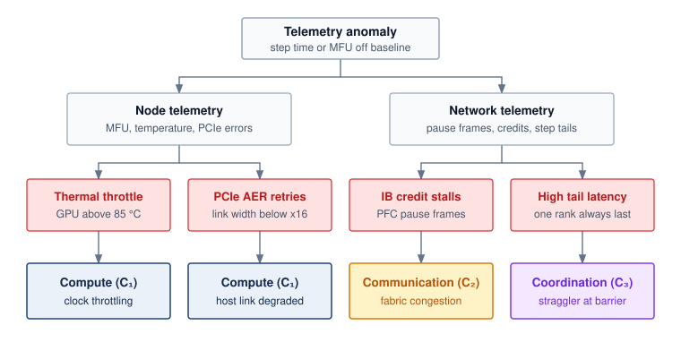

# The C$^3$ Taxonomy {#sec-appdx-c3-taxonomy}

In a distributed training cluster, "it is slow" is even less informative than on a single machine. A job can stall because accelerators are underutilized (Compute), gradient synchronization saturates interconnects (Communication), or checkpointing and recovery delay progress (Coordination). This appendix extends single-node diagnostics to fleet-scale infrastructure, providing the C$^3$ scorecard used throughout the book to isolate the binding bottleneck across distributed systems.

## How to Use This Appendix {.unnumbered}

This appendix is designed as a symptom-first reference for fleet-scale diagnosis. Start with the observed failure mode, form a hypothesis about which C$^3$ axis dominates, and select the measurement that confirms or falsifies that hypothesis:

- **When training throughput is low**: Check model FLOPs utilization (MFU), communication fraction, and runtime goodput in the diagnostic summary (@sec-appdx-c3-taxonomy-diagnostic-summary) and traffic light thresholds (@sec-appdx-c3-taxonomy-traffic-light) to isolate the compute, communication, or coordination axis.
- **When scaling efficiency drops as GPUs are added**: Use the Fleet Law decomposition (@sec-appdx-c3-taxonomy-fleet-law) and the intersection landscape (@sec-appdx-c3-taxonomy-intersection-landscape) to identify which noncompute term grew.
- **When a production job stalls, restarts, or fires hardware alerts**: Match the symptom in the troubleshooting matrix (@sec-appdx-c3-taxonomy-production-troubleshooting), select a profiler from the tooling map (@sec-appdx-c3-taxonomy-tooling-map), or trace silicon counters through the telemetry decision tree (@sec-appdx-c3-diagnostic-tree).
- **When translating a scaling-law compute budget into cluster capacity**: Use the C$^3$ scorecard (@sec-appdx-c3-taxonomy-scorecard) and the effective FLOP/s model (@sec-appdx-c3-taxonomy-scaling-laws) so optimization effort targets the dominant loss term rather than a nonbottleneck.

## From D·A·M to C$^3$ {#sec-appdx-c3-taxonomy-from-dam}

Where the single-machine D·A·M framework (@sec-appdx-dam-taxonomy) diagnoses bottlenecks within one node (data starvation, algorithmic overhead, or hardware saturation), a distributed job can stall even when every individual node is healthy. The **C$^3$ taxonomy**\index{C³ taxonomy!appendix refresher} is the diagnostic framework for fleet-scale ML systems engineering. It isolates the dominant cluster-level axis across Compute (whether the accelerators are doing useful math), Communication (whether the network is moving data fast enough), and Coordination (whether the system is spending too much time on synchronization, failure recovery, and scheduling), along with the intersections between them. Rather than replacing D·A·M, C$^3$ extends each single-machine axis to the new failure modes that appear when a workload spans a fleet (@tbl-c3-dam-mapping).

| **D·A·M axis** | **Single-machine concern**          | **C$^3$ extension**  | **What changes at fleet scale**                                                                                               |
|:---------------|:------------------------------------|:---------------------|:------------------------------------------------------------------------------------------------------------------------------|
| **Data**       | Host disk $\to$ GPU memory pipeline | Communication        | Data movement crosses network fabrics; AllReduce, AllGather, and pipeline transfers dominate                                  |
| **Algorithm**  | Operator choice, autograd graph     | Compute/Coordination | Workload must be partitioned ($\DeviceCount$-way sharding); communication-to-compute ratio determines scaling                 |
| **Machine**    | SM occupancy, HBM bandwidth         | Coordination         | Single-device faults become cluster-wide stragglers; failure recovery, scheduling, and power density constrain $\DeviceCount$ |

: **Mapping D·A·M to C$^3$**: How single-machine diagnostic concerns generalize to fleet-scale challenges. {#tbl-c3-dam-mapping tbl-colwidths="[15,28,22,35]"}

The most important row in @tbl-c3-dam-mapping is the last one. On a single machine, the overhead term ($\Latency$) in the iron law is typically small, consisting of kernel launch latency, Python dispatch, and synchronization barriers. At fleet scale, coordination becomes an axis in its own right: checkpoint writes, failure detection and recovery, pipeline bubble overhead, scheduler preemptions, and maintenance windows collectively consume a significant fraction of wall time. Coordination is the axis that single-machine diagnosis lacks, and much of this book is devoted to it.

## Diagnostic Summary {#sec-appdx-c3-taxonomy-diagnostic-summary}

When a distributed training job runs below expected throughput, the symptom appears first as idle tensor cores, exposed collective transfers, or frequent barrier and restart stalls. Matching that symptom to the C$^3$ axis that constrains the fleet links each physical bottleneck directly to its headline metric and highest-leverage optimization (@tbl-c3-diagnostic-summary).

| **C$^3$ axis**                                        | **Physical constraint**                                  | **Symptoms**                                                                    | **Key metric**                                                                                                                            | **High-leverage optimization**                                                                                                                      |
|:------------------------------------------------------|:---------------------------------------------------------|:--------------------------------------------------------------------------------|:------------------------------------------------------------------------------------------------------------------------------------------|:----------------------------------------------------------------------------------------------------------------------------------------------------|
| **Compute ($\FleetComputeTaxonomyAxis$)**             | Arithmetic throughput ($\PeakRate \times \EfficiencyHw$) | Low MFU, GPU utilization below 80%, poor per-GPU performance                    | MFU (Model FLOPs Utilization)                                                                                                             | Kernel-level levers (@sec-appdx-dam-taxonomy-kernel-levers), mixed precision, program goodput levers (@sec-performance-engineering-program-goodput) |
| **Communication ($\FleetCommunicationTaxonomyAxis$)** | Network bandwidth ($\NetworkBandwidth$)                  | High AllReduce time, low scaling efficiency, communication > 30% of step        | Scaling efficiency ($\ScalingEfficiency$), communication fraction ($\CommunicationTime(\DeviceCount)/\DistributedStepTime(\DeviceCount)$) | Gradient compression, overlap compute/communication, topology optimization (@sec-collective-communication)                                          |
| **Coordination ($\FleetCoordinationTaxonomyAxis$)**   | Synchronization overhead and failure recovery            | Low runtime goodput, frequent restarts, large pipeline bubbles, scheduler churn | Runtime goodput ($\RuntimeGoodput \approx \UsefulTrainingTime/\AllocatedWallTime$)                                                        | Async checkpointing, elastic training, faster failure detection (@sec-fault-tolerance-reliability)                                                  |

: **C$^3$ Diagnostic Summary**: Each axis maps to a distinct physical constraint and a high-impact optimization strategy. Start diagnosis here: identify which constraint binds, then follow the optimization pointer to the relevant chapter. {#tbl-c3-diagnostic-summary}

## The Fleet Law {#sec-appdx-c3-taxonomy-fleet-law}

Under ideal partitioning of fixed work, the same classification can be written as a time budget for each distributed step. The Fleet Law, introduced in @sec-vol2-introduction-fleet-law, decomposes every distributed training step into the distributed-step time budget:

$$ \DistributedStepTime(\DeviceCount) = \frac{\IronLawComputeTime}{\DeviceCount} + \CommunicationTime(\DeviceCount) + \SynchronizationTime(\DeviceCount) - \OverlappedTime $$

This equation is the fleet-scale counterpart of the iron law. Where the iron law decomposes single-machine execution into data movement, compute, and overhead, the Fleet Law decomposes distributed execution into local arithmetic, network data transfer, and synchronization logic. The diagnostic strategy is identical: measure each term, identify which dominates, and direct engineering effort at the dominant term.

### Component decomposition {#sec-appdx-c3-taxonomy-component-decomposition}

Each Fleet Law term maps to specific measurable activities that can be isolated in a timeline trace or cluster telemetry log. By attributing every millisecond of step duration to one of four terms, engineers can tell whether hardware is doing useful math, moving bytes across wires, or waiting on barriers:

- **$\IronLawComputeTime/\DeviceCount$**: Forward pass, backward pass, and optimizer step, all local arithmetic after distribution across $\DeviceCount$ devices. Governed by MFU and per-GPU kernel efficiency. Improvements come from better kernels, mixed precision, and operator fusion.
- **$\CommunicationTime(\DeviceCount)$**: AllReduce of gradients, AllGather of parameters (in FSDP/ZeRO), activation transfers in tensor/pipeline parallelism. Governed by network bandwidth and collective algorithm choice. Improvements come from gradient compression, hierarchical collectives, and compute-communication overlap.
- **$\SynchronizationTime(\DeviceCount)$**: Synchronization barriers, checkpoint writes, failure detection and recovery, pipeline bubble idle time, scheduler preemptions, and maintenance windows. Governed by cluster reliability and orchestration software. Improvements come from asynchronous checkpointing, elastic training, and faster failure detection.
- **$\OverlappedTime$**: Communication or coordination time hidden behind useful arithmetic. Governed by scheduling and implementation overlap.

Operational events may be amortized into the step budget or accounted for separately in runtime goodput. The same checkpoint or recovery delay must not appear in both. The compute-time fraction follows:

$$ \UsefulComputeFraction = \frac{\IronLawComputeTime/\DeviceCount}{\DistributedStepTime(\DeviceCount)} $$

When $\UsefulComputeFraction$ drops below 0.5, the fleet spends more time on communication and coordination than on useful arithmetic. This compute-time fraction is not total fleet efficiency; useful fleet efficiency also depends on MFU, scaling efficiency, and goodput. The C$^3$ taxonomy identifies which noncompute term is responsible.

## C$^3$ Intersections {#sec-appdx-c3-taxonomy-intersection-landscape}

In a production cluster, a stalled training step rarely comes from a single isolated resource; a slow collective can idle tensor cores while a synchronous checkpoint write blocks both the GPUs and the network fabric. The Venn diagram in @fig-appdx-c3-taxonomy maps how distributed execution spans the node substrate ($\FleetComputeTaxonomyAxis$), the networking backbone ($\FleetCommunicationTaxonomyAxis$), and the orchestration layer ($\FleetCoordinationTaxonomyAxis$). Because real bottlenecks arise at the pairwise and central boundaries where two or more of these dimensions compound, diagnosing them requires mapping observed symptoms back to the governing intersection and the engineering techniques that address it (@tbl-c3-intersections).

::: {#fig-appdx-c3-taxonomy fig-env="figure" fig-pos="htb" fig-cap="**The C$^3$ Intersection Landscape**: Each circle is one operational dimension (Compute, $\FleetComputeTaxonomyAxis$, the node substrate; Communication, $\FleetCommunicationTaxonomyAxis$, the network backbone; Coordination, $\FleetCoordinationTaxonomyAxis$, the orchestration layer), labeled with the Fleet Law term it contributes to step time. Each pairwise overlap names the interaction between two dimensions (hiding network latency behind computation, preserving training progress against failure, and synchronizing collectives). At the center, where all three meet, is fleet ML systems engineering." fig-alt="Three overlapping circles labeled Compute C1 (node substrate, T compute over N), Communication C2 (network backbone, T comm of N), and Coordination C3 (orchestration layer, T sync of N). The Compute and Communication overlap reads Hiding network latency, the Compute and Coordination overlap reads Preserving progress against failure, and the Communication and Coordination overlap reads Collective synchronization. A box at the center where all three circles meet reads Fleet ML systems engineering."}
{width="90%"}
:::

| **Zone**                                                                                                                                                  | **Name**                            | **Key techniques**                                                                                                               | **Book coverage**                                                                                                   |
|:----------------------------------------------------------------------------------------------------------------------------------------------------------|:------------------------------------|:---------------------------------------------------------------------------------------------------------------------------------|:--------------------------------------------------------------------------------------------------------------------|
| **Compute ($\FleetComputeTaxonomyAxis$)**                                                                                                                 | The Node Substrate                  | Operator fusion, mixed precision (FP8/BF16), MFU optimization, local NVMe staging                                                | @sec-compute-infrastructure, @sec-data-storage, @sec-performance-engineering, @sec-appdx-dam-taxonomy-kernel-levers |
| **Communication ($\FleetCommunicationTaxonomyAxis$)**                                                                                                     | The Networking Backbone             | Rail-optimized Clos topologies, RoCEv2/InfiniBand fabrics, collective algorithms                                                 | @sec-network-fabrics, @sec-collective-communication                                                                 |
| **Coordination ($\FleetCoordinationTaxonomyAxis$)**                                                                                                       | The Orchestration Layer             | Gang scheduling (Slurm, Kubernetes, Ray), state consensus, heartbeat failure detection                                           | @sec-fault-tolerance-reliability, @sec-fleet-orchestration, @sec-ops-scale                                          |
| **Compute $\cap$ Communication ($\FleetComputeTaxonomyAxis\cap \FleetCommunicationTaxonomyAxis$)**                                                        | Hiding Network Latency              | 1F1B pipelining, CUDA stream compute-comm overlap, comm-to-compute ratio ($\CommunicationComputeRatio$) tuning, wire compression | @sec-collective-communication, @sec-distributed-training-systems                                                    |
| **Compute $\cap$ Coordination ($\FleetComputeTaxonomyAxis\cap \FleetCoordinationTaxonomyAxis$)**                                                          | Preserving Progress Against Failure | Non-blocking async checkpointing, pipeline bubble reduction, in-memory recompute vs. rollback, fast node drain                   | @sec-fault-tolerance-reliability, @sec-fleet-orchestration                                                          |
| **Communication $\cap$ Coordination ($\FleetCommunicationTaxonomyAxis\cap \FleetCoordinationTaxonomyAxis$)**                                              | Collective Synchronization          | Straggler mitigation, hierarchical collectives (NVLink vs. IB), bounded staleness, topology-aware rank mapping                   | @sec-collective-communication, @sec-fault-tolerance-reliability                                                     |
| **Compute $\cap$ Communication $\cap$ Coordination ($\FleetComputeTaxonomyAxis\cap \FleetCommunicationTaxonomyAxis\cap \FleetCoordinationTaxonomyAxis$)** | Fleet ML Systems Engineering        | Fleet Law decomposition, 4D parallelism (DP+TP+PP+EP), memory sharding (FSDP2, ZeRO-3), ML productivity goodput                  | @sec-distributed-training-systems, @sec-inference-scale, @sec-edge-intelligence                                     |

: **C$^3$ Intersection Reference**: Each zone maps specific techniques to the axes they span and the chapters that cover them. The pairwise intersections require reasoning about two domains simultaneously; the center requires all three. {#tbl-c3-intersections tbl-colwidths="[22,20,36,22]"}

### Compute $\cap$ communication {#sec-appdx-c3-taxonomy-comp-comm}

When a GPU finishes its backward pass in 40 ms but waits 60 ms for an AllReduce collective to return gradients over the network, its tensor cores sit idle even though both the compute kernels and the links are working as specified. This intersection governs whether the system can hide communication behind computation. The communication-to-compute ratio ($\CommunicationComputeRatio= \CommunicationTime(\DeviceCount)/(\IronLawComputeTime/\DeviceCount)$) is the key diagnostic metric (@sec-appdx-fleet-foundations-comm-compute-ratio). When $\CommunicationComputeRatio< 1$, computation takes longer than communication and there is enough arithmetic duration to hide the transfer in principle; dependencies and resource contention determine whether that overlap is achievable. When $\CommunicationComputeRatio> 1$, GPUs complete their local work before the network delivers the next round of operands, and the system becomes communication-bound.

In a GPU trace, this bottleneck appears as exposed communication intervals where tensor cores sit idle awaiting collective completion (such as `ncclKernel_AllReduce` or `ncclKernel_AllGather`). Engineering at this intersection focuses on overlap and compression. Engineers launch AllReduce during the backward pass before all gradients are finalized, pipeline activation transfers in 1F1B schedules, and increase microbatch sizes or gradient accumulation steps to dilute communication frequency. They also apply wire quantization to reduce payload bytes, while accounting for metadata, codec time, and numerical error (@sec-collective-communication, @sec-distributed-training-systems).

### Compute $\cap$ coordination {#sec-appdx-c3-taxonomy-comp-coord}

A 1,024-GPU cluster that pauses every thirty minutes to flush a multi-terabyte checkpoint to shared storage turns expensive arithmetic capacity into idle wait time. This intersection captures the idle compute caused by orchestration and resilience mechanisms. While compute engines should remain saturated with arithmetic, coordination overhead repeatedly forces hardware into idle states. Three distinct mechanisms govern this intersection:

1.  **Pipeline bubbles**: In pipeline parallelism (PP), stages idle during pipeline fill (warmup) and drain (cooldown). For $\PipelineParallelDegree$ pipeline stages and $\MicrobatchCount$ microbatches, the bubble fraction $\PipelineBubbleFraction = (\PipelineParallelDegree - 1)/(\PipelineParallelDegree - 1 + \MicrobatchCount)$ (@sec-appdx-comm-foundations-bubble-fraction) is accelerator time lost to idling; more microbatches or interleaved schedules shrink it.
2.  **Checkpoint stalls**: Synchronous checkpoint writes that block the training loop to serialize terabytes of weights and optimizer states convert expensive compute time into storage wait time. Asynchronous checkpointing mitigates this by snapshotting host-pinned or local Non-Volatile Memory Express (NVMe) memory in milliseconds, delegating remote persistence to background I/O threads.
3.  **Recovery rollback**: When a node fails in an $\DeviceCount$-device cluster, training halts and rolls back to the last valid checkpoint, squandering the arithmetic executed since that snapshot. Minimizing the failure blast radius through fast health heartbeats and dynamic node replacement bounds this compute loss (@sec-fault-tolerance-reliability, @sec-fleet-orchestration).

### Communication $\cap$ coordination {#sec-appdx-c3-taxonomy-comm-coord}

When a single GPU or network link drops packets or throttles its clock during an AllReduce collective, every other rank in the group must wait at the dependency boundary before the next step can proceed. This intersection captures the synchronization cost embedded in network communication. A collective operation (AllReduce, AllGather, ReduceScatter) moves data over physical wires ($\FleetCommunicationTaxonomyAxis$) while creating dependencies among its participating ranks ($\FleetCoordinationTaxonomyAxis$). It need not impose a separate cluster-wide barrier, but a delayed contribution can prevent dependent outputs from becoming ready.

The governing failure mode is that one slow participant paces the whole collective\index{Straggler!appendix refresher}. If a single GPU or link experiences packet drops, thermal throttling, or ECC retry delays, every other GPU in the collective waits, transforming a localized degradation into a cluster-wide halt. At fleet scale ($\DeviceCount\ge 10{,}000$), tail latency dominates the barrier time, because the probability that at least one node straggles approaches unity ($1 - (1 - \NodeStragglerProbability)^\DeviceCount\to 1$). Engineering at this intersection focuses on decoupling synchronization from raw communication. Hierarchical collectives isolate high-bandwidth intra-node NVLink domains from inter-node InfiniBand fabrics. Bounded-staleness asynchronous training absorbs transient tail latency. Topology-aware gang scheduling aligns collective communication rings with physical spine-leaf switch rails (@sec-collective-communication, @sec-fault-tolerance-reliability).

### Fleet-scale ML systems engineering {#sec-appdx-c3-taxonomy-triple-intersection}

Partitioning a 405-billion-parameter model across 16,384 GPUs requires fitting shard states into high-bandwidth memory (HBM) ($\FleetComputeTaxonomyAxis$), matching tensor and pipeline traffic to intra-node NVLink and inter-node InfiniBand bandwidths ($\FleetCommunicationTaxonomyAxis$), and keeping pipeline bubbles and checkpoint stalls from consuming wall-clock time ($\FleetCoordinationTaxonomyAxis$). At the center ($\FleetComputeTaxonomyAxis\cap \FleetCommunicationTaxonomyAxis\cap \FleetCoordinationTaxonomyAxis$), all three constraints converge simultaneously. This is the discipline of **fleet-scale ML systems engineering**\index{Fleet-scale ML systems engineering!definition}. Systems engineers at this center do not optimize a single accelerator or a single network switch; they manage the trade-offs of the distributed machine as an integrated whole. The central engineering challenges encompass three coupled design problems:

-  **4D parallelism co-design**: Balancing data parallelism (DP), tensor parallelism (TP), pipeline parallelism (PP), and expert parallelism (EP) so that memory consumption fits within accelerator HBM ($\FleetComputeTaxonomyAxis$), high-frequency communications map to intra-node NVLink and low-frequency communications map to inter-node fabrics ($\FleetCommunicationTaxonomyAxis$), and pipeline bubbles and barrier dependencies are minimized ($\FleetCoordinationTaxonomyAxis$).
-  **Memory sharding vs. communication volume**: Frameworks like PyTorch FSDP2 and DeepSpeed ZeRO-3 eliminate memory redundancy ($\FleetComputeTaxonomyAxis$) by partitioning model states across workers, but pay for it with repeated AllGather communication ($\FleetCommunicationTaxonomyAxis$) and state coordination metadata ($\FleetCoordinationTaxonomyAxis$).
-  **ML productivity goodput**: ML productivity goodput (MPG), the fraction of a fleet's capacity-time that becomes useful work, is the product of scheduling goodput ($\SchedulingGoodput$), runtime goodput ($\RuntimeGoodput$), and program goodput ($\ProgramGoodput$) (@sec-performance-engineering-goodput-family). These factors cut across the C$^3$ axes rather than mapping one to one onto them. Communication overlap and shorter pipeline bubbles improve program goodput, while checkpointing and recovery, which are Coordination costs, determine runtime goodput.

### C$^3$ coordination and overlap {#sec-appdx-c3-taxonomy-coordination-overlap}

Just as single-node execution transforms the additive iron law into a maximum bounded by dependencies (@sec-appdx-dam-taxonomy-dam-coordination-sum-max), overlap at fleet scale transforms the Fleet Law (@eq-fleet-law) by maximizing $\OverlappedTime$. Pipeline schedules, separate communication streams, asynchronous checkpoints, hierarchical collectives, and double-buffered data streaming each hide one C$^3$ axis behind another (@tbl-c3-overlap).

| **Technique**                      | **C$^3$ overlap**                                                           | **Mechanism**                                                                                            | **Implementation**                                                                              |
|:-----------------------------------|:----------------------------------------------------------------------------|:---------------------------------------------------------------------------------------------------------|:------------------------------------------------------------------------------------------------|
| **1F1B Pipeline Schedule**         | $\FleetComputeTaxonomyAxis$ overlaps $\FleetCommunicationTaxonomyAxis$      | Interleaves forward and backward microbatches to overlap cross-stage activation transfer with arithmetic | Microbatch queue scheduling (@sec-distributed-training-systems)                                 |
| **CUDA Stream Decoupling**         | $\FleetComputeTaxonomyAxis$ overlaps $\FleetCommunicationTaxonomyAxis$      | Launches non-blocking AllGather or AllReduce on separate communication streams concurrently with GEMMs   | Dedicated NCCL streams (@sec-collective-communication)                                          |
| **Async Checkpointing**            | $\FleetComputeTaxonomyAxis$ overlaps $\FleetCoordinationTaxonomyAxis$       | Fast in-memory or local NVMe snapshot while GPU arithmetic resumes immediately                           | Background host thread flushes to storage (@sec-data-storage, @sec-fault-tolerance-reliability) |
| **Hierarchical Collectives**       | $\FleetCommunicationTaxonomyAxis$ overlaps $\FleetCoordinationTaxonomyAxis$ | Partitions collective into local NVLink reduction and inter-node fabric transfer, isolating tail jitter  | Hierarchical NCCL communicators (@sec-collective-communication)                                 |
| **Double-Buffered Data Streaming** | $\FleetComputeTaxonomyAxis$ overlaps $\FleetCommunicationTaxonomyAxis$      | Prefetches and decompresses next batch shard in pinned host memory while GPUs compute current batch      | Host pinned memory + async H2D transfer (@sec-data-storage)                                     |

: **C$^3$ Overlap Techniques**: System techniques that hide communication or coordination behind useful computation, maximizing $\OverlappedTime$ in the Fleet Law. {#tbl-c3-overlap tbl-colwidths="[24,18,34,24]"}

### Storage as the persistent substrate {#sec-appdx-c3-taxonomy-storage-substrate}

A common diagnostic question is why Storage does not appear as a fourth explicit coordinate in the C$^3$ taxonomy or as an independent $\Glyph{T_{\text{storage}}}$ term in the Fleet Law. The physical data center is procured around Compute, Network, and Storage (@sec-data-storage), yet at runtime storage devices execute no model arithmetic. Storage overhead therefore manifests dynamically through the three C$^3$ dimensions:

-  **In Compute ($\FleetComputeTaxonomyAxis$)**: High-throughput local NVMe drives function as the tier-3 extension of the accelerator memory hierarchy (below SRAM and HBM), serving parameter offloading (ZeRO-Offload) and activation spilling.
-  **In Communication ($\FleetCommunicationTaxonomyAxis$)**: Remote dataset streaming from parallel file systems (Lustre, GPFS) or object stores (S3, Ceph) shares cluster network bandwidth and network interface card (NIC) capacity with collective communication traffic.
-  **In Coordination ($\FleetCoordinationTaxonomyAxis$)**: Durable distributed storage provides the persistent state anchor required for checkpoint serialization, node failover, and job rescheduling.

When storage latency stalls a training run, profilers identify the symptom not as raw disk latency, but either as a network communication bottleneck ($\FleetCommunicationTaxonomyAxis$, dataset starvation) or as a blocking coordination barrier ($\FleetCoordinationTaxonomyAxis$, synchronous checkpoint flush). Storage is the persistent substrate supporting all three dimensions, rather than a separate term in the step execution budget.

```{python}
#| echo: false
from mlsysim import *
from mlsysim.core.units import *

# ┌── LEGO ───────────────────────────────────────────────
# │ Context: ## Rules of Thumb — C³ traffic light table
from mlsysim.fmt import fmt

class C3TrafficLight:
    # ┌── 4. OUTPUT (Formatting) ───────────────────────────
    mfu_low_str = fmt_percent(Literature.Training.MfuLow, precision=0, commas=False, style='symbol')
    mfu_high_str = fmt_percent(Literature.Training.MfuHigh, precision=0, commas=False, style='symbol')
```

## Rules of Thumb {#sec-appdx-c3-taxonomy-rules-of-thumb}

In the middle of a production incident, fast heuristics narrow the search space before a profiler is needed. These thresholds provide that first line of defense.

### The C$^3$ traffic light {#sec-appdx-c3-taxonomy-traffic-light}

Each C$^3$ axis has one headline metric, and its value against two thresholds sorts the axis into green, yellow, or red (@tbl-c3-traffic-light). Comparing observed MFU, communication fraction, and runtime goodput against these bands immediately isolates which subsystem warrants a deeper trace.

| **C$^3$ axis**    | **Green (healthy)**                            | **Yellow (investigate)**                                                          | **Red (bottleneck)**                          |
|:------------------|:-----------------------------------------------|:----------------------------------------------------------------------------------|:----------------------------------------------|
| **Compute**       | MFU $>$ `{python} C3TrafficLight.mfu_high_str` | MFU `{python} C3TrafficLight.mfu_low_str`--`{python} C3TrafficLight.mfu_high_str` | MFU $<$ `{python} C3TrafficLight.mfu_low_str` |
| **Communication** | Comm fraction $<$ 20%                          | Comm fraction 20--40%                                                             | Comm fraction $>$ 40%                         |
| **Coordination**  | Runtime goodput $>$ 90%                        | Runtime goodput 75--90%                                                           | Runtime goodput $<$ 75%                       |

: **C$^3$ Traffic Light**: Quick triage thresholds for fleet-scale diagnosis. Green means the axis is healthy; yellow means it deserves investigation; red means it is the likely bottleneck. These thresholds assume well-optimized large-model training on current-generation hardware. {#tbl-c3-traffic-light}

### The bottleneck diagnostic table {#sec-appdx-c3-taxonomy-bottleneck-table}

An optimization pays only when it shortens the term that binds: upgrading to faster GPUs in a communication-bound fleet or adding network bandwidth to a compute-bound fleet leaves step time flat (@tbl-c3-bottleneck-actions).

| **If the fleet is...**  |          **Dominant term**           | **Optimization that works**                                                              | **Optimization that is wasted**                                                        |
|:------------------------|:------------------------------------:|:-----------------------------------------------------------------------------------------|:---------------------------------------------------------------------------------------|
| **Compute-bound**       |  $\IronLawComputeTime/\DeviceCount$  | Better kernels, mixed precision, operator fusion, next-gen accelerators                  | More network bandwidth (GPUs are not waiting on the network)                           |
| **Communication-bound** |  $\CommunicationTime(\DeviceCount)$  | Gradient compression, compute-comm overlap, hierarchical collectives, InfiniBand upgrade | Faster GPUs (they spend a larger share of each step waiting for the network)           |
| **Coordination-bound**  | $\SynchronizationTime(\DeviceCount)$ | Async checkpointing, elastic training, faster failure detection, fewer pipeline stages   | Faster arithmetic alone; faster networks help only transfer-related coordination costs |

: **What Works vs. What Is Wasted at Fleet Scale**: Optimizing a nondominant C$^3$ axis yields limited improvement and often worsens cost efficiency. A communication-bound fleet will gain little from faster GPUs until AllReduce and other communication bottlenecks are addressed. {#tbl-c3-bottleneck-actions tbl-colwidths="[19,11,35,35]"}

```{python}
#| echo: false
#| label: appendix-c3-case-studies
# ┌── LEGO ───────────────────────────────────────────────
# │ Context: ## C³ Case Studies — three diagnostic scenarios
from mlsysim.fmt import check, fmt, fmt_time

class C3CaseStudies:
    case1_n_gpus = 4096
    case1_mfu = 0.15
    case1_target_mfu = Literature.Training.MfuHigh
    case2_baseline_gpus = 64
    case2_n_gpus = 512
    case2_comm_fraction = 0.55
    case2_observed_speedup = 4
    case3_n_gpus = Systems.Clusters.Training_10K.total_accelerators
    case3_mfu = (Literature.Training.MfuLow + Literature.Training.MfuHigh) / 2
    case3_comm_fraction = 0.15
    _oh = Ops.TrainingRunOverheads
    case3_oh_scheduler_pct = _oh.SchedulerPreemption
    case3_retained_share = 1.0 - (_oh.PipelineBubble + _oh.Checkpoint + _oh.FailureRecovery + _oh.Maintenance + _oh.SchedulerPreemption)
    heartbeat_timeout_s = Systems.Reliability.Recovery.heartbeat_timeout_s  # current default detection timeout
    heartbeat_target_s = 5  # scenario assumption: hardware-assisted detection target

    case1_throughput_ratio = case1_mfu / Literature.Training.MfuHigh
    case1_uncredited_pct = (1 - case1_mfu) * 100
    case2_compute_fraction = 1 - case2_comm_fraction
    case2_compute_phase_efficiency = Literature.Training.MfuHigh * 0.9
    case2_wall_mfu = case2_compute_phase_efficiency * case2_compute_fraction
    case2_speedup_if_fixed = 1 / case2_compute_fraction
    case2_ideal_speedup = case2_n_gpus / case2_baseline_gpus
    case2_scaling_efficiency = case2_observed_speedup / case2_ideal_speedup
    case3_coord_fraction = 1 - case3_retained_share
    case3_failure_interval_hours = Systems.Reliability.Gpu.mttf_hours / case3_n_gpus

    check(case2_ideal_speedup == 8, "Case 2 expected speedup changed")
    check(abs(case3_failure_interval_hours - 5) < 1e-9, "Case 3 failure cadence should be 5 hours")
    check(abs(case3_retained_share - 0.60) < 1e-9, "Case 3 retained wall-time share should be 60 percent (1 minus the five overheads)")
    check(heartbeat_target_s < heartbeat_timeout_s, "Detection target must be faster than the current heartbeat timeout")

    # ┌── 4. OUTPUT (Formatting) ───────────────────────────
    case1_n_gpus_str = fmt(case1_n_gpus, precision=0)
    case1_mfu_pct_str = fmt_percent(case1_mfu, precision=0, commas=False, style='prose')
    case1_target_mfu_pct_str = fmt_percent(Literature.Training.MfuHigh, precision=0, commas=False, style='prose')
    case1_target_gain_mult_str = fmt_multiple(Literature.Training.MfuHigh / case1_mfu, precision=1, commas=False)
    case1_uncredited_pct_str = fmt_percent(case1_uncredited_pct / 100, precision=0, commas=False, style='prose')
    case2_baseline_gpus_str = fmt(case2_baseline_gpus, precision=0, commas=False)
    case2_n_gpus_str = fmt(case2_n_gpus, precision=0)
    case2_observed_speedup_mult_str = fmt_multiple(case2_observed_speedup, precision=0, commas=False)
    case2_ideal_speedup_mult_str = fmt_multiple(case2_ideal_speedup, precision=0, commas=False)
    case2_scaling_efficiency_pct_str = fmt_percent(case2_scaling_efficiency, precision=0, commas=False, style='prose')
    case2_compute_efficiency_pct_str = fmt_percent(case2_compute_phase_efficiency, precision=0, commas=False, style='prose')
    case2_wall_mfu_pct_str = fmt_percent(case2_wall_mfu, precision=1, commas=False, style='prose')
    case2_comm_pct_str = fmt_percent(case2_comm_fraction, precision=0, commas=False, style='prose')
    case2_compute_pct_str = fmt_percent(case2_compute_fraction, precision=0, commas=False, style='prose')
    case2_speedup_mult_str = fmt_multiple(case2_speedup_if_fixed, precision=1, commas=False)
    case3_n_gpus_str = fmt(case3_n_gpus, precision=0)
    case3_failure_interval_hours_str = fmt_time(case3_failure_interval_hours, 'hour', precision=0, commas=False, style='word')
    case3_mfu_pct_str = fmt_percent(case3_mfu, precision=0, commas=False, style='prose')
    case3_comm_pct_str = fmt_percent(case3_comm_fraction, precision=0, commas=False, style='prose')
    case3_retained_pct_str = fmt_percent(case3_retained_share, precision=0, commas=False, style='prose')
    case3_coord_pct_str = fmt_percent(case3_coord_fraction, precision=0, commas=False, style='prose')
    case3_oh_scheduler_pct_str = fmt_percent(case3_oh_scheduler_pct, precision=0, commas=False, style='prose')
    oh_pipeline_str = fmt_percent(Ops.TrainingRunOverheads.PipelineBubble, precision=0, commas=False, style='prose')
    oh_checkpoint_str = fmt_percent(Ops.TrainingRunOverheads.Checkpoint, precision=0, commas=False, style='prose')
    oh_failure_str = fmt_percent(Ops.TrainingRunOverheads.FailureRecovery, precision=0, commas=False, style='prose')
    oh_maintenance_str = fmt_percent(Ops.TrainingRunOverheads.Maintenance, precision=0, commas=False, style='prose')
    heartbeat_timeout_str = fmt_time(float(heartbeat_timeout_s), 'second', precision=0, commas=False, style='word')
    heartbeat_target_str = fmt_time(heartbeat_target_s, 'second', precision=0, commas=False, style='word')
```

## C$^3$ Case Studies {#sec-appdx-c3-taxonomy-case-studies}

In production, two clusters with the same slow step time can require opposite fixes depending on whether the stall comes from low per-GPU kernel utilization, exposed gradient synchronization, or frequent recovery restarts. The three cases below isolate one dominant C$^3$ axis at a time and trace the diagnosis from initial symptom to targeted fix.

### Case 1 on the underutilized compute fleet {#sec-appdx-c3-taxonomy-case-1}

#### Symptom {.unnumbered}

An engineering team provisions `{python} C3CaseStudies.case1_n_gpus_str` H100 GPUs for a large language model training run. The training loop runs without errors, but the PyTorch Profiler shows MFU of only `{python} C3CaseStudies.case1_mfu_pct_str`. The network profiler shows communication accounts for less than 10 percent of step time. The cluster is running but barely working.

#### Diagnosis {.unnumbered}

The **Compute**\index{C³ taxonomy!compute} axis is the leading hypothesis to investigate. With `{python} C3CaseStudies.case1_mfu_pct_str` MFU, `{python} C3CaseStudies.case1_uncredited_pct_str` of the fleet's peak capacity is not credited to useful model FLOPs. Low exposed communication makes local execution a useful starting point; kernel traces and host-side waits must distinguish inefficient arithmetic from data starvation or unobserved coordination gaps.

#### The fix {.unnumbered}

If traces confirm inefficient local execution, target the compute axis across `{python} C3CaseStudies.case1_n_gpus_str` accelerators to raise per-device kernel utilization. Three adjustments recover most of the missing arithmetic throughput:

- **Mixed precision**: Ensure BF16/FP8 Tensor Cores are engaged. A common culprit is FP32 fallback in normalization layers or loss computation.
- **Operator fusion**: Use `torch.compile` or similar just-in-time (JIT) compilation to fuse element-wise operations and reduce kernel launch overhead.
- **Batch size tuning**: If per-GPU batch size is too small, the matrix multiplications have insufficient arithmetic intensity to saturate the Tensor Cores.

Raising MFU from `{python} C3CaseStudies.case1_mfu_pct_str` to `{python} C3CaseStudies.case1_target_mfu_pct_str` on the same hardware delivers `{python} C3CaseStudies.case1_target_mfu_pct_str`/`{python} C3CaseStudies.case1_mfu_pct_str` = `{python} C3CaseStudies.case1_target_gain_mult_str` more useful work, the equivalent of tripling the fleet without buying a single GPU. Because communication is already below 10 percent of step time, all of that per-device gain translates directly into faster step completion.

### Case 2 on the communication wall {#sec-appdx-c3-taxonomy-case-2}

#### Symptom {.unnumbered}

A `{python} C3CaseStudies.case2_n_gpus_str`-GPU data-parallel training run achieves `{python} C3CaseStudies.case2_compute_efficiency_pct_str` illustrative compute-phase efficiency during compute kernels on each GPU, which is good per-device kernel efficiency. Wall-clock MFU over the full step (including AllReduce) is only `{python} C3CaseStudies.case2_wall_mfu_pct_str` because AllReduce consumes `{python} C3CaseStudies.case2_comm_pct_str` of every training step. Scaling from `{python} C3CaseStudies.case2_baseline_gpus_str` GPUs to `{python} C3CaseStudies.case2_n_gpus_str` GPUs yields only `{python} C3CaseStudies.case2_observed_speedup_mult_str` speedup instead of the expected `{python} C3CaseStudies.case2_ideal_speedup_mult_str`, or `{python} C3CaseStudies.case2_scaling_efficiency_pct_str` scaling efficiency.

#### Diagnosis {.unnumbered}

The **Communication**\index{C³ taxonomy!communication} axis dominates. Each GPU has healthy compute-phase efficiency, but more than half the step time is spent synchronizing gradients across the network. The system is **Communication-Bound**\index{Communication-bound workload}: adding more GPUs can worsen the exposed communication fraction. Under fixed-work scaling, local computation shrinks while the collective retains startup and transfer costs.

#### The fix {.unnumbered}

Target the communication axis without touching the per-GPU computation. Three network-level interventions shrink or hide the exposed collective time:

- **Compute-communication overlap**: Launch AllReduce during the backward pass rather than waiting until it completes. Modern frameworks (FSDP, DeepSpeed) support this natively.
- **Gradient compression**: Apply Top-k sparsification or quantization to reduce the bytes crossing the network by 10--100$\times$.
- **Hierarchical collectives**: Use intra-node NVLink for the first reduction stage, then inter-node InfiniBand only for cross-node aggregation, reducing inter-node participants relative to a flat rank-level algorithm. Actual traffic savings depend on the collective layout, NIC allocation, and topology.

If communication were eliminated entirely, throughput would increase by `{python} C3CaseStudies.case2_speedup_mult_str` (Amdahl's Law applied to the `{python} C3CaseStudies.case2_compute_pct_str` compute fraction). Realistically, reducing communication from `{python} C3CaseStudies.case2_comm_pct_str` to 20 percent of step time would recover most of the lost scaling.

### Case 3 on coordination overhead {#sec-appdx-c3-taxonomy-case-3}

#### Symptom {.unnumbered}

A `{python} C3CaseStudies.case3_n_gpus_str`-GPU training run shows `{python} C3CaseStudies.case3_mfu_pct_str` compute-phase model FLOPs utilization per device, measured only while kernels execute, and communication accounts for only `{python} C3CaseStudies.case3_comm_pct_str` of step time. Both figures look healthy. Yet only `{python} C3CaseStudies.case3_retained_pct_str` of wall time is left after the run's coordination overheads. That share is not a goodput factor, because it mixes losses that belong to different factors. Pipeline bubbles lie inside retained steps and are a program goodput loss, while checkpoints, recovery, maintenance, and preemption fall outside the steps (@sec-performance-engineering-goodput-boundaries). The remaining `{python} C3CaseStudies.case3_coord_pct_str` of wall time is consumed by checkpoint writes, failure recovery restarts, pipeline bubble idle time, scheduler preemptions (`{python} C3CaseStudies.case3_oh_scheduler_pct_str` of wall time), and maintenance windows.

#### Diagnosis {.unnumbered}

The **Coordination**\index{C³ taxonomy!coordination} axis dominates. Although per-GPU computation and inter-node communication are both efficient, nonproductive overhead consumes `{python} C3CaseStudies.case3_coord_pct_str` of wall time. Scheduler preemptions take `{python} C3CaseStudies.case3_oh_scheduler_pct_str`, and failure recovery takes `{python} C3CaseStudies.oh_failure_str` (because at `{python} C3CaseStudies.case3_n_gpus_str` GPUs, GPU failures occur about every `{python} C3CaseStudies.case3_failure_interval_hours_str`). Pipeline bubbles take `{python} C3CaseStudies.oh_pipeline_str`, checkpoint writes take `{python} C3CaseStudies.oh_checkpoint_str`, and maintenance windows take `{python} C3CaseStudies.oh_maintenance_str`. Because faster arithmetic alone cannot recover this lost time, checkpoint bandwidth, recovery mechanisms, and scheduling must be evaluated against the specific overhead each can reduce.

#### The fix {.unnumbered}

Target the coordination axis so that orchestration and fault-recovery events stop idling the healthy accelerators. Four operational changes attack both the in-step bubble losses and the out-of-step downtime:

- **Asynchronous checkpointing**: Overlap checkpoint writes with the next training step, reducing visible checkpoint overhead from `{python} C3CaseStudies.oh_checkpoint_str` to near zero.
- **Elastic training**: When a node fails, shrink the job and continue rather than halting all `{python} C3CaseStudies.case3_n_gpus_str` GPUs for recovery. This converts the `{python} C3CaseStudies.oh_failure_str` failure recovery cost into a smaller throughput reduction.
- **Pipeline schedule optimization**: Switch from GPipe to an interleaved 1F1B schedule to reduce bubble fraction, or increase microbatch count per pipeline flush.
- **Faster failure detection**: Reduce heartbeat timeout from `{python} C3CaseStudies.heartbeat_timeout_str` to `{python} C3CaseStudies.heartbeat_target_str` with hardware-level health monitoring, cutting the idle time between failure occurrence and recovery initiation.

## Production Troubleshooting {#sec-appdx-c3-taxonomy-production-troubleshooting}

Each common fleet-scale failure mode first shows up as a user-visible symptom, and that symptom points to the C$^3$ axis most likely responsible (sometimes two), a measurement that confirms it, and an action (@tbl-c3-troubleshooting). Operators can match an observed cluster symptom to its primary C$^3$ axis, run the listed diagnostic check, and apply the corresponding engineering fix.

| **Symptom**                                    |     **C$^3$ axis**    | **Diagnostic question**                                                      | **Measurement**                                                                       | **Action**                                                             |
|:-----------------------------------------------|:---------------------:|:-----------------------------------------------------------------------------|:--------------------------------------------------------------------------------------|:-----------------------------------------------------------------------|
| **Low MFU despite fast network**               |      **Compute**      | Are Tensor Cores engaged? Is batch size sufficient for arithmetic intensity? | Per-GPU kernel trace (Nsight/PyTorch Profiler)                                        | Enable mixed precision, increase per-GPU batch size                    |
| **Throughput plateaus when adding GPUs**       |   **Communication**   | Does AllReduce time grow faster than computation shrinks?                    | NCCL trace, $\CommunicationComputeRatio$ ratio                                        | Gradient compression, hierarchical collectives, overlap                |
| **Frequent job restarts**                      |    **Coordination**   | What is the cluster MTBF? Is detection fast enough?                          | Failure logs, MTBF calculation                                                        | Elastic training, faster detection, smaller blast radius               |
| **High GPU-hours but slow progress**           |    **Coordination**   | What fraction of GPU-hours produce useful training steps?                    | Runtime goodput ($\UsefulTrainingTime/\AllocatedWallTime$)                            | Async checkpointing, reduce pipeline stages, eliminate scheduler churn |
| **Scaling efficiency drops with cluster size** |     **Comm/Coord**    | Is the bottleneck network bandwidth or synchronization barriers?             | Separate $\CommunicationTime(\DeviceCount)$ from $\SynchronizationTime(\DeviceCount)$ | If comm: compress or overlap. If coord: async methods                  |
| **Stragglers slow entire job**                 | **Comm $\cap$ Coord** | Is one node consistently last to reach the AllReduce barrier?                | Per-node step time histogram                                                          | Straggler detection + replacement, bounded staleness, backup workers   |

: **C$^3$ Troubleshooting Matrix**: Root cause identification and remediation for common fleet-scale bottlenecks. Each row connects a user-visible symptom to the C$^3$ axis most likely responsible, reducing the search space before reaching for a profiler. {#tbl-c3-troubleshooting tbl-colwidths="[22,12,23,20,23]"}

## Tooling Map {#sec-appdx-c3-taxonomy-tooling-map}

Confirming a candidate C$^3$ bottleneck requires inspecting the layer where that constraint lives: per-GPU kernel profilers for Compute, collective and fabric counters for Communication, and scheduler and goodput logs for Coordination (@tbl-c3-tooling).

| **C$^3$ axis**    |                   **Key metric**                   | **Primary tool**                               | **Secondary tool**                                         |
|:------------------|:--------------------------------------------------:|:-----------------------------------------------|:-----------------------------------------------------------|
| **Compute**       |              MFU, kernel utilization               | PyTorch Profiler (TensorBoard plugin)          | Nsight Compute (per-kernel roofline analysis)              |
| **Communication** | AllReduce time, $\CommunicationComputeRatio$ ratio | NCCL debug logs (`NCCL_DEBUG=INFO`)            | Nsight Systems (timeline), `ibstat`/`perfquery` (IB)       |
| **Coordination**  |           Runtime goodput, restart count           | Cluster scheduler logs (Slurm, K8s event logs) | Custom goodput dashboards (for example, Google ML Goodput) |

: **C$^3$ Tooling Map**: Profiling utilities for diagnosing fleet-scale bottlenecks. Start with the primary tool for quick triage; use secondary tools for deep-dive analysis. Compute tools operate per-GPU; Communication tools operate at the network layer; Coordination tools operate at the cluster/job level. {#tbl-c3-tooling}

```{python}
#| echo: false
#| label: appendix-c3-scorecard
# ┌── LEGO ───────────────────────────────────────────────
# │ Context: ## C³ Scorecard — efficiency rubric table

class C3Scorecard:
    # ┌── 4. OUTPUT (Formatting) ───────────────────────────
    mfu_low_str = fmt_percent(Literature.Training.MfuLow, precision=0, commas=False, style='symbol')
    mfu_high_str = fmt_percent(Literature.Training.MfuHigh, precision=0, commas=False, style='symbol')
    eff_256_str = fmt_percent(ReferenceStats.TrainingScaleProfiles.Eff256Gpu, precision=0, commas=False, style='symbol')
    eff_8192_str = fmt_percent(ReferenceStats.TrainingScaleProfiles.Eff8192Gpu, precision=0, commas=False, style='symbol')
```

## C$^3$ Scorecard {#sec-appdx-c3-taxonomy-scorecard}

Once profiling tools supply the raw counters, three fleet-level efficiency ratios extend the single-machine scorecard (@sec-appdx-dam-taxonomy-dam-scorecard) to grade distributed cluster health against production thresholds (@tbl-c3-scorecard).

| **C$^3$ axis**    |                   **Metric**                  |                                                   **Definition**                                                  |            **Failing grade**            |            **Passing grade**            |
|:------------------|:---------------------------------------------:|:-----------------------------------------------------------------------------------------------------------------:|:---------------------------------------:|:---------------------------------------:|
| **Compute**       |                    **MFU**                    |                   $\frac{\UsefulModelFlops}{\DeviceCount\PeakRate \times \DistributedStepTime}$                   |  $<$ `{python} C3Scorecard.mfu_low_str` | $>$ `{python} C3Scorecard.mfu_high_str` |
| **Communication** | **Scaling Efficiency** ($\ScalingEfficiency$) |                       $\frac{\SingleDeviceRunTime}{\DeviceCount\times \MultiDeviceRunTime}$                       | $<$ `{python} C3Scorecard.eff_8192_str` |  $>$ `{python} C3Scorecard.eff_256_str` |
| **Coordination**  |    **Runtime Goodput** ($\RuntimeGoodput$)    | $\frac{\UsefulTrainingTime}{\AllocatedWallTime}$, retained steps at the job's fault-free step rate over held time |                 $<$ 75%                 |                 $>$ 90%                 |

: **The C$^3$ Efficiency Rubric**: Use these three numbers to characterize fleet health. The MFU denominator uses aggregate fleet peak, written as $\DeviceCount\PeakRate$ when $\PeakRate$ is a per-device value. These illustrative thresholds guide investigation; passing all three does not prove that inexpensive optimizations are exhausted. {#tbl-c3-scorecard tbl-colwidths="[16,21,29,17,17]"}

## C$^3$ Infrastructure Diagnostic Decision Tree and Fleet Diagnostic Scorecard {#sec-appdx-c3-diagnostic-tree}

When step time suddenly doubles in the middle of a training run, on-call operators see raw hardware counters—elevated GPU temperatures, PCIe retry alerts, or InfiniBand pause frames—rather than a neatly labeled C$^3$ axis. Cluster operations teams need a systematic procedure for mapping those low-level hardware signals to the binding C$^3$ axis before taking remedial action.

### Telemetry signal mapping to C$^3$ axes {#sec-appdx-c3-telemetry-mapping}

A degraded PCIe riser or a clogged cooling loop first surfaces in hardware counters across silicon, PCIe buses, thermal sensors, and network switches. Monitoring daemons collect four primary classes of low-level telemetry to catch these faults early:

- **MFU Drops**: Sudden or sustained drops in model FLOPs utilization below expected baselines.
- **PCIe AER (Advanced Error Reporting) Retries**: Non-fatal bus errors causing packet retries, link downgrades (e.g., PCIe Gen 5 $\to$ Gen 3), or host-to-device direct memory access (DMA) throttling.
- **Thermal Throttling**: GPU SM clock downclocking (e.g., 1.9 GHz $\to$ 1.1 GHz) triggered by junction thermal limits or cooling fan degradation.
- **InfiniBand Credit Stalls and PFC Pause Frames**: Priority flow control (PFC) pause frames, congestion notification packets (CNP), or switch buffer credit starvation.

### Diagnostic decision tree {#sec-appdx-c3-diagnostic-tree-details}

Triage starts from whichever telemetry source shows the anomaly and narrows to the specific signal before naming the binding axis (@fig-c3-telemetry-decision-tree). A node-side signal points to the compute axis, while a network-side signal separates fabric congestion, a communication cost, from a single straggler that holds every rank at the barrier, a coordination cost.

::: {#fig-c3-telemetry-decision-tree fig-env="figure" fig-pos="htb" fig-cap="**Telemetry-First Triage**: An anomaly is traced first to the telemetry source that shows it, then to the specific signal, and only then to the C$^3$ axis that binds. Thermal throttling and PCIe link degradation both lower per-device throughput and so point to compute, credit stalls point to communication, and a single rank that is always last points to coordination. The 85 °C threshold is illustrative." fig-alt="Four-level tree. A top box, telemetry anomaly, step time or MFU off baseline, splits into node telemetry (MFU, temperature, PCIe errors) and network telemetry (pause frames, credits, step tails). Node telemetry splits into two red signal boxes, thermal throttle (GPU above 85 degrees C) and PCIe AER retries (link width below x16), each leading to a blue box labeled Compute C1, with clock throttling and host link degraded. Network telemetry splits into two red signal boxes, IB credit stalls (PFC pause frames) leading to an amber box labeled Communication C2, fabric congestion, and high tail latency (one rank always last) leading to a violet box labeled Coordination C3, straggler at barrier."}



:::

### Structured diagnostic telemetry table {#sec-appdx-c3-telemetry-table}

Once the decision tree isolates the anomalous hardware or OS counter, pairing that counter with its physical subsystem lets automated health checks route the alert directly to the appropriate repair workflow (@tbl-c3-telemetry-diagnostic).

| **Telemetry signal**                   | **Hardware/OS counter**                                        | **Root cause**                                    | **C$^3$ axis**    | **Remediation action**                                                          |
|:---------------------------------------|:---------------------------------------------------------------|:--------------------------------------------------|:------------------|:--------------------------------------------------------------------------------|
| **MFU Drop with High GPU Temp**        | `gpu_temperature > 85°C`, `clocks_throttle_reasons.sw_thermal` | Thermal throttling reduces GPU SM clock speed     | **Compute**       | Check coolant flow, replace thermal interface material (TIM), adjust fan curves |
| **MFU Drop with Low Host-GPU BW**      | `pcie_aer_correctable_errors`, `pcie_link_width < x16`         | PCIe link degradation/retries due to signal noise | **Compute**       | Reseat GPU/PCIe riser card, clean PCIe edge connectors, replace cable           |
| **AllReduce Stalls with Pause Frames** | `PFC_PAUSE_XOFF_FRAMES`, `infiniband_credit_stalls`            | Network fabric congestion, IB buffer exhaustion   | **Communication** | Enable adaptive routing (AR), rebalance ECMP hashing, tune NCCL buffer size     |
| **NCCL Barrier Timeout/Hang**          | `NCCL_DEBUG=INFO` log `Unhandled CUDA error`, `heartbeat_miss` | Single-node straggler or silent kernel hang       | **Coordination**  | Drain degraded node, isolate via node health check script, trigger fast restart |
| **High Step Overhead with Idle GPU**   | `nvlink_throughput == 0`, `fs_write_latency > 1s`              | Blocking synchronous checkpoint write to storage  | **Coordination**  | Switch to asynchronous double-buffered checkpointing or host RAM staging        |

: **C$^3$ Telemetry Diagnostic Mapping**: Direct mapping from silicon-level telemetry signals to the binding C$^3$ axis and its remediation. {#tbl-c3-telemetry-diagnostic}

### Fleet diagnostic scorecard {#sec-appdx-c3-dam-scorecard}

The fleet diagnostic scorecard in @tbl-c3-dam-scorecard carries each single-node Data, Algorithm, and Machine (D·A·M) concern to the fleet telemetry that exposes it, the C$^3$ axes it affects, and a target benchmark. Each row links a single-node resource category to the cluster-level telemetry signal and target benchmark that govern distributed execution.

| **D·A·M axis**             | **Fleet telemetry signal**                                                   | **C$^3$ axis**                 | **Target efficiency benchmark**                                                                                         |
|:---------------------------|:-----------------------------------------------------------------------------|:-------------------------------|:------------------------------------------------------------------------------------------------------------------------|
| **Data ($\text{D}$)**      | Network fabric RX/TX saturation, storage write I/O wait times                | **Communication/Coordination** | I/O wait time $< 2\%$ of step time; NCCL ring bandwidth $> 85\%$ of fabric peak                                         |
| **Algorithm ($\text{A}$)** | Pipeline bubble idle fraction, partitioning imbalance across stages          | **Compute/Coordination**       | Pipeline bubble fraction $< 20\%$ under the balanced-stage model                                                        |
| **Machine ($\text{M}$)**   | Model FLOPs utilization (MFU), PCIe AER errors, thermal and power throttling | **Compute**                    | MFU $>$ `{python} C3Scorecard.mfu_high_str`; thermal throttle events $= 0$; PCIe link width held at maximum (Gen 5 x16) |

: **Fleet Diagnostic Scorecard**: Each single-node D·A·M concern maps to the fleet telemetry that exposes it and to the C$^3$ axes it affects. {#tbl-c3-dam-scorecard}

## Scaling Laws Through the C$^3$ Lens {#sec-appdx-c3-taxonomy-scaling-laws}

Scaling laws are usually written in algorithmic FLOPs, but a training fleet delivers only the useful FLOPs that survive utilization, communication, and coordination losses. Translating a scaling-law target into C$^3$ terms means removing its hidden perfect-systems assumption and replacing peak FLOP/s with effective FLOP/s, the usable throughput that connects model-quality forecasts to real cluster capacity.

### The ideal-system assumption in scaling laws {#sec-appdx-c3-taxonomy-scaling-laws-assumption}

Scaling laws [@kaplan2020scaling; @hoffmann2022chinchilla] and their successors predict model quality as a function of algorithmic training compute. They usually abstract away systems efficiency: wall-clock time, accelerator peak FLOP/s, compute-phase efficiency, communication overhead, and scheduler losses appear later when teams provision hardware to deliver the target compute budget. In C$^3$ terms, scaling-law FLOPs must be converted into raw fleet capacity after compute-phase, distributed-step, and runtime-goodput losses.

The gap between scaling-law predictions and observed training outcomes is, in large part, a C$^3$ gap. A team that budgets $10^{24}$ peak hardware FLOPs of capacity will deliver fewer useful model FLOPs after three multiplicative losses: per-GPU compute-phase efficiency, inter-node scaling efficiency ($\ScalingEfficiency$), and runtime goodput.

### The effective FLOP/s concept {#sec-appdx-c3-taxonomy-effective-flops}

```{python}
#| echo: false
#| label: appendix-c3-effective-flops
# ┌── LEGO ───────────────────────────────────────────────
# │ Context: ### The effective FLOP/s concept — 100K-GPU callout
from mlsysim.fmt import MarkdownStr, fmt, fmt_flop_rate

class C3EffectiveFlops:
    fleet = Systems.Clusters.Mega_100K
    n_gpus_eff = fleet.total_accelerators
    peak_flops = n_gpus_eff * fleet.node.accelerator.compute.peak_flops
    compute_phase_efficiency = Literature.Training.MfuHigh
    scaling_efficiency = ReferenceStats.TrainingScaleProfiles.Eff8192Gpu
    operational_goodput = 1.0 - (
        Ops.TrainingRunOverheads.Checkpoint
        + Ops.TrainingRunOverheads.FailureRecovery
        + Ops.TrainingRunOverheads.Maintenance
        + Ops.TrainingRunOverheads.SchedulerPreemption
    )
    effective_flops = peak_flops * compute_phase_efficiency * scaling_efficiency * operational_goodput
    c3_tax = (peak_flops / effective_flops).to("").magnitude
    eff_fraction = (effective_flops / peak_flops).to("").magnitude

    # ┌── 4. OUTPUT (Formatting) ───────────────────────────
    peak_pflop_per_s_str = fmt_flop_rate(peak_flops, unit=PFLOPs / second, precision=0, commas=True)
    effective_pflop_per_s_str = fmt_flop_rate(effective_flops, unit=PFLOPs / second, precision=1, commas=False)
    eff_fraction_pct_str = fmt_percent(eff_fraction, precision=1, commas=False, style='prose')
    c3_tax_mult_str = fmt_multiple(c3_tax, precision=1, commas=False)
    compute_efficiency_pct_str = fmt_percent(compute_phase_efficiency, precision=0, commas=False, style='prose')
    scaling_pct_str = fmt_percent(scaling_efficiency, precision=0, commas=False, style='prose')
    operational_goodput_pct_str = fmt_percent(operational_goodput, precision=0, commas=False, style='prose')
    n_gpus_str = fmt(n_gpus_eff, precision=0)
    scaling_ref_gpus_str = fmt(Systems.Clusters.Frontier_8K.total_accelerators, precision=0)

    _compute_efficiency_fmt = fmt(compute_phase_efficiency, precision=2, commas=False)
    _scaling_fmt = fmt(scaling_efficiency, precision=2, commas=False)
    _operational_goodput_fmt = fmt(operational_goodput, precision=2, commas=False)
    effective_eq_math = fmt_display_math(
        f"\\text{{Effective}} = {peak_pflop_per_s_str} \\times {_compute_efficiency_fmt} \\times {_scaling_fmt} \\times {_operational_goodput_fmt} "
        f"\\approx {effective_pflop_per_s_str}"
    )
```

A fleet's **effective FLOP/s**\index{Effective FLOP/s} is the usable throughput after compounding three disjoint C$^3$ efficiency factors across the cluster:

$$\EffectiveFleetThroughput = (\DeviceCount\PeakRate) \times \underbrace{\ModelFlopsUtilization}_{\text{Compute}} \times \underbrace{\ScalingEfficiency}_{\text{Distributed step}} \times \underbrace{\RuntimeGoodput}_{\text{Runtime goodput}}$$

MFU, the single-device baseline, measures useful model arithmetic against peak throughput only while local computation is active. This compute-phase factor is not the step-averaged fleet MFU of @tbl-c3-scorecard, whose $\DistributedStepTime$ denominator already includes the in-step losses that $\ScalingEfficiency$ counts, so the product does not count them twice. Scaling efficiency captures communication and other distributed-step losses, including pipeline bubbles. Runtime goodput captures time outside those measured steps, including checkpointing, failure recovery, scheduler preemptions, and maintenance. These disjoint measurement windows prevent the same loss from being counted twice, while a concrete estimate makes the multiplicative loss visible at fleet scale.

::: {#psp-appendix-c3-tax-100000-gpu-cluster .callout-perspective title="Compound C³ loss on a 100,000-GPU cluster"}

Consider a `{python} C3EffectiveFlops.n_gpus_str`-GPU H100 cluster with `{python} C3EffectiveFlops.peak_pflop_per_s_str` of peak aggregate throughput. After the three disjoint C$^3$ efficiency factors:

`{python} C3EffectiveFlops.effective_eq_math`

The fleet delivers `{python} C3EffectiveFlops.eff_fraction_pct_str` of its peak capacity as useful training work. The **compound C$^3$ loss**\index{C³ taxonomy!compound loss}, the ratio of peak to effective compute, is `{python} C3EffectiveFlops.c3_tax_mult_str`, so achieving a given effective compute budget requires `{python} C3EffectiveFlops.c3_tax_mult_str` the raw hardware. The compute phase retains a `{python} C3EffectiveFlops.compute_efficiency_pct_str` efficiency factor, and the distributed step retains a `{python} C3EffectiveFlops.scaling_pct_str` scaling factor (using the modeled `{python} C3EffectiveFlops.scaling_ref_gpus_str`-GPU tier as an illustrative proxy that includes pipeline losses). Runtime goodput retains a `{python} C3EffectiveFlops.operational_goodput_pct_str` factor after checkpoints, failures, scheduler preemptions, and maintenance.

These losses reflect the physics of fleet-scale computation rather than a failure of engineering. The C$^3$ taxonomy quantifies where the losses occur so that optimization effort targets the dominant term.

:::

```{python}
#| echo: false
#| label: appendix-c3-summary-recap
# ┌── LEGO ───────────────────────────────────────────────
# │ Context: ## Summary — cross-section recap
class C3SummaryRecap:
    # Reuses the case-study and effective-FLOP/s cells rather than recomputing them.
    case3_coord_fraction = C3CaseStudies.case3_coord_fraction
    eff_fraction = C3EffectiveFlops.eff_fraction
    fleet_gpu_count = C3EffectiveFlops.n_gpus_eff

    # ┌── 4. OUTPUT (Formatting) ───────────────────────────
    case3_coord_pct_str = fmt_percent(case3_coord_fraction, precision=0, commas=False, style='prose')
    eff_fraction_pct_str = fmt_percent(eff_fraction, precision=1, commas=False, style='prose')
    mfu_high_str = fmt_percent(Literature.Training.MfuHigh, precision=0, commas=False, style='prose')
    eff_256_str = fmt_percent(ReferenceStats.TrainingScaleProfiles.Eff256Gpu, precision=0, commas=False, style='prose')
    fleet_gpu_count_str = fmt(fleet_gpu_count, precision=0)
```

## Summary {#sec-appdx-c3-taxonomy-summary}

The C$^3$ taxonomy provides a systematic framework for diagnosing fleet-scale bottlenecks. Each axis maps to a distinct physical constraint: arithmetic throughput and MFU bound compute; network bandwidth and collective algorithm efficiency bound communication; and synchronization overhead, failure recovery, and operational losses bound coordination. The Fleet Law quantifies these constraints, enabling systematic diagnosis. Use the C$^3$ traffic light for quick triage, the bottleneck diagnostic table to choose the right lever, and the C$^3$ scorecard to grade fleet health.

::: {.callout-takeaways title="Where to look first at fleet scale"}

* **Every fleet-scale bottleneck has a dominant C$^3$ axis**: Compute, Communication, or Coordination, with many real bottlenecks spanning intersections. Identify the dominant axis before optimizing.
* **Measure the C$^3$ scorecard**: Compare MFU, scaling efficiency, and goodput with workload-specific baselines. The displayed thresholds screen for problems; traces must confirm the cause before selecting an optimization.
* **The compound C$^3$ loss is multiplicative**: Peak FLOP/s $\times$ compute-phase efficiency $\times$ scaling efficiency $\times$ runtime goodput = effective FLOP/s. The illustrative `{python} C3SummaryRecap.fleet_gpu_count_str`-GPU case retains ~`{python} C3SummaryRecap.eff_fraction_pct_str` of peak.
* **Coordination is the new axis**: Single-node overhead remains relevant, while distribution adds cross-machine dependencies. The coordination case attributes `{python} C3SummaryRecap.case3_coord_pct_str` of its modeled budget to checkpoints, failures, pipeline bubbles, scheduling, and maintenance.
* **Optimizing the wrong C$^3$ axis yields limited improvement**: Faster GPUs cannot fix a communication-bound fleet by themselves; faster networks help coordination only where transfer time, such as checkpoint I/O, contributes to that overhead.

:::
