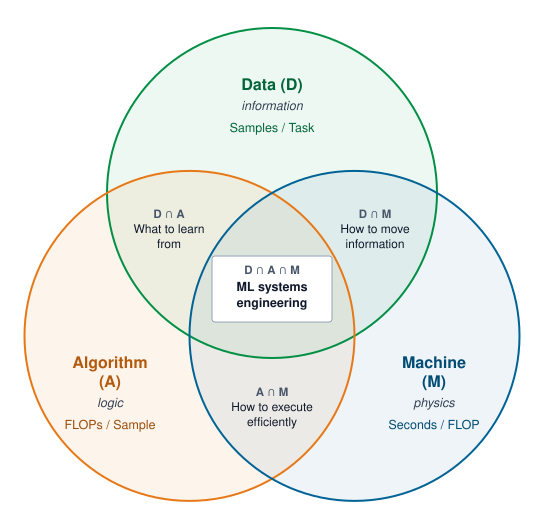

# Single-Machine Foundations {#sec-appdx-dam-taxonomy}

Every fleet is built from single machines, and this book assumes that the reader already reasons fluently about one of them. This appendix restates that single-machine foundation in reference form so that a reader who meets the prerequisites only loosely can work every calculation in the book without another text. It collects the Data, Algorithm, and Machine (D·A·M) diagnostic framework and the iron law it rests on, arithmetic intensity and the roofline bound, the accelerator memory hierarchy, the kernel-level levers that shorten a single device's step, the byte accounting of mixed-precision training, and the arithmetic of transformer training and inference. The chapters build the fleet-scale Compute, Communication, and Coordination (C$^3$) framework on this base.

::: {.content-visible when-format="pdf"}
\newpage
:::

::: {.callout-learning-objectives}

- Classify single-machine bottlenecks by dominant Data, Algorithm, or Machine axis while recognizing mixed causes
- Map optimization techniques to their D·A·M intersection zone to understand which axes they span
- Apply the iron law equation to quantitatively diagnose performance problems
- Distinguish between memory-bound and compute-bound workloads using arithmetic intensity and the roofline bound
- Calculate the per-parameter memory of mixed-precision training and the FLOPs of transformer training and decoding
- Select appropriate profiling tools and optimization strategies for each Data, Algorithm, or Machine axis
- Evaluate system health using D·A·M scorecard metrics (I/O overhead, active parameters, MFU)

:::

## How to Use This Appendix {.unnumbered}

This appendix is a reference for single-node performance and for the single-machine quantities that fleet-scale arguments take as given. Start from the symptom or the missing quantity:

- **When a single accelerator is slow**: Use the iron law mapping (@sec-appdx-dam-taxonomy-iron-law-mapping) and the bottleneck diagnostic (@sec-appdx-dam-taxonomy-bottleneck-diagnostic) to decide which term binds.
- **When deciding whether a kernel is memory bound or compute bound**: Use the roofline bound (@sec-appdx-dam-taxonomy-roofline).
- **When a byte must cross a memory boundary**: Use the memory hierarchy (@sec-appdx-dam-taxonomy-memory-hierarchy) to see which tier sets its cost.
- **When a trace shows many short kernels, launch gaps, or attention intermediates written to device memory**: Use the kernel-level levers (@sec-appdx-dam-taxonomy-kernel-levers).
- **When sizing model state**: Use the training memory accounting (@sec-appdx-dam-taxonomy-training-memory) for bytes per parameter.
- **When estimating training compute or decode cost**: Use transformer arithmetic (@sec-appdx-dam-taxonomy-transformer-arithmetic).

When training is slow on a single GPU, check utilization, data wait time, and model FLOPs utilization (MFU), then map each to its Data, Algorithm, or Machine axis. When serving misses a latency target, identify whether the regime is latency-bound (overhead), memory-bound (weight/KV movement), or compute-bound. When cost is exploding, use the D·A·M rubric to ensure that effort targets the dominant term, not a nonbottleneck.

```{python}
#| echo: false
from mlsysim import *
from mlsysim.core.units import *

from mlsysim.fmt import check, fmt, fmt_arithmetic_intensity, fmt_bandwidth, fmt_flop_rate, fmt_frac, fmt_percent, fmt_qty_int

# ┌── LEGO ───────────────────────────────────────────────
# Scenarios: iron-law utilization and roofline bound for batch-1 decode

class DAMTaxonomy:
    """
    Namespace for D·A·M Taxonomy diagnostic examples.
    """

    # ┌── 1. LOAD (Constants) ───────────────────────────────────────────────
    from mlsysim import Models, Hardware
    from mlsysim.physics import calc_transformer_decode_flops

    m = Models.Language.Llama2_7B
    h = Hardware.Cloud.H100

    # Iron-law and roofline example: batch-1 decode
    ex2_params = m.parameters
    ex2_latency = 0.050 * second  # scenario assumption
    h100_fp16_peak = h.compute.peak_flops
    h100_hbm_bandwidth = h.memory.bandwidth

    # ┌── 2. EXECUTE (The Compute) ─────────────────────────────────────────
    # Step 1: Iron-law utilization at an assumed batch-1 latency
    ex2_flops_per_pass = calc_transformer_decode_flops(ex2_params)
    ex2_achieved_rate = (ex2_flops_per_pass / ex2_latency).to(TFLOP / second)
    ex2_util = (ex2_achieved_rate / h100_fp16_peak).to("").magnitude * 100
    ex2_model_size = ex2_params.to(param).magnitude * 2 * byte
    h100_ridge_q = h100_fp16_peak / h100_hbm_bandwidth
    h100_ridge_flop_per_byte = h100_ridge_q.to(flop / byte).magnitude

    # Step 2: Roofline worked example (batch-1 decode of the same model)
    roof_decode_intensity_q = (ex2_flops_per_pass / ex2_model_size).to(flop / byte)
    roof_decode_attainable_q = (roof_decode_intensity_q * h100_hbm_bandwidth).to(TFLOP / second)
    roof_decode_ratio = (roof_decode_attainable_q / h100_fp16_peak).to("").magnitude

    # ┌── 3. GUARD (Invariants) ───────────────────────────────────────────
    from mlsysim.fmt import check

    check(ex2_util < 10, f"Batch-1 utilization ({ex2_util:.1f}%) unexpectedly high.")
    check(290 < h100_ridge_flop_per_byte < 300, f"H100 ridge point changed: {h100_ridge_flop_per_byte:.1f}")
    check(roof_decode_ratio < 0.01, f"Batch-1 decode roofline fraction ({roof_decode_ratio:.4f}) unexpectedly high.")

    # ┌── 4. OUTPUT (Formatting) ──────────────────────────────────────────────
    h100_ridge_str = fmt_arithmetic_intensity(h100_ridge_q, precision=1, commas=False)
    h100_peak_tflops_str = fmt_qty_int(h100_fp16_peak, TFLOP / second, commas=False)
    h100_hbm_tbs_str = fmt_bandwidth(h100_hbm_bandwidth, unit=TB / second, precision=2)
    roof_decode_intensity_str = fmt_arithmetic_intensity(roof_decode_intensity_q, precision=0)
    roof_decode_attainable_str = fmt_flop_rate(roof_decode_attainable_q, unit=TFLOP / second, precision=2)
    roof_decode_pct_str = fmt_percent(roof_decode_ratio, precision=1, style="prose")
```

The Data · Algorithm · Machine (D·A·M) taxonomy is the diagnostic framework for single-node ML systems engineering: it formalizes how information flow, mathematical logic, and physical execution interact across three diagnostic axes,[^fn-mece-v2-exclusive] while recognizing that real systems can involve mixed causes or interactions between axes.

[^fn-mece-v2-exclusive]: **MECE (mutually exclusive, collectively exhaustive)**: A classification principle from management consulting (popularized by McKinsey) requiring that categories do not overlap and together cover every possibility. Applied to systems engineering, it is useful as an idealized decomposition, but D·A·M bottlenecks often overlap in practice. A kernel can be simultaneously memory-bound, synchronization-heavy, and poorly matched to available hardware.

## Diagnostic Summary {#sec-appdx-dam-taxonomy-diagnostic-summary}

When performance stalls or behavior degrades on a single node, the first diagnostic question is whether the flow of work is blocked by memory movement, arithmetic volume, or hardware throughput. The D·A·M taxonomy maps these three failure modes directly to the iron law of ML systems, the single-machine equation that @sec-vol2-introduction-fleet-law restates before extending it to the Fleet Law. Each axis plays a distinct role, binds on a distinct physical quantity (bandwidth, operations, or peak throughput), and answers to its own high-leverage optimization (@tbl-v2-dam-components-ref).

| **Axis**          |          **Role**          |  **Physical constraint**   | **High-leverage optimization** |
|:------------------|:--------------------------:|:--------------------------:|:------------------------------:|
| **Data (D)**      | **Information** (The Fuel) |  Bandwidth ($\Bandwidth$)  |   I/O Pipeline Optimization    |
| **Algorithm (A)** | **Logic** (The Blueprint)  | Operations ($\Operations$) |       Model Compression        |
| **Machine (M)**   |  **Physics** (The Engine)  |  Throughput ($\PeakRate$)  |     Hardware Acceleration      |

: **D·A·M Axis Reference**: Each axis maps to a distinct physical constraint and a high-impact optimization strategy. Start diagnosis here: identify which constraint is binding, then follow the optimization lever. {#tbl-v2-dam-components-ref}

The three axes seldom bind in isolation. Pruning weights to cut operations can fragment memory access, and a denser storage format that saves bytes can saturate the host CPUs that must decode it before the accelerator sees any data. Because an intervention on one axis shifts pressure onto the other two, diagnosis has to account for the regions where axes overlap. @Fig-appdx-dam-taxonomy draws the three axes as overlapping sets. Each circle carries the factor its axis contributes to @eq-appdx-dam-iron-law-product, and each pairwise overlap names the question its two axes must answer together. Data and Algorithm decide what the model learns from, Data and Machine decide how information moves, and Algorithm and Machine decide how computation executes efficiently. A bottleneck that sits in an overlap needs a fix that respects both of its axes, and the center, where all three meet, is the domain of ML systems engineering.

::: {#fig-appdx-dam-taxonomy fig-env="figure" fig-pos="htb" fig-cap="**The D·A·M Intersection Landscape**: Each circle is one diagnostic axis (Data, information; Algorithm, logic; Machine, physics), labeled with the factor it contributes to execution time in @eq-appdx-dam-iron-law-product. Each pairwise overlap names the question its two axes must answer jointly (what to learn from, how to move information, and how to execute efficiently). At the center, where all three meet, is ML systems engineering." fig-alt="Three overlapping circles labeled Data D (information, Samples per Task), Algorithm A (logic, FLOPs per Sample), and Machine M (physics, Seconds per FLOP). The Data and Algorithm overlap reads What to learn from, the Data and Machine overlap reads How to move information, and the Algorithm and Machine overlap reads How to execute efficiently. A box at the center where all three circles meet reads ML systems engineering."}
{width="90%"}
:::

## Iron Law Mapping {#sec-appdx-dam-taxonomy-iron-law-mapping}

When a training step or serving request runs slower than expected on a single GPU, the first question is whether the time went to moving bytes, executing arithmetic, or waiting on dispatch overhead. The iron law answers that question in two steps. The first step factors execution time along the three D·A·M axes. A task processes some number of samples (examples in vision or tabular workloads, tokens in language models), each sample costs some number of operations, and the machine takes some time to complete each operation. By dimensional cancellation, total execution time $\Time$ (seconds) is the product of these three factors\index{Iron law of ML systems!D·A·M factoring} (@eq-appdx-dam-iron-law-product):

$$ \Time = \underbrace{\left(\frac{\text{Samples}}{\text{Task}}\right)}_{\text{Data (D)}} \times \underbrace{\left(\frac{\text{FLOPs}}{\text{Sample}}\right)}_{\text{Algorithm (A)}} \times \underbrace{\left(\frac{\text{Seconds}}{\text{FLOP}}\right)}_{\text{Machine (M)}} $$ {#eq-appdx-dam-iron-law-product}

The first two factors fix the total arithmetic work $\Operations$. Training a model with $\Parameters$ parameters on $\DatasetSize$ tokens costs roughly $6\Parameters\DatasetSize$ operations across the forward and backward passes (@eq-appdx-dam-training-flops), and inference costs roughly $2\Parameters$ operations per token in the forward pass. The third factor is the realized time per operation, and no real machine achieves its datasheet value of $1/\PeakRate$.

The second step explains the gap. Executing an operation requires moving its operands through memory and interconnect, driving the arithmetic units at some realized utilization, and paying fixed control costs. Assuming these three costs occur in sequence, the iron law unpacks execution time into their sum (@eq-appdx-dam-iron-law-sum):

$$ \Time= \underbrace{ \frac{\DataVolume}{\Bandwidth} }_{\text{Memory time}} + \underbrace{ \frac{\Operations}{\PeakRate \cdot \EfficiencyHw} }_{\text{Compute time}} + \underbrace{ \Latency }_{\text{Overhead}} $$ {#eq-appdx-dam-iron-law-sum}

Data enters the two equations in different units. In @eq-appdx-dam-iron-law-product, the Data factor counts logical samples or tokens. In @eq-appdx-dam-iron-law-sum, $\DataVolume$ counts the physical bytes that cross a memory or interconnect bus, which include model weights, activations, cached sequence state, and gradients as well as the inputs themselves. Batch-1 decode of a language model shows how far apart the two can be. The task processes a single token, yet $\DataVolume$ spans the gigabytes of weights streamed from high-bandwidth memory to produce it.

Algorithm and Machine share the compute term and are separated by which variable the engineer controls. Reducing the total operations ($\Operations$) is an algorithm lever, while improving the hardware's peak throughput ($\PeakRate$) or utilization ($\EfficiencyHw$) is a machine lever. The memory term belongs to no single axis. The Data axis sets how many inputs move, the Algorithm axis sets how many weights and activations move with them, and the Machine axis supplies the bandwidth $\Bandwidth$ that carries them.

### D·A·M coordination from sum to max {#sec-appdx-dam-taxonomy-dam-coordination-sum-max}

The additive iron law represents **sequential execution**\index{Sequential execution!D·A·M coordination}, the worst case where Data, Algorithm, and Machine take turns. Overlap can move the sum toward a max, with perfect overlap defining the ideal lower bound:

$$ \SequentialExecutionTime= \frac{\DataVolume}{\Bandwidth} + \frac{\Operations}{\PeakRate \cdot \EfficiencyHw} + \Latency \quad \xrightarrow{\text{overlap}} \quad \PipelinedExecutionTime\geq \max\left(\frac{\DataVolume}{\Bandwidth},\; \frac{\Operations}{\PeakRate \cdot \EfficiencyHw}\right) + \Latency $$

The systems engineer's job is to make these components run in parallel, not in series. Prefetching, separate CUDA streams, asynchronous gradient synchronization, and double buffering each let one axis proceed while another is in flight (@tbl-v2-dam-overlap).

| **Technique**           |  **D·A·M axes overlapped**   | **Implementation**                                                                              |
|:------------------------|:----------------------------:|:------------------------------------------------------------------------------------------------|
| **Prefetching**         |         D overlaps M         | DataLoader with `prefetch_factor`, `pin_memory=True`                                            |
| **CUDA Streams**        |         D overlaps M         | Separate streams for H2D transfer and compute                                                   |
| **Async Gradient Sync** | M (communication) overlaps A | Overlap gradient AllReduce with remaining backward computation as gradient buckets become ready |
| **Double Buffering**    |         D overlaps M         | Fill buffer $\BufferIndex+1$ while computing on buffer $\BufferIndex$                           |

: **D·A·M Overlap Techniques**: Each technique allows one D·A·M axis to execute while another is in flight, converting the iron law's additive terms into overlapped terms. {#tbl-v2-dam-overlap}

## Arithmetic Intensity Boundary {#sec-appdx-dam-taxonomy-arithmetic-intensity-boundary}

This overlap view still leaves one practical question: whether a workload is waiting on bytes or on FLOPs. The boundary between Data (memory bound) and Machine (compute bound) is not arbitrary; it is defined mathematically by the arithmetic intensity[^fn-intensity-v2-ratio] ($\ArithmeticIntensity$) of the workload.

[^fn-intensity-v2-ratio]: **Arithmetic intensity**\index{Arithmetic intensity!appendix refresher}: The ratio of floating-point operations to bytes transferred (FLOP/byte). It determines whether a workload is memory-bound or compute-bound by comparison against the hardware's *ridge point* ($\PeakRate/\Bandwidth$).

The symptoms below are screening signals, not diagnoses. A workload whose arithmetic intensity sits left of $\PeakRate/\Bandwidth$ cannot keep the accelerator fed with enough useful work per byte. Raw utilization must still be read alongside memory-bandwidth utilization, data-loader wait, kernel occupancy, and trace gaps.

*   **Low GPU utilization** ($<$ 80 percent): Screen for data, CPU, or launch starvation. Confirm with data-loader wait, host CPU saturation, memory-bandwidth counters, and timeline gaps.
*   **High GPU utilization** ($>$ 95 percent): Treat this as machine bound only if compute units are busy and memory bandwidth is not saturated. If memory bandwidth is saturated, the bottleneck is still on the Data/Machine boundary.
*   **If batch size is 1**: Treat this as a warning that latency or launch overhead may matter. For large language model (LLM) decode, batch-1 execution is often memory-bandwidth bound unless traces show dispatch gaps.
*   **If arithmetic intensity is below the ridge point** (about `{python} DAMTaxonomy.h100_ridge_str` on H100): The workload is likely memory bound (Data/Machine boundary).

### The roofline bound {#sec-appdx-dam-taxonomy-roofline}

Arithmetic intensity is a property of the workload and its implementation, not of the hardware. A large matrix multiply reuses each weight it loads across many multiply-accumulates and so has high intensity. An element-wise operation, or the generation of a single token, uses each loaded value only once or twice. The ridge point belongs to a simple upper bound on single-device throughput, the Roofline Model\index{Roofline model!single-machine recap} [@williams2009]. A kernel with arithmetic intensity $\ArithmeticIntensity$, running on a device with peak compute rate $\PeakRate$ and memory bandwidth $\Bandwidth$, can attain at most

$$ \AttainableComputeRate(\ArithmeticIntensity) = \min\!\left(\PeakRate,\; \ArithmeticIntensity\times \Bandwidth\right) $$ {#eq-appdx-dam-roofline}

On log-log axes, the bound is a bandwidth roof of slope one ($\ArithmeticIntensity\times \Bandwidth$) that meets a flat compute roof ($\PeakRate$) at the ridge point $\RooflineRidgePoint = \PeakRate/\Bandwidth$. Left of the ridge, a kernel is memory bound, and only more bandwidth or fewer bytes per operation raises its ceiling. Right of the ridge, it is compute bound, and only a faster or better-used datapath helps. In D·A·M terms, the bandwidth roof belongs to the Data axis, the compute roof to the Machine axis, and the Algorithm axis decides where on the intensity axis the kernel sits. The roofline is a ceiling, not a prediction. A kernel far below both roofs is limited by something the model omits, such as launch overhead, synchronization, or low occupancy. @Fig-roofline-landscape draws both roofs for an H100 and places decode, prefill, and training workloads against them.

For an H100, the book's hardware constants give a dense FP16 peak of `{python} DAMTaxonomy.h100_peak_tflops_str` and a high-bandwidth memory (HBM) bandwidth of `{python} DAMTaxonomy.h100_hbm_tbs_str`, which places the ridge at about `{python} DAMTaxonomy.h100_ridge_str`. Batch-1 decode of a 7-billion-parameter language model stored in 16-bit precision performs about two operations per parameter for each generated token (one multiply and one add). It must read every two-byte weight once, so its intensity is about `{python} DAMTaxonomy.roof_decode_intensity_str`. @Eq-appdx-dam-roofline then caps attainable throughput at `{python} DAMTaxonomy.roof_decode_attainable_str`, roughly `{python} DAMTaxonomy.roof_decode_pct_str` of peak, however well the kernels are written. Serving $\BatchSize$ sequences in one decode step reuses each loaded weight $\BatchSize$ times and raises the intensity to roughly $\BatchSize$ FLOP/byte, until key-value cache traffic, which grows with batch size and context length, begins to dominate the bytes moved. That arithmetic is why batching is the first lever of every serving system. @Sec-appdx-fleet-foundations-comm-compute-ratio carries the same reasoning to the network, where interconnect bandwidth takes the place of HBM bandwidth.

### Bottleneck diagnostic {#sec-appdx-dam-taxonomy-bottleneck-diagnostic}

Each optimization shortens only one term of the iron law, so adding peak FLOP/s to a memory-bound kernel or adding memory bandwidth to a compute-bound kernel leaves step time unchanged while wasting engineering effort (@tbl-v2-bottleneck-actions).

| **If the workload is...** |               **Dominant term**               | **Optimization that works**                                             | **Optimization that is wasted**                    |
|:--------------------------|:---------------------------------------------:|:------------------------------------------------------------------------|:---------------------------------------------------|
| **Memory-Bound**          |            $\DataVolume/\Bandwidth$           | Quantization, pruning, batching, kernel fusion, higher memory bandwidth | More peak FLOP/s alone                             |
| **Compute-Bound**         | $\Operations/(\PeakRate \cdot \EfficiencyHw)$ | Better kernels, Tensor Cores, faster GPU, lower precision               | More memory bandwidth (not binding)                |
| **Latency-Bound**         |                   $\Latency$                  | Batching requests, kernel fusion, async dispatch                        | Neither compute nor bandwidth (overhead dominates) |

: **What Works vs. What Is Wasted**: Optimizing the wrong term yields limited improvement and poor cost efficiency. A memory-bound model will not speed up from more peak FLOP/s alone; it needs higher arithmetic intensity, less data movement, or a faster memory subsystem. {#tbl-v2-bottleneck-actions}

## Accelerator Memory Hierarchy {#sec-appdx-dam-taxonomy-memory-hierarchy}

```{python}
#| echo: false
#| label: appdx-dam-single-machine-recap
# ┌─────────────────────────────────────────────────────────────────────────────
# │ SINGLE-MACHINE FOUNDATIONS RECAP (LEGO)
# ├─────────────────────────────────────────────────────────────────────────────
# │ Context: @sec-appdx-dam-taxonomy-memory-hierarchy,
# │          @sec-appdx-dam-taxonomy-training-memory,
# │          @sec-appdx-dam-taxonomy-transformer-arithmetic
# │
# │ Goal: Supply registry values for the prerequisite recap: H100 memory tiers,
# │       Archetype A training-state bytes, and GPT-3 transformer arithmetic.
# │ Show: 80 GB HBM at 3.35 TB/s; 50 MB L2; 64 GB/s PCIe; 16 and 14 bytes/param;
# │       2.8 TB state; 2.45 TB checkpoint; 33-device floor; 12 N_L d^2;
# │       6PD vs. registry training FLOPs; 4.72 MB KV cache per token.
# │ How: byte widths summed per parameter; params × bytes; 6 × P × D.
# │
# └─────────────────────────────────────────────────────────────────────────────
import math

from mlsysim.fmt import check, fmt_bandwidth, fmt_count, fmt_memory, fmt_memory_capacity, fmt_multiple, fmt_params, fmt_percent, fmt_sci_flops

class SingleMachineRecap:
    """Prerequisite recap: memory tiers, training-state bytes, transformer arithmetic."""

    # ┌── 1. LOAD (Constants) ──────────────────────────────────────────────
    h = Hardware.Cloud.H100
    m = Scenarios.DenseLLMPretrainingReference.workload  # Archetype A running instance (GPT-3, 175B dense)
    hbm_cap = h.memory.capacity
    hbm_bw = h.memory.bandwidth
    l2_cap = h.memory.l2_cache
    pcie_bw = h.interconnect.bandwidth  # per direction
    nvlink_bw_dir = h.nvlink.bandwidth / 2  # registry value is the bidirectional total
    params_q = m.parameters
    tokens = m.training_tokens.magnitude
    layers = m.layers
    hidden = m.hidden_dim
    seq_len = m.context_length  # GPT-3 context length (registry), as in the KV-cache example
    adam = ReferenceStats.MixedPrecisionAdam
    state_bpp = adam.TrainingStateBytesPerParameter * param  # 16 B/param training state
    ckpt_bpp = adam.CheckpointBytesPerParameter * param  # 14 B/param resumable checkpoint
    flops_per_param_token = Literature.Chinchilla.ComputeConstant  # 6 FLOPs per parameter-token

    # ┌── 2. EXECUTE (The Compute) ────────────────────────────────────────
    params = params_q.to(param).magnitude
    state_bpp_sum = BYTES_FP16 + BYTES_FP16 + BYTES_FP32 + BYTES_ADAM_STATE  # table rows
    ckpt_bpp_sum = BYTES_FP16 + BYTES_FP32 + BYTES_ADAM_STATE
    train_state_q = (params * state_bpp).to(TB)
    ckpt_q = (params * ckpt_bpp).to(TB)
    weights_q = (params * BYTES_FP16).to(GB)
    min_devices = math.ceil((train_state_q / hbm_cap).to("").magnitude)
    hbm_pcie_ratio = (hbm_bw / pcie_bw).to("").magnitude
    layer_params = 12 * layers * hidden**2
    layer_params_ratio = layer_params / params
    train_flops_q = (flops_per_param_token * params * tokens) * flop
    registry_flops_q = m.training_ops
    attn_ratio = seq_len / (6 * hidden)
    kv_per_token_q = (2 * layers * hidden * BYTES_FP16).to(MB)

    # ┌── 3. GUARD (Invariants) ──────────────────────────────────────────
    check(state_bpp_sum.to(byte).magnitude == state_bpp.to(byte).magnitude, "Table rows must sum to the registry training-state bytes/param")
    check(ckpt_bpp_sum.to(byte).magnitude == ckpt_bpp.to(byte).magnitude, "Checkpoint rows must sum to the registry checkpoint bytes/param")
    check(abs(train_state_q.magnitude - 2.8) < 0.01, "Archetype A state should be 2.8 TB")
    check(abs(layer_params_ratio - 1) < 0.02, "12 N_L d^2 should match GPT-3 within 2 percent")
    check(abs((train_flops_q / registry_flops_q).to("").magnitude - 1) < 0.01, "6PD should match registry training FLOPs")

    # ┌── 4. OUTPUT (Formatting) ──────────────────────────────────────────
    hbm_cap_str = fmt_memory_capacity(hbm_cap, precision=0)
    hbm_cap_decimal_str = fmt_memory(hbm_cap.to(GB), unit=GB, precision=1)
    hbm_bw_str = fmt_bandwidth(hbm_bw, unit=TB / second, precision=2)
    l2_str = fmt_memory_capacity(l2_cap, precision=0)
    pcie_bw_str = fmt_bandwidth(pcie_bw, unit=GB / second, precision=0)
    nvlink_dir_str = fmt_bandwidth(nvlink_bw_dir, unit=GB / second, precision=0)
    hbm_pcie_ratio_mult_str = fmt_multiple(round(hbm_pcie_ratio), precision=0, commas=False)
    fp16_bytes_str = fmt_count(BYTES_FP16.to(byte).magnitude)
    fp32_bytes_str = fmt_count(BYTES_FP32.to(byte).magnitude)
    adam_bytes_str = fmt_count(BYTES_ADAM_STATE.to(byte).magnitude)
    state_bpp_str = fmt_count(state_bpp.to(byte).magnitude)
    ckpt_bpp_str = fmt_count(ckpt_bpp.to(byte).magnitude)
    params_b_str = fmt_params(params_q, scale="B", precision=0, commas=False)
    train_state_str = fmt_memory(train_state_q, unit=TB, precision=1)
    ckpt_str = fmt_memory(ckpt_q, unit=TB, precision=2)
    weights_str = fmt_memory(weights_q, unit=GB, precision=0)
    min_devices_str = fmt_count(min_devices)
    layers_str = fmt_count(layers)
    hidden_str = fmt_count(hidden)
    layer_params_b_str = fmt_params(layer_params * param, scale="B", precision=1, commas=False)
    tokens_b_str = fmt_count(tokens / 1e9, precision=0)
    train_flops_str = fmt_sci_flops(train_flops_q, precision=2)
    registry_flops_str = fmt_sci_flops(registry_flops_q, precision=2)
    seq_len_str = fmt_count(seq_len)
    attn_pct_str = fmt_percent(attn_ratio, precision=1, commas=False, style='prose')
    kv_per_token_str = fmt_memory(kv_per_token_q, unit=MB, precision=2)
```

An accelerator is a fast arithmetic engine surrounded by memories that trade bandwidth for capacity, and most performance arguments in this book reduce to the question of which boundary a byte must cross. Nearest the compute units, registers and on-chip shared memory (SRAM) hold the operands of the kernel that is executing, backed by a shared on-chip L2 cache (`{python} SingleMachineRecap.l2_str` on an H100). Beyond the die, HBM holds the model's working state (`{python} SingleMachineRecap.hbm_cap_str` at `{python} SingleMachineRecap.hbm_bw_str` on an H100). Host memory is reached over PCIe at `{python} SingleMachineRecap.pcie_bw_str` per direction, roughly `{python} SingleMachineRecap.hbm_pcie_ratio_mult_str` less than HBM, and local NVMe storage sits below host memory.

A kernel whose working set stays on chip runs near arithmetic speed; one that streams operands from HBM is bounded by the roofline above; one that must reach host memory or storage is slower still. The **memory wall**\index{Memory wall!appendix refresher}, the widening gap between arithmetic throughput and the bandwidth that feeds it, is the single-machine form of the constraint that reappears at fleet scale as the network wall. A multi-accelerator node adds a scale-up fabric between devices (NVLink, at `{python} SingleMachineRecap.nvlink_dir_str` per direction on an H100), and the scale-out network adds tiers beyond the node. @Sec-appdx-fleet-foundations-numbers-to-know tabulates those tiers.

## Kernel-Level Levers {#sec-appdx-dam-taxonomy-kernel-levers}

Four techniques shorten one device's step without changing the model's mathematics. Each removes a different cost in the iron law of @sec-appdx-dam-taxonomy-iron-law-mapping, and each counts as a gain only when a measured trace confirms it. The four differ in which term they remove, what limits them, and what evidence a trace shows (@tbl-appdx-dam-kernel-levers).

### Fusion {#sec-appdx-dam-taxonomy-kernel-levers-fusion}

**Operator fusion**\index{Operator fusion!appendix refresher} combines consecutive operations into one kernel, so an intermediate result stays in registers or shared memory instead of being written to HBM and read back by the next kernel. It shrinks the data volume $\DataVolume$ of the data term and removes one launch per fused operation from the overhead term $\Latency$. The common kinds are chains of element-wise operations, an element-wise operation fused with a reduction such as a normalization, and operator-specific fusions such as a matrix multiply that applies its bias and activation before writing its output. Fusion stops paying when the live values of the combined kernel exceed the registers and shared memory available, which lowers occupancy or spills to memory, and when a reduction needs results from every thread block. A trace confirms it with fewer kernels and fewer HBM bytes before the step time falls.

### Tiling and IO-aware attention {#sec-appdx-dam-taxonomy-kernel-levers-tiling}

**Tiling**\index{Tiling!appendix refresher} sizes blocks of a computation to fit on-chip memory, so each operand fetched from HBM feeds many operations and arithmetic intensity rises. IO-aware attention such as FlashAttention\index{FlashAttention!appendix refresher} applies the idea to attention. It computes the scores block by block, keeping a running maximum and sum for the softmax, so the full matrix of scores between every pair of positions is never written to HBM. The workspace grows linearly with sequence length rather than quadratically. The price is extra rescaling arithmetic and, in training, recomputing the scores in the backward pass. Decode processes one query row per step and has no quadratic intermediate, so its fused attention kernel is a single pass over the KV cache. Tiling reduces $\DataVolume$ and frees HBM capacity for the KV cache and larger batches.

### Graph replay {#sec-appdx-dam-taxonomy-kernel-levers-replay}

**Graph replay**\index{CUDA Graphs!appendix refresher}, offered on NVIDIA GPUs as CUDA Graphs, records a stable sequence of kernels and memory copies once and then submits the whole sequence with one request in later steps. It removes the host-dispatch part of $\Latency$, which matters when many short kernels leave launch gaps between them, as in batch-one decode. A captured graph replays only the shapes, memory addresses, and control flow it recorded, so a server keeps one graph per shape bucket, and decode captures more easily than prefill, whose shapes vary with prompt length. Replay fuses nothing. The same kernels run with the gaps between them removed, which a timeline shows directly.

### Compilation {#sec-appdx-dam-taxonomy-kernel-levers-compilation}

**Graph compilation**\index{Graph compilation!appendix refresher} automates the three levers above. A compiler captures the program as a graph, rewrites and decomposes its operations, fuses them, selects or generates a kernel for each fused group (often by timing candidates, which is called autotuning), and plans memory. Just-in-time compilers keep the eager programming model, ahead-of-time inference engines specialize the program to a declared range of shapes, and tile-level kernel languages let an engineer write a fusion the compiler missed. Compilation reduces both $\DataVolume$ and $\Latency$, at the cost of build and warmup time, regions split at graph breaks where the compiler cannot capture the program, and recompilation when a new shape arrives. @Sec-performance-engineering-compilation-overhead prices that cost across a fleet and finds when it pays back.

| **Lever**                         | **Removes**                                         | **Iron-law term**        | **Main limit**                            | **Trace evidence**                        |
|:----------------------------------|:----------------------------------------------------|:-------------------------|:------------------------------------------|:------------------------------------------|
| **Fusion**                        | HBM round-trips of intermediates; kernel launches   | Data volume; overhead    | Register and shared-memory pressure       | Fewer kernels and fewer HBM bytes         |
| **Tiling and IO-aware attention** | Repeated HBM fetches; materialized attention scores | Data volume              | Rescaling arithmetic; recomputation       | Fewer HBM bytes; smaller attention memory |
| **Graph replay**                  | Host dispatch of each kernel                        | Overhead                 | Fixed shapes, addresses, and control flow | Launch gaps disappear from the timeline   |
| **Compilation**                   | All three, applied automatically                    | Data volume and overhead | Build time; graph breaks; recompilation   | Fewer, fused kernels after warmup         |

: **Kernel-Level Levers**: Each lever shortens a different term of one device's step, so a trace must show that term moving before a step-time gain counts. {#tbl-appdx-dam-kernel-levers}

*Introduction to Machine Learning Systems* develops these mechanisms in full, for a reader who wants more than this recap. Here, the four rows of @tbl-appdx-dam-kernel-levers serve as the checklist for verifying whether a local optimization has moved the intended iron-law term.

## Numeric Precision and Training Memory {#sec-appdx-dam-taxonomy-training-memory}

Whether a large model fits in an 80 GB H100 memory bank or must be partitioned across dozens of accelerators depends on how many bytes each parameter and optimizer state occupies. In the number formats listed in the notation conventions at the front of the book, FP32 occupies `{python} SingleMachineRecap.fp32_bytes_str` bytes, BF16 and FP16 occupy `{python} SingleMachineRecap.fp16_bytes_str`, and FP8 and INT8 occupy one. **Mixed-precision training**\index{Mixed-precision training!appendix refresher} runs the forward and backward passes in a 16-bit format for speed and memory, while it keeps an FP32 master copy of the weights so that small updates are not lost to rounding. The Adaptive Moment Estimation (Adam) optimizer adds two FP32 moment estimates per parameter. @Tbl-appdx-dam-training-state totals the resulting bytes per parameter.

| **State**              | **Format** |                   **Bytes per parameter**                    |          **In a resumable checkpoint**           |
|:-----------------------|:----------:|:------------------------------------------------------------:|:------------------------------------------------:|
| **Working weights**    |    BF16    |         `{python} SingleMachineRecap.fp16_bytes_str`         |                       Yes                        |
| **Gradients**          |    BF16    |         `{python} SingleMachineRecap.fp16_bytes_str`         |            No (recomputed on resume)             |
| **Master weights**     |    FP32    |         `{python} SingleMachineRecap.fp32_bytes_str`         |                       Yes                        |
| **Adam moments (two)** |    FP32    |         `{python} SingleMachineRecap.adam_bytes_str`         |                       Yes                        |
| **Total**              |            | `{python} SingleMachineRecap.state_bpp_str` (training state) | `{python} SingleMachineRecap.ckpt_bpp_str` bytes |

: **Mixed-Precision Adam Memory per Parameter**: Persistent training state before activations, framework metadata, and communication buffers. The checkpoint omits gradients because a resumed run recomputes them in its first step. {#tbl-appdx-dam-training-state}

For Archetype A, the `{python} SingleMachineRecap.params_b_str`-parameter dense model the chapters use as their running instance, the training state is `{python} SingleMachineRecap.train_state_str` and a resumable checkpoint is `{python} SingleMachineRecap.ckpt_str`. A single H100 offers `{python} SingleMachineRecap.hbm_cap_str` of HBM (a binary nameplate, about `{python} SingleMachineRecap.hbm_cap_decimal_str` in decimal units), so the persistent state alone requires at least `{python} SingleMachineRecap.min_devices_str` devices before a single activation is stored. That floor is why the model state must be partitioned across devices, which @sec-distributed-training-systems develops. Serving the same model needs only the 16-bit weights, `{python} SingleMachineRecap.weights_str`, plus the key-value cache.

Activations are the other large consumer of training memory. The intermediate tensors that the backward pass needs grow with batch size, sequence length, hidden width, and depth, and for long sequences they can exceed the parameter state. **Activation checkpointing**\index{Activation checkpointing!appendix refresher} stores only selected activations and recomputes the rest during the backward pass, trading additional compute for memory.

## Transformer Arithmetic {#sec-appdx-dam-taxonomy-transformer-arithmetic}

Most worked examples in this book use decoder-only transformers, and three counting rules cover nearly all of their arithmetic. The symbols follow the book's deep learning notation, with $\Parameters$ parameters, $\DatasetSize$ training tokens, $\LayerCount$ layers, hidden dimension $\HiddenDimension$, and sequence length $\SequenceLength$.

Each transformer layer holds four $\HiddenDimension\times \HiddenDimension$ attention projections and a feed-forward block that expands to $4\HiddenDimension$ and back, about $12\HiddenDimension^2$ weights in total. A model thus has roughly $\Parameters\approx 12 \LayerCount \HiddenDimension^2$ parameters excluding embeddings. GPT-3 has $\LayerCount =$ `{python} SingleMachineRecap.layers_str` and $\HiddenDimension=$ `{python} SingleMachineRecap.hidden_str`, which gives `{python} SingleMachineRecap.layer_params_b_str` against its published `{python} SingleMachineRecap.params_b_str`.

Every weight contributes one multiply and one add per token, so a forward pass costs about $2\Parameters$ FLOPs per token. The backward pass computes gradients with respect to both activations and weights and costs about twice the forward pass, so training costs about $6\Parameters$ FLOPs per token and

$$ \TrainingCompute \approx 6\Parameters \DatasetSize$$ {#eq-appdx-dam-training-flops}

in total. For GPT-3, trained on `{python} SingleMachineRecap.tokens_b_str` billion tokens, @eq-appdx-dam-training-flops gives `{python} SingleMachineRecap.train_flops_str`, within 1 percent of the reported `{python} SingleMachineRecap.registry_flops_str`. The rule omits the attention-score products, which add at most about $\SequenceLength/(6\HiddenDimension)$ to the weight FLOPs, or `{python} SingleMachineRecap.attn_pct_str` for GPT-3 at $\SequenceLength=$ `{python} SingleMachineRecap.seq_len_str`. That fraction stays small while the context is short compared with the hidden width and grows with long contexts.

Serving an autoregressive model has two phases with different physics. *Prefill* processes the whole prompt at once as matrix-matrix products, so its arithmetic intensity is high and it tends to be compute bound. *Decode* generates one token per step for each sequence as matrix-vector products; at batch size 1 it reads every weight to perform two FLOPs per weight, the memory-bound regime that the roofline example above quantifies. To avoid recomputing attention over the whole prefix at every step, decode stores each layer's keys and values in a **key-value (KV) cache**\index{KV cache!appendix refresher} of $2 \LayerCount \HiddenDimension\, \ElementStorageSize$ bytes per token for standard multihead attention, or `{python} SingleMachineRecap.kv_per_token_str` per token for GPT-3 in FP16. @Sec-appdx-inference-scale-kv-cache-fundamentals-2ccd sizes that cache against device memory.

## Tooling Map {#sec-appdx-dam-taxonomy-tooling-map}

Back-of-envelope byte and FLOP counts narrow the likely bottleneck, but hardware and runtime counters must confirm which iron-law term actually binds before an engineer rewrites a kernel or data pipeline. Each D·A·M axis is exposed by a distinct set of profiling utilities and primary metrics (@tbl-v2-dam-tooling).

| **Axis**      |         **Key metric**        |     **Primary tool**     |       **Secondary tool**      |
|:--------------|:-----------------------------:|:------------------------:|:-----------------------------:|
| **Data**      |    Batch Load and Wait Time   | Framework profiler trace | `iostat`, `pidstat` (I/O/CPU) |
| **Algorithm** |       FLOPs, Model Depth      |     PyTorch Profiler     |    DeepSpeed Flops Profiler   |
| **Machine**   | GPU Utilization, SM Occupancy |      Nsight Compute      |      DCGM, Nsight Systems     |

: **D·A·M Tooling Map**: Profiling utilities for diagnosing bottlenecks along each D·A·M axis. {#tbl-v2-dam-tooling}

## D·A·M Scorecard {#sec-appdx-dam-taxonomy-dam-scorecard}

The efficiency ratios in @tbl-v2-dam-scorecard grade a system's performance against its theoretical limit. This report card is anchored by MFU,[^fn-mfu-v2-scorecard] the ratio of achieved model FLOP/s to the hardware's theoretical peak FLOP/s. The MFU grades are illustrative targets for compute-dominated training; memory-bound or latency-bound workloads must be judged against their attainable roofline and service-level objective (SLO) latency.

[^fn-mfu-v2-scorecard]: **MFU (model FLOPs utilization)**: Counts only *useful* model computation in the numerator. Gradient synchronization, memory management, and other overhead within the measurement window remain in elapsed time and lower the reported ratio.

| **Axis**      |           **Metric**           |                                  **Definition**                                  | **Failing grade**  | **Passing grade**  |
|:--------------|:------------------------------:|:--------------------------------------------------------------------------------:|:------------------:|:------------------:|
| **Data**      |        **I/O Overhead**        |              $\frac{\text{Data Wait Time}}{\text{Total Step Time}}$              |      $>$ 10%       |       $<$ 1%       |
| **Algorithm** | **Compression/Sparsity Ratio** | $\frac{\text{Effective or active parameters}}{\text{Dense baseline parameters}}$ | Workload-dependent | Workload-dependent |
| **Machine**   |            **MFU**             |            $\frac{\text{achieved model FLOP/s}}{\text{peak FLOP/s}}$             |      $<$ 30%       |      $>$ 50%       |

: **The D·A·M Efficiency Rubric**: Use these three numbers to characterize single-machine maturity. {#tbl-v2-dam-scorecard tbl-colwidths="[13,24,33,15,15]"}

## Scaling the Taxonomy from Node to Fleet {#sec-appdx-dam-taxonomy-scaling}

These single-node grades become most useful when they are carried forward into distributed design. The D·A·M taxonomy is the diagnostic baseline for a single machine, but as systems scale from a single node to the machine learning fleet, each axis undergoes a qualitative transformation.

### The evolution of constraints {.unnumbered}

Crossing the node boundary replaces local bus limits and single-device failure rates with cluster-wide fabric and power limits. Scaling from one node to a fleet changes the kind of constraint on every axis, not only its size (@tbl-appendix-dam-axis-node-to-fleet).

| **Axis**          | **Node-level focus (D·A·M)** | **Fleet-scale transformation**                                                                                                      |
|:------------------|:----------------------------:|:------------------------------------------------------------------------------------------------------------------------------------|
| **Data (D)**      |  I/O Bandwidth (Disk/PCIe)   | **The communication wall**: the bottleneck shifts from local storage to the bisection bandwidth of the network fabric.              |
| **Algorithm (A)** |    Model Depth/Ops Count     | **The parallelism strategy**: the logic now includes how computation is partitioned across $\DeviceCount$ devices (3D parallelism). |
| **Machine (M)**   |      Peak TFLOP/s, HBM       | **The power and reliability wall**: the constraint is no longer just silicon speed, but watts per rack and cluster-wide MTBF.       |

: **D·A·M Constraints from Node to Fleet**: How each axis of the D·A·M taxonomy shifts when scaling from a single node to a multi-node fleet. The node-level focus (left) gives way to a qualitatively different fleet-scale constraint (right); the bottleneck migrates from local resource to global coordination cost. {#tbl-appendix-dam-axis-node-to-fleet}

### Bridging to C$^3$ {.unnumbered}

While D·A·M diagnoses the *components* of a single node, the C$^3$ taxonomy (@sec-appdx-c3-taxonomy) diagnoses the *interactions* of the fleet. Each of its three dimensions inherits a specific piece of the single-machine diagnostic model:

1.  **Compute ($\OperationalTaxonomyDimension_1$)** inherits the Algorithm and Machine axes, now evaluated per device after the work is partitioned across $\DeviceCount$ devices.
2.  **Communication ($\OperationalTaxonomyDimension_2$)** inherits the Data axis, but is governed by network bandwidth, topology, and, over long distances, the speed of light rather than by local I/O alone.
3.  **Coordination ($\OperationalTaxonomyDimension_3$)** makes coordination costs explicit at fleet scale. Synchronization, checkpoints, and failure recovery also occur on one node, but distribution expands their scope and couples them to other machines.

This progression exposes cases where higher single-node MFU comes at the expense of scaling efficiency, so the complete fleet outcome can determine the choice. The node is optimized to serve the fleet.

## Summary {#sec-appdx-dam-taxonomy-summary}

The D·A·M taxonomy provides the diagnostic baseline for every ML systems analysis. By isolating the bottleneck to Data, Algorithm, or Machine, practitioners ensure that optimization efforts target the binding constraint. The memory hierarchy, the byte accounting of mixed-precision training, and the transformer counting rules supply the quantities that fleet-scale arguments take as given. This single-node discipline is the prerequisite for the fleet-scale engineering addressed throughout this book.

::: {.callout-takeaways title="Single-machine diagnostic heuristics"}

* **Identify the dominant axis**: Decide whether Data, Algorithm, or Machine is the binding constraint before proposing any optimization.
* **Profile arithmetic intensity**: Arithmetic intensity, read against the roofline's ridge point, quantitatively distinguishes between Data-bound and Machine-bound regimes.
* **Use the iron law**: The iron law transforms vague symptoms into specific term-based bottlenecks.
* **Count bytes and FLOPs per parameter**: Mixed-precision Adam training holds `{python} SingleMachineRecap.state_bpp_str` bytes per parameter (`{python} SingleMachineRecap.ckpt_bpp_str` in a checkpoint), and dense transformer training costs about $6\Parameters \DatasetSize$ FLOPs. These two rules size most memory and compute budgets in the chapters.
* **Grade with the scorecard**: The Data-Algorithm-Machine scorecard standardizes "good" performance before moving to fleet scale.

:::
