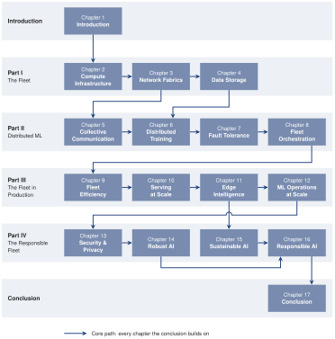
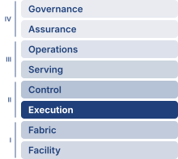

# Preface {#sec-about .unnumbered}

## Who This Book Is For {#sec-vol2-about-audience}

This book is for anyone who understands machine learning on a single machine and now faces the challenge of making it work at scale. The problems of scale are not the problems of a single node, only bigger. They are qualitatively different: networks partition, hardware fails as a statistical certainty, and the societal impact of every design decision is amplified by millions of users.

The assumed foundation is what an introductory ML systems course or equivalent experience supplies, with no particular prior textbook required. The advanced scope here is the transition from that single node to a coordinated fleet. That scope ranges from designing the physical substrate of an AI data center, to scaling training beyond the limits of a single accelerator, to reasoning about what happens when a production fleet serves a global user base. Throughout, the focus is on the physics of distribution, the invariants that govern every fleet-scale ML system regardless of the framework, the model, or the era.

## Prerequisites {#sec-vol2-about-prerequisites}

Readers should bring the following background:

- **Single-machine ML systems**: Understanding of ML workflows, neural network training, model optimization, and deployment on a single machine. Readers should be comfortable reasoning about memory hierarchies, computational graphs, accelerator execution, and hardware-software interactions. @Sec-appdx-dam-taxonomy recaps the single-machine performance model (the iron law, arithmetic intensity, and the Roofline Model), the memory hierarchy, training memory per parameter, and transformer compute that later chapters assume.
- **Programming**: Fluency in Python, including functions, classes, and data manipulation with NumPy. Familiarity with at least one ML framework (PyTorch, TensorFlow, or JAX).
- **Mathematics**: Comfort with linear algebra, basic calculus, and probability at the undergraduate level. @Sec-appdx-reliability-foundations-probability-tools restates the probability results that the failure analysis uses, and @sec-appdx-inference-scale-queuing-theory-batched-inference-bbf0 develops the queuing results that serving analysis uses.

The following background is helpful but not required:

- **Distributed systems**: Familiarity with networking concepts (TCP/IP, bandwidth, latency), parallelism, and basic distributed computing deepens understanding of the fleet infrastructure and training chapters.
- **Cloud infrastructure**: Experience with containerization and orchestration (Docker and Kubernetes) or cluster schedulers (Slurm) provides useful operational context.
- **Production engineering**: Understanding of monitoring, observability, and site reliability practices will enrich the deployment and operations chapters.

## Why a Fleet-Level Textbook {#sec-vol2-about-why-fleet}

```{python}
#| echo: false
#| label: about-scale-contrast
# ┌─────────────────────────────────────────────────────────────────────────────
# │ PREFACE SCALE CONTRAST (LEGO)
# ├─────────────────────────────────────────────────────────────────────────────
# │ Context: ## Why a Fleet-Level Textbook — AlexNet (2012) vs. GPT-4-class (2023).
# │
# │ Goal: Tie the opening scale contrast to the registry so it cannot drift from
# │       the chapters that cite the same runs.
# │ Show: two GPUs for five to six days; ~25,000 GPUs for about three months.
# │ How: Literature.TrainingRuns (Krizhevsky 2012); Models.Language.GPT4
# │      training_accelerators_ref / training_days_ref (SemiAnalysis 2023 estimate).
# │
# └─────────────────────────────────────────────────────────────────────────────
from mlsysim import Literature, Models
from mlsysim.fmt import MarkdownStr, check, fmt_count

_words = {1: "one", 2: "two", 3: "three", 4: "four", 5: "five", 6: "six", 7: "seven", 8: "eight", 9: "nine"}

class AboutScaleContrast:
    # ┌── 1. LOAD ──────────────────────────────────────────
    alexnet_gpus = int(Literature.TrainingRuns.AlexNetGpus)
    alexnet_days_low = int(Literature.TrainingRuns.AlexNetTrainingDaysLow)
    alexnet_days_high = int(Literature.TrainingRuns.AlexNetTrainingDaysHigh)
    gpt4 = Models.Language.GPT4
    days_per_month = 30  # calendar approximation for "about N months"

    # ┌── 2. EXECUTE ───────────────────────────────────────
    gpt4_gpus = gpt4.training_accelerators_ref.magnitude
    gpt4_months = round(gpt4.training_days_ref.to("day").magnitude / days_per_month)

    # ┌── 3. GUARD ─────────────────────────────────────────
    check(alexnet_gpus in _words, "Preface spells out small counts; extend the word map if a registry value leaves 1-9")
    check(alexnet_days_low in _words, "Preface spells out small counts; extend the word map if a registry value leaves 1-9")
    check(alexnet_days_high in _words, "Preface spells out small counts; extend the word map if a registry value leaves 1-9")
    check(gpt4_months in _words, "Preface spells out small counts; extend the word map if a registry value leaves 1-9")

    # ┌── 4. OUTPUT ────────────────────────────────────────
    alexnet_gpus_word_str = MarkdownStr(_words[alexnet_gpus])
    alexnet_days_low_word_str = MarkdownStr(_words[alexnet_days_low])
    alexnet_days_high_word_str = MarkdownStr(_words[alexnet_days_high])
    gpt4_gpus_str = fmt_count(gpt4_gpus)
    gpt4_months_word_str = MarkdownStr(_words[gpt4_months])
```

In 2012, training AlexNet took `{python} AboutScaleContrast.alexnet_days_low_word_str` to `{python} AboutScaleContrast.alexnet_days_high_word_str` days on `{python} AboutScaleContrast.alexnet_gpus_word_str` GPUs [@krizhevsky2012imagenet]. By 2023, public GPT-4-class estimates placed frontier training at roughly `{python} AboutScaleContrast.gpt4_gpus_str` GPUs running for about `{python} AboutScaleContrast.gpt4_months_word_str` months [@semianalysisGPT4]; OpenAI did not disclose the actual hardware configuration [@openai2023gpt4]. This is not the same engineering problem at a larger scale. It is a categorically different engineering problem.

On a single machine, performance is governed by the memory wall, the gap between processor speed and memory bandwidth. In a distributed cluster, a new limit emerges. Bisection bandwidth, the total bandwidth across the narrowest cut that divides the cluster into two halves, caps the throughput of any traffic that must cross that cut. Data no longer moves through local hierarchies alone; it traverses optical fabrics governed by the speed of light between racks and across continents. Hardware failures, rare enough on a single machine to be treated as exceptions, become routine statistical events at fleet scale. Long training runs must plan for interruptions rather than rely on every component remaining available until completion.

These are not operational annoyances. They are physical constraints, as fundamental and as permanent as the memory wall, Amdahl's Law, or the energy cost of data movement. They require their own engineering discipline, built on the invariants this book develops:

*   **The Empirical Scaling Law**: Within empirically validated regimes, model loss falls as a power law in training compute, data, or parameters, so each further improvement demands multiplicatively more resources. This is the pressure that moves machine learning from single machines onto fleets.
*   **The Bisection Bandwidth Theorem**: For communication patterns that must cross the minimum bisection, throughput is bounded by that bisection bandwidth.
*   **The Fleet Law**: Under fixed-work scaling, reduced per-node computation competes with communication and coordination costs, so adding workers does not guarantee proportional speedup.
*   **The Young-Daly Checkpoint Interval**: The optimal checkpoint interval balances the cost of writing state against the expected cost of lost work due to failure.
*   **Serving Cost Dominance**: For high-traffic production models, cumulative inference operational expenditure can exceed the one-time training cost, making serving efficiency a lifecycle optimization target.
*   **The Fairness Impossibility Theorem**: With unequal group base rates and imperfect prediction, risk scores cannot satisfy groupwise calibration and equal mean scores across groups within both outcome classes simultaneously. Thresholded error-rate parity and demographic parity are distinct requirements with their own trade-offs.

If single-machine ML systems engineering asks *"what can one machine build?"*, then fleet-scale ML systems engineering asks *"what can a thousand machines build together, and at what cost to reliability, efficiency, and society?"* That final clause is what sets fleet-scale engineering apart. A single machine affects its user; a fleet affects everyone its outputs touch, across millions of decisions per second. At that scale, reliability, efficiency, and fairness stop being features and become engineering constraints as binding as bandwidth or power. A system that scales but cannot be trusted has not been engineered. It has only been enlarged.

This book develops that discipline. It follows the Hennessy and Patterson pedagogical model, extending the quantitative, principles-first approach to the distributed scale [@hennessy2011computer; @hennessy2019; @patterson2017hardware]. Just as their work taught a generation to reason about processor performance from first principles, this book teaches the reader to reason about fleet performance, replacing intuition about distributed systems with measurement, and ad hoc scaling with engineering.

The architectural priorities and operational failure modes explored in these chapters did not originate in an academic vacuum. They were gathered directly from practitioners in industry, through technical exchanges at conferences, engineering meetups, and conversations with colleagues. These colleagues generously made the time to explain what breaks when scaling models across thousands of accelerators and what practicing systems engineers must understand.

Single-node foundations supply the bricks of those systems: tensors, kernels, memory hierarchies, and optimization loops. What breaks at fleet scale is rarely an individual brick, because a fleet is closer to an orchestra than to a larger wall. An orchestra is not simply many musicians playing at once. It needs a conductor, a score, precise synchronization, and the ability to recover when a player drops out, none of which governs a solo performer. A training cluster, a serving fleet, and an edge deployment are vastly different systems, but beneath them sit the same building blocks: parallelism strategies, collective communication primitives, checkpoint protocols, scheduling algorithms, and the trade-offs between throughput, latency, fault tolerance, and cost.

## What This Book Covers {#sec-vol2-about-covers}

This book focuses on the machine learning fleet: coordinated machines that jointly train, serve, or maintain ML models. Warehouse-scale training clusters are one form; geographically distributed serving replicas and heterogeneous edge devices are others. Across these forms, communication and coordination couple local execution to fleet behavior, while reliability, resource budgets, and governance constrain the design. The scope is the fleet as it exists today and the governance of operating it at scale. Research-frontier topics such as fully autonomous fleet management, next-generation interconnects, neuromorphic computing at scale, and formal verification of fleet-level safety properties lie beyond it.

The content is organized into four parts:

- **Part I: The Fleet** builds the physical substrate of the AI data center from the ground up: the silicon and cooling of compute infrastructure, the network fabrics that connect thousands of accelerators, and the scalable data storage that feeds training pipelines.
- **Part II: Distributed ML** establishes the logic of distribution beyond a single machine: the collective communication primitives that synchronize gradients, the parallelism strategies (data, tensor, and pipeline) for training models too large for single devices, the fault tolerance mechanisms that ensure reliability when failure is routine, and the orchestration systems that manage the fleet.
- **Part III: The Fleet in Production** takes the trained model from the cluster to the world: fleet efficiency, which measures how much of a fleet's capacity becomes useful work, serving at scale for millions of concurrent requests, edge intelligence across heterogeneous and federated devices, and the operational lifecycle required to manage production fleets.
- **Part IV: The Responsible Fleet** confronts the forces that determine whether the fleet serves its users or harms them: security and privacy, robust system design, environmental sustainability, and responsible engineering as constraints as fundamental as power density or bisection bandwidth.

These four parts trace a path through the fleet stack, a layered abstraction that organizes an ML system at distributed scale, from the physical facility up to its governance. The stack has eight rows grouped into four bands, and each band is one part of the book. At the base, the Infrastructure band (Part I) holds **Facility & Accelerators** and **Fabric & Storage**, the physical substrate. On top of that hardware, the Distribution band (Part II) adds **Distributed Execution** and **Reliability & Control** to manage parallel work, communication, scheduling, and recovery. Once a model can be trained reliably, the Serving band (Part III) provides **Runtime & Serving** and **Operations** to take models to users and manage the production lifecycle. At the top, the Governance band (Part IV) layers **Assurance** (security, privacy, and robustness) and **Governance & Sustainability** to turn trust, risk, policy, and environmental cost into engineering constraints. Each row provides an abstraction to the row above and consumes the row below. Engineering decisions in the Infrastructure band constrain what is possible in the bands above it, while governance requirements constrain choices throughout the stack. Privacy, acceptable risk, and environmental budgets enter the design from the beginning; Part IV develops their enforcement mechanisms after the infrastructure and operational dependencies are available.

Where the fleet stack locates responsibility, a second framework diagnoses cost. The C³ taxonomy divides the wall-clock time of distributed execution into Compute, Communication, and Coordination, and the Fleet Law turns that division into an equation for distributed step time. Every chapter applies this lens to its own layer of the stack. Three recurring workloads, the archetypes, keep the analysis concrete: a large dense language model (Archetype A), a recommendation model with very large embedding tables (Archetype B), and a model trained by federated learning across phone-class devices (Archetype C). Each stresses a different part of the fleet, and the chapters return to whichever one exposes their central constraint.

Each part builds on the previous one, so sequential reading is recommended. The reading paths below offer alternatives for readers with specific goals.

## Suggested Reading Paths {#sec-vol2-about-reading-paths}

The chapters are ordered so that each can draw on everything before it, but not every chapter consumes the one immediately before it. A dependency map derived from the chapters' own cross-references records which chapters build directly on which (@fig-vol2-chapter-dependencies). An arrow in the map means the later chapter uses a model, mechanism, or constraint that the earlier one establishes. Two features of the map guide the choice of path. First, every chapter lies on a route to @sec-conclusion, whose six principles cite every chapter of Parts I through IV, so no chapter is a dead end. Second, several dependencies cross part boundaries: distributed training builds on both the storage pipeline of @sec-data-storage and the collectives of @sec-collective-communication, and fleet efficiency (@sec-performance-engineering) builds on @sec-fleet-orchestration. Consecutive chapters without an arrow mark a change of thread rather than a gap. @Sec-collective-communication, for example, builds on the fabric model of @sec-network-fabrics rather than on the storage chapter that precedes it.

::: {#fig-vol2-chapter-dependencies fig-env="figure" fig-pos="htb" fig-cap="**Chapter Dependency Map**: Each arrow points from a chapter to a later chapter that builds on its results, derived from the book's cross-references with transitive links omitted. Every chapter lies on the core path the conclusion builds on, so the map draws no optional branch. Book order is one valid reading order; a missing arrow between consecutive chapters means the later chapter does not directly consume the earlier one's results." fig-alt="Six horizontal bands, one per part of the book from the introduction through Parts I to IV to the conclusion, each holding its chapter boxes. Solid blue arrows run from Chapter 1 to Chapter 2, from Chapter 2 to 3 to 4, from Chapter 3 to 5, from Chapters 4 and 5 to 6, from Chapter 6 to 7 to 8, from Chapter 8 to 9 to 10, from Chapter 10 to 11 to 12, from Chapter 11 to 15, from Chapter 12 to Chapter 13 to 14, from Chapters 14 and 15 to 16, and from Chapter 16 to 17. The arrow from Chapter 12 to Chapter 13 hops over the arrow from Chapter 11 to Chapter 15. A legend marks the solid arrows as the core path."}

:::

Each path below begins with the introduction, assumes the single-machine prerequisites listed earlier in this preface, and keeps every chapter that its destination depends on in the map:

- **The Complete Path** (all chapters, in sequence): Follows the causal chain of constraints that governs the ML fleet from first principles of distribution. After the introduction, progress through Parts I, II, III, and IV.
- **The Infrastructure Path** (physical fleet and orchestration): Focuses on Part I (@sec-compute-infrastructure, @sec-network-fabrics, @sec-data-storage), then @sec-fleet-orchestration. Before orchestration, use the collective traffic patterns in @sec-collective-communication, the workload partitioning in @sec-distributed-training-systems, and the checkpoint/recovery model in @sec-fault-tolerance-reliability to establish what the scheduler must place, connect, and preserve.
- **The Scaling Path** (distributed training depth): Establishes the memory-capacity, network-bandwidth, and storage-throughput models in Part I before focusing on @sec-collective-communication, @sec-distributed-training-systems, @sec-fault-tolerance-reliability, @sec-fleet-orchestration, and @sec-performance-engineering. Readers already comfortable estimating those limits can use Part I as a reference.
- **The Production Path** (deployment and operations): Uses Part I for fleet capacity and network constraints. It then establishes collective communication in @sec-collective-communication, model partitioning in @sec-distributed-training-systems, failure and recovery in @sec-fault-tolerance-reliability, placement and isolation in @sec-fleet-orchestration, and how much of the fleet's capacity becomes useful work in @sec-performance-engineering. Continue through @sec-inference-scale, @sec-edge-intelligence, @sec-ops-scale, and Part IV (@sec-security-privacy, @sec-robust-ai, @sec-sustainable-ai, and @sec-responsible-ai).

## How to Read This Book {#sec-vol2-about-how-to-read}

Across any of those reading paths, recurring visual cues in the margins orient the reader within the fleet stack. At every chapter opening, a margin figure highlights which rows of the stack the chapter addresses. The full stack below shows each row with its scope, grouped into the four parts of the book:

::: {.content-visible when-format="pdf"}
```{=latex}
\begin{center}
\mlfleetstackfull{60}{60}{60}{60}{60}{60}{60}{60}
\end{center}
```
:::

::: {.content-visible unless-format="pdf"}
{width="85%" fig-alt="Stack of eight rows in four bands, labeled Part I Infrastructure, Part II Distribution, Part III Serving, and Part IV Governance from bottom to top. Rows from bottom: Facility and Accelerators, Fabric and Storage, Distributed Execution, Reliability and Control, Runtime and Serving, Operations, Assurance, and Governance and Sustainability, each with a short list of what it holds."}
:::

The Roman numerals (I--IV) mark those four parts, while the row intensity marks emphasis. The stack uses one accent color throughout so that shade, not hue, carries the chapter-focus signal.

In the margin figures throughout the book, the intensity of each row reflects how strongly the chapter engages it. Brighter (higher intensity) marks the chapter's primary focus; dimmer (lower intensity) marks contextual relevance as constraints propagate upward. Consider three chapters that illustrate how the emphasis shifts:

::: {.content-visible when-format="pdf"}
```{=latex}
\begin{center}
\noindent\makebox[\textwidth][c]{%
\begin{minipage}[t]{0.30\textwidth}
\centering
{\rmfamily\scriptsize\bfseries Compute Infrastructure}\\[4pt]
\mlfleetstack{100}{40}{15}{10}{10}{0}{0}{0}
\end{minipage}%
\hspace{1.5em}%
\begin{minipage}[t]{0.30\textwidth}
\centering
{\rmfamily\scriptsize\bfseries Distributed Training}\\[4pt]
\mlfleetstack{20}{35}{100}{45}{25}{10}{0}{0}
\end{minipage}%
\hspace{1.5em}%
\begin{minipage}[t]{0.30\textwidth}
\centering
{\rmfamily\scriptsize\bfseries Responsible AI}\\[4pt]
\mlfleetstack{5}{10}{15}{25}{35}{40}{70}{100}
\end{minipage}%
}
\end{center}
```
:::

::: {.content-visible unless-format="pdf"}
::: {layout-ncol=3}
{width="100%" fig-alt="Fleet stack shaded for Compute Infrastructure: the bottom Facility row is brightest and the rows above fade toward the top."}

{width="100%" fig-alt="Fleet stack shaded for Distributed Training: the Execution row is brightest, the Control row above it is moderately bright, and the other rows are dim."}

{width="100%" fig-alt="Fleet stack shaded for Responsible AI: the top Governance row is brightest, the Assurance row below it is strong, and the rows below fade toward the bottom."}
:::
:::

In Compute Infrastructure, the bottom row dominates because the chapter is about silicon, power, cooling, and physical deployment. In Distributed Training, **Distributed Execution** is brightest while **Reliability & Control** remains visibly relevant because large training runs depend on scheduling and recovery. In Responsible AI, **Governance & Sustainability** is primary while **Assurance** stays strong because accountability depends on measurable trust and risk controls. The same stack tells three different stories, and in each one a decision made in one row ripples through the rows above and below it.

Small visual notes sit in the margins wherever a relationship is fastest to grasp by eye. They are reading aids, not figures to cite later. At fleet scale, this visual grammar makes bandwidth gaps, failure blast radius, checkpoint ratios, and edge-energy trade-offs visible without interrupting the argument. When a miniature uses a log scale, it says so inside the image.

::: {layout-ncol=4}
{width="100%" fig-alt="Margin visual example: a log-scale bandwidth ladder comparing HBM3 with CXL over PCIe Gen5 and annotating the ratio."}

{width="100%" fig-alt="Margin visual example: a blast-radius fan showing one pause event propagating to multiple dependent flows."}

{width="100%" fig-alt="Margin visual example: a log-scale time ladder comparing the time for every replica to write its own checkpoint copy with the time to write one coordinated copy."}

{width="100%" fig-alt="Margin visual example: an energy ladder showing radio transmission dwarfing local arithmetic on a log scale."}
:::

Alongside these visual miniatures, the margins carry unnumbered **marginal navigation pointers** that trace architectural dependencies across the fleet without interrupting the reading flow of the prose:

* **`↩` Backward pointer:** Directs the reader back to the earlier chapter where a physical limit, hardware contract, or analytical model was established.
* **`↪` Forward pointer:** Directs the reader ahead to the later chapter, or to the appendix, where the current idea is developed, measured, or enforced.
* **`⇄` Contrast:** Marks a place where two chapters treat the same problem differently, so the comparison is visible at a glance.

A pointer only orients. When a sentence depends on another chapter, the reference stays in the text.

The appendices are the last reading aid. Beyond the single-machine recap in @sec-appdx-dam-taxonomy, they collect the diagnostic tables, the communication, reliability, and serving models, and the reference numbers the chapters use.



::: {.content-visible when-format="html"}

## A Learning Platform {#sec-vol2-about-platform}

Whichever path readers choose, this book is one component of a broader learning ecosystem. The complete text, interactive notebooks, lecture slides, exercises, hands-on labs, and supplementary materials for every chapter are freely available at [mlsysbook.ai](https://mlsysbook.ai).

## An Open-Source Textbook {#sec-vol2-about-open-source}

This book is built in the open. Its full text, figures, and build system live at [mlsysbook.ai/git](https://mlsysbook.ai/git), and contributions are welcome from every reader.

This is a deliberate choice. If AI engineering is to become a shared discipline rather than a collection of isolated practices, its foundational texts must be accessible to everyone. ML systems is a field shaped by practitioners across industry, academia, and the open-source community worldwide. A textbook covering this field should reflect that breadth and be available to all, regardless of geography or institutional affiliation.

Contributions from readers, whether fixing an error, suggesting a clearer explanation, adding a worked example, or proposing new content, have materially improved every chapter. Readers who find something that could be better are encouraged to open an issue or submit a pull request. This book improves because readers participate in building it.

:::

::: {.content-visible when-format="pdf"}

## Companion Resources {#sec-vol2-about-companion-resources}

Whichever path readers choose, this book is part of a broader learning ecosystem. The complete text, interactive notebooks, lecture slides, exercises, hands-on labs, and supplementary materials for every chapter are available online at **mlsysbook.ai**.

This book is built in the open. Its full text, figures, and build system are public, and contributions from readers worldwide have sharpened every chapter. Visit **mlsysbook.ai/git** to report an issue, suggest an improvement, or contribute directly.

:::

## Using This Book in a Course {#sec-vol2-about-course}

This book grew out of CS249r at Harvard University and the [TinyML edX professional certificate](https://www.edx.org/professional-certificate/harvardx-tiny-machine-learning) program. That teaching reinforced an insight that shapes the curriculum here: bandwidth, energy, and failure set the limits on a microcontroller and on a data center alike, and what changes with scale is which limit binds. Because the physics is continuous while the engineering changes at each scale boundary, the book is structured to support a one-semester advanced course covering the full distributed ML systems stack, while allowing instructors to select individual parts for shorter modules:

- **Parts I--II** (The Fleet and Distributed ML) suit an advanced half-semester on distributed training infrastructure.
- **Parts III--IV** (The Fleet in Production and The Responsible Fleet) suit an applied half-semester on production ML at scale. Such a module should first review @sec-collective-communication and @sec-fleet-orchestration, which fleet efficiency and serving build on (@fig-vol2-chapter-dependencies).

For survey courses or executive programs, the four part introductions provide a condensed map of the constraints that govern fleet-scale ML systems. Their principle statements are previews; the chapters supply the assumptions, worked reasoning, and mechanisms needed to apply them.

::: {.content-visible when-format="html"}
Slides, assignments, and instructor materials for courses that use this book are available at [mlsysbook.ai](https://mlsysbook.ai).
:::

::: {.content-visible when-format="pdf"}
Slides, assignments, and instructor materials for courses that use this book are available at **mlsysbook.ai**.
:::

## Copyright and Licensing {#sec-vol2-about-copyright}

::: {.content-visible when-format="html"}
© Vijay Janapa Reddi and MIT Press. This work is distributed under the [Creative Commons Attribution-NonCommercial-NoDerivatives 4.0 International License (CC BY-NC-ND 4.0)](https://creativecommons.org/licenses/by-nc-nd/4.0). The source is available at [mlsysbook.ai/git](https://mlsysbook.ai/git).
:::

::: {.content-visible when-format="pdf"}
© Vijay Janapa Reddi and MIT Press. This work is distributed under the Creative Commons Attribution-NonCommercial-NoDerivatives 4.0 International License (CC BY-NC-ND 4.0). The source is available at **mlsysbook.ai/git**.
:::
