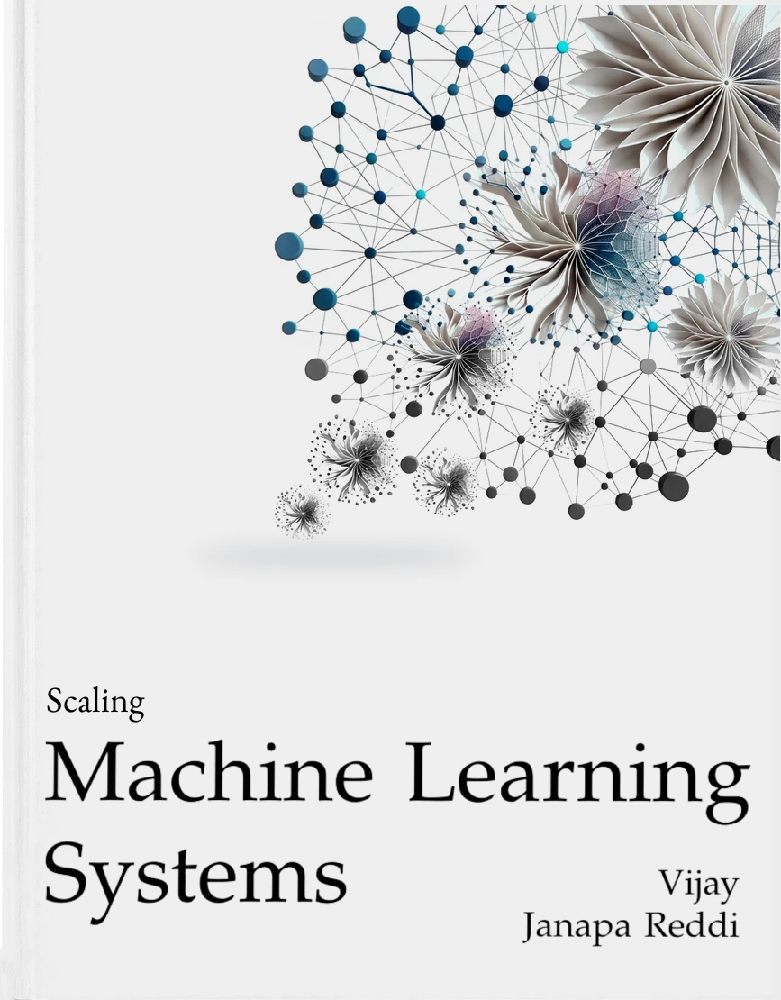

---
format:
  html:
    title-block-style: default
    title: "Scaling Machine Learning Systems"
    date: today
    date-format: long
    author:
      name: Vijay Janapa Reddi
      email: vj@eecs.harvard.edu
      url: https://vijay.seas.harvard.edu
      affiliation: Harvard University
---

::: {.content-visible when-format="html:js"}

```{=html}
<p id="welcome" class="unnumbered" style="font-size: 2rem; font-weight: 600; line-height: 1.2; margin: 1.1rem 0 1rem;">Welcome</p>

<div class="abstract-section">
  <div class="abstract-content">
    <p>At scale, machine learning changes its engineering requirements: models grow too large for a single accelerator, services span continents, and deployments carry responsibilities to society. At this scale, the costs of distribution limit AI capability as much as the model does, and every system in this book is engineered under both the physical limits of distributed infrastructure and the statistical behavior of learning. This book addresses AI engineering at scale. The treatment follows the lifecycle of a large-scale system: defining the distributed architecture, building the physical infrastructure fleet, ensuring operational reliability, deploying to global users, and hardening the system for safety and responsibility.</p>
  </div>

  <div class="book-card-link">
    <div class="book-card">
      
      <p class="book-title">Scaling Machine Learning Systems</p>
      <p class="book-subtitle">Publisher: The MIT Press (2027)</p>
    </div>
  </div>
</div>
```

<p id="what-you-will-learn" class="unnumbered" style="font-size: 1.45rem; font-weight: 600; line-height: 1.25; margin: 1.5rem 0 0.75rem;">What You Will Learn</p>

This book extends the foundations into production-scale systems through four parts that follow the fleet stack from bottom to top:

- **Part I: The Fleet.** The data-center infrastructure, high-bandwidth network fabrics, and scalable storage that every distributed ML deployment runs on.
- **Part II: Distributed ML.** How computation is coordinated across thousands of devices, through collective communication primitives, parallelism strategies, fault tolerance mechanisms, and fleet orchestration.
- **Part III: The Fleet in Production.** How much of the fleet's capacity becomes useful work, the shift from training to serving, ML at the edge, and the operational lifecycle of production fleets.
- **Part IV: The Responsible Fleet.** Security, robustness, environmental sustainability, and responsible engineering in large-scale operations.

<p id="prerequisites" class="unnumbered" style="font-size: 1.45rem; font-weight: 600; line-height: 1.25; margin: 1.5rem 0 0.75rem;">Prerequisites</p>

Readers should bring the following background:

- **Foundational background** in single-machine ML systems, or equivalent experience
- **Programming proficiency** in Python with familiarity in NumPy
- **Mathematics foundations** in linear algebra, calculus, and probability
- **Distributed systems familiarity** (networking, parallelism), which is helpful for advanced topics but not required

<p id="support-our-mission" class="unnumbered" style="font-size: 1.45rem; font-weight: 600; line-height: 1.25; margin: 1.5rem 0 0.75rem;">Support Our Mission</p>

```{=html}
<div class="support-mission">
  <p>Sponsors like the <a href="https://edgeaifoundation.org/" target="_blank" rel="noopener noreferrer">EDGE AI Foundation</a> match every star with funding that supports learning.</p>

  <div class="support-actions">
    <span class="star-count" id="star-count">Loading...</span>
    <a href="https://github.com/harvard-edge/cs249r_book" target="_blank" rel="noopener" class="github-star-btn">Star on GitHub</a>
  </div>

  <p class="support-note">
    <a href="https://opencollective.com/mlsysbook" target="_blank" rel="noopener">Support us on Open Collective →</a>
  </p>
</div>
```

```{=html}
<script>
async function fetchGitHubStars() {
  const starElement = document.getElementById('star-count');

  try {
    const response = await fetch('https://api.github.com/repos/harvard-edge/cs249r_book');
    const data = await response.json();
    const starCount = data.stargazers_count;
    const formattedCount = starCount.toLocaleString();
    starElement.textContent = formattedCount;
    starElement.style.opacity = '1';
  } catch (error) {
    console.error('Failed to fetch GitHub stars:', error);
    starElement.textContent = 'Loading...';
    starElement.style.opacity = '1';
  }
}

document.addEventListener('DOMContentLoaded', fetchGitHubStars);
</script>
```

<p id="contributing" class="unnumbered" style="font-size: 1.45rem; font-weight: 600; line-height: 1.25; margin: 1.5rem 0 0.75rem;">Contributing</p>

::: {.content-visible when-format="html"}
This is a collaborative project. The project [contribution guidelines](https://github.com/harvard-edge/cs249r_book/blob/main/CONTRIBUTING.md) explain how to participate. Feedback, corrections, and new ideas are welcome through GitHub [issues](https://github.com/harvard-edge/cs249r_book/issues).
:::

::: {.content-visible when-format="pdf"}
This is a collaborative project. The project contribution guidelines explain how to participate, and feedback, corrections, and new ideas are welcome through the GitHub issue tracker at the book's repository (`harvard-edge/cs249r_book`).
:::

:::
