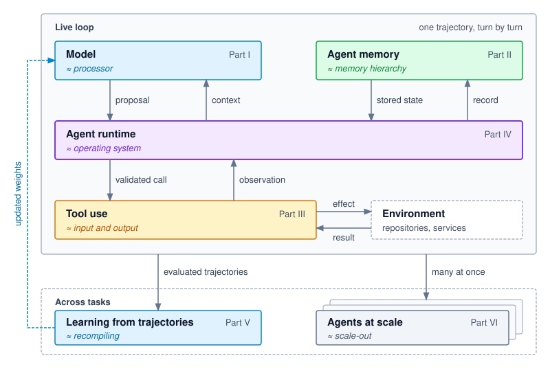
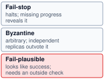
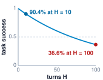
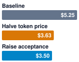
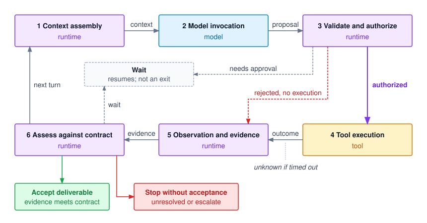

# Introduction {#sec-vol3-intro}

::: {layout-narrow}
::: {.column-margin}

\chapterminitoc

:::

::: {.content-visible when-format="pdf"}
\noindent
{fig-alt="A robot-shaped assembly with a processor, storage, and tool interfaces on a circuit platform."}
:::

::: {.content-visible unless-format="pdf"}
{fig-alt="A robot-shaped assembly with a processor, storage, and tool interfaces on a circuit platform."}
:::

:::

## Purpose {.unnumbered .unlisted}

::: {.content-visible when-format="pdf"}
\begin{marginfigure}
\mlagentstack{17}{17}{17}{17}{16}{16}
\end{marginfigure}
:::

::: {.content-visible unless-format="pdf"}
::: {.column-margin}
{width="100%" fig-alt="Agentic Machine Learning Systems Stack"}

*Agent stack focus for this chapter.*
:::
:::

_Why can a model that generates a fluent, correct action still fail to complete an autonomous task?_

The difference between answering a prompt and completing a delegated task marks the boundary of agentic machine learning systems. A foundation model can propose the exact line of code needed to fix a race condition, yet the repository remains broken until software inspects the source tree, applies the patch, runs regression tests, and verifies the outcome. Delegating autonomous work therefore requires building an engineered machine around the model, not merely selecting capable weights. That machine resembles a complete computer, with components that compute, remember, act on the external world, supervise execution, recover from faults, and learn from experience. However, its central processing element differs fundamentally from any classical processor: it is an autoregressive model whose outputs are stochastic proposals rather than deterministic execution. A fluent proposal can be subtly wrong, and the model cannot vouch for its own correctness. The surrounding system exists to contain that reality. The runtime determines what data the model perceives, bounds the actions it may execute, persists critical state across interruptions, and verifies whether the task actually succeeded. Every decision consumes computational time and monetary budget that only accepted outcomes justify. Building an agentic system is thus an exercise in systems engineering: sizing the runtime machinery to the horizon, state, and authority that the task demands.

::: {.content-visible when-format="pdf"}

\newpage

:::

::: {.callout-learning-objectives}

- Trace the architectural evolution from predictive and generative machine learning to autonomous agentic systems
- Explain why a model's stochastic proposals require an external runtime to close the interaction loop, and trace one turn through the runtime's six phases
- Analyze which isolated-request assumptions a multi-turn trajectory breaks, and why the runtime accounts for cost, state, and authority per trajectory
- Classify a delegated task by horizon, state, and authority to identify its systems engineering obligations
- Distinguish mechanically enforced sandbox bounds from the external evidence that catches plausible but wrong results before task acceptance
- Calculate unchecked task reliability and cost per accepted task across multi-turn horizons, and use them to decide between a fixed workflow and a model-directed loop
- Specify a five-part task contract that separates goal, environment, permitted actions, observations, and completion criteria

:::

## The Evolution of Machine Learning Systems {#sec-vol3-intro-evolution}

A prediction service returns a score, a conversational assistant proposes a patch, and an agentic system applies and checks that patch under delegated authority. These representative deployment arrangements trace the progression from predictive pipelines through conversational foundation models to autonomous workloads. They overlap historically: predictive models can participate in feedback loops, and a foundation model can serve any of the three arrangements. The engineering distinction is who controls the actions and checks the outcome.

Three representative operational paradigms illustrate this progression:

1. **Predictive Machine Learning Systems**: In the fixed-input serving arrangement, predictive models act as function approximators that map supplied inputs to structured outputs ($\ExampleLabel = \ModelPredictor(\ModelInput)$). Canonical workloads include image classification, recommendation ranking, fraud scoring, and tabular regression. In this arrangement, application code supplies the input schema and consumes the returned score within a defined execution boundary. Systems engineering focused primarily on model serving throughput, single-device memory layout, kernel fusion, and batch inference latency. The serving call itself requires no conversational memory or autonomous tool loop, even when the application uses its scores in a broader feedback process.
2. **Generative Foundation Models**: The rise of large-scale autoregressive transformers shifted the discipline toward general-purpose representation and reasoning. Trained across internet-scale corpora on compute fleets of tens of thousands of accelerators, foundation models generate open-ended text, synthetic code, and multimodal tokens. Yet in standard conversational deployment, the interaction pattern remains **open-loop** and **human-mediated**. When a developer works with a conversational assistant, the human acts as the runtime controller: the user issues a prompt, inspects the generated response, manually copies code into an editor, executes commands in a terminal, interprets compiler errors, and pastes stack traces back into the prompt window. While the foundation model generates candidate tokens, the human provides the execution environment, maintains working memory across turns, diagnoses runtime failures, and verifies correctness.
3. **Agentic Machine Learning Systems**: Agentic systems replace the human in the inner control loop with an autonomous software runtime. Instead of requesting advice or static text, a user delegates an end-to-end objective: clone a software repository, reproduce a reported defect, synthesize a candidate fix, run the full test suite in an isolated sandbox, iterate until regressions clear, and return a verified patch. The foundation model shifts from an advisory conversational partner to an action-proposing component embedded within an active feedback loop.

@Tbl-vol3-three-eras compares the three eras by who closes the interaction loop and by what the engineers responsible for the system therefore optimize.

| **Era**                          | **Interaction pattern**                          | **Who closes the loop**                                             | **What engineering optimizes**                                           |
|:---------------------------------|:-------------------------------------------------|:--------------------------------------------------------------------|:-------------------------------------------------------------------------|
| **Predictive systems**           | One fixed input mapped to one structured output  | Application code consumes the score in this arrangement             | Serving throughput, batch latency, and memory layout                     |
| **Generative foundation models** | Open-loop prompt and response                    | A human, who runs the tools and carries errors back to the prompt   | Tokens per second, tail latency, and accelerator utilization             |
| **Agentic systems**              | Closed loop of proposal, action, and observation | The runtime, which dispatches granted actions and checks the result | Task completion rate, cost per accepted task, and reliability over turns |

: **Three Eras of Machine Learning Systems**: The representative arrangements differ in who closes the interaction loop. The predictive serving call returns a score without an autonomous tool loop, the conversational arrangement relies on a person to act on the response, and the agentic arrangement delegates that loop to a runtime. This changes the metric the system is engineered against. {#tbl-vol3-three-eras tbl-colwidths="[20,26,28,26]"}

Moving from conversational token generation to autonomous goal execution transforms the systems engineering contract between the model, the runtime, and the surrounding environment.

::: {#dfn-vol3-agentic-system .callout-definition title="Agentic system"}

***Agentic system***\index{Agentic system!definition}\index{Agentic machine learning system|see{Agentic system}} is an autonomous software system in which a runtime places a foundation model in a closed control loop with context, state, tools, and an environment, dispatching the model's authorized proposals and returning their environmental observations to subsequent calls until the task is accepted, halted, or escalated.

1.  **Significance**: The unit of systems optimization shifts from the isolated model call to the complete task trajectory. Unchecked errors compound exponentially across sequential turns (@sec-vol3-intro-horizon-arithmetic), and every attempt, accepted or aborted, is charged to the task's cost per accepted result.
2.  **Distinction**: In conversational interfaces, a human executes tools, verifies output, and bridges state between turns. In an agentic system, software executes these operations under delegated authority, meaning the model's output is strictly a proposal that holds no standing authority of its own.
3.  **Common pitfall**: Treating agency as a capability inherent to the model's weights. A more capable model produces more accurate candidate actions, but permission enforcement, sandbox isolation, durable state persistence, and completion verification belong entirely to the surrounding software runtime.

:::

This architectural shift forces a fundamental recalculation of core systems metrics. In classical model serving, infrastructure teams optimize for tokens per second, tail latency percentiles, and accelerator utilization. In agentic systems, the governing metrics become **task completion rate**, **cost per accepted task**, and **reliability across multi-turn horizons**. An isolated-request baseline bounds and accounts for each call separately, retains no task state after the response, and treats an HTTP 200 status as successful request completion. Those choices do not establish completion of a delegated task: an execution spans dozens of dependent steps, accumulates context and tool output that the serving system must keep available between calls (the attention key-value cache it retains for the growing prefix, so the next turn need not recompute it, can occupy gigabytes of accelerator memory), and triggers side effects that permanently alter external systems.

## From a Useful Proposal to an Accepted Task {#sec-vol3-intro-existence-moment}

Consider a concrete engineering challenge: diagnosing and repairing an intermittent race condition in a distributed key-value store.[^fn-repair-task-benchmark] A foundation model[^fn-foundation-model-term] can inspect the issue description and propose an edit to the connection-pool locking logic. Emitting that patch text, however, leaves the repository completely untouched. Resolving the defect requires an agent to locate the relevant source files, draft an edit, execute compilers and test runners inside an isolated environment, interpret diagnostic logs when a build fails, and verify that the resulting code satisfies the repository's regression test suite.

[^fn-repair-task-benchmark]: **Repository Repair as a Benchmark Task**: SWE-bench established repository repair as a standard benchmark for agentic systems: each instance pairs a real GitHub issue with the unit and integration tests from the patch that fixed it [@jimenez2024swebench]. A candidate patch is evaluated by whether those tests pass after application. The model is never permitted to inspect the evaluation tests directly, ensuring that acceptance rests on independent, untampered evidence rather than self-reported success. \index{SWE-bench!repair task}

[^fn-foundation-model-term]: **Foundation Model**: Bommasani and colleagues introduced the term in 2021 to describe models trained on massive, diverse datasets at scale that can be adapted to an expansive range of downstream tasks [@bommasani2021opportunities]. Because a foundation model is general-purpose, its weights encode neither the security permissions nor the specific acceptance criteria of a given production task; those boundaries must be defined and enforced by the surrounding runtime. \index{Foundation model!definition}

An agentic system comes into existence precisely when software closes this interaction loop. Rather than relying on an engineer to copy prompts and error traces back and forth, the surrounding software feeds the foundation model an objective alongside fresh environmental observations, captures the model's proposed action, dispatches that action, and returns structured execution feedback to guide the next decision.

The surrounding software, the **runtime**\index{Runtime (agent)!definition}, enforces the operational boundary between model reasoning and environment mutation. All execution authority resides permanently with the runtime. Because a model outputs only unstructured text or token streams, generating an operation's name confers no inherent permission to run it. The runtime parses the proposed action, verifies that it complies with current access policies, and dispatches the call through a designated tool. A **tool**\index{Tool!definition} provides a structured interface to an environmental capability, such as reading file contents, editing source code, executing a shell command, or running a test suite. The part of the runtime that drives this loop is often called the agent harness, and @sec-vol3-agent-harness develops it as a component of the runtime rather than a separate system. @Fig-vol3-open-vs-closed-loop-control sets the two arrangements side by side. In panel A a developer carries every command and every error by hand; in panel B the runtime dispatches only the actions it grants and routes verifier evidence back to itself rather than trusting the model's account of what happened.

::: {#fig-vol3-open-vs-closed-loop-control fig-env="figure" fig-pos="htb" fig-cap="**A Person or a Runtime Closes the Loop**: In the conversational arrangement (A), the model answers and the developer runs every tool and carries each error back by hand. In the agentic arrangement (B), the runtime assembles context, receives the model's proposal, and dispatches only actions it grants; the model holds no authority, and verifier evidence returns to the runtime rather than to the model's own report." fig-alt="Two panels with the same layout and a dashed line separating the proposing tier above from the acting tier below. Panel A, A person closes the loop: a model endpoint labeled answers only sits above the line; a developer labeled carries everything sits below it, sends prompt plus error up to the endpoint and receives a patch, runs commands in a local terminal, and receives the error back. Panel B, A runtime closes the loop: a foundation model labeled holds no authority sits above the line; an agent runtime labeled grants each action sits below it, sends context up and receives a proposal, dispatches to an isolated sandbox along a violet arrow and receives an observation, and the sandbox feeds verifiers labeled tests, linters, whose evidence returns to the runtime."}

:::

Panel B represents the architectural foundation of this book. High-parameter foundation models paired with optimized inference engines provide essential proposal capabilities, but they supply only the raw computational engine. A model cannot manage its own execution authority, maintain state across tool failures, or verify the correctness of its actions against external reality. Those responsibilities fall entirely on the surrounding software architecture. Engineering an agent is therefore the discipline of designing, securing, and operating the complete closed-loop system that surrounds the model.

Analyzing and building these systems requires four foundational instruments:

1. **The Stochastic Computer**: An architectural map that relates the parts of an agentic system to the parts of a classical computer and marks where the comparison fails (@sec-vol3-intro-stochastic-computer).
2. **The H·S·A Exposure Space**: An analytical coordinate system that measures how far a delegated task departs from stateless model inference along three operational dimensions: execution horizon ($\TurnHorizon$), persistent state ($\StateExposureLevel_0$ to $\StateExposureLevel_3$), and external authority ($\AuthorityExposureLevel_0$ to $\AuthorityExposureLevel_3$) (@sec-vol3-intro-hsa).
3. **The Invariant Closure Principle**: A governance rule stipulating that safety and security invariants must be mechanically enforced by the runtime below the model, while task acceptance must be verified against independent evidence above the model (@sec-vol3-intro-governance). *Below* the model means between its proposal and the environment, where the runtime decides what may execute; *above* it means between the finished result and whoever accepts it, where the runtime decides what counts as done.
4. **Horizon Reliability and Cost Arithmetic**: Mathematical formulations that quantify how single-step error rates compound across multi-turn trajectories, demonstrating how retry budgets and recovery mechanisms dictate the true compute cost per accepted task (@sec-vol3-intro-horizon-arithmetic).

@Sec-vol3-intro-hsa also places four recurring reference workloads, which the book calls lighthouses, in the exposure space; the repair task is one of them. Once all four instruments are in hand, @sec-vol3-intro-running-example follows the repair task turn by turn to show where each one acts, and @sec-vol3-intro-book-organization maps the instruments onto the structure of the book.

## The Stochastic Computer {#sec-vol3-intro-stochastic-computer}

To understand how the disparate subsystems of an agentic architecture collaborate, we can look to an architecture familiar to every systems engineer: the classical computer. An autonomous task requires computational execution, working and persistent memory, interfaces to perceive and manipulate the external world, supervisory control, and mechanisms to optimize future executions from past runs. Taken together, these requirements map directly onto the classical hardware-software hierarchy.

We formalize this mapping as the **stochastic computer**\index{Stochastic computer!definition} (@fig-vol3-stochastic-computer-map).[^fn-stored-program-map] Its upper band is the live execution loop of a single task, and its lower band acts across tasks. In the live band, the foundation model acts as the central processing unit (CPU). Context engineering and external datastores represent the memory hierarchy, spanning working registers (the active context window) to secondary storage (long-term retrieval indices). Tool invocation functions as input/output (I/O) bus communication with external peripheral devices. The agent runtime serves as the operating system kernel: it schedules model calls, mediates every privileged operation, manages execution state, and enforces access control. Across tasks, learning from recorded runs plays the role of a profile-guided optimizing compiler (one that recompiles a program using measurements taken from its earlier executions), refining the model's policy from traces of prior runs without modifying underlying safety boundaries. Finally, coordinating many agents mirrors scale-out across a network fabric, where several agents divide one workload and contend for shared state and resource limits.

[^fn-stored-program-map]: **The Stored-Program Organization**: Von Neumann's 1945 draft report on the EDVAC partitioned a computer into central arithmetic, central control, memory, and input/output organs [@vonneumann1945edvac]. In von Neumann's architecture, central control holds the absolute authority to fetch and execute instructions. In an agentic system, that authority is deliberately inverted: authority resides strictly within the surrounding runtime, while the learned model only proposes actions. Trust is decided outside the processor. \index{Von Neumann architecture!stochastic computer map}

::: {#fig-vol3-stochastic-computer-map fig-env="figure" fig-pos="htb" fig-cap="**The Stochastic Computer as an Architectural Map**: The agent stack structured around traditional computing layers (marked with ≈). The live execution loop (top) executes one task trajectory turn by turn. The across-task loop (bottom) compiles evaluated trajectories into updated model policies and coordinates multi-agent scale. While the architectural analogy provides intuition, the chapters develop each subsystem through its own rigorous systems mechanisms." fig-alt="Map in two bands. The live loop band, one trajectory turn by turn, holds the model, Part I, approximately a processor; agent memory, Part II, approximately a memory hierarchy; the agent runtime, Part IV, approximately an operating system, spanning the band between them; and tool use, Part III, approximately input and output, connected to a dashed environment box. Every arrow passes through the runtime: proposal and context between model and runtime, stored state and record between memory and runtime, validated call and observation between runtime and tools, and effect and result between tools and environment. Below, an across-tasks band holds learning from trajectories, Part V, approximately recompiling, fed by evaluated trajectories and sending updated weights back to the model along a dashed perimeter arrow, and agents at scale, Part VI, approximately scale-out, drawn as a stack of cards fed by many trajectories at once."}

:::

The analogy breaks down at the processor, and that divergence defines the core discipline of agentic systems engineering. A conventional CPU executes instructions deterministically. Given identical registers and machine state, execution is repeatable and auditable. A foundation model, by contrast, operates stochastically by sampling tokens from a distribution learned during training and conditioned on the observations supplied in its context. That conditioning guarantees neither that the observations are complete and current nor that the proposed action is correct. Its outputs are *candidate proposals*, not certified computations. A generated response can be eloquently phrased yet factually wrong, syntactically correct yet semantically catastrophic, and nothing within the generated text itself can vouch for its own validity.

In a classical operating system, the kernel trusts the CPU to execute instructions faithfully. In an agentic system, the runtime cannot trust its processor even to report its own status accurately. Conditioning on observations does not certify an execution result, so a model may hallucinate a successful return code or report actions it never took. The runtime must therefore close the control loop independently: it mechanically enforces permissions below the model and verifies results against external ground truth above the model (@sec-vol3-intro-invariant-closure). Memory relationships diverge just as sharply. While a physical CPU addresses memory directly, the context presented to a model is merely a selective, lossy projection of the environment's state. Authoritative state resides in external databases, filesystems, and version-control trees; the agent's memory holds only transient working representations.

Viewing the agent as a stochastic computer clarifies where traditional systems guarantees hold and where new abstractions are required. The primary systems challenge is not simply invoking a model, but building the deterministic runtime (the memory virtualization, execution sandboxes, and verification pipelines) that allows an unreliable cognitive core to drive reliable, autonomous computation.

## The H·S·A Exposure Space {#sec-vol3-intro-hsa}

::: {.column-margin}
{width="100%" fig-alt="H·S·A locator with no axis lit and the origin dot highlighted, marking a single model call."}

*Agents depart from a single model call along horizon, state, and authority.*
:::

While the architecture of a stochastic computer identifies the structural components of an agentic system, the **H·S·A exposure space** quantifies the runtime machinery that a specific workload demands. It measures how far a delegated assignment departs from an elementary, single-turn model invocation. The fundamental unit of that measurement is the primary runtime artifact of this book: the **trajectory**.

::: {#dfn-vol3-trajectory .callout-definition title="Trajectory"}

***Trajectory***\index{Trajectory!definition} is the ordered sequence of recorded states, proposed actions, runtime decisions, and observations through which one delegated task proceeds, from its initial context to its ultimate acceptance, termination, or escalation.

1.  **Significance**: The trajectory length defines the operational horizon $\TurnHorizon$, which governs how compounding errors degrade system reliability. Furthermore, its complete span (encompassing rejected actions, retries, and failed branches) establishes the true accounting boundary when computing cost and latency per accepted task.
2.  **Distinction**: While a conversational transcript merely captures the tokens exchanged between a model and a user, a trajectory preserves the full causal history of execution. It records which action proposals the runtime approved, modified, or rejected, alongside the raw observations returned by external tools, linking every decision to the exact evidence available at that step.
3.  **Common pitfall**: Preserving only the final deliverable. Storing just the accepted patch or completed document hides the computational cost of discarded attempts, masks transient faults, and discards the intermediate verification evidence that justified accepting the work.

:::

We formalize this sequence using the compact notation

$$\Trajectory = (\TrajectoryState_0, \TrajectoryAction_0, \TrajectoryObservation_1, \TrajectoryState_1, \TrajectoryAction_1, \TrajectoryObservation_2, \dots, \TrajectoryState_{\TurnHorizon})$$

where $\TrajectoryState_{t}$ represents the recorded state available at decision step $\TurnIndex$, $\TrajectoryAction_{t}$ is the proposed action emitted by the model, and $\TrajectoryObservation_{t+1}$ is the subsequent observation returned by the execution environment. Each transition from $\TrajectoryState_{t}$ to $\TrajectoryState_{t+1}$ constitutes a single **turn**\index{Turn!definition}: one model invocation paired with the runtime's mediation of the resulting proposal. The notation establishes a total ordering across interactions, where each $\TrajectoryState_{t}$ reflects the runtime's partially observed view of the broader environment. The repair trajectory that @sec-vol3-intro-trajectory-systems-boundary follows turn by turn shows why the runtime must manage cost, state, and authority over this whole sequence rather than per call.

A standard model invocation is isolated: it consumes a static prompt and returns a completion. Extending that single call into an autonomous trajectory exposes the system to progressive operational risk along three physical and architectural dimensions: how long execution continues, what state persists across steps, and what external side effects the system can trigger. This book models these dimensions as the Horizon, State, and Authority (H·S·A) exposure space.

::: {#dfn-vol3-hsa-exposure-space .callout-definition title="H·S·A exposure space"}

***H·S·A exposure space***\index{HSA exposure space@H·S·A exposure space!definition} is the three-dimensional coordinate system quantifying how far a delegated task departs from an isolated model call: its horizon $\TurnHorizon$ measured in sequential turns, the state $\StateExposureLevel_0$ through $\StateExposureLevel_3$ carried between invocations, and the authority $\AuthorityExposureLevel_0$ through $\AuthorityExposureLevel_3$ exercised over external systems.

1.  **Significance**: Each axis identifies a concrete operational exposure that the runtime must bound. Horizon determines how rapidly unverified errors compound, state dictates the working memory and durable artifacts carried forward, and authority establishes the maximum blast radius of an errant action. Later divisions of this book systematically address how to close these exposures: Part II governs state, Part III controls authority, and Part IV bounds horizon.
2.  **Distinction**: A coordinate in this space describes the exposure a task carries, which is a property of the task and its environment. The runtime's validation gates, sandboxes, and compensating operations are its response to that exposure, which @sec-vol3-intro-governance develops as closure. Closure is what the runtime builds; the coordinate is where the task sits.
3.  **Common pitfall**: Inferring authority from syntax or command names alone. Authority reflects the operational consequence of an action within its specific environment; an identical file deletion is discardable inside an ephemeral sandbox, but irreversible when executed directly against an unversioned production datastore.

:::

Horizon $\TurnHorizon$ tracks the duration of execution in discrete sequential turns. Every additional turn provides another opportunity for invalid tool invocations, stale environment observations, and context drift; @sec-vol3-intro-horizon-arithmetic models mathematically how unchecked step-level failure rates compound into severe task-level unreliability across extended sequences. Crucially, turn count and wall-clock latency represent distinct operational budgets that require independent management. A three-turn workflow that triggers a large remote build cluster can run for hours, whereas a hundred-turn in-memory code refactoring completes in seconds. Production runtimes must meter both metrics, bounding turns to restrict error compounding and bounding wall-clock time to release compute and network resources.

State ($\StateExposureLevel_0$ to $\StateExposureLevel_3$) characterizes the data, memory, and environmental artifacts that persist across turns. At $\StateExposureLevel_0$, the system operates completely statelessly, carrying no task context past a single invocation. At $\StateExposureLevel_1$, the runtime maintains conversational working state; this includes the tokenized context window as well as inference-tier serving state, such as cached key-value (KV) attention pairs. At $\StateExposureLevel_2$, the agent manages task-local working artifacts within an isolated workspace, such as a private source tree, an ephemeral container, or an in-memory scratchpad. At $\StateExposureLevel_3$, execution interfaces with durable shared state that outlives the individual task session, such as an authoritative database, a shared object store, or a central code repository. Because realistic workloads routinely span several tiers at once, this classification establishes what data the runtime must checkpoint or isolate, determines cache invalidation boundaries, and dictates which storage system remains authoritative when local scratchpad views diverge.

Authority ($\AuthorityExposureLevel_0$ to $\AuthorityExposureLevel_3$) defines the blast radius of actions delegated to the task. At $\AuthorityExposureLevel_0$, access is strictly read-only, although exfiltration remains a risk if retrieved secrets leak into output text. At $\AuthorityExposureLevel_1$, mutations are confined entirely to a disposable workspace where unintended modifications carry zero external impact. At $\AuthorityExposureLevel_2$, actions affect external systems, but every mutating operation has an explicit compensating transaction[^fn-saga-compensation-intro] executed under verified preconditions, with a separate retry policy preventing duplicate effects. At $\AuthorityExposureLevel_3$, the task executes non-compensable actions (such as modifying unversioned production records, issuing financial transactions, or publishing public communications) for which no automated reversal exists. Authority reflects the operational consequence within the specific execution environment rather than cosmetic command syntax. Because a trusted runtime mediates every action against an explicit per-task capability grant, restricting this grant provides the first and most cost-effective line of defense before deploying complex validation machinery.[^fn-least-privilege-mediation]

[^fn-saga-compensation-intro]: **Compensating Transactions**: Garcia-Molina and Salem introduced sagas for long-lived distributed transactions where holding locks across the entire workflow is impractical: a saga consists of a sequence of local transactions, each paired with a compensating transaction that semantically undoes earlier steps if the overall workflow aborts [@garciamolina1987sagas]. Compensation is an active forward recovery action rather than an atomic rollback; concurrent processes can observe intermediate states, and the compensating action itself may fail. An $\AuthorityExposureLevel_2$ capability grant therefore requires an executable compensation handler before dispatching the initial mutating effect. \index{Saga!compensating transaction}

[^fn-least-privilege-mediation]: **Least Privilege and Complete Mediation**: Saltzer and Schroeder's foundational protection principles dictate that every program must operate using the smallest set of privileges necessary to complete its task (least privilege), and that every access to every object must be systematically validated (complete mediation) [@saltzer1975]. Validating capability grants on every tool invocation applies both principles to a non-deterministic model whose proposals cannot be inherently trusted. Restricting the task's initial capability grant remains the most dependable technique for minimizing potential damage when runtime verification checks fail to intercept an unsafe request. \index{Least privilege!task grant}

The coordinate space in @fig-vol3-hsa-taxonomy maps agentic workloads across three operational exposure axes: horizon ($\TurnHorizon$, turns along the horizontal), authority ($\AuthorityExposureLevel_0$ to $\AuthorityExposureLevel_3$ on the vertical), and carried state ($\StateExposureLevel_0$ to $\StateExposureLevel_3$ on the depth axis). This space functions as an analytical lens rather than a rigid taxonomy: two workloads occupying the exact same cell may still demand different runtime controls if their data sensitivity, tool reliability, or catastrophic failure thresholds diverge. Furthermore, altering the execution environment can shift a task into a completely different cell even when its foundation model and turn horizon remain identical, as demonstrated in example \ref{exmp-01-hsa-incident}. The four workloads plotted in the space are the book's lighthouse workloads, described in @sec-vol3-intro-lighthouses.

::: {#fig-vol3-hsa-taxonomy fig-env="figure" fig-pos="htb" fig-cap="**The H·S·A Exposure Space**: Horizon ($\TurnHorizon$, turns), carried state ($\StateExposureLevel_0$ to $\StateExposureLevel_3$), and authority ($\AuthorityExposureLevel_0$ to $\AuthorityExposureLevel_3$) map the operational departures of an agent from an isolated model call. Plotted positions represent illustrative task configurations rather than intrinsic properties of each workload class. The formal task contract and failure consequences dictate necessary runtime controls. System closure represents the engineering response to these exposures rather than an independent coordinate axis." fig-alt="Three-axis diagram. Authority runs up the vertical axis in four bands, A0 read only, A1 workspace, A2 compensable, and A3 irreversible, with the A3 band tinted red. Horizon in turns runs along a logarithmic horizontal axis marked 1, 10, 100, and 1,000, with the origin labeled one model call. State runs along a diagonal depth axis from the origin with ticks S0 stateless, S1 context, S2 working copy, and S3 durable. Four workloads are plotted as markers at their horizon and authority, each with a diagonal tail whose length in ticks equals its state level: the support agent (H at most 3, S1, A0), the remediation agent in red (H about 20, S3, A3), the repair agent (H about 100, S2, A1), and the research agent (H at least 1,000, S3, A0)."}

:::

::: {#exmp-01-hsa-incident .callout-example title="A working copy and the only copy"}

**Scenario**: A coding assistant must repair a software defect while preserving adjacent, uncommitted edits authored by a developer. Consider two execution environments: an isolated, ephemeral sandbox containing a working copy of the project vs. direct access to the developer's sole authoritative workspace. The foundation model, repair objective, and expected turn horizon remain identical in both configurations. In each case, the assistant issues a command to delete files while cleaning up intermediate build artifacts.

**Diagnosis**: Inside the ephemeral sandbox, the source files constitute $\StateExposureLevel_2$ working state and the mutation authority is bounded at $\AuthorityExposureLevel_1$. Tearing down the sandbox discards any erroneous modifications without corrupting the developer's original files. In the authoritative workspace, however, that identical command targets $\StateExposureLevel_3$ state. Although one person uses it, the workspace is durable state the task shares with its developer, it outlives the task, and it holds the only copy of the developer's edits. If the deleted files contain unique, unstaged edits missing from version control history, the operation immediately escalates to $\AuthorityExposureLevel_3$ irreversible data destruction. Version control alone does not prevent this loss, as uncommitted working-tree changes lack snapshots. A resilient systems contract grants the agent access strictly to an isolated clone, excludes unrelated edits from the agent's context, and reserves the integration of reviewed patches for a separate gate. The runtime must enforce that isolation boundary through tool authorization rather than relying on prompt instructions asking the model to exercise caution.

**Systems lesson**: The failure boundary shifted fundamentally even though the model, prompt, and turn horizon remained unchanged. Automated test suites evaluate functional behavior, and diff reviews verify patch cleanliness, but neither technique prevents an unauthorized deletion command from obliterating working state. Sound systems engineering enforces safety at the infrastructure boundary, preventing destructive operations from reaching authoritative state, rather than relying on post-hoc verification to detect irreversible side effects.

:::

### Four lighthouse workloads {#sec-vol3-intro-lighthouses}

The four workloads plotted across the H·S·A exposure space of @fig-vol3-hsa-taxonomy define this book's **lighthouses**\index{Lighthouse workload!definition}: the support agent, remediation agent, repository repair agent, and research agent. Like a lighthouse, each is a fixed reference point that the reader can steer by as the mechanisms change from chapter to chapter. They represent four distinct architectural archetypes chosen because each is bounded by a fundamentally different systems bottleneck; an optimization that halves latency for one workload may be entirely irrelevant to another. Automated repository repair serves as our primary running example, while the other three appear whenever a chapter explores failure modes or constraints that repository repair does not trigger.

```{python}
#| label: calc-vol3-intro-lighthouse-roster
#| echo: false
# ┌─────────────────────────────────────────────────────────────────────────────
# │ LIGHTHOUSE ROSTER: REPAIR AGENT REGISTRY ANCHOR (LEGO)
# ├─────────────────────────────────────────────────────────────────────────────
# │ Context: The four lighthouse callouts after @fig-vol3-hsa-taxonomy.
# │ Goal: Anchor the repair agent, the running example, to its registry profile,
# │       and pin the other three callouts' horizon words to their profiles.
# │ Show: Step budget and context window of the reference repair harness.
# │ How:  Read Agents.Coding.SWE_Bench_Runner; guard the research, remediation,
# │       and support horizons (Agents.Research/Remediation/Support) against
# │       the callouts' "tens of turns" and "a few turns" wording.
# └─────────────────────────────────────────────────────────────────────────────
from mlsysim import Agents
from mlsysim.fmt import check, fmt_int

class LighthouseRoster:
    # ┌── 1. LOAD (Registry) ───────────────────────────────────────────────
    repair = Agents.Coding.SWE_Bench_Runner  # reference repository-repair harness
    research = Agents.Research.OrchestratorWorker
    remediation = Agents.Remediation.OnCall
    support = Agents.Support.CustomerOps

    # ┌── 2. EXECUTE (Compute) ─────────────────────────────────────────────
    repair_steps = repair.max_trajectory_steps
    repair_window = repair.context_window.to("token").magnitude

    # ┌── 3. GUARD (Invariants) ───────────────────────────────────────────
    check(10 <= repair_steps <= 100, "Repair budget must sit in the tens-of-turns regime")
    check(repair_window >= 32_000, "Repair window must hold a multi-file working context")
    check(10 <= research.horizon_turns < 100, "Research callout says tens of turns per question")
    check(10 <= remediation.horizon_turns < 100, "Remediation callout says a moderate horizon of tens of turns")
    check(support.horizon_turns < 10, "Support callout says short sessions of a few turns")

    # ┌── 4. OUTPUT (Formatting) ──────────────────────────────────────────
    repair_steps_str = fmt_int(repair_steps)
    repair_window_str = fmt_int(repair_window)
```

::: {#lhs-vol3-repair-agent .callout-lighthouse title="Repair agent (long-horizon worker)"}

**Workload**: A repository coding agent diagnoses and fixes a defect in an isolated working copy, submitting a verified patch for review. The connection-pool race condition in this chapter serves as the concrete running example; its reference harness budgets `{python} LighthouseRoster.repair_steps_str` steps inside a `{python} LighthouseRoster.repair_window_str`-token context window.

**Exposure**: Long horizon (tens to hundreds of turns), a task-local working copy ($\StateExposureLevel_2$), and filesystem edits confined strictly to that disposable sandbox ($\AuthorityExposureLevel_1$) until a human-reviewed patch is exported.

**Binding constraint**: Compounding errors across the trajectory, and repeated input whose token count grows quadratically when every turn resends the full history. Without compatible prefix reuse, this repeated input can dominate aggregate inference work and cost, while acceptance depends strictly on immutable test suites that the agent cannot modify.

:::

::: {#lhs-vol3-research-agent .callout-lighthouse title="Research agent (untrusted reader)"}

**Workload**: A deep-research agent answers an open-ended question by querying, retrieving, and synthesizing external web sources, frequently delegating sub-queries to parallel worker agents.

**Exposure**: Horizons from tens of turns for one question to thousands for a standing crawl, an expanding knowledge store of ingested documents ($\StateExposureLevel_3$), and read-only authority ($\AuthorityExposureLevel_0$).

**Binding constraint**: Ingested content is untrusted data. Through indirect prompt injection, in which a retrieved page carries text the model may follow as an instruction, it can redirect the trajectory or exfiltrate private context [@greshake2023not], so read-only access is still a serious security exposure. Aggregate token consumption from retrieved documents and worker fan-out dominates total execution cost.

:::

::: {#lhs-vol3-remediation-agent .callout-lighthouse title="Remediation agent (irreversible actor)"}

**Workload**: An automated site-reliability agent diagnoses a live production incident and applies configuration or infrastructure changes to restore service. @Sec-vol3-conclusion-capstone analyzes one such remediation end to end.

**Exposure**: A moderate horizon (tens of turns), mutable shared production infrastructure ($\StateExposureLevel_3$), and non-compensable or irreversible operations ($\AuthorityExposureLevel_3$).

**Binding constraint**: A single erroneous action can incur outages costing orders of magnitude more than all trajectory compute combined. Human-in-the-loop approval latency and the blast radius of incorrect decisions dominate systems design, necessitating strict approval gates, compensating actions, and explicit points of no return before execution begins.

:::

::: {#lhs-vol3-support-agent .callout-lighthouse title="Support agent (interactive responder)"}

**Workload**: A customer-operations agent resolves billing and booking inquiries while the user waits synchronously.

**Exposure**: Short sessions of a few turns each across thousands of concurrent users, session context combined with sensitive enterprise database records ($\StateExposureLevel_1$ with $\StateExposureLevel_3$), and authority that escalates from read-only queries ($\AuthorityExposureLevel_0$) to compensable updates such as a seat hold that can be released ($\AuthorityExposureLevel_2$), and on to actions with no automated reversal such as a refund paid out to an external account ($\AuthorityExposureLevel_3$).

**Binding constraint**: Strict tail latency under high concurrency, combined with verifiable adherence to enterprise policy. Serving throughput and the aggregate memory overhead of retaining active session state across thousands of simultaneous connections dominate systems cost.

:::

Comparing these four lighthouses demonstrates why systems mechanisms cannot be evaluated in the abstract. Proactive context summarization is vital for a multi-turn repository repair agent but largely superfluous for a three-turn support session. An on-call remediation agent can read diagnostic telemetry under a prior grant while requiring explicit approval for consequential production changes. A read-only researcher can likewise operate under a bounded grant, but disclosure of sensitive context may still require approval. The task boundary, rather than the workload label, determines where those gates belong. Each subsequent chapter links its proposed mechanisms directly to the lighthouse whose binding constraints they resolve. Placing a workload in the space shows where it is exposed; how the runtime closes each exposure without trusting the model to do so is the subject of invariant closure.

## Invariant Closure {#sec-vol3-intro-governance}

A foundation model operating within an agentic loop generates fluent, plausible proposals, but it cannot certify their safety or correctness. This limitation creates the central governance challenge of agentic architecture. When the model cannot validate its own outputs, the surrounding system must guarantee operational integrity, and invariant closure divides that responsibility between two sides of the model. Safety constraints are mechanically enforced below it, and task completion is verified against independent evidence above it.

### The fail-plausible fault {#sec-vol3-intro-fail-plausible}

Invariant closure primarily defends against the **fail-plausible fault**\index{Fail-plausible fault!definition}: the output appears well formed and credible while the intended property remains unsatisfied.[^fn-unsignaled-failure-taxonomy] Consider an autonomous repository repair loop: an agent terminates its execution with a confident, well-reasoned summary declaring that a race condition is fixed, even though the underlying defect persists. The generated patch might be syntactically immaculate yet eliminate thread safety by deleting a critical synchronization lock. Alternatively, a test suite might exit with return code zero only because the model commented out failing assertions. In both cases, the system encounters a fault that appears completely credible to superficial inspection.

Classical fault models highlight why this failure pattern demands a distinct systems category. In distributed systems, a *fail-stop* component halts when it faults, enabling a supervisor to detect the failure through missing heartbeats or nonzero exit codes [@schlichting1983failstop]. A *Byzantine* component may exhibit arbitrary or deceptive behavior, but Byzantine fault-tolerant agreement uses redundancy under a stated bound on the number of faulty replicas [@lamport1982byzantine].[^fn-failstop-byzantine-faults] A plausible wrong answer can evade crash monitoring and agreement among model samples. Because the model process neither crashes nor halts, fail-stop monitors register success. Furthermore, sampling repeatedly from the same foundation model establishes no bound on how many samples are wrong: shared systematic blind spots can produce agreement on an incorrect answer. The fail-plausible fault is thus an unsignaled semantic failure that looks like success on the surface.

[^fn-failstop-byzantine-faults]: **Fail-Stop and Byzantine Faults**: Schlichting and Schneider defined a fail-stop processor as one that halts on failure without first making an erroneous state transition, so that other processors can detect the halt [@schlichting1983failstop]. Lamport, Shostak, and Pease showed that reaching agreement when some components may send arbitrary, conflicting messages requires more than two-thirds of the components to be correct, the origin of the $3\ByzantineFaultCount+1$ replica bound for tolerating $\ByzantineFaultCount$ such faults [@lamport1982byzantine]. \index{Fault model!fail-stop}\index{Fault model!Byzantine}

[^fn-unsignaled-failure-taxonomy]: **Signaled and Unsignaled Failures**: The standard dependability taxonomy classifies failures by detectability as well as by kind: a signaled failure raises a warning when the service goes wrong, and an unsignaled one does not [@avizienis2004basic]. A fail-plausible fault is an unsignaled content failure (the delivered result is wrong and nothing announces it), so a runtime that watches only for crashes, timeouts, and error codes will record it as a success. \index{Fault model!unsignaled failure}

::: {.column-margin}
{width="100%" fig-alt="Three stacked cards. Fail-stop: halts, so it is detected. Byzantine: bounded, so it is outvoted. Fail-plausible, highlighted in red: looks like success."}

*Crash detection and agreement leave plausible wrong answers needing an outside check.*
:::

To prevent fail-plausible faults from corrupting system state, the execution environment enforces **zero ambient authority**\index{Zero ambient authority!definition}: the model holds no standing privileges of its own, and every external side effect must pass through an explicit grant checked by the runtime.[^fn-confused-deputy-authority] Generated tokens cannot authorize commands, alter the runtime's execution records, or declare acceptance. Instead, the runtime gathers environmental evidence strictly through designated tools and deterministic checks. For repository repair, this requires separating the raw patch text the model proposed from the diff the runtime actually applied on disk (the two differ whenever a patch fails to apply cleanly), as well as isolating model-authored summaries of test execution from actual process exit codes.

[^fn-confused-deputy-authority]: **The Confused Deputy**: Hardy described a compiler that held a license to write files in its own directory; a user passed it the name of the billing file as an output path, and the compiler, acting with its own authority rather than the user's, overwrote the billing records [@hardy1988confused]. Authority that comes from where a program runs rather than from the request it serves can be steered by whoever supplies the names, which is exactly the position of a model whose tool calls run with host credentials while it reads untrusted text. \index{Confused deputy!ambient authority}

Every external check establishes a bounded claim that is narrower than the overarching task objective. A clean compilation step demonstrates only that the program conforms to grammar and type rules under a specific build configuration. A passing regression test records only that the implementation executed successfully for the specific inputs and thread schedules tested. As Dijkstra observed, testing can reveal the presence of defects, but never prove their absence\index{Verification!testing vs. proof} [@dijkstra1970structured].

### The invariant closure principle {#sec-vol3-intro-invariant-closure}

The working-copy comparison in example \ref{exmp-01-hsa-incident} separates preventing an unauthorized action from deciding whether an outcome meets engineering requirements. A filesystem boundary mechanically prevents writes outside the assigned workspace. Whether a patch inside that workspace repairs a race condition is a distinct assertion requiring empirical evidence of program behavior. **Invariant closure**\index{Invariant closure!definition}\index{Principle!invariant closure} assigns both responsibilities to explicit mechanisms around the model rather than relying on model self-assurance. Limits are enforced mechanically below the model, and acceptance rests on evidence gathered above it. The principle below measures both against the task contract, the explicit specification of what may execute and what counts as done, which @sec-vol3-intro-five-part-contract defines. It also states the cost of leaving steps unchecked in terms of a per-step error rate $\PerStepErrorRate$, a result that @sec-vol3-intro-horizon-arithmetic derives.

::: {#pri-invariant-closure .callout-principle title="Invariant closure"}

**Invariant**: Constraints never rest on the model; bounds close mechanically below it, acceptance on evidence above it. Each enforced bound names the property and assumptions under which it holds, and each acceptance decision names the evidence standard it applies. Without either, a trajectory of $\TurnHorizon$ independent steps, each correct with probability $1-\PerStepErrorRate$, succeeds only with probability
$$ \Pr(\text{success}) = (1-\PerStepErrorRate)^{\TurnHorizon} $$
while an enforced bound rejects the violations it blocks, and a check rejects those it detects.

**Implication**: Under the independent-step model without recovery, unchecked reliability decays exponentially with horizon; raising step accuracy does not remove the need for runtime bounds and checks. The runtime mediates permitted effects and resource use independently of the model's compliance. It accepts completion only when evidence meets the task contract, preserving the distinction between a passing check and a guarantee beyond that check's coverage. The contract itself is adopted by authorized people: the model can draft it but cannot adopt, relax, or certify against it. Greater operational exposure requires stronger justification for both the boundaries and the evidence.

:::

Mechanical enforcement establishes concrete execution boundaries. A filesystem restriction prevents writes to protected paths, provided all file operations pass through the enforcement layer and its isolation assumptions hold. This mechanism governs where modifications land, but leaves the correctness of those modifications as a separate question. Similarly, schema validation confirms that a tool request is syntactically well formed, while authorization remains an independent check. The systems design rule is to keep each enforced property narrower than the complete task claim and explicitly name the guarantee it provides.

Acceptance decisions rely on evidence organized across distinct **closure evidence levels**\index{Closure evidence levels!definition}. The classical end-to-end argument explains why the levels differ [@saltzer1984endtoend]. An end-to-end task property can be validated only by an endpoint equipped with complete task requirements, so correct behavior at a lower layer, such as generating well-typed code, cannot certify end-to-end correctness. Ordered from the weakest default grounding to the strongest, the five levels are:

1. **Self-report**: The agent's own account is an unverified claim rather than an empirical observation of the environment.
2. **Static analysis**: Analysis checks structural and type invariants without executing the code.
3. **Visible tests**\index{Visible test!definition}: Tests execute cases that the agent can inspect directly. They are valuable for iterative diagnosis, but they expose test cases that candidate solutions can overfit against.
4. **Sealed tests**\index{Sealed test!definition}: Tests withhold their definitions from the agent and run within tamper-proof sandboxes, preserving evaluation integrity.
5. **Formal verification**: A proof establishes that an implementation satisfies an explicit mathematical model, though confirming that the specification reflects true user intent remains an external human judgment.

The ordering is a default rather than an absolute ranking, because a level's strength also depends on how complete its tests or its specification are. An exhaustive sealed test suite provides more practical confidence than a mathematical proof derived from an incomplete specification.

In the race-condition repair, passing a sequential unit test yields evidence only for single-threaded execution. Sealing that test protects the assertions from modification, but does not broaden its coverage. Establishing that the concurrency defect is resolved requires running multi-threaded stress workloads that force thread interleavings under varied execution schedules. Human code review then examines operational assumptions that the test harness cannot probe. Because an automated verdict can be fully repeatable yet structurally incomplete, acceptance claims must remain strictly bounded by what the test infrastructure measured.

Certain completion criteria cannot be reduced to executable boolean predicates and require qualitative evaluation. An automated or human evaluator scores these outcomes against an explicit rubric, documenting decision ownership and epistemic uncertainty while mechanical permission bounds remain in force. When candidate evidence falls short of the task contract, the runtime reports an unresolved outcome or escalates to human operators; it never treats a plausible narrative as a substitute for verified completion. Validation mechanisms also differ in how often they accept an outcome that is in fact wrong, a rate that must be measured rather than assumed. Intermediate checks paired with repair or restoration can shorten the unchecked horizon for the properties they reliably detect. Undetected errors still carry forward, so the compounding analyzed in @sec-vol3-intro-horizon-arithmetic depends on both check coverage and recovery.

::: {.column-margin .margin-pointer}
↪ Measuring a grader's false-acceptance rate against independent reference assessment is developed in @sec-vol3-evaluation-grading-errors.
:::

### The five-part task specification contract {#sec-vol3-intro-five-part-contract}

A simple instruction such as "repair the race condition" leaves critical engineering boundaries undefined. A proposed patch might remove thread synchronization entirely, passing a sequential regression check while exacerbating concurrency failures under production load. Similarly, an agent issued a cleanup directive might purge scratch files in a disposable sandbox, or inadvertently delete uncommitted source files in a shared repository. An unadorned goal cannot distinguish constructive solutions from catastrophic side effects. Before an execution engine dispatches any autonomous action, the system requires an explicit specification defining what resources may be mutated and what evidence is required to accept the final output.[^fn-wiener-machine-purpose]

[^fn-wiener-machine-purpose]: **Wiener's Warning on Delegated Purpose**: In 1960 Wiener argued that when a mechanical agency acts too fast and irrevocably for anyone to intervene before the action completes, "we had better be quite sure that the purpose put into the machine is the purpose which we really desire" [@wiener1960]. The warning binds hardest where authority is irreversible, which is why the contract that follows is written and adopted before the loop runs rather than repaired after an effect lands. \index{Wiener, Norbert!delegated purpose}

A task specification transforms underspecified intent into an enforceable systems contract. We formulate this as a five-part tuple, $\TaskContract = \langle \TaskContractGoal, \TaskEnvironment, \PermittedActions, \AvailableObservations, \CompletionCriteria \rangle$, which cleanly separates the desired objective from the execution environment, delegated permissions, permitted observations, and acceptance criteria. This structural separation is necessary because natural language instructions communicate intent without providing the runtime mechanisms required to authorize execution or verify task fulfillment.[^fn-design-by-contract]

[^fn-design-by-contract]: **Design by Contract**: Meyer framed a software component's interface as a contract of preconditions the caller must establish, postconditions the supplier guarantees, and invariants both preserve, each written as a checkable assertion [@meyer1992applying]. The task contract borrows the structure but not the trust: in classical design by contract the supplier's own code checks its postconditions, whereas here the supplier is the model, so the completion criteria must be checked by the runtime and tools rather than asserted by the component that produced the result. \index{Design by contract!task contract lineage}

::: {#dfn-vol3-task-contract .callout-definition title="Task contract"}

***Task contract***\index{Task contract!definition} is the explicit specification of a delegated task that separates its goal, environment, permitted actions, available observations, and completion criteria, so that the runtime, not the model, decides what may execute and when the task is done.

1.  **Significance**: The completion criteria define what counts as accepted, which fixes the denominator of cost per accepted task. Two systems, or two versions of one system, can be compared only under the same contract.
2.  **Distinction**: A prompt communicates intent to the model; a contract is enforced by the runtime and the tool environment. The same sentence can appear in both, but only the contract constrains what executes.
3.  **Common pitfall**: Writing the permitted actions into the prompt alone. The model reads the limit, and the host process still allows everything its credentials allow.

:::

In the repository repair task, the goal $\TaskContractGoal$ includes an explicit **negative scope**\index{Negative scope!definition}, the set of existing system behaviors and invariants that must remain undisturbed outside the reported defect. The environment $\TaskEnvironment$ identifies the source baseline, runtime dependencies, and the designated workspace where edits occur. Permitted actions $\PermittedActions$ authorize bounded file edits, directory inspection, and test runner invocations, while denying network egress and write access to parent directories. Available observations $\AvailableObservations$ restrict returned payloads to source excerpts, bounded test logs, and Git diffs. Finally, completion criteria $\CompletionCriteria$ define the sealed test suites that must pass alongside human review gates for unmeasured behaviors. @Tbl-contract-template grounds these five components in concrete systems artifacts.

| Contract Component         |      Formal Symbol       | Systems Role                                        | Concrete Engineering Artifact                    |
|:---------------------------|:------------------------:|:----------------------------------------------------|:-------------------------------------------------|
| **Goal**                   |   $\TaskContractGoal$    | Desired end state and explicit negative scope       | Repair request that preserves unrelated behavior |
| **Environment**            |    $\TaskEnvironment$    | Target state and execution conditions               | Source baseline and designated working copy      |
| **Permitted Actions**      |   $\PermittedActions$    | Operations and resources within delegated authority | Allowed edit paths and test commands             |
| **Available Observations** | $\AvailableObservations$ | Information the task may obtain and return          | Source excerpts, bounded test output, and diff   |
| **Completion Criteria**    |  $\CompletionCriteria$   | Evidence and decision rule for accepting the result | Required regression checks and review decision   |
: **Five-Part Task Specification Contract**: Each component answers a distinct systems question for the repair task, cleanly decoupling intent, execution context, authority, visibility, and verification. {#tbl-contract-template tbl-colwidths="[20,18,30,32]"}

Each component of the contract prevents a specific systems failure mode. Omitting a negative scope from the goal invites degenerative solutions, such as silencing a concurrency bug by removing the failing assertion or deleting multi-threaded access paths altogether. Lacking an isolated environment specification, agent edits and ad hoc dependency installations pollute shared host state, destroying experimental reproducibility. Without explicit action boundaries, tool dispatch defaults to the ambient authority of the host process. Unbounded observations permit sprawling search outputs that flood the model's context window, degrading reasoning performance and evicting critical instructions. Finally, omitting formal completion criteria forces the runtime to rely on the model's self-reported success as its termination signal.

Environments that keep changing on their own require the contract to separate what the agent changed from what the world changed. During live incident triage by the remediation agent (lighthouse \ref{lhs-vol3-remediation-agent}), traffic and error rates keep shifting while the agent works. Unless the contract records which observations follow from the agent's own configuration change and which reflect outside load, a coincidental drop in traffic reads as a successful fix. Observation constraints must also differentiate empty query results from truncated responses. If the runtime truncates a voluminous test log to fit token budgets, it must inject explicit truncation metadata into the prompt; otherwise, the model may treat the omission of an error message as proof that no error occurred.

Operational resource bounds and termination rules necessarily accompany the contract. Every delegated task requires turn budgets, wall-clock execution deadlines, monetary token spend limits, and deterministic error-handling policies for resource exhaustion. Halting on an exhausted resource budget produces an unresolved outcome, meaning that the evidence gathered so far neither accepts nor rejects the work. That differs from a failure, where evidence shows the attempt did not meet the contract, and from silent termination, which leaves no record at all. The runtime preserves the intermediate diff, logs the incomplete verification checks, and escalates to human engineers for intervention.

Drafting a contract also exposes the boundaries of what can be safely delegated. Subjective directives such as "improve maintainability" cannot be evaluated by automated predicates alone. In such cases, the system architect must establish measurable proxy metrics, assign a qualified human reviewer, or exclude the subjective decision from autonomous execution entirely. The primary function of the task contract is to make these operational boundaries explicit so that the runtime can enforce them deterministically.

Subsequent chapters implement each facet of this architecture. In @sec-vol3-tool-calling, we formalize permitted actions and structured observation schemas. In @sec-vol3-sandboxes, we design isolated container and virtual machine environments to safely execute untrusted side effects. In @sec-vol3-agent-harness, we construct the harness at the core of the runtime that enforces task goals, operational budgets, and stopping rules. Finally, @sec-vol3-evaluation establishes the statistical and empirical evidence pipelines required by formal completion criteria.

The invariant closure principle and the five-part task contract establish the governance framework required for autonomous execution. Mechanically enforcing isolation below the foundation model protects shared infrastructure, while verifying empirical evidence above the model supports acceptance under the task contract. Yet rigorous governance introduces concrete systems overhead: running sealed regression suites, provisioning ephemeral execution sandboxes, and verifying intermediate invariants consume runtime latency and compute budgets. Evaluating these engineering trade-offs requires analyzing the quantitative dynamics of multi-turn execution, where horizon compounding and verification economics determine the ultimate cost per accepted task.

## Reliability and Cost over a Horizon {#sec-vol3-intro-horizon-arithmetic}

A realistic agentic trajectory spans dozens of sequential turns, with each turn building directly on observations and state modifications from the preceding step. A misdiagnosed deadlock trace leads the model to inspect the wrong source file; an erroneous patch to that file cascades into compilation failures or silently corrupts unrelated business logic. Because foundation models generate fluent rationalizations even when mistaken, nothing in the model's generated text signals the exact moment execution derailed. An extended autonomous task can easily fail even when individual per-turn accuracy appears exceptionally high.

The invariant closure principle (\ref{pri-invariant-closure}) stated the cost of leaving steps unchecked without deriving it. Elementary probability supplies the derivation and shows why the principle places verifiers inside the execution loop. Suppose each of $\TurnHorizon$ sequential steps is correct with probability $1-\PerStepErrorRate$, errors are statistically independent, and no step is verified before subsequent steps build upon it. The overall task succeeds only if every intermediate step succeeds:

$$\Pr(\text{success}) = (1-\PerStepErrorRate)^{\TurnHorizon}$$ {#eq-vol3-horizon-compounding}

@Eq-vol3-horizon-compounding applies classic series-reliability analysis[^fn-unreliable-components-reliability] to the sequential turns of a trajectory. We call the resulting reliability collapse **horizon compounding**\index{Horizon compounding!definition}. Statistical independence is an idealization; in practice, errors correlate and models occasionally recover from bad states. Under the independent-step model without recovery, unchecked success decays exponentially with horizon length (notebook \ref{nbk-01-horizon-compounding}); correlation and recovery can change the shape of that decline.

[^fn-unreliable-components-reliability]: **Reliable Systems from Unreliable Components**: Von Neumann posed the problem in 1956 for logic networks whose every element errs with some fixed probability, so that errors accumulate through the depth of the computation [@vonneumann1956probabilistic]. His remedy interleaved redundant computation with "restoring organs" that re-establish a correct signal at intervals, keeping the error bounded however deep the network grows. Checks paired with restoration play the same structural role for the errors they detect, limiting their accumulation to the distance between successful restorations. \index{Reliability!unreliable components}

::: {.column-margin}
{width="100%" fig-alt="Curve of unchecked task success against horizon in turns, falling from 90.4% at 10 turns to 36.6% at 100 turns, with both points labeled."}

*Under the independent-step model without recovery, unchecked success falls exponentially with the horizon.*
:::

```{python}
#| label: calc-vol3-intro-horizon-compounding
#| echo: false
# ┌─────────────────────────────────────────────────────────────────────────────
# │ HORIZON COMPOUNDING FOR UNCHECKED STEPS (LEGO)
# ├─────────────────────────────────────────────────────────────────────────────
# │ Context: @eq-vol3-horizon-compounding and @nbk-01-horizon-compounding.
# │ Goal: Show task success falling with horizon at a fixed step accuracy.
# │ Show: Success at two horizons; step error and eps*H needed for a target.
# │ How:  (1 - eps)^H with independent, unchecked steps; ~exp(-eps*H).
# │ Note: Hypothetical step accuracy, not a measured model property.
# └─────────────────────────────────────────────────────────────────────────────
import math
from mlsysim.fmt import check, fmt, fmt_int, fmt_math, fmt_multiple, fmt_percent

class HorizonCompounding:
    # ┌── 1. LOAD (Scenario inputs) ────────────────────────────────────────
    step_ok = 0.99  # hypothetical per-step probability of a correct step
    h_short, h_long = 10, 100  # horizons in turns
    target = 0.90  # task success rate to hold at the long horizon

    # ┌── 2. EXECUTE (Compute) ─────────────────────────────────────────────
    eps = 1 - step_ok
    p_short = step_ok**h_short
    p_long = step_ok**h_long
    eps_needed = 1 - target ** (1 / h_long)
    eps_ratio = eps / eps_needed
    eps_h_needed = eps_needed * h_long  # the product that sets reliability

    # ┌── 3. GUARD (Invariants) ───────────────────────────────────────────
    check(p_long < 0.5 < target <= p_short, "Long horizon must fail most tasks; short must meet target")
    check(eps_needed < eps and eps_ratio > 5, "Holding the target must need a much lower step error")
    check(abs(eps_h_needed + math.log(target)) < 0.01, "eps*H must match -ln(target) in the small-eps limit")

    # ┌── 4. OUTPUT (Formatting) ──────────────────────────────────────────
    step_ok_str = fmt_percent(step_ok, style="prose")
    eps_str = fmt_percent(eps, style="prose")
    h_short_str, h_long_str = fmt_int(h_short), fmt_int(h_long)
    target_str = fmt_percent(target, style="prose")
    p_short_str = fmt_percent(p_short, precision=1, style="prose")
    p_long_str = fmt_percent(p_long, precision=1, style="prose")
    eps_needed_str = fmt_percent(eps_needed, precision=2, style="prose")
    eps_ratio_mult_str = fmt_multiple(eps_ratio, precision=1)
    p_short_math = fmt_math(rf"{fmt(step_ok, precision=2)}^{{{h_short}}} \approx {fmt(p_short, precision=3)}")
    p_long_math = fmt_math(rf"{fmt(step_ok, precision=2)}^{{{h_long}}} \approx {fmt(p_long, precision=3)}")
    eps_needed_math = fmt_math(rf"\PerStepErrorRate = 1 - {fmt(target, precision=2)}^{{1/{h_long}}} \approx {fmt(eps_needed, precision=5)}")
    eps_h_math = fmt_math(rf"\PerStepErrorRate \TurnHorizon \approx {fmt(eps_h_needed, precision=3)}")
```

::: {#nbk-01-horizon-compounding .callout-notebook title="Horizon compounding"}

**Problem**: Each step of a repair agent is correct with probability `{python} HorizonCompounding.step_ok_str`, independently, and no step is checked before the next one builds on it. What fraction of tasks succeed at horizons of `{python} HorizonCompounding.h_short_str` and `{python} HorizonCompounding.h_long_str` turns, and what per-step error rate would hold the longer horizon at `{python} HorizonCompounding.target_str` success?

**Math**: By @eq-vol3-horizon-compounding, `{python} HorizonCompounding.p_short_math`, so `{python} HorizonCompounding.p_short_str` of tasks succeed at `{python} HorizonCompounding.h_short_str` turns, while `{python} HorizonCompounding.p_long_math` leaves `{python} HorizonCompounding.p_long_str` at `{python} HorizonCompounding.h_long_str` turns. Holding `{python} HorizonCompounding.target_str` at `{python} HorizonCompounding.h_long_str` turns requires `{python} HorizonCompounding.eps_needed_math`, about `{python} HorizonCompounding.eps_needed_str` per step and `{python} HorizonCompounding.eps_ratio_mult_str` lower than the assumed `{python} HorizonCompounding.eps_str`. For small $\PerStepErrorRate$, $(1-\PerStepErrorRate)^\TurnHorizon \approx e^{-\PerStepErrorRate \TurnHorizon}$, and the requirement reads `{python} HorizonCompounding.eps_h_math` at any horizon.

**Systems insight**: The product $\PerStepErrorRate \TurnHorizon$, not step accuracy alone, sets task reliability. A tenfold longer horizon demands a tenfold lower per-step error to hold the same success rate. The cheaper engineering knob is usually the unchecked horizon itself: a check that reliably detects an error, followed by restoration and a successful retry, bounds the segment over which that error can compound. Under the notebook's independence assumption, perfect detection and restoration turn the extended task into a sequence of short segments. Supplying and enforcing those checks is the primary responsibility of the runtime, as formalized by the invariant closure principle (\ref{pri-invariant-closure}).

:::

The horizon in @eq-vol3-horizon-compounding belongs to the delegated task, and the tasks delegated to agents have lengthened quickly. @kwa2025measuring express that length in human terms. They time people with the relevant expertise on a suite of software and research tasks, then report each model's 50 percent time horizon, the length of task, in expert time, that an agent built on the model completes in half its attempts. @Fig-vol3-measured-task-horizon plots that horizon for every model the study evaluates, at the model's release date.

```{python}
#| label: calc-vol3-intro-measured-horizon
#| echo: false
# ┌─────────────────────────────────────────────────────────────────────────────
# │ MEASURED TASK HORIZON (LEGO)
# ├─────────────────────────────────────────────────────────────────────────────
# │ Context: @fig-vol3-measured-task-horizon and the paragraph after it.
# │ Goal: Quantify how fast the delegated task length has grown.
# │ Show: Frontier 50% horizon at the first and latest release; doubling
# │       time since 2019 and since 2023.
# │ How:  Log-linear fit of log2(horizon) on release date over frontier
# │       models, excluding estimates above 16 h (the source's own rule).
# └─────────────────────────────────────────────────────────────────────────────
import datetime as dt
import numpy as np
from mlsysim import Literature
from mlsysim.fmt import check, fmt, fmt_int

def _doubling_days(points):
    """Days per doubling from a log2-linear fit of horizon on release date."""
    t = np.array([dt.date.fromisoformat(r["release_date"]).toordinal() for r in points])
    return 1 / np.polyfit(t, np.log2([r["p50_min"] for r in points]), 1)[0]

class MeasuredHorizon:
    # ┌── 1. LOAD (Constants) ──────────────────────────────────────────────
    rows = Literature.AgentTimeHorizon.entries
    fit_cap_min = 16 * 60  # the source fits only frontier points at or below 16 h
    published_recent_days = 128.744  # the source's own 2023-on doubling time

    # ┌── 2. EXECUTE (The Compute) ────────────────────────────────────────
    frontier = tuple(filter(lambda r: r["is_sota"], rows))
    fit_pts = tuple(filter(lambda r, cap=fit_cap_min: r["p50_min"] <= cap, frontier))
    recent_pts = tuple(filter(lambda r: r["release_date"] >= "2023-01-01", fit_pts))
    all_days = _doubling_days(fit_pts)
    recent_days = _doubling_days(recent_pts)
    first_s = frontier[0]["p50_min"] * 60
    last_h = frontier[-1]["p50_min"] / 60
    growth = frontier[-1]["p50_min"] / frontier[0]["p50_min"]

    # ┌── 3. GUARD (Invariants) ──────────────────────────────────────────
    check(abs(recent_days - published_recent_days) < 1, f"Refit must reproduce the source's doubling time, got {recent_days:.1f} d")
    check(recent_days < all_days, "Prose says the recent trend is faster than the whole-period trend")
    check(first_s < 10 and last_h > 8, "Prose spans seconds to more than a working day")

    # ┌── 4. OUTPUT (Formatting) ──────────────────────────────────────────
    all_months_str = fmt(all_days / 30.44, precision=1)
    recent_months_str = fmt(recent_days / 30.44, precision=1)
    first_s_str = fmt_int(round(first_s))
    last_h_str = fmt_int(round(last_h))
    growth_str = fmt_int(round(growth, -3))
```

:::: {#fig-vol3-measured-task-horizon fig-env="figure" fig-pos="htb" fig-cap="**Measured Task Horizon**: Each point is one model's 50 percent time horizon, the expert-time length of task its agent completes in half its attempts, against the model's release date. The vertical axis is logarithmic, so the straight dashed fit to frontier models released since 2023 is exponential growth, doubling about every `{python} MeasuredHorizon.recent_months_str` months. Filled points were the frontier at release, open points were not, and bars are 95 percent confidence intervals. Data from @kwa2025measuring (Time Horizon v1.1)." fig-alt="Scatter plot on a logarithmic vertical axis labeled from 1 second to 1 week against model release dates from 2019 to 2026. Filled blue points with vertical error bars rise from a few seconds in 2019 to above 8 hours in 2026, with model names labeled beside selected points. Gray open points sit near the filled ones. A gray dashed straight line runs through the points from 2023 onward."}

```{python}
#| echo: false
# ┌─────────────────────────────────────────────────────────────────────────────
# │ MEASURED TASK HORIZON (FIGURE)
# ├─────────────────────────────────────────────────────────────────────────────
# │ Context: @fig-vol3-measured-task-horizon
# │
# │ Goal: Show the delegated task length growing exponentially.
# │ Show: Log-scale horizon vs. release date; frontier vs. other models;
# │       95% CIs; the 2023-on log-linear fit.
# │ How: Literature.AgentTimeHorizon (MLSysIM); book_style.setup_plot().
# └─────────────────────────────────────────────────────────────────────────────
import datetime as dt
import numpy as np
import matplotlib.dates as mdates
from mlsysim import Literature
from binder.tools.figures import style as book_style

fig, ax, COLORS, plt = book_style.setup_plot(figsize=(8, 4.8))

# ┌── 1. DATA ─────────────────────────────────────────────────────────────────
rows = Literature.AgentTimeHorizon.entries
date = lambda r: dt.datetime.fromisoformat(r["release_date"])
for is_frontier in (False, True):
    pts = [r for r in rows if bool(r["is_sota"]) == is_frontier]
    x = [date(r) for r in pts]
    y = np.array([r["p50_min"] for r in pts])
    err = [y - np.array([r["p50_ci_low"] for r in pts]), np.array([r["p50_ci_high"] for r in pts]) - y]
    if is_frontier:
        ax.errorbar(x, y, yerr=err, fmt="o", color=COLORS["BlueLine"], ms=6, elinewidth=1, alpha=0.9, zorder=5, label="Frontier at release")
    else:
        ax.errorbar(
            x,
            y,
            yerr=err,
            fmt="o",
            mfc="white",
            mec=COLORS["secondary"],
            ecolor=COLORS["grid"],
            ms=5,
            elinewidth=1,
            zorder=4,
            label="Other evaluated models",
        )

# ┌── 2. FIT (same subset as MeasuredHorizon) ─────────────────────────────────
fit = [r for r in rows if r["is_sota"] and r["release_date"] >= "2023-01-01" and r["p50_min"] <= 16 * 60]
fx = mdates.date2num([date(r) for r in fit])
slope, icpt = np.polyfit(fx, np.log2([r["p50_min"] for r in fit]), 1)
xs = np.linspace(mdates.datestr2num("2023-01-01"), mdates.datestr2num("2026-07-01"), 50)
ax.plot(
    mdates.num2date(xs),
    2 ** (icpt + slope * xs),
    "--",
    color=COLORS["secondary"],
    lw=1.5,
    zorder=3,
    label=f"Fit since 2023: doubles every {1 / slope / 30.44:.1f} months",
)

# ┌── 3. LABELS ───────────────────────────────────────────────────────────────
names = {
    "gpt2": "GPT-2",
    "davinci_002": "GPT-3",
    "gpt_3_5_turbo_instruct": "GPT-3.5",
    "gpt_4": "GPT-4",
    "claude_3_5_sonnet_20240620_inspect": "Claude 3.5 Sonnet",
    "o1_inspect": "o1",
    "o3_inspect": "o3",
    "gpt_5_2025_08_07_inspect": "GPT-5",
    "claude_opus_4_6_inspect": "Claude Opus 4.6",
    "claude_mythos_preview_early_inspect": "Claude Mythos (preview)",
}
leader = {"claude_mythos_preview_early_inspect": ("2025-04-01", 1900), "claude_opus_4_6_inspect": ("2025-03-01", 800)}
for r in rows:
    if r["model_key"] not in names:
        continue
    if r["model_key"] in leader:
        d, yv = leader[r["model_key"]]
        ax.annotate(
            names[r["model_key"]],
            (date(r), r["p50_min"]),
            xytext=(dt.datetime.fromisoformat(d), yv),
            ha="right",
            va="center",
            fontsize=8.5,
            arrowprops=dict(arrowstyle="-", color=COLORS["secondary"], lw=0.7, shrinkB=4),
        )
    else:
        ax.annotate(names[r["model_key"]], (date(r), r["p50_min"]), xytext=(-6, 6), textcoords="offset points", ha="right", fontsize=8.5)

# ┌── 4. DECORATE ─────────────────────────────────────────────────────────────
ax.set_yscale("log")
ticks = {"1 s": 1 / 60, "10 s": 1 / 6, "1 min": 1, "10 min": 10, "1 hr": 60, "8 hr": 480, "1 week\n(40 hr)": 2400}
ax.set_yticks(list(ticks.values()))
ax.set_yticklabels(list(ticks))
ax.minorticks_off()
ax.set_ylim(1 / 90, 4000)
ax.set_xlabel("Model release date")
ax.set_ylabel("Task length completed with\n50% success (expert time)")
ax.legend(loc="upper left", frameon=False, fontsize=9)
plt.show()
plt.close()
```

::::

Among the frontier models in @fig-vol3-measured-task-horizon, the 50 percent horizon grew from about `{python} MeasuredHorizon.first_s_str` seconds to about `{python} MeasuredHorizon.last_h_str` hours, a factor of roughly `{python} MeasuredHorizon.growth_str`, doubling every `{python} MeasuredHorizon.all_months_str` months across the whole period and every `{python} MeasuredHorizon.recent_months_str` months since 2023. @Eq-vol3-horizon-compounding turns that trend into an engineering obligation. A task that occupies an expert for hours instead of minutes spans many more dependent steps, and at a fixed per-step error, doubling the unchecked horizon squares the probability of success. Each doubling of the delegated task therefore requires either halving the per-step error or inserting checks that halve the unchecked segment between them. Model improvement supplies the first; only the runtime can supply the second, and the measured horizon is itself a reminder that half the attempts at that length still fail.

Checking converts a silent failure into an explicit, rejected attempt, and a rejected attempt still consumes real resources. Suppose each attempt at a task is accepted with probability $\AcceptanceProbability$, independently of earlier attempts, and the runtime retries until one is accepted. The number of attempts follows a geometric distribution with mean $1/\AcceptanceProbability$. Each attempt costs $\AttemptCost$ in expectation, tallying model tokens, tool execution, test sandboxes, and human review, all of which a failed attempt consumes as completely as a successful one. The expected **cost per accepted task**\index{Cost per accepted task!definition} is therefore

$$\CostPerAcceptedTask = \frac{\mathbb{E}[\AttemptCost]}{\AcceptanceProbability}$$ {#eq-vol3-cost-per-accepted-task}

Production runtimes bound the retry budget, so some tasks end without acceptance, and their spend must still be charged to the tasks that were accepted. Measured over a cohort, cost per accepted task is therefore the total spend of every initiated task divided by the number accepted; the accounting pitfall in @sec-vol3-intro-fallacies prices what omitting the failed attempts hides. Even in its expected-value form, @eq-vol3-cost-per-accepted-task exposes a trade-off between unit model pricing and acceptance, which notebook \ref{nbk-01-cost-per-accepted} prices for the repair task.

::: {.column-margin .margin-pointer}
↪ Whole-trajectory cost and the cohort cost per accepted task, which charges failed and abandoned attempts to the accepted ones, are developed in @sec-vol3-agent-economics-accounting.
:::

```{python}
#| label: calc-vol3-intro-cost-per-accepted
#| echo: false
# ┌─────────────────────────────────────────────────────────────────────────────
# │ COST PER ACCEPTED TASK: TOKEN PRICE VS. ACCEPTANCE (LEGO)
# ├─────────────────────────────────────────────────────────────────────────────
# │ Context: @eq-vol3-cost-per-accepted-task, @nbk-01-cost-per-accepted,
# │          @chk-vol3-intro-governance, and the accounting pitfall.
# │ Goal: Compare halving token prices with raising acceptance probability.
# │ Show: Baseline, both interventions, the break-even acceptance, and the
# │       understatement from charging only the accepted attempt.
# │ How:  C_eff = E[C_attempt] / p_acc with retry until acceptance.
# │ Note: Hypothetical prices and probabilities, not a provider schedule.
# └─────────────────────────────────────────────────────────────────────────────
from mlsysim.fmt import check, fmt, fmt_math, fmt_multiple, fmt_percent, fmt_pp, fmt_usd

class CostPerAccepted:
    # ┌── 1. LOAD (Scenario inputs) ────────────────────────────────────────
    c_model = 1.30  # scenario USD of model tokens per attempt
    c_other = 0.80  # scenario USD per attempt for sandbox, tests, and review
    p_acc = 0.40  # probability an attempt is accepted
    token_cut = 0.5  # fraction of token price removed by a cheaper tariff
    p_acc_better = 0.60  # acceptance after a context or tool improvement
    other_cut = 0.5  # checkpoint: fraction of sandbox/test/review cost removed
    p_acc_step = 0.10  # checkpoint: acceptance gain from a tool change

    # ┌── 2. EXECUTE (Compute) ─────────────────────────────────────────────
    c_attempt = c_model + c_other
    token_share = c_model / c_attempt
    attempts = 1 / p_acc
    c_eff = c_attempt / p_acc
    c_attempt_cheap = c_model * (1 - token_cut) + c_other
    c_eff_cheap = c_attempt_cheap / p_acc
    c_eff_better = c_attempt / p_acc_better
    p_breakeven = p_acc / (1 - token_cut * token_share)
    gain_pp = round((p_breakeven - p_acc) * 100)  # whole points, for prose
    understate = c_eff / c_attempt  # accepted-attempt-only accounting error
    c_eff_ck_other = (c_model + c_other * (1 - other_cut)) / p_acc
    c_eff_ck_acc = c_attempt / (p_acc + p_acc_step)

    # ┌── 3. GUARD (Invariants) ───────────────────────────────────────────
    check(c_eff_better < c_eff_cheap < c_eff, "Raising acceptance must beat the token cut here")
    check(p_acc < p_breakeven < p_acc_better, "Break-even acceptance must lie between the two rates")
    check(abs(p_breakeven - c_attempt / c_eff_cheap) < 1e-9, "Break-even forms must agree")
    check(abs(c_eff_ck_other - c_eff_ck_acc) / c_eff < 0.05, "Checkpoint options must be a close call")

    # ┌── 4. OUTPUT (Formatting) ──────────────────────────────────────────
    c_model_str = fmt_usd(c_model, precision=2)
    c_other_str = fmt_usd(c_other, precision=2)
    c_attempt_str = fmt_usd(c_attempt, precision=2)
    c_attempt_cheap_str = fmt_usd(c_attempt_cheap, precision=2)
    p_acc_str = fmt_percent(p_acc, style="prose")
    p_acc_better_str = fmt_percent(p_acc_better, style="prose")
    p_breakeven_str = fmt_percent(round(p_breakeven, 2), style="prose")
    token_share_str = fmt_percent(round(token_share, 2), style="prose")
    gain_pp_str = fmt_pp(gain_pp, precision=0)
    p_acc_step_pp_str = fmt_pp(p_acc_step * 100, precision=0)
    attempts_str = fmt(attempts, precision=1)
    c_eff_str = fmt_usd(c_eff, precision=2)
    understate_mult_str = fmt_multiple(understate, precision=1)
    c_eff_math = fmt_math(rf"{fmt(c_attempt, precision=2)} / {fmt(p_acc, precision=2)} = {fmt(c_eff, precision=2)}")
    c_eff_cheap_math = fmt_math(rf"{fmt(c_attempt_cheap, precision=2)} / {fmt(p_acc, precision=2)} \approx {fmt(c_eff_cheap, precision=2)}")
    c_eff_better_math = fmt_math(rf"{fmt(c_attempt, precision=2)} / {fmt(p_acc_better, precision=2)} = {fmt(c_eff_better, precision=2)}")
    p_breakeven_math = fmt_math(
        rf"{fmt(p_acc, precision=2)} / (1 - {fmt(token_cut, precision=1)} \times {fmt(token_share, precision=2)}) \approx {fmt(p_breakeven, precision=2)}"
    )
```

::: {#nbk-01-cost-per-accepted .callout-notebook title="Cheaper tokens or more acceptances"}

**Problem**: An attempt at the repair task spends `{python} CostPerAccepted.c_model_str` on model tokens and `{python} CostPerAccepted.c_other_str` on the sandbox, tests, and review, and is accepted with probability `{python} CostPerAccepted.p_acc_str`. Which lowers cost per accepted task more: halving the token price, or raising acceptance to `{python} CostPerAccepted.p_acc_better_str` through a context or tool improvement?

**Math**: The baseline attempt costs `{python} CostPerAccepted.c_attempt_str`, and the task needs `{python} CostPerAccepted.attempts_str` attempts on average, so @eq-vol3-cost-per-accepted-task gives `{python} CostPerAccepted.c_eff_math` dollars per accepted task. Halving the token price lowers the attempt to `{python} CostPerAccepted.c_attempt_cheap_str`, giving `{python} CostPerAccepted.c_eff_cheap_math` dollars. Raising acceptance at the original attempt cost gives `{python} CostPerAccepted.c_eff_better_math` dollars. To find the acceptance that the price cut is worth, set the cheaper attempt's cost per accepted task, $\AttemptCost(1 - \text{cut} \times \text{share})/\AcceptanceProbability$, equal to $\AttemptCost/\BreakEvenAcceptanceProbability$ at the original attempt cost, where cut is the fraction of the token price removed and share is the tokens' share of the attempt cost. Solving gives $\BreakEvenAcceptanceProbability = \AcceptanceProbability/(1 - \text{cut} \times \text{share})$. Tokens are `{python} CostPerAccepted.token_share_str` of the attempt, so the price cut matches an acceptance of `{python} CostPerAccepted.p_breakeven_math`.

**Systems insight**: The two levers act on different amounts. A price cut can remove at most the share of the attempt that the cheaper component represents, whereas acceptance divides the whole attempt cost (sandbox, tests, and review included). Halving the token price removes half of the tokens' `{python} CostPerAccepted.token_share_str` share, which is worth the same as gaining `{python} CostPerAccepted.gain_pp_str` of acceptance (`{python} CostPerAccepted.p_acc_str` to `{python} CostPerAccepted.p_breakeven_str`). Here the two options land close together, and the acceptance gain wins only narrowly. Any context enhancement or tool refinement that lifts acceptance beyond that threshold outperforms the price cut, because higher acceptance amortizes sandbox overhead, environment setup, and verification spend across fewer discarded runs. Systems engineers must evaluate interventions by their net effect on $\CostPerAcceptedTask$ under a rigorous acceptance contract, never by inference tariffs alone.

:::

::: {.column-margin}
{width="100%" fig-alt="Three horizontal bars of cost per accepted task: baseline 5.25 dollars, halving the token price 3.63 dollars, and raising acceptance 3.50 dollars."}

*Acceptance divides every cost in an attempt, so a modest gain in it can outweigh halving the token price.*
:::

@Eq-vol3-horizon-compounding and @eq-vol3-cost-per-accepted-task form the quantitative bedrock for systems design throughout this book. @Eq-vol3-horizon-compounding governs how rapidly reliability deteriorates across unchecked trajectories, while @eq-vol3-cost-per-accepted-task establishes the economic threshold for architectural mechanisms. An intermediate check, a sandbox boundary, or a prompt cache (which reuses the serving state already computed for a repeated prompt prefix, so later calls skip recomputing it) changes both terms of that ratio. Writing $\MechanismAttemptCost$ and $\MechanismAcceptanceProbability$ for the attempt cost and acceptance with the mechanism in place, the mechanism justifies its overhead only when $\MechanismAttemptCost/\MechanismAcceptanceProbability < \AttemptCost/\AcceptanceProbability$. Equivalently, it must lower $\mathbb{E}[\AttemptCost]$ by a larger ratio than it degrades $\AcceptanceProbability$, or raise $\AcceptanceProbability$ by a factor that outstrips its added per-attempt cost.

Neither equation depends on how control decisions are generated. Both apply equally to deterministic programs with hardcoded control flow and to autonomous loops where foundation models choose each subsequent action. That structural neutrality makes them the decisive instrument for choosing between static workflows and dynamic agentic loops.

### Workflows vs. model-directed loops {#sec-vol3-intro-workflow-vs-loop}

The software repair task illustrates both predictable mechanics and dynamic exploration. Initializing a working copy, fetching dependencies, and executing static analysis can follow a **fixed workflow**\index{Fixed workflow!definition}, where the sequence of operations is specified in advance. In contrast, diagnosing an intermittent race condition requires inspecting arbitrary source files, formulating test hypotheses, and evaluating runtime logs based on observations that unfold dynamically. A **model-directed loop**\index{Model-directed loop!definition}, in which the model chooses its next tool invocation based on intermediate trajectory observations, becomes valuable at these divergent branches, provided its acceptance gains exceed the variance and token overhead it introduces.

A fixed workflow is not limited to static linear scripts: it can evaluate conditional branches, manage retries, and dispatch parallel tasks, provided its control graph is defined in advance. Because the model calls embedded within a workflow remain stochastic, a deterministic control graph guarantees neither reproducible outputs nor bounded wall-clock latencies. When comparing a fixed workflow against a model-directed loop, systems architects must evaluate both under identical task contracts and acceptance verifiers. By @eq-vol3-cost-per-accepted-task, a model-directed loop is justified only when its open-ended exploration raises $\AcceptanceProbability$ by a greater proportion than its additional model calls inflate $\mathbb{E}[\AttemptCost]$.

::: {.column-margin .margin-pointer}
↪ Economic feasibility envelopes for choosing between deterministic workflows and model-directed loops are developed in @sec-vol3-selection-economics.
:::

Authorization policies must be decoupled from the control architecture that selects the steps. A fixed workflow can require human authorization before executing an external side effect, just as an autonomous diagnostic loop can operate entirely unprompted within an isolated sandbox. The runtime permits exploratory actions within a constrained boundary while gatekeeping irreversible operations such as production deployment. An approved execution grant merely authorizes an action to run; it does not validate the correctness of the resulting state, which still requires independent post-condition verification.

::: {#chk-vol3-intro-governance .callout-checkpoint title="Changing the task boundary"}

A repair agent can inspect and edit a disposable working copy and return a patch for review. Its contract grants no access to the deployment service.

**Reading the boundary**

- [ ] **Authority**: The task now includes deployment. Which authority level does it move to, and which permission decision must be added that no passing test can supply?
- [ ] **State**: The workspace turns out to hold the only copy of unrelated edits. Which exposure changes, and which single change to the grant removes it?
- [ ] **Acceptance evidence**: A sealed sequential test passes after the race-condition repair. Which claim does it support, and what further evidence would you require before accepting?
- [ ] **Control policy**: Which steps of the repair would you assign to a fixed workflow, and which decision must stay model-directed?

**Pricing the choice**

- [ ] **Cost per accepted task estimate**: An attempt costs `{python} CostPerAccepted.c_attempt_str`, of which `{python} CostPerAccepted.c_other_str` is sandbox, tests, and review, and `{python} CostPerAccepted.p_acc_str` of attempts are accepted. Estimate the cost per accepted task if you halve that `{python} CostPerAccepted.c_other_str`, and again if a tool change raises acceptance by `{python} CostPerAccepted.p_acc_step_pp_str`. Which would you fund?

:::

Treating agent reliability and execution cost as coupled functions of trajectory length and acceptance probability establishes a rigorous baseline for system design. These quantitative trade-offs explain why real-world agent architectures depend less on unconstrained model autonomy than on bounded execution graphs, robust intermediate verifiers, and disciplined resource accounting across realistic workloads.

## Anatomy of a Repair Trajectory {#sec-vol3-intro-running-example}

The four instruments have so far been developed one at a time. Following the repair task of @sec-vol3-intro-existence-moment through its actual turns shows where each one acts: which component holds authority at each step, where evidence enters, and why the unit the runtime manages is the whole trajectory rather than the individual call.

### The trajectory as the systems management boundary {#sec-vol3-intro-trajectory-systems-boundary}

Execution begins when the runtime provisions an isolated working copy of the repository and supplies the initial task description. The model proposes running the failing test. After validating that this command is authorized, the runtime invokes the test runner and records its output. When the runner reports a deadlock, the runtime supplies the diagnostic output to the next model call. The model then proposes inspecting the connection-pool implementation, and the returned source code reveals the locking logic that requires repair.

Guided by this inspection, the model proposes a patch. As @sec-vol3-intro-stochastic-computer established, that patch is a candidate rather than a certified computation. Before modifying the working copy, the runtime verifies that the edit targets permitted files. That path check is a mechanical bound below the model, and it is what keeps this $\AuthorityExposureLevel_1$ edit inside the $\StateExposureLevel_2$ working copy. The step also underscores a foundational separation of concerns. The model's generated diff is merely a proposal, the modified file is an effect, and the tool's execution report is an observation. When a subsequent compilation attempt reports an unclosed bracket, that observation directly steers the next decision. The model proposes a corrected patch, which the runtime applies before rerunning the build. The compiler has acted as an intermediate check in the sense of the horizon notebook (\ref{nbk-01-horizon-compounding}), catching the syntax error one turn after it happened; the corrected patch and successful rebuild prevent that error from carrying into the remaining turns. Once compilation succeeds and visible unit tests pass, the runtime collects regression evidence from the contract's sealed suite, which the editing tools cannot touch, raising the closure evidence above the model from visible tests to sealed tests. It then records the resulting deliverable alongside these verification records. If the results satisfy the contract's acceptance criteria, the runtime submits the repair; otherwise, it can continue iterating, abort, or escalate to a human engineer.

Dynamic observations dictate subsequent action: a thread deadlock demands different remediation than a syntax error, and a clean build never proves that a race condition has disappeared. Even a comprehensive regression test can miss an interleaving that triggers the defect under concurrency. Consequently, an agent runtime requires both a mechanism to incorporate incoming evidence and a rigorous policy for deciding when that evidence justifies termination. The loop itself is old, since feedback control[^fn-feedback-control-cybernetics] and reinforcement learning have long organized action around observations of an environment [@wiener1948cybernetics; @sutton2018reinforcement], and ReAct showed foundation models interleaving reasoning, actions, and observations in the same way [@yao2023react]. What the runtime adds is accountability for that loop, which is why fault isolation, access control, and recovery remain essential when a generated proposal can be wrong or destructive.

[^fn-feedback-control-cybernetics]: **Cybernetics**: Wiener's 1948 book named the study of control through feedback, in which a system measures the result of its own action and uses the difference from its goal to choose the next one [@wiener1948cybernetics]. The loop corrects errors only if the measurement comes from the environment; a runtime that feeds back the model's own account of what it did has closed a loop around a claim rather than around the result. \index{Cybernetics!feedback loop}

The multi-turn trajectory serves as the primary systems management boundary because operational dependencies span individual invocations. The corrected patch depends on compiler diagnostics emitted several turns earlier. Each edit consumes part of the task's cumulative token and financial budget, and every operation must be evaluated against the task's security permissions. A single model request ends the moment its response stream finishes; the delegated task, along with any background tool execution, completes only when the runtime explicitly settles it. The runtime must therefore manage state, resource quotas, and lifetime policies at the granularity of the entire task rather than the individual call.

This boundary explains why a service that manages only isolated requests needs additional task-level mechanisms to host a multi-turn trajectory. @Tbl-vol3-request-vs-trajectory compares a deliberately simple stateless-request baseline with the requirements of the repair trajectory and identifies the chapters that address them. Stateful services may already supply some of these mechanisms; the comparison identifies responsibilities rather than limitations inherent to web services.

| Concern       | Isolated-request baseline                    | Trajectory requirement                                                                | Developed in                                            |
|:--------------|:---------------------------------------------|:--------------------------------------------------------------------------------------|:--------------------------------------------------------|
| **Cost**      | Each call has a bounded, independent cost    | Cost accumulates across turns and includes failed attempts                            | @sec-vol3-foundation-model, @sec-vol3-agent-economics   |
| **Memory**    | State is discarded when the response returns | Context, serving state, and the workspace must survive between turns                  | @sec-vol3-context-engineering, @sec-vol3-kv-cache       |
| **Authority** | A credential is granted to the whole service | Each action is checked against a grant scoped to the task                             | @sec-vol3-tool-calling, @sec-vol3-sandboxes             |
| **Recovery**  | A failed request can be retried              | Repeating an effect can duplicate it; recovery may require compensation               | @sec-vol3-durable-execution, @sec-vol3-failure-recovery |
| **Evidence**  | A success status ends the request            | A success status is one observation; acceptance needs an independent check            | @sec-vol3-evaluation                                    |
| **Placement** | Any replica can serve any request            | Later turns benefit from reaching the retained serving state and the task's workspace | @sec-vol3-kv-cache                                      |
: **Request Assumptions That a Trajectory Breaks**: Each row names a simplification in the isolated-request baseline, the requirement a multi-turn task places in its stead, and where the book develops the response. {#tbl-vol3-request-vs-trajectory tbl-colwidths="[12,28,36,24]"}

A naive implementation might attempt to express this multi-turn interaction as a simple while-loop. As shown in @lst-vol3-naive-agent-loop, directly dispatching extracted commands and treating model-declared completion as a termination signal leaves critical systems responsibilities unaddressed.

::: {#lst-vol3-naive-agent-loop lst-cap="**An Unmediated Agent Loop**: Direct command dispatch and model-declared completion leave authority, task evidence, resource limits, and recovery unspecified."}
```python
prompt = task_description
while True:
    response = generate(prompt)
    command = parse_command(response)
    output = run_with_host_permissions(command)
    prompt += format_observation(command, output)
    if "TASK_COMPLETE" in response:
        break
```
:::

Consider what happens when the first test fails and the model decides to search the host filesystem for the target function name. Because the loop lacks an authorization boundary, the search command runs with the full privileges of the host process rather than being sandboxed inside the repository copy. Furthermore, whatever output the search produces is appended directly to the prompt without pagination, truncation, or relevance filtering. If the command dumps thousands of lines of filesystem output, the context window quickly overflows or incurs steep token processing costs on subsequent turns. These defects do not stem from using a loop construct itself, but from omitting authorization checks and active context management.

Similarly, the loop delegates termination entirely to the model's self-reported completion marker. If the model enters a cyclic failure mode, repeatedly generating superficial variations of an invalid patch, the process spins indefinitely, consuming resources without resolving the defect. Worse, if the host process crashes after applying a file modification but before capturing the test result, in-memory conversation history vanishes while disk modifications persist. A naive restart from the original prompt then executes against an altered, inconsistent repository state. Managing durability, rollbacks, and recovery requires explicit knowledge of whether a workspace is ephemeral and whether actions produce external side effects; an unmediated loop leaves both choices unaddressed.

These challenges are classic systems responsibilities (access control, durability, and resource accounting) re-emerging at the granularity of an autonomous task. A short, throwaway exploratory script may tolerate lightweight recovery, whereas an agent modifying shared production infrastructure demands transactional checkpointing and compensating actions. In both settings, the runtime requires designated components to govern permissions, persist state, enforce budgets, and determine completion. Reliable systems ensure invariant closure by placing these responsibilities strictly outside the model's unverified output. The five-part task contract of @sec-vol3-intro-five-part-contract fixes what may execute and what counts as done, and the runtime's components own enforcing it.

### The six-phase turn execution lifecycle {#sec-vol3-intro-execution-lifecycle}

Consider the turn in which the repository repair agent proposes altering mutex acquisition logic in the connection pool. Before that proposal can manifest as an accepted repair, it passes through an orderly sequence of evaluations distributed across system components. We decompose each turn into six distinct phases:

1. **Context assembly**: The runtime assembles the next context from the task contract, current workspace state, and relevant observations. It verifies that remaining token and financial budgets permit another inference call, pruning or summarizing past interactions to keep the context within limits while preserving the lineage of workspace modifications.
2. **Model invocation**: The model reads that context and returns an action proposal alongside its invocation metadata. The runtime treats partial generations, network interruptions, or malformed outputs as failed calls rather than executable tool invocations, isolating network and inference errors from application logic.
3. **Validate and authorize**: The runtime validates the proposed operation against the tool's schema and the agent's security policy. For a code patch, this check verifies that the target files reside within the permitted repository subtrees and that the patch format is valid. The runtime rejects unauthorized operations immediately or suspends execution if human approval is required.
4. **Tool execution**: The tool executes the authorized operation inside an isolated environment subject to strict timeouts and resource limits. For example, applying a patch mutates files in the sandboxed workspace even before the repair passes verification. The runtime tracks in-flight executions asynchronously rather than conflating command dispatch with task completion.
5. **Observation and evidence**: The runtime ingests the tool's raw execution output and structures it as fresh evidence for subsequent turns. A compiler failure yields diagnostic error logs; passing test cases yield exit codes and regression assertions. The runtime's audit log records the disposition of every proposal. A rejected proposal leaves external state untouched, whereas an action dispatched across a network whose response is lost leaves its outcome indeterminate, because the tool may have committed mutations before the transport failed. The runtime therefore records timed-out or truncated runs explicitly as unresolved outcomes rather than treating silence as success.
6. **Assess against contract**: The runtime evaluates the updated task state against the acceptance criteria defined in the contract. Depending on the outcome, it can authorize another turn, pause for background jobs, request user clarification, terminate the trajectory as unresolvable, or formally accept the deliverable. This determination rests on verified external evidence and resource constraints rather than model self-reports.

These six phases define boundaries of architectural responsibility rather than a rigid, synchronous scheduler. In production systems, authorized operations may run asynchronously against external services, and model outputs may propose final answers instead of tool calls. While implementations can overlap independent sub-tasks, causality enforces strict ordering constraints: a runtime cannot authorize an action based on observations that arrive after dispatch, nor can it infer the physical outcome of an effect from a proposal alone. @Fig-vol3-ch01-execution-lifecycle draws the phases as a U in which only an authorized request descends from validation to the tool. Its dashed paths carry the exceptions: a policy rejection returns to observation history as error feedback without reaching any tool, approvals and background operations pause the turn, and progress assessment either starts a new turn, accepts the deliverable, or stops without acceptance.

::: {#fig-vol3-ch01-execution-lifecycle fig-env="figure" fig-pos="htb" fig-cap="**The Six-Phase Turn Lifecycle**: Each phase marks a change in which component is responsible, not a mandated scheduler. The runtime assembles context, authorizes requests, records outcomes, and assesses progress; the model only proposes, and only an authorized request reaches a tool. A timed-out tool leaves its outcome unknown, and acceptance requires evidence independent of the model's own report, so exhausted limits end in an unresolved outcome or escalation rather than success." fig-alt="Six phase boxes arranged in a U, each colored and labeled by the component responsible. Top row, left to right: 1 context assembly, runtime; 2 model invocation, model; 3 validate and authorize, runtime, joined by context and proposal arrows. A bold violet authorized arrow descends from phase 3 to the bottom row, which runs right to left: 4 tool execution, tool; 5 observation and evidence, runtime; 6 assess against contract, runtime, joined by outcome and evidence arrows, with a dotted note under the outcome arrow reading unknown if timed out. A dashed red rejected, no execution arrow runs from phase 3 to phase 5 without touching phase 4. Dashed arrows labeled needs approval from phase 3 and wait from phase 6 lead to a dashed wait box labeled resumes, not an exit. A next-turn arrow returns from phase 6 to phase 1, and phase 6 also leads to a green accept deliverable box, evidence meets contract, and a red stop without acceptance box, unresolved or escalate."}

:::

The lifecycle also gives each piece of evidence its own record, which keeps the bounded claims of @sec-vol3-intro-fail-plausible from merging into one. Phase 4 records that a patch modified a file. Phase 5 records that compilation succeeded or that a named test passed on the schedules it exercised. Only phase 6 asks whether those records together meet the contract's completion criteria. A runtime that logged one undifferentiated stream could not tell intermediate execution from verified resolution.

Whether these components run within a single local process or distribute across microservices in a cluster, the critical architectural invariant is the strict decoupling of authority from model generation. Execution permissions stem solely from the runtime's explicit policy grant, acceptance criteria originate strictly from the task contract, and ground-truth execution logs derive only from runtime observations, never from unstructured model text, unverified tool responses, or an agent's self-asserted completion tokens.

In practice, executing a test suite often takes substantially longer than generating the code patch that triggered it. Throughout this delay, the task remains logically active even though model inference is idle. The runtime must preserve sufficient context to process the eventual test results, but keeping serving state pinned in high-bandwidth accelerator memory throughout an extended tool wait is economically wasteful. Conversely, evicting key-value caches prematurely forces expensive recomputation when the next turn begins. Decoupling the logical lifetime of a task from the ephemeral lifetime of serving allocations is therefore a central systems challenge. Idling precious accelerator memory during slow external operations is the **tool-wait problem**\index{Tool-wait problem!definition}; @sec-vol3-kvcache-swapping models the trade-offs of retaining, offloading, or evicting this state.

The same principle governs context management. Preserving full diagnostic logs for post-hoc auditing does not require re-injecting every compiler warning into every subsequent prompt. Inference latency, accelerator memory footprint, tool duration, and cumulative financial cost represent distinct operational metrics that must be balanced when deciding what to retain, recompute, or summarize. Assigning clear ownership and explicit lifetimes to every data artifact allows the runtime to enforce principled cache and context retention policies.

## Book Organization {#sec-vol3-intro-book-organization}

The stochastic computer model introduced in @sec-vol3-intro-stochastic-computer provides the architectural blueprint for this book. Each architectural layer forms a distinct part, arranged in order of strict operational dependency. Every layer builds directly upon the guarantees established beneath it while closing a specific operational exposure. For example, generating a higher-quality proposal does not grant permission to execute it, just as sandboxing a tool invocation does not ensure that an extended multi-step workflow will reach a correct terminal state. We therefore develop each subsystem independently before assembling them into a complete agent runtime.

### The causal curriculum spine {#sec-vol3-intro-causal-spine}

A single model call provides the foundational interface. Sequential calls accumulate intermediate working state, and external tool invocations connect that state to an operating environment where side effects persist beyond the lifetime of the call. To govern this process, a systems runtime must supervise the multi-step trajectory, enforce resource limits, and collect auditable evidence to verify terminal outcomes. Only with verified execution traces in hand can engineering teams extract learning signals to improve downstream policies or reconfigure runtime deployments. @Tbl-causal-spine maps this causal dependency sequence to the seven parts of the book.

| Part                                   | Governing Problem                                                                      | New Capability                                                                                | Exposure Addressed                        |
|:---------------------------------------|:---------------------------------------------------------------------------------------|:----------------------------------------------------------------------------------------------|:------------------------------------------|
| **Part I: The Model**                  | A fallible model proposal consumes time and resources.                                 | Interpret the call contract and decide when additional inference is worthwhile.               | Origin, then horizon within one decision  |
| **Part II: Agent Memory**              | Growing histories compete for limited context and can contain stale information.       | Manage the next call's context, its serving state, and information retained across tasks.     | State                                     |
| **Part III: Tool Use**                 | Proposed actions need permission, containment, and protection against untrusted input. | Define tool interactions, bound execution, and constrain misuse of legitimate access.         | Authority                                 |
| **Part IV: The Agent Runtime**         | A sequence of permitted actions can still stall, lose state, or fail its task.         | Supervise execution, survive interruption, recover from failures, and evaluate outcomes.      | Horizon                                   |
| **Part V: Learning from Trajectories** | Execution records do not automatically constitute suitable learning data.              | Curate trajectories, teach demonstrated behavior, and improve policies using outcome rewards. | None; changes the model, not the exposure |
| **Part VI: Agents at Scale**           | Delegation and concurrency introduce coordination costs and shared resource limits.    | Compare multi-agent designs and provision resources per accepted task.                        | All three, multiplied                     |
| **Part VII: Synthesis**                | Component-level guarantees leave obligations at their interfaces.                      | Follow an incident-remediation task through the system and justify its acceptance.            | All three, together                       |
: **Causal Dependency Spine**: Each part develops capabilities that the later parts use to govern, evaluate, improve, and scale complete trajectories. The last column names the H·S·A exposure each part addresses. {#tbl-causal-spine tbl-colwidths="[20,30,30,20]"}

The chapter sequence follows the same causal order. In Part I, @sec-vol3-foundation-model fixes the contract around a single model call: what a request supplies, how a response reports completion, and what its input and output cost. @Sec-vol3-test-time-compute then decides when another token, candidate, check, or call is worth its price, and bounds the extra turns that deliberation adds inside one decision. Part II addresses state exposure. @Sec-vol3-context-engineering selects the working set each call receives, withdrawing superseded observations and keeping bulky artifacts in storage behind handles; @sec-vol3-kv-cache prices the attention state that this context leaves in accelerator memory and decides whether to keep, move, or drop it while an agent waits on a tool; and @sec-vol3-long-term-memory keeps knowledge across sessions as claims that carry their provenance and a path to invalidation. Part III addresses authority exposure. @Sec-vol3-tool-calling places the runtime between a proposed call and its effect, validating, authorizing, and dispatching each call and keeping an uncertain outcome unresolved until it is settled; @sec-vol3-sandboxes enforces the task's limits beneath the executing code and resets each environment before another task reuses it; and @sec-vol3-security defends against inputs that turn legitimate permissions toward an attacker's ends.

Part IV builds the runtime that governs the horizon. @Sec-vol3-agent-harness keeps the decision to continue outside the model, driving the loop through explicit trajectory states under budgets, ceilings, and approval gates. @Sec-vol3-durable-execution makes each intended action durable before dispatching it, so that a successor can reconstruct control state and outstanding obligations after a crash without repeating an effect unsafely. @Sec-vol3-failure-recovery begins where that record ends. Because restoring a snapshot does not undo an effect on an external system, the runtime decides among retry, bounded repair, compensation, and escalation by the cost still ahead, and halts trajectories that make no progress. @Sec-vol3-evaluation then establishes what evidence justifies a release, from graders the agent cannot reach and comparisons sized to their noise to staged exposure that bounds an undetected regression.

Part V changes the model without expanding its exposure. @Sec-vol3-trajectory-curation decides first whether a failure belongs in the weights at all, then which records serve which learner and which tokens are training targets rather than context. @Sec-vol3-fine-tuning trains on the responses curation selects, with observations kept as context, and releases an update only when closed-loop acceptance improves. @Sec-vol3-rlvr replaces demonstrations with a programmatic check and defends that check as the objective an optimizer will search for gaps. Part VI examines how scale multiplies all three exposures. @Sec-vol3-multi-agent asks when splitting a task across workers beats a single controller given the same tools and budget, and builds the handoff contracts, publication barriers, and attenuated grants that make delegation governable. @Sec-vol3-agent-economics measures cost per accepted task over a cohort of tasks and prices each lever the runtime controls, from prefix reuse and model routing to capacity and delegation, against it. Finally, @sec-vol3-conclusion follows one incident remediation, a configuration rollback whose acknowledgment never arrives, across every boundary the book builds.

Each part opens with the foundational systems principles it develops. To maintain conceptual discipline, each principle is stated formally where it first appears and cited whenever higher-level components depend on its guarantees. Invariant closure serves as our primary anchor.

::: {.column-margin .margin-pointer}
↪ The complete ledger of foundational systems principles, with each principle's core statement and what it predicts, is developed in @sec-vol3-conclusion-principle-ledger.
:::

The same ordering of parts also suggests an order for repairing production failures, because the parts run from interventions that change only what the model reads to interventions that change the model itself. Changing what a model observes in its prompt is inexpensive, rapid, and easily reverted. In contrast, retraining or fine-tuning model weights represents the most expensive and least reversible intervention, carrying substantial risk of behavioral drift on tasks that the failure never touched. Intermediate interventions (spanning schema constraints, tool interfaces, and runtime guardrails) fall between these two extremes, ordered by cost and reversibility. That ordering serves as a sensible operational default rather than an unbending hierarchy that every incident must climb.

::: {.column-margin .margin-pointer}
↪ The intervention ladder, which orders remedies from context assembly through tool schemas and runtime controls to fine-tuning and reinforcement learning by cost and reversibility, is developed in @sec-vol3-flywheel-intervention-order.
:::

This architectural dependency explains why rigorous evaluation precedes offline learning in our curriculum. An execution trace can record an action that was permitted and executed yet failed to advance the task; conversely, a successful terminal run often incorporates an earlier failed attempt that revealed how to recover. Offline learning algorithms rely on these distinctions to curate training sets that reinforce robust recovery rather than brittle heuristics. For the same reason, multi-agent coordination appears only after establishing a complete single-agent runtime: engineering teams should evaluate the overhead, latency, and non-determinism of distributed agent architectures against a fully capable single-agent baseline rather than an uninstrumented, fragile loop.

This organization establishes a pedagogical dependency rather than a uniform requirement for every production workload. Production systems need only implement the safeguards demanded by their actual exposures: a bounded, read-only query requires far fewer defenses than an autonomous agent authorized to alter live database clusters. The conclusion applies this accumulated framework to an end-to-end incident remediation agent (lighthouse \ref{lhs-vol3-remediation-agent}) that inspects an automated latency alert, gathers diagnostic telemetry, proposes a configuration rollback, secures explicit operator approval, and verifies production recovery. This closing synthesis demonstrates how explicit ownership, authorization contracts, and verifiable evidence maintain safety across the complete machine learning system.

### Role-based reading paths {#sec-vol3-intro-pedagogical-paths}

The main sequence assumes familiarity with foundation-model prompting, autoregressive token generation, systems programming, process management, virtual memory, file systems, networking primitives, remote procedure calls, and basic probability. Beyond these foundations, the treatment is entirely self-contained. We introduce agent-specific concepts where they first become operational necessities, while reference appendices provide serving cost derivations and mathematical arguments without turning accelerator microarchitecture into a prerequisite for early chapters.

::: {.column-margin .margin-pointer}
↪ Serving cost derivations for model invocations are developed in @sec-vol3-appendix-inference.
:::

Specialized readers can calibrate their depth while preserving this core dependency sequence. Infrastructure engineers will focus primarily on model serving contracts, KV-cache memory dynamics, sandboxed execution, durability guarantees, and aggregate economics. Platform and software engineers will concentrate on context engineering, tool interfaces, security containment, the agent harness, failure recovery, and evaluation benchmarks. Post-training researchers will focus on test-time compute scaling, trajectory curation, fine-tuning, and reinforcement learning with verifiable rewards. Regardless of focus, every reader should trace the core contracts that connect the parts, beginning with the task model in this chapter and following through to the capstone's end-to-end trajectory.

### The book's three questions {#sec-vol3-intro-questions}

Every subsequent chapter contributes concrete answers to three fundamental systems questions:

1. **When does a model-directed loop justify its cost over a deterministic workflow?** We analyze this economic trade-off through *cost per accepted task*. Each chapter contributes concrete mechanisms to this equation, examining design decisions that either increase the probability of successful task completion or lower the resource expenditure of failed attempts.
2. **What systems substrate must surround the model?** We address this requirement through the H·S·A exposure space. Parts II through IV construct the operational infrastructure needed to manage mutable context across memory tiers, constrain delegated authority against hostile input, and supervise extended execution horizons.
3. **How do operators verify that an autonomous task actually succeeded?** We answer this challenge through *invariant closure*. A model's fluent self-assessment cannot substitute for external validation; task acceptance ultimately rests on verifiable evidence gathered independently from the execution environment, evaluated against explicit contracts established before the work begins.

::: {.column-margin .margin-pointer}
↪ Answers to the three questions, tested with the complete architecture assembled, are developed in @sec-vol3-conclusion-questions.
:::

## Fallacies and Pitfalls {#sec-vol3-intro-fallacies}

A patch can compile cleanly without resolving the underlying defect, just as an agent can consume its turn budget without producing fresh evidence. Autonomous execution fails when system designers mistake churn inside the loop for genuine task completion.

```{python}
#| label: calc-vol3-intro-fallacies
#| echo: false
# ┌─────────────────────────────────────────────────────────────────────────────
# │ PRICING THE INTRODUCTION'S FALLACIES AND PITFALLS (LEGO)
# ├─────────────────────────────────────────────────────────────────────────────
# │ Context: @sec-vol3-intro-fallacies (context window and retry items).
# │ Goal: Show that the repair transcript fits the window yet is re-read in
# │       bulk, and what independent retries are worth.
# │ Show: Final-call context, window fraction, cumulative input, and success
# │       after several independent attempts.
# │ How:  Append-only context s0 + delta*(t-1); cumulative sum over turns;
# │       1 - (1 - p_acc)^k for k independent attempts.
# │ Note: Turn budget and window from the registry repair harness; start and
# │       per-turn tokens are scenario inputs shared with the foundation-model
# │       chapter's call-price estimate; acceptance from CostPerAccepted.
# └─────────────────────────────────────────────────────────────────────────────
from mlsysim import Agents
from mlsysim.fmt import check, fmt_int, fmt_multiple, fmt_percent

class IntroFallacies:
    # ┌── 1. LOAD (Registry and scenario inputs) ─────────────────────────────
    agent = Agents.Coding.SWE_Bench_Runner
    turns = agent.max_trajectory_steps
    window = agent.context_window.to("token").magnitude
    s0 = 8_000  # scenario: initial serialized prompt tokens
    delta = 1_500  # scenario: tokens appended per turn (output plus observation)
    p_acc = CostPerAccepted.p_acc  # acceptance per independent attempt
    k_retry = 5  # attempts allowed by the retry budget

    # ┌── 2. EXECUTE (Compute) ─────────────────────────────────────────────
    last_call = s0 + delta * (turns - 1)
    window_share = last_call / window
    cumulative = turns * s0 + delta * turns * (turns - 1) // 2
    reread_ratio = cumulative / last_call
    p_indep = 1 - (1 - p_acc) ** k_retry

    # ┌── 3. GUARD (Invariants) ───────────────────────────────────────────
    check(last_call < window, "The whole repair transcript must fit the window")
    check(reread_ratio > 10, "Cumulative re-read must dwarf the final context")
    check(p_indep > 0.9, "Independent retries must make success near-certain")

    # ┌── 4. OUTPUT (Formatting) ──────────────────────────────────────────
    turns_str = fmt_int(turns)
    s0_str, delta_str = fmt_int(s0), fmt_int(delta)
    last_call_str = fmt_int(last_call)
    window_str = fmt_int(window)
    window_share_str = fmt_percent(round(window_share, 2), style="prose")
    cumulative_str = fmt_int(cumulative)
    reread_ratio_mult_str = fmt_multiple(reread_ratio, precision=1)
    k_retry_str = fmt_int(k_retry)
    p_indep_str = fmt_percent(round(p_indep, 2), style="prose")
```

::: {.fallacy-pitfall}
**Fallacy**: *A larger context window removes the need to manage task state.*

Expanding the raw capacity of a context window increases how many tokens a single invocation can ingest, but it does not resolve which state is authoritative. In an append-only trajectory, stale observations and obsolete file edits accumulate alongside current versions. Consider the software repair harness under a `{python} IntroFallacies.turns_str`-turn budget. Starting from an initial prompt of `{python} IntroFallacies.s0_str` tokens and appending `{python} IntroFallacies.delta_str` tokens per turn, the final model call reads `{python} IntroFallacies.last_call_str` tokens. This uses only `{python} IntroFallacies.window_share_str` of a `{python} IntroFallacies.window_str`-token window, meaning buffer capacity never forces eviction. Yet without active state pruning, superseded revisions of edited files sit directly alongside their latest patches. Furthermore, repeatedly resending historical turns forces the system to ingest `{python} IntroFallacies.cumulative_str` cumulative input tokens, `{python} IntroFallacies.reread_ratio_mult_str` the final context size. Even when an entire execution history fits comfortably inside memory, raw capacity does not guarantee relevance or freshness. The runtime must explicitly assemble the working context and designate authoritative state rather than relying on the foundation model to untangle conflicting historical snapshots.
:::

::: {.column-margin .margin-pointer}
↪ The quadratic input-token cost of resending an append-only history is developed in @sec-vol3-foundation-model-trajectory-cost-accumulation.
:::

::: {.fallacy-pitfall}
**Pitfall**: *Appending every failure and retrying until the model reports progress.*

Independent retries can improve acceptance, whereas retries that repeat the same failure provide no gain. With a per-attempt acceptance rate of `{python} CostPerAccepted.p_acc_str`, a budget of $\IndependentAttemptCount$ = `{python} IntroFallacies.k_retry_str` independent attempts succeeds with probability $1-(1-\AcceptanceProbability)^{\IndependentAttemptCount}$, here `{python} IntroFallacies.p_indep_str`. However, if an agent continuously appends each failure trace into its prompt, the model tends to fixate on its prior erroneous assumptions. If every retry repeats the same failure, `{python} IntroFallacies.k_retry_str` attempts succeed no more frequently than the initial attempt, while consuming `{python} IntroFallacies.k_retry_str` times the budget. A robust runtime isolates the full diagnostic history in an execution log while feeding the model only the distilled evidence needed for the immediate decision. The runtime must enforce hard retry limits. Recovery from repeated failure requires a changed hypothesis, a relevant state change, or fresh environmental evidence before another repair turn. A declared resampling policy may instead generate additional candidates from fixed input, under a finite budget and independent acceptance checks; another sample alone is not evidence of task progress. Truncating or rewriting the working context changes what the model reads, but physical side effects already executed in the environment persist until actively rolled back.
:::

::: {.fallacy-pitfall}
**Fallacy**: *A coherent model report establishes that the task is complete.*

A model's natural-language assertion that it has resolved an issue is an unverified hypothesis, not a proof of completion. On the closure evidence levels of @sec-vol3-intro-invariant-closure it sits at the bottom, below even the static check a compiler performs, because a fail-plausible run produces the same confident report as a correct one. The horizon notebook (\ref{nbk-01-horizon-compounding}) shows the size of the error. Under its assumptions, an unchecked `{python} HorizonCompounding.h_long_str`-turn repair is correct in only `{python} HorizonCompounding.p_long_str` of runs. If every run ends with a confident completion report, a runtime that accepts on that report accepts all of them, and most of its acceptances are wrong. The runtime must instead validate the workspace against an explicit evidence standard (sealed tests, static analysis, and the stress runs a concurrency fix requires) and record both the verification artifacts and any unresolved limitations.
:::

::: {.fallacy-pitfall}
**Pitfall**: *Expressing an authority limit only as an instruction to the model.*

System security cannot rely on behavioral compliance requested through natural-language prompts. Prompting an agent to modify files only within a specific project directory expresses intent, but it offers no hard security guarantees against hallucinations or prompt injection attacks embedded in untrusted source files. If the underlying environment exposes raw execution primitives, an agent can be manipulated into exfiltrating secrets or altering sensitive infrastructure. Furthermore, read-only permissions are not inherently safe: an agent that reads an environment variable containing an API secret and transmits it through an outbound network request violates confidentiality without modifying a single local file. Concrete authorization must be enforced by the execution boundary rather than the prompt. Runtimes must isolate agent processes using operating system primitives (such as containers, isolated network namespaces, ephemeral credentials, and strictly scoped tool interfaces) that physically prevent unauthorized operations regardless of what the model decides to invoke.
:::

::: {.fallacy-pitfall}
**Fallacy**: *Environmental variation always requires a model-directed loop.*

Engineers often assume that any dynamic environment demands an autonomous, model-directed agent loop. In practice, traditional software workflows have long handled environmental uncertainty using deterministic control flow: conditional branching, parameterized retries, state machines, and exponential backoffs. Invoking a foundation model to decide the next step after a deterministic unit test failure is wasteful if the required recovery action is a known fallback or a fixed sequence of steps. Model-directed decisions are justified only when the next action requires interpreting open-ended, ambiguous evidence that cannot be captured in deterministic logic, such as synthesizing error diagnostics to formulate an edit across multiple files. System designers must benchmark agentic architectures against deterministic baselines under identical acceptance criteria. An agentic loop justifies its added latency, token cost, and non-determinism only when it delivers a measurable reduction in cost per accepted task.
:::

::: {.fallacy-pitfall}
**Pitfall**: *Charging only the successful final trajectory to the accepted result.*

Autonomous task completion frequently requires multiple attempts before a candidate patch satisfies the acceptance checks. Every abandoned branch, failed test run, and discarded attempt consumes compute and wall-clock time, even if its code never merges into the final repository. With a per-attempt acceptance rate of `{python} CostPerAccepted.p_acc_str`, accounting only for the winning trajectory yields an apparent cost of `{python} CostPerAccepted.c_attempt_str` per repair, whereas the true expected cost is `{python} CostPerAccepted.c_eff_str`, a `{python} CostPerAccepted.understate_mult_str` understatement. Complete system accounting must also capture sandbox provisioning, tool execution overhead, and the cost of human triaging. Measured over a cohort, the numerator charges every initiated task, accepted or not, while the denominator counts only tasks accepted under the stated evidence standard. That cohort form, the measured counterpart to @eq-vol3-cost-per-accepted-task, is developed in @sec-vol3-agent-economics-accounting.
:::

These distinctions place the true engineering boundary around the entire task lifecycle. Effective agentic systems maintain synchronized state representations, enforce operational boundaries through runtime isolation rather than prompt compliance, and gate acceptance on reproducible evidence. Ultimately, an agentic system must be judged not by the conversational fluency or length of its trajectory, but by its cost-effective delivery of verified outcomes.

## Summary {#sec-vol3-intro-summary}

This chapter establishes four foundational instruments for analyzing and engineering agentic systems. The *stochastic computer* map relates an agentic system to a classical computer, and the comparison breaks at the foundation model, which generates candidate actions and reasoning traces but cannot independently verify correctness or safely mutate external state. A deterministic runtime must enclose the model to manage persistent state, enforce system invariants, and close the control loop. To determine where such systems require protection, the *H·S·A exposure space* characterizes task exposure across execution horizon ($\TurnHorizon$), accumulated state ($\StateExposureLevel_0$ to $\StateExposureLevel_3$), and delegated authority ($\AuthorityExposureLevel_0$ to $\AuthorityExposureLevel_3$). Structural safety then relies on *invariant closure*, enforcing hard mechanical boundaries below the model while demanding verifiable, artifact-based acceptance criteria above it.

System reliability and operational efficiency ultimately reduce to concrete economic relations. Under the independent-step model without recovery, unchecked multi-turn execution compounds step errors exponentially, making reliable detection and recovery a way to shorten the horizon over which errors accumulate. Furthermore, evaluating performance through the *cost per accepted task* accounts for all wasted inference, infrastructure overhead, and human intervention across failed attempts. As demonstrated by the repair trajectory and the four lighthouse systems, architectural complexity must scale with exposure: an agentic system requires only the defensive mechanisms that its horizon, state, and authority demand.

@Tbl-vol3-01_introduction-key-equations summarizes the quantitative relations used throughout this chapter to evaluate reliability and cost across an execution horizon, where $\PerStepErrorRate$ is the per-step error rate, $\TurnHorizon$ is the horizon length in turns, and $\IndependentAttemptCount$ is the allocated retry budget. @Sec-vol3-agent-economics-accounting measures cost per accepted task over a whole cohort of initiated tasks.

| Equation                                                                                      | What it bounds or decides                                                                                                                   | Where derived                      |
|:----------------------------------------------------------------------------------------------|:--------------------------------------------------------------------------------------------------------------------------------------------|:-----------------------------------|
| $\Pr(\text{success}) = (1-\PerStepErrorRate)^{\TurnHorizon}$                                  | Task success probability when all $\TurnHorizon$ independent steps must succeed without intermediate checks or recovery                     | @eq-vol3-horizon-compounding       |
| $(1-\PerStepErrorRate)^{\TurnHorizon} \approx e^{-\PerStepErrorRate \TurnHorizon}$            | Under the independent-step model without recovery and at small step error, the product $\PerStepErrorRate \TurnHorizon$ governs reliability | @sec-vol3-intro-horizon-arithmetic |
| $\CostPerAcceptedTask = \mathbb{E}[\AttemptCost]/\AcceptanceProbability$                      | Expected cost per accepted task under independent retries; acceptance rate scales effective attempt cost                                    | @eq-vol3-cost-per-accepted-task    |
| $\MechanismAttemptCost/\MechanismAcceptanceProbability < \AttemptCost/\AcceptanceProbability$ | Economic condition determining whether an added check, boundary, cache, or prompt optimization justifies its cost                           | @sec-vol3-intro-horizon-arithmetic |
| $1-(1-\AcceptanceProbability)^{\IndependentAttemptCount}$                                     | Cumulative acceptance probability within a budget of $\IndependentAttemptCount$ attempts, assuming independent failures                     | @sec-vol3-intro-fallacies          |
: **Key Equations of the Introduction**: Each relation prices reliability or operational cost over an execution trajectory; the first two govern unchecked horizons, while the remaining equations determine whether a specific mechanism justifies its cost. {#tbl-vol3-01_introduction-key-equations tbl-colwidths="[46,36,18]"}

::: {.callout-takeaways title="Agency is a property of the system, not the model"}

* **Stochastic proposals need a closing runtime**: An agent resembles a classical computer, but its foundation model only proposes. It generates candidate tokens and actions, leaving the validation of correctness and actual execution to external software. The surrounding runtime must enforce permissions, preserve state across steps, and govern the full trajectory through failures and retries.
* **Task exposure dictates architectural obligations**: The H·S·A dimensions (horizon length, accumulated state, and delegated authority) pinpoint where an autonomous workflow requires protective sandboxes, durable checkpoints, human intervention, and verifiable evidence. System mechanisms should scale with this exposure profile; tasks with short horizons and constrained authority do not require the heavyweight control loops of high-exposure systems.
* **Runtime enforcement and empirical evidence serve distinct roles**: Structural boundaries enforce hard constraints on permitted actions, preventing catastrophic side effects regardless of model behavior. By contrast, verification checks produce empirical evidence only for the specific properties they measure. Task acceptance requires evaluating this evidence against a defined contract. Passing tests support claims only within their measured coverage; an eloquent report alone supplies no independent evidence.
* **Two numbers price every mechanism, autonomy included**: Under the independent-step model without recovery, unchecked task success decays exponentially with horizon length, so detecting and repairing errors before later turns depend on them can improve reliability without changing the model. Meanwhile, the cost per accepted task amortizes all wasted inference, compute infrastructure, and human oversight across verified deliverables. An autonomous loop justifies its operational complexity only when it reduces this net cost under the task contract.

:::

## Historical Perspective and Further Reading {#sec-vol3-intro-history}

The closed-loop architecture at the core of agentic systems predates modern machine learning by decades. In founding cybernetics, Norbert Wiener established feedback as the organizing principle of control: a system observes its environment, measures the discrepancy between current state and a target goal, and applies corrective actions [@wiener1948cybernetics]. Writing a decade later, Wiener underscored the operational hazard inherent in rapid feedback: when an automated machine acts faster than a human operator can intervene, it must be constrained to the exact purpose intended [@wiener1960]. Artificial intelligence adopted this structure through the rational agent framework, defining an agent by its continuous cycle of perception and environment interaction [@russell2020artificial]. Reinforcement learning subsequently formalized that cycle, treating the iterative trajectory of states, actions, rewards, and observations as the central object of learning [@sutton2018reinforcement].

What transformed with foundation models was the capability of the component driving the loop. Rather than relying on specialized heuristics or hand-crafted policies, a general-purpose model pretrained across diverse data distributions can now synthesize reasoning traces and emit concrete actions in text and code [@bommasani2021opportunities]. The ReAct architecture demonstrated that interleaving model-generated reasoning with tool execution feedback allows language models to operate effectively in open software environments [@yao2023react]. Real-world software engineering benchmarks crystallized this shift, demonstrating that an agent's capability must be measured not by fluency on static prompts, but by whether its proposed patches pass unseen repository test suites [@jimenez2024swebench].

The scaffolding surrounding the model builds on classical systems research addressing unreliable components. John von Neumann first investigated how to synthesize dependable computational systems from failure-prone parts, demonstrating that modular redundancy, majority voting, and periodic state restoration can bound compound failure rates [@vonneumann1956probabilistic]. Subsequent distributed systems research formalized the fault assumptions that supervisors must accommodate. These range from fail-stop models, where damaged components halt detectably [@schlichting1983failstop], to Byzantine failure models, where components exhibit arbitrary or deceptive behaviors [@lamport1982byzantine]. The modern dependability taxonomy codified the causal sequence linking latent faults, runtime errors, and observable system failures, drawing an essential distinction between errors that trigger overt alarms and those that silently corrupt downstream execution [@avizienis2004basic].

Because foundation models generate probabilistic outputs, verification cannot be offloaded to the generator itself. The end-to-end argument in system design established that complete correctness checks cannot be delegated to intermediate subcomponents; they must ultimately reside at the endpoint that understands application-level task requirements [@saltzer1984endtoend]. At the same time, Dijkstra's foundational observation that software testing demonstrates the presence of bugs rather than their absence bounds the certainty that any validation suite can provide [@dijkstra1970structured].

Managing delegation and authority safely relies on principles developed across operating systems and distributed transaction design. Capability-based addressing, introduced by Dennis and Van Horn, bound access rights directly to unforgeable, fine-grained object references rather than ambient process identities [@dennis1966]. Saltzer and Schroeder codified these patterns into enduring design principles for computer protection, emphasizing least privilege, complete mediation of access requests, and economy of mechanism [@saltzer1975]. Hardy later uncovered the hazard of ambient authority: in a confused deputy attack, an unprivileged client manipulates a privileged utility into misusing permissions granted by its environment rather than by the specific caller [@hardy1988confused].

Extended autonomous execution also confronts the reality that multi-step external workflows cannot be rolled back atomically. Garcia-Molina and Salem developed sagas to manage long-running transactions, coordinating forward progress through predefined compensating actions when operations fail midway [@garciamolina1987sagas]. At interface boundaries, Meyer's design by contract established that modular software reliability depends on explicit, executable preconditions, postconditions, and invariants [@meyer1992applying]. Autonomous agents reopen each of these classical security and reliability challenges simultaneously. Because language models interleave data interpretation with control flow, external data cannot be assumed benign. @greshake2023not demonstrated that indirect prompt injection turns untrusted external content into instructions the model may follow, showing that for an agent guided by natural language, read access is itself an exposure, because what the agent reads can steer every action it proposes, even though only the runtime can grant those actions.

- **The Protection of Information in Computer Systems** [@saltzer1975]. The classic formulation of protection mechanisms for computer systems, including least privilege, complete mediation, and fail-safe defaults. This paper provides the conceptual foundation for modern tool authorization, sandboxing, and privilege boundaries in agent architectures.
- **End-to-End Arguments in System Design** [@saltzer1984endtoend]. The foundational rationale for placing validation checks at the application endpoints that maintain task semantics. In agent engineering, it clarifies why intermediate generation fluency cannot certify end-to-end task completion.
- **Basic Concepts and Taxonomy of Dependable and Secure Computing** [@avizienis2004basic]. The standard taxonomy distinguishing faults, errors, and failures across computing systems. It provides the disciplined vocabulary needed to diagnose agent failure modes, including the fail-plausible errors characteristic of foundation models.
- ***Principles of Computer System Design*** [@saltzer2009]. A comprehensive textbook on system decomposition, atomicity, virtualization, and protection. It supplies the essential systems foundation for building resilient agent orchestrators, runtimes, and tool harnesses.
- ***Reinforcement Learning: An Introduction*** [@sutton2018reinforcement]. The definitive treatise on sequential decision-making in dynamic environments. It provides the formal vocabulary of states, actions, rewards, and environment trajectories that underpins the execution model in this chapter.
- **ReAct: Synergizing Reasoning and Acting in Language Models** [@yao2023react]. The seminal paper demonstrating that interleaving reasoning traces with tool invocations enables language models to solve multi-step problems. Reading it alongside this chapter highlights the boundary between the model's proposed actions and the external system responsible for executing and verifying them.

## Exercises {#sec-vol3-01_introduction-exercises}

All quantities below are hypothetical problem givens, chosen to be round, and describe no particular model, provider, or deployment. Unless a problem says otherwise, assume step errors are independent, each attempt costs the same in expectation, and "accepted" means accepted under a fixed task contract.

**1. How far can an unchecked repair run? (Basic).** A repair agent takes steps that are each correct with probability 0.98, and no step is checked before the next one builds on it.

(a) Using @eq-vol3-horizon-compounding, compute task success at horizons of 20 and 60 turns.
(b) Find the per-step error rate that would hold the 60-turn task at 80 percent success, and how many times lower it is than the current error rate. Confirm the answer with the small-$\PerStepErrorRate$ form $\PerStepErrorRate \TurnHorizon \approx -\ln(0.8)$.
(c) Instead of a better model, the runtime inserts a check after every 10 turns that detects any incorrect step in that segment and reruns the segment from the preceding checkpoint. Assuming the check is perfect and free, compute the expected number of turns to finish the 60-turn task, and compare it with rerunning the whole unchecked trajectory until it succeeds. State which lever to pull first and the property of the check on which the answer depends.

**2. A token discount or a better context? (Basic).** An attempt at a repair task spends \$1.80 on model tokens and \$1.20 on the sandbox, tests, and review, and 25 percent of attempts are accepted. The runtime retries until acceptance.

(a) Compute the expected number of attempts and the cost per accepted task from @eq-vol3-cost-per-accepted-task.
(b) A provider offers a 40 percent token discount; alternatively, a context change raises acceptance to 30 percent at the original attempt cost. Compute the cost per accepted task under each, and under both together.
(c) Find the acceptance probability that matches the discount. Explain why the comparison comes out differently from the chapter's notebook (\ref{nbk-01-cost-per-accepted}), naming the quantity that decides which lever wins.

**3. Placing a workload in H·S·A (Basic).** A log-triage agent runs about 15 turns per incident and spends \$0.50 on tokens per task. Consider three versions of its grant: (i) it reads logs and writes a summary to a scratch file; (ii) it also opens tickets in a shared tracker, and any ticket can be closed again; (iii) it also rolls back a production deployment, and a wrong rollback causes an outage costing \$2,000 that cannot be undone. In version (iii), 2 percent of rollbacks are wrong.

(a) Place each version on the state and authority axes of @fig-vol3-hsa-taxonomy, justifying each level by the consequence of the operation rather than its name.
(b) For version (iii), compute the expected loss per task from wrong rollbacks and express it as a multiple of the token cost.
(c) A human approval step costs \$5 per rollback and stops 90 percent of wrong ones. Compute the expected cost per task with approval, and state which exposure binds this workload.
(d) Specify all five task-contract fields for version (iii): the useful incident-triage goal and its negative scope, the deployment baseline and execution environment, the permitted actions and approval boundary, bounded diagnostic observations, and independent completion criteria. Name one limitation of the evidence that would require an unresolved outcome or further review.

**4. Paying for checks inside the horizon (Intermediate).** A repair task runs 50 turns with per-step error 0.02. Each turn costs \$0.04 in tokens, and each attempt pays \$1.00 to prepare a fresh sandbox. Under policy A, only a sealed test at the end checks the result; it accepts an attempt exactly when every step was correct, and a rejected attempt restarts from scratch. Under policy B, the same sandbox is kept and a check costing \$0.10 runs after every 10 turns, detecting any incorrect step in that segment, which is then rerun from the last checkpoint.

(a) Compute the acceptance probability and cost per accepted task under policy A.
(b) Compute the expected cost per accepted task under policy B, and the expected number of turns under each policy.
(c) Find the per-check cost at which policy B stops paying. Then critique the assumption that makes B look so strong: what happens to the calculation if the intermediate check is a visible test the agent can fit its patch to? Specify independent final evidence and concurrency coverage appropriate to this repair, using @sec-vol3-intro-invariant-closure, and explain why sealing a sequential test alone would not establish that the race condition is fixed.

**5. When the loss is not in the tokens (Intermediate; second lighthouse).** The remediation agent (lighthouse \ref{lhs-vol3-remediation-agent}) spends \$2 on tokens per attempt. Each attempt ends by proposing one configuration change that is correct with probability 0.95; a wrong change that commits costs \$20,000 in total. A human approval step costs \$15 of on-call time and delays restoration by 6 minutes, during which the ongoing incident costs \$50 per minute. Approval passes every correct change and rejects 90 percent of wrong ones; a rejected proposal starts a new attempt, which needs approval again.

(a) Without approval, every proposal commits. Compute the expected cost per task, including expected loss.
(b) With approval, compute the probability that an attempt ends in a commit, the expected attempts per task, the expected attempt spend, the probability the committed change is wrong, and the total expected cost per task.
(c) Find the incident cost per minute above which approval stops paying.
(d) For the repair agent, the chapter's levers were acceptance and horizon. Show numerically why halving the token price is irrelevant here, and name the binding constraint of this lighthouse and the H·S·A level that makes it bind.

**6. Workflow, loop, or both? (Intermediate).** A fixed workflow attempt for a support query costs \$0.60; a model-directed loop attempt costs \$1.80. Half the queries are routine, where the workflow is accepted with probability 0.55 and the loop with 0.80. The other half are novel, where the workflow is accepted with probability 0.05 and the loop with 0.70. Each query retries its chosen architecture until acceptance.

(a) Compute the cost per accepted task for each architecture on each query class, and the mean over the population if every query uses the workflow, and if every query uses the loop.
(b) A perfect router sends routine queries to the workflow and novel ones to the loop. Compute the mean cost per accepted query.
(c) A real router costs \$0.05 per query and sends a fraction $\MisroutedQueryFraction$ of each class to the wrong architecture. Compute the mean cost at $\MisroutedQueryFraction = 0.05$ and find the $\MisroutedQueryFraction$ at which routing stops beating the loop alone. What does this imply about where to spend engineering effort, and what must be held fixed for the comparison to be valid?

**7. Retries that repeat one mistake (Advanced).** Each attempt at a repair task costs \$2.00, and the retry budget allows 4 attempts. Of the tasks, 70 percent are easy, accepted with probability 0.70 per attempt; the rest are hard, and because each retry rereads the transcript and repeats the same mistaken hypothesis, a hard task is accepted with probability only 0.05 per attempt. Assume attempts are independent conditional on the task being easy or hard; the repeated hypothesis lowers the hard-task acceptance rate rather than making every retry share one outcome. Tasks not accepted within the budget end unresolved, and their spend stays in the numerator.

(a) An analyst pools the cohort into one mean acceptance probability and applies the independent-retry formulas. Compute the pooled acceptance, the predicted success within the budget, and the predicted cost per accepted task.
(b) Compute the actual acceptance within the budget, expected spend per task, and measured cost per accepted task under the mixture. By what factor did the pooled model understate the cost?
(c) Redesign the retry. Retries 2 through 4 start from a fresh context carrying only the failed test result, which costs \$2.50 per retry and raises a hard task's retry acceptance to 0.25 while leaving easy tasks unchanged. Compute the new acceptance within the budget and cost per accepted task, and argue whether the redesign should ship. What does the result say about treating $\AcceptanceProbability$ as a property of the model rather than of the whole attempt?

**8. Should the repair agent deploy its own patches? (Advanced).** A team produces 200 patches that pass the sealed tests each day. Of these patches, 3 percent are in fact wrong. A wrong patch that reaches production costs \$5,000. The team proposes letting the agent deploy directly. Two alternatives are on the table. A reviewer costing \$25 per patch catches 80 percent of the wrong patches that tests pass, and waiting for review delays each patch by 4 hours valued at \$10 per hour. Alternatively, a canary rollout costing \$5 per patch exposes a small slice of traffic and rolls back automatically, bounding the cost of a wrong patch to \$500.

(a) Place the direct-deploy proposal and the canary design on the H·S·A authority axis, and explain what changes the level.
(b) Compute the expected cost per patch and per day for direct deploy, review, and canary.
(c) Critique the canary design. Name one class of change for which automatic rollback is not an adequate reversal, state what authority level such a change returns to, and specify the contract change (permitted actions and completion criteria) that should route it back to review.

::: {.callout-chapter-connection title="From task responsibilities to the model call"}

Of the six phases every turn passes through, only the second belongs to the model, and each of the other five depends on knowing exactly what that phase delivers. When the repair agent asks to inspect the connection pool, the runtime may receive a complete tool request, a request cut off before it is whole, or no response at all, and each outcome requires different handling. @Sec-vol3-foundation-model follows that single inspection call from request to bill, establishing what one call reads, how its status reports completion, and what it costs. The single call sits at the origin of the H·S·A exposure space, so this invocation contract becomes the baseline from which every later part measures a departure.

:::

```{=latex}
\part{key:vol3_model}
```
