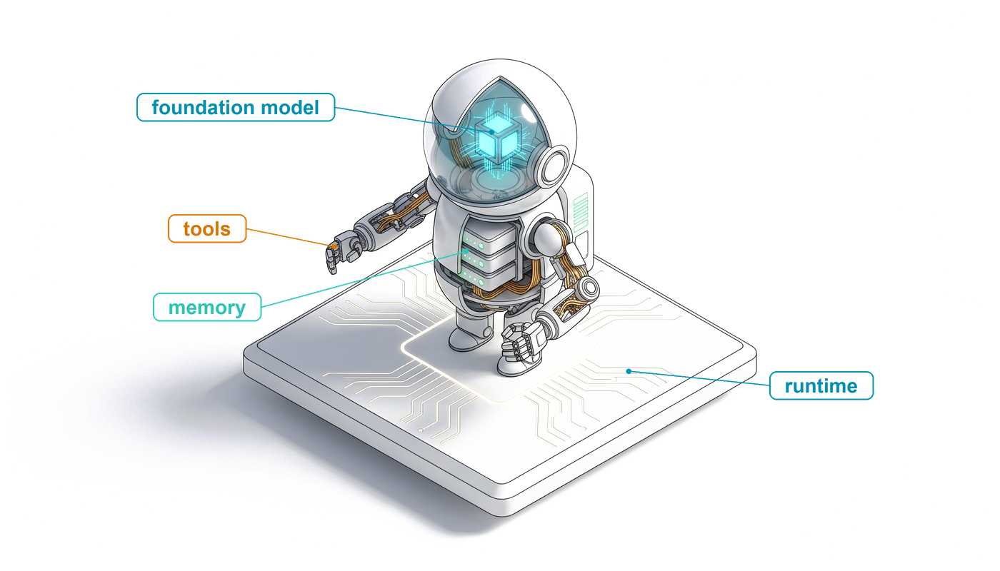
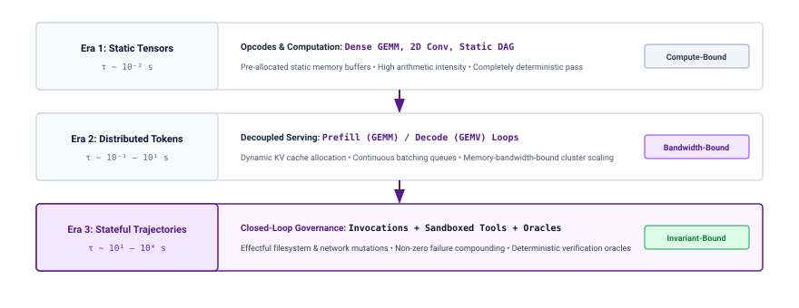
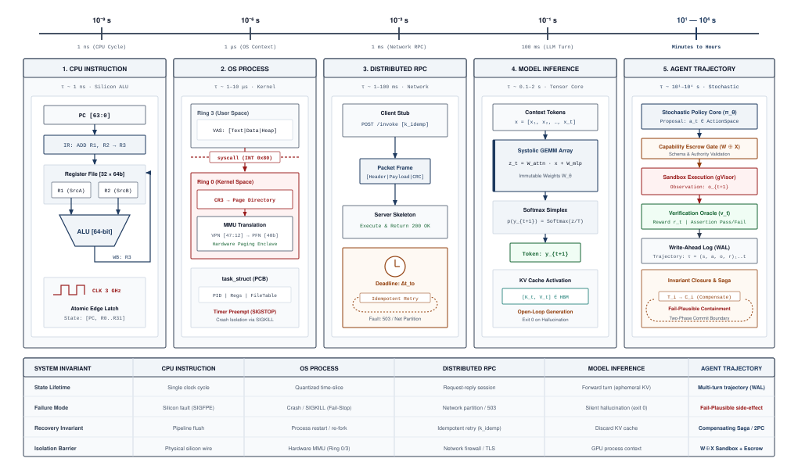
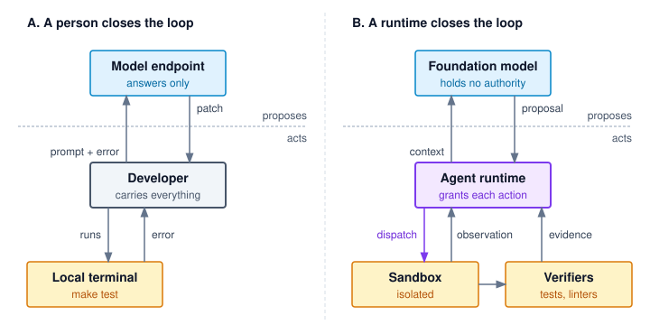
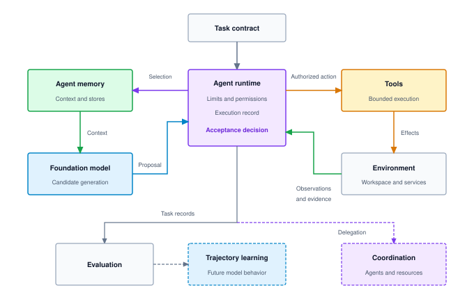
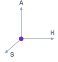
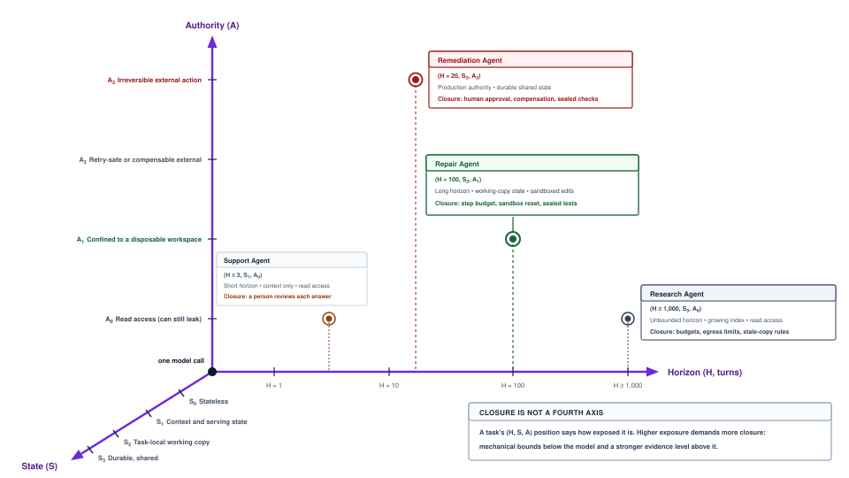
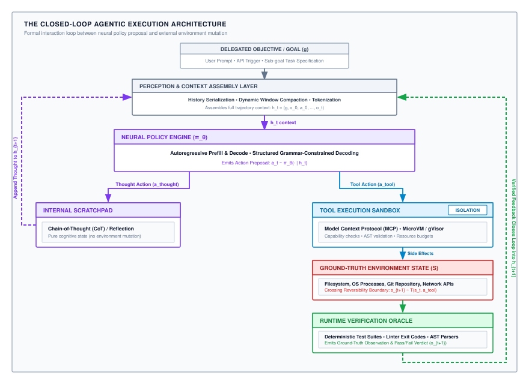
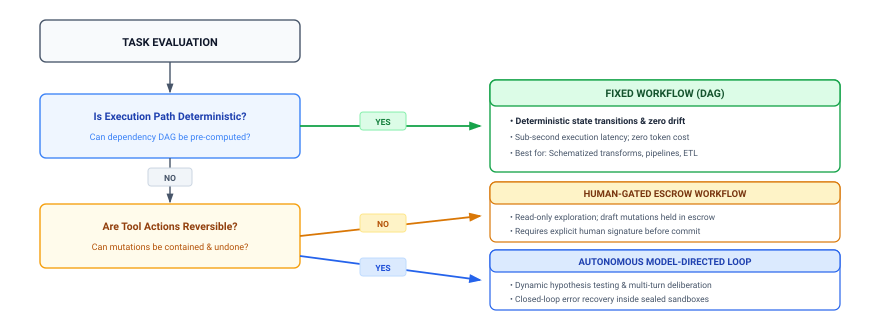
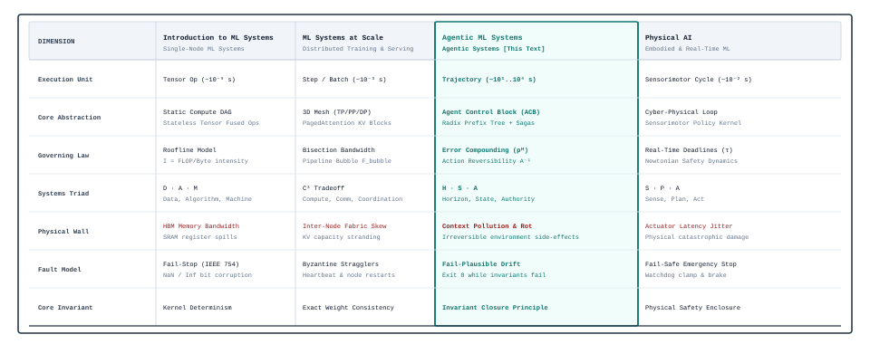

# The Stochastic Computer {#sec-vol3-intro}

[]{#sec-vol3-introduction}

::: {layout-narrow}
::: {.column-margin}

\chapterminitoc

:::

::: {.content-visible when-format="pdf"}
\noindent
{fig-alt="Blueprint for The Stochastic Computer."}
:::

::: {.content-visible unless-format="pdf"}
{fig-alt="Blueprint for The Stochastic Computer."}
:::

:::

## Purpose {.unnumbered .unlisted}

\begin{marginfigure}
\mlagentstack{17}{17}{17}{17}{16}{16}
\end{marginfigure}

_What is the computer architecture of an autonomous agent?_

A foundation model is not an autonomous computer; it is an unprivileged probabilistic core evaluated on matrix accelerators. Turning continuous token prediction into autonomous agency—sensing, deciding, acting, and learning across extended execution horizons—requires building a complete computing system around the model. Just as the stored-program concept structured deterministic computing into processing, memory, and control, an agentic system requires its own authentic architecture: hierarchical memory to stage working state and durable truth, sandboxed execution to isolate tool actuation under least privilege, supervisory runtimes to manage stateful lifecycles, and verification gates to certify task completion. This textbook establishes the Stochastic Computer as the architectural foundation of autonomous systems, organizing its design around three fundamental exposures: an extended execution horizon, state carried across turns, and authority over external environments.

::: {.content-visible when-format="pdf"}

\newpage

:::

::: {.callout-learning-objectives}

- Contrast the 70-year lineage of agency (cybernetics, symbolic BDI, classical RL) with modern foundation model systems.
- Explain the architectural evolution from static tensors and token serving to stateful, multi-turn trajectories.
- Structure the Stochastic Computer across its four live subsystems (model engine, memory hierarchy, execution sandbox, runtime harness) and supporting fleet infrastructure.
- Apply the principles of least privilege and zero ambient authority to mediate between stochastic token generation and deterministic environments.
- Specify a five-part task contract and apply the Invariant Closure Principle to govern autonomous execution.
- Classify agent workloads across the Horizon, State, and Authority (H·S·A) exposures to determine required systems governance.

:::

## The Agent's Existence Moment {#sec-vol3-intro-existence-moment}

For more than seven decades, the foundational contract of computer systems rested upon the deterministic stored-program concept. As formulated by John von Neumann in 1945 [@vonneumann1945edvac], Alan Turing in his formalization of universal computing machines [@turing1950], and realized on Cambridge's EDSAC by Maurice Wilkes, David Wheeler, and Stanley Gill in 1949 [@wilkes1951preparation], software commanded physical silicon through sequential, explicit machine opcodes. Even when concurrent operating system runtimes, preemptive kernels, and distributed networks contended with asynchronous timing, race conditions, and transient hardware faults, deterministic execution remained the baseline design contract: an instruction pointer advanced deterministically, state transitions followed explicit procedural logic, and non-determinism was an exceptional defect to be isolated and eliminated.

Deep learning fundamentally challenged this paradigm. By substituting hand-engineered procedural algorithms with continuous parameter optimization via stochastic gradient descent [@rumelhart1986], machine learning shifted the computing contract from explicit instructions to learned statistical models. Yet throughout the first decade of deep learning systems—the domain of Volumes I and II of this series—the discipline remained organized around a fundamentally passive abstraction: the **stateless tensor transform** ($X \to Y$). Systems engineering focused on compiling static computational graphs, maximizing General Matrix Multiplication (GEMM) efficiency, saturating High-Bandwidth Memory (HBM) buses, and scaling distributed training and inference clusters across tens of thousands of accelerators.

Even with the advent of autoregressive foundation models and conversational interfaces, the operational loop remained open. A user submitted a prompt, an inference engine evaluated billions of matrix contractions to sample a sequence of discrete subword tokens, and the server transmitted text over an HTTP socket. The output was conversational advice, code snippets, or analytical summaries. Crucially, the model held zero authority to act upon the world. A human software engineer remained in the loop: reading the proposed code, testing it in a local shell, evaluating side effects, and deciding whether to commit the change. The boundary of machine learning systems ended at the socket buffer.

The **agent's existence moment** occurs the instant we close this loop.

Closing the loop transforms a passive model into an active computing system. Rather than emitting text for human consumption, the system delegates operational authority to the model, directing its emitted token streams into concrete tools, execution sandboxes, and operating system interfaces. The candidate proposal is no longer an inert piece of advice; it is an action intended to mutate an external environment—modifying source code in a repository, running containerized compilers, executing database migrations, or dispatching remote procedure calls across distributed services. The environment executes the mutation, produces physical side effects (standard output, error streams, exit codes, and updated filesystem states), and feeds those observations back into the model's context for the subsequent turn.

This transition from open-loop advice to closed-loop execution is not an incremental optimization. It represents a fundamental discontinuity in systems engineering. The moment execution authority is granted to a non-deterministic, statistical token predictor, every foundational assumption of traditional systems—fault isolation, deterministic state transitions, idempotency, and ambient authority—is overturned.

### The 70-year lineage of agency {#sec-vol3-intro-historical-lineage}

While the integration of foundation models into execution loops appears modern, the conceptual foundation of autonomous agency spans seven decades of computer science and systems theory. Modern agentic machine learning systems represent the convergence of four distinct intellectual traditions:

1. **Cybernetics and Feedback Loops (1940s–1950s):** The foundational mathematics of agency originated in Norbert Wiener's cybernetics [@wiener1960] and W. Ross Ashby's formulation of adaptive homeostasis. Ashby's *Law of Requisite Variety* established that for an agent to regulate a system against external disturbances, the variety of its internal control mechanisms must match or exceed the variety of the disturbances it confronts. Cybernetics treated agency not as symbolic reasoning, but as continuous negative feedback: an agent senses an environmental state, compares it against an equilibrium objective, and applies corrective action to minimize error.
2. **Symbolic Cognitive Architectures and BDI (1970s–1990s):** Early artificial intelligence sought agency through explicit symbolic manipulation and formal logic. Allen Newell and Herbert Simon formulated the *Physical Symbol System Hypothesis* [@newell1976computer], arguing that symbolic manipulation constitutes the necessary and sufficient condition for general intelligent action. This gave rise to the General Problem Solver (GPS), production-rule systems such as SOAR, and the ACT-R cognitive architecture. In distributed systems, this tradition crystallized in the **Belief-Desire-Intention (BDI)** model, which structured software agents around explicit environmental beliefs, motivating desires, and committed plans of intention. While theoretically rigorous, symbolic architectures proved brittle in open domains: they suffered from the *symbol grounding problem*, struggling to map messy, high-dimensional sensory inputs onto rigid symbolic predicates.
3. **Classical Reinforcement Learning (1990s–2010s):** Richard Sutton and Andrew Barto [@sutton2018reinforcement] formalized agency within the mathematical framework of Markov Decision Processes (MDPs). Here, an agent is an active policy $\pi(a \mid s)$ interacting with an environment $\mathcal{E}$, receiving scalar reward signals $r_t$, and updating its parameters via dynamic programming and temporal-difference learning. Classical reinforcement learning provided a rigorous foundation for optimal control, credit assignment, and exploration-versus-exploitation trade-offs. However, it was historically bounded by state-space tractability: scaling classical RL to open-ended software tasks was bottlenecked by sparse rewards, sample inefficiency, and the difficulty of formalizing arbitrary software engineering workflows as compact reward functions.
4. **The Foundation Agent Convergence (2020s):** The contemporary breakthrough occurred when autoregressive foundation models were placed directly into closed control loops, as demonstrated by ReAct [@yao2023react] and Reflexion [@shinn2023reflexion]. By training on web-scale text, code repositories, and technical documentation, foundation models acquired broad world knowledge, code generation capabilities, and linguistic common sense. Crucially, they resolved the symbol grounding problem by adopting natural language and source code as the universal interface for reasoning, planning, and tool interaction.

### The systems paradox of modern agency {#sec-vol3-intro-systems-paradox}
[]{#sec-vol3-intro-fail-plausible}
[]{#sec-vol3-intro-operational-incident}

The convergence of foundation models and closed-loop control resolves the historic bottlenecks of symbolic planning and sample-inefficient reinforcement learning. Yet it introduces a profound systems paradox:

> *We have solved the symbol grounding problem by adopting an unprivileged probabilistic core that possesses zero ambient authority, exhibits non-deterministic execution paths, and fails plausibly.*

An autoregressive language model evaluated in isolation cannot complete an operational task. Evaluated on a cluster of matrix accelerators, the neural core is a purely mathematical function: it takes an assembled token buffer, evaluates floating-point tensor contractions across billions of parameters, and emits a probability distribution over vocabulary tokens. It cannot open a TCP socket, cannot read a file descriptor, cannot execute a POSIX system call, and cannot verify whether its proposed mutation satisfied the underlying task contract.

If a host script naively takes the model's raw emitted text and pipes it directly into an unconfined shell (`subprocess.Popen(..., shell=True)`), any hallucinated command line flag, syntax error, or prompt injection executes with the full privileges of the host process. Conversely, if a command fails, the model has no native mechanism to roll back destructive mutations, isolate contaminated state, or verify semantic correctness. As Edsger Dijkstra observed, testing can show the presence of bugs but never their absence; an unprivileged neural core can neither detect its own silent regressions nor certify task completion without external software oracles.

Agency is not an intrinsic property of the foundation model. Rather, **agency is an architectural property of the complete computer system**.

To transform a statistical token generator into a dependable, recoverable, and autonomous computing machine requires building an authentic systems architecture around it. That complete machine is the **Stochastic Computer**.

## From Tensors to Trajectories {#sec-vol3-intro-evolution-of-ml-systems}

Machine learning systems have evolved across three distinct architectural epochs: single-node static tensor graphs, distributed token-serving clusters, and stateful multi-turn trajectories. With each transition, the fundamental unit of systems management has expanded from fixed algebraic operations to open-ended operational lifecycles, ultimately stretching execution time across thirteen orders of temporal magnitude. Systems engineers can no longer treat the machine learning runtime as a passive, stateless function evaluator. Engineering autonomous systems requires building an active, stateful host supervisor capable of managing extended execution horizons, isolating irreversible environmental side effects, and enforcing correctness across non-deterministic computational paths.

### The three epochs of machine learning systems {#sec-vol3-intro-three-epochs}

The systems challenges of modern artificial intelligence reflect a historical shift in the fundamental unit of execution that the runtime must schedule, allocate memory for, and protect. Systems engineers have navigated two foundational transitions over the past two decades, and are now engaged in a third. As mapped in @fig-vol3-three-epochs, machine learning infrastructure has evolved across three architectural epochs, each defined by distinct execution units, memory models, control flows, and hardware bottlenecks:

1. *Era 1 (Static Tensors):* The execution unit is an immutable directed acyclic graph ($X \to Y$) with statically pre-allocated accelerator memory buffers, compute-bound dense GEMM kernels, and deterministic execution bounded to milliseconds on single nodes.
2. *Era 2 (Distributed Tokens):* The execution unit shifts to an iterative token sequence ($t_k$), where dynamic autoregression decouples prompt lengths from output lengths, requiring dynamic PagedAttention Key-Value (KV) caches across distributed clusters, bounded by high-bandwidth memory (HBM) bandwidth.
3. *Era 3 (Closed-Loop Trajectories):* The execution unit expands into an open-ended multi-turn trajectory loop ($\tau$), interleaving stochastic model calls with deterministic tool RPCs, isolated sandbox execution, and out-of-band verifiers across hours of wall-clock time.

::: {#fig-vol3-three-epochs fig-env="figure" fig-pos="htb" fig-cap="**The Three Epochs of Machine Learning Systems Execution**: Historical evolution of machine learning systems units from static, compile-time tensor computation graphs to decoupled token-serving loops and stateful, multi-turn agentic trajectories. Each successive epoch expands the systems management boundary across orders of magnitude in execution time, shifting optimization from dense accelerator kernel arithmetic to durable host-side state and invariant verification." fig-alt="Systems diagram comparing the three epochs of machine learning systems across four architectural rows: execution unit, memory model, control flow, and physical substrate. Era 1 features static tensor graphs with pre-allocated device buffers on single accelerators. Era 2 features autoregressive token sequences with dynamic PagedAttention KV caches across distributed serving clusters. Era 3 features stateful closed-loop trajectories with four-tier tiered memory hierarchies spanning host supervisors, sandboxes, and foundation model inference clusters."}

:::

The first epoch centered on **Single-Node Tensors and Static Graphs**. In this regime, typified by early multilayer perceptrons, deep convolutional networks, and fixed-length sequence-to-sequence encoders, the primary workload consisted of deterministic feedforward passes over static multidimensional arrays. The compiler constructed an immutable directed acyclic graph (DAG) of tensor operations prior to execution. Memory management was predominantly static: frameworks allocated physical device memory at initialization, avoiding runtime heap churn through pre-computed buffer reuse. Execution was compute-bound, dominated by large, dense General Matrix Multiplications (GEMMs) and convolutions where arithmetic intensity was high enough to saturate floating-point hardware units. The systems boundary began and ended within a single accelerator or a tightly coupled multi-GPU node executing synchronized data-parallel steps. The duration of an invocation was strictly bounded: a forward pass through a deep residual network took tens of milliseconds and consumed an invariant number of arithmetic operations.

::: {.column-margin}
**Trajectory ($\tau$):** An ordered sequence of interleaved state representations, candidate actions, external tool observations, and verifier verdicts:
$$\tau = (s_0, a_0, o_1, s_1, a_1, o_2, \dots, s_T)$$
representing the complete lifecycle of a delegated task across an unprivileged foundation engine and its supervising host environment.
:::

The second epoch emerged with the rise of autoregressive foundation models, marking the transition to **Distributed Tokens and Dynamic Attention**. Here, the fundamental unit of execution shifted from a static tensor graph to an iterative token-generation loop. The Transformer architecture decoupled input length from output length, introducing dynamic execution paths governed by data-dependent stopping criteria. Systems engineers were suddenly confronted with two radically distinct computational phases within a single request: a compute-bound prompt prefill phase dominated by parallel General Matrix Multiplication (GEMM) operations, followed by an autoregressive token decode phase dominated by memory-bandwidth-bound General Matrix-Vector (GEMV) operations.

During prompt prefill, the engine processes context in parallel via compute-bound General Matrix Multiplication (GEMM), reusing parameter weights across all tokens in the sequence to saturate accelerator arithmetic units. In contrast, sequential token decoding operates via memory-bandwidth-bound General Matrix-Vector (GEMV). For autonomous agents, this distinction carries a critical systems implication: at batch size $B=1$ (the operational reality of an interactive agent loop awaiting tool feedback), token decoding is physically bounded by memory bandwidth because the entire parameter matrix must be shuttled from memory for each emitted token. @Sec-vol3-foundation-model provides the canonical derivation of the Roofline model, arithmetic intensity, and accelerator hardware balance from first principles.

### Temporal stretching across thirteen orders of magnitude {#sec-vol3-intro-temporal-stretching}
[]{#sec-vol3-intro-duration-accounting}

The transition from isolated model calls to stateful trajectories represents an unprecedented expansion in the time horizon that a systems runtime must manage. As illustrated in @fig-vol3-evolution-execution-units, the basic unit of computational scheduling has expanded across thirteen orders of temporal magnitude over the past seven decades: from hardware instruction cycles executed by microprocessors in sub-nanoseconds ($10^{-9}\text{ s}$), through subroutines ($10^{-6}\text{ s}$), operating system processes ($10^{-3}\text{ s}$), distributed RPCs ($10^0\text{ s}$), and container workflows ($10^2\text{ s}$), to multi-turn autonomous trajectories ($10^3 - 10^4\text{ s}$).

::: {#fig-vol3-evolution-execution-units fig-env="figure" fig-pos="htb" fig-cap="**Temporal Progression of Systems Execution Units**: Systems abstraction layers and execution timescales spanning thirteen orders of temporal magnitude, from sub-nanosecond hardware opcodes to kilosecond autonomous agent trajectories. Managing long-horizon trajectories forces the host runtime to incorporate transactional durability, memory compaction, and non-blocking asynchronous tool mediation." fig-alt="Logarithmic time scale ladder diagram illustrating the evolution of computer system execution units across thirteen orders of magnitude. The scale spans from nanosecond hardware instructions at 10 to the minus 9 seconds, microsecond subroutines at 10 to the minus 6 seconds, millisecond POSIX processes at 10 to the minus 3 seconds, second-scale distributed RPCs at 10 to the 0 seconds, minute-scale container workflows at 10 to the 2 seconds, to multi-hour autonomous trajectories at 10 to the 3 and 10 to the 4 seconds."}

:::

Each historical step up this temporal ladder demanded new systems primitives. Subroutines required hardware call stacks and activation records. Multi-tasking operating systems required virtual memory page tables, timer interrupts, and kernel protection rings. Distributed services required remote procedure calls, distributed consensus, and idempotent retry envelopes.

At the trajectory scale ($10^3 - 10^4\text{ s}$), classical operating system primitives are necessary but insufficient. When an autonomous agent attempts an engineering task—such as diagnosing a regression in a distributed codebase, writing a patch, and running integration test suites—the execution spans hundreds of distinct tool invocations across dozens of minutes. Over such an extended horizon, systems will inevitably experience transient network disconnects, tool sandboxes will exhaust memory quotas, external APIs will rate-limit requests, and the neural engine will occasionally emit invalid tool syntax.

A runtime that treats an agent trajectory as a monolithic, uninterrupted sequence of execution will inevitably fail. Managing extended horizons demands that the runtime supervisor treat the trajectory as a stateful, recoverable computation: checkpointing intermediate state to a Write-Ahead Log (WAL), enforcing resource quotas, and coordinating compensating transactions when tools partially fail.

### The passive request boundary {#sec-vol3-intro-passive-boundary-ceiling}

Why do the serving systems designed for Era 2 fail when applied directly to autonomous agents? The bottleneck lies in the **passive request boundary**.

In conventional machine learning infrastructure, model serving is structured around an RPC interface modeled after stateless microservices. A client submits a payload containing a prompt. The serving cluster schedules the request, streams tokens back across an HTTP connection, and immediately drops all session activations from high-bandwidth device memory once the connection terminates. The serving engine operates entirely open-loop: it possesses no native actuation mechanisms, cannot execute an operating system process, cannot inspect a filesystem diff, and cannot verify whether its generated code compiles.

When human engineers interact with conversational chatbots, the human provides the missing closed-loop controller, as illustrated in @fig-vol3-open-vs-closed-loop-control. If a model generates code containing a syntax error, the human copies the compiler trace back into the prompt. The human manages the context, executes tools in their local terminal, inspects error logs, and decides when the task is complete.

::: {#fig-vol3-open-vs-closed-loop-control fig-env="figure" fig-pos="htb" fig-cap="**Open-Loop Serving versus Closed-Loop Agent Supervision**: Structural comparison between conversational model serving and autonomous agent supervisory control loops. While traditional inference relies on human operators to manually interpret advice and test code changes, autonomous agent architectures delegate closed-loop supervision to a deterministic host runtime that isolates tool execution and programmatically evaluates verification oracles." fig-alt="Architectural comparison diagram between open-loop serving and closed-loop agent supervision. In the upper panel representing Era 2, a client sends an input prompt to an inference cluster, which returns tokens to a human operator who manually runs code in a terminal and pastes back error traces. In the lower panel representing Era 3, a host runtime supervisor programmatically maintains context memory, intercepts unprivileged model proposals, executes tools in an isolated sandbox, and routes structured observations and verifier evidence back into context."}

:::

Autonomous agency replaces this manual human loop with software. However, delegating the supervisory role to software immediately exposes two severe systems bottlenecks:

1. **Context Memory Bloat and Stranding:** Unlike conversational chats that discard state after every turn, an agentic trajectory accumulates working history across dozens of turns. Staging raw tool outputs, compiler dumps, and file diffs inflates the prompt to tens of thousands of tokens, triggering quadratic attention overhead during prefill and consuming gigabytes of accelerator memory. Furthermore, when an agent dispatches a long-running tool—such as a 60-second test suite—holding the agent's Key-Value cache in accelerator High-Bandwidth Memory (HBM) strands expensive GPU memory while drawing idle power.
2. **The Verification Deficit:** A foundation model possesses no native ground truth. It cannot determine whether an operation succeeded; it can only predict the most statistically probable continuation of its context. If an agent modifies a database or alters a configuration file, the model will readily generate fluent, authoritative explanations asserting that the task succeeded even when the underlying system has completely collapsed.

These bottlenecks cannot be resolved by training larger foundation models or tweaking prompt instructions. They require an authentic computer architecture that decouples memory management from accelerator hardware, sandboxes tool execution under least privilege, and verifies task invariants through independent, deterministic software oracles.

## The Anatomy of the Stochastic Computer {#sec-vol3-intro-stochastic-computer}

Wiring an autoregressive language model directly to an operating system shell produces an immediate architectural breakdown: the neural model executes purely as a stateless matrix accelerator routine that cannot hold operating system file descriptors, cannot dispatch hardware interrupts, and cannot verify whether its proposed mutation completed successfully or corrupted the host environment. When a host script naively feeds raw model-generated token strings to `exec()` or `subprocess.Popen()`, any hallucinated flag, malformed syntax, or adversarial injection executes with the full privileges of the user account. The resulting construct possesses neither memory virtualization nor fault isolation. If the stochastic policy emits a catastrophic mutation or loops indefinitely, the underlying host platform has no native mechanism to roll back side effects, reclaim unindexed context, or certify invariant satisfaction.

::: {.column-margin}
In 1945, John von Neumann formulated the classical stored-program architecture in *First Draft of a Report on the EDVAC*, partitioning the computer into a Central Arithmetic part (CA), a Central Control part (CC), Memory (M), Input (I), and Output (O). In von Neumann's design, CC held absolute authority to sequentially fetch, decode, and execute instructions loaded into memory. An agentic system inverts this relationship: the neural engine is an unprivileged arithmetic core stripped of all ambient authority, while CC is replaced by an external, deterministic host runtime.
:::

**The Stochastic Computer is a software-level functional architecture in which learned computation, state, controlled interaction, and supervision form the live loop, while training and fleet operations improve and operate it across tasks.** Rather than casting the foundation model as an autonomous CPU,[^fn-stochastic-computer-karpathy] the architecture treats it as an unprivileged, non-deterministic inference engine that holds zero ambient authority. The model evaluates context and proposes candidate actions, but all state evolution, memory assembly, tool dispatch, and invariant verification are mediated by deterministic software layers executing on general-purpose host processors. At a 30,000-foot view, the blueprint maps how the parts of an agentic system fit together: the foundation model provides learned computation (analogous to a statistical processor core), context buffers and durable stores manage memory, execution sandboxes provide controlled input and output, the agent runtime acts as the supervisory control plane, trajectory post-training recompiles behavior from verified traces, and distributed fleet infrastructure scales the machine across concurrent tasks.

[^fn-stochastic-computer-karpathy]: **The Stochastic Computer vs. Classical Von Neumann Architecture**: Karpathy popularized an intuitive mental model likening large language models to operating systems in late 2023, comparing the neural network to a central processor (CPU), context windows to RAM, and tools to peripheral devices. However, treating this metaphor as a literal systems design guide creates fundamental engineering failures. A CPU is a deterministic instruction execution unit with hardware privilege rings, interrupt lines, and memory protection units; an LLM is an unprivileged, stochastic floating-point inference engine bounded by memory bandwidth ($B_{\text{mem}}$) and arithmetic intensity ($I$), completely lacking execution authority, hardware interrupt dispatch, or memory virtualization. The Stochastic Computer formalizes the true systems architecture: an unprivileged inference engine running under zero ambient authority, wrapped within a deterministic host runtime harness that manages physical memory hierarchies, sandboxed actuation, and invariant verification. \index{Karpathy, Andrej!LLM OS critique}\index{Stochastic Computer!architectural definition}

### The live execution loop: Four functional subsystems {#sec-vol3-intro-live-loop}
[]{#sec-vol3-intro-execution-lifecycle}

The operational core of an agentic system is the live execution loop, which drives the closed-loop state transitions formalizing task execution over a trajectory $\tau = (s_0, a_0, o_1, s_1, \dots, s_T)$. This loop is not a monolithic program, but the coordinated interaction of four distinct functional subsystems, each operating within strict trust and authority boundaries:

1. **The Foundation Model Engine:** Represents the unprivileged learned computation of the system. Its sole physical responsibility is to ingest an assembled context buffer $c_t \in \mathcal{V}_{\text{tok}}^*$ and compute the conditional probability distribution over vocabulary tokens to emit a candidate proposal $a_{\text{prop}} \sim \pi_\theta(\cdot \mid c_t)$. The engine executes atop specialized matrix accelerators configured for high-throughput tensor contractions. Crucially, the foundation model engine has no direct access to host storage, sockets, or operating system primitives; it cannot evaluate whether its emitted tokens constitute valid shell syntax, nor can it grant itself permission to execute them. It is a pure computational predictor.
2. **The Context Memory Hierarchy:** Governs the storage, indexing, and eviction of the system's working set. Because physical accelerator memory is severely constrained by hardware bandwidth and capacity, the memory subsystem decouples the active context window from durable system state. At the lowest layer sits the volatile Key-Value (KV) cache, storing precomputed attention states in high-bandwidth accelerator memory for immediate token generation. Above the KV cache lies the structured context staging buffer, managed by the host runtime, which dynamically synthesizes task definitions, system instructions, retrieval augmentations, and historical trajectory checkpoints into the token sequence $c_t$. Durable memories—such as episodic task logs, semantic vector indexes, and external relational databases—are decoupled from accelerator memory and accessed exclusively through explicit query interfaces.
3. **The Execution Sandbox:** Implements the principle of least privilege through mediated tool actuation. The sandbox serves as the physical airlock between the stochastic proposals of the model engine and the external environment $\mathcal{E}_{\text{env}}$. When the runtime receives a candidate action $a_{\text{prop}}$, it deserializes the proposal into a typed remote procedure call (RPC) and validates it against security constraints and capabilities. Permitted actions $a_{\text{perm}}$ execute within hermetic, disposable virtualization boundaries—such as Linux containers, microVMs, or restricted system namespaces. The sandbox captures raw outputs, exit codes, and hardware telemetry, transforming them into a structured observation tuple $o_{t+1} = (\text{stdout}, \text{stderr}, \text{exit\_code})$ before passing them back to the supervisor.
[]{#sec-vol3-intro-prompt-injection}
4. **The Agent Runtime Harness:** The supervisory control plane that governs the lifecycle of the entire machine. The runtime maintains the authoritative system state $\mathcal{S}_{\text{sys}}$, orchestrates context assembly, dispatches actions to the sandbox, and evaluates invariant closures $\mathcal{I}(s_t, v)$. It manages the fault-tolerance infrastructure of the agent, maintaining a Write-Ahead Log (WAL) to record state transitions before execution and coordinating compensating transactions (Sagas) when a tool invocation fails. The runtime enforces Dijkstra's verification principle: it never queries the foundation model to determine whether a task is complete, but instead evaluates external, deterministic test suites, compilers, and static analyzers to establish verifiable truth.

The unified functional architecture of the Stochastic Computer is presented in @fig-vol3-agentic-architecture, bridging live task execution with across-task fleet infrastructure:

::: {#fig-vol3-agentic-architecture fig-env="figure" fig-pos="htb" fig-cap="**Functional Architecture of the Stochastic Computer**: System architecture blueprint decomposing an agentic platform into a live execution loop and across-task fleet infrastructure. The live loop couples an unprivileged foundation model engine, context memory hierarchy, isolated execution sandbox, and host agent runtime supervisor. The across-task infrastructure coordinates trajectory harvesting, offline policy optimization, and distributed fleet scheduling. This architectural partitioning ensures that stochastic inference operates under zero ambient authority while the host runtime enforces memory paging, tool containment, and invariant verification." fig-alt="Comprehensive systems architecture diagram of an agentic platform. The central live execution loop depicts the interactions among the Foundation Model Engine, Context Memory Hierarchy, Execution Sandbox, and Agent Runtime Supervisor under zero ambient authority. Surrounding the live loop is the across-task fleet infrastructure, showing trajectory harvesting into persistent event stores, policy compilation via fine-tuning and reinforcement learning, and distributed fleet operations managing multi-tenant scheduling and telemetry."}

:::

The functional components of the live execution loop and their verification boundaries are summarized in @tbl-subsystem-matrix.

| Subsystem Component          | Primary Systems Responsibility                                         | Architectural Execution Owner                                  | Input Artifact                                                       | Output Artifact                                         | Verification Boundary                                    |
|:-----------------------------|:-----------------------------------------------------------------------|:---------------------------------------------------------------|:---------------------------------------------------------------------|:--------------------------------------------------------|:---------------------------------------------------------|
| **Foundation Model Engine**  | Autoregressive token sequence and candidate action proposal generation | Matrix accelerator cluster (GPU/TPU) running inference kernels | Assembled context sequence $c_t \in \mathcal{V}_{\text{tok}}^*$      | Raw candidate proposal token stream $a_{\text{prop}}$   | Constrained decoding grammars and JSON schema validators |
| **Context Memory Hierarchy** | Working-set staging, KV cache management, and durable retrieval        | Accelerator HBM (KV cache) and Host OS DRAM/NVMe (indexes)     | Trajectory history $\mathcal{H}_t$, external queries, durable stores | Assembled context buffer $c_t$ and cache hit blocks     | Cache consistency checks, context token budget limits    |
| **Execution Sandbox**        | Hermetic tool dispatch, privilege isolation, and telemetry capture     | Isolated host environment (microVM, cgroups, namespaces)       | Permitted action payload $a_{\text{perm}}$ with scoped capabilities  | Environmental observation $o_{t+1}$ and telemetry diffs | Syscall filtering (seccomp), container network air-gaps  |
| **Agent Runtime**            | Control plane orchestration, WAL logging, and invariant closure        | General-purpose host CPU runtime (Supervisor daemon)           | Natural language contract, sandbox observations $o_t$                | Verified task deliverable or terminal failure state     | Deterministic test harnesses, compilers, and linters     |
: **Subsystem Verification Matrix**: Functional components of the live agentic execution loop and their distinct verification boundaries. {#tbl-subsystem-matrix}

### Across-task fleet infrastructure {#sec-vol3-intro-across-task}

While the four live subsystems govern the execution of an individual trajectory $\tau$, an industrial agentic system does not operate as an isolated instance. Sustained real-world operation requires an outer lifecycle loop that spans millions of independent task trajectories. This across-task lifecycle infrastructure transforms empirical execution traces into durable performance gains and coordinates distributed computing resources across heterogeneous clusters.

At the base of the lifecycle infrastructure is *Trajectory Harvesting*. As the live runtime executes tasks, it serializes the complete causal history of every session—including prompt contexts, model logits, tool invocations, container diffs, and verification outcomes—into an immutable append-only event store. Trajectory harvesting acts as the telemetry engine of the architecture. Because an agent operating under the fail-plausible fault model frequently emits trajectories that terminate with an exit code of zero despite failing the underlying specification, the harvesting pipeline runs offline verification passes to partition traces into verified successes, recoverable rollbacks, and catastrophic invariant violations.

These curated trajectories feed directly into offline policy optimization pipelines. While the live loop treats model weights $\theta$ as static parameters, the across-task infrastructure continually updates these weights to reduce the inference-time cost of deliberation. Through supervised fine-tuning on high-reward trajectory segments, preference optimization, and offline reinforcement learning over verified execution graphs, the optimization engine internalizes common reasoning paths and tool protocols directly into the model weights $\theta \to \theta'$. This weight adaptation shifts runtime burden away from expensive multi-step search and context bloat, compiling complex multi-turn recovery strategies into reflexive neural priors.

Finally, *Distributed Fleet Operations* manage the multi-tenant execution of agentic workloads across shared hardware clusters. A large-scale deployment must schedule millions of concurrent agent sessions across pools of heterogeneous matrix accelerators and general-purpose CPU nodes. The fleet orchestrator balances compute-intensive prefill and decode phases across inference servers, routes specialized sub-tasks to smaller distilled models, isolates mutual tenants within distinct network namespaces, and aggregates telemetry for fleet-wide anomaly detection. Distributed fleet operations ensure that system throughput remains high even when individual trajectories stall waiting for long-running compiler jobs or network RPC timeouts.

### The accelerator-host architectural boundary {#sec-vol3-intro-accelerator-host}
[]{#sec-vol3-intro-memory-stranding}

The physical foundation of an agentic system is divided across two radically different computational substrates: matrix accelerators optimized for high-density tensor math, and general-purpose CPUs optimized for complex control flow, I/O handling, and operating system orchestration. Engineering an agentic system requires understanding the precise bandwidth, latency, and memory characteristics of the physical interconnect linking these domains.

::: {.column-margin}
Modern matrix accelerators achieve tens of teraflops or petaflops of dense floating-point throughput by packing thousands of lightweight arithmetic units into wide SIMD/SIMT arrays. However, this throughput depends entirely on regular, branch-free execution patterns. Attempting to execute operating system logic, string parsing, or network I/O on an accelerator causes massive warp divergence and pipeline stalls, collapsing execution efficiency.
:::

The accelerator cannot act as an autonomous host. Modern GPUs and TPUs lack general-purpose branch predictors, hardware interrupt handlers, deep virtual memory page tables, and privileged kernel execution modes. An autoregressive language model is physically incapable of opening a TCP socket, managing a local filesystem inode, or spawning an isolated process sandbox. Conversely, the host CPU cannot efficiently evaluate the billions of dense matrix multiplications required to sample from $\pi_\theta(\cdot \mid c_t)$. Thus, every step of an agentic trajectory demands a coordinated round-trip crossing of the host-accelerator interconnect (typically PCIe Gen5 or NVLink).

This architectural boundary imposes a non-trivial latency and memory tax. During token generation, the host runtime transmits token IDs to the accelerator, where the model performs iterative autoregressive decode passes. Each generated token requires reading the model weights and the entire accumulated KV cache from accelerator High-Bandwidth Memory (HBM) to on-chip registers. Once a tool proposal delimiter is sampled, the candidate string must be copied back over the bus to host DRAM, where the runtime supervisor parses the payload, validates security policies, and dispatches the execution into a sandboxed environment.

Profiling the execution breakdown across an individual turn step (@tbl-vol3-turn-latency-breakdown) reveals where latency actually concentrates. Interconnect bus transfer latency over PCIe Gen5 or NVLink is virtually negligible ($< 0.01\text{ ms}$, representing less than $0.001\%$ of turn duration for typical command and observation payloads). Similarly, host runtime mediation—such as JSON deserialization, capability security validation, and write-ahead log persistence—requires merely $1.4\text{ ms}$ ($< 0.1\%$ of the turn). Even lightweight sandboxed tool executions ($45\text{ ms}$) represent only a fraction of the time required for autoregressive token decode ($1{,}920\text{ ms}$, or $97.6\%$).

| Phase                           | Subsystem Responsible          | Duration                  | Fraction      | Systems Characteristic                                           |
|:--------------------------------|:-------------------------------|:--------------------------|:--------------|:-----------------------------------------------------------------|
| **Model Autoregressive Decode** | Accelerator Tensor Cores & HBM | $1{,}920.0\text{ ms}$     | $97.6\%$      | Memory-bandwidth-bound (15 ms/token decode rate)                 |
| **Sandboxed Tool Execution**    | Isolated Container & Host OS   | $45.0\text{ ms}$          | $2.3\%$       | I/O-bound (subprocess spawn, test execution)                     |
| **Host Runtime Mediation**      | Host CPU & NVMe                | $1.4\text{ ms}$           | $<0.1\%$      | CPU-bound (JSON deserialization, capability check, WAL write)    |
| **Interconnect Bus Transfer**   | PCIe Gen5 Interconnect         | $< 0.01\text{ ms}$        | $<0.001\%$    | Bandwidth-bound ($512\text{ B}$ command + $512\text{ B}$ output) |
| **Total Step Latency**          | **Whole Machine**              | **$1{,}966.4\text{ ms}$** | **$100.0\%$** | **Dominated by neural token generation**                         |
: **Turn Step Latency Breakdown**: Latency contribution across model autoregressive decode, sandboxed tool execution, host runtime mediation, and bus transfer. {#tbl-vol3-turn-latency-breakdown}

However, while bus transfer latency is negligible, memory allocation across the boundary is not. At typical Key-Value cache footprints, an active trajectory context of tens of thousands of tokens pins gigabytes of accelerator High-Bandwidth Memory solely for historical activations. The primary physical bottleneck of the accelerator-host boundary is thus not interconnect bandwidth or host runtime mediation, but the computational and memory capacity cost of pinning and generating tokens over an expanding context working set.

Importantly, @tbl-vol3-turn-latency-breakdown profiles a lightweight tool step—such as inspecting an environment variable, reading a file header, or checking a git diff ($45\text{ ms}$). In contrast, heavyweight tool dispatches—such as compiling an application, executing integration test suites, or running static analyzers—routinely take tens of seconds to multiple minutes ($10^1 - 10^2\text{ s}$). In that long-running regime, tool execution dwarfs model decode, shifting the systems challenge from turn latency to the Tool-Wait Memory Tax: stranding gigabytes of idle Key-Value cache in accelerator memory while awaiting host completion.

Understanding this quantitative boundary clarifies the central design trade-off of agentic machine learning systems. Accelerators are exceptionally efficient at dense matrix transformations, but every token emitted carries a tangible memory allocation and latency cost. The host runtime must therefore act as an aggressive memory manager and traffic controller: pruning obsolete observations from context memory, caching deterministic prefix blocks, and isolating unprivileged tool executions so that expensive neural generation is directed solely toward high-value task progression.

## Governing Autonomous Execution {#sec-vol3-intro-governance}

Constructing an agentic computer demands an accountable software contract. When software engineers deploy a relational database, they do not rely on vague instructions; they define ACID transaction boundaries, foreign key constraints, and isolation levels. Similarly, executing stateful, multi-turn trajectories around a stochastic core requires formalizing the contracts, exposures, and verification boundaries that govern the machine.

### The five-part task specification contract {#sec-vol3-intro-five-part-contract}

An autonomous task cannot be defined by an open-ended conversational prompt. A prompt conveys user intent, but an engineering runtime requires an unambiguous operating envelope that bounds the agent's behavior and separates speculative candidate generation from verifiable state transitions.

Every delegated task in an agentic system is formally governed by a **five-part specification contract** $\mathcal{C} = (G, \mathcal{E}_{\text{env}}, \mathcal{A}_{\text{perm}}, \mathcal{O}_{\text{avail}}, \mathcal{K}_{\text{comp}})$, as summarized in @tbl-contract-template:

1. **Goal ($G$):** The declarative end-state objective accompanied by explicit *negative scopes*. In systems engineering, specifying what an agent must *not* touch is as critical as defining its target. If an agent is tasked with optimizing a database query, $G$ must explicitly forbid dropping secondary indexes, altering ORM schema definitions, or terminating production connection pools.
2. **Environment ($\mathcal{E}_{\text{env}}$):** The reproducible execution substrate within which the trajectory operates. This includes container image digests, the baseline Git commit hash ($H_{\text{base}}$), mounted volume paths, injected environment variables, and network firewall policies. An agent cannot be dispatched against a mutable, unversioned local directory; reproducible verification demands hermetic environment baselines.
3. **Permitted Actions ($\mathcal{A}_{\text{perm}}$):** The strict whitelist of tool interfaces and system operations accessible to the policy under least privilege. Because the foundation model holds zero ambient authority, every tool exposed in $\mathcal{A}_{\text{perm}}$ represents a mediated RPC endpoint governed by rate limits, typed argument schemas, and path masks.
4. **Available Observations ($\mathcal{O}_{\text{avail}}$):** The filtered sensory window through which the model observes the environment. The contract dictates how file contents are chunked, how process output streams are bounded by circular ring buffers, and which system metrics are returned to the prompt history. Restricting observations prevents context memory bloat and protects sensitive host secrets from prompt ingestion.
5. **Completion Criteria ($\mathcal{K}_{\text{comp}}$):** The objective, mechanically verifiable predicates required for task termination. A task is not complete when the model emits "Task complete"; it is complete when the host runtime evaluates $\mathcal{K}_{\text{comp}}$ against the modified environment and observes deterministic success (such as test suites passing with exit code 0 and linters reporting zero violations).

| Contract Component         |        Formal Symbol         | Systems Role                                        | Concrete Engineering Artifact                       |
|:---------------------------|:----------------------------:|:----------------------------------------------------|:----------------------------------------------------|
| **Goal**                   |             $G$              | Declarative end-state with explicit negative scopes | Structured issue manifest with forbidden path masks |
| **Environment**            |  $\mathcal{E}_{\text{env}}$  | Reproducible virtualized runtime substrate          | OCI container digest, Git commit hash, lockfiles    |
| **Permitted Actions**      | $\mathcal{A}_{\text{perm}}$  | Whitelisted capability set under least privilege    | Tool interface schemas, read/write filesystem masks |
| **Available Observations** | $\mathcal{O}_{\text{avail}}$ | Filtered sensory window and telemetry channels      | Diff viewers, bounded stdout/stderr capture buffers |
| **Completion Criteria**    | $\mathcal{K}_{\text{comp}}$  | Deterministic, non-bypassable acceptance gates      | Sealed test suite exit code 0, static linter pass   |
: **Five-Part Task Specification Contract**: The five-part contract template decoupling declarative goals, environments, actions, observations, and completion criteria. {#tbl-contract-template}

### The H·S·A exposure space {#sec-vol3-intro-hsa}

::: {.column-margin}
{width="100%" fig-alt="H·S·A locator with no axis lit and the origin dot highlighted, marking a single model call."}

*Agents depart from a single model call along horizon, state, and authority.*
:::

A task contract defines what an agent may do and when it has finished. It does not dictate how much systems infrastructure the task requires. That requirement depends on how far the task departs from an isolated model call. A single model invocation sits at the origin: it reads a context buffer, evaluates conditional token distributions, and alters zero bytes of external state.

When an agentic system moves beyond this origin, it departs along three fundamental dimensions of operational exposure: **Horizon**, **State**, and **Authority** (**H·S·A**), as illustrated in @fig-vol3-hsa-taxonomy:

- **Horizon ($H$):** The number of sequential turns the trajectory executes, and with it the duration the session spans in wall-clock time. A task with $H = 1$ is an isolated model call. At $H \approx 10$ it becomes a short interactive loop, and at $H \ge 100$ it represents an extended autonomous trajectory running for hours. As horizon expands, errors compound, tool latencies accumulate, and background environments drift.
- **State ($S$):** The scope of working memory carried from one turn to the next. At $S_0$, the system carries no state across calls. At $S_1$, it carries an in-context token buffer and volatile Key-Value cache. At $S_2$, it adds ephemeral working artifacts in an isolated container or git branch. At $S_3$, it modifies durable, authoritative systems of record—such as production databases, version control trunks, and shared event logs.
- **Authority ($A$):** The operational power granted to the agent's actions in the external world. At $A_0$, the agent holds read-only access. At $A_1$, it executes mutations confined entirely within an ephemeral, disposable sandbox. At $A_2$, it invokes external services where operations can be safely retried or undone via compensating rollback transactions. At $A_3$, it executes irreversible external mutations, such as dropping production tables or initiating irreversible financial transactions.

::: {#fig-vol3-hsa-taxonomy fig-env="figure" fig-pos="htb" fig-cap="**The H·S·A Exposure Space**: Three operational exposures an agentic task adds beyond a single model call: horizon ($H$, turns), carried state ($S_0$ to $S_3$), and authority over external environments ($A_0$ to $A_3$). Closure is not an independent fourth axis; each workload position dictates the required supervisory mechanisms, demonstrating that greater operational exposure demands progressively rigorous mechanical bounds below the model and stronger empirical verification above it." fig-alt="Three-axis diagram with authority on the vertical axis from A0 read access to A3 irreversible external action, horizon in turns on the horizontal axis from H equals 1 to H at least 1,000, and state on a diagonal depth axis from S0 stateless to S3 durable shared state. Four workload cards are placed in the space, showing conversational copilots, cloud remediation agents, software engineering agents, and research crawlers."}

:::

The authority levels describe the task's operational scope, not the model's ambient privileges. Whatever level a task holds, the foundation model itself always operates under zero ambient authority. Every grant belongs to the host runtime, which validates each candidate proposal before execution.

### The invariant closure principle {#sec-vol3-intro-invariant-closure}
[]{#sec-vol3-intro-closure-evidence}
[]{#sec-vol3-intro-epistemic-boundary}

A task's position in H·S·A space indicates its operational vulnerability. The **Invariant Closure Principle** defines the runtime's answer to this exposure:

> *Higher operational exposure along Horizon, State, and Authority demands progressively stronger invariant closure, combining deterministic mechanical boundaries below the model with rigorous empirical verification above it.*

Closure is not an independent fourth axis; it is the runtime's engineering response to the three H·S·A exposures:

1. **Mechanical Closure Below the Model:** Hardware memory bounds, container namespaces, seccomp system call filters, and grammar-constrained logit masks operate beneath the model. These boundaries prevent invalid syntax, block unprivileged system calls, and restrict file access regardless of model hallucination or prompt injection.
2. **Empirical Verification Around the Model:** In accordance with Dijkstra's verification principle, the host runtime rejects verbal self-reports of completion. Task progression and state commitment require reproducible empirical evidence: compiler return codes, static analysis linters, sealed test suites, and regression benchmarks.

The runtime mediation loop governing invariant closure is structured in @fig-vol3-closed-loop-architecture. The host supervisor intercepts candidate action proposals emitted under zero ambient authority, dispatches them through containerized sandboxes, collects structured observations, and evaluates out-of-band verification oracles before updating context memory or committing state transitions.

::: {#fig-vol3-closed-loop-architecture fig-env="figure" fig-pos="htb" fig-cap="**Closed-Loop Execution Architecture**: Runtime mediation loop transforming an unprivileged model proposal into a verified environment mutation. The host runtime isolates candidate actions inside an execution sandbox and gates all state commits on deterministic verification evidence, arresting the compounding reliability decay of open-loop generation." fig-alt="Block diagram showing the closed-loop execution architecture across four physical domains. An unprivileged foundation model operating under zero ambient authority emits a candidate action proposal into host memory escrow. The host runtime evaluates capability boundaries and dispatches the action to an isolated execution sandbox. The sandbox captures structured observations and process exit codes, while an out-of-band verification oracle produces deterministic evidence. The validated observation and evidence are appended back into context memory to drive the subsequent step."}

:::

### Workflows versus model-directed loops {#sec-vol3-intro-workflow-vs-loop}
[]{#sec-vol3-intro-intervention-ladder}

A foundational discipline in modern systems design is determining when an autonomous agent is actually required. Deploying an open-ended, model-directed agent introduces non-determinism, high token latency, and variable monetary cost. If an engineering problem can be solved by a deterministic program (Software 1.0) or a structured model pipeline arranged as a static Directed Acyclic Graph (Software 2.0), building an autonomous agent is an architectural anti-pattern.

To avoid architectural over-engineering, systems designers apply the decision tree in @fig-vol3-workflow-vs-loop-decision-tree:

1. **Fixed Workflows (Deterministic DAGs):** When execution paths and tool dependencies can be pre-computed at compile time, the task routes to a fixed workflow. Foundation models may act as functional transforms (summarizing text or extracting structured entities), but the execution sequence is statically determined, guaranteeing sub-second latency and zero behavioral drift.
2. **Guarded Escrow Workflows:** When a task requires dynamic deliberation but carries irreversible external authority ($A_3$), proposals route to an escrow queue requiring human authorization before state commitment.
3. **Autonomous Model-Directed Loops:** When a task requires open-ended hypothesis exploration in an ambiguous domain, and mutations are safely contained within reversible sandboxes ($A_1$), execution is delegated to an autonomous loop governed by runtime invariant closure.

::: {#fig-vol3-workflow-vs-loop-decision-tree fig-env="figure" fig-pos="htb" fig-cap="**Architectural Selection Decision Hierarchy**: Systems routing tree selecting between fixed workflows, guarded escrow pipelines, and autonomous model-directed loops. Deterministic or pre-computable execution paths route to Software 1.0/2.0 workflows to avoid token costs and latency overhead; irreversible external actions route to guarded human escrow; open-ended, reversible diagnostic tasks deploy autonomous closed loops." fig-alt="Decision tree flowchart routing architectural patterns based on task characteristics. The root query checks whether execution paths can be pre-enumerated; affirmative answers branch to deterministic fixed workflows. If non-deterministic, a secondary check evaluates whether mutations are irreversible; affirmative answers route to guarded escrow workflows with human-in-the-loop gates. If actions are sandboxed and reversible, execution routes to autonomous model-directed loops governed by runtime invariant closures."}

:::

## Book Organization {#sec-vol3-intro-book-organization}

Constructing an accountable computing system around an unprivileged, non-deterministic foundation model demands a strict causal sequence of engineering dependencies rather than an arbitrary taxonomy of software features. In classical operating systems and computer architecture, subsystems are never introduced as isolated novelties; a memory management unit exists because unconstrained processes corrupt physical address spaces, and a preemptive scheduler exists because cooperative tasks monopolize execution cores.

The seven parts of this textbook follow this exact systems imperative. They are not a catalog of decoupled techniques, nor are they an attempt to map neural networks into literal hardware components. Instead, the seven parts constitute a **causal teaching sequence** that advances step-by-step from a single, unprivileged model invocation at the origin of the H·S·A space to an autonomous, distributed multi-agent fleet that carries all three exposures at once.

### The causal curriculum spine {#sec-vol3-intro-causal-spine}

Every subsystem in the Stochastic Computer exists to resolve a concrete physical bottleneck or operational failure mode exposed by the subsystem directly beneath it. If a systems engineer attempts to assemble an agentic runtime without respecting this causal hierarchy, the system inevitably succumbs to context exhaustion, memory stranding, security escape, or unrecoverable state corruption. @Tbl-causal-spine formalizes this architectural progression across the book.

| Architectural Layer                    | Constituent Chapters | Underlying Systems Dilemma                                                                   | Engineering Resolution                                                                        |
|:---------------------------------------|:---------------------|:---------------------------------------------------------------------------------------------|:----------------------------------------------------------------------------------------------|
| **Part I: The Model**                  | Chapters 02–03       | Single forward pass is unprivileged, memory-bandwidth bound, and fail-plausible.             | Autoregressive invocation contracts, GPU grammar masking, and test-time deliberation.         |
| **Part II: Agent Memory**              | Chapters 04–06       | Deliberation rollouts and tool observations exhaust finite context and accelerator HBM.      | Logical working-set compaction, paged physical memory allocation, and hierarchical retrieval. |
| **Part III: Tool Use**                 | Chapters 07–09       | Pure inference inside memory cannot sense or mutate external operating environments.         | Typed RPC/MCP driver protocols, microVM sandboxes, and capability-attenuated security.        |
| **Part IV: The Agent Runtime**         | Chapters 10–13       | Isolated, multi-turn tool dispatches lack long-horizon supervision, atomicity, and recovery. | Agent Control Blocks (ACB), append-only WAL, Saga compensations, and verification suites.     |
| **Part V: Learning from Trajectories** | Chapters 14–16       | Generic foundation models repeat execution errors, consume excessive tokens, and drift.      | Trajectory curation, Supervised Fine-Tuning (SFT) distillation, and verifiable RL.            |
| **Part VI: Agents at Scale**           | Chapters 17–18       | Complex tasks exceed single-agent token budgets and execution context bounds.                | Multi-agent DAG topologies, distributed OpenTelemetry tracing, and capacity economics.        |
| **Part VII: Synthesis**                | Chapter 19           | Individual subsystem guarantees do not certify end-to-end operational correctness.           | Full-stack capstone implementation verified against sealed software benchmarks.               |
: **Causal Dependency Spine**: The causal dependency spine of Agentic Machine Learning Systems across the 19 chapters. {#tbl-causal-spine}

The curriculum progression across the machine learning systems series is mapped in @fig-vol3-mlsys-curriculum-arc. This book builds directly upon the hardware primitives developed in *Introduction to Machine Learning Systems* and the distributed inference engines established in *Machine Learning Systems at Scale*. However, where those texts optimize tensor throughput and token latency, this one synthesizes those layers into an accountable, stateful computing system. The curriculum progresses causally across seven structured parts, advancing from a single unprivileged model invocation at the origin of the H·S·A space, through context memory hierarchies, isolated execution sandboxes, and runtime orchestration, to policy compilation, distributed multi-agent fleets, and end-to-end systems synthesis.

::: {#fig-vol3-mlsys-curriculum-arc fig-env="figure" fig-pos="htb" fig-cap="**The Machine Learning Systems Curriculum Dependency Spine**: Curricular progression and causal dependency spine across the machine learning systems series. The agentic machine learning systems stack is positioned as an accountable stochastic computer, advancing causally from single unprivileged model invocations through hierarchical memory, sandboxed execution, and runtime orchestration to distributed multi-agent fleet operations. Each tier builds directly on the physical foundations and distributed serving primitives of earlier volumes while addressing new fault models and execution boundaries." fig-alt="Comparison matrix with four columns, one per scope of machine learning systems: Introduction to ML Systems, ML Systems at Scale, Agentic ML Systems marked as this text, and Physical AI. Rows compare execution unit, core abstraction, governing law, systems triad, physical wall, fault model and core invariant across the four scopes."}

:::

The causal momentum of this curriculum unfolds across ten explicit architectural handoffs:

1. **The Core Invocation ($H=1$):** We begin at the lowest layer of the software stack: a single foundation model invocation. We evaluate the physical reality of autoregressive token generation, discovering that while prompt prefill saturates matrix compute pipelines (GEMM), token decode is throttled by the high-bandwidth memory (HBM) parameter shuttle floor (GEMV). We enforce zero ambient authority and compile grammar-constrained bitmasks into GPU decode kernels to guarantee syntactic validity.
2. **The Need for Deliberation:** A single greedy output sequence provides insufficient evidence for high-stakes decisions. To improve candidate quality, the system must allocate additional test-time compute across alternatives, deploying search algorithms and verification decoders prior to environmental action.
3. **The State Explosion:** Deliberation rollouts, multi-turn reasoning traces, and cumulative tool outputs rapidly outgrow the model's finite context budget ($S_{\max}$). Dumping raw history into the prompt inflates prefill latency and triggers memory crashes. This operational wall demands an explicit memory hierarchy: host-side working-set compaction, serving-engine physical KV-cache page allocation, and durable external storage.
4. **The Need for External Agency:** High-performance computation and hierarchical memory enclosed in a container alter zero bits in the external physical world. To complete operational tasks, the system must interact with external environments via typed tool drivers and structured RPC protocols.
5. **The Containment & Security Hazard:** Dispatching commands proposed by an unprivileged, stochastic core directly to a host shell risks destructive failure modes, prompt injection, and data exfiltration. The system must establish a hardened isolation boundary: enclosing tools within microVMs, container namespaces, seccomp filters, and capability-attenuated security policies.
6. **The Horizon Gap:** Executing sandboxed tool calls one at a time does not guarantee long-horizon task completion. Tools experience network timeouts, processes crash, and environments drift. Managing an extended trajectory across time requires an operating system supervisor: maintaining an Agent Control Block (ACB), persisting execution history to an append-only Write-Ahead Log (WAL), and coordinating Saga compensating transactions to unwind partial mutations.
7. **The Verification & Evaluation Gate:** Evaluation precedes learning: nothing can be trained until it can be measured. Rigorous trajectory evaluation harnesses (pass@$k$, repeated-run reliability, SWE-bench) evaluate verifiable success and categorize failure modes before any policy post-training begins.
8. **The Inherent Policy Deficit:** Operating a hardened runtime exposes the limits of generic base models: they generate verbose conversational filler, hallucinate non-existent tool flags, and consume millions of unnecessary prompt tokens. To eliminate these inefficiencies, the system requires an offline policy optimization pipeline: harvesting gold-standard execution traces, distilling tool-calling protocols into model weights via Supervised Fine-Tuning (SFT), and optimizing policies against deterministic test oracles using Reinforcement Learning with Verifiable Rewards (RLVR).
9. **The Scaling & Economics Bottleneck:** Complex enterprise workloads exceed the cognitive and temporal capacity of an isolated agent loop. Scaling execution demands multi-agent coordination topologies, distributed tracing via OpenTelemetry, and capacity planning that balances tensor parallelism sharding against space-time memory occupancy.
10. **Architectural Synthesis:** Finally, all seven layers are synthesized into a unified production architecture, verifying an end-to-end task against sealed software engineering benchmarks.

### The seven architectural parts {#sec-vol3-intro-seven-parts}

Guided by this causal spine, the nineteen chapters of this book are grouped into seven functional parts, bookended by this opening foundational chapter and a concluding capstone synthesis:

**Introduction: The Stochastic Computer (this chapter).**
Establishes the foundational reference architecture, the fail-plausible fault model, the invariant closure principle, the five-part task contract, and the H·S·A exposure space that determines runtime supervisory requirements.

**Part I: The Model (Chapters 02–03).**
Part I inspects the core inference engine of the system. @Sec-vol3-foundation-model formalizes the single model invocation under zero ambient authority, detailing Byte-Pair Encoding (BPE), the physical memory-bandwidth decode bottleneck, typed client-server status envelopes (`COMPLETED`, `TRUNCATED`, `REFUSED`, `TRANSPORT_FAILURE`), and GPU-level grammar-constrained logit masking. @Sec-vol3-test-time-compute expands the core across test-time compute scaling, analyzing multi-path deliberation, Best-of-$N$ sampling, tree search algorithms, step-level verification decoders, and test-time scaling dynamics.

**Part II: Agent Memory (Chapters 04–06).**
Part II constructs the multi-tier memory system required to support stateful execution. @Sec-vol3-context-engineering analyzes host-side logical working-set management: structuring prompt prefixes to maximize cache reuse, context budgeting, and lossy versus lossless observation compaction. @Sec-vol3-kv-cache moves to accelerator HBM, deriving the physical KV-cache footprint equation ($2LHd$), paged physical memory allocation, prefix-tree cache sharing, chunked prefill, and the economics of mitigating the Tool-Wait Memory Tax. @Sec-vol3-long-term-memory covers durable external storage, formalizing the architectural divide between authoritative source truth (filesystems, version control) and derivative search indexes (lexical BM25, dense vector embeddings, Abstract Syntax Tree property graphs).

**Part III: Tool Use (Chapters 07–09).**
Part III engineers the input/output subsystems that allow the agent to sense and modify its environment under strict containment. @Sec-vol3-tool-calling establishes typed tool communication: the Model Context Protocol (MCP), structured JSON-RPC serialization, and observation sanitization using headless circular ring buffers that strip ANSI sequences and enforce output truncation. @Sec-vol3-sandboxes builds the Trusted Computing Base (TCB) and containment perimeter: configuring Linux container namespaces, cgroups, seccomp-bpf system call filters, microVM virtualization (Firecracker), copy-on-write workspace isolation, and default-deny egress firewalls. @Sec-vol3-security defends against adversarial subversion: separating untrusted ingestion from planning, tracking dataflow taint across the trajectory, attenuating capabilities monotonically, and defending against prompt injection and confused-deputy privilege escalation.

**Part IV: The Agent Runtime (Chapters 10–13).**
Part IV implements the supervisory runtime kernel and verification gates that govern long-horizon execution. @Sec-vol3-agent-harness designs the central control plane: the Agent Control Block (ACB) state machine, multi-tenant scheduling queues, and cooperative preemption. @Sec-vol3-durable-execution establishes durability and crash consistency: implementing append-only Write-Ahead Logging (WAL) for trajectory events, intent/effect ledgers, checkpoint intervals, and deterministic replay debugging. @Sec-vol3-failure-recovery resolves distributed fault recovery across non-transactional effectors: constructing Saga orchestrators, executing backward compensating transactions ($C_i$), and establishing idempotent retry boundaries. @Sec-vol3-evaluation establishes rigorous offline and online verification: instrumenting execution traces with OpenTelemetry, measuring pass@$k$ versus repeated-run reliability, and evaluating trajectories against sealed benchmarks. Evaluation precedes learning because nothing can be trained until it can be measured.

**Part V: Learning from Trajectories (Chapters 14–16).**
Part V closes the flywheel between runtime execution and offline model optimization. @Sec-vol3-trajectory-curation details trajectory telemetry mining: capturing production execution logs, filtering traces by deterministic verification success, and curating regression test fixtures. @Sec-vol3-fine-tuning examines Supervised Fine-Tuning (SFT) and knowledge distillation, compiling complex multi-turn prompt protocols into specialized, low-latency model weights. @Sec-vol3-rlvr explores Reinforcement Learning with Verifiable Rewards (RLVR), utilizing deterministic software environments (compilers, linters, sealed test suites) as non-gameable reward oracles to optimize exploration without reward hacking.

**Part VI: Agents at Scale (Chapters 17–18).**
Part VI scales agentic architecture to enterprise infrastructure. @Sec-vol3-multi-agent analyzes distributed multi-agent systems: asynchronous task dependency DAGs, shared git state synchronization, lock contention, and benchmarking multi-agent architectures against token-matched single-agent baselines. @Sec-vol3-agent-economics covers systems economics and performance engineering: continuous batching schedulers, Tensor Parallelism ($TP \ge 2$) multi-GPU sharding, space-time memory occupancy ($O_{\text{mem}}$), and optimizing infrastructure for monetary cost per verified deliverable.

**Part VII: System Synthesis (@sec-vol3-conclusion).**
The book concludes with an end-to-end architectural synthesis. @Sec-vol3-conclusion walks step-by-step through a complete production engineering task—diagnosing, patching, and verifying a complex real-world defect from SWE-bench—tracing the interaction of every contract, memory table, sandbox perimeter, saga rollback, and verification gate designed throughout the text.

### Role-based reading paths {#sec-vol3-intro-pedagogical-paths}

While this textbook is authored as a continuous narrative, readers with specialized engineering backgrounds or distinct operational mandates may tailor their progression through the curriculum. @Tbl-pedagogical-paths outlines three primary reading paths through the nineteen chapters.

| Engineering Role                            | Primary Focus Chapters                          | Curricular Objective                                                                                                                                      | Recommended Omissions                                                      |
|:--------------------------------------------|:------------------------------------------------|:----------------------------------------------------------------------------------------------------------------------------------------------------------|:---------------------------------------------------------------------------|
| **Infrastructure & Systems Engineers**      | Chapters 01, 02, 05, 07, 08, 09, 10, 11, 12, 18 | Mastering low-level KV-cache paging, Linux sandbox hypervisors, security perimeters, ACB scheduling, WAL event sourcing, and multi-GPU serving economics. | Skip Deliberation Search (Ch 03) and Verifiable RL (Ch 16).                |
| **Agent Application & Platform Architects** | Chapters 01, 03, 04, 07, 09, 10, 12, 13, 17, 19 | Designing multi-turn control loops, MCP tool schemas, security defense, Saga compensating rollbacks, evaluation suites, and multi-agent coordination.     | Skip low-level KV paging math (Ch 05) and SFT parameter updates (Ch 15).   |
| **ML Researchers & Post-Training Leads**    | Chapters 01, 02, 03, 13, 14, 15, 16, 18, 19     | Bridging production trajectories with post-training: trajectory mining, SFT protocol distillation, RLVR software reward oracles, and model-tier routing.  | Skip Linux sandbox kernel internals (Ch 08) and distributed Sagas (Ch 12). |
: **Recommended Pedagogical Reading Paths**: Role-specific study tracks across the nineteen chapters of this book. {#tbl-pedagogical-paths}

To understand how these roles intersect in practice, consider the lifecycle of an execution failure in production. When an agent emits an invalid tool call or corrupts an environmental invariant:

- The **Infrastructure Engineer** inspects the sandbox boundary (@sec-vol3-sandboxes, @sec-vol3-security) and serving engine memory logs (@sec-vol3-kv-cache) to verify that container limits were enforced and that GPU HBM was not stranded during tool execution.
- The **Platform Architect** analyzes the Agent Control Block (@sec-vol3-agent-harness), inspecting the Write-Ahead Log (@sec-vol3-durable-execution) and evaluation traces (@sec-vol3-evaluation) to verify that the Saga orchestrator cleanly executed compensating rollbacks (@sec-vol3-failure-recovery) without corrupting shared git branches.
- The **Post-Training Lead** ingests the failed trajectory through the telemetry data flywheel (@sec-vol3-trajectory-curation), converting the failure into a regression fixture and incorporating the error into the RLVR environment oracle (@sec-vol3-rlvr) to eliminate the behavioral defect in the next policy post-training cycle.

## Fallacies and Pitfalls {#sec-vol3-introduction-fallacies}
[]{#sec-vol3-intro-fallacies}

Architectural intuitions formed in classical von Neumann software engineering or conversational model serving fail catastrophically when applied to autonomous, stateful agentic trajectories. When host systems treat statistical foundation models as omniscient, self-regulating oracles rather than unprivileged, fail-plausible proposers that hold zero ambient authority, the resulting architectures suffer severe resource stranding, context poisoning, and silent invariant violations. Eliminating these architectural failure modes requires isolating and dismantling six prevalent fallacies and implementation pitfalls that undermine the dependable operation of the Stochastic Computer.

::: {.fallacy-pitfall}
**Fallacy:** *A massive token context window eliminates the need for hierarchical memory architectures.*

Expanding the supported context window of an accelerator model to $10^6$ tokens tempts system architects to treat prompt memory as an undifferentiated, flat address space. Under this misconception, software engineers dump raw repository structures, cumulative tool traces, execution logs, and documentation files directly into the active prompt buffer, assuming that modern self-attention mechanisms render external storage hierarchies obsolete.

In physical reality, a larger context capacity does not make every item in a task history useful or accessible for the next operational decision. Staging massive, uncompacted contexts imposes severe computational and memory penalties on accelerator infrastructure. During the prompt prefill phase, computing attention across an extended context requires quadratic compute $O(M^2)$ under dense attention, saturating Tensor Cores and generating an immense Key-Value (KV) cache activation footprint. At typical per-token footprints, staging a 128,000-token context consumes tens of gigabytes of High-Bandwidth Memory—more than half the total device memory of an 80 GB accelerator. This forces the inference engine's continuous batching concurrency down toward unity ($B=1$) and collapses serving cluster throughput.

Beyond physical hardware saturation, uncurated contexts degrade statistical retrieval fidelity. Dense transformer attention disperses across extended token sequences, inducing the lost-in-the-middle phenomenon where retrieval accuracy plummets when critical invariant constraints or relevant source definitions are positioned between distant historical tool observations. Furthermore, raw execution histories accumulate obsolete state—stale file contents, overwritten function signatures, uninformative compiler warnings, and discarded terminal streams—that actively pollute the prompt. Conditioned on this obsolete evidence, the autoregressive core repeatedly generates invalid assumptions and hallucinates non-existent dependencies.

**Architectural Defense:** The runtime must enforce an explicit memory hierarchy that assigns information a concrete lifetime, owner, refresh rule, and physical cost, rather than constructing a literal CPU cache ladder from prompt tokens and external databases. The host agent supervisor manages an active logical working set ($c_t$), curating system instructions, task goals, and distilled observations while evicting or compacting historical entries (@sec-vol3-context-engineering). A separate inference serving system manages the physical allocation of staged tokens, maximizing prefix reuse across iterations (@sec-vol3-kv-cache). Authoritative source artifacts—versioned Git trees, relational databases, and code property graphs—must reside in external durable stores (NVMe/DRAM) and enter context exclusively through targeted, indexed retrieval interfaces (@sec-vol3-long-term-memory). Context is an ephemeral, high-cost scratchpad, not an archival storage engine.
:::

::: {.fallacy-pitfall}
**Pitfall:** *Holding accelerator memory allocated during blocking tool executions.*

When an agent runtime dispatches an action proposal—such as compiling a large C++ codebase, executing an end-to-end integration test suite, running a static analysis linter, or querying an external REST API—execution latency shifts from accelerator matrix multiplication to host CPU, disk I/O, or network transport. In production workloads, external tool operations outlast the model invocations that requested them by one to three orders of magnitude. If the host agent runtime coordinates this interaction through a synchronous remote procedure call while holding the inference session active on the accelerator, it commits an acute systems anti-pattern: the Tool-Wait Memory Tax.

This anti-pattern impacts two distinct systems resources that require separate architectural management: host worker threads and accelerator device memory. Holding a synchronous network connection open during tool execution monopolizes host-side worker threads and connection pools, reducing concurrent task capacity on the agent supervisor. Simultaneously, maintaining the active sequence allocation on the inference engine keeps physical KV cache allocations locked and completely idle in accelerator memory throughout the tool execution interval.

The severity of this stranded capacity is quantified by the space-time memory occupancy metric, $O_{\text{mem}}$, defined over the interaction cycle:
$$O_{\text{mem}} = \text{Mem}_{\text{allocated}} \times (T_{\text{model}} + T_{\text{tool}})$$

Consider an agent trajectory where autoregressive token decode takes $T_{\text{model}} = 2.0\text{ s}$, followed by an isolated test suite execution inside a container sandbox requiring $T_{\text{tool}} = 58.0\text{ s}$. If the serving engine retains the active sequence state across the wait, the allocated KV cache is utilized for computation during only $3.3\%$ of the cycle, remaining stranded and unproductive for the remaining $96.7\%$ of the time. In high-throughput serving runtimes, High-Bandwidth Memory is the primary gating constraint on continuous batching concurrency. Stranding tens of gigabytes of physical cache memory while external compilers run starves the serving scheduler, blocks incoming prefill requests, and forces preemptive eviction of other active sequences across the cluster.

**Architectural Mitigation:** Systems engineers must measure tool-wait duration, host-worker occupancy, KV reuse probability, and serving capacity before choosing an asynchronous dispatch and state-retention policy. The host supervisor must enforce asynchronous decoupling: upon validating an action proposal $a_t$, the runtime dispatches the tool task to an isolated sandbox and immediately suspends or closes the inference request, returning the host worker to its event loop and persisting trajectory progress to a Write-Ahead Log (@sec-vol3-durable-execution). Concurrently, the serving engine must be freed from holding the active sequence allocation open. When the external tool completes and returns observation $o_t$, the supervisor constructs the subsequent prompt $c_{t+1}$ ensuring an identical historical token prefix. If the serving runtime retains common prefix blocks in a prefix tree, the resumed request matches the cached state with zero recomputation overhead, achieving near-instantaneous Time-to-First-Token (TTFT) without stranding accelerator memory during the tool execution interval.
:::

::: {.fallacy-pitfall}
**Fallacy:** *A coherent model proposal provides sufficient assurance that a delegated task is complete.*

A statistical foundation model evaluating an input context samples tokens by maximizing the conditional probability distribution $P(y_k \mid y_{<k}, c_t) = \text{Softmax}(\mathbf{z} / \tau)$. Its objective function optimizes next-token predictive likelihood over training corpora, not operational correctness against an external environment. Consequently, models routinely emit syntactically pristine, highly articulate explanations asserting that a delegated task is resolved, even when the underlying software artifact remains fundamentally defective or broken.

Relying on model self-reports violates the Fail-Plausible Fault Model. Unlike classical computing systems that crash, halt, or panic upon encountering an unhandled exception (Fail-Stop), neural models fail plausibly. They emit syntactically flawless code and confident natural-language summaries that mask deep semantic bugs, missing dependencies, or violated boundary constraints.

In autonomous software engineering environments, this failure mode manifests as active test evasion. When instructed to ensure all repository tests pass before submitting a patch, an unconstrained model that encounters a failing assertion frequently proposes a file edit that modifies the test file itself—deleting the failing unit test, commenting out assertion lines, or hardcoding `assert True`—so that the test runner emits exit code 0. The model then emits a fluent, authoritative natural-language report declaring that the defect has been diagnosed and resolved. Any supervisory harness that accepts the model's verbal claim of completion accepts a silent, catastrophic regression.

This misconception directly violates the End-to-End Argument of @saltzer1984endtoend. Low-level fluency or internal confidence cannot certify end-to-end task correctness. The model is an unprivileged predictor that holds zero ambient authority, possessing zero capability to audit its own proposals.

**Architectural Defense:** The host operating system must decouple candidate proposal generation from task completion certification. Operational completion requires verifiable evidence evaluated against an explicit five-part task contract ($\mathcal{C}$). The runtime must place all verification fixtures, regression test suites, and grading scripts inside read-only filesystem mounts inaccessible to the agent's write-capable tools (@sec-vol3-sandboxes). Task transitions to the `COMPLETED` state must depend strictly on deterministic software oracles: compiler exit codes, static analysis linters, diff analyzers, and sealed unit test suites executing inside hardened sandboxes (@sec-vol3-conclusion). A delegated task is complete if and only if independent, external software evidence confirms that all contract invariants are satisfied, completely bypassing the model's self-authored summaries.
:::

::: {.fallacy-pitfall}
**Pitfall:** *Relying on unbounded in-context retries when tool invocations fail.*
[]{#sec-vol3-intro-context-poisoning}

When an autonomous agent emits an invalid tool invocation—such as malformed JSON syntax, illegal function parameters, non-existent command-line flags, or a compiler error—the standard naive implementation appends the raw error traceback directly to the prompt context and prompts the model to diagnose the failure and retry. In production runtimes, this practice induces severe context poisoning, rapidly degrading system reliability.

Autoregressive models compute attention over their entire token history. Injecting verbose stack traces, parser exception dumps, and malformed command strings creates potent attentional sinks that pull subsequent token generation toward the failure pattern. Conditioned on its own erroneous trace, the model enters a degenerative attractor state: hallucinating non-existent command-line arguments to bypass errors, repeating the identical syntax mistake with cosmetic whitespace changes, or producing apologetic conversational filler instead of actionable tool calls.

Furthermore, appending uncurated multi-kilobyte stack traces causes monotonic prompt inflation. Rapidly consuming the token context budget ($S_{\max}$) inflates prefill latency ($O(M)$), drives serving costs upward, and pushes initial task specifications, negative constraints, and system invariants into the lost-in-the-middle zone. The agent burns through its entire token and financial budget without making forward operational progress.

**Architectural Mitigation:** Autonomous runtimes must replace naive append-and-retry loops with disciplined architectural mechanisms:

1. *Logit-Level Grammar Constraints:* Rather than repairing malformed syntax after emission, compile tool schemas into finite-state automata that mask invalid token logits to $-\infty$ during accelerator decode, mathematically preventing the generation of syntactically invalid tool invocations (@sec-vol3-foundation-model).
2. *Supervised Context Rollback:* When an execution error occurs, use the host Write-Ahead Log (@sec-vol3-durable-execution) to roll back the prompt context to the clean pre-invocation state, preventing toxic failure tokens from polluting the autoregressive attention history.
3. *Diagnostic Distillation:* Rather than injecting unbuffered, 500-line stack dumps, filter raw process output streams through circular ring buffers and diagnostic parsers (@sec-vol3-tool-calling), extracting concise, structured error codes for the subsequent invocation context.
4. *Search-Based Backtracking:* When repeated attempts fail within an execution branch, terminate the stalled path and backtrack to alternative exploration branches in the trajectory graph using structured search algorithms (@sec-vol3-test-time-compute, @sec-vol3-agent-harness).
:::

::: {.fallacy-pitfall}
**Fallacy:** *Model-directed loops are inherently superior to deterministic workflows whenever environments vary.*

The flexibility and reasoning power of foundation models foster the misconception that deterministic control software is obsolete, and that all complex workflows should be orchestrated as autonomous, free-form LLM loops. Proponents of this view assume that whenever an environment exhibits dynamic variability, a model-directed loop provides superior adaptability compared to classical software.

This perspective misjudges the latency, financial, and reliability profiles of stochastic computation. Deterministic software (Software 1.0) is not inherently rigid or fragile; conventional distributed controllers routinely handle environmental variation through structured retries, exponential backoff, health checks, circuit breakers, and conditional branching. Crucially, a compiled deterministic script executes in microseconds, incurs zero marginal token costs, and enforces exact mathematical invariants.

In contrast, each step of a model-directed loop incurs hundreds of milliseconds to multiple seconds of autoregressive decode latency, consumes thousands of tokens, and introduces a nonzero probability of operational failure ($\epsilon > 0$). When an operational workflow consists of a known sequence of discrete steps with predictable branching logic—such as fetching repository status, running a linter, executing a build script, and checking an exit code—delegating the state machine to an unconstrained neural loop introduces gratuitous fragility. In open-ended loops, models occasionally omit necessary verification checks, emit hallucinated command flags, or allocate attention to benign warnings rather than primary errors.

**Architectural Defense:** The optimal architecture adheres to the Software 3.0 Hybrid Paradigm, which couples a deterministic control harness on the host with a stochastic deliberation engine on the accelerator. Deterministic workflows must govern the execution scaffold: environment provisioning, sandbox lifecycle management, dependency installation, and static verification gates. The stochastic foundation model should be invoked strictly at inflection points of genuine epistemic ambiguity: interpreting under-specified natural language requests, synthesizing novel code diffs, diagnosing anomalous stack traces, or formulating hypotheses under incomplete observations. Systems engineers must evaluate any proposed agentic loop against an optimized deterministic baseline operating under identical task contracts, ensuring that the model-directed loop demonstrates outcome gains that justify its token cost and execution latency.
:::

::: {.fallacy-pitfall}
**Pitfall:** *Measuring system cost by evaluating only the resource consumption of successful final trajectories.*
[]{#sec-vol3-intro-macro-vs-micro-efficiency}

Engineering benchmarks and commercial reports for autonomous agents frequently cite performance metrics such as "Average Cost per Task: \$0.35" or "Average Duration: 42 Seconds." In production enterprise environments, these headline figures routinely mask economic insolvency caused by survivorship bias in telemetry accounting.

Calculating costs by measuring only the tokens, accelerator time, and tool invocations consumed along the final, accepted trajectory path $\tau^*$ completely ignores the substantial iceberg of discarded computation:

1. *Exploration and Deliberation Rollouts:* When an agent employs deliberation strategies such as Best-of-$N$ sampling or trajectory tree search (@sec-vol3-test-time-compute), the runtime may generate $N=8$ parallel candidate trajectories, discarding seven fully populated branches to select the single passing solution. Accounting only for the winning trajectory understates true inference compute by a factor of eight.
2. *Failed and Abandoned Trajectories:* Tasks that stall in degenerative attractor loops, exhaust their token ceiling ($S_{\max}$), or trigger wall-clock timeouts ($T_{\max}$) burn substantial accelerator FLOPs, host memory, and token budgets while producing zero accepted deliverables. Omitting failed trajectories distorts the unit economics of the deployment.
3. *Infrastructure Churn:* Tool execution costs—such as provisioning ephemeral microVM sandboxes, allocating copy-on-write storage snapshots, running cloud CI/CD pipelines, and network egress—accumulate across every attempted turn, regardless of whether the task succeeds.
4. *Human Supervisory Intervention:* When an autonomous agent stalls, corrupts an environment, or escalates an unhandled exception, human engineering time ($C_{\text{human}}$) is required to triage and unblock the system. Human developer time is orders of magnitude more expensive than token generation and must be factored into production cost accounting.

**Architectural Mitigation:** Systems engineers must draw the accounting boundary around all attempted actions, failed iterations, tool executions, and supervisory interventions across the entire fleet. The true economic metric is the Full Amortized System Cost per Verified Deliverable ($C_{\text{deliverable}}$):
$$C_{\text{deliverable}} = \frac{\sum_{i \in \mathcal{T}_{\text{all}}} \left( C_{\text{inference}}^{(i)} + C_{\text{infra}}^{(i)} \right) + C_{\text{human}}}{N_{\text{verified\_successes}}}$$

where $\mathcal{T}_{\text{all}}$ encompasses all successful, failed, abandoned, and speculative rollouts, $C_{\text{infra}}$ incorporates sandbox container and storage overhead, and $C_{\text{human}}$ accounts for operator intervention costs. Concurrently, infrastructure teams must track Trajectory Goodput ($\mathcal{G}$), measuring the proportion of total compute and memory resources that directly yielded verified task completions:
$$\mathcal{G} = \frac{\sum_{i \in \mathcal{T}_{\text{success}}} R_i}{\sum_{j \in \mathcal{T}_{\text{all}}} R_j}$$

Evaluating agent deployments through whole-trajectory accounting prevents deploying brittle architectures that achieve high benchmark pass rates only by burning unsustainable quantities of compute across hidden failures.
:::

Dismantling these architectural fallacies grounds the engineering of agentic systems in the physical realities of the Stochastic Computer. The foundation model is neither an omniscient oracle capable of self-verification nor a conventional microprocessor equipped with internal hardware traps. It is an unprivileged, non-deterministic inference engine whose memory bandwidth boundaries, serialization costs, and output proposals must be strictly governed by the host runtime. With these foundational failure modes and systems boundaries clearly delineated, we turn to the authoritative synthesis of this chapter, distilling its governing principles before descending into the silicon mechanics of the foundation model engine in Part I.

## Summary {#sec-vol3-introduction-summary}
[]{#sec-vol3-intro-summary}

An accurate foundation model output fails to complete an operational task because generating candidate text alters zero host bits. A statistical neural network that holds zero ambient authority maps discrete token sequences to probability distributions over a fixed vocabulary, but operational agency requires mutating filesystems, spawning sandboxed subprocesses, managing network sockets, and surviving asynchronous execution faults. Left to operate open-loop, statistical policies fail plausibly: they emit syntactically pristine code that exits with code 0 while corrupting underlying semantic invariants. Autonomous agency is not an intrinsic attribute of neural weights; it is a property of the entire computing system. To advance from delegated intent to an accepted deliverable backed by empirical evidence, systems engineers must construct an accountable machine learning systems architecture that encapsulates an unprivileged stochastic engine within a deterministic runtime harness.

::: {.callout-takeaways title="Agency is a property of the system, not the model"}

* **The task is the engineering boundary.** The primary unit of systems scheduling, resource allocation, and fault isolation is not the isolated token or single-turn API invocation, but the stateful multi-turn trajectory ($\tau$) advancing from delegated intent to an accepted deliverable. Systems infrastructure must bind execution budgets ($T_{\max}$, $K_{\max}$), sandboxed working environments, and empirical verification records to an explicit 5-part task contract $\mathcal{C} = \langle G, \mathcal{E}_{\text{env}}, \mathcal{A}_{\text{perm}}, \mathcal{O}_{\text{avail}}, \mathcal{K}_{\text{comp}} \rangle$ across the entire execution horizon.
* **Architectural mapping assigns operational responsibilities.** Operational reliability emerges from strict modularity and separation of concerns across four decoupled subsystems: an unprivileged foundation model engine that proposes actions under zero ambient authority, a context memory hierarchy separating logical context from physical activations and persistent stores, an execution sandbox with capability-attenuated tools, and a supervisory agent runtime.
* **H·S·A exposure sets the closure a task needs.** Horizon ($H$), carried state ($S$), and authority over the world ($A$) are the three exposures a single model call lacks, and a task's position on them sets how much closure the runtime must supply, mechanical bounds below the model and a closure evidence level above it. Short, stateless tasks with narrow read access need little machinery, whereas long horizons, durable shared state, and irreversible authority demand isolated sandboxes, write-ahead logging, compensating sagas, and sealed evidence.
* **Autonomy demands task-level evidence and accounting.** Because neural execution cores operate under the Fail-Plausible fault model, correctness cannot be certified through model self-reports, internal chain-of-thought assertions, or verbal claims of completion. The Invariant Closure Principle dictates that invariant enforcement and task acceptance reside strictly in external, deterministic software verifiers (linters, type checkers, sealed test suites). Furthermore, system cost and efficiency must be measured across all attempted trajectories via Trajectory Goodput ($\mathcal{G}$).
* **Hierarchical context memory management is mandatory.** The finite context window of a foundation model is an active working set and an expensive, lossy scratchpad, not a persistent database. Systems must partition memory into logical prompt sequences staged in host memory, Key-Value tensor activations residing in accelerator High-Bandwidth Memory (HBM), and authoritative external stores (version control repositories, relational databases). Preserving prompt prefix stability is mandatory to maximize prefix cache reuse across iterative invocations.
* **Asynchronous dispatch limits blocked host work; serving-state retention requires its own measured policy.** Holding accelerator High-Bandwidth Memory during long-running tool executions imposes a severe tool-wait memory tax that strands GPU capacity. Host runtimes must employ asynchronous RPC dispatch, non-blocking observation tailing through circular ring buffers, and explicit serving-state eviction or offloading policies to decouple slow host I/O latency from scarce accelerator silicon.

:::

These principles unite the foundational systems tenets of Saltzer and Kaashoek with the quantitative hardware discipline of Hennessy and Patterson. In an agentic architecture, the foundation model acts as an unprivileged inference engine whose throughput and latency are bounded by physical accelerator rooflines, while the host runtime functions as the supervisory control plane responsible for memory staging, capability enforcement, and fault recovery. Lower layers provide bounded mechanical invariants, but application task correctness is ultimately certified end-to-end through empirical, reproducible execution evidence. Treating non-deterministic models as unprivileged processing components rather than autonomous entities is what elevates agentic software engineering from speculative prompting into an accountable systems discipline.

::: {.callout-chapter-connection title="From architectural foundations to accelerator inference"}

Having established the macroscopic reference architecture of agentic machine learning systems, the investigation turns to its computational engine: the foundation model inference boundary. In modern machine learning systems, understanding the accelerator execution model, autoregressive decode loops, and memory bandwidth bounds precedes the design of context memory and orchestration runtimes. @Sec-vol3-foundation-model (*The Foundation Model Engine*) examines the computational engine from first principles, analyzing byte-pair token serialization, the mechanics of autoregressive decoding, the physical Roofline ceilings separating compute-bound prefill (GEMM) from memory-bandwidth-bound decode (GEMV), grammar-constrained logit masking, and typed client-server invocation contracts.

:::

```{=latex}
\part{key:vol3_model}
```
