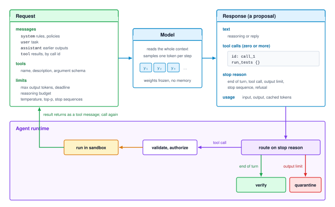
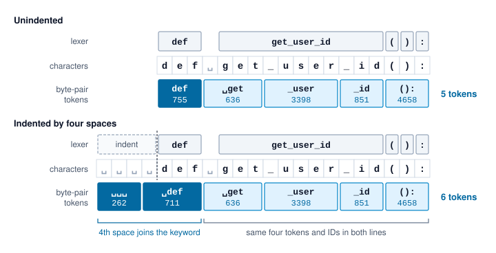
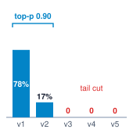
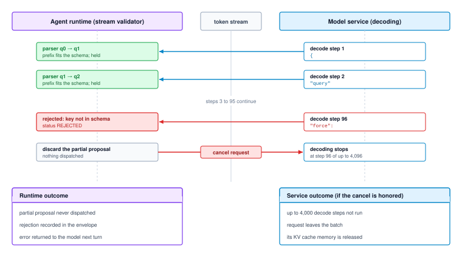
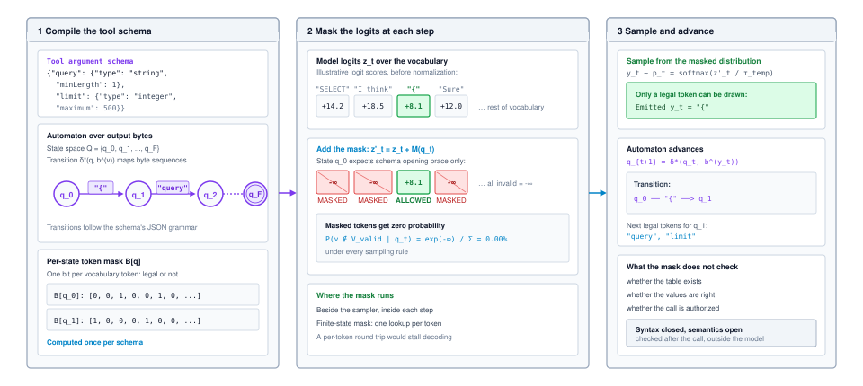
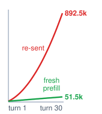
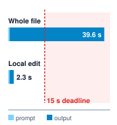

# The Foundation Model {#sec-vol3-foundation-model}

::: {layout-narrow}
::: {.column-margin}

\chapterminitoc

:::

::: {.content-visible when-format="pdf"}
\noindent
{fig-alt="Isometric illustration of a small robot laying orange token tiles along a track while a larger robot checks each tile, turning accepted tiles green and diverting a rejected red tile into a bin, so that only checked tokens continue down the track."}
:::

::: {.content-visible unless-format="pdf"}
{fig-alt="Isometric illustration of a small robot laying orange token tiles along a track while a larger robot checks each tile, turning accepted tiles green and diverting a rejected red tile into a bin, so that only checked tokens continue down the track."}
:::

:::

## Purpose {.unnumbered .unlisted}

\begin{marginfigure}
\mlagentstack{0}{0}{0}{0}{0}{100}
\end{marginfigure}

_Why does a capable model still need a precise contract around every call?_

Every capability an autonomous agent adds—from tool dispatch and long-term retrieval to sandboxed execution and self-correction—is assembled from discrete foundation model calls. If the interface contract governing a single invocation is ambiguous, every downstream subsystem inherits that fragility. A model proposal may appear syntactically sound and yet violate schema constraints, arrive past its execution deadline, or misrepresent external environment state. Treating the model as an infallible oracle obscures the primary systems reality: ungrounded token predictors produce candidate proposals across an untrusted boundary, not verified state transitions. Reliability cannot reside in the model weights; it must be enforced by the surrounding runtime through strict token budgets, deterministic schema validation, and independent verification. Within the H·S·A exposure space, the single call marks the baseline origin: a single bounded turn, zero carried state, and zero autonomous authority.

::: {.content-visible when-format="pdf"}

\newpage

:::

::: {.callout-learning-objectives}

- Explain the separate responsibilities of the foundation model, inference service, and agent runtime
- Construct a token-bounded request containing task messages, advertised tools, and generation limits
- Calculate how temperature and nucleus truncation reshape the candidate distribution without establishing correctness
- Diagnose response outcomes using completion status, structural validity, permission checks, and task evidence
- Distinguish the guarantees of grammar-constrained decoding from learned formatting and correct task values
- Estimate call latency and repeated-input work under explicit serving and prefix-reuse assumptions
- Evaluate interface representations using accepted outcomes and resource use under matched task budgets

:::
## One Turn of the Repair Loop {#sec-vol3-foundation-model-introduction}

::: {.column-margin}
{width="100%" fig-alt="H·S·A locator with all three axes gray and only the origin dot highlighted in purple."}

*A single call runs one turn, carries no state, and holds zero ambient authority.*
:::

The repair agent (\ref{lhs-vol3-repair-agent}) needs to inspect the connection-pool implementation before proposing a change. A model invocation that emits `read_file("src/pool.py")` produces only an unexecuted text string. The generation itself carries no side effects, leaving the surrounding runtime to determine whether the path exists, verify that the operation is permitted, execute the filesystem read, and feed the resulting observation back into subsequent prompts. Interleaving model-generated actions with runtime observations forms the core interaction loop formalized by ReAct [@yao2023react]. In an agent architecture, that loop decomposes into discrete, isolated inference steps, where the stability of the entire system depends on how the runtime manages each individual turn.

Interactive chat interfaces rely on human operators to resolve operational ambiguity. A person working in a chat window immediately spots a response truncated mid-sentence, evaluates whether a proposed shell command is safe to run, and tolerates variable generation delays. An autonomous agent removes that human supervisor. The runtime receives the completion purely as structured data and must programmatically resolve questions that human judgment handled implicitly: whether the prompt fit within the model's context window, whether generation completed normally or hit a hard output token ceiling, whether a syntactically valid tool request targets a resource within permitted workspace bounds, and how much latency and financial budget the invocation consumed. Unstructured reply text cannot answer these operational questions. A runtime that attempts to deduce execution state by scraping raw output strings inevitably fails, whether by applying truncated code patches or executing commands outside its intended environment.

Eliminating these failure modes requires a formal call contract between the agent runtime and the model inference service. This contract governs both directions of the interface: the outbound request (specifying message history, advertised tool definitions, and token limits) and the inbound execution record (specifying payload structure, completion stop reasons, and token consumption). It also dictates the defensive validation pipeline the runtime applies before dispatching any proposed action, alongside accounting for the latency and input re-computation costs incurred by each invocation. Rather than assuming model reliability, the contract treats the inference service as an untrusted, probabilistic generator. By recording verified execution facts at each boundary, the contract ensures that the runtime—not the foundation model—retains deterministic control over control-flow decisions.

Tracing this lifecycle through the systems stack follows a single invocation from initial request dispatch to its ultimate resource cost. @Sec-vol3-foundation-model-role establishes the division of responsibility among the foundation model, the inference service, and the agent runtime, tracing the repair agent's inspection request through to its resulting environment observation. At the token boundary, @Sec-vol3-foundation-model-tokenization measures how prompt text maps into discrete context allocations, while @sec-vol3-foundation-model-autoregressive details how the inference engine decodes candidate tokens sequentially under varying sampling configurations. Because raw model outputs cannot be trusted implicitly, validating the returned candidate demands three complementary defense layers: structural checks verify syntactic soundness (@sec-vol3-foundation-model-continuations), service-level status records determine whether generation concluded cleanly or stalled against resource limits (@sec-vol3-foundation-model-contract), and grammar-constrained decoding enforces schema validity directly at the logits level during generation (@sec-vol3-foundation-model-grammar-constrained). Finally, sustainable agent systems require rigorous resource accounting: @Sec-vol3-foundation-model-cost models the latency and financial cost across multi-turn trajectories with prompt caching, and @sec-vol3-foundation-model-interface-design compares competing tool representations under a matched operational budget.
## The Model Invocation Boundary {#sec-vol3-foundation-model-role}

When an agent executes an operation—such as issuing `read_file("src/pool.py")`—the request traverses three distinct architectural components: the foundation model, the inference service, and the agent runtime. The foundation model[^fn-foundation-model-term] computes conditional probability distributions over token sequences given a prompt context. The **inference service**\index{Inference service!definition} hosts the model weights, executes forward passes on hardware accelerators, applies generation parameters, and packages the resulting tokens into a response envelope. The agent runtime orchestrates the broader task: it constructs the prompt, tracks resource budgets, validates generated candidates, and decides whether an action should actually execute against the host environment. Even when all three components reside on a single physical host, share an operating system process, or run within the same security domain, their interfaces maintain a crucial boundary: generated content remains strictly isolated from the decision to act on it.

[^fn-foundation-model-term]: **Foundation Model**: @bommasani2021opportunities coined the term for a model trained on broad data at scale and adapted to a wide range of downstream tasks, warning that such homogenization allows model defects to pass directly into every system built on top of it. For autonomous agents, the warning is concrete: every runtime that invokes the same model and serving path inherits identical failure modes at once. For this reason, the runtime, rather than the model, must hold all operational checks. \index{Foundation model!term origin}

::: {#dfn-vol3-proposal .callout-definition title="Proposal"}

A ***proposal***\index{Proposal!definition} is model output that specifies a candidate action or answer for the runtime to evaluate, carrying zero ambient authority and producing no external side effects until the runtime explicitly validates, authorizes, and executes it.

1.  **Significance**: Every external effect of an agent depends on an explicit runtime decision. Because the model call possesses zero ambient authority, a rejected proposal costs one inference invocation rather than an unintended modification to the environment. That invocation still consumes resources and counts toward $C_{\text{attempt}}$ in the cost per accepted task (@eq-vol3-cost-per-accepted-task).
2.  **Distinction**: A proposal must not be confused with an *effect* (a state change executed by the runtime after authorization) or an *observation* (the runtime's factual record of what an operation returned). Emitting `read_file("src/pool.py")` is merely a proposal; the file contents subsequently retrieved from disk and supplied to the next call constitute an observation.
3.  **Common pitfall**: Logging a tool request as an executed action, or accepting a model's textual claim that "the file has been read" as an empirical observation, allows fluent prose to stand in for operational evidence.

:::

### Messages and tool definitions {#sec-vol3-foundation-model-messages-tool-definitions}

The runtime structures interaction with the model through an ordered sequence of role-tagged messages\index{Model invocation contract!messages and roles}. A `system` message establishes application instructions, operational constraints, and behavioral policies. A `user` message specifies the task objective or developer prompt, while an `assistant` message records earlier model generations. When the runtime executes an action, it supplies the resulting output as a `tool` message containing the raw observation. Tagging content with a role structures the prompt context for the model's attention mechanism, but the tag itself provides no security guarantees: role labels organize the token stream, while the runtime remains responsible for verifying whether the content is authentic and whether it adheres to the task contract.

Alongside the message history, the invocation payload advertises the tools available to the model and specifies their expected argument schemas. In @lst-vol3-model-request, the runtime declares a file-reading tool with a single required string parameter. The JSON-schema definition informs the model of the syntax required for valid proposals, but the schema defines only the interface; the runtime enforces workspace sandboxing and filesystem permissions independently.

::: {#lst-vol3-model-request lst-cap="**A bounded inspection request**: This provider-neutral record separates model-visible messages and tool definitions from the configuration and limits governing the call. Symbolic values stand for settings chosen by the runtime; the field names do not prescribe a vendor API."}
```yaml
model_config: repair-model/config-a
messages:
  - role: system
    content: Propose the next inspection for the assigned repair.
  - role: user
    content: Inspect the connection-pool locking logic in src/pool.py.
tools:
  - name: read_file
    arguments_schema:
      type: object
      properties: {path: {type: string}}
      required: [path]
      additionalProperties: false
limits:
  max_output_tokens: K_max
  deadline: T_max
sampling: selected_sampling_settings
```
:::

The `model_config` identifier explicitly binds the request to a specific model version, weights checkpoint, and serving profile. Sampling controls govern how the inference service selects output tokens from the model's predicted probability distribution. Concurrently, resource bounds protect the system from runaway execution: `max_output_tokens` ($K_{\text{max}}$) caps the decoding budget to prevent unbounded generation, while `deadline` ($T_{\text{max}}$) establishes a strict timeout against queue delays and serving stalls. Specifying these bounds in the request record is effective only when the inference service or the client runtime actively enforces them during generation.

When generation concludes, the inference service returns free-form text, a structured tool proposal, or a service error. A runtime adapter normalizes these provider-specific responses into a uniform envelope, as illustrated in @lst-vol3-model-response. In this example, the service reports a completed generation pass that produced a structured tool request: a proposal to inspect `src/pool.py`, representing a single step toward diagnosis before any repair is verified.

::: {#lst-vol3-model-response lst-cap="**A returned tool proposal**: Response kind identifies what the payload represents, while status and stop reason describe the invocation. Usage counts describe consumed generation resources, not progress on the repair."}
```yaml
kind: tool_request
payload:
  name: read_file
  arguments: {path: src/pool.py}
status: COMPLETED
stop_reason: tool_request
usage: {input_tokens: S, output_tokens: K}
```
:::

Here, `kind` indicates how the runtime parser must interpret the payload. The normalized `status` confirms that the transport and generation protocols completed under the adapter's contract, while `stop_reason` captures the **stop reason**\index{Stop reason!definition} reported by the serving engine. This signal reveals why decoding terminated: whether the model generated a designated tool-call sequence, emitted an end-of-sequence token, or halted because it reached the token ceiling. The `usage` block tallies resource consumption, tracking $S$ input tokens processed and $K$ output tokens emitted. Accurate accounting across invocations prevents context-window overflow and provides the raw telemetry needed to monitor operational costs; when an upstream provider omits token accounting, the runtime must record the usage as missing rather than silently recording zero consumption.

@Fig-vol3-model-call-surface illustrates the complete invocation lifecycle, tracing how request artifacts enter the model and how response payloads route through the agent runtime.

::: {#fig-vol3-model-call-surface fig-env="figure" fig-pos="htb" fig-cap="**The Model Call Surface**: The request carries messages, tool definitions, and limits into a model with frozen weights, which returns a proposal with a stop reason and usage counts. Every arrow out of the response lands in the agent runtime. The runtime validates and authorizes a tool call before anything runs, returns the result as a new message for the next call, sends a finished answer to verification, and quarantines output cut off at its limit." fig-alt="Diagram with a request box listing messages, tools, and limits, an arrow to a model box that samples one token per step with frozen weights, and an arrow to a response box listing text, tool calls, stop reason, and usage. Below, an agent runtime box routes on stop reason: a tool call goes to validate and authorize, then run in sandbox, then back to the request as a tool message; end of turn goes to verify; output limit goes to quarantine."}

:::

### Proposals and observations {#sec-vol3-foundation-model-proposals-observations}

When the runtime receives a tool proposal, it must not execute the action blindly. Instead, it routes the payload through a strict sequence of validation and authorization stages. First, the runtime validates structural conformance, ensuring that the proposed arguments match the declared schema (for example, confirming that `path` is a string rather than an arbitrary shell command). Next, it checks the arguments against the task's authorization policy: advertising `read_file` grants the model permission to propose file reads, but confers no right to access arbitrary paths. The runtime must verify that `src/pool.py` resolves within the task's allowed workspace rather than escaping to sensitive host locations through directory traversal. Once authorized, tool execution proceeds entirely outside the model invocation, typically within an isolated sandbox or container with explicit execution timeouts.

After the tool executes, the runtime captures the empirical outcome and prepares the subsequent invocation context. It appends the model's prior `assistant` proposal and pairs it with a corresponding `tool` message containing the resulting observation—in this case, the bounded file excerpt. Where the API supports correlation identifiers, the observation explicitly references the call identifier of the proposal it answers, preventing ambiguity during parallel or multi-tool executions. Operational errors, such as a missing file or an access permission denial, must be captured faithfully as observations rather than swallowed or masked by synthesized content. Models rely on accurate negative feedback to revise their strategies and recover from errors. Furthermore, whenever the runtime truncates tool output to preserve token headroom, the observation must clearly demarcate the omission so that the model does not mistake an excerpt for the entire file.

The model in the subsequent invocation observes the tool output solely because the runtime reconstructs and supplies the updated context window. Foundation models are stateless token predictors: they retain no internal memory of previous requests or intermediate executions. While session identifiers or server-side prefix caching can optimize latency by reusing key-value cache states across turns, the runtime remains the sole authority governing which messages enter the prompt. This separation also exposes temporal subtleties. A stored file excerpt reflects only the state of the workspace at the moment of inspection; if a subsequent command modifies the file on disk, the in-context observation becomes stale. The prompt records historical evidence rather than an active binding to the filesystem.

This operational reality exemplifies the fail-plausible dynamics analyzed in @sec-vol3-intro-fail-plausible. A model can emit a syntactically pristine proposal targeting the wrong source module, or generate a compelling analysis grounded in an obsolete observation. Emitted tokens often appear convincing even when the underlying reasoning or environment state is completely disconnected from reality. Robust agent engineering therefore requires treating status, schema structure, security authorization, and empirical evidence as distinct, non-fungible properties of the interaction.

The operational responsibilities summarized in @tbl-vol3-foundation-model-responsibilities emerge directly from these architectural distinctions. These requirements apply universally, whether the model executes within the local process or behind a remote network API.

| Model term                  | Runtime responsibility                                                       | Failure if the runtime ignores it                                     |
|:----------------------------|:-----------------------------------------------------------------------------|:----------------------------------------------------------------------|
| **Context window**          | Count the complete input representation and reserve output headroom          | Rejected request or insufficient room for a complete response         |
| **Sampling settings**       | Choose supported settings and retain them with the request and output        | Unexplained variation or an unjustified assumption of reproducibility |
| **Tool call**               | Check the proposal, authorize access, and return the actual tool observation | A proposed operation mistaken for an executed or permitted one        |
| **Stop reason**             | Interpret it with normalized status before treating the payload as complete  | An interrupted or refused response treated as a finished candidate    |
| **Fluent but wrong output** | Evaluate the relevant claim using checks and observations with stated limits | Credibility mistaken for evidence of the intended property            |
| **Successful response**     | Distinguish delivery and generation completion from task acceptance          | A completed call recorded as a successful repair                      |
: **What the runtime owns around a model call**: Each feature of the call creates an obligation outside the model's generated content. Satisfying one obligation does not discharge the others. {#tbl-vol3-foundation-model-responsibilities}

The request and response records define the operational boundary governing model invocations. Messages supply context, tool definitions define candidate proposals, and the runtime mediates all transitions to external state. Before an inference engine can admit a request, however, the entire payload must fit within the model's context window and generation limits. Enforcing those constraints requires measuring the request in tokens rather than relying on coarse approximations such as character counts, messages, or source files.
## Discrete Token Representation {#sec-vol3-foundation-model-tokenization}

When an automated repair agent appends a connection-pool source file and a compiler diagnostic to its message history, the payload expands rapidly. Naive metrics like file counts or raw character counts cannot determine whether the next request will fit within the model's capacity. Under the hood, role delimiters, tool schemas, system prompts, file paths, and source code all serialize into a single sequence of discrete units before entering the neural network. The true operational budget is the token count of that fully assembled sequence, measured strictly against the model's specific tokenizer and wire format.

### Tokens in the serialized request {#sec-vol3-foundation-model-serialized-request-tokens}

A **tokenizer**\index{Tokenizer!definition}\index{Tokenization|see{Tokenizer}} maps text into identifiers from a finite vocabulary. Subword methods represent frequent fragments compactly while breaking unfamiliar words and identifiers into smaller pieces [@sennrich2016subword]. **Byte-pair encoding**\index{Byte-pair encoding!definition}[^fn-bpe-compression-origin] learns repeated combinations of smaller units; other tokenizers use different segmentation rules, and some learn them directly from raw text without assuming word boundaries [@kudo2018sentencepiece]. A token may represent a word, part of a word, whitespace, punctuation, or a combination of these. Token boundaries therefore need not coincide with the boundaries of a source-code identifier or a JSON field.

[^fn-bpe-compression-origin]: **Byte-Pair Encoding (BPE)**: The algorithm began as a data-compression scheme that repeatedly replaces the most frequent pair of adjacent bytes with an unused symbol [@gage1994bpe]; @sennrich2016subword repurposed the same merge rule to build open vocabularies for neural translation. Because the merges are learned from the training corpus's frequencies, the token cost of a string reflects how common it was in that corpus, so an unusual identifier or path can split into more tokens than a common word of the same length, and the runtime must count rather than estimate. \index{Byte-pair encoding!compression origin}

Indentation alone alters the resulting sequence. Under the standard `cl100k_base` byte-pair vocabulary, for example, the unindented line `def get_user_id():` encodes as five tokens beginning with `def` (identifier 755). Indenting that exact line by four spaces yields six tokens: three leading spaces (262), followed by ` def` with the fourth space fused to the keyword (711), and finally the remaining four tokens. Whereas a traditional compiler lexer identifies the same keyword token across both indentation levels, the model receives entirely different numerical identifiers. @Fig-vol3-token-ast-mismatch contrasts these two tokenizations against a compiler lexer's structural view.

::: {#fig-vol3-token-ast-mismatch fig-env="figure" fig-pos="htb" fig-cap="**One Keyword, Two Token Sequences**: The same Python line passes through a compiler lexer (top) and a byte-pair tokenizer (bottom). The lexer records indentation as block structure and emits the same keyword and identifier for both lines. The tokenizer absorbs the fourth space into the keyword, so the indented line opens with two tokens that do not appear in the unindented one; only the four tokens after the keyword are shared. Identifiers are from the `cl100k_base` vocabulary." fig-alt="Two stacked panels. Top panel, compiler lexer: the lines def get_user_id(): and the same line indented by four spaces each map to the tokens def keyword, get_user_id identifier, open parenthesis, close parenthesis, and colon; the indented line adds a dashed indent token labeled block depth. Bottom panel, byte-pair tokenizer cl100k_base: the unindented line maps to def 755, space get 636, _user 3398, _id 851, and parentheses colon 4658, labeled 5 tokens; the indented line maps to three spaces 262, space def 711, and the same four tokens, labeled 6 tokens. Tokens 755, 262, and 711 are highlighted in red, with a note that the fourth space joins the keyword and 711 replaces 755, and a bracket marks the four shared tokens."}

:::

In an inspection request, the string `src/pool.py` functions as a clean path argument at the tool interface, yet it decomposes into a sequence of subword tokens at the model interface. Altering a file path, introducing indentation, or escaping source code inside a JSON payload shifts token boundaries unpredictably. Because these splits depend entirely on the active vocabulary and serialization scheme, neither JSON formatting nor punctuation imposes a constant token overhead relative to raw prose. Systems runtimes cannot infer prompt length from average character-to-token ratios; they must measure the exact byte sequence scheduled for transmission.

Structural framing introduces further overhead. Model APIs wrap messages in specialized control sequences that delineate roles, conversation turns, and tool definitions according to model-specific wire protocols. Counting only the application's payload strings—such as user instructions or tool outputs—ignores this structural envelope. If the application handles serialization locally, it must tokenize the fully formatted wire payload using the model's precise tokenizer. Conversely, when a managed remote service injects proprietary chat templates or handles hidden system wrappers, the application must rely on the provider's token-counting endpoint and documented admission policies. Because token vocabularies and merging rules differ fundamentally across model families, token counts from one model cannot serve as proxies for another.

This accounting discipline applies equally to output generation. A concise tool invocation consumes fewer output tokens than an elaborate textual explanation that embeds the same invocation, but the exact cost depends on how the tool call is serialized. Compact schemas reduce latency and token spend only if they retain the structural detail the runtime demands; stripping essential parameters, file paths, or error enumerations to shave tokens undermines the robustness of downstream execution.

### Output headroom {#sec-vol3-foundation-model-output-headroom}

Let $S$ denote the length of the fully serialized input prompt, $S_{\max}$ the total **context window**\index{Context window!definition} (the maximum sequence capacity spanning input and output tokens within a single invocation), and $K_{\max}$ the reserved generation allowance, or **output headroom**\index{Output headroom!definition}\index{Context window!output headroom}. In an architecture where input tokens and generated tokens share a unified context budget, an admission controller must enforce:

$$S \le S_{\max} - K_{\max}$$

This inequality guarantees that an incoming prompt cannot saturate the context buffer and starve the model of capacity to produce an answer. Real-world services often impose independent ceilings on input and output lengths alongside this shared context limit, requiring the runtime to satisfy both individual caps and the combined constraint. Furthermore, when modern reasoning models produce hidden chain-of-thought tokens, those latent tokens debit the generation budget just like user-facing text. A concise three-line visible response can easily exhaust a large generation reservation if the model generated hundreds of hidden reasoning tokens beforehand.

```{python}
#| label: calc-vol3-invocation-token-budget
#| echo: false
# ┌─────────────────────────────────────────────────────────────────────────────
# │ ADMISSION HEADROOM FOR AN INSPECTION REQUEST (LEGO)
# ├─────────────────────────────────────────────────────────────────────────────
# │ Context: @sec-vol3-foundation-model-tokenization, token and image budgets.
# │ Goal: Separate input admission from reserved generation capacity.
# │ Show: Remaining input room and the effect of a model-specific image charge.
# │ How: Use hypothetical service counts; subtract reserved output and input
# │      from the combined window, then add the image contribution.
# └─────────────────────────────────────────────────────────────────────────────
from mlsysim import *

class InvocationTokenBudget:
    # ┌── 1. LOAD (Constants & Parameters) ─────────────────────────────────
    window = 8_192  # hypothetical combined context limit, tokens
    output = 1_024  # scenario: reserved generation allowance, tokens
    text_input = 6_000  # scenario: complete serialized text request, tokens
    image_input = 2_048  # scenario: service-reported additional image charge

    # ┌── 2. EXECUTE (Compute) ─────────────────────────────────────────────
    input_ceiling = window - output
    headroom = input_ceiling - text_input
    multimodal_total = text_input + image_input + output
    excess = multimodal_total - window

    # ┌── 3. GUARD (Invariants) ────────────────────────────────────────────
    check(input_ceiling == 7_168, "Unexpected input ceiling")
    check(headroom == 1_168, "Unexpected remaining input headroom")
    check(multimodal_total == 9_072, "Unexpected multimodal total")
    check(excess == 880, "The image must exceed the reserved request budget")

    # ┌── 4. OUTPUT (Formatting) ───────────────────────────────────────────
    window_str = fmt_int(window)
    output_str = fmt_int(output)
    text_input_str = fmt_int(text_input)
    image_input_str = fmt_int(image_input)
    input_ceiling_math = fmt_math(rf"S_{{\max}} - K_{{\max}} = {window:,} - {output:,} = {input_ceiling:,}")
    headroom_math = fmt_math(rf"{input_ceiling:,} - {text_input:,} = {headroom:,}")
    multimodal_math = fmt_math(rf"{text_input:,} + {image_input:,} + {output:,} = {multimodal_total:,}")
    excess_str = fmt_int(excess)
```

Suppose the repair interface has a combined window of `{python} InvocationTokenBudget.window_str` tokens, and the runtime reserves `{python} InvocationTokenBudget.output_str` tokens for generation. Its input ceiling is `{python} InvocationTokenBudget.input_ceiling_math` tokens. If the fully serialized request occupies `{python} InvocationTokenBudget.text_input_str` tokens, we have `{python} InvocationTokenBudget.headroom_math` tokens of room for additional input while preserving the response allowance. The limits are scenario values, not a named model's specification.

If an incoming tool observation exceeds this remaining headroom, the admission check fails. At this juncture, the runtime faces an explicit engineering trade-off: it can compress prompt history, extract a narrower file slice, or route the call to an execution profile with a larger context window. Artificially shrinking the output allowance $K_{\max}$ to force admission is risky, as it leaves the model insufficient room to complete complex tool invocations or structured plans. Similarly, silently truncating tool outputs to squeeze them into the remaining margin can strip away the critical stack trace or diagnostic error that the agent needs to resolve the bug.

Even when a request satisfies admission checks, generation can still hit the output token ceiling mid-stream. In systems terms, the runtime must never confuse a syntactically well-formed prefix with a successfully terminated generation. A truncated JSON object may happen to pass a lenient parser if closed artificially, yet it remains an incomplete execution plan. While a partial payload provides valuable diagnostic telemetry, executing it as an intact tool call can cause downstream corruption. The formal invocation contract in @sec-vol3-foundation-model-contract formalizes this boundary through explicit status-first handling rules.

### Multimodal input accounting {#sec-vol3-foundation-model-multimodal-accounting}

When the repair task incorporates visual inputs—such as a screenshot of a failing diagnostic dashboard or UI render—context accounting shifts from character tokenization to multimodal embedding. The model's vision front-end maps the visual input into a set of context positions. While vision transformers typically partition images into uniform patches [@dosovitskiy2021image], upstream preprocessing steps like dynamic tiling, resolution downsampling, and spatial pooling mean that the final count of reserved context tokens rarely matches raw patch counts.

Consider the earlier budget when adding this visual artifact. If the service reports that the image and its framing tokens require an additional `{python} InvocationTokenBudget.image_input_str` context positions, the total request demand expands to `{python} InvocationTokenBudget.multimodal_math` tokens. This total exceeds the `{python} InvocationTokenBudget.window_str`-token context window by `{python} InvocationTokenBudget.excess_str` tokens, triggering an immediate admission failure before dispatch. The orchestrator must intervene before calling the model. While downscaling the image can reduce its token footprint under some vision backends, aggressive compression risks obliterating fine-grained diagnostic clues, such as single-character error codes or minute trace graphs. Multimodal token budgeting is thus an optimization over information preservation, balancing fidelity against strict context bounds.

::: {#chk-02-context-exhaustion-quarantine .callout-checkpoint title="Admitting the next repair request"}

The repair agent is about to add a source excerpt and a diagnostic image to its next call. Its output allowance must remain available for a complete proposal.

- [ ] **Input budget**: Can you identify which message and tool-definition framing must be counted beyond the visible source excerpt?
- [ ] **Output headroom**: With the window fixed at `{python} InvocationTokenBudget.window_str` tokens and the image added, would halving the output reservation make the request fit? Compute the remaining excess, and state what the smaller reservation risks.
- [ ] **Generation status**: If a returned fragment parses successfully after the output limit is reached, can you explain why it is still not a completed candidate?

:::

Token accounting provides an indispensable gatekeeping mechanism: it establishes an upfront admission test for the complete request while reserving adequate operational headroom for the response. But context admission addresses only initial capacity. Once the model begins decoding, token-by-token autoregressive generation dictates how quickly that reserved headroom is consumed and whether the interaction terminates cleanly or truncates prematurely.
## Autoregressive Generation {#sec-vol3-foundation-model-autoregressive}

A client request specifies the conversation history and the catalog of available tool schemas, but the generated response remains open-ended and stochastic. In a software repair task, for example, the model might propose `read_file` on a specific configuration path, select an entirely different source directory, or emit an unstructured natural-language explanation instead. Systems engineers must understand how the engine generates this text to configure appropriate token budgets and sampling parameters. That understanding also clarifies why re-executing an API request against a live model produces a fresh distribution of behaviors, whereas replaying a recorded trace provides exact downstream determinism.

### Conditional token selection {#sec-vol3-foundation-model-conditional-token-selection}

Autoregressive language models generate text by decomposing the joint probability of a sequence into a product of conditional next-token distributions, a foundational framing introduced in early neural language modeling [@bengio2003neural]. Let $x_{1:S}$ denote the input tokens and $y_{1:K}$ an output sequence. Its conditional probability factors as

$$\Pr(y_{1:K} \mid x_{1:S}) = \prod_{t=1}^{K} \Pr(y_t \mid x_{1:S}, y_{1:t-1})$$ {#eq-autoregressive-factorization}

At output position $t$, the model with parameters $\theta$ produces one score, or **logit**\index{Logits!definition}, for each token in vocabulary $\mathcal{V}$:

$$\mathbf{z}_t = \mathbf{f}_\theta(x_{1:S}, y_{<t}) \in \mathbb{R}^{|\mathcal{V}|}$$

A decoding rule selects a token from these scores, and the chosen token is appended to the prefix for position $t+1$. Because every subsequent step conditions on all preceding tokens, early decisions cascade through the remainder of the trajectory. When a model emits a specific file path inside a `read_file` argument, for example, that string immediately conditions the emission of the closing syntax and subsequent reasoning tokens. The model generates this path purely from learned statistical associations without consulting the operating system to establish whether the file actually exists.

In an inference serving engine, the decode loop processes the prompt, computes next-token logits, selects an output token, appends it to the prefix context, and repeats this cycle until triggering a termination condition. Generation can terminate normally when the model emits an explicit end-of-sequence token or matches a caller-configured stop sequence. Alternatively, an execution engine may halt generation prematurely when reaching an output token limit, or abort unexpectedly due to an infrastructure timeout or network disconnect. Serving interfaces must report these stop reasons explicitly: receiving an incomplete JSON object due to a hit token limit requires different recovery handling than receiving a cleanly terminated tool call. Crucially, a clean stop sequence merely signals that the model finished generating text; it provides no guarantee that the underlying task succeeded.

Production Transformer implementations [@vaswani2017] eliminate redundant computation across decoding steps by maintaining a *key-value (KV) cache*:[^fn-kv-cache-derived] memory buffers that store intermediate attention keys and values derived from previously processed tokens. Reusing this state avoids recomputing projections for historical tokens at every step. For a fixed full-attention architecture and storage precision, retaining more tokens requires more cache capacity. This cache represents transient intermediate computational state rather than an authoritative audit log proving which tools executed or what their external effects were. Cache organization and capacity planning are developed in @sec-vol3-kv-cache; the direct operational consequence is that the prompt and generated output both contribute to a call's memory footprint and resource demand.

[^fn-kv-cache-derived]: **Key-Value (KV) Cache**: In causal attention, key and value vectors at a given position depend solely on that token and its predecessors, so once computed they remain static throughout subsequent sequence expansion. Retaining them in device memory turns each new decode step from full-sequence recomputation into a single new row projection per layer alongside a read of stored rows. Consequently, cache capacity and memory bandwidth, rather than floating-point arithmetic, become the primary operational constraints as context windows expand. \index{KV cache!why reuse is exact}

Because each generated token extends a dependent sequence, output length is the primary cost variable of a call, and the serving implementation sets its realized latency. Although the conditional dependence in @eq-autoregressive-factorization fixes the mathematical order of token choices, it does not mandate that hardware evaluate each token in an isolated forward pass. Techniques such as speculative decoding,[^fn-speculative-decoding-equivalence] for example, draft candidate token blocks with a small auxiliary model and score them in parallel with the target model, provably preserving the target output distribution [@leviathan2023fast; @chen2023accelerating].

[^fn-speculative-decoding-equivalence]: **Speculative Decoding**: A small draft model proposes several candidate tokens, and the target model scores them all concurrently in a single forward pass; a modified rejection-sampling rule accepts each drafted token with a probability that guarantees the accepted sequence matches the exact distribution of the target model sampling independently [@leviathan2023fast; @chen2023accelerating]. This guarantee is distributional rather than bitwise: it reduces the number of accelerator passes per generated token without altering the underlying candidate space, maintaining the same reproducibility characteristics discussed later in this section. \index{Speculative decoding!distribution preservation}

### Sampling controls {#sec-vol3-foundation-model-sampling-controls}

For positive **temperature**\index{Temperature (sampling)!definition}[^fn-sampling-temperature-origin] $\tau_{\text{temp}}$, softmax converts the logits into next-token probabilities:

$$\Pr(y_t = v \mid x_{1:S}, y_{<t}) = \frac{\exp\left(z_{t, v} / \tau_{\text{temp}}\right)}{\sum_{w \in \mathcal{V}} \exp\left(z_{t, w} / \tau_{\text{temp}}\right)}$$ {#eq-temperature-softmax}

Unit temperature ($\tau_{\text{temp}} = 1.0$) leaves the logits unscaled. Lowering a positive temperature amplifies logit disparities, sharply concentrating probability mass on higher-scoring tokens; raising it compresses logit differences and makes the distribution flatter. With a finite vocabulary and finite logits, the distribution approaches uniformity as temperature grows without bound. Systems engineers should treat temperature strictly as an entropy modulator rather than a confidence metric. Because next-token cross-entropy training minimizes sequence prediction error rather than calibrating scores as estimates of task success, high token likelihood does not verify that a completed response is logically sound or correct.

[^fn-sampling-temperature-origin]: **Temperature**: The nomenclature comes from statistical mechanics, where the Boltzmann distribution weights a state of energy $E$ by $\exp(-E/k_B T)$; reading each negative logit as an energy makes @eq-temperature-softmax mathematically identical. In thermodynamic systems, high temperature distributes particles across many states, whereas low temperature collapses the system toward its ground state. In language model decoding, scaling temperature balances candidate exploration against exploitation of the mode without altering which token scores highest. \index{Temperature (sampling)!Boltzmann origin}

**Greedy decoding**\index{Greedy decoding!definition} instead selects the maximum-scoring token: $\operatorname{argmax}_{v \in \mathcal{V}} z_{t,v}$, combined with a consistent tie-breaking rule. Given fixed logits and a fixed tie rule, that selection is deterministic. While serving APIs frequently expose greedy decoding through a temperature-zero setting, the runtime executes this via direct argmax selection rather than evaluating @eq-temperature-softmax with division by zero. As positive temperature approaches zero, softmax concentrates all probability mass on the maximum; if several logits share the maximum, that mathematical limit alone does not select among them.

Sampling can also restrict which tokens remain eligible. **Top-$k$ sampling**\index{Top-k sampling!definition} [@fan2018hierarchical] retains the $k$ highest-scoring tokens, according to a defined tie rule, and renormalizes their probabilities. **Top-$p$ sampling**\index{Top-p sampling!definition}, also called nucleus sampling, sorts tokens by descending probability and retains the shortest leading sequence whose cumulative mass reaches threshold $p$ [@holtzman2020curious], subsequently renormalizing that active set. Top-$k$ fixes the candidate count regardless of context, retaining implausible tail tokens when the distribution is peaked and cutting viable candidates when the distribution is flat. Top-$p$ resolves this rigidity by allowing the candidate pool size to adapt dynamically to distribution entropy. When temperature scaling and truncation are combined, their evaluation order and the runtime's numerical conventions form an explicit part of the decoding configuration.

Crucially, neither filter identifies valid file paths, truthful statements, or safe operations. A rare token may be essential to a correct identifier or software patch, while a highly probable continuation may propose an incorrect file name. Truncation filters alter the distribution of candidates exposed to downstream execution, and evaluation against external task criteria determines whether that modification improves performance.

::: {.column-margin}
{width="100%" fig-alt="Five probability bars for tokens v1 to v5 at unit temperature. v1 is labeled 78 percent and v2 17 percent, both in blue under a bracket labeled top-p 0.90. v3, v4, and v5 are in red with a zero above each and the label tail cut."}

*Nucleus truncation keeps two tokens here and zeroes the whole tail.*
:::

```{python}
#| label: lego-logit-scaling-truncation
#| echo: false
# ┌─────────────────────────────────────────────────────────────────────────────
# │ LOGIT SCALING AND TRUNCATION (LEGO)
# ├─────────────────────────────────────────────────────────────────────────────
# │ Context: @nbk-02-logit-scaling-and-truncation-on
# │ Goal: Compare temperature and nucleus sampling for the same hypothetical logits.
# │ Show: Sharpening and truncation redistribute probability, not correctness.
# │ How: Normalize exponentials, select a cumulative-probability prefix, renormalize.
# └─────────────────────────────────────────────────────────────────────────────
import math
from mlsysim import *
from mlsysim.fmt import check, fmt, fmt_math, fmt_multiple, fmt_percent

class LogitScalingTruncation:
    """Sampling transformations for a fixed hypothetical vocabulary."""

    # ┌── 1. LOAD (Constants & Parameters) ─────────────────────────────────
    logits = [12.0, 10.5, 9.0, 6.0, 3.0]
    tau_base = 1.0
    tau_sharp = 0.5
    p_nucleus = 0.90

    # ┌── 2. EXECUTE (Compute) ─────────────────────────────────────────────
    exp_tau1 = []
    for z in logits:
        exp_tau1.append(math.exp(z / tau_base))
    sum_exp_tau1 = sum(exp_tau1)
    probs_tau1 = []
    for e in exp_tau1:
        probs_tau1.append(e / sum_exp_tau1)
    exp_tau05 = []
    for z in logits:
        exp_tau05.append(math.exp(z / tau_sharp))
    sum_exp_tau05 = sum(exp_tau05)
    probs_tau05 = []
    for e in exp_tau05:
        probs_tau05.append(e / sum_exp_tau05)
    sum_nuc = probs_tau1[0] + probs_tau1[1]
    p_nuc_v1 = probs_tau1[0] / sum_nuc
    p_nuc_v2 = probs_tau1[1] / sum_nuc
    tail_base = 1 - probs_tau1[0]  # probability of drawing any non-top token
    tail_sharp = 1 - probs_tau05[0]
    tail_ratio = tail_base / tail_sharp

    # ┌── 3. GUARD (Invariants) ───────────────────────────────────────────
    check(abs(sum(probs_tau1) - 1.0) < 1e-12, "Baseline distribution must normalize")
    check(abs(sum(probs_tau05) - 1.0) < 1e-12, "Sharpened distribution must normalize")
    check(abs(probs_tau1[0] - 0.7840) < 0.001, "Unexpected tau=1.0 top prob")
    check(abs(probs_tau05[0] - 0.950324648968) < 1e-9, "Unexpected tau=0.5 top prob")
    check(abs(sum_nuc - 0.9589) < 0.001, "Unexpected nucleus denominator")
    check(probs_tau1[0] < p_nucleus <= sum_nuc, "Nucleus must contain exactly two tokens")
    check(abs(p_nuc_v1 - 0.8176) < 0.001, "Unexpected nucleus v1 prob")
    check(abs(p_nuc_v2 - 0.1824) < 0.001, "Unexpected nucleus v2 prob")
    check(abs(p_nuc_v1 + p_nuc_v2 - 1.0) < 1e-12, "Nucleus must normalize")
    check(3 < tail_ratio < 6, "Halving temperature should shrink the non-top tail several-fold")

    # ┌── 4. OUTPUT (Formatting) ──────────────────────────────────────────
    logits_math = fmt_math(rf"\mathbf{{z}}_t = [{', '.join(f'{v:g}' for v in logits)}]")
    base_vector_math = fmt_math(rf"\mathbf{{p}}_{{\tau_{{\text{{temp}}}}=1}} \approx [{', '.join(f'{v:.4f}' for v in probs_tau1)}]")
    sharp_first_str = fmt(probs_tau05[0], precision=4, commas=False)
    sum_exp_tau1_str = fmt(sum_exp_tau1, precision=1, commas=False)
    tau_base_str = fmt(tau_base, precision=0, commas=False)
    tau_sharp_str = fmt(tau_sharp, precision=1, commas=False)
    top_mass_pct_str = fmt_percent(probs_tau05[0], precision=1, style="prose")
    p_nucleus_str = fmt(p_nucleus, precision=2, commas=False)
    first_prob_str = fmt(probs_tau1[0], precision=4, commas=False)
    second_prob_str = fmt(probs_tau1[1], precision=4, commas=False)
    nucleus_mass_str = fmt(sum_nuc, precision=4, commas=False)
    nucleus_first_str = fmt(p_nuc_v1, precision=4, commas=False)
    nucleus_second_str = fmt(p_nuc_v2, precision=4, commas=False)
    tail_base_pct_str = fmt_percent(tail_base, precision=1, style="prose")
    tail_sharp_pct_str = fmt_percent(tail_sharp, precision=1, style="prose")
    tail_ratio_mult_str = fmt_multiple(tail_ratio, precision=1)
```

::: {#nbk-02-logit-scaling-and-truncation-on .callout-notebook title="Temperature and truncation on the same logits"}

**Problem**: A hypothetical vocabulary $\mathcal{V} = \{v_1, v_2, v_3, v_4, v_5\}$ has logits `{python} LogitScalingTruncation.logits_math`, held fixed so that differences arise strictly from the decoding configuration. How much probability mass concentrates onto the top token when halving the temperature, and which tokens survive nucleus truncation?

**Math**: At temperature $\tau_{\text{temp}} =$ `{python} LogitScalingTruncation.tau_base_str`, the exponentiated logits sum to `{python} LogitScalingTruncation.sum_exp_tau1_str`. Normalizing each exponential by this partition sum yields the baseline distribution:

`{python} LogitScalingTruncation.base_vector_math`.

Halving the temperature to $\tau_{\text{temp}} =$ `{python} LogitScalingTruncation.tau_sharp_str` doubles the exponent of each term. Following normalization, the probability of the mode $v_1$ surges to `{python} LogitScalingTruncation.sharp_first_str`, capturing `{python} LogitScalingTruncation.top_mass_pct_str` of the total distribution. All lower-ranked tokens retain positive probability under untruncated softmax.

Returning to unit temperature and applying nucleus truncation with $p =$ `{python} LogitScalingTruncation.p_nucleus_str` evaluates cumulative probability mass. The lead token $v_1$ provides `{python} LogitScalingTruncation.first_prob_str`, which falls short of the threshold. Incorporating $v_2$ (`{python} LogitScalingTruncation.second_prob_str`) brings cumulative coverage to `{python} LogitScalingTruncation.nucleus_mass_str`, which satisfies the threshold and defines the active nucleus as $\{v_1, v_2\}$. Renormalizing across this active set assigns probability `{python} LogitScalingTruncation.nucleus_first_str` to $v_1$ and `{python} LogitScalingTruncation.nucleus_second_str` to $v_2$, while strictly zeroing the remaining tail tokens $\{v_3, v_4, v_5\}$.

**Systems insight**: Temperature governs candidate diversity. Halving temperature compresses the non-top probability tail from `{python} LogitScalingTruncation.tail_base_pct_str` to `{python} LogitScalingTruncation.tail_sharp_pct_str`, achieving a `{python} LogitScalingTruncation.tail_ratio_mult_str` reduction, whereas nucleus truncation eliminates the tail entirely. Repeated calls produce diverse outputs only when probability mass occupies this tail—the exact stochastic resource harvested by the search and consensus strategies in @sec-vol3-test-time-compute. Because neither transformation ensures that the highest-scoring candidate is correct, engineering teams configure decoding parameters based on empirical task pass rates rather than raw model likelihood.

:::

### Repetition and replay {#sec-vol3-foundation-model-repetition-replay}

Greedy decoding removes sampling variance from a fixed logit vector, but it does not guarantee end-to-end reproducibility across served API calls. In distributed production infrastructure, identical input requests frequently encounter different serving nodes, hardware accelerator revisions, or software runtime configurations. Subtle variations in floating-point reduction order[^fn-float-reduction-order] can shift closely contested logits in their least significant bits; flipping an argmax selection at position $t=1$ permanently alters all downstream conditioning. Similarly, configuring a fixed pseudorandom seed constrains the sampling generator without eliminating numerical non-determinism across backend kernels or cluster deployments. True reproducibility requires a strictly pinned execution environment and software contract, extending well beyond setting $\tau_{\text{temp}} = 0$. Real-world production incidents illustrate how infrastructure changes in the serving fleet can dramatically alter generation behavior while caller requests remain identical.

[^fn-float-reduction-order]: **Floating-Point Reduction Order**: Floating-point addition lacks associativity because intermediate calculations undergo rounding at each operation [@goldberg1991]. Parallel attention and reduction kernels that accumulate dot products across differing thread block dimensions or dynamic batch sizes execute summation in varying orders, yielding minor discrepancies in the least significant bits of logit tensors. When two top candidates have nearly identical values, this numerical divergence suffices to invert a greedy selection, redirecting the subsequent autoregressive path. \index{Floating-point arithmetic!nondeterministic reduction}

```{python}
#| label: calc-vol3-fm-serving-postmortem
#| echo: false
# ┌─────────────────────────────────────────────────────────────────────────────
# │ SERVING-PATH INCIDENT FIGURES (LEGO)
# ├─────────────────────────────────────────────────────────────────────────────
# │ Context: ws-02-anthropic-serving-bugs-2025 and the replay fallacy in
# │          @sec-vol3-foundation-model-fallacies.
# │ Goal: Carry the incident's reported shares as named, sourced inputs.
# │ Show: Worst-hour share of one model's requests misrouted; share of one
# │       tool's users with at least one misrouted message.
# │ How: Values as reported in anthropic2025postmortem; no computation.
# └─────────────────────────────────────────────────────────────────────────────
from mlsysim.fmt import check, fmt_percent

class ServingPostmortem:
    # ┌── 1. LOAD (Constants & Parameters) ─────────────────────────────────
    worst_hour_share = 0.16  # sourced: anthropic2025postmortem, worst hour, one model's requests misrouted
    user_share = 0.30  # sourced: anthropic2025postmortem, approx. share of coding-tool users affected

    # ┌── 2. EXECUTE (Compute) ─────────────────────────────────────────────
    # Reported values only.

    # ┌── 3. GUARD (Invariants) ───────────────────────────────────────────
    check(0 < worst_hour_share < user_share < 1, "Reported shares must be fractions in source order")

    # ┌── 4. OUTPUT (Formatting) ──────────────────────────────────────────
    worst_hour_pct_str = fmt_percent(worst_hour_share, precision=0, style="prose")
    user_pct_str = fmt_percent(user_share, precision=0, style="prose")
```

::: {#ws-02-anthropic-serving-bugs-2025 .callout-war-story title="Three serving bugs behind unchanged requests (2025)"}

**Context**: Between August and early September 2025, three separate infrastructure bugs intermittently degraded the responses of Anthropic's Claude models [@anthropic2025postmortem]. These defects stemmed entirely from the serving infrastructure rather than caller requests or model weights.

**Mechanism**: A front-end routing defect directed standard traffic to server clusters configured for extended context windows, while session stickiness trapped follow-up requests on those misconfigured nodes. Concurrently, an improperly deployed kernel optimization on a specialized accelerator cluster occasionally assigned outsized probability to improbable tokens. Finally, an optimization in the token-selection pipeline triggered a compiler bug: an approximate top-$k$ routine with mixed-precision subroutines emitted incorrect tokens under specific dynamic batch sizes.

**Impact**: During peak impact, the routing failure corrupted `{python} ServingPostmortem.worst_hour_pct_str` of requests to one production model, and approximately `{python} ServingPostmortem.user_pct_str` of active coding agent users encountered at least one misrouted interaction. Generated responses exhibited foreign-language script insertions within English prose and syntax anomalies in generated source code. Automated regression suites initially missed these failures because downstream models frequently masked isolated token corruptions, and intermittent runtime conditions meant an identical prompt could succeed on one invocation and fail catastrophically on the next.

**Fix**: Engineers rolled back the offending kernel deployments, corrected cluster routing rules, and replaced the approximate top-$k$ kernel with an exact selection routine running in 32-bit floating-point precision, trading a minor throughput penalty for numerical stability. Anthropic subsequently deployed continuous canary evaluations across production fleets to catch subtle generational drift.

**Systems lesson**: Output distributions reflect the concrete serving pipeline just as heavily as the model weights or input context. Corrupted tokens arrived packaged in well-formed HTTP payloads and cleanly closed generation blocks, illustrating the classic fail-plausible failure mode in machine learning systems. Robust agent architectures must log full call-level metadata—capturing runtime versions, routing tags, and sampling parameters—while subjecting every proposed action to external environment validation regardless of nominal generation success.

:::

Production failures of this nature define the baseline instrumentation required for agentic infrastructure. Comprehensive diagnostic logs must capture the exact prompt payload, model and tokenizer revision hashes, decoding hyperparameters, configured token limits, and any backend routing or seed metadata. Alongside input parameters, the system must record the raw response payload, the explicit finish reason, and token usage metrics. When diagnosing downstream agent failures, developers should distinguish between replaying a recorded trajectory and re-querying the model. Replaying a recorded trace isolates downstream execution logic from model nondeterminism, whereas issuing a repeated API call tests the resilience of the agent across sampling variations. Rigorous evaluation frameworks must measure and report this repeated-call variance rather than assuming consistent single-call execution.

Ultimately, an agent runtime ingests candidate tokens produced under a specific decoding configuration and terminated by a specific boundary condition. Even an uncorrupted, high-probability `read_file` proposal might reference an absent path or violate sandbox directory restrictions. The autoregressive generation process determines how a candidate sequence is synthesized; downstream systems must establish the verification harnesses and guardrails required to evaluate whether that sequence can safely execute.
## Candidate Sequence Verification {#sec-vol3-foundation-model-continuations}

Consider an automated repair agent that issues a tool call to `read_file` with `path` set to `src/pool.py`. The generated payload might conform strictly to the advertised schema, but syntactic conformance guarantees nothing about the underlying filesystem. The target file might not exist in the active workspace. Worse, a path pointing to private credential files outside the repository would parse with equal syntactic perfection. Generative inference produces a candidate token sequence; neither high statistical likelihood nor schema conformance determines whether the runtime environment can safely act on it.

The same distinction applies when the model emits a source code patch rather than an inspection request. A candidate patch can parse cleanly, compile against existing headers, and pass a sequential unit test while leaving the underlying race condition untouched. Each verification check answers a narrow, specific question rather than certifying overall task satisfaction. Robust candidate verification systems must track these separate dimensions of evidence explicitly rather than collapsing them into a single, undifferentiated notion of validity.

### Likelihood and checked properties {#sec-vol3-foundation-model-likelihood-checked-properties}

Autoregressive generation assigns probabilities based on patterns in training data and context tokens, reflecting linguistic familiarity rather than operational truth. Whether a generated path exists on disk, whether the caller holds read permissions, and whether an altered function preserves system invariants depend entirely on the operational environment and the task contract. An obsolete or nonexistent path often receives substantial model probability simply because it matches common directory conventions in the training corpus.

Sound verification begins by pairing each concrete property with the precise evidence required to validate it. For a `read_file` invocation, a schema validator checks that the payload contains only supported keys and provides a string-valued `path`. A passing result proves syntactic schema membership—assuming the validator implements the schema dialect faithfully and inspects the exact object forwarded to execution. Proving that the target file exists requires probing the filesystem, while establishing access rights requires evaluating the agent's current security grant against host operating system policies.

Static analysis and dynamic testing support fundamentally different operational claims. A compiler verifies type consistency and language constraints under fixed configuration flags, whereas a linter detects anti-patterns through static heuristic rules. Dynamic test suites execute concrete code paths and record runtime assertions. In the connection-pool scenario, a test that exercises single-threaded checkout and release operations provides zero empirical evidence regarding thread safety under concurrent contention. Even a repeatable, passing test verdict can leave critical execution paths completely unexercised.

Architecturally, these boundaries require the execution runtime to treat generated model output strictly as untrusted data rather than direct control flow. A candidate tool call remains passive data until an authorized tool handler ingests, verifies, and dispatches it. That handler enforces access boundaries at execution time,[^fn-complete-mediation-handler] completely independent of any self-assertions the model makes regarding its own permissions. Similarly, evaluating an untrusted patch requires running arbitrary machine instructions, demanding isolated execution sandboxes even during preliminary test runs.

[^fn-complete-mediation-handler]: **Complete Mediation**: One of the design principles that @saltzer1975 set out for protection systems: every access to every object is checked against current authority at the moment of access, not remembered from an earlier decision. The tool handler applies the same rule to a model's proposal, so a path validated when the request was composed is checked again when the read executes, closing the gap in which the grant or the file could have changed. \index{Complete mediation!tool handler}

### Self-review and external evidence {#sec-vol3-foundation-model-self-review-evidence}

Prompts that instruct a model to inspect or refine its own patch can surface shallow syntax errors or expose omitted edge cases. Crucially, however, model-based self-review is simply another autoregressive generation step sampled from the same parameter distribution and conditioned on the same incomplete context. When the generator operates under an incorrect assumption about an API or concurrency model, a self-review prompt typically reinforces that assumption rather than exposing it. Re-prompting does not create statistical independence. Empirical evaluations of self-correction without external grounding demonstrate this limit clearly: across complex reasoning tasks, models prompted to inspect their own answers rarely improve their accuracy and frequently introduce regressions [@huang2024cannot].

Engineers must maintain a firm conceptual separation between candidate refinement and formal property certification. A model-generated critique can guide iterative search, but deterministic external tools—compilers, linters, sandboxed test harnesses, and kernel access-control checks—must provide the definitive ground truth. No critique emitted by a model, whether self-generated or evaluated by an auxiliary judge model, carries the authority to validate a security boundary or approve deployment. When systems do employ learned judge models as secondary evaluators, their verdicts must be treated as noisy signals with measurable false-positive rates and known systematic biases, such as preferences for verbose explanations or specific candidate positions [@zheng2023judging].

A conditional-probability calculation clarifies why fallible verification gates leave residual risk. The following model parameters reflect a hypothetical scenario evaluating a candidate patch against a concurrency specification:

```{python}
#| label: calc-vol3-candidate-checker-posterior
#| echo: false
# ┌─────────────────────────────────────────────────────────────────────────────
# │ RESIDUAL DEFECT RATE AFTER A FALLIBLE CHECK (LEGO)
# ├─────────────────────────────────────────────────────────────────────────────
# │ Context: @sec-vol3-foundation-model-continuations, hypothetical checker case.
# │ Goal: Quantify defects among candidates receiving a passing verdict.
# │ Show: The conditional defect rate under explicitly assumed checker rates.
# │ How: Apply Bayes' rule; no independence assumption between repeated checks.
# └─────────────────────────────────────────────────────────────────────────────
from mlsysim import *

class CandidateCheckerPosterior:
    # ┌── 1. LOAD (Constants & Parameters) ─────────────────────────────────
    defect_rate = 0.18  # hypothetical share violating the specified property
    false_accept_rate = 0.65  # hypothetical P(PASS | Defective)
    valid_accept_rate = 0.85  # hypothetical P(PASS | Valid)

    # ┌── 2. EXECUTE (Compute) ─────────────────────────────────────────────
    defective_pass = false_accept_rate * defect_rate
    valid_pass = valid_accept_rate * (1 - defect_rate)
    posterior = defective_pass / (defective_pass + valid_pass)
    catch_rate = 1 - false_accept_rate  # share of defective patches rejected
    valid_reject = 1 - valid_accept_rate  # share of valid patches rejected
    fa_half = false_accept_rate / 2  # sensitivity: a checker with half the false-accept rate
    posterior_half = (fa_half * defect_rate) / (fa_half * defect_rate + valid_pass)

    # ┌── 3. GUARD (Invariants) ───────────────────────────────────────────
    check(abs(posterior - 0.1437346437346437) < 1e-12, "The assumed rates must leave about 14.37 percent defective passes")
    check(0 < posterior < defect_rate, "This checker reduces but does not eliminate the assumed defect rate")
    check(posterior_half < posterior / 1.5, "Halving false accepts must cut the residual substantially")

    # ┌── 4. OUTPUT (Formatting) ──────────────────────────────────────────
    defect_pct_str = fmt_percent(defect_rate, precision=0, style="prose")
    false_accept_str = fmt(false_accept_rate, precision=2, commas=False)
    valid_accept_str = fmt(valid_accept_rate, precision=2, commas=False)
    posterior_pct_str = fmt_percent(posterior, precision=2, style="prose")
    catch_pct_str = fmt_percent(catch_rate, precision=0, style="prose")
    valid_reject_pct_str = fmt_percent(valid_reject, precision=0, style="prose")
    fa_half_str = fmt(fa_half, precision=3, commas=False)
    posterior_half_pct_str = fmt_percent(posterior_half, precision=1, style="prose")
    substitution_math = fmt_math(
        rf"\frac{{{false_accept_rate} \times {defect_rate}}}"
        rf"{{({false_accept_rate} \times {defect_rate}) + "
        rf"({valid_accept_rate} \times (1 - {defect_rate}))}}"
        rf"\approx {posterior * 100:.2f}\%"
    )
```

::: {#psp-02-the-fallacy-of-correlated-self-verification .callout-perspective title="What a passing verdict leaves unresolved"}

Suppose `{python} CandidateCheckerPosterior.defect_pct_str` of generated patches violate a specified behavioral property. For this population, assume the checker passes defective patches with probability $\epsilon_{\text{FA}} =$ `{python} CandidateCheckerPosterior.false_accept_str` and passes valid patches with probability `{python} CandidateCheckerPosterior.valid_accept_str`. Let $\epsilon$ denote the defect rate and $\epsilon_{\text{FA}}$ the false-accept rate. Bayes' rule gives the fraction of defective patches among the passing results:

$$\Pr(\text{Defective} \mid \text{PASS}) = \frac{\epsilon_{\text{FA}} \cdot \epsilon}{\epsilon_{\text{FA}} \cdot \epsilon + \Pr(\text{PASS} \mid \text{Valid}) \cdot (1 - \epsilon)}$$

Substituting the assumed rates gives `{python} CandidateCheckerPosterior.substitution_math`. The defect share among passing patches falls only from `{python} CandidateCheckerPosterior.defect_pct_str` to `{python} CandidateCheckerPosterior.posterior_pct_str`, because the checker rejects `{python} CandidateCheckerPosterior.catch_pct_str` of defective patches while also rejecting `{python} CandidateCheckerPosterior.valid_reject_pct_str` of valid ones. The lever is $\epsilon_{\text{FA}}$: a checker with half the false-accept rate, `{python} CandidateCheckerPosterior.fa_half_str`, lowers the residual to `{python} CandidateCheckerPosterior.posterior_half_pct_str`. Repeating the same check buys no such guarantee, because its behavior on the surviving candidates is correlated with the first pass. Every defective patch that passes also inflates the apparent acceptance probability $p_{\text{acc}}$ in the cost per accepted task (@eq-vol3-cost-per-accepted-task).

A sound checker for the exact property drives $\epsilon_{\text{FA}}$ to zero under its assumptions. Determinism alone does not supply soundness, and soundness for schema membership does not extend to patch behavior. The verification asymmetry (principle \ref{pri-vol3-verification-asymmetry}) underscores a primary design rule: select each validation gate based on the specific property it establishes and its false-accept rate, letting the task contract determine what residual defect rate the system can safely tolerate.

:::

### A pipeline of scoped checks {#sec-vol3-foundation-model-scoped-check-pipeline}

In production systems, executing full end-to-end integration tests or sandboxed reproduction scripts is orders of magnitude more expensive than parsing JSON or running a static linter. Consequently, the runtime organizes candidate verification into an ascending cascade, rejecting malformed or unauthorized requests early before spending compute on deep behavioral evaluation. Staging checks by cost optimizes throughput, but each gate validates an orthogonal property rather than an increasingly strict approximation of overall correctness. @Tbl-verification-layers categorizes these verification layers alongside their computational overhead and formal evidentiary boundaries.

| Verification layer        | Gate mechanism                                   | Property or evidence                                             | Cost to account for                            | Limit of the claim                                                |
|:--------------------------|:-------------------------------------------------|:-----------------------------------------------------------------|:-----------------------------------------------|:------------------------------------------------------------------|
| **Syntax and schema**     | Parser and schema validator                      | Required fields, supported types, and declared value constraints | Parsing and validation                         | Does not establish permission or correct values beyond the schema |
| **Authorization**         | Task permission check and enforcing tool handler | Requested operation and target fall within the current grant     | Policy lookup and mediation                    | Permission does not establish that the operation serves the goal  |
| **Static analysis**       | Compiler, type checker, or linter                | Properties covered by the selected analysis and configuration    | Analysis of the candidate and its dependencies | Coverage depends on the checker and language assumptions          |
| **Behavioral evaluation** | Controlled execution and designated tests        | Observed outcomes for the exercised inputs and conditions        | Environment preparation and execution          | Passing cases do not establish untested behavior                  |
: **Scoped candidate checks**: A passing result supports a named claim, not every property needed for task acceptance. The runtime preserves these distinctions when composing the checks. {#tbl-verification-layers tbl-colwidths="[17,19,24,16,24]"}

Consider how this tiered pipeline evaluates an inspection request. Before dispatching `read_file`, the runtime verifies that the candidate stream completed normally, confirms that the argument payload conforms to schema types, and checks that the targeted path falls within current sandbox grants. Executing the read operation simply feeds environmental state back to the agent for subsequent reasoning cycles rather than completing the overall bug fix. Conversely, when evaluating a proposed patch, the pipeline validates patch syntax and file targets, applies the diff inside an isolated scratch workspace, and triggers targeted unit tests. Final acceptance adheres to the task contract's explicit evidentiary standard, escalating to human review when automated checks cannot decisively settle safety or correctness criteria.

Every stage in this pipeline assumes an explicit understanding of what the upstream model service returned. Standard parsers evaluate syntax in isolation; a JSON parser, for example, cannot distinguish between a fully formed response and a truncated string that happens to close its braces by coincidence. A passing check must never promote an interrupted generation into a verified candidate. Instead, the runtime relies on the model invocation contract—incorporating stop reasons, token length limits, and explicit finish metadata—to certify that a candidate sequence is genuinely complete before initiating downstream verification.
## The Invocation Contract {#sec-vol3-foundation-model-contract}

Suppose a model begins generating a cleanup command targeting the path `/tmp/scratch/cache_dir`, but reaches its token limit immediately after emitting `/tmp/scratch`. Both strings form syntactically valid shell commands, yet they specify vastly different deletion boundaries. An execution engine inspecting only raw text cannot determine whether the shorter path represents an intended command or a dangerously truncated prefix. To prevent catastrophic side effects, the host runtime requires an explicit execution outcome alongside the payload.

By pairing request specifications with normalized response envelopes at the invocation boundary, the runtime treats each remote generation as a unified contract.

::: {#dfn-vol3-model-invocation-contract .callout-definition title="Model invocation contract"}

***Model invocation contract***\index{Model invocation contract!definition} is the pair of records that bounds one model call: a request fixing the input, model configuration, sampling settings, and enforced output and time limits, and a normalized envelope reporting the call's status, payload, and resource use.

1.  **Significance**: The contract establishes each model call as a distinct, countable unit within an agent trajectory. Its usage record prices the call's share of $C_{\text{attempt}}$, and its status flag isolates completed generations from partial or failed calls. Consequently, the cost per accepted task (@eq-vol3-cost-per-accepted-task) can be computed from recorded telemetry rather than heuristically reconstructed from conversation transcripts.
2.  **Distinction**: The invocation contract describes the model call rather than the overarching task. A generated tool request can fully conform to decoding limits without ever being dispatched, and a fully generated response can fail downstream validation. Dispatch authorization, tool execution, and task-level acceptance remain separate runtime decisions backed by their own evidence.
3.  **Common pitfall**: Recording only the payload text. Without explicit status flags and usage accounting, a truncated fragment is indistinguishable from an intentional short response, and unrecorded token consumption silently distorts operational cost accounting as zero-cost execution.

:::

### Formal request specification {#sec-vol3-foundation-model-request-specification}

At the generation interface, the bounded request is represented by the tuple

$$\mathcal{R} = \langle \mathbf{x}, \text{ModelID}, K_{\max}, T_{\max}, \mathcal{S}_{\text{stop}}, \mathbf{\Theta}_{\text{sample}} \rangle$$

The prompt tokens $\mathbf{x} = (x_1, x_2, \dots, x_S)$ encode the serialized messages, role markers, advertised tool schemas, and formatting delimiters visible to the model. The runtime constructs this sequence from structured `messages` and `tools` configuration fields prior to serialization.

`ModelID` identifies the target model weights and serving deployment requested through `model_config`. Systems engineers must distinguish mutable provider aliases (such as `model-latest`) from immutable, pinned model revisions (such as content-addressed snapshots). The sampling parameters $\mathbf{\Theta}_{\text{sample}}$, including temperature and top-$p$, configure the stochastic selection rule applied during autoregressive decode. Together with the serialized input and returned output, the resolved configuration uniquely explains a call; exact regeneration also depends on backend serving implementation details, as war story \ref{ws-02-anthropic-serving-bugs-2025} demonstrated.

The resource limits specify an output allowance $K_{\max}$ and a local waiting deadline $T_{\max}$. Systems cannot rely on the model itself to halt generation gracefully; following the invariant closure principle (\ref{pri-invariant-closure}), the host runtime and the remote serving system must enforce these boundaries mechanically. The runtime verifies that the combined prompt and generation budget fits within the service engine's context window. In addition, the adapter records whether the provider charges non-visible reasoning tokens against $K_{\max}$, since measuring visible text length alone would understate actual resource consumption.

The stop sequences $\mathcal{S}_{\text{stop}}$ define token patterns that trigger an immediate halt at the serving interface. When an inference engine encounters a matching sequence, it stops decoding according to provider matching semantics. However, an engine matches byte sequences blindly: encountering a stop sequence inside an argument or quoted string can terminate generation before closing brackets or quotation marks are emitted. The host runtime must therefore record the provider's raw stop reason and validate candidate syntax independently.

Resource enforcement operates across two distinct physical boundaries: the client host and the remote serving cluster. On the host side, the runtime enforces a receive buffer limit on incoming bytes and a local deadline $T_{\max}$ on waiting time. An expired local deadline halts host waiting and marks the invocation as failed, but it provides no guarantee that the remote server has halted execution or freed GPU allocations.[^fn-rpc-unknown-outcome] Server-side token ceilings and cancellation protocols complement these client-side controls. Every operational limit must clearly specify which component enforces it and which physical resource it governs.

[^fn-rpc-unknown-outcome]: **Remote Call Semantics**: Remote procedure call designers met this ambiguity first. In the design @birrell1984rpc describe, a call that returns normally executed exactly once, but a call that ends in a failure report may have executed once or not at all, because the caller cannot tell a lost request from a lost reply. A model call inherits the same gap: a timed-out generation may still have run to completion and been billed, which is why `TRANSPORT_FAILURE` records an unknown remote outcome rather than a call that never happened. \index{Remote procedure call!unknown outcome}

### The normalized status envelope {#sec-vol3-foundation-model-status-envelope}

The runtime represents the observed outcome using the **normalized status envelope**\index{Normalized status envelope!definition}

$$\mathcal{N} = \langle \text{status}, \mathbf{y}, \mathbf{m} \rangle$$

Here, $\mathbf{y}$ denotes the returned payload, which may be complete, partial, or absent. The metadata record $\mathbf{m}$ captures operational telemetry: the response `kind`, the raw provider `stop_reason`, reported token `usage`, unique request identifiers, latency measurements, and serving parameters. In concrete implementations, these attributes appear as fields on a response object; grouping them formally into a tuple decouples the raw text payload from the evidence documenting how it arrived. Unreported usage represents unmeasured cost rather than zero cost.

Because proprietary model APIs express termination conditions using divergent finish reasons, error codes, and transport exceptions, the adapter maps provider-specific signals onto the seven normalized statuses defined in @tbl-vol3-invocation-status. This taxonomy provides this book's normalized interface. A status flag records the outcome verified locally by the host runtime; when concurrent events race—such as a local cancellation overlapping with an incoming completion frame—the adapter applies deterministic resolution rules while preserving the raw provider signals in $\mathbf{m}$.

| Status flag         | Terminal condition                                                               | Payload integrity                                                              | Admissible host action                                               |
|:--------------------|:---------------------------------------------------------------------------------|:-------------------------------------------------------------------------------|:---------------------------------------------------------------------|
| `COMPLETED`         | Confirmed normal generation termination within the call's limits                 | Fully generated according to the protocol; syntax and meaning remain unchecked | Admit to candidate validation, not directly to dispatch              |
| `TRUNCATED`         | Generation reaches a token or context ceiling before confirmed normal completion | Incomplete candidate that may nevertheless parse                               | Withhold from action; record the limit and diagnose                  |
| `REFUSED`           | The model or service explicitly declines the request or response                 | Refusal notice, partial content, or no payload                                 | Handle under the task's refusal policy; do not treat as an action    |
| `TRANSPORT_FAILURE` | Delivery fails or the local deadline expires without accepted completion         | Missing or partial content; remote outcome may be unknown                      | Record uncertainty and apply bounded failure handling                |
| `REJECTED`          | A runtime monitor rejects the response during reception                          | Content observed before rejection                                              | Withhold from action; record the rejection and request cancellation  |
| `CANCELED`          | The runtime cancels the call before accepting its completion                     | Partial, missing, or otherwise unusable as a completed candidate               | Stop local candidate processing; track remote termination separately |
| `FAULTED`           | The service reports an execution failure                                         | Missing, partial, or diagnostic content                                        | Record the reported fault and route to failure handling              |
: **Normalized invocation status envelope**: Status controls admission to the candidate path. Completion is a generation outcome, while authorization, tool execution, and task acceptance remain separate decisions. {#tbl-vol3-invocation-status tbl-colwidths="[21,27,25,27]"}

For an artifact such as a `read_file` request, `kind="tool_request"` instructs the runtime which candidate representation to validate, while `status="COMPLETED"` confirms that generation finished under the interface contract. Neither field confirms that the host dispatched the tool or that the filesystem operation succeeded; completion tracks protocol generation, whereas execution and task acceptance remain separate host decisions.

Applying the invariant closure principle (\ref{pri-invariant-closure}) to the status field establishes a mandatory gate: the **quarantining rule**\index{Quarantining rule!definition}. Under this rule, any payload whose invocation envelope reports a status other than `COMPLETED` cannot pass into the candidate execution pipeline. The runtime must verify the status flag before admitting content to downstream parsing or action dispatch. While the system may inspect malformed or interrupted output inside an isolated diagnostic sandbox, that inspection cannot authorize tool dispatch or silently reclassify the fragment as a finished proposal. Search branches terminated by token limits must obey this same constraint. Under the quarantining rule, a truncated payload is treated as a diagnosable failure rather than a partial action.

The cleanup command introduced earlier demonstrates why structural parsing alone cannot replace this status check. Suppose the complete intended command is

```bash
rm -rf /tmp/scratch/cache_dir
```

If an exhausted token quota truncates generation midway through the path, the resulting prefix is

```bash
rm -rf /tmp/scratch
```

The truncated string parses as valid shell syntax, but it broadens the deletion scope to the entire parent directory. If the envelope marks this output as `TRUNCATED`, the quarantining rule holds the command in quarantine, preventing accidental execution. Conversely, receiving `status="COMPLETED"` does not grant execution authority; it merely establishes that the model finished generating its proposal. Neither command represents an approved cleanup policy on its own; the comparison underscores that syntactic validity cannot substitute for verified completion evidence.

Listing @Lst-vol3-completed-candidate-gate implements this admission check. The gate admits only completed generations to downstream processing, leaving syntax validation, permission checks, and task-level verification to subsequent stages.

::: {#lst-vol3-completed-candidate-gate lst-cap="**Completed-candidate admission**: The status check admits only completed generations to the candidate path. Returning the payload grants no execution authority."}
```python
def completed_candidate(envelope):
    if envelope["status"] != "COMPLETED":
        raise ValueError("Response is not a completed candidate")
    # Syntax, permission, and task evidence remain unchecked.
    return envelope["payload"]
```
:::

Incomplete payloads are redirected to a dedicated diagnostic log governed by its own memory and access bounds. This log retains the partial byte stream alongside the observed `stop_reason` to assist failure analysis. Attempting to "repair" a truncated fragment by appending guessed arguments or synthetic delimiters produces an entirely new candidate devoid of generation provenance; such synthetic patches can never inherit the `COMPLETED` status of the original call.

### Streaming and cancellation {#sec-vol3-foundation-model-streaming-cancellation}

**Streaming**\index{Streaming!definition} delivers incremental response fragments across an active network connection before generation finishes. A delivery chunk can contain part of a decoded sub-word, several tokens, or an application-layer framing event. The host runtime must adhere to the provider's framing protocol rather than assuming a one-to-one correspondence between chunks and tokens. Incremental inspection allows the runtime to discover early structural violations; if a prefix violates format constraints, the monitor halts waiting immediately rather than buffering unusable tokens. Because generation is ongoing, the monitor evaluates whether the prefix can transition to a valid completion, rather than testing whether the prefix is already complete.

Rejection and cancellation represent distinct operational events. When an incremental monitor detects a structural violation, the host runtime sets the call status to `REJECTED` and issues a cancellation signal to the remote endpoint. If an operator or client-side timeout interrupts an otherwise compliant response, the runtime marks the status as `CANCELED`. In both scenarios, withholding the partial payload from tool dispatch is an invariant the host enforces locally. However, halting remote decode loops and reclaiming GPU memory require the serving engine to process and honor the cancellation request. Simply closing a TCP socket provides no guarantee that remote execution has ceased.

```{python}
#| label: lego-stream-cancel
#| echo: false
# ┌─────────────────────────────────────────────────────────────────────────────
# │ GENERATION WORK SPARED BY EARLY CANCELLATION (LEGO)
# ├─────────────────────────────────────────────────────────────────────────────
# │ Context: @sec-vol3-foundation-model-contract, streaming and cancellation;
# │          @fig-vol3-streaming-cancellation.
# │ Goal: Bound the decode work a honored cancel request can avoid.
# │ Show: 4,000 skipped decode steps; their time at the reference output floor.
# │ How: (K_max - t_cut) steps times the weight-transfer floor per output token,
# │      the same floor that CallPrice uses in @sec-vol3-foundation-model-cost.
# └─────────────────────────────────────────────────────────────────────────────
from mlsysim import *
from mlsysim.core.units import BYTES_INT8
from mlsysim.fmt import check, fmt_count, fmt_time

class StreamCancel:
    # ┌── 1. LOAD (Constants & Parameters) ─────────────────────────────────
    model = Models.Language.Llama3_70B
    accel = Hardware.Cloud.H100
    weight_bytes = BYTES_INT8
    k_cap = 4_096  # scenario: output allowance of the canceled call (as drawn in the figure)
    k_cut = 96  # scenario: decode step at which the stream monitor rejects (as drawn)

    # ┌── 2. EXECUTE (Compute) ─────────────────────────────────────────────
    t_dec = ((model.parameters / ureg.param * weight_bytes) / accel.memory.bandwidth).to(second)
    cancel_steps = k_cap - k_cut
    cancel_s = cancel_steps * t_dec

    # ┌── 3. GUARD (Invariants) ───────────────────────────────────────────
    check(cancel_steps == 4_000, "The figure labels 4,000 decode steps not run")
    check(cancel_s > 10 * second, "Early cancellation should spare tens of seconds of decode")

    # ┌── 4. OUTPUT (Formatting) ──────────────────────────────────────────
    k_cap_str = fmt_count(k_cap)
    k_cut_str = fmt_count(k_cut)
    cancel_steps_str = fmt_count(cancel_steps)
    t_dec_ms_str = fmt_time(t_dec, unit=ms, precision=3)
    cancel_s_str = fmt_time(cancel_s, unit=second, precision=1)
```

@Fig-vol3-streaming-cancellation illustrates this control sequence for an invocation configured with an output allowance of `{python} StreamCancel.k_cap_str` tokens. At decode step $t_{\text{cut}} =$ `{python} StreamCancel.k_cut_str`, the generated proposal introduces a key disallowed by the schema. The runtime stream monitor immediately rejects the response, records `REJECTED`, and dispatches a cancellation signal to the serving backend.

::: {#fig-vol3-streaming-cancellation fig-env="figure" fig-pos="htb" fig-cap="**Reject, Then Cancel**: The runtime's stream validator advances a parser state as each prefix arrives and holds the output rather than acting on it. At step `{python} StreamCancel.k_cut_str` the proposal introduces a key outside the schema, so the runtime records a rejection, discards the partial proposal, and sends a cancel request. The runtime outcomes on the left hold regardless of the service; the service outcomes on the right hold only if the service receives and honors the cancel request." fig-alt="Sequence diagram with an agent runtime lane on the left, a token stream lane in the middle, and a model service lane on the right. Decode steps 1 and 2 deliver an opening brace and a query key, each accepted by a parser transition and held. Steps 3 to 95 continue. Decode step 96 delivers a force key, and the runtime marks the stream rejected with status REJECTED, discards the partial proposal, and sends a cancel request; the service lane shows decoding stopping at step 96 of up to 4,096. Summary boxes list runtime outcomes, partial proposal never dispatched, rejection recorded, error returned next turn, and service outcomes, labeled as holding only if the cancel is honored: up to 4,000 decode steps not run, request leaves the batch, KV cache memory released."}

:::

The compute savings shown represent an upper bound that requires provider cooperation. If the serving engine processes the cancellation promptly, it skips up to $K_{\max} - t_{\text{cut}} =$ `{python} StreamCancel.cancel_steps_str` autoregressive decode steps. At the baseline memory-bandwidth decode floor of `{python} StreamCancel.t_dec_ms_str` per generated token modeled in @sec-vol3-foundation-model-cost, avoiding these steps recovers up to `{python} StreamCancel.cancel_s_str` of GPU compute time, frees slots in the continuous batching scheduler, and releases the call's KV-cache allocations. If the remote service fails to honor the cancellation, the host runtime still quarantines the rejected payload locally, but the remote cluster consumes its entire token allowance.

Nonstreaming invocations enforce the exact same candidate admission barrier at batch completion. Streaming shifts the observation boundary earlier in the call lifecycle, enabling rapid rejection and resource recovery without relaxing the rule that incomplete prefixes must never trigger external side effects. While constrained decoding and formal grammars can eliminate syntax errors during generation, the host runtime must always maintain the distinction between an acceptable partial prefix and a validated, completed candidate.
## Grammar-Guided Decoding {#sec-vol3-foundation-model-grammar-constrained}

Consider a software repair agent attempting to inspect an unfamiliar module by calling `read_file(path)` with argument `"src/pool.py"`. If the model's generated text omits the closing quotation mark before emitting an end-of-turn token, the runtime parser encounters malformed JSON and rejects the payload before dispatching the call. That parser check successfully shields the execution boundary from syntactic corruption, yet resolving the failure demands another full autoregressive generation pass. Retrying a failed call consumes additional latency—often several hundred milliseconds or more—wastes GPU inference budget, and risks introducing secondary errors. When the system knows the target output structure ahead of time, the inference engine can proactively eliminate tokens that violate the required syntax during generation, preventing structural defects before they reach the tool boundary.

::: {#dfn-grammar-constrained-decoding .callout-definition title="Grammar-constrained decoding"}

***Grammar-constrained decoding***\index{Grammar-constrained decoding!definition}\index{Logit masking!definition} restricts next-token selection during autoregressive generation to tokens whose decoded text preserves a viable prefix of a target formal grammar.

1. **Significance**: Dynamic token masking guarantees that any completed generation sequence strictly satisfies the structural grammar, eliminating syntax errors at the model boundary when the constraint parser covers the target schema.
2. **Distinction**: Post-generation validation inspects an already emitted sequence and discards invalid payloads after full generation. Constrained decoding actively shapes the vocabulary distribution at every generation step. Even so, neither approach verifies whether a syntactically correct payload contains sensible parameter values or possesses valid execution permissions.
3. **Common pitfall**: Mistaking a viable prefix for a completed data structure. If token limits, request timeouts, or connection failures truncate generation early, the emitted sequence remains an unfinished prefix that cannot be safely dispatched.

:::

### Legal prefixes and completed structures {#sec-vol3-foundation-model-legal-prefixes}

The constraint engine maintains a running parse state synchronized with the sequence generated so far. Consider a schema expecting a string-valued `path` parameter. Once the prefix `{"path":` appears in the decoding buffer, the grammar allows optional whitespace followed by an opening quotation mark, but forbids unquoted booleans, numbers, or bare identifiers. When the generator emits `{"path":"src/`, the text represents a viable prefix:[^fn-viable-prefix-lr] while incomplete as a JSON document, it can still transition into a valid object through subsequent string and delimiter tokens. The fundamental mechanism of constrained decoding relies on evaluating whether a candidate token can extend the current prefix toward an accepting grammar state.

[^fn-viable-prefix-lr]: **Legal (Viable) Prefix**: The viable-prefix concept stems from classical compiler theory. The LR parsers introduced by @knuth1965translation read input strings left to right, identifying an error at the exact first symbol that cannot extend the sequence into any valid sentence of the language. A grammar mask applies this principle constructively: instead of catching syntax violations after generation finishes, the engine prunes invalid transition tokens from the vocabulary before sampling. \index{Viable prefix!grammar-constrained decoding}

At generation step $t$, let $q_t$ represent the parser's internal state, including nested scope tracking for recursive structures. Let $\mathcal{V}_{\text{valid}}(q_t)$ denote the set of vocabulary tokens whose decoded strings maintain a viable prefix under the target grammar. Because modern language models operate on subword tokens rather than individual characters, a single token can span multiple characters, punctuation marks, or whitespace segments (for example, `", "limit": 10}` or `true`). The engine must therefore simulate the parser across the token's full decoded byte sequence to confirm that every character transition is valid.

Incremental parsing demonstrates that pruning invalid tokens at each decoding step produces syntactically flawless outputs for domain-specific languages such as SQL [@scholak2021picard]. To minimize per-step latency, guided-generation frameworks precompute transition tables between the target grammar and the model vocabulary, converting the valid-token search into an efficient table lookup during the forward pass [@willard2023outlines].

For each token index $i$ in vocabulary $\mathcal{V}$, the constraint engine constructs an additive logit mask:

$$M_i(q_t) = \begin{cases} 0 & \text{if } i \in \mathcal{V}_{\text{valid}}(q_t) \\ -\infty & \text{if } i \notin \mathcal{V}_{\text{valid}}(q_t) \end{cases}$$

Adding this mask to the unnormalized logit vector $\mathbf{z}_t$ produces the filtered logit vector $\mathbf{z}_t' = \mathbf{z}_t + \mathbf{M}(q_t)$. At unit temperature, the resulting softmax distribution becomes

$$p_{t, i} = \frac{\exp(z_{t, i}')}{\sum_{j \in \mathcal{V}} \exp(z_{t, j}')} = \begin{cases} \frac{\exp(z_{t, i})}{\sum_{k \in \mathcal{V}_{\text{valid}}(q_t)} \exp(z_{t, k})} & \text{if } i \in \mathcal{V}_{\text{valid}}(q_t) \\ 0 & \text{if } i \notin \mathcal{V}_{\text{valid}}(q_t) \end{cases}$$

Setting the logits of invalid tokens to $-\infty$ forces their sampling probabilities to zero, renormalizing the distribution entirely across viable continuations. Once the sampler draws a token from this restricted set, the engine consumes that token's characters and advances the parser to state $q_{t+1}$. This formulation assumes that $\mathcal{V}_{\text{valid}}(q_t)$ remains nonempty and that the sampling configuration respects the mask. If aggressive top-$k$ truncation or temperature filtering eliminates all elements of $\mathcal{V}_{\text{valid}}(q_t)$, the serving runtime must raise an explicit constraint-satisfaction error rather than silently disabling the mask.

@Fig-vol3-grammar-constrained-fsm arranges this loop into three stages: compile the schema once, mask the logits at every step, then sample and advance the parser state.

::: {#fig-vol3-grammar-constrained-fsm fig-env="figure" fig-pos="htb" fig-cap="**Grammar-Constrained Decoding**: A tool schema compiles once into an automaton whose states each carry a token mask. At every step the mask sets illegal tokens to $-\infty$ before normalization, so only a legal continuation can be drawn, and the drawn token advances the automaton. The logit values are illustrative: a fluent but illegal continuation can outscore the legal one and still receive zero probability. A precomputed per-state mask suits a finite-state constraint; nested structures need additional parser state. The last panel lists what the mask leaves unchecked." fig-alt="Three-panel diagram. Panel 1, compile the tool schema: a JSON argument schema with query and limit fields, an automaton with states q_0, q_1, q_2, and final state q_F, and per-state bitmasks B of q. Panel 2, mask the logits: four candidate tokens SELECT, I think, opening brace, and Sure with illustrative scores, three marked masked and the opening brace allowed, and a note that masked tokens get zero probability. Panel 3, sample and advance: the emitted token is the opening brace, the automaton moves from q_0 to q_1, the next legal tokens are query and limit, and a box lists what the mask does not check: whether the table exists, whether the values are right, and whether the call is authorized."}

:::

Generating viable prefixes guarantees that the output will not contain invalid syntax, but it does not guarantee that generation finishes cleanly. For the output to form a complete, usable payload, two operational conditions must hold: the parser must reach an accepting state, and the generation sequence must terminate according to the protocol rules. The constraint engine must disallow end-of-sequence (`<eos>`) tokens whenever required fields or closing delimiters remain unwritten. As a result, maintaining viable prefixes provides a conditional guarantee: completed outputs are structurally sound, but the system cannot assume that every generation request finishes within its allocated token budget. @Sec-vol3-appendix-math-dfa formalizes these token-to-parser state transitions and details the formal proof for accepting-state termination.

Consider what happens when an inference request hits its maximum output token limit while emitting arguments, leaving the decoding buffer at `{"path":"src/po`. Although this string remains a viable prefix under the schema, the inference service flags the response envelope with `status: TRUNCATED`. The payload contains only an incomplete fragment. The agent runtime cannot dispatch this fragment as a valid `tool_request`. Furthermore, attempting to "heal" the payload by running a heuristic repair parser that appends closing quotes and braces creates severe reliability hazards. Heuristic completion fabricates a candidate invocation (`"src/po"`) that the model never intended to finalize, risking unintended execution side effects. The runtime should log the truncated fragment for debugging under status-first handling, but grammar constraints do not bypass the fundamental requirement to quarantine incomplete artifacts (principle \ref{pri-invariant-closure}).

### Scope of the structural guarantee {#sec-vol3-foundation-model-structural-guarantee-scope}

A payload can adhere to every syntactic rule in a schema while remaining completely incorrect in practice. In our file-reading scenario, an output such as `{"path":"src/pool.py"}` provides the required key and string type, yet the specified file might not exist in the repository, its contents might be unreadable, or the agent might lack permissions to access the path. Grammar masking operates strictly on the textual representation; it does not query repository state, check system dependencies, or validate security policies. @Tbl-vol3-verification-dimensions delineates the distinct verification boundaries that a system must satisfy before treating a generated proposal as safe, executable work.

| Verification dimension    | Governed by grammar mask?                              | Required check or evidence                                    | What remains unestablished              |
|:--------------------------|:-------------------------------------------------------|:--------------------------------------------------------------|:----------------------------------------|
| **Syntactic conformance** | Yes, for the enforced grammar                          | Complete text accepted under that grammar                     | Correct field values                    |
| **Schema completeness**   | Only for supported constraints at accepting completion | Required fields, types, and encoded restrictions              | Completion before a token or time limit |
| **Referential integrity** | Not from a structural schema alone                     | Observation of the named resource in the relevant environment | Permission to use that resource         |
| **Semantic invariants**   | Not from structural validity alone                     | Checks or judgments covering the task property                | Correctness beyond their coverage       |
| **Authorization bounds**  | No authority is granted by generated text              | Runtime permission decision for the proposed operation        | Successful execution or task acceptance |
: **Verification dimension boundaries**: A completed constrained output can establish membership in the enforced output language. The remaining claims require their own checks and evidence. {#tbl-vol3-verification-dimensions tbl-colwidths="[20,24,29,27]"}

The strength of the structural guarantee depends directly on the formal expressive power of the enforced grammar. Enforcing a general JSON grammar guarantees only that the output obeys RFC 8259 syntax—balanced braces, legal numeric formats, and escaped strings—without constraining object keys or data types. In contrast, compiling a specific JSON Schema into the constraint engine allows the runtime to enforce required properties, restrict types (such as distinguishing floating-point numbers from integers), and constrain string values to specific regular expressions or enumerations.

Engineering challenges arise when a schema relies on advanced features that the constraint compiler cannot translate into finite-state or pushdown automata. For example, schema keywords enforcing cross-field conditional dependencies (`if`/`then`/`else`), unique array elements, or complex lookahead assertions often exceed the capabilities of precomputed token masks. If an execution engine encounters unsupported schema features, an improper grammar compiler, or divergent type interpretations between the generator and consumer, the structural guarantee collapses. To maintain system integrity, the runtime must document which schema features its engine enforces and perform a final validation pass against its authoritative interface before dispatch. Logit masking acts as a mechanical filter situated below the model in the hierarchy of invariant closure (\ref{pri-invariant-closure}): it guarantees syntactic conformance without requiring model cooperation, leaving semantic acceptance and authorization to verification layers situated above the model.

Schema structure directly influences how an agent handles ambiguity or missing context. When a schema strictly mandates a file path with no alternative representations, every accepted completion must provide a path string—even when the prompt context provides no reasonable clue about which file to inspect. By stripping away all tokens outside the target structure, an over-constrained mask removes the agent's ability to communicate that critical information is missing. Under these conditions, the model has no choice but to invent a plausible file path to reach an accepting parser state.

Systems engineers can prevent this forced confabulation by designing schemas that incorporate explicit fallback variants, such as an `unknown` payload variant or a structured `error` field. Providing an `unknown` branch allows the agent to signal insufficient information directly within the schema without inventing fictitious data. These variants represent distinct semantic branches within the model's output payload; they should not be confused with transport-level invocation statuses or runtime tool execution failures.

Engineers must also recognize that introducing fallback branches does not prevent semantic misuse. An agent might still output a fabricated file path when an `unknown` variant is available, or falsely trigger an error state when sufficient context exists. The execution runtime must evaluate each payload variant according to the application's task contract, gathering targeted observations or asking for user clarification when uncertainty arises. The schema provides the expressiveness necessary for honest reporting; external system observations determine whether the agent's reported choice is justified.

### Learned formatting and runtime constraints {#sec-vol3-foundation-model-learned-formatting-constraints}

Supervised fine-tuning and targeted instruction tuning teach models to associate natural language prompts with specific tool definitions, biasing generation toward well-structured function arguments [@schick2023toolformer]. Runtime logit masking operates at a different systems layer: it determines the exact mathematical support of the vocabulary distribution at each generation step. Learned formatting shifts probability mass toward expected syntax, while masking reduces the probability of every illegal token strictly to zero. These two strategies reinforce each other. A model tuned for structured calling reliably allocates high logits to semantically appropriate tokens, while the runtime mask guarantees that subtle sampling variations or long-context degradations cannot produce malformed syntax.

Neither approach substitutes for the other. Statistical alignment alone yields no formal guarantee against syntax violations, while a grammar mask contributes zero domain knowledge toward selecting the correct file path. The overall reliability of the agent depends on the synergy between training fidelity, expressive schema definitions, and robust runtime constraints.

Furthermore, deploying grammar constraints introduces concrete systems trade-offs that engineers must measure across the end-to-end request lifecycle. Compiling complex regular expressions or nested JSON schemas into deterministic automata consumes CPU time and memory. In dynamic environments where agents construct ad hoc schemas per request, compilation latency—frequently spanning 10 ms to 50 ms—can offset the latency saved by avoiding syntax retries. Similarly, tracking parse states and computing masks across large vocabularies ($|\mathcal{V}| \ge 128{,}000$ tokens) adds per-token decoding overhead unless supported by precomputed lookup indices or GPU-accelerated bitmasks. A systems engineer must evaluate compilation cost, serving memory footprint, and decoding throughput together, rather than assuming that eliminating syntax retries automatically reduces total operational cost.

::: {#chk-02-schema-constrained-decoding .callout-checkpoint title="Evaluating schema-constrained decoding"}

A repair agent uses constrained decoding for file-reading proposals. Its runtime records response kind and invocation status separately.

- [ ] **Completion**: If an output ceiling interrupts a legal JSON prefix, can you explain why grammar masking does not permit dispatch of the fragment?
- [ ] **Constraint scope**: If a completed request satisfies the schema but names a nonexistent file, can you identify which property was enforced and which observation is still needed?
- [ ] **Response variants**: A completed, schema-valid response selects the `unknown` variant. Decide what the runtime does next, and name the observation it should obtain before calling the model again.
- [ ] **Combined mechanisms**: Can you explain why a model trained for tool use can still benefit from runtime masks without either mechanism granting execution authority?

:::

Constrained decoding eliminates an entire class of syntax failures before dispatch, but a structurally valid invocation still requires sufficient compute budget to reach completion and external empirical evidence to justify execution. An agent architecture must account for schema compilation, input prompt processing, and token generation as distinct latency and cost factors. Balancing these overheads against the risk of unconstrained retries determines whether grammar-guided decoding delivers a net performance and reliability gain for a given task.
## The Cost of a Model Call {#sec-vol3-foundation-model-cost}

When an automated repair agent requests a code fix, it can ask the model for a localized diff or for the entire modified file. Both formats describe the same underlying patch, but the full-file approach forces the model to regenerate hundreds of lines of unchanged syntax alongside the edit. The runtime absorbs the latency and compute cost of generating those redundant tokens long before a compiler or test runner can validate the candidate patch. An effective invocation contract must therefore budget prompt reading and output writing explicitly, rather than treating every model invocation as a uniform, black-box unit of work.

Input length and output length stress distinct subsystems in the inference serving stack. Prompt ingestion exposes many known token positions to parallel matrix computation across the accelerator's execution units. Conversely, autoregressive token generation executes as a strictly sequential loop, where each new token depends on the hidden state of all preceding positions. Because hardware architectures handle these two phases under vastly different physical constraints, output length serves as the primary software lever for controlling generation latency. However, an excessively large prompt, an undersized reply, or a congested service queue can quickly shift the latency bottleneck elsewhere.

### Call latency decomposition {#sec-vol3-foundation-model-call-latency-decomposition}

From the perspective of an agent runtime, a model invocation begins when the runtime prepares the outbound request and ends when the normalized response is ready for dispatch to a tool or validation check. Within this end-to-end boundary, preparation spans local context assembly, payload serialization, and network dispatch; queueing measures the idle wait in the serving system's admission queue; **prefill**\index{Prefill!definition} processes the supplied prompt tokens in a single parallel forward pass; **decode**\index{Decode!definition} generates completion tokens through an autoregressive sequence of forward passes; and postprocessing encompasses network response transfer, wire deserialization, and schema validation. A non-overlapping accounting of these phases yields

$$T_{\text{call}} = T_{\text{prep}} + T_{\text{queue}} + T_{\text{prefill}} + T_{\text{decode}} + T_{\text{post}}$$ {#eq-vol3-call-latency}

Each term in @eq-vol3-call-latency represents an elapsed duration in seconds, captured via high-resolution timestamps rather than derived backward from token counts. When preparation or network transfer overlaps with server-side execution, telemetry spans must track concurrent execution explicitly to avoid double-counting. An agent runtime that instruments only aggregate wall-clock duration cannot diagnose whether an unexpected latency spike stems from a bloated prompt, a saturated inference queue, or an excessively verbose generation—even though each failure demands a fundamentally different architectural fix.

Accounting for the first generated token requires special care. In a standard Transformer architecture, the prefill pass processes the entire prompt and produces the initial logit distribution from which the first output token is sampled. From the client's perspective, the elapsed time between dispatching the request and receiving that initial token constitutes the **time to first token** (TTFT)\index{Time to first token!definition}, whereas the average delay between subsequent tokens defines the **time per output token** (TPOT)\index{Time per output token!definition}. Production serving systems treat TTFT and TPOT as separate service-level objectives because prefill and decode compete directly for shared accelerator compute and memory bandwidth. Indeed, disaggregated serving architectures separate prefill and decode onto physically distinct GPU worker pools to isolate these workloads and meet each objective independently [@zhong2024distserve].

When telemetry includes the sampling and transmission of the first token in TTFT, the remaining decode phase accounts for only the subsequent $K-1$ tokens in a completion of total length $K$. For a streamed response, adding client-measured TTFT, the inter-token arrival intervals across the remaining $K-1$ tokens, and trailing response deserialization captures total call latency without charging the first token twice. Notice that client-observed TTFT differs substantially from server-side prefill execution time because it also absorbs network transit and queueing delay. Furthermore, because network transports and serving runtimes frequently batch streamed tokens into multi-token network chunks, observed chunk-arrival intervals do not always reflect raw token-generation intervals on the accelerator.

Setting an output token limit caps generation volume rather than execution speed; an overloaded inference queue can easily consume an agent's entire timeout budget before prefill even completes. Meaningful latency benchmarks must therefore explicitly record the model architecture, prompt and completion lengths, prefix-cache conditions, and cluster load. Crucially, even when an agent executes single-threaded, sequential turns, the underlying serving system rarely processes that agent in isolation. Modern inference engines employ continuous batching to schedule, admit, and retire individual requests at the granularity of single token-generation steps [@yu2022orca], interleaving the agent's decode steps with requests from dozens of other concurrent clients.

### Per-call work estimate {#sec-vol3-foundation-model-per-call-work-estimate}

```{python}
#| label: lego-call-price
#| echo: false
# ┌─────────────────────────────────────────────────────────────────────────────
# │ CALL AND TRAJECTORY WORK ESTIMATES (LEGO)
# ├─────────────────────────────────────────────────────────────────────────────
# │ Context: @sec-vol3-foundation-model-cost and
# │          @sec-vol3-foundation-model-interface-design.
# │ Goal: Compare output volumes and repeated prompt processing under one
# │       explicit reference scenario, not predict measured service latency.
# │ Show: Per-call allowances, append-only resend arithmetic, prefix reuse,
# │       and whole-file versus localized-edit estimates at one task budget.
# │ How: Registry inference FLOPs / peak FP8 throughput gives the input
# │      allowance; registry weight bytes / bandwidth gives the output
# │      allowance. Neither includes attention, queueing, or serving overhead.
# └─────────────────────────────────────────────────────────────────────────────
from mlsysim import *
from mlsysim.core.units import BYTES_INT8
from mlsysim.fmt import check, fmt_count, fmt_math, fmt_multiple, fmt_percent, fmt_time

class CallPrice:
    # ┌── 1. LOAD (Constants & Parameters) ─────────────────────────────────
    model = Models.Language.Llama3_70B
    accel = Hardware.Cloud.H100
    agent = Agents.Coding.SWE_Bench_Runner
    weight_bytes = BYTES_INT8
    s0 = 8_000  # scenario: initial serialized prompt tokens
    delta = 1_500  # scenario: appended model output plus tool-observation tokens
    k_turn = 200  # scenario: output tokens per turn
    turns = agent.max_trajectory_steps
    k_full = 1_850  # scenario: whole-file response tokens
    k_diff = 80  # scenario: localized-edit response tokens
    dm_full = 350  # scenario: additional whole-file format instruction tokens
    dm_diff = 120  # scenario: additional localized-edit instruction tokens
    deadline = 15.0 * second  # scenario: call deadline
    syntax_ok = 0.95  # hypothetical fraction of localized edits that apply
    fix_rate = 0.60  # hypothetical test-pass fraction conditional on applying

    # ┌── 2. EXECUTE (Compute) ─────────────────────────────────────────────
    weights = model.parameters / ureg.param * weight_bytes
    t_dec = (weights / accel.memory.bandwidth).to(second)
    t_pre = (model.inference_flops / accel.compute.precision_flops["fp8"]).to(second)
    call1_pre = s0 * t_pre
    call1_dec = k_turn * t_dec
    call1_total = call1_pre + call1_dec
    sent_nocache = turns * s0 + delta * turns * (turns - 1) // 2
    # Reuse earlier PROMPT prefixes only; reprocess the whole appended suffix.
    sent_cache = s0 + delta * (turns - 1)
    out_total = turns * k_turn
    cache_saving = sent_nocache / sent_cache
    input_share = sent_nocache / (sent_nocache + out_total)
    pre_nocache = sent_nocache * t_pre
    pre_cache = sent_cache * t_pre
    dec_total = out_total * t_dec
    t_full = (s0 + dm_full) * t_pre + k_full * t_dec
    t_diff = (s0 + dm_diff) * t_pre + k_diff * t_dec
    speedup = t_full / t_diff
    pass_diff = syntax_ok * fix_rate
    ratio = (t_dec / t_pre).to("").magnitude
    ratio_closed = (accel.compute.precision_flops["fp8"] * weight_bytes / (2 * ureg.flop * accel.memory.bandwidth)).to("").magnitude
    call1_out_share = (call1_dec / call1_total).to("").magnitude  # output share of first-turn work
    call1_tok_share = k_turn / (s0 + k_turn)  # output share of first-turn tokens
    full_out_share = (k_full * t_dec / t_full).to("").magnitude  # output share of whole-file work
    deadline_margin = (deadline / t_diff).to("").magnitude
    turns_2x = 2 * turns  # sensitivity: doubled horizon
    sent_nocache_2x = turns_2x * s0 + delta * turns_2x * (turns_2x - 1) // 2
    sent_cache_2x = s0 + delta * (turns_2x - 1)
    growth_nocache = sent_nocache_2x / sent_nocache
    growth_cache = sent_cache_2x / sent_cache
    turns_3x = 3 * turns  # checkpoint horizon (answer left to the reader)

    # ┌── 3. GUARD (Invariants) ───────────────────────────────────────────
    check(t_pre > 0 * second and t_dec > 0 * second, "Positive work allowances")
    check(call1_dec > call1_pre, "Output dominates this first-turn estimate")
    check(ratio > 100, f"Decode floor should exceed prefill floor by two orders of magnitude, got {ratio:.0f}")
    check(abs(ratio - ratio_closed) / ratio < 0.01, "Ratio must match pi*b/(2*beta), as in the appendix")
    check(abs((t_dec - StreamCancel.t_dec).to(second).magnitude) < 1e-12, "Cancellation uses the same output floor")
    check(sent_nocache >= sent_cache >= s0, "Prefix reuse cannot add prefill work")
    check(input_share > 0.95, "Input dominates this scenario's token count")
    check(t_full > deadline > t_diff, "Scenario estimates straddle the deadline")
    check(0 <= pass_diff <= syntax_ok <= 1, "Conditional success is a fraction")
    check(call1_out_share > 0.8 and call1_tok_share < 0.05, "Output dominates first-turn work but not its tokens")
    check(full_out_share > 0.95, "Whole-file work is almost all generation")
    check(growth_nocache > 3 and growth_cache < 2, "Reuse turns quadratic growth near-linear")

    # ┌── 4. OUTPUT (Formatting) ──────────────────────────────────────────
    params_str = fmt_count(model.parameters, scale="B", precision=1)
    t_pre_us_str = fmt_time(t_pre, unit=microsecond, precision=2)
    t_dec_ms_str = fmt_time(t_dec, unit=ms, precision=3)
    ratio_str = fmt_int(ratio)
    s0_str = fmt_count(s0)
    delta_str = fmt_count(delta)
    k_turn_str = fmt_count(k_turn)
    turns_str = fmt_count(turns)
    call1_pre_str = fmt_time(call1_pre, unit=second, precision=3)
    call1_dec_str = fmt_time(call1_dec, unit=second, precision=3)
    call1_total_str = fmt_time(call1_total, unit=second, precision=3)
    input_share_str = fmt_percent(input_share, precision=1, style="prose")
    cache_saving_mult_str = fmt_multiple(cache_saving, precision=1)
    pre_nocache_str = fmt_time(pre_nocache, unit=second, precision=2)
    pre_cache_str = fmt_time(pre_cache, unit=second, precision=2)
    dec_total_str = fmt_time(dec_total, unit=second, precision=2)
    k_full_str = fmt_count(k_full)
    k_diff_str = fmt_count(k_diff)
    dm_full_str = fmt_count(dm_full)
    dm_diff_str = fmt_count(dm_diff)
    deadline_str = fmt_time(deadline, unit=second, precision=0)
    speedup_mult_str = fmt_multiple(speedup, precision=1)
    syntax_ok_pct_str = fmt_percent(syntax_ok, precision=0, style="prose")
    fix_rate_pct_str = fmt_percent(fix_rate, precision=0, style="prose")
    pass_diff_pct_str = fmt_percent(pass_diff, precision=0, style="prose")
    resend_math = fmt_math(rf"{turns}\times {s0:,}+{delta:,}\times\frac{{{turns}\times {turns-1}}}{{2}}={sent_nocache:,}")
    output_math = fmt_math(rf"{turns}\times {k_turn}={out_total:,}")
    cached_math = fmt_math(rf"{s0:,}+{turns-1}\times {delta:,}={sent_cache:,}")
    t_full_math = fmt_math(
        rf"({s0:,}+{dm_full})\times {t_pre.to(second).magnitude:.8f}\,\mathrm{{s}}+{k_full:,}\times {t_dec.to(second).magnitude:.6f}\,\mathrm{{s}}\approx {t_full.to(second).magnitude:.2f}\,\mathrm{{s}}"
    )
    t_diff_math = fmt_math(
        rf"({s0:,}+{dm_diff})\times {t_pre.to(second).magnitude:.8f}\,\mathrm{{s}}+{k_diff}\times {t_dec.to(second).magnitude:.6f}\,\mathrm{{s}}\approx {t_diff.to(second).magnitude:.2f}\,\mathrm{{s}}"
    )
    pass_diff_math = fmt_math(rf"{syntax_ok:.2f}\times {fix_rate:.2f}={pass_diff:.2f}")
    call1_out_pct_str = fmt_percent(call1_out_share, precision=1, style="prose")
    call1_tok_pct_str = fmt_percent(call1_tok_share, precision=1, style="prose")
    full_out_pct_str = fmt_percent(full_out_share, precision=1, style="prose")
    t_full_str = fmt_time(t_full, unit=second, precision=1)
    t_diff_str = fmt_time(t_diff, unit=second, precision=1)
    deadline_margin_mult_str = fmt_multiple(deadline_margin, precision=1)
    turns_2x_str = fmt_count(turns_2x)
    turns_3x_str = fmt_count(turns_3x)
    growth_nocache_mult_str = fmt_multiple(growth_nocache, precision=1)
    growth_cache_mult_str = fmt_multiple(growth_cache, precision=1)
```

To establish a baseline analytical model of per-call execution, we separate the computational allowance for input processing from the allowance for output generation, because fundamentally different physical hardware constraints govern the two phases. A standard dense Transformer model with $P$ parameters executes approximately $2P$ floating-point operations per token. During prompt prefill, the accelerator reads each weight tensor from high-bandwidth memory once and reuses those weights across all $S$ prompt positions simultaneously. A sufficiently long prompt amortizes memory transfers and pushes accelerator execution close to its peak arithmetic throughput $R_{\text{peak}}$. In contrast, standard single-stream decode generates only one token per step. Each step must stream the entire weight payload of $P b$ bytes (where $b$ denotes bytes per parameter) from high-bandwidth memory across the device memory bus $\text{BW}$. These dual regimes represent the compute ceiling and the memory-bandwidth slope of the roofline model [@williams2009]; empirical evaluations of Transformer inference confirm that prompt ingestion is typically compute-bound, whereas low-batch generation is intensely memory-bandwidth bound [@pope2023efficiently]:

$$t_{\text{prefill}} \approx \frac{2P}{R_{\text{peak}}}, \qquad t_{\text{decode}} \ge \frac{P b}{\text{BW}}$$ {#eq-vol3-fm-token-floors}

Dividing the two execution floors cancels the parameter count $P$:

$$\frac{t_{\text{decode}}}{t_{\text{prefill}}} \approx \frac{R_{\text{peak}} \, b}{2 \, \text{BW}}$$ {#eq-vol3-fm-floor-ratio}

Consider a concrete reference deployment: a dense model with `{python} CallPrice.params_str` parameters stored in 8-bit precision on a single accelerator. Evaluating @eq-vol3-fm-token-floors yields an input allowance of `{python} CallPrice.t_pre_us_str` per prompt token and an output allowance of `{python} CallPrice.t_dec_ms_str` per generated token. Under @eq-vol3-fm-floor-ratio, decoding a single output token requires the same hardware execution time as ingesting roughly `{python} CallPrice.ratio_str` prompt tokens. This severe hardware asymmetry explains why output token volume governs latency in single-agent execution (principle \ref{pri-vol3-memory-bandwidth-decoding})\index{Principle!output-bound latency}. Keep in mind that this ratio reflects weight-dominated, unbatched decode against peak-throughput prefill rather than a measured cloud service rate or commercial billing tier; @sec-vol3-appendix-inference-roofline derives both floors in detail and formalizes their operating boundaries.

This analytical budget charges each prompt token once at the prefill floor and reserves one decode floor step for each generated token. We treat this as an idealized hardware baseline rather than a substitute for wall-clock measurement: it omits network transit, queueing delay, attention quadratics, and runtime software overhead. It also assumes standard autoregressive generation without speculative decoding. In production, a serving system that batches concurrent client requests, distributes model weights across tensor-parallel accelerators, or reuses cached attention state substantially alters the relationship between token count and elapsed time. The analytical estimate is therefore ideal for comparing interface formats and output volumes, but certifying a production deadline requires measuring latency directly under realistic serving load.

Applying this baseline to the first repair turn demonstrates the structural dominance of output tokens. A prompt of `{python} CallPrice.s0_str` tokens contributes `{python} CallPrice.call1_pre_str` of prefill work, while generating a reply of `{python} CallPrice.k_turn_str` tokens contributes `{python} CallPrice.call1_dec_str` of decode execution. The total call estimate is `{python} CallPrice.call1_total_str`. Although output constitutes only `{python} CallPrice.call1_tok_pct_str` of the call's total tokens, it accounts for `{python} CallPrice.call1_out_pct_str` of the required processing time. Pruning redundant output tokens therefore reduces overall latency far more effectively than removing an identical number of prompt tokens. At the same time, an agent benefits from a cheaper invocation only if the model still receives sufficient diagnostic context to generate a correct candidate; engineers must prune verbosity from the output format, not critical evidence from the prompt.

### Multi-turn trajectory cost accumulation {#sec-vol3-foundation-model-trajectory-cost-accumulation}

Even when individual turns produce concise outputs, a multi-turn trajectory can still generate an immense prompt ingestion workload. Consider an agent runtime that maintains an append-only execution log and re-transmits the full cumulative history on every invocation. If the initial turn contains $S_{\text{base}}$ prompt tokens and each subsequent turn appends $\Delta$ tokens of combined model output and tool observations, a trajectory spanning a horizon of $H$ turns submits:

$$S_{\text{sent}} = \sum_{j=0}^{H-1} \left(S_{\text{base}} + j\Delta\right) = H S_{\text{base}} + \Delta \frac{H(H-1)}{2}$$ {#eq-vol3-trajectory-resend}

prompt tokens in total. The quadratic growth in @eq-vol3-trajectory-resend arises directly from the naive strategy of repeatedly re-sending accumulated history, rather than from an intrinsic requirement of agentic reasoning. Implementing sliding-window context buffers, trimming redundant tool payloads, or summarizing historical turns transforms this workload. Furthermore, a stateful serving interface can maintain conversation state on the server, avoiding redundant network re-transmission even when the model's active attention window spans the full trajectory.

::: {.column-margin}
{width="100%" fig-alt="Two curves of cumulative input tokens from turn 1 to turn 30. A red curve labeled re-sent bends upward to 892.5k. A green line labeled fresh prefill rises slowly to 51.5k."}

*Re-sent input grows with the square of the horizon; prefix reuse keeps fresh prefill linear.*
:::

Fortunately, repeated prompt input does not necessitate repeated matrix computation. **Prefix caching**\index{Prefix cache!economics} enables the inference engine to retain and reuse previously computed Key-Value (KV) activations for prompt prefixes that remain identical across consecutive requests [@zheng2024sglang]. Successful KV reuse requires an exact match across token IDs, model weights, sampling parameters, and positional encodings, as well as sufficient GPU memory to retain the cache blocks. Modifying an early system prompt instruction or altering a tool schema invalidates all downstream cached activations from that modification point onward. Even identical source text fails to hit the cache if tokenizer configurations, chat templates, or special tokens diverge.

To quantify the benefits of prefix reuse, assume an inference service that caches all preceding prompt prefixes but runs fresh prefill over each newly appended turn suffix. This newly appended suffix contains the model's previous response and the subsequent tool output. Across all $H$ turns, the cumulative number of prompt tokens requiring fresh prefill drops to $S_{\text{base}}+(H-1)\Delta$. This baseline conservatively assumes the runtime does not preserve the KV activations generated during decoding; advanced engines can retain those generated activations as well, avoiding fresh prefill over earlier model outputs. Holding these assumptions constant isolates the exact architectural benefit of prefix caching.

::: {#nbk-02-price-of-a-trajectory .callout-notebook title="The price of an append-only trajectory"}

**Problem**: A coding agent runs `{python} CallPrice.turns_str` turns. Its first prompt has `{python} CallPrice.s0_str` tokens, each turn appends `{python} CallPrice.delta_str` tokens, and each call emits `{python} CallPrice.k_turn_str` output tokens. Assume that every prompt fits the service's context limit and that compatible earlier prompt state remains available for reuse. How much input does the trajectory supply, and how does prompt-prefix reuse change its estimated processing work?

**Math**: Applying the arithmetic series in @eq-vol3-trajectory-resend gives `{python} CallPrice.resend_math` prompt tokens. Total output is `{python} CallPrice.output_math` tokens. Without reuse, input therefore accounts for `{python} CallPrice.input_share_str` of the combined input and output token count, although it does not account for that share of processing time.

With prompt-prefix reuse, fresh prefill covers `{python} CallPrice.cached_math` tokens. Dividing the original input count by this fresh-prefill count gives a `{python} CallPrice.cache_saving_mult_str` reduction. At the reference input allowance, the prefill-work estimate falls from `{python} CallPrice.pre_nocache_str` to `{python} CallPrice.pre_cache_str`. The output allowance remains `{python} CallPrice.dec_total_str`; caching earlier input does not remove the task's new responses.

**Systems insight**: Append-only context makes input work grow with the square of the horizon. Doubling the trajectory to `{python} CallPrice.turns_2x_str` turns multiplies re-sent input by `{python} CallPrice.growth_nocache_mult_str` but fresh prefill under prefix reuse by only `{python} CallPrice.growth_cache_mult_str`, because reuse converts quadratic growth into a linear trajectory. Prefix reuse therefore serves as the primary lever for minimizing the input component of $C_{\text{attempt}}$ in the cost per accepted task (@eq-vol3-cost-per-accepted-task), with its value compounding as horizons lengthen. While caching preserves the full decision context without loss of information, cache eviction and cross-worker request routing can dilute these theoretical savings in production.

:::

The two metrics in this calculation address different dimensions of system performance. Wall-clock latency governs the end-to-end responsiveness experienced by a single agent trajectory. Because each sequential turn depends strictly on the outcome of prior tool executions, an agent cannot parallelize its own dependent turns; every output token remains a sequential step on the critical execution path, even when the server concurrently batches that step with other requests. Computational work, by contrast, dictates cluster throughput, hardware provisioning, and aggregate operational expenditure. When a serving cluster batches dozens of concurrent streams, the memory weight reads are amortized across requests. Under high batching, the amortized service time per decoded token drops from the memory-bandwidth floor toward the compute-bound arithmetic limit $2P/R_{\text{peak}}$ of @eq-vol3-fm-token-floors—approaching the exact same efficiency as prompt prefill (@sec-vol3-appendix-inference-roofline). In this regime, total cluster workload scales directly with aggregate token volume. For an append-only agent, that token volume is overwhelmingly dominated by re-sent prompt history. Consequently, completion output length dictates individual agent turn latency, whereas uncached prompt prefill dictates aggregate serving work, assuming the cluster maintains high batching and provides adequate memory capacity for attention state.

This structural trade-off directly characterizes the automated repair agent, whose downstream consumer is a compilation and test pipeline that must wait for a syntactically complete response. In contrast, the customer support agent (\ref{lhs-vol3-support-agent}) streams output tokens to an interactive user. Running the exact same model on identical hardware exposes entirely different latency bottlenecks across these two operational archetypes.

```{python}
#| label: calc-vol3-fm-latency-by-archetype
#| echo: false
# ┌─────────────────────────────────────────────────────────────────────────────
# │ BINDING LATENCY TERM: SUPPORT TURN VS. REPAIR CALL (LEGO)
# ├─────────────────────────────────────────────────────────────────────────────
# │ Context: lhs-02-call-latency-by-archetype, @eq-vol3-call-latency.
# │ Goal: Show that the support agent binds on TTFT and the repair agent on
# │       output length under the same reference floors.
# │ Show: Support prefill and reply time, streaming token rate, fresh prefill
# │       with a shared policy prefix; repair first-turn output share.
# │ How: Reuse CallPrice's per-token floors (registry model and accelerator);
# │      support-turn lengths come from the Agents.Support.CustomerOps
# │      workload profile (teaching assumptions, not measurements).
# └─────────────────────────────────────────────────────────────────────────────
from mlsysim import *
from mlsysim.fmt import check, fmt_count, fmt_time

class LatencyByArchetype:
    # ┌── 1. LOAD (Constants & Parameters) ─────────────────────────────────
    t_pre = CallPrice.t_pre  # registry-derived prefill floor per prompt token
    t_dec = CallPrice.t_dec  # registry-derived decode floor per output token
    support = Agents.Support.CustomerOps
    sup_prompt = support.session_context.to("token").magnitude  # policy, customer record, conversation
    sup_shared = support.shared_prefix.to("token").magnitude  # prefix identical across sessions
    sup_reply = support.reply_tokens.to("token").magnitude  # support reply tokens

    # ┌── 2. EXECUTE (Compute) ─────────────────────────────────────────────
    sup_prefill = (sup_prompt * t_pre).to(second)
    sup_reply_t = (sup_reply * t_dec).to(second)
    stream_rate = (1 / t_dec).to(1 / second).magnitude  # tokens per second
    sup_fresh = sup_prompt - sup_shared
    sup_prefill_cached = (sup_fresh * t_pre).to(second)

    # ┌── 3. GUARD (Invariants) ───────────────────────────────────────────
    check(sup_prefill < 1 * second < sup_reply_t, "Prefill well under a second; full reply takes seconds")
    check(sup_prefill_cached < sup_prefill / 3, "Shared-prefix reuse removes most support prefill")

    # ┌── 4. OUTPUT (Formatting) ──────────────────────────────────────────
    sup_prompt_str = fmt_count(sup_prompt)
    sup_shared_str = fmt_count(sup_shared)
    sup_fresh_str = fmt_count(sup_fresh)
    sup_reply_str = fmt_count(sup_reply)
    sup_prefill_str = fmt_time(sup_prefill, unit=second, precision=2)
    sup_reply_t_str = fmt_time(sup_reply_t, unit=second, precision=1)
    stream_rate_str = fmt_count(round(stream_rate))
    sup_prefill_cached_str = fmt_time(sup_prefill_cached, unit=second, precision=2)
```

::: {#lhs-02-call-latency-by-archetype .callout-lighthouse title="Call latency for two lighthouses"}

**Support agent**: A customer-operations turn submits an `{python} LatencyByArchetype.sup_prompt_str`-token prompt (consisting of policy documentation, customer account history, and recent dialogue) and streams an `{python} LatencyByArchetype.sup_reply_str`-token response to a human user in a live chat interface. Based on our reference hardware floors, prefill takes `{python} LatencyByArchetype.sup_prefill_str` and generating the full reply requires `{python} LatencyByArchetype.sup_reply_t_str`. However, token streaming displays the initial words immediately following queueing and prefill; the remaining tokens arrive at approximately `{python} LatencyByArchetype.stream_rate_str` tokens per second, which easily outpaces human reading speed. The binding constraint for user experience is therefore TTFT. When `{python} LatencyByArchetype.sup_shared_str` prompt tokens represent a common prefix of system instructions, organizational policies, and tool definitions shared across all concurrent sessions, prefix caching leaves only `{python} LatencyByArchetype.sup_fresh_str` tokens of fresh prefill—requiring just `{python} LatencyByArchetype.sup_prefill_cached_str`. In a loaded cluster, admission queueing rapidly becomes the dominant contributor to first-token latency.

**Repair agent**: The initial repair turn commits `{python} CallPrice.call1_out_pct_str` of its estimated hardware work to generating a `{python} CallPrice.k_turn_str`-token response. The agent runtime can parse, validate, and execute the generated patch only after receiving the entire payload. The binding constraint is decode duration, and the primary optimization lever is the compactness of the requested code representation.

**Systems insight**: Systems engineers must optimize the specific latency term that binds each workload: TTFT (queueing plus uncached prefill) for the interactive support agent, and total decode duration (output token volume) for the automated repair agent. Misdirecting optimization efforts targets metrics that neither user nor runtime waits on: truncating a customer support reply barely accelerates the appearance of the first word, while caching the prompt of an automated repair agent barely shortens the multi-second wait for a full patch to compile.

:::

Retaining intermediate activations in memory introduces an explicit storage cost. Caching a long prefix occupies GPU high-bandwidth memory that cannot be allocated to concurrent request batches. Holding that KV state active across long external tool invocations pins valuable memory while the GPU sits idle. When memory pressure triggers cache eviction, the serving system discards intermediate attention activations rather than the underlying context; the agent runtime can always reconstruct the prompt from its local logs, albeit at the cost of recomputing the prefill forward pass. Context selection and KV-cache management thus represent two distinct system decisions: context engineering determines what evidence the model observes, whereas cache retention policies govern whether storing derived attention state is worth the memory footprint.

::: {.column-margin .margin-pointer}
↪ Context selection and prefix layout are developed in @sec-vol3-context-engineering; capacity and retention policies for reusable attention state belong to @sec-vol3-kv-cache.
:::

Wall-clock latency, hardware compute work, and billed API cost represent distinct accounting dimensions. Commercial inference providers typically bill uncached prompt tokens, cached prompt tokens, and generated completion tokens at widely divergent rates, whereas on-premise infrastructure amortizes fixed hardware acquisition and power costs across dynamic utilization. Consequently, token-count ratios do not directly mirror monetary expense. At the full task horizon, end-to-end expenditure also encompasses failed tool executions, retry attempts, sandboxed validation runs, and idle accelerator reservations during tool waits. The analytical per-call estimate provides only one fundamental building block of this comprehensive systems budget.

::: {#chk-02-price-of-a-call .callout-checkpoint title="Pricing calls and trajectories"}

A call's token count and its elapsed execution time quantify distinct facets of the overall system budget.

- [ ] **Measurement boundary**: If the time to first token already accounts for sampling and delivering the initial token, how many subsequent token-generation intervals remain in a completed completion of length $K$?
- [ ] **Horizon estimate**: If an agent trajectory triples to `{python} CallPrice.turns_3x_str` turns under fixed $S_{\text{base}}$ and $\Delta$, estimate the growth factor for uncached re-sent input vs. fresh prefill under prefix caching. Which term dictates whether scaling to longer trajectories remains computationally viable?
- [ ] **Reuse assumptions**: How does the analytical work estimate change if the inference server evicts the cached prefix from GPU memory during a blocking tool execution?
- [ ] **Cost denominator**: Why does an overwhelming majority of input tokens fail to produce an equivalent majority of financial cost when providers bill cached input and generated output at starkly different rates?
- [ ] **Interface estimate**: A full-file replacement requires `{python} CallPrice.k_full_str` output tokens, whereas a localized diff requires only `{python} CallPrice.k_diff_str`. At our reference decode floor, which interface alternative can realistically operate within a `{python} CallPrice.deadline_str` latency deadline? Why is this analytical roofline model insufficient on its own to guarantee real-world SLA compliance?

:::

Deconstructing the model invocation budget exposes two primary sources of computational waste: generating superfluous tokens that the downstream interface does not require, and recomputing prompt representations that the serving system could readily cache. Yet optimizing these efficiency levers does not guarantee task success; a compact diff that fails to compile or a cached prompt that leads to an incorrect edit wastes the entire invocation. Selecting an optimal agent interface demands evaluating candidate patch quality, downstream failure modes, and end-to-end resource consumption under identical operational benchmarks.
## Interface Benchmarking {#sec-vol3-foundation-model-interface-design}

When an automated repair agent modifies connection-pool locking logic, its output payload does not need to repeat the entire source file. The model could emit a fully rewritten file, or it could target a specific code block and emit only the replacement text. Emitting a localized edit consumes far fewer generation tokens by omitting unchanged code, but it creates an operational dependency: the execution runtime must locate the exact target coordinates in the target file. Choosing an interface is therefore not a superficial formatting choice; it directly determines both the computational cost of generating a candidate and the operational preconditions required for the runtime to apply it.

High schema parse rates alone cannot validate an interface design. A whole-file replacement might parse into valid JSON yet arrive long after the service deadline because the model spent tens of seconds generating unchanged lines. Conversely, a compact diff might arrive in milliseconds yet fail to match its target anchors against current repository state. Neither outcome delivers an accepted repair. A rigorous empirical comparison must track the model call's completion status, account for all compute resources consumed across retries, and validate the resulting artifact against uniform acceptance criteria.

### Interface design dimensions {#sec-vol3-foundation-model-interface-design-dimensions}

Representation granularity dictates how much context the model must emit to describe a mutation. At one extreme, a whole-file representation returns the entire file content, re-emitting hundreds of lines of untouched code alongside the modification. At the other extreme, a localized edit supplies only a target locator and the delta relative to the baseline file. Consider an anchored search-and-replace edit: it specifies an exact snippet of source text to find and the replacement text to substitute. If that anchor string is missing from the file or matches multiple locations, the runtime cannot infer a unique mutation. Rewriting the entire file eliminates anchor-matching ambiguities, but it introduces a different validation burden: the runtime must ensure the model did not silently overwrite unrelated functions or drop concurrent modifications made by other processes.

Serialization represents a distinct and orthogonal design dimension. Either granularity can use JSON: one object might store a target path and complete source buffer, while another stores a path, a search block, and a replacement snippet. Custom delimiters, such as Markdown code fences or unified diff headers, can frame either payload just as easily. The actual token overhead depends on tokenizer vocabulary and structural markers, not on common folklore that JSON is inherently bloated while patch syntax is always compact. Emitting thousands of tokens for an unmodified file is a penalty imposed by coarse representation granularity, not by the serialization format wrapping it.

The constraint mechanism introduces a third independent axis. An agent architecture can elicit structured outputs through fine-tuning, in-context demonstrations, or runtime grammar masking during token decoding. These mechanisms can also operate together; for example, fine-tuned models frequently run under grammar masks to prevent syntax drift. The formal language guarantees established in @sec-vol3-foundation-model-grammar-constrained ensure that generated tokens conform to a specified grammar, but they guarantee grammatical form, not execution semantics. A grammar mask cannot guarantee that an anchor snippet exists within the repository, nor that the proposed patch repairs the underlying race condition. If an evaluation alters both serialization framing and constraint methods simultaneously, it benchmarks bundled interface variants rather than isolating the causal impact of any single architectural choice.

### Matched-budget comparison {#sec-vol3-foundation-model-matched-budget-comparison}

To evaluate competing interfaces fairly, an experimental harness must enforce matched budgets across all trials. In our connection-pool repair benchmark, every trial starts from an identical repository snapshot and defect description. We hold constant the model weights, sampling parameters, diagnostic tooling, and acceptance test suites. Crucially, each interface operates under identical resource ceilings (such as maximum wall-clock time and token allocations) and the same retry policy. Instruction prompts and response payloads will naturally exhibit different token counts, because prompt overhead and verbosity are intrinsic properties of the interface under test. Matched budgets do not require equal token consumption across designs; rather, they subject each candidate to identical operating boundaries and accounting rules.

The accounting boundary must be defined explicitly. An invocation deadline measures single-turn inference latency, concluding when the runtime receives and normalizes the model's generated response. A task deadline governs the complete agent lifecycle, including payload parsing, workspace patching, test compilation, and test execution. Every retry, unparsable output, and failing test execution draws against this cumulative task budget. Benchmarks that grant free retries following malformed responses subsidize brittle interfaces and corrupt comparative latency metrics.

To pinpoint system failures without masking catastrophic errors, the benchmark harness must decouple intermediate execution stages from final task acceptance (@tbl-vol3-interface-evaluation). The total number of initiated trials must remain the denominator for all top-level success metrics. Discarding unparsable responses or timed-out calls artificially inflates reported accuracy. Conditional rates—such as the proportion of cleanly applied edits that pass functional tests—serve as valuable diagnostic telemetry, but engineers must always state the conditioning filter explicitly.

| Measurement         | What the trial records                                                                       | What it does not establish                                 |
|:--------------------|:---------------------------------------------------------------------------------------------|:-----------------------------------------------------------|
| Invocation outcome  | Completion status, elapsed time, and token usage                                             | That a delivered candidate is valid                        |
| Structural validity | Whether a completed payload parses and satisfies the required schema                         | That its values describe the current environment           |
| Applicability       | Whether the authorized edit identifies its target and can be applied to the expected version | That the resulting program repairs the defect              |
| Acceptance evidence | Results of the same required checks on the resulting artifact                                | Correctness beyond the checks' coverage                    |
| Resource use        | All calls and checks charged to the trial, including failed attempts                         | A benefit unless accepted outcomes justify the expenditure |
: **Interface evaluation measurements**: Distinct observations prevent a formatting improvement from being mistaken for a task-level improvement. The same task fixtures, acceptance standard, and resource ceilings govern each design. {#tbl-vol3-interface-evaluation tbl-colwidths="[23,39,38]"}

Production serving conditions must also be recorded alongside payload statistics. Shared inference infrastructure introduces substantial latency variance: KV-cache hits, dynamic batching contention, and host-level queueing delays alter observed wall-clock execution even when prompt and completion lengths remain constant. A few favorable measurements during quiet periods do not prove deadline reliability. In shared production clusters, tail latency governs service-level objective violations, because the slowest requests dictate pipeline throughput [@dean2013tail]. The immediate engineering question is whether an interface representation leaves sufficient headroom under the tail-latency envelope to generate and validate candidate fixes. We examine formal experimental methodology and uncertainty estimation in @sec-vol3-evaluation.

### A deadline-constrained representation choice {#sec-vol3-foundation-model-deadline-representation-choice}

Applying the per-token cost model highlights the severe latency penalty of emitting unchanged text, tracing performance bottlenecks directly to interface granularity rather than serialization envelopes.

::: {.column-margin}
{width="100%" fig-alt="Two horizontal bars against a dashed red 15 s deadline line with a pale red zone beyond it. Whole file: a thin light-blue prompt segment and a long dark-blue output segment totaling 39.6 s. Local edit: short segments totaling 2.3 s. A legend marks prompt and output."}

*Generating unchanged code, not reading the prompt, pushes the whole file past the deadline.*
:::

::: {#nbk-02-quantitative-interface-evaluation-under-an .callout-notebook title="A repair representation under an invocation deadline"}

**Problem**: A repair invocation begins with `{python} CallPrice.s0_str` baseline context tokens and operates under an invocation deadline of `{python} CallPrice.deadline_str`. Emitting a whole-file replacement requires `{python} CallPrice.dm_full_str` additional instruction tokens and `{python} CallPrice.k_full_str` output tokens. Emitting a localized edit requires `{python} CallPrice.dm_diff_str` additional instruction tokens and `{python} CallPrice.k_diff_str` output tokens. These token counts represent scenario parameters. Using the prefill and autoregressive decoding rates established earlier, which interface representation fits within the simplified service-work budget?

**Math**: The service-work model charges prompt prefill at `{python} CallPrice.t_pre_us_str` per token and autoregressive decoding at `{python} CallPrice.t_dec_ms_str` per token. To isolate inference execution, this baseline calculation omits request serialization, network transit, server-side queueing, and subsequent validation runs. Multiplying each interface's token profile by these unit costs yields:

`{python} CallPrice.t_full_math`

`{python} CallPrice.t_diff_math`

The whole-file estimate exceeds the deadline by a wide margin, whereas the localized edit finishes well within the allocated budget. The localized representation provides a `{python} CallPrice.speedup_mult_str` reduction in estimated service work, with token decoding accounting for `{python} CallPrice.full_out_pct_str` of the whole-file latency. In production, normalized invocation outcomes and observed wall-clock times determine whether the candidate arrived before deadline expiration.

To evaluate downstream yield, consider a second hypothetical scenario where localized edits complete on time with valid syntax, but only `{python} CallPrice.syntax_ok_pct_str` resolve to an applicable edit on the codebase. Among those applicable edits, assume `{python} CallPrice.fix_rate_pct_str` pass the required test suite. The fraction of all initiated trials that yield an accepted repair is:

`{python} CallPrice.pass_diff_math`

This `{python} CallPrice.pass_diff_pct_str` yield is the product of the applicability rate and the conditional test-pass rate, requiring no independence assumption between stages. Invocations that miss deadlines or emit invalid syntax reduce this end-to-end yield even further.

**Systems insight**: When output generation threatens an invocation deadline, shrinking representation granularity is the primary engineering lever. Because autoregressive decoding is memory-bandwidth bound, each generated token costs roughly `{python} CallPrice.ratio_str` prompt prefill tokens at hardware reference floors (principle \ref{pri-vol3-memory-bandwidth-decoding}). Whole-file generation squanders almost all of its `{python} CallPrice.t_full_str` runtime emitting unchanged code, while the localized edit meets the deadline with a `{python} CallPrice.deadline_margin_mult_str` safety margin. However, compact representations trade decoding latency for applicability risk: localized edits require exact anchor matching, which restricts the passing yield to `{python} CallPrice.pass_diff_pct_str` in this scenario. That measured empirical yield forms the acceptance probability $p_{\text{acc}}$ that governs the amortized cost per accepted task (@eq-vol3-cost-per-accepted-task).

:::

The invocation deadline functions as an absolute admission filter. Under these timing parameters, a whole-file response cannot even enter evaluation, rendering its potential code quality irrelevant. If system designers relax the deadline beyond the whole-file threshold, the trade-off shifts: applicability and patch correctness become decisive. Under generous latency budgets, a localized representation that frequently targets stale anchors or ambiguous line offsets quickly loses its advantage over a whole-file approach that reliably delivers an integrated solution.

::: {#chk-02-interface-transfer .callout-checkpoint title="Reconsidering the interface when conditions change"}

The repair interface must be reassessed whenever the workspace state or resource budget shifts.

- [ ] **Applicability**: If the source file changes after the prompt is assembled, which measurement in the benchmark pipeline changes, and what preconditions must the runtime verify before applying either representation?
- [ ] **Deadline**: If the invocation allowance doubles while token lengths and accounting rates stay fixed, which representations fit the budget, and how do you distinguish that analytical estimate from an empirical completion guarantee?
- [ ] **Serialization**: If the localized edit is encoded as a JSON object rather than plain text delimiters, which latency benefits survive and which token counts must be re-profiled?
- [ ] **Admission**: How do you distinguish a `COMPLETED` but malformed request from a syntactically valid but `TRUNCATED` request? Which specific check prevents each from triggering downstream tool execution?
- [ ] **Acceptance evidence**: If an edit applies cleanly and passes a sequential test suite, what additional runtime evidence does a race-condition task still require before acceptance?

:::

Rigorous interface benchmarking unifies model call contracts with systems economics. The request specifies the context and output allowances; the normalized response confirms whether the model delivered a completed payload before the deadline; and tiered evaluation metrics determine whether the proposed mutation reliably solves the task within resource constraints. Confusing these separate evaluation stages—such as assuming that a valid schema implies an applicable patch, or that a fast diff guarantees defect-free code—remains one of the most pervasive failure modes in agent systems design.
## Fallacies and Pitfalls {#sec-vol3-foundation-model-fallacies}

A code repair request can return promptly yet name the wrong file, or return the right patch long after its latency budget has expired. In autonomous execution loops, engineers frequently conflate distinct operational boundaries—confusing inference execution with total round-trip latency, syntactic validity with semantic correctness, and transport success with task completion. These failures expose several persistent mistaken assumptions about the model call.

::: {.fallacy-pitfall}
**Fallacy**: *One model response has a fixed cost.*

Output length governs the bulk of an invocation's execution time and compute cost. Because autoregressive token generation proceeds sequentially, decoding tokens is far more time-consuming than processing prompt tokens in parallel. In the interface comparison, regenerating a whole-file representation requires `{python} CallPrice.t_full_str`, whereas emitting a localized patch for the identical bug requires only `{python} CallPrice.t_diff_str`—a `{python} CallPrice.speedup_mult_str` speedup that arises almost entirely during token generation (@sec-vol3-foundation-model-cost). Engineers must therefore budget input and output tokens as separate resource dimensions rather than treating an invocation as an atomic unit of cost. Furthermore, wall-clock budgets must span the entire invocation boundary, including admission queueing and network transport; setting a maximum token limit bounds generation volume, but it does not control the time at which a response finally arrives.
:::

::: {.fallacy-pitfall}
**Pitfall**: *Treating a completed invocation as a completed task.*

A status of `COMPLETED` merely indicates that the serving engine finished generating tokens within the parameters of its invocation contract. It does not mean the produced output is correct or even usable. In our benchmark, every localized call completed on time, yet only `{python} CallPrice.pass_diff_pct_str` of those trials produced patches that passed the automated repair checks. Similarly, an agent may emit a syntactically parseable file path right before being cut off by a context limit, illustrating why downstream execution must verify generation status before triggering actions. Robust systems explicitly record two distinct facts for every invocation: whether a complete candidate artifact arrived from the generator, and whether independent verification evidence confirms that the artifact satisfies the task's acceptance standard.
:::

::: {.fallacy-pitfall}
**Fallacy**: *Valid JSON means a safe and correct tool call.*

A JSON object satisfies its schema as long as its fields match the declared types, regardless of whether the payload is safe, authorized, or logically sound. A tool call containing a file path string conforms to schema validation whether that path names the intended target, an outdated file, or an unauthorized directory outside the permitted workspace. As outlined in @tbl-vol3-verification-dimensions, schema checks establish structural validity, whereas authorization policies and task evidence govern security boundaries and functional correctness. The same gap recurs at the behavioral level: a test checker that exhibits a false accept rate of `{python} CandidateCheckerPosterior.false_accept_str` on defective patches still leaves `{python} CandidateCheckerPosterior.posterior_pct_str` of its passing candidates defective in practice. Furthermore, under grammar-constrained decoding, an interrupted sequence remains an incomplete, broken payload even if every token emitted prior to truncation was structurally legal.
:::

::: {.fallacy-pitfall}
**Pitfall**: *Collapsing every unsuccessful outcome into the same retry.*

Blindly retrying a failed call repeats the underlying root cause alongside the request. If a whole-file generation request misses a `{python} CallPrice.deadline_str` deadline, immediately resending the identical prompt spends another `{python} CallPrice.t_full_str` of estimated compute only to time out once again. Similarly, a response that exceeds its output budget truncates at the exact same token allowance, and a request that triggers a safety refusal elicits the same refusal on retry. Rather than treating all failures as transient network errors, an agent runtime must normalize execution status codes and dispatch targeted recovery policies: a bounded exponential backoff for transient service outages, a larger token allowance or more compact prompt representation for truncation, and a fresh environment observation when an edit fails to match its target.
:::

::: {.fallacy-pitfall}
**Fallacy**: *Greedy decoding makes a served call reproducible.*

Greedy selection fixes the token choice for a given logit vector, but the serving infrastructure computes that vector across a complex, non-deterministic distributed runtime. Variations in dynamic batching, floating-point reduction order across GPU threads, dynamic routing across heterogeneous nodes, and serving engine updates can all shift logits sufficiently to alter greedy choices. In war story \ref{ws-02-anthropic-serving-bugs-2025}, routing variations and a miscompiled top-$k$ operation changed model outputs for identical requests, affecting `{python} ServingPostmortem.worst_hour_pct_str` of one model's requests at peak impact. Under those conditions, an identical prompt succeeded on one attempt and failed on the next. Systems engineers should record the model revision and serving configuration with every invocation, and replay recorded responses whenever the goal is to reproduce downstream runtime behavior deterministically.
:::

Each of these corrections preserves an essential architectural boundary. Resource consumption measures computational expenditure, completion status tracks generator termination, structural checks validate payload syntax, and acceptance testing confirms task success. Conflating these dimensions invites fragile error recovery and cascading failures. Keeping these boundaries distinct allows higher-level orchestration loops to compose individual model invocations as predictable system components without inheriting unstated assumptions.
## Summary {#sec-vol3-foundation-model-summary}

A repair agent interacts with a foundation model through a strictly bounded request-response interface. The request bundles messages, tool definitions, generation limits, and sampling parameters into a single serialized payload, but this handoff never delegates the runtime's authority to the model. The response contract preserves explicit boundaries between final-answer candidates, tool execution proposals, and incomplete or failed generations. Crucially, the runtime retains exclusive ownership over authorizing side effects and gathering the evidence required to accept a result. This division of responsibility formalizes the invariant closure principle (\ref{pri-invariant-closure}) that underpins every systems architecture in this book.

@Tbl-vol3-foundation-model-key-equations summarizes the quantitative relations governing model invocations, tracking admission constraints, generation dynamics, verification limits, and trajectory-level resource scaling.

| Equation                                                                                                                                                          | What it bounds or decides                                                                        | Where derived                                  |
|:------------------------------------------------------------------------------------------------------------------------------------------------------------------|:-------------------------------------------------------------------------------------------------|:-----------------------------------------------|
| $S \le S_{\max} - K_{\max}$                                                                                                                                       | Admissibility of a serialized request while preserving required output headroom                  | @sec-vol3-foundation-model-tokenization        |
| $\Pr(y_{1:K} \mid x_{1:S}) = \prod_{t=1}^{K} \Pr(y_t \mid x_{1:S}, y_{1:t-1})$                                                                                    | Sequential probability factorization defining token-by-token autoregressive generation           | @eq-autoregressive-factorization               |
| $\Pr(y_t = v \mid x_{1:S}, y_{<t}) \propto \exp\left(z_{t, v} / \tau_{\text{temp}}\right)$                                                                        | Temperature scaling trading sample diversity against distribution concentration                  | @eq-temperature-softmax                        |
| $p_{t, i} \propto \exp(z_{t, i})$ for $i \in \mathcal{V}_{\text{valid}}(q_t)$, else $0$                                                                           | Token logits masked by a grammar constraint to enforce syntactic form                            | @sec-vol3-foundation-model-grammar-constrained |
| $\Pr(\text{Defective} \mid \text{PASS}) = \frac{\epsilon_{\text{FA}} \epsilon}{\epsilon_{\text{FA}} \epsilon + \Pr(\text{PASS} \mid \text{Valid})(1 - \epsilon)}$ | Residual defect probability among candidate outputs accepted by a fallible checker               | @sec-vol3-foundation-model-continuations       |
| $T_{\text{call}} = T_{\text{prep}} + T_{\text{queue}} + T_{\text{prefill}} + T_{\text{decode}} + T_{\text{post}}$                                                 | Stage decomposition of end-to-end invocation latency identifying operational bottlenecks         | @eq-vol3-call-latency                          |
| $t_{\text{prefill}} \approx 2P/R_{\text{peak}}$, $\; t_{\text{decode}} \ge Pb/\text{BW}$                                                                          | Per-token computational and memory bandwidth performance floors for prefill and unbatched decode | @eq-vol3-fm-token-floors                       |
| $t_{\text{decode}}/t_{\text{prefill}} \approx R_{\text{peak}} b / (2\,\text{BW})$                                                                                 | Relative hardware cost ratio of decode tokens to prefill tokens, independent of model size       | @eq-vol3-fm-floor-ratio                        |
| $S_{\text{sent}} = H S_{\text{base}} + \Delta \frac{H(H-1)}{2}$; fresh prefill $S_{\text{base}} + (H-1)\Delta$ under prefix reuse                                 | Quadratic token scaling in append-only trajectories vs. linear prefill work under prefix reuse   | @eq-vol3-trajectory-resend                     |

: **Key equations of the model call**: Each relation holds only under the assumptions stated where it is derived, such as a combined input-and-output window, weight-dominated unbatched decode, or a reusable prefix that stays resident. {#tbl-vol3-foundation-model-key-equations tbl-colwidths="[40,38,22]"}

::: {.callout-takeaways title="A model call is a bounded proposal interface"}

* **Budget the representation the service receives**: Count serialized requests using the target model's tokenizer and reserve explicit headroom for generated tokens. Context window limits, provider message caps, and network timeouts restrict distinct dimensions of the invocation; raw character counts never reliably predict actual token consumption or admission success.
* **Completion admits a candidate, not an action**: Inspect the response kind and normalized status before consuming the payload. While an incomplete generation provides useful diagnostic data for debugging, syntactic parseability alone never promotes a partial string into a valid candidate, nor does it grant permission to execute tool actions.
* **Structural guarantees have a stated scope**: Grammar constraints enforce syntactic validity under their schema assumptions, whereas permission checks govern permissible side effects and verifiers supply empirical acceptance evidence. A passing test or a model's self-review confirms only the specific properties directly evaluated, leaving unexamined failure modes open.
* **Output and repeated input incur different costs**: One output token costs about `{python} CallPrice.ratio_str` prompt tokens at the reference hardware floors. Consequently, generation length dictates request latency, while an append-only conversational history causes re-sent input tokens to scale quadratically with the trajectory horizon. Compatible prefix reuse turns that quadratic growth into linear work, but cached key-value states must never serve as the authoritative record of task state.
* **Compare accepted results within the same budget**: Full-file replacements and localized patch edits trade generation volume against patch applicability constraints. Evaluate these alternatives by measuring end-to-end task completion, total token expenditure, and identical acceptance checks, rather than treating serialization format or schema parse rates as an engineering verdict.

:::
## Historical Perspective and Further Reading {#sec-vol3-foundation-model-history}

The foundation model call joins two intellectual lineages that developed independently for decades. The first is statistical language modeling. @shannon1948 framed natural language as a discrete stochastic process, treating English as a sequence of symbols drawn from conditional probability distributions and generating text from successively longer context windows. @bengio2003neural replaced high-dimensional count tables with a continuous neural function over distributed word representations, establishing the autoregressive next-token factorization that modern architectures still use. The Transformer made that formulation parallelizable across token positions during training [@vaswani2017]. In production serving, that same architectural choice creates a fundamental operational split: an initial prompt prefill phase bounded by arithmetic throughput, followed by an autoregressive generation loop strictly bounded by memory bandwidth [@pope2023efficiently]. Subword tokenization algorithms borrowed from data compression solved the out-of-vocabulary dilemma [@gage1994bpe; @sennrich2016subword], and scaling laws subsequently produced models capable of task execution directly from natural language prompts [@brown2020language]. @bommasani2021opportunities formalized the concept of foundation models while warning of their central systems risk: when hundreds of applications build on a single upstream base model, any flaw, bias, or failure mode in that model propagates throughout the entire software stack.

Decoding strategies evolved alongside model scale to mitigate systematic failure modes in generation. Early inference relied on greedy search or beam search to maximize likelihood, but these objectives frequently trapped models in bland, repetitive loops. Truncated sampling addressed this degeneration by restricting candidates to the head of the output distribution, first through a fixed token count in top-$k$ sampling [@fan2018hierarchical] and subsequently through top-$p$ (nucleus) sampling, which adapts the truncation boundary dynamically to the distribution's cumulative probability mass [@holtzman2020curious]. Speculative decoding decoupled generation latency from model parameter scale by using a lightweight draft model to generate token candidates that the larger target model verifies in parallel [@leviathan2023fast; @chen2023accelerating]. At the infrastructure level, serving engines moved beyond rigid static batching: Orca introduced iteration-level scheduling to interleave prefill and decode phases dynamically [@yu2022orca], while SGLang demonstrated how prefix caching across requests amortizes repetitive prompt computations [@zheng2024sglang]. Together, these runtime innovations transformed the per-token computational costs analyzed in this chapter into shared, schedulable execution pipelines.

The second lineage stems from distributed systems engineering and access mediation across untrusted boundaries. When Birrell and Nelson introduced remote procedure calls, their goal was to make remote execution feel like a local function call, yet they proved that network boundaries inevitably expose failure semantics that local calls never experience—most notably states where the outcome of an operation remains fundamentally undecidable [@birrell1984rpc]. Decades of systems architecture reinforce that lower-level abstractions cannot reliably guarantee end-to-end semantics; as the end-to-end argument demonstrates, true correctness must ultimately be validated by the participating endpoints [@saltzer1984endtoend]. In an agent runtime, an external service returning a `COMPLETED` status serves as an execution hint rather than a definitive guarantee of success. Similarly, classical security engineering established the principle of complete mediation [@saltzer1975], which requires validating every access request against current authority rather than trusting past authorization—the precise discipline that an agent runtime must enforce when dispatching model-proposed tool calls. Finally, parsing theory provides the formal prefix property [@knuth1965translation] that underpins modern constrained decoding, ensuring token-by-token alignment with structured schema grammars [@scholak2021picard; @willard2023outlines]. While sampling payloads dynamically across an open vocabulary is a modern capability, the defensive engineering required to safely govern those calls is built entirely on these proven systems foundations.

The following six papers provide essential reading on the conceptual and systems foundations of foundation model runtimes:

- @birrell1984rpc introduces the mechanics of remote procedure calls and catalogs their failure semantics. It remains the classic reference for why invocation contracts across process boundaries must handle network partitions, cancellations, and undecidable execution states.
- @saltzer1984endtoend presents the end-to-end argument in system design, articulating why lower architectural layers cannot reliably guarantee higher-level application correctness. It underpins why an agent runtime cannot treat external service status codes (such as `COMPLETED`) as substitutes for independent outcome validation.
- @holtzman2020curious analyzes the degeneration of likelihood-maximizing decoding in open-ended text generation and introduces nucleus (top-$p$) sampling. It demonstrates that decoding algorithms represent deliberate engineering trade-offs that govern output entropy, coherence, and candidate diversity.
- @pope2023efficiently develops an analytical roofline model of Transformer serving that separates compute-bound prompt prefill from memory-bandwidth-bound autoregressive decoding. It establishes the quantitative foundation for per-token latency floors, KV cache memory footprints, and batching trade-offs.
- @willard2023outlines introduces efficient constrained decoding by compiling regular expressions and context-free grammars into finite-state machines indexed over the model's token vocabulary. It demonstrates how to enforce strict structural schemas at runtime with minimal per-token computational overhead.
- @bommasani2021opportunities surveys the technical capabilities and architectural risks of foundation models. Its analysis of model homogenization clarifies why centralized upstream dependencies require strict isolation boundaries, independent validation, and runtime guardrails across downstream applications.
## Exercises {#sec-vol3-foundation-model-exercises}

All quantities below are hypothetical problem givens, chosen to be round, and describe no particular model, accelerator, or service. Where a problem uses the per-token work floors of @eq-vol3-fm-token-floors, take them as allowances in the chapter's sense: they exclude queueing, transfer, attention-dependent work, and serving overhead.

**1. Admitting a request with a long observation (Basic).** A repair call runs against an interface with a combined context window $S_{\max} = 32{,}768$ tokens, and the runtime reserves $K_{\max} = 4{,}096$ tokens of output headroom. System instructions and tool definitions serialize to 3,200 tokens and the retained conversation to 18,000. The newest tool observation, a test log, was estimated at 9,500 tokens by dividing its 38,000 characters by four.

(a) Compute $S$, the input ceiling, and whether the request is admitted. If not, find the largest observation that fits with the reservation unchanged.
(b) A teammate proposes halving $K_{\max}$ instead of shortening the log. Does the request then fit? Past proposals in this workload have run to 3,000 output tokens; state what the smaller reservation risks and which status the runtime would then record.
(c) The model's tokenizer reports the log as 11,400 tokens, because indentation and escaped quotation marks split into many short tokens. Recompute both options, and state which measurement the runtime must take before any admission decision.

**2. Where a call's time goes (Basic).** A dense model with $P = 40$ billion parameters stores 8-bit weights ($b = 1$ byte) on an accelerator with peak rate $R_{\text{peak}} = 1{,}000$ TFLOP/s and memory bandwidth $\text{BW} = 4$ TB/s.

(a) Compute $t_{\text{prefill}}$, $t_{\text{decode}}$, and their ratio.
(b) The first repair turn sends a 12,000-token prompt and generates a 300-token reply. Compute the prefill and decode allowances, the share of estimated work spent generating, and the share of tokens that are output.
(c) Two optimizations are proposed: trimming 3,000 tokens of retrieved documentation from the prompt, or a terser proposal format that halves the reply. Compute the work each saves and choose one. Then say how 4-bit weights ($b = 0.5$) would change the floor ratio and whether they change your choice.

**3. How much diversity a setting buys (Basic).** At one decision point a model's logits over four candidate tokens are $\mathbf{z}_t = [8, 7, 5, 2]$, and a later selection stage wants a first token that differs from the top-scoring one so that it has a genuine alternative to compare.

(a) At $\tau_{\text{temp}} = 1$, compute the four probabilities and the set retained by top-$p$ sampling with $p = 0.90$, with its renormalized probabilities.
(b) Compute the probability that one draw differs from the top token under (i) top-$p$ at unit temperature and (ii) untruncated sampling at $\tau_{\text{temp}} = 0.5$. How many independent draws does each setting need so that at least one differs from the top token with probability at least 0.9?
(c) An engineer concludes that the lower temperature is the "more accurate" setting because the top token receives more mass. Explain what the calculation does and does not show, and name what should choose the setting.

**4. Paying for an append-only history (Intermediate).** A repair trajectory runs $H = 40$ turns with $S_{\text{base}} = 10{,}000$ tokens and appends $\Delta = 2{,}000$ tokens per turn; each call generates 250 tokens. Hypothetical prices per million tokens are \$3 for uncached input, \$0.30 for cached input, and \$15 for output.

(a) Compute the total prompt tokens supplied, the fresh-prefill tokens under prompt-prefix reuse (@sec-vol3-foundation-model-cost), and the total output tokens. Repeat the first two for $H = 80$ and report each growth factor.
(b) Compute the trajectory's dollar cost with no reuse and with every reused prefix billed as cached input. What share of the dollars is input in each case?
(c) A developer adds the current timestamp to the first line of the system prompt so the model knows the time. Compute the new cost, explain the mechanism, and redesign the request so the model still receives the time.

**5. Ordering fallible checks (Intermediate).** Suppose 25 percent of generated connection-pool patches violate the required concurrency property. Checker A (compile and unit tests) passes defective patches with $\epsilon_{\text{FA}} = 0.5$ and valid ones with probability 0.9, at \$0.02 per run. Checker B (a concurrency stress test) has $\epsilon_{\text{FA}} = 0.2$ and passes valid patches with probability 0.8, at \$0.30 per run. The task contract tolerates at most 5 percent defective patches among those accepted.

(a) Compute $\Pr(\text{Defective} \mid \text{PASS})$ for A alone and for B alone. Does either meet the contract?
(b) Assume the two checkers' verdicts are conditionally independent given a patch's validity. Compute the residual for requiring both, the fraction of candidates accepted, and the expected checking cost per candidate when A runs first and B runs only on A's passes, and when B runs first.
(c) Measurement shows that among defective patches that pass A, B passes 40 percent rather than 20 percent, because both miss races that the unit tests never schedule. Recompute the residual, state whether the pipeline still meets the contract, and propose one change to the checking design that attacks the correlation rather than adding another run of either checker.

**6. Reject early, or never emit (Intermediate).** A tool-calling service handles 10,000 proposals a day with prompts of 8,000 tokens and replies averaging 400 tokens, at $t_{\text{prefill}} = 80$ µs and $t_{\text{decode}} = 10$ ms per token. Of these proposals, 6 percent violate the argument schema; the violation first appears at decode step 40 on average, and such a response otherwise runs 600 tokens before stopping. Every failed attempt is followed by one retry, which you may assume succeeds. Three designs are proposed: validate after completion; validate the stream and cancel at the first illegal token (@sec-vol3-foundation-model-contract); or grammar-constrained decoding, which removes schema violations but adds 0.3 ms of mask work to every generated token.

(a) For each design, compute the latency a failed first attempt adds before its retry can start, and the expected added latency per proposal.
(b) Compute the daily decode time the service spends on failed attempts under post-hoc validation and under streaming validation with an honored cancel. How does the second figure change if the service ignores cancellation, and which of the runtime's guarantees survive?
(c) Find the per-token mask overhead at which grammar-constrained decoding ties streaming validation on expected latency. Then argue which design to ship, naming one property none of the three establishes.

**7. The same method, a different binding term (Intermediate; second lighthouse).** The research agent (\ref{lhs-vol3-research-agent}) answers one question with 8 parallel workers. Each worker makes $H = 12$ calls, starts from $S_{\text{base}} = 6{,}000$ tokens, and on every turn appends a 5,000-token retrieved page plus its own 100-token output, so $\Delta = 5{,}100$. Use the floors and prices of problems 2 and 4, and ignore prefix reuse throughout.

(a) Compute the prompt tokens supplied per worker and across the question, the output tokens across the question, and input's share of the uncached dollars.
(b) For a worker's final call, compute the prefill and decode allowances. Which term of @eq-vol3-call-latency binds, and how does that compare with the repair agent's first turn in this chapter?
(c) One proposal copies the repair agent's lever and halves every output to 50 tokens. Another keeps each retrieved page in full only for the call that reads it and replaces it afterward with a 400-token note. Compute the dollars each saves per question and choose one. What constraint of this lighthouse does neither calculation address?

**8. Choosing a representation when the deadline moves (Advanced).** A repair call starts from 9,000 context tokens, with the floors of problem 2 and the prices of problem 4. A whole-file response adds 300 instruction tokens and generates 1,200 output tokens; 98 percent apply to the expected version, and 60 percent of those pass the repair checks. A localized edit adds 100 instruction tokens and generates 120; 85 percent identify an applicable target, and 55 percent of those pass. Every attempt, whatever its outcome, also incurs a \$0.05 check charge.

(a) Under an invocation deadline of 10 s, which representations can produce an eligible candidate?
(b) The deadline relaxes to 20 s. Compute $\mathbb{E}[C_{\text{attempt}}]$, $p_{\text{acc}}$, and $C_{\text{eff}}$ (@eq-vol3-cost-per-accepted-task) for each design, and the estimated model time per accepted repair. Which design wins on each measure?
(c) Find the applicability rate at which the localized edit ties the whole-file design on $C_{\text{eff}}$. Then critique the benchmark: which of the two measures should decide for an agent whose trajectory has a wall-clock budget, what could raise the localized design's applicability without lengthening its output, and what single measurement would you add before choosing?

**9. A truncated command at the irreversible end (Advanced; second lighthouse).** The remediation agent (\ref{lhs-vol3-remediation-agent}) proposes 5,000 shell commands a month under an output allowance of 512 tokens, generated at $t_{\text{decode}} = 10$ ms per token. Of these calls, 2 percent end `TRUNCATED`. Of the truncated fragments, 40 percent still parse as a complete command, as when `--replicas=12` stops after `--replicas=1`. Executing a parseable fragment causes a wrong production change with probability 0.5, and each wrong change costs \$20,000 to detect and reverse.

(a) Compute the expected wrong changes and loss per month for a runtime that dispatches anything that parses, and for one that applies the quarantining rule of @sec-vol3-foundation-model-contract.
(b) For a truncated call, a blind retry at the same allowance truncates again with probability 0.9; a retry at a doubled allowance truncates with probability 0.1. Treating retries as independent and charging each attempt its full allowance as an upper bound, compute the expected attempts and decode time until a completed candidate under each policy.
(c) A colleague proposes a "repair parser" that closes truncated fragments so they can proceed without a retry. Critique the proposal using this lighthouse's binding constraint, and redesign the runtime's handling of `TRUNCATED` for this agent, stating what evidence a completed command still needs before it may execute.

::: {.callout-chapter-connection title="From one candidate to deliberate computation"}

One completed candidate may fail the repair checks while another candidate would pass. Additional sampling can increase the chance that a useful candidate is available, but availability alone does not identify which candidate to select. @Sec-vol3-test-time-compute examines how to divide a limited budget among generation, selection, and feedback, using checks whose capabilities and limitations determine what the extra computation can justify.

:::
