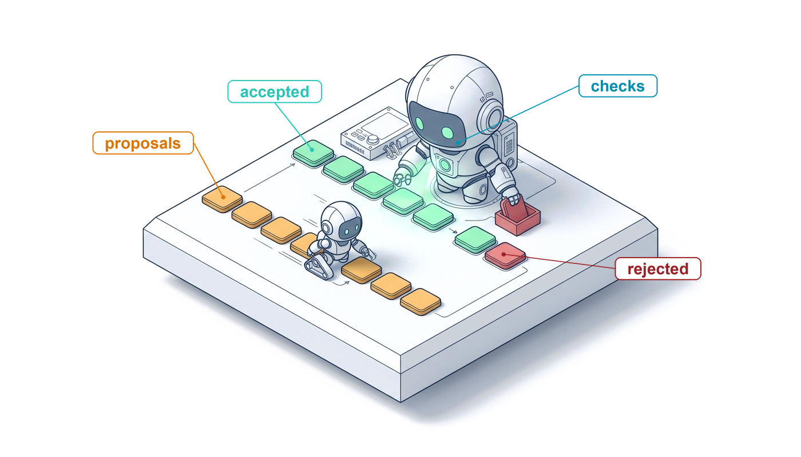
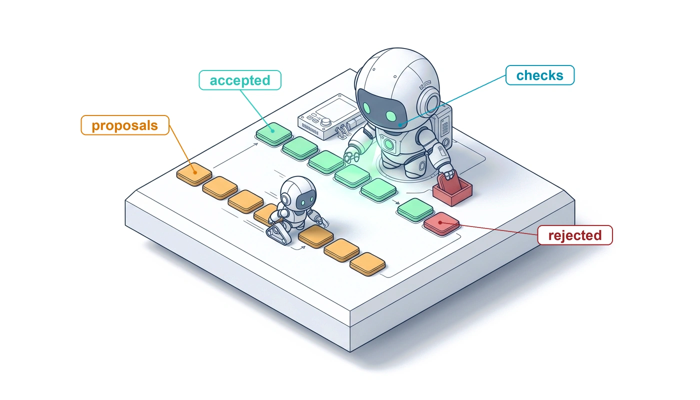
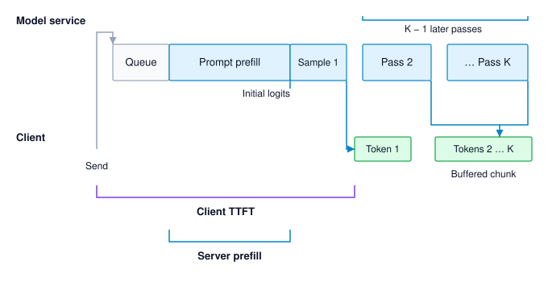

# The Foundation Model {#sec-vol3-foundation-model}

::: {layout-narrow}
::: {.column-margin}

\chapterminitoc

:::

::: {.content-visible when-format="pdf"}
\noindent
{fig-alt="Isometric illustration of a small robot laying orange token tiles along a track while a larger robot checks each tile, turning accepted tiles green and diverting a rejected red tile into a bin, so that only checked tokens continue down the track."}
:::

::: {.content-visible unless-format="pdf"}
{fig-alt="Isometric illustration of a small robot laying orange token tiles along a track while a larger robot checks each tile, turning accepted tiles green and diverting a rejected red tile into a bin, so that only checked tokens continue down the track."}
:::

:::

## Purpose {.unnumbered .unlisted}

::: {.content-visible when-format="pdf"}
\begin{marginfigure}
\mlagentstack{0}{0}{0}{0}{0}{100}
\end{marginfigure}
:::

::: {.content-visible unless-format="pdf"}
::: {.column-margin}
{width="100%" fig-alt="Agentic Machine Learning Systems Stack"}

*Agent stack focus for this chapter.*
:::
:::

_Why does a capable model still need a precise contract around every call?_

A model call can return a response that parses cleanly yet violates the tool schema, arrives past its deadline, or claims a file edit succeeded before any tool has run. Because every capability an agent adds—tool dispatch, memory retrieval, sandboxed execution, and recovery—is built from individual model calls, any ambiguity at the call boundary spreads into every subsystem downstream. A foundation model is an ungrounded token predictor that emits candidate proposals across an untrusted boundary, not a verified state transition. The surrounding runtime must therefore enforce reliability at each call through token budgets, schema checks, and independent verification. Within the H·S·A exposure space, the single call sits at the origin: one bounded turn, zero carried state, and zero ambient authority.

::: {.content-visible when-format="pdf"}

\newpage

:::

::: {.callout-learning-objectives}

- Explain the separate responsibilities of the foundation model, inference service, and agent runtime
- Construct a token-bounded request containing task messages, advertised tools, and generation limits
- Calculate how temperature and nucleus truncation reshape candidates without establishing correctness, and explain why only a recorded call replays exactly
- Diagnose response outcomes using completion status, structural validity, permission checks, and external evidence that self-review cannot supply
- Distinguish the guarantees of grammar-constrained decoding from learned formatting and correct task values
- Estimate call latency and repeated-input work under explicit serving and prefix-reuse assumptions
- Evaluate interface representations using accepted outcomes and resource use under matched task budgets

:::

## One Turn of the Repair Loop {#sec-vol3-foundation-model-introduction}

::: {.column-margin}
{width="100%" fig-alt="H·S·A locator with all three axes gray and only the origin dot highlighted in purple."}

*A single call runs one turn, carries no state, and holds zero ambient authority.*
:::

The repair agent (@sec-vol3-intro-lighthouses) needs to inspect the connection-pool implementation before proposing a change. A model call that emits `read_file("src/pool.py")` produces only an unexecuted text string. Of the six phases of a turn (@sec-vol3-intro-execution-lifecycle), only the call itself belongs to the model; checking the path, authorizing the read, running it, and returning the observation all belong to the runtime. This loop of model-generated proposals and runtime observations is the interaction pattern formalized by ReAct [@yao2023react], and every runtime phase depends on knowing what the single model phase delivers.

In a chat window, a human reader spots a response cut off mid-sentence, judges whether a shell command is safe to run, and waits out variable generation delays. An autonomous agent removes that human reader. The runtime receives the response as data and must check in code what a person would judge by eye: whether the prompt fit inside the context window, whether generation finished normally or hit the output token limit, whether a well-formed tool request targets a path inside the allowed workspace, and how much time and budget the call spent. Raw reply text cannot answer those questions; a runtime that guesses call state by scraping output strings will eventually apply a truncated patch or run a command outside its workspace.

Preventing those failures requires an explicit call contract between the agent runtime and the inference service. That contract covers both directions of the call: the outbound request (message history, advertised tool definitions, and token and time limits) and the inbound response record (payload kind, stop reason, normalized status, and token usage). It also fixes the checks the runtime runs before dispatching any proposed action, along with the latency and input-recomputation costs of each call. Rather than assuming the model is reliable, the contract treats the inference service as an untrusted, probabilistic generator and keeps every control-flow decision in the runtime.

The chapter follows the repair agent's single inspection call from request to bill, adding one runtime obligation at each step. Before the call is sent, the runtime must know who owns which decision (@sec-vol3-foundation-model-role) and whether the serialized request fits with room left for an answer (@sec-vol3-foundation-model-tokenization). How the service then produces a candidate (@sec-vol3-foundation-model-autoregressive) explains why repeated calls differ and why generation can stop before the candidate is whole. That possibility fixes the order of the checks on the way back. The runtime first reads the call's normalized status to learn whether a complete candidate arrived at all (@sec-vol3-foundation-model-contract), then asks which property each check on a completed candidate actually establishes (@sec-vol3-foundation-model-continuations), and finally whether syntax errors can be prevented during generation instead of rejected after it (@sec-vol3-foundation-model-grammar-constrained). The last two sections price the call. Output length and re-sent history set its latency and work (@sec-vol3-foundation-model-cost), and those costs decide how competing output representations should be compared, on accepted repairs under a matched budget (@sec-vol3-foundation-model-interface-design).

## The Model Call Boundary {#sec-vol3-foundation-model-role}

If a runtime treats a model's output string `read_file("src/pool.py")` as an already-authorized file read, a single hallucinated path can read outside the workspace before any check runs. Keeping a proposed action separate from an executed one requires splitting each call across three components: the foundation model, the inference service, and the agent runtime. The foundation model[^fn-foundation-model-term] computes conditional probability distributions over token sequences given a prompt context. The **inference service**\index{Inference service!definition} hosts the model weights, runs forward passes on accelerators, applies sampling parameters, and packages the output tokens into a response record. The agent runtime drives the task: it builds the prompt, tracks budgets, checks candidate outputs, and decides whether an action is allowed to run in the host environment. Even when all three run in the same process on one machine, their interfaces keep generated text separate from the decision to act on it.

[^fn-foundation-model-term]: **Homogenization**: The same report that named foundation models warned that, because many applications adapt one shared base model, a defect in that model passes into every system built on it [@bommasani2021opportunities]. For autonomous agents the warning is concrete. Every runtime that invokes the same model and serving path inherits the same failure modes at once, so the runtime, rather than the model, must hold the operational checks. \index{Foundation model!homogenization}

::: {#dfn-vol3-proposal .callout-definition title="Proposal"}

A ***proposal***\index{Proposal!definition} is model output that specifies a candidate action or answer for the runtime to evaluate, carrying zero ambient authority and producing no external side effects until the runtime explicitly validates, authorizes, and executes it.

1.  **Significance**: Every external effect of an agent depends on an explicit runtime decision. Because the model call possesses zero ambient authority, a rejected proposal costs one inference invocation rather than an unintended modification to the environment. That invocation still consumes resources and counts toward $\AttemptCost$ in the cost per accepted task (@eq-vol3-cost-per-accepted-task).
2.  **Distinction**: A proposal must not be confused with an *effect* (a state change executed by the runtime after authorization) or an *observation* (the runtime's factual record of what an operation returned). Emitting `read_file("src/pool.py")` is merely a proposal; the file contents subsequently retrieved from disk and supplied to the next call constitute an observation.
3.  **Common pitfall**: Logging a tool request as an executed action, or accepting a model's textual claim that "the file has been read" as an empirical observation, allows fluent prose to stand in for operational evidence.

:::

### Messages and tool definitions {#sec-vol3-foundation-model-messages-tool-definitions}

A model cannot tell an operator's instruction, a user's prompt, and a file excerpt returned by a tool apart unless the runtime labels each piece of the request, yet those labels alone do not make the content trustworthy. The runtime organizes the prompt as an ordered sequence of role-tagged messages\index{Model invocation contract!messages and roles}: a `system` message sets task instructions and constraints, a `user` message supplies the task prompt, an `assistant` message records earlier model outputs, and a `tool` message carries the raw observation returned when an action runs. Role tags organize the token stream for the model's attention mechanism, while the runtime remains responsible for checking whether the content is authentic and follows the task contract.

::: {.column-margin .margin-pointer}
↩ The task contract, which fixes the goal, environment, permitted actions, available observations, and completion criteria, is established in @sec-vol3-intro-five-part-contract.
:::

Alongside the message history, the request advertises the tools available to the model and gives their argument schemas. In @lst-vol3-model-request, the runtime declares a file-reading tool with one required string parameter. The JSON-schema definition tells the model what syntax a valid proposal needs, while the runtime enforces workspace sandboxing and filesystem permissions independently.

::: {#lst-vol3-model-request lst-cap="**A bounded inspection request**: This provider-neutral record separates model-visible messages and tool definitions from the configuration and limits governing the call. Symbolic values stand for settings chosen by the runtime; the field names do not prescribe a vendor API."}
```yaml
model_config: repair-model/config-a
messages:
  - role: system
    content: Propose the next inspection for the assigned repair.
  - role: user
    content: Inspect the connection-pool locking logic in src/pool.py.
tools:
  - name: read_file
    arguments_schema:
      type: object
      properties: {path: {type: string}}
      required: [path]
      additionalProperties: false
limits:
  max_output_tokens: K_max
  deadline: T_deadline
sampling: selected_sampling_settings
```
:::

The `model_config` field binds the request to a specific model version, weights checkpoint, and serving profile, while `sampling` controls how the service draws output tokens from the model's predicted distribution. Two resource bounds protect the call from running away: `max_output_tokens` ($\OutputLimit$) caps how many tokens the call can generate, and `deadline` ($\CompletionDeadline$) sets a timeout against queue delays and serving stalls. Writing those bounds into the request works only when the inference service or client runtime enforces them during generation.

When generation finishes, the inference service returns free-form text, a tool proposal, or a service error, and a runtime adapter normalizes that provider-specific reply into a single envelope (@lst-vol3-model-response). Here, the service reports a completed generation pass that produced a tool request to read `src/pool.py`—one diagnostic step before any repair is checked.

::: {#lst-vol3-model-response lst-cap="**A returned tool proposal**: Response kind identifies what the payload represents, while status and stop reason describe the invocation. Usage counts describe consumed generation resources, not progress on the repair."}
```yaml
kind: tool_request
payload:
  name: read_file
  arguments: {path: src/pool.py}
stop_reason: tool_request
status: COMPLETED
usage: {input_tokens: S, output_tokens: K}
```
:::

Here, `kind` tells the runtime parser how to read the payload. The normalized `status` confirms that transport and generation finished under the adapter's contract, while `stop_reason` records the **stop reason**\index{Stop reason!definition} reported by the serving engine: whether the model emitted a tool-call marker, hit an end-of-sequence token, or stopped at the token limit. The `usage` block counts $\SequenceLength$ input tokens read and $\OutputLength$ output tokens generated. Bare $\SequenceLength$ is sequence length throughout this book, here the prompt a call reads; the State levels $\Glyph{S}_0$ to $\Glyph{S}_3$ always carry their subscript. Tracking usage across calls prevents context-window overflow and feeds cost accounting; if a provider omits token counts, the runtime records usage as missing rather than zero.

Every path out of the response ends in the runtime, and the stop reason chooses the path (@fig-vol3-model-call-surface). A tool call goes to validation and authorization before anything runs, a finished answer goes to verification, and output cut off at its limit goes to quarantine, where it is kept for diagnosis and never executed (@sec-vol3-foundation-model-status-envelope states the rule).

::: {#fig-vol3-model-call-surface fig-env="figure" fig-pos="htb" fig-cap="**The Model Call Surface**: The request carries messages, tool definitions, and limits into a model with frozen weights, which returns a proposal with a stop reason and usage counts. Every arrow out of the response lands in the agent runtime. The runtime validates and authorizes a tool call before anything runs, returns the result as a new message for the next call, sends a finished answer to verification, and quarantines output cut off at its limit." fig-alt="Diagram. A request card lists tools and limits above a stack of message slabs labeled system, user, assistant, and tool, the tool slab dashed. An arrow leads to a model box showing tokens y1, y2, y3 drawn one per step with frozen weights, and an arrow leads to a response card with rows for text, tool calls, usage, and a highlighted stop reason row. From the stop reason an arrow drops into an agent runtime region to a route on stop reason box. Its tool call branch goes to validate, authorize, then run in sandbox, and from the sandbox an arrow returns up to the tool slab of the request. Its end of turn branch goes to verify, and its output limit branch goes to a red quarantine box."}

:::

### Proposals and observations {#sec-vol3-foundation-model-proposals-observations}

If the runtime ran a returned `read_file` proposal directly against the host filesystem, a path like `../../etc/passwd` or a malformed argument would execute before any check caught it. Instead, the runtime passes every tool proposal through validation and authorization before anything runs. First, it checks structural conformance, confirming that the proposed arguments match the declared schema (for example, that `path` is a string rather than a shell command). Next, it checks the arguments against the task's permission grant: advertising `read_file` lets the model propose file reads, but grants no right to read arbitrary paths. The runtime verifies that `src/pool.py` resolves inside the allowed workspace rather than escaping to host files through directory traversal. Once authorized, the tool runs outside the model call, inside an isolated sandbox or container with its own timeout.

After the tool finishes, the runtime records what happened and builds the next prompt. It appends the model's `assistant` proposal paired with a `tool` message carrying the observation (here, the bounded file excerpt). That observation reports the actual outcome, including a missing file or a permission denial, and notes when the output was truncated; @sec-vol3-tool-calling-round-trip develops how the runtime matches each result to the call it answers, records errors, and marks truncation.

The model on the next turn sees the tool output only because the runtime rebuilds and sends the updated context window. Foundation models are stateless token predictors with no internal memory of earlier requests or tool runs. Session identifiers or server-side prefix caching (reusing attention state the service already computed for a prompt prefix that repeats across turns, priced in @sec-vol3-foundation-model-trajectory-cost-accumulation) can cut latency, but the runtime alone decides which messages enter the prompt. That separation also means an observation can go stale: a file excerpt in the prompt shows the file only as it stood when read, so if a later command edits the file on disk, the excerpt in context is out of date.

The gap between a proposal and an observation is where the fail-plausible fault enters. A model can emit a well-formed proposal targeting the wrong source module, or a convincing analysis grounded in an obsolete observation, and the tokens look the same either way. Agent engineering therefore requires treating status, schema structure, security authorization, and empirical evidence as distinct, non-fungible properties of the interaction. @Tbl-vol3-foundation-model-responsibilities summarizes what the runtime owns around every call, whether the model runs in the local process or behind a remote API.

::: {.column-margin .margin-pointer}
↩ The fail-plausible fault, output that looks well formed and credible while the intended property fails, is established in @sec-vol3-intro-fail-plausible.
:::

| Model term                  | Runtime responsibility                                                       | Failure if the runtime ignores it                                     |
|:----------------------------|:-----------------------------------------------------------------------------|:----------------------------------------------------------------------|
| **Context window**          | Count the complete input representation and reserve output headroom          | Rejected request or insufficient room for a complete response         |
| **Sampling settings**       | Choose supported settings and retain them with the request and output        | Unexplained variation or an unjustified assumption of reproducibility |
| **Tool call**               | Check the proposal, authorize access, and return the actual tool observation | A proposed operation mistaken for an executed or permitted one        |
| **Stop reason**             | Interpret it with normalized status before treating the payload as complete  | An interrupted or refused response treated as a finished candidate    |
| **Fluent but wrong output** | Evaluate the relevant claim using checks and observations with stated limits | Credibility mistaken for evidence of the intended property            |
| **Successful response**     | Distinguish delivery and generation completion from task acceptance          | A completed call recorded as a successful repair                      |
: **What the runtime owns around a model call**: Each feature of the call creates an obligation outside the model's generated content. Satisfying one obligation does not discharge the others. {#tbl-vol3-foundation-model-responsibilities}

The request and response records fix the boundary around a model call: messages supply context, tool definitions specify what the model may propose, and the runtime mediates every effect on external state. Before the service can run the call, however, the whole request must fit inside the model's context window with room left for the response, and checking that fit requires counting tokens rather than characters, messages, or files.

## Tokenizing the Request {#sec-vol3-foundation-model-tokenization}

When an automated repair agent appends a connection-pool source file and a compiler diagnostic to its message history, the payload expands rapidly. Naive metrics like file counts or raw character counts cannot determine whether the next request will fit within the model's capacity. Role delimiters, tool schemas, system prompts, file paths, and source code all serialize into a single sequence of discrete units before entering the neural network. The operational budget is the token count of that fully assembled sequence, measured strictly against the model's specific tokenizer and wire format.

### Tokens in the serialized request {#sec-vol3-foundation-model-serialized-request-tokens}

Estimating prompt size from character counts or source-code lexers fails because a model's **tokenizer**\index{Tokenizer!definition}\index{Tokenization|see{Tokenizer}} slices text into vocabulary identifiers whose boundaries rarely match words, identifiers, or JSON fields. Subword methods represent common fragments compactly while splitting unfamiliar words and identifiers into smaller pieces [@sennrich2016subword]. **Byte-pair encoding** (BPE)\index{Byte-pair encoding!definition}[^fn-bpe-compression-origin] learns repeated combinations of smaller units; other tokenizers use different segmentation rules, and some learn them directly from raw text without assuming word boundaries [@kudo2018sentencepiece]. Because a single token may represent a word, part of a word, whitespace, punctuation, or a combination of these, small formatting changes alter the token sequence.

[^fn-bpe-compression-origin]: **Byte-Pair Encoding (BPE)**: The algorithm began as a data-compression scheme that repeatedly replaces the most frequent pair of adjacent bytes with an unused symbol [@gage1994bpe]; @sennrich2016subword repurposed the same merge rule to build open vocabularies for neural translation. Because the merges are learned from the training corpus's frequencies, the token cost of a string reflects how common it was in that corpus, so an unusual identifier or path can split into more tokens than a common word of the same length, and the runtime must count rather than estimate. \index{Byte-pair encoding!compression origin}

Indentation alone alters the resulting sequence. Under one widely used byte-pair vocabulary, `cl100k_base`, for example, the unindented line `def get_user_id():` encodes as five tokens beginning with `def` (identifier 755). Indenting that exact line by four spaces yields six tokens: three leading spaces (262), followed by ` def` with the fourth space fused to the keyword (711), and finally the remaining four tokens. A compiler lexer records indentation as block structure and emits the same keyword token at both levels; the model instead receives a different opening sequence of integer identifiers, with only the four tokens after the keyword shared (@fig-vol3-token-ast-mismatch).

::: {#fig-vol3-token-ast-mismatch fig-env="figure" fig-pos="htb" fig-cap="**One Keyword, Two Token Sequences**: The same Python line, unindented and indented by four spaces, drawn on one character grid, with a compiler lexer's tokens above the characters and a byte-pair tokenizer's tokens below. The lexer records indentation as block structure and emits the same keyword and identifier for both lines. The tokenizer absorbs the fourth space into the keyword, so the indented line opens with two tokens that do not appear in the unindented one; only the four tokens after the keyword are shared. Identifiers are from the `cl100k_base` vocabulary." fig-alt="Two stacked blocks, unindented and indented by four spaces. Each block shows a row of character cells for the line def get_user_id():, with lexer tokens above and byte-pair tokens below, each token spanning the characters it covers. Lexer tokens are def, get_user_id, open parenthesis, close parenthesis, and colon; the indented line adds a dashed indent token over the four spaces. Byte-pair tokens for the unindented line are def 755, space get 636, _user 3398, _id 851, and parentheses colon 4658, labeled 5 tokens. For the indented line they are three spaces 262, space def 711, and the same four tokens, labeled 6 tokens. Tokens 755, 262, and 711 are filled dark; a dashed line marks where the lexer splits the indent from def, which the 711 token straddles. Brackets below mark the two leading tokens, where the fourth space joins the keyword, and the four tokens shared by both lines."}

:::

In an inspection request, the string `src/pool.py` is a single path argument at the tool interface, yet it splits into several subword tokens at the model interface. Changing a file path, adding indentation, or escaping source code inside JSON shifts token boundaries in ways a fixed character-to-token ratio cannot predict. Neither JSON framing nor punctuation adds a constant fraction of tokens over plain prose, so the runtime must tokenize the exact byte sequence it plans to send.

Wire framing adds further tokens beyond the visible text. Model APIs wrap messages in control tokens that mark roles, turn boundaries, and tool schemas. Counting only the user prompt or tool output misses that wrapper. When the runtime formats the wire payload locally, it must run the model's own tokenizer over the complete formatted sequence; when a remote service applies its own chat template or hidden system wrapper, the runtime must use the provider's token-counting endpoint and admission rules. Because vocabularies and merge tables differ across model families, a token count from one model does not carry over to another.

The same count applies to generated output. A compact tool call uses fewer output tokens than a long prose explanation wrapping the same call, though the exact count depends on how the call is serialized. Shorter schemas cut latency and token spend only when they keep the fields the runtime needs; dropping required arguments, file paths, or error variants to save a few tokens makes downstream execution brittle.

### Output headroom {#sec-vol3-foundation-model-output-headroom}

A prompt that fits inside the context window can still leave too little room for the model to finish its reply, cutting off a tool call mid-argument. To prevent a long prompt from starving the response, the admission check must reserve **output headroom**\index{Output headroom!definition}\index{Context window!output headroom} before sending the call. Let $\SequenceLength$ denote the length of the fully serialized input prompt, $\ContextWindow$ the total **context window**\index{Context window!definition} (the maximum sequence capacity spanning input and output tokens within a single invocation), and $\OutputLimit$ the reserved generation allowance. Where input tokens and generated tokens share a unified context budget, an admission check must enforce:

$$\SequenceLength \le \ContextWindow - \OutputLimit$$ {#eq-vol3-fm-admission}

This inequality guarantees that an incoming prompt cannot fill the context buffer and leave the model no room to answer. Many services also cap input and output lengths separately alongside the shared window, so the runtime must satisfy both the individual caps and the combined bound. Reasoning models add another wrinkle: they emit intermediate reasoning tokens before the visible answer, and those hidden tokens count against $\OutputLimit$ even when the caller never sees them. A three-line visible reply can exhaust a generous output allowance if the model spent hundreds of hidden reasoning tokens first.

::: {.column-margin .margin-pointer}
↪ How reasoning models spend generated tokens on intermediate work, and how the runtime budgets them, is developed in @sec-vol3-test-time-compute-reasoning-models.
:::

```{python}
#| label: calc-vol3-invocation-token-budget
#| echo: false
# ┌─────────────────────────────────────────────────────────────────────────────
# │ ADMISSION HEADROOM FOR AN INSPECTION REQUEST (LEGO)
# ├─────────────────────────────────────────────────────────────────────────────
# │ Context: @sec-vol3-foundation-model-tokenization, token and image budgets.
# │ Goal: Separate input admission from reserved generation capacity.
# │ Show: Remaining input room and the effect of a model-specific image charge.
# │ How: Use hypothetical service counts; subtract reserved output and input
# │      from the combined window, then add the image contribution.
# └─────────────────────────────────────────────────────────────────────────────
from mlsysim import *

class InvocationTokenBudget:
    # ┌── 1. LOAD (Constants & Parameters) ─────────────────────────────────
    window = 8_192  # hypothetical combined context limit, tokens
    output = 1_024  # scenario: reserved generation allowance, tokens
    text_input = 6_000  # scenario: complete serialized text request, tokens
    image_input = 2_048  # scenario: service-reported additional image charge

    # ┌── 2. EXECUTE (Compute) ─────────────────────────────────────────────
    input_ceiling = window - output
    headroom = input_ceiling - text_input
    multimodal_total = text_input + image_input + output
    excess = multimodal_total - window

    # ┌── 3. GUARD (Invariants) ────────────────────────────────────────────
    check(input_ceiling == 7_168, "Unexpected input ceiling")
    check(headroom == 1_168, "Unexpected remaining input headroom")
    check(multimodal_total == 9_072, "Unexpected multimodal total")
    check(excess == 880, "The image must exceed the reserved request budget")

    # ┌── 4. OUTPUT (Formatting) ───────────────────────────────────────────
    window_str = fmt_int(window)
    output_str = fmt_int(output)
    text_input_str = fmt_int(text_input)
    image_input_str = fmt_int(image_input)
    input_ceiling_math = fmt_math(rf"\ContextWindow - \OutputLimit = {window:,} - {output:,} = {input_ceiling:,}")
    headroom_math = fmt_math(rf"{input_ceiling:,} - {text_input:,} = {headroom:,}")
    multimodal_math = fmt_math(rf"{text_input:,} + {image_input:,} + {output:,} = {multimodal_total:,}")
    excess_str = fmt_int(excess)
```

Suppose the repair interface has a combined window of `{python} InvocationTokenBudget.window_str` tokens, and the runtime reserves `{python} InvocationTokenBudget.output_str` tokens for generation. Its input ceiling is `{python} InvocationTokenBudget.input_ceiling_math` tokens. If the fully serialized request occupies `{python} InvocationTokenBudget.text_input_str` tokens, `{python} InvocationTokenBudget.headroom_math` tokens of room remain for additional input while preserving the response allowance. The limits are scenario values, not a named model's specification.

If an incoming tool observation exceeds this remaining headroom, the admission check fails. The runtime can then compress prompt history, extract a narrower file slice, or route the call to an execution profile with a larger context window. Shrinking the output allowance $\OutputLimit$ to force admission is risky, as it leaves the model insufficient room to complete complex tool invocations or structured plans. Similarly, silently truncating tool outputs to squeeze them into the remaining margin can strip away the critical stack trace or diagnostic error that the agent needs to resolve the bug.

Even when a request satisfies admission checks, generation can still hit the output token ceiling mid-stream. The runtime must never confuse a syntactically well-formed prefix with a successfully terminated generation. A truncated JSON object may happen to pass a lenient parser if closed artificially, yet it remains an incomplete execution plan. While a partial payload provides valuable diagnostic telemetry, executing it as an intact tool call can cause downstream corruption. The invocation contract in @sec-vol3-foundation-model-contract turns this boundary into an explicit rule that reads the call's status before its payload.

### Counting multimodal inputs {#sec-vol3-foundation-model-multimodal-accounting}

Attaching a screenshot of a failing dashboard or user-interface (UI) render to a repair request can push a prompt that fit in text well past the context limit. A vision front-end maps each image into a sequence of context positions, and although vision transformers slice images into uniform patches [@dosovitskiy2021image], preprocessing steps such as dynamic tiling, resolution scaling, and spatial pooling mean the billed token count rarely equals a simple patch count.

Consider the earlier budget when adding this visual artifact. If the service reports that the image and its framing tokens require an additional `{python} InvocationTokenBudget.image_input_str` context positions, the total request demand expands to `{python} InvocationTokenBudget.multimodal_math` tokens. This total exceeds the `{python} InvocationTokenBudget.window_str`-token context window by `{python} InvocationTokenBudget.excess_str` tokens, triggering an immediate admission failure before dispatch. The runtime must step in before calling the model. Downscaling the image cuts its token count under some vision backends, but heavy compression can blur single-character error codes or fine trace lines. Budgeting multimodal inputs therefore trades visual detail against the context ceiling.

::: {#chk-02-context-exhaustion-quarantine .callout-checkpoint title="Admitting the next repair request"}

The repair agent is about to add a source excerpt and a diagnostic image to its next call. Its output allowance must remain available for a complete proposal.

- [ ] **Input budget**: Can you identify which message and tool-definition framing must be counted beyond the visible source excerpt?
- [ ] **Output headroom**: With the window fixed at `{python} InvocationTokenBudget.window_str` tokens and the image added, would halving the output reservation make the request fit? Compute the remaining excess, and state what the smaller reservation risks.
- [ ] **Generation status**: If a returned fragment parses successfully after the output limit is reached, can you explain why it is still not a completed candidate?

:::

Token accounting checks upfront that the full request fits with room reserved for the reply. Admission, however, covers only starting capacity. Once decoding begins, token-by-token autoregressive generation determines how that reserved headroom is spent and whether the call finishes cleanly or stops mid-stream.

## Autoregressive Generation {#sec-vol3-foundation-model-autoregressive}

Even when a request fixes the conversation history and the list of available tool schemas, the model's reply remains open-ended and stochastic. On the same repair prompt, one call might propose `read_file` on a configuration path, a second might inspect a different directory, and a third might return prose instead of a tool call. Understanding how the serving engine generates tokens one step at a time explains how to set token budgets and sampling parameters, why repeating a live API call can produce a different trajectory, and why only replaying a recorded response reproduces downstream execution exactly.

### Token-by-token generation {#sec-vol3-foundation-model-conditional-token-selection}

When a model emits a file path inside a `read_file` argument, it chooses each token from learned statistical patterns without checking the filesystem, and that early choice conditions every closing delimiter and reasoning token that follows. Autoregressive language models generate text by factoring the joint probability of a sequence into a product of conditional next-token distributions [@bengio2003neural]. Let $\InputTokenSequence$ denote the input tokens and $\OutputTokenSequence$ an output sequence. Its conditional probability factors as

$$\Pr(\OutputTokenSequence \mid \InputTokenSequence) = \prod_{t=1}^{\OutputLength} \Pr(\OutputToken_t \mid \InputTokenSequence, \OutputTokenPrefix)$$ {#eq-autoregressive-factorization}

At output position $\TokenIndex$, the model with parameters $\ModelParameters$ produces one score, or **logit**\index{Logits!definition}, for each token in vocabulary $\TokenVocabulary$:

$$\LogitVector_t = \NextTokenLogitFunction(\InputTokenSequence, \OutputTokenPrefix) \in \mathbb{R}^{|\TokenVocabulary|}$$

A decoding rule selects a token from these scores and appends it to the prefix for position $\TokenIndex+1$, so early token choices cascade through the rest of the sequence. In an inference serving engine, the decode loop reads the prompt, computes next-token logits, picks an output token, appends it to the prefix, and repeats until a stop condition fires. Generation ends normally when the model emits an end-of-sequence token or matches a caller-supplied stop sequence. It can also stop early at the output token ceiling, or abort on a timeout or network drop. Serving interfaces must report which stop condition fired: an incomplete JSON object cut off at the token limit needs different handling than a finished tool call, and even a clean stop sequence says only that generation ended, not that the task succeeded.

Production Transformer implementations [@vaswani2017] avoid recomputing earlier tokens at every decode step by keeping a *key-value (KV) cache*:[^fn-kv-cache-derived] memory buffers holding the attention keys and values already computed for earlier positions. For a given full-attention architecture and precision, keeping more tokens in flight takes more cache memory. That cache is transient serving state, not an audit log of which tools ran or what they changed. @Sec-vol3-kv-cache covers cache layout and sizing; for a single call, the key point is that both prompt tokens and generated tokens occupy memory during the call.

[^fn-kv-cache-derived]: **Key-Value (KV) Cache**: In causal attention, key and value vectors at a given position depend solely on that token and its predecessors, so once computed they remain static throughout subsequent sequence expansion. Retaining them in device memory turns each new decode step from full-sequence recomputation into a single new row projection per layer alongside a read of stored rows. Consequently, cache capacity and memory bandwidth, rather than floating-point arithmetic, become the primary operational constraints as context windows expand. \index{KV cache!why reuse is exact}

Because each generated token extends a dependent sequence, output length is a major cost variable of a call, and the serving implementation sets its realized latency. Although the conditional dependence in @eq-autoregressive-factorization fixes the mathematical order of token choices, it does not mandate that hardware evaluate each token in an isolated forward pass. Techniques such as speculative decoding,[^fn-speculative-decoding-equivalence] for example, draft candidate token blocks with a small auxiliary model and score them in parallel with the target model, provably preserving the target output distribution [@leviathan2023fast; @chen2023accelerating]. The per-token decode floor derived in @sec-vol3-foundation-model-cost is therefore a property of plain one-token-per-pass decoding, not a law of the factorization.

[^fn-speculative-decoding-equivalence]: **Speculative Decoding**: The target distribution is preserved by a modified rejection-sampling rule that accepts each drafted token with exactly the probability needed for the accepted sequence to follow the target model's distribution [@leviathan2023fast; @chen2023accelerating]. The guarantee is distributional, not bitwise. Speculative decoding reduces accelerator passes per generated token without changing which candidates can appear, so it leaves the reproducibility questions of @sec-vol3-foundation-model-repetition-replay unchanged. \index{Speculative decoding!distribution preservation}

### Sampling controls {#sec-vol3-foundation-model-sampling-controls}

Lowering sampling randomness can make a model repeat its top-scoring token choice, yet the highest-scoring token is often a plausible guess rather than a valid file path or a working patch. For positive **temperature**\index{Temperature (sampling)!definition}[^fn-sampling-temperature-origin] $\SamplingTemperature$ (subscripted to keep it distinct from the trajectory $\Trajectory$), softmax converts the logits into next-token probabilities:

$$\Pr(\OutputToken_t = \VocabularyToken \mid \InputTokenSequence, \OutputTokenPrefix) = \frac{\exp\left(\OutputLogit_{t, \VocabularyToken} / \SamplingTemperature\right)}{\sum_{\NormalizerTokenIndex \in \TokenVocabulary} \exp\left(\OutputLogit_{t, \NormalizerTokenIndex} / \SamplingTemperature\right)}$$ {#eq-temperature-softmax}

Unit temperature ($\SamplingTemperature = 1.0$) leaves the logits unscaled. Lowering a positive temperature amplifies logit differences and concentrates probability mass on the highest-scoring tokens; raising it flattens the distribution, which approaches uniformity across a finite vocabulary as temperature grows without bound. Temperature therefore controls output entropy, not model confidence: because next-token cross-entropy training minimizes sequence prediction error rather than calibrating scores to task success, high token probability does not mean a completed response is correct.

[^fn-sampling-temperature-origin]: **Temperature**: The term comes from statistical mechanics, where the Boltzmann distribution weights a state of energy $\BoltzmannStateEnergy$ by $\exp(-\BoltzmannStateEnergy/\BoltzmannConstant \BoltzmannTemperature)$; reading each negative logit as an energy makes @eq-temperature-softmax identical in form. In a physical system, high temperature spreads particles across many states, whereas low temperature concentrates them near the ground state. In language model decoding, scaling temperature trades candidate diversity against concentration on the mode without changing which token scores highest. \index{Temperature (sampling)!Boltzmann origin}

**Greedy decoding**\index{Greedy decoding!definition} instead picks a highest-scoring token, $\operatorname{argmax}_{\VocabularyToken \in \TokenVocabulary} \OutputLogit_{t, \VocabularyToken}$, with a tie-breaking rule. Given fixed logits and a fixed tie rule, that choice is deterministic. Serving APIs often expose greedy decoding as $\SamplingTemperature = 0$, which the engine implements by taking the argmax directly rather than dividing by zero in @eq-temperature-softmax. As positive temperature approaches zero, softmax puts all probability mass on the maximum, though if several tokens tie for the top logit, the limit alone does not pick among them.

Sampling can also restrict which tokens remain eligible. **Top-$\TopTokenSampleCount$ sampling**\index{Top-k sampling!definition} [@fan2018hierarchical] keeps the $\TopTokenSampleCount$ highest-scoring tokens under a tie rule and renormalizes their probabilities. **Top-$\NucleusProbabilityMass$ sampling**\index{Top-p sampling!definition}, or nucleus sampling, sorts tokens by descending probability, keeps the shortest prefix whose cumulative mass reaches $\NucleusProbabilityMass$ [@holtzman2020curious], and renormalizes that set. Because top-$\TopTokenSampleCount$ fixes the candidate count regardless of shape, it can keep unlikely tail tokens when the distribution is sharp and cut plausible options when the distribution is flat; top-$\NucleusProbabilityMass$ lets the active pool expand or shrink with the distribution's spread. When temperature scaling and truncation are used together, the order in which they run and the engine's numerical conventions are part of the decoding configuration.

Neither filter tells valid file paths, true claims, or safe commands from wrong ones. A rare token may be the exact identifier a patch needs, while a high-probability continuation may name a file that does not exist. Truncation filters change which candidates reach the runtime; only checks against the environment and task contract tell whether that change helps.

::: {.column-margin}
{width="100%" fig-alt="Five probability bars for tokens v1 to v5 at unit temperature. v1 is labeled 78 percent and v2 17 percent, both in blue under a bracket labeled top-p 0.90. v3 is a short gray bar at about 4 percent and v4 and v5 are gray hairlines, together marked by the label tail cut, which top-p discards before renormalizing."}

*Nucleus truncation keeps the two tokens whose mass reaches 0.90 and zeroes the gray tail.*
:::

```{python}
#| label: lego-logit-scaling-truncation
#| echo: false
# ┌─────────────────────────────────────────────────────────────────────────────
# │ LOGIT SCALING AND TRUNCATION (LEGO)
# ├─────────────────────────────────────────────────────────────────────────────
# │ Context: @nbk-02-logit-scaling-and-truncation-on
# │ Goal: Compare temperature and nucleus sampling for the same hypothetical logits.
# │ Show: Sharpening and truncation redistribute probability, not correctness.
# │ How: Normalize exponentials, select a cumulative-probability prefix, renormalize.
# └─────────────────────────────────────────────────────────────────────────────
import math
from mlsysim import *
from mlsysim.fmt import check, fmt, fmt_math, fmt_multiple, fmt_percent

class LogitScalingTruncation:
    """Sampling transformations for a fixed hypothetical vocabulary."""

    # ┌── 1. LOAD (Constants & Parameters) ─────────────────────────────────
    logits = [12.0, 10.5, 9.0, 6.0, 3.0]
    tau_base = 1.0
    tau_sharp = 0.5
    p_nucleus = 0.90

    # ┌── 2. EXECUTE (Compute) ─────────────────────────────────────────────
    exp_tau1 = []
    for z in logits:
        exp_tau1.append(math.exp(z / tau_base))
    sum_exp_tau1 = sum(exp_tau1)
    probs_tau1 = []
    for e in exp_tau1:
        probs_tau1.append(e / sum_exp_tau1)
    exp_tau05 = []
    for z in logits:
        exp_tau05.append(math.exp(z / tau_sharp))
    sum_exp_tau05 = sum(exp_tau05)
    probs_tau05 = []
    for e in exp_tau05:
        probs_tau05.append(e / sum_exp_tau05)
    sum_nuc = probs_tau1[0] + probs_tau1[1]
    p_nuc_v1 = probs_tau1[0] / sum_nuc
    p_nuc_v2 = probs_tau1[1] / sum_nuc
    tail_base = 1 - probs_tau1[0]  # probability of drawing any non-top token
    tail_sharp = 1 - probs_tau05[0]
    tail_ratio = tail_base / tail_sharp

    # ┌── 3. GUARD (Invariants) ───────────────────────────────────────────
    check(abs(sum(probs_tau1) - 1.0) < 1e-12, "Baseline distribution must normalize")
    check(abs(sum(probs_tau05) - 1.0) < 1e-12, "Sharpened distribution must normalize")
    check(abs(probs_tau1[0] - 0.7840) < 0.001, "Unexpected tau=1.0 top prob")
    check(abs(probs_tau05[0] - 0.950324648968) < 1e-9, "Unexpected tau=0.5 top prob")
    check(abs(sum_nuc - 0.9589) < 0.001, "Unexpected nucleus denominator")
    check(probs_tau1[0] < p_nucleus <= sum_nuc, "Nucleus must contain exactly two tokens")
    check(abs(p_nuc_v1 - 0.8176) < 0.001, "Unexpected nucleus v1 prob")
    check(abs(p_nuc_v2 - 0.1824) < 0.001, "Unexpected nucleus v2 prob")
    check(abs(p_nuc_v1 + p_nuc_v2 - 1.0) < 1e-12, "Nucleus must normalize")
    check(3 < tail_ratio < 6, "Halving temperature should shrink the non-top tail several-fold")

    # ┌── 4. OUTPUT (Formatting) ──────────────────────────────────────────
    logits_math = fmt_math(rf"\LogitVector_t = [{', '.join(f'{v:g}' for v in logits)}]")
    base_vector_math = fmt_math(rf"\UnitTemperatureProbabilityVector \approx [{', '.join(f'{v:.4f}' for v in probs_tau1)}]")
    sharp_first_str = fmt(probs_tau05[0], precision=4, commas=False)
    sum_exp_tau1_str = fmt(sum_exp_tau1, precision=1, commas=False)
    tau_base_str = fmt(tau_base, precision=0, commas=False)
    tau_sharp_str = fmt(tau_sharp, precision=1, commas=False)
    top_mass_pct_str = fmt_percent(probs_tau05[0], precision=1, style="prose")
    p_nucleus_str = fmt(p_nucleus, precision=2, commas=False)
    first_prob_str = fmt(probs_tau1[0], precision=4, commas=False)
    second_prob_str = fmt(probs_tau1[1], precision=4, commas=False)
    nucleus_mass_str = fmt(sum_nuc, precision=4, commas=False)
    nucleus_first_str = fmt(p_nuc_v1, precision=4, commas=False)
    nucleus_second_str = fmt(p_nuc_v2, precision=4, commas=False)
    tail_base_pct_str = fmt_percent(tail_base, precision=1, style="prose")
    tail_sharp_pct_str = fmt_percent(tail_sharp, precision=1, style="prose")
    tail_ratio_mult_str = fmt_multiple(tail_ratio, precision=1)
```

::: {#nbk-02-logit-scaling-and-truncation-on .callout-notebook title="Temperature and truncation on the same logits"}

**Problem**: A hypothetical vocabulary $\TokenVocabulary = \{\VocabularyToken_1, \VocabularyToken_2, \VocabularyToken_3, \VocabularyToken_4, \VocabularyToken_5\}$ has logits `{python} LogitScalingTruncation.logits_math`, held fixed so that differences arise strictly from the decoding configuration. How much probability mass concentrates onto the top token when halving the temperature, and which tokens survive nucleus truncation?

**Math**: At temperature $\SamplingTemperature =$ `{python} LogitScalingTruncation.tau_base_str`, the exponentiated logits sum to `{python} LogitScalingTruncation.sum_exp_tau1_str`. Normalizing each exponential by this partition sum yields the baseline distribution:

`{python} LogitScalingTruncation.base_vector_math`.

Halving the temperature to $\SamplingTemperature =$ `{python} LogitScalingTruncation.tau_sharp_str` doubles the exponent of each term. Following normalization, the probability of the mode $\VocabularyToken_1$ rises to `{python} LogitScalingTruncation.sharp_first_str`, capturing `{python} LogitScalingTruncation.top_mass_pct_str` of the total distribution. All lower-ranked tokens retain positive probability under untruncated softmax.

Returning to unit temperature and applying nucleus truncation with $\NucleusProbabilityMass =$ `{python} LogitScalingTruncation.p_nucleus_str` evaluates cumulative probability mass. The lead token $\VocabularyToken_1$ provides `{python} LogitScalingTruncation.first_prob_str`, which falls short of the threshold. Incorporating $\VocabularyToken_2$ (`{python} LogitScalingTruncation.second_prob_str`) brings cumulative coverage to `{python} LogitScalingTruncation.nucleus_mass_str`, which satisfies the threshold and defines the active nucleus as $\{\VocabularyToken_1, \VocabularyToken_2\}$. Renormalizing across this active set assigns probability `{python} LogitScalingTruncation.nucleus_first_str` to $\VocabularyToken_1$ and `{python} LogitScalingTruncation.nucleus_second_str` to $\VocabularyToken_2$, while strictly zeroing the remaining tail tokens $\{\VocabularyToken_3, \VocabularyToken_4, \VocabularyToken_5\}$.

**Systems insight**: Temperature governs candidate diversity. Halving temperature compresses the non-top probability tail from `{python} LogitScalingTruncation.tail_base_pct_str` to `{python} LogitScalingTruncation.tail_sharp_pct_str`, achieving a `{python} LogitScalingTruncation.tail_ratio_mult_str` reduction, whereas nucleus truncation eliminates the tail entirely. Repeated calls produce diverse outputs only when probability mass occupies this tail, which is the stochastic resource that parallel candidate sampling draws on in @sec-vol3-test-time-compute-breadth-axis. Because neither transformation ensures that the highest-scoring candidate is correct, engineering teams configure decoding parameters based on empirical task pass rates rather than raw model likelihood.

:::

### Repetition and replay {#sec-vol3-foundation-model-repetition-replay}

Greedy decoding removes sampling variance from a fixed logit vector, but it does not make served API calls reproducible end to end. In a production cluster, two identical requests can land on different server nodes, accelerator revisions, or kernel builds. Small differences in floating-point reduction order[^fn-float-reduction-order] can shift nearly tied logits in their least significant bits, and flipping an argmax choice at position $\TokenIndex=1$ changes the prefix for every token after it. Fixing a pseudorandom seed controls the sampler's random number generator, but it cannot prevent numerical differences across backend kernels or dynamic batch sizes. Reproducing a call from scratch requires pinning the serving environment and kernels as well as setting $\SamplingTemperature = 0$. A 2025 production incident shows how serving-fleet bugs alone can change model outputs while caller requests stay identical.

[^fn-float-reduction-order]: **Floating-Point Reduction Order**: Floating-point addition is not associative because each intermediate sum rounds [@goldberg1991]. Parallel attention and reduction kernels that sum dot products across different thread-block layouts or dynamic batch sizes add numbers in different orders, so the same request can produce logits that differ in their low bits depending on which other requests share its batch. \index{Floating-point arithmetic!nondeterministic reduction}

```{python}
#| label: calc-vol3-fm-serving-postmortem
#| echo: false
# ┌─────────────────────────────────────────────────────────────────────────────
# │ SERVING-PATH INCIDENT FIGURES (LEGO)
# ├─────────────────────────────────────────────────────────────────────────────
# │ Context: ws-02-anthropic-serving-bugs-2025 and the replay fallacy in
# │          @sec-vol3-foundation-model-fallacies.
# │ Goal: Carry the incident's reported shares as named, sourced inputs.
# │ Show: Worst-hour share of one model's requests misrouted; share of one
# │       tool's users with at least one misrouted message.
# │ How: Values as reported in anthropic2025postmortem; no computation.
# └─────────────────────────────────────────────────────────────────────────────
from mlsysim.fmt import check, fmt_percent

class ServingPostmortem:
    # ┌── 1. LOAD (Constants & Parameters) ─────────────────────────────────
    worst_hour_share = 0.16  # sourced: anthropic2025postmortem, worst hour, one model's requests misrouted
    user_share = 0.30  # sourced: anthropic2025postmortem, approx. share of coding-tool users affected

    # ┌── 2. EXECUTE (Compute) ─────────────────────────────────────────────
    # Reported values only.

    # ┌── 3. GUARD (Invariants) ───────────────────────────────────────────
    check(0 < worst_hour_share < user_share < 1, "Reported shares must be fractions in source order")

    # ┌── 4. OUTPUT (Formatting) ──────────────────────────────────────────
    worst_hour_pct_str = fmt_percent(worst_hour_share, precision=0, style="prose")
    user_pct_str = fmt_percent(user_share, precision=0, style="prose")
```

::: {#ws-02-anthropic-serving-bugs-2025 .callout-war-story title="Three serving bugs behind unchanged requests (2025)"}

**Context**: Between August and early September 2025, three separate infrastructure bugs intermittently degraded the responses of Anthropic's Claude models [@anthropic2025postmortem]. These defects stemmed entirely from the serving infrastructure rather than caller requests or model weights.

**Mechanism**: A front-end routing defect directed standard traffic to server clusters configured for extended context windows, while session stickiness (routing a client's follow-up requests to the server that handled its earlier ones) kept those follow-up requests on the misconfigured nodes. Concurrently, an improperly deployed kernel optimization on a specialized accelerator cluster occasionally assigned outsized probability to improbable tokens. Finally, an optimization in the token-selection pipeline triggered a compiler bug: an approximate top-$\TopTokenSampleCount$ routine with mixed-precision subroutines emitted incorrect tokens under specific dynamic batch sizes.

**Impact**: During peak impact, the routing failure corrupted `{python} ServingPostmortem.worst_hour_pct_str` of requests to one production model, and approximately `{python} ServingPostmortem.user_pct_str` of active coding agent users encountered at least one misrouted interaction. Generated responses contained foreign-language script insertions within English prose and syntax anomalies in generated source code. Automated regression suites initially missed these failures because a response often recovered from an isolated corrupted token later in generation, and intermittent runtime conditions meant an identical prompt could succeed on one invocation and fail on the next.

**Fix**: Engineers rolled back the offending kernel deployments, corrected cluster routing rules, and replaced the approximate top-$\TopTokenSampleCount$ kernel with an exact selection routine running in 32-bit floating-point precision, trading a minor throughput penalty for numerical stability. Anthropic subsequently deployed continuous canary evaluations across production fleets to catch subtle generational drift.

**Systems lesson**: Output distributions reflect the concrete serving pipeline just as heavily as the model weights or input context. Corrupted tokens arrived packaged in well-formed HTTP payloads and cleanly closed generation blocks, a direct instance of the fail-plausible fault (@sec-vol3-intro-fail-plausible). Agent runtimes must log full call-level metadata (runtime versions, routing tags, and sampling parameters) while subjecting every proposed action to external environment validation regardless of nominal generation success.

:::

Incidents like this one set the logging baseline for an agent runtime. The runtime log should record the serialized prompt, model and tokenizer identifiers, sampling settings, token limits, and any routing or seed metadata, alongside the raw response payload, stop reason, and token usage. Those records also separate two kinds of debugging: replaying a recorded response tests the runtime's downstream logic without model variance, whereas re-sending the live request tests how the agent handles variation across calls. Benchmarks should measure and report that call-to-call variance rather than judging a configuration from a single run.

An agent runtime therefore receives candidate tokens produced under a specific decoding configuration and ended by a specific stop condition. That stop condition is the first thing the runtime must read. A generation that ran into its output ceiling, was refused, or was cut off in transit can still deliver bytes that look like a finished proposal, and no check on the payload alone tells the difference. Before asking whether a `read_file` proposal names an existing, permitted path, the runtime needs a record of whether a complete candidate arrived at all.

## The Invocation Contract {#sec-vol3-foundation-model-contract}

Suppose a model begins generating a cleanup command targeting the path `/tmp/scratch/cache_dir`, but reaches its token limit immediately after emitting `/tmp/scratch`. Both strings form syntactically valid shell commands, yet they specify different deletion boundaries. An execution engine inspecting only raw text cannot determine whether the shorter path represents an intended command or a truncated prefix. To prevent an unintended deletion, the host runtime requires an explicit execution outcome alongside the payload, pairing each request specification with a normalized response envelope at the invocation boundary so that every remote generation is governed by a unified contract.

::: {#dfn-vol3-model-invocation-contract .callout-definition title="Model invocation contract"}

***Model invocation contract***\index{Model invocation contract!definition} is the pair of records that bounds one model call: a request fixing the input, model configuration, sampling settings, and enforced output and time limits, and a normalized envelope reporting the call's status, payload, and resource use.

1.  **Significance**: The contract establishes each model call as a distinct, countable unit within an agent trajectory. Its usage record prices the call's share of $\AttemptCost$, and its status flag isolates completed generations from partial or failed calls. Consequently, the cost per accepted task (@eq-vol3-cost-per-accepted-task) can be computed from recorded telemetry rather than heuristically reconstructed from conversation transcripts.
2.  **Distinction**: The invocation contract describes the model call rather than the overarching task. A generated tool request can fully conform to decoding limits without ever being dispatched, and a fully generated response can fail downstream validation. Dispatch authorization, tool execution, and task-level acceptance remain separate runtime decisions backed by their own evidence.
3.  **Common pitfall**: Recording only the payload text. Without explicit status flags and usage accounting, a truncated fragment is indistinguishable from an intentional short response, and unrecorded token consumption silently distorts operational cost accounting as zero-cost execution.

:::

### What a request specifies {#sec-vol3-foundation-model-request-specification}

Leaving any part of a model request implicit—an unpinned model alias that silently updates, an unenforced token cap, or an unrecorded sampling setting—makes it impossible to price the call or explain why its behavior changed. At the generation interface, the bounded request fixes six fields:

$$\ModelCallRequest = \langle \RequestPromptTokens, \text{ModelID}, \OutputLimit, \CompletionDeadline, \StopSequenceSet, \SamplingParameters \rangle$$

The first field, $\RequestPromptTokens = (\PromptToken_1, \PromptToken_2, \dots, \PromptToken_{\SequenceLength})$, encodes the serialized messages, role markers, advertised tool schemas, and formatting delimiters visible to the model, which the runtime builds from structured `messages` and `tools` inputs before serialization. Once the input sequence is fixed, `ModelID` and $\SamplingParameters$ specify how the serving stack evaluates it. `ModelID` names the model weights and serving deployment selected through `model_config`, where engineers distinguish mutable provider aliases (such as `model-latest`) from pinned, immutable revisions (such as dated or content-addressed snapshots). The sampling parameters $\SamplingParameters$, including temperature and top-$\NucleusProbabilityMass$, then fix the selection rule used during decoding. Together with the serialized input and returned output, those fields document the call; exact regeneration also depends on the serving path, as war story \ref{ws-02-anthropic-serving-bugs-2025} showed.

To bound how long that generation may run, the request pairs an output allowance $\OutputLimit$ with a local waiting deadline $\CompletionDeadline$. Because a system cannot rely on the model to stop on time, invariant closure (principle \ref{pri-invariant-closure}) places both limits below the model, where the host runtime and serving system enforce them mechanically. Before sending the call, the runtime checks that the prompt and output allowance fit inside the context window, and the adapter notes whether the provider bills hidden reasoning tokens against $\OutputLimit$, since counting only visible text would understate what the call spent.

Generation can also end before reaching $\OutputLimit$ when the output matches one of the stop sequences in $\StopSequenceSet$, which halt decoding as soon as the serving engine encounters them. Because the engine matches raw byte or character sequences without parsing structure, a stop sequence that appears inside an argument or quoted string can cut off generation before the closing quotes or braces are emitted. The runtime must therefore record the provider's stop reason and validate syntax separately.

Resource limits are enforced in two places: on the client host and on the remote serving cluster. Locally, the host runtime caps incoming response bytes and stops waiting when the deadline $\CompletionDeadline$ expires. A local timeout ends the caller's wait and marks the call failed, but it does not prove that the remote server stopped decoding or freed accelerator memory.[^fn-rpc-unknown-outcome] Server-side token caps and cancellation protocols handle the remote side, so every limit should state which component enforces it and which resource it bounds.

[^fn-rpc-unknown-outcome]: **Remote Call Semantics**: Remote procedure call designers met this ambiguity first. In the design @birrell1984rpc describe, a call that returns normally executed exactly once, but a call that ends in a failure report may have executed once or not at all, because the caller cannot tell a lost request from a lost reply. A model call inherits the same gap: a timed-out generation may still have run to completion and been billed, which is why the normalized status for a failed delivery, `TRANSPORT_FAILURE` (@tbl-vol3-invocation-status), records an unknown remote outcome rather than a call that never happened. \index{Remote procedure call!unknown outcome}

### The normalized status envelope {#sec-vol3-foundation-model-status-envelope}

If a runtime inspects only the returned text or tool arguments, a partial string cut off by a token ceiling looks just like a finished proposal. To keep how a call ended attached to what it returned, the runtime wraps every response in a **normalized status envelope**\index{Normalized status envelope!definition}:

$$\NormalizedStatusEnvelope = \langle \text{status}, \ResponsePayload, \ResponseMetadata \rangle$$

Here, $\ResponsePayload$ is the returned payload, which may be complete, partial, or empty, and $\ResponseMetadata$ holds the call's telemetry: the response `kind`, the raw provider `stop_reason`, reported token `usage`, request identifiers, latency timestamps, and serving settings. Keeping $\ResponsePayload$ paired with $\ResponseMetadata$ prevents downstream code from reading the payload without its status, and records unreported usage as unknown rather than zero.

Because different model APIs report stop reasons, error codes, and transport failures in incompatible ways, the runtime adapter maps provider-specific signals onto the seven normalized statuses in @tbl-vol3-invocation-status. Two of them, `REJECTED` and `CANCELED`, occur only while a response is streaming (@sec-vol3-foundation-model-streaming-cancellation). Each status records what the host runtime verified locally; if two events race, such as a local cancellation crossing an incoming completion frame, the adapter resolves the status deterministically while keeping the raw provider signals in $\ResponseMetadata$.

| Status flag         | Terminal condition                                                               | Payload integrity                                                              | Admissible host action                                               |
|:--------------------|:---------------------------------------------------------------------------------|:-------------------------------------------------------------------------------|:---------------------------------------------------------------------|
| `COMPLETED`         | Confirmed normal generation termination within the call's limits                 | Fully generated according to the protocol; syntax and meaning remain unchecked | Admit to candidate validation, not directly to dispatch              |
| `TRUNCATED`         | Generation reaches a token or context ceiling before confirmed normal completion | Incomplete candidate that may nevertheless parse                               | Withhold from action; record the limit and diagnose                  |
| `REFUSED`           | The model or service explicitly declines the request or response                 | Refusal notice, partial content, or no payload                                 | Handle under the task's refusal policy; do not treat as an action    |
| `TRANSPORT_FAILURE` | Delivery fails or the local deadline expires without accepted completion         | Missing or partial content; remote outcome may be unknown                      | Record uncertainty and apply bounded failure handling                |
| `REJECTED`          | A runtime monitor rejects the response during reception                          | Content observed before rejection                                              | Withhold from action; record the rejection and request cancellation  |
| `CANCELED`          | Discretionary runtime or operator cancellation before accepted completion        | Partial, missing, or otherwise unusable as a completed candidate               | Stop local candidate processing; track remote termination separately |
| `FAULTED`           | The service reports an execution failure                                         | Missing, partial, or diagnostic content                                        | Record the reported fault and route to failure handling              |
: **Normalized invocation status envelope**: Status controls admission to the candidate path. Completion is a generation outcome, while authorization, tool execution, and task acceptance remain separate decisions. {#tbl-vol3-invocation-status tbl-colwidths="[21,27,25,27]"}

For a `read_file` request, `kind="tool_request"` tells the runtime which schema to check, while `status="COMPLETED"` confirms that generation finished normally. Neither field says that the tool ran or that the file read succeeded; completion describes generation, whereas tool execution and task acceptance are separate runtime decisions.

Applying invariant closure (principle \ref{pri-invariant-closure}) to the status field gives a hard gate: the **quarantining rule**\index{Quarantining rule!definition}. Under this rule, no payload whose status is anything other than `COMPLETED` may enter the candidate validation or tool-dispatch path. The runtime checks `status` before parsing or dispatching the payload. It can log an interrupted or malformed fragment for diagnosis, but that log entry cannot trigger a tool call or be promoted to a finished proposal. When later chapters sample several candidates for one task, any candidate cut off by a token limit obeys the same rule: a truncated payload is a diagnosable failure, never a partial action.

The cleanup command introduced earlier shows why parsing alone cannot replace this status check. Suppose the complete intended command is

```bash
rm -rf /tmp/scratch/cache_dir
```

If an exhausted token quota cuts off generation mid-path, the prefix is

```bash
rm -rf /tmp/scratch
```

That truncated prefix is valid shell syntax, yet it deletes the entire parent directory. Because the envelope marks the call `TRUNCATED`, the quarantining rule blocks the command before it reaches the shell. Conversely, `status="COMPLETED"` grants no permission to run; it establishes only that the model finished emitting its proposal. @Lst-vol3-completed-candidate-gate implements this admission check, passing only completed generations to the candidate path while leaving syntax, permissions, and task verification to later stages.

::: {#lst-vol3-completed-candidate-gate lst-cap="**Completed-candidate admission**: The status check admits only completed generations to the candidate path. Returning the payload grants no execution authority."}
```python
def completed_candidate(envelope):
    if envelope["status"] != "COMPLETED":
        raise ValueError("Response is not a completed candidate")
    # Syntax, permission, and task evidence remain unchecked.
    return envelope["payload"]
```
:::

Incomplete payloads go to a diagnostic log with its own storage and access limits, keeping the partial byte stream and `stop_reason` for debugging. "Repairing" a truncated fragment by appending guessed arguments or closing braces invents a new candidate that the model never completed, and such patched fragments must never be marked `COMPLETED`.

### Streaming and cancellation {#sec-vol3-foundation-model-streaming-cancellation}

Waiting for a four-thousand-token response to finish before checking its structure wastes seconds of accelerator time when the first key violates the tool schema. **Streaming**\index{Streaming!definition} delivers response fragments over the connection as generation proceeds, letting the runtime inspect prefixes early—provided its parser follows the provider's framing protocol rather than assuming each network chunk holds one token. When an arriving prefix violates the required format, the stream monitor stops waiting immediately instead of buffering the rest of an unusable reply. Because generation is still in flight, the monitor checks whether the prefix can still be completed into a valid structure, not whether it is already complete.

Rejection and cancellation are distinct events. When the stream monitor spots a structural violation, the runtime sets the status to `REJECTED` and sends a cancel request to the service. When an operator or runtime policy aborts a compliant stream before completion, the runtime marks the status `CANCELED`. A local deadline that expires before completion maps instead to `TRANSPORT_FAILURE` (@tbl-vol3-invocation-status), after which the runtime may also send a cancel request. Keeping the partial payload out of tool dispatch is a local guarantee the host enforces in all three cases. Stopping the remote decode loop and freeing accelerator memory, however, depends on the serving engine honoring the cancel signal; merely closing a client socket does not prove that remote decoding stopped.

```{python}
#| label: lego-stream-cancel
#| echo: false
# ┌─────────────────────────────────────────────────────────────────────────────
# │ GENERATION WORK SPARED BY EARLY CANCELLATION (LEGO)
# ├─────────────────────────────────────────────────────────────────────────────
# │ Context: @sec-vol3-foundation-model-contract, streaming and cancellation;
# │          @fig-vol3-streaming-cancellation.
# │ Goal: Bound the decode work a honored cancel request can avoid.
# │ Show: 4,000 skipped decode steps; their time at the reference output floor.
# │ How: (K_max - t_cut) steps times the weight-transfer floor per output token,
# │      the same floor that CallPrice uses in @sec-vol3-foundation-model-cost.
# └─────────────────────────────────────────────────────────────────────────────
from mlsysim import *
from mlsysim.core.units import BYTES_INT8, param
from mlsysim.fmt import check, fmt_count, fmt_time

class StreamCancel:
    # ┌── 1. LOAD (Constants & Parameters) ─────────────────────────────────
    model = Models.Language.Llama3_70B
    accel = Hardware.Cloud.H100
    weight_bytes = BYTES_INT8
    k_cap = 4_096  # scenario: output allowance of the canceled call (as drawn in the figure)
    k_cut = 96  # scenario: decode step at which the stream monitor rejects (as drawn)

    # ┌── 2. EXECUTE (Compute) ─────────────────────────────────────────────
    t_dec = ((model.parameters / param * weight_bytes) / accel.memory.bandwidth).to(second)
    cancel_steps = k_cap - k_cut
    cancel_s = cancel_steps * t_dec

    # ┌── 3. GUARD (Invariants) ───────────────────────────────────────────
    check(cancel_steps == 4_000, "The figure labels 4,000 decode steps not run")
    check(cancel_s > 10 * second, "Early cancellation should spare tens of seconds of decode")

    # ┌── 4. OUTPUT (Formatting) ──────────────────────────────────────────
    k_cap_str = fmt_count(k_cap)
    k_cut_str = fmt_count(k_cut)
    cancel_steps_str = fmt_count(cancel_steps)
    t_dec_ms_str = fmt_time(t_dec, unit=ms, precision=3)
    cancel_s_str = fmt_time(cancel_s, unit=second, precision=1)
```

Consider a call with an output allowance of `{python} StreamCancel.k_cap_str` tokens whose stream validator detects a schema violation at step $\RejectionDecodeStep =$ `{python} StreamCancel.k_cut_str`. The runtime's part of the response finishes at once. It records the rejection, discards the partial proposal, and sends a cancel request. The service's part depends on whether that request is honored (@fig-vol3-streaming-cancellation).

::: {#fig-vol3-streaming-cancellation data-explore="mechanism-scene" data-explore-key="vol3:fig-vol3-streaming-cancellation" fig-env="figure" fig-pos="htb" fig-cap="**Reject, Then Cancel**: The runtime's stream validator advances a parser state as each prefix arrives and holds the output rather than acting on it. At step `{python} StreamCancel.k_cut_str` the proposal introduces a key outside the schema, so the runtime records a rejection, discards the partial proposal, and sends a cancel request. The runtime outcomes on the left hold regardless of the service; the service outcomes on the right hold only if the service receives and honors the cancel request." fig-alt="Three lanes. Top, model service: an output allowance bar drawn to scale for 4,096 steps, with a thin solid sliver for the first 96 steps and a long dashed region labeled up to 4,000 decode steps not run. Middle, token stream: a zoom into the sliver shows step 1, an opening brace, step 2, a query key, steps 3 to 95 elided, and step 96, a force key outlined in red. Bottom, agent runtime stream validator: parser transitions q0 to q1 and q1 to q2, each held, and at step 96 a red box marked REJECTED, key not in schema. A red cancel request arrow runs from the rejection up to the dashed region of the allowance bar. Below, runtime outcomes: partial proposal never dispatched, rejection recorded in the envelope, error returned to the model next turn. Service outcomes, if honored: decoding stops at step 96, request leaves the batch, KV cache memory released."}

:::

The skipped-step count shown is an upper bound that requires provider cooperation. If the serving engine processes the cancellation promptly, it skips up to $\OutputLimit - \RejectionDecodeStep =$ `{python} StreamCancel.cancel_steps_str` autoregressive decode steps. In the reference unbatched deployment, each plain autoregressive decode step reads the model weights from accelerator memory, so the step takes at least the weight bytes divided by the memory bandwidth; for the reference deployment of @sec-vol3-foundation-model-cost, that floor is `{python} StreamCancel.t_dec_ms_str` per generated token. At that reference floor, skipping all these steps avoids `{python} StreamCancel.cancel_s_str` of estimated decode work. An honored cancellation also frees the request's slot among the requests the serving engine decodes together and releases the call's KV-cache allocations. If the remote service fails to honor the cancellation, the host runtime still quarantines the rejected payload locally, but the remote service may continue generating up to its token allowance.

Nonstreaming calls apply the same status gate once the whole response arrives. Streaming moves the check earlier in the call so the runtime can reject bad prefixes and reclaim resources sooner, without relaxing the rule that incomplete prefixes never run. Either way, the status gate settles only whether a complete candidate arrived. A `COMPLETED` `read_file` proposal can still name a missing file or a path outside the workspace, so the next question is what each subsequent check on that candidate actually proves.

## Checking Candidate Outputs {#sec-vol3-foundation-model-continuations}

Suppose the status gate has admitted a completed `read_file` proposal with `path` set to `src/pool.py`. Completion says only that generation finished, and, as the validation and authorization stages in @sec-vol3-foundation-model-proposals-observations showed, schema conformance says nothing about whether the file exists or lies inside the workspace. Generative inference produces a candidate token sequence; neither high statistical likelihood nor schema conformance determines whether the runtime environment can safely act on it.

The same distinction applies when the model emits a source code patch rather than an inspection request. A candidate patch can parse cleanly, compile against existing headers, and pass a sequential unit test while leaving the underlying race condition untouched. Each verification check answers a narrow, specific question rather than certifying overall task satisfaction. Candidate verification must track these separate kinds of evidence explicitly rather than collapsing them into a single notion of validity.

### Why token likelihood cannot replace checks {#sec-vol3-foundation-model-likelihood-checked-properties}

A model often assigns high probability to an obsolete or nonexistent file path because that path matches common directory naming patterns in its training corpus. Autoregressive generation scores tokens by how well they fit training data and prompt context, not by whether a path exists on disk, whether the caller has permission to read it, or whether an edited function preserves a lock invariant.

Checking a candidate therefore means pairing each required property with the tool or gate that actually tests it. For a `read_file` proposal, a schema validator checks that the payload has only allowed keys and a string-valued `path`. Passing that check proves schema conformance—provided the validator implements the schema dialect faithfully and inspects the exact object passed to execution. Proving that the target file exists requires checking the filesystem, and proving permission requires checking the task's capability grant against the host policy.

Static checks and dynamic tests likewise establish different claims. A compiler checks types and syntax under fixed flags, while a linter flags suspect patterns with static rules. Dynamic tests run concrete code paths and check runtime assertions, so a passing single-threaded checkout test says nothing about how the connection pool behaves under concurrent contention.

::: {.column-margin .margin-pointer}
↩ The closure evidence levels, from self-report and static checks through visible and sealed tests to formal proof, are established in @sec-vol3-intro-invariant-closure.
:::

Because each check covers only its own scope, the runtime must treat model output as untrusted data rather than executable control flow. A candidate tool call stays passive data until an authorized tool handler validates and dispatches it, checking permissions at the moment of access[^fn-complete-mediation-handler] regardless of what the model claims about its own rights. Running an untrusted code patch likewise executes arbitrary machine instructions and belongs inside an isolated sandbox even during early test runs.

[^fn-complete-mediation-handler]: **Complete Mediation**: One of the design principles that @saltzer1975 set out for protection systems: every access to every object is checked against current authority at the moment of access, not remembered from an earlier decision. The tool handler applies the same rule to a model's proposal, so a path validated when the request was composed is checked again when the read executes, closing the gap in which the grant or the file could have changed. \index{Complete mediation!tool handler}

### Self-review and external evidence {#sec-vol3-foundation-model-self-review-evidence}

Asking a model to review or refine its own patch can catch surface syntax mistakes or missing edge cases, yet self-review is just another generation step drawn from the same weights and conditioned on the same incomplete context. When the model starts from a mistaken assumption about an API or lock protocol, prompting it to critique its own answer usually repeats that assumption rather than catching it. Re-prompting does not create an independent check: across reasoning benchmarks, models asked to grade and revise their own answers without new external evidence rarely improve accuracy and often turn right answers into wrong ones [@huang2024cannot].

Refining a candidate and certifying a property must therefore stay separate. A model's critique can guide the next search step, but external tools (compilers, linters, sandboxed test runners, and kernel permission checks) must supply the evidence for the properties they test. No model critique—whether from the generator itself or from a separate **learned judge** (a second model prompted or trained to score the first model's output)—carries authority to clear a security boundary or approve a release. When a pipeline uses a learned judge to rank or filter candidates, the runtime should treat its verdicts as noisy scores with measurable false-accept rates and known biases, such as favoring longer answers or particular list positions [@zheng2023judging]. Even when a check returns a passing verdict, a conditional-probability calculation shows how much defect risk remains when the checker itself can pass a defective patch.

```{python}
#| label: calc-vol3-candidate-checker-posterior
#| echo: false
# ┌─────────────────────────────────────────────────────────────────────────────
# │ RESIDUAL DEFECT RATE AFTER A FALLIBLE CHECK (LEGO)
# ├─────────────────────────────────────────────────────────────────────────────
# │ Context: @sec-vol3-foundation-model-continuations, hypothetical checker case.
# │ Goal: Quantify defects among candidates receiving a passing verdict.
# │ Show: The conditional defect rate under explicitly assumed checker rates.
# │ How: Apply Bayes' rule; no independence assumption between repeated checks.
# └─────────────────────────────────────────────────────────────────────────────
from mlsysim import *

class CandidateCheckerPosterior:
    # ┌── 1. LOAD (Constants & Parameters) ─────────────────────────────────
    defect_rate = 0.18  # hypothetical share violating the specified property
    false_accept_rate = 0.65  # hypothetical P(PASS | Defective)
    valid_accept_rate = 0.85  # hypothetical P(PASS | Valid)

    # ┌── 2. EXECUTE (Compute) ─────────────────────────────────────────────
    defective_pass = false_accept_rate * defect_rate
    valid_pass = valid_accept_rate * (1 - defect_rate)
    posterior = defective_pass / (defective_pass + valid_pass)
    catch_rate = 1 - false_accept_rate  # share of defective patches rejected
    valid_reject = 1 - valid_accept_rate  # share of valid patches rejected
    fa_half = false_accept_rate / 2  # sensitivity: a checker with half the false-accept rate
    posterior_half = (fa_half * defect_rate) / (fa_half * defect_rate + valid_pass)

    # ┌── 3. GUARD (Invariants) ───────────────────────────────────────────
    check(abs(posterior - 0.1437346437346437) < 1e-12, "The assumed rates must leave about 14.37 percent defective passes")
    check(0 < posterior < defect_rate, "This checker reduces but does not eliminate the assumed defect rate")
    check(posterior_half < posterior / 1.5, "Halving false accepts must cut the residual substantially")

    # ┌── 4. OUTPUT (Formatting) ──────────────────────────────────────────
    defect_pct_str = fmt_percent(defect_rate, precision=0, style="prose")
    false_accept_str = fmt(false_accept_rate, precision=2, commas=False)
    valid_accept_str = fmt(valid_accept_rate, precision=2, commas=False)
    posterior_pct_str = fmt_percent(posterior, precision=2, style="prose")
    catch_pct_str = fmt_percent(catch_rate, precision=0, style="prose")
    valid_reject_pct_str = fmt_percent(valid_reject, precision=0, style="prose")
    fa_half_str = fmt(fa_half, precision=3, commas=False)
    posterior_half_pct_str = fmt_percent(posterior_half, precision=1, style="prose")
    substitution_math = fmt_math(
        rf"\frac{{{false_accept_rate} \times {defect_rate}}}"
        rf"{{({false_accept_rate} \times {defect_rate}) + "
        rf"({valid_accept_rate} \times (1 - {defect_rate}))}}"
        rf"\approx {posterior * 100:.2f}\%"
    )
```

::: {#psp-02-the-fallacy-of-correlated-self-verification .callout-perspective title="What a passing verdict leaves unresolved"}

Let $\CandidateDefectRate$ denote the defect rate, the share of generated patches that violate a specified behavioral property (a local symbol here, distinct from the per-turn error rate of horizon compounding), and let $\VerifierFalseAcceptanceRate$ denote the checker's false-accept rate, the probability that it passes a defective patch. Suppose $\CandidateDefectRate =$ `{python} CandidateCheckerPosterior.defect_pct_str`, $\VerifierFalseAcceptanceRate =$ `{python} CandidateCheckerPosterior.false_accept_str`, and the checker passes valid patches with probability `{python} CandidateCheckerPosterior.valid_accept_str`. Bayes' rule gives the fraction of defective patches among the passing results:

$$\Pr(\text{Defective} \mid \text{PASS}) = \frac{\VerifierFalseAcceptanceRate \cdot \CandidateDefectRate}{\VerifierFalseAcceptanceRate \cdot \CandidateDefectRate + \Pr(\text{PASS} \mid \text{Valid}) \cdot (1 - \CandidateDefectRate)}$$ {#eq-vol3-fm-checker-posterior}

Substituting the assumed rates gives `{python} CandidateCheckerPosterior.substitution_math`. The defect share among passing patches falls only from `{python} CandidateCheckerPosterior.defect_pct_str` to `{python} CandidateCheckerPosterior.posterior_pct_str`, because the checker rejects `{python} CandidateCheckerPosterior.catch_pct_str` of defective patches while also rejecting `{python} CandidateCheckerPosterior.valid_reject_pct_str` of valid ones. The lever is $\VerifierFalseAcceptanceRate$: a checker with half the false-accept rate, `{python} CandidateCheckerPosterior.fa_half_str`, lowers the residual to `{python} CandidateCheckerPosterior.posterior_half_pct_str`. Repeating the same check buys no such guarantee, because its behavior on the surviving candidates is correlated with the first pass. Every defective patch that passes also inflates the apparent acceptance probability $\AcceptanceProbability$ in the cost per accepted task (@eq-vol3-cost-per-accepted-task).

A sound checker for the exact property drives $\VerifierFalseAcceptanceRate$ to zero under its assumptions. Determinism alone does not supply soundness, and soundness for schema membership does not extend to patch behavior. The residual in @eq-vol3-fm-checker-posterior is one minus the precision $\VerifierPrecision$ of a passing verdict in the verification asymmetry (principle \ref{pri-vol3-verification-asymmetry}), written there with valid-candidate rate $\ValidCandidateRate = 1 - \CandidateDefectRate$ and false-reject rate $\VerifierFalseRejectionRate = 1 - \Pr(\text{PASS} \mid \text{Valid})$. That principle holds that producing a candidate, selecting it, and establishing that it satisfies the task are different events, and it yields a design rule. Select each validation gate for the specific property it establishes and its false-accept rate, and let the task contract determine what residual defect rate the system can tolerate.

:::

### Staging checks by cost and scope {#sec-vol3-foundation-model-scoped-check-pipeline}

Running full end-to-end integration tests or sandboxed reproduction scripts on every model output is orders of magnitude more expensive than parsing JSON or running a static linter. The runtime therefore stages candidate checks from cheapest to most expensive, rejecting malformed or unauthorized requests early before spending compute on behavioral tests. Ordering checks by cost improves throughput, yet each gate tests a different property rather than a tighter approximation of overall correctness. @Tbl-verification-layers lists these four layers along with what each costs and what its passing result leaves open.

| Verification layer        | Gate mechanism                                   | Property or evidence                                             | Cost to account for                            | Limit of the claim                                                |
|:--------------------------|:-------------------------------------------------|:-----------------------------------------------------------------|:-----------------------------------------------|:------------------------------------------------------------------|
| **Syntax and schema**     | Parser and schema validator                      | Required fields, supported types, and declared value constraints | Parsing and validation                         | Does not establish permission or correct values beyond the schema |
| **Authorization**         | Task permission check and enforcing tool handler | Requested operation and target fall within the current grant     | Policy lookup and mediation                    | Permission does not establish that the operation serves the goal  |
| **Static analysis**       | Compiler, type checker, or linter                | Properties covered by the selected analysis and configuration    | Analysis of the candidate and its dependencies | Coverage depends on the checker and language assumptions          |
| **Behavioral evaluation** | Controlled execution and designated tests        | Observed outcomes for the exercised inputs and conditions        | Environment preparation and execution          | Passing cases do not establish untested behavior                  |
: **Scoped candidate checks**: A passing result supports a named claim, not every property needed for task acceptance. The runtime preserves these distinctions when composing the checks. {#tbl-verification-layers tbl-colwidths="[17,19,24,16,24]"}

Consider how this pipeline handles an inspection request versus a patch. Behind the status gate of @sec-vol3-foundation-model-contract, a `read_file` proposal needs only the first two rows of @tbl-verification-layers before dispatch, because reading the file supplies an observation for the next turn rather than finishing the repair. When evaluating a proposed patch, by contrast, the pipeline checks patch syntax and target paths, applies the diff in an isolated scratch workspace, and runs the required unit and stress tests. Final acceptance follows the task contract's evidence standard, escalating to human review when automated checks cannot settle safety or correctness.

The verification cascade inspects output the model has already generated. A streaming monitor can reject an invalid prefix before the response finishes, but the offending token has already been emitted, and recovering still costs a fresh call. When the required output structure is known before the call, the syntax constraint can move inside generation and prevent the malformed token instead of rejecting it after emission.

## Grammar-Guided Decoding {#sec-vol3-foundation-model-grammar-constrained}

Consider a software repair agent attempting to inspect an unfamiliar module by calling `read_file(path)` with argument `"src/pool.py"`. If the model's generated text omits the closing quotation mark before emitting an end-of-turn token, the runtime parser encounters malformed JSON and rejects the payload before dispatching the call. That parser check shields the execution boundary from syntactic corruption, yet resolving the failure demands another full call: queueing, prefill, and every decode step again, with a fresh chance of a different error. When the system knows the target output structure ahead of time, the inference engine can instead remove the tokens that would violate the required syntax during generation, so the defect never reaches the tool boundary.

::: {#dfn-grammar-constrained-decoding .callout-definition title="Grammar-constrained decoding"}

***Grammar-constrained decoding***\index{Grammar-constrained decoding!definition}\index{Logit masking!definition} restricts next-token selection during autoregressive generation to tokens whose decoded text preserves a viable prefix of a target formal grammar.

1. **Significance**: Dynamic token masking guarantees that any completed generation sequence strictly satisfies the structural grammar, eliminating syntax errors at the model boundary when the constraint parser covers the target schema.
2. **Distinction**: Post-generation validation inspects an already emitted sequence and discards invalid payloads after full generation. Constrained decoding actively shapes the vocabulary distribution at every generation step. Even so, neither approach verifies whether a syntactically correct payload contains sensible parameter values or possesses valid execution permissions.
3. **Common pitfall**: Mistaking a viable prefix for a completed data structure. If token limits, request timeouts, or connection failures truncate generation early, the emitted sequence remains an unfinished prefix that cannot be safely dispatched.

:::

### Legal prefixes and completed structures {#sec-vol3-foundation-model-legal-prefixes}

If a model emits an unquoted identifier or a stray comma after `{"path":`, the entire JSON payload breaks and no later token can repair it. To block illegal tokens before they are sampled, the constraint engine keeps a running parse state synchronized with the sequence generated so far. For a schema expecting a string-valued `path` parameter, once `{"path":` appears in the buffer, the grammar allows optional whitespace followed by an opening quotation mark, and forbids unquoted booleans, numbers, or bare identifiers. When the generator emits `{"path":"src/`, the text is a viable prefix:[^fn-viable-prefix-lr] although incomplete as a JSON document, it can still be completed into a valid object by later string and delimiter tokens. Constrained decoding admits a candidate token only if it can extend the current prefix toward an accepting grammar state.

[^fn-viable-prefix-lr]: **Legal (Viable) Prefix**: The viable-prefix concept comes from classical compiler theory. The LR parsers introduced by @knuth1965translation read input strings left to right and report an error at the first symbol that cannot extend the prefix into any valid sentence of the language. A grammar mask applies the same property constructively, pruning invalid tokens from the vocabulary before sampling instead of catching syntax errors after generation finishes. \index{Viable prefix!grammar-constrained decoding}

At generation step $\TokenIndex$, let $\DecodingConstraintState_t$ represent the parser's internal state, including nested scope tracking for recursive structures. Let $\ValidTokenSet(\DecodingConstraintState_t)$ denote the set of vocabulary tokens whose decoded strings maintain a viable prefix under the target grammar. Because modern language models operate on subword tokens rather than individual characters, a single token can span multiple characters, punctuation marks, or whitespace segments (for example, a single token `.py"}` that finishes the extension, closes the string, and closes the object). The engine must therefore simulate the parser across the token's full decoded byte sequence to confirm that every character transition is valid.

For each token index $\MaskTokenIndex$ in vocabulary $\TokenVocabulary$, the constraint engine constructs an additive logit mask:

$$\LogitMaskEntry_i(\DecodingConstraintState_t) = \begin{cases} 0 & \text{if } \MaskTokenIndex \in \ValidTokenSet(\DecodingConstraintState_t) \\ -\infty & \text{if } \MaskTokenIndex \notin \ValidTokenSet(\DecodingConstraintState_t) \end{cases}$$

Adding this mask to the unnormalized logit vector $\LogitVector_t$ produces the filtered logit vector $\MaskedLogitVector_t = \LogitVector_t + \LogitMask(\DecodingConstraintState_t)$. At unit temperature, the resulting softmax distribution becomes

$$\SoftmaxOutputProbability_{t, i} = \frac{\exp(\MaskedTokenLogit_{t, i})}{\sum_{j \in \TokenVocabulary} \exp(\MaskedTokenLogit_{t, j})} = \begin{cases} \frac{\exp(\OutputLogit_{t, i})}{\sum_{k \in \ValidTokenSet(\DecodingConstraintState_t)} \exp(\OutputLogit_{t, k})} & \text{if } \MaskTokenIndex \in \ValidTokenSet(\DecodingConstraintState_t) \\ 0 & \text{if } \MaskTokenIndex \notin \ValidTokenSet(\DecodingConstraintState_t) \end{cases}$$ {#eq-vol3-fm-masked-softmax}

Setting the logits of invalid tokens to $-\infty$ forces their sampling probabilities to zero, renormalizing the distribution entirely across viable continuations. Once the sampler draws a token from this restricted set, the engine consumes that token's characters and advances the parser to state $\DecodingConstraintState_{t+1}$. This formulation assumes that $\ValidTokenSet(\DecodingConstraintState_t)$ remains nonempty and that the sampling configuration respects the mask. The engine applies the mask before top-$\TopTokenSampleCount$ or nucleus truncation so that these filters select among legal continuations. If an implementation instead truncates first and no retained token belongs to $\ValidTokenSet(\DecodingConstraintState_t)$, the serving runtime must raise an explicit constraint-satisfaction error rather than silently disabling the mask. Positive finite temperature rescales the remaining probabilities without removing their support.

Recomputing $\ValidTokenSet(\DecodingConstraintState_t)$ from scratch at every step would cost a scan of the whole vocabulary per token. Engines therefore compile the tool schema once into an automaton whose states each carry a precomputed mask $\LogitMask(\DecodingConstraintState_t)$, so that each step is a lookup followed by a state transition [@willard2023outlines]. Incremental parsing of this kind yields syntactically valid output even for a language as structured as SQL [@scholak2021picard]. The automaton in @fig-vol3-grammar-constrained-fsm is compiled for a query tool with two fields, `query` and `limit`, rather than for `read_file`; the mechanism is identical.

::: {#fig-vol3-grammar-constrained-fsm fig-env="figure" fig-pos="htb" fig-cap="**Grammar-Constrained Decoding**: A tool schema compiles once into an automaton whose states each carry a token mask. At every step the mask sets illegal tokens to $-\infty$ before normalization, so only a legal continuation can be drawn, and the drawn token advances the automaton. The logit values are illustrative: a fluent but illegal continuation can outscore the legal one and still receive zero probability. A precomputed per-state mask suits a finite-state constraint; nested structures need additional parser state. The strip along the bottom lists what the mask leaves unchecked." fig-alt="Diagram. Top: a tool schema with query and limit fields compiles into an automaton with states q0, q1, q2, and final state qF, joined by edges labeled opening brace and query. Above each state sits a strip of mask bits; the strips for q0 and q1 show a few legal bits filled, and q0 is highlighted as the current state. A lookup arrow runs from q0 to an operator plus M of q0 between two bar charts. The left chart, logits z_t, shows illustrative scores SELECT +14.2, I think +18.5, opening brace +8.1, and Sure +12.0. The right chart, masked z prime t, shows SELECT, I think, and Sure as dashed outlines marked minus infinity and only the opening brace bar solid at +8.1. The sampled token y_t, an opening brace, feeds an arrow back up to state q1, labeled advance to q1. A dashed strip at the bottom reads not checked by the mask: table exists, values right, call authorized."}

:::

The resulting guarantee is conditional. The mask keeps every prefix viable, and the engine disallows the end-of-sequence (`<eos>`) token while required fields or closing delimiters remain unwritten, so an output that ends normally belongs to the enforced language. Nothing in the mask makes generation end normally within its token budget.

::: {.column-margin .margin-pointer}
↪ The automaton behind the token mask, and the induction showing that a constrained output ending in a permitted end token belongs to the grammar, are developed in @sec-vol3-appendix-math-dfa.
:::

Consider what happens when an inference request hits its maximum output token limit while emitting arguments, leaving the decoding buffer at `{"path":"src/po`. The string is a viable prefix under the schema, yet the envelope reports `status: TRUNCATED`, and the quarantining rule of @sec-vol3-foundation-model-status-envelope applies. A heuristic repair parser that appends the closing quote and brace would fabricate the call `read_file("src/po")`, which the model never finished and which names a file nobody asked for. The mask governs which tokens can appear; it never promotes an interrupted generation to a completed one.

### What a grammar mask guarantees {#sec-vol3-foundation-model-structural-guarantee-scope}

Grammar masking moves the first row of @tbl-verification-layers into generation and leaves every other row where it was. A masked `{"path":"src/pool.py"}` still names a file that may not exist or may lie outside the grant, because the mask operates strictly on the textual representation and never queries repository state or security policy. Property by property, the mask's own reach is narrow (@tbl-vol3-verification-dimensions).

| Verification dimension    | What the grammar mask establishes                                   | Evidence still required                                       |
|:--------------------------|:--------------------------------------------------------------------|:--------------------------------------------------------------|
| **Syntactic conformance** | All of it for the enforced grammar, once generation accepts         | A `COMPLETED` status, since a legal prefix may be unfinished  |
| **Schema completeness**   | Only the constraints its compiler supports, at accepting completion | A final validation pass against the authoritative schema      |
| **Referential integrity** | Nothing                                                             | Observation of the named resource in the relevant environment |
| **Semantic invariants**   | Nothing                                                             | Checks or judgments covering the task property                |
| **Authorization bounds**  | Nothing; generated text grants no authority                         | A runtime permission decision for the proposed operation      |
: **Reach of the grammar mask**: A completed constrained output establishes membership in the enforced output language. Every other property keeps the check it needed without the mask. {#tbl-vol3-verification-dimensions tbl-colwidths="[22,40,38]"}

How much a grammar mask guarantees depends on the grammar it compiles. Enforcing a general JSON grammar guarantees only RFC 8259 syntax (balanced braces, legal numbers, and escaped strings) without restricting keys or value types. Compiling a specific JSON Schema into the constraint engine goes further, enforcing required fields, distinguishing integers from floats, and restricting strings to declared regular expressions or enumerations.

Even a schema-aware mask has limits when a schema uses features that cannot be compiled into a finite-state or pushdown automaton. Keywords that enforce cross-field conditionals (`if`/`then`/`else`), unique array elements, or arbitrary lookahead often exceed what precomputed token masks support. Whenever an engine drops unsupported schema keywords, has a bug in its grammar compiler, or parses types differently from the downstream consumer, the guarantee stops holding. The runtime should therefore document which schema features its mask enforces and still run a final check against the authoritative schema before dispatch. Under invariant closure (principle \ref{pri-invariant-closure}), logit masking is a mechanical bound below the model: it enforces syntax without the model's cooperation while leaving authorization and semantic checks above the model.

A strict schema can also force a model to guess when context is missing. If a schema requires a `path` string with no alternative branch, every completed output must supply a path even when the prompt gives no clue which file to inspect. Stripping out every token outside that single object shape leaves the model no way to report that information is missing, so it must invent a plausible path to reach an accepting parser state.

Adding an explicit `unknown` variant or a structured `error` branch to the schema avoids that forced guessing and lets the model report missing context cleanly. Those branches are semantic choices inside the payload, distinct from transport statuses and tool errors. They make an honest report possible without forcing one, since the model can still guess a path when `unknown` is available, or pick `unknown` when the answer is already in the prompt. The runtime therefore handles each branch under the task contract, gathering another observation or asking the user when the model reports uncertainty.

### Learned formatting and runtime constraints {#sec-vol3-foundation-model-learned-formatting-constraints}

Fine-tuning a model on tool examples makes well-formed arguments likely but still permits rare syntax slips on long contexts, whereas a grammar mask alone forces valid syntax even when the model has no idea which tool or argument fits the task. The two mechanisms work at different layers and complement each other. Supervised fine-tuning (further training on curated example responses, developed in @sec-vol3-fine-tuning) and instruction tuning teach models to map prompts onto tool definitions and put high probability on appropriate arguments [@schick2023toolformer]. Runtime logit masking fixes the support of the distribution at each step by setting illegal tokens to zero probability. A model tuned for tool use puts high logits on sensible tokens, and the runtime mask guarantees that sampling noise or long-context drift cannot emit broken syntax. Neither replaces the other: training alone gives no hard guarantee against syntax errors, and a grammar mask supplies no domain knowledge about which file path is right.

Grammar constraints also carry their own costs. Compiling complex regular expressions or nested JSON schemas into deterministic automata consumes CPU time and memory. In dynamic environments where agents construct ad hoc schemas per request, compilation latency can offset the latency saved by avoiding syntax retries. Similarly, tracking parse states and computing masks across large vocabularies ($|\TokenVocabulary| \ge 128{,}000$ tokens) adds per-token decoding overhead unless supported by precomputed lookup indices or bitmasks applied on the accelerator. Eliminating syntax retries lowers total cost only when compilation, mask memory, and per-token mask work together cost less than the retries they replace.

::: {#chk-02-schema-constrained-decoding .callout-checkpoint title="Evaluating schema-constrained decoding"}

A repair agent uses constrained decoding for file-reading proposals. Its runtime records response kind and invocation status separately.

- [ ] **Completion**: If an output ceiling interrupts a legal JSON prefix, can you explain why grammar masking does not permit dispatch of the fragment?
- [ ] **Constraint scope**: If a completed request satisfies the schema but names a nonexistent file, can you identify which property was enforced and which observation is still needed?
- [ ] **Response variants**: A completed, schema-valid response selects the `unknown` variant. Decide what the runtime does next, and name the observation it should obtain before calling the model again.
- [ ] **Combined mechanisms**: Can you explain why a model trained for tool use can still benefit from runtime masks without either mechanism granting execution authority?

:::

Constrained decoding removes one class of syntax failure before dispatch, but a structurally valid invocation still needs enough budget to finish and external evidence to justify execution. Whether a mask pays for itself, and what any call costs at all, depends on how prompt processing and token generation consume time on the serving hardware.

## The Cost of a Model Call {#sec-vol3-foundation-model-cost}

When an automated repair agent requests a code fix, it can ask the model for a localized diff or for the entire modified file. Both formats describe the same underlying patch, but the full-file approach forces the model to regenerate hundreds of lines of unchanged syntax alongside the edit. The runtime absorbs the latency and compute cost of generating those redundant tokens long before a compiler or test runner can validate the candidate patch. An effective invocation contract must therefore budget prompt reading and output writing explicitly, rather than treating every model invocation as a uniform, black-box unit of work.

Input length and output length stress distinct subsystems in the inference serving stack. Prompt ingestion exposes many known token positions to parallel matrix computation across the accelerator's execution units. Conversely, autoregressive token generation executes as a strictly sequential loop, where each new token depends on the hidden state of all preceding positions. Because hardware handles these two phases under different physical constraints, output length is the primary software lever for controlling generation latency. A long prompt, a short reply, or a congested service queue can, however, shift the latency bottleneck elsewhere.

### Where a call spends its time {#sec-vol3-foundation-model-call-latency-decomposition}

A runtime that records only the total wall-clock time of a slow call cannot tell whether the delay came from a bloated prompt, a backed-up serving queue, or a long reply, yet each cause requires a different fix. To separate them, the runtime measures five non-overlapping phases. They run from the moment it prepares the outbound request to the moment the normalized response is ready for validation. The phases are preparation (context assembly, serialization, and network send), queueing (waiting in the service's admission queue), **prefill**\index{Prefill!definition} (reading the prompt tokens in a parallel forward pass), **decode**\index{Decode!definition} (generating output tokens step by step), and postprocessing (response transfer, deserialization, and schema checks):

$$\CallLatency = \CallPreparationTime + \RequestQueueTime + \PrefillTime + \DecodeInterval + \CallPostprocessingTime$$ {#eq-vol3-call-latency}

Each term in @eq-vol3-call-latency is an elapsed time in seconds, measured with timestamps rather than estimated backward from token counts; when network transfer or local preparation overlaps server execution, the spans track non-overlapping intervals so nothing is counted twice. The first generated token needs careful accounting so it is not charged to both prefill and decode. In a standard Transformer, the prefill pass reads the whole prompt and produces the logits from which the first output token is drawn. On the client side, the time from sending the request to receiving that first token is the **time to first token** (TTFT)\index{Time to first token!definition}, and the average spacing between later tokens is the **time per output token** (TPOT)\index{Time per output token!definition}. Serving systems track TTFT and TPOT as separate objectives because prefill and decode contend for the same accelerator compute and memory bandwidth; disaggregated serving systems go further and run prefill and decode on separate accelerator pools so neither stalls the other [@zhong2024distserve].

When TTFT includes sampling and delivering the first token, the remaining decode interval covers only the next $\OutputLength-1$ tokens in a completion of length $\OutputLength$. For a streamed reply, adding client-measured TTFT, the $\OutputLength-1$ inter-token intervals, and final deserialization gives the full call latency without double-counting the first token. Client-measured TTFT is larger than server prefill time because it also includes network transit and queueing, and because servers and networks often batch several streamed tokens into one network chunk, chunk arrival times on the client do not always match per-token step times on the accelerator.

The first-token boundary separates these two measurements in @fig-vol3-first-token-accounting. The service produces the initial logits during prefill, but the client must still wait for sampling and delivery before its TTFT interval ends.

::: {#fig-vol3-first-token-accounting data-explore="mechanism-scene" data-explore-key="vol3:fig-vol3-first-token-accounting" fig-env="figure" fig-pos="htb" fig-cap="**First-Token Accounting**: A schematic timeline separates server prefill from client time to first token. Here K is the total number of output tokens. Prefill supplies the initial logits; only the remaining output tokens require subsequent generation passes. The later tokens arrive together in an illustrative buffered chunk, so client arrivals do not identify individual service steps. Distances are not measured durations." fig-alt="Service boxes show queueing, prompt prefill, first-token sampling, and later generation passes. Paths connect the service to the first client token and a later chunk. Separate brackets mark client TTFT and server prefill."}

:::

A client trace can therefore identify a long wait for the first token without establishing how much of that wait the accelerator spent on prefill. Diagnosing the delay requires queueing and execution boundaries from the service, rather than a finer sampling of chunk arrivals.

Capping `max_output_tokens` bounds how many tokens the model can emit, not how fast the call returns; a congested queue can burn the entire deadline before prefill even starts. Latency benchmarks must therefore record the model, prompt and output lengths, prefix-cache hit rate, and cluster load. Even when a single agent runs one turn at a time, the serving cluster rarely runs that call alone: continuous batching schedules requests at each decode step [@yu2022orca], interleaving the agent's tokens with dozens of other requests.

### Estimating per-call hardware work {#sec-vol3-foundation-model-per-call-work-estimate}

```{python}
#| label: lego-call-price
#| echo: false
# ┌─────────────────────────────────────────────────────────────────────────────
# │ CALL AND TRAJECTORY WORK ESTIMATES (LEGO)
# ├─────────────────────────────────────────────────────────────────────────────
# │ Context: @sec-vol3-foundation-model-cost and
# │          @sec-vol3-foundation-model-interface-design.
# │ Goal: Compare output volumes and repeated prompt processing under one
# │       explicit reference scenario, not predict measured service latency.
# │ Show: Per-call allowances, append-only resend arithmetic, prefix reuse,
# │       and whole-file versus localized-edit estimates at one task budget.
# │ How: Registry inference FLOPs / peak FP8 throughput gives the input
# │      allowance; registry weight bytes / bandwidth gives the output
# │      allowance. Neither includes attention, queueing, or serving overhead.
# └─────────────────────────────────────────────────────────────────────────────
from mlsysim import *
from mlsysim.core.units import BYTES_INT8, flop, param
from mlsysim.fmt import check, fmt_bandwidth, fmt_count, fmt_flop_rate, fmt_flops, fmt_math, fmt_memory, fmt_multiple, fmt_percent, fmt_time

class CallPrice:
    # ┌── 1. LOAD (Constants & Parameters) ─────────────────────────────────
    model = Models.Language.Llama3_70B
    accel = Hardware.Cloud.H100
    agent = Agents.Coding.SWE_Bench_Runner
    weight_bytes = BYTES_INT8
    s0 = 8_000  # scenario: initial serialized prompt tokens
    delta = 1_500  # scenario: appended model output plus tool-observation tokens
    k_turn = 200  # scenario: output tokens per turn
    turns = agent.max_trajectory_steps
    k_full = 1_850  # scenario: whole-file response tokens
    k_diff = 80  # scenario: localized-edit response tokens
    dm_full = 350  # scenario: additional whole-file format instruction tokens
    dm_diff = 120  # scenario: additional localized-edit instruction tokens
    deadline = 15.0 * second  # scenario: call deadline
    syntax_ok = 0.95  # hypothetical fraction of localized edits that apply
    fix_rate = 0.60  # hypothetical test-pass fraction conditional on applying

    # ┌── 2. EXECUTE (Compute) ─────────────────────────────────────────────
    weights = model.parameters / param * weight_bytes
    t_dec = (weights / accel.memory.bandwidth).to(second)
    t_pre = (model.inference_flops / accel.compute.precision_flops["fp8"]).to(second)
    call1_pre = s0 * t_pre
    call1_dec = k_turn * t_dec
    call1_total = call1_pre + call1_dec
    sent_nocache = turns * s0 + delta * turns * (turns - 1) // 2
    # Reuse earlier PROMPT prefixes only; reprocess the whole appended suffix.
    sent_cache = s0 + delta * (turns - 1)
    out_total = turns * k_turn
    cache_saving = sent_nocache / sent_cache
    input_share = sent_nocache / (sent_nocache + out_total)
    pre_nocache = sent_nocache * t_pre
    pre_cache = sent_cache * t_pre
    dec_total = out_total * t_dec
    t_full = (s0 + dm_full) * t_pre + k_full * t_dec
    t_diff = (s0 + dm_diff) * t_pre + k_diff * t_dec
    speedup = t_full / t_diff
    pass_diff = syntax_ok * fix_rate
    ratio = (t_dec / t_pre).to("").magnitude
    ratio_closed = (accel.compute.precision_flops["fp8"] * weight_bytes / (2 * flop * accel.memory.bandwidth)).to("").magnitude
    call1_out_share = (call1_dec / call1_total).to("").magnitude  # output share of first-turn work
    call1_tok_share = k_turn / (s0 + k_turn)  # output share of first-turn tokens
    full_out_share = (k_full * t_dec / t_full).to("").magnitude  # output share of whole-file work
    deadline_margin = (deadline / t_diff).to("").magnitude
    turns_2x = 2 * turns  # sensitivity: doubled horizon
    sent_nocache_2x = turns_2x * s0 + delta * turns_2x * (turns_2x - 1) // 2
    sent_cache_2x = s0 + delta * (turns_2x - 1)
    growth_nocache = sent_nocache_2x / sent_nocache
    growth_cache = sent_cache_2x / sent_cache
    turns_3x = 3 * turns  # checkpoint horizon (answer left to the reader)

    # ┌── 3. GUARD (Invariants) ───────────────────────────────────────────
    check(t_pre > 0 * second and t_dec > 0 * second, "Positive work allowances")
    check(call1_dec > call1_pre, "Output dominates this first-turn estimate")
    check(ratio > 100, f"Decode floor should exceed prefill floor by two orders of magnitude, got {ratio:.0f}")
    check(abs(ratio - ratio_closed) / ratio < 0.01, "Ratio must match pi*b/(2*beta), as in the appendix")
    check(abs((t_dec - StreamCancel.t_dec).to(second).magnitude) < 1e-12, "Cancellation uses the same output floor")
    check(sent_nocache >= sent_cache >= s0, "Prefix reuse cannot add prefill work")
    check(input_share > 0.95, "Input dominates this scenario's token count")
    check(t_full > deadline > t_diff, "Scenario estimates straddle the deadline")
    check(0 <= pass_diff <= syntax_ok <= 1, "Conditional success is a fraction")
    check(call1_out_share > 0.8 and call1_tok_share < 0.05, "Output dominates first-turn work but not its tokens")
    check(full_out_share > 0.95, "Whole-file work is almost all generation")
    check(growth_nocache > 3 and growth_cache < 2, "Reuse turns quadratic growth near-linear")

    # ┌── 4. OUTPUT (Formatting) ──────────────────────────────────────────
    params_str = fmt_count(model.parameters, scale="B", precision=1)
    peak_fp8_str = fmt_flop_rate(accel.compute.precision_flops["fp8"], unit=TFLOP / second, precision=0, commas=True)
    bandwidth_str = fmt_bandwidth(accel.memory.bandwidth, unit=TB / second, precision=2)
    weights_gb_str = fmt_memory(weights, unit=GB, precision=1)
    token_flops_str = fmt_flops(model.inference_flops, unit=GFLOP, precision=1)
    t_pre_us_str = fmt_time(t_pre, unit=microsecond, precision=2)
    t_dec_ms_str = fmt_time(t_dec, unit=ms, precision=3)
    ratio_str = fmt_int(ratio)
    s0_str = fmt_count(s0)
    delta_str = fmt_count(delta)
    k_turn_str = fmt_count(k_turn)
    turns_str = fmt_count(turns)
    call1_pre_str = fmt_time(call1_pre, unit=second, precision=3)
    call1_dec_str = fmt_time(call1_dec, unit=second, precision=3)
    call1_total_str = fmt_time(call1_total, unit=second, precision=3)
    input_share_str = fmt_percent(input_share, precision=1, style="prose")
    cache_saving_mult_str = fmt_multiple(cache_saving, precision=1)
    pre_nocache_str = fmt_time(pre_nocache, unit=second, precision=2)
    pre_cache_str = fmt_time(pre_cache, unit=second, precision=2)
    dec_total_str = fmt_time(dec_total, unit=second, precision=2)
    k_full_str = fmt_count(k_full)
    k_diff_str = fmt_count(k_diff)
    dm_full_str = fmt_count(dm_full)
    dm_diff_str = fmt_count(dm_diff)
    deadline_str = fmt_time(deadline, unit=second, precision=0)
    speedup_mult_str = fmt_multiple(speedup, precision=1)
    syntax_ok_pct_str = fmt_percent(syntax_ok, precision=0, style="prose")
    fix_rate_pct_str = fmt_percent(fix_rate, precision=0, style="prose")
    pass_diff_pct_str = fmt_percent(pass_diff, precision=0, style="prose")
    resend_math = fmt_math(rf"{turns}\times {s0:,}+{delta:,}\times\frac{{{turns}\times {turns-1}}}{{2}}={sent_nocache:,}")
    output_math = fmt_math(rf"{turns}\times {k_turn}={out_total:,}")
    cached_math = fmt_math(rf"{s0:,}+{turns-1}\times {delta:,}={sent_cache:,}")
    t_full_math = fmt_math(
        rf"({s0:,}+{dm_full})\times {t_pre.to(second).magnitude:.8f}\,\text{{s}}+{k_full:,}\times {t_dec.to(second).magnitude:.6f}\,\text{{s}}\approx {t_full.to(second).magnitude:.2f}\,\text{{s}}"
    )
    t_diff_math = fmt_math(
        rf"({s0:,}+{dm_diff})\times {t_pre.to(second).magnitude:.8f}\,\text{{s}}+{k_diff}\times {t_dec.to(second).magnitude:.6f}\,\text{{s}}\approx {t_diff.to(second).magnitude:.2f}\,\text{{s}}"
    )
    pass_diff_math = fmt_math(rf"{syntax_ok:.2f}\times {fix_rate:.2f}={pass_diff:.2f}")
    call1_out_pct_str = fmt_percent(call1_out_share, precision=1, style="prose")
    call1_tok_pct_str = fmt_percent(call1_tok_share, precision=1, style="prose")
    full_out_pct_str = fmt_percent(full_out_share, precision=1, style="prose")
    t_full_str = fmt_time(t_full, unit=second, precision=1)
    t_diff_str = fmt_time(t_diff, unit=second, precision=1)
    deadline_margin_mult_str = fmt_multiple(deadline_margin, precision=1)
    turns_2x_str = fmt_count(turns_2x)
    turns_3x_str = fmt_count(turns_3x)
    growth_nocache_mult_str = fmt_multiple(growth_nocache, precision=1)
    growth_cache_mult_str = fmt_multiple(growth_cache, precision=1)
```

Counting input and output tokens together hides why a two-hundred-token reply can take longer on the accelerator than an eight-thousand-token prompt. Input processing and output generation hit different hardware bottlenecks, so a baseline work model gives them separate per-token time floors. A dense Transformer with $\Parameters$ parameters executes approximately $2\Parameters$ floating-point operations for each token it processes, in prefill and decode alike. What differs is how often the weights must be read. Prefill reads each weight tensor from accelerator memory once per call and reuses it across all $\SequenceLength$ prompt positions, so a long prompt spreads one weight read over thousands of tokens of arithmetic, and each prompt token costs about $2\Parameters$ operations at the peak arithmetic rate $\PeakRate$. Single-stream decode produces one token per step, so it reads every weight once per generated token. Each output token therefore moves the full weight payload of $\Parameters\,\ElementStorageSize$ bytes (with $\ElementStorageSize$ bytes per parameter) across a memory interface of bandwidth $\Bandwidth$, and its arithmetic finishes long before those bytes arrive.

These two regimes are the two limbs of the roofline model [@williams2009], which bounds attainable throughput by the lesser of the peak arithmetic rate and the memory bandwidth multiplied by the work done per byte moved. Prefill does much work per byte and sits under the arithmetic limb; low-batch decode does little and sits under the bandwidth limb, a split that empirical evaluations of Transformer inference confirm [@pope2023efficiently]. The two floors are

$$\PerTokenPrefillTime \approx \frac{2\Parameters}{\PeakRate}, \qquad \PerTokenDecodeTime \ge \frac{\Parameters\,\ElementStorageSize}{\Bandwidth}$$ {#eq-vol3-fm-token-floors}

The lowercase symbols are per-token floors. The analytical budget uses the allowances $\PrefillTime \approx \SequenceLength\,\PerTokenPrefillTime$ and $\DecodeInterval \approx \OutputLength\,\PerTokenDecodeTime$. Dividing the two floors cancels the parameter count $\Parameters$:

$$\frac{\PerTokenDecodeTime}{\PerTokenPrefillTime} \approx \frac{\PeakRate \, \ElementStorageSize}{2 \, \Bandwidth}$$ {#eq-vol3-fm-floor-ratio}

Consider a concrete reference deployment: a dense model with `{python} CallPrice.params_str` parameters stored in 8-bit precision ($\ElementStorageSize = 1$ byte) on a single accelerator with an 8-bit peak rate of `{python} CallPrice.peak_fp8_str` and a memory bandwidth of `{python} CallPrice.bandwidth_str`. Each token costs `{python} CallPrice.token_flops_str` of arithmetic, and dividing by the peak rate gives a prefill floor of `{python} CallPrice.t_pre_us_str` per prompt token. Each decode step reads `{python} CallPrice.weights_gb_str` of weights, and dividing by the bandwidth gives a decode floor of `{python} CallPrice.t_dec_ms_str` per generated token. Under @eq-vol3-fm-floor-ratio, decoding a single output token therefore takes the same hardware time as ingesting roughly `{python} CallPrice.ratio_str` prompt tokens. This asymmetry is the content of output-bound latency (principle \ref{pri-vol3-memory-bandwidth-decoding})\index{Principle!output-bound latency}, under which each plain, unbatched decode step incurs a full weight read in this model, so output volume can dominate call latency. The ratio reflects weight-dominated, unbatched decode against peak-throughput prefill, not a measured cloud service rate or a commercial billing tier.

::: {.column-margin .margin-pointer}
↪ Both execution floors and their operating boundaries are developed in @sec-vol3-appendix-inference-roofline.
:::

This analytical budget charges each prompt token once at the prefill floor and reserves one decode floor step for each generated token. The first output token receives that allowance even though prefill supplies its initial logits. The budget therefore includes an extra decode-floor step relative to the measured post-TTFT interval, which contains only subsequent generation steps.

The budget is an idealized hardware baseline rather than a substitute for wall-clock measurement: it omits network transit, queueing delay, attention quadratics, and runtime software overhead. It also assumes standard autoregressive generation without speculative decoding. In production, a serving system that batches concurrent client requests, distributes model weights across tensor-parallel accelerators (sharding individual weight matrices across multiple devices), or reuses cached attention state substantially alters the relationship between token count and elapsed time. The analytical estimate is therefore suited to comparing interface formats and output volumes, but certifying a production deadline requires measuring latency directly under realistic serving load.

Applying this baseline to the first repair turn shows how output tokens dominate. A prompt of `{python} CallPrice.s0_str` tokens contributes `{python} CallPrice.call1_pre_str` of prefill work, while generating a reply of `{python} CallPrice.k_turn_str` tokens is charged `{python} CallPrice.call1_dec_str` of decode work. The total call estimate is `{python} CallPrice.call1_total_str`. Although output constitutes only `{python} CallPrice.call1_tok_pct_str` of the call's total tokens, it accounts for `{python} CallPrice.call1_out_pct_str` of the modeled hardware time. Pruning redundant output tokens therefore reduces overall latency far more effectively than removing an identical number of prompt tokens. At the same time, an agent benefits from a cheaper invocation only if the model still receives sufficient diagnostic context to generate a correct candidate; engineers must prune verbosity from the output format, not critical evidence from the prompt.

### How multi-turn history drives up input cost {#sec-vol3-foundation-model-trajectory-cost-accumulation}

Even when individual turns produce concise outputs, a multi-turn trajectory can still generate a large prompt-ingestion workload. Consider an agent runtime that maintains an append-only execution log and re-transmits the full cumulative history on every invocation. If the initial turn contains $\BasePromptLength$ prompt tokens and each subsequent turn appends $\TurnAppendLength$ tokens of combined model output and tool observations, a trajectory spanning a horizon of $\TurnHorizon$ turns submits:

$$\PromptTokensSent = \sum_{j=0}^{\TurnHorizon-1} \left(\BasePromptLength + \PriorTurnCount\,\TurnAppendLength\right) = \TurnHorizon \BasePromptLength + \TurnAppendLength \frac{\TurnHorizon(\TurnHorizon-1)}{2}$$ {#eq-vol3-trajectory-resend}

prompt tokens in total. The quadratic growth in @eq-vol3-trajectory-resend comes from resending the growing history on every turn rather than from an inherent need of multi-turn reasoning. Sliding-window context buffers, trimmed tool outputs, or turn summaries can reduce the tokens sent, and a stateful serving endpoint can hold the conversation on the server to avoid resending the bytes over the network even when attention still spans the full history.

::: {.column-margin}
{width="100%" fig-alt="Two curves of cumulative input tokens from turn 1 to turn 30. A red curve labeled re-sent bends upward to 892.5k. A green line labeled fresh prefill rises slowly to 51.5k."}

*Re-sent input grows with the square of the horizon; prefix reuse keeps fresh prefill linear.*
:::

Repeated prompt input need not mean repeated computation. **Prefix caching**\index{Prefix cache!multi-turn prefill reuse} enables the inference engine to retain and reuse previously computed Key-Value (KV) activations for prompt prefixes that remain identical across consecutive requests [@zheng2024sglang]. Reuse holds only for an exact token prefix computed under the same model and serving configuration, so altering an early system instruction or a tool schema forces fresh prefill from that point onward. The full compatibility conditions are developed in @sec-vol3-kv-cache-prefix-compatibility.

To see how much work prefix reuse saves, suppose the inference service caches earlier prompt prefixes and runs fresh prefill only on the newly appended turn suffix (the model's previous reply plus the new tool observation). Across all $\TurnHorizon$ turns, the prompt tokens needing fresh prefill drop to $\BasePromptLength + (\TurnHorizon-1)\,\TurnAppendLength$. That baseline conservatively assumes the server does not keep the KV state produced during decode; engines that retain decoded KV state as well avoid fresh prefill on the earlier model replies too.

::: {#nbk-02-price-of-a-trajectory .callout-notebook title="The price of an append-only trajectory"}

**Problem**: A coding agent runs `{python} CallPrice.turns_str` turns. Its first prompt has `{python} CallPrice.s0_str` tokens, each turn appends `{python} CallPrice.delta_str` tokens, and each call emits `{python} CallPrice.k_turn_str` output tokens. Assume that every prompt fits the service's context limit and that compatible earlier prompt state remains available for reuse. How much input does the trajectory supply, and how does prompt-prefix reuse change its estimated processing work?

**Math**: Applying the arithmetic series in @eq-vol3-trajectory-resend gives `{python} CallPrice.resend_math` prompt tokens. Total output is `{python} CallPrice.output_math` tokens. Without reuse, input therefore accounts for `{python} CallPrice.input_share_str` of the combined input and output token count, although it does not account for that share of processing time.

With prompt-prefix reuse, fresh prefill covers `{python} CallPrice.cached_math` tokens. Dividing the original input count by this fresh-prefill count gives a `{python} CallPrice.cache_saving_mult_str` reduction. At the reference prefill floor, the prefill-work estimate falls from `{python} CallPrice.pre_nocache_str` to `{python} CallPrice.pre_cache_str`. Decode work stays at `{python} CallPrice.dec_total_str`; caching earlier input does not remove the task's new responses.

**Systems insight**: Append-only context makes input work grow with the square of the horizon. Doubling the trajectory to `{python} CallPrice.turns_2x_str` turns multiplies re-sent input by `{python} CallPrice.growth_nocache_mult_str` but fresh prefill under prefix reuse by only `{python} CallPrice.growth_cache_mult_str`, because reuse converts quadratic growth into a linear trajectory. Prefix reuse therefore serves as the primary lever for minimizing the input component of $\AttemptCost$ in the cost per accepted task (@eq-vol3-cost-per-accepted-task), with its value compounding as horizons lengthen. While caching preserves the full decision context without loss of information, cache eviction and cross-worker request routing can dilute these theoretical savings in production.

:::

In the illustrated repair turn, output length dominates the single-call estimate, yet uncached prefill can dominate the aggregate serving work of the same append-only trajectory. The two statements concern different accounts. Wall-clock latency governs the responsiveness of a single trajectory. Because each turn depends on the outcome of prior tool executions, an agent cannot parallelize its own dependent turns, and every output token remains a sequential step on the critical path even when the server batches that step with other requests. Computational work, by contrast, sets cluster throughput, hardware provisioning, and aggregate operating cost. When a serving cluster batches dozens of concurrent streams, the weight reads are amortized across requests. The amortized service time per decoded token then drops from the memory-bandwidth floor toward the compute-bound arithmetic limit $2\Parameters/\PeakRate$ of @eq-vol3-fm-token-floors, the same efficiency as prompt prefill (@sec-vol3-appendix-inference-roofline derives the batched-step bound). Total cluster work then scales with aggregate token volume, which for an append-only agent is dominated by re-sent prompt history, provided the cluster sustains high batching and has memory for the attention state. Prefix reuse acts directly on that input component; its effect on end-to-end latency depends on how much the input contributes to the call a consumer waits on.

Which term an engineer should attack therefore depends on who waits for the output, and the repair agent alone cannot show the contrast. Its consumer is a compilation and test pipeline that must wait for a syntactically complete response. The support agent instead streams output tokens to a person reading as they arrive. The consumer requirements determine which latency terms these two illustrated workloads prioritize.

```{python}
#| label: calc-vol3-fm-latency-by-archetype
#| echo: false
# ┌─────────────────────────────────────────────────────────────────────────────
# │ BINDING LATENCY TERM: SUPPORT TURN VS. REPAIR CALL (LEGO)
# ├─────────────────────────────────────────────────────────────────────────────
# │ Context: lhs-02-call-latency-by-archetype, @eq-vol3-call-latency.
# │ Goal: Show that the support agent binds on TTFT and the repair agent on
# │       output length under the same reference floors.
# │ Show: Support prefill and reply time, streaming token rate, fresh prefill
# │       with a shared policy prefix; repair first-turn output share.
# │ How: Reuse CallPrice's per-token floors (registry model and accelerator);
# │      support-turn lengths come from the Agents.Support.CustomerOps
# │      workload profile (teaching assumptions, not measurements).
# └─────────────────────────────────────────────────────────────────────────────
from mlsysim import *
from mlsysim.fmt import check, fmt_count, fmt_time

class LatencyByArchetype:
    # ┌── 1. LOAD (Constants & Parameters) ─────────────────────────────────
    t_pre = CallPrice.t_pre  # registry-derived prefill floor per prompt token
    t_dec = CallPrice.t_dec  # registry-derived decode floor per output token
    support = Agents.Support.CustomerOps
    sup_prompt = support.session_context.to("token").magnitude  # policy, customer record, conversation
    sup_shared = support.shared_prefix.to("token").magnitude  # prefix identical across sessions
    sup_reply = support.reply_tokens.to("token").magnitude  # support reply tokens

    # ┌── 2. EXECUTE (Compute) ─────────────────────────────────────────────
    sup_prefill = (sup_prompt * t_pre).to(second)
    sup_reply_t = (sup_reply * t_dec).to(second)
    stream_rate = (1 / t_dec).to(1 / second).magnitude  # tokens per second
    sup_fresh = sup_prompt - sup_shared
    sup_prefill_cached = (sup_fresh * t_pre).to(second)

    # ┌── 3. GUARD (Invariants) ───────────────────────────────────────────
    check(sup_prefill < 1 * second < sup_reply_t, "Prefill well under a second; full reply takes seconds")
    check(sup_prefill_cached < sup_prefill / 3, "Shared-prefix reuse removes most support prefill")

    # ┌── 4. OUTPUT (Formatting) ──────────────────────────────────────────
    sup_prompt_str = fmt_count(sup_prompt)
    sup_shared_str = fmt_count(sup_shared)
    sup_fresh_str = fmt_count(sup_fresh)
    sup_reply_str = fmt_count(sup_reply)
    sup_prefill_str = fmt_time(sup_prefill, unit=second, precision=2)
    sup_reply_t_str = fmt_time(sup_reply_t, unit=second, precision=1)
    stream_rate_str = fmt_count(round(stream_rate))
    sup_prefill_cached_str = fmt_time(sup_prefill_cached, unit=second, precision=2)
```

::: {#lhs-02-call-latency-by-archetype .callout-lighthouse title="Call latency for two lighthouses"}

**Support agent**: A customer-operations turn submits an `{python} LatencyByArchetype.sup_prompt_str`-token prompt (consisting of policy documentation, customer account history, and recent dialogue) and streams an `{python} LatencyByArchetype.sup_reply_str`-token response to a human user in a live chat interface. At the chapter's reference hardware floors, prefill takes `{python} LatencyByArchetype.sup_prefill_str` and generating the full reply requires `{python} LatencyByArchetype.sup_reply_t_str`. However, token streaming displays the initial words immediately following queueing and prefill; the remaining tokens arrive at approximately `{python} LatencyByArchetype.stream_rate_str` tokens per second, faster than a person reads. Under these lengths and streaming rates, TTFT governs how soon the user can begin reading. When `{python} LatencyByArchetype.sup_shared_str` prompt tokens represent a common prefix of system instructions, organizational policies, and tool definitions shared across all concurrent sessions, prefix caching leaves only `{python} LatencyByArchetype.sup_fresh_str` tokens of fresh prefill, which takes just `{python} LatencyByArchetype.sup_prefill_cached_str`. In a loaded cluster, admission queueing becomes the dominant contributor to first-token latency.

**Repair agent**: The initial repair turn commits `{python} CallPrice.call1_out_pct_str` of its estimated hardware work to generating a `{python} CallPrice.k_turn_str`-token response. The agent runtime can parse, validate, and execute the generated patch only after receiving the entire payload. Decode duration dominates this repair estimate, making the compactness of the requested code representation its primary optimization lever.

**Systems insight**: The illustrated support turn prioritizes TTFT because the user can read while the remaining tokens arrive, whereas output volume dominates the illustrated repair call, whose consumer waits for a complete patch. Shortening the support reply does not directly remove queueing or prefill from first-token latency. Caching the repair prompt reduces its input work and input cost, but that saving contributes little to this output-dominated estimate. Different prompt lengths, streaming rates, or serving load can change the binding term; measured phase durations and queueing determine which intervention improves the latency the consumer waits on.

:::

Prefix reuse is not free. A cached prefix occupies accelerator memory that concurrent requests cannot use, and holding it through a long tool wait pins memory that no generation is using. Eviction discards only derived attention state, never the context itself, so the runtime can rebuild the prompt from its own logs at the cost of fresh prefill. Which evidence the model sees and whether its attention state is worth keeping are therefore separate decisions.

::: {.column-margin .margin-pointer}
↪ The choice to keep, move, or drop attention state held through a tool wait is developed in @sec-vol3-kvcache-swapping.
:::

Billed dollars form a third account, separate from latency and hardware work. Providers bill uncached input, cached input, and output tokens at different rates, and on-premise hardware amortizes fixed costs across utilization, so token-count ratios do not translate directly into dollars; @sec-vol3-agent-economics-prefix-cache-value prices a whole trajectory under such tariffs. The per-call estimate is one building block of a task budget that also carries failed tool executions, retries, validation runs, and idle reservations during tool waits.

::: {#chk-02-price-of-a-call .callout-checkpoint title="Pricing calls and trajectories"}

A call's token count and its elapsed execution time quantify distinct facets of the overall system budget.

- [ ] **Measurement boundary**: If the time to first token already accounts for sampling and delivering the initial token, how many subsequent token-generation intervals remain in a completed completion of length $\OutputLength$?
- [ ] **Horizon estimate**: If an agent trajectory triples to `{python} CallPrice.turns_3x_str` turns under fixed $\BasePromptLength$ and $\TurnAppendLength$, estimate the growth factor for uncached re-sent input vs. fresh prefill under prefix caching. Which term dictates whether scaling to longer trajectories remains computationally viable?
- [ ] **Reuse assumptions**: How does the analytical work estimate change if the inference server evicts the cached prefix from accelerator memory during a blocking tool execution?
- [ ] **Cost denominator**: Why does an overwhelming majority of input tokens fail to produce an equivalent majority of financial cost when providers bill cached input and generated output at starkly different rates?
- [ ] **Interface estimate**: A full-file replacement requires `{python} CallPrice.k_full_str` output tokens, whereas a localized diff requires only `{python} CallPrice.k_diff_str`. At the reference decode floor, which interface alternative can realistically operate within a `{python} CallPrice.deadline_str` latency deadline? Why is this analytical roofline model insufficient on its own to guarantee real-world service-level agreement (SLA) compliance?

:::

Breaking down a call's cost shows two main sources of waste: generating unchanged output tokens that the tool interface does not need, and recomputing prompt prefixes that the server could reuse. Cutting that waste helps only when the resulting output still solves the task—a short diff that fails to apply or a cached prompt that produces a broken edit wastes the entire call. Choosing an output interface therefore requires comparing candidate accuracy, failure modes, and total resource spend under the same task budget.

## Comparing Output Interfaces {#sec-vol3-foundation-model-interface-design}

When an automated repair agent modifies connection-pool locking logic, its output payload does not need to repeat the entire source file. The model could emit a fully rewritten file, or it could target a specific code block and emit only the replacement text. Emitting a localized edit consumes far fewer generation tokens by omitting unchanged code, but it creates an operational dependency: the execution runtime must locate the exact target coordinates in the target file. The interface therefore determines both the computational cost of generating a candidate and the operational preconditions required for the runtime to apply it.

High schema parse rates alone cannot validate an interface design. A whole-file replacement might parse into valid JSON yet arrive long after the service deadline because the model spent tens of seconds generating unchanged lines. Conversely, a compact diff might arrive in about `{python} CallPrice.t_diff_str` yet fail to match its target anchors against current repository state. Neither outcome delivers an accepted repair. A rigorous empirical comparison must track the model call's completion status, account for all compute resources consumed across retries, and validate the resulting artifact against uniform acceptance criteria.

### Three choices in an output interface {#sec-vol3-foundation-model-interface-design-dimensions}

When a patch interface fails in production—timing out on long files, missing its target lines, or breaking JSON syntax—teams often swap the entire prompt format at once and cannot tell whether edit granularity, wire framing, or decoding constraints caused the failure. Because those three choices are independent, diagnosing a failure or comparing designs requires varying one dimension at a time.

The first choice, *edit granularity*, sets how much text the model must emit to describe a change. At one end, a whole-file format returns the entire file, regenerating hundreds of untouched lines alongside the edit. At the other end, a localized edit supplies only a target locator and the replacement lines. An anchored search-and-replace block, for instance, gives an exact snippet of source text to find and the new text to substitute; if that anchor snippet is missing from the file or appears more than once, the runtime cannot apply the edit uniquely. Rewriting the whole file avoids anchor mismatches, but forces the runtime to check that the model did not accidentally delete unrelated functions or overwrite concurrent edits.

Regardless of which granularity the interface chooses, *serialization framing* remains an independent decision. Either edit size can be wrapped in JSON—one schema carrying a path and full file body, another carrying a path, search snippet, and replacement block—or framed with Markdown code fences or unified diff headers. Token overhead comes from the tokenizer's vocabulary and the wrapper markers, not from whether the outer wrapper is JSON or diff syntax; emitting thousands of tokens for an unchanged file is the price of whole-file granularity, not of JSON.

How the runtime enforces that framing—the *constraint mechanism*—is independent of both granularity and wire syntax. An engineer can get structured outputs through fine-tuning, few-shot examples in the prompt, or grammar masking during decoding, and can combine them by running a fine-tuned model under a grammar mask. As @sec-vol3-foundation-model-grammar-constrained showed, a grammar mask guarantees grammatical form, not valid targets or working code: it cannot ensure that an anchor snippet exists in the file or that the edit fixes the race condition. Changing serialization and decoding constraints at the same time tests a bundle of choices rather than isolating which change helped.

### Matched-budget comparison {#sec-vol3-foundation-model-matched-budget-comparison}

Giving a brittle diff format free retries whenever its output fails to parse, or dropping timed-out whole-file calls from the denominator, makes a weak interface look more accurate than it is. A fair comparison holds every condition fixed except the interface itself. In the connection-pool repair benchmark, every trial starts from the same repository snapshot and defect description, under the same model weights, sampling parameters, tools, acceptance tests, resource ceilings, and retry policy. Matched budgets do not require equal token consumption, because prompt overhead and response length are properties of the interface under test; they require identical operating limits and accounting rules.

::: {.column-margin .margin-pointer}
↪ Matched-budget comparison of complete agent policies, charging every initiated trial to the cost per accepted task, is developed in @sec-vol3-evaluation-matched-budgets.
:::

Two deadlines bound the comparison. The invocation deadline ends when the runtime receives and normalizes the model's response. The task deadline also covers parsing, patching, compilation, and tests, and every retry, unparsable output, and failing run draws against it. A benchmark that grants free retries after malformed responses therefore subsidizes the brittle interface.

The harness also records each intermediate stage separately from final acceptance (@tbl-vol3-interface-evaluation). Every initiated trial stays in the denominator of the top-level success rate, because discarding unparsable responses or timed-out calls inflates reported accuracy. Conditional rates, such as the share of applied edits that pass tests, remain useful diagnostics when they state their filter explicitly.

| Measurement         | What the trial records                                                                       | What it does not establish                                 |
|:--------------------|:---------------------------------------------------------------------------------------------|:-----------------------------------------------------------|
| Invocation outcome  | Completion status, elapsed time, and token usage                                             | That a delivered candidate is valid                        |
| Structural validity | Whether a completed payload parses and satisfies the required schema                         | That its values describe the current environment           |
| Applicability       | Whether the authorized edit identifies its target and can be applied to the expected version | That the resulting program repairs the defect              |
| Acceptance evidence | Results of the same required checks on the resulting artifact                                | Correctness beyond the checks' coverage                    |
| Resource use        | All calls and checks charged to the trial, including failed attempts                         | A benefit unless accepted outcomes justify the expenditure |
: **Interface evaluation measurements**: Distinct observations prevent a formatting improvement from being mistaken for a task-level improvement. The same task fixtures, acceptance standard, and resource ceilings govern each design. {#tbl-vol3-interface-evaluation tbl-colwidths="[23,39,38]"}

Latency measurements also need their serving conditions. Cache hits, batching contention, and queueing change observed wall-clock time at fixed prompt and completion lengths, so a few favorable measurements during quiet periods do not establish deadline reliability; tail latency decides deadline violations in shared clusters [@dean2013tail]. The engineering question is whether a representation leaves enough headroom under the tail of the latency distribution to generate and validate a candidate fix.

### Choosing an edit format under a deadline {#sec-vol3-foundation-model-deadline-representation-choice}

When a repair call must finish inside a fifteen-second deadline, asking the model to rewrite an entire source file spends almost the whole budget copying unchanged lines before a single test can run. The per-token floors of @sec-vol3-foundation-model-per-call-work-estimate put a concrete price on that unchanged text, and that price falls on edit granularity rather than on the outer wrapper format.

::: {.column-margin}
{width="100%" fig-alt="Two horizontal bars against a dashed red 15 s deadline line with a pale red zone beyond it. Whole file: a thin light-blue prompt segment and a long dark-blue output segment totaling 39.6 s. Local edit: short segments totaling 2.3 s, with a leader labeling its light segment as prompt."}

*Generating unchanged code, not reading the prompt, pushes the whole file past the deadline.*
:::

::: {#nbk-02-quantitative-interface-evaluation-under-an .callout-notebook title="A repair representation under an invocation deadline"}

**Problem**: A repair invocation begins with `{python} CallPrice.s0_str` baseline context tokens and operates under an invocation deadline of `{python} CallPrice.deadline_str`. Emitting a whole-file replacement requires `{python} CallPrice.dm_full_str` additional instruction tokens and `{python} CallPrice.k_full_str` output tokens. Emitting a localized edit requires `{python} CallPrice.dm_diff_str` additional instruction tokens and `{python} CallPrice.k_diff_str` output tokens. These token counts represent scenario parameters. Using the prefill and autoregressive decoding rates established earlier, which interface representation fits within the simplified service-work budget?

**Math**: The service-work model charges prompt prefill at `{python} CallPrice.t_pre_us_str` per token and autoregressive decoding at `{python} CallPrice.t_dec_ms_str` per token. To isolate inference execution, this baseline calculation omits request serialization, network transit, server-side queueing, and subsequent validation runs. Multiplying each interface's token profile by these unit costs yields:

`{python} CallPrice.t_full_math`

`{python} CallPrice.t_diff_math`

The whole-file estimate exceeds the deadline by a wide margin, whereas the localized edit finishes well within the allocated budget. The localized representation provides a `{python} CallPrice.speedup_mult_str` reduction in estimated service work, with token decoding accounting for `{python} CallPrice.full_out_pct_str` of the whole-file latency. In production, normalized invocation outcomes and observed wall-clock times determine whether the candidate arrived before deadline expiration.

To evaluate downstream yield, consider a second hypothetical scenario where localized edits complete on time with valid syntax, but only `{python} CallPrice.syntax_ok_pct_str` resolve to an applicable edit on the codebase. Among those applicable edits, assume `{python} CallPrice.fix_rate_pct_str` pass the required test suite. The fraction of all initiated trials that yield an accepted repair is:

`{python} CallPrice.pass_diff_math`

This `{python} CallPrice.pass_diff_pct_str` yield is the product of the applicability rate and the conditional test-pass rate, requiring no independence assumption between stages. Invocations that miss deadlines or emit invalid syntax reduce this end-to-end yield even further.

**Systems insight**: When output generation threatens an invocation deadline, shrinking representation granularity is the primary engineering lever. Because autoregressive decoding is memory-bandwidth bound, each generated token costs roughly `{python} CallPrice.ratio_str` prompt prefill tokens at hardware reference floors (principle \ref{pri-vol3-memory-bandwidth-decoding}). Whole-file generation squanders almost all of its `{python} CallPrice.t_full_str` runtime emitting unchanged code, while the localized edit meets the deadline with a `{python} CallPrice.deadline_margin_mult_str` safety margin. However, compact representations trade decoding latency for applicability risk: localized edits require exact anchor matching, which restricts the passing yield to `{python} CallPrice.pass_diff_pct_str` in this scenario. That hypothetical yield forms the acceptance probability $\AcceptanceProbability$ that governs the amortized cost per accepted task (@eq-vol3-cost-per-accepted-task).

:::

The call deadline acts as a hard filter: under these timing numbers, a whole-file response misses the cutoff before any test can run, so its code quality never comes into play. If the deadline is relaxed past the whole-file duration, the trade-off flips toward applicability and patch accuracy. With a generous time budget, a localized edit format that frequently misses stale anchors or ambiguous line ranges can lose to a whole-file format that applies cleanly every time.

::: {#chk-02-interface-transfer .callout-checkpoint title="Reconsidering the interface when conditions change"}

The repair interface must be reassessed whenever the workspace state or resource budget shifts.

- [ ] **Applicability**: If the source file changes after the prompt is assembled, which measurement in the benchmark pipeline changes, and what preconditions must the runtime verify before applying either representation?
- [ ] **Deadline**: If the invocation deadline doubles while token lengths and accounting rates stay fixed, which representations fit the budget, and how do you distinguish that analytical estimate from an empirical completion guarantee?
- [ ] **Serialization**: If the localized edit is encoded as a JSON object rather than plain text delimiters, which latency benefits survive and which token counts must be re-profiled?
- [ ] **Admission**: How do you distinguish a `COMPLETED` but malformed request from a syntactically valid but `TRUNCATED` request? Which specific check prevents each from triggering downstream tool execution?
- [ ] **Acceptance evidence**: If an edit applies cleanly and passes a sequential test suite, what additional runtime evidence does a race-condition task still require before acceptance?

:::

Interface benchmarking joins the call contract to the cost of the call. The request specifies the context and output allowances; the normalized response confirms whether the model delivered a completed payload before the deadline; and tiered evaluation metrics determine whether the proposed mutation reliably solves the task within resource constraints. Assuming that a valid schema implies an applicable patch, or that a fast diff implies defect-free code, collapses these stages into one and hides which of them failed.

## Fallacies and Pitfalls {#sec-vol3-foundation-model-fallacies}

A code repair request can return promptly yet name the wrong file, or return the right patch long after its latency budget has expired. In autonomous execution loops, engineers frequently conflate distinct operational boundaries, confusing inference execution with total round-trip latency, syntactic validity with semantic correctness, and transport success with task completion. These failures expose several persistent mistaken assumptions about the model call.

::: {.fallacy-pitfall}
**Fallacy**: *One model response has a fixed cost.*

Output length drives most of the execution time in the unbatched interface comparison. At its reference hardware floors, decoding a single output token takes far longer than reading a prompt token in parallel. Regenerating a whole file takes `{python} CallPrice.t_full_str`, whereas emitting a localized patch for the same bug takes `{python} CallPrice.t_diff_str`—a `{python} CallPrice.speedup_mult_str` speedup that comes almost entirely from generating fewer tokens (@sec-vol3-foundation-model-cost). Engineers must therefore budget input and output tokens separately rather than treating a model call as a fixed unit of work. Wall-clock budgets must also cover queueing and network transit; setting `max_output_tokens` caps how many tokens the model generates, not when the reply arrives.
:::

::: {.fallacy-pitfall}
**Pitfall**: *Treating a completed invocation as a completed task.*

A status of `COMPLETED` says only that the serving engine finished generating tokens within the call's limits; it does not mean the output is right or even usable. In the interface comparison, every localized edit finished on time, yet only `{python} CallPrice.pass_diff_pct_str` of those trials produced patches that passed the repair checks. Conversely, a call cut off at the token ceiling can still leave a syntactically valid file path, which is why the runtime must check completion status before acting on the payload. Every call record needs two separate facts: whether a complete candidate arrived from the service, and whether independent checks confirm that it satisfies the task contract.
:::

::: {.fallacy-pitfall}
**Fallacy**: *Valid JSON means a safe and correct tool call.*

A JSON object passes schema validation whenever its fields match the declared types, whether the payload is safe, authorized, or sensible. A tool call with a string `path` passes schema checks whether that path names the intended file, a stale file, or a sensitive directory outside the workspace. As @tbl-verification-layers shows, schema validation checks structure, while permission gates and task checks govern safety and correctness. The same gap holds for behavioral checks: a test runner with a false-accept rate of `{python} CandidateCheckerPosterior.false_accept_str` on defective patches still leaves `{python} CandidateCheckerPosterior.posterior_pct_str` of its passing candidates defective under the assumed rates. Even under grammar-constrained decoding, a call cut off at the token limit remains an unfinished fragment even though every token emitted before truncation was legal.
:::

::: {.fallacy-pitfall}
**Pitfall**: *Collapsing every unsuccessful outcome into the same retry.*

Retrying a failed call with the exact same request repeats the cause of the failure when the fault is not transient. If a whole-file request misses a `{python} CallPrice.deadline_str` deadline, resending the identical prompt spends another `{python} CallPrice.t_full_str` of estimated work only to time out again—while the first call may still be running and billed on the server, since a local timeout leaves the remote outcome unknown. Likewise, a call that hits `max_output_tokens` will truncate at the same limit on retry, and a safety refusal will refuse again. Instead of treating every failure like a dropped packet, the runtime should route on the normalized status: bounded backoff for transient service faults, a larger output allowance or more compact output format for truncation, and a fresh file read when an edit anchor fails to match. @Sec-vol3-failure-recovery-recovery-actions develops which recovery action fits each failure class.
:::

::: {.column-margin .margin-pointer}
↪ The idempotency rules that decide when a timed-out call may be repeated are developed in @sec-vol3-tool-calling-idempotency.
:::

::: {.fallacy-pitfall}
**Fallacy**: *Greedy decoding makes a served call reproducible.*

Greedy selection fixes the token choice for a given logit vector, but the serving infrastructure computes that vector, and two distinct causes can change it. The first operates even on a healthy serving path, where batch-dependent floating-point reduction order shifts closely contested logits in their least significant bits, enough to flip an argmax and redirect every later token. The second is a change to the serving path itself. In war story \ref{ws-02-anthropic-serving-bugs-2025}, misrouting and a miscompiled top-$\TopTokenSampleCount$ operation changed model outputs for identical requests, affecting `{python} ServingPostmortem.worst_hour_pct_str` of one model's requests at peak impact, so an identical prompt succeeded on one attempt and failed on the next. Pinning the temperature addresses neither cause. Systems engineers should record the model revision and serving configuration with every invocation, and replay recorded responses whenever the goal is to reproduce downstream runtime behavior deterministically.
:::

Each of these traps blurs two separate runtime records: token usage measures spend, completion status tracks whether generation finished, schema validation checks form, and acceptance tests check the result. Keeping those records separate lets higher-level loops compose single model calls without mistaking a clean response envelope for a working repair.

## Summary {#sec-vol3-foundation-model-summary}

A repair agent interacts with a foundation model through a bounded request-response contract. The request bundles messages, tool schemas, token and time limits, and sampling settings into a serialized payload without handing any execution authority to the model. On the way back, the normalized status envelope separates completed proposals from truncated, refused, or failed calls, leaving the runtime to authorize side effects and verify results against the task contract. That division of work is invariant closure (principle \ref{pri-invariant-closure}) applied to a single model call—the baseline that every later chapter builds on. @Tbl-vol3-foundation-model-key-equations summarizes the quantitative relations governing model invocations, tracking admission constraints, generation dynamics, verification limits, and trajectory-level resource scaling.

| Equation                                                                                                                                                                                                              | What it bounds or decides                                                                        | Where derived                    |
|:----------------------------------------------------------------------------------------------------------------------------------------------------------------------------------------------------------------------|:-------------------------------------------------------------------------------------------------|:---------------------------------|
| $\SequenceLength \le \ContextWindow - \OutputLimit$                                                                                                                                                                   | Admissibility of a serialized request while preserving required output headroom                  | @eq-vol3-fm-admission            |
| $\Pr(\OutputTokenSequence \mid \InputTokenSequence) = \prod_{t=1}^{\OutputLength} \Pr(\OutputToken_t \mid \InputTokenSequence, \OutputTokenPrefix)$                                                                   | Sequential probability factorization defining token-by-token autoregressive generation           | @eq-autoregressive-factorization |
| $\Pr(\OutputToken_t = \VocabularyToken \mid \InputTokenSequence, \OutputTokenPrefix) \propto \exp\left(\OutputLogit_{t, \VocabularyToken} / \SamplingTemperature\right)$                                              | Temperature scaling trading sample diversity against distribution concentration                  | @eq-temperature-softmax          |
| $\Pr(\text{Defective} \mid \text{PASS}) = \frac{\VerifierFalseAcceptanceRate \CandidateDefectRate}{\VerifierFalseAcceptanceRate \CandidateDefectRate + \Pr(\text{PASS} \mid \text{Valid})(1 - \CandidateDefectRate)}$ | Residual defect probability among candidate outputs accepted by a fallible checker               | @eq-vol3-fm-checker-posterior    |
| $\SoftmaxOutputProbability_{t, i} \propto \exp(\OutputLogit_{t, i})$ for $\MaskTokenIndex \in \ValidTokenSet(\DecodingConstraintState_t)$, else $0$                                                                   | Token logits masked by a grammar constraint to enforce syntactic form                            | @eq-vol3-fm-masked-softmax       |
| $\CallLatency = \CallPreparationTime + \RequestQueueTime + \PrefillTime + \DecodeInterval + \CallPostprocessingTime$                                                                                                  | Stage decomposition of end-to-end invocation latency identifying operational bottlenecks         | @eq-vol3-call-latency            |
| $\PerTokenPrefillTime \approx 2\Parameters/\PeakRate$, $\; \PerTokenDecodeTime \ge \Parameters\,\ElementStorageSize/\Bandwidth$                                                                                       | Per-token computational and memory bandwidth performance floors for prefill and unbatched decode | @eq-vol3-fm-token-floors         |
| $\PerTokenDecodeTime/\PerTokenPrefillTime \approx \PeakRate \ElementStorageSize / (2\,\Bandwidth)$                                                                                                                    | Relative hardware cost ratio of decode tokens to prefill tokens, independent of model size       | @eq-vol3-fm-floor-ratio          |
| $\PromptTokensSent = \TurnHorizon \BasePromptLength + \TurnAppendLength \frac{\TurnHorizon(\TurnHorizon-1)}{2}$; fresh prefill $\BasePromptLength + (\TurnHorizon-1)\,\TurnAppendLength$ under prefix reuse           | Quadratic token scaling in append-only trajectories vs. linear prefill work under prefix reuse   | @eq-vol3-trajectory-resend       |

: **Key equations of the model call**: Each relation holds only under the assumptions stated where it is derived, such as a combined input-and-output window, weight-dominated unbatched decode, or a reusable prefix that stays resident. {#tbl-vol3-foundation-model-key-equations tbl-colwidths="[40,38,22]"}

::: {.callout-takeaways title="A model call is a bounded proposal interface"}

* **Budget the representation the service receives**: Count serialized requests using the target model's tokenizer and reserve explicit headroom for generated tokens. Context window limits, provider message caps, and network timeouts restrict distinct dimensions of the invocation; raw character counts never reliably predict actual token consumption or admission success.
* **Completion admits a candidate, not an action**: Inspect the response kind and normalized status before consuming the payload. While an incomplete generation provides useful diagnostic data for debugging, syntactic parseability alone never promotes a partial string into a valid candidate, nor does it grant permission to execute tool actions.
* **Structural guarantees have a stated scope**: Grammar constraints enforce syntactic validity under their schema assumptions, whereas permission checks govern permissible side effects and verifiers supply empirical acceptance evidence. A passing test supports only the properties exercised; model self-review remains a candidate assessment rather than independent confirmation.
* **Output and repeated input incur different costs**: One output token costs about `{python} CallPrice.ratio_str` prompt tokens at the reference hardware floors. Generation length dominates the illustrated unbatched repair estimate; prompt length and queueing can bind under other conditions. An append-only conversational history causes re-sent input tokens to scale quadratically with the trajectory horizon. Compatible prefix reuse turns that quadratic growth into linear work, but cached key-value states must never serve as the authoritative record of task state.
* **Compare accepted results within the same budget**: Full-file replacements and localized patch edits trade generation volume against patch applicability constraints. Evaluate these alternatives by measuring end-to-end task completion, total token expenditure, and identical acceptance checks, rather than treating serialization format or schema parse rates as an engineering verdict.

:::

## Historical Perspective and Further Reading {#sec-vol3-foundation-model-history}

The foundation model call joins two intellectual lineages that developed independently for decades. The first is statistical language modeling. @shannon1948 framed natural language as a discrete stochastic process, treating English as a sequence of symbols drawn from conditional probability distributions and generating text from successively longer context windows. @bengio2003neural replaced high-dimensional count tables with a continuous neural function over distributed word representations, establishing the autoregressive next-token factorization that modern architectures still use. The Transformer made that formulation parallelizable across token positions during training [@vaswani2017]. In production serving, that same architectural choice creates an operational split: an initial prompt prefill phase often limited by arithmetic throughput, followed by a small-batch autoregressive generation loop often limited by memory bandwidth [@pope2023efficiently]. Subword tokenization algorithms borrowed from data compression solved the out-of-vocabulary dilemma [@gage1994bpe; @sennrich2016subword], and scaling laws subsequently produced models capable of task execution directly from natural language prompts [@brown2020language]. @bommasani2021opportunities formalized the concept of foundation models while warning of their central systems risk: when hundreds of applications build on a single upstream base model, any flaw, bias, or failure mode in that model propagates throughout the entire software stack.

Decoding strategies evolved alongside model scale to mitigate systematic failure modes in generation. Early inference relied on greedy search or beam search to maximize likelihood, but these objectives frequently trapped models in bland, repetitive loops. Truncated sampling addressed this degeneration by restricting candidates to the head of the output distribution, first through a fixed token count in top-$\TopTokenSampleCount$ sampling [@fan2018hierarchical] and subsequently through top-$\NucleusProbabilityMass$ (nucleus) sampling, which adapts the truncation boundary dynamically to the distribution's cumulative probability mass [@holtzman2020curious]. Speculative decoding decoupled generation latency from model parameter scale by using a lightweight draft model to generate token candidates that the larger target model verifies in parallel [@leviathan2023fast; @chen2023accelerating]. At the infrastructure level, serving engines moved beyond rigid static batching: Orca introduced iteration-level scheduling to interleave prefill and decode phases dynamically [@yu2022orca], while SGLang demonstrated how prefix caching across requests amortizes repetitive prompt computations [@zheng2024sglang]. Together, these runtime innovations transformed the per-token computational costs analyzed in this chapter into shared, schedulable execution pipelines.

The second lineage stems from distributed systems engineering and access mediation across untrusted boundaries. When Birrell and Nelson introduced remote procedure calls, their goal was to make remote execution feel like a local function call, yet they showed that network boundaries expose failure semantics that local calls never experience, most notably states in which the caller cannot determine whether an operation ran [@birrell1984rpc]. Decades of systems architecture reinforce that lower-level abstractions cannot reliably guarantee end-to-end semantics; as the end-to-end argument demonstrates, true correctness must ultimately be validated by the participating endpoints [@saltzer1984endtoend]. In an agent runtime, an external service returning a `COMPLETED` status serves as an execution hint rather than a definitive guarantee of success. Similarly, classical security engineering established the principle of complete mediation [@saltzer1975], which requires validating every access request against current authority rather than trusting past authorization. An agent runtime must enforce the same discipline when dispatching model-proposed tool calls. Finally, parsing theory provides the formal prefix property [@knuth1965translation] that underpins modern constrained decoding, ensuring token-by-token alignment with structured schema grammars [@scholak2021picard; @willard2023outlines]. While sampling payloads dynamically across an open vocabulary is a modern capability, the defensive engineering required to govern those calls safely rests on these older systems foundations.

The following six papers provide essential reading on the conceptual and systems foundations of foundation model runtimes:

- @birrell1984rpc introduces the mechanics of remote procedure calls and catalogs their failure semantics. It remains the classic reference for why invocation contracts across process boundaries must handle network partitions, cancellations, and undecidable execution states.
- @saltzer1984endtoend presents the end-to-end argument in system design, articulating why lower architectural layers cannot reliably guarantee higher-level application correctness. It underpins why an agent runtime cannot treat external service status codes (such as `COMPLETED`) as substitutes for independent outcome validation.
- @holtzman2020curious analyzes the degeneration of likelihood-maximizing decoding in open-ended text generation and introduces nucleus (top-$\NucleusProbabilityMass$) sampling. It demonstrates that decoding algorithms represent deliberate engineering trade-offs that govern output entropy, coherence, and candidate diversity.
- @pope2023efficiently develops an analytical roofline model of Transformer serving that separates compute-bound prompt prefill from memory-bandwidth-bound autoregressive decoding. It establishes the quantitative foundation for per-token latency floors, KV cache memory footprints, and batching trade-offs.
- @willard2023outlines introduces efficient constrained decoding by compiling regular expressions and context-free grammars into finite-state machines indexed over the model's token vocabulary. It demonstrates how to enforce strict structural schemas at runtime with minimal per-token computational overhead.
- @bommasani2021opportunities surveys the technical capabilities and architectural risks of foundation models. Its analysis of model homogenization clarifies why centralized upstream dependencies require strict isolation boundaries, independent validation, and runtime guardrails across downstream applications.

## Exercises {#sec-vol3-foundation-model-exercises}

All quantities below are hypothetical problem givens, chosen to be round, and describe no particular model, accelerator, or service. Where a problem uses the per-token work floors of @eq-vol3-fm-token-floors, take them as floors in the chapter's sense, which exclude queueing, transfer, attention-dependent work, and serving overhead.

**1. Admitting a request with a long observation (Basic).** A repair call runs against an interface with a combined context window $\ContextWindow = 32{,}768$ tokens, and the runtime reserves $\OutputLimit = 4{,}096$ tokens of output headroom. System instructions and tool definitions serialize to 3,200 tokens and the retained conversation to 18,000. The newest tool observation, a test log, was estimated at 9,500 tokens by dividing its 38,000 characters by four.

(a) Compute $\SequenceLength$, the input ceiling, and whether the request is admitted. If not, find the largest observation that fits with the reservation unchanged.
(b) A teammate proposes halving $\OutputLimit$ instead of shortening the log. Does the request then fit? Past proposals in this workload have run to 3,000 output tokens; state what the smaller reservation risks and which status the runtime would then record.
(c) The model's tokenizer reports the log as 11,400 tokens, because indentation and escaped quotation marks split into many short tokens. Recompute both options, and state which measurement the runtime must take before any admission decision.

**2. Where a call's time goes (Basic).** A dense model with $\Parameters = 40$ billion parameters stores 8-bit weights ($\ElementStorageSize = 1$ byte) on an accelerator with peak rate $\PeakRate = 1{,}000$ TFLOP/s and memory bandwidth $\Bandwidth = 4$ TB/s.

(a) Compute $\PerTokenPrefillTime$, $\PerTokenDecodeTime$, and their ratio.
(b) The first repair turn sends a 12,000-token prompt and generates a 300-token reply. Compute the prefill and decode times at these floors, the share of estimated work spent generating, and the share of tokens that are output.
(c) Two optimizations are proposed: trimming 3,000 tokens of retrieved documentation from the prompt, or a terser proposal format that halves the reply. Compute the work each saves and choose one. Then say how 4-bit weights ($\ElementStorageSize = 0.5$ byte) would change the floor ratio and whether they change that choice.

**3. How much diversity a setting buys (Basic).** At one decision point a model's logits over four candidate tokens are $\LogitVector_t = [8, 7, 5, 2]$, and a later selection stage wants a first token that differs from the top-scoring one so that it has a genuine alternative to compare.

(a) At $\SamplingTemperature = 1$, compute the four probabilities and the set retained by top-$\NucleusProbabilityMass$ sampling with $\NucleusProbabilityMass = 0.90$, with its renormalized probabilities.
(b) Compute the probability that one draw differs from the top token under (i) top-$\NucleusProbabilityMass$ at unit temperature and (ii) untruncated sampling at $\SamplingTemperature = 0.5$. How many independent draws does each setting need so that at least one differs from the top token with probability at least 0.9?
(c) An engineer concludes that the lower temperature is the "more accurate" setting because the top token receives more mass. Explain what the calculation does and does not show, and name what should choose the setting.

**4. Paying for an append-only history (Intermediate).** A repair trajectory runs $\TurnHorizon = 40$ turns with $\BasePromptLength = 10{,}000$ tokens and appends $\TurnAppendLength = 2{,}000$ tokens per turn; each call generates 250 tokens. Hypothetical prices per million tokens are \$3 for uncached input, \$0.30 for cached input, and \$15 for output.

(a) Compute the total prompt tokens supplied, the fresh-prefill tokens under prompt-prefix reuse (@sec-vol3-foundation-model-cost), and the total output tokens. Repeat the first two for $\TurnHorizon = 80$ and report each growth factor.
(b) Compute the trajectory's dollar cost with no reuse and with every reused prefix billed as cached input. What share of the dollars is input in each case?
(c) A developer adds the current timestamp to the first line of the system prompt so the model knows the time. Compute the new cost, explain the mechanism, and redesign the request so the model still receives the time.

**5. Ordering fallible checks (Intermediate).** Suppose 25 percent of generated connection-pool patches violate the required concurrency property. Checker A (compile and unit tests) passes defective patches with $\VerifierFalseAcceptanceRate = 0.5$ and valid ones with probability 0.9, at \$0.02 per run. Checker B (a concurrency stress test) has $\VerifierFalseAcceptanceRate = 0.2$ and passes valid patches with probability 0.8, at \$0.30 per run. The task contract tolerates at most 5 percent defective patches among those accepted.

(a) Compute $\Pr(\text{Defective} \mid \text{PASS})$ for A alone and for B alone. Does either meet the contract?
(b) Assume the two checkers' verdicts are conditionally independent given a patch's validity. Compute the residual for requiring both, the fraction of candidates accepted, and the expected checking cost per candidate when A runs first and B runs only on A's passes, and when B runs first.
(c) Measurement shows that among defective patches that pass A, B passes 40 percent rather than 20 percent, because both miss races that the unit tests never schedule. Assume that the checkers' verdicts remain conditionally independent for valid patches. Recompute the residual, state whether the pipeline still meets the contract, and propose one change to the checking design that attacks the correlation rather than adding another run of either checker.

**6. Reject early, or never emit (Intermediate).** A tool-calling service handles 10,000 proposals a day with prompts of 8,000 tokens and successful replies of 400 tokens, at $\PerTokenPrefillTime = 80$ µs and $\PerTokenDecodeTime = 10$ ms per token. Of these proposals, 6 percent violate the argument schema; the violation first appears at decode step 40 on average, and such a response otherwise runs 600 tokens before stopping. Every failed attempt is followed by one retry, which is assumed to succeed. Successful retries and completed grammar-constrained responses each contain 400 tokens. Measure added latency relative to one successful unmasked call; ignore cancellation signaling, validation, queueing, and transfer delays, and allow the retry to start immediately after local rejection. Three designs are proposed: validate after completion; validate the stream and cancel at the first illegal token (@sec-vol3-foundation-model-contract); or grammar-constrained decoding, which removes schema violations but adds 0.3 ms of mask work to every generated token.

(a) For the two rejection-and-retry designs, compute the latency a failed first attempt adds before its retry can start and the expected added latency per proposal. For grammar-constrained decoding, compute the added latency from mask work instead.
(b) Compute the daily decode time the service spends on failed attempts under post-hoc validation and under streaming validation with an honored cancel. How does the second figure change if the service ignores cancellation, and which of the runtime's guarantees survive?
(c) Find the per-token mask overhead at which grammar-constrained decoding ties streaming validation on expected latency. Then argue which design to ship, naming one property none of the three establishes.

**7. The same method, a different binding term (Intermediate; second lighthouse).** The research agent answers one question with 8 parallel workers. Each worker makes $\TurnHorizon = 12$ calls, starts from $\BasePromptLength = 6{,}000$ tokens, and on every turn appends a 5,000-token retrieved page plus its own 100-token output, so $\TurnAppendLength = 5{,}100$. Use the floors and prices of problems 2 and 4, and ignore prefix reuse throughout.

(a) Compute the prompt tokens supplied per worker and across the question, the output tokens across the question, and input's share of the uncached dollars.
(b) For a worker's final call, compute the prefill and decode times at the floors. Which term of @eq-vol3-call-latency binds, and how does that compare with the repair agent's first turn in this chapter?
(c) One proposal copies the repair agent's lever and halves every output to 50 tokens. Another keeps each retrieved page in full only for the call that reads it and replaces it afterward with a 400-token note. Compute the dollars each saves per question and choose one. What constraint of this lighthouse does neither calculation address?

**8. Choosing a representation when the deadline moves (Advanced).** A repair call starts from 9,000 context tokens, with the floors of problem 2 and the prices of problem 4. A whole-file response adds 300 instruction tokens and generates 1,200 output tokens; 98 percent apply to the expected version, and 60 percent of those pass the repair checks. A localized edit adds 100 instruction tokens and generates 120; 85 percent identify an applicable target, and 55 percent of those pass. Every attempt, whatever its outcome, also incurs a \$0.05 check charge.

(a) Under an invocation deadline of 10 s, which representations can produce an eligible candidate?
(b) The deadline relaxes to 20 s. Compute $\mathbb{E}[\AttemptCost]$, $\AcceptanceProbability$, and $\CostPerAcceptedTask$ (@eq-vol3-cost-per-accepted-task) for each design, and the estimated model time per accepted repair. Which design wins on each measure?
(c) Find the applicability rate at which the localized edit ties the whole-file design on $\CostPerAcceptedTask$. Then critique the benchmark: which of the two measures should decide for an agent whose trajectory has a wall-clock budget, what could raise the localized design's applicability without lengthening its output, and what single measurement should be added before choosing?

**9. A truncated command at the irreversible end (Advanced; second lighthouse).** The remediation agent proposes 5,000 shell commands a month under an output allowance of 512 tokens, generated at $\PerTokenDecodeTime = 10$ ms per token. Of these calls, 2 percent end `TRUNCATED`. Of the truncated fragments, 40 percent still parse as a complete command, as when `--replicas=12` stops after `--replicas=1`. Executing a parseable fragment causes a wrong production change with probability 0.5, and each wrong change costs \$20,000 to detect and reverse.

(a) Compute the expected wrong changes and loss per month for a runtime that dispatches anything that parses, and for one that applies the quarantining rule of @sec-vol3-foundation-model-contract.
(b) For a truncated call, a blind retry at the same allowance truncates again with probability 0.9; a retry at a doubled allowance truncates with probability 0.1. Treating retries as independent and charging each attempt its full allowance as an upper bound, compute the expected attempts and decode time until a completed candidate under each policy.
(c) A colleague proposes a "repair parser" that closes truncated fragments so they can proceed without a retry. Critique the proposal using this lighthouse's binding constraint, and redesign the runtime's handling of `TRUNCATED` for this agent, stating what evidence a completed command still needs before it may execute.

::: {.callout-chapter-connection title="From one candidate to deliberate computation"}

The contract ends at one prompt and one candidate, and a completed candidate can still rest on the wrong diagnosis. When the repair agent's first patch extends a timeout that may not have caused the stall, the runtime can spend more before committing: a longer derivation, more sampled candidates, or a targeted test that observes the running pool. Each option buys a different kind of evidence, and only the test adds a fact the model did not already have. @Sec-vol3-test-time-compute examines how to divide a limited budget among these options, how to select from a candidate pool without being fooled by a plausible failure, and when to stop.

:::
