# Test-Time Compute {#sec-vol3-test-time-compute}

::: {layout-narrow}
::: {.column-margin}

\chapterminitoc

:::

::: {.content-visible when-format="pdf"}
\noindent
{fig-alt="Isometric blueprint of a branching search tree on a gridded slab, beside a small robot holding a stylus."}
:::

::: {.content-visible unless-format="pdf"}
{fig-alt="Isometric blueprint of a branching search tree on a gridded slab, beside a small robot holding a stylus."}
:::

:::

## Purpose {.unnumbered .unlisted}

::: {.content-visible when-format="pdf"}
\begin{marginfigure}
\mlagentstack{0}{0}{0}{0}{0}{100}
\end{marginfigure}
:::

::: {.content-visible unless-format="pdf"}
::: {.column-margin}
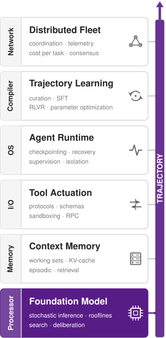{width="100%" fig-alt="Agentic Machine Learning Systems Stack"}

*Agent stack focus for this chapter.*
:::
:::

_When is another token, candidate, check, or model call worth its cost?_

An agent that deliberates before acting pays latency and money for a better chance of success, whether it spends them on a longer derivation, more candidate patches, an extra check, or another model call. Each purchase answers a different question. More tokens re-examine what the prompt already holds, more candidates raise the chance that a good one sits somewhere in the pool, and only an executed check adds a fact the model did not have. None of them makes the returned answer correct, because a selector can return a plausible failure, and a search that optimizes against a flawed check finds the flaw faster than the fix. Deliberation is therefore a budgeted allocation problem with a stopping rule. The runtime decides where the next unit of work goes, how far a passing check can be trusted, and when to stop, abstain, or escalate instead of returning its best unverified guess. Every extra turn spent inside one decision lengthens the horizon, so that spending has to be bounded before the agent acts on anything.

::: {.content-visible when-format="pdf"}

\newpage

:::

::: {.callout-learning-objectives}

- Compare depth, breadth, and feedback by the information each adds, the tokens it consumes, and its critical path.
- Distinguish candidate availability from selected-output quality when evaluating voting, learned scoring, and task-specific checks.
- Calculate accepted-set precision from stated checker error rates and explain how adaptive search can change those assumptions.
- Represent a candidate plan as a dependency graph and identify which parts require revision after an observation changes.
- Design stopping rules that enforce resource ceilings without treating budget exhaustion as acceptance evidence.
- Evaluate competing deliberation policies under a common budget and deadline by pass probability, actual spend, and abstentions.

:::

## Limits of a Single Response {#sec-vol3-test-time-compute-insufficient-response}

The repair agent (lighthouse \ref{lhs-vol3-repair-agent}) inspects the connection-pool implementation and receives a completed candidate patch. The invocation contract admits it as a candidate, yet the patch rests on an incomplete diagnosis. Client requests intermittently stall even after idle connections become available. Two distinct failure modes can produce this symptom: an aggressive timeout configuration that aborts prematurely, or a lost notification when a worker thread returns a connection to the pool. When prompted, the language model proposes extending the timeout. That change offers a plausible workaround, but it provides no evidence that the timeout caused the stalls. Deploying such a patch immediately risks masking the latency tail while leaving the concurrency defect intact.

::: {.column-margin}
{width="100%" fig-alt="H·S·A locator with the Horizon axis highlighted."}

*Deliberation extends the horizon with extra model turns and checks inside one decision, and hard ceilings bound that spend.*
:::

Before committing to an edit, the agent runtime can invest computational work in several distinct ways. It can grant the model a longer derivation budget to trace the lock acquisition and release sequence in detail; it can sample diverse candidate patches that modify different components of the pooling logic; or it can execute a targeted harness to record whether a waiting thread actually receives the condition variable notification. Each strategy purchases a different kind of evidence. Extended internal reasoning can expose subtle logical flaws in the source text. Sampling across temperature or prompt variations can surface novel implementations that a greedy single pass misses. An instrumented test, by contrast, delivers empirical observations of runtime state, which reveal dynamic interactions that static token generation alone cannot establish.

This division marks the operational boundary between internal computation and empirical observation. Additional model computation re-evaluates information already present in the prompt context. Within a single generation, a model can backtrack and revise an earlier analytical misstep even as the previous tokens remain frozen in its context prefix. However, pure computation cannot generate new empirical facts. Only an executed test reports how the running process behaves, and its conclusions remain strictly bounded by the specific conditions and interleavings that the test harness exercised.

Suppose the targeted test forces an interleaving where a worker thread waits while another returns a connection. The execution trace reveals that the connection successfully enters the pool, yet the waiting worker remains blocked past the notification point. This empirical finding rules out the timeout hypothesis immediately and directs the agent toward the synchronization path. The agent can then synthesize a patch that repairs the signaling logic and verify it against the failing reproducer. Passing a targeted reproducer, however, does not constitute full task acceptance; narrow tests can overlook edge cases, and neither an unverified hypothesis nor an isolated micro-test provides sufficient confidence to ship code to production. The two paths part ways before any file changes (@fig-vol3-diagnostic-tree). Acting on the first guess hides the symptom and keeps the defect, whereas checking first spends one short test to learn which hypothesis survives.

::: {#fig-vol3-diagnostic-tree fig-env="figure" fig-pos="htb" fig-cap="**Committing to a Hypothesis vs. Checking It**: Both paths start from the same connection-pool failure. On the left, generation builds on the timeout explanation without any observation that separates it from a missed notification, so the patch can hide the symptom while the defect remains. On the right, a targeted test orders a waiting worker and a returning connection, and its observation contradicts the timeout explanation before any edit. The revised candidate passes the reproducer, which still falls short of task acceptance." fig-alt="Two lanes below a box reading observed failure, request waits after a connection frees. The left lane, labeled commit first, holds H1 timeout too short with H2 missed notification drawn faded and dashed, then generate on H1 with no new evidence, then a timeout patch applied unchecked, ending in a red box reading symptom masked, notification defect remains. The right lane, labeled check first, holds both H1 and H2, then an amber targeted test observing the waiter still blocked after return, then the hypotheses again with H1 struck through and marked contradicted, then a notify on return patch, the revised candidate from H2, ending in a green box reading reproducer passes, acceptance still pending. A dashed horizontal line labeled first edit crosses both lanes: the left lane reaches it with no check, the right lane only after the test."}
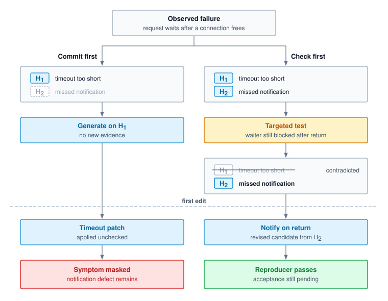
:::

```{python}
#| label: calc-vol3-probe-allocation
#| echo: false
# ┌─────────────────────────────────────────────────────────────────────────────
# │ PROBE AND GENERATION ALLOWANCES (LEGO)
# ├─────────────────────────────────────────────────────────────────────────────
# │ Context: nbk-03-probe-versus-generation.
# │ Goal: Compare a short diagnostic operation with an output allowance.
# │ Show: Generation time and output charge, distinct from probe duration.
# │ How: Reuse the registry weight-read allowance from Foundation Model;
# │      exclude prefill, queueing, transport, and probe setup overhead.
# └─────────────────────────────────────────────────────────────────────────────
from mlsysim import *
from mlsysim.core.units import BYTES_INT8

class ProbeAllocation:
    # ┌── 1. LOAD (Constants & Parameters) ─────────────────────────────────
    model = Models.Language.Llama3_70B
    accel = Hardware.Cloud.H100
    answer_tokens = 1_024  # hypothetical output length
    probe_time = 0.040 * second  # hypothetical already-prepared test duration
    output_price = 15 * USD / 1_000_000  # hypothetical dollars per output token

    # ┌── 2. EXECUTE (Compute) ─────────────────────────────────────────────
    weights = model.parameters / ureg.param * BYTES_INT8
    token_time = (weights / accel.memory.bandwidth).to(second)
    answer_time = answer_tokens * token_time
    answer_cost = answer_tokens * output_price
    time_ratio = answer_time / probe_time

    # ┌── 3. GUARD (Invariants) ────────────────────────────────────────────
    check(answer_time > probe_time > 0 * second, "Positive scenario durations")
    check(answer_cost > 0 * USD, "Output has a positive scenario charge")

    # ┌── 4. OUTPUT (Formatting) ───────────────────────────────────────────
    answer_tokens_str = fmt_int(answer_tokens)
    probe_time_str = fmt_time(probe_time, unit="ms", precision=0)
    token_time_str = fmt_time(token_time, unit="ms", precision=2)
    answer_time_str = fmt_time(answer_time, unit="s", precision=2)
    answer_cost_str = fmt_usd(answer_cost, precision=5)
    output_price_str = fmt_usd(output_price * 1_000_000, precision=0)
    time_mult_str = fmt_multiple(time_ratio, precision=1)
```

::: {#nbk-03-probe-versus-generation .callout-notebook title="A probe vs. a longer answer"}

**Problem**: A prepared diagnostic test takes `{python} ProbeAllocation.probe_time_str`. A proposed explanation contains `{python} ProbeAllocation.answer_tokens_str` output tokens. How long does the explanation take to generate relative to the test?

**Variables**: The illustrative per-token generation time from @sec-vol3-foundation-model-per-call-work-estimate is `{python} ProbeAllocation.token_time_str`, derived from memory-bandwidth limits rather than a measured production service rate. The hypothetical output pricing is `{python} ProbeAllocation.output_price_str` per million tokens. Prompt processing, queueing, transport, test preparation, and the downstream model call that reads the test observation are excluded.

**Math**: Generating `{python} ProbeAllocation.answer_tokens_str` tokens at `{python} ProbeAllocation.token_time_str` per token requires `{python} ProbeAllocation.answer_time_str` and incurs `{python} ProbeAllocation.answer_cost_str` in token charges. Dividing this generation latency by the `{python} ProbeAllocation.probe_time_str` test run yields a factor of `{python} ProbeAllocation.time_mult_str`.

**Systems insight**: When the unresolved question concerns dynamic program behavior, the probe settles it `{python} ProbeAllocation.time_mult_str` faster than the model can generate a speculative explanation of it, and only the probe's answer is an observation. Running a test is preferable whenever its preparation and execution time remain below the explanation's `{python} ProbeAllocation.answer_time_str` and its outcome decisively discriminates between competing failure modes. Conversely, an inconclusive test that does not discriminate the competing hypotheses provides no diagnostic gain regardless of its speed. Failure to reproduce can still supply negative evidence when the test's sensitivity to the suspected fault is known. A well-designed runtime allocates work to whichever operation most efficiently eliminates the primary source of uncertainty.

:::

The probe, and the decision to revise the patch on its evidence, both happened outside any single model call. The invocation contract of the previous chapter ends at one prompt and one candidate, accompanied only by metadata indicating whether generation reached a stop token or an output limit. That interface cannot evaluate whether allocating the next second of latency or fraction of a cent toward extended reasoning, candidate sampling, or runtime probing would yield a higher-quality fix. An API response signaling completion merely confirms that generation finished, not that the proposed patch resolves the underlying defect. **Test-time compute**\index{Test-time compute!definition} is all the system work orchestrated around the model call, with model weights held fixed, to explore, evaluate, and verify candidates before committing to an action. An effective agentic architecture requires a principled runtime policy to govern this expenditure: establishing hard ceilings on latency and financial cost, routing compute across reasoning and validation tools, and terminating search cleanly without conflating an exhausted resource quota with a verified solution.

::: {.column-margin .margin-pointer}
↩ The bounded single-invocation model contract is established in @sec-vol3-foundation-model-contract.
:::

Each part of that policy raises the next question. The runtime first chooses how to spend extra work across reasoning depth, candidate breadth, and empirical feedback (@sec-vol3-test-time-compute-computation-allocation). Breadth produces a pool, so the runtime must then pick from it without being fooled by a plausible failure (@sec-vol3-test-time-compute-candidate-diversity), and picking well depends on how far a passing check can be trusted (@sec-vol3-test-time-compute-verification). When a check refutes a premise partway through a plan, the runtime should regenerate only what depended on it (@sec-vol3-test-time-compute-planning-revision). Candidates and revisions together form a search whose spending must be tracked, reserved, and stopped (@sec-vol3-test-time-compute-bounded-search), and the complete policy is finally judged against its alternatives under one budget and one deadline (@sec-vol3-test-time-compute-strategy-design).

## Three Compute Allocation Axes {#sec-vol3-test-time-compute-computation-allocation}

When diagnosing and fixing a concurrency bug in a connection pool, an agent system can unroll an exhaustive step-by-step derivation, sample several candidate patches in parallel, or iterate through an edit–test–revise loop. While all three strategies can consume an identical token allowance, they impose fundamentally different execution topologies. A detailed derivation must generate tokens sequentially along a single causal chain. Independent candidate patches can execute concurrently across accelerator hardware. An iterative revision cycle that incorporates test results must pause generation until diagnostic execution finishes. These structural dependencies dictate which operations lie on the critical latency path and how much state the serving infrastructure must retain in memory.

**Depth**\index{Depth axis!definition} extends sequential computation within a single candidate, **breadth**\index{Breadth axis!definition} explores multiple candidate paths concurrently, and **feedback**\index{Feedback axis!definition} incorporates environment observations into subsequent revisions. A **test-time deliberation rollout**\index{Test-time deliberation rollout!definition}\index{Deliberation|see{Test-time deliberation rollout}} represents one bounded candidate-generation path, potentially interleaving verification checks and observation-conditioned revisions; the term borrows from game search, where a rollout plays one line of moves forward to its end. Depth lengthens a rollout, breadth runs several, and feedback inserts checks between a rollout's turns. An allocation policy can compose these axes. It might, for example, generate several candidate patches in parallel, run automated regression suites against each, and extend only the most promising candidate with step-by-step reasoning. Throughout this process, model weights remain frozen; every axis draws against a shared test-time allowance.

::: {#dfn-vol3-test-time-compute-budget .callout-definition title="Test-time compute budget"}

***Test-time compute budget***\index{Test-time compute budget!definition} is the per-decision allowance of processed prompt tokens, generated tokens, model invocations, verification checks, and elapsed wall-clock time that a runtime may expend, with model weights fixed, before it must select a candidate, abstain, or escalate to a human operator.

1.  **Significance**: The budget sets the attempt cost in the effective cost per accepted task, $\CostPerAcceptedTask = \mathbb{E}[\AttemptCost]/\AcceptanceProbability$ (@eq-vol3-cost-per-accepted-task). Additional deliberation reduces cost per accepted task when it increases the acceptance rate $\AcceptanceProbability$ proportionally faster than it increases the expected attempt cost. A higher cost per accepted task can still be justified when it buys the required acceptance rate within the deadline (@sec-vol3-test-time-compute-operating-point).
2.  **Distinction**: Training compute amortizes weight optimization once across all future tasks. Test-time compute recurs on every decision, where an internal reasoning allowance is merely one control surface alongside external tool invocations and verification checks.
3.  **Common pitfall**: Treating the maximum allocation ceiling as the expected spend, or treating an exhausted budget as evidence that the best remaining candidate is acceptable.

:::

What separates the three axes is their dependency structure (@fig-vol3-allocation-axes). Depth extends a single candidate through multi-step reasoning, breadth fans out to sampled candidates that converge on a selector, and feedback routes a candidate through a sandboxed check whose observation conditions the revision.

::: {#fig-vol3-allocation-axes fig-env="figure" fig-pos="htb" fig-cap="**Three compute allocation topologies**: Depth extends one candidate; breadth exposes separate sampled candidate paths followed by selection; feedback makes a later candidate depend on an observed check result. The arrows show dependencies, not guaranteed latency, cost, or correctness." fig-alt="Three panels labeled Depth, Breadth, and Feedback. Depth connects an input through a single chain of four reasoning segments to a candidate. Breadth fans an input out to three separate two-segment sample paths, bracketed as sampled paths, that converge on a selector, which outputs a candidate. Feedback sends a candidate into a dashed sandbox region containing a check, which produces an observation; a revised candidate receives one arrow from the observation and one from the original candidate."}
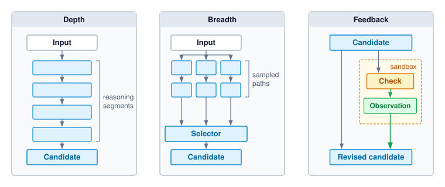
:::

### Sequential extension along the depth axis {#sec-vol3-test-time-compute-depth-axis}

Depth allows an autoregressive model to unroll intermediate reasoning tokens before emitting its final decision or artifact, generalizing early scratchpad techniques and chain-of-thought prompting [@nye2021show; @wei2022cot]. In the connection-pool scenario, these intermediate tokens might systematically trace thread interleavings: acquiring the pool mutex, detecting leaked socket descriptors, and signaling waiter condition variables. Because autoregressive generation conditions on all prior tokens, later decoding steps can inspect earlier derivations, detect flawed assumptions, and alter course before outputting code. This reasoning advantage arises entirely from executing additional forward passes over the prompt context rather than modifying the underlying network weights.

From a systems perspective, generation remains strictly autoregressive. Extending a single generation path serializes the computation. Because transformer decoding at small batch sizes is memory-bandwidth bound, step latency is governed by the time required to stream all model parameters from high-bandwidth memory into processor caches (principle \ref{pri-vol3-memory-bandwidth-decoding}). Consequently, wall-clock generation time scales approximately linearly with the number of generated tokens under a fixed serving configuration. A lengthy reasoning trace demonstrates only that the accelerator performed more computation, not that the proposed code compiles or executes correctly. The runtime must also leave enough output budget for the final usable artifact. A derivation that exhausts the budget mid-generation returns a truncated response, which the invocation contract quarantines like any other incomplete call rather than treating it as a candidate.

### Parallel sampling along the breadth axis {#sec-vol3-test-time-compute-breadth-axis}

Breadth allocates test-time compute across alternative candidate paths. Instead of extending one trajectory, the runtime requests multiple candidate patches from the same source excerpt and task specification, using stochastic decoding controls. Conditional on a fixed prompt and independent random seeds, these samples are statistically independent draws from the model's output distribution. However, they remain bounded by the model's underlying knowledge: if the model assigns negligible probability mass to a correct thread-notification pattern, every independent sample may reproduce the same missing broadcast. Independent draws can easily fail in identical ways.

::: {.column-margin .margin-pointer}
↩ Temperature, top-$\Glyph{k}$, and nucleus sampling controls are established in @sec-vol3-foundation-model-sampling-controls.
:::

Because parallel candidates share no sequential dependencies, breadth exposes fine-grained concurrency. On modern accelerator hardware, this concurrency comes at minimal latency cost. Under memory-bandwidth-bound decoding (principle \ref{pri-vol3-memory-bandwidth-decoding}), a batch of $\CandidatePoolSize$ concurrent candidate streams reads the model weights once per step for all $\CandidatePoolSize$ tokens. Spending an allocation of $\CandidatePoolSize \times \OutputLength$ tokens sequentially along the depth axis multiplies the generation latency by roughly $\CandidatePoolSize$. In contrast, generating $\CandidatePoolSize$ concurrent candidates of length $\OutputLength$ in parallel keeps total generation time near the duration of the longest candidate, $\max_n \DecodeInterval(\OutputLength_n)$. This latency benefit holds as long as the concurrent batch remains memory-bandwidth bound and fits within accelerator memory.

Accelerator memory is where breadth extracts its price. Each active generation stream must maintain its own key-value (KV) cache for the tokens it generates. When the serving system implements prefix sharing, the $\SequenceLength$-token prompt is stored once in memory, and the peak KV cache demand scales as

$$
\BreadthPeakKvCacheMemory \propto \SequenceLength + \sum_{n=1}^{\CandidatePoolSize} \OutputLength_n
$$

Without shared prefix caching, the serving engine stores $\CandidatePoolSize$ redundant copies of the prompt's KV tensors, causing memory demand to scale as $\CandidatePoolSize \SequenceLength + \sum_n \OutputLength_n$. When aggregate KV cache allocations exceed hardware capacity, the serving engine must partition candidates into sequential execution waves. Once forced into waves, breadth latency degrades from the duration of the single longest candidate toward the sum of all candidates, while memory thrashing and queueing delays increase individual token latencies. Whether identical prompt prefixes share physical memory or receive provider billing discounts depends on the serving engine's implementation.

::: {.column-margin .margin-pointer}
↪ Block sharing, which stores a common prompt's KV state once for every candidate that branches from it, is developed in @sec-vol3-kv-cache-cow-prefix-sharing.
:::

Breadth also shifts the operational burden downstream: generating a wide pool of candidates pays off only if the system can accurately select the best option or synthesize their differences. A candidate pool containing an optimal patch provides no value without an effective selector. In a study of repeated sampling, @brown2024monkeys showed that while the probability of at least one candidate being correct (pass@$\IndependentAttemptCount$) continued to rise across four orders of magnitude of samples, practical selection heuristics such as majority voting and learned reward models (scorers trained to predict whether a candidate is correct, examined in @sec-vol3-test-time-compute-outcome-step-evidence) plateaued after several hundred samples. Candidate selection is therefore an active consumer of compute and verification budget rather than an incidental final step.

### Observation-conditioned revision along the feedback axis {#sec-vol3-test-time-compute-feedback-axis}

The feedback axis incorporates external observations into subsequent model requests. Rather than relying solely on frozen weights and static inputs, the repair agent generates a candidate patch, the runtime executes a bounded test suite, and the subsequent model invocation receives concrete diagnostics, such as a stack trace from a deadlocked worker thread. These empirical observations constrain subsequent candidate generation far more effectively than prompting the model to re-examine the original prompt in isolation [@shinn2023reflexion].

Verification checks yield structured outcomes: failure, success, or inconclusive execution (such as a test timeout). A failure trace pinpoints specific regression bugs or unmet invariants; a passing test confirms that the code satisfies the exercised assertions under tested conditions; and final acceptance remains a distinct policy gate. Executing diagnostics constitutes an active external action. It consumes CPU and memory resources, runs within sandboxed security boundaries, and incurs wall-clock latency even when performed purely for internal deliberation.

Each feedback round is also one more turn of the horizon $\TurnHorizon$, which ties this axis to horizon compounding (@eq-vol3-horizon-compounding). Unchecked turns compound error as $(1-\PerStepErrorRate)^{\TurnHorizon}$, and the introduction showed (notebook \ref{nbk-01-horizon-compounding}) that a check which rejects a bad step and retries it resets that compounding. Feedback is the one axis that places such a check inside every turn, so it can lengthen a deliberation without the unchecked compounding its extra turns would otherwise carry, to the extent that its checks deserve trust (@sec-vol3-test-time-compute-verification).

Feedback introduces strict serialization: a revision cannot begin until the preceding verification check completes and returns its observation payload. Furthermore, context policies that append prior candidates and diagnostic outputs cause input token counts to expand across successive turns. For an initial prompt length $\BasePromptLength$, candidate lengths $\OutputLength_j$, and observation lengths $\lvert \TrajectoryObservation_j\rvert$, an append-only policy yields an input length at turn $\TurnIndex$ of

$$\SequenceLength^{(\TurnIndex)} = \BasePromptLength + \sum_{j=1}^{\TurnIndex-1}(\OutputLength_j + \lvert \TrajectoryObservation_j\rvert)$$

This is the append-only growth that @eq-vol3-trajectory-resend priced across a whole trajectory, now confined to one decision, and it inflates prompt prefill latency, accelerator memory usage, and token billing on every round. Although context-compaction techniques can summarize earlier attempts or drop obsolete diagnostic traces, the allocation policy must account for the full token volume dispatched to the model API.

::: {.column-margin .margin-pointer}
↪ Context-compaction methods and their scheduling within the request budget are developed in @sec-vol3-context-engineering-compaction.
:::

### The three axes under one output ceiling {#sec-vol3-test-time-compute-common-output-ceiling}

Runtimes schedule these three allocation axes against four resource dimensions: input and output token counts, critical-path wall-clock latency, peak retained accelerator state, and external information acquisition. Let $\PrefillTime(\SequenceLength)$ be the time required to ingest an $\SequenceLength$-token prompt, $\PerTokenDecodeTime$ the per-token decoding step time, $\DecodeInterval(\OutputLength)$ the total generation time for $\OutputLength$ tokens, and $\FeedbackCheckDuration$ the duration of the external check in feedback round $\TurnIndex$, which is also the turn index of the trajectory. With $\ExtendedDepthLength$ tokens of extended depth, $\CandidatePoolSize$ breadth candidates executed concurrently, and $\TurnHorizon$ feedback turns, the latency dimension decomposes into three critical paths:

$$
\begin{aligned}
\DepthCriticalPathLatency &\approx \PrefillTime(\SequenceLength) + \ExtendedDepthLength\,\PerTokenDecodeTime,\\
\BreadthCriticalPathLatency &\approx \PrefillTime(\SequenceLength) + \max_{n} \DecodeInterval(\OutputLength_n),\\
\FeedbackCriticalPathLatency &\approx \sum_{t=1}^{\TurnHorizon}\bigl(\PrefillTime(\SequenceLength^{(\TurnIndex)}) + \DecodeInterval(\OutputLength_t) + {\FeedbackCheckDuration}_{\TurnIndex}\bigr).
\end{aligned}
$$ {#eq-vol3-allocation-critical-path}

The critical path for breadth assumes the serving infrastructure maintains sufficient memory and execution capacity to decode all $\CandidatePoolSize$ streams concurrently at an unchanged step time. When capacity saturates, decoding falls back into serialized waves, shifting the critical path toward the sum across candidate streams. In contrast, the feedback expression grows along two distinct dimensions: sequential check durations $\FeedbackCheckDuration$ and lengthening prompt prefill times $\PrefillTime(\SequenceLength^{(\TurnIndex)})$ caused by context accumulation. The equation covers only latency. @Tbl-vol3-allocation-model sets those critical paths beside the other three dimensions, the tokens processed, the peak model state retained, and the external information acquired.

| **Axis** | **Tokens processed**                                                                                        | **Critical path**                  | **Peak retained model state**                                                                  | **New information**                      |
|:---------|:------------------------------------------------------------------------------------------------------------|:-----------------------------------|:-----------------------------------------------------------------------------------------------|:-----------------------------------------|
| Depth    | $\SequenceLength + \ExtendedDepthLength$                                                                    | One dependent sequence             | One context of $\SequenceLength + \ExtendedDepthLength$ tokens                                 | None beyond the request and weights      |
| Breadth  | $\SequenceLength + \sum_n \OutputLength_n$ (prompt shared)                                                  | Longest candidate, given capacity  | $\CandidatePoolSize$ contexts, $\SequenceLength + \sum_n \OutputLength_n$ tokens if shared     | Sampling variation over the same request |
| Feedback | $\sum_{t}(\SequenceLength^{(\TurnIndex)} + \OutputLength_t)$, with $\SequenceLength^{(\TurnIndex)}$ growing | Sum of turns, including each check | One active context of $\SequenceLength^{(\TurnHorizon)} + \OutputLength_{\TurnHorizon}$ tokens | Observations from executed checks        |

: **Resource model of the three allocation axes**: Symbolic accounting of processed tokens, critical path, retained model state, and information source. Concurrency and prefix sharing are capacity and implementation assumptions, not properties of the axis. {#tbl-vol3-allocation-model tbl-colwidths="[11,23,22,25,19]"}

Among the three topologies, only feedback admits external information absent from the model weights and prompt. The code below models these expressions for the connection-pool repair under a fixed output budget of 4,096 tokens, isolating how identical output ceilings generate starkly different latency profiles and monetary bills.

```{python}
#| label: calc-vol3-allocation-axes
#| echo: false
# ┌─────────────────────────────────────────────────────────────────────────────
# │ COMMON OUTPUT CEILING, DIFFERENT EXECUTION TOPOLOGIES (LEGO)
# ├─────────────────────────────────────────────────────────────────────────────
# │ Context: nbk-03-matched-budget-axes.
# │ Goal: Separate output ceilings, actual spend, and dependent elapsed time.
# │ Show: Input/output counts, hypothetical bills, and generation/check time.
# │ How: Hold model allowance fixed; stipulate four concurrent breadth streams.
# │      Feedback appends each prior candidate and report; no cache discounts.
# └─────────────────────────────────────────────────────────────────────────────
from mlsysim import *
from mlsysim.core.units import BYTES_INT8

class AllocationAxes:
    # ┌── 1. LOAD (Constants & Parameters) ─────────────────────────────────
    model = Models.Language.Llama3_70B
    accel = Hardware.Cloud.H100
    prompt = 4_096  # hypothetical fully serialized initial input tokens
    ceiling = 4_096  # common total generated-token ceiling
    candidates = 4  # breadth concurrency and candidate count
    candidate_tokens = 1_024  # hypothetical generated length per short candidate
    rounds = 3  # hypothetical feedback rounds actually used
    report = 340  # tokens appended per complete observation
    check_time = 1.5 * second  # hypothetical duration per feedback check
    price_in = 3 * USD / 1_000_000  # hypothetical per-input-token price
    price_out = 15 * USD / 1_000_000  # hypothetical per-output-token price

    # ┌── 2. EXECUTE (Compute) ─────────────────────────────────────────────
    weights = model.parameters / ureg.param * BYTES_INT8
    token_time = (weights / accel.memory.bandwidth).to(second)
    depth_input = prompt
    depth_output = ceiling
    breadth_input = candidates * prompt
    breadth_output = candidates * candidate_tokens
    feedback_input = rounds * prompt + (candidate_tokens + report) * rounds * (rounds - 1) // 2
    feedback_output = rounds * candidate_tokens
    depth_time = depth_output * token_time
    breadth_time = candidate_tokens * token_time
    feedback_time = rounds * (candidate_tokens * token_time + check_time)
    depth_cost = depth_input * price_in + depth_output * price_out
    breadth_cost = breadth_input * price_in + breadth_output * price_out
    feedback_cost = feedback_input * price_in + feedback_output * price_out
    path_ratio = (depth_time / breadth_time).to(ureg.dimensionless).magnitude
    bill_ratio = (breadth_cost / depth_cost).to(ureg.dimensionless).magnitude
    breadth_premium = breadth_input - depth_input  # (N - 1) P re-read prompt tokens

    # ┌── 3. GUARD (Invariants) ────────────────────────────────────────────
    check(depth_output == breadth_output == ceiling, "Depth and breadth exhaust ceiling")
    check(feedback_output < ceiling, "Feedback uses less than the output ceiling")
    check(feedback_input == 16_380, "Append-only feedback input accounting")
    check(depth_time > feedback_time > breadth_time, "Scenario critical-path ordering")
    check(breadth_premium == (candidates - 1) * prompt, "Breadth premium is the re-read prompt")
    check(bill_ratio > 1 and path_ratio > 1, "Breadth buys path length with bill")

    # ┌── 4. OUTPUT (Formatting) ───────────────────────────────────────────
    prompt_str = fmt_int(prompt)
    ceiling_str = fmt_int(ceiling)
    candidates_str = fmt_int(candidates)
    candidate_tokens_str = fmt_int(candidate_tokens)
    rounds_str = fmt_int(rounds)
    report_str = fmt_int(report)
    check_time_str = fmt_time(check_time, unit="s", precision=1)
    price_in_str = fmt_usd(price_in * 1_000_000, precision=0)
    price_out_str = fmt_usd(price_out * 1_000_000, precision=0)
    depth_input_str = fmt_int(depth_input)
    depth_output_str = fmt_int(depth_output)
    breadth_input_str = fmt_int(breadth_input)
    breadth_output_str = fmt_int(breadth_output)
    feedback_input_str = fmt_int(feedback_input)
    feedback_output_str = fmt_int(feedback_output)
    depth_time_str = fmt_time(depth_time, unit="s", precision=2)
    breadth_time_str = fmt_time(breadth_time, unit="s", precision=2)
    feedback_time_str = fmt_time(feedback_time, unit="s", precision=2)
    depth_cost_str = fmt_usd(depth_cost, precision=5)
    breadth_cost_str = fmt_usd(breadth_cost, precision=5)
    feedback_cost_str = fmt_usd(feedback_cost, precision=5)
    path_mult_str = fmt_multiple(path_ratio, precision=0)
    bill_mult_str = fmt_multiple(bill_ratio, precision=1)
    breadth_premium_str = fmt_int(breadth_premium)
```

::: {#nbk-03-matched-budget-axes .callout-notebook title="One decision, three allocations"}

**Problem**: A repair request starts with `{python} AllocationAxes.prompt_str` input tokens and a common ceiling of `{python} AllocationAxes.ceiling_str` generated tokens. How do depth, breadth, and feedback spend that allowance?

**Variables**: Reuse the illustrative per-token generation time from the preceding example. Breadth has capacity for `{python} AllocationAxes.candidates_str` concurrent streams at that same rate. Each short candidate uses `{python} AllocationAxes.candidate_tokens_str` generated tokens. Feedback uses `{python} AllocationAxes.rounds_str` turns, each followed by a `{python} AllocationAxes.check_time_str` check returning `{python} AllocationAxes.report_str` tokens. Later feedback requests append earlier candidates and reports. Hypothetical prices are `{python} AllocationAxes.price_in_str` per million input tokens and `{python} AllocationAxes.price_out_str` per million output tokens, without cache discounts, so each breadth stream is billed for its own copy of the prompt (unlike the shared-prefix row of @tbl-vol3-allocation-model). Generation times omit prefill, queueing, and transport; the feedback time additionally includes its checks. The bill counts model tokens only, and @tbl-vol3-allocation-tradeoffs tallies each allocation's tokens, time, and bill side by side.

| Allocation |                                 Input tokens |                                 Output tokens |              Generation and included checks |                            Model-token bill |
|:-----------|---------------------------------------------:|----------------------------------------------:|--------------------------------------------:|--------------------------------------------:|
| Depth      |    `{python} AllocationAxes.depth_input_str` |    `{python} AllocationAxes.depth_output_str` |    `{python} AllocationAxes.depth_time_str` |    `{python} AllocationAxes.depth_cost_str` |
| Breadth    |  `{python} AllocationAxes.breadth_input_str` |  `{python} AllocationAxes.breadth_output_str` |  `{python} AllocationAxes.breadth_time_str` |  `{python} AllocationAxes.breadth_cost_str` |
| Feedback   | `{python} AllocationAxes.feedback_input_str` | `{python} AllocationAxes.feedback_output_str` | `{python} AllocationAxes.feedback_time_str` | `{python} AllocationAxes.feedback_cost_str` |
: **Allocation accounting under a common output ceiling**: Equal ceilings produce unequal spend. Allowances omit prefill, queueing, selection, and tool charges. {#tbl-vol3-allocation-tradeoffs}

**Math**: In @tbl-vol3-allocation-tradeoffs, depth generates all `{python} AllocationAxes.ceiling_str` tokens along a single path. Breadth generates `{python} AllocationAxes.candidate_tokens_str` tokens on each of `{python} AllocationAxes.candidates_str` concurrent paths, shortening the critical path by `{python} AllocationAxes.path_mult_str`. However, reading the prompt `{python} AllocationAxes.candidates_str` times across unshared streams adds `{python} AllocationAxes.breadth_premium_str` input tokens, multiplying its billing cost to `{python} AllocationAxes.bill_mult_str` that of depth. Feedback accumulates input context over $\TurnHorizon$ turns according to $\TurnHorizon\,\BasePromptLength + (\OutputLength + \lvert \TrajectoryObservation\rvert)\,\TurnHorizon(\TurnHorizon-1)/2$, reaching `{python} AllocationAxes.feedback_input_str` tokens at $\TurnHorizon =$ `{python} AllocationAxes.rounds_str` because each successive round re-reads all prior candidates and observation reports.

**Systems insight**: Breadth trades monetary cost for reduced wall-clock latency, where the entire billing premium stems from the $(\CandidatePoolSize-1)\SequenceLength$ re-read prompt tokens. The key governing lever is the ratio of prompt length to generated output: a large repository context makes breadth's financial overhead scale aggressively with both $\CandidatePoolSize$ and $\SequenceLength$, whereas a short prompt or a shared prefix cache eliminates most of this penalty. Feedback achieves an intermediate balance between latency and billing cost while remaining the only topology capable of acquiring empirical ground truth. Because this resource accounting excludes solution success rates, it models infrastructural cost rather than output quality.

:::

### Internal budgets and external orchestration {#sec-vol3-test-time-compute-latent-vs-scaffold}

Production systems operate across two distinct control planes: internal model deliberation and external workflow orchestration. A model service may expose an internal reasoning budget, while the runtime independently governs how many calls to dispatch, which tool checks to invoke, and what context to supply in subsequent requests. These represent different control surfaces. An internal budget governs the reasoning depth permitted within a single model invocation; external orchestration directs breadth across candidate branches, schedules sandboxed verification runs, and constructs revised prompts. Because commercial APIs often hide or redact intermediate reasoning traces, the runtime cannot evaluate computational effort by inspecting output text lengths. Instead, it must rely on explicit token usage headers and invocation status codes to enforce quotas and track system cost.

### Reasoning models and generation allowances {#sec-vol3-test-time-compute-reasoning-models}

**Reasoning models**\index{Reasoning model!definition} undergo reinforcement learning on tasks with objective, verifiable outcomes, such as formal mathematics, logic puzzles, and unit-tested codebases. Through this training, they learn to produce extended intermediate scratchpads that propose solutions, verify intermediate steps, and backtrack within a single generation pass [@openai2024o1; @deepseekai2025deepseekr1]. For system designers, this architecture introduces three core operational implications:

1.  *Token metering*: Reasoning tokens are standard autoregressive output tokens. They consume accelerator compute, populate the KV cache, and incur standard decoding charges, regardless of whether the user interface displays them or redacts them behind summary metadata.
2.  *Dynamic depth control*: A reasoning-budget parameter\index{Reasoning budget} transforms sequential depth from a static model property into a dynamic, per-request runtime allocation. The orchestration layer can calibrate this knob on a per-task basis.
3.  *Knowledge boundaries*: Internal reasoning operates strictly over the supplied prompt and static network weights. An extended trace can verify arithmetic or check internal logic consistency, but it cannot observe external execution behavior. It cannot determine whether a proposed patch resolves a connection leak without running an actual test suite.

::: {.column-margin .margin-pointer}
↪ Reinforcement learning on tasks with verifiable outcomes, the training that produces reasoning models, is developed in @sec-vol3-rlvr.
:::

Because models trained with verifiable rewards use generation allowances differently than instruction-tuned models (models adapted to follow example instructions and responses), budget calibration is highly model-dependent. Furthermore, when internal reasoning traces remain hidden, the runtime can inspect only its own external invocation telemetry and verification results. These records guide the optimization of orchestration policies rather than providing formal guarantees of candidate correctness.

Treating depth as a per-call budget allows the runtime to allocate tokens dynamically across tasks. The core engineering objective is determining what each compute allocation topology yields across tasks of varying intrinsic difficulty.

::: {#exmp-03-compute-optimal-allocation .callout-example title="Compute-optimal test-time allocation"}

**Scenario**: @snell2024scaling evaluated strategies for spending a fixed test-time compute budget across reasoning benchmarks, comparing sequential revision of a single candidate against parallel breadth sampling and search guided by learned process verifiers (@sec-vol3-test-time-compute-verification). The study partitioned benchmark problems into difficulty tiers based on the base model's zero-shot success rate.

**Diagnosis**: On simpler problems, sequential revision used the compute budget most effectively, refining minor errors without the overhead of parallel sampling. On moderately difficult problems, hybrid strategies combining parallel exploration with guided search achieved higher accuracy. On the hardest problems, however, scaling test-time compute yielded diminishing returns across all allocation axes. When evaluated at matched total FLOPs, a compute-optimal test-time allocation enabled a smaller model to outperform a model 14 times larger, provided the smaller model possessed a nonzero base success rate. When base success hovered near zero, allocating FLOPs to a larger, more capable base model proved far more effective than exhausting tokens on parallel rollouts.

**Systems lesson**: With the supplied information held fixed, additional reasoning and sampling can elicit nonzero baseline capabilities but cannot acquire absent environmental facts. Feedback can supply new observations to the next call, whose value still depends on the model's ability to use them and the check's coverage. Runtimes should dynamically route compute budgets by estimated task difficulty: allocate modest budgets or single candidates to straightforward tasks, deploy parallel search to moderately complex tasks, and escalate near-zero confidence requests directly to larger models or human supervisors rather than wasting tokens on unguided sampling.

:::

Because an execution engine cannot directly observe intrinsic task difficulty a priori, it must approximate difficulty using low-latency, low-cost heuristics before committing an expensive deliberation budget. Practical heuristics include consensus among two or three low-temperature pilot samples, the output of fast static analysis linters, and historical error rates across similar task classes. When pilot signals demonstrate high consensus or pass static checks cleanly, the runtime allocates a minimal token budget to a single candidate. When pilot samples diverge or linters flag structural ambiguities, the scheduler escalates the request to a broader search or an iterative feedback loop. If a decision remains unresolved after exhausting a bounded budget ceiling, the runtime halts deliberation and escalates to a human operator rather than burning additional tokens on low-probability convergence. Each routing heuristic acts as a predictive classifier whose precision and recall must be empirically validated against held-out task distributions.

In production agent workflows, internal reasoning depth and external search breadth naturally compose. A single deliberation rollout may use enough depth to generate a structurally coherent, well-reasoned code patch; the runtime then samples several such reasoned candidates across the breadth axis and filters them through an automated test harness along the feedback axis. The composition must still be tuned to real system bottlenecks. Slow tool execution inflates feedback latency along the critical path, whereas imprecise test suites diminish the informational value of each feedback observation.

The checks that make this composition work matter beyond inference. The validation checks a runtime uses to accept candidates at test time are the same kind of check that reinforcement learning with verifiable rewards turns into a training reward. An edge case, false pass, or specification gap in a test-time acceptance check therefore costs one bad selection at inference, but once the check becomes a reward, training searches for that gap on every update.

::: {.column-margin .margin-pointer}
↪ How an acceptance check becomes a training reward, and how its gaps are exploited during training, is developed in @sec-vol3-rlvr-rewards.
:::

::: {#chk-03-compute-allocation-axes .callout-checkpoint title="Choosing an allocation"}

- [ ] **Information**: For the connection-pool repair, which axis can separate a short timeout from a missed notification, and why can the other two not?
- [ ] **Concurrency**: If the service admits only one candidate at a time, how long does the notebook's breadth allocation take to generate, and which allocation then has the shortest path?
- [ ] **Breadth premium**: How many extra input tokens does `{python} AllocationAxes.candidates_str`-way breadth read compared with depth for a `{python} AllocationAxes.prompt_str`-token prompt, and what happens to that premium when the repository context grows eightfold?
- [ ] **Evidence**: If a revised patch passes a targeted test, what additional information determines whether the task may stop?

:::

Allocating compute across depth, breadth, and feedback defines where extra computation is spent, but generation alone does not determine which candidate should survive. Even an allocation that discovers a correct repair fails if downstream selection favors a plausible incorrect alternative. The remaining challenge is candidate evaluation: comparing competing proposals while accounting for the costs, latencies, and blind spots of the verification mechanisms that judge them.

## Candidate Selection {#sec-vol3-test-time-compute-candidate-diversity}

Generating a broad candidate pool gives an agent a portfolio of proposals, but breadth alone does not solve a task. In a connection-pool repair task, for example, one candidate might lengthen an acquisition timeout, another might inject exponential retries, and a third might alter how the connection-return path notifies waiting threads. The runtime must determine which proposal, if any, carries sufficient supporting evidence to return, and evaluating that evidence consumes execution time and tokens from the same deliberation budget that generated the candidates.

Two distinct requirements separate generation from selection: whether the candidate pool contains at least one solution that satisfies the task requirements, and whether the selector can identify that valid solution without mistakenly accepting an unsuitable one. A generation policy can flood the pool with candidate solutions without making selection any easier. Conversely, a more discerning selector can dramatically raise the reliability of the system without sampling a single extra candidate.

### Useful variation among candidates {#sec-vol3-test-time-compute-candidate-variation}

Syntactic variation does not guarantee algorithmic diversity. Renaming local variables, reformatting comments, or rewriting an iteration loop can produce completely distinct token sequences while leaving a broken synchronization bug completely untouched. For our repair task, candidate alternatives provide practical value only when they explore distinct hypotheses or failure modes that downstream checks can actually differentiate. Adjusting thread notification logic vs. extending a timeout explores two different failure hypotheses; generating several slightly reworded explanations for the same timeout adjustment simply wastes verification cycles.

This failure mode is distinct from statistical dependence. When the task, prompt, base model, and sampling policy remain fixed, separate generation passes driven by independent random seeds are genuinely independent and identically distributed (IID). However, if the model concentrates nearly all its probability mass on timeout adjustments, independent sampling predictably floods the pool with variations of that single change.

Across a heterogeneous production workload, common model limitations become even more pronounced. A model typically solves standard, well-represented patterns reliably while failing consistently on obscure edge cases. Consequently, repeated attempts on a difficult task fail together far more frequently than an aggregate benchmark pass rate would imply. While individual samples on a single fixed task may be conditionally independent, treating attempts across a mixed workload as draws with one common success probability obscures this correlation. Feedback-conditioned generation further alters the distribution: when the runtime feeds execution errors back into subsequent prompts, later candidates become explicitly dependent on what earlier checks revealed.

A runtime can encourage diversity by adjusting sampling parameters or prompting the model to explore distinct diagnostic angles under the original problem constraints. However, aggressive diversification carries real engineering risks: unconstrained sampling often introduces malformed code, nonsensical approaches, or outright violations of baseline invariants. The test for any diversification strategy is whether it improves task success under a fixed compute and latency budget.

To conserve verification bandwidth, the runtime should prune redundant candidates early using structural and behavioral deduplication. Abstract syntax tree (AST) normalization strips away superficial differences such as variable names and whitespace. Behavioral clustering then evaluates candidates against common test inputs to detect identical runtime behavior. This filtering allowed a competitive code-generation system to condense tens of thousands of raw model outputs into a handful of viable submissions [@li2022alphacode]. Both techniques establish bounded equivalence relations, whether syntactic equivalence under canonicalization or behavioral agreement over a test suite. Such deduplication is sound whenever that relation preserves the specific property being evaluated.

### Selection policies {#sec-vol3-test-time-compute-selection-policies}

A runtime evaluates candidates using three primary mechanisms: direct execution checks, answer agreement (consensus voting), and learned ranking. System designers often combine these approaches, tailoring the pipeline to the available evidence and the cost of evaluation rather than treating them as fixed, sequential stages.

Direct checks evaluate a candidate deterministically against explicit specifications. A parser rejects malformed syntax; a type checker enforces interface contracts and memory invariants; an automated test harness measures dynamic behavior on specified inputs. Each check operates within a strictly defined domain: successful compilation proves structural validity but says nothing about whether a race condition was resolved, while a regression test validates only the execution paths covered by its test fixtures. Furthermore, candidate execution remains a governed action that requires sandbox isolation, strict timeouts, and privilege boundaries appropriate to the environment.

Answer agreement aggregates independent reasoning paths through consensus. In **self-consistency**\index{Self-consistency!definition}, the runtime samples multiple reasoning trajectories and selects the plurality answer [@wang2022self]. For arithmetic, symbolic logic, or standardized factual queries, the system normalizes the answer representation and takes the majority vote. However, consensus is merely a property of the sampled distribution: when a model harbors a systematic bias or flawed reasoning shortcut, multiple independent paths frequently converge on the exact same error. In software repairs, textual voting is a poor comparison rule; agreement on observed behaviors carries the test coverage limits just described, and a correct minority candidate deserves an execution check rather than being outvoted by plausible failures.

When deterministic checks cannot fully validate candidate quality, learned rankers and model-based judges provide heuristic evaluation. A learned reward model or a secondary large language model (LLM) judge (a model prompted to grade another model's output) can evaluate explanatory adequacy, score style, or prioritize promising patches before invoking costly regression suites. Nevertheless, a learned ranking remains a statistical estimate whose relevance must be evaluated on the target task distribution. A fundamental distinction exists between ranking candidates and accepting a solution. Ranking merely orders candidates from best to worst according to a scoring function; acceptance determines whether a candidate satisfies the operational requirements of the task. If an entire candidate pool is defective, selecting the highest-ranked member simply returns the best failure. Validating acceptance requires an objective verifier that yields an authoritative pass or fail verdict.

::: {#dfn-vol3-verifier-guided-selection .callout-definition title="Verifier-guided selection"}

***Verifier-guided selection***\index{Verifier-guided selection!definition}\index{Verifier!definition} is a selection policy that returns a candidate only when a **verifier**, a check whose criteria and observations the candidate cannot modify, passes it, and abstains when no candidate passes.

1.  **Significance**: Its success rate is capped by pass@$\IndependentAttemptCount$, the chance the pool holds a passing candidate (@sec-vol3-test-time-compute-pass-at-k), while the share of its selections that are correct depends on both the verifier's passing-set precision and the selection policy (@sec-vol3-test-time-compute-check-precision). The fixed IID first-passing policy developed there preserves passing-set precision; ranking among passing candidates need not. Selection coverage and selected correctness together determine the probability of returning a valid result.
2.  **Distinction**: Voting selects what the generator produces most often and learned ranking selects what a scorer prefers; only a verifier's verdict can justify returning a candidate instead of abstaining.
3.  **Common pitfall**: Treating the verifier's pass as task acceptance; the verdict covers the checked property, and its false acceptance rate grows in importance as the pool's valid-candidate rate falls.

:::

The hypothetical repair pool in @tbl-vol3-candidate-diversity illustrates how these distinct verification stages expose candidate quality. The checks are deliberately bounded: a focused reproducer exercises the known race condition, while broader regression suites remain untested.

| **Candidate** | **Proposed repair**                                | **Observed check result**       | **Supported conclusion**                                  |
|:--------------|:---------------------------------------------------|:--------------------------------|:----------------------------------------------------------|
| A             | Increase the timeout                               | Compiles; known failure remains | Structural validity is insufficient                       |
| B             | Retry after the timeout                            | Compiles; known failure remains | Different code can preserve the same defect               |
| C             | Change notification handling with malformed syntax | Parsing fails                   | This artifact cannot proceed to execution testing         |
| D             | Change notification handling with valid syntax     | Compiles; reproducer passes     | Promising repair, with untested behavior still unresolved |

: **Evidence for candidate selection**: A hypothetical repair pool separates the proposed mechanism, the observed result, and the conclusion each check supports. {#tbl-vol3-candidate-diversity tbl-colwidths="[12,25,30,33]"}

A production runtime pipelines these checks to maximize rejection efficiency, ordering them by cost and filtering power rather than arbitrary conceptual categories. A lightweight structural check that parses syntax or validates an AST costs fractions of a millisecond and quickly discards malformed candidates, saving expensive sandboxed execution environments and high-latency LLM scoring passes from wasted work. However, pipeline ordering must reflect empirical systems profiling rather than intuition. For illustration, executing a compiled binary in a warm container might take 5 ms, whereas invoking a large model-based judge to evaluate code style is a full model call that might take 800 ms and consume a share of the token budget. Moreover, joint candidate comparison scales differently with context window size than scoring each candidate independently. Because verification overhead directly cuts into the runtime's available time and compute, candidate selection must be budgeted as an integral component of test-time compute.

### Candidate availability under pass@$\IndependentAttemptCount$ {#sec-vol3-test-time-compute-pass-at-k}

**pass@$\IndependentAttemptCount$**\index{Pass at k!definition} measures the probability that at least one of $\IndependentAttemptCount$ sampled candidates passes the specified tests [@chen2021evaluating].[^fn-passk-metric-origin]

[^fn-passk-metric-origin]: **Origin of pass@$\IndependentAttemptCount$**: The metric was introduced to score program synthesis by functional correctness rather than by textual similarity to a reference [@kulal2019spoc]. Because plugging the observed pass fraction $\PassingSampleCount/\GeneratedSampleCount$ into $1-(1-\PassingSampleCount/\GeneratedSampleCount)^\IndependentAttemptCount$ biases the estimate of what breadth buys, @chen2021evaluating replaced it with the combinatorial estimator derived below. \index{Pass at k!origin} It measures availability in the pool, not the success rate of the output a deployed selector returns.

For a fixed task and fixed generation policy, suppose independent samples each pass the tests with probability $\AttemptPassProbability$. The probability that all $\IndependentAttemptCount$ samples fail is $(1-\AttemptPassProbability)^\IndependentAttemptCount$, so

$$
\operatorname{pass@}\IndependentAttemptCount = 1-(1-\AttemptPassProbability)^\IndependentAttemptCount.
$$

This expression is conditional on that task and sampling policy. To summarize a workload with different task-level pass probabilities, average the task-level quantities; substituting the workload's average $\AttemptPassProbability$ generally gives a different result. For an adaptive policy that revises its prompt after feedback, evaluate the policy's resulting pools rather than assuming they follow this fixed-distribution formula.

In a benchmark, generate $\GeneratedSampleCount \ge \IndependentAttemptCount$ candidates for a task and let $\PassingSampleCount$ pass the fixed test criterion. Of the $\binom{\GeneratedSampleCount}{\IndependentAttemptCount}$ subsets of size $\IndependentAttemptCount$, exactly $\binom{\GeneratedSampleCount-\PassingSampleCount}{\IndependentAttemptCount}$ contain only failures. The subset estimator is therefore

$$
\PassAtKEstimate
= 1-\frac{\binom{\GeneratedSampleCount-\PassingSampleCount}{\IndependentAttemptCount}}{\binom{\GeneratedSampleCount}{\IndependentAttemptCount}},
$$

with the numerator taken as zero when $\GeneratedSampleCount-\PassingSampleCount<\IndependentAttemptCount$. Under independent, identically distributed sampling for the fixed task, this estimates the probability that a fresh pool of $\IndependentAttemptCount$ candidates contains a test-passing member without bias; @sec-vol3-appendix-math-pass-at-k derives this expectation and details evaluation without factorials. Benchmark results average these estimates over tasks [@chen2021evaluating].

The relationship to deployed selection follows from the event being measured. If the selector must return an unchanged member of the same pool, it cannot return a test-passing candidate when the pool contains none. Its probability of returning a test-passing candidate is therefore at most pass@$\IndependentAttemptCount$, counting abstention as no returned pass. A selector that always finds a passing member whenever one exists reaches this ceiling; whether the deployed selector does, within the deployment's checking budget, is a separate measurement.

The predicate is passing these tests, which is narrower than satisfying the complete task requirements, and the ceiling covers only selectors that return an unchanged pool member; a selector that repairs candidates or synthesizes a new one generates additional artifacts. Report candidate availability alongside selected-output performance under the relevant criterion.

::: {.column-margin .margin-pointer}
↪ The distinction between pass@$\IndependentAttemptCount$ over a candidate pool and consistency over repeated system runs is developed in @sec-vol3-evaluation-pass-k.
:::

::: {.column-margin}
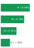{width="100%" fig-alt="Four horizontal green bars for pools of 1, 2, 4, and 8 candidates, labeled 30, 51, 76, and 94 percent."}

*Each doubling of the pool squares the chance that no candidate passes.*
:::

Breadth has a price that pass@$\IndependentAttemptCount$ makes easy to compute. In **best-of-$\CandidatePoolSize$ sampling**\index{Best-of-N sampling!definition}, the runtime generates $\CandidatePoolSize$ candidates for one decision and returns one that its selector admits. The pool is the same object pass@$\IndependentAttemptCount$ describes, so its availability is pass@$\IndependentAttemptCount$ with $\IndependentAttemptCount = \CandidatePoolSize$, written pass@$\CandidatePoolSize$ from here on. The notebook below prices that pool against the simplest alternative, generating one candidate at a time and stopping at the first pass, under the most favorable selection assumption: the verifier is the acceptance check itself.

```{python}
#| label: calc-vol3-best-of-n-price
#| echo: false
# ┌─────────────────────────────────────────────────────────────────────────────
# │ THE PRICE OF A LARGER POOL (LEGO)
# ├─────────────────────────────────────────────────────────────────────────────
# │ Context: nbk-03-best-of-n-pool-price; fallacies (mixed-workload pass@N).
# │ Goal: Compare parallel best-of-N with stop-at-first-pass sequential retry
# │       at the same success probability.
# │ Show: pass@N, marginal gain of the last candidate, candidates per success.
# │ How: IID candidates for a fixed task; the verifier is the acceptance check;
# │      a perfect selector returns a passing member whenever one exists.
# └─────────────────────────────────────────────────────────────────────────────
from mlsysim import *

class BestOfN:
    # ┌── 1. LOAD (Constants & Parameters) ─────────────────────────────────
    p = 0.30  # hypothetical per-candidate pass probability for a fixed task
    pools = (1, 2, 4, 8)  # pool sizes compared
    p_easy = 0.60  # hypothetical mixed workload: half the tasks pass at this rate
    p_hard = 0.0  # hypothetical mixed workload: the other half never pass

    # ┌── 2. EXECUTE (Compute) ─────────────────────────────────────────────
    n_max = pools[-1]
    pass_at = []
    for n in pools:
        pass_at.append(1 - (1 - p) ** n)
    pass_max = pass_at[-1]
    last_gain = p * (1 - p) ** (n_max - 1)
    parallel_per_success = n_max / pass_max
    seq_candidates = pass_max / p  # expected attempts, stop at first pass, cap n_max
    seq_per_success = seq_candidates / pass_max  # reduces to 1 / p
    cost_ratio = parallel_per_success / seq_per_success
    p_mix = (p_easy + p_hard) / 2
    naive_mix = 1 - (1 - p_mix) ** n_max
    true_mix = ((1 - (1 - p_easy) ** n_max) + (1 - (1 - p_hard) ** n_max)) / 2

    # ┌── 3. GUARD (Invariants) ────────────────────────────────────────────
    check(pass_at == sorted(set(pass_at)), "pass@N rises with N")
    check(abs(seq_per_success - 1 / p) < 1e-12, "Sequential retry costs 1/p per success")
    check(cost_ratio > 2, "Parallel pool costs over twice as much per success")
    check(abs(p_mix - p) < 1e-12, "Mixed workload has the same average rate")
    check(true_mix < naive_mix - 0.3, "Averaging p overstates mixed-workload pass@N")

    # ┌── 4. OUTPUT (Formatting) ───────────────────────────────────────────
    p_str = fmt_percent(p, precision=0, style="prose")
    n_max_str = fmt_int(n_max)
    pools_str = MarkdownStr(", ".join(str(n) for n in pools[:-1]) + ", and " + str(pools[-1]))
    pass_1_str = fmt_int(round(100 * pass_at[0]))
    pass_2_str = fmt_int(round(100 * pass_at[1]))
    pass_4_str = fmt_int(round(100 * pass_at[2]))
    pass_max_str = fmt_percent(pass_max, precision=1, style="prose")
    last_gain_pts_str = fmt(last_gain * 100, precision=1)
    parallel_per_success_str = fmt(parallel_per_success, precision=1)
    seq_candidates_str = fmt(seq_candidates, precision=2)
    seq_per_success_str = fmt(seq_per_success, precision=1)
    cost_mult_str = fmt_multiple(cost_ratio, precision=1)
    p_easy_str = fmt_percent(p_easy, precision=0, style="prose")
    naive_mix_str = fmt_percent(naive_mix, precision=1, style="prose")
    true_mix_str = fmt_percent(true_mix, precision=1, style="prose")
```

::: {#nbk-03-best-of-n-pool-price .callout-notebook title="The price of a larger pool"}

**Problem**: Each candidate repair passes the task's verifier with probability $\AttemptPassProbability$, independently for this task, and the verifier is the acceptance check. How many candidates per accepted repair does a parallel pool of $\CandidatePoolSize$ spend, compared with sequential retry that stops at the first pass and gives up after $\CandidatePoolSize$ attempts?

**Variables**: $\AttemptPassProbability$ = `{python} BestOfN.p_str` (hypothetical); pools of `{python} BestOfN.pools_str` candidates; a selector that returns a passing member whenever one exists.

**Math**: The formula pass@$\CandidatePoolSize = 1-(1-\AttemptPassProbability)^\CandidatePoolSize$ gives `{python} BestOfN.pass_1_str`, `{python} BestOfN.pass_2_str`, `{python} BestOfN.pass_4_str`, and `{python} BestOfN.pass_max_str` for those pools. The last of `{python} BestOfN.n_max_str` candidates adds $\AttemptPassProbability(1-\AttemptPassProbability)^{\CandidatePoolSize-1}$, only `{python} BestOfN.last_gain_pts_str` percentage points. The parallel pool always spends `{python} BestOfN.n_max_str` candidates, or `{python} BestOfN.parallel_per_success_str` per accepted repair. Sequential retry fails only when all `{python} BestOfN.n_max_str` attempts fail, so it reaches the same `{python} BestOfN.pass_max_str`, yet it spends on average $[1-(1-\AttemptPassProbability)^\CandidatePoolSize]/\AttemptPassProbability$ = `{python} BestOfN.seq_candidates_str` candidates, or $1/\AttemptPassProbability$ = `{python} BestOfN.seq_per_success_str` per accepted repair.

**Systems insight**: At equal success, the parallel pool costs `{python} BestOfN.cost_mult_str` as much per accepted repair; what it buys is one round instead of an expected `{python} BestOfN.seq_candidates_str` sequential generate-and-check rounds. Breadth buys latency, not cost. In $\CostPerAcceptedTask = \mathbb{E}[\AttemptCost]/\AcceptanceProbability$ it raises $\AcceptanceProbability$ per round but raises the attempt cost faster. Size $\CandidatePoolSize$ as the smallest pool whose pass@$\CandidatePoolSize$ meets the target within the rounds the deadline allows, and stop growing it once the next candidate's gain is worth less than its cost.

:::

### Selection and evidence costs {#sec-vol3-test-time-compute-selection-costs}

Expanding candidate breadth increases the likelihood that a valid solution enters the pool, but it simultaneously inflates the verification burden. Under a fixed deliberation budget, spending all resources on generation starves the verification stage, forcing the selector to rely on shallow heuristics. A smaller pool paired with informative, high-coverage checks frequently outperforms a large pool governed by weak selection. Conversely, when generation coverage is the primary bottleneck, expanding the pool yields immediate returns. Comparing these regimes requires evaluating the entire generation-and-selection policy rather than measuring either stage in isolation.

Checker errors compound rapidly as candidate pools grow. Every additional invalid candidate introduced into the pool provides another opportunity for an imperfect verifier to register a false pass. If a verifier has a 5 percent false acceptance rate (it passes 5 percent of invalid candidates, a rate defined formally in @sec-vol3-test-time-compute-check-precision), evaluating twenty invalid proposals with independent check outcomes makes at least one false pass likely ($1 - (1 - 0.05)^{20} \approx 64\%$). Whether that false pass is actually returned depends on what else the pool holds and on the selection rule, a distinction that section makes exact. The ultimate error rate of the accepted solution depends on the base quality of the candidate distribution, the check's conditional error rates, and the rule used to break ties among passing candidates. When an adaptive search algorithm steers generation based on verifier feedback, it actively shifts all three factors, often optimizing directly against the verifier's blind spots.

Where the runtime gathers evidence dictates both the latency and the precision of selection. Validating only the final output may suffice when end-to-end execution checks are cheap and definitive. For extended multi-step trajectories, however, checking intermediate assumptions allows the runtime to prune failing branches before investing further compute. This establishes a fundamental design distinction between outcome checks that evaluate finished artifacts and process checks that govern multi-step execution.

## Candidate Verification {#sec-vol3-test-time-compute-verification}

A search policy requires evidence that separates a genuinely correct candidate from a superficially plausible one. In a connection-pool repair, for instance, clean compilation confirms only syntactic and type validity; verifying that blocked worker threads actually wake up when a connection returns requires runtime execution. Even a targeted concurrency test explores only a subset of thread interleavings and can easily miss subtle race conditions. Every validation check answers a strictly bounded question. System designers must therefore decide which questions to ask, when to schedule each evaluation, and how the resulting evidence should redirect the remaining search budget.

### Outcome and step-level evidence {#sec-vol3-test-time-compute-outcome-step-evidence}

An **outcome check**\index{Outcome check!definition} evaluates a completed candidate against an external criterion, such as whether a patched service passes an end-to-end regression test. In contrast, an **outcome reward model**\index{Outcome reward model!definition} predicts a scalar quality score for the completed candidate, functioning like the trained verifiers used to rank candidate solutions for mathematical reasoning [@cobbe2021training]. The check executes the candidate and reports what happened; the reward model only predicts how good the candidate is.

Step-level checks evaluate intermediate claims or state transitions. In our repair task, a check might verify whether a waiting worker receives a wake-up notification before the agent drafts a complex timeout adjustment. If an execution trace refutes the timeout hypothesis, the runtime can terminate that branch immediately, conserving generation tokens. Learned process scorers similarly rank or prune partial reasoning trajectories, treating low step scores as probabilistic signals of downstream failure. **Process supervision**\index{Process supervision!definition}[^fn-prm-step-labels] assigns feedback to discrete intermediate steps rather than deferring evaluation to terminal outcomes [@uesato2022solving; @lightman2023let]. The difference between outcome and process feedback lies in where the feedback attaches, not in what the evaluator may read, since a learned outcome scorer can also inspect the full reasoning trajectory before scoring the final output.

[^fn-prm-step-labels]: **Step-Level Labels (PRM800K)**: Outcome labels for code can be produced automatically by running tests. Step labels require a judgment on each intermediate step, and the PRM800K dataset used to train the process reward model of @lightman2023let contains about 800,000 human step-level labels. That labeling cost is one reason learned process scorers are scarcer than outcome checks. \index{Process reward model!labeling cost}

::: {#dfn-process-reward-model .callout-definition title="Process reward model (PRM)"}

A ***process reward model*** (PRM)\index{Process reward model!definition} is a learned scorer that assigns a value to each intermediate step of a candidate trajectory, conditioned on the task context and the preceding steps.

1.  **Significance**: Step scores allow search algorithms to prune unpromising branches early, keeping beam search and tree search, the search procedures that extend only the best-scoring partial candidates (@sec-vol3-test-time-compute-search-structures), within finite computational budgets.
2.  **Distinction**: An outcome reward model evaluates only terminal states; a process reward model assigns credit across intermediate steps. This early steering capability requires dense step-level supervision, which costs substantially more to gather than automated test outcomes.
3.  **Common pitfall**: Mistaking a high step score for verified correctness. A process reward model provides heuristic guidance for ranking and pruning, but it offers no formal guarantees and satisfies no closure evidence level.

:::

Each verification granularity catches failures that the other overlooks. An outcome check evaluates global behavior, exposing subtle integration bugs that appear harmless when examined step by step. Conversely, a process check isolates errors early, preventing bad trajectories from consuming additional inference cycles. However, verifying too frequently consumes system resources and risks discarding viable candidate branches due to verifier noise. The system trade-off weighs avoided downstream generation against verification overhead and false rejections.

Computational cost also depends heavily on input scoping and prefix reuse. Consider a verifier that evaluates a task prompt of $\SequenceLength$ tokens and the candidate's growing prefix after each of its $\ScoredStepCount$ steps, with each step appending $\FiniteChange \ScoredPrefixLength$ tokens. Evaluating each cumulative prefix from scratch, without reusing key-value cache states from preceding steps, requires processing:

$$
\sum_{j=1}^{\ScoredStepCount}\left(\SequenceLength + \ScoredStepIndex\,\FiniteChange \ScoredPrefixLength\right) = \ScoredStepCount \SequenceLength + \frac{\ScoredStepCount(\ScoredStepCount+1)}{2}\,\FiniteChange \ScoredPrefixLength
$$ {#eq-vol3-prm-rescoring}

scorer input tokens, an overhead that scales quadratically with trajectory length $\ScoredStepCount$. The beam-search estimate later in this chapter (notebook \ref{nbk-03-compute-allocation-and-latency-trade-offs}) bills the $\ScoredStepIndex\,\FiniteChange \ScoredPrefixLength$ term of @eq-vol3-prm-rescoring, with the task prompt $\SequenceLength$ excluded, for every extension it scores at step $\ScoredStepIndex$. Incremental evaluation eliminates this quadratic burden when the serving engine supports prefix caching, reducing the marginal per-step cost to $\FiniteChange \ScoredPrefixLength$ tokens. Evaluators that require the complete candidate or lack cache-aware serving pay the full quadratic cost. Verification scheduling must therefore account directly for prompt length, caching efficiency, and invocation latency.

@Tbl-vol3-verifier-classes compares four common classes of checks by their inspection scope, failure modes, and deterministic guarantees, mapping each to the closure evidence levels defined in @sec-vol3-intro-invariant-closure. Compilers and sealed test suites establish bounded, reproducible properties within their domains, whereas learned reward models serve strictly as heuristic ranking instruments.

| **Check**                | **Evaluates**                      | **Coverage**                              | **False-acceptance exposure**                    | **Deterministic**           | **Closure evidence level**                              |
|:-------------------------|:-----------------------------------|:------------------------------------------|:-------------------------------------------------|:----------------------------|:--------------------------------------------------------|
| Outcome scorer (learned) | Completed candidate                | Any representation it was trained to read | Persuasive but wrong final text                  | No                          | None; ranks only                                        |
| Process scorer (learned) | Intermediate step given its prefix | Steps it can delimit and judge            | Locally plausible steps that drift from the task | No                          | None; ranks and prunes only                             |
| Compiler or type checker | Syntax and declared types          | Properties expressible in the type system | Behavior outside the type system                 | Yes                         | Static analysis                                         |
| Sealed test suite        | Behavior on withheld cases         | The cases and schedules it exercises      | Untested inputs and schedules                    | Yes, under fixed conditions | Sealed tests, if the candidate cannot read or modify it |

: **Kinds of check and the claims they support**: Learned scorers order candidates; compilers and sealed suites establish bounded properties. None dominates the others on every task, and a deterministic verdict remains incomplete outside its coverage. {#tbl-vol3-verifier-classes tbl-colwidths="[17,17,18,20,11,17]"}

Selecting an effective check requires matching the observer's coverage directly to the failure modes that the application cannot tolerate.

### Check precision and the candidate pool {#sec-vol3-test-time-compute-check-precision}

Structural validity does not guarantee task success. In search systems, the central reliability question is what fraction of the candidates that satisfy a given check truly solves the task. Define the event $\text{Valid}$ as meeting the task specification and $\text{PASS}$ as receiving a positive verifier verdict. Let $\ValidCandidateRate = \Pr(\text{Valid})$ denote the baseline rate of valid candidates within the candidate generator's distribution, $\VerifierFalseAcceptanceRate = \Pr(\text{PASS}\mid\neg\text{Valid})$ the **false acceptance rate**\index{False acceptance rate!definition}, and $\VerifierFalseRejectionRate = \Pr(\neg\text{PASS}\mid\text{Valid})$ the **false rejection rate**\index{False rejection rate!definition}. In this formulation, "acceptance" denotes an internal verifier outcome rather than an authorization to deploy code to production. The valid-candidate rate $\ValidCandidateRate$ is distinct from the test-pass probability $\AttemptPassProbability$ used in pass@$\IndependentAttemptCount$. One concerns meeting the task specification; the other concerns passing the stated tests. An error-free check makes the two events coincide. Separating them is the point of this section.

The marginal probability of a positive verification result is $\VerifierPassProbability=\ValidCandidateRate(1-\VerifierFalseRejectionRate)+(1-\ValidCandidateRate)\,\VerifierFalseAcceptanceRate$. Applying Bayes' rule yields the precision of positive verdicts:

$$
\VerifierPrecision \equiv \Pr(\text{Valid}\mid\text{PASS})
=\frac{\ValidCandidateRate(1-\VerifierFalseRejectionRate)}{\ValidCandidateRate(1-\VerifierFalseRejectionRate)+(1-\ValidCandidateRate)\,\VerifierFalseAcceptanceRate}.
$$ {#eq-vol3-verifier-precision}

::: {.column-margin}
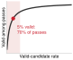{width="100%" fig-alt="A dark curve of the valid share among passing candidates plotted against the valid-candidate rate. It rises steeply at low rates and flattens near the top. The low-rate region is shaded red, and a red dot is labeled 5 percent valid, 70 percent of passes."}

*At a low valid rate, even a strict check passes many invalid candidates.*
:::

When the base rate of valid candidates is low, even a verifier with an apparently modest false acceptance rate produces a passing pool dominated by invalid proposals, the classic base-rate fallacy. The foundation-model chapter applied the same Bayes arithmetic to one checked patch, where a fallible checker barely moved the defect share (systems perspective \ref{psp-02-the-fallacy-of-correlated-self-verification}); @eq-vol3-verifier-precision is its complement, applied to every candidate in a pool. This is the verification asymmetry (principle \ref{pri-vol3-verification-asymmetry}) in quantitative form. Producing a valid candidate and establishing that a passing candidate is valid are different events, and the base rate and the check's error rates, not the size of the pool, bound how far a pass can be trusted. Engineers must therefore measure error rates empirically for each target task, model family, and verification environment.

While @eq-vol3-verifier-precision governs the population of passing candidates, translating this metric into the expected reliability of the *selected* candidate requires specifying a selection policy. Consider independent and identically distributed candidate-check pairs for a given task, evaluated under fixed error rates. The runtime generates a batch, evaluates candidates in an arbitrary order independent of quality, and selects the first candidate that passes, abstaining if none succeeds. Under these assumptions, the precision conditional on making a selection equals $\VerifierPrecision$. Evaluating candidates in sequence reveals only that prior candidates failed; under independence, this search history does not alter the probability that the first passing candidate is valid. Conversely, selecting the candidate with the highest continuous reward score actively concentrates verifier measurement errors, a failure mode analyzed in @sec-vol3-test-time-compute-selection-pressure.

```{python}
#| echo: false
#| label: compute-vol3-ttc-check-yield
# ┌── LEGO ─────────────────────────────────────────────────────────────────────
# │ Context: nbk-03-compute-overhead-and-yield-under
# │ Goal: Separate passing-set precision, selection coverage, and incident loss.
# │ Show: A hypothetical fixed-batch first-pass selection policy.
# │ How: IID candidate/check outcomes, fixed rates, abstention if none passes.
# └─────────────────────────────────────────────────────────────────────────────
from mlsysim import *
from mlsysim.fmt import check
import math

class CheckYield:
    # ┌── 1. LOAD (Constants & Parameters) ─────────────────────────────────────
    n = 64
    tokens_per_candidate = 1_024 * token
    output_price = 15 * USD / Mtoken
    p = 0.05
    eps_fr = 0.10  # false rejection rate, epsilon_FR (hypothetical)
    eps_fa = 0.02  # false acceptance rate, epsilon_FA (hypothetical)
    incident_loss = 500 * USD

    # ┌── 2. EXECUTE (Physics & Logic) ─────────────────────────────────────────
    valid_pass = p * (1 - eps_fr)
    invalid_pass = (1 - p) * eps_fa
    pass_probability = valid_pass + invalid_pass
    precision = valid_pass / pass_probability
    defect_given_selection = 1 - precision
    any_selection = 1 - (1 - pass_probability) ** n
    no_selection = 1 - any_selection
    wrong_selection = any_selection * defect_given_selection
    any_false_pass = 1 - (1 - invalid_pass) ** n
    expected_valid_passes = n * valid_pass
    expected_invalid_passes = n * invalid_pass
    expected_passes = n * pass_probability
    conditional_loss = defect_given_selection * incident_loss
    task_loss = wrong_selection * incident_loss
    output_bill = (n * tokens_per_candidate * output_price).to(USD)
    # Sensitivity: halve the false acceptance rate, or double the valid rate.
    precision_half_fa = valid_pass / (valid_pass + (1 - p) * eps_fa / 2)
    precision_double_p = 2 * p * (1 - eps_fr) / (2 * p * (1 - eps_fr) + (1 - 2 * p) * eps_fa)
    loss_to_bill = (task_loss / output_bill).to(ureg.dimensionless).magnitude

    # ┌── 3. GUARD (Invariants) ────────────────────────────────────────────────
    check(pass_probability > 0, "Passing-set precision requires q > 0.")
    check(isinstance(n, int) and n > 0, "n must be a positive int")
    check(all(0 <= rate <= 1 for rate in (p, eps_fa, eps_fr)), "rates must be in [0, 1]")
    check(
        all(
            0 <= probability <= 1
            for probability in (
                valid_pass,
                invalid_pass,
                pass_probability,
                precision,
                defect_given_selection,
                any_selection,
                no_selection,
                wrong_selection,
                any_false_pass,
            )
        ),
        "probabilities must be in [0, 1]",
    )
    check(math.isclose(precision + defect_given_selection, 1), "precision + defect must sum to 1")
    check(math.isclose(any_selection + no_selection, 1), "any + no selection must sum to 1")
    check(0 <= expected_valid_passes <= n, "expected valid passes in bounds")
    check(0 <= expected_invalid_passes <= n, "expected invalid passes in bounds")
    check(0 <= expected_passes <= n, "expected passes in bounds")
    check(math.isclose(expected_valid_passes + expected_invalid_passes, expected_passes), "expected passes must sum")
    check(wrong_selection <= any_selection, "wrong selection <= any selection")
    check(wrong_selection <= any_false_pass, "wrong selection <= any false pass")
    check(math.isclose(wrong_selection, any_selection * defect_given_selection), "wrong selection identity")
    check(tokens_per_candidate > 0 * token, "tokens per candidate must be positive")
    check(output_price >= 0 * USD / Mtoken, "output price non-negative")
    check(output_bill >= 0 * USD, "output bill non-negative")
    check(0 * USD <= task_loss <= conditional_loss <= incident_loss, "loss hierarchy must hold")
    check(math.isclose(task_loss.to(USD).magnitude, (any_selection * conditional_loss).to(USD).magnitude), "task loss identity")
    check(precision < precision_half_fa < 1 and precision < precision_double_p < 1, "sensitivity ordering")
    check(loss_to_bill > 100, "loss to bill ratio > 100")

    # ┌── 4. OUTPUT (Human-Readable Outputs) ───────────────────────────────────
    n_str = fmt_int(n)
    tokens_str = fmt_tokens(tokens_per_candidate)
    price_str = fmt_usd(output_price * Mtoken)
    p_str = fmt_percent(p, style="prose")
    eps_fr_str = fmt_percent(eps_fr, style="prose")
    eps_fa_str = fmt_percent(eps_fa, style="prose")
    loss_str = fmt_usd(incident_loss)
    valid_passes_str = fmt(expected_valid_passes, precision=2)
    invalid_passes_str = fmt(expected_invalid_passes, precision=3)
    passes_str = fmt(expected_passes, precision=3)
    precision_str = fmt_percent(precision, precision=2, style="prose")
    defect_str = fmt_percent(defect_given_selection, precision=2, style="prose")
    coverage_str = fmt_percent(any_selection, precision=2, style="prose")
    abstention_str = fmt_percent(no_selection, precision=2, style="prose")
    wrong_str = fmt_percent(wrong_selection, precision=2, style="prose")
    any_false_str = fmt_percent(any_false_pass, precision=2, style="prose")
    conditional_loss_str = fmt_usd(conditional_loss, precision=2)
    task_loss_str = fmt_usd(task_loss, precision=2)
    bill_str = fmt_usd(output_bill, precision=2)
    precision_half_fa_str = fmt_percent(precision_half_fa, precision=1, style="prose")
    precision_double_p_str = fmt_percent(precision_double_p, precision=1, style="prose")
    loss_to_bill_str = fmt_int(round(loss_to_bill))
```

::: {#nbk-03-compute-overhead-and-yield-under .callout-notebook title="Yield and risk under asymmetric verifier error"}

**Problem**: A repair policy generates all `{python} CheckYield.n_str` candidates before selection. It uses the first-passing rule above and abstains when no candidate passes. What does additional breadth buy, and what risk remains?

**Variables**: All rates are hypothetical. Each candidate contains `{python} CheckYield.tokens_str` tokens, billed at `{python} CheckYield.price_str` per million output tokens. The valid-candidate rate is `{python} CheckYield.p_str`, false rejection is `{python} CheckYield.eps_fr_str`, and false acceptance is `{python} CheckYield.eps_fa_str`. Suppose a separately authorized deployment policy deploys the selected candidate without further checking. A defective deployment incurs `{python} CheckYield.loss_str` in incident loss. For this calculation alone, valid deployments and abstentions incur zero incident loss, and missed repairs and delay are left unpriced.

**Math**: The expected passing counts are `{python} CheckYield.valid_passes_str` valid candidates and `{python} CheckYield.invalid_passes_str` invalid candidates, totaling `{python} CheckYield.passes_str`. @Eq-vol3-verifier-precision yields `{python} CheckYield.precision_str` precision. Conditional on making a selection, the probability of a defective selection is therefore `{python} CheckYield.defect_str`, with expected incident loss `{python} CheckYield.conditional_loss_str` per selected deployment.

The probability of any selection is $1-(1-\VerifierPassProbability)^\CandidatePoolSize$, or `{python} CheckYield.coverage_str`; the policy abstains on `{python} CheckYield.abstention_str` of batches. Multiplying selection coverage by conditional defect probability gives `{python} CheckYield.wrong_str` defective selections per task attempt and `{python} CheckYield.task_loss_str` expected incident loss per attempt, including abstentions. Generating the entire batch costs `{python} CheckYield.bill_str` in output charges. Input charges, checking, and other operational costs are omitted. A sequential policy that stops generation at the first pass would have a different generation bill.

**Systems insight**: Expected incident loss per attempt is about `{python} CheckYield.loss_to_bill_str` times the output bill, so the acceptance policy, not the token price, sets the cost of this task. Precision responds to two knobs of similar strength: halving the false acceptance rate raises it from `{python} CheckYield.precision_str` to `{python} CheckYield.precision_half_fa_str`, and doubling the valid-candidate rate raises it to `{python} CheckYield.precision_double_p_str`. More candidates move neither. At a low base rate, spend on whichever of a better generator or a stricter check is cheaper, and price false rejections too when a missed valid repair is costly.

:::

Holding $\ValidCandidateRate$, $\VerifierFalseAcceptanceRate$, and $\VerifierFalseRejectionRate$ fixed, increasing the batch size $\CandidatePoolSize$ does not improve precision $\VerifierPrecision$. Expanding candidate breadth raises the probability of surfacing at least one passing candidate, but it simultaneously compounds the likelihood that the batch contains at least one false acceptance: $1-[1-(1-\ValidCandidateRate)\,\VerifierFalseAcceptanceRate]^\CandidatePoolSize$. In our numerical scenario, that false-pass exposure reaches `{python} CheckYield.any_false_str`, whereas the actual probability of deploying a defective candidate is `{python} CheckYield.wrong_str`. Under a first-passing policy, a batch can contain invalid passes without consequence as long as an earlier valid candidate is evaluated and accepted first. System designers must distinguish candidate yield, verifier precision, and end-to-end deployment risk.

### Selection pressure on imperfect checks {#sec-vol3-test-time-compute-selection-pressure}

The static distribution model serves as an engineering baseline, but adaptive search shifts the underlying distribution. A search policy that iteratively refines candidates to maximize an evaluation score alters the candidate population, driving proposals into regions where the evaluator is poorly calibrated. Under sustained selection pressure, the initial estimates of $\ValidCandidateRate$, $\VerifierFalseAcceptanceRate$, and $\VerifierFalseRejectionRate$ no longer characterize the candidates that reach final evaluation. Optimization against imperfect proxy metrics degrades performance through distinct failure mechanisms [@manheim2018categorizing]. Manheim and Garrabrant formalize these phenomena as variants of Goodhart's law,[^fn-goodhart-law-origin] which observes that any metric optimized as a target loses its validity as a measurement. Three variants directly impact agentic systems: *regressional* Goodhart occurs when an argmax operator selects for positive measurement noise; *extremal* Goodhart emerges when correlations observed across typical candidates break down in the distributional tails explored by search; and *adversarial* Goodhart occurs when candidate code actively manipulates or bypasses the evaluation harness.

[^fn-goodhart-law-origin]: **Goodhart's Law**: The economist Charles Goodhart stated it in 1975 about monetary policy: any observed statistical regularity tends to collapse once pressure is placed upon it for control purposes [@goodhart1984]. The anthropologist Marilyn Strathern later gave it the form usually quoted today, that when a measure becomes a target it ceases to be a good measure [@strathern1997improving]. A test suite used to select patches is such a regularity, a reliable description of past candidates that weakens once search optimizes against it. \index{Goodhart's law!origin}

```{python}
#| label: calc-vol3-argmax-selection
#| echo: false
# ┌─────────────────────────────────────────────────────────────────────────────
# │ SELECTION ON A NOISY SCORE (LEGO)
# ├─────────────────────────────────────────────────────────────────────────────
# │ Context: @sec-vol3-test-time-compute-selection-pressure.
# │ Goal: Show how argmax selection concentrates positive scoring error, and
# │       how a rare checker gap becomes likely in a large pool.
# │ Show: Exact expected maximum of N standard normal errors; exploit presence.
# │ How: Numerical integration of N x phi(x) Phi(x)^(N-1); IID candidates.
# └─────────────────────────────────────────────────────────────────────────────
from mlsysim import *
import math

def expected_max_std_normal(n, lo=-10.0, hi=10.0, steps=40_000):
    """Trapezoidal integral of x * n * phi(x) * Phi(x)**(n - 1)."""
    dx = (hi - lo) / steps
    total = 0.0
    for i in range(steps + 1):
        x = lo + i * dx
        pdf = math.exp(-0.5 * x * x) / math.sqrt(2 * math.pi)
        cdf = 0.5 * (1 + math.erf(x / math.sqrt(2)))
        weight = 0.5 if i in (0, steps) else 1.0
        total += weight * x * n * pdf * cdf ** (n - 1)
    return total * dx

class ArgmaxSelection:
    # ┌── 1. LOAD (Constants & Parameters) ─────────────────────────────────
    n_small = 4  # hypothetical small pool
    n_large = 64  # same batch size as the yield notebook
    gap_rate = 0.005  # hypothetical fraction of candidates exploiting a check gap

    # ┌── 2. EXECUTE (Compute) ─────────────────────────────────────────────
    shift_small = expected_max_std_normal(n_small)
    shift_large = expected_max_std_normal(n_large)
    asym_large = math.sqrt(2 * math.log(n_large))
    gap_present = 1 - (1 - gap_rate) ** n_large

    # ┌── 3. GUARD (Invariants) ────────────────────────────────────────────
    check(abs(expected_max_std_normal(1)) < 1e-6, "Mean of one standard normal is zero")
    check(0 < shift_small < shift_large < asym_large, "Selected error grows with N, below the asymptote")
    check(0 < gap_present < 1, "Probability bounds")

    # ┌── 4. OUTPUT (Formatting) ───────────────────────────────────────────
    n_small_str = fmt_int(n_small)
    n_large_str = fmt_int(n_large)
    shift_small_str = fmt(shift_small, precision=1)
    shift_large_str = fmt(shift_large, precision=1)
    asym_large_str = fmt(asym_large, precision=1)
    gap_rate_str = fmt_percent(gap_rate, precision=1, style="prose")
    gap_present_str = fmt_percent(gap_present, precision=1, style="prose")
```

The regressional mechanism can be formulated analytically. Suppose a learned scorer reports an estimated utility $\EstimatedCandidateUtility_i = \CandidateUtility_i + \CandidateScoringError_i$ for candidate $\CandidateIndex$, where $\CandidateUtility_i$ represents genuine task utility and $\CandidateScoringError_i$ represents an independent scoring error with zero mean and standard deviation $\ScoringErrorStandardDeviation$ (scoring noise, unrelated to the per-turn error rate of horizon compounding). Selecting $\arg\max_i \EstimatedCandidateUtility_i$ maximizes the combined sum, meaning the chosen candidate is disproportionately one that benefited from an unusually large positive error. For independent Gaussian errors, the expected maximum error among $\CandidatePoolSize$ proposals scales asymptotically as:

$$
\mathbb{E}\Bigl[\max_{i \le \CandidatePoolSize} \CandidateScoringError_i\Bigr] \approx \ScoringErrorStandardDeviation\sqrt{2\ln \CandidatePoolSize}
$$ {#eq-vol3-argmax-noise}

for large $\CandidatePoolSize$.[^fn-gumbel-tail-growth] Expressed in units of $\ScoringErrorStandardDeviation$, the exact numerical expectation is `{python} ArgmaxSelection.shift_small_str` for `{python} ArgmaxSelection.n_small_str` candidates and reaches `{python} ArgmaxSelection.shift_large_str` for `{python} ArgmaxSelection.n_large_str` candidates, where the asymptotic expression predicts `{python} ArgmaxSelection.asym_large_str`. This expected maximum is an upper bound on the selected candidate's expected scoring error, attained when all candidates have equal true utility. When true utilities vary, selection depends on both utility and noise; Exercise 8 derives the selected error for one such distribution. An acceptance threshold calibrated on individual, unselected completions therefore requires re-evaluation on selected candidates, because argmax selection can concentrate positive verifier errors.

[^fn-gumbel-tail-growth]: **Extreme-Value Asymptotics**: The form $\ScoringErrorStandardDeviation\sqrt{2\ln \CandidatePoolSize}$ is only the leading term of the Gaussian maximum, and convergence is slow, which is why the chapter computes the exact expectation beside it. The Gaussian is also a favorable case: scoring errors with heavier tails, such as a learned judge that occasionally misjudges badly, push the selected error up faster than $\sqrt{\ln \CandidatePoolSize}$, so the drift in a real pool can exceed this estimate. \index{Extreme value!argmax selection}

Rising selected scoring error does not by itself imply declining true utility. In Exercise 8(b), independent Gaussian utility and noise make both the winner's expected utility and its scoring error increase with pool size. Empirical evaluations of best-of-$\CandidatePoolSize$ sampling against learned reward models show a different pattern: the optimized proxy score keeps increasing while an independent reference score initially improves, plateaus, and eventually degrades [@gao2023scaling]. That downturn depends on the joint distribution of utility and measurement error, or on checks that search can exploit; @eq-vol3-argmax-noise alone does not predict it. @Fig-vol3-goodhart-divergence sketches the empirical pattern, with a rising proxy score (dashed blue curve) and a held-out reference score (solid green curve) that peaks before declining.

::: {#fig-vol3-goodhart-divergence fig-env="figure" fig-pos="htb" fig-cap="**Proxy and Reference Scores under Selection**: A qualitative sketch of the measured best-of-$\CandidatePoolSize$ pattern. The proxy score of the selected candidate keeps rising as $\CandidatePoolSize$ grows, while a held-out reference score rises and then declines. The widening gap illustrates proxy optimism under selection; the declining reference score is an empirical pattern, not a necessary consequence of growing scoring error. The axes carry no values, and the point where the reference score turns down depends on the task." fig-alt="Line sketch with candidates selected from, N, on a log-scale horizontal axis and score of the selected candidate on the vertical axis, without tick values. A dashed blue curve labeled proxy score rises and flattens. A solid green curve labeled held-out reference follows it at first, peaks near the middle at a marked dot, and then declines. The region between the curves is shaded, a red double-headed arrow at the right labels the gap scoring error of the winner, and a dashed line below the green peak notes that where the decline begins depends on the task."}
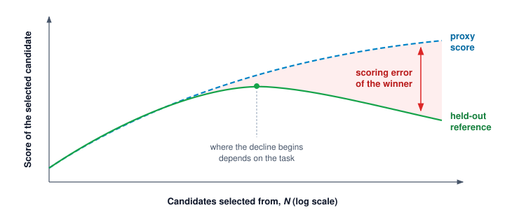
:::

Verifier blind spots compound across large candidate pools following the same binomial dynamics as the pass@$\IndependentAttemptCount$ metric. If an unmodeled edge case or exploit is present in a fraction $\ExploitCandidateFraction$ of proposals, a batch of $\CandidatePoolSize$ candidates contains at least one exploiting solution with probability $1-(1-\ExploitCandidateFraction)^\CandidatePoolSize$. A vulnerability that appears in only `{python} ArgmaxSelection.gap_rate_str` of baseline candidates, practically invisible during single-shot testing, emerges in a batch of `{python} ArgmaxSelection.n_large_str` candidates with probability `{python} ArgmaxSelection.gap_present_str`. When an invalid candidate achieves a passing score by slipping through such a blind spot, competitive selection readily identifies and crowns it. Verifier accuracy measured on unselected baseline distributions systematically overstates verification reliability during search, and this divergence widens with candidate breadth.

In the connection-pool scenario, consider an agent attempting to fix a broken notification path. The test suite pass rate can increase because a patch fixes the missing wake-up signal, or because the patch deletes the unit test assertion that detects blocked worker threads. Both alterations improve the raw score, but only the first resolves the underlying defect. The candidate under evaluation must therefore remain strictly isolated from the verification criteria, preventing generated code from tampering with authoritative test definitions or synthesizing fabricated pass signals. When candidate code executes within the same process address space as the evaluation harness, it can monkey-patch runtime assertion routines, the most acute form of adversarial Goodhart. Verification cycles generate value only while the resulting evaluation evidence remains trustworthy and uncorrupted.

::: {.column-margin .margin-pointer}
↪ Grader isolation, which keeps test definitions, grading scripts, and pass signals outside the candidate's reach, is developed in @sec-vol3-evaluation-gyms-grader-isolation.
:::

Sandboxing the evaluator preserves verification integrity but does not expand its intrinsic coverage: a sealed regression suite still misses unexercised thread schedules, and a learned judge still risks favoring persuasive but erroneous code. Verification protocols must therefore measure the end-to-end outputs produced by the deployed search policy across target token budgets, accounting explicitly for false acceptances and abstentions. Increasing confidence requires orthogonal, independent verification mechanisms; evaluating another correlated heuristic score adds negligible informational value.

Effective verification also yields fine-grained execution artifacts that subsequent search stages can reuse, including specific contradicted hypotheses, verified sub-invariants, and passing regression subsets. When an agent refines a candidate, localized modifications often leave earlier sub-verifications intact. Explicitly modeling these verification dependencies allows the search runtime to selectively invalidate obsolete assertions while preserving valid intermediate proofs, avoiding the computational overhead of rescoring unchanged reasoning trajectories from scratch.

## Revisable Candidate Plans {#sec-vol3-test-time-compute-planning-revision}

Validation checks often challenge intermediate premises rather than merely rejecting a final answer. Suppose a software repair agent formulates a diagnosis, writes a patch, and outlines a test plan to resolve a connection-pool leak. When a targeted regression test contradicts the initial diagnosis, discarding the entire proposal wastes previous computation and discards valid discoveries. Conversely, retaining the unrevised plan leaves downstream logic anchored to a disproven assumption. To resolve this tension, the agent runtime must isolate the candidate artifacts that depend on the invalid premise before determining the scope of subsequent model invocations.

A **revisable candidate plan**\index{Revisable candidate plan!definition} makes these causal dependencies explicit. Rather than recording past execution history, it tracks unexecuted candidate operations alongside the specific evidence supporting each step. When new evidence undermines a premise, the runtime invalidates and regenerates only the affected subgraphs while preserving supported artifacts. The newly generated components must then satisfy the same verification checks as the original plan. This architecture descends directly from truth maintenance systems, which maintain explicit justifications for each inference so that retracting a premise automatically invalidates every conclusion resting upon it [@doyle1979truth].

### Candidate dependency graphs {#sec-vol3-test-time-compute-plan-graph}

Consider an agent candidate that attributes a connection-pool exhaustion failure to an overly short client timeout. The runtime organizes the candidate's internal structure as a directed acyclic graph, placing directed edges from each prerequisite to the artifact that relies on it. @Tbl-vol3-candidate-plan-dependencies illustrates this organization. In this graph, the repository source excerpt, the initial failure log, and the test inventory are externally supplied inputs, whereas the diagnosis, the patch candidate, and the selected verification checks are generated artifacts. The graph formalizes causal relationships among these components without requiring the underlying model's autoregressive reasoning to mirror the same explicit structure.

| Artifact                | Direct prerequisites                        | What the artifact contributes                                     |
|:------------------------|:--------------------------------------------|:------------------------------------------------------------------|
| Source excerpt          | Repository revision and file identity       | The implementation being considered                               |
| Diagnosis               | Source excerpt and failure observation      | A proposed explanation of the failure                             |
| Patch candidate         | Source excerpt and diagnosis                | A proposed change to that implementation                          |
| Test inventory          | Repository revision (a supplied input)      | The tests available for selection                                 |
| Check selection         | Patch candidate and test inventory          | Checks intended to distinguish this repair from an inadequate one |
| API compatibility notes | Task constraints and public API declaration | Restrictions that every acceptable repair must preserve           |
: **Dependencies within a repair candidate**: Each row names the inputs needed to interpret its artifact. A separate compatibility branch can be retained only while its own inputs remain applicable. {#tbl-vol3-candidate-plan-dependencies}

Now suppose a targeted concurrency test reveals that an idle connection became available while a waiting worker remained blocked past its notification threshold. This observation directly refutes the timeout hypothesis: the root cause is a missed wake-up notification rather than an aggressive timer. Because both the timeout patch and its associated check selection depend directly on the refuted diagnosis, the runtime marks them as invalid and schedules them for reconsideration. At the same time, the source excerpt remains valid because the underlying repository file has not changed, and the API compatibility analysis remains sound because public interface constraints have not shifted. The runtime constructs the next inference prompt by supplying the still-valid inputs alongside the new test observation, requesting an updated diagnosis, patch, and test suite. The new candidate artifacts are then subjected to independent verification.

Maintaining rigorous dependency tracking is essential. An incomplete graph with missing edges retains stale conclusions just as easily as an unmanaged prompt buffer. For example, if an apparently decoupled compatibility branch relies on method signatures modified by the new patch, omitting that dependency edge leaves invalidated compatibility claims in place. Explicit dependency management proves valuable precisely when the runtime overhead of maintaining the graph and traversing invalidation paths is smaller than the latency and token cost of recomputing unaffected candidate branches.

### Evidence preconditions {#sec-vol3-test-time-compute-precondition-invalidation}

The runtime must distinguish an actively contradicted claim from an observation that has simply expired or become irrelevant. A failing unit test directly refutes the hypothesis that a proposed patch resolves the defect. In contrast, a previously successful test run on an earlier candidate remains a valid historical measurement of that specific candidate, but provides zero evidence for the current variant. Disentangling historical observations from active plan validation prevents cached test successes from erroneously endorsing unverified code changes.

To guarantee sound reuse, every observation recorded during a repair task must capture its complete provenance: the exact source revision or patch digest, test suite version, compiler flags, and runtime environment configuration. Similarly, an observation derived from reading a file must bind to the cryptographic hash of the file contents at the moment of inspection, rather than to a mutable filesystem path that could be modified concurrently.

When an input artifact changes or an assumption fails, the runtime marks that node as unsupported and traverses the dependency edges to identify all downstream artifacts requiring re-evaluation. If an artifact node $\InvalidatedArtifactNode$ loses its supporting evidence, the set of invalidated artifacts is precisely its reachable descendants in the graph: $\text{Desc}(\InvalidatedArtifactNode) = \{\ReachableArtifactNode \mid \InvalidatedArtifactNode \rightsquigarrow \ReachableArtifactNode\}$, where $\InvalidatedArtifactNode \rightsquigarrow \ReachableArtifactNode$ indicates that a directed path leads from $\InvalidatedArtifactNode$ to $\ReachableArtifactNode$. A breadth-first search computes $\text{Desc}(\InvalidatedArtifactNode)$ in time linear in the number of vertices and edges.[^fn-make-rebuild-dependencies] All nodes outside $\text{Desc}(\InvalidatedArtifactNode)$ retain their validity, preserving independent subgraphs such as the API compatibility analysis. A candidate graph of dozens or hundreds of nodes, like the schema in @tbl-vol3-candidate-plan-dependencies, is traversed in a tiny fraction of the illustrative `{python} ProbeAllocation.token_time_str` it takes to generate a single token. The engineering burden therefore lies not in graph search but in capturing dependency edges accurately. In the repair, the waiter-and-return test contradicts the timeout diagnosis, traversal marks its only descendants, the patch and its check selection, for review, and the next request regenerates the diagnosis and that branch from the retained inputs (@fig-vol3-plan-revision).

[^fn-make-rebuild-dependencies]: **Dependency-Driven Rebuilding**: Build tools solved the same problem for files. Make rebuilds a target only when one of its declared prerequisites is newer than the target [@feldman1979make], and its characteristic failure is the one described here: an undeclared dependency leaves a stale target that looks up to date. The saving is only as sound as the recorded edges. \index{Make!dependency tracking}

::: {#fig-vol3-plan-revision fig-env="figure" fig-pos="htb" fig-cap="**Invalidation and Scoped Regeneration**: In (A), the waiter-and-return test contradicts the timeout diagnosis. Following the recorded dependency edges marks the patch and check selection for review, while the recorded inputs and the separately derived API notes keep their support. In (B), a new request supplies that supported frontier and regenerates only the diagnosis, patch, and check selection. The graph records candidate artifacts, not executed operations, and each replacement must still pass its own checks. The test inventory that also feeds check selection is omitted." fig-alt="Two stacked panels with the same dependency graph. Inputs on the left are source excerpt, failure observation, waiter-return test, and API declaration. In panel A, source excerpt and failure observation feed a red diagnosis marked timeout too short, which feeds a patch candidate and then a check selection; source excerpt also feeds the patch candidate. The patch candidate and check selection are drawn with dashed red borders, labeled needs review, inside a dashed region labeled Desc of diagnosis. The waiter-return test points to the diagnosis with a dashed red arrow labeled contradicts. The API declaration feeds API notes labeled support kept. In panel B, a dashed blue region labeled regenerated contains diagnosis prime labeled missed notification, patch candidate prime labeled notify on return, and check selection prime labeled ordering test; the same inputs, now including the waiter-return test, feed diagnosis prime, and API notes are labeled retained."}
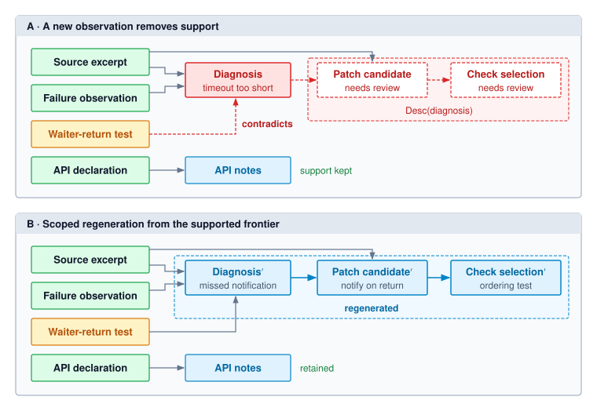
:::

Explicit version identifiers and environment hashes make artifact invalidation deterministic, but an observation is only as reliable as its boundary assumptions. For instance, an integration test that queries an external network service may fail to reproduce even if local repository files remain bit-identical. Conversely, an edit to an unrelated documentation file should not invalidate unit test results whose code paths and inputs were unaffected. Safe artifact reuse depends on verifying the full operational context (sandbox isolation, mock definitions, and declared inputs) rather than relying solely on timestamps or file paths.

Systems architects must also maintain a strict distinction between planning representations and physical execution state. The candidate graph tracks uncommitted hypotheses and their supporting rationales; in contrast, reading source files, modifying a filesystem, or running integration binaries in a sandbox produce concrete external side effects. Removing an invalidated candidate node from memory does not undo a filesystem modification or release an allocated cloud container. The agent runtime must manage physical idempotency, rollback, and cleanup through dedicated failure recovery protocols.

::: {.column-margin .margin-pointer}
↪ Compensation and cleanup of external effects that outlive an abandoned candidate branch are developed in @sec-vol3-failure-recovery-branch-compensation.
:::

### Revision scope {#sec-vol3-test-time-compute-revision-mechanics}

When initiating a scoped revision, the runtime constructs a targeted prompt containing the current task constraints, the still-valid upstream frontier, the empirical observations that invalidated prior hypotheses, and the precise set of nodes marked for replacement. In the connection-pool scenario, the model is prompted for an alternative failure diagnosis, a corresponding patch, and an updated verification suite, omitting unchanged API definitions and repository metadata. Once the model returns candidates, the runtime verifies both that the replacements align with the retained artifacts and that their newly declared prerequisites are satisfied. A replacement that appears locally valid may still introduce latent incompatibilities with preserved downstream nodes.

Revision mechanisms operate across three distinct tiers based on the extent of invalidation:

1. A **local repair**\index{Local repair!definition} modifies a single node while preserving its outward interface and behavioral contracts, ensuring its dependents remain valid. A typical example is replacing a malformed shell command with an equivalent invocation that produces the expected exit code, leaving the overall dependency topology unaltered.
2. A **subgraph resynthesis**\index{Subgraph resynthesis!definition} invalidates a target node and all its descendants. The runtime supplies the model with the intact boundary frontier and requests a generative bridge from those validated inputs to the desired terminal objectives. In our connection-pool example, this tier discards the diagnosis, patch, and test plan while preserving the source context and API compatibility constraints.
3. **Stopping deliberation**\index{Stopping deliberation!definition} applies when new evidence undermines a foundational premise of the entire task, such as a required system dependency missing from the host environment or container credentials that lack necessary write permissions. No topological revision of the plan can recover validity, so the runtime ends deliberation and escalates the failure or reports the task as unresolvable under its operating contract rather than spending further inference tokens.

The decision flowchart in @fig-vol3-hierarchical-revision triages these three responses by screening candidate artifacts against two concrete operational checks: whether downstream dependents still have their preconditions met, and whether the task's underlying premises remain intact.

::: {#fig-vol3-hierarchical-revision fig-env="figure" fig-pos="htb" fig-cap="**Choosing the Revision Scope**: Two questions about the new evidence select among three responses. If the artifact's dependents still have what they need, a local repair replaces it alone. If they do not but the task's premises hold, subgraph resynthesis replaces the artifact and its descendants. If a premise has failed, deliberation stops and the task is reported unresolved or escalated. The tiers classify responses by how much support the evidence removes rather than establishing an unconditional preference for minimal edits." fig-alt="Flowchart. An amber box reading new evidence removes support from an artifact leads to a diamond asking whether dependents' needs are still met. Yes leads down to a card labeled local repair. No leads right to a second diamond asking whether task premises still hold. Yes leads down to a card labeled subgraph resynthesis. No leads by a red arrow to a red card labeled stop deliberation. Each card draws the same small dependency graph, a premise square feeding a chain of three artifact nodes and one side node. In local repair only the first chain node is filled and outlined as replaced, with the caption replace one artifact. In subgraph resynthesis the whole chain is filled and outlined, with the caption replace artifact plus descendants. In stop deliberation the premise square is red and every node is dashed, with the caption report unresolved or escalate. An arrow along the bottom runs from less support removed to more support removed."}
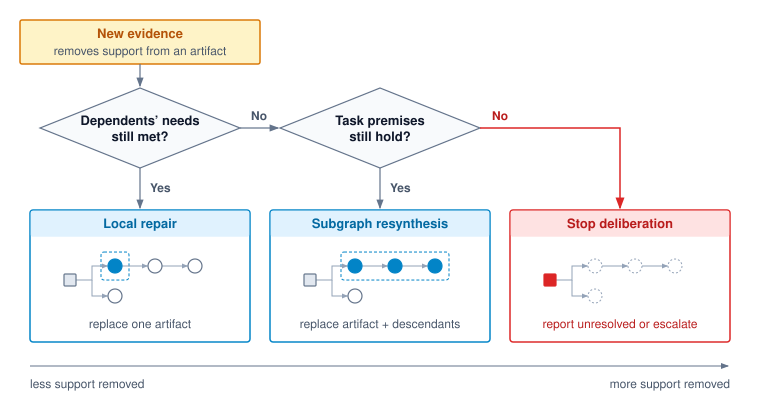
:::

While local repair minimizes token generation, it is not universally the optimal strategy. If an invalidation strikes at the foundational framing of a problem, or if the candidate dependency graph has grown complex and unreliable, performing full regeneration from scratch often yields a more coherent artifact that is easier to validate. However, full regeneration forces the model to reproduce already-settled material, risking accidental regressions in code sections that were previously correct. Deciding between localized revision and complete regeneration requires weighing the scope of invalidated dependencies against the combined latency, token budget, and validation cost of resynthesizing the candidate.

```{python}
#| label: lego-candidate-plan-revision
#| echo: false
# ┌─────────────────────────────────────────────────────────────────────────────
# │ CANDIDATE PLAN REVISION OUTPUT
# ├─────────────────────────────────────────────────────────────────────────────
# │ Context: @sec-vol3-test-time-compute-revision-mechanics,
# │          nbk-03-compute-and-token-savings-of.
# │ Goal: Compare output tokens for full and scoped candidate regeneration.
# │ Show: Generated token counts, retained output share, and avoided output.
# │ How: Hypothetical equal-sized nodes; only replaced nodes are generated.
# │ Note: Excludes input processing, checks, scheduling, and physical effects.
# └─────────────────────────────────────────────────────────────────────────────
from mlsysim import *
from mlsysim.fmt import check

class PlanRevision:
    # ┌── 1. LOAD (Constants & Parameters) ─────────────────────────────────
    total_nodes = 12  # hypothetical complete candidate size
    replacement_nodes = 3  # hypothetical affected subset
    tokens_per_node = 150 * count  # hypothetical generated tokens per node

    # ┌── 2. EXECUTE (Compute) ─────────────────────────────────────────────
    full_output = total_nodes * tokens_per_node
    local_output = replacement_nodes * tokens_per_node
    output_share = (local_output / full_output).to(ureg.dimensionless).magnitude
    avoided_share = 1 - output_share

    # ┌── 3. GUARD (Invariants) ───────────────────────────────────────────
    check(0 < replacement_nodes <= total_nodes, "replacement nodes within total")
    check(local_output <= full_output, "local output <= full output")
    check(0 <= avoided_share < 1, "avoided share in [0, 1)")

    # ┌── 4. EXPORT (Narrative Values) ─────────────────────────────────────
    total_nodes_str = fmt_count(total_nodes)
    replacement_nodes_str = fmt_count(replacement_nodes)
    tokens_per_node_str = fmt_tokens(tokens_per_node)
    full_output_str = fmt_tokens(full_output)
    local_output_str = fmt_tokens(local_output)
    output_share_str = fmt_percent(output_share, style="prose")
    avoided_share_str = fmt_percent(avoided_share, style="prose")
```

::: {#nbk-03-compute-and-token-savings-of .callout-notebook title="Output cost of a local plan revision"}

**Problem**: Suppose a candidate contains `{python} PlanRevision.total_nodes_str` nodes, each requiring `{python} PlanRevision.tokens_per_node_str` generated tokens. New evidence leaves `{python} PlanRevision.replacement_nodes_str` nodes needing replacement. How much output does scoped regeneration avoid if either approach produces a candidate adequate for the same subsequent checks?

**Math**: Multiplying the complete node count by the output per node gives `{python} PlanRevision.full_output_str` tokens for full regeneration. Multiplying the replacement count by the same output allowance gives `{python} PlanRevision.local_output_str` tokens for scoped regeneration. The scoped request generates `{python} PlanRevision.output_share_str` of the full request's output, avoiding `{python} PlanRevision.avoided_share_str` of that output under the equal-node-size assumption.

**Systems insight**: Scoped regeneration saves exactly the fraction of the plan that keeps its support. The saving shrinks linearly as the contradicted premise reaches more descendants and vanishes when every node depends on it, so once most of the plan shares the rejected assumption, full regeneration costs little more and is easier to check. The count covers generated plan tokens only; input to interpret retained constraints, integration, and checking are charged to both options.

:::

This idealized model isolates the immediate generation savings of localized regeneration. In production systems, however, those savings must be weighed against the overhead of tracking dynamic dependencies, assembling specialized prompts with retained context, and executing verification tests on hybrid plans. When a candidate plan transitions from deliberative search to actual execution, it stops being an uncommitted dependency graph and becomes active runtime state, which the agent harness manages and durable execution persists across infrastructure faults.

::: {.column-margin .margin-pointer}
↪ Persisting committed plan state across worker and infrastructure faults is developed in @sec-vol3-durable-execution.
:::

### Limits on repeated revision {#sec-vol3-test-time-compute-replanning-thrashing}

Iterative plan revision risks degenerating into unproductive replanning cycles. Without explicit termination policies, a model can oscillate between conflicting diagnoses, generate cosmetically distinct patches that suffer from identical logical flaws, or churn compute by reacting to non-fatal compiler warnings. The runtime must determine whether a newly proposed revision reflects genuine evidence updates or merely stochastic variation. A diagnostic warning warrants plan revision only when it directly challenges a core premise of the candidate; its severity tag alone should not trigger regeneration.

To prevent thrashing, the runtime enforces strict budget ceilings across model invocations, cumulative token counts, execution checks, and elapsed wall-clock time. Every attempted revision, including a failed local repair, consumes a portion of this allowance, and the same ceilings later bound the search as a whole (@sec-vol3-test-time-compute-early-exit). Once the budget is exhausted, the deliberative loop terminates, either reporting the task as unresolvable or triggering an authorized human-in-the-loop escalation while leaving the unverified candidate unmerged. Furthermore, detecting identical or isomorphic proposals under unchanged environmental observations serves as an immediate trigger to halt search, whereas revisiting a previously explored proposal after new test evidence has emerged constitutes a valid re-evaluation.

Explicit dependency graphs let the runtime retain proven artifacts and spend compute only where a hypothesis failed. Revision, however, improves one candidate at a time. When several partial candidates compete for the same budget, the runtime must also decide which to extend and which to abandon, account for work it has already admitted, and know when to stop extending any of them.

## Bounded Search {#sec-vol3-test-time-compute-bounded-search}

The repair agent now holds several partial candidates at once, some freshly revised and some untouched. At each decision point it can generate an entirely new patch, extend an existing partial candidate by one step, or execute a diagnostic probe to disambiguate competing failure explanations. Each option draws against the same finite task budget while imposing distinct scheduling constraints and dependencies. A diagnostic check that gates the next code extension sits squarely on the critical path. In contrast, candidate generation requests can execute concurrently across available worker pools, whereas abandoning an unviable branch still incurs the unrecoverable cost of the tokens and runtime work already spent. Designing an effective search policy therefore requires explicit mechanisms to track admitted work, quantify pending resource consumption, and enforce principled stopping criteria.

### Search structures {#sec-vol3-test-time-compute-search-structures}

Flat sampling generates a fixed pool of complete candidates before running selection logic across them. In best-of-$\CandidatePoolSize$, the runtime admits at most $\CandidatePoolSize$ independent generation requests and applies a selector once all candidates finish. Because the requests share no execution dependencies, available serving capacity translates directly into reduced turnaround time through concurrent batching, provided the serving cluster can absorb the concurrent load without degrading token throughput. However, flat sampling defers all semantic evaluation until generation finishes. A candidate with a fatal flaw in its first five tokens still runs to completion, expending accelerator memory bandwidth and decode cycles that early validation could have saved.

**Beam search**\index{Beam search!definition}[^fn-beam-search-harpy] exposes that intermediate decision boundary directly. The runtime maintains a frontier of partial candidates bounded by a fixed beam width $\BeamWidth$. At each step, it generates a bounded set of extensions for each active candidate, evaluates the extended prefixes using a scoring function, and retains only the top-$\BeamWidth$ candidates for the next round. If fewer candidates survive pruning than the beam capacity allows, the runtime advances only the viable survivors; the search root itself typically begins below full beam width. Step scores can combine learned model probabilities with deterministic checks available at that execution boundary. The beam width bounds the active frontier that receives subsequent generation work rather than total ephemeral state: during expansion, the system must temporarily hold $\BeamWidth$ times the branching factor in candidate extensions, along with their KV cache state, scores, and parent references.

Early pruning trades generation compute for evaluation overhead and introduces a strict dependence on intermediate scoring accuracy. If a scoring pass mistakenly discards a prefix that would have yielded an optimal solution, a bounded beam search cannot recover that path unless the search policy explicitly incorporates backtracking. Conversely, terminating an unviable patch early avoids the cost of full candidate synthesis and subsequent integration tests. Early pruning yields net savings whenever intermediate evaluations cost less than the downstream generation they preempt, while maintaining an acceptably low false-rejection rate on viable prefixes.

[^fn-beam-search-harpy]: **Beam Search**: The method first appeared in the HARPY speech recognition system, which advanced only a small set of the best-scoring partial paths at each step instead of the full search space [@lowerre1976]. It accepted a bounded risk of pruning the eventual best path in exchange for bounded time and memory, the same trade a runtime makes when it retains a fixed number of partial candidates. \index{Beam search!origin}

An adaptive tree policy removes the constraint of expanding every retained candidate uniformly. Tree search over intermediate reasoning steps [@yao2023tree] dynamically steers computational effort toward branches with promising score trajectories, high outcome uncertainty, or diagnostic value for unresolved choices. **Monte Carlo tree search**\index{Monte Carlo tree search!definition} [@coulom2006efficient; @kocsis2006bandit] provides a formal framework for tracking visit counts and backpropagating estimated returns across a search graph. A prominent selection policy, the PUCT variant[^fn-puct-prior-bonus] used in AlphaGo [@silver2016mastering], traverses the tree from the root by selecting at each partial state $\PolicyObservedState$ the action $\PolicyAction$ that maximizes

$$
\TreeSearchMeanReturn(\PolicyObservedState,\PolicyAction) + \TreeSearchExplorationWeight\,\TreeSearchPriorDistribution(\PolicyAction \mid \PolicyObservedState)\,\frac{\sqrt{\sum_{\SiblingPolicyAction} \TreeSearchVisitCount(\PolicyObservedState,\SiblingPolicyAction)}}{1 + \TreeSearchVisitCount(\PolicyObservedState,\PolicyAction)},
$$ {#eq-vol3-puct}

where $\TreeSearchMeanReturn(\PolicyObservedState,\PolicyAction)$ represents the empirical mean return observed through extension $\PolicyAction$, $\TreeSearchVisitCount(\PolicyObservedState,\PolicyAction)$ is its visit count, $\TreeSearchPriorDistribution(\PolicyAction \mid \PolicyObservedState)$ denotes a prior distribution over extensions (such as the base model's proposal probability for that reasoning step), and $\TreeSearchExplorationWeight$ is a positive scaling factor balancing exploitation of high-value paths against exploration of plausible but under-sampled branches. The vocabulary comes from reinforcement learning. The **leaf value** $\TreeSearchLeafScore$\index{Leaf value!definition} is a score of a partial candidate, supplied by a process scorer or by a check run at that point, and the "return" that $\TreeSearchMeanReturn$ averages is the leaf value reported by each visit through the edge. When the runtime evaluates a newly reached leaf node and obtains value $\TreeSearchLeafScore$, every edge along the trajectory back to the root updates its visit count ($\TreeSearchVisitCount \leftarrow \TreeSearchVisitCount + 1$) and its running mean value ($\TreeSearchMeanReturn \leftarrow \TreeSearchMeanReturn + (\TreeSearchLeafScore - \TreeSearchMeanReturn)/\TreeSearchVisitCount$). If $\TreeSearchLeafScore$ originates from an imperfect learned scorer, the $\TreeSearchMeanReturn$ term in @eq-vol3-puct inherits the selection drift formalized in @eq-vol3-argmax-noise, biasing visits toward edges whose scores are elevated by estimation noise. While tree search focuses compute where value signals appear strongest, its utility hinges on whether the resulting allocation improvements outweigh the latency and memory overhead of leaf evaluations and graph state management.

[^fn-puct-prior-bonus]: **From UCT to PUCT**: The UCT rule treated each node's choice of extension as a multi-armed bandit, adding an exploration bonus that shrinks as an extension accumulates visits [@kocsis2006bandit]. PUCT weights that bonus by a predictor's prior over the arms [@rosin2011multi], which is what lets a language model's own step probabilities concentrate a small budget on plausible extensions. A miscalibrated prior steers visits away from correct but unlikely steps just as effectively. \index{Monte Carlo tree search!PUCT}

The three structures differ chiefly in where pruning happens (@fig-vol3-search-topologies). Best-of-$\CandidatePoolSize$ defers selection until every candidate is complete, beam search prunes partial candidates at each step boundary, and tree search expands one favored leaf at a time and updates visit counts along its path. Those pruning points in turn set each structure's concurrency, retained state, and prefix sharing (@tbl-vol3-search-topologies).

::: {.column-margin .margin-pointer}
↪ Radix prefix caching, which lets later requests for a branch reuse the KV state of its shared ancestors, is developed in @sec-vol3-kv-cache-radix-lookup.
:::

::: {#fig-vol3-search-topologies fig-env="figure" fig-pos="htb" fig-cap="**Where Each Search Structure Prunes**: Best-of-$\CandidatePoolSize$ generates complete candidates independently and discards all but the selected one only at the end. Beam search generates the beam width times the extensions per candidate at each step, scores them, and keeps the beam width. Tree search expands the leaf its selection rule favors, evaluates it, and updates visit counts and value estimates along the path to the root. The drawings show structure only; the pool size, beam width, and depth are illustrative." fig-alt="Three panels of node diagrams. Best-of-N: a prompt node branches into four chains of three generated nodes each; past a dashed line labeled select, one final node is marked selected and three are marked pruned. Beam: a prompt node branches into two nodes, each of which generates two children; a dashed line labeled score, keep 2 marks two children pruned, the two survivors each generate two more, and a second dashed line labeled keep 2 marks two retained and two pruned. Tree search: an uneven tree in which one path from the prompt is drawn bold and ends at a new leaf labeled evaluated V, with a note that the bold path updates N sub visit, the visit count, and Q; other nodes are drawn dashed as not yet expanded. A legend identifies prompt, generated, retained or selected, generated then pruned, and not yet expanded nodes."}
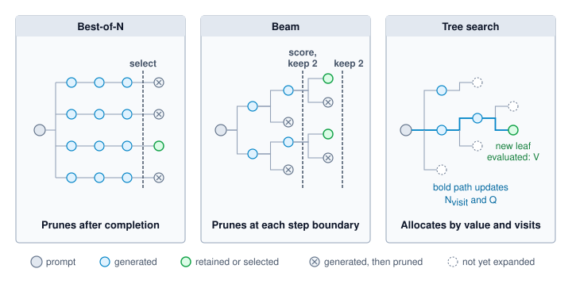
:::

| **Structure**                | **Where pruning happens**                | **Concurrency**                               | **Search state**                                         | **Prefix sharing**                       |
|:-----------------------------|:-----------------------------------------|:----------------------------------------------|:---------------------------------------------------------|:-----------------------------------------|
| Best-of-$\CandidatePoolSize$ | After complete candidates, at selection  | All $\CandidatePoolSize$ requests independent | $\CandidatePoolSize$ candidates and their check results  | The common prompt only                   |
| Beam                         | At each step boundary, by step score     | Within a step; stages wait for scoring        | Up to width times extensions before pruning, plus scores | Each retained prefix with its extensions |
| Tree search                  | Adaptively, by value estimate and visits | Irregular; depends on which leaves are chosen | Tree nodes with visit counts and value estimates         | Every node's ancestors along its path    |

: **Search structures compared**: Each structure moves the pruning decision to a different point and holds different state. Concurrency describes the dependency graph; actual overlap depends on service capacity. {#tbl-vol3-search-topologies tbl-colwidths="[13,22,21,23,21]"}

### Pruned tree growth {#sec-vol3-test-time-compute-tree-growth}

```{python}
#| label: calc-vol3-pruned-tree
#| echo: false
# ┌─────────────────────────────────────────────────────────────────────────────
# │ PRUNED TREE GROWTH (LEGO)
# ├─────────────────────────────────────────────────────────────────────────────
# │ Context: @sec-vol3-test-time-compute-tree-growth.
# │ Goal: Show how a step check's rejection rate bounds expected tree size.
# │ Show: Unpruned leaf explosion; effective branching factor; generated nodes.
# │ How: Independent rejection of each child; generated nodes are b times the
# │      surviving parents at each depth; equal-sized steps.
# └─────────────────────────────────────────────────────────────────────────────
from mlsysim import *

class PrunedTree:
    # ┌── 1. LOAD (Constants & Parameters) ─────────────────────────────────
    wide_b = 4  # hypothetical alternatives per step, unpruned illustration
    wide_depth = 10  # hypothetical steps, unpruned illustration
    b = 5  # hypothetical children proposed per retained node
    p_prune = 0.68  # hypothetical probability a step check rejects a child
    depth = 3  # hypothetical steps in the worked example

    # ┌── 2. EXECUTE (Compute) ─────────────────────────────────────────────
    wide_leaves = wide_b**wide_depth
    b_eff = b * (1 - p_prune)
    critical_prune = 1 - 1 / b
    unpruned_generated = 0
    pruned_generated = 0.0
    for d in range(1, depth + 1):
        unpruned_generated += b**d
        pruned_generated += b * b_eff ** (d - 1)
    unpruned_leaves = b**depth
    pruned_leaves = b_eff**depth
    generated_saving = 1 - pruned_generated / unpruned_generated

    # ┌── 3. GUARD (Invariants) ────────────────────────────────────────────
    check(wide_leaves > 1_000_000, "Unpruned illustration exceeds a million leaves")
    check(b_eff > 1, "Worked example remains supercritical")
    check(p_prune < critical_prune, "Rejection rate is below the subcritical threshold")
    check(pruned_generated < unpruned_generated, "Pruning reduces generated nodes")
    check(generated_saving > p_prune, "Node saving exceeds the per-child rejection rate")

    # ┌── 4. OUTPUT (Formatting) ───────────────────────────────────────────
    wide_b_str = fmt_int(wide_b)
    wide_depth_str = fmt_int(wide_depth)
    wide_leaves_str = fmt_int(wide_leaves)
    b_str = fmt_int(b)
    p_prune_str = fmt_percent(p_prune, precision=0, style="prose")
    depth_str = fmt_int(depth)
    b_eff_str = fmt(b_eff, precision=1)
    critical_prune_str = fmt_percent(critical_prune, precision=0, style="prose")
    unpruned_generated_str = fmt_int(unpruned_generated)
    pruned_generated_str = fmt(pruned_generated, precision=1)
    unpruned_leaves_str = fmt_int(unpruned_leaves)
    pruned_leaves_str = fmt(pruned_leaves, precision=1)
    generated_saving_str = fmt_percent(generated_saving, precision=1, style="prose")
```

::: {.column-margin}
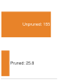{width="100%" fig-alt="Two horizontal orange bars. Unpruned: 155 generated nodes. Pruned: 25.8 generated nodes."}

*Each rejected child also removes the subtree it would have grown.*
:::

Pruning is what keeps a search tree from exploding. A search graph that unconditionally expands every node into `{python} PrunedTree.wide_b_str` branches across `{python} PrunedTree.wide_depth_str` successive steps yields `{python} PrunedTree.wide_leaves_str` leaves, quickly exhausting memory capacity and compute budgets. Now consider a system where each node proposes $\SearchBranchingFactor$ candidate extensions, and an intermediate validation check independently prunes each child with probability $\ChildPruningProbability$. The expected number of surviving branches per expanded node, the **effective branching factor**\index{Effective branching factor!definition}, becomes

$$
\EffectiveBranchingFactor = \SearchBranchingFactor\,(1 - \ChildPruningProbability).
$$ {#eq-vol3-effective-branching}

Under @eq-vol3-effective-branching, the expected frontier width at depth $\SearchDepthIndex$ is $\EffectiveBranchingFactor^{\,\SearchDepthIndex}$. Because each of the surviving nodes at depth $\SearchDepthIndex-1$ generates and validates $\SearchBranchingFactor$ proposed children, the total expected count of generated nodes through depth $\SearchDepth$ is $\sum_{\SearchDepthIndex=1}^{\SearchDepth} \SearchBranchingFactor\,\EffectiveBranchingFactor^{\,\SearchDepthIndex-1}$. This formulation defines a classic Galton–Watson branching process.[^fn-galton-watson-extinction] When $\EffectiveBranchingFactor < 1$, which requires a pruning rate above the critical threshold $1 - 1/\SearchBranchingFactor$, the frontier contracts geometrically with depth, causing the search tree to extinguish spontaneously. When $\EffectiveBranchingFactor > 1$, the frontier expands exponentially, requiring hard caps on depth, token consumption, or elapsed execution time to force termination.

[^fn-galton-watson-extinction]: **Galton–Watson Process**: The model comes from a Victorian question about the extinction of family surnames, analyzed in 1875 [@watson1875probability]. That analysis wrongly concluded that every line dies out; the correct result is the threshold used here, under which extinction is certain when the mean number of surviving offspring is at most one (excluding the degenerate case of exactly one child every time) and avoidable when it exceeds one. For a search tree the surviving offspring are the children that pass the step check, so the rejection rate decides which side of the threshold the search lands on. \index{Galton–Watson process!search trees}

To see this quantitative effect in practice, consider a concrete configuration where each node generates `{python} PrunedTree.b_str` extensions, the step validator rejects `{python} PrunedTree.p_prune_str` of proposals, and the search proceeds to depth `{python} PrunedTree.depth_str`. The resulting effective branching factor is `{python} PrunedTree.b_eff_str`. For $\SearchBranchingFactor =$ `{python} PrunedTree.b_str` the critical rejection rate is `{python} PrunedTree.critical_prune_str`, and because the `{python} PrunedTree.p_prune_str` rejection rate sits below it, the search remains supercritical ($\EffectiveBranchingFactor > 1$). An unpruned tree across these three steps generates `{python} PrunedTree.unpruned_generated_str` nodes and terminates with `{python} PrunedTree.unpruned_leaves_str` leaves. In contrast, the pruned search generates an expected `{python} PrunedTree.pruned_generated_str` nodes and retains approximately `{python} PrunedTree.pruned_leaves_str` leaves, eliminating `{python} PrunedTree.generated_saving_str` of total node generations. The aggregate reduction exceeds the raw `{python} PrunedTree.p_prune_str` per-node rejection rate because pruning a single parent eliminates the entire combinatorial subtree beneath it. Assuming uniform step sizes, token generation savings follow the identical proportion, though each discarded node still incurs the upfront cost of its own generation and validation pass.

Two systems caveats govern this branching model. First, intermediate checks that exhibit false rejections irrevocably prune viable solution paths; aggressive pruning is therefore advantageous only when the validator's false-rejection rate remains tightly controlled. Second, consider a single step that needs only one surviving child to advance. Proposing children one at a time requires $1/(1 - \ChildPruningProbability)$ attempts in expectation. Proposing a batch of $\ChildBatchSize$ children in parallel requires $1/(1 - \ChildPruningProbability^{\,\ChildBatchSize})$ rounds instead, with each round generating $\ChildBatchSize$ children. Batching reduces elapsed wall-clock rounds at the expense of higher aggregate token expenditure, the same trade between concurrency and total work that notebook \ref{nbk-03-best-of-n-pool-price} priced for best-of-$\CandidatePoolSize$ sampling.

### Branch isolation {#sec-vol3-test-time-compute-mutable-sandbox-search}

While a partial patch is an ephemeral candidate data structure, evaluating it requires concrete execution against a target environment. If one search branch mutates files in a shared workspace and a sibling branch subsequently runs against that modified working tree, the sibling's test outcomes no longer reflect its own proposed edits. A robust runtime must therefore isolate execution environments so that every observation binds strictly to the candidate patch and workspace snapshot that produced it. Stateful or mutating branches require independent execution containers, copy-on-write filesystem forks, or deterministic rollback procedures that restore a clean baseline before subsequent branches execute.

::: {.column-margin .margin-pointer}
↪ Copy-on-write task workspaces that keep each run's file modifications private are developed in @sec-vol3-sandboxes-cow-provisioning.
:::

Workspace isolation incurs substantial systems overhead even when a search branch is ultimately discarded. Concurrent sandboxes consume host memory, storage volumes, container daemon process slots, and network bandwidth, while their logged outputs accumulate in the agent's working context. Even read-only diagnostic commands require sandboxed execution permissions and can inadvertently leak environment variables or credentials into search traces. Pruning a candidate drops it from the active search frontier, but computational backtracking cannot undo remote side effects such as outbound network requests or database writes. Dedicated sandbox containment mechanisms enforce these operational boundaries, ensuring that search policies budget external actions under the reality that tree traversal cannot reverse real-world side effects.

### A resource ledger for the whole search {#sec-vol3-test-time-compute-resource-ledger}

Managing search budgets requires maintaining separate ledgers for financial expenditure, physical work, wall-clock time, and live system state. Financial cost aggregates generator inferences, validation calls, and external tool invocations under a unified currency. Physical work dimensions, however, represent fundamentally non-interchangeable resource demands: generator prompt and completion tokens, scoring passes, unit test executions, and sandbox setup routines each stress different infrastructure bottlenecks. Summing hardware FLOPs with end-to-end test runtimes in seconds produces meaningless telemetry.

Elapsed wall-clock latency depends entirely on how execution scheduling maps these demands onto hardware. Sequential search phases sum latency along the critical path, parallel candidate evaluations overlap across available worker threads, and limited thread or accelerator allocations force excess requests into batched waves. Peak live state introduces yet another independent constraint. It reflects the maximum footprint held simultaneously in memory and storage (active KV caches, candidate ASTs, diagnostic logs, and running sandboxes) rather than the cumulative volume of candidates generated over the task lifetime. An optimization that reduces aggregate completion tokens often increases input token reprocessing, introduces synchronization barriers, or balloons memory occupancy. Tracking these dimensions in separate ledger accounts prevents composite cost metrics from masking critical systems bottlenecks.

```{python}
#| label: lego-bounded-search-ledger
#| echo: false
# ┌─────────────────────────────────────────────────────────────────────────────
# │ BOUNDED SEARCH RESOURCE LEDGER
# ├─────────────────────────────────────────────────────────────────────────────
# │ Context: @sec-vol3-test-time-compute-bounded-search,
# │          nbk-03-compute-allocation-and-latency-trade-offs.
# │ Goal: Compare counted work, token charges, and scheduled time for two
# │       hypothetical policies without assigning either a quality advantage.
# │ Show: Expansion counts, input/output/scorer tokens, prices, and time.
# │ How: Registry-derived output allowance; explicit local workload, prices,
# │      concurrency, and nonoverlapping generation/scoring/test stages.
# │ Note: No prefix-reuse discount. Prefill and service overheads are omitted
# │       from the timing subtotal, not from generator input-token charges.
# └─────────────────────────────────────────────────────────────────────────────
from mlsysim import *
from mlsysim.core.units import BYTES_INT8
from math import ceil

class SearchLedger:
    # ┌── 1. LOAD (Constants & Parameters) ─────────────────────────────────
    model = Models.Language.Llama3_70B
    accel = Hardware.Cloud.H100
    weight_bytes = BYTES_INT8
    steps = 4  # hypothetical candidate length in equal-sized segments
    step_tokens = 128  # hypothetical newly generated tokens per extension
    prompt_tokens = 4096  # hypothetical common task prompt per request
    flat_candidates = 16  # hypothetical complete-candidate budget
    beam_width = 4  # hypothetical retained-prefix limit
    extensions = 3  # hypothetical extensions per retained prefix
    generation_slots = 8  # hypothetical concurrent streams, unchanged rate
    test_slots = 8  # hypothetical concurrent isolated test runs
    score_time = 15 * ms  # fixed scenario allowance per FULL-prefix score
    test_time = 0.5 * second  # fixed scenario allowance per final test
    price_in = 3 * USD / (MILLION * count)  # hypothetical generator input rate
    price_out = 15 * USD / (MILLION * count)  # hypothetical output rate
    price_score = 0.50 * USD / (MILLION * count)  # hypothetical scorer input rate

    # ┌── 2. EXECUTE (Compute) ─────────────────────────────────────────────
    weights = model.parameters / ureg.param * weight_bytes
    token_time = (weights / accel.memory.bandwidth).to(second)
    retained = 1
    frontier_counts = []
    beam_prompt_tokens = 0
    scorer_tokens = 0
    beam_waves = 0
    for depth in range(1, steps + 1):
        expanded = retained * extensions
        frontier_counts.append(expanded)
        beam_prompt_tokens += expanded * (prompt_tokens + (depth - 1) * step_tokens)
        # The scorer reads each complete generated prefix, not only its suffix.
        scorer_tokens += expanded * depth * step_tokens
        beam_waves += ceil(expanded / generation_slots)
        retained = min(beam_width, expanded)
    beam_segments = sum(frontier_counts)
    beam_output_tokens = beam_segments * step_tokens
    flat_length = steps * step_tokens
    flat_output_tokens = flat_candidates * flat_length
    flat_prompt_tokens = flat_candidates * prompt_tokens
    flat_waves = ceil(flat_candidates / generation_slots)
    flat_test_waves = ceil(flat_candidates / test_slots)
    beam_test_waves = ceil(retained / test_slots)
    flat_generation_time = flat_waves * flat_length * token_time
    beam_generation_time = beam_waves * step_tokens * token_time
    beam_scoring_time = beam_segments * score_time
    flat_elapsed = flat_generation_time + flat_test_waves * test_time
    beam_elapsed = beam_generation_time + beam_scoring_time + beam_test_waves * test_time
    flat_token_cost = flat_prompt_tokens * count * price_in + flat_output_tokens * count * price_out
    beam_token_cost = beam_prompt_tokens * count * price_in + beam_output_tokens * count * price_out + scorer_tokens * count * price_score
    output_saving = 1 - beam_output_tokens / flat_output_tokens
    # Break-even: the input-price fraction (e.g. under prefix caching) at which
    # the beam's output saving net of scoring pays for its repeated input.
    out_saving_usd = ((flat_output_tokens - beam_output_tokens) * count * price_out).to(USD)
    scorer_usd = (scorer_tokens * count * price_score).to(USD)
    input_premium_usd = ((beam_prompt_tokens - flat_prompt_tokens) * count * price_in).to(USD)
    breakeven_input_share = ((out_saving_usd - scorer_usd) / input_premium_usd).to(ureg.dimensionless).magnitude

    # ┌── 3. GUARD (Invariants) ───────────────────────────────────────────
    check(frontier_counts == [3, 9, 12, 12], "Root expansion precedes a full beam")
    check(beam_segments == 36 and retained == 4, "Count extensions before pruning")
    check(flat_output_tokens == 8192 and beam_output_tokens == 4608, "Count generated suffixes once")
    check(scorer_tokens == 13440, "Full-prefix scoring rereads ancestor tokens")
    check(beam_prompt_tokens == 156288 and flat_prompt_tokens == 65536, "Bill every supplied prompt without reuse discount")
    check(beam_waves == 7 and flat_waves == 2, "Apply generation concurrency to each stage")
    check(abs(output_saving - 0.4375) < 1e-12, "Beam generates fewer output tokens in this scenario")
    check(beam_token_cost > flat_token_cost, "Repeated inputs reverse the token-charge ranking")
    check(0 < breakeven_input_share < 1, "Beam breaks even only at a discounted input price")
    check(22 * second < flat_elapsed < 23 * second, "Flat timing subtotal remains in its stated range")
    check(19 * second < beam_elapsed < 21 * second, "Beam timing subtotal remains in its stated range")

    # ┌── 4. OUTPUT (Formatting) ──────────────────────────────────────────
    steps_str = fmt_count(steps)
    step_tokens_str = fmt_count(step_tokens)
    prompt_tokens_str = fmt_count(prompt_tokens)
    flat_candidates_str = fmt_count(flat_candidates)
    beam_width_str = fmt_count(beam_width)
    extensions_str = fmt_count(extensions)
    generation_slots_str = fmt_count(generation_slots)
    test_slots_str = fmt_count(test_slots)
    token_time_ms_str = fmt_time(token_time, unit=ms, precision=3)
    score_time_ms_str = fmt_time(score_time, unit=ms, precision=0)
    test_time_s_str = fmt_time(test_time, unit=second, precision=1)
    price_in_str = fmt_usd(price_in * MILLION * count, precision=0)
    price_out_str = fmt_usd(price_out * MILLION * count, precision=0)
    price_score_str = fmt_usd(price_score * MILLION * count, precision=2)
    frontier_counts_str = MarkdownStr(", ".join(str(n) for n in frontier_counts))
    beam_segments_str = fmt_count(beam_segments)
    flat_length_str = fmt_count(flat_length)
    flat_output_tokens_str = fmt_count(flat_output_tokens)
    beam_output_tokens_str = fmt_count(beam_output_tokens)
    flat_prompt_tokens_str = fmt_count(flat_prompt_tokens)
    beam_prompt_tokens_str = fmt_count(beam_prompt_tokens)
    scorer_tokens_str = fmt_count(scorer_tokens)
    flat_waves_str = fmt_count(flat_waves)
    beam_waves_str = fmt_count(beam_waves)
    flat_test_waves_str = fmt_count(flat_test_waves)
    beam_test_waves_str = fmt_count(beam_test_waves)
    beam_scoring_time_s_str = fmt_time(beam_scoring_time, unit=second, precision=2)
    flat_elapsed_s_str = fmt_time(flat_elapsed, unit=second, precision=2)
    beam_elapsed_s_str = fmt_time(beam_elapsed, unit=second, precision=2)
    flat_token_cost_str = fmt_usd(flat_token_cost, precision=4)
    beam_token_cost_str = fmt_usd(beam_token_cost, precision=4)
    output_saving_pct_str = fmt_percent(output_saving, precision=2, style="prose")
    input_premium_usd_str = fmt_usd(input_premium_usd, precision=3)
    out_saving_usd_str = fmt_usd(out_saving_usd, precision=3)
    breakeven_input_share_str = fmt_percent(breakeven_input_share, precision=1, style="prose")
```

::: {#nbk-03-compute-allocation-and-latency-trade-offs .callout-notebook title="Flat sampling vs. bounded beam expansion"}

**Problem**: A coding agent generates candidate patches in `{python} SearchLedger.steps_str` segments of `{python} SearchLedger.step_tokens_str` tokens. Compare `{python} SearchLedger.flat_candidates_str` complete candidates with beam width `{python} SearchLedger.beam_width_str` and `{python} SearchLedger.extensions_str` extensions per retained prefix. How do early pruning and repeated scoring change the resource ledger?

**Setup**: Every generator request supplies the same `{python} SearchLedger.prompt_tokens_str`-token task prompt plus its retained generated prefix. The illustrative per-token generation time from @sec-vol3-foundation-model-per-call-work-estimate is `{python} SearchLedger.token_time_ms_str`. Assume `{python} SearchLedger.generation_slots_str` generation streams can maintain that rate concurrently. The scorer reads the entire generated prefix, excluding the common task prompt, and processes requests serially at a fixed `{python} SearchLedger.score_time_ms_str` per request regardless of prefix length, so the growth with prefix length that @eq-vol3-prm-rescoring describes appears in the scorer's token bill rather than in this stipulated time. Each final test takes `{python} SearchLedger.test_time_s_str`, with `{python} SearchLedger.test_slots_str` isolated runs available concurrently. Generation, scoring, and final testing do not overlap in this schedule.

Hypothetical prices per million tokens are `{python} SearchLedger.price_in_str` for generator input, `{python} SearchLedger.price_out_str` for output, and `{python} SearchLedger.price_score_str` for scorer input. Input charges include every supplied token, without a prefix-reuse discount. The timing subtotal omits prefill, queueing, request transfer, workspace preparation, and cleanup. It is not a prediction of complete service latency, and the token-charge subtotal excludes execution and infrastructure charges.

**Math**: Multiplying `{python} SearchLedger.flat_candidates_str` candidates by `{python} SearchLedger.flat_length_str` output tokens per candidate gives `{python} SearchLedger.flat_output_tokens_str` output tokens. Multiplying the same candidate count by the common prompt length gives `{python} SearchLedger.flat_prompt_tokens_str` input tokens. Generation occupies `{python} SearchLedger.flat_waves_str` waves of complete candidates, followed by `{python} SearchLedger.flat_test_waves_str` test waves. Multiplying the generation waves by candidate length and the per-token allowance, then adding the test waves times test duration, gives `{python} SearchLedger.flat_elapsed_s_str`. Multiplying each token count by its corresponding price gives a token-charge subtotal of `{python} SearchLedger.flat_token_cost_str`.

The beam expands frontiers of `{python} SearchLedger.frontier_counts_str` extensions in successive stages. Adding these counts gives `{python} SearchLedger.beam_segments_str` newly generated segments; multiplying by the segment length gives `{python} SearchLedger.beam_output_tokens_str` output tokens. After each stage it retains at most the beam width. For each request, generator input is the common prompt plus the preceding generated segments; summing across requests gives `{python} SearchLedger.beam_prompt_tokens_str` input tokens. The scorer instead reads each complete generated prefix, including its new segment. Summing each stage's extension count times its prefix length gives `{python} SearchLedger.scorer_tokens_str` scorer-input tokens. Generation requires `{python} SearchLedger.beam_waves_str` waves of one-segment requests; serial scoring adds `{python} SearchLedger.beam_scoring_time_s_str`; the final survivors fit in `{python} SearchLedger.beam_test_waves_str` test wave. Applying the same duration and price arithmetic gives `{python} SearchLedger.beam_elapsed_s_str` and `{python} SearchLedger.beam_token_cost_str`.

**Systems insight**: The beam generates `{python} SearchLedger.output_saving_pct_str` fewer output tokens, worth `{python} SearchLedger.out_saving_usd_str`, but resupplying the task prompt and retained prefixes to every extension costs `{python} SearchLedger.input_premium_usd_str` more in input, so its token bill is the higher one. The knob is the price of repeated input: the beam's bill falls below flat sampling's only when input tokens cost less than `{python} SearchLedger.breakeven_input_share_str` of list price, the regime a prefix cache creates. Its shorter generation waves already give it the lower timing subtotal under this schedule, before omitted prefill is added back. Quality is not in this ledger; the choice between the two rests on the check results each produces.

:::

### Admission limits and pending work {#sec-vol3-test-time-compute-admission-limits}

A task-wide quota must restrict new candidate admissions prior to dispatch, because capacity overruns discovered after concurrent requests complete represent non-refundable expenditures. Before dispatching any candidate extension, the runtime reserves its maximum allowed completion tokens along with all associated validation and sandbox execution allowances. The sum of settled consumption and outstanding reservations must remain strictly within configured ceilings. Unused quota reservations return to the available budget pool only after the runtime verifies that the corresponding request has concluded without further liability. Enforcing hard spending limits therefore requires strict, enforceable charge bounds before admission and authoritative settlement evidence before releasing unused reservations. A final receipt establishes what was charged but cannot bound an uncapped operation in advance; purely local accounting cannot enforce a remote billing ceiling.

::: {.column-margin .margin-pointer}
↪ Bounded-liability reservation and settlement mechanisms are developed in @sec-vol3-agent-harness-reservation-settlement.
:::

Resource management policies must similarly decouple search depth from elapsed execution time. A depth ceiling bounds the chain of sequential model extensions or tool interactions, whereas a deadline bounds overall user latency. When the deadline expires, the runtime ceases admitting new work, discards late arrivals from the expired search phase, and issues cancellation requests to downstream services. However, as @sec-vol3-foundation-model-streaming-cancellation establishes, transmitting a cancellation signal does not guarantee immediate remote termination; a service that does not honor it can keep decoding, and billing, up to the call's full token allowance. Until remote serving layers settle the transaction and confirm termination, the scheduler must maintain outstanding reservations in the ledger.

Exhausting allocated resources terminates the search unconditionally without lowering acceptance thresholds. A fully generated candidate can still fail essential regression checks, and favorable model scores cannot substitute for verified test passes when authorizing actions. If no candidate satisfies the acceptance contract when budgets expire, the runtime must report an incomplete outcome, abstain, or escalate to human operators. Mechanical resource limits govern execution regardless of what the model's output proposes, which is invariant closure (principle \ref{pri-invariant-closure}) applied to deliberation. The bound sits below the model, and acceptance still requires evidence above it.

### Early exit and the value of continuation {#sec-vol3-test-time-compute-early-exit}

Many practical workloads seek the first candidate that satisfies designated operational criteria, a strategy known as **satisficing**\index{Satisficing!definition}.[^fn-satisficing-aspiration-level] Once a proposed solution fulfills required validation checks and authorization rules, the search policy terminates without exploring further alternatives. A successful compiler pass confirms only syntactic and type conformance; concluding search at that point delegates environmental testing, authorization, and final deployment to subsequent pipeline stages.

[^fn-satisficing-aspiration-level]: **Satisficing**: Herbert Simon borrowed the word in 1956 to describe a chooser who stops at the first alternative meeting an aspiration level, because a decision maker with limited capacity cannot afford an exhaustive search for the best [@simon1956rational]. A runtime's acceptance criteria play the role of that aspiration level, which is why they must be fixed before search begins rather than lowered as the budget runs out. \index{Satisficing!origin}

In contrast, an explicit optimization objective can justify continued search even after an acceptable candidate is found. For example, a system may seek a more compact patch or one that reduces production latency, provided remaining budget permits. Conversely, an upward trend in learned heuristic scores does not warrant continuation if offline evaluations demonstrate that incremental score gains rarely improve actual acceptance rates. Stopping criteria must therefore formalize the concrete marginal value of additional computation rather than assuming that passing a preliminary check renders further search unproductive.

**Marginal stopping**\index{Marginal stopping!definition}[^fn-sprt-sequential-stopping] explicitly evaluates whether the expected gain of the next admissible operation justifies its incremental resource cost. During an active repair session, the runtime cannot directly measure the true probability of finding a valid patch on the next attempt. Instead, it must rely on empirical success estimators calibrated across representative benchmark tasks, or on validated progress indicators such as reduced compiler warning counts or incremental test passes. Because individual diagnostics provide incomplete proxies for overall correctness, these probability estimates remain strictly conditioned on the calibrating workload distribution and validator suite.

[^fn-sprt-sequential-stopping]: **Sequential Stopping**: Statistics made stopping part of an experiment's design with the sequential probability ratio test, which after each observation decides whether to accept, reject, or sample again [@wald1945sequential]. Such tests reach a verdict with fewer observations on average than a fixed-size test with the same error rates. The marginal rule borrows that structure, although its threshold is an economic choice rather than an error rate. \index{Sequential probability ratio test!stopping}

For a nested sequence of round limits under the same workload and acceptance criterion, let $\CalibratedAcceptanceEstimate_{\AdmittedWorkUnitCount}$ estimate the probability of finding an acceptable result by round $\AdmittedWorkUnitCount$. Let $\CumulativeWorkCost_{\AdmittedWorkUnitCount}$ denote the expected cumulative expenditure of the policy that stops at its first acceptable result and otherwise runs up to that round limit. Before admitting round $\AdmittedWorkUnitCount$, with no earlier acceptance, the marginal policy stops when

$$
\frac{\CalibratedAcceptanceEstimate_{\AdmittedWorkUnitCount} - \CalibratedAcceptanceEstimate_{\AdmittedWorkUnitCount-1}}{\CumulativeWorkCost_{\AdmittedWorkUnitCount} - \CumulativeWorkCost_{\AdmittedWorkUnitCount-1}} < \MarginalStoppingThreshold,
$$ {#eq-vol3-marginal-stopping}

where $\MarginalStoppingThreshold$ defines the minimum acceptable rate of success probability gain per unit expenditure. The incremental expected expenditure is the cost of admitting the prospective round multiplied by the probability of reaching it without an earlier acceptance. Dividing the cumulative probability gain by that same reach probability gives the conditional chance of success in the next round. The displayed ratio therefore equals conditional next-round success gain divided by the full cost of admitting that round. A cumulative probability gain divided by the cost of a round that always runs would mix these two populations. The conversion describes the calibrated no-earlier-acceptance cohort; an adaptive runtime must condition its prospective estimates on the current evidence and search history. Completed comparable runs supply calibration data, not a retrospective instruction to admit another round.

The numerator is a gain in the estimated probability of an acceptable result, not a count of new candidates or a rise in scorer output, and the verification asymmetry (principle \ref{pri-vol3-verification-asymmetry}) is the reason. Producing another candidate and establishing that some candidate is valid are different events, so progress has to be measured by the second. A search that keeps generating while its calibrated acceptance estimate stays flat is spending without progress, however much output it produces. The threshold is an economic choice rather than a property of the search algorithm. The value of an additional acceptable result relative to escalation, including residual checker error and delay, sets the threshold. Severe failure costs do not by themselves justify more search against an unreliable check.

For satisficing policies, runtimes must enforce these stopping rules according to a strict three-tier precedence (@fig-vol3-stopping-boundaries). Hard resource limits on tokens, API requests, search depth, and wall-clock deadlines take absolute precedence and stop new admissions unconditionally. The runtime preserves any candidate that already meets the acceptance criteria for the acceptance decision; without one, it reports an unresolved outcome or escalates. Satisficing rules evaluate second: any candidate satisfying full acceptance criteria terminates search within the available resource envelope. The marginal stopping rule of @eq-vol3-marginal-stopping applies last, governing continuation only when hard limits remain unreached and no candidate has yet met acceptance criteria. Inverting this hierarchy would permit speculative value estimates to breach hard resource quotas, or allow diminishing marginal returns to abandon an already successful candidate.

::: {#fig-vol3-stopping-boundaries fig-env="figure" fig-pos="htb" fig-cap="**Stopping Precedence**: Before admitting more work, the runtime tests three conditions in a fixed order. A hard ceiling on tokens, calls, depth, or time stops new admissions, preserving any already acceptable candidate for the acceptance decision. Within the ceilings, a candidate that meets the acceptance criteria ends search and goes to the acceptance decision, which stopping does not itself make. Only then does the marginal rule compare the gain per unit cost with $\MarginalStoppingThreshold$. A stop without an acceptable candidate is reported as incomplete or escalated, never returned as accepted." fig-alt="Flowchart. A box reading before admitting more work leads to three diamonds in sequence: 1, hard ceiling reached; 2, acceptance criteria met; 3, gain per cost below epsilon stop. A no from the first two passes to the next diamond. A no from the third leads up to a box reading admit next work, which loops back to the start. Each yes leads down to an outcome card: stop new work, listing tokens, calls, depth, and time and reading keep acceptable candidate, else incomplete or escalate; stop search, reading return the candidate for the acceptance decision; and stop early, reading further work not worth its cost, report incomplete or escalate."}
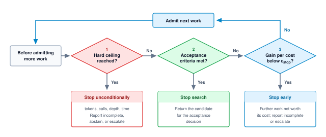
:::

Value estimates optimize how the runtime allocates resources permitted by mechanical boundaries, identifying when further execution yields diminishing returns. When a search halts, the runtime must cleanly separate verified outputs from abandoned attempts while reconciling all outstanding reservations against external services.

::: {#chk-03-search-topologies .callout-checkpoint title="Accounting for a bounded search"}

The ledger and stopping policy must account for work even when it produces no accepted result.

- [ ] **Input budget**: Using the notebook's prompt length and expansion counts, estimate the input tokens spent on common prompts alone and explain why they exceed flat sampling's input count.
- [ ] **Pending work**: Which requests must remain reserved when the runtime reaches its deadline but remote cancellation is unconfirmed?
- [ ] **Stopping precedence**: A search has nearly exhausted its token ceiling, holds a candidate that passes the sealed suite, and still estimates a marginal gain above $\MarginalStoppingThreshold$. Which rule decides, and what does the runtime do next?
- [ ] **Acceptance evidence**: What evidence would justify stopping with an accepted repair, and what should the runtime return if only the highest learned score is available?

:::

A search structure defines the topological paths along which an agent can allocate compute, but the ledger and stopping rules govern physical resource consumption and enforce execution safety. Determining which search policy delivers superior results requires evaluating full end-to-end performance under identical resource ceilings and environmental constraints, incorporating the true operational cost of failed and abandoned runs.

## Deliberation Strategy Evaluation {#sec-vol3-test-time-compute-strategy-design}

Suppose an iterative search policy resolves more connection-pool failures than a single-call baseline. That improvement might reflect genuine algorithmic deliberation. It might also stem from a larger token budget, a more capable underlying model, or silently discarded hard cases. Rigorous evaluation of any policy combining candidate allocation, selection, verification checks, and early stopping must account for three things: the exact resources and permissions granted to each policy, the compute and wall-clock time actually spent, and the disposition of tasks that fail to yield an acceptable result.

### Controlled and system-level comparisons {#sec-vol3-test-time-compute-comparison-design}

A controlled policy comparison holds the base model, serving configuration, benchmark workload, tool interfaces, and acceptance criteria fixed. By varying only the deliberation policy under identical resource ceilings and deadlines, it isolates how search and verification alter output quality. Engineers should specify prompt tokens, generated tokens, verification invocations, and permitted concurrency as distinct budgets rather than collapsing them into an ambiguous aggregate "compute budget." Efficient policies often stop early; unspent budget reflects algorithmic efficiency rather than an experimental error.

A system-design comparison evaluates an end-to-end architecture across broader operational trade-offs. For example, an engineer might compare a large foundation model called once against a smaller, faster model invoked repeatedly within the same latency and dollar budgets. This benchmark characterizes the composite system, but it cannot isolate the algorithmic effect of deliberation from model capability. Maintaining a clear boundary between controlled search evaluations and macro system-design comparisons prevents teams from mistaking a raw model upgrade for an algorithmic search breakthrough.

Telemetry must track the fate of every assigned task, accounting fully for explicit failures, timeouts, and incomplete searches. To avoid crediting a search for exploiting its own scorer (the Goodhart effect of @sec-vol3-test-time-compute-selection-pressure), assess final output quality using an independent evaluator rather than the internal heuristic score optimized during candidate generation. Telemetry must also distinguish among three failure modes: false acceptance (committing an incorrect result), explicit abstention or refusal, and deadline exhaustion. When reporting checker errors, state the denominator explicitly:[^fn-false-discovery-rate] the fraction of incorrect candidates that pass a check differs substantially from the fraction of accepted outputs that are incorrect. Finally, because test-time search introduces stochastic branching, repeated trials must characterize distribution variance across tasks rather than presenting a single point estimate as an engineering guarantee.

[^fn-false-discovery-rate]: **Two Error Denominators**: The fraction of incorrect candidates that pass is the check's false positive rate, $\VerifierFalseAcceptanceRate$ in this chapter; the fraction of accepted outputs that are incorrect is the false discovery rate, $1-\VerifierPrecision$. @Eq-vol3-verifier-precision connects them only through the valid-candidate rate, so a report that gives one without the base rate cannot be converted into the other. \index{False discovery rate!verifier reporting}

True operational expenditure accounts for every resource consumed along the execution path: discarded branches, repeated prompt prefill across iterations, verification checker invocations, and in-flight token generation billed after a cancellation signal. Dividing total cohort cost by the number of tasks meeting the stated acceptance criterion yields the effective cost per accepted task, the cohort realization of $\CostPerAcceptedTask$ (@eq-vol3-cost-per-accepted-task). Averaging costs over successful runs alone severely understates operational expense by ignoring the sunk cost of abandoned trajectories. Similarly, system designers should report latency distributions alongside this cost ratio, tracking the exact fraction of tasks completing before the deadline. An attractive mean latency often masks a catastrophic tail where sequential revisions render the slowest tasks unusable.

### Policies under a deadline {#sec-vol3-test-time-compute-deadline-policies}

To see how concurrency limits and real-time deadlines bound what a deliberation policy can achieve in production, consider an evaluation using a scoped test suite rather than an omniscient truth oracle. The probabilities below are stipulated parameters rather than empirical measurements from a specific checkpoint, isolating how concurrency, stopping rules, and execution budgets interact under a hard latency cap.

```{python}
#| label: calc-vol3-deliberation-strategy
#| echo: false
# ┌─────────────────────────────────────────────────────────────────────────────
# │ THREE HYPOTHETICAL POLICIES UNDER A COMMON DEADLINE (LEGO)
# │ Goal: Compare completed suite-pass opportunities and actual expenditure.
# │ Show: Deadline-censored probability, expected tokens/checks, time, and bill.
# │ How: Fixed round allowance; independent breadth; conditional feedback gain.
# └─────────────────────────────────────────────────────────────────────────────
from mlsysim import *
from mlsysim.fmt import check
from mlsysim.core.units import BYTES_INT8
import math

class StrategyComparison:
    # ┌── 1. LOAD (Constants & Parameters) ─────────────────────────────────
    model = Models.Language.Llama3_70B
    accel = Hardware.Cloud.H100
    prompt = 2_048  # hypothetical fully serialized first request
    output = 1_000  # hypothetical generated tokens per candidate
    diagnostic = 340  # hypothetical failure-report tokens
    breadth = 8  # independent candidates, all generated and checked
    max_rounds = 3  # requested feedback cap, before deadline admission
    input_ceiling = 32_768
    output_ceiling = 8_192
    check_ceiling = 8
    concurrency = 8  # stipulated generator and check capacity
    deadline = 75 * second
    check_time = 10 * second  # distinct from earlier notebook scenarios
    initial_pass = 0.40  # scoped suite-pass probability for a fixed task
    revision_pass = 0.35  # conditional probability after a failed first attempt
    price_in = 3 * USD / 1_000_000  # hypothetical per-input-token price
    price_out = 15 * USD / 1_000_000  # hypothetical per-output-token price

    # ┌── 2. EXECUTE (Compute) ─────────────────────────────────────────────
    weights = model.parameters / ureg.param * BYTES_INT8
    token_time = (weights / accel.memory.bandwidth).to(second)
    round_time = output * token_time + check_time
    rounds = min(max_rounds, math.floor((deadline / round_time).to(ureg.dimensionless).magnitude))
    first_cost = prompt * price_in + output * price_out
    revision_input = prompt + output + diagnostic
    revision_cost = revision_input * price_in + output * price_out
    a_pass = initial_pass
    b_pass = 1 - (1 - initial_pass) ** breadth
    c_pass = initial_pass + (1 - initial_pass) * revision_pass
    c_rounds = 1 + (1 - initial_pass)
    a_input, b_input = prompt, breadth * prompt
    c_input = prompt + (1 - initial_pass) * revision_input
    a_output, b_output, c_output = output, breadth * output, c_rounds * output
    a_cost, b_cost = first_cost, breadth * first_cost
    c_cost = first_cost + (1 - initial_pass) * revision_cost
    c_time = c_rounds * round_time
    max_c_time = rounds * round_time
    requested_time = max_rounds * round_time
    a_bill_per_pass = a_cost / a_pass  # model bill per suite-passing task
    b_bill_per_pass = b_cost / b_pass
    c_bill_per_pass = c_cost / c_pass
    b_over_a = (b_bill_per_pass / a_bill_per_pass).to(ureg.dimensionless).magnitude

    # ┌── 3. GUARD (Validate Assumptions & Bounds) ─────────────────────────
    check(rounds == 2, "this notebook's conditional revision model has two rounds")
    check(0 <= initial_pass <= 1 and 0 <= revision_pass <= 1, "pass probabilities in [0, 1]")
    check(all(0 <= probability <= 1 for probability in (a_pass, b_pass, c_pass)), "probabilities in [0, 1]")
    check(max_c_time <= deadline < requested_time, "deadline bounds")
    check(prompt > 0 and output > 0 and diagnostic >= 0, "token counts positive")
    check(round_time > 0 * second and check_time >= 0 * second, "times non-negative")
    check(breadth <= min(concurrency, check_ceiling), "breadth within concurrency and check ceiling")
    check(rounds <= check_ceiling, "rounds within check ceiling")
    check(max(b_input, prompt + revision_input) <= input_ceiling, "input within ceiling")
    check(max(b_output, rounds * output) <= output_ceiling, "output within ceiling")
    check(a_bill_per_pass < c_bill_per_pass < b_bill_per_pass, "cost ordering")

    # ┌── 4. OUTPUT (Typed Prose Strings) ──────────────────────────────────
    prompt_str = fmt_int(prompt)
    output_str = fmt_int(output)
    diagnostic_str = fmt_int(diagnostic)
    breadth_str = fmt_int(breadth)
    rounds_str = fmt_int(rounds)
    max_rounds_str = fmt_int(max_rounds)
    input_ceiling_str = fmt_int(input_ceiling)
    output_ceiling_str = fmt_int(output_ceiling)
    check_ceiling_str = fmt_int(check_ceiling)
    concurrency_str = fmt_int(concurrency)
    deadline_str = fmt_time(deadline, unit="s", precision=0)
    check_time_str = fmt_time(check_time, unit="s", precision=0)
    token_time_str = fmt_time(token_time, unit="ms", precision=3)
    round_time_str = fmt_time(round_time, unit="s", precision=2)
    requested_time_str = fmt_time(requested_time, unit="s", precision=2)
    max_c_time_str = fmt_time(max_c_time, unit="s", precision=2)
    c_time_str = fmt_time(c_time, unit="s", precision=2)
    initial_pass_str = fmt_percent(initial_pass, precision=0, style="prose")
    revision_pass_str = fmt_percent(revision_pass, precision=0, style="prose")
    b_pass_str = fmt_percent(b_pass, precision=2, style="prose")
    c_pass_str = fmt_percent(c_pass, precision=0, style="prose")
    c_no_pass_str = fmt_percent(1 - c_pass, precision=0, style="prose")
    c_rounds_str = fmt_ratio(c_rounds, precision=1)
    price_in_str = fmt_usd(price_in * 1_000_000, precision=0)
    price_out_str = fmt_usd(price_out * 1_000_000, precision=0)
    a_input_str, b_input_str, c_input_str = fmt_int(a_input), fmt_int(b_input), fmt_ratio(c_input, precision=1, commas=True)
    a_output_str, b_output_str, c_output_str = fmt_int(a_output), fmt_int(b_output), fmt_int(c_output)
    a_cost_str, b_cost_str, c_cost_str = fmt_usd(a_cost, precision=5), fmt_usd(b_cost, precision=5), fmt_usd(c_cost, precision=5)
    a_per_pass_str = fmt_int(a_output / a_pass)
    b_per_pass_str = fmt_int(b_output / b_pass)
    c_per_pass_str = fmt_int(c_output / c_pass)
    a_bill_per_pass_str = fmt_usd(a_bill_per_pass, precision=4)
    b_bill_per_pass_str = fmt_usd(b_bill_per_pass, precision=4)
    c_bill_per_pass_str = fmt_usd(c_bill_per_pass, precision=4)
    b_over_a_mult_str = fmt_multiple(b_over_a, precision=1)
```

::: {#nbk-03-strategy-comparison .callout-notebook title="Three policies, one deadline"}

**Scenario**: Consider an automated software repair workload evaluated against a fixed, protected validation suite. An initial candidate passes the suite with hypothetical probability $\AttemptPassProbability$ = `{python} StrategyComparison.initial_pass_str`. Repeated attempts evaluate the same underlying issue, and candidate generation draws are conditionally independent given that task. Passing the suite serves as the operational acceptance criterion, though passing tests does not guarantee semantic perfection. Each policy operates under identical runtime permissions and resource bounds: ceilings of `{python} StrategyComparison.input_ceiling_str` input tokens, `{python} StrategyComparison.output_ceiling_str` generated tokens, and `{python} StrategyComparison.check_ceiling_str` test executions, alongside a concurrency limit of `{python} StrategyComparison.concurrency_str` parallel workers and a strict `{python} StrategyComparison.deadline_str` deadline.

Each initial generation request submits `{python} StrategyComparison.prompt_str` prompt tokens, and every candidate generates `{python} StrategyComparison.output_str` tokens. Executing the validation test suite requires `{python} StrategyComparison.check_time_str`. Candidate generation assumes an illustrative baseline service time of `{python} StrategyComparison.token_time_str` per generated token, derived from the memory-bandwidth decode floor in @sec-vol3-foundation-model-per-call-work-estimate. The calculation assumes that this generation rate holds across concurrent streams and that test execution runs on dedicated, non-interfering compute resources. (Prefill latency, scheduling queues, network round trips, and candidate filtering overhead are omitted here for analytical clarity.) Model serving prices are stipulated at `{python} StrategyComparison.price_in_str` per million prompt tokens and `{python} StrategyComparison.price_out_str` per million output tokens, without prompt caching discounts.

**Option A (single candidate)**: Generate and validate a single candidate. The suite-pass probability is `{python} StrategyComparison.initial_pass_str`, consuming `{python} StrategyComparison.a_input_str` prompt tokens, `{python} StrategyComparison.a_output_str` generated tokens, and one validation check. The end-to-end attempt finishes in `{python} StrategyComparison.round_time_str` at a model bill of `{python} StrategyComparison.a_cost_str`. If the candidate fails the suite, the pipeline terminates without returning a solution.

**Option B (parallel breadth)**: Dispatch all `{python} StrategyComparison.breadth_str` candidates concurrently without early termination, validating each as it completes. The policy selects the first passing patch according to a deterministic index ordering. The probability that at least one of the $\CandidatePoolSize$ = `{python} StrategyComparison.breadth_str` candidates passes the suite is pass@$\CandidatePoolSize = 1-(1-\AttemptPassProbability)^{\CandidatePoolSize}$, reaching `{python} StrategyComparison.b_pass_str`. Because selection requires only a single binary pass, this also represents the probability of returning an accepted repair. Operating under full parallel concurrency, the wall-clock latency remains `{python} StrategyComparison.round_time_str`. However, this concurrent fan-out consumes `{python} StrategyComparison.b_input_str` prompt tokens, `{python} StrategyComparison.b_output_str` generated tokens, `{python} StrategyComparison.breadth_str` validation executions, and incurs a model bill of `{python} StrategyComparison.b_cost_str`.

**Option C (sequential feedback)**: Generate an initial candidate and terminate immediately if it passes. If the candidate fails, append the failed output and a `{python} StrategyComparison.diagnostic_str`-token error trace to the context before requesting a targeted revision. Conditional on an initial failure, the revised candidate has a hypothetical suite-pass probability of $\RevisionPassProbability$ = `{python} StrategyComparison.revision_pass_str`. Although the policy allows a nominal maximum of `{python} StrategyComparison.max_rounds_str` rounds, executing three sequential attempts would demand `{python} StrategyComparison.requested_time_str`, far beyond the system deadline. Within the `{python} StrategyComparison.deadline_str` budget, exactly `{python} StrategyComparison.rounds_str` complete generation-and-test rounds can finish. Consequently, the deadline restricts the policy to at most one feedback revision, returning a failure if that second attempt also fails.

**Math**: Under deadline truncation, the cumulative pass probability for sequential feedback is $\AttemptPassProbability+(1-\AttemptPassProbability)\,\RevisionPassProbability$, or `{python} StrategyComparison.c_pass_str`, with an expected execution count of $1+(1-\AttemptPassProbability)$, or `{python} StrategyComparison.c_rounds_str` rounds. The expected resource consumption is `{python} StrategyComparison.c_input_str` prompt tokens, `{python} StrategyComparison.c_output_str` generated tokens, and `{python} StrategyComparison.c_rounds_str` test executions, yielding an expected model bill of `{python} StrategyComparison.c_cost_str`. The expected completion latency is `{python} StrategyComparison.c_time_str`, bounded by a worst-case latency of `{python} StrategyComparison.max_c_time_str`. The remaining `{python} StrategyComparison.c_no_pass_str` of runs fail to produce an accepted candidate; these represent unrecoverable search failures under budget truncation rather than ignored experiments. Across all initiated tasks, the expected number of generated tokens per accepted completion is approximately `{python} StrategyComparison.a_per_pass_str` for Option A, `{python} StrategyComparison.b_per_pass_str` for Option B, and `{python} StrategyComparison.c_per_pass_str` for Option C.

**Systems insight**: Evaluated per accepted completion, the direct model cost is `{python} StrategyComparison.a_bill_per_pass_str` for Option A, `{python} StrategyComparison.c_bill_per_pass_str` for Option C, and `{python} StrategyComparison.b_bill_per_pass_str` for Option B, a `{python} StrategyComparison.b_over_a_mult_str` multiple over the single-candidate baseline. Sequential feedback raises the acceptance rate from `{python} StrategyComparison.initial_pass_str` to `{python} StrategyComparison.c_pass_str` with only a modest cost premium per accepted task. Parallel breadth achieves the highest overall acceptance rate (`{python} StrategyComparison.b_pass_str`), but at substantially higher cost per accepted result.

The operating deadline dictates which strategy is feasible. When the latency budget permits only a single `{python} StrategyComparison.round_time_str` round, parallel breadth is the only one of these policies that can improve on the baseline `{python} StrategyComparison.initial_pass_str` success rate. When the deadline accommodates two rounds, sequential feedback raises the pass probability with a smaller model bill than parallel breadth. However, attempting a third round would require `{python} StrategyComparison.requested_time_str`, delivering zero benefit within a `{python} StrategyComparison.deadline_str` service envelope. Production trade-off calculations must also incorporate test execution costs alongside token billing, while tracking false acceptance rates separately to ensure that test passage reflects authentic task resolution.

:::

### Operating point selection {#sec-vol3-test-time-compute-operating-point}

Each policy in the comparison occupies a distinct position on the Pareto frontier. The single-candidate baseline minimizes financial and token costs, parallel breadth maximizes the probability of meeting the acceptance threshold within a tight latency budget, and sequential feedback offers an attractive compromise between pass rates and token expenditure at the expense of higher wall-clock latency. A policy configuration is strictly dominated only when an alternative feasible strategy matches or exceeds its performance on every system metric (latency, token cost, verification load, and accuracy) while being strictly superior in at least one. Non-dominated configurations define the trade-off surface from which engineers must select an operating point based on production service-level agreements, budget caps, and fault tolerance.

Deploying deliberation policies successfully requires evaluating them under the exact runtime constraints they face in production. Analytical models that assume unconstrained search cannot simply substitute an ad-hoc "effective candidate count" into an idealized binomial formula; real system concurrency bottlenecks, prefix caching efficiencies, and verification overheads distort clean theoretical scaling. Similarly, the conditional success probability of an iterative repair depends heavily on the diagnostic fidelity of the execution feedback provided to the model. Finally, hard deadlines censor execution trees, truncating planned revisions before they yield fruit. Offline benchmarking must faithfully reproduce these system limits (worker timeouts, early-exit heuristics, and resource preemption) rather than extrapolating optimistic, uncensored search curves into latency-critical production environments.

## Fallacies and Pitfalls {#sec-vol3-test-time-compute-fallacies}

The most consequential errors in deliberation design stem from conflating computational effort with verified task progress. In test-time search, allocating compute is an engineering investment whose return depends strictly on candidate diversity, verifier precision, and sound resource accounting. When these mechanisms are poorly calibrated, extra compute merely amplifies noise, exhausts serving budgets, or reinforces systematic model errors.

::: {.fallacy-pitfall}
**Fallacy**: *More generated tokens necessarily produce a better answer.*

Extended deliberation can help a model unpack complex constraints already latent in the prompt, but it can just as readily elaborate and defend an erroneous initial premise. When the primary uncertainty concerns empirical behavior, such as how a program executes at runtime, generating tokens is an inefficient and indirect way to discover facts. In @sec-vol3-test-time-compute-insufficient-response, for example, generating a `{python} ProbeAllocation.answer_tokens_str`-token explanation takes `{python} ProbeAllocation.answer_time_str`, `{python} ProbeAllocation.time_mult_str` the `{python} ProbeAllocation.probe_time_str` execution test that supplies the missing observation directly. Raw token consumption reflects computational expenditure rather than genuine problem-solving progress. Extra reasoning tokens belong only where empirical benchmarks confirm that the resulting gain in candidate quality justifies the added latency and financial cost.
:::

::: {.fallacy-pitfall}
**Pitfall**: *Treating independent samples as independent capabilities.*

Candidate draws that are conditionally independent for a given prompt still share the model's underlying parameterization and systemic blind spots. Consequently, estimating pass@$\IndependentAttemptCount$ from an aggregate benchmark success rate dramatically overestimates what a candidate pool can deliver (@sec-vol3-test-time-compute-pass-at-k). Consider a workload where half the tasks succeed at a rate of `{python} BestOfN.p_easy_str` and the other half fail consistently ($\AttemptPassProbability = 0$). Across the entire suite, the mean success rate is `{python} BestOfN.p_str`, the same per-candidate rate that notebook \ref{nbk-03-best-of-n-pool-price} assumed for a single fixed task. Substituting that aggregate average into the independent-draw formula predicts a pool success rate of `{python} BestOfN.naive_mix_str` for a pool of `{python} BestOfN.n_max_str`. In reality, the true pool success rate reaches only `{python} BestOfN.true_mix_str`, because repeated sampling cannot overcome failure modes that the underlying weights cannot resolve. Always compute pass@$\IndependentAttemptCount$ on a per-task basis first and then average the results across the workload.
:::

::: {.fallacy-pitfall}
**Fallacy**: *A check with a low false acceptance rate makes almost every pass trustworthy.*

Verifier precision depends just as fundamentally on the base rate of valid candidate solutions as it does on the check's nominal error rates (@eq-vol3-verifier-precision). When valid solutions are rare, even a small false acceptance rate allows invalid candidates to dominate the accepted pool. For instance, consider an evaluation check with a `{python} CheckYield.eps_fa_str` false acceptance rate and a `{python} CheckYield.eps_fr_str` false rejection rate. When only `{python} CheckYield.p_str` of generated candidates are valid, only `{python} CheckYield.precision_str` of passing candidates are genuinely correct. Under these conditions, a first-pass selector returns a defective repair on `{python} CheckYield.wrong_str` of attempts (notebook \ref{nbk-03-compute-overhead-and-yield-under}). On challenging tasks, improving the generator's baseline yield is just as decisive for precision as tightening the verification filter.
:::

::: {.fallacy-pitfall}
**Pitfall**: *Charging only for the final answer.*

Discarded search branches, repeated context prefill, execution diagnostics, and candidate selection all consume hardware resources, while speculative requests canceled in flight often continue to incur inference charges. Evaluating a deliberation strategy solely by the length of its final accepted response masks these true system costs. In notebook \ref{nbk-03-strategy-comparison}, for example, a parallel breadth search returns a single `{python} StrategyComparison.output_str`-token candidate, but it bills `{python} StrategyComparison.b_output_str` output tokens per task and consumes `{python} StrategyComparison.b_per_pass_str` tokens for each suite-passing task. Similarly, the beam search in notebook \ref{nbk-03-compute-allocation-and-latency-trade-offs} reads `{python} SearchLedger.beam_prompt_tokens_str` input tokens simply to produce `{python} SearchLedger.beam_width_str` survivors for final validation. Production accounting must charge the entire search ledger, including failed branches and unaccepted tasks, against the cost of each accepted solution.
:::

::: {.fallacy-pitfall}
**Fallacy**: *The highest-scoring candidate has completed the task.*

A scoring function ranks candidates along specific, modeled criteria, and argmax selection concentrates the evaluator's estimation errors directly into the winning candidate. With equal true utilities and independent Gaussian scoring noise, the selected candidate's expected score error reaches approximately `{python} ArgmaxSelection.shift_large_str` standard deviations when choosing among `{python} ArgmaxSelection.n_large_str` candidates (@eq-vol3-argmax-noise). Furthermore, an evaluation gap or specification blind spot present in only `{python} ArgmaxSelection.gap_rate_str` of individual candidates emerges in `{python} ArgmaxSelection.gap_present_str` of such pools. A top relative score provides neither authority nor evidence for requirements that the verifier does not check. If a search exhausts its budget without any candidate clearing the verification threshold, the highest-ranking candidate remains an unverified failure rather than an accepted solution.
:::

## Summary {#sec-vol3-ch3-summary}

Test-time compute transforms the cost of a decision into an explicit architectural trade-off. While model weights determine the capability of a single forward pass, the runtime system governs how much additional compute to invest, which execution topology to deploy, and what empirical evidence warrants terminating the search. Additional deliberation improves the probability of acceptance through three necessary links, each of which can fail independently: the search must elicit capability the base model lacked in a zero-shot pass, the selector must reliably identify a superior candidate from the pool, and the verification check must evaluate the exact property required for task correctness. If any link breaks, the attempt cost increases while the acceptance probability $\AcceptanceProbability$ stagnates, driving up the effective cost per accepted task $\CostPerAcceptedTask$. Systems architects must therefore judge a deliberation policy just like any other runtime component: by the accepted results it delivers per unit of compute expenditure and wall-clock latency under concrete deadline constraints.

@Tbl-vol3-test-time-compute-key-equations summarizes the quantitative relations developed throughout this chapter to price compute allocations, evaluate selectors, bound search spaces, and enforce stopping criteria.

| **Equation**                                                                                                                                                                                                                                                                                                                                                   | **What it bounds or decides**                                                                                                                | **Where derived**                     |
|:---------------------------------------------------------------------------------------------------------------------------------------------------------------------------------------------------------------------------------------------------------------------------------------------------------------------------------------------------------------|:---------------------------------------------------------------------------------------------------------------------------------------------|:--------------------------------------|
| $\DepthCriticalPathLatency \approx \PrefillTime(\SequenceLength) + \ExtendedDepthLength\,\PerTokenDecodeTime$, $\; \BreadthCriticalPathLatency \approx \PrefillTime(\SequenceLength) + \max_{n} \DecodeInterval(\OutputLength_n)$                                                                                                                              | Critical path of extending one candidate vs. sampling $\CandidatePoolSize$ concurrently, given capacity for all $\CandidatePoolSize$ streams | @eq-vol3-allocation-critical-path     |
| $\FeedbackCriticalPathLatency \approx \sum_{t=1}^{\TurnHorizon}\bigl(\PrefillTime(\SequenceLength^{(\TurnIndex)}) + \DecodeInterval(\OutputLength_t) + {\FeedbackCheckDuration}_{\TurnIndex}\bigr)$, $\; \SequenceLength^{(\TurnIndex)} = \BasePromptLength + \sum_{j<t}(\OutputLength_j + \lvert \TrajectoryObservation_j\rvert)$                             | Latency and input growth of observation-conditioned revision under an append-only context                                                    | @eq-vol3-allocation-critical-path     |
| $\operatorname{pass@}\IndependentAttemptCount = 1-(1-\AttemptPassProbability)^\IndependentAttemptCount$, $\; \PassAtKEstimate = 1-\binom{\GeneratedSampleCount-\PassingSampleCount}{\IndependentAttemptCount}/\binom{\GeneratedSampleCount}{\IndependentAttemptCount}$                                                                                         | Candidate availability for one task, and the ceiling on any selector that returns an unchanged pool member                                   | @sec-vol3-test-time-compute-pass-at-k |
| $\CostPerAcceptedTask = \mathbb{E}[\AttemptCost]/\AcceptanceProbability$                                                                                                                                                                                                                                                                                       | How acceptance probability and expected attempt cost jointly determine cost per accepted task                                                | @eq-vol3-cost-per-accepted-task       |
| $\VerifierPrecision = \ValidCandidateRate(1-\VerifierFalseRejectionRate) / [\ValidCandidateRate(1-\VerifierFalseRejectionRate) + (1-\ValidCandidateRate)\,\VerifierFalseAcceptanceRate]$                                                                                                                                                                       | Share of passing candidates that are valid; unchanged by pool size at fixed rates                                                            | @eq-vol3-verifier-precision           |
| $\sum_{j=1}^{\ScoredStepCount}(\SequenceLength + \ScoredStepIndex\,\FiniteChange \ScoredPrefixLength) = \ScoredStepCount \SequenceLength + \tfrac{\ScoredStepCount(\ScoredStepCount+1)}{2}\,\FiniteChange \ScoredPrefixLength$                                                                                                                                 | Scorer input for step-level checks that rescore each growing prefix without reuse                                                            | @eq-vol3-prm-rescoring                |
| $\mathbb{E}\bigl[\max_{i \le \CandidatePoolSize} \CandidateScoringError_i\bigr] \approx \ScoringErrorStandardDeviation\sqrt{2\ln \CandidatePoolSize}$, $\; 1-(1-\ExploitCandidateFraction)^\CandidatePoolSize$                                                                                                                                                 | Maximum-noise bound on the selected scoring error, and the chance a pool holds a check exploit                                               | @eq-vol3-argmax-noise                 |
| $\TreeSearchMeanReturn(\PolicyObservedState,\PolicyAction) + \TreeSearchExplorationWeight\,\TreeSearchPriorDistribution(\PolicyAction \mid \PolicyObservedState)\,\sqrt{\textstyle\sum_{\SiblingPolicyAction} \TreeSearchVisitCount(\PolicyObservedState,\SiblingPolicyAction)}\,/\,\bigl(1 + \TreeSearchVisitCount(\PolicyObservedState,\PolicyAction)\bigr)$ | Which extension of a partial candidate receives the next unit of tree search                                                                 | @eq-vol3-puct                         |
| $\EffectiveBranchingFactor = \SearchBranchingFactor\,(1 - \ChildPruningProbability)$, $\; \sum_{\SearchDepthIndex=1}^{\SearchDepth} \SearchBranchingFactor\,\EffectiveBranchingFactor^{\,\SearchDepthIndex-1}$                                                                                                                                                 | Whether pruning keeps a search tree finite, and the expected nodes it generates through depth $\SearchDepth$                                 | @eq-vol3-effective-branching          |
| $(\CalibratedAcceptanceEstimate_{\AdmittedWorkUnitCount} - \CalibratedAcceptanceEstimate_{\AdmittedWorkUnitCount-1})/(\CumulativeWorkCost_{\AdmittedWorkUnitCount} - \CumulativeWorkCost_{\AdmittedWorkUnitCount-1}) < \MarginalStoppingThreshold$                                                                                                             | Early stop after the hard-limit and satisficing checks, using incremental expected stopped-policy cost                                       | @eq-vol3-marginal-stopping            |

: **Key equations**: Each relation holds under the assumptions stated where it is derived, such as independent candidates for a fixed task, fixed checker error rates, and an unchanged per-token rate across concurrent streams. {#tbl-vol3-test-time-compute-key-equations tbl-colwidths="[46,36,18]"}

::: {.callout-takeaways title="More work needs a bounded policy"}

* **Observe when the question is empirical**: Generating additional tokens re-evaluates information already present in the prompt, whereas executing an external check supplies new empirical evidence. In the repair workload, generating a single explanatory trace took `{python} ProbeAllocation.time_mult_str` as long as the targeted probe that separated the two competing hypotheses.
* **A pool is only as good as its selector**: The theoretical pass@$\IndependentAttemptCount$ rate establishes an upper bound on what a selection policy can extract, but it does not represent realized task success. Averaging pass rates across a mixed workload naively projects an overall success rate of `{python} BestOfN.naive_mix_str` across `{python} BestOfN.n_max_str` candidates, whereas the realized pool delivers only `{python} BestOfN.true_mix_str`; no amount of extra sampling generates a solution for tasks where the base model assigns zero probability to valid trajectories.
* **A pass inherits the base rate**: When valid candidates make up only `{python} CheckYield.p_str` of the initial generation pool, a verifier with a `{python} CheckYield.eps_fa_str` false-acceptance rate makes only `{python} CheckYield.precision_str` of passing candidates valid. Under the fixed IID first-passing policy, selected candidates have that same precision, and adding candidates does not raise it. With equal true utilities and independent Gaussian scoring noise, among `{python} ArgmaxSelection.n_large_str` candidates, the winner's score overstates its quality by about `{python} ArgmaxSelection.shift_large_str` standard deviations of scoring error.
* **Revise along recorded dependencies**: When a new environment observation invalidates an operating assumption, recompute only the downstream sub-tasks that depend on that assumption instead of regenerating the entire plan. Unrecorded execution dependencies allow stale intermediate state to propagate silently, and no subsequent revision can undo side effects already committed to external systems.
* **Budgets end searches, not uncertainty**: Every discarded candidate, verifier evaluation, and failed attempt must be billed directly to the cost per accepted task $\CostPerAcceptedTask$, with hard service deadlines dictating the runtime operating point. When an execution budget or deadline expires without producing an accepted solution, the system must return an explicit unresolved outcome rather than silently defaulting to the highest-scoring unverified candidate.

:::

The verification asymmetry (principle \ref{pri-vol3-verification-asymmetry})\index{Principle!verification asymmetry} turns into a diagnostic order for any deliberation policy whose cost per accepted task disappoints. First ask how often the pool holds a test-passing candidate, measured per task as pass@$\CandidatePoolSize$. Low measured availability makes a stronger model or escalation alternatives to further low-yield search; only a truly zero pass probability under a fixed generation policy makes additional sampling futile. Where availability is adequate, ask how far a pass can be trusted at the measured base rate, because a low $\VerifierPrecision$ makes a better generator or a stricter check worth more than a larger pool. Only when both answers are acceptable does the question become how much search to buy, and the marginal stopping rule answers it in conditional next-round acceptance gain per admitted cost. Each step measures a different event, and at each one the runtime, not the model, decides whether to continue, abstain, or escalate.

## Historical Perspective and Further Reading {#sec-vol3-test-time-compute-history}

Allocating computational budget at decision time has deep roots in early game-playing systems. Claude Shannon's foundational design for a chess program established the fundamental separation between generating candidate moves and scoring the resulting board positions with a heuristic evaluation function [@shannon1950programming]. Because game trees expand exponentially with search depth, exhaustive exploration quickly proved intractable. Heuristic search, which generates alternatives and prunes unpromising branches using domain knowledge, subsequently emerged as a central pillar of artificial intelligence [@newell1976computer]. Beam search entered through speech recognition [@lowerre1976], and the two halting criteria this chapter borrows came from outside computing, Wald's sequential analysis [@wald1945sequential] and Simon's satisficing [@simon1956rational], each introduced earlier in this chapter beside the mechanism it shaped.

Dynamic revision and dependency tracking share a parallel systems heritage. Early autonomous robotics systems such as STRIPS and PLANEX monitored plan execution against sensor inputs, triggering targeted replanning whenever an observation contradicted an assumed action precondition [@fikes1972learning]. Truth maintenance systems [@doyle1979truth] and `make` [@feldman1979make] then gave that idea the dependency-graph form that revisable candidate plans reuse. As search problems grew more complex, algorithms learned where to allocate deliberative compute dynamically, and Monte Carlo tree search [@coulom2006efficient; @kocsis2006bandit] supplied the bandit-style allocation that PUCT refines. When paired with deep neural networks for move priors and position evaluation, this bandit allocation strategy proved decisive in AlphaGo [@silver2016mastering], demonstrating how learned value functions can guide search through astronomical state spaces.

Modern language models have revived and unified these deliberate search techniques at unprecedented scale. In program synthesis, the pass@$\IndependentAttemptCount$ metric formalized the benefits of parallel candidate sampling evaluated against executable test suites [@kulal2019spoc; @chen2021evaluating]. For open-ended tasks lacking deterministic unit tests, @cobbe2021training demonstrated that training a dedicated verifier to rank sampled candidates could outperform parameter scaling of the generator alone. Deliberation soon expanded along complementary axes of depth and breadth. Chain-of-thought prompting elicited sequential reasoning depth by generating explicit intermediate tokens [@wei2022cot], while self-consistency sampling improved breadth by taking a majority vote across parallel reasoning trajectories [@wang2022self]. To provide feedback before a full solution finishes generating, process supervision shifted verification from final answers to individual intermediate steps [@uesato2022solving; @lightman2023let]. This step-level verification enabled Tree of Thoughts [@yao2023tree] to implement systematic beam search, lookahead, and backtracking over discrete reasoning units.

Recent systems treat test-time compute as an explicit budget to optimize. @snell2024scaling showed that the compute-optimal balance among parallel sampling, iterative revision, and guided search is governed primarily by task difficulty. Easier problems gained most from sequential revision, moderately difficult ones from combining parallel exploration with guided search, and problems with a near-zero base success rate gained more from a larger model than from any test-time allocation. Reinforcement learning on verifiable reasoning tasks demonstrated that models can internalize this search process autonomously, learning to spend thousands of generation tokens on self-checking, exploration of alternative subproblems, and backtracking without explicit human step annotations [@deepseekai2025deepseekr1]. Pushing search hard against learned scorers resurfaces Goodhart's law [@goodhart1984], which @gao2023scaling measured as reward-model overoptimization. Under heavy best-of-$\CandidatePoolSize$ sampling, a held-out reference score peaks and then declines even as the proxy score keeps rising.

- **Search as problem solving** [@newell1976computer]. The foundational formulation of heuristic search as generating and pruning hypotheses under resource limits, establishing the architectural taxonomy that inference-time allocation policies build upon.
- **Monte Carlo tree search** [@browne2012survey]. The definitive survey of tree-search algorithms, covering the selection policies, rollout strategies, and backpropagation operators that systems engineers adapt when structuring deliberation over discrete language-model steps.
- **Trained verifiers** [@cobbe2021training]. An early demonstration that generating multiple candidates and scoring them with a dedicated verifier outperforms scaling generator parameters alone, providing an empirical baseline for verification overhead vs. accuracy gains.
- **Process supervision** [@lightman2023let]. A rigorous empirical comparison between outcome-based and step-level supervision, detailing the annotation costs and error-detection advantages of scoring intermediate reasoning steps.
- **Reward-model overoptimization** [@gao2023scaling]. An empirical measurement of Goodhart's law under best-of-$\CandidatePoolSize$ sampling, characterizing how proxy reward models diverge from true task performance as test-time search intensity increases.
- **Compute-optimal test-time allocation** [@snell2024scaling]. An empirical analysis of how the Pareto-optimal frontier between parallel sampling, iterative revision, and tree search shifts with task difficulty, offering a methodology for profiling inference-time compute budgets.

## Exercises {#sec-vol3-test-time-compute-exercises}

Unless a problem states otherwise, use the hypothetical givens in @tbl-vol3-test-time-compute-exercise-givens. They are problem inputs chosen for round arithmetic, not measurements of any model or service. Omit prefill, queueing, and transport time, and apply no prefix-cache discount unless a problem introduces one.

| **Quantity**                                 | **Symbol**            | **Given**                 |
|:---------------------------------------------|:----------------------|:--------------------------|
| Generation time per output token, per stream | $\PerTokenDecodeTime$ | 20 ms                     |
| Generator input price                        |                       | \$3 per million tokens    |
| Generator output price                       |                       | \$15 per million tokens   |
| Learned-scorer input price                   |                       | \$0.50 per million tokens |

: **Givens for the exercises**: Hypothetical rates shared by the problems below. Concurrent streams keep the per-token rate up to the concurrency a problem states. {#tbl-vol3-test-time-compute-exercise-givens tbl-colwidths="[56,18,26]"}

**1. Three allocations, one repository (Basic).** A repair request carries an $8{,}000$-token prompt and a ceiling of $6{,}000$ generated tokens. Depth spends the whole ceiling on one candidate. Breadth generates six $1{,}000$-token candidates, but the service admits only three concurrent streams. Feedback runs $\TurnHorizon = 3$ rounds of $1{,}000$-token candidates; each round ends with a 6 s check that returns a 500-token report, and later requests append every earlier candidate and report.

(a) Using @eq-vol3-allocation-critical-path, compute each allocation's critical path, input tokens, output tokens, and model-token bill.
(b) The repository context grows to $64{,}000$ tokens. Recompute the three bills and the breadth premium $(\CandidatePoolSize-1)\SequenceLength$ in tokens and dollars.
(c) The task owner now requires a result within 60 s. Which allocation meets the deadline, and at what bill? A prefix cache would charge re-read prompt tokens at 10 percent of list price. What does breadth then cost, and what omitted term in this accounting should an engineer measure before committing to it?

**2. Sizing a pool against a target (Basic).** For a fixed repair task, independent candidates pass the acceptance check with probability $\AttemptPassProbability = 0.20$, and the selector returns a passing member whenever one exists.

(a) Find the smallest pool $\CandidatePoolSize$ whose pass@$\CandidatePoolSize$ reaches 90 percent, and the availability gained by its last candidate.
(b) Compare candidates spent per accepted repair for the parallel pool and for sequential retry that stops at the first pass and gives up after $\CandidatePoolSize$ attempts. What does the parallel pool buy for its premium?
(c) The workload is actually mixed: half the tasks pass at $0.40$ per candidate and half never pass, so the average rate is still $0.20$. What pool success does the pool size $\CandidatePoolSize$ from part (a) deliver, and what is the largest pool success any $\CandidatePoolSize$ can deliver? What should the runtime do with the second half of the workload instead?
(d) In a benchmark, 4 of 20 samples for one task pass. Compute the subset estimate of pass@5 and compare it with the plug-in value $1-(1-\PassingSampleCount/\GeneratedSampleCount)^5$.

**3. How strict must the check be? (Basic).** A candidate pool has valid-candidate rate $\ValidCandidateRate = 0.10$. The current check has $\VerifierFalseRejectionRate = 0.05$ and $\VerifierFalseAcceptanceRate = 0.01$ and costs \$0.10 per run.

(a) Compute the probability of a pass $\VerifierPassProbability$ and the precision $\VerifierPrecision$ from @eq-vol3-verifier-precision.
(b) Precision must reach 95 percent. Find the largest $\VerifierFalseAcceptanceRate$ that meets the target at this $\ValidCandidateRate$, and alternatively the smallest $\ValidCandidateRate$ that meets it with the current check.
(c) The policy pre-generates 32 candidates and checks them in a fixed order until the first pass, abstaining if none passes. Compute the probability of any selection, the probability that the batch contains at least one false pass, and the probability of selecting a defective candidate. Explain why the second and third differ.
(d) A stricter check has $\VerifierFalseAcceptanceRate = 0.005$ and $\VerifierFalseRejectionRate = 0.08$ and costs \$0.40 per run. A defective selection costs \$2,000 in incident loss. Compare the two checks on expected incident loss plus expected checking cost per attempt, and decide which to deploy.

**4. What step scoring costs (Intermediate).** A learned process scorer reads a $3{,}000$-token task input and the growing prefix of a candidate built in $\ScoredStepCount = 20$ steps of 150 tokens each. The runtime scores 64 candidate trajectories per task at the scorer price in @tbl-vol3-test-time-compute-exercise-givens.

(a) Using @eq-vol3-prm-rescoring, compute scorer input per trajectory and per task when every prefix is rescored from scratch, and when the interface supports incremental prefix reuse.
(b) For this $\SequenceLength$ and $\FiniteChange \ScoredPrefixLength$, beyond how many steps does the quadratic term exceed the $\ScoredStepCount \SequenceLength$ term?
(c) Without prefix reuse, a team proposes scoring only every fourth step. Compute its scorer input and bill per task. A defective step is then caught on average 1.5 steps later, and every pruned trajectory generates those extra steps at the output price. Bound the added generation cost per task, and recommend a scoring stride with and without prefix reuse.

**5. Keeping a tree finite (Intermediate).** Each retained node proposes $\SearchBranchingFactor = 4$ children of 200 generated tokens, a step check rejects each child independently with probability $\ChildPruningProbability = 0.60$, and the search runs $\SearchDepth = 5$ steps deep under a ceiling of $20{,}000$ generated tokens.

(a) Compute $\EffectiveBranchingFactor$ from @eq-vol3-effective-branching and the expected generated nodes and tokens with and without pruning. Which expected counts fall below the ceiling, and why does an expected count below it not guarantee that every run fits?
(b) What rejection rate would make the tree die out on its own, and why is a rejection rate that high rarely available?
(c) The step check also rejects valid steps with probability $\VerifierFalseRejectionRate$. A correct solution needs five consecutive valid steps to survive. Compute its survival probability at $\VerifierFalseRejectionRate = 0.10$, and the largest $\VerifierFalseRejectionRate$ that keeps survival at or above 80 percent. What does this imply for tuning the check's threshold?

**6. A waiting customer sets the policy (Intermediate).** The support agent (lighthouse \ref{lhs-vol3-support-agent}) answers a policy question while the customer waits. Each request carries a $6{,}000$-token prompt of policy excerpts and conversation, each candidate reply is 150 output tokens, and a grounding check against the cited policy takes 1.5 s. A first reply passes with probability $0.70$; conditional on a failed first reply, a revision that reads the check's report passes with probability $0.50$. Concurrent candidates are checked concurrently, and the reply must arrive within 8 s.

(a) Compute the duration of one generate-and-check round. How many feedback rounds fit the deadline, and what pass probability does feedback therefore deliver?
(b) For concurrent breadth of $\CandidatePoolSize = 1$ to $4$, compute pass probability, model-token bill per request, and bill per passing reply. Find the smallest $\CandidatePoolSize$ that reaches 95 percent.
(c) The service can hold 600 concurrent decode streams for all sessions. How many simultaneous sessions does the choice in (b) support, compared with a single candidate? Which resource binds this policy?
(d) Contrast with the repair notebook (\ref{nbk-03-strategy-comparison}), where a second feedback round fit the deadline. Name the constraint that changed the answer, and state one design change that would make feedback viable for the support agent.

**7. Scoping a revision (Intermediate).** A repair candidate records these generated artifacts, with their output tokens and direct prerequisites: diagnosis $\text{Dx}$ (300; source excerpt, failure observation), pool patch $\RepairPatchArtifact_1$ (600; source excerpt, $\text{Dx}$), metrics patch $\RepairPatchArtifact_2$ (200; $\text{Dx}$), check selection $\text{Chk}$ (150; $\RepairPatchArtifact_1$, test inventory), API notes $\text{API}$ (250; API declaration), release note $\text{Rel}$ (200; $\RepairPatchArtifact_1$, $\RepairPatchArtifact_2$, $\text{API}$), and migration script $\text{Mig}$ (400; $\text{API}$). The labels are local names for this problem only.

(a) A waiter-and-return test contradicts $\text{Dx}$. List $\text{Desc}(\text{Dx})$, and compute the output tokens of scoped regeneration (the diagnosis and its descendants) against full regeneration.
(b) Instead, the API declaration changes while the diagnosis stands. Which artifacts need review, and what share of the output does scoped regeneration avoid?
(c) The pool patch in fact calls the pool's public constructor, so $\RepairPatchArtifact_1$ depends on the API declaration, but that edge was never recorded. After the declaration changes, which stale artifacts survive the traversal, and what could the runtime then wrongly reuse? Propose how the runtime should record edges so that this failure cannot occur silently, and state what that costs.

**8. A judge under selection pressure (Advanced).** The research agent (lighthouse \ref{lhs-vol3-research-agent}) drafts $\CandidatePoolSize$ candidate summaries of what it has read, and a learned judge scores each as $\EstimatedCandidateUtility_i = \CandidateUtility_i + \CandidateScoringError_i$. True quality is $\CandidateUtility_i \sim \GaussianDistribution(\CandidateUtilityMean, \CandidateUtilityStandardDeviation^2)$ with $\CandidateUtilityStandardDeviation = 1.0$, scoring error is $\CandidateScoringError_i \sim \GaussianDistribution(0, \ScoringErrorStandardDeviation^2)$ with $\ScoringErrorStandardDeviation = 0.5$, all independent. The exact expected maximum of $\CandidatePoolSize$ standard normal draws is 1.03, 1.77, and 2.34 for $\CandidatePoolSize$ = 4, 16, and 64. Each candidate costs \$0.12.

(a) Using the exact values in place of @eq-vol3-argmax-noise, bound the winner's expected scoring error at each $\CandidatePoolSize$.
(b) Show that when selection is on $\EstimatedCandidateUtility$, the winner's expected quality gain over $\CandidateUtilityMean$ is $(\CandidateUtilityStandardDeviation^2/\EstimatedUtilityStandardDeviation)\,\ExpectedNormalMaximum$ and its expected error is $(\ScoringErrorStandardDeviation^2/\EstimatedUtilityStandardDeviation)\,\ExpectedNormalMaximum$, where $\EstimatedUtilityStandardDeviation = \sqrt{\CandidateUtilityStandardDeviation^2 + \ScoringErrorStandardDeviation^2}$ and $\ExpectedNormalMaximum$ is the expected standard-normal maximum. Evaluate both at the three pool sizes, and compare quality gained per dollar in moving from 4 to 16 and from 16 to 64 candidates.
(c) A fraction $\ExploitCandidateFraction = 0.002$ of summaries cite a retrieved page whose planted text the judge rewards but which does not support the claim. Compute the probability that a pool of 4, 16, and 64 contains at least one such summary, and explain why selection then tends to return it.
(d) Redesign the selection policy. Choose a pool size and a check the planted page cannot influence, and state what evidence the returned summary must carry. How does the binding constraint here differ from the repair agent's?

**9. Stopping before an irreversible change (Advanced).** The remediation agent (lighthouse \ref{lhs-vol3-remediation-agent}) generates candidate configuration changes in rounds, each costing \$0.20 in generation and a staging check. Calibrated on held-out incidents, the estimated probability of a staging-accepted candidate after $\AdmittedWorkUnitCount$ rounds is $\CalibratedAcceptanceEstimate_{\AdmittedWorkUnitCount}$ = 0.40, 0.58, 0.68, 0.74, 0.77, 0.79 for $\AdmittedWorkUnitCount$ = 1 to 6, with $\CalibratedAcceptanceEstimate_0 = 0$, and the hard ceiling is six rounds.

(a) For each prospective round, derive the conditional acceptance gain given no earlier pass and the increment in expected stopped-policy cost. Compute the marginal ratio of @eq-vol3-marginal-stopping. With $\MarginalStoppingThreshold = 0.25$ per dollar, how many rounds can the policy admit after earlier failures, and what are its acceptance probability and expected generation-and-check expenditure if it stops at the first accepted candidate?
(b) An accepted automated change saves \$30 of on-call time compared with escalation. Derive $\MarginalStoppingThreshold$ from that value, and state how many rounds the policy now admits and which rule ends the search.
(c) A colleague proposes that when the ceiling is reached without an accepted candidate, the agent applies its highest-scoring candidate. That candidate is defective with probability 0.5, a defective change costs \$40,000, and escalating to a human costs \$150. Compute each fallback's expected loss conditional on reaching the ceiling without an accepted candidate, then its contribution per initiated task under the policy in (a). Treat deliberation expenditure as common to both alternatives. Identify the stopping-precedence rule the proposal violates.
(d) Write the redesigned policy as the ordered checks the runtime applies before admitting another round, including what it returns in each case. Why does a staging-accepted candidate still not authorize the production change?

::: {.callout-chapter-connection title="From deliberation to working state"}
Deliberation leaves candidate versions, failed hypotheses, observations, and dependency records. The next model call cannot treat all of them as equally current or useful, even when every one of them still fits in its window. It needs a working context that retains the evidence supporting the selected candidate, distinguishes superseded material, and carries unresolved questions forward. @Sec-vol3-context-engineering develops this logical state-selection problem. Only after deciding what belongs in the working context does the physical question arise of how to store and reuse its model state, developed in @sec-vol3-kv-cache.
:::

```{=latex}
\part{key:vol3_memory}
```
