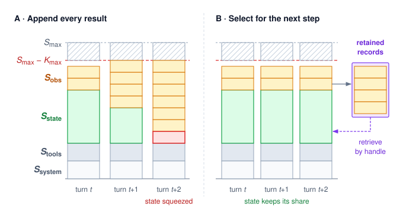
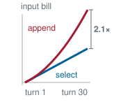
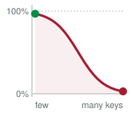
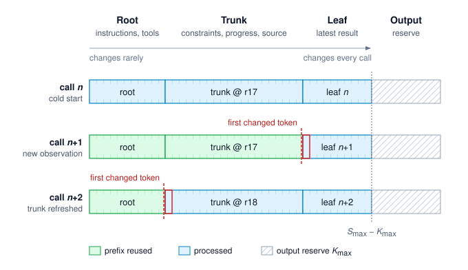
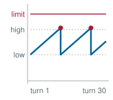
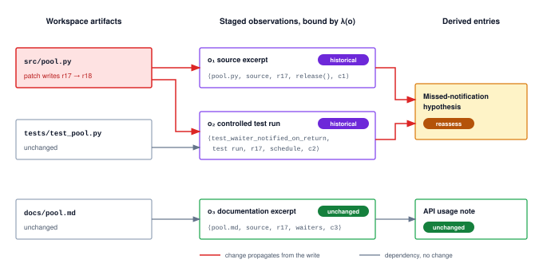
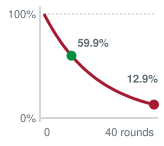

# Context Engineering {#sec-vol3-context-engineering}

::: {layout-narrow}
::: {.column-margin}

\chapterminitoc

:::

::: {.content-visible when-format="pdf"}
\noindent
{fig-alt="Blueprint illustration of a bounded working context."}
:::

::: {.content-visible unless-format="pdf"}
{fig-alt="Blueprint illustration of a bounded working context."}
:::

:::

## Purpose {.unnumbered .unlisted}

\begin{marginfigure}
\mlagentstack{0}{0}{0}{0}{100}{0}
\end{marginfigure}

_Why can an agent lose the thread of a task even when its entire history still fits?_

An agent context window is a finite, expensive operating system memory space, not an unbounded repository for raw text. Naively accumulating tool outputs, conversational turns, and retrieval snippets rapidly exhausts token capacity, inflates prompt prefill latency, and degrades the model attention distribution over critical task instructions. Effective context engineering treats the prompt as an active working register: relevant state must be aggressively compressed, irrelevant observations evicted, and volatile workspace artifacts externalized to persistent datastores. Stale evidence or truncated tool records in context directly induce model hallucinations that cascade across downstream turns. The systems challenge is maintaining an authoritative, minimal projection of environment truth within the token budget, ensuring that carried state actively bounds trajectory uncertainty rather than compounding it.

::: {.content-visible when-format="pdf"}

\newpage

:::

::: {.callout-learning-objectives}

- Distinguish nominal request capacity from usable working context and explain why admitted tokens dilute needed evidence
- Allocate the next request's input budget while preserving output headroom and task-relevant evidence
- Design a context layout that separates source roles from change rate and supports compatible prefix reuse
- Compare compaction policies by information loss, recovery requirements, and the cost of repeated transformations
- Audit a progress record against runtime-owned sources and price the protected-field check that preserves constraints
- Apply dependency-aware invalidation without treating historical observations as proof of current state
- Evaluate context policies by decision quality, accepted outcomes, and total resource use under common limits

:::
## Carrying a Repair Across Turns {#sec-vol3-context-engineering-overview}

The repair agent (lighthouse \ref{lhs-vol3-repair-agent}) has spent several turns investigating a connection-pool defect. It has inspected the pool implementation, executed a reproduction test, and revised its initial diagnosis. None of that hard-won progress lives inside the model. Because foundation models are stateless functions across turns, every call begins and ends with the payload assembled by the host runtime. The agent can use the test trace, honor public API constraints, and avoid revisiting a rejected hypothesis only if the runtime includes them in the upcoming request, structured so that the status and role of each artifact remain unambiguous.

::: {.column-margin}
{width="100%" fig-alt="H·S·A locator with only the State axis lit in purple."}

*This chapter develops State through the selection, representation, and refresh of working context.*
:::

The token accounting of @sec-vol3-foundation-model-tokenization resolves a basic operational constraint for an individual request: whether the payload satisfies the admission bound. Yet accounting bounds do not dictate semantic utility. A prompt can fit well within token limits and still fail to guide the agent toward a valid repair. The simplest agent architectures evade this problem by treating context as an append-only log, concatenating every observation, tool execution, and partial response into an expanding transcript. That policy breaks down almost immediately. Even while the transcript fits within physical limits, the runtime pays repeatedly for obsolete tokens that the next decision no longer requires. Stale code snippets sit alongside their replacements, and refuted hypotheses linger alongside the test results that disproved them, diluting the model's attention. When an extended trajectory inevitably exhausts the context window, an unmanaged runtime is forced into blind truncation, evicting vital instructions or early constraints without any principled criteria for what to preserve.

::: {.column-margin .margin-pointer}
↩ The quadratic input cost of resending an append-only history on every call is established in @sec-vol3-foundation-model-trajectory-cost-accumulation.
:::

This chapter develops the agent's *working context*: the runtime subsystem that decides what each model call receives. Rather than treating context as a passive transcript, this subsystem constructs a bounded working set tailored to a single decision. It establishes token budgets for each distinct role in the prompt, arranges data layouts so unchanged prefixes can be reused across turns, compacts historical evidence without corrupting its factual validity, maintains structured progress records that resist summarization drift, and enforces invalidation rules whenever external actions alter environment state. All of these mechanisms run as deterministic host software. The foundation model reasons over the assembled working context, but the host runtime remains solely responsible for managing it.

Tracing the repair agent through its next decision reveals how these systems components operate in concert. The runtime first formulates the working-set decision (@sec-vol3-context-engineering-decision), identifying the minimal sufficient evidence required for the next step and partitioning the input token allowance across competing roles. This allocation cannot simply mirror vendor-specified context windows. Measured context capacity (@sec-vol3-context-engineering-physics) demonstrates a sharp divergence between the raw token limits an API accepts and the narrower bounds within which a model reliably attends to dense evidence. Once selected, context items require disciplined staging (@sec-vol3-context-engineering-staging). The runtime structures prompts to establish clear data provenance, maintain role boundaries, and stabilize shared prefixes so that multi-turn interactions can exploit key-value caching in the serving engine. As extended troubleshooting stretches the step budget, compaction (@sec-vol3-context-engineering-compaction) reduces history to its essential results, while structured progress records (@sec-vol3-context-engineering-summarization) preserve critical decisions and refuted hypotheses without the informational drift typical of free-form text summarization. Furthermore, because tool executions mutate the surrounding software environment, active invalidation policies (@sec-vol3-context-engineering-context-rot) withdraw obsolete observations before they can mislead downstream reasoning. Finally, rigorous context evaluation (@sec-vol3-context-engineering-evaluation) tests whether the assembled context policy reliably guides the agent to correct defect repairs while controlling end-to-end latency and dollar cost.

## The Working-Set Decision {#sec-vol3-context-engineering-decision}

As our connection-pool investigation unfolds, the runtime accumulates far more information than was present at initialization. A controlled test has demonstrated that a connection returned to the pool while a waiting client remained blocked. Consequently, the initial timeout hypothesis has been undermined, leaving missed notification as the leading candidate explanation. The next model invocation must capitalize on this empirical progress. If the runtime blindly replays the entire conversational history without distinguishing raw observations from superseded hypotheses, it forces the model to re-evaluate discounted failure modes alongside the very evidence that disproved them.

Consider the state of the codebase at version `r17`, where the relevant files are `src/pool.py` and `tests/test_pool.py`, and the failure is captured by the reproducer `test_waiter_notified_on_return`. Before prompting the model for a candidate patch, the runtime must determine precisely which source excerpts, empirical test results, architectural constraints, and unresolved questions are required in the upcoming prompt. We call this choice the **working-set decision**\index{Working-set decision!definition}\index{Context engineering!working-set decision}: the runtime must select the bounded subset of task information necessary to execute the next concrete step.

The term draws inspiration from Denning's classic working-set model of program behavior [@denning1968].\index{Working set!Denning model} Over any temporal window, an executing program references only a fraction of its total address space. By keeping this active working set resident in physical page frames, an operating system avoids thrashing while relegating dormant pages to backing storage. An agent runtime faces an analogous residency challenge: it must stage the right tokens in context to support the immediate operation without exhausting its prompt budget. Yet an essential architectural divergence distinguishes context engineering from virtual memory. Denning's working set is measured dynamically from page references the program has already issued. An agent runtime, by contrast, must construct the context working set *before* issuing the model call, relying on a predictive judgment about what the upcoming decision will require.[^fn-belady-optimal-replacement] Furthermore, standard foundation model interfaces report only generated tokens; they emit no hardware-style reference bits or access telemetry to indicate which staged context tokens the model actually utilized during inference.

[^fn-belady-optimal-replacement]: **Optimal Replacement (MIN)**: @belady1966study evaluated page-replacement algorithms against an optimal offline baseline that evicts the page whose next reference lies farthest in the future. Practical operating systems approximate this unrealizable clairvoyance using historical access patterns such as least recently used (LRU). An agent context runtime lacks even that access history: because the model interface reports no reference bits for the tokens it processes, working-set selection must rely on explicit domain heuristics and structured task state rather than on observed cache reuse. \index{Belady optimal replacement!context selection}

In context management, relevance must govern selection rather than chronological recency. Core user constraints established at the start of a session remain binding after dozens of intermediate tool invocations, whereas a lengthy test log generated moments ago may offer only a single diagnostic status code. Moreover, candidate information extends far beyond the linear dialogue history. System instructions, schema declarations for available tools, newly inspected source files, and dynamically retrieved reference documents [@lewis2020retrieval] all compete for space in the assembled request. The runtime must synthesize an operational representation from these disparate sources, adhering strictly to the principle of source authority: the physical environment remains the sole authority on system state, and runtime policies govern what actions are permissible (principle \ref{pri-vol3-source-authority}).

To structure this selection, the runtime compiles a **context manifest**\index{Context manifest!definition}—a structured inventory that enumerates each artifact designated for the upcoming request alongside the rationale for its inclusion. The manifest for the connection-pool repair's next request (@tbl-vol3-context-manifest) reads as an architectural specification rather than a raw byte serialization: each row names an entry and the content the next step needs from it. Artifacts such as code snippets and test logs are itemized with their contextual provenance, ensuring that their substantive contents are injected only where directly relevant to the pending decision.

| Selected entry          | Content needed for the next step                                                                                                                                            |
|:------------------------|:----------------------------------------------------------------------------------------------------------------------------------------------------------------------------|
| Goal and constraints    | Repair waiter notification; preserve the public API; remain within the approved workspace; do not deploy to production.                                                     |
| Current artifacts       | Relevant source and test excerpts from `src/pool.py` and `tests/test_pool.py` at `r17`, together with the configuration used by the controlled test.                        |
| Observed result         | On `r17`, the controlled waiter/return test recorded an available connection while a waiter remained blocked. Keep the test identity and conditions attached to the result. |
| Hypothesis status       | The timeout explanation has lost support. Missed notification remains a hypothesis, not an established cause.                                                               |
| Repair and check status | No candidate patch has yet been checked. Behavior outside the controlled reproducer remains unresolved.                                                                     |
| Next bounded step       | Propose a candidate change to the notification path using the current excerpts; do not report the defect as repaired.                                                       |

: **Selecting the next request**: Each entry supplies a distinct part of the illustrative connection-pool decision. Version labels identify the example’s artifacts, not measured repository revisions. {#tbl-vol3-context-manifest tbl-colwidths="[24,76]"}

Curating this manifest demands disciplined relevance filtering. Retaining an empirical failure log without binding it to its source commit (`r17`) risks contaminating later turns, where an obsolete error trace might be mistaken for evidence against a newly patched implementation. Similarly, recording an abbreviated label like "notification bug" without qualifying its uncertainty prematurely elevates a working hypothesis to an established root cause. Conversely, retaining the full conversational history of rejected theories wastes valuable context capacity; once the runtime records that the timeout hypothesis was refuted by specific test evidence, the multi-turn deliberations that led to that hypothesis can be safely discarded. While a foundation model can assist in summarizing past turns to build this representation, the runtime must validate those synthesized summaries against ground-truth environmental observations before admitting them into the prompt.

The active working context must also be decoupled from durable records stored in external backing storage. For instance, rather than inlining a verbose test log into the prompt, the runtime can provide a **raw-payload handle**\index{Raw-payload handle!definition}—a compact reference pointing to an external record that an authorized tool can dereference on demand, subject to access controls and retention policies. This architecture enforces the **handle rule**\index{Handle rule!definition}: external data enters the model's active working context exclusively through explicit, validated retrieval operations. If downstream reasoning requires a specific stack trace line or configuration parameter omitted from the initial prompt, the model can invoke a dedicated retrieval tool to bring that specific slice into the context.

Every working-set candidate must satisfy hard context admission bounds. When an inference endpoint enforces a shared context window across inputs and outputs, the serialized prompt length $\SequenceLength$ must obey the constraint $\SequenceLength \le \ContextWindow - \OutputLimit$, where $\OutputLimit$ denotes the token budget reserved for model generation. When providers enforce separate input and output limits, $\SequenceLength \le \ContextWindow$ applies directly. Crucially, the runtime must measure token consumption against the fully formatted wire payload—including system envelopes, chat formatting markers, and JSON tool schemas—rather than summing isolated string fragments. Because tokenizer merges and protocol framing introduce serialization overhead, token savings achieved by compressing an evidence block can easily be erased if surrounding wrappers expand.

::: {.column-margin .margin-pointer}
↩ The admission bound and the output headroom $\OutputLimit$ it reserves are established in @sec-vol3-foundation-model-output-headroom.
:::

While this inequality sets the global ceiling, the runtime must allocate the available token space across the distinct functional roles identified in the manifest. We model this distribution through a planning budget:

$$
S_{\text{system}} + S_{\text{tools}} + S_{\text{state}} + S_{\text{obs}} \le \ContextWindow - \OutputLimit.
$$ {#eq-vol3-context-budget-partition}

In this budget partition, $S_{\text{system}}$ encompasses the static system instructions, $S_{\text{tools}}$ accounts for API schemas and tool declarations, $S_{\text{state}}$ covers ongoing task constraints, historical progress logs, and active source or test excerpts, and $S_{\text{obs}}$ accommodates immediate tool execution feedback and user steering. Because these terms compete for a strictly bounded total, any expansion in one component forces an immediate contraction elsewhere. An uncurated runtime that blindly appends every raw tool observation[^fn-react-appended-observations] allows $S_{\text{obs}}$ to expand monotonically with every turn. Consequently, each new line of command-line output inexorably crowds out $S_{\text{state}}$, degrading the critical task constraints and code excerpts upon which accurate reasoning depends. @Fig-vol3-working-set-selection contrasts this unconstrained accumulation against an active selection policy: under naive append-only logging (left panel), sprawling tool outputs crowd out active state within ten turns, whereas active selection (right panel) caps interaction history and evicts stale observations to preserve a bounded working-state budget over thirty turns.

[^fn-react-appended-observations]: **Interleaved Observations**: ReAct prompting interleaves reasoning traces, tool actions, and observation payloads within an ever-expanding prompt transcript [@yao2023react]. While keeping full execution history visible simplifies early prototyping, it incurs a steep systemic penalty: the unchecked growth of $S_{\text{obs}}$ consumes prompt capacity and inflates input token costs across every subsequent inference step. \index{ReAct!appended observations}

@Eq-vol3-context-budget-partition serves as an architectural planning guide rather than an exact arithmetic identity. Because sub-word tokenization of concatenated strings does not strictly equal the sum of independently tokenized substrings, the runtime must validate the fully assembled wire payload against the provider's token limit. When the assembled request exceeds the bound, the budget partition dictates priority: it informs the runtime which component—typically the observation buffer or historical context—must be pruned or summarized. Prompt staging mechanisms order these same four components by their rate of modification to maximize prefix and KV-cache reuse.

::: {#fig-vol3-working-set-selection fig-env="figure" fig-pos="htb" fig-cap="**Selection Protects the State Budget**: Each bar is one serialized request, stacked by the four terms of @eq-vol3-context-budget-partition beneath the input limit $\ContextWindow-\OutputLimit$, with the output reserve $\OutputLimit$ hatched above it. Appending every tool result (A) lets $S_{\text{obs}}$ grow until it displaces the task state the next decision needs. Selection (B) keeps each term's share by moving older results into retained records outside the request, where a handle can reach them if a later decision needs them. Segment heights are schematic, not measured token counts." fig-alt="Two panels of stacked vertical bars for turns t, t plus 1, and t plus 2. Each bar stacks system, tools, state, and observation segments below a dashed input limit, with a hatched output reserve on top. In panel A the observation segment grows each turn and the state segment shrinks, turning red at turn t plus 2. In panel B the three bars are identical; an arrow moves older results from the observation segment to a retained-records box, and a dashed arrow labeled retrieve by handle returns to the bars."}

:::

```{python}
#| label: calc-vol3-usable-context-budget
#| echo: false
# ┌─────────────────────────────────────────────────────────────────────────────
# │ EVIDENCE BUDGET OF A REPAIR REQUEST (LEGO)
# ├─────────────────────────────────────────────────────────────────────────────
# │ Context: @eq-vol3-context-budget-partition; nbk-04-evidence-budget.
# │ Goal: Show how many appended turns fit before observations overflow.
# │ Show: Evidence share, turns that fit, per-turn digest for the full horizon,
# │       and the input bill of appending vs. selecting over the horizon.
# │ How: Registry window and step budget; scenario sizes for the four terms.
# │ Note: Scenario token counts are serialized-request stipulations, not
# │       measurements of any product; bills assume no prefix reuse.
# └─────────────────────────────────────────────────────────────────────────────
from mlsysim import *
from mlsysim.fmt import check, fmt_int, fmt_multiple, fmt_percent

class UsableContextBudget:
    # ┌── 1. LOAD (Constants & Parameters) ─────────────────────────────────
    agent = Agents.Coding.SWE_Bench_Runner
    window = int(agent.context_window.to(ureg.token).magnitude)  # registry window
    horizon = agent.max_trajectory_steps  # registry step budget, turns
    output_reserve = 8_000  # scenario K_max, tokens
    system_tokens = 3_000  # scenario application instructions
    tool_tokens = 12_000  # scenario tool declarations
    state_tokens = 24_000  # scenario constraints, progress record, excerpts
    obs_per_turn = 4_000  # scenario tool-result tokens appended per turn
    obs_selected = 8_000  # scenario observation share a selecting policy keeps

    # ┌── 2. EXECUTE (Compute) ─────────────────────────────────────────────
    input_limit = window - output_reserve
    evidence = input_limit - system_tokens - tool_tokens
    evidence_share = evidence / window
    obs_budget = evidence - state_tokens
    turns_fit = obs_budget // obs_per_turn
    turns_fit_half = obs_budget // (obs_per_turn // 2)
    digest_max = obs_budget // horizon
    fixed = system_tokens + tool_tokens + state_tokens
    append_bill = horizon * fixed + obs_per_turn * horizon * (horizon + 1) // 2
    select_bill = horizon * (fixed + obs_selected)
    bill_ratio = append_bill / select_bill
    window_needed = fixed + horizon * obs_per_turn + output_reserve

    # ┌── 3. GUARD (Invariants) ────────────────────────────────────────────
    check(turns_fit < horizon <= turns_fit_half, "Appending overflows inside the step budget; halving fits it")
    check(fixed + obs_selected <= input_limit, "The selecting policy fits every turn")
    check(window_needed > window, "The appending policy's last request exceeds the window")
    check(1.5 < bill_ratio < 3, "Appending bills roughly twice the selected input")

    # ┌── 4. OUTPUT (Formatting) ───────────────────────────────────────────
    window_str = fmt_int(window)
    horizon_str = fmt_int(horizon)
    reserve_str = fmt_int(output_reserve)
    system_str = fmt_int(system_tokens)
    tool_str = fmt_int(tool_tokens)
    state_str = fmt_int(state_tokens)
    obs_str = fmt_int(obs_per_turn)
    obs_half_str = fmt_int(obs_per_turn // 2)
    obs_selected_str = fmt_int(obs_selected)
    input_limit_str = fmt_int(input_limit)
    evidence_str = fmt_int(evidence)
    evidence_pct_str = fmt_percent(evidence_share, style="prose", precision=1)
    obs_budget_str = fmt_int(obs_budget)
    turns_fit_str = fmt_int(turns_fit)
    overflow_turn_str = fmt_int(turns_fit + 1)
    turns_fit_half_str = fmt_int(turns_fit_half)
    digest_max_str = fmt_int(digest_max)
    append_bill_str = fmt_int(append_bill)
    select_bill_str = fmt_int(select_bill)
    bill_mult_str = fmt_multiple(bill_ratio, precision=1)
    window_needed_str = fmt_int(window_needed)
```

::: {#nbk-04-evidence-budget .callout-notebook title="How much of the window is evidence"}

**Problem**: In our reference repository-repair harness, an agent executes within a `{python} UsableContextBudget.window_str`-token context window under a `{python} UsableContextBudget.horizon_str`-turn step budget. The runtime reserves `{python} UsableContextBudget.reserve_str` tokens for generation ($\OutputLimit$) and allocates `{python} UsableContextBudget.system_str` tokens to system instructions ($S_{\text{system}}$) and `{python} UsableContextBudget.tool_str` tokens to tool declarations ($S_{\text{tools}}$). Dynamic task state—representing constraints, progress logs, and active code excerpts—consumes `{python} UsableContextBudget.state_str` tokens ($S_{\text{state}}$). If every raw tool result is appended directly at `{python} UsableContextBudget.obs_str` tokens per turn, how many turns fit within the window, and what maximum per-turn observation size would allow the execution to complete the entire step budget?

**Variables**: The context window and step horizon reflect the registry's repository-repair harness profile. Component sizes and per-turn observation rates represent operational stipulations for fully serialized wire requests.

**Math**: Applying @eq-vol3-context-budget-partition, the usable input capacity is `{python} UsableContextBudget.window_str` − `{python} UsableContextBudget.reserve_str` = `{python} UsableContextBudget.input_limit_str` tokens. Deducting system instructions and tool declarations leaves `{python} UsableContextBudget.evidence_str` tokens (`{python} UsableContextBudget.evidence_pct_str` of the context window) available for state and observations. Subtracting the `{python} UsableContextBudget.state_str` tokens required for state yields an observation budget of `{python} UsableContextBudget.obs_budget_str` tokens. Under naive appending, this budget accommodates `{python} UsableContextBudget.obs_budget_str` / `{python} UsableContextBudget.obs_str` = `{python} UsableContextBudget.turns_fit_str` turns. Sustaining all `{python} UsableContextBudget.horizon_str` turns requires constraining the per-turn observation payload to at most `{python} UsableContextBudget.obs_budget_str` / `{python} UsableContextBudget.horizon_str` = `{python} UsableContextBudget.digest_max_str` tokens.

**Result**: The appending policy exhausts the context window at turn `{python} UsableContextBudget.overflow_turn_str`, failing well before reaching the `{python} UsableContextBudget.horizon_str`-turn budget.

**Systems insight**: The number of feasible turns is bounded directly by the observation budget divided by the per-turn observation size, making observation volume the primary design lever. Compressing each result into an informative `{python} UsableContextBudget.obs_half_str`-token digest extends endurance to `{python} UsableContextBudget.turns_fit_half_str` turns, clearing the step budget. Yet context capacity is only the baseline constraint. Because an appending policy re-reads all accumulated historical tokens on every subsequent inference step, the cumulative input bill across an $\NumberOfDevices$-turn trajectory scales with $\mathcal{\Operations}(N^2)$, whereas working-set selection keeps consumption linear in $\mathcal{\Operations}(\NumberOfDevices)$. In terms of the effective cost metric $\CostPerAcceptedTaskEff$ (@eq-vol3-cost-per-accepted-task), unpruned context accumulation drastically inflates the cost per accepted repair.

:::

::: {.column-margin}
{width="100%" fig-alt="Two curves of cumulative input tokens from turn 1 to turn 30. A red curve labeled append bends upward; a blue line labeled select rises straight. A bracket at turn 30 spans the gap between them, labeled 2.1 times."}

*Appending re-reads every result, so its bill bends upward; selection stays linear.*
:::

The notebooks throughout this chapter reuse this baseline scenario, adopting the `{python} UsableContextBudget.window_str`-token window, the `{python} UsableContextBudget.horizon_str`-turn step budget, and the component token allocations defined above. These arithmetic constraints govern *admission*, ensuring that a serialized payload physically fits within the provider's context limit, but admission does not guarantee *semantic adequacy*. A prompt may strictly obey the budget yet omit the critical return path needed to formulate a patch, or conversely, it may incorporate every relevant code excerpt while burying crucial version distinctions beneath superseded error logs. Sizing a context budget is therefore only the first architectural challenge; an effective runtime must also evaluate how effectively the downstream model can retrieve and reason over the tokens admitted into that window.

## Working-Set Capacity {#sec-vol3-context-engineering-physics}

In notebook \ref{nbk-04-evidence-budget}, the `{python} UsableContextBudget.window_str`-token window admits the investigation's complete transcript for its first `{python} UsableContextBudget.turns_fit_str` turns. Fitting an entire history within the sequence window does not mean an agent should include every interaction; utility depends entirely on what the added material contributes to the pending decision. An omitted synchronization contract will invalidate a proposed repair, whereas ten pages of repeated timeout speculation will not improve it. Raw request length cannot distinguish essential evidence from noisy distraction.

The **nominal context capacity**\index{Nominal context capacity!definition} specifies the maximum sequence length that the configured model interface physically accepts, bounded by its input and generation limits. How effectively the model reasons over a specific collection of instructions and evidence is an entirely separate question—one answered only by evaluating concrete tasks under explicit quality criteria (principle \ref{pri-vol3-attention-working-set})\index{Principle!context is a selected working set}.

::: {#dfn-usable-working-context .callout-definition title="Usable working context"}

***Usable working context***\index{Usable working context!definition} is the context content, organization, and length with which a specified model and invocation configuration meet a chosen quality criterion on a stated workload.

1. **Significance**: Usable working context, rather than the nominal window, determines how much of the input allowance $\ContextWindow-\OutputLimit$ effectively supports decisions. It dictates how many turns an execution trajectory can sustain before selection or compaction must intervene, directly setting the input token cost per accepted task in $\CostPerAcceptedTaskEff$.
2. **Distinction**: Nominal capacity is an architectural boundary of the serving interface that admits a request; usable working context is an empirical property of a task, model, and representation that only rigorous evaluation can establish.
3. **Common pitfall**: Treating a fixed fraction of the nominal window, or success on an isolated synthetic retrieval probe, as a universal guarantee of usable context for a production workload.

:::

For a software repair workload, that criterion might require candidate patches to pass designated regression tests while strictly honoring a permitted edit scope, with the test suite and its coverage explicitly declared. In contrast, an information extraction workload demands high precision and recall against structured schemas. Because failure modes diverge across tasks, usable context must be measured independently for each workload.

### Testing usable working context {#sec-vol3-context-engineering-usable-context-test}

An isolated retrieval probe[^fn-needle-haystack-probe] asks whether specified information can be found in an input. An agentic repair decision demands far more: the model must relate newly observed symptoms to source artifacts, preserve system invariants, and distinguish an empirical measurement from an unverified hypothesis. As @tbl-vol3-capacity-comparison illustrates, these represent fundamentally different evaluation obligations. While a synthetic retrieval probe quickly flags basic architectural blind spots, validating a runtime context policy requires decision-level verification under realistic operating conditions.

[^fn-needle-haystack-probe]: **Needle-in-a-Haystack Probes**: The best-known isolated retrieval probe plants a short fact, the needle, in long distractor text and asks the model to return it. @hsieh2024ruler found that models scoring nearly perfectly on this probe degraded sharply as length grew on tasks that require multi-hop tracing and aggregation, and that only about half of the models tested held satisfactory performance at the context length all of them claimed to support. The gap between the probe and the harder tasks is the gap between nominal capacity and usable working context. \index{Needle-in-a-haystack!usable context}

| Test obligation           | Isolated key-retrieval probe                        | Connection-pool repair decision                                                                               |
|:--------------------------|:----------------------------------------------------|:--------------------------------------------------------------------------------------------------------------|
| Identify relevant content | Return the requested planted value.                 | Find the source, test conditions, and observation relevant to the notification path.                          |
| Interpret relationships   | Match the queried key to its value.                 | Tie the failure to `r17` and distinguish the missed-notification hypothesis from the observed blocked waiter. |
| Respect task constraints  | Meet the probe’s answer requirements.               | Propose a scoped change while preserving the public API and leaving untested behavior unresolved.             |
| Establish success         | Compare the returned value with the probe’s target. | Apply the chosen candidate checks and scope criteria; report only what they establish.                        |

: **Retrieval and decision scope**: A simple retrieval probe and the running repair example test different capabilities. {#tbl-vol3-capacity-comparison tbl-colwidths="[23,29,48]"}

Context organization directly influences task success even when all required facts are present in the prompt. Evaluating multi-document question answering and key-value retrieval, @liu2024lost reported marked sensitivity to the position of relevant information across model architectures, with accuracy dropping substantially when key facts appeared in the middle of the input. This position sensitivity, known as **lost in the middle**\index{Lost in the middle!definition}, means systems engineers cannot treat context as an unordered bag of tokens. Placement policies must be validated against the target workload, as positional degradation profiles vary across model families and prompt geometries.

A first-order mechanism explains why appending distractor tokens cannot be treated as free. Within an individual attention head, a query assigns weight to each visible key through a softmax operation [@vaswani2017]. For a target key with scaled logit $z_{\text{target}}$ alongside $\PointtopointMessageSize$ other keys with logits $z_j = \mathbf{q}\cdot\mathbf{k}_j/\sqrt{d_k}$, the target's weight is

$$
\alpha_{\text{target}} = \frac{e^{z_{\text{target}}}}{e^{z_{\text{target}}} + \sum_{j=1}^{\PointtopointMessageSize} e^{z_j}}.
$$ {#eq-vol3-softmax-dilution}

```{python}
#| label: calc-vol3-softmax-dilution
#| echo: false
# ┌─────────────────────────────────────────────────────────────────────────────
# │ SHARED-NORMALIZER DILUTION (LEGO)
# ├─────────────────────────────────────────────────────────────────────────────
# │ Context: @eq-vol3-softmax-dilution, working set capacity section.
# │ Goal: Show how fixed-logit background keys shrink one target's weight.
# │ Show: Target attention weight at two context lengths.
# │ How: Toy logits held fixed; only the number of background keys changes.
# └─────────────────────────────────────────────────────────────────────────────
from math import exp
from mlsysim.fmt import check, fmt_int, fmt_percent

class SoftmaxDilution:
    # ┌── 1. LOAD (Constants & Parameters) ─────────────────────────────────
    z_target = 6  # toy scaled logit for the target key
    z_background = -2  # toy scaled logit for every other key
    short_len = 100  # total keys, short context
    long_len = 100_000  # total keys, long context

    # ┌── 2. EXECUTE (Compute) ─────────────────────────────────────────────
    alpha_short = exp(z_target) / (exp(z_target) + (short_len - 1) * exp(z_background))
    alpha_long = exp(z_target) / (exp(z_target) + (long_len - 1) * exp(z_background))

    # ┌── 3. GUARD (Invariants) ────────────────────────────────────────────
    check(0 < alpha_long < alpha_short < 1, "More fixed-logit keys lower the target weight")
    check(alpha_short > 0.9 and alpha_long < 0.05, "Toy endpoints show the stated contrast")

    # ┌── 4. OUTPUT (Formatting) ───────────────────────────────────────────
    z_target_str = fmt_int(z_target)
    z_background_str = fmt_int(z_background)
    short_len_str = fmt_int(short_len)
    long_len_str = fmt_int(long_len)
    alpha_short_pct_str = fmt_percent(alpha_short, style="prose", precision=1)
    alpha_long_pct_str = fmt_percent(alpha_long, style="prose", precision=1)
```

::: {.column-margin}
{width="100%" fig-alt="Line chart of target attention weight from 0 to 100 percent against the number of keys, from few to many on a log scale. The curve starts near 100 percent at a green dot and falls to near zero at a red dot."}

*Fixed-logit distractors shrink the target's share of one normalizer.*
:::

All weights share a single normalizer. Because each additional key contributes a strictly positive term $e^{z_j}$ to the denominator of @eq-vol3-softmax-dilution, expanding the sequence length while holding logits constant depresses the target key's share of attention. This structural decay is **attention dilution**\index{Attention dilution!definition}. In a toy head with a target logit of `{python} SoftmaxDilution.z_target_str` and every background logit at `{python} SoftmaxDilution.z_background_str`, the target commands `{python} SoftmaxDilution.alpha_short_pct_str` of the weight among `{python} SoftmaxDilution.short_len_str` keys. When the context expands to `{python} SoftmaxDilution.long_len_str` keys, that same target's share falls to `{python} SoftmaxDilution.alpha_long_pct_str`, even though no single background key is individually competitive.

In agent execution, this effect is often worse than unrelated filler would produce.[^fn-irrelevant-context-distraction] Stale tool executions, superseded logs, and earlier source reads share identifiers such as `waiter`, `connection`, and `timeout` with the evidence that matters. Because these semantically related tokens produce substantial inner products with query vectors, their logits remain elevated. This dynamic is a sufficient condition for dilution under fixed logits, not a deterministic forecast of failure. Production models sharpen logits, route evidence across multiple attention heads and layers, and learn position-dependent retrieval behaviors, which is why @liu2024lost measured degradation empirically rather than deriving it analytically. Furthermore, the shared normalizer causes initial tokens to act as attention sinks that absorb probability mass regardless of content [@xiao2024streamingllm]. For context selection, the architectural takeaway is direct: every staged token competes for probability mass against the evidence the next decision requires.

::: {.column-margin .margin-pointer}
↪ Why cache eviction policies must retain attention-sink tokens is developed in @sec-vol3-kvcache-intrasequence.
:::

[^fn-irrelevant-context-distraction]: **Distracting Context**: @shi2023distracted added irrelevant sentences to grade-school arithmetic problems and found that model accuracy fell dramatically, although the added text changed nothing about the answer. Because the distractors were irrelevant by construction, the drop measures interference rather than missing information. That interference is the cost an agent pays for every superseded log line and stale file read it keeps in the request. \index{Irrelevant context!accuracy loss}

### Choosing a working budget {#sec-vol3-context-engineering-working-budget}

Systems engineers size a working budget by evaluating complete context policies against representative task suites—a methodology developed in @sec-vol3-context-engineering-evaluation. A context policy specifies far more than a simple token limit: it determines which material is retrieved, how structured data is represented, and where each component appears within the prompt layout. Decision quality must be evaluated alongside input size, inference latency, and token cost. Because additional context can provide essential grounding, introduce benign noise, or actively degrade reasoning through dilution, the resulting quality curve is rarely monotonic and seldom offers a single clean optimum. A documented operating envelope must therefore specify the workload, model configuration, quality threshold, and measured experimental conditions.

These decisions carry direct resource consequences under model-call cost accounting. Processing uncached tokens incurs prefill latency and compute charges, whereas aligned prefix caching amortizes prompt costs across repeated steps. High cache hit rates or discounted per-token pricing mean little if stale context degrades agent decisions. Conversely, pruning context too aggressively to reduce prefill costs risks stripping away vital constraints. Systems optimization targets meeting the task quality threshold at minimal effective cost, captured precisely by the effective cost metric $\CostPerAcceptedTaskEff$ from @eq-vol3-cost-per-accepted-task: pruning unnecessary tokens lowers the raw attempt cost in the numerator, but omitting an indispensable fact degrades the acceptance probability $\AcceptanceProbability$ in the denominator, inflating overall expenditures across failed trajectories.
In the connection-pool repair example, retaining the full transcript of early exploratory turns wastes capacity once distilled diagnostic observations, code snippets, interface invariants, and active hypotheses are available to guide the next patch. Yet stripping away a required interface contract or error log simply to compress the prompt into an arbitrary sub-budget represents a counterproductive optimization. When no evaluated policy meets both the task criterion and the available budget, the runtime must obtain the missing information, narrow the scope of the next permitted action, or report the limitation; a successful request-admission check never certifies adequate context.

Once the runtime selects the working set and bounds its token footprint, it must assemble those items into a concrete prompt layout that preserves source roles and evidence relationships while cleanly separating stable prefix content from dynamic step updates to maximize inference cache reuse.

## Staging the Next Invocation {#sec-vol3-context-engineering-staging}

Once a context selection policy identifies the relevant working set for an upcoming invocation, the runtime must translate those disparate entries into a concrete request payload. In our connection-pool repair task, the selected manifest contains fundamentally different classes of information: inviolable public API constraints, source code excerpts from `src/pool.py` at revision `r17`, execution results from `test_waiter_notified_on_return`, and a working hypothesis that a notification was dropped alongside an abandoned timeout conjecture. Merging these items into a flat, undifferentiated string would obscure the critical distinctions that govern the model's next decision. Staging is the disciplined process of converting selected entries into a structured request. It preserves the semantic source, authority, and revision of every item so that the model can differentiate policy instructions from empirical evidence and tentative hypotheses, while arranging content in an order that minimizes unnecessary token churn across consecutive calls.

### Ordering by change rate {#sec-vol3-context-engineering-change-rate-ordering}

A well-engineered context layout stratifies information by its rate of change, placing static material before volatile content. We partition the serialized prompt into three functional regions: the **root**, the **trunk**, and the **leaf**\index{Context zone!definition}. These zones classify content strictly by its mutation frequency during an agent's trajectory, rather than by message role or semantic authority. @Tbl-vol3-context-zone-stratification maps the repair agent's selected working set into this operational order. In the running scenario from notebook \ref{nbk-04-evidence-budget}, the root holds `{python} UsableContextBudget.system_str` tokens of system instructions alongside `{python} UsableContextBudget.tool_str` tokens of tool declarations. The trunk incorporates `{python} UsableContextBudget.state_str` tokens of evolving task state, and the leaf receives `{python} UsableContextBudget.obs_selected_str` tokens of freshly retained observations.

| Zone  | Contents in the repair request                                                                                           | When it changes                                                                       |
|:------|:-------------------------------------------------------------------------------------------------------------------------|:--------------------------------------------------------------------------------------|
| Root  | Application instructions and available tool definitions                                                                  | The application contract or tool interface changes                                    |
| Trunk | Task constraints, the current progress record, and selected source and test content at `r17`                             | A task constraint changes, an artifact is edited, or the progress record is refreshed |
| Leaf  | The latest scoped test observation and the next bounded step, here proposing a candidate change to the notification path | New evidence or a new next-step decision arrives                                      |

: **Context ordered by change rate**: The zones help preserve a stable request prefix. Message roles and source metadata remain separate from these placement choices. {#tbl-vol3-context-zone-stratification}

Prefix stability must never supersede correctness. The root remains stable only as long as its specifications remain accurate; if a tool definition changes during a session, the runtime must update the root in the next invocation, accepting the cache miss. Similarly, when a candidate patch advances the repository from revision `r17` to `r18`, the runtime cannot continue staging `r17` source code simply to keep the trunk prefix warm. The earlier test failure remains valid historical evidence regarding `r17`, but verifying whether it persists on the patched workspace requires fresh execution. @Sec-vol3-context-engineering-context-rot formalizes how invalidation policies govern this transition.

Information can also migrate between zones as task execution unfolds. An observation initially staged in the leaf may graduate into the trunk's summarized progress record during a planned refresh, provided its provenance, version bounds, and execution scope remain intact. Conversely, if an application instruction must be injected dynamically on a per-step basis, it resides in the leaf without forfeiting its normative authority. Zone placement dictates the physical order of tokens to optimize change frequency; structural schemas and message roles establish provenance and semantic interpretation.

### Preserving source and scope {#sec-vol3-context-engineering-source-scope}

When staging an observation, the host runtime must bind sufficient provenance metadata to interpret the underlying payload. For our failing test case, the host attaches the test identifier, the workspace revision (`r17`), the execution environment configuration, and a unique run identifier. This discipline embodies the **scope rule**\index{Scope rule!definition}:[^fn-why-where-provenance] an observation provides valid evidence exclusively for the specific artifact versions and execution conditions under which it was gathered. Every subsequent context transformation—including summarization, compaction, and invalidation—must preserve these provenance boundaries.

[^fn-why-where-provenance]: **Why- and Where-Provenance**: Database research distinguishes why-provenance, the source records that justify a result's existence, from where-provenance, the source locations its values were copied from [@buneman2001why]. The scope rule demands both for every observation: which execution and artifact versions justify its existence, and which payload spans supplied its values. A result that loses either becomes an unattributed claim that later compaction can silently generalize. \index{Provenance!scope rule}

Crucially, the runtime synthesizes this framing externally rather than extracting it from text inside the observation. A robust serializer treats raw tool output strictly as a literal data value within a structured envelope, preventing mismatched quotes, markdown delimiters, or control characters from corrupting the surrounding schema. Despite this structural isolation, the payload itself remains an **untrusted span**\index{Untrusted span!definition}: arbitrary text whose arrival the runtime can document, but whose semantic claims it cannot verify. While rigorous encoding prevents format-injection attacks, it cannot prevent the underlying language model from attending to and executing adversarial instructions embedded within the text [@greshake2023not].

Consequently, provenance labeling serves semantic interpretation rather than security enforcement. Tagging a tool output as untrusted data guides the model's reasoning, but it does not restrict the model's capabilities. If an observation instructs the agent to delete a database or overwrite production credentials, the model might still attempt that operation. Security boundaries—such as file system sandboxing, read-only workspace mounts, and deployment blocks—must execute deterministically in the host runtime, entirely outside the model's prompt interpretation. Staging maintains the architectural boundary between instructions and observational evidence, while host execution gates enforce operational safety.

::: {.column-margin .margin-pointer}
↪ The host-side information-flow policy that limits what untrusted context may influence and where private data may flow is enforced in @sec-vol3-security-taint-tracking.
:::

The proportion of untrusted tokens, their accumulation rate, and their vulnerability to staleness vary dramatically across agent architectures. A coding repair agent operates primarily over a local workspace where file contents change predictably. By contrast, an autonomous research agent ingests untrusted third-party web text at high velocity.

::: {#lhs-04-context-by-archetype .callout-lighthouse title="Context by archetype"}

```{=latex}
\begin{minipage}{1\linewidth}
```
Each recurring workload places pressure on a distinct component of the context budget in @eq-vol3-context-budget-partition, requiring a specialized mitigation strategy (@tbl-vol3-context-by-archetype).

| **Lighthouse**        | **What fills the request**                                                                                                                                | **Binding constraint**                                                    | **Mechanism that answers it**                                                          |
|:----------------------|:----------------------------------------------------------------------------------------------------------------------------------------------------------|:--------------------------------------------------------------------------|:---------------------------------------------------------------------------------------|
| **Repair agent**      | Source excerpts, test logs, and a progress record from its own workspace, accumulating over a `{python} UsableContextBudget.horizon_str`-turn step budget | Growth of $S_{\text{obs}}$ displacing $S_{\text{state}}$                  | Compaction and progress records (@sec-vol3-context-engineering-compaction)             |
| **Research agent**    | Retrieved pages and search results written by third parties                                                                                               | Untrusted spans that dominate $S_{\text{obs}}$ and may carry instructions | Provenance-preserving staging here; enforcement in @sec-vol3-security                  |
| **Remediation agent** | Readings of shared production state that other actors change                                                                                              | Staleness between the read and the action                                 | Invalidation and action-time preconditions (@sec-vol3-context-engineering-context-rot) |
| **Support agent**     | Fixed policy instructions and tool declarations, one customer record, a short session                                                                     | $S_{\text{system}}+S_{\text{tools}}$ repeated across many short sessions  | A stable root for prefix reuse (@sec-vol3-context-engineering-staging)                 |

: **Context by archetype**: The four recurring workloads bind on different terms of the same input budget. {#tbl-vol3-context-by-archetype tbl-colwidths="[16,34,25,25]"}

```{=latex}
\end{minipage}
```

**Systems insight**: The fundamental context budget equation binds on different constraints across workloads: token accumulation for the repair agent, provenance tracking for the research agent, temporal freshness for the remediation agent, and prefix cache amortization for the customer support agent. Engineering techniques rarely transfer across archetypes without adaptation. Compaction algorithms that keep a software repair agent within its token allocation do not resolve the primary vulnerability of a research agent, whose chief challenge is filtering untrusted external input rather than managing context length.

:::

### Preserving an exact prefix {#sec-vol3-context-engineering-exact-prefix}

Request organization directly governs inference performance and operational cost in modern serving infrastructure. Serving engines equipped with prefix caching[^fn-automatic-prefix-reuse] bypass redundant transformer prefill computation by reusing intermediate key-value (KV) activations for identical leading token sequences. Because causal self-attention calculates each token's key and value representations conditionally on all preceding tokens, any divergence in the prefix invalidates the KV cache for all subsequent positions. Even if two prompts share thousands of identical trailing tokens, the serving engine cannot reuse the suffix cache if a single token near the beginning has changed. @Fig-vol3-context-zones partitions context into three tiered lifecycle zones (root, trunk, leaf): Call $\PointtopointMessageSize$ establishes the initial prefix across all three tiers; Call $\PointtopointMessageSize+1$ appends observations to the leaf while preserving root and trunk cache hits; but Call $\PointtopointMessageSize+2$ mutates the trunk during compaction, terminating prefix reuse at the root boundary and forcing full recomputation across all subsequent tokens.
[^fn-automatic-prefix-reuse]: **Automatic Prefix Reuse**: Serving systems such as SGLang index cached attention state by token prefix within a radix tree, allowing an incoming request that shares an existing token prefix to reuse cached KV blocks transparently [@zheng2024sglang]. Because radix tree lookups evaluate exact token equality rather than semantic equivalence, two requests that diverge on an early timestamp share zero cache entries past that offset. Layout discipline directly determines cache hit rates. \index{Prefix cache!radix tree}

::: {#fig-vol3-context-zones fig-env="figure" fig-pos="htb" fig-cap="**Reuse Ends at the First Changed Token**: Three consecutive requests follow the root, trunk, and leaf order of @tbl-vol3-context-zone-stratification, with the output reserve $\OutputLimit$ beyond the input limit $\ContextWindow-\OutputLimit$. A new observation changes only the leaf, so the root and trunk remain a reusable prefix. Refreshing the trunk to r18 moves the first changed token to the end of the root, and every later token is processed again. The figure assumes compatible cached state on the serving side; an identical prefix alone does not guarantee reuse." fig-alt="Three horizontal request bars labeled call n cold start, call n plus 1 new observation, and call n plus 2 trunk refreshed. Each bar has root, trunk, and leaf segments followed by a hatched output reserve past a dotted input-limit line. In call n every segment is marked processed. In call n plus 1 the root and the trunk at r17 are marked prefix reused, and a red dashed line labeled first changed token sits at the leaf boundary. In call n plus 2 only the root is reused, the trunk is at r18, and the red dashed line sits at the root boundary. Headers name the zones above an axis running from changes rarely to changes every call."}

:::

Cache equality depends strictly on the final serialized token sequence rather than abstract application state. Serialization details—such as JSON dictionary key ordering, whitespace padding, system prompt templating, and boundary token mergers—can inadvertently mutate the token stream. For instance, byte-pair encodings (BPE) frequently merge trailing whitespace with leading characters of subsequent strings, creating different token IDs across zone boundaries. Prefix stability can therefore be verified only on the fully assembled, tokenized prompt.

An identical token prefix is necessary for cache reuse, but it is not sufficient. The serving infrastructure must still retain compatible cache blocks in GPU high-bandwidth memory (HBM), configured for the identical model weight snapshot, positional encoding offsets, and attention mechanisms. Memory pressure, LRU evictions, or node autoscaling can purge cached state between agent turns despite byte-level request stability. While serving engines manage and evict these internal tensors, the agent runtime bears the responsibility of maintaining stable prefixes for static material while accurately refreshing data essential to the next decision.

::: {.column-margin .margin-pointer}
↪ Prefix compatibility and the retention and eviction of cached KV blocks in the serving engine are developed in @sec-vol3-kvcache-radix-tree.
:::

Placing high-frequency metadata near the start of a request destroys prefix reuse for zero operational gain. Moving dynamic elements—such as request IDs, wall-clock timestamps, or invocation counters—into the leaf preserves prefix continuity across the root and trunk. If an application requires a timestamp, isolating it in the leaf prevents it from evicting tens of thousands of reusable root tokens. When an early field diverges, cache sharing collapses at the first differing token. The following calculation takes the extreme case, where divergence occurs at the very first token, to establish an upper bound on the cost penalty of placing volatile fields at the front of a request.

```{python}
#| label: calc-vol3-context-layout-price
#| echo: false
# ┌─────────────────────────────────────────────────────────────────────────────
# │ PRICE OF A CONTEXT LAYOUT ACROSS ONE TRAJECTORY (LEGO)
# ├─────────────────────────────────────────────────────────────────────────────
# │ Context: nbk-04-quantitative-impact-of-prefix-layout; fallacies; summary.
# │ Goal: Compare input bills under explicitly assumed prefix matches.
# │ Show: Uncached/reused tokens, input bills, and their ratios.
# │ How: Registry step budget; zone sizes are the selecting-policy request of
# │      calc-vol3-usable-context-budget (root = instructions + declarations,
# │      trunk = task state, leaf = selected observations).
# │ Note: Hypothetical prices; retained compatible cache; no latency estimate.
# └─────────────────────────────────────────────────────────────────────────────
from mlsysim import *

class ContextLayoutPrice:
    # ┌── 1. LOAD (Constants & Parameters) ─────────────────────────────────
    agent = Agents.Coding.SWE_Bench_Runner
    turns = agent.max_trajectory_steps  # registry step budget, one call per turn
    root_tokens = 3_000 + 12_000  # scenario instructions + tool declarations
    trunk_tokens = 24_000  # scenario task state (constraints, record, excerpts)
    leaf_tokens = 8_000  # scenario selected observations, replaced each call
    trunk_changes = 2  # after the cold first call
    input_price = 3.00 * USD / Mtoken  # hypothetical, not a provider schedule
    cached_fraction = 0.10

    # ┌── 2. EXECUTE (Compute) ─────────────────────────────────────────────
    context_tokens = root_tokens + trunk_tokens + leaf_tokens
    suffix_tokens = trunk_tokens + leaf_tokens
    total_input = turns * context_tokens
    warm_turns = turns - 1 - trunk_changes
    unstable_prefill = total_input
    stable_prefill = context_tokens + trunk_changes * suffix_tokens + warm_turns * leaf_tokens
    stable_cached = total_input - stable_prefill
    hit_rate = stable_cached / total_input
    unstable_cost = (unstable_prefill * token * input_price).to(USD)
    stable_cost = ((stable_prefill + cached_fraction * stable_cached) * token * input_price).to(USD)
    cost_ratio = (unstable_cost / stable_cost).to(ureg.dimensionless).magnitude
    prefill_ratio = unstable_prefill / stable_prefill
    refresh_ratio = suffix_tokens / leaf_tokens  # trunk rewrite vs. warm call

    # ┌── 3. GUARD (Invariants) ────────────────────────────────────────────
    check(warm_turns == turns - 3, "One cold call, two trunk changes, the rest leaf changes")
    check(context_tokens == 47_000, "Request equals the evidence notebook's selecting policy")
    check(refresh_ratio == 4, "A trunk rewrite costs four leaf-only calls")
    check(3 < cost_ratio < 3.5, "Unstable layout bills a little over three times the stable one")
    check(stable_prefill + stable_cached == total_input, "Every input token is billed once")
    check(0 < stable_cost < unstable_cost, "The assumed discount must reduce this input bill")

    # ┌── 4. OUTPUT (Formatting) ───────────────────────────────────────────
    turns_str = fmt_int(turns)
    root_tokens_str = fmt_int(root_tokens)
    trunk_tokens_str = fmt_int(trunk_tokens)
    leaf_tokens_str = fmt_int(leaf_tokens)
    trunk_changes_str = fmt_int(trunk_changes)
    warm_turns_str = fmt_int(warm_turns)
    price_str = fmt_usd(input_price * Mtoken, precision=0)
    cached_fraction_pct_str = fmt_percent(cached_fraction, style="prose", precision=0)
    context_tokens_str = fmt_int(context_tokens)
    total_input_str = fmt_int(total_input)
    prefill_math = fmt_math(
        rf"{context_tokens:,} + {trunk_changes} \times {suffix_tokens:,} + {warm_turns} \times {leaf_tokens:,} = {stable_prefill:,}"
    )
    stable_cached_str = fmt_int(stable_cached)
    hit_rate_pct_str = fmt_percent(hit_rate, style="prose", precision=1)
    unstable_cost_usd_str = fmt_usd(unstable_cost, precision=2)
    stable_cost_usd_str = fmt_usd(stable_cost, precision=2)
    unstable_turn_usd_str = fmt_usd(unstable_cost / turns, precision=3)
    stable_turn_usd_str = fmt_usd(stable_cost / turns, precision=3)
    cost_mult_str = fmt_multiple(cost_ratio, precision=1)
    prefill_mult_str = fmt_multiple(prefill_ratio, precision=1)
    suffix_tokens_str = fmt_int(suffix_tokens)
    refresh_int_str = fmt_int(refresh_ratio)
```

::: {#nbk-04-quantitative-impact-of-prefix-layout .callout-notebook title="Pricing a context layout across one trajectory"}

**Problem**: The repair agent of notebook \ref{nbk-04-evidence-budget} runs its full `{python} ContextLayoutPrice.turns_str`-turn step budget under the selecting policy, executing one call per turn. Each request carries a `{python} ContextLayoutPrice.root_tokens_str`-token root of instructions and tool declarations, a `{python} ContextLayoutPrice.trunk_tokens_str`-token trunk of task state, and an `{python} ContextLayoutPrice.leaf_tokens_str`-token leaf of selected observations, measured after serialization. The leaf is replaced on each call rather than appended. The trunk is rewritten on `{python} ContextLayoutPrice.trunk_changes_str` calls after the first. Input tokens cost a hypothetical `{python} ContextLayoutPrice.price_str` per million tokens, with cached reads billed at `{python} ContextLayoutPrice.cached_fraction_pct_str` of that price. What input bill follows from each layout?

**Variables**: Both layouts have `{python} ContextLayoutPrice.context_tokens_str` tokens per request and `{python} ContextLayoutPrice.total_input_str` input tokens across the trajectory, matching the selecting policy budget from notebook \ref{nbk-04-evidence-budget}. In the unstable layout, the first token differs on every invocation and no prefix is reused. In the stable layout, the first call is cold; the `{python} ContextLayoutPrice.trunk_changes_str` trunk rewrites first differ immediately after the root; and the remaining `{python} ContextLayoutPrice.warm_turns_str` calls first differ immediately after the trunk. Compatible cached state remains available for every matching prefix. This calculation isolates input token pricing, omitting generation charges and cache storage fees.

**Math**: The unstable layout processes all input without reuse, incurring `{python} ContextLayoutPrice.unstable_cost_usd_str`. In the stable layout, the initial cold call processes the entire request, each trunk rewrite prefills only the trunk and leaf, and every warm call processes only the leaf. The total uncached volume is `{python} ContextLayoutPrice.prefill_math` tokens. The remaining `{python} ContextLayoutPrice.stable_cached_str` tokens hit the prefix cache, achieving an aggregate cache hit rate of `{python} ContextLayoutPrice.hit_rate_pct_str`. Billing uncached tokens at full price and reused tokens at the reduced rate yields `{python} ContextLayoutPrice.stable_cost_usd_str` for the trajectory.

**Result**: Average input cost drops from `{python} ContextLayoutPrice.unstable_turn_usd_str` per call in the unstable layout to `{python} ContextLayoutPrice.stable_turn_usd_str` in the stable layout. An unstable layout bills `{python} ContextLayoutPrice.cost_mult_str` the stable layout and requires `{python} ContextLayoutPrice.prefill_mult_str` times more uncached prefill tokens. These figures represent billing and token volume ratios, not end-to-end execution speedups.

**Systems insight**: With a stable prefix, the size of the volatile leaf determines the marginal input cost of each invocation. Rewriting the trunk requires prefilling `{python} ContextLayoutPrice.suffix_tokens_str` tokens—equivalent to the prefill overhead of `{python} ContextLayoutPrice.refresh_int_str` leaf-only calls. Systems engineers should place all per-call dynamic fields strictly in the leaf and restrict trunk rewrites to moments when underlying workspace artifacts or active task constraints change. This layout reduces the input component of attempt cost within the effective cost equation $\CostPerAcceptedTaskEff$ by the ratio above. Task accuracy ($\AcceptanceProbability$) remains intact only as long as staged context remains faithful to real environment state: preserving a high cache hit rate never justifies retaining stale context.

:::

::: {#chk-04-context-hierarchy .callout-checkpoint title="Checking the staged request"}

A candidate patch has just moved the workspace from `r17` to `r18`, and the runtime is staging the next request.

- [ ] **Provenance after promotion**: If a test result moves from the leaf into a refreshed progress record, what source, version, and scope must remain attached to it?
- [ ] **Volatile fields**: Why does a changing field near the start shorten prefix reuse without necessarily eliminating it, and where should a per-call request identifier go?
- [ ] **Trunk refresh estimate**: With the layout notebook's zone sizes, how many uncached input tokens does the trajectory pay if the trunk is rewritten on every fourth call after the first instead of twice? Compare the result with the unstable layout's count.
- [ ] **Stale trunk**: After the source changes from `r17` to `r18`, why is keeping the old source in the trunk an incorrect optimization even when it raises the hit rate?

:::

Staging ensures that selected evidence enters the prompt in an interpretable schema and an order engineered for prefix cache reuse. However, ordering alone does not compress verbose outputs; an oversized test log or sprawling source file still consumes its full allocation of the token budget. When the required working set exceeds available context limits, the runtime must alter the underlying representation to preserve key decision evidence within fewer tokens. That compression challenge motivates compaction.

## Context Compaction {#sec-vol3-context-engineering-compaction}

A multi-turn task such as our connection-pool repair rapidly accumulates repeated source listings, boilerplate test setup output, and sprawling execution traces. Retaining every line in every prompt consumes capacity that downstream reasoning steps need for patch analysis and test verification. Yet aggressively compressing that trace into a generic note like “the test failed” discards vital diagnostic clues: the model loses track of which source revision failed, which thread interleaving was executed, and which specific assertion triggered the timeout. Compaction must compress the working context without corrupting or discarding the causal evidence that future decisions depend on.

::: {#dfn-context-compaction .callout-definition title="Context compaction"}

***Context compaction***\index{Context compaction!definition}\index{Working-set decision!compaction} replaces material in a working context with a shorter representation chosen for the task's next decisions.

1. **Significance**: It creates room for new observations inside the fixed input allowance $\ContextWindow-\OutputLimit$, allowing an agent trajectory to run past the turn at which appending would overflow while retaining critical evidence, constraints, and unresolved obligations.
2. **Distinction**: A compressed representation is inherently lossy or access-deferred. Keeping a handle to omitted material makes recovery conditional on an explicit retrieval step.
3. **Common pitfall**: Assuming that a deterministic extractor, or a summary mentioning all required field names, guarantees that no decision-critical information was lost.

:::

### Choosing a compaction method {#sec-vol3-context-engineering-compaction-method}

No single compaction strategy fits all runtime data; every representation forces a trade-off between prompt compression, downstream validation overhead, and the risk of silent information loss. A regular expression provides deterministic filtering, but it can easily drop the single line that explains an intermittent fault. A source-code skeleton preserves API signatures, yet it strips the concurrency logic needed to diagnose a synchronization deadlock. Conversely, delegating compaction to an LLM-written summary can preserve high-level diagnostic intent, but models frequently hallucinate or misstate whether a verification check actually passed.[^fn-summary-faithfulness-audit]

@Tbl-vol3-compaction-spectrum compares the choices by their preservation obligations rather than by fixed reduction ratios. The appropriate representation depends entirely on the immediate downstream operation: inspecting an interface requires only an outline, whereas debugging a race condition demands exact function bodies and thread-interleaving logs.

[^fn-summary-faithfulness-audit]: **Unfaithful Summaries**: In a human evaluation of neural abstractive summarizers, @maynez2020faithfulness found hallucinated content—statements unsupported by the source document—in the output of every model studied. A progress record written by a model inherits this failure mode. The audit developed later in this chapter therefore compares each claimed milestone with its recorded event instead of trusting the summarizer's account. \index{Summarization!faithfulness}

| Representation                    | What remains in the request                                             | What must be checked                                                                           |
|:----------------------------------|:------------------------------------------------------------------------|:-----------------------------------------------------------------------------------------------|
| Normalized or deduplicated text   | Selected text with repeated output or formatting removed                | Whether repetition, ordering, timing, or formatting carries task evidence                      |
| Tool-result digest and raw handle | Status, selected evidence, source identity, and a retrieval reference   | Whether the digest supports the next decision and the omitted payload remains accessible       |
| Deterministic extraction          | Matched log records, selected fields, source excerpts, or code outlines | Whether the extraction rule omitted relevant context, relationships, or implementation details |
| Model-written summary             | A generated account of observations, hypotheses, and progress           | Whether each retained claim is supported and required details and uncertainty remain explicit  |

: **Compaction representation choices**: Trade-offs between prompt reduction, residual prompt contents, and the downstream validation required to prevent silent information loss. {#tbl-vol3-compaction-spectrum}

The first three representation classes rely on deterministic transformations executed entirely by the runtime without invoking a language model. @Tbl-vol3-compaction-techniques summarizes these techniques alongside the failure modes they introduce. While deterministic filtering guarantees computational repeatability, it cannot guarantee semantic sufficiency; an operation is safe only when downstream decisions do not depend on the omitted lines.

| Technique                              | What it keeps                                                        | What it can silently drop                                            |
|:---------------------------------------|:---------------------------------------------------------------------|:---------------------------------------------------------------------|
| Repeated-poll deduplication            | One copy of an unchanged status output and a repetition count        | A brief change between polls, or the timing of repetitions           |
| Terminal-control stripping             | Plain text without escape codes, progress redraws, or spinners       | Timing or ordering signals carried only by the redraws               |
| Diff hunk folding                      | Changed lines, their location, and a marker for unchanged context    | Surrounding code needed to judge whether the change is correct       |
| Superseded-read replacement            | A pointer from an old file read to the edit that replaced its source | Old text a later decision needs to explain what changed              |
| Head, tail, and failure-marker slicing | Setup lines, final lines, and lines matching failure patterns        | An intermediate warning or event ordering that matches no pattern    |
| Source outline                         | Signatures, types, and docstrings, with bodies folded                | The implementation a repair must read, such as the notification path |
| Tool-result digest                     | Status, exit code, payload size, and a handle to the retained output | Every detail of the payload until the handle is retrieved            |

: **Deterministic compaction techniques**: Specific evidence dropped by programmatic pruning methods. The trace in @lst-vol3-compaction-observation demonstrates how naive failure-marker slicing discards the causal ordering behind a test failure. {#tbl-vol3-compaction-techniques tbl-colwidths="[24,38,38]"}

Lossless binary compression algorithms preserve raw bytes, but foundation models cannot reason over compressed bitstreams directly; the runtime must decompress them into natural language tokens before inference. Storing large outputs in an external artifact store and placing a lightweight digest with a retrieval handle in the context window keeps raw payloads outside the active prompt. However, paging that data back into memory costs both latency and token capacity. Under either pattern, pruned evidence re-enters the working context only through an explicit read operation.

Consider our connection-pool repair task. When executing a controlled regression test at revision `r17`, the runtime captures the log excerpt shown in @lst-vol3-compaction-observation (where repetitive polling lines have been stripped for clarity).

::: {#lst-vol3-compaction-observation lst-cap="**Observation before compaction**: The event ordering and failed assertion together identify what the controlled test observed at r17."}
```text
source=src/pool.py@r17 test=tests/test_pool.py@r17
test_name=test_waiter_notified_on_return
configuration=controlled waiter-before-return schedule
... repeated worker progress messages ...
waiter_registered_before_return=true
connection_available_after_return=true
waiter_resumed_at_notification_check=false
FAILED: assert waiter_resumed_at_notification_check
```
:::

A simplistic filter that retains only lines matching `FAILED` captures the terminal assertion failure but drops the event sequence that explains it. Without seeing that `waiter_registered_before_return` and `connection_available_after_return` both evaluated to true, the model cannot deduce whether the failure stemmed from a race during registration, an unavailable resource, or a lost notification. A structured, compact observation preserves this causal chain: “At `r17`, `test_waiter_notified_on_return` registered the waiter before returning a connection. The connection became available, but `assert waiter_resumed_at_notification_check` failed at the notification check.” Alongside this narrative digest, the context retains the revision identifiers (`src/pool.py@r17`, `tests/test_pool.py@r17`), the execution schedule, and a pointer handle to the raw execution trace for on-demand debugging.

This concise record provides empirical backing for the lost-notification hypothesis under the tested conditions while maintaining a strict boundary between raw observations and diagnostic conjectures. When a subsequent patch yields revision `r18`, the runtime must record the new test outcome against `r18` rather than overwriting or conflating it with the historical `r17` failure. A compaction step that collapses both runs into an unqualified summary such as “the bug is fixed” erases the provenance needed to verify that the repair actually resolved the underlying race condition.

### Protecting task-scoped fields {#sec-vol3-context-engineering-protected-fields}

To prevent compaction passes from stripping decision-critical data, the runtime designates an invariant set of **protected fields**\index{Protected field!definition} that must survive any transformation. Before committing an updated working context, the system validates that these fields are present and unaltered. In our pool-repair scenario, the protected set includes the revision identifiers (`pool.py@r17`), the test identifier (`test_waiter_notified_on_return`), the concurrent scheduling flags, the failed assertion statement, and the exit status. In addition, global task constraints—such as preserving public API compatibility, confining edits to the designated repository directory, and blocking production deployment commands—must remain pinned. Later execution stages might require specific function implementations or configuration values that this compact digest omits, but those can be paged in as needed.

Field protection must be dynamically scoped to the task phase. Pinning every historical line number, diff chunk, and identifier defeats the purpose of compaction by quickly exhausting the context budget. Conversely, enforcing an overly rigid, global schema risks dropping domain-specific diagnostic relationships. An assertion message copied verbatim without its corresponding commit hash or concurrency configuration is useless or misleading. Similarly, runtime filtering must scrub credentials, authentication tokens, and private keys; sensitive literals must never be retained simply because a filter rule matches string literals.

Furthermore, protected fields are not restricted to static configuration parameters; agents frequently uncover new invariants during execution. Suppose our concurrency reproducer fails consistently under the controlled `waiter-before-return` schedule but passes nondeterministically under the default operating system thread scheduler. The initial task specification contains no mention of this dependency; the relationship surfaces only within tool output. A naive summarizer that records “the waiter test failed” while discarding the scheduling flag permits subsequent turns to re-run tests under the default scheduler, observe an accidental pass on buggy code, and prematurely claim success. When tool feedback demonstrates that an outcome depends strictly on an experimental parameter, the runtime must promote that parameter into the protected-field inventory alongside the empirical observation supporting it. Once promoted, the parameter undergoes the same integrity checks as the original contract constraints.

Automated validation catches missing test identifiers, modified literals, or results misattributed to the wrong revision. However, validating schema conformance does not ensure that the designer selected all necessary fields or that the model will attend to them properly during subsequent decisions—concerns addressed systematically in @sec-vol3-context-engineering-evaluation. Before evicting any uncompressed payload, the runtime must assign a clear disposition to the omitted information: either it is demonstrably irrelevant to downstream tasks, it remains retrievable via an external handle, or it is permanently pruned, marking an explicit epistemic boundary. If a future reasoning step demands an evicted detail and external retrieval fails, the agent must rerun the tool or acknowledge the knowledge gap rather than hallucinating plausible execution history.

### Scheduling compaction within the request budget {#sec-vol3-context-engineering-compaction-scheduling}

To avoid invoking compaction after every small tool observation, systems decouple the trigger threshold from the target compaction length. This dual-threshold technique, known as **hysteresis**\index{Hysteresis!compaction watermarks},[^fn-watermark-page-reclaim] allows new observations to accumulate across multiple turns before the runtime rewrites the context buffer. A narrow gap between thresholds causes frequent, expensive compaction cycles. Conversely, raising the high watermark permits longer operational trajectories between passes, while lowering the target length creates substantial token headroom by forcing aggressive compression. The optimal watermark separation reflects both token geometry and information utility: compressing too deeply risks stripping subtle evidence, while compressing too conservatively causes thrashing.

Let $S_{\text{high}}$ and $S_{\text{low}}$ denote the upper trigger threshold and the post-compaction target, respectively, measured in total serialized input tokens. Because the system must reserve capacity for model generation, these watermarks satisfy the strict inequality $S_{\text{low}} < S_{\text{high}} \le \ContextWindow - \OutputLimit$, where $\ContextWindow$ is the context window limit and $\OutputLimit$ is the reserved output allowance. These thresholds represent explicit runtime policy choices rather than physical model limitations.

[^fn-watermark-page-reclaim]: **Watermark Pairs**: Operating-system page reclaim uses the same two-threshold pattern. A reclaim thread wakes when free memory falls below a low watermark and stops only after restoring a higher one, allowing reclamation to run in batches rather than on every allocation. The gap balances batch size against invocation frequency, a trade-off that @eq-vol3-hysteretic-compaction-cadence quantifies for context compaction. \index{Watermark!page reclaim}

Assuming an idealized cycle where each compaction pass resets the request exactly to $S_{\text{low}}$ and each subsequent turn appends a net volume of $\PerturnAppend > 0$ input tokens, the runtime inspects context size after each addition before issuing the next model call. The integer number of turns between compaction passes is

$$
n_{\text{cycle}} = \left\lceil \frac{S_{\text{high}} - S_{\text{low}}}{\PerturnAppend} \right\rceil.
$$ {#eq-vol3-hysteretic-compaction-cadence}

::: {.column-margin}
{width="100%" fig-alt="A blue sawtooth of request length over turns 1 to 30 climbs from a dashed low line to a dashed high line, where a red dot marks each compaction and the line drops back to low. A solid red limit line sits above the high line."}

*Hysteresis turns compaction into a sawtooth whose gap sets the cadence.*
:::

Because context length is evaluated at discrete turn boundaries, the actual serialized length immediately prior to compaction is $S_{\text{low}} + n_{\text{cycle}}\PerturnAppend$. This quantity can overshoot $S_{\text{high}}$ by up to $\PerturnAppend - 1$ tokens, making $S_{\text{high}}$ a soft operational threshold. When arrival sizes vary wildly across tool calls, the runtime must either truncate individual observation payloads or stage them in a temporary buffer to prevent an unexpected payload from exceeding the hard ceiling $\ContextWindow - \OutputLimit$. Furthermore, if the runtime invokes a secondary language model to execute the compaction pass, that summarization call requires its own dedicated input and output token budgets.

Compaction interacts directly with prompt cache economics. A compaction pass that modifies the prefix trunk invalidates KV-cache reuse downstream from the rewrite point, triggering the trunk recomputation penalty modeled in Call $\PointtopointMessageSize+2$ of @fig-vol3-context-zones. For a cycle comprising $n_{\text{cycle}}$ task turns and one compaction pass, let $C_{\text{call},i}$ represent the total cost of task turn $i$ (encompassing both cached and uncached input tokens alongside generated output tokens). Let $C_{\text{comp}}$ denote the complete cost of the compaction pass under the same billing boundary. The amortized financial cost per task turn is

$$
\bar{C}_{\text{turn}} = \frac{\sum_{i=1}^{n_{\text{cycle}}} C_{\text{call},i} + C_{\text{comp}}}{n_{\text{cycle}}}.
$$ {#eq-vol3-hysteretic-compaction-cost}

Any cache misses resulting from an altered prefix are already reflected in the uncached token rates of subsequent $C_{\text{call},i}$ terms; introducing a separate cache-invalidation penalty would double-count those costs. Evaluating compaction policies requires accounting for system-level costs beyond prompt tokens, including artifact storage, secondary retrieval latency, redundant verification reruns, and trajectory failures caused by prematurely evicted context. A compaction schedule that minimizes prompt token expenditure may inflate total task cost if excessive compression forces the agent into exploratory dead ends. Runtimes must therefore optimize for the effective cost per completed task ($\CostPerAcceptedTaskEff$) rather than local turn cost $\bar{\AFourthTaxonomyAxis}_{\text{turn}}$. The watermark gap $(S_{\text{high}} - S_{\text{low}})$ directly determines $n_{\text{cycle}}$, establishing how frequently the system amortizes $C_{\text{comp}}$.

```{python}
#| label: calc-vol3-compaction-cadence
#| echo: false
# ┌─────────────────────────────────────────────────────────────────────────────
# │ COMPACTION WATERMARK CADENCE (LEGO)
# ├─────────────────────────────────────────────────────────────────────────────
# │ Context: nbk-04-compaction-cadence.
# │ Goal: Quantify spacing between compaction passes under stated arrivals.
# │ Show: Integer trigger cadence, overshoot, reserved output capacity, and
# │       passes within the step budget.
# │ How: Registry window and step budget; the scenario sizes of
# │      calc-vol3-usable-context-budget; hypothetical watermarks; exact reset.
# └─────────────────────────────────────────────────────────────────────────────
from math import ceil
from mlsysim import *
from mlsysim.fmt import check, fmt_int, fmt_multiple

class CompactionCadence:
    # ┌── 1. LOAD (Constants & Parameters) ─────────────────────────────────
    agent = Agents.Coding.SWE_Bench_Runner
    window = int(agent.context_window.to(ureg.token).magnitude)  # registry window
    horizon = agent.max_trajectory_steps  # registry step budget, turns
    output_reserve = 8_000  # scenario K_max, tokens
    low = 3_000 + 12_000 + 24_000 + 8_000  # target: the selecting-policy request
    high = 92_000  # hypothetical high watermark, serialized input tokens
    narrow_low = 81_000  # alternate target with the same trigger and arrivals
    arrival = 4_000  # scenario tool result appended per turn, tokens

    # ┌── 2. EXECUTE (Compute) ─────────────────────────────────────────────
    input_limit = window - output_reserve
    cadence = ceil((high - low) / arrival)
    trigger_length = low + cadence * arrival
    overshoot = trigger_length - high
    combined_at_trigger = trigger_length + output_reserve
    narrow_cadence = ceil((high - narrow_low) / arrival)
    narrow_trigger = narrow_low + narrow_cadence * arrival
    frequency_ratio = cadence / narrow_cadence  # passes per turn, narrow vs. wide
    passes = horizon // cadence  # passes within the step budget

    # ┌── 3. GUARD (Invariants) ────────────────────────────────────────────
    check(0 < low < narrow_low < high <= input_limit, "Ordered watermarks")
    check(arrival > 0 and output_reserve > 0, "Positive arrival and reserve")
    check(low + (cadence - 1) * arrival < high <= trigger_length, "First integer arrival that reaches the trigger")
    check(0 <= overshoot < arrival, "Overshoot is less than one arrival")
    check(combined_at_trigger <= window, "Output reserve still fits")
    check(narrow_low + (narrow_cadence - 1) * arrival < high <= narrow_trigger, "Alternate target uses the same integer trigger rule")
    check(narrow_trigger + output_reserve <= window, "Alternate reserve fits")
    check(frequency_ratio == 4, "Narrow gap compacts four times as often")
    check(passes == 2, "Two passes in the step budget, the layout notebook's two trunk rewrites")

    # ┌── 4. OUTPUT (Formatting) ───────────────────────────────────────────
    window_str = fmt_int(window)
    reserve_str = fmt_int(output_reserve)
    limit_str = fmt_int(input_limit)
    high_str = fmt_int(high)
    low_str = fmt_int(low)
    arrival_str = fmt_int(arrival)
    cadence_str = fmt_int(cadence)
    trigger_str = fmt_int(trigger_length)
    overshoot_str = fmt_int(overshoot)
    combined_str = fmt_int(combined_at_trigger)
    narrow_low_str = fmt_int(narrow_low)
    narrow_cadence_str = fmt_int(narrow_cadence)
    frequency_mult_str = fmt_multiple(frequency_ratio, precision=0)
    horizon_str = fmt_int(horizon)
    passes_str = fmt_int(passes)
```

::: {#nbk-04-compaction-cadence .callout-notebook title="Spacing compaction passes"}

**Problem**: The repair agent from notebook \ref{nbk-04-evidence-budget} appends each `{python} CompactionCadence.arrival_str`-token tool result and compacts instead of overflowing. Its `{python} CompactionCadence.window_str`-token context window, minus the `{python} CompactionCadence.reserve_str`-token output reserve, leaves `{python} CompactionCadence.limit_str` tokens for serialized input. Each compaction pass resets the prompt back to `{python} CompactionCadence.low_str` tokens (matching the baseline selecting policy's request size), and the subsequent pass triggers upon reaching `{python} CompactionCadence.high_str` tokens. How often does compaction occur, and how many passes does the agent execute across its `{python} CompactionCadence.horizon_str`-turn step budget?

**Variables**: Every compaction pass resets the prompt to the exact target $S_{\text{low}}$. Turn-by-turn additions $\PerturnAppend$ remain constant at `{python} CompactionCadence.arrival_str` tokens. The runtime evaluates buffer length after each tool addition and before dispatching the next model inference. The configured watermarks are operational policy choices rather than empirical performance limits.

**Math**: Applying @eq-vol3-hysteretic-compaction-cadence yields $n_{\text{cycle}} = \lceil (92{,}000 - 47{,}000) / 4{,}000 \rceil =$ `{python} CompactionCadence.cadence_str` additions between successive compaction passes. The system hits the trigger at `{python} CompactionCadence.trigger_str` input tokens, overshooting $S_{\text{high}}$ by `{python} CompactionCadence.overshoot_str` tokens. Adding the reserved output capacity requires `{python} CompactionCadence.combined_str` tokens, safely within the window limit prior to compaction. Over the complete `{python} CompactionCadence.horizon_str`-turn trajectory budget, the runtime triggers `{python} CompactionCadence.passes_str` compaction passes, each incurring a prefix trunk rewrite priced according to notebook \ref{nbk-04-quantitative-impact-of-prefix-layout}. If the post-compaction target instead rises to `{python} CompactionCadence.narrow_low_str` tokens under identical arrival rates, the operational interval collapses to `{python} CompactionCadence.narrow_cadence_str` additions.

**Systems insight**: Compaction frequency scales directly with the token arrival rate divided by the watermark gap. Narrowing that gap from `{python} CompactionCadence.cadence_str` arrivals down to `{python} CompactionCadence.narrow_cadence_str` forces compaction `{python} CompactionCadence.frequency_mult_str` as often. The per-turn amortized compaction overhead in @eq-vol3-hysteretic-compaction-cost scales proportionally; setting a gap smaller than a single turn's arrival causes thrashing, compacting on every step. Systems designers should size the watermark gap to span multiple arrivals and compress toward $S_{\text{low}}$ only as far as protected-field constraints permit, leaving the boundary between necessary context and dispensable detail to empirical validation.

:::

A compressed observation captures only one facet of task progression. Driving an agentic repair to completion also requires maintaining the current candidate patch, the empirical checks validating it, the remaining test obligations, and the immediate next action. Because unstructured narrative summaries easily lose these dependency chains during aggressive compaction, the runtime must formalize them within an explicit, structured progress ledger.

## Structured Progress Records {#sec-vol3-context-engineering-summarization}

Consider a connection-pool debugging session that has advanced from an initial failure in revision `r17` to a candidate patch in `r18`. A naive compaction summary that claims "fixed the notification bug" discards the precise distinctions the agent needs to plan its next action. In `r17`, a controlled diagnostic test observed a released connection returning to the pool while a waiting thread remained blocked. In `r18`, a targeted reproducer passed, establishing that the waiter is now awakened under those specific test conditions. That passing check provides evidence for the patch under an isolated scenario, but it proves nothing about full regression behavior or public API compatibility. Once the raw diagnostic exchanges are pruned from the context window, the next model call must still differentiate between verified empirical observations, working diagnostic hypotheses, and a fully validated repair.

A **structured progress record**\index{Structured progress record!definition} maintains this operational state across context evictions using explicitly defined fields. Rather than replaying verbose conversational transcripts, the record encapsulates active task constraints, empirical observations, diagnostic hypotheses, artifact identifiers, and pending obligations. This schema exposes missing fields and internal contradictions to automated validation, though verifying whether those fields accurately reflect reality requires host-side auditing. This mechanism serves as a continuation record rather than an execution checkpoint: it conveys what the subsequent model invocation must know to proceed. The mechanical responsibilities of snapshotting running processes, tracking dirty workspace files, and supervising in-flight tool executions remain the domain of execution persistence.

::: {.column-margin .margin-pointer}
↪ Execution checkpoints, which bind workspace snapshots and in-flight operations to a committed log position, are developed in @sec-vol3-persistence-checkpointing.
:::

### Recording facts and open questions {#sec-vol3-context-engineering-facts-open-questions}

A reliable progress record strictly partitions objective facts that the host runtime can verify from interpretive claims generated by the model. Active operational constraints originate in the initial task specification, not in a model's fallible summary. Similarly, artifact versions and tool outcomes stem directly from host execution logs rather than free-form prose. A diagnostic narrative remains a hypothesis even when it cleanly accounts for observed symptoms. Enforcing explicit boundaries between these categories prevents a summarization step from silently mutating an exploratory directive like "test this repair" into an authoritative assertion that "this repair passed."

::: {.column-margin .margin-pointer}
↩ The five-part task specification contract, the source of a task's binding constraints, is established in @sec-vol3-intro-five-part-contract.
:::

In the connection-pool example, the agent must not have the authority to relax public API contracts, expand workspace boundaries, or bypass deployment restrictions simply by rewording its progress record. If a human operator alters the task parameters, the runtime injects the updated contract directly instead of retaining stale instructions to preserve a prompt prefix. Consequently, every progress record explicitly references the contract version against which it was constructed, enabling the runtime to validate its contents against currently authorized constraints. @Tbl-vol3-checkpoint-schema illustrates how a structured manifest governs context continuation, defining the necessary contents and verification baselines for each field.

| Record field           | Repair information to retain                                                                                                   | Basis for checking it                                                              |
|:-----------------------|:-------------------------------------------------------------------------------------------------------------------------------|:-----------------------------------------------------------------------------------|
| Task and constraints   | Repair waiter notification; preserve the public API; approved workspace only; no production deployment                         | Current task contract and explicit authorized updates                              |
| Artifact identities    | `src/pool.py` at `r18`, candidate patch identity, and the version of `tests/test_pool.py` and configuration used by each check | Recorded reads, applied diff, and check inputs                                     |
| Supported observations | Waiter remained blocked at `r17`; `test_waiter_notified_on_return` passed on `r18` under the recorded conditions               | Corresponding tool results, not the model's account of them                        |
| Hypotheses             | Timeout explanation lacks support from the controlled trace; missed notification is the working explanation                    | Relevant observations and a retained distinction between diagnosis and observation |
| Unresolved obligations | Broader behavior and public API compatibility are not yet established by the reproducer                                        | Required acceptance evidence compared with checks already performed                |
| Next bounded step      | Inspect the patch and relevant tests to choose the next permitted regression check                                             | Remaining task needs, permissions, and resource allowance                          |
| Raw-payload handles    | References to the original trace, patch, and test output when later inspection may require more detail                         | Retained payload identity, access permissions, and retrieval availability          |

: **A progress record for continuation**: Named fields preserve the difference between historical evidence, the current candidate, and work still needed. Field presence alone does not establish semantic fidelity. {#tbl-vol3-checkpoint-schema tbl-colwidths="[20,44,36]"}

Each observation entry obeys the scope rule: the failure observed at revision `r17` remains valuable diagnostic history, but it characterizes only `r17`, just as the passing reproducer characterizes only `r18`. Milestones must therefore record the exact operation executed and its empirical outcome rather than claiming generalized resolution. Stating that "reproducer passed on `r18`" records a verifiable event; asserting that "the race condition is eliminated" overstates what that single check proved. Similarly, the handle row implements the handle rule: whenever the agent requires an exact assertion diff or full test trace to take its next step, the runtime can fetch the raw payload through its stored reference without polluting the ongoing prompt with unneeded detail.

### Auditing before replacing active history {#sec-vol3-context-engineering-record-audit}

A model-generated progress record represents an untrusted candidate transformation of the conversation history. Before substituting this summary into the active prompt, the runtime must validate both its structural representation and its underlying claims. Schema enforcement guarantees that an observation field contains an outcome status, an artifact identifier, and an evidence pointer, but syntax checking cannot confirm that the reported outcome corresponds to an actual tool execution. The distinction between structural validity and value correctness applies as directly to context summaries as it does to tool invocations.

::: {.column-margin .margin-pointer}
↩ The gap between a schema-valid payload and a correct one is established for tool calls in @sec-vol3-foundation-model-structural-guarantee-scope.
:::

To prevent circular reasoning, the audit must evaluate candidate records against an external required-field inventory maintained by the host runtime. If the runtime trusted an internal checklist generated by the model itself, a hallucinating summarizer could omit a vital deployment constraint from both the record and its verification checklist while passing self-consistency checks. Instead, the runtime injects active constraints directly from the task specification and compares artifact hashes and test assertions against authoritative logs. Because this inventory is scoped to explicit task requirements, anticipating every latent detail a future step might need remains a context-selection challenge rather than an automatic benefit of schema validation.

When evaluating claimed progress, the runtime resolves every evidence pointer against the system execution log, matching the reported command, exit code, and artifact version against reality. A missing tool result must remain recorded as unknown; a failed execution remains failed regardless of whether the model frames the outcome optimistically; and a nonzero exit code indicates a crash without justifying speculative causes. Any diagnostic milestone must be supported by recorded evidence, and incomplete investigations must remain explicitly designated as open hypotheses.

Suppose a candidate record claims that the entire regression test suite passed on `r18`, yet host records show that the model only ran `test_waiter_notified_on_return`. The audit detects this factual conflict immediately and rejects the record. Broader questions—such as whether the single test provides sufficient coverage, whether edge cases lurk in unexercised modules, or whether subsequent actions comply with system policies—are managed through automated test execution and policy enforcement rather than the summarization audit itself.

Version tracking enforces the scope rule across code revisions. A historical finding may legitimately reference `r17` while the working tree sits at `r18`, but any claim describing the current state of the pool requires evidence generated directly against `r18`. The audit distinguishes cleanly between a missing historical payload, a valid historical observation, and an unverified assertion about current code. Treating all three indiscriminately as version mismatches would discard valuable diagnostic context while failing to confirm whether the present codebase actually functions.

@Lst-vol3-progress-audit collects these checks into one host-side function. It runs as ordinary code outside the model, and every value it compares comes from a source the candidate record did not write: the runtime-owned inventory, the recorded tool events, and the current workspace.

::: {#lst-vol3-progress-audit lst-cap="**Auditing a candidate progress record**: Every comparison uses evidence the summarizer did not produce. An empty result permits replacement; any finding rejects the candidate."}
```python
def audit_record(record, inventory, events, workspace):
    findings = []

    # 1. Required fields: contract constraints plus promoted discoveries,
    #    such as the controlled waiter-before-return schedule.
    for field in inventory.required_fields():
        if record.value_of(field.name) != field.value:
            findings.append(("missing_or_altered", field.name))

    # 2. Claimed progress: operation, result, and artifact version must all
    #    match the recorded event, not only its exit status.
    for claim in record.milestones:
        event = events.get(claim.event_id)
        if event is None:
            findings.append(("no_evidence", claim))
        elif (claim.operation, claim.result, claim.artifact_version) != \
             (event.operation, event.result, event.artifact_version):
            findings.append(("contradicts_event", claim))

    # 3. Scope: history may name r17; a current-state claim needs support
    #    recorded at the version the workspace holds now.
    for claim in record.current_state_claims:
        if claim.artifact_version != workspace.version_of(claim.artifact):
            findings.append(("needs_current_evidence", claim))

    return findings
```
:::

When applied to our candidate record, Check 2 rejects the assertion that the full regression suite passed on `r18` because the event log documents only a single test execution. Check 1 catches any omission of the no-deployment constraint or the controlled test schedule. Check 3 allows the `r17` failure to persist as an immutable historical observation while preventing the model from presenting that diagnostic failure as a description of the current `r18` workspace.

The runtime retains all raw tool logs and source diffs until the candidate record is either validated or rejected; pruning conversational turns from the prompt context does not imply purging raw payloads from backing storage. If the audit flags discrepancies, the runtime can supply the specific failure diagnostics back to the model for a targeted correction attempt, or it can bypass the model and synthesize a minimal, verified record directly from known-good state. Because iterative repair calls consume both token budgets and wall-clock latency, the system enforces a strict retry policy capping correction attempts, tool retrievals, and execution time rather than retrying indefinitely until a model output happens to pass. If repeated retries fail to yield a verified summary, the runtime must retain a larger slice of raw context (if token capacity allows), fetch essential artifacts on demand, or abort with an explicit handoff exception. Blindly accepting an unverified summary is unacceptable in production systems, and exhausting a retry budget establishes neither factual accuracy nor operational success.

### Continuing from the record {#sec-vol3-context-engineering-record-continuation}

Once validated, the progress record anchors the next model invocation. The runtime composes the prompt by combining the active contract, the audited record, and the immediate observations or code excerpts required for the upcoming decision. Staging these segments in canonical root, trunk, and leaf order allows the audited record to reside in a reusable prompt trunk, maximizing KV-cache prefix sharing across turns until an altered constraint or new execution result invalidates it. The entire prompt assembly—including structural framing and payloads retrieved via handles—must satisfy admission bounds, reserving sufficient context capacity for model generation.

In the connection-pool scenario, the subsequent call evaluates the `r18` patch with the passing reproducer and unresolved API compatibility obligations clearly visible, without re-reading pages of discarded diagnostic tangents concerning thread timeouts. If a later debugging phase requires specific details omitted during compaction, the runtime retrieves the original artifacts through their handles or surfaces the missing evidence as an explicit knowledge gap. Compaction thus acts as a staged cache rather than an irreversible, lossy compression step: repeated compaction cycles can always consult original execution logs rather than treating earlier summaries as infallible substitutes for raw evidence.

Persisting a structured record to disk guarantees that summary state survives process crashes, but context availability alone does not render an interrupted agent fully resumable. Restoring workspace files, synchronizing git worktrees, and reconciling in-flight tool calls with indeterminate outcomes demand comprehensive execution-recovery mechanisms. Context continuation fulfills a more bounded contract: it guarantees that the next model invocation receives an accurate, verified representation of task state and empirical observations under documented operational conditions.

::: {.column-margin .margin-pointer}
↪ Restoring workspace state and reconciling in-flight tool calls on resumption are developed in @sec-vol3-persistence-migration.
:::

::: {#chk-04-context-compaction .callout-checkpoint title="Continuing after compaction"}

A candidate progress record says the repair is complete, while the retained evidence contains only a passing reproducer on `r18`.

- [ ] **Evidence scope**: Which claim should the audit reject, and which historical result should it retain?
- [ ] **Constraint preservation**: How can the runtime check for a missing no-deployment requirement without relying on the summary's own checklist?
- [ ] **Missing detail**: What conditions must hold before a raw-payload handle can supply an omitted assertion to the next call?
- [ ] **Correction budget**: If each rejected record costs one more call as large as the compaction pass and the policy caps corrections at two, what is the worst-case multiple on $C_{\text{comp}}$ in @eq-vol3-hysteretic-compaction-cost, and which outcomes remain permissible once the cap is reached?

:::

A structured progress record preserves the vital technical distinctions that an agent needs to continue operating after conversational history has been pruned. However, the operational utility of these recorded observations depends entirely on whether their environmental assumptions remain valid. When a developer modifies a source file, updates a configuration, or alters a test fixture, the runtime must determine which findings remain trustworthy without erasing the immutable history of what was previously observed. Reconciling active state changes with historical evidence is the core responsibility of context invalidation.

## Context Invalidation {#sec-vol3-context-engineering-context-rot}

Consider the ongoing connection-pool repair: the runtime has generated a candidate patch at revision `r18`, yet the agent's progress record still carries the failed test execution from `r17`. That failure accurately documents how the unpatched system behaved under the earlier source, test harness, and configuration. It reveals nothing, however, about whether the patched implementation in `r18` resolves the bug.

The same boundary separates historical source excerpts from active working state. An excerpt of `src/pool.py` captured at `r17` may explain why the agent formed its original missed-notification hypothesis, but planning a subsequent patch against `r18` requires inspecting the actual code at `r18`. When constructing the next model prompt, the runtime faces an explicit architectural choice: retain the earlier excerpt as immutable history, overwrite it with current source text, or evict it entirely because the upcoming decision no longer depends on it.

::: {#dfn-context-invalidation .callout-definition title="Context invalidation"}

***Context invalidation***\index{Context invalidation!definition} withdraws a staged observation's authority to support claims about current state whenever an underlying artifact or operational precondition changes, while preserving that observation as historical evidence of the state it originally recorded.

1. **Significance**: When a superseded observation leaks into a decision prompt, it introduces an unchecked step error that compounds across multi-step execution horizons (@eq-vol3-horizon-compounding). Invalidation intercepts this drift by converting stale state into an explicit refresh operation scheduled before the model acts.
2. **Distinction**: Invalidation alters an observation's applicability to the present, not its historical truth. It also differs fundamentally from context deletion, which merely removes tokens from the request payload. The test failure at `r17` remains an immutable, accurate record of revision `r17`.
3. **Common pitfall**: Treating a fresh timestamp or an unexpired polling interval as a guarantee that an in-context observation matches the current artifact on disk.

:::

When a runtime neglects context invalidation, stale observations corrupt agent decisions through three distinct failure modes. In *offset drift*, the model plans an edit against line numbers or byte offsets retrieved at `r17`. Because the patch that created `r18` shifted the surrounding file, the patch tool rejects the edit or, worse, fuzzy-matches the hunk into an unintended function. In *ghost-symptom chasing*, the `r17` failure trace remains active in the prompt, leading the model to diagnose and attempt to repair defects that the candidate patch already resolved. In *regression from old negative evidence*, a verbose early failure log overpowers a concise passing notification from a later run; the model then unnecessarily reverts or complicates an edit that the current build actually validates. @Lst-vol3-stale-offset-edit shows how offset drift manifests at the tool execution boundary. Each failure mode conflates historical observation with current truth, a confusion that automated dependency tracking systematically eliminates.

::: {#lst-vol3-stale-offset-edit lst-cap="**An edit planned from a superseded read**: The hunk's line numbers and context come from the r17 excerpt, and the patch tool rejects it against r18. Illustrative output, not a recorded trace."}
```text
--- a/src/pool.py   (hunk planned from the r17 excerpt)
+++ b/src/pool.py
@@ -87,3 +87,4 @@
     def release(self, conn):
         self._idle.append(conn)
+        self._wake_one_waiter()
         return None
error: hunk 1 does not apply at line 87 of src/pool.py (r18)
error: expected context 'def release(self, conn):', found a different function
```
:::

### Tracking claim dependencies {#sec-vol3-context-engineering-claim-dependencies}

An observation requires rigorous provenance describing both its physical origin and the operational conditions under which it was collected. For a source code excerpt, this provenance includes the file path, repository revision, and specific line span or abstract syntax tree (AST) symbol. For a test execution, it encompasses the exact commit hash of the source, the revision of the test suite, the selected test case, runtime environment variables, and the exit status. Timestamps capture only temporal sequence; establishing what was observed requires tying the data directly to immutable content identifiers.

Derived conclusions inherit dependencies directly from their supporting observations. When the candidate patch generated `r18`, the hypothesis regarding missed thread notifications rested solely on traces collected at `r17` rather than representing an invariant fact about the codebase. Consequently, the actual runtime behavior of the patched implementation became an open question requiring fresh experimental validation. @Tbl-vol3-context-tracking-schemas details how the context manifest treats each entry following the patch.

| Manifest entry                       | Relevant dependencies                                                      | Treatment after the candidate patch                                       |
|:-------------------------------------|:---------------------------------------------------------------------------|:--------------------------------------------------------------------------|
| Source excerpt used to plan the edit | `src/pool.py` at the recorded revision                                     | Re-read the needed region at `r18` before planning another edit.          |
| Controlled waiter/return failure     | Source, test, and configuration used at `r17`                              | Retain as historical evidence; do not report it as a test of `r18`.       |
| Missed-notification hypothesis       | The `r17` source and observed failure                                      | Keep its status as a hypothesis; reassess using the patch and new checks. |
| Subsequent passing reproducer        | `r18`, the executed `tests/test_pool.py`, selected test, and configuration | Record this bounded result; broader behavior remains unresolved.          |

: **Dependencies and current applicability**: Each entry has a different reason to remain in, leave, or be refreshed within the repair's next request. {#tbl-vol3-context-tracking-schemas tbl-colwidths="[25,35,40]"}

The runtime maintains this manifest deterministically rather than delegating bookkeeping to model attention. Every staged observation $o$ binds to its target artifact through an **observation binding**\index{Observation binding!definition}:

$$
\FittedSensitivity(o) = \langle \text{artifact}, \text{kind}, \text{revision}, \text{range}, \text{content id} \rangle,
$$ {#eq-vol3-observation-binding}

where $\FittedSensitivity(o)$ records the artifact identifier, its type (such as a source file, test execution, daemon process, or build artifact), the revision observed, the specific byte range or symbol queried, and a cryptographic hash of the content ingested. Derived entries—including diagnostic hypotheses and test summaries—maintain directed edges to each underlying observation. Together, these bindings and edges construct an in-memory dependency graph.[^fn-truth-maintenance-system] When a tool write mutates an artifact, the runtime flags all directly bound observations as historical, traverses the outgoing edges, and marks every downstream conclusion for reassessment. Applying this graph propagation at the `r18` patch produces the lifecycle decisions in the right-hand column of @tbl-vol3-context-tracking-schemas: the `r17` excerpt and test trace transition to historical status, the working hypothesis is flagged for re-evaluation, while independent observations retain validity. @Fig-vol3-invalidation-graph traces this targeted dependency invalidation: when mutating \texttt{src/pool.py} from \texttt{r17} to \texttt{r18}, directed edges mark only dependent source excerpts and test traces as historical, flagging the missed-notification hypothesis for reassessment while leaving unrelated documentation nodes untouched.

[^fn-truth-maintenance-system]: **Truth Maintenance**: @doyle1979truth introduced truth maintenance systems to record explicit justifications for each belief held by a reasoning engine, automatically retracting beliefs when underlying premises fail. Context invalidation adopts this classic architecture for staged context windows. By delegating justification edges to the runtime graph rather than relying on model recall, invalidating stale claims reduces to a deterministic graph traversal. \index{Truth maintenance system!invalidation}

::: {#fig-vol3-invalidation-graph fig-env="figure" fig-pos="htb" fig-cap="**Invalidation Follows Recorded Dependencies**: Each staged observation carries the binding $\FittedSensitivity(o)$ of @eq-vol3-observation-binding, and each derived entry holds an edge to the observations it depends on. When the patch writes src/pool.py from r17 to r18, propagation marks the source excerpt and the controlled test run historical and flags the missed-notification hypothesis for reassessment. The documentation excerpt and the note derived from it keep their status because nothing they depend on changed. A historical observation remains evidence about r17; the marking removes only its support for claims about r18." fig-alt="Three columns of boxes connected by arrows. Left, workspace artifacts: src/pool.py marked patch writes r17 to r18, tests/test_pool.py unchanged, and docs/pool.md unchanged. Middle, staged observations with binding tuples: o1 source excerpt and o2 controlled test run, both badged historical, and o3 documentation excerpt badged unchanged. Right, derived entries: missed-notification hypothesis badged reassess, and API usage note badged unchanged. Red arrows run from src/pool.py to o1 and o2 and from o1 and o2 to the hypothesis; gray arrows connect the unchanged items."}

:::

A dependency record makes invalidation selective. Modifying an unrelated documentation file leaves execution traces applicable to the unchanged binary or script. Conversely, editing a test assertion, adjusting a timeout configuration, or altering the core data structure immediately invalidates dependent execution claims. Whenever dependency edges are ambiguous or coarse-grained, safety dictates conservative over-invalidation: marking a broader set of entries for refresh avoids reasoning over silent regressions, because an unrecorded dependency does not guarantee freshness.

Cryptographic content identifiers verify whether input artifacts remain identical across execution steps.[^fn-build-content-hashes] When validating a derived result, the runtime compares the current content hashes of its direct dependencies against their recorded values at execution time. Even with perfectly stable inputs, nondeterministic software behaviors (such as thread interleaving or network timeouts) mean that a single passing test run remains merely a sample of system behavior. The runtime's manifest must therefore track artifact identities, spatial observation scopes, and empirical uncertainty as distinct metadata dimensions.

[^fn-build-content-hashes]: **Timestamps vs. Content Hashes**: Classic Make determines rebuild targets by comparing filesystem modification timestamps [@feldman1979make]. Consequently, touching a file without altering its contents triggers unnecessary rebuilds, whereas moving a timestamp backward can mask genuine modifications. Modern build engines resolve this by recording cryptographic hashes of input contents, rebuilding artifacts only when a dependency hash diverges [@mokhov2018build]. Context runtimes face the identical trade-off: timestamps record when an inspection occurred, but content hashes confirm whether the underlying artifact remains unchanged. \index{Build system!content hashes}

### Detecting change and bounding uncertainty {#sec-vol3-context-engineering-change-detection}

The most direct signal of state mutation is a verified write executed through a runtime tool. When a file-editing tool successfully writes `r18`, the runtime immediately marks all `r17` source excerpts as historical and registers pending test obligations for the updated code. Tool invocations that fail or raise exceptions alter nothing on disk; the runtime must verify tool exit statuses and inspect return payloads before updating dependency states. Furthermore, state tracking must reside in the runtime's authoritative metadata graph, never in conversational prompt nudges that urge the model to remember what changed.

External processes can also mutate the workspace behind the runtime's back. Inexpensive filesystem metadata—such as file size and modification timestamps—provides lightweight heuristics suggesting a refresh, but authoritative validation requires inspecting content hashes or cryptographic commit identifiers. Kernel-level filesystem watchers (such as Linux's `inotify` subsystem) reduce change-detection latency, yet queue overflows, unmonitored mount boundaries, and dropped events can silently leave a cached view stale [@linuxManpages2026inotify]. Robust runtimes treat watcher events as hints to trigger revalidation rather than as infallible event streams.

To bound uncertainty over dynamic external resources, runtimes often configure a **time-to-live**\index{Time-to-live!definition} (TTL) policy that forces a fresh read after an observation exceeds a specified duration. A TTL operates as an operational heuristic calibrated to the environment's volatility and the cost of acting on stale data, rather than as a formal proof of correctness.[^fn-lease-cache-consistency] An observation younger than the TTL window can become invalid microseconds after retrieval, while an expired observation may reflect perfectly static content. For mission-critical actions, the runtime must bypass TTL caches entirely and perform an eager, synchronous read.

Even when the runtime refreshes context immediately before generating a prompt, an unavoidable race window remains: the external system can mutate between prompt construction and tool execution. Context engineering cannot close this window in the model's token space. Guarding against concurrent mutation requires execution-time preconditions at the tool boundary—such as atomic compare-and-swap operations or optimistic revision checks.[^fn-optimistic-commit-validation] The context assembly layer's responsibility is to record the exact revision identifier on which the model's generated plan rests, allowing the tool execution layer to validate that precondition before committing destructive changes.

::: {.column-margin .margin-pointer}
↪ Execution-time preconditions enforced as atomic conditional updates at the tool boundary are operationalized in @sec-vol3-tool-calling-conditional-updates.
:::

[^fn-lease-cache-consistency]: **Leases**: @gray1989leases converted temporal bounds into formal consistency guarantees through leases. In a distributed cache, a lease grants a client exclusive or shared read rights over a datum for a fixed term, during which the server guarantees it will not permit conflicting writes until every lease expires or is explicitly released. This guarantee hinges on server-coordinated consensus. Because standard filesystems and external web services provide no such cooperative write locks to an agent runtime, a local observation TTL remains a purely speculative heuristic. \index{Lease!cache consistency}

[^fn-optimistic-commit-validation]: **Optimistic Validation**: In optimistic concurrency control, transactions execute reads and computations without acquiring locks, validating prior to commit that no conflicting transaction mutated their read set [@kung1981optimistic]. If the validation check fails, the transaction aborts. Preconditions at the agent tool boundary follow this exact structure: the assembled prompt supplies the version snapshot the model evaluated, and the tool runner verifies that version's integrity before applying side effects to disk. \index{Optimistic concurrency control!action preconditions}

### Removing, replacing, or appending {#sec-vol3-context-engineering-invalidation-choice}

Once an observation no longer validates a claim about current state, the runtime must decide how to represent that invalidation in the subsequent prompt. @Tbl-vol3-invalidation-policies contrasts three fundamental strategies: evicting the outdated payload entirely, replacing it in place with a lightweight tombstone or fresh read, or appending an advisory notice to the end of the context. These strategies govern both what the model perceives and how much of the prompt can leverage the KV-cache prefix.

| Policy                      | What the next request contains                                                               | Limitation                                                                                              |
|:----------------------------|:---------------------------------------------------------------------------------------------|:--------------------------------------------------------------------------------------------------------|
| Remove the old payload      | Other selected material, without the outdated excerpt                                        | The request no longer supplies that historical detail; provenance must be retained elsewhere if needed. |
| Replace the old payload     | Current evidence, or a short marker that identifies the superseded entry and pending refresh | A marker is not fresh evidence; changing earlier tokens also changes the reusable prefix boundary.      |
| Append a superseding notice | The unchanged old payload plus a notice describing its status                                | The outdated material remains visible and occupies capacity; the notice does not enforce correct use.   |

: **Invalidation representation choices**: Removing a payload, replacing it in place, and appending a notice are different operations, even when each is described informally as tombstoning, the practice of leaving a marker where deleted content stood. {#tbl-vol3-invalidation-policies tbl-colwidths="[22,38,40]"}

In the connection-pool scenario, an in-place replacement marker can state explicitly that the previously displayed source belongs to `r17` and that the agent must inspect `r18` before attempting another edit. If the earlier test failure provides valuable diagnostic history, the runtime can retain a compact summary of that failure alongside the pending check status. This architecture maintains the continuity of the investigation without misrepresenting stale code as current reality; storing a handle to the full `r17` excerpt preserves auditability without wasting working-set capacity.

Appending an advisory notice to the prompt conserves the KV-cache prefix across turns, but it forces the model to arbitrate between the original payload and the superseding correction.[^fn-tombstone-storage-engines] Merely placing the notice at the end of the context or emphasizing it with system directives provides no architectural guarantee that attention will prioritize the update over the vivid, detailed error text above it. Conversely, outright payload deletion purges the raw tokens but risks leaving orphan hypotheses or derived conclusions intact unless the runtime explicitly propagates retraction across the dependency graph. Both payload removal and in-place replacement invalidate the KV-cache prefix at the point of mutation: because prefix caching matches token sequences from left to right, altering even a single token forces the inference engine to recompute the entire subsequent suffix, regardless of whether the token count changed.

[^fn-tombstone-storage-engines]: **Tombstones in Storage Engines**: Log-structured storage engines like Bigtable record deletions by writing tombstones, which actively mask superseded values during read scans until major compaction discards both the tombstone and the deleted record [@chang2008]. The storage engine's read path mechanically enforces this masking. In contrast, an appended advisory notice in a language model prompt enjoys no mechanical read filter: the superseded text remains fully visible in the attention matrix, leaving the model to heuristically resolve the contradiction. \index{Tombstone!storage engines}

```{python}
#| echo: false
#| label: context-invalidation-tokens
# ┌─────────────────────────────────────────────────────────────────────────────
# │ TOKEN ACCOUNTING FOR INVALIDATION (LEGO)
# ├─────────────────────────────────────────────────────────────────────────────
# │ Context: nbk-04-invalidation-tokens; fallacies.
# │ Goal: Account for request residency and nonreused suffixes after invalidation.
# │ Show: Resident tokens and tokens beyond the reusable prefix for removing,
# │       replacing, or appending.
# │ How: The selecting-policy request of calc-vol3-usable-context-budget; the
# │      excerpt opens the trunk, so the reusable prefix is the root.
# │ Note: Excerpt, marker, and notice sizes are hypothetical serialized counts.
# └─────────────────────────────────────────────────────────────────────────────
from mlsysim import *

class ContextInvalidationTokens:
    # ┌── 1. LOAD (Constants & Parameters) ─────────────────────────────────
    original = (3_000 + 12_000 + 24_000 + 8_000) * count  # selecting-policy request
    prefix = (3_000 + 12_000) * count  # root: instructions + tool declarations
    old_excerpt = 850 * count  # superseded r17 excerpt at the start of the trunk
    marker = 24 * count
    notice = 128 * count

    # ┌── 2. EXECUTE (Compute) ─────────────────────────────────────────────
    # Unchanged other content; no new read or output included.
    removed_total = original - old_excerpt
    removed_suffix = removed_total - prefix
    replaced_total = removed_total + marker
    replaced_suffix = replaced_total - prefix
    appended_total = original + notice
    appended_suffix = notice
    suffix_ratio = (replaced_suffix / appended_suffix).to(ureg.dimensionless).magnitude

    # ┌── 3. GUARD (Invariants) ────────────────────────────────────────────
    check(prefix + old_excerpt < original, "Excerpt must precede a retained suffix")
    check(removed_total + old_excerpt == original, "Removal must subtract the excerpt")
    check(removed_suffix + prefix == removed_total, "Removed request must balance")
    check(replaced_suffix + prefix == replaced_total, "Replaced request must balance")
    check(appended_suffix + original == appended_total, "Appended request must balance")
    check(removed_suffix == 31_150 * count, "Removal suffix must exclude 850 old tokens")
    check(replaced_suffix == 31_174 * count, "Replacement includes the 24-token marker")
    check(200 < suffix_ratio < 300, "Replacement reprocesses a few hundred times the notice")

    # ┌── 4. OUTPUT (Formatting) ───────────────────────────────────────────
    original_str = fmt_tokens(original)
    old_excerpt_str = fmt_tokens(old_excerpt)
    prefix_str = fmt_tokens(prefix)
    marker_str = fmt_tokens(marker)
    notice_str = fmt_tokens(notice)
    removed_total_str = fmt_tokens(removed_total)
    removed_suffix_str = fmt_tokens(removed_suffix)
    replaced_total_str = fmt_tokens(replaced_total)
    replaced_suffix_str = fmt_tokens(replaced_suffix)
    appended_total_str = fmt_tokens(appended_total)
    appended_suffix_str = fmt_tokens(appended_suffix)
    suffix_mult_str = fmt_multiple(round(suffix_ratio), precision=0)  # rounded for prose
```

::: {#nbk-04-invalidation-tokens .callout-notebook title="Token accounting for invalidation"}

**Problem**: How do payload removal, in-place replacement, and appended notices alter resident token counts and the uncached suffix that the inference engine must recompute?

**Variables**: The baseline prompt is the `{python} ContextInvalidationTokens.original_str`-token request configured under the selecting policy of notebook \ref{nbk-04-evidence-budget}. An outdated `{python} ContextInvalidationTokens.old_excerpt_str`-token source excerpt from `r17` sits at the start of the dynamic trunk, leaving the `{python} ContextInvalidationTokens.prefix_str`-token root (system instructions and tool declarations) as the unchanged prefix. An in-place tombstone marker consumes `{python} ContextInvalidationTokens.marker_str` tokens; an appended advisory notice, including its role and message framing, consumes `{python} ContextInvalidationTokens.notice_str` tokens. These quantities represent serialized token counts assuming isolated modifications without cross-boundary BPE re-tokenization. Removal and replacement both diverge from the baseline at the end of the root prefix, terminating KV-cache reuse at that boundary.

**Math**: Evicting the excerpt yields `{python} ContextInvalidationTokens.original_str` − `{python} ContextInvalidationTokens.old_excerpt_str` = `{python} ContextInvalidationTokens.removed_total_str` resident tokens. Subtracting the reusable prefix leaves `{python} ContextInvalidationTokens.removed_total_str` − `{python} ContextInvalidationTokens.prefix_str` = `{python} ContextInvalidationTokens.removed_suffix_str` tokens in the uncached suffix that requires prefill computation.

Replacing the excerpt with a tombstone leaves `{python} ContextInvalidationTokens.removed_total_str` + `{python} ContextInvalidationTokens.marker_str` = `{python} ContextInvalidationTokens.replaced_total_str` resident tokens, creating an uncached suffix of `{python} ContextInvalidationTokens.replaced_total_str` − `{python} ContextInvalidationTokens.prefix_str` = `{python} ContextInvalidationTokens.replaced_suffix_str` tokens. In contrast, appending an advisory notice leaves all earlier tokens untouched, yielding `{python} ContextInvalidationTokens.original_str` + `{python} ContextInvalidationTokens.notice_str` = `{python} ContextInvalidationTokens.appended_total_str` resident tokens; here, only the new `{python} ContextInvalidationTokens.appended_suffix_str`-token tail extends beyond the cached prefix.

**Systems insight**: Appending preserves KV cache locality across the turn, forcing prefill across only `{python} ContextInvalidationTokens.appended_suffix_str` tokens compared to `{python} ContextInvalidationTokens.replaced_suffix_str` tokens under in-place replacement—a processing difference of roughly `{python} ContextInvalidationTokens.suffix_mult_str`. Yet this immediate cache savings carries high downstream interest: retaining all `{python} ContextInvalidationTokens.old_excerpt_str` superseded tokens dilutes attention capacity (@eq-vol3-softmax-dilution) and induces ghost-symptom chasing in subsequent steps. Systems architects should apply a hybrid policy informed by the dependency graph: append an advisory notice for inert historical context that the agent might cite as rationale, but decisively replace or tombstone code regions that subsequent edits target, amortizing the cost of a trunk rewrite (notebook \ref{nbk-04-quantitative-impact-of-prefix-layout}). Because none of these three strategies fetches fresh source, the subsequent read of `r18` and the agent's output reserve must be budgeted separately.

:::

Context invalidation preserves the essential boundary between historical observation and actionable present truth. An effective runtime policy unifies deterministic dependency tracking, bounded freshness heuristics, and deliberate context representations that balance attention hygiene against prefix-cache hit rates. The primary engineering objective is empirical: ensuring that context updates supply sufficient evidence for correct, constraint-respecting actions while minimizing token expenditure and prefill latency across multi-step execution horizons. Determining whether an assembled context policy achieves that balance without silently dropping constraints or acting on stale evidence requires evaluating the complete context lifecycle under realistic task workloads.

## Evaluating Context Policies {#sec-vol3-context-engineering-evaluation}

Consider an automated software repair agent that has compacted its diagnostic history and applied a candidate patch, advancing the repository workspace from revision `r17` to `r18`. Its next model request contains the overarching task constraints alongside a diagnostic record that `test_waiter_notified_on_return` failed at revision `r17`. At this junction, the context policy succeeds only if the subsequent prompt provides sufficient evidence to distinguish the active candidate patch from the earlier failure, while identifying which verification checks remain outstanding. Token reduction alone is never evidence of success. When compaction erases version boundaries, an agent can easily mistake an obsolete diagnostic failure for current reality—or mistake a partial reproducer pass for complete task success.

::: {#exmp-04-context-evidence-probe .callout-example title="A passing test without its version"}

**Scenario**: At revision `r17`, the test `test_waiter_notified_on_return` reveals a concurrency bug: a connection becomes available while a waiting worker remains blocked. A candidate patch produces revision `r18`, and an isolated execution on `r18` passes this specific reproducer under the recorded test configuration. Broader system behavior remains unverified. Before assembling the next model prompt, a naive compaction policy replaces these detailed entries with a single summary: "The waiter test passed; the repair is complete." The original API constraints and production deployment prohibitions are preserved in the prompt text.

**Diagnosis**: A schema validator checking for a string-valued `test_status` accepts the summary without error, and a rule-based constraint check confirms that both negative constraints remain present. Yet neither check detects that a localized, single-case observation was erroneously promoted into an assertion of complete task success. An evidence probe addresses this gap by freezing the execution history and inspecting the assembled prompt and the subsequent model decision. It verifies candidate and test identities, reproducer scope, and unresolved acceptance obligations. In a controlled variant, the evaluator mutates a relevant test or source file after the passing run. An effective context policy must prompt the agent to recognize that the earlier pass no longer characterizes the mutated candidate, compelling it to collect fresh evidence before declaring victory. Conversely, an unrelated file modification provides a contrasting control where the evaluator ensures the policy does not trigger indiscriminate context invalidation.

**Systems lesson**: A context policy must preserve causal relationships and version bindings, not merely isolated field names. A test result has meaning only relative to the exact artifact and execution conditions under which it was produced, and subsequent decisions must respect those boundaries. Targeted evidence probes pinpoint semantic information loss, while repeated dynamic trials verify whether the agent acts on those preserved distinctions during execution.

:::

Every mechanism in context engineering converges on failures of this kind. Selection determines which material enters the working prompt; staging establishes representation and ordering; compaction and progress ledgers govern what survives across context boundaries; and invalidation dictates when stale support must be refreshed. Evaluating context quality by summary length alone ignores the subtle semantic failure modes that emerge at these architectural joins. Rigorous evaluation therefore demands comparing the complete context policy—including its external source retrieval, schema transforms, and fallback paths—under the operational constraints and resource limits of the target task.

### Comparing complete policies {#sec-vol3-context-engineering-policy-comparison}

A controlled comparison starts each repair trial from the identical source snapshot, task contract, and baseline observations. The evaluation harness holds the model configuration, sampling parameters, tool interfaces, and acceptance tests fixed while varying only the context policy. Each candidate policy operates under identical resource ceilings, such as the `{python} UsableContextBudget.window_str`-token window and the `{python} UsableContextBudget.horizon_str`-turn step budget of the benchmark scenario. However, identical limits do not yield identical resource consumption. A policy that executes supplementary source reads or invokes an auxiliary model for recursive summarization pays for that compute against the shared task budget.

An honest policy specification must account for operational decisions that otherwise introduce unmeasured advantages. A sliding-window policy requires an explicit retention rule for pinned system instructions and base constraints. A summarizing policy requires an explicit trigger threshold, a target compaction ratio, a protected-field schema, and defined fallback behavior when summary validation fails. Similarly, any policy that replaces raw payloads with external database handles must specify how the runtime responds to retrieval misses. Vague labels like "sliding window," "summarizer," or "structured ledger" obscure these operational mechanics, yet fallback paths frequently decide whether an agent recovers or terminates prematurely due to missing context.

Example \ref{exmp-04-context-evidence-probe} diagnoses how easily ungrounded statements can slip past inspection when the context fails to provide an unambiguous citation trail.

Repeated trials across cohorts remain essential even with greedy decoding or fixed random seeds. In distributed inference systems, model serving engines, low-level kernel non-determinism, and asynchronous environment scheduling introduce subtle run-to-run variations. Benchmark protocols must log exact model versions, serving infrastructure revisions, sampling hyperparameters, sandbox environments, and KV-cache settings. Confounding context policy changes with serving infrastructure updates obscures causality, measuring artifact shifts across the combined system rather than context selection. A single successful trajectory provides an existential proof of capability, not a reliable performance estimate.

::: {.column-margin .margin-pointer}
↪ How many tasks and repeated runs an estimate needs, and the confidence intervals on acceptance rates, are developed in @sec-vol3-evaluation-rigor.
:::

### Measuring retention, behavior, and cost {#sec-vol3-context-engineering-retention-behavior-cost}

An evaluation harness must separate an information omission in the prompt from a model's failure to attend to an available field. For every probe, define the required information schema against the task fixture before inspecting candidate outputs. In the software repair scenario, this manifest includes public API constraints, the designated workspace directory, deployment prohibitions, exact source and test identities, and the recorded scope of test executions. This inventory forms an explicit evaluation criterion, strictly bounded by the conditions anticipated in the fixture.

**Required-field retention**\index{Required-field retention!definition} measures the ratio of correctly represented required items to total required items assessed. A field counts as retained only when its value, scope, and provenance agree with the ground-truth fixture; the mere appearance of a key named `test_status` is insufficient. Exact identifiers or compiler diagnostics can be verified through deterministic string equality. Paraphrased claims, by contrast, require semantic validation rules that account for annotator disagreement or evaluation uncertainty. Diagnostic logs should categorize omitted, corrupted, and unsupported fields separately whenever those distinctions alter the systems diagnosis.

Retention across successive compaction cycles is a much stricter property than retention after a single round. An item can vanish from context during intermediate steps and subsequently reappear through an expensive re-fetch. The benchmark specification must declare whether it measures instantaneous presence at each compaction boundary, uninterrupted retention across the entire episode, or just-in-time recovery prior to decision execution. For uninterrupted retention of a critical constraint set $\TaskContract$ across $k$ compaction boundaries, the empirical retention metric is

$$
\eta_{\TaskContract}(\NoisePredictionNetworkThree = \frac{1}{|\TaskContract|} \sum_{c \in \TaskContract} \prod_{i=1}^{k} \mathbb{\ArithmeticIntensity}\left[c \text{ correctly retained at boundary } i\right].
$$ {#eq-vol3-constraint-retention}

```{python}
#| label: calc-vol3-constraint-retention
#| echo: false
# ┌─────────────────────────────────────────────────────────────────────────────
# │ CONSTRAINT RETENTION ACROSS COMPACTION ROUNDS (LEGO)
# ├─────────────────────────────────────────────────────────────────────────────
# │ Context: @eq-vol3-constraint-retention, context policy evaluation section.
# │ Goal: Show how a small per-round loss compounds over repeated compaction.
# │ Show: Single-item survival probability after a short and a long run.
# │ How: Hypothetical independent per-round loss; one specified item only.
# └─────────────────────────────────────────────────────────────────────────────
from mlsysim.fmt import check, fmt_int, fmt_percent

class ConstraintRetention:
    # ┌── 1. LOAD (Constants & Parameters) ─────────────────────────────────
    loss_per_round = 0.05  # hypothetical probability one item is lost per round
    short_rounds = 10
    long_rounds = 40

    # ┌── 2. EXECUTE (Compute) ─────────────────────────────────────────────
    survive_short = (1 - loss_per_round) ** short_rounds
    survive_long = (1 - loss_per_round) ** long_rounds

    # ┌── 3. GUARD (Invariants) ────────────────────────────────────
    check(0 < survive_long < survive_short < 1, "Survival falls with more rounds")
    check(survive_long < 0.2 < 0.5 < survive_short, "Endpoints show the stated contrast")

    # ┌── 4. OUTPUT (Formatting) ───────────────────────────────────────────
    loss_pct_str = fmt_percent(loss_per_round, style="prose", precision=0)
    short_rounds_str = fmt_int(short_rounds)
    long_rounds_str = fmt_int(long_rounds)
    survive_short_pct_str = fmt_percent(survive_short, style="prose", precision=1)
    survive_long_pct_str = fmt_percent(survive_long, style="prose", precision=1)
```

::: {.column-margin}
{width="100%" fig-alt="A red curve of single-constraint survival probability falls from 100 percent at zero rounds toward zero. A green dot at 10 rounds is labeled 59.9 percent and a red dot at 40 rounds is labeled 12.9 percent."}

*A small per-round loss compounds geometrically over repeated compactions.*
:::

The product in @eq-vol3-constraint-retention demonstrates why recursive context compaction poses severe reliability hazards. When a required constraint or fact survives an individual compaction step independently with probability $1-\CommunicationcomputationRatio$, its survival probability across $k$ successive compactions compounds to $(1-\CommunicationcomputationRatio)^k$, mirroring the horizon-compounding dynamics of @eq-vol3-horizon-compounding with compaction intervals replacing raw decision turns. For example, with an apparently modest per-round loss rate of `{python} ConstraintRetention.loss_pct_str`, a constraint survives `{python} ConstraintRetention.short_rounds_str` compaction rounds with probability `{python} ConstraintRetention.survive_short_pct_str`, but survives `{python} ConstraintRetention.long_rounds_str` rounds with probability only `{python} ConstraintRetention.survive_long_pct_str`. An information loss rate that appears negligible during a single compaction benchmark quickly erodes system constraints over extended executions. This exponential decay explains why robust production systems validate protected schema fields programmatically at every compaction boundary rather than trusting an unconstrained neural summarizer. Scaling this analytical model across the complete working set requires modeling joint survival distributions, as real-world compaction failures often exhibit strong cross-field correlations within a round.

Behavioral metrics require precisely defined denominators. For example, a constraint-violation rate must measure the proportion of violating actions specifically against the subset of decision points where that constraint was applicable. Diagnostic harnesses must record proposed actions rejected by safety filters without executing them, separating generation errors from downstream enforcement failures. Similarly, the **stale-support rate**\index{Stale-support rate!definition}

$$
\StalesupportRate = \frac{\text{decisions that treat superseded support as current}}{\text{decisions that require current evidence}}
$$ {#eq-vol3-stale-support}

restricts its denominator strictly to decisions where evidence currency affects execution validity. Referencing the historical `r17` test failure remains valid and informative after the workspace transitions to `r18`; the operational failure occurs when the agent treats that past diagnostic as proof of a property in `r18` without executing fresh checks. Test fixtures and execution trace audits must codify these classification boundaries explicitly.

Task acceptance supplies the primary end-to-end evaluation metric:

$$
\hat{\HiddenDimensionFour}_{\text{acc}} = \frac{\AcceptedTasks}{\NumberOfDevices},
$$ {#eq-vol3-task-acceptance}

estimating the true acceptance probability $\AcceptanceProbability$ defined in @eq-vol3-cost-per-accepted-task. Here, $\AcceptedTasks$ represents the count of trials that successfully satisfy the verification standard within allocated resource budgets, while $\NumberOfDevices$ represents the total cohort of assigned trials. Passing a localized reproducer test is merely an intermediate observation within that standard; it does not constitute general proof of patch correctness. Incomplete runs, policy timeouts, tool execution crashes, and context budget exhaustion must remain in the denominator $\NumberOfDevices$ rather than being silently discarded. The measurement contract outlined in @tbl-vol3-context-evaluation organizes these complementary evaluation tiers, with @eq-vol3-stale-support and @eq-vol3-task-acceptance establishing precise denominator definitions for behavioral and end-to-end evaluation.

| Measurement              | What the evaluator records                                                                     | What the result cannot establish                           |
|:-------------------------|:-----------------------------------------------------------------------------------------------|:-----------------------------------------------------------|
| Required-field retention | Correct values and evidence scope at each specified compaction boundary                        | That the inventory includes every fact needed later        |
| Constraint compliance    | Violating proposals among applicable proposals, separately from executed violations            | That prompt text enforces an action boundary               |
| Current-evidence use     | Decisions using superseded support as current, among eligible decisions                        | That every old observation is irrelevant                   |
| Task acceptance          | Trials meeting the common evidence standard, including every assigned trial in the denominator | Correctness beyond that standard's coverage                |
| Request footprint        | Fully serialized input length, output reservation, and rejected oversized requests             | Lower total task cost or adequate information              |
| Resource use             | All calls, source reads, compaction, checks, and elapsed time charged to the cohort            | A benefit unless accepted outcomes justify the expenditure |

: **Context-policy measurement contract**: Representation checks, behavioral observations, and task outcomes answer different questions. Their denominators and coverage must remain explicit when comparing policies. {#tbl-vol3-context-evaluation tbl-colwidths="[21,43,36]"}

Compression measures representation volume rather than decision quality. To calculate compression at a given decision step, serialize two alternative prompts using an identical tokenizer: an uncompacted reference prompt containing the complete raw history, and the candidate prompt produced by the context policy. Both serializations must include system instructions, tool declarations, structured schemas, and framing delimiters. The **request compression ratio**\index{Request compression ratio!definition} is defined as

$$
\gamma_{\text{req}} = \frac{S_{\text{ref}}}{S_{\PeakArithmeticRate}},
$$ {#eq-vol3-request-compression}

where $S_{\text{ref}}$ and $S_{\PeakArithmeticRate}$ represent the token counts of the uncompacted reference request and the policy-generated request, respectively. The uncompacted baseline $S_{\text{ref}}$ serves as an analytical reference and may exceed the context window of the model serving engine; measuring it does not require executing it. Under this formulation, values of @eq-vol3-request-compression exceeding $1.0$ indicate token reduction. Evaluators must maintain consistent token accounting across both terms: dividing raw observation tokens by a fully serialized prompt introduces measurement asymmetry and invalidates comparative analysis.

Compression ratios are also sensitive to trajectory variance. In static-trace probes where every policy ingests an identical historical trace, request lengths compare directly. In dynamic closed-loop trials, however, a deceptively high compression ratio often signals that an ineffective policy generated extraneous exploratory steps that had to be compressed away. Engineering reports should pair compression ratios with absolute token counts and aggregate system expenditure. This accounting must incorporate the auxiliary compute required to generate summaries, execute external retrieval queries, and reload evicted payloads from secondary storage. Neglecting these overheads creates an illusion of efficiency by transferring token expenditure from the main context window into external auxiliary calls.

Verifying that an agent actually utilizes retained context requires methods beyond static inspection. Token presence in a prompt does not guarantee downstream attention, and internal attention weights or verbatim identifier quotations offer only correlational evidence. Diagnostic interventions provide much stronger causal verification. By systematically ablating or mutating a critical task variable within a controlled fixture while leaving surrounding context unchanged, an evaluator can probe whether model decisions change in response. If mutating the active branch identifier or test status does not alter subsequent tool calls, the model is insensitive to that state variable under the current prompt structure. Static ablations must still be coupled with end-to-end task trials, as an adaptive agent in a dynamic environment may successfully compensate for an omitted context field by re-querying the environment via tool calls.

While example \ref{exmp-04-context-evidence-probe} diagnoses the overstatement of unverified claims, counterfactual probes evaluate context omissions just as effectively. Suppose a compaction policy strips raw execution logs from the working prompt, leaving only an external storage handle. This optimization preserves fidelity only if the backing storage is reachable, indexed, and cheap enough to query on demand. Evaluating the agent with the storage handle temporarily disabled reveals whether the policy includes a robust fallback mechanism—a failure mode invisible to simple field-presence checks. When an agent cannot reconstruct necessary evidentiary context, aborting the task gracefully or requesting operator intervention is far safer than proceeding on hallucinated assumptions.

Selecting a production context policy requires balancing these interdependent metrics across the entire execution lifecycle. Systems architects must compare candidates across task acceptance rates, failure classifications, end-to-end latency, and cumulative dollar cost under identical operating constraints. A structured ledger policy that boasts flawless schema retention but repeatedly prompts unsupported task completions fails in its core systems objective. The optimal policy for production deployment is the feasible configuration that minimizes the effective cost per accepted task, $\CostPerAcceptedTaskEff$, computed across the entire cohort of assigned trials. Shrinking context size reduces individual invocation costs, but if aggressive truncation degrades $\AcceptanceProbability$ by precipitating unresolved trials or runtime crashes, the effective cost per completed task escalates rapidly. Only rigorous end-to-end economic accounting resolves this engineering trade-off.

::: {#chk-04-context-policy-evaluation .callout-checkpoint title="Testing what survives compaction"}

A candidate policy preserves the manifest's field names but drops specific values and version relationships. Its resulting request is measurably shorter than the uncompacted reference prompt.

- [ ] **Retention**: Can you define an automated validation check that distinguishes mere field key presence from the semantic retention of the `r18` reproducer test outcome?
- [ ] **Evidence scope**: How would you construct an intervention probe that distinguishes a valid historical reference to the `r17` failure from an unsupported assertion about the `r18` workspace?
- [ ] **Cost boundary**: If the runtime fetches an evicted diagnostic log on every subsequent turn via tool calls, which metrics reveal whether compaction achieved a net resource reduction?
- [ ] **Retention estimate**: Using the hypothetical per-round loss rate from @eq-vol3-constraint-retention, after how many compaction rounds does a single constraint's survival probability fall below even odds (50 percent), and what does this imply for where protected-field validation must execute?
- [ ] **Controlled comparison**: Why can a fixed-trace probe isolate representation defects without predicting dynamic end-to-end task completion rates?

:::

Rigorous evaluation transforms context engineering from ad hoc prompt tuning into an empirical systems discipline. Every empirical result remains bounded by the realism of the test fixtures, the precision of evidence criteria, and the completeness of resource accounting. The most dangerous engineering pitfalls arise when single-tier metrics are conflated with system efficacy: treating reduced prompt length as proof of information density, or mistaking the syntactic presence of safety instructions for enforceable behavioral boundaries.

## Fallacies and Pitfalls {#sec-vol3-context-engineering-fallacies}

Context engineering failures typically arise when system designers confuse the token payload presented to a model with the state, memory, and safety guarantees of the broader system. A prompt can be aggressively compressed yet silently drop a decisive operational constraint, or it can preserve an exhaustive transcript that presents superseded tool outputs alongside active state. Designing robust agent architectures requires identifying where context assembly breaks down under operational scale.

::: {.fallacy-pitfall}
**Fallacy**: *If every token fits, every needed fact is usable.*

Admitting a prompt within the interface's context window does not ensure that the model can effectively attend to and extract every critical fact (@sec-vol3-context-engineering-physics). Token capacity defines only an upper bound on ingestion, whereas evidence retrieval remains an empirical property of attention allocation. For example, under fixed logits, the toy attention head in @eq-vol3-softmax-dilution assigns `{python} SoftmaxDilution.alpha_short_pct_str` of its attention weight to the target token across a sequence of `{python} SoftmaxDilution.short_len_str` keys, but this share declines to `{python} SoftmaxDilution.alpha_long_pct_str` when distributed across `{python} SoftmaxDilution.long_len_str` keys—even though all `{python} SoftmaxDilution.long_len_str` keys fit within the context limit. Reliable context validation therefore requires varying information density and layout alongside sequence length, measuring actual task completion on realistic workloads rather than relying on raw token budgets.

:::

::: {.fallacy-pitfall}
**Pitfall**: *Treating deterministic extraction as lossless task understanding.*

Deterministic filters and parsers guarantee reproducibility, but reproducibility is not semantic comprehension. A heuristic parser consistently extracts the same error lines while silently dropping the decisive warning that preceded them. For example, filtering exclusively for `FAILED` status lines in @lst-vol3-compaction-observation isolates the failing assertion while discarding the chronological event sequence that makes the failure actionable. Deterministic pipelines make transformations inspectable and debuggable, yet they remain vulnerable to silent data loss. Resilient runtimes guard against this by marking protected fields that summarization passes cannot discard, annotating omitted spans, and retaining content-addressed handles to raw payloads so that an agent can re-read original data when ambiguity arises.

:::

::: {.fallacy-pitfall}
**Fallacy**: *A valid progress-record schema guarantees continued compliance.*

A structured schema verifies syntactic presence, but it cannot guarantee that semantic constraints survive repeated compaction cycles. Under the hypothetical `{python} ConstraintRetention.loss_pct_str` per-round loss rate modeled in @eq-vol3-constraint-retention, an operational policy constraint survives `{python} ConstraintRetention.long_rounds_str` iterative compaction steps with only `{python} ConstraintRetention.survive_long_pct_str` probability—even though every intermediate serialized record validates cleanly against the schema. Systems engineers must treat prompt context as an advisory communication channel rather than an authoritative enforcement layer. Runtimes must validate protected fields against ground-truth sources at every turn boundary (@sec-vol3-context-engineering-summarization), assess subsequent agent actions against security policies, and enforce hard execution boundaries through external middleware rather than relying on in-context reminders.

:::

::: {.fallacy-pitfall}
**Pitfall**: *Keeping obsolete support solely to preserve a prefix hit.*

Appending corrections to the end of a transcript preserves prefix-cache hits for the next immediate inference step: in notebook \ref{nbk-04-invalidation-tokens}, in-place replacement forces the prefill engine to reprocess roughly `{python} ContextInvalidationTokens.suffix_mult_str` times as many tokens beyond the prefix. However, prioritizing short-term cache hits retains `{python} ContextInvalidationTokens.old_excerpt_str` superseded tokens across all subsequent requests, forcing the model to repeatedly reconcile stale text with appended errata. Prompt designers should replace outdated evidence whenever an edit occurs, retaining historical records only when an audit log of previous observations is strictly necessary for the task (@sec-vol3-context-engineering-context-rot).

:::

::: {.fallacy-pitfall}
**Fallacy**: *A larger context window removes the need to select and compact.*

Expanding context windows raises physical token limits, but it does not eliminate the compounding latency, cost, and attention degradation of unmanaged histories. As demonstrated in notebook \ref{nbk-04-evidence-budget}, an append-only transcript policy running across a `{python} UsableContextBudget.horizon_str`-turn horizon requires `{python} UsableContextBudget.window_needed_str` tokens by its final request. While an expanded window accommodates this trajectory, it bills `{python} UsableContextBudget.append_bill_str` input tokens compared to `{python} UsableContextBudget.select_bill_str` tokens for a selective policy that maintains a compact working set of `{python} UsableContextBudget.obs_selected_str` observation tokens—a factor of `{python} UsableContextBudget.bill_mult_str` in token volume. Crucially, extraneous tokens also dilute attention over the exact evidence required for subsequent tool invocations. Structured selection and compaction remain indispensable, reducing both the effective trial cost $\CostPerAcceptedTaskEff$ and the cognitive distraction within the request regardless of window capacity.

:::

::: {.fallacy-pitfall}
**Pitfall**: *Placing unnecessary volatile fields before reusable content.*

Prefix-caching engines match sequence tokens strictly from left to right. Inserting dynamic values—such as timestamps, request identifiers, or ephemeral counters—near the start of a prompt breaks cache reuse across turns, even when the system prompt, schemas, and task instructions that follow are completely unchanged. In notebook \ref{nbk-04-quantitative-impact-of-prefix-layout}, this volatile layout increases the input bill so that it is `{python} ContextLayoutPrice.cost_mult_str` that of the stable layout under explicit reuse and pricing assumptions. Exact-prefix matching halts at the very first differing token, regardless of message roles or field semantics. System architects should structure prompts hierarchically, pinning invariant instructions and tools at the root prefix and deferring volatile, per-call parameters to the leaves.

:::

These pitfalls reflect a shared architectural mistake: treating the context window as a monolithic store for evidence, control state, and execution enforcement. Robust context engineering separates these responsibilities across distinct system tiers. The working context supplies curated, task-relevant evidence for immediate model decisions, authoritative datastores track verified environment history, and external runtime monitors enforce execution invariants. A context management policy succeeds when it preserves these boundaries within operational cost and latency budgets, rather than attempting to make the prompt self-sufficient at all costs.

## Summary {#sec-vol3-context-engineering-summary}

Fitting an execution trace within an accelerator's context window does not ensure that the model will make a sound decision. Throughout this chapter, the repair agent's most instructive failures rarely stemmed from context window exhaustion. Instead, they occurred when the context representation severed critical causal relationships: a discarded hypothesis remained displayed alongside contradictory evidence, a passing test suite lost its revision metadata, an automated summary silently dropped an operational constraint, and a cached code excerpt persisted after the underlying file had changed. Each case reflects a failure of context state management rather than token capacity. Solving these breakdowns requires runtime bookkeeping outside the model—explicit working-set management, dependency tracking, cache-aware layout, and artifact versioning—rather than a larger context window or more elaborate prompt engineering.

@Tbl-vol3-context-engineering-key-equations summarizes the quantitative relations developed throughout this chapter to budget context tokens, schedule compaction passes, invalidate stale observations, and evaluate end-to-end task efficiency.

| **Equation**                                                                                                                                                                 | **What it bounds or decides**                                                                               | **Where derived**                      |
|:-----------------------------------------------------------------------------------------------------------------------------------------------------------------------------|:------------------------------------------------------------------------------------------------------------|:---------------------------------------|
| $S_{\text{system}} + S_{\text{tools}} + S_{\text{state}} + S_{\text{obs}} \le \ContextWindow - \OutputLimit$                                                                 | Partitioning of input token capacity across roles after reserving output generation headroom                | @eq-vol3-context-budget-partition      |
| $\Horizon(S_{\text{system}} + S_{\text{tools}} + S_{\text{state}}) + \PerturnAppend \Horizon(\Horizon+1)/2$ against $\Horizon(S_{\text{system}} + S_{\text{tools}} + S_{\text{state}} + S_{\text{obs}})$ | Cumulative input token scaling: quadratic growth for naive appending vs. linear growth for active selection | @sec-vol3-context-engineering-decision |
| $\alpha_{\text{target}} = e^{z_{\text{target}}} / \left(e^{z_{\text{target}}} + \sum_{j=1}^{\PointtopointMessageSize} e^{z_j}\right)$                                                               | Attention weight retained by a target token as competing staged keys accumulate                             | @eq-vol3-softmax-dilution              |
| $n_{\text{cycle}} = \lceil (S_{\text{high}} - S_{\text{low}}) / \PerturnAppend \rceil$                                                                                       | Turn count between compaction passes under high and low watermarks, setting rewrite frequency               | @eq-vol3-hysteretic-compaction-cadence |
| $\bar{\AFourthTaxonomyAxis}_{\text{turn}} = \left(\sum_{i=1}^{n_{\text{cycle}}} C_{\text{call},i} + C_{\text{comp}}\right) / n_{\text{cycle}}$                                                  | Amortized per-turn cost accounting for periodic compaction passes across an execution cycle                 | @eq-vol3-hysteretic-compaction-cost    |
| $\FittedSensitivity(o) = \langle \text{artifact}, \text{kind}, \text{revision}, \text{range}, \text{content id} \rangle$                                                                | Observation provenance tuple used to identify and invalidate stale entries upon mutation                    | @eq-vol3-observation-binding           |
| $\eta_{\TaskContract}(\NoisePredictionNetworkThree$; $(1-\CommunicationcomputationRatio)^{k}$ under independent per-round loss                                                                                                     | Fraction of a constraint set retained across $k$ consecutive compaction boundaries                          | @eq-vol3-constraint-retention          |
| $\StalesupportRate$ = superseded-support decisions / decisions requiring current evidence                                                                                    | Proportion of decisions that erroneously rely on superseded observations rather than current evidence       | @eq-vol3-stale-support                 |
| $\hat{\HiddenDimensionFour}_{\text{acc}} = \AcceptedTasks/\NumberOfDevices$, entering $\CostPerAcceptedTaskEff = \mathbb{E}[\TaskCost]/\AcceptanceProbability$                                                 | Effective deployment cost per accepted task completion across all assigned trials                           | @eq-vol3-task-acceptance               |
| $\gamma_{\text{req}} = S_{\text{ref}} / S_{\PeakArithmeticRate}$                                                                                                                             | Token reduction relative to an uncompacted reference; reflects size rather than reasoning quality           | @eq-vol3-request-compression           |

: **Key equations**: Each relation counts complete serialized requests under the chapter's stated assumptions; the attention share uses fixed toy logits and bounds no accuracy. {#tbl-vol3-context-engineering-key-equations tbl-colwidths="[48,36,16]"}

::: {.callout-takeaways title="Context is selected information for the next decision"}

* **Context budgets require explicit working-set management**: Every serialized request must preserve sufficient headroom for generation, but staying within token limits does not guarantee that the prompt supplies the necessary evidence. Naively appending every tool observation quickly exhausts memory: in our reference repair agent, uncontrolled logging overflows the context window at turn `{python} UsableContextBudget.overflow_turn_str` of `{python} UsableContextBudget.horizon_str`. Effective runtimes actively bound and select per-turn observations to match the execution horizon while measuring decision quality directly.
* **Prefix stability governs cache reuse rather than semantic authority**: Placing static instructions and tool definitions in a stable prefix eliminates redundant prefill computation through KV-cache reuse. In our benchmark trajectory, an unstable layout incurred `{python} ContextLayoutPrice.cost_mult_str` the input token processing cost of a cache-aligned sequence. However, cache layout should never be confused with authority: message roles, cache boundaries, and data provenance are separate architectural concerns, and staging content in a privileged prefix does not validate untrusted tool outputs.
* **Compaction mechanisms must enforce strict schema retention**: Truncation and summarization inevitably discard detail. Because small per-round losses compound geometrically over long trajectories, compaction policies must explicitly safeguard the exact fields required by downstream tools and decisions. Runtimes should validate generated summaries against their original records at every compaction boundary, retaining raw-payload handles so the agent can deterministically retrieve omitted evidence on demand.
* **Observation validity must be bound to artifact versions**: Every tool observation reflects the specific system environment and artifact revision present when the tool ran. When an agent modifies source code or configuration files, earlier test results cease to validate claims about the current state, even though they remain historically accurate records of prior turns. Runtime managers must track revisions explicitly, invalidating stale claims while preserving observations that remain tied to untouched components.
* **Context policies must be evaluated on end-to-end task outcomes**: Intermediate metrics such as compression ratio, token count, and field retention provide useful diagnostics, but they do not measure decision quality. A compaction or retrieval strategy improves a system only if it reduces the effective cost per accepted task completion, accounting for the overhead of compaction calls, retries, and failed trajectories across all evaluated trials.

:::

Treating prompt context as an active working set (principle \ref{pri-vol3-attention-working-set}) transforms context engineering from intuitive prompt assembly into a rigorous systems discipline. Rather than assuming that a larger window will resolve ambiguity, engineers must verify whether an assembled prompt contains the precise dependencies needed for the next decision step. Scoping observations by artifact revision reinforces the rule that authority remains with the external source of truth (principle \ref{pri-vol3-source-authority}), enabling the runtime to invalidate superseded evidence without corrupting historical audit logs. Working together, these principles ensure that context preparation is transparent about its cache costs, accountable for the evidence it provides, and explicit about unresolved dependencies.

## Historical Perspective and Further Reading {#sec-vol3-context-engineering-history}

Managing bounded fast memory against a much larger backing store is one of the foundational challenges of computer systems. When virtual memory decoupled address spaces from physical DRAM, Belady established the theoretical ceiling for page replacement by comparing online policies against an optimal offline algorithm with clairvoyant knowledge of future memory accesses [@belady1966study]. Denning grounded this theory in measurable program behavior with the working-set model [@denning1968], defining an empirical working set over a sliding time window to prevent thrashing. Context engineering confronts an analogous capacity constraint, but operates under a critical systems difference: unlike hardware architectures with memory management units, a transformer forward pass yields no access traces or page faults. The runtime cannot passively observe token reuse. Instead, it must actively predict and assemble the relevant working set before issuing each model call. Virtual context management systems such as MemGPT [@packer2023memgpt] directly adopted this hierarchical mindset, paging structured dialogue and retrieved facts between the active context window and external persistent storage.

The mechanisms required to maintain consistency across derived agent state draw from decades of research in automated reasoning, software build systems, and distributed storage. Classical truth maintenance systems established early formalisms for tracking dependencies: Doyle [@doyle1979truth] recorded explicit justifications for each maintained belief, automatically propagating invalidations whenever an underlying premise collapsed. Software build tools addressed the same synchronization challenge at the filesystem boundary. Feldman's `make` [@feldman1979make] reconciled targets with dependencies using file modification timestamps, a strategy that modern build architectures subsequently generalized by tracking cryptographic content hashes and execution traces [@mokhov2018build]. In distributed systems and databases, optimistic concurrency control [@kung1981optimistic] protected state validity by verifying at commit time that underlying read sets remained unaltered, while cache leases [@gray1989leases] bound staleness through time-limited writer contracts. Similarly, data provenance research clarified how derived views inherit lineage from source records [@buneman2001why], and log-structured storage engines established how to compact and tombstone superseded records without stalling active reads [@oneil1996log; @chang2008]. Agent runtimes encounter this identical systems dilemma: intermediate summaries and cached observations inevitably outlive their inputs unless governed by explicit dependency tracking and proactive eviction.

The foundation model layer introduced its own distinct set of systems bottlenecks. Transformer attention [@vaswani2017] structured every input sequence as an all-to-all competition for weight, making sequence length a quadratic compute and linear memory cost during inference. Retrieval-augmented generation [@lewis2020retrieval] brought dynamic document chunks into this input space, while reasoning-and-acting frameworks such as ReAct [@yao2023react] established the now-standard agent loop of interleaved reasoning, tool invocation, and environment observations. As multi-turn interaction traces expanded, empirical evaluation began to distinguish nominal context capacity from usable context quality. @liu2024lost documented the U-shaped "lost-in-the-middle" phenomenon, showing that retrieval performance plummets when critical evidence sits in the interior of a long prompt. @shi2023distracted demonstrated that even benign, irrelevant context distracts model attention and degrades task accuracy, while @hsieh2024ruler revealed that basic needle-in-a-haystack benchmarks substantially overestimate real-world context utilization on complex multi-hop queries. At the serving layer, systems such as vLLM [@kwon2023] and SGLang [@zheng2024sglang] introduced paged attention and prefix caching to share key-value tensors across requests, turning prompt structure into a primary determinant of GPU memory footprint and time-to-first-token latency. Finally, because naive history compaction risks catastrophic distortion, findings by @maynez2020faithfulness on widespread hallucination in abstractive summaries underscore why runtime compaction requires verifiable provenance audits.

- @denning1968 introduces the classical working-set model based on temporal locality, illustrating both how the working set maps to context management and why the lack of observable memory reference strings in model inference necessitates proactive curation.
- @doyle1979truth establishes the foundational treatment of truth maintenance systems, formalizing how explicit dependency records enable non-monotonic invalidation whenever underlying assumptions change.
- @mokhov2018build formalize build systems by cleanly separating staleness detection from execution scheduling, providing a principled blueprint for decoupling dependency invalidation from prompt reconstruction in agent runtimes.
- @liu2024lost isolate prompt position effects to demonstrate that transformer attention degrades when target information appears in the middle of long sequences, establishing an experimental methodology for evaluating context placement on realistic workloads.
- @hsieh2024ruler demonstrate why isolated needle-in-a-haystack tests overestimate usable context windows, offering a comprehensive benchmarking framework to evaluate multi-hop tracing, aggregation, and variable tracking across expanded context lengths.
- @maynez2020faithfulness quantify factual unfaithfulness and hallucination in abstractive summarization, providing direct empirical motivation for rigorous provenance tracking and audit mechanisms when compacting agent interaction histories.

## Exercises {#sec-vol3-context-engineering-exercises}

```{python}
#| label: calc-vol3-context-exercise-givens
#| echo: false
# ┌─────────────────────────────────────────────────────────────────────────────
# │ EXERCISE GIVENS (LEGO)
# ├─────────────────────────────────────────────────────────────────────────────
# │ Context: @sec-vol3-context-engineering-exercises.
# │ Goal: Pin the shared givens of the end-of-chapter problems.
# │ Show: Registry window and step budget; hypothetical prices and costs.
# │ How: Registry harness profile; input prices of calc-vol3-context-layout-price.
# │ Note: Prices and per-task costs are hypothetical problem inputs, not any
# │       provider's schedule.
# └─────────────────────────────────────────────────────────────────────────────
from mlsysim import *
from mlsysim.fmt import check, fmt_int, fmt_percent, fmt_usd

class ContextExerciseGivens:
    # ┌── 1. LOAD (Constants & Parameters) ─────────────────────────────────
    agent = Agents.Coding.SWE_Bench_Runner
    window = int(agent.context_window.to(ureg.token).magnitude)  # registry window
    horizon = agent.max_trajectory_steps  # registry step budget, turns
    input_price = ContextLayoutPrice.input_price  # hypothetical, per token
    cached_fraction = ContextLayoutPrice.cached_fraction
    output_price = 15.00 * USD / Mtoken  # hypothetical output price
    attempt_cost = 2.00 * USD  # hypothetical repair attempt cost (Problem 6)
    correction_cost = 0.05 * USD  # hypothetical correction call (Problem 6)
    escalation_cost = 4.00 * USD  # hypothetical human escalation (Problem 7)

    # ┌── 2. EXECUTE (Compute) ─────────────────────────────────────────────
    cached_price = cached_fraction * input_price

    # ┌── 3. GUARD (Invariants) ────────────────────────────────────────────
    check(window == 128_000 and horizon == 30, "Worked solutions assume the registry harness profile")
    check(0 < cached_price < input_price < output_price, "Reused input is cheapest, output dearest")

    # ┌── 4. OUTPUT (Formatting) ───────────────────────────────────────────
    window_str = fmt_int(window)
    horizon_str = fmt_int(horizon)
    input_price_str = fmt_usd(input_price * Mtoken, precision=0)
    cached_price_str = fmt_usd(cached_price * Mtoken, precision=2)
    cached_pct_str = fmt_percent(cached_fraction, style="symbol", precision=0)
    output_price_str = fmt_usd(output_price * Mtoken, precision=0)
    attempt_cost_str = fmt_usd(attempt_cost, precision=0)
    correction_cost_str = fmt_usd(correction_cost, precision=2)
    escalation_cost_str = fmt_usd(escalation_cost, precision=0)
```

Unless a problem states otherwise, use the reference repair harness and the hypothetical prices in @tbl-vol3-context-engineering-exercise-givens. Token counts are for complete serialized requests, prices are problem inputs rather than any provider's schedule, and a reused prefix is assumed to have compatible cached state available.

| **Quantity**                         | **Symbol**       | **Given**                                                                                                                          |
|:-------------------------------------|:-----------------|:-----------------------------------------------------------------------------------------------------------------------------------|
| Context window of the repair harness | $\ContextWindow$ | `{python} ContextExerciseGivens.window_str` tokens                                                                                 |
| Step budget of the repair harness    | $\Horizon$              | `{python} ContextExerciseGivens.horizon_str` turns                                                                                 |
| Uncached input price                 |                  | `{python} ContextExerciseGivens.input_price_str` per million tokens                                                                |
| Reused-prefix input price            |                  | `{python} ContextExerciseGivens.cached_price_str` per million tokens (`{python} ContextExerciseGivens.cached_pct_str` of uncached) |
| Output price                         |                  | `{python} ContextExerciseGivens.output_price_str` per million tokens                                                               |

: **Givens for the exercises**: The window and step budget come from the registry's repair-harness profile; every price is hypothetical. {#tbl-vol3-context-engineering-exercise-givens tbl-colwidths="[40,14,46]"}

**1. Tool catalogs and the output reserve (Basic).** The repair harness gains a larger tool catalog and longer patch outputs. Its tool declarations grow to 30,000 tokens, and the runtime raises $\OutputLimit$ to 16,000 tokens. Application instructions stay at 3,000 tokens and task state at 24,000, and every tool result is appended at 4,000 tokens.

(a) Using @eq-vol3-context-budget-partition, compute the input limit, the observation budget, the number of appended turns that fit, and the largest per-turn digest that carries the full step budget $\Horizon$.
(b) A proposal loads tool declarations on demand and keeps only 6,000 tokens of core declarations resident. Repeat (a).
(c) Show that no tool-declaration policy lets unmodified 4,000-token results be appended for all $\Horizon$ turns under the 16,000-token reserve. Which term must the design change instead? Compare the per-turn digest each declaration policy allows, and state what the on-demand policy adds to a request whenever a turn needs a non-core tool.

**2. When appending stops being cheaper (Basic).** Every request carries a fixed 39,000 tokens of instructions, declarations, and task state. The appending policy adds $\PerturnAppend = 4{,}000$ tokens of tool results per turn and keeps them all; the selecting policy keeps $S_{\text{obs}} = 8{,}000$ tokens of observations on every call. Assume no prefix reuse and a window large enough to admit every request.

(a) Write the cumulative input tokens of each policy over $\Horizon$ turns. At which call does the appending policy's single request first exceed the selecting policy's, and at which horizon does its cumulative bill first exceed?
(b) A longer task runs a 60-turn step budget. Compute both cumulative bills in tokens and at the uncached input price, and their ratio.
(c) Show that the ratio of the two bills is exactly linear in $\Horizon$ and find its slope. At what horizon does appending cost three times as much as selecting? Use the result to critique a plan to "add selection later, once tasks get long."

**3. Look-alike evidence versus bulk (Basic).** In the toy head of @eq-vol3-softmax-dilution, the target key has logit $z_{\text{target}} = 6$. The request holds 40,000 unrelated keys at logit $-2$ and a superseded 850-token `r17` excerpt whose keys share identifiers with the evidence, giving each a logit of 2. All logits stay fixed as keys are added or removed.

(a) Compute $\alpha_{\text{target}}$ without the excerpt and with it.
(b) How many unrelated keys contribute as much to the normalizer as the 850 excerpt keys?
(c) The runtime can either drop half of the unrelated keys or drop the excerpt. Compute $\alpha_{\text{target}}$ for each choice, and for dropping every unrelated key while keeping the excerpt. Which removal should the runtime make first, and which measurement from @sec-vol3-context-engineering-evaluation would confirm the choice on a trained model?

**4. Choosing a watermark gap (Intermediate).** A noisier test suite raises arrivals to $\PerturnAppend = 6{,}000$ tokens. Compaction returns the request to $S_{\text{low}} = 47{,}000$ tokens: a 15,000-token root, a 24,000-token trunk, and an 8,000-token leaf. The output reserve is $\OutputLimit = 8{,}000$. Two triggers are proposed, $S_{\text{high}} = 92{,}000$ and $S_{\text{high}} = 68{,}000$. Model each cycle as $n_{\text{cycle}}$ ordinary calls at request lengths $S_{\text{low}} + i \, \PerturnAppend$ for $i = 1, \ldots, n_{\text{cycle}}$, the last of which triggers a compaction pass over the same request. The first ordinary call after a pass reuses only the root, because the pass rewrote the trunk; every later call reuses the whole previous request. Each ordinary call generates 1,000 output tokens. The compaction pass processes its entire input uncached and generates a 6,000-token record.

(a) For each trigger, compute $n_{\text{cycle}}$ from @eq-vol3-hysteretic-compaction-cadence, the trigger length and overshoot, whether the trigger request plus $\OutputLimit$ fits the window, and the number of passes within $\Horizon$.
(b) Compute $C_{\text{comp}}$, the mean ordinary-call cost, and $\bar{\AFourthTaxonomyAxis}_{\text{turn}}$ from @eq-vol3-hysteretic-compaction-cost for each trigger.
(c) Each pass independently loses each of 10 unprotected constraints with probability 0.02. Compute the probability that all 10 survive every pass of the step budget under each trigger.
(d) Choose a trigger and explain why the narrow gap loses on both cost and retention even though each of its passes is cheaper. What measured property of the workload would justify the narrow gap anyway?

**5. Replace now, or ride the next rewrite? (Intermediate).** Start from the request of notebook \ref{nbk-04-invalidation-tokens}: 47,000 tokens behind a 15,000-token root, with an 850-token `r17` excerpt opening the trunk, a 24-token replacement marker, and a 128-token appended notice. Twenty calls remain, and each later call reuses the whole previous request; the new leaf content is the same under both policies and can be ignored.

(a) Compute the input cost of the next call under replacement and under an appended notice.
(b) How many more tokens does the appended policy keep resident on every later call, what do they cost per call at the reused-prefix price, and after how many calls would the two policies break even on price alone?
(c) A compaction pass is scheduled six calls from now and will rewrite the trunk regardless. Propose an invalidation policy that uses this fact, and state the condition under which it must replace the excerpt immediately anyway. Using @eq-vol3-stale-support, identify which of the next six decisions belong in the denominator and how the policy keeps the numerator at zero.

**6. Paying for a protected-field check (Intermediate).** A model-written progress record loses each of 12 required constraints independently with probability $\CommunicationcomputationRatio = 0.03$ per compaction round, and the trajectory runs 3 rounds. A lost constraint makes the task unacceptable; with every constraint intact, $\AcceptanceProbability = 0.6$. An attempt costs `{python} ContextExerciseGivens.attempt_cost_str`. A protected-field check in the style of @lst-vol3-progress-audit detects 90 percent of losses and repairs each detected loss; budget it as one `{python} ContextExerciseGivens.correction_cost_str` correction call per round.

(a) Without the check, compute the probability that all 12 constraints survive, the resulting $\AcceptanceProbability$, and $\CostPerAcceptedTaskEff$.
(b) Repeat with the check, treating undetected losses as the new per-round loss.
(c) What per-round loss would an unchecked summarizer need to keep all-constraint survival at or above 95 percent over 3 rounds?
(d) With the check in place, after how many rounds does all-constraint survival first fall below 50 percent? The runtime in @sec-vol3-context-engineering-summarization copies contract constraints directly from the task contract. What does that change, and which protected fields remain exposed to $\CommunicationcomputationRatio$?

**7. A stable root for short sessions (Advanced).** The support agent (lighthouse \ref{lhs-vol3-support-agent}) serves 50,000 sessions a day. Each request carries a 20,000-token root of policy instructions and tool declarations and a 2,000-token customer record. A session makes 6 calls; before call $\HiddenDimensionThree$ the request has grown by 1,500 tokens per turn to $22{,}000 + 1{,}500\,\HiddenDimensionThree$ tokens, and each call generates 300 output tokens. Sessions arrive often enough that compatible root state is always resident. Layout A places the customer record and a session timestamp ahead of the root; Layout B places the root first. Within a session, every call after the first reuses the whole previous request under either layout.

(a) Compute the input and output cost per session, the daily bill, and the token-weighted prefix hit rate under each layout.
(b) Show that the entire difference arises on the first call of each session. Which term of @eq-vol3-context-budget-partition binds here, and how does that differ from what binds the repair agent over its step budget?
(c) A developer templates the customer's name into the first line of the policy instructions to personalize the tone. Which layout does that recreate, and what does it cost per day?
(d) A cost review proposes cutting the root to 10,000 tokens by removing policy text. Under Layout B, compute the saving per session. With a 90 percent resolution rate at the full root, and each unresolved session escalating to a human at `{python} ContextExerciseGivens.escalation_cost_str`, how many percentage points of resolution can the cut lose before it costs more than it saves? What evidence should the proposal present before it ships?

**8. Freshness through a human approval (Advanced).** The remediation agent (lighthouse \ref{lhs-vol3-remediation-agent}) decides on a production change from 5 observations of shared state. Other actors change each observed resource independently, as a Poisson process with mean rate $r_{\text{chg}}$ of one change per 20 minutes. The runtime refreshes an observation only when it is older than a 10-minute time-to-live, so at decision time each observation's age is uniformly distributed between 0 and 10 minutes.

(a) Compute the probability that one observation still describes its resource at decision time and the probability that all 5 do. If every decision requires current evidence for all 5, estimate $\StalesupportRate$ from @eq-vol3-stale-support.
(b) A teammate proposes refreshing all 5 observations immediately before each model call. The call takes 30 seconds, and the action executes after a human approval that takes 10 minutes. Compute the probability that at least one of the 5 resources changes between refresh and execution, first ignoring the approval and then including it. What does the result show about the limit of any context-refresh policy for this workload?
(c) Only one observation, the configuration version the change edits, determines whether the action is safe; the other four were diagnostic. Redesign the policy around the binding $\FittedSensitivity(o)$ of @eq-vol3-observation-binding and an action-time precondition at the tool boundary that re-observes and re-requests approval when the precondition fails. Compute the probability that the precondition holds at execution and the expected number of approval rounds, and compare with a precondition on all 5 observations. Contrast the change signal available here with the one the repair agent uses after its own patch.

::: {.callout-chapter-connection title="From selected tokens to physical attention state"}

The runtime has chosen the token sequence for the next call, but the serving system must decide whether to retain the attention state computed from earlier compatible prefixes. Holding that state can avoid repeated work; it also occupies capacity during tool waits and across competing requests. @Sec-vol3-kv-cache develops the storage, sharing, and retention decisions for this derived state. Those decisions can change execution cost without changing which observations belong in the logical working context.

:::
