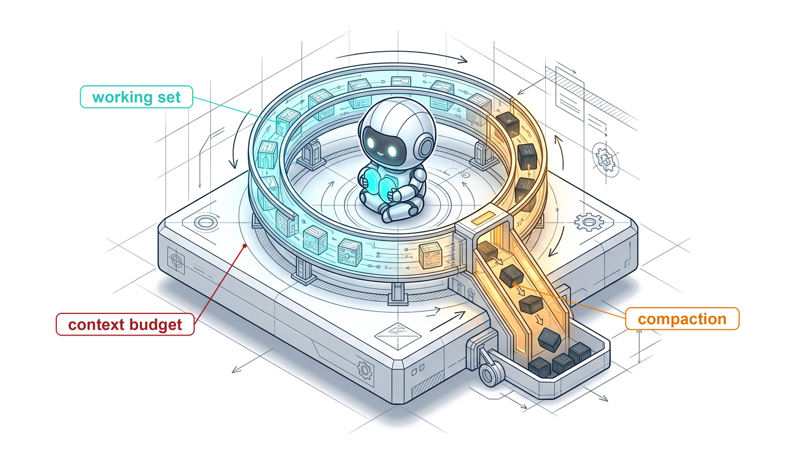
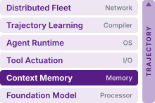

# Context Engineering {#sec-vol3-context-engineering}

::: {layout-narrow}
::: {.column-margin}

\chapterminitoc

:::

::: {.content-visible when-format="pdf"}
\noindent
{fig-alt="Blueprint illustration of a bounded working context."}
:::

::: {.content-visible unless-format="pdf"}
{fig-alt="Blueprint illustration of a bounded working context."}
:::

:::

## Purpose {.unnumbered .unlisted}

::: {.content-visible when-format="pdf"}
\begin{marginfigure}
\mlagentstack{0}{0}{0}{0}{100}{0}
\end{marginfigure}
:::

::: {.content-visible unless-format="pdf"}
::: {.column-margin}
{width="100%" fig-alt="Agentic Machine Learning Systems Stack"}

*Agent stack focus for this chapter.*
:::
:::

_Why can an agent lose the thread of a task even when its entire history still fits?_

An agent's context window is a finite and expensive resource, not an unbounded repository for raw text. Naively accumulating tool outputs, conversational turns, and retrieved snippets exhausts token capacity, inflates prefill latency, and spreads attention across material the next decision does not need. Fitting is not the same as being usable. A request that fits can still place a refuted hypothesis beside the test that refuted it, or present a result from an earlier revision as a fact about the current one. Effective context engineering treats each request as a deliberately selected working set, in which relevant state is compacted without losing its provenance, superseded observations are withdrawn, and bulky artifacts stay in durable storage behind handles. Stale or truncated evidence that does reach the model produces errors that compound across later turns. The systems challenge is to carry an accurate, minimal projection of the environment within the token budget, so that the state an agent carries bounds its uncertainty rather than compounding it.

::: {.content-visible when-format="pdf"}

\newpage

:::

::: {.callout-learning-objectives}

- Distinguish nominal request capacity from usable working context and explain why admitted tokens dilute needed evidence
- Allocate the next request's input budget while preserving output headroom and task-relevant evidence
- Design a context layout that orders entries by change rate for prefix reuse and binds each observation to its evidential scope
- Compare compaction policies by information loss, recovery requirements, and the cost of repeated transformations
- Audit a progress record against runtime-owned sources and quantify how unchecked per-round constraint loss compounds across compaction cycles
- Apply dependency-aware invalidation without treating historical observations as proof of current state
- Evaluate context policies by decision quality, accepted outcomes, and total resource use under common limits

:::

## Carrying a Repair Across Turns {#sec-vol3-context-engineering-overview}

The repair agent (@sec-vol3-intro-lighthouses) has spent several turns investigating a connection-pool defect. It has inspected the pool implementation, executed a reproduction test, and revised its initial diagnosis. Deliberation has left behind candidate versions, a refuted timeout hypothesis, test observations, and the dependency records that tie them together (@sec-vol3-test-time-compute-planning-revision). None of that progress lives inside the model. Because foundation models are stateless functions across turns, every call begins and ends with the payload assembled by the host runtime. The agent can use the test trace, honor public API constraints, and avoid revisiting a rejected hypothesis only if the runtime includes them in the upcoming request. The runtime must also structure that request so that the status and role of each artifact remain unambiguous.

::: {.column-margin}
{width="100%" fig-alt="H·S·A locator with only the State axis lit in purple."}

*Working context governs the within-session state exposure by selecting, representing, and refreshing what each call carries.*
:::

The token accounting of @sec-vol3-foundation-model-tokenization settles two questions for an individual request: whether the payload satisfies the admission bound, and what its tokens cost (@sec-vol3-foundation-model-cost). Those bounds, however, do not determine whether the prompt helps the model make a sound decision. A prompt can fit well within token limits and still fail to guide the agent toward a valid repair. The simplest agent architectures evade this problem by treating context as an append-only log, concatenating every observation, tool execution, and partial response into an expanding transcript. That policy breaks down almost immediately. Even while the transcript fits within physical limits, the runtime pays repeatedly for obsolete tokens that the next decision no longer requires. Stale code snippets sit alongside their replacements, and refuted hypotheses linger alongside the test results that disproved them, diluting the model's attention. When an extended trajectory inevitably exhausts the context window, an unmanaged runtime must truncate blindly, evicting instructions or early constraints without any principled criterion for what to preserve.

::: {.column-margin .margin-pointer}
↩ The quadratic input cost of resending an append-only history on every call is established in @sec-vol3-foundation-model-trajectory-cost-accumulation.
:::

The agent's *working context* is the runtime subsystem that decides what each model call receives. Rather than treating context as a passive transcript, this subsystem constructs a bounded working set tailored to a single decision. It establishes token budgets for each distinct role in the prompt and arranges data layouts so unchanged prefixes can be reused across turns. It compacts historical evidence without distorting the facts, maintains structured progress records that resist summarization drift, and enforces invalidation rules whenever external actions alter environment state. The host runtime owns assembly, token budgets, records, and execution gates. Selection and compaction can use heuristics or model-generated candidates, which the runtime must check against the task's requirements and retained evidence before admission.

The chapter follows the repair agent through its next decision, and each section answers the question the previous one leaves open. The runtime first decides which evidence the next step needs and how the input allowance divides among competing roles (@sec-vol3-context-engineering-decision). Admitting that evidence does not mean the model can use it, so @sec-vol3-context-engineering-physics separates the window an interface accepts from the context a model reliably acts on. The selected items then need a layout that keeps their sources distinct and their stable prefix reusable across turns (@sec-vol3-context-engineering-staging). When history outgrows the budget, compaction (@sec-vol3-context-engineering-compaction) and audited progress records (@sec-vol3-context-engineering-summarization) shorten it without erasing causal evidence or refuted hypotheses. When the agent's own edits change the workspace, invalidation (@sec-vol3-context-engineering-context-rot) withdraws the observations that no longer describe it. Evaluation (@sec-vol3-context-engineering-evaluation) then asks how to show that a complete policy lowers the cost per accepted task.

## The Working-Set Decision {#sec-vol3-context-engineering-decision}

As our connection-pool investigation unfolds, the runtime accumulates far more information than was present at initialization. A controlled test has shown that a connection returned to the pool while a waiting client remained blocked, so the initial timeout hypothesis has lost support and missed notification is now the leading candidate explanation. The next model call must build on these findings. If the runtime replays the entire conversational history without distinguishing raw observations from superseded hypotheses, it forces the model to weigh discounted failure modes alongside the evidence that disproved them.

Consider the codebase at version `r17`, where the relevant files are `src/pool.py` and `tests/test_pool.py`, and the failure is captured by the reproducer `test_waiter_notified_on_return`. Before prompting the model for a candidate patch, the runtime must decide which source excerpts, test results, interface constraints, and open questions belong in the upcoming prompt. This choice is the **working-set decision**\index{Working-set decision!definition}\index{Context engineering!working-set decision}, the runtime's selection of the bounded subset of task information needed to run the next concrete step. Making that choice is the first obligation of treating context as a selected working set (principle \ref{pri-vol3-attention-working-set}).

The term draws on Denning's classic working-set model of program behavior [@denning1968].\index{Working set!Denning model} Over any time window, a running program references only a fraction of its total address space, so an operating system avoids thrashing by keeping those active pages in physical memory while leaving dormant pages on backing storage. An agent runtime faces a similar residency problem when it stages tokens in context to support the next step without exhausting its prompt budget, yet one structural difference separates context engineering from virtual memory. Denning's working set is measured from page references the program has already issued, whereas an agent runtime must assemble the context working set *before* calling the model, predicting what the upcoming decision will need.[^fn-belady-optimal-replacement] Moreover, standard foundation model interfaces report only generated tokens and emit no hardware-style reference bits to show which staged context tokens the model actually relied on during inference.

[^fn-belady-optimal-replacement]: **Optimal Replacement (MIN)**: @belady1966study evaluated page-replacement algorithms against an optimal offline baseline that evicts the page whose next reference lies farthest in the future. Practical operating systems approximate this unattainable ideal using historical access patterns such as least recently used (LRU). An agent context runtime lacks even that access history. The model interface reports no reference bits for the tokens it processes, so working-set selection must rely on explicit domain heuristics and structured task state rather than on observed cache reuse. \index{Belady optimal replacement!context selection}

In context management, relevance to the next step must govern selection rather than chronological recency. Core user constraints set at the start of a session remain binding after dozens of intermediate tool calls, whereas a lengthy test log produced moments ago may contribute only a single exit code. Candidate information also comes from well beyond the dialogue history: system instructions, tool declarations, newly read source files, and retrieved reference documents [@lewis2020retrieval] all compete for space in the assembled request. The runtime must build a working representation from these sources without letting any staged copy outrank its origin, because authority stays with the source (principle \ref{pri-vol3-source-authority}). The environment remains the only authority on system state, and runtime policy, not the model, decides which actions are permitted.

To organize this selection, the runtime builds a **context manifest**\index{Context manifest!definition}, a structured inventory that lists each item chosen for the upcoming request and why the next step needs it. The manifest for the connection-pool repair's next request (@tbl-vol3-context-manifest) reads like a specification rather than a raw byte stream, naming each entry and the exact content it supplies. Code snippets and test logs keep their source and version labels, and their contents enter the prompt only where the next decision requires them.

| Selected entry          | Content needed for the next step                                                                                                                                            |
|:------------------------|:----------------------------------------------------------------------------------------------------------------------------------------------------------------------------|
| Goal and constraints    | Repair waiter notification; preserve the public API; remain within the approved workspace; do not deploy to production.                                                     |
| Current artifacts       | Relevant source and test excerpts from `src/pool.py` and `tests/test_pool.py` at `r17`, together with the configuration used by the controlled test.                        |
| Observed result         | On `r17`, the controlled waiter/return test recorded an available connection while a waiter remained blocked. Keep the test identity and conditions attached to the result. |
| Hypothesis status       | The timeout explanation has lost support. Missed notification remains a hypothesis, not an established cause.                                                               |
| Repair and check status | No candidate patch has yet been checked. Behavior outside the controlled reproducer remains unresolved.                                                                     |
| Next bounded step       | Propose a candidate change to the notification path using the current excerpts; do not report the defect as repaired.                                                       |

: **Selecting the next request**: Each entry supplies a distinct part of the illustrative connection-pool decision. Version labels identify the example’s artifacts, not measured repository revisions. {#tbl-vol3-context-manifest tbl-colwidths="[24,76]"}

Building this manifest requires careful filtering. Keeping a failure log without tying it to its source commit (`r17`) can mislead later turns into reading an old error trace as evidence against a newly patched file. Likewise, recording a short label like "notification bug" without noting its uncertainty turns a working hypothesis into a settled root cause. Conversely, keeping the full dialogue of rejected theories wastes space once the runtime records which test refuted the timeout hypothesis. While a foundation model can help summarize earlier turns to draft this manifest, the runtime must check those candidate summaries against recorded environment observations before admitting them into the prompt.

The active working context must also stay separate from durable records in external storage. Rather than inlining a long test log into the prompt, the runtime can supply a **raw-payload handle**\index{Raw-payload handle!definition}, a short reference to an external record that an authorized tool can read on demand under access and retention rules. This design enforces the **handle rule**\index{Handle rule!definition}: once a payload moves behind a handle, it re-enters the working context only through an explicit, checked read. If a later step needs a specific stack-trace line or configuration value omitted from the initial prompt, the model calls a retrieval tool to bring that slice into context.

Every working-set candidate must fit within the endpoint's context admission bounds. When an endpoint shares one context window across inputs and outputs, the serialized prompt length $\SequenceLength$ must satisfy $\SequenceLength \le \ContextWindow - \OutputLimit$, where $\OutputLimit$ is the token budget reserved for generation. When providers enforce separate input and output limits, $\SequenceLength \le \ContextWindow$ applies directly. The runtime must count tokens on the fully formatted wire request (system envelopes, chat delimiters, and JSON tool schemas included) rather than summing isolated strings, because tokenizer merges and framing overhead can easily erase the savings of a shorter evidence block.

::: {.column-margin .margin-pointer}
↩ The admission bound and the output headroom $\OutputLimit$ it reserves are established in @sec-vol3-foundation-model-output-headroom.
:::

While this inequality sets the overall ceiling, the runtime must divide the available input space across the four roles in the manifest:

$$
\SystemInstructionTokenCount + \ToolDeclarationTokenCount + \TaskStateTokenCount + \ObservationTokenCount \le \ContextWindow - \OutputLimit.
$$ {#eq-vol3-context-budget-partition}

Here $\SystemInstructionTokenCount$ counts the static system instructions, $\ToolDeclarationTokenCount$ counts API schemas and tool declarations, $\TaskStateTokenCount$ counts active constraints, progress records, and staged source or test excerpts, and $\ObservationTokenCount$ counts recent tool outputs and user steering. Because all four terms share a fixed ceiling, growth in any one term squeezes the others. A runtime that appends every raw tool output[^fn-react-appended-observations] lets $\ObservationTokenCount$ grow on every turn until command-line logs crowd out $\TaskStateTokenCount$, the constraints and code excerpts the next decision needs. Whereas appending lets observations expand until they displace task state, selection holds each role's share steady by moving older results into external records that a handle can still reach (@fig-vol3-working-set-selection).

[^fn-react-appended-observations]: **Interleaved Observations**: ReAct prompting interleaves reasoning traces, tool actions, and observation payloads within an ever-expanding prompt transcript [@yao2023react]. While keeping full execution history visible simplifies early prototyping, it carries a steep cost, because the unchecked growth of $\ObservationTokenCount$ consumes prompt capacity and raises input token costs on every subsequent call. \index{ReAct!appended observations}

@Eq-vol3-context-budget-partition is a planning budget rather than an exact identity, because sub-word tokenization across joined strings does not equal the sum of separately tokenized parts. The runtime must therefore check the assembled wire request against the provider's limit, and when the request runs over, the budget partition tells the runtime which share (usually the observation buffer or older history) to trim or compact first. Prompt staging (@sec-vol3-context-engineering-staging) then orders these same four components by how often they change so the serving engine can reuse their cached prefix.

::: {#fig-vol3-working-set-selection fig-env="figure" fig-pos="htb" fig-cap="**Selection Protects the State Budget**: Each bar is one serialized request, stacked by the four terms of @eq-vol3-context-budget-partition beneath the input limit $\ContextWindow-\OutputLimit$, with the output reserve $\OutputLimit$ hatched above it. Appending every tool result (A) lets $\ObservationTokenCount$ grow until it displaces the task state the next decision needs. Selection (B) keeps each term's share by moving older results into retained records outside the request, where a handle can reach them if a later decision needs them. Segment heights are schematic, not measured token counts." fig-alt="Two panels of stacked vertical bars for turns t, t plus 1, and t plus 2, on a shared scale with a dashed input limit S max minus K max and a hatched output reserve up to S max. Each bar stacks gray system and tools segments, a green state segment, and amber observation slices, one slice per tool result. In panel A, append every result, the bars hold two, four, and six slices and the state segment shrinks until it turns red at turn t plus 2, labeled state squeezed. In panel B, select for the next step, all three bars hold two slices and an unchanged state segment, labeled state keeps its share; an arrow moves older slices into a violet retained-records stack of four slices outside the bars, and a dashed arrow labeled retrieve by handle returns to the last bar."}

:::

```{python}
#| label: calc-vol3-usable-context-budget
#| echo: false
# ┌─────────────────────────────────────────────────────────────────────────────
# │ EVIDENCE BUDGET OF A REPAIR REQUEST (LEGO)
# ├─────────────────────────────────────────────────────────────────────────────
# │ Context: @eq-vol3-context-budget-partition; nbk-04-evidence-budget.
# │ Goal: Show how many appended turns fit before observations overflow.
# │ Show: Evidence share, turns that fit, per-turn digest for the full horizon,
# │       and the input bill of appending vs. selecting over the horizon.
# │ How: Registry window and step budget; scenario sizes for the four terms.
# │ Note: Scenario token counts are serialized-request stipulations, not
# │       measurements of any product; bills assume no prefix reuse.
# └─────────────────────────────────────────────────────────────────────────────
from mlsysim import *
from mlsysim.fmt import check, fmt_int, fmt_multiple, fmt_percent

class UsableContextBudget:
    # ┌── 1. LOAD (Constants & Parameters) ─────────────────────────────────
    scenario = Scenarios.RepairContextBudget  # registry window and step budget; scenario role sizes
    window = scenario.window
    horizon = scenario.turns
    output_reserve = scenario.output_reserve
    system_tokens = scenario.system_tokens
    tool_tokens = scenario.tool_tokens
    state_tokens = scenario.state_tokens
    obs_per_turn = scenario.observation_per_turn
    obs_digest = scenario.digest_tokens
    obs_selected = scenario.selected_observation

    # ┌── 2. EXECUTE (Compute) ─────────────────────────────────────────────
    r = scenario.result
    input_limit = r.input_limit
    evidence = r.evidence_tokens
    evidence_share = r.evidence_share
    obs_budget = r.observation_budget
    turns_fit = r.turns_fit
    turns_fit_half = r.digest_turns
    digest_max = r.max_observation_per_turn
    fixed = r.fixed_tokens
    append_bill = r.append_bill
    select_bill = r.select_bill
    bill_ratio = r.bill_ratio
    window_needed = r.final_append_with_reserve

    # ┌── 3. GUARD (Invariants) ────────────────────────────────────────────
    check(turns_fit < horizon <= turns_fit_half, "Appending overflows inside the step budget; halving fits it")
    check(fixed + obs_selected <= input_limit, "The selecting policy fits every turn")
    check(window_needed > window, "The appending policy's last request exceeds the window")
    check(1.5 < bill_ratio < 3, "Appending bills roughly twice the selected input")

    # ┌── 4. OUTPUT (Formatting) ───────────────────────────────────────────
    window_str = fmt_int(window)
    horizon_str = fmt_int(horizon)
    reserve_str = fmt_int(output_reserve)
    system_str = fmt_int(system_tokens)
    tool_str = fmt_int(tool_tokens)
    state_str = fmt_int(state_tokens)
    obs_str = fmt_int(obs_per_turn)
    obs_half_str = fmt_int(obs_digest)
    obs_selected_str = fmt_int(obs_selected)
    input_limit_str = fmt_int(input_limit)
    evidence_str = fmt_int(evidence)
    evidence_pct_str = fmt_percent(evidence_share, style="prose", precision=1)
    obs_budget_str = fmt_int(obs_budget)
    turns_fit_str = fmt_int(turns_fit)
    overflow_turn_str = fmt_int(r.overflow_turn)
    turns_fit_half_str = fmt_int(turns_fit_half)
    digest_max_str = fmt_int(digest_max)
    append_bill_str = fmt_int(append_bill)
    select_bill_str = fmt_int(select_bill)
    bill_mult_str = fmt_multiple(bill_ratio, precision=1)
    window_needed_str = fmt_int(window_needed)
```

::: {#nbk-04-evidence-budget .callout-notebook title="How much of the window is evidence"}

**Problem**: In our reference repository-repair harness, an agent runs inside a `{python} UsableContextBudget.window_str`-token context window under a `{python} UsableContextBudget.horizon_str`-turn step budget. The runtime reserves `{python} UsableContextBudget.reserve_str` tokens for generation ($\OutputLimit$) and assigns `{python} UsableContextBudget.system_str` tokens to system instructions ($\SystemInstructionTokenCount$) and `{python} UsableContextBudget.tool_str` tokens to tool declarations ($\ToolDeclarationTokenCount$). Dynamic task state (constraints, progress records, and active code excerpts) takes `{python} UsableContextBudget.state_str` tokens ($\TaskStateTokenCount$). If every raw tool result is appended directly at `{python} UsableContextBudget.obs_str` tokens per turn, how many turns fit within the window, and what maximum per-turn observation size lets the agent finish the full step budget?

**Variables**: The context window and step horizon come from the registry's repository-repair harness profile, while component sizes and per-turn observation counts are scenario values for fully serialized wire requests.

**Math**: By @eq-vol3-context-budget-partition, the usable input allowance is `{python} UsableContextBudget.window_str` − `{python} UsableContextBudget.reserve_str` = `{python} UsableContextBudget.input_limit_str` tokens. Subtracting system instructions and tool declarations leaves `{python} UsableContextBudget.evidence_str` tokens (`{python} UsableContextBudget.evidence_pct_str` of the context window) for state and observations, and deducting the `{python} UsableContextBudget.state_str` tokens of state leaves an observation budget of `{python} UsableContextBudget.obs_budget_str` tokens. Under naive appending, this budget holds `{python} UsableContextBudget.obs_budget_str` / `{python} UsableContextBudget.obs_str` = `{python} UsableContextBudget.turns_fit_str` turns. Lasting all `{python} UsableContextBudget.horizon_str` turns requires keeping the per-turn observation payload to at most `{python} UsableContextBudget.obs_budget_str` / `{python} UsableContextBudget.horizon_str` = `{python} UsableContextBudget.digest_max_str` tokens.

**Result**: The appending policy overflows the context window at turn `{python} UsableContextBudget.overflow_turn_str`, well short of the `{python} UsableContextBudget.horizon_str`-turn budget.

**Systems insight**: Because the number of feasible turns equals the observation budget divided by the per-turn observation size, observation volume is the primary design lever. Compacting each result into an informative `{python} UsableContextBudget.obs_half_str`-token digest extends the run to `{python} UsableContextBudget.turns_fit_half_str` turns and clears the step budget. Fitting inside the window, however, is only the first cost. Because an appending policy re-reads every accumulated token on each call, its cumulative input bill grows quadratically in $\TurnHorizon$. This follows the re-send pattern of @eq-vol3-trajectory-resend with a per-turn append $\TurnAppendLength$ of `{python} UsableContextBudget.obs_str` tokens, where the first request already holds one tool result, so the appended sum runs to $\TurnHorizon(\TurnHorizon+1)/2$. Selection keeps the bill linear. Across this step budget, and even granting the appending policy a window large enough to admit its final request, appending bills `{python} UsableContextBudget.append_bill_str` input tokens against `{python} UsableContextBudget.select_bill_str` for selection, `{python} UsableContextBudget.bill_mult_str` as many. That extra spend enters the numerator of $\CostPerAcceptedTask$ (@eq-vol3-cost-per-accepted-task) on every attempt.

:::

::: {.column-margin}
{width="100%" fig-alt="Two curves of cumulative input bill, in tokens, from turn 1 to turn 30. A red curve labeled append bends upward; a blue line labeled select rises straight. A bracket at turn 30 spans the gap between them, labeled 2.1 times."}

*Appending re-reads every result, so its bill bends upward; selection stays linear.*
:::

The notebooks throughout this chapter reuse this baseline scenario, adopting the `{python} UsableContextBudget.window_str`-token window, the `{python} UsableContextBudget.horizon_str`-turn step budget, and the component token allocations defined above. Whereas the repair agent binds on the growth of $\ObservationTokenCount$ against $\TaskStateTokenCount$, the other three lighthouses stress different terms of the same partition.

::: {#lhs-04-context-by-archetype .callout-lighthouse title="Context by archetype"}

```{=latex}
\begin{minipage}{1\linewidth}
```
Each recurring workload places pressure on a distinct component of the context budget in @eq-vol3-context-budget-partition, calling for a different runtime mechanism (@tbl-vol3-context-by-archetype).

| **Lighthouse**        | **What fills the request**                                                                                                                                | **Binding constraint**                                                                        | **Mechanism that answers it**                                                                                                                      |
|:----------------------|:----------------------------------------------------------------------------------------------------------------------------------------------------------|:----------------------------------------------------------------------------------------------|:---------------------------------------------------------------------------------------------------------------------------------------------------|
| **Repair agent**      | Source excerpts, test logs, and a progress record from its own workspace, accumulating over a `{python} UsableContextBudget.horizon_str`-turn step budget | Growth of $\ObservationTokenCount$ displacing $\TaskStateTokenCount$                          | Compaction and progress records (@sec-vol3-context-engineering-compaction)                                                                         |
| **Research agent**    | Retrieved pages and search results written by third parties                                                                                               | Third-party text that dominates $\ObservationTokenCount$ and may carry instructions           | Staging that keeps each span's source attached (@sec-vol3-context-engineering-source-scope); enforcement in @sec-vol3-security-quarantined-readers |
| **Remediation agent** | Readings of shared production state that other actors change                                                                                              | Staleness between the read and the action                                                     | Invalidation and action-time preconditions (@sec-vol3-context-engineering-context-rot)                                                             |
| **Support agent**     | Fixed policy instructions and tool declarations, one customer record, a short session                                                                     | $\SystemInstructionTokenCount+\ToolDeclarationTokenCount$ repeated across many short sessions | A stable leading block of instructions and declarations that later calls reuse (@sec-vol3-context-engineering-exact-prefix)                        |

: **Context by archetype**: The four recurring workloads bind on different terms of the same input budget. {#tbl-vol3-context-by-archetype tbl-colwidths="[16,34,25,25]"}

```{=latex}
\end{minipage}
```

**Systems insight**: The same budget equation binds on different constraints across workloads: token growth for the repair agent, source tracking for the research agent, freshness for the remediation agent, and prefix reuse across short sessions for the support agent. As a result, a policy tuned for one workload rarely transfers directly to another. Compaction rules that keep a repair agent within its token budget do not solve the main risk of a research agent, where untrusted external text matters far more than transcript length.

:::

Every one of these budgets governs *admission*, ensuring that a serialized payload fits inside the provider's context limit, yet admission alone does not mean the prompt supports the next decision. A prompt can obey the budget while omitting the return path needed to write a patch, or it can include every relevant code excerpt while burying version boundaries under old error logs. Sizing a context budget is therefore only the first step; the runtime must also ask how well the model can find and use the tokens admitted into that window.

## Usable Working Context {#sec-vol3-context-engineering-physics}

In notebook \ref{nbk-04-evidence-budget}, the `{python} UsableContextBudget.window_str`-token window admits the investigation's full transcript for its first `{python} UsableContextBudget.turns_fit_str` turns, yet fitting an entire history inside the window does not mean the runtime should send all of it. What matters is what each item contributes to the pending decision: an omitted synchronization contract can ruin a proposed repair, whereas ten pages of repeated timeout speculation only add noise. Raw request length cannot separate essential evidence from distraction.

The **nominal context capacity**\index{Nominal context capacity!definition} is the maximum sequence length that the configured model interface accepts under its input and generation limits. How well the model reasons over a chosen set of instructions and evidence is a separate question, answered only by testing concrete tasks against explicit quality criteria (principle \ref{pri-vol3-attention-working-set})\index{Principle!context is a selected working set}.

::: {#dfn-usable-working-context .callout-definition title="Usable working context"}

***Usable working context***\index{Usable working context!definition} is the context content, organization, and length with which a specified model and invocation configuration meet a chosen quality criterion on a stated workload.

1. **Significance**: Usable working context, rather than the nominal window, determines how much of the input allowance $\ContextWindow-\OutputLimit$ effectively supports decisions. It dictates how many turns an execution trajectory can sustain before selection or compaction must intervene, directly setting the input token cost per accepted task in $\CostPerAcceptedTask$.
2. **Distinction**: Nominal capacity is an architectural boundary of the serving interface that admits a request; usable working context is an empirical property of a task, model, and representation that only evaluation can establish.
3. **Common pitfall**: Treating a fixed fraction of the nominal window, or success on an isolated synthetic retrieval probe, as a universal guarantee of usable context for a production workload.

:::

For a software repair workload, that criterion might require candidate patches to pass designated regression tests while staying within a permitted edit scope, whereas an information extraction workload requires high precision and recall against a target schema. Because failure modes differ across workloads, usable working context must be measured on each workload rather than read off the model card.

### Testing usable working context {#sec-vol3-context-engineering-usable-context-test}

Testing whether a context length is usable starts with what the task asks the model to do with the staged text. A model that scores nearly perfectly on an isolated retrieval probe[^fn-needle-haystack-probe] by finding a single planted fact in a long input can still fail a repair decision at the same length. The repair requires relating observed symptoms to source files, honoring API invariants, and separating a measured failure from an unverified hypothesis (@tbl-vol3-capacity-comparison). Synthetic retrieval probes quickly flag gross blind spots, but validating a context policy requires testing actual task decisions under realistic conditions.

[^fn-needle-haystack-probe]: **Needle-in-a-Haystack Probes**: The best-known isolated retrieval probe plants a short fact, the needle, in long distractor text and asks the model to return it. @hsieh2024ruler found that models scoring nearly perfectly on this probe degraded sharply as length grew on tasks that require multi-hop tracing and aggregation, and that only about half of the models tested held satisfactory performance at the context length all of them claimed to support. The gap between the probe and the harder tasks is the gap between nominal capacity and usable working context. \index{Needle-in-a-haystack!usable context}

| Test obligation           | Isolated key-retrieval probe                        | Connection-pool repair decision                                                                               |
|:--------------------------|:----------------------------------------------------|:--------------------------------------------------------------------------------------------------------------|
| Identify relevant content | Return the requested planted value.                 | Find the source, test conditions, and observation relevant to the notification path.                          |
| Interpret relationships   | Match the queried key to its value.                 | Tie the failure to `r17` and distinguish the missed-notification hypothesis from the observed blocked waiter. |
| Respect task constraints  | Meet the probe’s answer requirements.               | Propose a scoped change while preserving the public API and leaving untested behavior unresolved.             |
| Establish success         | Compare the returned value with the probe’s target. | Apply the chosen candidate checks and scope criteria; report only what they establish.                        |

: **Retrieval and decision scope**: A simple retrieval probe and the running repair example test different capabilities. {#tbl-vol3-capacity-comparison tbl-colwidths="[23,29,48]"}

Context organization directly affects task success even when all required facts are present in the prompt. Evaluating multi-document question answering and key-value retrieval, @liu2024lost reported marked sensitivity to the position of relevant information across model architectures, with accuracy dropping substantially when key facts appeared in the middle of the input. This position sensitivity, known as **lost in the middle**\index{Lost in the middle!definition}, means systems engineers cannot treat context as an unordered bag of tokens. Placement policies must be tested on the target workload, because how accuracy varies with position depends on the model family and prompt layout.

Length degrades comprehension even when every required fact remains in the input. One long-context benchmark isolates that effect by rewriting each of its stories at lengths from a few hundred tokens to the full text while preserving the details its questions depend on. A change in score across lengths therefore reflects the surrounding material rather than missing evidence [@fictionlive2025bench]. Answering requires following the order of events and drawing inferences from implicitly stated information, a task closer to a repair decision than to returning a planted value. @Fig-vol3-context-length-comprehension plots the scores against the length of story in context, as aggregated by @epochai2026benchmarks.

```{python}
#| label: calc-vol3-context-length-comprehension
#| echo: false
# ┌─────────────────────────────────────────────────────────────────────────────
# │ COMPREHENSION VS. CONTEXT LENGTH (LEGO)
# ├─────────────────────────────────────────────────────────────────────────────
# │ Context: @fig-vol3-context-length-comprehension and the paragraph after it.
# │ Goal: Quantify how far comprehension falls as the same story lengthens.
# │ Show: Median score at the shortest version, at 8K and 60K tokens; how
# │       many models hold 90% at 60K.
# │ How:  Literature.LongContextComprehension, models scored at every
# │       length through 60K tokens.
# └─────────────────────────────────────────────────────────────────────────────
from mlsysim import Scenarios
from mlsysim.fmt import check, fmt_int, fmt_percent

class ContextLengthComprehension:
    # ┌── 1. LOAD (Constants) ──────────────────────────────────────────────
    scenario = Scenarios.FictionLiveBenchThrough60K  # Literature.LongContextComprehension
    questions = 36  # questions per length, from the benchmark methodology
    hold_bar = scenario.hold_bar

    # ┌── 2. EXECUTE (The Compute) ────────────────────────────────────────
    r = scenario.result
    n_scored = r.scored_models
    median_short = r.median["0"]
    median_8k = round(r.median["8k"], 2)  # whole percent: 36 questions per cell
    median_60k = round(r.median["60k"], 2)
    n_hold = r.held_count
    lo_60k = r.lowest_last
    hi_60k = r.highest_last

    # ┌── 3. GUARD (Invariants) ──────────────────────────────────────────
    check(median_short > median_8k >= median_60k, "Prose says the median falls with length")
    check(n_hold < n_scored / 10, "Prose says only a few models hold 90% at 60K")
    check(median_short - median_60k > 1 / 3, "Caption says the median model loses more than a third by 60K")

    # ┌── 4. OUTPUT (Formatting) ──────────────────────────────────────────
    n_scored_str = fmt_int(n_scored)
    n_hold_str = fmt_int(n_hold)
    questions_str = fmt_int(questions)
    median_short_str = fmt_percent(median_short, style="prose")
    median_8k_str = fmt_percent(median_8k, precision=0, style="prose")
    median_60k_str = fmt_percent(median_60k, precision=0, style="prose")
    hold_bar_str = fmt_percent(hold_bar, style="prose")
    lo_60k_str = fmt_int(round(100 * lo_60k))
    hi_60k_str = fmt_percent(round(hi_60k, 2), precision=0, style="prose")
```

:::: {#fig-vol3-context-length-comprehension fig-env="figure" fig-pos="htb" fig-cap="**Comprehension Falls with Context Length**: Accuracy on the same stories as the version placed in context grows from the shortest rewrite to 192K tokens. The shaded band spans the middle half of the `{python} ContextLengthComprehension.n_scored_str` models scored at every length through 60K tokens; colored lines trace six individual models. A few models stay near the top at every length, while the median model loses more than a third of its accuracy by 60K tokens. Each point rests on `{python} ContextLengthComprehension.questions_str` questions, so single-length wiggles are within sampling noise. Data from @fictionlive2025bench via @epochai2026benchmarks." fig-alt="Line chart of comprehension accuracy from 0 to 100 percent against story length placed in context, with eleven categories from 0 to 192k tokens. A gray band falls from near 100 percent at 0 tokens to roughly between 40 and 70 percent at 60k. Three colored lines stay between about 80 and 100 percent across all lengths. One orange line falls to about 50 percent, and two lines fall below 40 percent by 8k tokens and stop at 60k. A legend below the chart names the band and six models."}

```{python}
#| echo: false
# ┌─────────────────────────────────────────────────────────────────────────────
# │ COMPREHENSION VS. CONTEXT LENGTH (FIGURE)
# ├─────────────────────────────────────────────────────────────────────────────
# │ Context: @fig-vol3-context-length-comprehension
# │
# │ Goal: Show comprehension degrading with context length, and how much
# │       models differ at the same length.
# │ Show: Interquartile band over fully scored models; six model traces.
# │ How: Literature.LongContextComprehension (MLSysIM); book_style.setup_plot().
# └─────────────────────────────────────────────────────────────────────────────
import numpy as np
from mlsysim import Literature, Scenarios
from binder.tools.figures import style as book_style

fig, ax, COLORS, plt = book_style.setup_plot(figsize=(8, 4.4))

# ┌── 1. DATA ─────────────────────────────────────────────────────────────────
entries = Literature.LongContextComprehension.entries
lengths = ["0", "400", "1k", "2k", "4k", "8k", "16k", "32k", "60k", "120k", "192k"]
x = np.arange(len(lengths))
sweep = Scenarios.FictionLiveBenchThrough60K.result  # models scored at every length through 60k
band_lengths = sweep.lengths
traces = [
    ("gpt-5-2025-08-07_medium", "GPT-5 (medium)", "BlueLine", "o"),
    ("grok-4-0709", "Grok 4", "VioletLine", "s"),
    ("kimi-k2.5", "Kimi K2.5", "GreenLine", "^"),
    ("deepinfra/Qwen3-Next-80B-A3B-Instruct", "Qwen3-Next-80B-A3B", "OrangeLine", "D"),
    ("chutes/gpt-oss-120b", "gpt-oss-120b", "BrownLine", "v"),
    ("nvidia-nemotron-nano-9b-v2", "Nemotron Nano 9B v2", "RedLine", "P"),
]

# ┌── 2. RENDER ───────────────────────────────────────────────────────────────
ax.fill_between(
    x[: len(band_lengths)],
    [100 * sweep.q25[n] for n in band_lengths],
    [100 * sweep.q75[n] for n in band_lengths],
    color=COLORS["grid"],
    alpha=0.35,
    lw=0,
    label=f"Middle half of {sweep.scored_models} models",
)
for key, label, color, marker in traces:
    row = next(e for e in entries if e["model"] == key)
    y = np.array([row["score_" + n] if row["score_" + n] is not None else np.nan for n in lengths]) * 100
    ok = ~np.isnan(y)
    ax.plot(x[ok], y[ok], "-", marker=marker, color=COLORS[color], ms=4, lw=1.6, label=label)

# ┌── 3. DECORATE ─────────────────────────────────────────────────────────────
ax.set_xticks(x)
ax.set_xticklabels(lengths)
ax.set_ylim(0, 105)
ax.set_xlabel("Story length placed in context (tokens)")
ax.set_ylabel("Comprehension accuracy (%)")
ax.legend(frameon=False, fontsize=8, loc="upper center", bbox_to_anchor=(0.5, -0.15), ncol=4)
plt.show()
plt.close()
```

::::

Two features of @fig-vol3-context-length-comprehension bear directly on the working budget: the decline starts early and runs deep, and models differ widely at any fixed length. Across the `{python} ContextLengthComprehension.n_scored_str` fully scored models, the median falls from `{python} ContextLengthComprehension.median_short_str` on the shortest version to `{python} ContextLengthComprehension.median_8k_str` at 8K tokens and `{python} ContextLengthComprehension.median_60k_str` at 60K, with only `{python} ContextLengthComprehension.n_hold_str` models staying at or above `{python} ContextLengthComprehension.hold_bar_str` at 60K. At 60K tokens, scores also span from `{python} ContextLengthComprehension.lo_60k_str` to `{python} ContextLengthComprehension.hi_60k_str`. This spread is the empirical content of the definition above. Usable working context belongs to a specified model, configuration, and workload, so the budget must be found by evaluation rather than read from the window.

A first-order mechanism explains why appending distractor tokens cannot be treated as free. Within an individual attention head, a query assigns weight to each visible key through a softmax operation [@vaswani2017]. For a target key with scaled logit $\TargetKeyLogit$ alongside $\CompetingKeyCount$ other keys with logits $\CompetingKeyLogit_j = \QueryVector\cdot\KeyVector_j/\sqrt{\AttentionHeadDimension}$ for head dimension $\AttentionHeadDimension$, the target's weight is

$$
\TargetKeyAttentionWeight = \frac{e^{\TargetKeyLogit}}{e^{\TargetKeyLogit} + \sum_{j=1}^{\CompetingKeyCount} e^{\CompetingKeyLogit_j}}.
$$ {#eq-vol3-softmax-dilution}

```{python}
#| label: calc-vol3-softmax-dilution
#| echo: false
# ┌─────────────────────────────────────────────────────────────────────────────
# │ SHARED-NORMALIZER DILUTION (LEGO)
# ├─────────────────────────────────────────────────────────────────────────────
# │ Context: @eq-vol3-softmax-dilution, working set capacity section.
# │ Goal: Show how fixed-logit background keys shrink one target's weight.
# │ Show: Target attention weight at two context lengths.
# │ How: Toy logits held fixed; only the number of background keys changes.
# └─────────────────────────────────────────────────────────────────────────────
from mlsysim import Scenarios
from mlsysim.fmt import check, fmt_int, fmt_percent

class SoftmaxDilution:
    # ┌── 1. LOAD (Constants & Parameters) ─────────────────────────────────
    scenario = Scenarios.ToyHeadAttentionDilution  # toy logits held fixed
    z_target = int(scenario.target_logit)  # toy scaled logit for the target key
    z_background = int(scenario.background_logit)  # toy scaled logit for every other key
    short_len = scenario.short_keys  # total keys, short context
    long_len = scenario.long_keys  # total keys, long context

    # ┌── 2. EXECUTE (Compute) ─────────────────────────────────────────────
    alpha_short = scenario.result.short_weight
    alpha_long = scenario.result.long_weight

    # ┌── 3. GUARD (Invariants) ────────────────────────────────────────────
    check(0 < alpha_long < alpha_short < 1, "More fixed-logit keys lower the target weight")
    check(alpha_short > 0.9 and alpha_long < 0.05, "Toy endpoints show the stated contrast")

    # ┌── 4. OUTPUT (Formatting) ───────────────────────────────────────────
    z_target_str = fmt_int(z_target)
    z_background_str = fmt_int(z_background)
    short_len_str = fmt_int(short_len)
    long_len_str = fmt_int(long_len)
    alpha_short_pct_str = fmt_percent(alpha_short, style="prose", precision=1)
    alpha_long_pct_str = fmt_percent(alpha_long, style="prose", precision=1)
```

::: {.column-margin}
{width="100%" fig-alt="Line chart of target attention weight from 0 to 100 percent against the number of keys, from few to many on a log scale. The curve starts near 100 percent at a green dot and falls to near zero at a red dot."}

*Fixed-logit distractors shrink the target's share of one normalizer.*
:::

All weights share a single normalizer. Because each additional key contributes a strictly positive term $e^{\CompetingKeyLogit_j}$ to the denominator of @eq-vol3-softmax-dilution, expanding the sequence length while holding logits constant depresses the target key's share of attention. This structural decay is **attention dilution**\index{Attention dilution!definition}. In a toy head with a target logit of `{python} SoftmaxDilution.z_target_str` and every background logit at `{python} SoftmaxDilution.z_background_str`, the target commands `{python} SoftmaxDilution.alpha_short_pct_str` of the weight among `{python} SoftmaxDilution.short_len_str` keys. When the context expands to `{python} SoftmaxDilution.long_len_str` keys, that same target's share falls to `{python} SoftmaxDilution.alpha_long_pct_str`, even though no single background key is individually competitive.

In agent execution, this effect is often worse than unrelated filler would produce.[^fn-irrelevant-context-distraction] Stale tool outputs, superseded logs, and earlier source reads share identifiers such as `waiter`, `connection`, and `timeout` with the evidence that matters, so they produce large inner products with query vectors and keep elevated logits. This dynamic is a sufficient condition for dilution under fixed logits, not a deterministic forecast of failure. Production models sharpen logits, route evidence across multiple attention heads and layers, and learn position-dependent retrieval behaviors, which is why @liu2024lost measured degradation empirically rather than deriving it analytically. Trained models also show a second consequence of the shared normalizer. Because the weights must sum to one, a query with no strong match deposits its leftover weight on the first few positions, which act as attention sinks regardless of their content [@xiao2024streamingllm]. Sinks change where leftover weight goes, not the dilution argument, and every staged token still adds a term to the normalizer that the evidence for the next decision must compete against.

::: {.column-margin .margin-pointer}
↪ Why cache eviction policies must retain attention-sink tokens is developed in @sec-vol3-kvcache-intrasequence.
:::

[^fn-irrelevant-context-distraction]: **Distracting Context**: @shi2023distracted added irrelevant sentences to grade-school arithmetic problems and found that model accuracy fell dramatically, although the added text changed nothing about the answer. Because the distractors were irrelevant by construction, the drop measures interference rather than missing information. That interference is the cost an agent pays for every superseded log line and stale file read it keeps in the request. \index{Irrelevant context!accuracy loss}

### Choosing a working budget {#sec-vol3-context-engineering-working-budget}

Sizing a working budget from the window's admission bound alone can still leave a request too long for the model to use reliably. Choosing a working budget therefore takes two steps, and only the first can be computed from the window. In notebook \ref{nbk-04-evidence-budget}, the admission bound leaves `{python} UsableContextBudget.obs_budget_str` tokens for observations in any one request. An appending policy must hold each result to `{python} UsableContextBudget.digest_max_str` tokens to last all `{python} UsableContextBudget.horizon_str` turns, whereas a selecting policy can spend up to that whole share on every request because it does not accumulate. The ceiling says what fits, not what the next decision can use, so the second step searches beneath it empirically.

To find that working point, engineers test complete context policies on representative task suites (@sec-vol3-context-engineering-evaluation) and choose the budget that meets the workload's quality criterion at the lowest effective cost. Because a context policy sets a token limit alongside what material is retrieved, how structured data is formatted, and where each piece sits in the prompt, decision quality must be weighed alongside input size, latency, and token spend. Additional context can supply needed grounding, add harmless noise, or degrade reasoning through dilution, which means the quality curve is rarely monotonic and seldom has a single sharp peak. A documented operating envelope must therefore name the workload, model configuration, quality threshold, and test conditions.

These choices carry direct resource consequences under model-call cost accounting. Uncached tokens add prefill latency and compute charges, whereas aligned prefix caching spreads prompt costs across repeated turns. High cache hit rates or discounted per-token prices mean little if stale context hurts decisions, yet pruning context too sharply to save prefill cost can strip away required constraints. The engineering goal is to meet the task quality bar at the lowest effective cost per accepted task, $\CostPerAcceptedTask$ (@eq-vol3-cost-per-accepted-task). Trimming unneeded tokens lowers the attempt cost in the numerator, whereas dropping a needed fact lowers the acceptance probability $\AcceptanceProbability$ in the denominator and drives up total spend across failed runs.

In the connection-pool repair example, keeping the full transcript of early exploratory turns wastes space once distilled test observations, code snippets, interface invariants, and active hypotheses are ready to guide the next patch. Stripping away a required interface contract or error log merely to fit an arbitrary sub-budget, however, is just as harmful. When no candidate policy meets both the task criterion and the available budget, the runtime must fetch the missing information, narrow the scope of the next permitted action, or report the limit. Passing a request-admission check never certifies that the staged context is adequate. Once the runtime selects that working set and bounds its token budget, it must arrange those items into a concrete prompt layout that keeps sources and evidence relationships distinct while separating stable prefix content from turn-by-turn updates.

## Staging the Next Invocation {#sec-vol3-context-engineering-staging}

In our connection-pool repair task, the selected manifest holds several distinct kinds of material: public API constraints, source excerpts from `src/pool.py` at revision `r17`, test results from `test_waiter_notified_on_return`, and the missed-notification working hypothesis alongside an abandoned timeout explanation. Concatenating these items into a flat, unlabeled string would blur the distinctions that guide the model's next decision. Once a selection policy chooses the working set for an upcoming call, staging turns those entries into a structured request payload. That assembly step records the source, authority, and revision of every item so the model can tell policy instructions apart from test observations and working hypotheses, while ordering the content to minimize token churn across consecutive calls.

### Ordering by change rate {#sec-vol3-context-engineering-change-rate-ordering}

Minimizing token churn across calls means ordering the prompt by how often each piece of context changes, placing stable material ahead of volatile updates. This layout partitions the serialized prompt into three regions: the **root**, the **trunk**, and the **leaf**\index{Context zone!definition}, which group content strictly by its update cadence during a trajectory rather than by message role or authority (@tbl-vol3-context-zone-stratification). In the repair scenario from notebook \ref{nbk-04-evidence-budget}, the root holds `{python} UsableContextBudget.system_str` tokens of system instructions and `{python} UsableContextBudget.tool_str` tokens of tool declarations. The trunk holds `{python} UsableContextBudget.state_str` tokens of evolving task state, and the leaf receives `{python} UsableContextBudget.obs_selected_str` tokens of newly staged observations.

| Zone  | Contents in the repair request                                                                                           | When it changes                                                                       |
|:------|:-------------------------------------------------------------------------------------------------------------------------|:--------------------------------------------------------------------------------------|
| Root  | Application instructions and available tool definitions                                                                  | The application contract or tool interface changes                                    |
| Trunk | Task constraints, the current progress record, and selected source and test content at `r17`                             | A task constraint changes, an artifact is edited, or the progress record is refreshed |
| Leaf  | The latest scoped test observation and the next bounded step, here proposing a candidate change to the notification path | New evidence or a new next-step decision arrives                                      |

: **Context ordered by change rate**: The zones help preserve a stable request prefix. Message roles and source metadata remain separate from these placement choices. {#tbl-vol3-context-zone-stratification}

Prefix stability must never override correctness. The root stays fixed only while its declarations remain accurate; if a tool definition changes during a session, the runtime updates the root on the next call and accepts the cache miss. Likewise, when a candidate patch advances the repository from `r17` to `r18`, the runtime cannot keep `r17` source code in the trunk just to keep the prefix warm. The earlier test failure remains valid historical evidence about `r17`, but checking whether it persists on the patched workspace requires a fresh run (@sec-vol3-context-engineering-context-rot).

Information can also move between zones as a trajectory advances. An observation first staged in the leaf can fold into the trunk's progress record during a scheduled refresh so long as its source, version, and scope stay attached. Conversely, a per-step instruction injected into the leaf keeps its full authority despite sitting at the end of the prompt. Zone placement sets the physical order of tokens to match their change rate, whereas schemas and message roles carry provenance and meaning.

### Preserving source and scope {#sec-vol3-context-engineering-source-scope}

As observations move from the leaf into the trunk or across compaction passes, each entry must keep the revision and execution conditions that produced it so the model does not read a local result as a universal fact about the codebase. For our failing test case, the host runtime attaches the test name, the workspace revision (`r17`), the test configuration, and a run identifier directly to the observation payload. This discipline enforces the **scope rule**\index{Scope rule!definition}:[^fn-why-where-provenance] an observation supports claims only for the artifact versions and execution conditions under which it was gathered, and every later context transformation (summarization, compaction, and invalidation alike) must preserve those bounds.

[^fn-why-where-provenance]: **Why- and Where-Provenance**: Database research distinguishes why-provenance, the source records that justify a result's existence, from where-provenance, the source locations its values were copied from [@buneman2001why]. The scope rule demands both for every observation: which execution and artifact versions justify its existence, and which payload spans supplied its values. A result that loses either becomes an unattributed claim that later compaction can silently generalize. \index{Provenance!scope rule}

The runtime builds this framing on the outside rather than reading it from text inside the observation. A serializer places raw tool output strictly as a literal data value inside a structured envelope so that mismatched quotes, markdown delimiters, or control characters cannot corrupt the surrounding schema. Even with that framing, the payload itself remains an **untrusted span**\index{Untrusted span!definition}: arbitrary text whose arrival the runtime can record, but whose claims it cannot vouch for. In a traditional parser, escaping quotes keeps a string literal out of the executable syntax tree. A language model, by contrast, processes the framing tags and the escaped data string inside them as one sequence of tokens in the same attention pass. Careful encoding therefore stops format injection at the host serializer, yet it cannot stop the model from attending to and following adversarial instructions hidden inside the text [@greshake2023not].

Provenance labels therefore guide interpretation rather than enforcing security. Marking a tool output as untrusted data helps the model weigh its source, but if an observation tells the agent to drop a database or overwrite production credentials, the model may still propose that call. Security boundaries (filesystem sandboxes, read-only mounts, and deployment blocks) must run in host code outside the model's prompt interpretation: staging keeps instructions and observations distinct in the request, while host gates enforce what may run.

::: {.column-margin .margin-pointer}
↪ The host-side information-flow policy that limits what untrusted context may influence and where private data may flow is enforced in @sec-vol3-security-taint-tracking.
:::

How much weight this distinction carries depends on the workload. The repair agent's observations come mostly from its own workspace, whose files change only when the agent or its tests change them. The research agent fills its requests with third-party text, so its $\ObservationTokenCount$ consists mostly of untrusted spans (lighthouse \ref{lhs-04-context-by-archetype}). For that workload the untrusted-span boundary, not token growth, is the binding concern. Once each entry's source and scope are framed, the serializer must emit the root and trunk in a repeatable token sequence so the serving engine can reuse their cached attention state.

### Preserving an exact prefix {#sec-vol3-context-engineering-exact-prefix}

Because causal self-attention computes each token's keys and values from all preceding tokens, a single changed token near the beginning of a request invalidates the cached key-value (KV) attention state for every later position, even when thousands of trailing tokens are identical. Serving engines equipped with prefix caching[^fn-automatic-prefix-reuse] skip redundant prefill computation only across an identical leading token sequence, because attention state is derived from the token prefix (principle \ref{pri-vol3-prefix-coherence}). Ordering the zones by change rate is what turns this rule into savings. A call that changes only the leaf reuses the root and trunk, whereas a compaction that rewrites the trunk ends reuse at the root boundary and forces recomputation of every later token (@fig-vol3-context-zones).

[^fn-automatic-prefix-reuse]: **Automatic Prefix Reuse**: Serving systems such as SGLang index cached attention state by token prefix within a radix tree, allowing an incoming request that shares an existing token prefix to reuse cached KV blocks transparently [@zheng2024sglang]. Because radix tree lookups evaluate exact token equality rather than semantic equivalence, two requests that diverge on an early timestamp share zero cache entries past that offset. Layout discipline directly determines cache hit rates. \index{Prefix cache!radix tree}

::: {#fig-vol3-context-zones data-explore="original-context-invalidation" data-explore-key="vol3:fig-vol3-context-zones" fig-env="figure" fig-pos="htb" fig-cap="**Reuse Ends at the First Changed Token**: Three consecutive requests follow the root, trunk, and leaf order of @tbl-vol3-context-zone-stratification, with the output reserve $\OutputLimit$ beyond the input limit $\ContextWindow-\OutputLimit$. A new observation changes only the leaf, so the root and trunk remain a reusable prefix. Refreshing the trunk to r18 moves the first changed token to the end of the root, and every later token is processed again. The figure assumes compatible cached state on the serving side; an identical prefix alone does not guarantee reuse." fig-alt="Three horizontal request bars labeled call n cold start, call n plus 1 new observation, and call n plus 2 trunk refreshed. Each bar has root, trunk, and leaf segments with tick marks for token positions, followed by a hatched output reserve past a dotted line labeled S max minus K max. In call n every segment is marked processed. In call n plus 1 the root and the trunk at r17 are marked prefix reused, and a red dashed line labeled first changed token sits at the leaf boundary, with the first leaf token outlined in red. In call n plus 2 only the root is reused, the trunk is at r18, and the red dashed line and outlined token sit at the root boundary. Headers name the zones above an arrow running from changes rarely to changes every call."}

:::

Cache equality depends on the final serialized token sequence rather than on high-level application state. Small serialization changes (JSON key order, whitespace padding, prompt template edits, or token merges across boundaries) can quietly alter the token stream. For example, byte-pair encodings (BPE) often merge trailing whitespace with the leading characters of the next string, producing different token IDs at zone joins. Prefix stability must therefore be checked on the assembled, tokenized wire request.

An identical token prefix is necessary for cache reuse, but it is not sufficient on its own. The serving engine must also still hold compatible cache blocks in accelerator memory under the same model weights, positional encoding offsets, and attention configuration. Memory pressure, LRU eviction, or cluster autoscaling can drop cached blocks between turns even when the request prefix is byte-for-byte identical. While the serving engine manages and evicts those internal tensors, the agent runtime is responsible for keeping static material in a repeatable prefix and refreshing whatever state the next decision requires.

::: {.column-margin .margin-pointer}
↪ Prefix compatibility and the retention and eviction of cached KV blocks in the serving engine are developed in @sec-vol3-kvcache-radix-tree.
:::

Placing fast-changing metadata near the start of a request forfeits prefix reuse for no benefit, whereas moving per-call fields (request IDs, wall-clock timestamps, step counters) into the leaf preserves reuse across the root and trunk. Whenever an early field changes, cache sharing stops at the first differing token. Consider the extreme case where the first token changes on every call, which bounds the extra cost of putting volatile fields at the front of a request.

```{python}
#| label: calc-vol3-context-layout-price
#| echo: false
# ┌─────────────────────────────────────────────────────────────────────────────
# │ PRICE OF A CONTEXT LAYOUT ACROSS ONE TRAJECTORY (LEGO)
# ├─────────────────────────────────────────────────────────────────────────────
# │ Context: nbk-04-quantitative-impact-of-prefix-layout; fallacies; summary.
# │ Goal: Compare input bills under explicitly assumed prefix matches.
# │ Show: Uncached/reused tokens, input bills, and their ratios.
# │ How: Registry step budget; zone sizes are the selecting-policy request of
# │      calc-vol3-usable-context-budget (root = instructions + declarations,
# │      trunk = task state, leaf = selected observations).
# │ Note: Hypothetical prices; retained compatible cache; no latency estimate.
# └─────────────────────────────────────────────────────────────────────────────
from mlsysim import *

class ContextLayoutPrice:
    # ┌── 1. LOAD (Constants & Parameters) ─────────────────────────────────
    scenario = Scenarios.RepairPrefixLayoutBill  # registry step budget; scenario zone sizes
    turns = scenario.turns  # one call per turn
    root_tokens = scenario.root_tokens  # instructions + tool declarations
    trunk_tokens = scenario.trunk_tokens  # task state (constraints, record, excerpts)
    leaf_tokens = scenario.leaf_tokens  # selected observations, replaced each call
    trunk_changes = scenario.trunk_rewrites  # after the cold first call
    input_price = scenario.input_price.to(USD / Mtoken)  # hypothetical, not a provider schedule
    cached_fraction = scenario.cached_fraction

    # ┌── 2. EXECUTE (Compute) ─────────────────────────────────────────────
    r = scenario.result
    context_tokens = r.request_tokens
    suffix_tokens = r.rewrite_tokens
    total_input = r.total_input
    warm_turns = r.warm_calls
    unstable_prefill = total_input
    stable_prefill = r.uncached_tokens
    stable_cached = r.cached_tokens
    hit_rate = r.hit_rate
    unstable_cost = r.unstable_cost
    stable_cost = r.stable_cost
    cost_ratio = r.cost_ratio
    prefill_ratio = r.prefill_ratio
    refresh_ratio = r.rewrite_in_leaf_calls  # trunk rewrite vs. warm call

    # ┌── 3. GUARD (Invariants) ────────────────────────────────────────────
    check(warm_turns == turns - 3, "One cold call, two trunk changes, the rest leaf changes")
    check(context_tokens == 47_000, "Request equals the evidence notebook's selecting policy")
    check(refresh_ratio == 4, "A trunk rewrite costs four leaf-only calls")
    check(3 < cost_ratio < 3.5, "Unstable layout bills a little over three times the stable one")
    check(stable_prefill + stable_cached == total_input, "Every input token is billed once")
    check(0 < stable_cost < unstable_cost, "The assumed discount must reduce this input bill")

    # ┌── 4. OUTPUT (Formatting) ───────────────────────────────────────────
    turns_str = fmt_int(turns)
    root_tokens_str = fmt_int(root_tokens)
    trunk_tokens_str = fmt_int(trunk_tokens)
    leaf_tokens_str = fmt_int(leaf_tokens)
    trunk_changes_str = fmt_int(trunk_changes)
    warm_turns_str = fmt_int(warm_turns)
    price_str = fmt_usd(input_price * Mtoken, precision=0)
    cached_fraction_pct_str = fmt_percent(cached_fraction, style="prose", precision=0)
    context_tokens_str = fmt_int(context_tokens)
    total_input_str = fmt_int(total_input)
    prefill_math = fmt_math(
        rf"{context_tokens:,} + {trunk_changes} \times {suffix_tokens:,} + {warm_turns} \times {leaf_tokens:,} = {stable_prefill:,}".replace(
            ",", "{,}"
        )
    )
    stable_cached_str = fmt_int(stable_cached)
    hit_rate_pct_str = fmt_percent(hit_rate, style="prose", precision=1)
    unstable_cost_usd_str = fmt_usd(unstable_cost, precision=2)
    stable_cost_usd_str = fmt_usd(stable_cost, precision=2)
    unstable_turn_usd_str = fmt_usd(r.unstable_cost_per_call, precision=3)
    stable_turn_usd_str = fmt_usd(r.stable_cost_per_call, precision=3)
    cost_mult_str = fmt_multiple(cost_ratio, precision=1)
    prefill_mult_str = fmt_multiple(prefill_ratio, precision=1)
    suffix_tokens_str = fmt_int(suffix_tokens)
    refresh_int_str = fmt_int(refresh_ratio)
```

::: {#nbk-04-quantitative-impact-of-prefix-layout .callout-notebook title="Pricing a context layout across one trajectory"}

**Problem**: The repair agent of notebook \ref{nbk-04-evidence-budget} runs its full `{python} ContextLayoutPrice.turns_str`-turn step budget under the selecting policy, making one call per turn. Each request carries a `{python} ContextLayoutPrice.root_tokens_str`-token root of instructions and tool declarations, a `{python} ContextLayoutPrice.trunk_tokens_str`-token trunk of task state, and an `{python} ContextLayoutPrice.leaf_tokens_str`-token leaf of selected observations, measured after serialization. The leaf is replaced on each call rather than appended, and the trunk is rewritten on `{python} ContextLayoutPrice.trunk_changes_str` calls after the first, one for each compaction pass that notebook \ref{nbk-04-compaction-cadence} finds this step budget triggers. Input tokens cost a hypothetical `{python} ContextLayoutPrice.price_str` per million tokens, with cached reads billed at `{python} ContextLayoutPrice.cached_fraction_pct_str` of that price. What input bill follows from each layout?

**Variables**: Both layouts send `{python} ContextLayoutPrice.context_tokens_str` tokens per request and `{python} ContextLayoutPrice.total_input_str` input tokens across the trajectory, matching the selecting policy budget from notebook \ref{nbk-04-evidence-budget}. In the unstable layout, the first token changes on every call and no prefix is reused. In the stable layout, the first call is cold, the `{python} ContextLayoutPrice.trunk_changes_str` trunk rewrites first differ right after the root, and the remaining `{python} ContextLayoutPrice.warm_turns_str` calls first differ right after the trunk, with compatible cached state kept for every matching prefix. This calculation isolates input token pricing, omitting generation charges and cache storage fees.

**Math**: The unstable layout processes all input without reuse, billing `{python} ContextLayoutPrice.unstable_cost_usd_str`. In the stable layout, the initial cold call processes the whole request, each trunk rewrite prefills the trunk and leaf, and every warm call processes only the leaf, for a total uncached volume of `{python} ContextLayoutPrice.prefill_math` tokens. The remaining `{python} ContextLayoutPrice.stable_cached_str` tokens hit the prefix cache (`{python} ContextLayoutPrice.hit_rate_pct_str` of all input tokens). Billing uncached tokens at full price and reused tokens at the discounted rate gives `{python} ContextLayoutPrice.stable_cost_usd_str` for the trajectory.

**Result**: Average input cost drops from `{python} ContextLayoutPrice.unstable_turn_usd_str` per call in the unstable layout to `{python} ContextLayoutPrice.stable_turn_usd_str` in the stable layout. An unstable layout bills `{python} ContextLayoutPrice.cost_mult_str` the stable layout and requires `{python} ContextLayoutPrice.prefill_mult_str` more uncached prefill tokens. These figures are billing and token-volume ratios, not end-to-end execution speedups.

**Systems insight**: With a stable prefix, the size of the volatile leaf sets the marginal input cost of each warm call, whereas rewriting the trunk prefills `{python} ContextLayoutPrice.suffix_tokens_str` tokens, the cost of `{python} ContextLayoutPrice.refresh_int_str` leaf-only calls. Engineers should keep per-call dynamic fields in the leaf and rewrite the trunk only when workspace files or active task constraints change. That discipline lowers the input share of attempt cost in $\CostPerAcceptedTask$ by the ratio above, while keeping task accuracy ($\AcceptanceProbability$) intact because the staged context still reflects current environment state. A high cache hit rate never justifies keeping stale context.

:::

::: {#chk-04-context-hierarchy .callout-checkpoint title="Checking the staged request"}

A candidate patch has just moved the workspace from `r17` to `r18`, and the runtime is staging the next request.

- [ ] **Provenance after promotion**: If a test result moves from the leaf into a refreshed progress record, what source, version, and scope must remain attached to it?
- [ ] **Volatile fields**: Why does a changing field near the start shorten prefix reuse without necessarily eliminating it, and where should a per-call request identifier go?
- [ ] **Trunk refresh estimate**: With the layout notebook's zone sizes, how many uncached input tokens does the trajectory pay if the trunk is rewritten on every fourth call after the first instead of twice? Compare the result with the unstable layout's count.
- [ ] **Stale trunk**: After the source changes from `r17` to `r18`, why is keeping the old source in the trunk an incorrect optimization even when it raises the hit rate?

:::

Staging puts the selected evidence into a clear schema and an order built for prefix reuse, yet ordering alone does not shrink long tool outputs: an oversized test log or large source file still takes its full share of the budget. When the needed working set outgrows the available budget, the runtime must shorten the representation itself while keeping the evidence later decisions need.

## Context Compaction {#sec-vol3-context-engineering-compaction}

As the connection-pool repair runs across turns, it accumulates repeated source listings, boilerplate test-setup output, and long execution traces. Keeping every line in every prompt uses space that later turns need for patch inspection and regression checks. Yet collapsing that trace into a bare note like "the test failed" drops the clues that matter: which revision failed, which thread schedule ran, and which assertion tripped. Compaction must shorten the working context without erasing the causal links future decisions rely on.

::: {#dfn-context-compaction .callout-definition title="Context compaction"}

***Context compaction***\index{Context compaction!definition}\index{Working-set decision!compaction} replaces material in a working context with a shorter representation chosen for the task's next decisions.

1. **Significance**: It creates room for new observations inside the fixed input allowance $\ContextWindow-\OutputLimit$, allowing an agent trajectory to run past the turn at which appending would overflow while retaining critical evidence, constraints, and unresolved obligations.
2. **Distinction**: A compressed representation is inherently lossy or access-deferred. Keeping a handle to omitted material makes recovery conditional on an explicit retrieval step.
3. **Common pitfall**: Assuming that a deterministic extractor, or a summary mentioning all required field names, guarantees that no decision-critical information was lost.

:::

### Choosing a compaction method {#sec-vol3-context-engineering-compaction-method}

A regular-expression filter trims log lines deterministically, but it can drop the one line that explains an intermittent fault. A source-code outline keeps API signatures while stripping the locking logic needed to spot a missed wakeup, and an LLM-written summary can preserve high-level diagnostic intent while inventing details or misstating whether a check passed.[^fn-summary-faithfulness-audit] Different compaction methods thus trade token savings against validation work and the risk of silent information loss in different ways, and no single method fits all runtime data.

The right representation depends on the next step: checking an interface takes only an outline, whereas debugging a race condition requires full function bodies and thread-interleaving logs. Each option in @tbl-vol3-compaction-spectrum is therefore defined by what it keeps in the request and what the runtime must check, rather than by a fixed reduction ratio.

[^fn-summary-faithfulness-audit]: **Unfaithful Summaries**: In a human evaluation of neural abstractive summarizers, @maynez2020faithfulness found hallucinated content (statements unsupported by the source document) in the output of every model studied. A progress record written by a model inherits this failure mode. The record audit of @sec-vol3-context-engineering-record-audit therefore compares each claimed milestone with its recorded event instead of trusting the summarizer's account. \index{Summarization!faithfulness}

| Representation                    | What remains in the request                                             | What must be checked                                                                           |
|:----------------------------------|:------------------------------------------------------------------------|:-----------------------------------------------------------------------------------------------|
| Normalized or deduplicated text   | Selected text with repeated output or formatting removed                | Whether repetition, ordering, timing, or formatting carries task evidence                      |
| Tool-result digest and raw handle | Status, selected evidence, source identity, and a retrieval reference   | Whether the digest supports the next decision and the omitted payload remains accessible       |
| Deterministic extraction          | Matched log records, selected fields, source excerpts, or code outlines | Whether the extraction rule omitted relevant context, relationships, or implementation details |
| Model-written summary             | A generated account of observations, hypotheses, and progress           | Whether each retained claim is supported and required details and uncertainty remain explicit  |

: **Compaction representation choices**: Trade-offs between prompt reduction, residual prompt contents, and the downstream validation required to prevent silent information loss. {#tbl-vol3-compaction-spectrum}

The first three classes in @tbl-vol3-compaction-spectrum use deterministic rules that run in host code without calling a language model. @Tbl-vol3-compaction-techniques breaks those three rows into the concrete techniques a runtime builds and asks what specific evidence each one can drop without raising an error. Deterministic filtering guarantees repeatable output, but it cannot guarantee that the remaining lines suffice for the task; a filter is safe only when later decisions do not depend on what it cut.

| Technique                              | What it keeps                                                        | What it can silently drop                                            |
|:---------------------------------------|:---------------------------------------------------------------------|:---------------------------------------------------------------------|
| Repeated-poll deduplication            | One copy of an unchanged status output and a repetition count        | A brief change between polls, or the timing of repetitions           |
| Terminal-control stripping             | Plain text without escape codes, progress redraws, or spinners       | Timing or ordering signals carried only by the redraws               |
| Diff hunk folding                      | Changed lines, their location, and a marker for unchanged context    | Surrounding code needed to judge whether the change is correct       |
| Superseded-read replacement            | A pointer from an old file read to the edit that replaced its source | Old text a later decision needs to explain what changed              |
| Head, tail, and failure-marker slicing | Setup lines, final lines, and lines matching failure patterns        | An intermediate warning or event ordering that matches no pattern    |
| Source outline                         | Signatures, types, and docstrings, with bodies folded                | The implementation a repair must read, such as the notification path |
| Tool-result digest                     | Status, exit code, payload size, and a handle to the retained output | Every detail of the payload until the handle is retrieved            |

: **Deterministic compaction techniques**: Specific evidence dropped by programmatic pruning methods. The trace in @lst-vol3-compaction-observation demonstrates how naive failure-marker slicing discards the causal ordering behind a test failure. {#tbl-vol3-compaction-techniques tbl-colwidths="[24,38,38]"}

Lossless byte compression offers no shortcut for fitting a large payload into the prompt. Decompressing the bytes before inference still spends the full uncompressed token count against the window, whereas passing compressed bytes or encoded text directly to the tokenizer splits high-entropy byte streams into fine-grained tokens that the model cannot interpret as source code or logs. The alternative that loses nothing is the handle rule from the working-set decision, which pairs a digest in the request with a handle to the retained payload. The raw payload stays in an external artifact store, and the cost of that choice falls on the later step that needs the payload, which pays a read's latency and the tokens of whatever it brings back. In our connection-pool repair task, running the controlled regression test at revision `r17` produces the log excerpt in @lst-vol3-compaction-observation (with repeated polling lines already stripped).

::: {#lst-vol3-compaction-observation lst-cap="**Observation before compaction**: The event ordering and failed assertion together identify what the controlled test observed at r17."}
```text
source=src/pool.py@r17 test=tests/test_pool.py@r17
test_name=test_waiter_notified_on_return
configuration=controlled waiter-before-return schedule
... repeated worker progress messages ...
waiter_registered_before_return=true
connection_available_after_return=true
waiter_resumed_at_notification_check=false
FAILED: assert waiter_resumed_at_notification_check
```
:::

A simple filter that keeps only lines matching `FAILED` captures the final assertion failure while dropping the event sequence that explains it. Without seeing that `waiter_registered_before_return` and `connection_available_after_return` both evaluated to true, the model cannot tell whether the failure came from a registration race, an exhausted pool, or a missed notification. A compact, structured digest keeps that causal chain intact: “At `r17`, `test_waiter_notified_on_return` registered the waiter before returning a connection. The connection became available, but `assert waiter_resumed_at_notification_check` failed at the notification check.” Alongside this digest, the context keeps the revision tags (`src/pool.py@r17`, `tests/test_pool.py@r17`), the test schedule, and a handle to the full trace for on-demand inspection.

This short record supports the missed-notification hypothesis under the tested conditions while keeping measured facts separate from diagnostic guesses. When a candidate patch produces revision `r18`, the runtime records the new test outcome against `r18` rather than overwriting or merging it with the `r17` failure. Collapsing both runs into an unqualified note such as “the bug is fixed” would erase the provenance needed to check what the patch actually changed.

### Protecting task-scoped fields {#sec-vol3-context-engineering-protected-fields}

Keeping that provenance intact across compaction passes requires naming which fields a pass is never allowed to drop. In the connection-pool trace, losing the source revision (`pool.py@r17`), the test name (`test_waiter_notified_on_return`), or the concurrency schedule leaves the next turn without the conditions needed to reproduce the fault. The runtime therefore defines a set of **protected fields**\index{Protected field!definition} that must survive every compaction transform, and checks before committing an updated working context that those fields remain present and unchanged. Alongside test identity, revision, scheduling flags, failed assertion, and exit status, global task constraints stay pinned as well: preserving the public API, keeping edits inside the approved repository directory, and blocking production deploys. Specific function bodies or configuration lines omitted from the digest can then be paged back in through handles when a later step needs them.

Which fields need protection depends on the current phase of the task. Pinning every historical line number, diff hunk, and identifier defeats compaction by filling the budget, whereas a rigid boilerplate schema can drop the exact relationship a task hinges on, such as an assertion message detached from its commit hash or concurrency schedule. At the same time, runtime filters must scrub credentials, tokens, and private keys so that secret strings are never kept merely because they matched a literal-retention rule.

Protected fields are not limited to static parameters known at the start of a run, because agents often uncover new conditions during execution. Suppose our concurrency reproducer fails reliably under the controlled `waiter-before-return` schedule but passes most of the time under the default operating-system thread scheduler. That dependency does not appear in the initial task prompt; it emerges only in tool output. A summarizer that records “the waiter test failed” while dropping the schedule flag lets a later turn rerun the test under the default scheduler, see a chance pass on broken code, and declare the repair done. Whenever tool output shows that an outcome depends on a run parameter, the runtime promotes that parameter into the protected-field set alongside the observation it qualifies, subjecting it to the same checks as the original contract constraints.

Automated checks catch missing test names, altered literals, or results attached to the wrong revision, though schema checks alone cannot prove that the inventory covers every needed fact or that the model will use what survives (@sec-vol3-context-engineering-evaluation). Before evicting any raw payload, the runtime records what happened to the omitted material: either it is no longer needed, it stays reachable behind a handle, or it has been permanently dropped and leaves an explicit gap in the context. If a later step needs an evicted detail and retrieval fails, the agent must rerun the tool or report the gap rather than making up plausible history.

### Scheduling compaction within the request budget {#sec-vol3-context-engineering-compaction-scheduling}

Because each compaction pass folds new leaf observations into the trunk's progress record, compacting after every small tool output would rewrite the trunk on every turn and forfeit prefix reuse across the trajectory. To avoid paying that trunk-rewrite cost on every step, runtimes separate the trigger threshold from the post-compaction target length. This two-threshold rule, **hysteresis**\index{Hysteresis!compaction watermarks},[^fn-watermark-page-reclaim] lets observations build up in the leaf over several turns before the runtime rewrites the trunk. A narrow gap between the two watermarks causes frequent, costly rewrites, whereas a wider gap lets the agent run longer between passes at the cost of deeper compression when a pass finally triggers. Sizing the gap balances token headroom against information loss: compressing too far risks stripping needed detail, while compressing too little causes thrashing.

Let $\CompactionTriggerLength$ and $\CompactionTargetLength$ denote the upper trigger threshold and the post-compaction target, measured in total serialized input tokens. Because the runtime must keep room for generation, these watermarks obey $\CompactionTargetLength < \CompactionTriggerLength \le \ContextWindow - \OutputLimit$, where $\ContextWindow$ is the context window limit and $\OutputLimit$ is the reserved output allowance. Both thresholds are runtime policy choices rather than physical model limits.

[^fn-watermark-page-reclaim]: **Watermark Pairs**: Operating-system page reclaim uses the same two-threshold pattern. A reclaim thread wakes when free memory falls below a low watermark and stops only after restoring a higher one, allowing reclamation to run in batches rather than on every allocation. The gap balances batch size against invocation frequency, a trade-off that @eq-vol3-hysteretic-compaction-cadence quantifies for context compaction. \index{Watermark!page reclaim}

In an idealized cycle where each compaction pass resets the request to $\CompactionTargetLength$ and each turn adds $\TurnAppendLength > 0$ net input tokens, the runtime checks the request length after each addition before calling the model. The integer number of turns between compaction passes is

$$
\CompactionCycleTurnCount = \left\lceil \frac{\CompactionTriggerLength - \CompactionTargetLength}{\TurnAppendLength} \right\rceil.
$$ {#eq-vol3-hysteretic-compaction-cadence}

::: {.column-margin}
{width="100%" fig-alt="A blue sawtooth of request length over turns 1 to 30 climbs from a dashed low line to a dashed high line, where a red dot marks each compaction and the line drops back to low. A solid red limit line sits above the high line."}

*Hysteresis turns compaction into a sawtooth whose gap sets the cadence.*
:::

Because context length is checked at turn boundaries, the serialized length just before compaction is $\CompactionTargetLength + \CompactionCycleTurnCount\TurnAppendLength$, which can overshoot $\CompactionTriggerLength$ by up to $\TurnAppendLength - 1$ tokens. That possible overshoot makes $\CompactionTriggerLength$ a soft threshold: when tool outputs vary widely in size, the runtime must either trim oversized observations or stage them behind handles so a single large output cannot cross the hard ceiling $\ContextWindow - \OutputLimit$. If the runtime calls a model to write the summary, that compaction call also needs its own input and output budgets.

Compaction directly affects prompt-cache spend. A pass that rewrites the trunk invalidates cached KV blocks from the end of the root onward, incurring the trunk-prefill cost shown in Call $\Glyph{n}+2$ of @fig-vol3-context-zones. Over a cycle of $\CompactionCycleTurnCount$ task turns and one compaction pass, let ${\TaskTurnCost}_{\CompactionCycleTurnIndex}$ be the total cost of task turn $\CompactionCycleTurnIndex$ (cached and uncached input tokens plus generated output tokens). Let $\CompactionPassCost$ be the full cost of the compaction pass under the same billing rules. The amortized cost per task turn is

$$
\AmortizedTurnCost = \frac{\sum_{i=1}^{\CompactionCycleTurnCount} {\TaskTurnCost}_{i} + \CompactionPassCost}{\CompactionCycleTurnCount}.
$$ {#eq-vol3-hysteretic-compaction-cost}

Any cache misses caused by rewriting the trunk already appear in the uncached token charges of the following ${\TaskTurnCost}_{\CompactionCycleTurnIndex}$ terms, so adding a separate cache-invalidation penalty would double-count them. Beyond prompt tokens, a full cost comparison must also count external storage, handle-retrieval latency, repeated checks, and runs that fail because needed context was dropped too early. A schedule that minimizes per-turn token spend $\AmortizedTurnCost$ can still raise the effective cost per accepted task ($\CostPerAcceptedTask$) if heavy compression sends the agent down dead ends. The watermark gap $(\CompactionTriggerLength - \CompactionTargetLength)$ sets $\CompactionCycleTurnCount$ and therefore how many turns share $\CompactionPassCost$.

```{python}
#| label: calc-vol3-compaction-cadence
#| echo: false
# ┌─────────────────────────────────────────────────────────────────────────────
# │ COMPACTION WATERMARK CADENCE (LEGO)
# ├─────────────────────────────────────────────────────────────────────────────
# │ Context: nbk-04-compaction-cadence.
# │ Goal: Quantify spacing between compaction passes under stated arrivals.
# │ Show: Integer trigger cadence, overshoot, reserved output capacity, and
# │       passes within the step budget.
# │ How: Registry window and step budget; the scenario sizes of
# │      calc-vol3-usable-context-budget; hypothetical watermarks; exact reset.
# └─────────────────────────────────────────────────────────────────────────────
from mlsysim import *
from mlsysim.fmt import check, fmt_int, fmt_math, fmt_multiple

class CompactionCadence:
    # ┌── 1. LOAD (Constants & Parameters) ─────────────────────────────────
    scenario = Scenarios.RepairCompactionWatermarks  # registry window and step budget
    window = scenario.window
    horizon = scenario.turns  # registry step budget, turns
    output_reserve = scenario.output_reserve  # scenario K_max, tokens
    low = scenario.target  # target: the selecting-policy request
    high = scenario.trigger  # hypothetical high watermark, serialized input tokens
    narrow_low = scenario.alternate_target  # alternate target with the same trigger and arrivals
    arrival = scenario.tokens_per_turn  # scenario tool result appended per turn, tokens

    # ┌── 2. EXECUTE (Compute) ─────────────────────────────────────────────
    r = scenario.result
    input_limit = r.input_limit
    cadence = r.cycle_turns
    trigger_length = r.trigger_length
    overshoot = r.overshoot
    combined_at_trigger = r.length_with_reserve
    narrow_cadence = r.alternate_cycle_turns
    narrow_trigger = narrow_low + narrow_cadence * arrival
    frequency_ratio = r.frequency_ratio  # passes per turn, narrow vs. wide
    passes = r.passes  # passes within the step budget

    # ┌── 3. GUARD (Invariants) ────────────────────────────────────────────
    check(0 < low < narrow_low < high <= input_limit, "Ordered watermarks")
    check(arrival > 0 and output_reserve > 0, "Positive arrival and reserve")
    check(low + (cadence - 1) * arrival < high <= trigger_length, "First integer arrival that reaches the trigger")
    check(0 <= overshoot < arrival, "Overshoot is less than one arrival")
    check(combined_at_trigger <= window, "Output reserve still fits")
    check(narrow_low + (narrow_cadence - 1) * arrival < high <= narrow_trigger, "Alternate target uses the same integer trigger rule")
    check(narrow_trigger + output_reserve <= window, "Alternate reserve fits")
    check(frequency_ratio == 4, "Narrow gap compacts four times as often")
    check(passes == 2, "Two passes in the step budget, the layout notebook's two trunk rewrites")

    # ┌── 4. OUTPUT (Formatting) ───────────────────────────────────────────
    window_str = fmt_int(window)
    reserve_str = fmt_int(output_reserve)
    limit_str = fmt_int(input_limit)
    high_str = fmt_int(high)
    low_str = fmt_int(low)
    arrival_str = fmt_int(arrival)
    cadence_str = fmt_int(cadence)
    trigger_str = fmt_int(trigger_length)
    overshoot_str = fmt_int(overshoot)
    combined_str = fmt_int(combined_at_trigger)
    narrow_low_str = fmt_int(narrow_low)
    narrow_cadence_str = fmt_int(narrow_cadence)
    frequency_mult_str = fmt_multiple(frequency_ratio, precision=0)
    horizon_str = fmt_int(horizon)
    passes_str = fmt_int(passes)
    cadence_math = fmt_math(rf"\CompactionCycleTurnCount = \lceil ({high:,} - {low:,}) / {arrival:,} \rceil = {cadence}".replace(",", "{,}"))
```

::: {#nbk-04-compaction-cadence .callout-notebook title="Spacing compaction passes"}

**Problem**: The repair agent from notebook \ref{nbk-04-evidence-budget} appends each `{python} CompactionCadence.arrival_str`-token tool result and compacts instead of overflowing. Its `{python} CompactionCadence.window_str`-token context window, minus the `{python} CompactionCadence.reserve_str`-token output reserve, leaves `{python} CompactionCadence.limit_str` tokens for serialized input. Each compaction pass resets the prompt back to `{python} CompactionCadence.low_str` tokens (matching the baseline selecting policy's request size), and the next pass triggers at `{python} CompactionCadence.high_str` tokens. How often does compaction run, and how many passes does the agent execute across its `{python} CompactionCadence.horizon_str`-turn step budget?

**Variables**: Every compaction pass resets the prompt to the target $\CompactionTargetLength$, and per-turn additions $\TurnAppendLength$ stay constant at `{python} CompactionCadence.arrival_str` tokens. The runtime checks request length after each tool addition before calling the model. The watermarks are runtime policy settings rather than hardware limits.

**Math**: Applying @eq-vol3-hysteretic-compaction-cadence gives `{python} CompactionCadence.cadence_math` additions between compaction passes. The request reaches the trigger at `{python} CompactionCadence.trigger_str` input tokens, overshooting $\CompactionTriggerLength$ by `{python} CompactionCadence.overshoot_str` tokens, and adding the output reserve brings the total to `{python} CompactionCadence.combined_str` tokens, still inside the window before compaction runs. Across the `{python} CompactionCadence.horizon_str`-turn step budget, the runtime runs `{python} CompactionCadence.passes_str` compaction passes, each rewriting the trunk. Those are the two trunk rewrites priced in notebook \ref{nbk-04-quantitative-impact-of-prefix-layout}, where the leaf was replaced on every call rather than growing between passes. Raising the post-compaction target to `{python} CompactionCadence.narrow_low_str` tokens under the same arrival rate shrinks the interval to `{python} CompactionCadence.narrow_cadence_str` additions.

**Systems insight**: Compaction frequency grows with the token arrival rate divided by the watermark gap, so narrowing the gap from `{python} CompactionCadence.cadence_str` arrivals to `{python} CompactionCadence.narrow_cadence_str` triggers compaction `{python} CompactionCadence.frequency_mult_str` as often and raises the per-turn compaction overhead in @eq-vol3-hysteretic-compaction-cost by the same factor. Setting a gap smaller than a single turn's arrival causes thrashing by compacting on every step. Designers should size the gap to span several arrivals and compress toward $\CompactionTargetLength$ only as far as protected-field rules allow, testing on real tasks where the line between needed context and removable detail lies.

:::

A shortened observation captures only one piece of the repair's state; finishing the task also requires carrying forward the current candidate patch, the checks already run on it, the remaining test obligations, and the next bounded step. Because free-form prose summaries easily blur those links during compaction, the runtime keeps them in a structured progress record.

## Structured Progress Records {#sec-vol3-context-engineering-summarization}

By the time the candidate patch is tested, the repair has moved through three linked events: at `r17`, the controlled test failed; the agent's patch then wrote `r18`; and the reproducer passed on `r18`. All three events must survive the next compaction with their relationships intact. A naive summary that says only "fixed the notification bug" drops the distinctions the agent needs to choose its next step. The `r17` test saw a returned connection leave a waiting thread blocked. The `r18` run showed only that the waiter wakes under that single test schedule, which proves nothing yet about the broader regression suite or public API compatibility. Once raw diagnostic turns are evicted from the window, the next call still needs to tell verified observations apart from working hypotheses and an incomplete repair.

A **structured progress record**\index{Structured progress record!definition} carries this state across compactions in named fields, holding active task constraints, verified observations, working hypotheses, artifact versions, and open obligations instead of replaying raw dialogue. A fixed schema lets host code flag missing fields and internal contradictions automatically, though checking whether the recorded claims match what actually happened still requires an audit against host logs. This record is a continuation manifest for the next prompt rather than an execution checkpoint: snapshotting processes, tracking dirty files on disk, and recovering in-flight tool calls belong to execution persistence.

::: {.column-margin .margin-pointer}
↪ Execution checkpoints, which bind workspace snapshots and in-flight operations to a committed log position, are developed in @sec-vol3-persistence-checkpointing.
:::

### Recording facts and open questions {#sec-vol3-context-engineering-facts-open-questions}

Keeping a continuation record trustworthy starts with separating facts the host runtime can verify from hypotheses proposed by the model, so a compaction pass cannot turn an instruction like "test this repair" into a claim that "this repair passed." Active task constraints come from the task contract rather than from a model's summary. Artifact versions and tool outcomes come from host execution logs rather than free-form prose. A diagnosis stays marked as a hypothesis even when it explains the symptoms seen so far. In the connection-pool repair, the agent cannot loosen public API rules, widen its allowed workspace, or lift deployment blocks merely by rewriting its progress record. When an operator updates the task contract, the runtime writes the new terms directly into the prompt rather than keeping old instructions to save a prefix hit. Each progress record names the contract version it was built against, so the runtime can check its fields against current rules (@tbl-vol3-checkpoint-schema).

::: {.column-margin .margin-pointer}
↩ The five-part task specification contract, the source of a task's binding constraints, is established in @sec-vol3-intro-five-part-contract.
:::

| Record field           | Repair information to retain                                                                                                   | Basis for checking it                                                              |
|:-----------------------|:-------------------------------------------------------------------------------------------------------------------------------|:-----------------------------------------------------------------------------------|
| Task and constraints   | Repair waiter notification; preserve the public API; approved workspace only; no production deployment                         | Current task contract and explicit authorized updates                              |
| Artifact identities    | `src/pool.py` at `r18`, candidate patch identity, and the version of `tests/test_pool.py` and configuration used by each check | Recorded reads, applied diff, and check inputs                                     |
| Supported observations | Waiter remained blocked at `r17`; `test_waiter_notified_on_return` passed on `r18` under the recorded conditions               | Corresponding tool results, not the model's account of them                        |
| Hypotheses             | Timeout explanation lacks support from the controlled trace; missed notification is the working explanation                    | Relevant observations and a retained distinction between diagnosis and observation |
| Unresolved obligations | Broader behavior and public API compatibility are not yet established by the reproducer                                        | Required acceptance evidence compared with checks already performed                |
| Next bounded step      | Inspect the patch and relevant tests to choose the next permitted regression check                                             | Remaining task needs, permissions, and resource allowance                          |
| Raw-payload handles    | References to the original trace, patch, and test output when later inspection may require more detail                         | Retained payload identity, access permissions, and retrieval availability          |

: **A progress record for continuation**: Named fields preserve the difference between historical evidence, the current candidate, and work still needed. Field presence alone does not establish semantic fidelity. {#tbl-vol3-checkpoint-schema tbl-colwidths="[20,44,36]"}

Every observation entry in @tbl-vol3-checkpoint-schema follows the scope rule, so the `r17` failure and the `r18` pass each speak only for their own revision. Milestones record the exact check run and its result ("reproducer passed on `r18`") rather than a blanket claim (“the race condition is gone”). The handle row applies the handle rule, so the agent can pull back an exact assertion diff or full trace on demand without keeping raw logs in every prompt.

### Auditing before replacing active history {#sec-vol3-context-engineering-record-audit}

Because a model-written progress record is an untrusted candidate to replace active history, it can satisfy every schema type check (supplying a valid status string, artifact tag, and event ID) while still reporting a test run that never happened. Before swapping the record into the prompt, the runtime must therefore check both its structure and its factual claims against host logs, applying the same split between schema validity and factual correctness that governs tool calls.

::: {.column-margin .margin-pointer}
↩ The gap between a schema-valid payload and a correct one is established for tool calls in @sec-vol3-foundation-model-structural-guarantee-scope.
:::

To avoid circular validation, the audit checks candidate records against a required-field inventory owned by the host runtime. If the runtime trusted a checklist generated by the summarizer itself, a hallucinating model could drop the no-deploy rule from both the summary and the checklist while passing self-consistency checks. Instead, the runtime reads active constraints straight from the task contract and checks artifact hashes and test outcomes against its own execution log. While that check guarantees that known contract terms and logged events are accurately reported, deciding which code excerpts the next step will need remains a selection decision that no schema check can settle automatically.

For every claimed milestone, the runtime looks up the referenced event in the execution log and compares the recorded command, exit code, artifact version, and test scope. An unlogged tool result stays marked unknown, a failed check stays failed regardless of how the summary phrases it, and a nonzero exit code records failure without proving why it failed. Open questions stay marked as hypotheses until a logged check settles them. If a candidate record claims that the full regression suite passed on `r18` when the event log shows only `test_waiter_notified_on_return`, the audit catches the mismatch and rejects the replacement. Broader questions (whether that one test covers enough behavior, whether edge cases remain in other modules, or whether the next action is permitted) belong to test execution and policy gates rather than the summary audit.

Version checks are how the audit enforces the scope rule: a historical milestone may cite `r17`, whereas any claim about the current pool must point to evidence recorded at `r18`. Separating a missing log entry, a valid historical observation, and an unsupported claim about current code lets the runtime keep useful `r17` history without mistaking it for proof that `r18` works. @Lst-vol3-progress-audit puts these three checks into one host-side function, where every compared value comes from state the summarizer did not write: the runtime's required-field inventory, the logged tool events, and the current workspace versions.

::: {#lst-vol3-progress-audit lst-cap="**Auditing a candidate progress record**: Every comparison uses evidence the summarizer did not produce. An empty result permits replacement; any finding rejects the candidate."}
```python
def audit_record(record, inventory, events, workspace):
    findings = []

    # 1. Required fields: contract constraints plus promoted discoveries,
    #    such as the controlled waiter-before-return schedule.
    for field in inventory.required_fields():
        if record.value_of(field.name) != field.value:
            findings.append(("missing_or_altered", field.name))

    # 2. Historical and current claims must match recorded evidence.
    for claim in (*record.milestones, *record.current_state_claims):
        event = events.get(claim.event_id)
        if event is None:
            findings.append(("no_evidence", claim))
        elif (claim.operation, claim.result, claim.artifact,
              claim.artifact_version, claim.scope) != \
             (event.operation, event.result, event.artifact,
              event.artifact_version, event.scope):
            findings.append(("contradicts_event", claim))

    # 3. Scope: history may name r17; a current-state claim needs support
    #    recorded at the version the workspace holds now.
    for claim in record.current_state_claims:
        if claim.artifact_version != workspace.version_of(claim.artifact):
            findings.append(("needs_current_evidence", claim))

    return findings
```
:::

On our candidate record, Check 2 rejects the claim that the full regression suite passed on `r18` because the event log records only the single reproducer test. Check 1 catches any dropped no-deployment rule or test-schedule flag, and Check 3 keeps the `r17` failure as history while blocking any claim that it describes the `r18` workspace. Because the audit can reject a candidate, the runtime keeps raw tool logs and source diffs in storage until the candidate record is accepted or rejected; evicting turns from the prompt never means deleting raw payloads from backing storage. When the audit finds a mismatch, the runtime can either feed the specific findings back to the model for a bounded correction pass or build a minimal record directly from its own event log. Because correction calls spend both tokens and wall-clock time, the runtime caps repair attempts, handle reads, and elapsed time rather than looping until a candidate happens to pass. If the cap is reached without a verified record, the runtime keeps a larger slice of raw history (if space permits), pulls needed files on demand, or stops with an explicit handoff error. Running out of retries never makes an unverified summary safe to admit.

### Continuing from the record {#sec-vol3-context-engineering-record-continuation}

Once the `r18` progress record passes the audit, it anchors the next call without dragging along pages of refuted timeout speculation. The runtime assembles the request from the active contract, the verified record, and the fresh observations or code excerpts needed for the next step. It places them in root, trunk, and leaf order, so the audited record sits in the reusable trunk until a constraint change or new trunk refresh replaces it. The assembled request, including framing and any payloads pulled back through handles, must still fit inside $\ContextWindow - \OutputLimit$.

In the connection-pool repair, the next call sees the `r18` patch alongside the passing reproducer and the still-open API compatibility checks. Whenever a later step needs details that compaction omitted, the runtime reads the original artifacts through their handles or reports the missing evidence explicitly. Compaction acts like a reversible cache rather than a one-way loss only when two conditions hold: the raw payloads remain in storage, and each new compaction pass is built from those raw records rather than by summarizing the previous summary. Summarizing an earlier summary carries forward every earlier omission, compounding small per-round losses across the run (@sec-vol3-context-engineering-retention-behavior-cost).

Writing a structured record to disk lets summary state survive a process restart, yet a saved context record alone does not make an interrupted run resumable. Restoring workspace files, syncing git worktrees, and reconciling in-flight tool calls with unknown outcomes belong to execution recovery. Context continuation has a narrower job, ensuring that the next model call receives a checked record of task constraints and observations under their stated conditions.

::: {.column-margin .margin-pointer}
↪ Restoring workspace state and reconciling in-flight tool calls on resumption are developed in @sec-vol3-persistence-migration.
:::

::: {#chk-04-context-compaction .callout-checkpoint title="Continuing after compaction"}

A candidate progress record says the repair is complete, while the retained evidence contains only a passing reproducer on `r18`.

- [ ] **Evidence scope**: Which claim should the audit reject, and which historical result should it retain?
- [ ] **Constraint preservation**: How can the runtime check for a missing no-deployment requirement without relying on the summary's own checklist?
- [ ] **Missing detail**: What conditions must hold before a raw-payload handle can supply an omitted assertion to the next call?
- [ ] **Correction budget**: If each rejected record costs one more call as large as the compaction pass and the policy caps corrections at two, what is the worst-case multiple on $\CompactionPassCost$ in @eq-vol3-hysteretic-compaction-cost, and which outcomes remain permissible once the cap is reached?

:::

A structured progress record preserves the distinctions an agent needs after old dialogue turns are evicted, yet those recorded observations support current decisions only while the workspace still matches what they read. Whenever an edit changes a source file, updates a configuration, or modifies a test fixture, the runtime must decide which findings still apply to the present state without erasing what was observed earlier.

## Context Invalidation {#sec-vol3-context-engineering-context-rot}

At the moment the repair agent's candidate patch writes `src/pool.py` from `r17` to `r18`, before the reproducer runs again, the working context still holds the `r17` source excerpt, the `r17` test failure, and the missed-notification hypothesis built on both. While that failure still describes how the unpatched code behaved under the earlier source, test harness, and schedule, it says nothing about whether the `r18` patch fixes the bug.

The same boundary separates historical source excerpts from current code. An excerpt of `src/pool.py` read at `r17` explains why the agent formed its missed-notification hypothesis, whereas planning another edit against `r18` requires reading `src/pool.py` at `r18`. When building the next request, the runtime must choose whether to keep the `r17` excerpt as labeled history, replace it with the `r18` code, or drop it because the next step no longer needs it.

::: {#dfn-context-invalidation .callout-definition title="Context invalidation"}

***Context invalidation***\index{Context invalidation!definition} withdraws a staged observation's authority to support claims about current state whenever an underlying artifact or operational precondition changes, while preserving that observation as historical evidence of the state it originally recorded.

1. **Significance**: When a superseded observation leaks into a decision prompt, it introduces an unchecked step error that compounds across multi-step execution horizons (@eq-vol3-horizon-compounding). Invalidation intercepts this drift by converting stale state into an explicit refresh operation scheduled before the model acts.
2. **Distinction**: Invalidation alters an observation's applicability to the present, not its historical truth. It also differs from context deletion, which merely removes tokens from the request payload. The test failure at `r17` remains an immutable, accurate record of revision `r17`.
3. **Common pitfall**: Treating a fresh timestamp or an unexpired polling interval as a guarantee that an in-context observation matches the current artifact on disk.

:::

When a runtime neglects context invalidation, stale observations mislead decisions in three ways. First, in *offset drift*, the model plans an edit against line numbers or byte offsets read at `r17`, so after `r18` shifts the file, the patch tool either rejects the hunk (@lst-vol3-stale-offset-edit) or fuzzy-matches it into the wrong function. Second, in *ghost-symptom chasing*, the `r17` failure trace stays unmarked in the prompt, leading the model to keep diagnosing a bug that the candidate patch already fixed. Third, in *regression from old negative evidence*, a long early failure log outweighs a short passing notice from a later run, prompting the model to revert or complicate a working edit. Each failure confuses historical observation with current state, a confusion that dependency tracking turns into an explicit refresh step.

::: {#lst-vol3-stale-offset-edit lst-cap="**An edit planned from a superseded read**: The hunk's line numbers and context come from the r17 excerpt, and the patch tool rejects it against r18. Illustrative output, not a recorded trace."}
```text
--- a/src/pool.py   (hunk planned from the r17 excerpt)
+++ b/src/pool.py
@@ -87,3 +87,4 @@
     def release(self, conn):
         self._idle.append(conn)
+        self._wake_one_waiter()
         return None
error: hunk 1 does not apply at line 87 of src/pool.py (r18)
error: expected context 'def release(self, conn):', found a different function
```
:::

### Tracking claim dependencies {#sec-vol3-context-engineering-claim-dependencies}

Turning those failure modes into explicit refresh steps requires recording what each entry in the prompt depends on. Test-time deliberation solved the planning version of this problem by binding each observation to what it read and propagating lost support through a candidate plan's dependency graph (@sec-vol3-test-time-compute-precondition-invalidation). Context invalidation applies the same graph machinery to the working context, with two changes. The graph now covers the observations staged in the request rather than uncommitted plan nodes, and its usual trigger is a write the agent itself ran against the workspace. Observations reached by that write are marked historical rather than retracted. In the working context, a source excerpt records its file path, repository revision, and line span or abstract syntax tree (AST) symbol, while a test run records the source commit, test-suite revision, selected test case, runtime environment, and exit status. Derived conclusions inherit dependencies from their supporting observations, so once `r18` replaces `r17`, the behavior of the patched pool is an open question that needs fresh test runs (@tbl-vol3-context-tracking-schemas).

| Manifest entry                       | Relevant dependencies                                                      | Treatment after the candidate patch                                       |
|:-------------------------------------|:---------------------------------------------------------------------------|:--------------------------------------------------------------------------|
| Source excerpt used to plan the edit | `src/pool.py` at the recorded revision                                     | Re-read the needed region at `r18` before planning another edit.          |
| Controlled waiter/return failure     | Source, test, and configuration used at `r17`                              | Retain as historical evidence; do not report it as a test of `r18`.       |
| Missed-notification hypothesis       | The `r17` source and observed failure                                      | Keep its status as a hypothesis; reassess using the patch and new checks. |
| Subsequent passing reproducer        | `r18`, the executed `tests/test_pool.py`, selected test, and configuration | Record this bounded result; broader behavior remains unresolved.          |

: **Dependencies and current applicability**: Each entry has a different reason to remain in, leave, or be refreshed within the repair's next request. {#tbl-vol3-context-tracking-schemas tbl-colwidths="[25,35,40]"}

The runtime maintains this dependency graph in host code rather than leaving bookkeeping to model attention. Every staged observation $\TrajectoryObservation_{t}$ binds to its target artifact through an **observation binding**\index{Observation binding!definition}:

$$
\ObservationBinding(\TrajectoryObservation_{t}) = \langle \text{artifact}, \text{kind}, \text{revision}, \text{range}, \text{content id} \rangle,
$$ {#eq-vol3-observation-binding}

where $\ObservationBinding(\TrajectoryObservation_{t})$ records the artifact identifier, its kind (source file, test run, daemon process, or build output), the revision observed, the byte range or symbol read, and a cryptographic hash of the content. Derived entries (working hypotheses and test summaries) hold directed edges to each supporting observation, forming the in-memory dependency graph.[^fn-truth-maintenance-system] Propagation follows the plan-graph traversal with one difference made possible by the binding: a tool write marks its directly bound observations historical rather than unsupported, and only the conclusions downstream of them are flagged for reassessment. Running this propagation when the patch writes `r18` produces the right-hand column of @tbl-vol3-context-tracking-schemas, while an excerpt of `docs/pool.md` and the API usage note built from it keep their status because nothing they depend on changed (@fig-vol3-invalidation-graph).

[^fn-truth-maintenance-system]: **Invalidation Is Not Retraction**: A truth maintenance system [@doyle1979truth] retracts a belief when its premise fails, which suits a candidate plan whose refuted diagnosis should simply disappear. An executed observation is different, because the `r17` failure stays true of `r17`. The runtime graph therefore marks an affected observation historical, removing only its support for current-state claims, and reserves retraction for derived conclusions such as a hypothesis. \index{Truth maintenance system!invalidation}

::: {#fig-vol3-invalidation-graph fig-env="figure" fig-pos="htb" fig-cap="**Invalidation Follows Recorded Dependencies**: Each staged observation carries the binding $\ObservationBinding(\TrajectoryObservation_{t})$ of @eq-vol3-observation-binding, and each derived entry holds an edge to the observations it depends on. When the patch writes src/pool.py from r17 to r18, propagation marks the source excerpt and the controlled test run historical and flags the missed-notification hypothesis for reassessment. The documentation excerpt and the note derived from it keep their status because nothing they depend on changed. A historical observation remains evidence about r17; the marking removes only its support for claims about r18." fig-alt="Three columns of boxes connected by arrows. Left, workspace artifacts: src/pool.py marked r17 to r18 with a red border, tests/test_pool.py at r17, and docs/pool.md at r17. Middle, staged observations bound by lambda of o: o1 source excerpt at pool.py r17 and o2 controlled test run at r17, both marked historical, and o3 documentation excerpt at pool.md r17 marked unchanged. Right, derived entries: missed-notification hypothesis marked reassess with a red border, and API usage note marked unchanged. Red arrows run from src/pool.py to o1 and o2 and from o1 and o2 to the hypothesis; gray arrows connect tests/test_pool.py to o2 and the documentation chain. The historical observations and the reassess hypothesis are drawn unfilled with colored borders, while the unchanged documentation excerpt and note keep their amber and green tints. A dashed red L-shaped region labeled reached by the write encloses src/pool.py, o1, o2, and the hypothesis, leaving tests/test_pool.py and the documentation row outside."}

:::

Selective invalidation is only as accurate as its recorded edges. Editing a test assertion, changing a timeout setting, or modifying a core struct immediately invalidates dependent test claims. Whenever dependency edges are coarse or incomplete, safety favors over-invalidation. Marking a wider set of entries for refresh avoids acting on silent regressions, because a missing edge never proves freshness.

Cryptographic content hashes verify whether input files stay identical across steps.[^fn-build-content-hashes] When checking a derived result, the runtime compares the current content hashes of its direct dependencies against the hashes recorded when the tool ran. Even when all input hashes match, nondeterministic behavior (thread scheduling or network timing) means that a single passing run is still only one sample, so the manifest tracks artifact versions, execution scope, and sampling uncertainty separately.

[^fn-build-content-hashes]: **Timestamps vs. Content Hashes**: Make's timestamp rule [@feldman1979make] rebuilds a target whose file was touched but not changed and can miss a real change whose timestamp moved backward. Modern build engines record cryptographic hashes of input contents and rebuild only when a dependency hash diverges [@mokhov2018build]. Context runtimes face the same trade-off, since a timestamp records when an inspection occurred, while a content hash confirms whether the artifact is unchanged. \index{Build system!content hashes}

### Detecting change and bounding uncertainty {#sec-vol3-context-engineering-change-detection}

The clearest signal that an artifact has changed is a write completed through a runtime tool. When a file-editing tool writes `r18`, the runtime marks all `r17` source excerpts historical and records open test obligations for the modified file. Because a tool call that fails or times out can still leave partial edits on disk, the runtime checks the affected files alongside exit codes and return payloads, marking dependent observations for refresh until the on-disk state is known. All of this tracking belongs in the runtime's dependency graph rather than in prompt reminders asking the model to remember what changed.

External processes can also change workspace files outside the agent's tool calls. Cheap filesystem metadata (file size and modification time) offers a quick hint to re-check a file, while content hashes or git commit IDs confirm whether the bytes actually changed. Kernel filesystem watchers such as Linux's `inotify` cut detection delay, yet queue overflows, unmonitored mounts, and dropped events can leave a cached view stale [@linuxManpages2026inotify]. Runtimes therefore treat watcher notifications as hints to re-verify hashes rather than as a complete log of changes.

To bound staleness on external resources that emit no change events, runtimes often set a **time-to-live**\index{Time-to-live!definition} (TTL) that forces a fresh read once an observation passes a chosen age. A TTL is a practical rule of thumb tuned to how fast the environment changes and what a stale decision costs, not a guarantee of consistency.[^fn-lease-cache-consistency] An observation can go stale microseconds after it is read, and an expired entry may still match an unchanged resource. Before any high-consequence action, the runtime bypasses TTL caches and reads the current state directly.

Even when the runtime refreshes context right before building a prompt, the external system can still change between prompt assembly and tool execution. Context engineering cannot close that race window inside the prompt; closing it requires action-time preconditions at the tool boundary, such as atomic compare-and-swap writes or revision checks.[^fn-optimistic-commit-validation] Context assembly contributes by recording the exact revision ID on which the model planned its action so the tool runner can check that revision before applying the write.

::: {.column-margin .margin-pointer}
↪ Execution-time preconditions enforced as atomic conditional updates at the tool boundary are developed in @sec-vol3-tool-calling-conditional-updates.
:::

[^fn-lease-cache-consistency]: **Leases**: @gray1989leases converted temporal bounds into formal consistency guarantees through leases. In a distributed cache, a lease grants a client exclusive or shared read rights over a datum for a fixed term, during which the server guarantees it will not permit conflicting writes until every lease expires or is explicitly released. This guarantee hinges on server-coordinated consensus. Because standard filesystems and external web services provide no such cooperative write locks to an agent runtime, a local observation TTL remains a heuristic rather than a consistency guarantee. \index{Lease!cache consistency}

[^fn-optimistic-commit-validation]: **Optimistic Validation**: In optimistic concurrency control, transactions execute reads and computations without acquiring locks, validating prior to commit that no conflicting transaction mutated their read set [@kung1981optimistic]. If the validation check fails, the transaction aborts. Preconditions at the agent tool boundary follow the same structure. The assembled prompt supplies the version snapshot the model evaluated, and the tool runner verifies that version's integrity before applying side effects to disk. \index{Optimistic concurrency control!action preconditions}

### Removing, replacing, or appending {#sec-vol3-context-engineering-invalidation-choice}

Once dependency tracking or a version check marks an in-context observation outdated, the runtime must decide how to reflect that change in the next request (@tbl-vol3-invalidation-policies). It can remove the outdated payload outright, replace it in place with a short marker or fresh read, or append a superseding notice at the end of the prompt. Each choice trades KV-cache prefix reuse against the risk of leaving stale tokens visible to attention.

| Policy                      | What the next request contains                                                               | Limitation                                                                                              |
|:----------------------------|:---------------------------------------------------------------------------------------------|:--------------------------------------------------------------------------------------------------------|
| Remove the old payload      | Other selected material, without the outdated excerpt                                        | The request no longer supplies that historical detail; provenance must be retained elsewhere if needed. |
| Replace the old payload     | Current evidence, or a short marker that identifies the superseded entry and pending refresh | A marker is not fresh evidence; changing earlier tokens also changes the reusable prefix boundary.      |
| Append a superseding notice | The unchanged old payload plus a notice describing its status                                | The outdated material remains visible and occupies capacity; the notice does not enforce correct use.   |

: **Invalidation representation choices**: Removing a payload, replacing it in place, and appending a notice are different operations, even when each is described informally as tombstoning, the practice of leaving a marker where deleted content stood. {#tbl-vol3-invalidation-policies tbl-colwidths="[22,38,40]"}

In the connection-pool repair, an in-place marker can state directly that the earlier excerpt came from `r17` and that the agent must read `r18` before planning another edit. It can also keep a short note on the `r17` failure if that history still informs the diagnosis. That replacement keeps the investigation coherent without presenting old code as current state, and a handle to the full `r17` excerpt preserves auditability without spending working-set tokens.

Appending a notice at the end of the prompt preserves the KV-cache prefix across the turn, yet it leaves the model to weigh the earlier excerpt against the trailing correction.[^fn-tombstone-storage-engines] Placing the notice at the end of the request or phrasing it strongly does not guarantee that attention will favor the correction over the detailed code or error trace above it. Conversely, removing the payload drops the stale tokens from the prompt, though it can leave downstream hypotheses dangling unless the runtime also propagates the change through the dependency graph. Both removal and in-place replacement end KV-cache reuse at the first modified token, forcing the serving engine to prefill the entire suffix that follows.

[^fn-tombstone-storage-engines]: **Tombstones in Storage Engines**: Log-structured storage engines like Bigtable record deletions by writing tombstones, which actively mask superseded values during read scans until major compaction discards both the tombstone and the deleted record [@chang2008]. The storage engine's read path mechanically enforces this masking. By contrast, an appended advisory notice in a language model prompt has no read filter, so the superseded text remains visible in the attention matrix, leaving the model to resolve the contradiction on its own. \index{Tombstone!storage engines}

```{python}
#| echo: false
#| label: context-invalidation-tokens
# ┌─────────────────────────────────────────────────────────────────────────────
# │ TOKEN ACCOUNTING FOR INVALIDATION (LEGO)
# ├─────────────────────────────────────────────────────────────────────────────
# │ Context: nbk-04-invalidation-tokens; fallacies.
# │ Goal: Account for request residency and nonreused suffixes after invalidation.
# │ Show: Resident tokens and tokens beyond the reusable prefix for removing,
# │       replacing, or appending.
# │ How: The selecting-policy request of calc-vol3-usable-context-budget; the
# │      excerpt opens the trunk, so the reusable prefix is the root.
# │ Note: Excerpt, marker, and notice sizes are hypothetical serialized counts.
# └─────────────────────────────────────────────────────────────────────────────
from mlsysim import *

class ContextInvalidationTokens:
    # ┌── 1. LOAD (Constants & Parameters) ─────────────────────────────────
    scenario = Scenarios.SupersededExcerptInvalidation
    original = scenario.request_tokens * count  # selecting-policy request
    prefix = scenario.prefix_tokens * count  # root: instructions + tool declarations
    old_excerpt = scenario.superseded_tokens * count  # superseded r17 excerpt at the start of the trunk
    marker = scenario.marker_tokens * count
    notice = scenario.notice_tokens * count

    # ┌── 2. EXECUTE (Compute) ─────────────────────────────────────────────
    # Unchanged other content; no new read or output included.
    r = scenario.result
    removed_total = r.removed_total * count
    removed_suffix = r.removed_suffix * count
    replaced_total = r.replaced_total * count
    replaced_suffix = r.replaced_suffix * count
    appended_total = r.appended_total * count
    appended_suffix = r.appended_suffix * count
    suffix_ratio = r.suffix_ratio

    # ┌── 3. GUARD (Invariants) ────────────────────────────────────────────
    check(prefix + old_excerpt < original, "Excerpt must precede a retained suffix")
    check(removed_total + old_excerpt == original, "Removal must subtract the excerpt")
    check(removed_suffix + prefix == removed_total, "Removed request must balance")
    check(replaced_suffix + prefix == replaced_total, "Replaced request must balance")
    check(appended_suffix + original == appended_total, "Appended request must balance")
    check(removed_suffix == 31_150 * count, "Removal suffix must exclude 850 old tokens")
    check(replaced_suffix == 31_174 * count, "Replacement includes the 24-token marker")
    check(200 < suffix_ratio < 300, "Replacement reprocesses a few hundred times the notice")

    # ┌── 4. OUTPUT (Formatting) ───────────────────────────────────────────
    original_str = fmt_tokens(original)
    old_excerpt_str = fmt_tokens(old_excerpt)
    prefix_str = fmt_tokens(prefix)
    marker_str = fmt_tokens(marker)
    notice_str = fmt_tokens(notice)
    removed_total_str = fmt_tokens(removed_total)
    removed_suffix_str = fmt_tokens(removed_suffix)
    replaced_total_str = fmt_tokens(replaced_total)
    replaced_suffix_str = fmt_tokens(replaced_suffix)
    appended_total_str = fmt_tokens(appended_total)
    appended_suffix_str = fmt_tokens(appended_suffix)
    suffix_mult_str = fmt_multiple(round(suffix_ratio), precision=0)  # rounded for prose
```

::: {#nbk-04-invalidation-tokens .callout-notebook title="Token accounting for invalidation"}

**Problem**: How do payload removal, in-place replacement, and appended notices change resident token counts and the uncached suffix that the serving engine must prefill?

**Variables**: The baseline prompt is the `{python} ContextInvalidationTokens.original_str`-token request under the selecting policy of notebook \ref{nbk-04-evidence-budget}. An outdated `{python} ContextInvalidationTokens.old_excerpt_str`-token source excerpt from `r17` sits at the start of the trunk, leaving the `{python} ContextInvalidationTokens.prefix_str`-token root (system instructions and tool declarations) as the unchanged prefix. An in-place tombstone marker takes `{python} ContextInvalidationTokens.marker_str` tokens, and an appended notice, including role and message framing, takes `{python} ContextInvalidationTokens.notice_str` tokens. These counts are serialized token lengths assuming no cross-boundary BPE re-tokenization. To isolate the invalidation edit itself, the leaf is held fixed from the previous call and the notice is appended at the end of the request after the leaf. Both removal and in-place replacement diverge from the previous request at the end of the root prefix, ending KV-cache reuse there.

**Math**: Removing the excerpt leaves `{python} ContextInvalidationTokens.original_str` − `{python} ContextInvalidationTokens.old_excerpt_str` = `{python} ContextInvalidationTokens.removed_total_str` resident tokens, and subtracting the reusable root leaves `{python} ContextInvalidationTokens.removed_total_str` − `{python} ContextInvalidationTokens.prefix_str` = `{python} ContextInvalidationTokens.removed_suffix_str` tokens in the uncached suffix.

Replacing the excerpt with a tombstone leaves `{python} ContextInvalidationTokens.removed_total_str` + `{python} ContextInvalidationTokens.marker_str` = `{python} ContextInvalidationTokens.replaced_total_str` resident tokens and an uncached suffix of `{python} ContextInvalidationTokens.replaced_total_str` − `{python} ContextInvalidationTokens.prefix_str` = `{python} ContextInvalidationTokens.replaced_suffix_str` tokens. Appending a notice leaves all earlier tokens untouched, giving `{python} ContextInvalidationTokens.original_str` + `{python} ContextInvalidationTokens.notice_str` = `{python} ContextInvalidationTokens.appended_total_str` resident tokens with only the new `{python} ContextInvalidationTokens.appended_suffix_str`-token tail beyond the cached prefix.

**Systems insight**: For the invalidation edit alone, appending preserves the cached prefix and prefills only `{python} ContextInvalidationTokens.appended_suffix_str` tokens against `{python} ContextInvalidationTokens.replaced_suffix_str` under in-place replacement, roughly `{python} ContextInvalidationTokens.suffix_mult_str` fewer. On a real next call that also replaces the `{python} ContextLayoutPrice.leaf_tokens_str`-token leaf, both choices prefill that new leaf as well, narrowing the per-call difference to the trunk that replacement recomputes. Moreover, the cache saving from appending recurs as a cost on every later call because all `{python} ContextInvalidationTokens.old_excerpt_str` superseded tokens remain in the prompt, diluting attention on current evidence (@eq-vol3-softmax-dilution) and inviting ghost-symptom chasing. Runtimes therefore use the dependency graph to combine both approaches. They append a notice for historical observations that the agent cites only as background. They replace or tombstone code regions that upcoming edits target, or batch that replacement into the next scheduled trunk rewrite when the trunk prefix will be recomputed anyway (notebook \ref{nbk-04-quantitative-impact-of-prefix-layout}). Because none of the three options loads the new code, the read of `r18` and the output reserve must be budgeted separately.

:::

Context invalidation keeps historical observations separate from claims about present state by combining dependency tracking, bounded freshness checks, and deliberate replacement rules. Whether the complete context policy actually supplies enough evidence for valid actions while lowering token spend and prefill latency is an empirical question that only end-to-end evaluation on realistic tasks can answer.

## Evaluating Context Policies {#sec-vol3-context-engineering-evaluation}

At the end of the repair's timeline, the reproducer has passed on `r18`, the history has been compacted, and the next request must carry the task constraints, the `r17` failure of `test_waiter_notified_on_return`, and the `r18` pass, each with its scope. At this point, the context policy succeeds only if the next prompt gives the model enough evidence to distinguish the active candidate patch from the earlier failure while showing which verification checks remain open. Token reduction alone is never evidence of success. When compaction erases version boundaries, an agent can mistake an obsolete diagnostic failure for current reality, or mistake a partial reproducer pass for complete task success, which example \ref{exmp-04-context-evidence-probe} dissects.

::: {#exmp-04-context-evidence-probe .callout-example title="A passing test without its version"}

**Scenario**: The repair stands where this chapter left it. `test_waiter_notified_on_return` failed at `r17` and passes at `r18` under the recorded configuration, and broader behavior is unverified. Before the next call, a naive compaction policy replaces these entries with one summary: "The waiter test passed; the repair is complete." The API constraint and the deployment prohibition survive verbatim.

**Diagnosis**: A schema validator checking for a string-valued `test_status` accepts the summary without error, and a rule-based constraint check confirms that both negative constraints remain present. Neither check, however, detects that a single-case observation was turned into a claim of complete task success. An evidence probe closes this gap by freezing the history and inspecting both the assembled prompt and the model's next decision, checking candidate and test identities, reproducer scope, and open acceptance checks. In a controlled variant, the evaluator edits a relevant test or source file after the passing run. A sound policy leads the agent to see that the earlier pass no longer covers the modified code, and to run fresh checks before declaring the repair done. An edit to an unrelated file serves as a negative control to confirm that the policy does not invalidate context indiscriminately.

**Systems lesson**: A context policy must preserve causal relationships and version bindings, not merely isolated field names. A test result has meaning only relative to the exact artifact and execution conditions under which it was produced, and subsequent decisions must respect those boundaries. Targeted evidence probes pinpoint semantic information loss, while repeated dynamic trials verify whether the agent acts on those preserved distinctions during execution.

:::

Every mechanism in this chapter meets at failures of this kind: selection decides what enters the prompt, staging sets representation and zone order, compaction and progress records govern what survives across trunk rewrites, and invalidation decides when stale support must be refreshed. Judging a policy by summary length alone misses the failures that happen at those joins, so evaluation must test the complete context policy (external reads, schema checks, and fallback paths included) under the target workload's rules and budgets.

### Comparing complete policies {#sec-vol3-context-engineering-policy-comparison}

Testing the complete policy means accounting for every read, summary call, and retry it triggers outside the main prompt, because comparing main prompt lengths alone can credit a "compact" policy that quietly shifts token spend into extra tool reads or helper calls. A fair comparison starts every repair trial from the same source snapshot, task contract, and initial observations, and charges every auxiliary read or model call to the policy that issued it. The harness holds the model, sampling settings, tool definitions, and acceptance suite fixed while varying only the context policy under shared ceilings such as the `{python} UsableContextBudget.window_str`-token window and `{python} UsableContextBudget.horizon_str`-turn step budget.

A complete policy specification must also state the operating rules that would otherwise hide costs or failure paths. A sliding-window policy must state how it pins system instructions and task constraints. A summarizing policy must state its trigger and target watermarks, protected-field inventory, and fallback path when a summary fails the audit. Any policy that moves raw payloads behind handles must state what happens when a handle read fails. Labels like "sliding window," "summarizer," or "structured record" leave out these rules, even though fallback behavior often decides whether an agent recovers or fails when context is missing.

Repeated runs across task cohorts remain necessary even under greedy decoding with fixed seeds, because distributed serving engines, kernel nondeterminism, and asynchronous tool scheduling all introduce run-to-run variation. Evaluation logs must record model versions, serving-engine builds, sampling settings, sandbox images, and KV-cache policies so that infrastructure changes are not mistaken for context-policy gains. A single passing run shows only that a trajectory can succeed once, not how reliably the policy performs.

::: {.column-margin .margin-pointer}
↩ Why greedy decoding with a fixed seed still varies across served calls, and the difference between replaying a trajectory and re-querying the model, are established in @sec-vol3-foundation-model-repetition-replay.
:::

::: {.column-margin .margin-pointer}
↪ How many tasks and repeated runs an estimate needs, and the confidence intervals on acceptance rates, are developed in @sec-vol3-evaluation-rigor.
:::

### Measuring retention, behavior, and cost {#sec-vol3-context-engineering-retention-behavior-cost}

A failed trial may come from a compaction pass that dropped a required constraint, or from a model that ignored a constraint still in the prompt. To tell them apart, the evaluation harness defines a required-information inventory against the task fixture before inspecting any runs. For the connection-pool repair, that inventory lists the public API rules, the approved workspace path, the no-deploy rule, the source and test revisions, and the scope of each test run.

**Required-field retention**\index{Required-field retention!definition} is the fraction of required items whose value, scope, and provenance match the ground-truth fixture; merely keeping a field named `test_status` does not count. Exact identifiers and compiler messages can be checked by string equality, whereas paraphrased claims need semantic checks that account for grading uncertainty. Recording omitted, altered, and unsupported fields separately tells engineers whether the failure came from aggressive pruning or from hallucinated rewriting.

Retention across repeated compaction passes is much stricter than retention across a single pass, because an item can drop out during an intermediate rewrite and only reappear later through an expensive re-read. The benchmark must therefore state whether it checks retention at every compaction boundary, uninterrupted survival across the whole run, or presence just before a decision step. In @eq-vol3-constraint-retention, $\TaskContract$ is the set of critical constraints from the task contract (the negative scope of the goal and the limits on permitted actions) rather than the five-part contract tuple itself. The quantity $|\TaskContract|$ is their count, and $\CompactionBoundaryCount$ counts compaction boundaries rather than turns or retries. Multiplying the binary indicator across all $\CompactionBoundaryCount$ boundaries means that a single drop at any intermediate boundary sets that constraint's product to zero for the rest of the run, even if a later read restores the text. For uninterrupted retention across $\CompactionBoundaryCount$ compaction boundaries, the retention fraction is

$$
\ConstraintRetentionFraction(\CompactionBoundaryCount) = \frac{1}{|\TaskContract|} \sum_{\CriticalConstraint \in \TaskContract} \prod_{i=1}^{\CompactionBoundaryCount} \IndicatorFunction\left[\CriticalConstraint \text{ correctly retained at boundary } \CompactionBoundaryIndex\right].
$$ {#eq-vol3-constraint-retention}

```{python}
#| label: calc-vol3-constraint-retention
#| echo: false
# ┌─────────────────────────────────────────────────────────────────────────────
# │ CONSTRAINT RETENTION ACROSS COMPACTION ROUNDS (LEGO)
# ├─────────────────────────────────────────────────────────────────────────────
# │ Context: @eq-vol3-constraint-retention, context policy evaluation section.
# │ Goal: Show how a small per-round loss compounds over repeated compaction.
# │ Show: Single-item survival probability after a short and a long run.
# │ How: Hypothetical independent per-round loss; one specified item only.
# └─────────────────────────────────────────────────────────────────────────────
from mlsysim import Scenarios
from mlsysim.fmt import check, fmt_int, fmt_percent

class ConstraintRetention:
    # ┌── 1. LOAD (Constants & Parameters) ─────────────────────────────────
    scenario = Scenarios.CompactionConstraintRetention
    loss_per_round = 1 - scenario.step_success  # hypothetical probability one item is lost per round
    short_rounds = scenario.short_horizon
    long_rounds = scenario.long_horizon

    # ┌── 2. EXECUTE (Compute) ─────────────────────────────────────────────
    survive_short = scenario.result.success[short_rounds]
    survive_long = scenario.result.success[long_rounds]

    # ┌── 3. GUARD (Invariants) ────────────────────────────────────
    check(0 < survive_long < survive_short < 1, "Survival falls with more rounds")
    check(survive_long < 0.2 < 0.5 < survive_short, "Endpoints show the stated contrast")

    # ┌── 4. OUTPUT (Formatting) ───────────────────────────────────────────
    loss_pct_str = fmt_percent(loss_per_round, style="prose", precision=0)
    short_rounds_str = fmt_int(short_rounds)
    long_rounds_str = fmt_int(long_rounds)
    survive_short_pct_str = fmt_percent(survive_short, style="prose", precision=1)
    survive_long_pct_str = fmt_percent(survive_long, style="prose", precision=1)
```

::: {.column-margin}
{width="100%" fig-alt="A red curve of single-constraint survival probability falls from 100 percent at zero rounds toward zero. A green dot at 10 rounds is labeled 59.9 percent and a red dot at 40 rounds is labeled 12.9 percent."}

*A small per-round loss compounds geometrically over repeated compactions.*
:::

The product in @eq-vol3-constraint-retention shows why summarizing an earlier summary is so hazardous. When a required constraint survives each compaction round independently with probability $1-\CompactionLossProbability$, its survival probability across $\CompactionBoundaryCount$ rounds compounds to $(1-\CompactionLossProbability)^\CompactionBoundaryCount$, following the same compounding law as @eq-vol3-horizon-compounding with compaction passes in place of decision steps. Under a seemingly small per-round loss rate of `{python} ConstraintRetention.loss_pct_str`, a constraint survives `{python} ConstraintRetention.short_rounds_str` compaction rounds with probability `{python} ConstraintRetention.survive_short_pct_str`, but survives `{python} ConstraintRetention.long_rounds_str` rounds with probability only `{python} ConstraintRetention.survive_long_pct_str`. That rapid decay is why production runtimes check protected fields in host code at every compaction boundary rather than trusting an unconstrained model summary. Extending the calculation to the full working set requires joint survival estimates because real compaction losses often correlate across fields within the same pass.

Behavioral metrics likewise need explicit denominators. A constraint-violation rate counts violating actions against the decision points where that constraint applied, logging blocked proposals separately from executed violations so generation errors are not confused with missing host gates. In the same way, the **stale-support rate**\index{Stale-support rate!definition}

$$
\StaleSupportRate = \frac{\text{decisions that treat superseded support as current}}{\text{decisions that require current evidence}}
$$ {#eq-vol3-stale-support}

restricts its denominator to decisions where evidence freshness affects validity. Under the scope rule, citing the `r17` failure as history after moving to `r18` is valid, whereas citing it as proof of how `r18` behaves is a stale-support error.

End-to-end task acceptance estimates the acceptance probability $\AcceptanceProbability$ in @eq-vol3-cost-per-accepted-task:

$$
\EstimatedAcceptanceProbability = \frac{\AcceptedTasks}{\EvaluationTrialCount},
$$ {#eq-vol3-task-acceptance}

where $\AcceptedTasks$ counts the trials that pass the full verification standard within their resource budgets and $\EvaluationTrialCount$ counts all assigned trials. Passing the single-case reproducer is only an intermediate milestone, and timed-out runs, tool crashes, or context overflows must stay in the denominator $\EvaluationTrialCount$ rather than being dropped. @Tbl-vol3-context-evaluation brings these representation, behavioral, and outcome metrics together under one measurement contract.

::: {.column-margin .margin-pointer}
↪ The task acceptance contract that decides which trials count as accepted is developed in @sec-vol3-evaluation-contract.
:::

| Measurement              | What the evaluator records                                                                     | What the result cannot establish                           |
|:-------------------------|:-----------------------------------------------------------------------------------------------|:-----------------------------------------------------------|
| Required-field retention | Correct values and evidence scope at each specified compaction boundary                        | That the inventory includes every fact needed later        |
| Constraint compliance    | Violating proposals among applicable proposals, separately from executed violations            | That prompt text enforces an action boundary               |
| Current-evidence use     | Decisions using superseded support as current, among eligible decisions                        | That every old observation is irrelevant                   |
| Task acceptance          | Trials meeting the common evidence standard, including every assigned trial in the denominator | Correctness beyond that standard's coverage                |
| Request footprint        | Fully serialized input length, output reservation, and rejected oversized requests             | Lower total task cost or adequate information              |
| Resource use             | All calls, source reads, compaction, checks, and elapsed time charged to the cohort            | A benefit unless accepted outcomes justify the expenditure |

: **Context-policy measurement contract**: Representation checks, behavioral observations, and task outcomes answer different questions. Their denominators and coverage must remain explicit when comparing policies. {#tbl-vol3-context-evaluation tbl-colwidths="[21,43,36]"}

Compression measures representation size rather than decision quality. To compute compression at a decision step, serialize both an uncompacted reference prompt containing the full raw history and the candidate prompt produced by the context policy with the same tokenizer, including system instructions, tool declarations, schemas, and framing delimiters in both. The **request compression ratio**\index{Request compression ratio!definition} is

$$
\RequestCompressionRatio = \frac{\ReferenceRequestLength}{\PolicyRequestLength},
$$ {#eq-vol3-request-compression}

where $\ReferenceRequestLength$ and $\PolicyRequestLength$ are the token counts of the uncompacted reference request and the policy-generated request. Because $\ReferenceRequestLength$ is an analytical baseline, it can exceed the serving engine's context window without needing to be run. Values of @eq-vol3-request-compression above $1.0$ indicate token savings, provided both numerator and denominator count complete serialized requests rather than comparing raw observations against a framed prompt.

Compression ratios also depend on how a run unfolds. On fixed-trace probes where every policy processes the same recorded transcript, request lengths compare directly. In live closed-loop trials, however, a high compression ratio can mean only that a weak policy wandered through extra exploratory turns that then had to be compacted. Reports should therefore pair compression ratios with total token counts and full system spend (including summarization calls, search queries, and handle reads) so a policy cannot look cheap merely by moving tokens out of the main prompt into helper calls.

Checking that an agent actually uses what the prompt retains requires causal interventions rather than static inspection, because token presence, attention weights, or copied identifiers show only correlation. By removing or altering a key variable in a controlled fixture (such as the branch tag or test status) while holding the rest of the prompt fixed, an evaluator can see whether the model's next tool call changes accordingly. If the call stays the same, the model is ignoring that field under the current layout. Those static interventions still need to be paired with live task runs, where an agent can recover from an omitted prompt field by reading the workspace through a tool call. Counterfactual probes test omitted payloads in the same way. If a compaction policy replaces raw test logs with an external handle, temporarily disabling the handle store shows whether the agent falls back cleanly or guesses when retrieval fails. Field-presence checks never see this failure mode.

Choosing a production context policy means weighing all of these measurements together across task acceptance, failure modes, latency, and total dollar cost under shared limits. A structured-record policy that keeps every schema field yet still leads the model to declare victory on an incomplete check fails its purpose. The right production policy is the one that minimizes the effective cost per accepted task, $\CostPerAcceptedTask$, across the evaluation cohort: shrinking the prompt lowers per-call spend, but if aggressive pruning lowers $\AcceptanceProbability$, the cost per accepted task rises sharply.

::: {#chk-04-context-policy-evaluation .callout-checkpoint title="Testing what survives compaction"}

A candidate policy preserves the manifest's field names but drops specific values and version relationships. Its resulting request is measurably shorter than the uncompacted reference prompt.

- [ ] **Retention**: How does an automated validation check distinguish mere field key presence from the semantic retention of the `r18` reproducer test outcome?
- [ ] **Evidence scope**: How does an intervention probe distinguish a valid historical reference to the `r17` failure from an unsupported assertion about the `r18` workspace?
- [ ] **Cost boundary**: If the runtime fetches an evicted diagnostic log on every subsequent turn via tool calls, which metrics reveal whether compaction achieved a net resource reduction?
- [ ] **Retention estimate**: Using the hypothetical per-round loss rate from @eq-vol3-constraint-retention, after how many compaction rounds does a single constraint's survival probability fall below even odds (50 percent), and what does this imply for where protected-field validation must execute?
- [ ] **Controlled comparison**: Why can a fixed-trace probe isolate representation defects without predicting dynamic end-to-end task completion rates?

:::

Every evaluation result is only as strong as its test fixtures, evidence rules, and cost accounting. The most common evaluation mistakes come from treating a single intermediate metric as proof of overall quality, such as mistaking a shorter prompt for better context or mistaking safety instructions in the prompt for an enforced execution gate.

## Fallacies and Pitfalls {#sec-vol3-context-engineering-fallacies}

A prompt can be compressed until it drops a required constraint, or left as an uncurated transcript where superseded tool outputs sit beside current state. Both failures happen when engineers ask the prompt payload to do the work of state tracking, durable storage, and execution enforcement all at once.

::: {.fallacy-pitfall}
**Fallacy**: *If every token fits, every needed fact is usable.*

Admitting a prompt within the interface's context window does not ensure that the model can attend to and extract every critical fact (@sec-vol3-context-engineering-physics). Token capacity sets only an upper bound on input size, whereas evidence retrieval depends on how attention weight is distributed. For example, under fixed logits, the toy attention head in @eq-vol3-softmax-dilution assigns `{python} SoftmaxDilution.alpha_short_pct_str` of its attention weight to the target token across a sequence of `{python} SoftmaxDilution.short_len_str` keys. This share declines to `{python} SoftmaxDilution.alpha_long_pct_str` when distributed across `{python} SoftmaxDilution.long_len_str` keys, even though all `{python} SoftmaxDilution.long_len_str` keys fit within the context limit. Validating a context layout therefore requires varying information density and placement alongside sequence length, measuring actual task completion on realistic workloads rather than relying on raw token budgets.

:::

::: {.fallacy-pitfall}
**Pitfall**: *Treating deterministic extraction as lossless task understanding.*

Deterministic filters and parsers guarantee reproducibility, but reproducibility is not task understanding. A heuristic parser consistently extracts the same error lines while silently dropping the warning that preceded them. For example, filtering exclusively for `FAILED` status lines in @lst-vol3-compaction-observation isolates the failing assertion while discarding the event sequence that makes the failure actionable. Deterministic pipelines make transformations inspectable and debuggable, yet they remain vulnerable to silent data loss. Reliable runtimes guard against this by marking protected fields that summarization passes cannot discard, noting omitted spans, and retaining content-addressed handles to raw payloads so that an agent can re-read original data when needed.

:::

::: {.fallacy-pitfall}
**Fallacy**: *A valid progress-record schema guarantees continued compliance.*

A structured schema verifies syntactic presence, but it cannot guarantee that task constraints survive repeated compaction cycles. Under the hypothetical `{python} ConstraintRetention.loss_pct_str` per-round loss rate modeled in @eq-vol3-constraint-retention, an operational policy constraint survives `{python} ConstraintRetention.long_rounds_str` iterative compaction steps with only `{python} ConstraintRetention.survive_long_pct_str` probability, even though every intermediate serialized record validates cleanly against the schema. Systems engineers must treat prompt context as an advisory channel rather than an enforcement layer. Runtimes must validate protected fields against ground-truth sources at every compaction boundary (@sec-vol3-context-engineering-summarization), check subsequent agent actions against security policies, and enforce hard execution boundaries in host code rather than relying on in-context reminders.

:::

::: {.fallacy-pitfall}
**Pitfall**: *Keeping obsolete support solely to preserve a prefix hit.*

Appending corrections to the end of a transcript preserves prefix-cache hits for the next call. In notebook \ref{nbk-04-invalidation-tokens}, the invalidation edit alone makes in-place replacement reprocess roughly `{python} ContextInvalidationTokens.suffix_mult_str` as many tokens beyond the prefix, a gap that narrows to the size of the trunk once the next call's new leaf is counted. However, prioritizing short-term cache hits retains `{python} ContextInvalidationTokens.old_excerpt_str` superseded tokens across all subsequent requests, forcing the model to repeatedly reconcile stale text with appended errata. The dependency graph decides which rule applies. Evidence in any region that a later edit or current-state decision targets should be replaced, and appended notices reserved for inert history that the agent cites only as rationale (@sec-vol3-context-engineering-context-rot).

:::

::: {.fallacy-pitfall}
**Fallacy**: *A larger context window removes the need to select and compact.*

Expanding context windows raises physical token limits, but it does not eliminate the compounding latency, cost, and attention dilution of unmanaged histories. As demonstrated in notebook \ref{nbk-04-evidence-budget}, an append-only transcript policy running across a `{python} UsableContextBudget.horizon_str`-turn horizon requires `{python} UsableContextBudget.window_needed_str` tokens by its final request. While an expanded window accommodates this trajectory, it bills `{python} UsableContextBudget.append_bill_str` input tokens compared to `{python} UsableContextBudget.select_bill_str` tokens for a selective policy that maintains a compact working set of `{python} UsableContextBudget.obs_selected_str` observation tokens, a factor of `{python} UsableContextBudget.bill_mult_str` in token volume. The extra tokens also dilute attention over the evidence required for subsequent tool calls. Structured selection and compaction remain necessary, reducing both the effective trial cost $\CostPerAcceptedTask$ and the distraction within the request regardless of window capacity.

:::

::: {.fallacy-pitfall}
**Pitfall**: *Placing unnecessary volatile fields before reusable content.*

Prefix-caching engines match sequence tokens strictly from left to right. Inserting dynamic values (timestamps, request identifiers, ephemeral counters) near the start of a prompt breaks cache reuse across turns, even when the system prompt, schemas, and task instructions that follow are completely unchanged. In notebook \ref{nbk-04-quantitative-impact-of-prefix-layout}, this volatile layout increases the input bill so that it is `{python} ContextLayoutPrice.cost_mult_str` that of the stable layout under explicit reuse and pricing assumptions. Exact-prefix matching halts at the very first differing token, regardless of message roles or field meaning. System architects should structure prompts hierarchically, pinning invariant instructions and tools at the root prefix and deferring volatile, per-call parameters to the leaves.

:::

These pitfalls share one root cause: treating the prompt window as a single store for evidence, task state, and execution enforcement. Sound context engineering divides those jobs across the runtime, using the working context to stage task-relevant evidence for the next decision, external stores to hold verified history, and host gates to enforce action boundaries.

## Summary {#sec-vol3-context-engineering-summary}

Fitting an execution trace within a model's context window does not ensure that the model will make a sound decision. Throughout this chapter, the repair agent's most instructive failures rarely stemmed from context window exhaustion. Instead, they occurred when the context representation severed causal relationships. A discarded hypothesis remained displayed alongside contradictory evidence, and a passing reproducer lost its revision metadata. An automated summary silently dropped an operational constraint, and a cached code excerpt persisted after the underlying file had changed. Each case reflects a failure of context state management rather than token capacity. Solving these breakdowns requires runtime bookkeeping outside the model (explicit working-set management, dependency tracking, cache-aware layout, and artifact versioning), not a larger context window or more elaborate prompt wording. @Tbl-vol3-context-engineering-key-equations summarizes the quantitative relations developed throughout this chapter to budget context tokens, schedule compaction passes, invalidate stale observations, and evaluate end-to-end task efficiency.

| **Equation**                                                                                                                                                                                                                                                                          | **What it bounds or decides**                                                                               | **Where derived**                                                                |
|:--------------------------------------------------------------------------------------------------------------------------------------------------------------------------------------------------------------------------------------------------------------------------------------|:------------------------------------------------------------------------------------------------------------|:---------------------------------------------------------------------------------|
| $\SystemInstructionTokenCount + \ToolDeclarationTokenCount + \TaskStateTokenCount + \ObservationTokenCount \le \ContextWindow - \OutputLimit$                                                                                                                                         | Partitioning of input token capacity across roles after reserving output generation headroom                | @eq-vol3-context-budget-partition                                                |
| $\TurnHorizon(\SystemInstructionTokenCount + \ToolDeclarationTokenCount + \TaskStateTokenCount) + \TurnAppendLength \TurnHorizon(\TurnHorizon+1)/2$ against $\TurnHorizon(\SystemInstructionTokenCount + \ToolDeclarationTokenCount + \TaskStateTokenCount + \ObservationTokenCount)$ | Cumulative input token scaling: quadratic growth for naive appending vs. linear growth for active selection | Adapted from @eq-vol3-trajectory-resend in notebook \ref{nbk-04-evidence-budget} |
| $\TargetKeyAttentionWeight = e^{\TargetKeyLogit} / \left(e^{\TargetKeyLogit} + \sum_{j=1}^{\CompetingKeyCount} e^{\CompetingKeyLogit_j}\right)$                                                                                                                                       | Attention weight retained by a target token as competing staged keys accumulate                             | @eq-vol3-softmax-dilution                                                        |
| $\CompactionCycleTurnCount = \lceil (\CompactionTriggerLength - \CompactionTargetLength) / \TurnAppendLength \rceil$                                                                                                                                                                  | Turn count between compaction passes under high and low watermarks, setting rewrite frequency               | @eq-vol3-hysteretic-compaction-cadence                                           |
| $\AmortizedTurnCost = \left(\sum_{i=1}^{\CompactionCycleTurnCount} {\TaskTurnCost}_{i} + \CompactionPassCost\right) / \CompactionCycleTurnCount$                                                                                                                                      | Amortized per-turn cost accounting for periodic compaction passes across an execution cycle                 | @eq-vol3-hysteretic-compaction-cost                                              |
| $\ObservationBinding(\TrajectoryObservation_{t}) = \langle \text{artifact}, \text{kind}, \text{revision}, \text{range}, \text{content id} \rangle$                                                                                                                                    | Observation provenance tuple used to identify and invalidate stale entries upon mutation                    | @eq-vol3-observation-binding                                                     |
| $\ConstraintRetentionFraction(\CompactionBoundaryCount)$; $(1-\CompactionLossProbability)^{\CompactionBoundaryCount}$ under independent per-round loss                                                                                                                                | Fraction of a constraint set retained across $\CompactionBoundaryCount$ consecutive compaction boundaries   | @eq-vol3-constraint-retention                                                    |
| $\StaleSupportRate$ = superseded-support decisions / decisions requiring current evidence                                                                                                                                                                                             | Proportion of decisions that erroneously rely on superseded observations rather than current evidence       | @eq-vol3-stale-support                                                           |
| $\EstimatedAcceptanceProbability = \AcceptedTasks/\EvaluationTrialCount$, entering $\CostPerAcceptedTask = \mathbb{E}[\AttemptCost]/\AcceptanceProbability$                                                                                                                           | Effective deployment cost per accepted task completion across all assigned trials                           | @eq-vol3-task-acceptance                                                         |
| $\RequestCompressionRatio = \ReferenceRequestLength / \PolicyRequestLength$                                                                                                                                                                                                           | Token reduction relative to an uncompacted reference; reflects size rather than reasoning quality           | @eq-vol3-request-compression                                                     |

: **Key equations**: Each relation counts complete serialized requests under the chapter's stated assumptions; the attention share uses fixed toy logits and bounds no accuracy. {#tbl-vol3-context-engineering-key-equations tbl-colwidths="[48,36,16]"}

::: {.callout-takeaways title="Context is selected information for the next decision"}

* **Context budgets require explicit working-set management**: Every serialized request must preserve sufficient headroom for generation, but staying within token limits does not guarantee that the prompt supplies the necessary evidence. Naively appending every tool observation quickly exhausts the context window. In the reference repair agent, uncontrolled logging overflows the context window at turn `{python} UsableContextBudget.overflow_turn_str` of `{python} UsableContextBudget.horizon_str`. Effective runtimes actively bound and select per-turn observations to match the execution horizon while measuring decision quality directly.
* **Prefix stability governs cache reuse rather than semantic authority**: Placing static instructions and tool definitions in a stable prefix eliminates redundant prefill computation through KV-cache reuse. Across the repair trajectory, under the chapter's stated reuse and price assumptions, an unstable layout's input bill came to `{python} ContextLayoutPrice.cost_mult_str` that of a cache-aligned layout. Cache layout, however, should never be confused with authority. Message roles, cache boundaries, and data provenance are separate architectural concerns, and staging content in a privileged prefix does not validate untrusted tool outputs.
* **Compaction mechanisms must enforce strict schema retention**: Truncation and summarization inevitably discard detail. Because small per-round losses compound geometrically over long trajectories, compaction policies must explicitly safeguard the exact fields required by downstream tools and decisions. Runtimes should validate generated summaries against their original records at every compaction boundary, retaining raw-payload handles so the agent can deterministically retrieve omitted evidence on demand.
* **Observation validity must be bound to artifact versions**: Every tool observation reflects the specific system environment and artifact revision present when the tool ran. When an agent modifies source code or configuration files, earlier test results cease to validate claims about the current state, even though they remain historically accurate records of prior turns. Runtime managers must track revisions explicitly, invalidating stale claims while preserving observations that remain tied to untouched components.
* **Context policies must be evaluated on end-to-end task outcomes**: Intermediate metrics such as compression ratio, token count, and field retention provide useful diagnostics, but they do not measure decision quality. A compaction or retrieval strategy improves a system only if it reduces the effective cost per accepted task completion, accounting for the overhead of compaction calls, retries, and failed trajectories across all evaluated trials.

:::

Treating prompt context as an active working set (principle \ref{pri-vol3-attention-working-set}) turns context engineering from ad hoc prompt assembly into a repeatable systems discipline. Rather than assuming that a larger window will resolve ambiguity, engineers must verify whether an assembled prompt contains the dependencies needed for the next decision step. Scoping observations by artifact revision reinforces the rule that authority remains with the external source of truth (principle \ref{pri-vol3-source-authority}), enabling the runtime to invalidate superseded evidence without corrupting historical audit logs. Working together, these principles ensure that context preparation is transparent about its cache costs, accountable for the evidence it provides, and explicit about unresolved dependencies.

## Historical Perspective and Further Reading {#sec-vol3-context-engineering-history}

Managing bounded fast memory against a much larger backing store is one of the foundational challenges of computer systems. When virtual memory decoupled address spaces from physical DRAM, Belady established the theoretical ceiling for page replacement by comparing online policies against an optimal offline algorithm with clairvoyant knowledge of future memory accesses [@belady1966study]. Denning grounded this theory in measurable program behavior with the working-set model [@denning1968], defining an empirical working set over a sliding time window to prevent thrashing. Context engineering confronts a similar capacity limit, with one sharp systems difference. Unlike hardware with memory-management units, a transformer forward pass emits no access traces or page faults, so the runtime cannot passively observe token reuse and must instead predict and assemble the relevant working set before issuing each model call. Virtual context systems such as MemGPT [@packer2023memgpt] adopted this hierarchical model directly, paging structured dialogue and retrieved facts between the active context window and external storage.

The mechanisms required to maintain consistency across derived agent state draw from decades of research in automated reasoning, software build systems, and distributed storage. Classical truth maintenance systems established early formalisms for tracking dependencies. Doyle [@doyle1979truth] recorded explicit justifications for each maintained belief, automatically propagating invalidations whenever an underlying premise collapsed. Software build tools addressed the same synchronization challenge at the filesystem boundary. Feldman's `make` [@feldman1979make] reconciled targets with dependencies using file modification timestamps, a strategy that modern build architectures subsequently generalized by tracking cryptographic content hashes and execution traces [@mokhov2018build]. In distributed systems and databases, optimistic concurrency control [@kung1981optimistic] protected state validity by verifying at commit time that underlying read sets remained unaltered, while cache leases [@gray1989leases] bound staleness through time-limited writer contracts. Similarly, data provenance research clarified how derived views inherit lineage from source records [@buneman2001why], and log-structured storage engines established how to compact and tombstone superseded records without stalling active reads [@oneil1996log; @chang2008]. Agent runtimes encounter the same dilemma, because intermediate summaries and cached observations outlive their inputs unless governed by explicit dependency tracking and proactive eviction.

The foundation model layer introduced its own distinct set of systems bottlenecks. Transformer attention [@vaswani2017] structured every input sequence as an all-to-all competition for weight, making sequence length a quadratic compute and linear memory cost during inference. Retrieval-augmented generation [@lewis2020retrieval] brought dynamic document chunks into this input space, while reasoning-and-acting frameworks such as ReAct [@yao2023react] established the now-standard agent loop of interleaved reasoning, tool invocation, and environment observations. As multi-turn interaction traces expanded, empirical evaluation began to distinguish nominal context capacity from usable context quality. @liu2024lost documented the U-shaped "lost-in-the-middle" phenomenon, showing that retrieval performance falls when critical evidence sits in the interior of a long prompt. @shi2023distracted demonstrated that even benign, irrelevant context distracts model attention and degrades task accuracy, while @hsieh2024ruler revealed that basic needle-in-a-haystack benchmarks substantially overestimate real-world usable context on complex multi-hop queries. At the serving layer, systems such as vLLM [@kwon2023] and SGLang [@zheng2024sglang] introduced paged attention and prefix caching to share key-value tensors across requests, turning prompt structure into a primary determinant of accelerator memory footprint and time-to-first-token latency. Finally, because naive history compaction can distort the evidence it keeps, findings by @maynez2020faithfulness on widespread hallucination in abstractive summaries show why runtime compaction requires verifiable provenance audits.

- @denning1968 introduces the classical working-set model based on temporal locality, illustrating both how the working set maps to context management and why the lack of observable memory reference strings in model inference requires proactive curation.
- @doyle1979truth establishes the foundational treatment of truth maintenance systems, formalizing how explicit dependency records enable non-monotonic invalidation whenever underlying assumptions change.
- @mokhov2018build formalize build systems by cleanly separating staleness detection from execution scheduling, providing a principled blueprint for decoupling dependency invalidation from prompt reconstruction in agent runtimes.
- @liu2024lost isolate prompt position effects to demonstrate that transformer attention degrades when target information appears in the middle of long sequences, establishing an experimental methodology for evaluating context placement on realistic workloads.
- @hsieh2024ruler demonstrate why isolated needle-in-a-haystack tests overestimate usable context windows, offering a comprehensive benchmarking framework to evaluate multi-hop tracing, aggregation, and variable tracking across expanded context lengths.
- @maynez2020faithfulness quantify factual unfaithfulness and hallucination in abstractive summarization, providing direct empirical motivation for rigorous provenance tracking and audit mechanisms when compacting agent interaction histories.

## Exercises {#sec-vol3-context-engineering-exercises}

```{python}
#| label: calc-vol3-context-exercise-givens
#| echo: false
# ┌─────────────────────────────────────────────────────────────────────────────
# │ EXERCISE GIVENS (LEGO)
# ├─────────────────────────────────────────────────────────────────────────────
# │ Context: @sec-vol3-context-engineering-exercises.
# │ Goal: Pin the shared givens of the end-of-chapter problems.
# │ Show: Registry window and step budget; hypothetical prices and costs.
# │ How: Registry harness profile; input prices of calc-vol3-context-layout-price.
# │ Note: Prices and per-task costs are hypothetical problem inputs, not any
# │       provider's schedule.
# └─────────────────────────────────────────────────────────────────────────────
from mlsysim import *
from mlsysim.fmt import check, fmt_int, fmt_percent, fmt_usd
from mlsysim.core.units import token

class ContextExerciseGivens:
    # ┌── 1. LOAD (Constants & Parameters) ─────────────────────────────────
    agent = Agents.Coding.SWE_Bench_Runner
    window = int(agent.context_window.to(token).magnitude)  # registry window
    horizon = agent.max_trajectory_steps  # registry step budget, turns
    input_price = ContextLayoutPrice.input_price  # hypothetical, per token
    cached_fraction = ContextLayoutPrice.cached_fraction
    output_price = 15.00 * USD / Mtoken  # hypothetical output price
    attempt_cost = Scenarios.ProtectedFieldCheckPayback.attempt_cost.to(USD)  # hypothetical repair attempt (Problem 6)
    correction_cost = Scenarios.ProtectedFieldCheckPayback.check_cost_per_round.to(USD)  # hypothetical correction call (Problem 6)
    escalation_cost = 4.00 * USD  # hypothetical human escalation (Problem 7)

    # ┌── 2. EXECUTE (Compute) ─────────────────────────────────────────────
    cached_price = cached_fraction * input_price

    # ┌── 3. GUARD (Invariants) ────────────────────────────────────────────
    check(window == 128_000 and horizon == 30, "Worked solutions assume the registry harness profile")
    check(0 < cached_price < input_price < output_price, "Reused input is cheapest, output dearest")

    # ┌── 4. OUTPUT (Formatting) ───────────────────────────────────────────
    window_str = fmt_int(window)
    horizon_str = fmt_int(horizon)
    input_price_str = fmt_usd(input_price * Mtoken, precision=0)
    cached_price_str = fmt_usd(cached_price * Mtoken, precision=2)
    cached_pct_str = fmt_percent(cached_fraction, style="symbol", precision=0)
    output_price_str = fmt_usd(output_price * Mtoken, precision=0)
    attempt_cost_str = fmt_usd(attempt_cost, precision=0)
    correction_cost_str = fmt_usd(correction_cost, precision=2)
    escalation_cost_str = fmt_usd(escalation_cost, precision=0)
```

Unless a problem states otherwise, use the reference repair harness and the hypothetical prices in @tbl-vol3-context-engineering-exercise-givens. Token counts are for complete serialized requests, prices are problem inputs rather than any provider's schedule, and a reused prefix is assumed to have compatible cached state available.

| **Quantity**                         | **Symbol**       | **Given**                                                                                                                          |
|:-------------------------------------|:-----------------|:-----------------------------------------------------------------------------------------------------------------------------------|
| Context window of the repair harness | $\ContextWindow$ | `{python} ContextExerciseGivens.window_str` tokens                                                                                 |
| Step budget of the repair harness    | $\TurnHorizon$   | `{python} ContextExerciseGivens.horizon_str` turns                                                                                 |
| Uncached input price                 |                  | `{python} ContextExerciseGivens.input_price_str` per million tokens                                                                |
| Reused-prefix input price            |                  | `{python} ContextExerciseGivens.cached_price_str` per million tokens (`{python} ContextExerciseGivens.cached_pct_str` of uncached) |
| Output price                         |                  | `{python} ContextExerciseGivens.output_price_str` per million tokens                                                               |

: **Givens for the exercises**: The window and step budget come from the registry's repair-harness profile; every price is hypothetical. {#tbl-vol3-context-engineering-exercise-givens tbl-colwidths="[40,14,46]"}

**1. Tool catalogs and the output reserve (Basic).** The repair harness gains a larger tool catalog and longer patch outputs. Its tool declarations grow to 30,000 tokens, and the runtime raises $\OutputLimit$ to 16,000 tokens. Application instructions stay at 3,000 tokens and task state at 24,000, and every tool result is appended at 4,000 tokens.

(a) Using @eq-vol3-context-budget-partition, compute the input limit, the observation budget, the number of appended turns that fit, and the largest per-turn digest that carries the full step budget $\TurnHorizon$.
(b) A proposal loads tool declarations on demand, the on-demand staging that @sec-vol3-tool-calling-tool-staging weighs against static staging, and keeps only 6,000 tokens of core declarations resident. Repeat (a).
(c) Show that no tool-declaration policy lets unmodified 4,000-token results be appended for all $\TurnHorizon$ turns under the 16,000-token reserve. Which term must the design change instead? Compare the per-turn digest each declaration policy allows, and state what the on-demand policy adds to a request whenever a turn needs a non-core tool.

**2. When appending stops being cheaper (Basic).** Every request carries a fixed 39,000 tokens of instructions, declarations, and task state. The appending policy adds $\TurnAppendLength = 4{,}000$ tokens of tool results per turn and keeps them all; the selecting policy keeps $\ObservationTokenCount = 8{,}000$ tokens of observations on every call. Assume no prefix reuse and a window large enough to admit every request.

(a) Write the cumulative input tokens of each policy over $\TurnHorizon$ turns. At which call does the appending policy's single request first exceed the selecting policy's, and at which horizon does its cumulative bill first exceed?
(b) A longer task runs a 60-turn step budget. Compute both cumulative bills in tokens and at the uncached input price, and their ratio.
(c) Show that the ratio of the two bills is exactly linear in $\TurnHorizon$ and find its slope. At what horizon does appending cost three times as much as selecting? Use the result to critique a plan to "add selection later, once tasks get long."

**3. Look-alike evidence versus bulk (Basic).** In the toy head of @eq-vol3-softmax-dilution, the target key has logit $\TargetKeyLogit = 6$. The request holds 40,000 unrelated keys at logit $-2$ and a superseded 850-token `r17` excerpt whose keys share identifiers with the evidence, giving each a logit of 2. All logits stay fixed as keys are added or removed.

(a) Compute $\TargetKeyAttentionWeight$ without the excerpt and with it.
(b) How many unrelated keys contribute as much to the normalizer as the 850 excerpt keys?
(c) The runtime can either drop half of the unrelated keys or drop the excerpt. Compute $\TargetKeyAttentionWeight$ for each choice, and for dropping every unrelated key while keeping the excerpt. Which removal should the runtime make first, and which measurement from @sec-vol3-context-engineering-evaluation would confirm the choice on a trained model?

**4. Choosing a watermark gap (Intermediate).** A noisier test suite raises arrivals to $\TurnAppendLength = 6{,}000$ tokens. Compaction returns the request to $\CompactionTargetLength = 47{,}000$ tokens: a 15,000-token root, a 24,000-token trunk, and an 8,000-token leaf. The output reserve is $\OutputLimit = 8{,}000$. Two triggers are proposed, $\CompactionTriggerLength = 92{,}000$ and $\CompactionTriggerLength = 68{,}000$. Model each cycle as $\CompactionCycleTurnCount$ ordinary calls at request lengths $\CompactionTargetLength + \CompactionCycleTurnIndex \, \TurnAppendLength$ for $\CompactionCycleTurnIndex = 1, \ldots, \CompactionCycleTurnCount$, the last of which triggers a compaction pass over the same request. The first ordinary call after a pass reuses only the root, because the pass rewrote the trunk; every later call reuses the whole previous request. Each ordinary call generates 1,000 output tokens. The compaction pass processes its entire input uncached and generates a 6,000-token record.

(a) For each trigger, compute $\CompactionCycleTurnCount$ from @eq-vol3-hysteretic-compaction-cadence, the trigger length and overshoot, whether the trigger request plus $\OutputLimit$ fits the window, and the number of passes within $\TurnHorizon$.
(b) Compute $\CompactionPassCost$, the mean ordinary-call cost, and $\AmortizedTurnCost$ from @eq-vol3-hysteretic-compaction-cost for each trigger.
(c) Each pass independently loses each of 10 unprotected constraints with probability 0.02. Compute the probability that all 10 survive every pass of the step budget under each trigger.
(d) Choose a trigger and explain why the narrow gap loses on both cost and retention even though each of its passes is cheaper. What measured property of the workload would justify the narrow gap anyway?

**5. Replace now, or ride the next rewrite? (Intermediate).** Start from the request of notebook \ref{nbk-04-invalidation-tokens}: 47,000 tokens behind a 15,000-token root, with an 850-token `r17` excerpt opening the trunk, a 24-token replacement marker, and a 128-token appended notice. Twenty calls remain, and each later call reuses the whole previous request; the new leaf content is the same under both policies and can be ignored.

(a) Compute the input cost of the next call under replacement and under an appended notice.
(b) How many more tokens does the appended policy keep resident on every later call, what do they cost per call at the reused-prefix price, and after how many calls would the two policies break even on price alone?
(c) A compaction pass is scheduled six calls from now and will rewrite the trunk regardless. Propose an invalidation policy that uses this fact, and state the condition under which it must replace the excerpt immediately anyway. Using @eq-vol3-stale-support, identify which of the next six decisions belong in the denominator and how the policy keeps the numerator at zero.

**6. Paying for a protected-field check (Intermediate).** A model-written progress record loses each of 12 required constraints independently with probability $\CompactionLossProbability = 0.03$ per compaction round, and the trajectory runs 3 rounds. A lost constraint makes the task unacceptable; with every constraint intact, $\AcceptanceProbability = 0.6$. An attempt costs `{python} ContextExerciseGivens.attempt_cost_str`. A protected-field check in the style of @lst-vol3-progress-audit detects 90 percent of losses and repairs each detected loss; budget it as one `{python} ContextExerciseGivens.correction_cost_str` correction call per round.

(a) Without the check, compute the probability that all 12 constraints survive, the resulting $\AcceptanceProbability$, and $\CostPerAcceptedTask$.
(b) Repeat with the check, treating undetected losses as the new per-round loss.
(c) What per-round loss would an unchecked summarizer need to keep all-constraint survival at or above 95 percent over 3 rounds?
(d) With the check in place, after how many rounds does all-constraint survival first fall below 50 percent? The runtime in @sec-vol3-context-engineering-summarization copies contract constraints directly from the task contract. What does that change, and which protected fields remain exposed to $\CompactionLossProbability$?

**7. A stable root for short sessions (Advanced).** The support agent serves 50,000 sessions a day. Each request carries a 20,000-token root of policy instructions and tool declarations and a 2,000-token customer record. A session makes 6 calls; before call $\TurnIndex$ the request has grown by 1,500 tokens per turn to $22{,}000 + 1{,}500\,\TurnIndex$ tokens, and each call generates 300 output tokens. Sessions arrive often enough that compatible root state is always resident. Layout A places the customer record and a session timestamp ahead of the root; Layout B places the root first. Within a session, every call after the first reuses the whole previous request under either layout.

(a) Compute the input and output cost per session, the daily bill, and the token-weighted prefix hit rate under each layout.
(b) Show that the entire difference arises on the first call of each session. Which term of @eq-vol3-context-budget-partition binds here, and how does that differ from what binds the repair agent over its step budget?
(c) A developer templates the customer's name into the first line of the policy instructions to personalize the tone. Which layout does that recreate, and what does it cost per day?
(d) A cost review proposes cutting the root to 10,000 tokens by removing policy text. Under Layout B, compute the saving per session. With a 90 percent resolution rate at the full root, and each unresolved session escalating to a human at `{python} ContextExerciseGivens.escalation_cost_str`, how many percentage points of resolution can the cut lose before it costs more than it saves? What evidence should the proposal present before it ships?

**8. Freshness through a human approval (Advanced).** The remediation agent decides on a production change from 5 observations of shared state. Other actors change each observed resource independently, as a Poisson process with mean rate $\ResourceChangeRate$ of one change per 20 minutes. The runtime refreshes an observation only when it is older than a 10-minute time-to-live, so at decision time each observation's age is uniformly distributed between 0 and 10 minutes.

(a) Compute the probability that one observation still describes its resource at decision time and the probability that all 5 do. If every decision requires current evidence for all 5, estimate $\StaleSupportRate$ from @eq-vol3-stale-support.
(b) A teammate proposes refreshing all 5 observations immediately before each model call. The call takes 30 seconds, and the action executes after a human approval that takes 10 minutes. Compute the probability that at least one of the 5 resources changes between refresh and execution, first ignoring the approval and then including it. What does the result show about the limit of any context-refresh policy for this workload?
(c) Only one observation, the configuration version the change edits, determines whether the action is safe; the other four were diagnostic. Redesign the policy around the binding $\ObservationBinding(\TrajectoryObservation_{t})$ of @eq-vol3-observation-binding and an action-time precondition at the tool boundary that re-observes and re-requests approval when the precondition fails. Compute the probability that the precondition holds at execution and the expected number of approval rounds, and compare with a precondition on all 5 observations. Contrast the change signal available here with the one the repair agent uses after its own patch.

::: {.callout-chapter-connection title="From selected tokens to physical attention state"}

The runtime has chosen the token sequence for the next call, and the prefix-layout calculation priced its reused prefix as a discounted line on the bill. Behind that discount sits physical state. The serving system must decide whether to retain the attention state computed from earlier compatible prefixes, and holding it occupies accelerator memory even while the agent generates nothing and waits on a tool, memory that competing requests could use. @Sec-vol3-kv-cache sizes that state and develops the storage, sharing, and retention decisions for it. Those decisions can change execution cost without changing which observations belong in the logical working context.

:::
