# KV Cache Management {#sec-vol3-kv-cache}

::: {layout-narrow}
::: {.column-margin}

\chapterminitoc

:::

::: {.content-visible when-format="pdf"}
\noindent
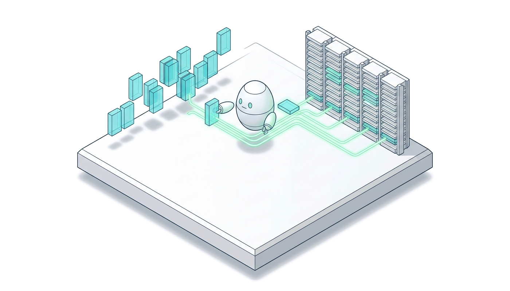{fig-alt="Blueprint cover illustration for the KV Cache Management chapter."}
:::

::: {.content-visible unless-format="pdf"}
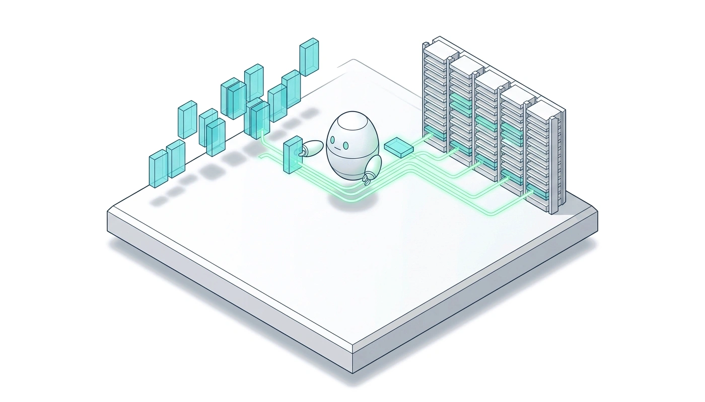{fig-alt="Blueprint cover illustration for the KV Cache Management chapter."}
:::

:::

## Purpose {.unnumbered .unlisted}

\begin{marginfigure}
\mlagentstack{0}{0}{0}{0}{100}{0}
\end{marginfigure}

_Why can an agent that is generating nothing still exhaust the memory of the machine serving it?_

An agent spends much of its life waiting. While a test suite runs or a remote service responds, the model generates nothing, yet the attention state computed from the request's prefix can stay resident in accelerator memory, holding capacity that another request could put to work. That state is large, it grows with every token the trajectory carries, and its size is fixed by the model's geometry rather than by any choice the agent makes. A serving engine that reserves room for the longest request it might see strands much of its memory, and one that copies a shared prefix into every branch pays for the same state many times over. At each pause the engine must choose among keeping the state resident, moving it to slower memory, and dropping it to rebuild from the tokens when the agent resumes. Each option trades memory against the delay before the next output token, and the right one depends on how long the wait will last. Capacity is therefore set less by how many contexts fit at once than by how long each one stays, because a context that holds memory through a long tool wait serves no turns while it keeps its place. Managing retained attention state turns the state an agent carries into a priced claim on the machine serving it, sized against the turn rate the service must sustain.

::: {.content-visible when-format="pdf"}

\newpage

:::

::: {.callout-learning-objectives}

- Calculate retained attention-state memory and resident fit from model geometry, token count, and storage precision
- Calculate the memory that block allocation and prefix sharing recover from full-cap reservation and duplicated prefixes
- Distinguish compatible, available prefix reuse from the applicability of the underlying information
- Select a chunked-prefill token budget that bounds the gap between output tokens for ongoing requests
- Evaluate keep, move, and recompute policies for paused state against memory pressure and resume latency
- Analyze how residence time converts a memory-fit bound into a sustainable turn rate

:::

## Attention State as a Serving Resource {#sec-vol3-kvcache-introduction}

The connection-pool repair agent (lighthouse \ref{lhs-vol3-repair-agent}) has reached a candidate revision, r18. Its targeted reproducer passes, prompting the harness to submit a fully serialized request of 32,768 tokens and launch an integration test suite that runs for 45 seconds. That length, a power of two that keeps the block and pool arithmetic round, is shorter than the staged request of the context-engineering examples, and every per-request footprint and transfer time below scales linearly with it. If the serving engine holds the request's attention state in accelerator memory throughout that entire wait, the device does no work for that workflow. The model generates zero tokens during the test suite, yet its retained state pins memory that another concurrent request could put to work. This is the tool-wait problem named in the turn lifecycle of @sec-vol3-intro-execution-lifecycle. Preserving that state is a deliberate systems policy, and running an agentic service requires pricing that policy against its alternatives.

::: {.column-margin}
{width="100%" fig-alt="H·S·A locator with the State axis highlighted."}

*State becomes a physical resource claim inside the serving system.*
:::

Earlier abstractions stop short of that physical commitment. @Sec-vol3-context-engineering established how the harness selects and refreshes prompt context for each call, and its prefix-layout calculation priced a cached prefix as a discounted line on the bill. Neither abstraction captures the physical footprint of the underlying computation: how many gigabytes of memory that retained attention state consumes, how many concurrent trajectories an accelerator can hold at once, or what the serving engine should do with that state when an agent pauses to await tool execution. Those mechanical questions dictate whether an inference node that comfortably supports a single repair workflow can scale to sustain dozens.

::: {.column-margin .margin-pointer}
↩ Pricing a reused prompt prefix at a discounted cached-input rate is established in @sec-vol3-context-engineering-exact-prefix.
:::

Managing retained attention state is not solely an internal serving problem; it spans an operational boundary between two parties. The application caller controls its submitted context, tool execution timing, and any cache-management hints the serving API exposes. The serving operator controls physical device allocation, memory placement, compute scheduling, and retention policies. When the two belong to separate organizations, as with hosted commercial model APIs, the caller cannot manage physical accelerator memory directly. Instead, the application influences retention only through the interfaces and pricing tiers the service exposes. Distinguishing where these responsibilities divide clarifies which performance levers belong to the agent harness and which belong to the serving engine, the inference software that executes model calls and manages accelerator memory. The word "runtime" keeps its earlier meaning here, the agent runtime that runs the loop around the model.

The chapter follows the r18 request's attention state through its life in the serving engine, and each stage raises the question the next one answers. Sizing the state from model geometry shows how few 32,768-token contexts fit in the memory left after the weights (@sec-vol3-kvcache-geometry). Allocating that state naively strands much of the pool (@sec-vol3-kvcache-fragmentation), which fixed-size blocks recover while letting forked candidates share a prefix (@sec-vol3-kvcache-pagedattention). Sharing within one request invites reuse across turns, which needs an index over retained prefixes and a rule for what to evict (@sec-vol3-kvcache-radix-tree). Whatever the cache misses must be prefilled without stalling other requests' generation (@sec-vol3-kvcache-chunked-prefill). The test wait itself forces a choice among keeping, moving, and dropping the paused state (@sec-vol3-kvcache-swapping). Finally, residence time turns a count of resident contexts into a sustainable turn rate (@sec-vol3-kvcache-capacity-planning).

## The Footprint of Retained Attention State {#sec-vol3-kvcache-geometry}

The r18 request's 32,768 tokens do not reach the accelerator as raw text. During causal self-attention in a Transformer decoder, each newly generated token attends to earlier tokens through their key and value projections [@vaswani2017]. Recomputing these projections at every decode step would repeat the linear transformations over the entire historical prefix, creating an unsustainable quadratic compute bottleneck. Serving engines avoid this recomputation by retaining the computed key and value tensors in accelerator memory across decode cycles.[^fn-kv-memory-bound] While autoregressive decoding relies on retained attention state, sustaining long-horizon agent execution requires managing its physical capacity, allocation overhead, and multi-tenant residency.

::: {.column-margin .margin-pointer}
↩ Retained attention state in autoregressive decoding is established in @sec-vol3-foundation-model-conditional-token-selection.
:::

[^fn-kv-memory-bound]: **Memory-Limited Inference**: Caching keys and values trades quadratic recomputation for persistent memory capacity, and that memory quickly becomes the primary serving bottleneck. An analytical study of large-model serving revealed that sharing a single key-value head across all query heads allowed an identical deployment to serve contexts more than an order of magnitude longer, precisely because retained attention state, rather than compute throughput, bounded context length and batch concurrency [@pope2023efficiently]. Managing this memory footprint determines whether an agent deployment scales. \index{KV cache!memory bound}

::: {#dfn-kv-cache .callout-definition title="KV cache"}

***KV cache***\index{KV cache!definition} is the per-sequence store of attention keys and values that the model has computed for already processed tokens, retained so that later tokens can attend to them without recomputing their projections.

1. **Significance**: Its payload scales linearly with retained tokens; consequently, sequence context length, rather than static model parameter count, determines how many concurrent requests can share the memory pool remaining after loading model weights.
2. **Distinction**: It represents intermediate projected state rather than a raw copy or semantic compression of input text. Reconstructing it requires executing the exact token sequence through identical model weights and layer configurations.
3. **Common pitfall**: Budgeting only for input prompts. Every newly decoded output token appends key and value states at every layer, so a request reaches its maximum memory footprint at completion rather than during initial prefill.

:::

For a decoder employing causal self-attention with uniform layer geometry, every retained token contributes both a key vector and a value vector across all layers. Let $\LayerCount$ represent the number of layers, $\KvHeadCount$ the number of key-value heads per layer, $\AttentionHeadDimension$ the dimension of each head, and $\ElementStorageSize$ the storage size in bytes per element. Accounting for both vectors yields the memory footprint per token:

$$\KvCacheBytesPerToken = 2 \cdot \LayerCount \cdot \KvHeadCount \cdot \AttentionHeadDimension \cdot \ElementStorageSize$$ {#eq-mem-token}

A sequence retaining attention state across $\SequenceLength$ tokens requires an aggregate cache payload of $\KvCacheMemory = \SequenceLength \cdot \KvCacheBytesPerToken$. Here $\SequenceLength$ counts only the tokens whose keys and values have already been evaluated; each newly sampled token increments $\SequenceLength$ once the model completes its forward pass.

The key-value head count $\KvHeadCount$ in @eq-mem-token represents the number of stored attention heads, which often falls below the query head count. Multi-query attention pushed this reduction to its structural extreme by sharing a single key-value head across all query heads[^fn-mqa-decode-bandwidth] [@shazeer2019fast]. **Grouped-query attention**\index{Grouped-query attention!definition} strikes an intermediate balance: several query heads share one key-value head, dividing the stored key-value head count by the group size relative to a standard multi-head design [@ainslie2023gqa], a scaling quantified across attention designs in @tbl-appdx-kv-cache-scaling. Because this head grouping is established during pretraining, a serving allocator cannot dynamically drop heads from an existing checkpoint without fundamentally altering the model's computations.

[^fn-mqa-decode-bandwidth]: **Multi-Query Attention**: Motivated primarily by memory bandwidth rather than storage capacity (incremental decoding reloads stored key and value tensors at each generation step), sharing key-value tensors across query heads drastically reduces memory bus traffic alongside physical storage with minimal quality loss [@shazeer2019fast]. Grouped-query attention subsequently recovered nearly all multi-head attention quality while preserving the bulk of these memory savings [@ainslie2023gqa]. Consequently, the head count $\KvHeadCount$ in @eq-mem-token is an architectural parameter established at pretraining. \index{Multi-query attention!memory bandwidth}

While @eq-mem-token accounts for the raw tensor payload under dense causal attention, physical memory consumption in production serving engines exceeds this theoretical bound. Allocation block granularities, memory alignment, page table metadata, and quantization scales all add runtime overhead. Non-uniform architectures, such as sliding-window attention or compressed latent representations, require their own capacity models.

```{python}
#| echo: false
#| label: kv-geometry-calc
# ┌─────────────────────────────────────────────────────────────────────────────
# │ RETAINED ATTENTION STATE: PAYLOAD AND IDEALIZED RESIDENT FIT
# ├─────────────────────────────────────────────────────────────────────────────
# │ Context: @sec-vol3-kvcache-geometry; nbk-05-sizing-the-attention-state-for.
# │ Goal: Derive a token's KV payload and a node's unshared memory-fit bound.
# │ Show: 327,680 bytes/token; 526.0 GB pool; 195/48/12 resident sequences.
# │ How: Registry geometry and capacity, FP16 storage, local runtime reserve.
# └─────────────────────────────────────────────────────────────────────────────
from mlsysim import *
from mlsysim.fmt import check, fmt_int, fmt_memory, fmt_memory_capacity, fmt_params, fmt_math

class KvGeometry:
    # ┌── 1. LOAD ─────────────────────────────────
    _model = Models.Language.Llama3_70B
    _node = Systems.Nodes.DGX_H100
    n_layers = _model.layers
    n_kv_heads = _model.kv_heads
    d_head = _model.hidden_dim // _model.heads
    element_size = BYTES_FP16
    n_acc = _node.accelerators_per_node
    runtime_reserve = 20 * GB  # scenario: activations and runtime buffers
    ctx_short, ctx_agent, ctx_long = 8_192, 32_768, 131_072  # scenario token counts

    # ┌── 2. EXECUTE ──────────────────────────────
    bytes_per_token = calc_kv_cache_size(n_layers, n_kv_heads, d_head, 1, 1, element_size)
    kv_short = bytes_per_token * ctx_short
    kv_agent = bytes_per_token * ctx_agent
    kv_long = bytes_per_token * ctx_long
    node_hbm = n_acc * _node.accelerator.memory.capacity
    weights = _model.size_in_bytes(BYTES_FP16)
    kv_pool = node_hbm - weights - runtime_reserve
    conc_short = int((kv_pool / kv_short).to("").magnitude)
    conc_agent = int((kv_pool / kv_agent).to("").magnitude)
    conc_long = int((kv_pool / kv_long).to("").magnitude)

    # ┌── 3. GUARD ────────────────────────────────
    check(bytes_per_token.to(byte).magnitude == 327_680, "Registry KV geometry changed")
    check(525.9 < kv_pool.to(GB).magnitude < 526.1, "Expected canonical decimal-GB pool")
    check((conc_short, conc_agent, conc_long) == (195, 48, 12), "Resident-fit bounds changed")
    check(conc_agent * kv_agent <= kv_pool < (conc_agent + 1) * kv_agent, "Floor bound must bracket pool")
    check(kv_long / kv_short == ctx_long / ctx_short, "Payload must scale linearly with retained tokens")

    # ┌── 4. OUTPUT ───────────────────────────────
    params_str = fmt_params(_model.parameters, scale="B", precision=1)
    n_acc_str = fmt_int(n_acc)
    ctx_short_str = fmt_int(ctx_short)
    ctx_agent_str = fmt_int(ctx_agent)
    ctx_long_str = fmt_int(ctx_long)
    kv_short_str = fmt_memory(kv_short, unit=GB, precision=1)
    kv_agent_str = fmt_memory(kv_agent, unit=GB, precision=1)
    kv_long_str = fmt_memory(kv_long, unit=GB, precision=1)
    node_hbm_str = fmt_memory(node_hbm, unit=GB, precision=1)
    acc_mem_rated_gb_str = fmt_memory_capacity(_node.accelerator.memory.capacity, unit=GiB, precision=0)
    acc_mem_gb_str = fmt_memory(_node.accelerator.memory.capacity, unit=GB, precision=1)
    weights_str = fmt_memory(weights, unit=GB, precision=1)
    reserve_str = fmt_memory(runtime_reserve, unit=GB, precision=0)
    kv_pool_str = fmt_memory(kv_pool, unit=GB, precision=1)
    conc_short_str = fmt_int(conc_short)
    conc_agent_str = fmt_int(conc_agent)
    conc_long_str = fmt_int(conc_long)
    token_math = fmt_math(
        rf"\KvCacheBytesPerToken = 2 \times {n_layers} \times {n_kv_heads} \times {d_head} \times {element_size.to(byte).magnitude:g} = {bytes_per_token.to(byte).magnitude:,.0f}\;\text{{bytes/token}}"
    )
    trajectory_math = fmt_math(
        rf"\KvCacheMemory = {ctx_agent:,} \times {bytes_per_token.to(byte).magnitude:,.0f}\;\text{{bytes}} \approx {kv_agent.to(GB).magnitude:.1f}\;\text{{GB}}"
    )
    pool_math = fmt_math(
        rf"{node_hbm.to(GB).magnitude:.1f} - {weights.to(GB).magnitude:.1f} - {runtime_reserve.to(GB).magnitude:g} \approx {kv_pool.to(GB).magnitude:.1f}\;\text{{GB}}"
    )
    fit_math = fmt_math(rf"\left\lfloor {kv_pool.to(GB).magnitude:.9f} / {kv_agent.to(GB).magnitude:.9f} \right\rfloor = {conc_agent}")
```

The worked estimate uses a representative configuration: the Llama 3 70B model geometry, with `{python} KvGeometry.params_str` parameters, and a DGX H100 node containing `{python} KvGeometry.n_acc_str` accelerators. While specific hardware platforms and checkpoint dimensions vary, the underlying capacity arithmetic remains unchanged. Unlike the single-device, 8-bit illustration in @sec-vol3-foundation-model-per-call-work-estimate, both weights and KV cache tensors use 16-bit storage here, with the model weights sharded across the node's accelerators by tensor parallelism. The aggregate high-bandwidth memory remaining after provisioning model weights and a runtime reserve constitutes the **KV pool**\index{KV pool!definition}. The number of active sequences whose KV payloads can reside simultaneously within this pool defines the **resident-fit bound**\index{Resident-fit bound!definition}. This aggregate derivation assumes perfectly balanced shards without redundant weight replication; in production, memory limits must be satisfied on every individual accelerator device. None of the r18 context's internal structure survives into this accounting: system prompt, tool schemas, workspace state, turn history, and latest observation all become key and value tensors at every layer, so the whole `{python} KvGeometry.ctx_agent_str`-token context costs `{python} KvGeometry.kv_agent_str` whatever its zones contain (@fig-vol3-context-window-anatomy). The figure's zones follow the change-rate order of context staging. Its shared invariant prefix is the root of instructions and tool schemas together with the slow-changing workspace description, its growing trajectory state is the rest of the trunk, and its active turn is the leaf.

::: {#fig-vol3-context-window-anatomy fig-env="figure" fig-pos="htb" fig-cap="**From Agent Context to KV State**: A 32,768-token agent context (a), divided into system prompt, tool schemas, workspace, turn history, and the latest observation, becomes key and value tensors at every layer (b). The grouped-query model's per-token footprint then sets how many such contexts fit in the node's KV pool, before allocator overhead and headroom." fig-alt="Panel a draws a 32,768-token context as one bar whose five zones are drawn to scale with their token counts: system prompt, tool schemas, and workspace bracketed as the shared invariant prefix of 14,336 tokens (43.8 percent), turn history as the growing trajectory state, and the latest observation as the active turn. An arrow leads to panel b, which draws one token's key and value state as two grids of 8 KV heads by 80 layers, with one cell marked as one head of one layer holding 128 two-byte values. A chain of boxes derives 327,680 bytes per token, multiplies by S to reach 10.7 GB per context, and tiles that footprint into the KV pool, where resident fit B equals the floor of the pool size over the per-context footprint and falls as 1 over S."}
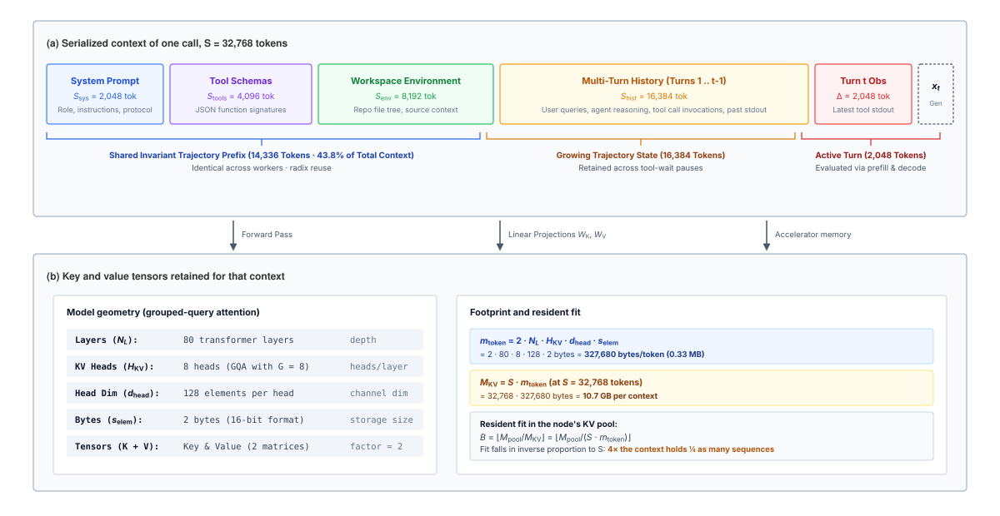
:::

::: {#nbk-05-sizing-the-attention-state-for .callout-notebook title="Sizing the attention state of an agent trajectory"}

**Problem**: Consider a server node of `{python} KvGeometry.n_acc_str` accelerators, each with `{python} KvGeometry.acc_mem_rated_gb_str` (vendor-rated in binary gigabytes, about `{python} KvGeometry.acc_mem_gb_str` in the decimal units used throughout this chapter), for `{python} KvGeometry.node_hbm_str` of aggregate accelerator memory. Model weights occupy `{python} KvGeometry.weights_str`, and the runtime reserves `{python} KvGeometry.reserve_str` for dynamic activations and scratch buffers. Under full causal attention without prefix sharing, how many independent sequences can simultaneously reside in the remaining memory across different context lengths?

**Math**: Evaluating @eq-mem-token for this architecture yields `{python} KvGeometry.token_math`. For an agent trajectory retaining `{python} KvGeometry.ctx_agent_str` tokens, the footprint becomes `{python} KvGeometry.trajectory_math`.

Subtracting model parameters and runtime buffers isolates the usable capacity: `{python} KvGeometry.pool_math`. Dividing this available pool by the footprint per sequence and taking the floor determines the resident-fit bound. Using exact floating-point values prior to display rounding yields `{python} KvGeometry.fit_math`. @Tbl-vol3-kv-payload-fit evaluates this bound across three operational context regimes.

|         **Retained tokens**         |    **KV payload per sequence**     |        **Sequences that fit**        |
|:-----------------------------------:|:----------------------------------:|:------------------------------------:|
| `{python} KvGeometry.ctx_short_str` | `{python} KvGeometry.kv_short_str` | `{python} KvGeometry.conc_short_str` |
| `{python} KvGeometry.ctx_agent_str` | `{python} KvGeometry.kv_agent_str` | `{python} KvGeometry.conc_agent_str` |
|  `{python} KvGeometry.ctx_long_str` | `{python} KvGeometry.kv_long_str`  | `{python} KvGeometry.conc_long_str`  |

: **Payload and resident fit**: Each sequence stores its own full-attention state; the calculation excludes allocator overhead and additional headroom. {#tbl-vol3-kv-payload-fit tbl-colwidths="[28,38,34]"}

**Systems insight**: Resident capacity scales inversely with retained context length. Because model weights occupy a fixed memory slice regardless of context, expanding sequence length directly cannibalizes the cache pool. Each fourfold increase in sequence length (from `{python} KvGeometry.ctx_short_str` to `{python} KvGeometry.ctx_agent_str`, and onward to `{python} KvGeometry.ctx_long_str` tokens) reduces the resident sequence capacity by roughly 75 percent. Retained context length is the primary leverage point controlling serving capacity, and the agent runtime directly governs it. Maintaining an active working set rather than accumulating unbounded historical observations (principle \ref{pri-vol3-attention-working-set}) keeps requests operating in the high-density rows of @tbl-vol3-kv-payload-fit. These figures are raw tensor payloads; physical memory allocators, page fragmentation, and safety headroom further reduce actual capacity, while translating instantaneous resident capacity into sustainable request throughput requires analyzing sequence residence times (@sec-vol3-kv-workload-dynamics).

:::

Model weights incur a one-time memory cost that is amortized across all concurrent requests, whereas every independent sequence imposes an additive burden through its private attention state. Common prefixes across requests reduce this marginal cost only when the serving engine systematically caches and reuses identical attention prefixes across turns.

Both model architecture and numerical precision dictate the per-token payload before memory allocation even begins. An architecture trained with fewer key-value heads or compressed latent representations[^fn-latent-kv-compression] reduces the state generated per token. Similarly, quantizing keys and values to 8-bit or 4-bit representations halves or quarters the raw element bytes $\ElementStorageSize$, though it introduces dequantization scale metadata and potential numerical degradation that engineers must validate against target task benchmarks. Regardless of compression, every retained byte represents allocated physical memory tied to an ongoing execution lifecycle.

[^fn-latent-kv-compression]: **Latent KV Compression**: Multi-head latent attention compresses keys and values into a single low-rank latent vector per token and dynamically reconstructs per-head tensors during attention, exchanging additional projection arithmetic for a substantially smaller memory footprint [@deepseek2024v2]. Although this technique modifies the calculation of $\KvCacheBytesPerToken$ in @eq-mem-token, it preserves the fundamental system dynamics: latent cache tensors must still be paged, allocated, retained across idle periods, and evicted under memory pressure. \index{Multi-head latent attention!KV footprint}

In the running repair agent scenario, deciding whether to keep attention state resident while waiting for an external test suite to run exemplifies this lifecycle tension. Holding the attention state in accelerator memory avoids restoration of the retained prefix when the tool returns observations, but keeping gigabytes of memory pinned for an idle agent deprives concurrent requests of accelerator resources. Before exploring eviction and caching policies, however, the serving engine must translate theoretical tensor footprints into physical memory allocations. Statically pre-allocating contiguous buffers for a sequence's maximum potential context wastes the memory pool through severe internal fragmentation long before actual tensor payloads fill device capacity.

## Memory Fragmentation {#sec-vol3-kvcache-fragmentation}

In an agentic workflow, request lengths are dynamic and fundamentally unpredictable. When an automated repair agent executes an integration test and receives a compiler traceback or test log, its next generation step requires KV cache space for both the accumulated history and the newly ingested tool output. The serving system must accommodate this growth on the fly, without knowing in advance how many tokens the model will generate or how many tool-call iterations will follow. While a static footprint calculation determines the memory consumed by tokens processed so far, the memory allocation policy governs runtime behavior: how much spare buffer to reserve at admission, whether an expanding sequence must be relocated in memory, and how rapidly reclaimed capacity returns to the shared pool.

### Reservation and growth {#sec-vol3-kv-cache-reservation-growth}

The simplest allocation strategy is **static reservation**\index{Static reservation!definition}, which provisions a contiguous memory buffer sized to the configured token cap ($\ContextWindow$) the moment a request is admitted. Static reservation eliminates reallocation stalls and out-of-memory errors during generation: because the maximum possible buffer is already secured, the sequence expands within its pre-allocated envelope without moving. However, this safety incurs severe structural waste. Any unpopulated buffer capacity remains locked for the entire lifetime of the request, completely inaccessible to concurrent sequences. This reservation accounts solely for KV cache state; activation tensors and ephemeral runtime scratchpads draw from separate memory pools.

```{python}
#| label: kv-static-reservation-calc
#| echo: false
# ┌─────────────────────────────────────────────────────────────────────────────
# │ STATIC RESERVATION
# ├─────────────────────────────────────────────────────────────────────────────
# │ Context: @sec-vol3-kvcache-fragmentation reservation example.
# │ Goal: Separate final-length utilization from a resident-fit bound.
# │ Show: Final-length efficiency of 6.25 percent; 48 full-cap reservations.
# │ How: Registry model and node, local cap/mean and runtime reserve assumptions.
# └─────────────────────────────────────────────────────────────────────────────
from mlsysim import *
from mlsysim.fmt import check, fmt_int, fmt_memory, fmt_percent
from mlsysim.physics.agents import calc_kv_cache_bytes_per_token

class StaticReservation:
    # ┌── 1. LOAD (Constants) ──────────────────────────────────────────────────
    model = Models.Language.Llama3_70B
    node = Systems.Nodes.DGX_H100
    elem_size = BYTES_FP16
    runtime_reserve = 20 * GB  # scenario: node-wide activations/runtime reserve
    s_max = 32_768  # illustrative deployment cap, not a model specification
    mean_final_tokens = 2_048  # hypothetical mean FINAL length, not a trace mean

    # ┌── 2. EXECUTE (The Compute) ─────────────────────────────────────────────
    bytes_per_token = calc_kv_cache_bytes_per_token(model, bytes_per_elem=elem_size)
    node_hbm = node.accelerators_per_node * node.accelerator.memory.capacity
    weights = model.size_in_bytes(elem_size)
    pool = node_hbm - weights - runtime_reserve
    reservation = s_max * bytes_per_token
    reservations = int((pool / reservation).to("").magnitude)
    efficiency = mean_final_tokens / s_max
    mean_doubled = 2 * mean_final_tokens  # checkpoint variation on the same scenario

    # ┌── 3. GUARD (Invariants) ────────────────────────────────────────────────
    check(pool.to(byte).magnitude > 0, "The KV pool must be positive")
    check(mean_doubled <= s_max, "The checkpoint variation must respect the cap")
    check(reservations * reservation <= pool < (reservations + 1) * reservation, "The count must be the whole-reservation fit bound")
    check(0 < mean_final_tokens <= s_max, "Final lengths must respect the cap")

    # ┌── 4. OUTPUT (Formatting) ───────────────────────────────────────────────
    s_max_str = fmt_int(s_max)
    mean_final_tokens_str = fmt_int(mean_final_tokens)
    pool_gb_str = fmt_memory(pool, unit=GB, precision=1)
    reservation_gb_str = fmt_memory(reservation, unit=GB, precision=2)
    reservations_str = fmt_int(reservations)
    efficiency_str = fmt_percent(efficiency, precision=2, style="prose")
    mean_doubled_str = fmt_int(mean_doubled)
```

In the `{python} StaticReservation.pool_gb_str` KV pool modeled above, an admission cap of `{python} StaticReservation.s_max_str` tokens requires `{python} StaticReservation.reservation_gb_str` for each reservation. Dividing the pool by this single-request footprint bounds concurrency to at most `{python} StaticReservation.reservations_str` resident reservations, assuming balanced tensor-parallel sharding across accelerators and no auxiliary overhead beyond the baseline runtime reserve. The count matches the `{python} KvGeometry.ctx_agent_str`-token row of @tbl-vol3-kv-payload-fit because a full-cap reservation is exactly that context's footprint, whether or not the tokens ever arrive.

Now consider the resulting capacity utilization for a mixed request population, mostly short turns with occasional long trajectories like r18, all admitted under the same cap. If those requests finish at a mean length of `{python} StaticReservation.mean_final_tokens_str` tokens, each reservation is only `{python} StaticReservation.efficiency_str` populated even upon completion, holding `{python} StaticReservation.mean_final_tokens_str` valid token states out of `{python} StaticReservation.s_max_str` allocated slots. During earlier decoding steps, utilization is lower still. Empirical evaluations confirm that this structural waste dominates naive serving systems: when @kwon2023vllm profiled early systems, actual token state accounted for only 20.4 to 38.2 percent of allocated KV memory, with the remainder lost to reservation slack and fragmentation.

A second strategy grows a contiguous allocation incrementally as tokens arrive. When adjacent capacity is unavailable in the allocator's address space, the memory manager cannot simply extend the buffer in place. Instead, it must allocate a larger buffer elsewhere, copy all existing key and value entries from the old buffer to the new buffer, and then release the original space. This approach incurs two severe penalties: the allocator must hold both buffers simultaneously during the transfer, causing transient memory spikes, and the synchronous copy consumes substantial memory bandwidth. Contiguity here refers to an unbroken span in the allocator's virtual address space, which the accelerator already translates to physical memory in hardware. The restriction therefore comes from software, not from the memory hardware. Standard attention kernels locate a token's keys and values by a fixed stride from the start of one buffer, so each sequence's KV tensor must occupy a single span. Removing that requirement calls for an indirection the serving engine itself controls, because the decisions that matter belong to the engine: how many tokens a unit of allocation holds, how many sequences reference each unit, and when a shared unit must be copied before a write. The remedy is a software table the attention kernel reads directly (@sec-vol3-kvcache-pagedattention).

### Two kinds of unused capacity {#sec-vol3-kv-cache-unused-capacity}

Unused slots inside an active reservation constitute **internal fragmentation**\index{Internal fragmentation!definition}; free capacity split across disconnected extents too small to satisfy a contiguous request constitutes **external fragmentation**\index{External fragmentation!definition}. This classic distinction originates in early storage allocation research for multiprogrammed systems[^fn-fragmentation-internal-external] [@randell1969fragmentation]. @Tbl-vol3-kv-fragmentation-taxonomies separates them because each condition demands a distinct systems remedy: eliminating reservation slack cures the first, whereas changing the allocation granularity cures the second.

| **Condition**          | **Where capacity is unavailable**                           | **Consequence**                                                               |
|:-----------------------|:------------------------------------------------------------|:------------------------------------------------------------------------------|
| Internal fragmentation | Inside an allocation, beyond its initialized entries        | Other requests cannot use the reserved slots                                  |
| External fragmentation | In separate free extents of a variable-size allocation pool | A contiguous request can fail even when aggregate free capacity is sufficient |

: **Unused KV capacity**: Reservation slack belongs to an allocation; external fragmentation concerns free space that cannot satisfy a particular contiguous request. {#tbl-vol3-kv-fragmentation-taxonomies tbl-colwidths="[22,40,38]"}

[^fn-fragmentation-internal-external]: **Internal and External Fragmentation**: The analysis of storage allocation that named the two losses also measured their trade: rounding requests up to fewer standard sizes cost more storage in internal fragmentation than it recovered in external fragmentation [@randell1969fragmentation]. Paged KV allocation makes the same trade on purpose, accepting at most one partial block per sequence in exchange for a pool in which any free block fits any request. \index{Fragmentation!internal versus external}

Consider a concrete example of external fragmentation. Suppose an allocator has three free extents of exactly 256 token slots each, separated by live allocations. A new sequence requiring 512 contiguous slots arrives. Even though the allocator holds 768 free slots in aggregate (more than enough capacity to satisfy the request), the allocation fails because no individual extent can accommodate 512 contiguous slots. The failure stems entirely from the contiguity requirement rather than an absolute shortage of memory.

In an agentic repair workload, this memory pressure becomes acute because a paused trajectory retains its allocation under naive retention policies while waiting for tool execution, even as concurrent requests demand memory to grow. A robust serving system therefore requires two complementary architectural mechanisms: first, a space-efficient allocation unit, which fixed-size blocks provide, and second, an explicit lifecycle and eviction policy, which @sec-vol3-kvcache-swapping develops.

## Paged KV Allocation {#sec-vol3-kvcache-pagedattention}

When an integration-test log extends an agent's repair context, the serving engine need not relocate the existing KV tensor to find a larger contiguous buffer. Instead, it allocates additional fixed-size physical blocks and appends their identifiers to the request's block table. The attention kernel dereferences that table when reading earlier token positions. PagedAttention demonstrated this combination of dynamic block allocation and noncontiguous attention over KV storage [@kwon2023vllm]. Its lineage traces directly to paged virtual memory. The Manchester Atlas one-level store introduced paging in 1962 to decouple a program's contiguous virtual address space from scattered physical page frames [@kilburn1962onelevel]. The block table applies this same indirection to token positions, allowing sequences to grow dynamically without requiring contiguous physical allocations.

::: {#dfn-paged-kv-cache .callout-definition title="Paged KV block table"}

***Paged KV block table***\index{Paged attention!definition}\index{Paged KV block table|see{Paged attention}}\index{KV cache!block table} is a per-sequence software mapping from logical token blocks to the physical KV blocks that store their initialized key and value entries.

1. **Significance**: A sequence can grow by acquiring another block without relocating its existing blocks.
2. **Distinction**: The table maps token positions for the attention kernel; it is not the accelerator's hardware page table.
3. **Common pitfall**: A mapped block has allocated capacity, but only its initialized token entries may be read as valid KV state.

:::

### Token-to-block mapping {#sec-vol3-kv-cache-token-block-mapping}

Consider an illustrative block size of four tokens, chosen to make the mapping concrete rather than to recommend a production configuration. A ten-token prefix occupies logical blocks 0, 1, and 2. Its block table contains `[3, 7, 9]`: token positions 0–3 reside in physical block 3, positions 4–7 in block 7, and positions 8–9 in the first two slots of block 9. Physical block IDs are pool indices managed by the allocator, not raw memory addresses or token sequence numbers.

For any token position, the attention kernel determines its logical block index via integer division by the block size, consults the block table to locate the physical block, and calculates the token's offset within that block using the modulo remainder. For token position 9 with a four-token block size, the kernel calculates logical block $\lfloor 9 / 4 \rfloor = 2$, looks up physical block 9, and determines offset $9 \bmod 4 = 1$ (the second slot). Computing the final byte offset in device memory incorporates the model layer, KV head index, and tensor stride conventions. This software lookup preserves logical sequence ordering even when physical blocks are scattered across high-bandwidth memory among other requests' blocks, as panel (a) of @fig-vol3-pagedattention-mapping traces for position 9.

::: {#fig-vol3-pagedattention-mapping fig-env="figure" fig-pos="htb" fig-cap="**Block Table Indirection and Tail Copy-on-Write**: Panel (a) follows each logical block through its table entry to a physical block scattered among other requests' blocks; position 9 resolves to logical block 2, then to physical block 9, slot 1. Panel (b) shows two candidates that share the full blocks 3 and 7, while candidate B's private append first copies the two initialized entries of the shared tail into block 14." fig-alt="Panel a shows three contiguous logical blocks of four slots holding positions 0 to 9, arrows down to a block table with entries 3, 7, and 9, and elbow arrows to physical blocks 3, 7, and 9 scattered in a row of twelve blocks, some used by other requests. The path for position 9 is drawn in dark ink and annotated with the floor of 9 over 4 equals 2, table entry 2 equals 9, and slot 9 mod 4 equals 1. Panel b places candidate A's block table 3, 7, 9 above and candidate B's table 3, 7, 14 below; both tables point to the shared blocks 3 and 7, A points to block 9, and an arrow copies slots 0 and 1 from block 9 into block 14, where B writes position 10."}
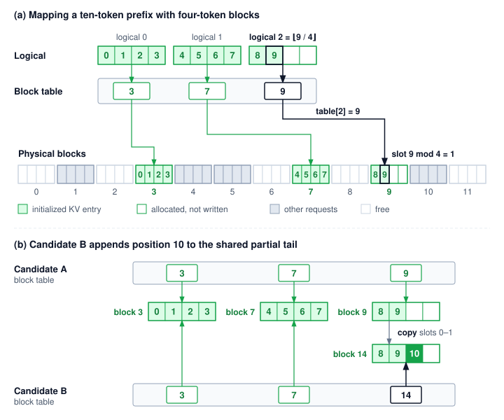
:::

Because every block in the allocator's pool is interchangeable and of identical size, any free block satisfies an allocation request. Paging thereby eliminates external memory fragmentation at block granularity. The remaining memory overhead consists of block-table metadata, temporary scratchpad buffers, and unallocated slots in each sequence's final block.

### Block size and tail waste {#sec-vol3-kv-cache-block-size-tail}

Because sequence lengths rarely align with block boundaries, the final block of a sequence typically contains uninitialized slots. This internal fragmentation constitutes the **tail waste**\index{Tail waste!definition} $\KvBlockTailWaste$. For a block holding $\KvBlockSize$ tokens, tail waste is bounded by $0 \leq \KvBlockTailWaste \leq \KvBlockSize-1$, with an expected value of $(\KvBlockSize-1)/2$ when sequence lengths yield uniformly distributed remainders modulo $\KvBlockSize$. A sequence whose length is an exact multiple of $\KvBlockSize$ incurs zero tail waste.

Block size presents a fundamental systems trade-off:

- Smaller blocks (for example, 16 tokens) reduce worst-case tail waste and permit fine-grained prefix sharing and copy-on-write duplication. However, they inflate block-table metadata and increase indexing overhead for the attention kernel.
- Larger blocks (for example, 64 tokens) amortize bookkeeping costs and align more effectively with memory bus transactions and tensor core tile dimensions on modern accelerators, but they increase tail waste and copy overhead during branch forks.

Selecting an appropriate block size therefore requires balancing sequence length distributions, tree-search branching patterns, and hardware memory access characteristics.

```{python}
#| label: lego-05-physical-block-sizing
#| echo: false
# ┌─────────────────────────────────────────────────────────────────────────────
# │ PHYSICAL BLOCK SIZING
# ├─────────────────────────────────────────────────────────────────────────────
# │ Context: notebook nbk-05-sizing-physical-blocks-for-a.
# │ Goal: Convert allocation granularity into physical storage and a tail bound.
# │ Show: Node-wide block footprints and maximum tail slack for 16/64 tokens.
# │ How: Registry model geometry and precision; explicitly hypothetical sizes.
# └─────────────────────────────────────────────────────────────────────────────
from mlsysim import *
from mlsysim.fmt import check, fmt_int, fmt_memory, fmt_percent
from mlsysim.physics.agents import calc_kv_cache_bytes_per_token

class PhysicalBlockSizing:
    # ┌── 1. LOAD (Constants) ──────────────────────────────────────────────────
    model = Models.Language.Llama3_70B
    elem_size = BYTES_FP16
    small_tokens, large_tokens = 16, 64  # illustrative allocator choices
    ctx_agent = KvGeometry.ctx_agent  # scenario agent context from the footprint estimate

    # ┌── 2. EXECUTE (The Compute) ─────────────────────────────────────────────
    bytes_per_token = calc_kv_cache_bytes_per_token(model, bytes_per_elem=elem_size)
    small_block = small_tokens * bytes_per_token
    large_block = large_tokens * bytes_per_token
    small_tail_tokens = small_tokens - 1
    large_tail_tokens = large_tokens - 1
    small_tail = small_tail_tokens * bytes_per_token
    large_tail = large_tail_tokens * bytes_per_token
    large_tail_share = large_tail_tokens / ctx_agent  # worst-case tail share of one agent context

    # ┌── 3. GUARD (Invariants) ────────────────────────────────────────────────
    check(0 * byte <= small_tail < small_block, "Tail must fit inside one block")
    check(0 * byte <= large_tail < large_block, "Tail must fit inside one block")
    check(small_block * large_tokens == large_block * small_tokens, "Both block sizes must use the same KV geometry")
    check(large_tail_share < 0.005, "Prose claims the worst tail is a fraction of a percent at agent length")

    # ┌── 4. OUTPUT (Formatting) ───────────────────────────────────────────────
    bytes_per_token_str = fmt_memory(bytes_per_token, unit=byte, precision=0)
    small_tokens_str = fmt_int(small_tokens)
    large_tokens_str = fmt_int(large_tokens)
    small_block_mb_str = fmt_memory(small_block, unit=MB, precision=2)
    large_block_mb_str = fmt_memory(large_block, unit=MB, precision=2)
    small_tail_tokens_str = fmt_int(small_tail_tokens)
    large_tail_tokens_str = fmt_int(large_tail_tokens)
    small_tail_mb_str = fmt_memory(small_tail, unit=MB, precision=2)
    large_tail_mb_str = fmt_memory(large_tail, unit=MB, precision=2)
    ctx_agent_str = fmt_int(ctx_agent)
    large_tail_share_str = fmt_percent(large_tail_share, precision=1, style="prose")
```

::: {#nbk-05-sizing-physical-blocks-for-a .callout-notebook title="Converting block size into KV storage"}

**Problem**: Given the Llama 3 70B geometry and a 16-bit KV representation, what physical storage granularity and maximum tail slack result from two candidate block sizes?

**Math**: Each token requires `{python} PhysicalBlockSizing.bytes_per_token_str` across all model layers and attention heads. Multiplying that unit footprint by `{python} PhysicalBlockSizing.small_tokens_str` tokens yields `{python} PhysicalBlockSizing.small_block_mb_str` per block. Multiplying by `{python} PhysicalBlockSizing.large_tokens_str` tokens yields `{python} PhysicalBlockSizing.large_block_mb_str`. These values are node-wide footprints summed across all model shards, not the local allocation on a single accelerator.

The maximum unused tail contains one fewer slot than a full block. A `{python} PhysicalBlockSizing.small_tokens_str`-token block can therefore leave at most `{python} PhysicalBlockSizing.small_tail_tokens_str` slots (`{python} PhysicalBlockSizing.small_tail_mb_str`) unutilized, while a `{python} PhysicalBlockSizing.large_tokens_str`-token block can leave at most `{python} PhysicalBlockSizing.large_tail_tokens_str` slots (`{python} PhysicalBlockSizing.large_tail_mb_str`) unutilized.

For a `{python} PhysicalBlockSizing.ctx_agent_str`-token agent context, even the larger block's worst-case tail waste represents only `{python} PhysicalBlockSizing.large_tail_share_str` of the sequence's total memory footprint.

**Systems insight**: Because tail slack is bounded by at most one block per unshared sequence, its relative overhead diminishes as sequence length increases. At multi-thousand-token agent context lengths, tail waste ceases to be the governing constraint. Engineers should select block sizes primarily to optimize attention kernel throughput and sharing granularity, revisiting tail waste only when serving workloads dominated by short sequences.

:::

```{python}
#| label: kv-paged-waste-calc
#| echo: false
# ┌─────────────────────────────────────────────────────────────────────────────
# │ PAGED ALLOCATION PAYOFF
# ├─────────────────────────────────────────────────────────────────────────────
# │ Context: @sec-vol3-kvcache-pagedattention, paragraph after
# │          nbk-05-sizing-physical-blocks-for-a.
# │ Goal: Compare static reservation with a final-length snapshot estimate
# │       under a stated length distribution.
# │ Show: 0.4 percent tail waste at 16-token blocks, 1.5 percent at 64;
# │       780 final-length snapshots vs. 48 full-cap reservations (about 16x).
# │ How: calc_expected_paged_kv_tokens over a capped-exponential length model
# │      (modeling assumption) with StaticReservation's mean, cap, and pool.
# └─────────────────────────────────────────────────────────────────────────────
from mlsysim.physics.memory import calc_expected_paged_kv_tokens
from mlsysim.fmt import check, fmt_int, fmt_percent, fmt_multiple

class PagedWaste:
    # ┌── 1. LOAD (Constants) ──────────────────────────────────────────────────
    block_small = PhysicalBlockSizing.small_tokens
    block_large = PhysicalBlockSizing.large_tokens
    mean_tokens = StaticReservation.mean_final_tokens  # same hypothetical mean final length
    s_max = StaticReservation.s_max
    bytes_per_token = StaticReservation.bytes_per_token
    pool = StaticReservation.pool

    # ┌── 2. EXECUTE (The Compute) ─────────────────────────────────────────────
    alloc_small, frag_small = calc_expected_paged_kv_tokens(mean_tokens, s_max, block_small)
    alloc_large, frag_large = calc_expected_paged_kv_tokens(mean_tokens, s_max, block_large)
    fit_paged = int((pool / (alloc_small * bytes_per_token)).to("").magnitude)
    gain = fit_paged / StaticReservation.reservations

    # ┌── 3. GUARD (Invariants) ────────────────────────────────────────────────
    check(0 < frag_small < frag_large < 0.02, "Larger blocks must waste more, and both only a few percent")
    check(mean_tokens <= alloc_small < mean_tokens + block_small, "Expected allocation exceeds the mean by less than one block")
    check(fit_paged == 780, "Paged fit on the canonical pool changed")
    check(15 < gain < 17, "Prose claims about sixteen times as many sequences")

    # ┌── 4. OUTPUT (Formatting) ───────────────────────────────────────────────
    frag_small_str = fmt_percent(frag_small, precision=1, style="prose")
    frag_large_str = fmt_percent(frag_large, precision=1, style="prose")
    fit_paged_str = fmt_int(fit_paged)
    gain_mult_str = fmt_multiple(round(gain))  # prose says "roughly"
```

::: {.column-margin}
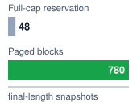{width="100%" fig-alt="Two horizontal bars on one linear scale: a short gray bar labeled 48 for full-cap reservation and a long green bar labeled 780 for paged blocks, with the note final-length snapshots."}

*The final-length snapshot estimate is about `{python} PagedWaste.gain_mult_str` the full-cap reservation count.*
:::

Translating these worst-case bounds into expected memory overhead requires evaluating the workload's sequence length distribution. Consider final sequence lengths modeled as a capped exponential distribution with a mean of `{python} StaticReservation.mean_final_tokens_str` tokens, bounded by the `{python} StaticReservation.s_max_str`-token ceiling established for static reservation. Under this distribution, `{python} PhysicalBlockSizing.small_tokens_str`-token blocks leave `{python} PagedWaste.frag_small_str` of allocated KV memory unutilized, whereas `{python} PhysicalBlockSizing.large_tokens_str`-token blocks leave `{python} PagedWaste.frag_large_str`.

Dividing the same pool, which accommodated only `{python} StaticReservation.reservations_str` static worst-case reservations, by the expected paged footprint gives a planning estimate of approximately `{python} PagedWaste.fit_paged_str` final-length request snapshots, a `{python} PagedWaste.gain_mult_str` increase over full-cap reservation. This capacity multiplier represents the core payoff of paging: memory allocation expands incrementally as tokens are generated, rather than reserving buffer space for an upper bound that most requests never reach. This estimate describes a hypothetical population sampled at completion; the requests resident in a running service have a length distribution that also depends on growth and residence time. Actual admission must account for current unique blocks and the generation growth the controller promises. The gain is close to the ratio of the cap to the mean final length, `{python} StaticReservation.s_max_str` to `{python} StaticReservation.mean_final_tokens_str`, so it measures how far the population falls short of the cap. A request like r18 that actually grows to the cap gains no resident capacity from paging. What paging still buys it is growth without relocation, block-level sharing with forked candidates, and memory that is claimed only as tokens arrive rather than at admission.

### Copy-on-write prefix sharing {#sec-vol3-kv-cache-cow-prefix-sharing}

```{python}
#| label: kv-fork-copy-calc
#| echo: false
# ┌─────────────────────────────────────────────────────────────────────────────
# │ FORK COST UNDER CONTIGUOUS ALLOCATION
# ├─────────────────────────────────────────────────────────────────────────────
# │ Context: @sec-vol3-kvcache-pagedattention, prefix-sharing paragraph.
# │ Goal: Size the tensor copy that block sharing avoids when candidates fork.
# │ Show: 10.7 GB copied for four candidates of an 8,192-token prefix.
# │ How: Registry KV geometry (PhysicalBlockSizing); scenario prefix and fan-out.
# └─────────────────────────────────────────────────────────────────────────────
from mlsysim import *
from mlsysim.fmt import check, fmt_int, fmt_memory

class ForkCopy:
    # ┌── 1. LOAD (Constants) ──────────────────────────────────────────────────
    prefix_tokens = 8_192  # scenario: processed prefix shared by the candidates
    branches = 4  # scenario: sampled candidate repairs
    bytes_per_token = PhysicalBlockSizing.bytes_per_token

    # ┌── 2. EXECUTE (The Compute) ─────────────────────────────────────────────
    copied = branches * prefix_tokens * bytes_per_token

    # ┌── 3. GUARD (Invariants) ────────────────────────────────────────────────
    check(branches == 4, "Prose spells out four candidates")
    check(10 < copied.to(GB).magnitude < 11, "Prose describes roughly ten gigabytes copied")

    # ┌── 4. OUTPUT (Formatting) ───────────────────────────────────────────────
    prefix_str = fmt_int(prefix_tokens)
    copied_str = fmt_memory(copied, unit=GB, precision=1)
```

Agent workflows that sample parallel candidates to gather empirical verification (principle \ref{pri-vol3-verification-asymmetry}) make context branching frequent. Multiple candidate actions or code patches branch from an identical prompt and tool-execution prefix, diverging only in their subsequent generations. The breadth allocation of @sec-vol3-test-time-compute-breadth-axis already priced this branching in memory. With the prompt stored once, peak KV demand grows as the prompt plus each candidate's own tokens; without sharing, every candidate carries its own copy of the prompt. Paging is the mechanism that delivers the first form. In a paged KV cache, the candidates' block tables point to the same physical blocks for all shared prefix tokens, provided the model architecture and runtime configuration allow block sharing.

The difference is large at agent context scales. Under contiguous allocation, giving each of four candidate branches its own copy of an `{python} ForkCopy.prefix_str`-token prefix requires writing `{python} ForkCopy.copied_str` of KV state for the Llama 3 70B geometry, counting the four new copies and not the parent's original. That is the footprint of one full `{python} KvGeometry.ctx_agent_str`-token context, since four copies of `{python} ForkCopy.prefix_str` tokens hold that many token positions. Under paged allocation, duplicating the block tables avoids copying any tensor payload whatsoever. The engine merely updates software metadata and increments reference counters; cloning a block table requires work proportional to the number of block entries rather than the roughly ten gigabytes of underlying KV data.

A shared sequence tail requires special handling when branches diverge. If the final block of a shared prefix is only partially filled, two concurrent candidates cannot independently append new tokens into its remaining empty slots without overwriting each other. In the ten-token example, both candidates initially share the block table `[3, 7, 9]`. Physical block 9 contains only two valid tokens (positions 8 and 9 in slots 0 and 1). Before candidate B writes token position 10, the engine allocates a fresh physical block 14, copies the two initialized entries from block 9 into block 14, and updates candidate B's final block-table entry to point to block 14. Candidate B then writes token 10 into slot 2 of its private block 14. This **copy-on-write**\index{Copy-on-write!KV tail}[^fn-cow-tenex-pages] operation leaves candidate A's state unchanged, as panel (b) of @fig-vol3-pagedattention-mapping draws. @Tbl-vol3-kv-cow-trace records the ownership transition, assuming these two candidates are the sole owners of the prefix.

| **State**                     | **Candidate A table** | **Candidate B table** | **Physical ownership**                                   |
|:------------------------------|:----------------------|:----------------------|:---------------------------------------------------------|
| Before append                 | `[3, 7, 9]`           | `[3, 7, 9]`           | Blocks 3, 7, and 9 each have two owners                  |
| After B's private-tail append | `[3, 7, 9]`           | `[3, 7, 14]`          | Blocks 3 and 7 retain two owners; 9 and 14 each have one |

: **Partial-tail copy-on-write**: Full prefix blocks remain shared while the initialized portion of the tail is copied before a private append. The block IDs label allocations; they do not imply contiguous addresses. {#tbl-vol3-kv-cow-trace tbl-colwidths="[23,20,20,37]"}

[^fn-cow-tenex-pages]: **Copy-on-Write**: The TENEX time-sharing system of the early 1970s gave each page a status bit that let processes share large parts of an address space and obtain private copies of only the pages they changed [@bobrow1972tenex]. Forked candidates reuse the idea at block granularity, which is why a fan-out of sampled repairs costs private blocks in proportion to what each candidate writes, not to the prefix they share. \index{Copy-on-write!TENEX origin}

Copy-on-write is necessary only when mutating a shared, partially filled block. When a candidate branches at an exact block boundary—for instance, after a twelve-token prefix using four-token blocks—token position 12 initiates a new logical block ($\lfloor 12 / 4 \rfloor = 3$). The generating candidate simply allocates an unshared block from the free pool and appends its ID to its block table, requiring no data copying. Similarly, if a partial tail block is already privately owned (reference count of 1), the candidate appends subsequent tokens directly into the remaining slots without allocation or copying. The engine selects the appropriate operation based on two state variables: the occupancy of the target block and its current reference count.

When an agent discards an unpromising candidate trajectory, the engine decrements the reference counts of its constituent physical blocks. A block returns to the free pool when its reference count reaches zero and all outstanding device operations (tracked via asynchronous completion events) have finished. Furthermore, as discussed in the next section, a dormant prefix-cache entry may retain physical blocks even after an active request completes, preserving them across subsequent agent turns. Total physical memory consumption is therefore governed by the number of unique physical blocks resident on the accelerator, not the aggregate logical token count across all active candidates.

::: {#chk-05-memory-fragmentation .callout-checkpoint title="Reasoning about KV allocation"}

The allocation policy must preserve each sequence's state while managing capacity shared by many requests.

- [ ] **Reservation estimate**: If the hypothetical mean final length doubled to `{python} StaticReservation.mean_doubled_str` tokens under the same `{python} StaticReservation.s_max_str`-token cap, what fraction of each static reservation would be populated at completion, and would static reservation admit any more sequences?
- [ ] **External fragmentation**: Can you identify why the three free extents in the example cannot satisfy its contiguous request, and why a fixed-size block pool changes that condition?
- [ ] **Tail ownership**: Can you trace a private append to a shared partial tail and distinguish it from an append at a full-block boundary?
- [ ] **Reclamation**: Can you explain why ending an active request does not always make its blocks immediately reusable?

:::

Paged allocation decouples logical sequence expansion from physical memory layout, eliminating external fragmentation while enabling zero-copy prefix sharing across concurrent trajectories. However, sharing state across independent requests or across subsequent turns of an agent session requires a complementary mechanism: the serving engine must identify matching historical prefixes across disparate requests and manage cache retention under memory pressure. That capability is the domain of prefix caching.

## Prefix Caching Across Turns {#sec-vol3-kvcache-radix-tree}

In the connection-pool repair scenario, the agent invocation that processes an integration-test result often begins with the identical system prompt, tool definitions, and historical observations present in the preceding turn. If the serving engine retained the corresponding key-value (KV) activations from that earlier call, it can attach those existing tensors directly to the new request, prefilling only the newly arrived tokens. On the bill, this saving appears as a discounted cached-input rate; in system implementation, it translates into a concrete serving architecture governed by an index, an explicit ownership contract, and an eviction policy.

::: {#dfn-prefix-cache .callout-definition title="Prefix cache"}

***Prefix cache***\index{Prefix cache!definition} is the serving system's index of retained KV state, keyed by exact token prefix and computation configuration, allowing subsequent requests sharing that initial sequence to attach existing state instead of recomputing it during prefill.

1. **Significance**: It converts repeated prefill work into an index lookup across request boundaries. The computational savings grow with the length of the matched prefix and recur on every turn that preserves that prefix, making stable prompt layouts essential across long trajectories.
2. **Distinction**: Block sharing reuses state among candidates that the engine forks from one request and therefore knows to be related; a prefix cache must find reusable state, by content, for requests that arrive independently over time, and it can offer only what memory pressure and eviction have left resident.
3. **Common pitfall**: Assuming a cache hit guarantees semantic freshness. Matching cached tokens verifies identical historical inputs and execution settings, but it does not check whether the real-world state described by those tokens has changed.

:::

### Prefix compatibility {#sec-vol3-kv-cache-prefix-compatibility}

In causal full-attention architectures, reusable KV state requires an exact, contiguous token prefix starting from the very first position of the sequence, rather than semantically similar phrasing, because attention state is derived from the token prefix (principle \ref{pri-vol3-prefix-coherence}). Matching token identifiers is merely the first prerequisite. The cached KV tensors remain mathematically valid only when generated under identical execution parameters: the same base model weights, active low-rank adaptation (LoRA) adapters (lightweight fine-tuned weight adjustments), positional encodings, and attention masks. For multimodal requests containing images, audio, or structured embeddings, matching the synthetic placeholder tokens in the text prompt is insufficient; the underlying tensor inputs and projection parameters must match exactly. A production serving engine must encode these operational dependencies directly into its cache keys or validate them before binding cached blocks to a request.

Compatibility, physical availability, and tenant isolation represent three distinct verification boundaries. Computationally compatible tensors may have already been evicted from accelerator high-bandwidth memory (HBM), or they may reside in host memory or on solid-state drives, requiring an explicit page-in transfer before the model can consume them. Conversely, tensors residing directly in local accelerator memory may belong to a different tenant or security domain, making them ineligible for sharing under isolation rules. The reusable prefix length is the longest contiguous token sequence that simultaneously satisfies compatibility, physical residency, and access permissions. That sequence is frequently shorter than the longest match found in the prefix tree. Furthermore, newly generated tokens qualify for subsequent prefix matching only after their corresponding KV blocks have been fully materialized in memory and committed to the index.

These structural requirements operate independently of semantic validity. Updating a target repository from commit `r17` to `r18` does not alter or invalidate the KV activations previously computed for an older prompt describing `r17`. Those tensors remain numerically identical and computationally compatible with the stale prompt, even though the context no longer reflects the current state of the code. The harness's context-selection policies govern which evidence to provide to the model. When the agent harness updates or replaces outdated logs in the serialized prompt, the prefix matcher detects the divergence, immediately terminates the match at the first altered token, and triggers a fresh prefill for the updated text. The prompt layout, rather than the cache layer, enforces freshness.

::: {.column-margin .margin-pointer}
↩ How the harness withdraws a stale observation, such as the `r17` test failure, while keeping it as history is established in @sec-vol3-context-engineering-context-rot.
:::

### Radix prefix lookup {#sec-vol3-kv-cache-radix-lookup}

A **radix prefix cache**\index{Radix prefix cache!definition} organizes stored token sequences using a compressed prefix tree (a radix tree), where each edge represents a variable-length sequence of tokens rather than a single symbol [@zheng2024sglang].[^fn-radix-patricia-trie] To resolve a cache match, the scheduler walks the tree from the root, matching prompt tokens along successive edges until reaching a divergence point. This traversal simultaneously identifies the longest common prefix and the physical KV blocks storing its activations. Once a match is identified, the engine must acquire explicit ownership of those memory blocks before the background eviction thread can reclaim them. Lookup overhead scales with the prefix length examined, remaining on the order of microseconds on host CPUs. Alternatively, systems can implement an equivalent reuse contract using chained hash tables, where each fixed-size block is keyed by a cryptographic hash of its token content concatenated with the hash of its parent prefix.

[^fn-radix-patricia-trie]: **Compressed Prefix Tree**: The trie stored one symbol per edge, so a shared prefix was found by walking from the root [@fredkin1960]. PATRICIA collapsed chains of single-child nodes into one edge, so index size grows with the number of stored keys rather than their length [@morrison1968patricia]. The same compression matters for KV reuse, because agent prefixes run to thousands of tokens and a one-token-per-edge index would spend a node on each of them. \index{Radix tree!PATRICIA origin}

The tree's shape follows from the causal dependence that context staging already turned into a layout rule. Every position's keys and values depend on the full history before it, so a node's KV state is valid only beneath its exact ancestors, and an identical passage that follows a modified token lives on a different branch with no reusable state. The layout rule is the harness's half of the same constraint. Staging volatile components (dynamic counters, tool outputs, scratchpad notes) toward the end of the prompt keeps the long invariant prefix on one path from the root, and compaction that rewrites only trailing turns leaves that path intact.

::: {.column-margin .margin-pointer}
↩ Stable-prefix layout rules for prompt staging are established in @sec-vol3-context-engineering-staging.
:::

Physical memory allocation introduces a practical policy choice at block boundaries without altering the underlying definition of compatibility. Suppose a later request matches the ten-token prefix whose blocks `[3, 7, 9]` were traced earlier, with block `9` holding two initialized entries. A serving engine that supports partial-tail reuse preserves all ten tokens and resolves the new turn's divergent append with the same copy-on-write step recorded in @tbl-vol3-kv-cow-trace. An engine that caches only complete blocks reuses eight tokens and prefills the remaining two. Both designs are valid: the partial-tail strategy minimizes redundant prefill at the expense of copy-on-write buffer management, while the full-block strategy simplifies allocation by trading a modest amount of recomputation for uniform block lifecycles.

### Retention and eviction under pressure {#sec-vol3-kv-cache-retention-eviction}

When an inference request finishes, the serving engine releases the request's execution handles on the allocated KV blocks. The cache manager, however, retains its own structural references to those blocks, keeping them in memory as dormant state in case a subsequent request can reuse them. The system's retention policy determines whether the next turn finds that KV state immediately resident in accelerator memory, must page it back from host RAM, or must recompute it entirely.

Reusing and reclaiming memory blocks requires strict ownership tracking across concurrent threads and hardware streams. When a request matches a cached prefix, the memory manager increments reference counts on the corresponding blocks before dispatching execution kernels. Conversely, before reclaiming a physical block under memory pressure, the allocator must sever the cache's indexing reference, confirm that active execution references have dropped to zero, and synchronize with outstanding device streams that might still be reading or writing those memory addresses. The allocator must also synchronize index modifications and reference changes so that a concurrent lookup cannot bind to a block while background eviction is tearing it down.

In tree-structured prefix caches, **leaf-first eviction**\index{Leaf-first eviction!definition} maintains structural consistency by preserving contiguous paths from the root and evicting unused leaf nodes first. Because internal nodes store common prefix state shared across multiple conversation branches, evicting an ancestor would invalidate all of its downstream descendants. An internal node becomes eligible for reclamation only after all of its descendant children have been evicted. Within the set of eligible leaves, systems frequently adopt a least-recently-used (LRU) policy [@zheng2024sglang], operating on the premise that recent access predicts near-term reuse [@belady1966study].[^fn-lru-belady-optimal] Reclamation therefore cascades upward. An inactive parent cannot be reclaimed while its child remains cached, but once the child leaf is evicted, the parent itself becomes an eligible leaf and can be freed if memory pressure persists (@fig-vol3-radix-tree-cache).

::: {#fig-vol3-radix-tree-cache fig-env="figure" fig-pos="htb" fig-cap="**Leaf-First Eviction in a Radix Prefix Cache**: Each node stands for a run of tokens and the KV blocks that hold them, so a request's cached state is the path from the root to its node. Nodes on a running request's path stay active. Only dormant leaves are eligible, which is why the dormant Other-task node in panel (a) survives until its Final-turn child is evicted in panel (b). A least-recently-used policy would choose among the eligible leaves; it never removes an ancestor before its retained descendants." fig-alt="Two stacked copies of a three-level tree, panel a above panel b, whose nodes each carry a small row of KV block squares. Panel a has an active shared-prefix root, an active repair-history node with an active test-log-turn leaf and a dormant rejected-branch leaf, and a dormant other-task node with a dormant final-turn leaf; thicker green edges trace the running request's path, and the two dormant leaves are shaded gray with dark dashed borders as eligible for eviction. Panel b shows the final-turn leaf faded with dotted borders as evicted and the other-task node now shaded as an eligible dormant leaf. A legend defines active, dormant, eligible, and evicted."}
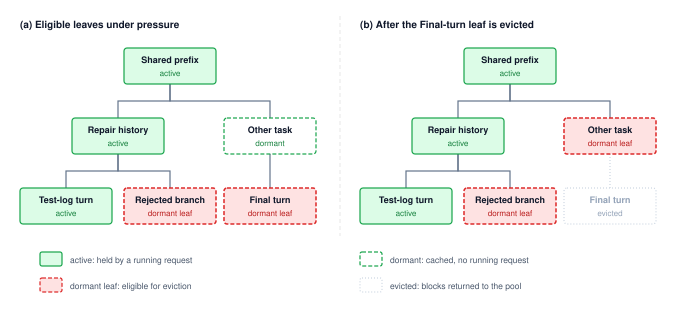
:::

[^fn-lru-belady-optimal]: **Replacement with Foresight**: The classic study of page replacement showed that the optimal policy evicts the page whose next use lies furthest in the future, a rule no online system can apply because it needs the future reference string [@belady1966study]. Recency-based policies approximate it. An agent harness sometimes holds part of that future, such as a tool launch that will idle a prefix for minutes, which is why a retention hint from the caller can beat recency alone. \index{Belady optimal replacement!prefix cache}

Leaf-first eviction keeps residency prefix-closed, meaning that every resident node's ancestors are also resident, and in full-attention models that property is an operational necessity. While freeing an upstream prefix block leaves the numeric values of a retained downstream suffix physically untouched, causal attention requires the entire preceding context to evaluate subsequent tokens. An orphaned suffix block is useless on the accelerator until its missing ancestral prefix is either reloaded from auxiliary storage or recomputed through a new prefill pass.

Retention policies therefore balance occupied accelerator capacity against the computational cost a future hit would eliminate. Recency alone provides an imperfect signal: an agent may generate a speculative branch that is never visited again, whereas a system prompt shared by hundreds of concurrent agent workers remains valuable despite sporadic gaps between calls. More resilient eviction schemes score cached nodes by balancing their expected reuse probability and recomputation cost against their physical memory footprint, adapting the retention weights to match dynamic workload demands.

### Prefix hit rate and the reuse contract {#sec-vol3-kv-cache-hit-rate-contract}

Counting raw matching tokens in a prompt overstates real-world system benefits whenever matching blocks have been evicted, tenant isolation policies prohibit sharing, or memory allocators round matches down to physical block boundaries. Systems engineers evaluate caching efficacy by measuring the tokens actually served from reusable KV state without recomputation. Across a specified workload window, the **token-weighted prefix hit rate**\index{Prefix hit rate!definition} is defined as

$$\PrefixHitRate = \frac{\sum_{i} \ReusedPrefixLength^{(\WorkloadRequestIndex)}}{\sum_{i} \PromptLength^{(\WorkloadRequestIndex)}}$$ {#eq-hprefix}

where $\PromptLength^{(\WorkloadRequestIndex)}$ represents the prompt token count of request $\WorkloadRequestIndex$, and $\ReusedPrefixLength^{(\WorkloadRequestIndex)}$ counts the prompt tokens whose compatible KV activations were attached without recomputation after enforcing availability, security permissions, and block-alignment constraints. In the earlier four-token block example, a request matching ten tokens under a full-block-only caching policy yields $\ReusedPrefixLength = 8$, leaving two tokens to be prefilled. A production telemetry pipeline should also distinguish warm hits (state already resident in accelerator HBM) from cold hits (state that must be restored across PCIe from host memory).

```{python}
#| label: kv-prefix-hit-savings-calc
#| echo: false
# ┌─────────────────────────────────────────────────────────────────────────────
# │ WHAT A PREFIX HIT AVOIDS
# ├─────────────────────────────────────────────────────────────────────────────
# │ Context: @sec-vol3-kvcache-radix-tree, "Measuring reuse" paragraph.
# │ Goal: Put a number on the prefill work a prefix hit avoids.
# │ Show: 1.34 GB of state; ~578 + ~22 trillion operations; ~169 ms at the
# │       sustained rate; ~5 ms weight-read floor for a short suffix pass.
# │ How: Registry model/node; linear 2NS plus causal attention 2LdS^2
# │      (@eq-appdx-prefill-long); sustained rate = node peak x MfuHigh x 0.9.
# │ Note: ChunkedIteration and PausedStateChoice reuse sustained_rate.
# └─────────────────────────────────────────────────────────────────────────────
from mlsysim import *
from mlsysim.fmt import check, fmt_int, fmt_memory, fmt_percent, MarkdownStr

class PrefixHit:
    # ┌── 1. LOAD (Constants) ──────────────────────────────────────────────────
    model = Models.Language.Llama3_70B
    node = Systems.Nodes.DGX_H100
    prefix_tokens = 4_096  # scenario: invariant instructions and tool schemas
    suffix_tokens = 32  # scenario: short novel suffix appended after a hit
    utilization = Literature.Training.MfuHigh * 0.9  # scenario: sustained prefill utilization

    # ┌── 2. EXECUTE (The Compute) ─────────────────────────────────────────────
    n_params = model.parameters.to("count").magnitude
    bytes_per_token = PhysicalBlockSizing.bytes_per_token
    state = prefix_tokens * bytes_per_token
    linear_ops = 2 * n_params * prefix_tokens * flop
    attention_ops = 2 * model.layers * model.hidden_dim * prefix_tokens**2 * flop
    sustained_rate = node.accelerators_per_node * node.accelerator.compute.peak_flops * utilization
    t_rebuild = ((linear_ops + attention_ops) / sustained_rate).to(ms)
    weights = model.size_in_bytes(BYTES_FP16)
    node_bw = node.accelerators_per_node * node.accelerator.memory.bandwidth
    t_weight_read = (weights / node_bw).to(ms)
    t_suffix_ops = (2 * n_params * suffix_tokens * flop / sustained_rate).to(ms)

    # ┌── 3. GUARD (Invariants) ────────────────────────────────────────────────
    check(attention_ops < linear_ops, "Weight work must dominate at this prefix length")
    check(t_suffix_ops < t_weight_read, "A short suffix pass must sit below the ridge (weight-read bound)")
    check(150 < t_rebuild.magnitude < 190, "Prose describes roughly 170 ms of avoided prefill")
    check(t_weight_read < t_rebuild / 10, "The suffix floor must be far below the avoided prefill")

    # ┌── 4. OUTPUT (Formatting) ───────────────────────────────────────────────
    prefix_str = fmt_int(prefix_tokens)
    suffix_str = fmt_int(suffix_tokens)
    state_str = fmt_memory(state, unit=GB, precision=2)
    linear_str = fmt_int(linear_ops.to(flop).magnitude / 1e12)
    attention_str = fmt_int(attention_ops.to(flop).magnitude / 1e12)
    utilization_str = fmt_percent(utilization, precision=0, style="prose")
    rate_str = fmt_int(sustained_rate.to(TFLOPs / second).magnitude)
    rebuild_str = MarkdownStr(f"{fmt_int(t_rebuild.magnitude)} ms")
    weight_read_str = MarkdownStr(f"{fmt_int(t_weight_read.magnitude)} ms")
```

The concrete computational value of a prefix hit follows directly from prefill arithmetic. Consider a deliberately small `{python} PrefixHit.prefix_str`-token prefix of invariant system instructions and tool definitions; the longer shared zone of the r18 context would save more. Retaining this sequence in memory occupies `{python} PrefixHit.state_str` of KV activations distributed across the server node. Reconstructing that state from scratch requires roughly `{python} PrefixHit.linear_str` trillion operations for linear projection layers, plus approximately `{python} PrefixHit.attention_str` trillion operations for causal self-attention (@eq-appdx-prefill-long). If the node sustains `{python} PrefixHit.utilization_str` of its peak 16-bit floating-point throughput (about `{python} PrefixHit.rate_str` trillion operations per second), rebuilding that prefix incurs `{python} PrefixHit.rebuild_str` of prefill latency on every single cache miss. In contrast, a turn that scores a cache hit and appends only a `{python} PrefixHit.suffix_str`-token suffix bypasses the prefix prefill entirely, requiring only a single memory-bandwidth-bound pass over the model weights. Because a `{python} PrefixHit.suffix_str`-token suffix provides too little parallel arithmetic to saturate the accelerator's matrix units, execution time is bounded by the weight-read floor of roughly `{python} PrefixHit.weight_read_str`. Both numbers come from one step-time model that the rest of the chapter reuses. A forward pass over $\ForwardPassTokenCount$ token positions takes $\WeightOnlyStepTime(\ForwardPassTokenCount) = \max\left(\PerDeviceWeightReadTime,\; 2\Parameters \ForwardPassTokenCount/\AttainableComputeRate\right)$, the larger of the time $\PerDeviceWeightReadTime$ to read the weights once from accelerator memory and the time to perform $2\Parameters \ForwardPassTokenCount$ weight operations at the sustained rate $\AttainableComputeRate$. These are the two per-token floors of @eq-vol3-fm-token-floors applied to a whole pass; @eq-appdx-batched-step derives the bound and its assumptions. The rebuild estimate above adds the attention term, which this weight-only model omits. The hit thus replaces `{python} PrefixHit.rebuild_str` of prefix prefill with a pass of about `{python} PrefixHit.weight_read_str`, and a trajectory that keeps its invariant prefix stable collects that saving on every turn, in both latency and aggregate prefill work.

Although @eq-hprefix measures the computational work avoided during prefill, end-to-end request latency also includes novel suffix prefill, autoregressive token generation, batch scheduling delays, and memory transfers. Once a hit eliminates prefix compute, any of these can dominate total response time. When monitoring production clusters, a declining prefix hit rate warrants investigating both sides of the client-service interface. On the client side, minor modifications in prompt serialization—such as altered whitespace, injected timestamps, or reordered JSON schema keys—prematurely truncate prefix matches. On the server side, heightened memory pressure, poor cross-node routing, or mismatched runtime configurations can render compatible state unavailable or physically inaccessible.

When utilizing hosted model APIs, application developers require an explicit reuse contract rather than relying on unverified assumptions about the provider's internal memory allocator. This contract must clearly define eligible token inputs, compatible execution configurations, tenant isolation boundaries, and supported retention lifetimes. In agentic workflows, cache expiration tightly couples this reuse contract to tool execution latency. If an external tool call blocks longer than the provider's idle eviction threshold, the subsequent turn discovers that its cached prefix has been purged and incurs a full prefill penalty, the remote equivalent of the drop-and-recompute policy described in @sec-vol3-kvcache-swapping. An agent harness aware of these eviction horizons can anticipate cache misses during long tool waits rather than absorbing unexpected latency spikes. The cached-token metric returned in API usage records is the client's primary telemetry signal, though interpreting it requires understanding its precise operational scope.

::: {#psp-05-reading-a-cached-token-count .callout-perspective title="Reading a cached-token count"}

A usage record that reports cached input tokens indicates how many prompt tokens the provider served from reusable KV state, which is the numerator of @eq-hprefix for that specific request. However, this metric remains silent on where those tensors resided (accelerator HBM vs. host DRAM), how the provider indexed them, or how long they will remain unevicted before the next invocation.

Its diagnostic value emerges when tracked across successive turns of an agent trajectory. Dividing the cached-token count by the total prompt tokens yields the caller's observed prefix hit rate. A count that abruptly plunges to zero following an extended tool execution is consistent with cache expiration under idle eviction, but memory pressure, routing changes, and incompatible execution settings can produce the same observation. A count that stabilizes below the expected value may indicate an early prompt serialization divergence. Comparing submitted token prefixes and checking request routing and execution settings helps distinguish that client-side cause from unavailable or ineligible cached state. A confirmed layout divergence is an issue the client application can resolve directly in its prompt assembly pipeline.

:::

An agent application must maintain functional correctness regardless of whether a request hits or misses the cache; the serialized context, not the cache, dictates the model's true prompt input. A cache hit simply eliminates redundant arithmetic. When an agent turn introduces a voluminous test log or extensive retrieval chunk, it inevitably injects new prefill compute into the execution engine. Scheduling that compute-intensive prefill phase alongside latency-sensitive, memory-bandwidth-bound token generation for existing requests constitutes the fundamental serving challenge addressed next.

## Chunked Prefill Scheduling {#sec-vol3-kvcache-chunked-prefill}

Prefix reuse eliminates redundant computation on shared prompt prefixes, but new observations inevitably introduce fresh work. When the repair agent submits selected integration-test output, the serving engine must process the uncached suffix of the serialized request before generating the next response token. Other requests may already be generating tokens on the same accelerators. If the engine schedules the entire new prefill as one uninterrupted monolithic batch, those ongoing decode streams must wait for that pass to finish before executing their next decode step. In interactive agent workflows, that stall translates directly into noticeable inter-token latency spikes.

Trimming the observation reduces the raw number of tokens to process, but once the request reaches the server, scheduling determines how execution time is shared among active streams. The engine does not need to execute a long prefill as an all-or-nothing unit. Continuous batching\index{Iteration-level scheduling!chunked prefill} already re-forms the batch at every forward step, admitting and retiring requests between token-generation steps [@yu2022orca], and that per-iteration boundary is exactly where a slice of one request's prefill can be combined with other requests' decodes. By splitting long prefills into smaller token chunks that co-run alongside ongoing decodes, the scheduler bounds how long any single iteration can stall active generation streams [@agrawal2023sarathi; @agrawal2024sarathi].

::: {.column-margin .margin-pointer}
↩ Prefill, decode, time to first token, and continuous batching are established in @sec-vol3-foundation-model-call-latency-decomposition.
:::

::: {#dfn-chunked-prefill .callout-definition title="Chunked prefill"}

***Chunked prefill***\index{Chunked prefill!definition} is a scheduling policy that splits a request's uncached prompt into token spans processed over several engine iterations, each iteration also advancing ongoing decodes, while preserving causal order.

1. **Significance**: It bounds the gap between consecutive output tokens for ongoing requests to the duration of a single chunked iteration rather than a full monolithic prefill, at the expense of a modest delay in time to first token for the new request.
2. **Distinction**: A chunk represents an execution quantum for the scheduler rather than a physical storage layout. The memory allocator maps the resulting KV activations into memory blocks whose page sizes operate independently of chunk boundaries.
3. **Common pitfall**: Treating the per-iteration token budget as an exact wall-clock time limit. Iteration latency depends on attended context length, memory bandwidth, and batch composition, so operators must calibrate the budget against measured gaps between output tokens under realistic workloads.

:::

### Causal correctness across chunks {#sec-vol3-kv-cache-causal-chunks}

Under autoregressive causal attention, processing a later chunk requires access to the compatible per-layer KV state generated by earlier prefixes. Each query token in the active chunk attends to all preceding prompt tokens as well as prior and concurrent tokens within its own chunk, enforced by the causal mask, while remaining blind to subsequent tokens. The engine preserves correct positional encodings and mask logic as it extends the stored KV state, loading previously computed keys and values from memory rather than recomputing their projections from raw token embeddings.

Chunking therefore alters the temporal execution schedule while preserving exact causal semantics, modulo minor floating-point non-associativity across kernel tiling and batching configurations. This scheduling flexibility incurs two physical costs: subsequent chunks must repeatedly stream earlier KV activations from high-bandwidth memory, increasing aggregate memory traffic, and smaller prefill slices introduce additional kernel-launch and scheduling overheads.

### The per-iteration token budget {#sec-vol3-kv-cache-token-budget}

To balance throughput and latency, a scheduler establishes an iteration-level **token budget**\index{Token budget!chunked prefill} $\IterationTokenBudget$. In standard autoregressive decoding, each scheduled decode request contributes exactly one token position, whereas each scheduled prefill contributes the token count of its next chunk. An engine iteration admitting prefill chunks of size $\PrefillAllocatedTokenCount_i$ alongside a set $\DecodeRequestSet$ of active decode requests must satisfy

$$\sum_{i} \PrefillAllocatedTokenCount_i + \lvert\DecodeRequestSet\rvert \le \IterationTokenBudget$$ {#eq-kv-token-budget}

while ensuring that the admitted combination fits within available accelerator memory. A request whose prompt spans multiple chunks retains its partially computed prefix KV state in memory across iterations while waiting for its subsequent slices to run.

A common scheduling policy prioritizes ongoing decoding requests by reserving $\lvert\DecodeRequestSet\rvert$ slots first, dedicating the remaining capacity $\IterationTokenBudget - \lvert\DecodeRequestSet\rvert$ to prefill chunks. This decoding-first priority ensures steady token generation for active streams without requiring them to wait for an entire multi-thousand-token prompt. However, the arriving request may require several iterations to complete its prefill, particularly if heavy decode traffic restricts the available chunk size. Conversely, allocating too much budget to prefill chunks can starve decode streams and trigger latency spikes. A robust scheduler must balance decode responsiveness against prefill completion progress to avoid both stream stalls and prompt starvation.

```{python}
#| label: kv-chunked-iteration-calc
#| echo: false
# ┌─────────────────────────────────────────────────────────────────────────────
# │ CHUNKED PREFILL: STALL VERSUS CHUNK
# ├─────────────────────────────────────────────────────────────────────────────
# │ Context: @sec-vol3-kvcache-chunked-prefill, paragraph after @eq-kv-token-budget.
# │ Goal: Show the scale of the decode-gap vs. prompt-completion trade.
# │ Show: ~5 ms decode-only step; ~162 ms monolithic prefill; ~22 ms per
# │       512-token chunked iteration; ~173 ms prompt completion; ~8x smaller gap.
# │ How: Weight-only step time max(Nb/beta, 2N tokens/pi) (@eq-appdx-batched-step)
# │      on the node with 16-bit weights; sustained rate from PrefixHit.
# └─────────────────────────────────────────────────────────────────────────────
from mlsysim import *
from mlsysim.fmt import check, fmt_int, fmt_multiple, MarkdownStr

class ChunkedIteration:
    # ┌── 1. LOAD (Constants) ──────────────────────────────────────────────────
    decodes = 32  # scenario: ongoing decode requests
    prompt_tokens = 4_096  # scenario: new uncached prefill
    chunk_tokens = 512  # scenario: prefill chunk per iteration
    n_params = PrefixHit.n_params
    rate = PrefixHit.sustained_rate
    t_weights = PrefixHit.t_weight_read

    # ┌── 2. EXECUTE (The Compute) ─────────────────────────────────────────────
    t_decode = max(t_weights, (2 * n_params * decodes * flop / rate).to(ms))
    t_mono = max(t_weights, (2 * n_params * prompt_tokens * flop / rate).to(ms))
    gap_mono = t_decode + t_mono
    n_chunks = prompt_tokens // chunk_tokens
    t_iter = max(t_weights, (2 * n_params * (chunk_tokens + decodes) * flop / rate).to(ms))
    t_chunked_done = n_chunks * t_iter
    gap_ratio = (gap_mono / t_iter).to("").magnitude

    # ┌── 3. GUARD (Invariants) ────────────────────────────────────────────────
    check(prompt_tokens % chunk_tokens == 0, "Chunks must tile the prompt")
    check(t_decode == t_weights, "Decode-only step must sit at the weight-read floor")
    check(t_iter > t_weights, "A 544-token iteration must be arithmetic-bound")
    check(t_mono < t_chunked_done < 1.1 * t_mono, "Chunking must delay prompt completion only modestly")
    check(6 < gap_ratio < 9, "Prose claims roughly an eightfold smaller worst gap")

    # ┌── 4. OUTPUT (Formatting) ───────────────────────────────────────────────
    decodes_str = fmt_int(decodes)
    prompt_str = fmt_int(prompt_tokens)
    chunk_str = fmt_int(chunk_tokens)
    iter_tokens_str = fmt_int(chunk_tokens + decodes)
    n_chunks_str = "eight" if n_chunks == 8 else fmt_int(n_chunks)
    t_decode_str = MarkdownStr(f"{fmt_int(t_decode.magnitude)} ms")
    t_mono_str = MarkdownStr(f"{fmt_int(t_mono.magnitude)} ms")
    gap_mono_str = MarkdownStr(f"{fmt_int(gap_mono.magnitude)} ms")
    t_iter_str = MarkdownStr(f"{fmt_int(t_iter.magnitude)} ms")
    t_done_str = MarkdownStr(f"{fmt_int(t_chunked_done.magnitude)} ms")
    gap_ratio_mult_str = fmt_multiple(round(gap_ratio))
```

The weight-only step-time model $\WeightOnlyStepTime(\ForwardPassTokenCount)$ of the prefix-hit estimate gives the scale of this trade-off, with $\ForwardPassTokenCount$ the token positions that @eq-kv-token-budget admits in one iteration. With `{python} ChunkedIteration.decodes_str` ongoing decodes and nothing else, each step sits at the weight-read floor of about `{python} ChunkedIteration.t_decode_str`. Admitting a `{python} ChunkedIteration.prompt_str`-token prefill as one unit adds about `{python} ChunkedIteration.t_mono_str` of arithmetic before those decodes run again (weight work only, so slightly below the `{python} PrefixHit.rebuild_str` prefix rebuild, which includes attention), stretching their gap between tokens to about `{python} ChunkedIteration.gap_mono_str`.

Dividing that prompt into `{python} ChunkedIteration.chunk_str`-token chunks reshapes execution. Each iteration now carries `{python} ChunkedIteration.iter_tokens_str` positions and takes about `{python} ChunkedIteration.t_iter_str`. Because the decodes advance in each of the `{python} ChunkedIteration.n_chunks_str` iterations, their worst gap is about `{python} ChunkedIteration.gap_ratio_mult_str` smaller, while the new prompt completes after about `{python} ChunkedIteration.t_done_str` instead of `{python} ChunkedIteration.t_mono_str`. Chunking buys existing streams a much shorter gap for a modest delay in the new request's first token.

On one time axis, the monolithic schedule leaves a single long gap between two output tokens, while the chunked schedule places a token at every iteration boundary and finishes the prompt only slightly later (@fig-vol3-chunked-timeline). Both schedules omit attention traffic, which grows with each chunk's context, and per-iteration overhead, so measured iterations run longer and the budget must come from measurement.

::: {#fig-vol3-chunked-timeline fig-env="figure" fig-pos="htb" fig-cap="**Monolithic vs. Chunked Prefill**: Both timelines use the weight-only estimate, on one time axis, for a `{python} ChunkedIteration.prompt_str`-token prefill arriving while `{python} ChunkedIteration.decodes_str` requests decode. Admitted as one unit (a), the prefill separates two decode tokens by about `{python} ChunkedIteration.gap_mono_str`. Split into `{python} ChunkedIteration.chunk_str`-token chunks (b), every iteration also advances the decodes, so the gap is one iteration of about `{python} ChunkedIteration.t_iter_str`, and the prompt finishes slightly later. Attention traffic and per-iteration overhead, omitted here, would lengthen every bar." fig-alt="Two horizontal timelines on a shared time axis with ticks at 0, 50, 100, and 150 milliseconds. Timeline a has one long prefill bar for 4,096 tokens followed by a short decode step, with output-token markers only at the start and the end and a red bracket labeling the gap between decode tokens. Timeline b has eight equal bars labeled chunk 1 to chunk 8, with a token marker at every bar boundary and a dark bracket over the first bar. Each timeline marks where the prompt completes."}
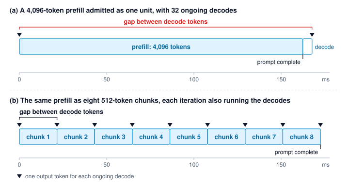
:::

Characterizing these trade-offs requires replaying representative arrival traces across candidate token budgets while tracking key systems metrics: time to first token for newly admitted requests, inter-token latency for active decode streams, aggregate token throughput, and accelerator memory occupancy. High-percentile latency measurements, such as the p99 inter-token gap, expose transient scheduling hiccups far better than arithmetic averages, which easily conceal the disruptive stalls of occasional large prefills. Systems designers must also distinguish server iteration step times from client-perceived streaming intervals; downstream buffering, transport serialization, and network round-trip times introduce variances that server-side metrics do not capture.

Selecting the token budget $\IterationTokenBudget$ ultimately balances hardware execution efficiency against service responsiveness. Smaller chunks provide frequent scheduling checkpoints that protect inter-token deadlines, yet they extend total prompt completion times and add kernel-launch overhead. Larger chunks maximize tensor-core utilization by providing wider matrix dimensions during attention and feed-forward operations, but they penalize concurrent decode streams with longer stalls. In practice, operators configure the token budget to the largest chunk size whose corresponding iteration duration comfortably satisfies the target inter-token latency objective for active streams. On the reference node, the weight-only estimate gives the starting point. An inter-token target comfortably above `{python} ChunkedIteration.t_iter_str` admits the `{python} ChunkedIteration.chunk_str`-token chunk alongside `{python} ChunkedIteration.decodes_str` decodes. A tighter target forces smaller chunks and a later first token for the new request, while running the prompt unchunked exposes the decodes to the full `{python} ChunkedIteration.gap_mono_str` gap. Measured attention traffic and per-iteration overhead then shrink the admissible chunk from that estimate.

### Prefill-decode disaggregation {#sec-vol3-kvcache-disaggregated}

Chunking resolves prefill-decode contention by time-slicing compute on a single worker node. **Prefill-decode disaggregation**\index{Prefill-decode disaggregation!definition}, the disaggregated serving that the call-latency decomposition introduced as a way to meet time-to-first-token and per-token objectives separately, takes the structural alternative and decouples the two phases across distinct pools of specialized workers [@patel2024; @zhong2024distserve]. Because prefill is compute bound and decode is memory bandwidth bound, disaggregation allows operators to tailor parallelism strategies independently, allocating tensor parallelism across high-throughput accelerators for prefills while grouping decodes onto workers optimized for high-bandwidth memory capacity. These architectures compose: a separated prefill worker can still process prompts in chunks to manage memory footprint and smooth its pipeline.

Decoupling the execution phases replaces intra-node compute contention with an inter-node network handoff. When a prefill worker finishes processing a prompt, it must transfer the resulting KV activations to an assigned decode worker before autoregressive generation can start. This handoff requires preallocating compatible cache blocks on the destination accelerator, aligning memory layouts across heterogeneous attention kernels, and streaming tensors over high-speed interconnects. If network fabrics saturate or queueing builds up at either worker pool, the latency of this state transfer can quickly exceed the compute savings gained from phase isolation.

Systems architects must therefore evaluate disaggregation across the full end-to-end path—accounting for queueing delays at both stages, serialization overheads, and network transfer latencies—rather than evaluating isolation against idealized peak interconnect speeds. For an agent interacting with a hosted model endpoint, these internal cluster topologies remain abstracted behind the serving API. The agent experiences their consequences indirectly through overall request latency, streaming variance, and concurrency limits.

Chunking and disaggregation govern how active requests share compute resources during model execution. Once generation completes and an agent suspends execution to invoke an external tool or inspect an environment, the operational challenge changes from scheduling compute to managing idle memory. Deciding whether that trajectory's KV state remains resident in accelerator memory, spills to host memory, or evicts entirely becomes the governing concern.

## Paused-State Policies {#sec-vol3-kvcache-swapping}

The r18 request's 45-second integration test is the tool-wait problem in its plainest form. When an agent invokes an external tool, such as a long-running test or a query to a remote database, the serving system faces an extended idle period before the tool returns its output. Although the model performs no active generation during this pause, retaining its key-value cache in accelerator memory ties up scarce HBM. To prevent idle requests from starving active generation, the serving engine must execute a **paused-state policy**\index{Paused-state policy!definition}: retain the state in device memory, offload it to host memory or secondary storage, or drop it entirely and reconstruct it when the tool output arrives. Systems research on tool-augmented generation evaluated these same three mechanisms—preserve, swap, and discard—selecting dynamically among them per request to minimize wasted accelerator memory [@abhyankar2024infercept]. This choice balances device memory capacity against host storage, interconnect transfer time, and recomputation latency. It belongs below the model. Invariant closure (principle \ref{pri-invariant-closure}) closes mechanical bounds below the model, and the pool is such a bound. The model cannot observe how full the pool is, nothing in a proposal can enforce a release, and the correctness of the next turn never depends on where the state was kept. The serving engine therefore executes the policy and decides keep, move, or drop. The agent runtime may supply hints, such as the expected length of the wait or whether the trajectory is likely to resume at all, and a hosted service exposes them only through its API. The model neither makes the decision nor supplies the hints, and its proposals never touch the lifecycle.

::: {.column-margin .margin-pointer}
↪ Harness supervision of resources retained during external tool waits is developed in @sec-vol3-agent-harness-retained-resources.
:::

### Reclaimable state {#sec-vol3-kv-cache-reclaimable-state}

Evaluating a pause policy begins by measuring the physical memory that the policy can actually free. In a paged KV cache, an agent's logical sequence length does not map directly to reclaimable capacity. Prefix blocks shared with active concurrent trajectories, such as common system prompts or branching execution paths, must remain allocated on the accelerator as long as another request holds a valid reference. Similarly, blocks currently committed to in-flight asynchronous DMA copies or active kernel operations cannot be freed until those transfers complete. The uniquely reclaimable footprint consists solely of unshared blocks with no pending operations, and every pause calculation must use this footprint as its baseline.

Offloading state requires available capacity at the target tier and a coordinated handoff protocol. To maintain memory safety, the engine must preserve source blocks in accelerator memory until the outbound DMA transfer to host memory verifies successfully. During the transfer window, the state consumes both device HBM and host DRAM concurrently. The host-memory budget must therefore accommodate these transient transfer buffers alongside already parked trajectories. Upon resumption, the sequence reverses: the scheduler must allocate accelerator blocks, initiate an inward transfer, and update page tables before attention kernels can resume execution.

Discarding the KV cache relinquishes the computed state while preserving the underlying information, provided the raw input sequence and environment observations remain recorded in durable logs. Because attention state is derived from the token prefix (principle \ref{pri-vol3-prefix-coherence}), state lost this way can be derived again. If the request resumes, the engine reconstructs the missing attention state by re-running prefill across the historical prompt. This reconstruction requires exact provenance: the precise token sequence, active LoRA adapters, position encodings, attention masks, and multimodal embeddings. A compressed conversation summary cannot substitute for the raw token history. Reconstruction typically reuses any compatible prefix blocks that remain in memory and prefills only the missing suffix. In managed inference platforms, callers can exploit these trade-offs only to the degree that the hosting service exposes explicit prefix caching or session controls.

### Keep, move, and drop policies {#sec-vol3-kv-cache-keep-move-drop}

The policies in @tbl-vol3-reclamation-policies differ in which system resource carries the paused trajectory.

| **Policy** | **Accelerator capacity released**                 | **Work needed on return**                      | **Principal constraint**                          |
|:-----------|:--------------------------------------------------|:-----------------------------------------------|:--------------------------------------------------|
| Keep       | None from the retained blocks                     | No restoration of those blocks                 | Retention competes with other allocations         |
| Move       | Reclaimable source blocks after a successful copy | Allocate and reload compatible state           | Destination capacity and contested transfer paths |
| Drop       | Reclaimable blocks after safe release             | Reconstruct missing state from retained inputs | Input availability and prefill capacity           |

: **Paused-state choices**: Restoration work is separate from queueing and processing the new observation, which can occur under every policy. {#tbl-vol3-reclamation-policies tbl-colwidths="[12,28,30,30]"}

Each policy targets a distinct operational regime:

- *Keep*: Retaining state on the accelerator is optimal when the memory pool has ample headroom and the agent anticipates an immediate return. Holding the blocks incurs zero marginal cost if no competing work requires memory, and it guarantees zero restoration latency when generation resumes.
- *Move*: Under memory pressure, offloading state to host DRAM releases critical accelerator capacity without discarding the completed prefill computation.
- *Drop*: Discarding state becomes the preferred choice when the probability of resumption is low, host DRAM is exhausted, or the context is short enough that recomputing prefill is faster than transferring the data across the bus. Every policy must also enforce memory isolation boundaries so that evicted or offloaded blocks remain protected from unauthorized access by other tenants.

When pause durations extend across minutes or hours, as for workflows waiting for human approval, the engine can migrate state beyond host DRAM to non-volatile storage. Hierarchical serving systems organize storage across host memory and NVMe drives, prefetching cached layers sequentially so that retrieval from disk overlaps with execution of earlier layers [@gao2024cachedattention]. At data center scale, distributed architectures pool the host memory and solid-state storage of thousands of nodes into a shared cluster-wide KV cache [@qin2024mooncake]. Across all storage tiers, cached attention tensors represent derived, transient state; the durable history of user inputs, tool actions, and execution evidence resides in the runtime's authoritative event log.

### A bounded comparison during the test wait {#sec-vol3-kv-cache-test-wait-comparison}

```{python}
#| label: kv-paused-state-choice-calc
#| echo: false
# ┌─────────────────────────────────────────────────────────────────────────────
# │ PAUSED-STATE CHOICE: RELOAD VERSUS RECOMPUTE DURING A TOOL WAIT
# ├─────────────────────────────────────────────────────────────────────────────
# │ Context: @sec-vol3-kvcache-swapping, the bounded test-wait comparison,
# │          @eq-kv-reload-ratio, and @fig-vol3-swapping-tradeoff.
# │ Goal: Separate capacity occupancy, transfer work, and restoration delay,
# │       with stage durations derived from registry rates.
# │ Show: 10.74 GB; 21 ms each way, 42 ms round trip; ~1.3 s recompute; ~62x,
# │       ~15x at a quarter of link bandwidth; 483.18 GB·s held;
# │       44.98 s on-demand and 44.96 s prefetch release windows.
# │ How: Registry KV geometry; per-accelerator host link x 8 (tensor-parallel
# │      shards move in parallel, a scenario assumption); sustained prefill
# │      rate shared with PrefixHit; attention term omitted (weight work only).
# └─────────────────────────────────────────────────────────────────────────────
from mlsysim import *
from mlsysim.fmt import check, fmt_int, fmt_memory, fmt_qty, fmt_time, fmt_bandwidth, fmt_multiple, MarkdownStr

class PausedStateChoice:
    # ┌── 1. LOAD (Constants) ───────────────────────────────────────────────────
    model = Models.Language.Llama3_70B
    node = Systems.Nodes.DGX_H100
    context_tokens = 32_768  # scenario: fully initialized state, no sharing
    block_tokens = 16  # scenario allocation granularity, not a recommendation
    runtime_reserve = 20 * GB  # scenario, same aggregate-node baseline
    wait = 45 * second  # stipulated integration-test wait
    n_acc = node.accelerators_per_node
    link_per_acc = node.accelerator.interconnect.bandwidth  # registry host link, per direction
    rate = PrefixHit.sustained_rate  # scenario sustained prefill rate
    quarter = 0.25  # scenario: links sustain a quarter of rated bandwidth

    # ┌── 2. EXECUTE (The Compute) ──────────────────────────────────────────────
    blocks = (context_tokens + block_tokens - 1) // block_tokens
    state = calc_kv_cache_size(
        model.layers,
        model.kv_heads,
        model.hidden_dim // model.heads,
        blocks * block_tokens,
        1,
        BYTES_FP16,
    )
    bytes_per_token = state / (blocks * block_tokens)
    pool = n_acc * node.accelerator.memory.capacity - model.size_in_bytes(BYTES_FP16) - runtime_reserve
    n_params = model.parameters.to("count").magnitude
    link = n_acc * link_per_acc
    copy_out = (state / link).to(ms)
    copy_in = (state / link).to(ms)
    reconstruct = (2 * n_params * context_tokens * flop / rate).to(second)
    ratio = (reconstruct / copy_in).to("").magnitude
    ratio_quarter = ratio * quarter
    reload_over_recompute = (bytes_per_token * rate / (2 * n_params * flop * link)).to("").magnitude
    held_occupancy = state * wait
    transfer_work = copy_out + copy_in
    released_on_demand = wait - copy_out
    released_prefetch = wait - copy_out - copy_in

    # ┌── 3. GUARD (Invariants) ─────────────────────────────────────────────────
    check(context_tokens % block_tokens == 0, "No partial-tail waste in this example")
    check(state.to(byte).magnitude == 10_737_418_240, "Registry geometry must give the stated payload")
    check(0 < state < pool, "One state must fit the aggregate pool; shard fit is separate")
    check(abs(reload_over_recompute * ratio - 1) < 1e-9, "Context length must cancel in the reload/recompute ratio")
    check(55 < ratio < 70, "Prose claims reload is about sixty times faster")
    check(ratio_quarter > 10, "Prose claims reload still wins by over ten times at a quarter of link bandwidth")
    check(transfer_work < wait / 1000, "The round trip must be under a tenth of a percent of the wait")
    check(abs(held_occupancy.to(GB * second).magnitude - 483.1838208) < 1e-6, "Occupancy is capacity times time, not a monetary cost")
    check(released_prefetch < released_on_demand < wait, "Prefetch reserves the destination earlier than on-demand reload")

    # ┌── 4. OUTPUT (Formatting) ────────────────────────────────────────────────
    context_str = fmt_int(context_tokens)
    block_str = fmt_int(block_tokens)
    state_str = fmt_memory(state, unit=GB, precision=2)
    wait_str = fmt_time(wait, "second", precision=0)
    link_per_acc_str = fmt_bandwidth(link_per_acc, unit=GB / second, precision=0)
    link_str = fmt_bandwidth(link, unit=GB / second, precision=0)
    out_str = MarkdownStr(f"{fmt_int(copy_out.magnitude)} ms")
    in_str = MarkdownStr(f"{fmt_int(copy_in.magnitude)} ms")
    transfer_str = MarkdownStr(f"{fmt_int(transfer_work.magnitude)} ms")
    reconstruct_str = fmt_time(reconstruct, "second", precision=1)
    ratio_mult_str = fmt_multiple(round(ratio))
    ratio_quarter_mult_str = fmt_multiple(round(ratio_quarter))
    held_str = fmt_qty(held_occupancy, unit=GB * second, precision=2)
    demand_free_str = fmt_time(released_on_demand, "second", precision=2)
    prefetch_free_str = fmt_time(released_prefetch, "second", precision=2)
```

To quantify these choices, consider an agent holding `{python} PausedStateChoice.context_str` tokens of context while pausing for a `{python} PausedStateChoice.wait_str` integration test on an eight-accelerator node. In this scenario, all historical KV entries have already been materialized, each `{python} PausedStateChoice.block_str`-token block is completely filled, and no blocks are shared or committed to in-flight transfers. The uniquely reclaimable cache footprint is therefore `{python} PausedStateChoice.state_str` (excluding auxiliary page tables and transfer buffers, which the runtime budgets separately).

The transfer and recompute durations derive directly from hardware specifications. Because tensor parallelism partitions key-value heads evenly across the eight accelerators, each device holds one-eighth of the total state and transfers data over its own `{python} PausedStateChoice.link_per_acc_str` PCIe link. When all eight links operate concurrently, the node moves state at an aggregate bandwidth of $\HostLinkBandwidth =$ `{python} PausedStateChoice.link_str`. Offloading the complete `{python} PausedStateChoice.state_str` payload across this interface requires `{python} PausedStateChoice.out_str`, and restoring it upon resumption takes an identical `{python} PausedStateChoice.in_str`.

Reconstruction instead repeats the prefill pass. For a model with $\Parameters$ parameters and a sequence of $\SequenceLength$ tokens, evaluating the feed-forward and projection weights requires $2\Parameters \SequenceLength$ floating-point operations. At the sustained prefill rate assumed for the reference system, recomputing this context demands `{python} PausedStateChoice.reconstruct_str`, and including the quadratic attention term of @eq-appdx-prefill-long would lengthen it further. (Because every policy must eventually process the incoming test observation once the wait concludes, that downstream prefill is common to all policies and omitted from this comparison.)

In this weight-only comparison, both transfer duration and recompute duration scale linearly with sequence length $\SequenceLength$, so their ratio is independent of context size:

$$\frac{\KvReloadTime}{\KvRecomputeTime} = \frac{\SequenceLength \, \KvCacheBytesPerToken / \HostLinkBandwidth}{2 \Parameters \SequenceLength / \AttainableComputeRate} = \frac{\KvCacheBytesPerToken \, \AttainableComputeRate}{2 \Parameters \, \HostLinkBandwidth}$$ {#eq-kv-reload-ratio}

::: {.column-margin}
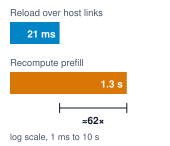{width="100%" fig-alt="Two bars on a log scale from 1 millisecond to 10 seconds: a blue bar of 21 ms for reload over host links and an orange bar of 1.3 s for recomputing the prefill, with a bracket between their ends labeled about 62 times."}

*Reloading paused state beats rebuilding it by about `{python} PausedStateChoice.ratio_mult_str` in the linear reference comparison.*
:::

Here $\AttainableComputeRate$ represents the sustained prefill throughput, and $\KvCacheBytesPerToken$ is the cache footprint per token. @Eq-kv-reload-ratio applies the reload-versus-reconstruction comparison of @sec-vol3-appendix-inference-queueing to this reference architecture. Reloading retained state is approximately `{python} PausedStateChoice.ratio_mult_str` faster than recomputing from raw tokens. Even when heavy bus contention degrades link bandwidth to a quarter of its rated capacity, reloading remains `{python} PausedStateChoice.ratio_quarter_mult_str` faster than prefill. Under this linear reference comparison, recomputation becomes advantageous when host DRAM capacity or PCIe bandwidth is sufficiently constrained by competing workloads, leaving accelerator compute as the less congested resource.

Retaining the cache on-chip throughout the `{python} PausedStateChoice.wait_str` wait ties up `{python} PausedStateChoice.state_str` $\times$ `{python} PausedStateChoice.wait_str` $\approx$ `{python} PausedStateChoice.held_str` of memory-time capacity (calculated using the unrounded payload). This cumulative occupancy translates into lost serving capacity whenever concurrent requests queue for device memory. Counted in request slots rather than bytes, it is the residence that Little's law converts into a lost turn rate in @sec-vol3-kv-workload-dynamics, where the same wait divides the memory-bound rate by the ratio of the whole turn cycle to its generation time.

Moving the state to host memory immediately upon entering the pause releases those accelerator blocks as soon as the `{python} PausedStateChoice.out_str` outbound copy completes. The freed blocks can serve other queries for `{python} PausedStateChoice.wait_str` $-$ `{python} PausedStateChoice.out_str` $=$ `{python} PausedStateChoice.demand_free_str` before the test returns. The policy incurs `{python} PausedStateChoice.transfer_str` of total transfer work across the bus, but only the inbound reload sits on the critical path of the resuming query, adding `{python} PausedStateChoice.in_str` of restoration delay. Dropping the state avoids bus transfer entirely, but forces `{python} PausedStateChoice.reconstruct_str` of prefill work onto the critical path before generation can restart.

If the engine can predict the tool completion timestamp accurately, typically from a hint the agent runtime supplies, asynchronous prefetching can schedule the inward transfer to complete precisely as the test finishes. Reserving the destination device blocks at the start of that inbound copy yields an accelerator release window of `{python} PausedStateChoice.wait_str` $-$ `{python} PausedStateChoice.out_str` $-$ `{python} PausedStateChoice.in_str` $=$ `{python} PausedStateChoice.prefetch_free_str`. Prefetching hides restoration latency completely while maintaining both transfer stages, though it requires reliable advance knowledge of return times.

The same reasoning extends to every context length and wait. The round-trip transfer time, which scales linearly with context length and equals `{python} PausedStateChoice.transfer_str` in this configuration, sets a necessary condition. A pause shorter than the round trip ends before offloading can move the state out and back without delaying resumption. Keeping it avoids restoration work when memory permits; under pressure, moving or dropping it may still be necessary. Above the round trip, offloading becomes possible, and whether it pays depends on whether other requests are queued for the freed memory and how much reload delay the resuming turn tolerates. For long pauses under memory pressure, offloading reclaims device memory for almost the entire wait at the cost of a sub-second reload. The worked `{python} PausedStateChoice.context_str`-token, `{python} PausedStateChoice.wait_str` test sits far beyond that round trip. It also sits short of the much longer waits at which parked state accumulates enough to fill host memory, a boundary set by host capacity and by how fast paused trajectories arrive rather than by a fixed duration. The example therefore falls squarely in the offload regime (@fig-vol3-swapping-tradeoff). When pauses stretch into minutes or hours, as for operations awaiting human review, parked state accumulates in host memory, and the decision turns on host capacity, secondary storage bandwidth, or eventual recomputation.

::: {#fig-vol3-swapping-tradeoff fig-env="figure" fig-pos="htb" fig-cap="**Keep, Offload, or Park a Paused Trajectory**: Decision regimes over expected tool wait and context length, both on log scales, for a paused trajectory whose accelerator memory has a competing use. The diagonal is the reload round trip, twice the state size divided by host-link bandwidth, so it grows linearly with context; waits to its left end before the state could move out and back. The dashed boundary reflects host-memory pressure rather than a fixed duration, and the marked point is the 32,768-token, 45-second integration test." fig-alt="Log-log chart with expected tool wait from 1 ms to 1 hour on the horizontal axis and context length from 2,048 to 131,072 tokens on the vertical axis. A diagonal round-trip line separates a green retain region on the left from a violet offload-to-host-memory region; a dashed vertical line near 1 minute, labeled host-memory pressure, separates a gray park-or-drop region on the right. A marked point at 32,768 tokens and about 45 seconds is labeled as the worked example, and a dotted line runs from it back to the round-trip line at the same context length."}
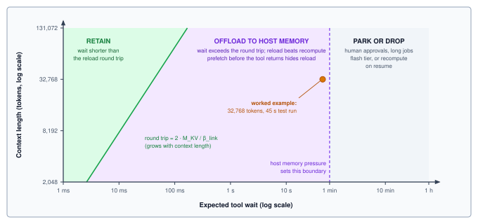
:::

### Uncertain returns and competing transfers {#sec-vol3-kv-cache-uncertain-returns}

External tool executions exhibit significant runtime variance: a test suite may fail immediately on a syntax error, finish early, or stall on an environmental hang. This variance complicates offload and prefetch decisions:

- If a tool completes earlier than forecasted while offloading is still in flight, the engine must either wait for the outbound transfer to finalize before reloading or cancel the transfer mid-stream, exposing unbuffered restoration latency.
- Premature prefetching followed by a delayed return re-occupies accelerator memory while the model remains idle, negating the capacity reclaimed during the pause.
- If a paused trajectory is cancelled or times out, an anticipatory inward reload wastes interconnect bandwidth.

A robust pause policy must therefore evaluate the full probability distribution of return times alongside client latency service-level objectives (SLOs), rather than relying on mean wait times and uncontended transfer estimates.

Furthermore, transfers rarely occur in isolation. Multiple paused trajectories frequently finish their external tasks in close temporal proximity, triggering a surge of concurrent reloads across shared host-memory buses, PCIe switches, and storage links. Summing nominal per-accelerator link rates is valid only if interconnect topologies and memory controllers maintain non-blocking throughput under concurrent load.

```{python}
#| label: kv-return-burst-calc
#| echo: false
# ┌─────────────────────────────────────────────────────────────────────────────
# │ CORRELATED-RETURN BURST
# ├─────────────────────────────────────────────────────────────────────────────
# │ Context: @sec-vol3-kvcache-swapping, "Uncertain returns and competing transfers".
# │ Goal: Size the reload burst when many paused trajectories return together.
# │ Show: 32 returns; 344 GB; >= 0.67 s at the full aggregate link rate;
# │       the last reload waits ~32x the isolated reload.
# │ How: PausedStateChoice state and aggregate link rate (an upper bound on the
# │      shared path; registry host-memory bandwidth is higher, so links bind).
# └─────────────────────────────────────────────────────────────────────────────
from mlsysim import *
from mlsysim.fmt import check, fmt_int, fmt_time, fmt_multiple, MarkdownStr

class ReturnBurst:
    # ┌── 1. LOAD (Constants) ──────────────────────────────────────────────────
    returns = 32  # scenario: paused repairs whose tests finish together
    state = PausedStateChoice.state
    link = PausedStateChoice.link
    host_bw = PausedStateChoice.node.host_memory_bw

    # ┌── 2. EXECUTE (The Compute) ─────────────────────────────────────────────
    burst = returns * state
    t_burst = (burst / link).to(second)
    slowdown = (t_burst / PausedStateChoice.copy_in).to("").magnitude

    # ┌── 3. GUARD (Invariants) ────────────────────────────────────────────────
    check(link < host_bw, "The host links, not host memory bandwidth, must bind at the aggregate rate")
    check(burst < PausedStateChoice.pool, "The returning states must fit the accelerator pool")
    check(abs(slowdown - returns) < 1e-9, "Serialized reloads scale with the number of returns")

    # ┌── 4. OUTPUT (Formatting) ───────────────────────────────────────────────
    returns_str = fmt_int(returns)
    burst_str = MarkdownStr(f"{fmt_int(burst.to(GB).magnitude)} GB")
    t_burst_str = fmt_time(t_burst, "second", precision=2)
    slowdown_mult_str = fmt_multiple(round(slowdown))
```

Suppose `{python} ReturnBurst.returns_str` paused repairs on a node finish their external tasks simultaneously. Their combined attention state totals `{python} ReturnBurst.burst_str`, which requires at least `{python} ReturnBurst.t_burst_str` to reload even when the eight host links sustain their maximum aggregate throughput. The final reload in the queue therefore experiences a restoration delay roughly `{python} ReturnBurst.slowdown_mult_str` longer than the isolated `{python} PausedStateChoice.in_str` reload latency, and any congestion on shared bus root complexes lengthens the tail further. System engineers must provision transfer queues, admission controls, and accelerator headroom specifically to absorb these burst-induced restoration delays.

Pipelining can overlap data transfers with computation, but strict causal dependencies dictate which operations can run concurrently. In standard full-attention models, generating or processing new observation tokens requires access to all historical key and value tensors. An engine cannot compute attention for layer $\LayerIndex$ until the historical KV blocks for layer $\LayerIndex$ reside in accelerator memory. Transfer latency can therefore be hidden only if the engine streams state in layer by layer (reloading layer $\LayerIndex+1$ while executing attention on layer $\LayerIndex$) or if the node schedules unrelated generation requests while the paused state reloads in the background. Both techniques require careful engine coordination: layer-wise streaming requires fine-grained synchronization across DMA engines, while concurrent execution requires reserve accelerator memory to host the in-flight requests alongside incoming reload buffers.

### Reclamation vs. approximation {#sec-vol3-kvcache-intrasequence}

Keeping, offloading, and recomputing all preserve the exact mathematical semantics of full attention. A distinct family of policies reduces memory occupancy by *approximating* the cache: evicting tokens selectively, restricting attention to a local window, or quantizing key and value tensors to lower precision. Because these strategies alter the underlying model computation, their efficacy cannot be judged by memory savings alone; they require empirical validation against task accuracy. In agentic workflows, an eviction policy cannot assume that low attention weight during past decoding steps implies irrelevance in future turns.

The mechanics of **attention sinks**\index{Attention sink!definition} demonstrate why naive eviction schemes break down. Because softmax normalizes attention weights to sum to one across the sequence, transformer layers deposit residual attention mass on the initial sequence positions whenever a query has no strong semantic match among current tokens. A sliding-window policy that evicts those initial tokens removes this stabilizing mass, causing generation perplexity to degrade sharply once context length exceeds the window size. Retaining a small set of initial sink tokens alongside the sliding window restores numerical stability across long sequence streams [@xiao2024streamingllm]. More sophisticated pruning strategies retain tokens that accumulate high cumulative attention mass [@zhang2023h2o] or that receive significant attention within a recent temporal window [@liu2023scissorhands].

While past attention predicts future utility reasonably well in conventional conversation, agent trajectories routinely violate this assumption in three distinct ways:

1. *Dormant constraints*: Instructions defined early in an execution trace—such as environment constraints, security policies, or API rules—often receive negligible attention across dozens of intermediate tool turns. When the agent produces its final edit or synthesis, violating those dormant instructions causes silent task failure.
2. *Exact identifiers*: Unique entities like commit hashes, process IDs, file paths, and cryptographic nonces may appear once during environment exploration and remain unreferenced for many turns. If an eviction heuristic prunes these tokens because intermediate turns ignored them, the agent cannot quote them accurately in subsequent shell or API calls.
3. *Tool-schema syntax*: Schema definitions and JSON delimiters in the system prompt govern the grammar of every tool call. Individual decoding steps frequently assign weak attention mass to structural delimiters like brackets and colons. Pruning them produces malformed syntax that crashes downstream parsers rather than a graceful degradation in output quality.

Cache approximation in agentic systems must therefore be evaluated against hard semantic dependencies rather than aggregate perplexity. The lossless policies (keep, move, and drop) cost interconnect bandwidth and tiered memory capacity, but they preserve the full-attention computation for the same recorded inputs and compatible configuration, subject to numerical differences across implementations. They decide where one paused trajectory's state lives. They leave open how many trajectories a node can carry when each one holds memory for its whole residence, waits included, and answering that requires putting time into the capacity accounting.

## Capacity for Agent Workloads {#sec-vol3-kvcache-capacity-planning}

A paused repair task can hold key-value state in accelerator memory for minutes without executing a single forward pass, while an incoming request demands both memory capacity and execution time immediately. How an engine handles paused state dictates how many concurrent agent trajectories can fit in memory. Converting that static concurrency into a sustainable throughput, however, requires modeling how long each session holds its memory. Capacity planning must therefore tackle both dimensions: first establishing physical occupancy bounds, and then coupling those bounds to residence time.

Tracking memory demand in agentic serving is fundamentally different from tracking standard batch inference workloads. In standard inference, every active sequence holds a private cache. With agents, logical contexts frequently overlap through shared system prompts and tool descriptions, while continuations require private allocations, and dormant prefixes can be discarded or paged out without stalling active execution. Simply summing the logical key-value footprints of all active trajectories double-counts shared prefix blocks. Conversely, counting only the requests currently decoding tokens ignores the dormant KV state that still occupies HBM. Rigorous capacity planning therefore begins with the physical pool: determining how many unique physical blocks the serving system must retain to satisfy its workload.

### A resident-fit bound {#sec-vol3-kv-capacity-formulations}

To build a tractable capacity model, consider a set of equal-length requests with input prompt length $\SequenceLength$ and a maximum generation allowance of $\OutputLimit$ tokens. Because paged allocation hands out fixed-size blocks of $\KvBlockSize$ tokens, each private allocation rounds up to the nearest whole block. Without prefix sharing, every resident request must independently provision memory for its full prompt and output allowance. When requests share an identical, compatible prefix, however, the memory pool allocates those prefix blocks once and pays only for each request's private remainder. For this simple decomposition, assume that the common prefix aligns cleanly with a block boundary; any trailing partial block follows the copy-on-write accounting described earlier.

The memory available for key-value caching is whatever high-bandwidth memory remains after allocating model weights and reserving memory for execution runtimes:

$$\KvPoolMemory = \NodeHbmCapacity - \WeightMemory - \RuntimeReserveMemory$$ {#eq-mkv-pool}

Production deployments typically withhold an additional headroom fraction $\KvPoolHeadroomFraction$ of this pool to absorb bursty intermediate activations and memory fragmentation. Given block size $\KvBlockSize$, a block-aligned common prefix of $\SharedPrefixLength$ tokens, and a cache footprint of $\KvCacheBytesPerToken$ bytes per token across all layers, the total physical block demand across $\BatchSize$ resident requests (every request whose state is resident, whether decoding or paused) must satisfy

$$\left\lceil \frac{\SharedPrefixLength}{\KvBlockSize} \right\rceil + \BatchSize \left\lceil \frac{\SequenceLength + \OutputLimit - \SharedPrefixLength}{\KvBlockSize} \right\rceil \le \left\lfloor \frac{(1-\KvPoolHeadroomFraction)\, \KvPoolMemory}{\KvBlockSize \, \KvCacheBytesPerToken} \right\rfloor$$ {#eq-kv-demand-shared}

::: {.column-margin}
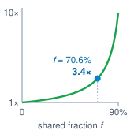{width="100%" fig-alt="A green curve rising from 1 times at zero shared fraction and steepening toward 10 times, with a blue dot at a shared fraction of 70.6 percent labeled 3.4 times."}

*The sharing gain $1/(1-\SharedPrefixFraction)$ steepens as the shared fraction of each request grows.*
:::

The resident-fit bound of @sec-vol3-kvcache-geometry, refined for blocks, headroom, and sharing, is the maximum integer $\BatchSize$ that satisfies @eq-kv-demand-shared. Setting $\SharedPrefixLength = 0$ yields the unshared baseline. Because the common prefix is allocated only once, sharing delivers its largest gains when common instructions represent a dominant fraction of the total prompt, and when private working memory—the unique turn history and generation allowance—remains small.

Notebook \ref{nbk-05-sizing-hbm-for-multi-turn-agent} grounds these formulations on the same eight-accelerator DGX H100 node serving Llama 3 70B. Rather than optimistically assuming an average generation length, the sizing calculation reserves the full $\OutputLimit$ token allowance to guarantee that resident requests cannot trigger out-of-memory aborts during decoding, treating the headroom fraction as a deliberate provisioning reserve.

```{python}
#| label: compute-agent-capacity
#| echo: false
# ┌─────────────────────────────────────────────────────────────────────────────
# │ Context: nbk-05-sizing-hbm-for-multi-turn-agent and resident-time prose.
# │ Goal: Bound resident requests with unique, block-rounded KV allocation.
# │ Show: 41 unshared or 138 shared snapshots; memory-only residence constraints.
# │ How: Registry model/node, explicit reserve/headroom, and whole-block counts.
# └─────────────────────────────────────────────────────────────────────────────
from math import ceil, floor
from mlsysim import *
from mlsysim.physics.agents import calc_kv_cache_bytes_per_token
from mlsysim.fmt import check, fmt_int, fmt_memory, fmt_percent, fmt_time, fmt_magnitude, fmt_multiple

class AgentCapacity:
    # ┌── 1. LOAD (Constants) ───────────────────────────────────────────────────
    _model = Models.Language.Llama3_70B
    _node = Systems.Nodes.DGX_H100
    runtime_reserve = 20 * GB  # scenario: aggregate activation/runtime reserve
    headroom = 0.10  # hypothetical extra fraction withheld from the KV pool
    context = 32_768  # scenario: serialized input tokens per request
    output = 2_048  # scenario: maximum private output tokens
    common = 24_576  # scenario: identical, compatible, shareable prefix tokens
    block_tokens = 16  # scenario: allocation granularity, not a recommendation
    generation = 5 * second  # hypothetical residence component, not a benchmark
    wait = 45 * second  # hypothetical tool wait with retained state

    # ┌── 2. EXECUTE (The Compute) ──────────────────────────────────────────────
    bytes_per_token = calc_kv_cache_bytes_per_token(_model, bytes_per_elem=BYTES_FP16)
    node_hbm = _node.accelerators_per_node * _node.accelerator.memory.capacity
    weights = _model.size_in_bytes(BYTES_FP16)
    pool = node_hbm - weights - runtime_reserve
    block_bytes = block_tokens * bytes_per_token
    usable_blocks = floor(((1 - headroom) * pool / block_bytes).to("").magnitude)
    usable = usable_blocks * block_bytes
    unshared_blocks = ceil((context + output) / block_tokens)
    common_blocks = ceil(common / block_tokens)
    private_blocks = ceil((context + output - common) / block_tokens)
    unshared_bytes = unshared_blocks * block_bytes
    common_bytes = common_blocks * block_bytes
    private_bytes = private_blocks * block_bytes
    fit_unshared = usable_blocks // unshared_blocks
    fit_shared = (usable_blocks - common_blocks) // private_blocks
    retained_time = generation + wait
    retained_rate = fit_unshared / retained_time
    released_rate = fit_unshared / generation
    residency_factor = (retained_time / generation).to("").magnitude  # 1 + W_wait / W_gen
    f_shared = common_blocks / unshared_blocks  # shared fraction of each request's blocks
    share_gain = fit_shared / fit_unshared
    share_bound = 1 / (1 - f_shared)  # large-pool limit of the sharing gain
    common_half = common // 2  # checkpoint variation, still block-aligned

    # ┌── 3. GUARD (Invariants) ─────────────────────────────────────────────────
    check(pool.to(GB).magnitude > 0, "Weights and reserve must leave a positive KV pool")
    check(0 <= common <= context and common % block_tokens == 0, "Shared prefix must be valid and block-aligned")
    check(usable <= (1 - headroom) * pool, "Block rounding must not exceed the usable pool")
    check(unshared_blocks == common_blocks + private_blocks, "Aligned shared/private blocks must recover the unshared count")
    check(fit_unshared == 41 and fit_shared == 138, "Canonical resident-fit bounds must remain 41/138")
    check(fit_unshared * unshared_blocks <= usable_blocks < (fit_unshared + 1) * unshared_blocks, "Unshared fit must be maximal")
    check(
        common_blocks + fit_shared * private_blocks <= usable_blocks < common_blocks + (fit_shared + 1) * private_blocks, "Shared fit must be maximal"
    )
    check(retained_rate < released_rate, "Removing positive waiting residence must loosen this memory-only constraint")
    check(abs((released_rate / retained_rate).to("").magnitude - residency_factor) < 1e-9, "Rate ratio must equal the residency factor")
    check(abs(share_gain - share_bound) < 0.1, "Prose claims the sharing gain approaches 1/(1 - f)")
    check(common_half % block_tokens == 0, "Checkpoint variation must stay block-aligned")

    # ┌── 4. OUTPUT (Formatting) ────────────────────────────────────────────────
    precision_bits_str = fmt_int(BYTES_FP16.to(bit).magnitude)
    reserve_str = fmt_memory(runtime_reserve, unit=GB, precision=0)
    pool_str = fmt_memory(pool, unit=GB, precision=1)
    headroom_str = fmt_percent(headroom, precision=0, style="prose")
    context_str = fmt_int(context)
    output_str = fmt_int(output)
    common_str = fmt_int(common)
    block_tokens_str = fmt_int(block_tokens)
    block_bytes_str = fmt_memory(block_bytes, unit=MB, precision=3)
    usable_blocks_str = fmt_int(usable_blocks)
    unshared_blocks_str = fmt_int(unshared_blocks)
    common_blocks_str = fmt_int(common_blocks)
    private_blocks_str = fmt_int(private_blocks)
    unshared_bytes_str = fmt_memory(unshared_bytes, unit=GB, precision=2)
    common_bytes_str = fmt_memory(common_bytes, unit=GB, precision=2)
    private_bytes_str = fmt_memory(private_bytes, unit=GB, precision=2)
    fit_unshared_str = fmt_int(fit_unshared)
    fit_shared_str = fmt_int(fit_shared)
    generation_str = fmt_time(generation, unit=second, precision=0)
    wait_str = fmt_time(wait, unit=second, precision=0)
    retained_time_str = fmt_time(retained_time, unit=second, precision=0)
    retained_rate_value_str = fmt_magnitude(retained_rate, unit=1 / second, precision=2)
    released_rate_value_str = fmt_magnitude(released_rate, unit=1 / second, precision=1)
    residency_mult_str = fmt_multiple(residency_factor)
    f_shared_str = fmt_percent(f_shared, precision=1, style="prose")
    share_gain_mult_str = fmt_multiple(share_gain, precision=1)
    share_bound_mult_str = fmt_multiple(share_bound, precision=1)
    common_half_str = fmt_int(common_half)
```

::: {#nbk-05-sizing-hbm-for-multi-turn-agent .callout-notebook title="From logical contexts to physical fit"}

**Problem**: How many complete request snapshots fit when a common prefix is stored once rather than copied for every request?

**Variables**: The Llama 3 70B model uses `{python} AgentCapacity.precision_bits_str`-bit weights and KV state on the DGX H100 node. After weights and the stipulated `{python} AgentCapacity.reserve_str` runtime reserve, its KV pool (@eq-mkv-pool) is `{python} AgentCapacity.pool_str`. Withhold an additional `{python} AgentCapacity.headroom_str`. Each request has `{python} AgentCapacity.context_str` input tokens and an allowance of `{python} AgentCapacity.output_str` output tokens. The requests come from a fleet of repair workers on one repository snapshot, so their first `{python} AgentCapacity.common_str` input tokens (instructions, tool schemas, and the shared workspace state) are identical and form the common prefix. Blocks hold `{python} AgentCapacity.block_tokens_str` tokens, or `{python} AgentCapacity.block_bytes_str` of KV state across the node.

**Math**: Divide the remaining pool by bytes per block and round down, giving `{python} AgentCapacity.usable_blocks_str` usable blocks. An unshared request occupies `{python} AgentCapacity.unshared_blocks_str` blocks (`{python} AgentCapacity.unshared_bytes_str`). Dividing the usable block count by that request count and rounding down gives `{python} AgentCapacity.fit_unshared_str` resident requests, down from the `{python} KvGeometry.conc_agent_str` of @tbl-vol3-kv-payload-fit because each request also reserves its output allowance, the headroom is withheld, and allocation rounds to whole blocks. With sharing, subtract the common prefix's `{python} AgentCapacity.common_blocks_str` blocks (`{python} AgentCapacity.common_bytes_str`) once, then divide by `{python} AgentCapacity.private_blocks_str` private blocks per request (`{python} AgentCapacity.private_bytes_str`). Rounding down gives `{python} AgentCapacity.fit_shared_str` resident requests.

**Systems insight**: The common prefix covers `{python} AgentCapacity.f_shared_str` of each request's blocks, and sharing it raises the fit `{python} AgentCapacity.share_gain_mult_str`, close to the large-pool limit $1/(1-\SharedPrefixFraction) \approx$ `{python} AgentCapacity.share_bound_mult_str` for a shared fraction $\SharedPrefixFraction$. In that limit, the gain depends on $\SharedPrefixFraction$ alone, making prompt layout and the scope of sharing the primary architectural levers. A prefix shared only across one deployment's instructions covers far less of each request than one that also spans a common workspace, as the archetype comparison below shows. Within a given scope, keeping invariant tokens at the very front of the serialized input, strictly ahead of any volatile turn history, maximizes $\SharedPrefixFraction$. Although sharing does not reduce the decoding work per token or change any request's logical context, it multiplies concurrent capacity. These values are physical fit bounds for the designated memory partition, not runtime admission limits.

:::

In production environments, requests arrive with heterogeneous lengths and variable prefix overlap. An admission controller must therefore balance committed blocks, anticipated generation growth, and temporary staging buffers required during KV transfers or eviction copies. Furthermore, an aggregate node-wide memory bound is necessary but not sufficient: multi-GPU deployments distribute KV cache blocks across tensor-parallel shards, meaning a free physical block on one accelerator cannot alleviate memory exhaustion on another. Admission decisions must satisfy physical capacity constraints across every individual device.

### Residence time and service rate {#sec-vol3-kv-workload-dynamics}

A static fit bound defines instantaneous capacity, the number of slots that can exist in memory simultaneously. Translating that capacity into sustainable throughput requires adding time to the accounting, and classical queueing theory supplies the identity that links capacity, residence, and throughput.

::: {#thrm-05-littles-law .callout-theorem title="Occupancy equals rate times residence (Little's law)"}

*In any stable system where items arrive, reside for a while, and leave, the long-run averages obey one identity, whatever the arrival pattern, service order, or residence distribution.* **Little's law**\index{Little's law!definition} [@little1961] states

$$\MeanSlotOccupancy = \ArrivalRate \MeanHoldTime$$ {#eq-vol3-littles-law}

*   **Mean occupancy** ($\MeanSlotOccupancy$): average number of items resident, here KV slots held.
*   **Throughput** ($\ArrivalRate$): long-run arrival rate, equal to the completion rate when unfinished work does not accumulate.
*   **Mean residence** ($\MeanHoldTime$): average time an item holds its slot, counting every phase in which the slot stays allocated.

A slot held in accelerator memory while an agent waits for external tool execution remains resident throughout that wait; omitting idle waiting time from $\MeanHoldTime$ artificially deflates the denominator and drastically overstates sustainable system throughput.

The law's generality has a price.\index{Little's law!mean versus peak} Its proof assumes nothing about how items arrive or how long they stay, only that the long-run averages exist, and for that reason it fixes the mean occupancy and says nothing about the peak. A burst of arrivals, or residences that end together, can hold far more slots than $\MeanSlotOccupancy$ for as long as the backlog lasts, so capacity is sized from the arrival and residence patterns, not from the mean identity alone.

:::

Rearranging the relation as $\ArrivalRate = \MeanSlotOccupancy/\MeanHoldTime$ expresses the achievable service rate as a function of allocated capacity and residence duration. Here each resident item is one turn's generation-and-tool-wait cycle, not a complete multi-turn trajectory. Let $\ModelTime$ be the time a turn spends generating and $\ToolTime$ the time it then waits on its tool. A slot kept through the wait resides for $\ModelTime + \ToolTime$, while a slot released for the wait resides for $\ModelTime$ alone, so for the same number of slots the two policies' turn rates differ by the factor $1 + \ToolTime/\ModelTime$. That factor is the **residency tax**\index{Residency tax!definition} of a synchronous tool wait, and notebook \ref{nbk-05-residency-tax} prices it for the repair turn.

::: {.column-margin .margin-pointer}
↪ Little's law applied to whole multi-turn trajectories with tool waits is developed in @sec-vol3-appendix-inference-queueing.
:::

::: {#nbk-05-residency-tax .callout-notebook title="The residency tax of a tool wait"}

**Problem**: The node holds `{python} AgentCapacity.fit_unshared_str` unshared request slots. Each repair turn resides `{python} AgentCapacity.generation_str` while generating and, under the keep policy, another `{python} AgentCapacity.wait_str` while its integration test runs. What turn rate can memory sustain with the wait held resident, and with the slot released for the wait?

**Math**: By @eq-vol3-littles-law, $\ArrivalRate = \MeanSlotOccupancy/\MeanHoldTime$. Keeping state through the wait gives $\MeanHoldTime =$ `{python} AgentCapacity.retained_time_str` and $\ArrivalRate =$ `{python} AgentCapacity.retained_rate_value_str` turns/s. Releasing the slot for the wait gives $\MeanHoldTime =$ `{python} AgentCapacity.generation_str` and $\ArrivalRate =$ `{python} AgentCapacity.released_rate_value_str` turns/s. The ratio is $1 + \ToolTime/\ModelTime$, or `{python} AgentCapacity.residency_mult_str`.

**Systems insight**: Holding paused state through an idle tool wait penalizes the memory-bound turn rate by a factor of $1 + \ToolTime/\ModelTime$. The economic viability of keeping state in accelerator memory depends on the ratio of wait duration to generation time, not the wait duration alone. Once the wait dominates, moving the state out to host memory, at a restoration latency of about `{python} PausedStateChoice.in_str`, becomes the better default whenever memory is contested. This same factor scales the memory term of every attempt's cost, expanding $\mathbb{E}[\AttemptCost]$ in @eq-vol3-cost-per-accepted-task across the entire unevicted residence.

:::

::: {.column-margin}
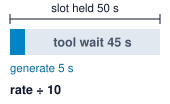{width="100%" fig-alt="A bracket labeled slot held 50 s spans one bar made of a short blue segment labeled generate 5 s and a long gray segment labeled tool wait 45 s, above the note rate divided by 10."}

*A kept slot is paid for across the whole cycle, not only while it generates.*
:::

The turn rate calculated from releasing slots is an ideal upper bound imposed strictly by memory capacity. In practice, prefill computation, state restoration bandwidth, PCIe bus contention, and scheduling queues introduce additional bottlenecks; compute throughput or interconnect bandwidth often saturates before memory is fully exhausted. Furthermore, if multiple trajectories share prefix blocks, those blocks remain pinned in memory even if one trajectory enters an idle wait.

Because Little's law fixes only the mean, the residency calculation also hides the peaks that agent workloads produce. Tool executions frequently complete together, as in the correlated return burst of @sec-vol3-kv-cache-uncertain-returns, and tree-search agents fan out into many candidate paths at once, so instantaneous memory demand rises well above the average for as long as the burst lasts. Robust capacity planning must therefore stress-test the empirical distributions of prompt length, dynamic output expansion, search branching, and tool latencies against both device-level physical boundaries and strict service-level latency objectives.

These dynamics manifest differently across agent architectures. The software repair agent operates in a batch-like regime characterized by deep context windows and prolonged tool waits during test suite runs. By contrast, the customer support agent (lighthouse \ref{lhs-vol3-support-agent}) services numerous concurrent, short sessions where users wait interactively for low-latency responses. These contrasting profiles place divergent demands on the key-value pool and require distinct sharing and retention strategies.

```{python}
#| label: kv-residency-archetype-calc
#| echo: false
# ┌─────────────────────────────────────────────────────────────────────────────
# │ RESIDENCY BY ARCHETYPE: REPAIR AGENT VS. SUPPORT AGENT
# ├─────────────────────────────────────────────────────────────────────────────
# │ Context: @sec-vol3-kv-workload-dynamics, lhs-05-residency-by-archetype.
# │ Goal: Contrast sharing gain, residency tax, and resume cost per workload.
# │ Show: fit 48 -> 60 (repair) vs. 195 -> 780 (support); 10x vs. 11x tax;
# │       1.3 s vs. 0.33 s recompute against 21 ms vs. 5 ms reload.
# │ How: KvGeometry pool and m_token; PausedStateChoice link and sustained
# │      rate; AgentCapacity repair residence. Support inputs come from the
# │      Agents.Support.CustomerOps workload profile (teaching assumptions).
# └─────────────────────────────────────────────────────────────────────────────
from math import floor
from mlsysim import *
from mlsysim.fmt import check, fmt_int, fmt_multiple, fmt_percent, fmt_time, MarkdownStr

def _kv_fit(ctx, shared):
    """Sessions that fit when `shared` prefix tokens are stored once and the rest privately."""
    private = ctx - shared
    return floor(((KvGeometry.kv_pool - shared * KvGeometry.bytes_per_token) / (private * KvGeometry.bytes_per_token)).to("").magnitude)

class ResidencyByArchetype:
    # ┌── 1. LOAD (Constants) ──────────────────────────────────────────────────
    m_token = KvGeometry.bytes_per_token
    pool = KvGeometry.kv_pool
    link = PausedStateChoice.link
    rate = PausedStateChoice.rate
    n_params = PausedStateChoice.n_params
    support = Agents.Support.CustomerOps
    # Shared system prompt and tool schemas; scenario: the repair deployment's
    # prefix is taken to be the same length as the support profile's.
    common = support.shared_prefix.to("token").magnitude
    repair_ctx = KvGeometry.ctx_agent
    repair_gen = AgentCapacity.generation
    repair_wait = AgentCapacity.wait  # integration test
    support_ctx = support.session_context.to("token").magnitude  # policy prefix plus one customer's history
    support_gen = support.generation_residence  # generation residence per support turn
    support_wait = support.customer_reply_time  # customer reads and replies between turns

    # ┌── 2. EXECUTE (The Compute) ─────────────────────────────────────────────
    r_fit_unshared, r_fit_shared = _kv_fit(repair_ctx, 0), _kv_fit(repair_ctx, common)
    s_fit_unshared, s_fit_shared = _kv_fit(support_ctx, 0), _kv_fit(support_ctx, common)
    r_shared, s_shared = common / repair_ctx, common / support_ctx
    r_tax = ((repair_gen + repair_wait) / repair_gen).to("").magnitude
    s_tax = ((support_gen + support_wait) / support_gen).to("").magnitude
    r_recompute = (2 * n_params * repair_ctx * flop / rate).to(second)
    s_recompute = (2 * n_params * support_ctx * flop / rate).to(second)
    r_reload = (repair_ctx * m_token / link).to(ms)
    s_reload = (support_ctx * m_token / link).to(ms)
    r_recompute_share = (r_recompute / (repair_gen + repair_wait)).to("").magnitude

    # ┌── 3. GUARD (Invariants) ────────────────────────────────────────────────
    check(support_ctx == KvGeometry.ctx_short, "Support session must match the footprint table's short row")
    check((r_fit_unshared, s_fit_unshared) == (KvGeometry.conc_agent, KvGeometry.conc_short), "Unshared fits must match the footprint table")
    check(s_fit_shared / s_fit_unshared > 3.5 and r_fit_shared / r_fit_unshared < 1.5, "Sharing must pay for support, barely for repair")
    check(abs(r_tax - s_tax) < 2, "Both workloads pay a similar residency tax")
    check(abs((r_recompute / r_reload).to("").magnitude - (s_recompute / s_reload).to("").magnitude) < 1e-6, "Length cancels in recompute/reload")
    check(r_recompute_share < 0.03, "Prose claims repair recompute adds under 3 percent to its turn cycle")
    check(s_recompute > 50 * s_reload, "Support recompute must be far slower than reload")

    # ┌── 4. OUTPUT (Formatting) ───────────────────────────────────────────────
    common_str = fmt_int(common)
    repair_ctx_str, support_ctx_str = fmt_int(repair_ctx), fmt_int(support_ctx)
    r_fit_unshared_str, r_fit_shared_str = fmt_int(r_fit_unshared), fmt_int(r_fit_shared)
    s_fit_unshared_str, s_fit_shared_str = fmt_int(s_fit_unshared), fmt_int(s_fit_shared)
    r_shared_str = fmt_percent(r_shared, precision=1, style="symbol")
    s_shared_str = fmt_percent(s_shared, precision=0, style="symbol")
    r_gain_mult_str = fmt_multiple(r_fit_shared / r_fit_unshared, precision=2)
    s_gain_mult_str = fmt_multiple(s_fit_shared / s_fit_unshared, precision=0)
    repair_gen_str, repair_wait_str = fmt_time(repair_gen, "second", precision=0), fmt_time(repair_wait, "second", precision=0)
    support_gen_str, support_wait_str = fmt_time(support_gen, "second", precision=0), fmt_time(support_wait, "second", precision=0)
    r_tax_mult_str, s_tax_mult_str = fmt_multiple(r_tax), fmt_multiple(s_tax)
    r_recompute_str = fmt_time(r_recompute, "second", precision=1)
    s_recompute_str = fmt_time(s_recompute, "second", precision=2)
    r_reload_str = MarkdownStr(f"{fmt_int(r_reload.magnitude)} ms")
    s_reload_str = MarkdownStr(f"{fmt_int(s_reload.magnitude)} ms")
    r_cycle_str = fmt_time(repair_gen + repair_wait, "second", precision=0)
    r_recompute_share_str = fmt_percent(r_recompute_share, precision=1, style="prose")
```

::: {#lhs-05-residency-by-archetype .callout-lighthouse title="Attention-state residency by archetype"}

@Tbl-vol3-kv-residency-archetype puts the repair agent beside a support agent on the same node and pool. Both deployments share a `{python} ResidencyByArchetype.common_str`-token prefix of system prompt and tool schemas across all their sessions; that prefix carries no customer or repository data, so isolation permits sharing it across sessions. The scope is narrower than in notebook \ref{nbk-05-sizing-hbm-for-multi-turn-agent}, where repair workers on one repository snapshot also share their workspace state. The support agent's inputs are scenario values, not measurements.

| **Quantity**                        | **Repair agent**                                                                                          | **Support agent**                                                                                            |
|:------------------------------------|:----------------------------------------------------------------------------------------------------------|:-------------------------------------------------------------------------------------------------------------|
| Retained tokens per session         | `{python} ResidencyByArchetype.repair_ctx_str`                                                            | `{python} ResidencyByArchetype.support_ctx_str`                                                              |
| Shared fraction of each session     | `{python} ResidencyByArchetype.r_shared_str`                                                              | `{python} ResidencyByArchetype.s_shared_str`                                                                 |
| Resident sessions, unshared         | `{python} ResidencyByArchetype.r_fit_unshared_str`                                                        | `{python} ResidencyByArchetype.s_fit_unshared_str`                                                           |
| Resident sessions, prefix shared    | `{python} ResidencyByArchetype.r_fit_shared_str`                                                          | `{python} ResidencyByArchetype.s_fit_shared_str`                                                             |
| Generation, then idle wait per turn | `{python} ResidencyByArchetype.repair_gen_str`, then `{python} ResidencyByArchetype.repair_wait_str` test | `{python} ResidencyByArchetype.support_gen_str`, then `{python} ResidencyByArchetype.support_wait_str` reply |
| Residency tax if kept               | `{python} ResidencyByArchetype.r_tax_mult_str`                                                            | `{python} ResidencyByArchetype.s_tax_mult_str`                                                               |
| Resume by reload vs. recompute      | `{python} ResidencyByArchetype.r_reload_str` vs. `{python} ResidencyByArchetype.r_recompute_str`          | `{python} ResidencyByArchetype.s_reload_str` vs. `{python} ResidencyByArchetype.s_recompute_str`             |
| Who waits on the resume             | The harness, behind a long test                                                                           | A customer, for the first token                                                                              |

: **Residency by archetype**: Payload fits use the unrounded KV pool of @tbl-vol3-kv-payload-fit without headroom or output allowance, so they exceed the block-rounded bounds computed earlier; resume times use the node's host links and sustained prefill rate from the paused-state comparison. {#tbl-vol3-kv-residency-archetype tbl-colwidths="[34,33,33]"}

**Systems insight**: Prefix sharing yields dramatically asymmetric benefits across these two archetypes. Sharing the common prompt prefix expands the support agent's resident session capacity `{python} ResidencyByArchetype.s_gain_mult_str`, yet yields only a `{python} ResidencyByArchetype.r_gain_mult_str` expansion for the repair agent, because the shared prefix constitutes a far larger fraction of each support session's total context. Repair sessions recover a large sharing gain only when the scope widens to a common workspace, which raised the fit `{python} AgentCapacity.share_gain_mult_str` in the capacity notebook. While both workloads pay a similar residency tax, the optimal pause policy diverges based on who waits for the resume. The repair agent should migrate its state to host memory during tests, as the regime analysis of @fig-vol3-swapping-tradeoff recommends, and it can fall back to dropping the state when host memory is tight, since recomputation adds only `{python} ResidencyByArchetype.r_recompute_share_str` to a `{python} ResidencyByArchetype.r_cycle_str` turn cycle where an automated test harness waits. In contrast, the support agent should keep or move its state and avoid dropping it, because recomputation lands directly in front of an interactive user as added delay to the first token. For support workloads, the decision that matters most is therefore what happens to each session's private history beyond the shared prefix. Rebuilding that history is what the customer waits for, so keeping or moving it, not enlarging the shared prefix, protects the first token.

:::

### KV pool telemetry {#sec-vol3-kv-telemetry-metrics}

A single aggregate metric such as occupied pool fraction cannot distinguish healthy, amortized caching from an impending allocation failure. A memory pool at high utilization composed mostly of discardable dormant prefixes can easily admit a new request through cheap reclamation. Conversely, that same utilization level with all blocks pinned by active decoding leaves no headroom for context expansion. @Tbl-vol3-kv-pool-states establishes the physical categories required to interpret these operational states.

| **Pool state**            | **Accounting and consequence**                                                                                                                                              |
|:--------------------------|:----------------------------------------------------------------------------------------------------------------------------------------------------------------------------|
| Active or pinned          | Count each physical block once, even when several requests reference it. It cannot be reclaimed while any required owner or operation still uses it.                        |
| Reserved or in flight     | Count additional blocks unavailable for admission because they are reserved or being populated, copied, or transferred. Exclude blocks already counted as active or pinned. |
| Reclaimable dormant cache | Count retained blocks that have no required active or in-flight use and can be discarded under the service's policy. Reclaiming them can remove a future reuse opportunity. |
| Genuinely free            | Count blocks immediately available to allocate, with no live owner, unfinished operation, or reservation.                                                                   |

: **Physical pool accounting**: Apply the rows in order so each block belongs to exactly one category at a given instant. Logical references are tracked separately from physical storage. {#tbl-vol3-kv-pool-states tbl-colwidths="[28,72]"}

Evaluating blocks in this strict order ensures that every physical block belongs to exactly one state at any given instant. For instance, while a paused trajectory's private blocks are being copied out to host memory, each source block stays in the first row, pinned by the transfer that still reads it, and becomes reclaimable only when the copy completes. On the return trip, the device blocks allocated to receive the reload sit in the second row until the transfer lands. Similarly, a dormant prefix is reclaimable only when all dependent references and asynchronous operations have cleared. This taxonomy exposes true admission capacity without double-counting shared blocks or assuming that eviction requests free memory instantaneously.

Physical pool accounting provides only the static half of the operational picture; it must be coupled with continuous telemetry on throughput, work volume, and latency. A production telemetry pipeline should record offered request rates, prompt and completion token volumes, the token-weighted prefix hit rate of @eq-hprefix, eviction and restoration bandwidth, recomputed tokens, and the distribution of tool wait and resumption intervals. Operators must evaluate these metrics alongside concrete latency targets: admission delay in the scheduling queue, time to first token, inter-token latency, and state resumption delay. Relying on hit rates in isolation can be deceiving: a high reuse fraction can coexist with long scheduling queues, while high eviction counts may be entirely benign if the discarded prefixes represent cold sessions that will never be queried again.

The definitive signature of memory thrashing is **cache churn**\index{Cache churn!definition}: the rapid cycle of evicting blocks only to reload or recompute them shortly thereafter.[^fn-thrashing-load-control] When cache churn coincides with degrading tail latency or falling completed work under sustained offered load, it signals that the aggregate working set of active trajectories has overrun physical memory capacity. Resolving this collapse requires adjusting admission policies, offload thresholds, or scheduling priorities. Because the critical memory occupancy threshold at which churn begins varies across allocators and workload compositions, operators must correlate physical pool states with queue dynamics rather than relying on a static utilization ceiling. Furthermore, this diagnostic boundary matters across system layers: client applications consuming remote API endpoints observe only black-box latency and error codes, whereas infrastructure operators have access to the physical block states, page tables, and transfer telemetry required to perform root-cause remediation.

[^fn-thrashing-load-control]: **Thrashing**: Multiprogrammed virtual-memory systems of the 1960s encountered this exact pathology: when the aggregate working sets of resident programs exceeded main memory, page faults forced continuous eviction of recently used pages, and processors spent their execution cycles servicing I/O rather than executing instructions [@denning1968thrashing]. The solution was explicit load control: restricting the multiprogramming level until the working sets of admitted programs fit comfortably in physical memory. In agentic KV cache serving, the corresponding remedy is admission control against the retained state of active trajectories, rather than tuning eviction algorithms to page faster. \index{Thrashing!KV churn}

By coupling resident-fit bounds with precise telemetry across physical block states, systems engineers can accurately determine which KV states must remain pinned, which blocks can be safely reclaimed or offloaded, and the exact latency cost that state restoration imposes on end-to-end agent execution.

::: {#chk-vol3-kv-capacity-diagnosis .callout-checkpoint title="Fit, pressure, and completed work"}

Two runs report the same occupied fraction, but one holds mostly dormant prefixes and the other holds mostly active state.

- [ ] **Physical ownership**: Can you explain why their immediate admission options differ and how a shared block should be counted?
- [ ] **Sharing estimate**: If the common prefix in the notebook shrank to `{python} AgentCapacity.common_half_str` tokens, estimate the shared fraction $\SharedPrefixFraction$ and the sharing gain from $1/(1-\SharedPrefixFraction)$. Would sharing still more than double the resident-fit bound?
- [ ] **Residency tax**: If the hypothetical wait doubles while generation residence stays fixed, by what factor does the retained-slot rate constraint fall, and does the case for moving state get stronger or weaker?
- [ ] **Policy evidence**: Which workload, restoration, and latency measurements would distinguish useful eviction from repeated churn?

:::
## Fallacies and Pitfalls {#sec-vol3-kv-cache-fallacies}

Engineering high-performance KV cache management requires navigating subtle interactions among memory geometry, request scheduling, and agent lifecycle dynamics. Many common architectural missteps stem from conflating raw memory capacity with sustained serving throughput, or mistaking cached intermediate activations for semantic ground truth. The following fallacies and pitfalls highlight where system designers frequently misjudge these trade-offs, along with the costs estimated on the reference node.

::: {.fallacy-pitfall}
**Fallacy**: *Model size, not retained context, decides how many sequences a node can serve.*

Static model weights consume a fixed footprint allocated at initialization, leaving a `{python} KvGeometry.kv_pool_str` pool dedicated to dynamic attention state on the reference node. While model parameters establish the initial baseline headroom, the active context length of running sequences overwhelmingly governs dynamic memory consumption. Holding the model constant, that memory pool accommodates `{python} KvGeometry.conc_short_str` unshared sequences when context is kept to `{python} KvGeometry.ctx_short_str` tokens, but capacity plunges to just `{python} KvGeometry.conc_long_str` concurrent sequences once context expands to `{python} KvGeometry.ctx_long_str` tokens (@sec-vol3-kvcache-geometry). Retained context length serves as the primary operational lever governing system concurrency, and the agent harness dictates that length through its prompt construction, tool history, and conversation buffering. Swapping in a smaller model only increases concurrent serving capacity to the extent that it reduces the per-token memory footprint $\KvCacheBytesPerToken$ or frees up additional accelerator memory for the KV pool.
:::

::: {.fallacy-pitfall}
**Pitfall**: *Reserving every request's maximum context.*

Allocating contiguous memory upfront for each request's worst-case context length severely throttles system throughput through internal fragmentation. When a serving system sizes every slot for a `{python} StaticReservation.s_max_str`-token cap while requests average a final length of only `{python} StaticReservation.mean_final_tokens_str` tokens, barely `{python} StaticReservation.efficiency_str` of the allocated memory actually holds valid attention state upon completion. Under this static reservation regime, the reference pool can admit only `{python} StaticReservation.reservations_str` concurrent sequences. In contrast, paged virtual memory allocation dynamically allocates physical blocks on demand, giving the final-length snapshot estimate of approximately `{python} PagedWaste.fit_paged_str` over the same physical memory (@sec-vol3-kvcache-pagedattention). Systems should allocate memory blocks incrementally as tokens arrive during prefill and generation, reserving the output allowance the admission controller promises, as the capacity notebook does, rather than the full context cap.
:::

::: {.fallacy-pitfall}
**Fallacy**: *Compatible cached attention state proves that its evidence is current.*

Prefix caching operates strictly at the level of token identifiers and model configurations, without semantic awareness of environment state or external reality. On the reference node, a prefix match on the agent repair loop's `{python} PrefixHit.prefix_str`-token invariant prompt saves roughly `{python} PrefixHit.rebuild_str` of prefill computation per turn (@sec-vol3-kvcache-radix-tree). The inference engine achieves that speedup regardless of whether those cached tokens reflect stale diagnostics from revision 17 (r17) or up-to-date observations from the current repository source. Prefix match compatibility only confirms that the token sequence and attention architecture match bit-for-bit. Determining whether an earlier r17 failure supports a claim about revision 18 (r18) requires semantic validation in the agent harness before serializing the prompt. Updating the prompt with fresh r18 observations breaks prefix reuse at the first modified token and forfeits part of that computational saving. That forfeited saving is the correct price of grounding the next decision in current evidence (principle \ref{pri-vol3-source-authority}).
:::

::: {.fallacy-pitfall}
**Pitfall**: *Always moving paused state out of accelerator memory.*

Blindly offloading KV cache blocks to host memory whenever an agent pauses to execute an external tool wastes interconnect bandwidth and inflates resumption latency. Evacuating the `{python} PausedStateChoice.state_str` attention state for a paused repair agent requires `{python} PausedStateChoice.transfer_str` of link transfer, which adds `{python} PausedStateChoice.in_str` of overhead before the model can resume generation. When the memory pool contains plenty of free blocks, this offload latency provides zero benefit to the system. Conversely, under heavy contention, offloading that same state frees valuable high-bandwidth accelerator memory for `{python} PausedStateChoice.demand_free_str` across an extended `{python} PausedStateChoice.wait_str` tool invocation (@sec-vol3-kvcache-swapping). Serving schedulers must evaluate eviction dynamically based on uniquely reclaimable blocks, active queue pressure, and expected resumption deadlines. An external tool call marks an opportunity for scheduling decisions rather than an automatic eviction trigger.
:::

::: {.fallacy-pitfall}
**Fallacy**: *A resident-fit count is a throughput guarantee.*

Calculating how many concurrent request snapshots fit into physical accelerator memory establishes an instantaneous capacity limit, not a sustained throughput guarantee. The reference node fits `{python} AgentCapacity.fit_unshared_str` unshared repair trajectories in memory simultaneously. However, if those sessions hold their memory allocations across an idle `{python} AgentCapacity.wait_str` tool pause, the node sustains a maximum of only `{python} AgentCapacity.retained_rate_value_str` turns/s from memory alone. If the engine instead releases those memory slots during the pause, the memory-only throughput bound rises to `{python} AgentCapacity.released_rate_value_str` turns/s (notebook \ref{nbk-05-residency-tax}). Memory fit dictates maximum concurrency ($\MeanSlotOccupancy$), but Little's law ($\MeanSlotOccupancy = \ArrivalRate \MeanHoldTime$) dictates that arrival throughput ($\ArrivalRate$) is governed equally by mean residence time ($\MeanHoldTime$). When agent turns involve long execution pauses or queueing delays, residence time inflates and throughput collapses even though memory looks full. Occupancy stays high, but most of the resident state is idle, so the turn rate is low. Schedulers must validate admission against offered traffic distributions, burst arrivals, and latency targets rather than relying on static slot counts.
:::

::: {.fallacy-pitfall}
**Pitfall**: *Treating KV storage as the authoritative task record.*

The KV cache is a hardware-bound optimization artifact, not a durable system of record. Dropping the `{python} PausedStateChoice.state_str` repair state from accelerator memory costs approximately `{python} PausedStateChoice.reconstruct_str` of prefill compute to rebuild from raw tokens, and it forfeits zero evidence needed by the task. Retaining or serializing KV cache tensors merely preserves intermediate, activation-level computation tied to a specific hardware layout, model architecture, and numerical precision. It does not record the authoritative code revisions, environment observations, or validation evidence that govern an agent's task progression. Systems must persist trajectory history, tool outputs, and verification state in a durable application runtime. The KV cache should always be treated as an ephemeral, recomputable cache over that authoritative token log, reproducible up to floating-point differences across distinct implementations.
:::

## Summary {#sec-vol3-kv-cache-summary}

Retained key-value (KV) attention state is fundamentally a cache of intermediate computation. Like any cache in a computer system, its cost has two dimensions: capacity and residency. Capacity represents the physical bytes allocated in high-bandwidth memory, determined by the model's tensor geometry and active sequence length. Residency represents the duration for which a sequence occupies those bytes across token generation cycles and tool execution stalls. Allocation granularity and prefix sharing dictate how many bytes are stranded by internal fragmentation or duplicated across concurrent branches. Meanwhile, residency converts raw physical capacity into sustainable system throughput: an agent blocked on an external tool environment still occupies accelerator memory, reducing the concurrent request load a serving node can support. Every memory management policy examined in this chapter (paged block tables, tree-based prefix eviction, offloading, and recomputation) navigates this trade-off between memory footprint, recomputation overhead, and scheduling delay. Cache mechanisms manage physical storage, but they cannot assess whether cached tokens remain semantically valid; context validity remains strictly the responsibility of the agent harness and the context it supplies.

@Tbl-vol3-kv-cache-key-equations summarizes the primary analytical relations used throughout this chapter to size, share, schedule, and reclaim key-value cache storage.

| **Equation**                                                                                                                                                                                                                                            | **What it bounds or decides**                                                                                                   | **Where derived**                  |
|:--------------------------------------------------------------------------------------------------------------------------------------------------------------------------------------------------------------------------------------------------------|:--------------------------------------------------------------------------------------------------------------------------------|:-----------------------------------|
| $\KvCacheBytesPerToken = 2 \cdot \LayerCount \cdot \KvHeadCount \cdot \AttentionHeadDimension \cdot \ElementStorageSize$, $\; \KvCacheMemory = \SequenceLength \cdot \KvCacheBytesPerToken$                                                             | Bytes retained per token and per sequence; retained sequence length serves as the primary capacity driver                       | @eq-mem-token                      |
| $0 \le \KvBlockTailWaste \le \KvBlockSize - 1$                                                                                                                                                                                                          | Per-sequence internal fragmentation slack in paged allocation; dictates the capacity impact of block size $\KvBlockSize$        | @sec-vol3-kvcache-pagedattention   |
| $\PrefixHitRate = \sum_{i} \ReusedPrefixLength^{(\WorkloadRequestIndex)} / \sum_{i} \PromptLength^{(\WorkloadRequestIndex)}$                                                                                                                            | Effective prefix hit rate: the proportion of prompt tokens served directly from reusable cached state                           | @eq-hprefix                        |
| $\sum_{i} \PrefillAllocatedTokenCount_i + \lvert\DecodeRequestSet\rvert \le \IterationTokenBudget$                                                                                                                                                      | Chunked prefill admission budget alongside active decodes; controls inter-token generation latency                              | @eq-kv-token-budget                |
| $\KvReloadTime / \KvRecomputeTime = \KvCacheBytesPerToken \AttainableComputeRate / (2 \Parameters \, \HostLinkBandwidth)$                                                                                                                               | Crossover ratio determining whether paused state is restored faster via interconnect reload or local recomputation              | @eq-kv-reload-ratio                |
| $\KvPoolMemory = \NodeHbmCapacity - \WeightMemory - \RuntimeReserveMemory$                                                                                                                                                                              | Dynamic high-bandwidth memory available for the KV cache pool after allocating model weights and runtime workspace              | @eq-mkv-pool                       |
| $\lceil \SharedPrefixLength/\KvBlockSize \rceil + \BatchSize \lceil (\SequenceLength + \OutputLimit - \SharedPrefixLength)/\KvBlockSize \rceil \le \lfloor (1-\KvPoolHeadroomFraction) \KvPoolMemory / (\KvBlockSize \, \KvCacheBytesPerToken) \rfloor$ | Maximum resident concurrency $\BatchSize$ under block quantization, memory headroom, and a shared prefix                        | @eq-kv-demand-shared               |
| $1/(1-\SharedPrefixFraction)$                                                                                                                                                                                                                           | Theoretical upper bound on capacity gain from prefix sharing in large memory pools with shared fraction $\SharedPrefixFraction$ | @sec-vol3-kv-capacity-formulations |
| $\MeanSlotOccupancy = \ArrivalRate \MeanHoldTime$                                                                                                                                                                                                       | Turn throughput sustained by a fixed pool of resident slots (via Little's law)                                                  | @eq-vol3-littles-law               |
| $1 + \ToolTime/\ModelTime$                                                                                                                                                                                                                              | Residency tax factor: capacity lost when sequences occupy memory slots during idle tool waits                                   | @sec-vol3-kv-workload-dynamics     |

: **Key equations**: Each relation holds under the chapter's assumptions of full causal attention, uniform layer geometry, and tensor payload that excludes allocator metadata. {#tbl-vol3-kv-cache-key-equations tbl-colwidths="[46,36,18]"}

::: {.callout-takeaways title="Managing derived attention state"}

* **Retained length is the capacity knob**: With model weights occupying a static allocation, resident capacity scales inversely with retained sequence length, falling from `{python} KvGeometry.conc_short_str` sequences at `{python} KvGeometry.ctx_short_str` tokens down to `{python} KvGeometry.conc_long_str` sequences at `{python} KvGeometry.ctx_long_str` tokens on the reference node. A context length that easily satisfies the model architecture's maximum context window can still quickly exhaust the serving node's physical memory pool.
* **Physical blocks, not logical references, consume capacity**: Paged attention rounds private sequence state up to fixed-size blocks, whereas identical prefix sequences share physical blocks through reference counting. Reclaiming a finished trajectory frees only those physical blocks whose reference count drops to zero, ensuring active sequences and asynchronous transfer operations remain protected.
* **Prefix reuse requires both structural compatibility and memory availability**: Matching token prefixes permit KV cache reuse only when the corresponding physical blocks remain resident and accessible under tenant-isolation rules. A cache hit guarantees neither the freshness of underlying external data nor the semantic validity of the trajectory; preserving cache affinity must never prevent an agent harness from invalidating stale context.
* **Retention policies and compute schedulers manage complementary resources**: Chunked prefill schedules incoming prompt tokens alongside active decodes to prevent high latency spikes during token generation. Similarly, each way of handling a paused agent trajectory (retaining its blocks in accelerator memory, offloading them to host RAM or secondary storage, or recomputing them on demand) exchanges memory footprint for interconnect bandwidth and resumption latency. The optimal strategy depends on the link bandwidth and the expected wait duration.
* **Idle tool waits impose a severe residency tax on throughput**: Static resident-fit bounds govern instantaneous occupancy rather than sustained request throughput. Holding physical cache blocks resident while an agent waits on external tools or human feedback depresses sustainable turn throughput by the residency tax factor $1 + \ToolTime/\ModelTime$. Production admission and eviction policies must therefore optimize for end-to-end task completion rates and tail latency rather than raw accelerator memory utilization.

:::

Attention state derived from the token prefix (principle \ref{pri-vol3-prefix-coherence})\index{Principle!attention state is derived from the token prefix} enables the serving engine to reuse previous computation rather than evaluating redundant prompt tokens. Precise block tracking and residency accounting quantify the trade-off between retaining that state and freeing high-bandwidth memory for active generation. Throughout these optimizations, source authority remains paramount (principle \ref{pri-vol3-source-authority}): an inexpensive continuation never justifies serving an obsolete observation when the underlying system or environment has changed.

## Historical Perspective and Further Reading {#sec-vol3-kv-cache-history}

Almost every memory management technique in this chapter resolves an architectural problem that time-sharing operating systems encountered decades ago. When early programs outgrew physical core memory, the Manchester Atlas one-level store introduced paging [@kilburn1962onelevel]: an address translation table mapped a program's contiguous virtual address space onto scattered physical page frames, freeing programmers from managing manual overlays and allowing memory to allocate without contiguous physical reservations. Decoupling virtual addresses from physical layout promptly exposed new systems trade-offs. @randell1969fragmentation formalized the distinction between internal fragmentation (storage lost inside rounded-up allocations) and external fragmentation, where free memory sits stranded between allocations. @belady1966study demonstrated that optimal offline page replacement requires clairvoyant knowledge of future memory references, establishing that practical online policies must rely on heuristics. When memory pressure mounted, time-sharing systems routinely collapsed into thrashing, spending virtually all cycles swapping pages rather than executing user code. Denning's working-set model clarified the dynamics of this failure and proved that the only dependable remedy was admission control: admitting fewer concurrent processes rather than swapping pages more aggressively [@denning1968; @denning1968thrashing]. Operating systems also pioneered fine-grained memory sharing. The TENEX system introduced copy-on-write sharing so that multiple processes could reference identical pages safely until one attempted a mutation [@bobrow1972tenex], while Morrison's PATRICIA trees indexed strings through shared prefixes [@morrison1968patricia]. @denning1970 gathered these foundations into the virtual-memory discipline that computer systems curricula teach to this day.

Modern inference serving collided with these identical capacity limits when the autoregressive Transformer architecture made each generated token attend to key and value tensors from all prior tokens [@vaswani2017]. Early efforts mitigated this growth by modifying the neural network architecture itself. Multi-query attention [@shazeer2019fast] and grouped-query attention [@ainslie2023gqa] reduced the memory footprint by sharing key-value heads across multiple query heads. In parallel, @pope2023efficiently developed an analytical framework showing that accelerator memory capacity and memory bandwidth, rather than floating-point compute throughput, impose the primary bottleneck on context length and batch concurrency.

Subsequent innovations in serving systems recapitulated the operating-systems lineage directly. Orca introduced iteration-level scheduling, enabling fine-grained preemption and dynamic batching where requests join and leave running batches on individual token boundaries [@yu2022orca]. PagedAttention adapted classical virtual paging directly to key-value cache management, using block tables and copy-on-write mechanisms to eliminate external fragmentation and reclaim the memory previously wasted by reserving contiguous worst-case sequence lengths [@kwon2023vllm]. SGLang introduced radix-tree prefix caching with leaf-first eviction, enabling structural cache reuse across independent requests that share common system prompts or few-shot exemplars [@zheng2024sglang]. To prevent lengthy prompt ingestions from stalling generation, Sarathi introduced chunked prefill, bounding the latency spikes that prefill operations impose on active decode iterations [@agrawal2023sarathi]. Finally, DistServe and Splitwise extended this decoupling across physical hardware nodes through phase disaggregation, placing the prefill and decode stages on separate, specialized worker pools [@patel2024; @zhong2024distserve].

Agent workloads introduce the memory dilemma at the center of this chapter: execution state that idles during tool execution and subsequently resumes. When an agent invokes an external tool, its execution thread pauses while waiting for external API responses or environment feedback. During this idle window, the retained KV cache ties up expensive accelerator high-bandwidth memory. Work on tool interception formalized this challenge by framing KV cache lifecycle management around three primary operations: keeping the state resident in device memory, swapping it to host memory or storage, or dropping it entirely to recompute upon resumption [@abhyankar2024infercept]. This trade-off balances idle memory capacity against host-to-device transfer bandwidth and compute recomputation costs. Multi-turn serving systems such as CachedAttention and Mooncake expanded this design space into multi-tier memory hierarchies, paging dormant KV caches out to host DRAM and disaggregated solid-state storage clusters [@gao2024cachedattention; @qin2024mooncake]. Lossy approximation techniques pursued an alternative path, trading mathematical fidelity for reduced memory footprints through attention sinks [@xiao2024streamingllm] and score-based eviction policies [@zhang2023h2o]. However, whether lossy cache approximation can reliably preserve the intricate, long-range dependencies required across extended agent trajectories remains an open systems and modeling challenge.

For readers seeking to trace the lineage from classical memory management to agent serving infrastructure, six works are especially illuminating:

- @denning1970 provides the foundational survey of paging, replacement algorithms, and locality of reference, showing how modern KV-cache management problems mirror classical virtual memory challenges transposed onto a new architectural storage unit.
- @denning1968 introduces the working-set model, establishing the formal link between program locality and resource allocation. It provides the theoretical foundation for admission control, explaining why multi-tenant model servers must reject or queue requests when aggregate memory demand exceeds physical accelerator capacity.
- @pope2023efficiently develops an analytical model for large-model inference, demonstrating rigorously how attention head sharing, tensor partitioning, and memory bandwidth dictate whether a deployment is bounded by arithmetic throughput or memory capacity.
- @kwon2023vllm introduces PagedAttention, adapting classical operating system paging, virtual block tables, and copy-on-write mechanisms to eliminate KV cache fragmentation in serving engines. It serves as an exemplary case study in translating classical systems principles to modern accelerator architectures.
- @zheng2024sglang structures prompt cache management through radix trees, treating token prefix reuse as a first-class scheduling and eviction problem in multi-turn and agentic serving workloads.
- @abhyankar2024infercept formalizes the tool-wait problem in agent workloads, quantifying the engineering trade-offs among retaining, swapping, and discarding KV cache state during external tool execution.

## Exercises {#sec-vol3-kv-cache-exercises}

Unless a problem states otherwise, use the hypothetical reference deployment in @tbl-vol3-kv-cache-exercise-givens. Its values are problem inputs chosen for round arithmetic, not measurements of any system. Take GB as $10^9$ bytes, count $2\Parameters$ weight operations per processed token, and model one engine iteration over $\ForwardPassTokenCount$ token positions with the chapter's weight-only estimate, $\WeightOnlyStepTime(\ForwardPassTokenCount) = \max\left(5\;\text{ms},\; 2 \Parameters \ForwardPassTokenCount / \AttainableComputeRate\right)$.

| **Quantity**                                  | **Symbol**                                               | **Given**                       |
|:----------------------------------------------|:---------------------------------------------------------|:--------------------------------|
| Model parameters                              | $\Parameters$                                            | $50 \times 10^{9}$              |
| Layers, key-value heads, head dimension       | $\LayerCount$, $\KvHeadCount$, $\AttentionHeadDimension$ | 48, 8, 128                      |
| Bytes per stored KV element                   | $\ElementStorageSize$                                    | 2                               |
| KV pool after weights and runtime reserve     | $\KvPoolMemory$                                          | 400 GB                          |
| Sustained prefill rate                        | $\AttainableComputeRate$                                 | $2 \times 10^{15}$ operations/s |
| Weight-read floor of one iteration            |                                                          | 5 ms                            |
| Aggregate host-link bandwidth, each direction | $\HostLinkBandwidth$                                     | 400 GB/s                        |

: **Reference deployment for the exercises**: Hypothetical givens shared by the problems below. {#tbl-vol3-kv-cache-exercise-givens tbl-colwidths="[46,28,26]"}

**1. Sizing retained state for a session target (Basic).** An operator must hold 200 unshared sessions resident at once, each retaining 16,384 tokens.

(a) Compute $\KvCacheBytesPerToken$ from @eq-mem-token, the payload $\KvCacheMemory$ of one session, and the resident-fit bound in the pool.
(b) A multi-head variant of the same model stores 64 key-value heads per layer instead of 8. Compute its fit, and explain why no allocator policy can recover the difference.
(c) Two proposals would meet the target: storing KV at one byte per element, or having the harness cap retained context. Find the longest retained length that meets the target at two bytes per element. Then argue which proposal to try first and what evidence each must produce before it ships.

**2. When paging pays (Basic).** Static reservation sizes every request for a cap of 8,192 tokens. The request population's mean final length is 3,072 tokens.

(a) What fraction of a reservation holds state at completion, and how many reservations fit in the pool?
(b) Paged allocation uses 32-token blocks, and final lengths have uniformly distributed remainders modulo the block size. Estimate the mean tail waste per sequence, its share of allocated KV memory, and the final-length snapshot count estimated by dividing the pool by the mean allocation. Repeat for 256-token blocks. Does this estimate alone determine live admission capacity?
(c) If the mean final length rose to 7,000 tokens under the same cap, how much of paging's capacity advantage over static reservation would remain? Name one benefit of block allocation that does not depend on the length distribution.

**3. Moving one field (Basic).** A session sends four requests of 6,000 prompt tokens each. The first 4,500 tokens are invariant instructions and tool schemas, except for a request timestamp serialized after the first 300 tokens. The service reuses only complete 256-token blocks; the first request finds nothing cached, and each later request finds the earlier state resident, compatible, and permitted.

(a) Compute $\PrefixHitRate$ from @eq-hprefix over the four requests.
(b) Recompute it after the harness moves the timestamp to follow the invariant prefix.
(c) For layout (b), how much weight-only prefill does each hit avoid, and how much more would a service that also reuses partial tail blocks avoid? Which change should the team make first?

**4. Choosing a chunk budget (Intermediate).** Forty-eight requests are decoding when an 8,000-token uncached prompt arrives.

(a) If the engine runs the prompt as one unit, what gap between tokens do the ongoing decodes see?
(b) The ongoing streams must see at most 25 ms between tokens. Using @eq-kv-token-budget with one position per decode, find the largest budget $\IterationTokenBudget$ and chunk size that meet the target, the number of iterations the prompt needs, and the time until its prefill completes.
(c) Ignoring the smaller final chunk, show that prefill completion is approximately $\left(2 \Parameters \UncachedPromptLength/\AttainableComputeRate\right) \cdot \Time / \left(\Time - 2 \Parameters \lvert\DecodeRequestSet\rvert / \AttainableComputeRate\right)$ for an inter-token target $\Time$ above the weight-read floor, where $\UncachedPromptLength$ is the uncached prompt length. Find the tightest $\Time$ that still completes the prompt within 500 ms.
(d) Explain why a target approaching $2 \Parameters \lvert\DecodeRequestSet\rvert / \AttainableComputeRate$ is unworkable, and propose a design change for a service whose streams need 8 ms between tokens while new prompts need their prefill within 500 ms.

**5. Reload, recompute, and a return burst (Intermediate).**

(a) Evaluate @eq-kv-reload-ratio for the reference deployment. How much faster is reload than recomputation, and why does the answer not depend on retained length?
(b) Below what sustained link bandwidth would recomputation become the faster way back?
(c) Forty paused sessions of 32,768 tokens each return at the same instant. Compute each session's state, its isolated reload time, the reload completion time of the last session when reloads share the full aggregate link rate, and the time to recompute all forty sequentially from weight work alone.
(d) Each returning session must be restored within 250 ms. How many of the forty meet that target if reloads share the link fairly, and how many if they are served one at a time in arrival order at the full link rate? Propose two design changes that would serve the rest.

**6. Shared prefix and residence time (Intermediate).** Requests carry 24,576 prompt tokens and an output allowance $\OutputLimit = 1{,}024$. A block-aligned common prefix of 16,384 tokens is compatible and shareable across all of them. Blocks hold $\KvBlockSize = 16$ tokens, and the planner withholds headroom $\KvPoolHeadroomFraction = 0.10$. Each turn generates for 4 s and then waits 36 s for a tool.

(a) Using @eq-kv-demand-shared, compute the usable blocks and the resident-fit bound without and with sharing. Compare the gain with $1/(1-\SharedPrefixFraction)$.
(b) The operator wants memory to sustain 10 turns/s. Using the shared fit and @eq-vol3-littles-law, what rate does keeping state through the wait sustain, and how many resident slots would the target require under that policy?
(c) Instead, each paused turn moves its private blocks to host memory and reloads them when the tool returns, while the common prefix stays resident for the other requests. Compute the memory-bound rate, the host-link traffic at 10 turns/s, and the restoration delay per turn. Is the link the binding resource?

**7. Fan-out over a shared source bundle (Advanced).** The research agent (lighthouse \ref{lhs-vol3-research-agent}) retrieves a 60,000-token bundle of source documents and fans the question out to 12 workers. Each worker's input is the bundle followed by a 2,000-token private instruction, and each may generate up to 3,000 tokens. A synthesis call then reads the bundle followed by all 12 worker outputs. Ignore block rounding and headroom.

(a) A contiguous allocator deep-copies the bundle's state into every worker. How much KV state does it copy? Compute the KV footprint of one question with and without block sharing, and how many questions each policy keeps resident in the pool.
(b) A developer serializes each worker's private instruction before the bundle so that the model reads its task first. What happens to the shared footprint in (a), and what layout serves both goals?
(c) For the synthesis call, how much weight-only prefill does a hit on the bundle avoid, and how much new prefill remains? Contrast the constraint that binds this workload with the one that binds the repair agent in this chapter.
(d) A platform team proposes reusing the bundle's KV state across different users' questions that retrieve the same documents. State the conditions under which that reuse is compatible, available, and permitted, and explain why a hit says nothing about whether the documents are current or trustworthy.

**8. Paused state through a human approval (Advanced).** The remediation agent (lighthouse \ref{lhs-vol3-remediation-agent}) proposes a production change and waits for human approval. During a major incident, 60 trajectories await approval at once. Each retains 20,000 tokens: an 8,000-token invariant prefix, identical and shareable across trajectories, followed by 12,000 tokens of incident-specific diagnostics. Each turn generates for 6 s, approval takes 10 minutes, and the host can hold 1 TB of parked state.

(a) Under the keep policy, what share of the pool do the 60 trajectories hold without sharing and with the prefix shared, and what residency tax does the approval wait impose?
(b) Suppose the private blocks move to host memory and the shared prefix stays resident. Compute the host footprint, and compare the time to restore 20 trajectories whose approvals arrive together by reload with the time to recompute their private regions sequentially.
(c) Before acting on an approval, the harness must re-observe production state (principle \ref{pri-vol3-source-authority}), and the refreshed observations replace the diagnostics from token 8,000 onward. How much of the parked state remains usable? Recommend a paused-state policy, and say how the recommendation changes if refreshed observations were only appended after the existing diagnostics.
(d) Compared with the repair agent, what binds this workload, and how large is its restoration cost relative to the wait?

::: {.callout-chapter-connection title="From reusable computation to durable information"}

Dropping the r18 request's attention state forfeits no evidence, because the serving engine can rebuild it from the token log. The repair's next session still needs that evidence once this serving session ends: the candidate at r18, the r17 failure, the passing reproducer, and the integration checks that remain unresolved. KV state can itself be moved or serialized, so storage location alone does not separate a cache from a memory. The unresolved problem is which information should persist, how it is identified and updated as its sources change, and how a later session retrieves evidence appropriate to its task. @Sec-vol3-long-term-memory develops that durable-information contract.

:::
