# Long-Term Memory {#sec-vol3-long-term-memory}

::: {layout-narrow}
::: {.column-margin}

\chapterminitoc

:::

::: {.content-visible when-format="pdf"}
\noindent
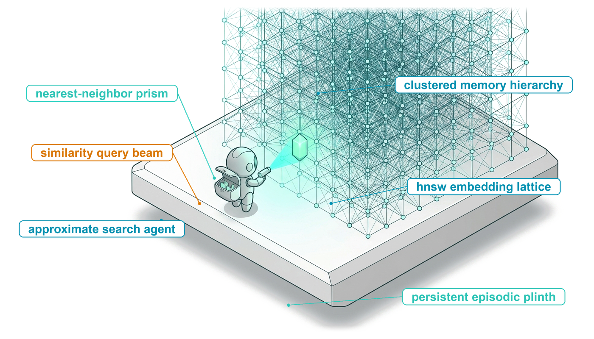{fig-alt="Blueprint for Persistent Storage."}
:::

::: {.content-visible unless-format="pdf"}
{fig-alt="Blueprint for Persistent Storage."}
:::

:::

## Purpose {.unnumbered .unlisted}

\begin{marginfigure}
\mlagentstack{0}{0}{0}{0}{100}{0}
\end{marginfigure}

_Why does an agent that can search everything it has ever stored still act on the wrong facts?_

A context window holds only the transient working state of an active turn; it cannot preserve knowledge across sessions, system restarts, or extended operational horizons. Providing an agent with persistent memory requires an external storage architecture that can index heterogeneous experiences, retrieve relevant historical context without polluting active prompts, and resolve conflicting observations over time. Yet semantic vector retrieval alone provides no temporal guarantees: stale facts, superseded code versions, and contradicted preferences score just as highly in cosine similarity as fresh ground truth. The runtime must treat every stored memory as a fallible claim requiring provenance, lease boundaries, and explicit invalidation mechanisms. Systems reliability depends on isolating persistent state behind strict consistency models rather than trusting the neural network to reconcile contradictory historical evidence.

::: {.content-visible when-format="pdf"}

\newpage

:::

::: {.callout-learning-objectives}

- Classify persistent records by their source, evidential role, and relationship to derived search representations
- Specify a retrieval contract that bounds access, returned content, resource use, and required freshness
- Choose among pre-staged evidence, a direct read, and model-directed search from how much of the need the task names
- Select retrieval methods for an information need and estimate multi-hop evidence against a serialized-token budget
- Design a memory write policy for admission, correction, supersession, expiry, and deletion
- Explain version-aware exclusion and fallback without mistaking removal of stale candidates for complete fresh retrieval
- Evaluate cross-session memory policies by task outcomes, update behavior, and total resource cost

:::
## Memory Beyond One Session {#sec-vol3-long-term-memory-introduction}

Consider an agent tasked with repairing a connection pool across multiple work sessions. When the initial session terminates, the subsequent run must reconstruct the operational state: the candidate source tree at revision `r18`, the diagnostic failure observed at `r17`, the passing run of `test_waiter_notified_on_return`, the integration checks that remain unresolved, and an operational note indicating where to resume execution. None of this state survives inside a transient context window once the process exits. Persisting only the final summary message discards critical supporting evidence. Conversely, retaining raw message transcripts without explicit scope creates confusion; an agent reading an unannotated log can easily mistake an earlier failure under `r17` for an error in the new candidate patch.

::: {.column-margin}
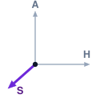{width="100%" fig-alt="H·S·A locator with the State axis highlighted."}

*Durable State, closed by checking each retrieved record against its source.*
:::

Standard runtime mechanisms do not bridge this gap. Context engineering selects among information already staged for a single model call, while the inference serving system maintains key-value (KV) attention cache state purely to accelerate that computation. Although a prefix cache can outlive an individual request, it remains a derived acceleration structure for a compatible prompt prefix (principle \ref{pri-vol3-prefix-coherence}), regardless of the storage medium holding it. Long-term memory addresses a fundamentally different systems problem: preserving information that must govern decisions across distinct invocations. A durable memory system must explicitly resolve what records to retain, how to index and retrieve them efficiently, and how to update or invalidate them when external sources change. In the formal framing of @sec-vol3-intro-hsa, these records constitute durable State ($S_3$), persisting across session boundaries.

Architecting persistent memory for an agent requires solving three interconnected systems problems. First, the data model must establish explicit record roles that keep external sources, tool observations, and agent-authored notes strictly differentiated, ensuring that subsequent sessions recognize what evidence each record supports. Second, the system requires a rigorous retrieval contract. Regardless of the candidate generation mechanism, every read must report its query scope, the snapshot versions it admitted, and whether the search terminated cleanly or degraded under resource budgets. Third, the storage engine needs a robust write lifecycle that admits, updates, supersedes, expires, and deletes records while propagating those mutations to downstream indexes and summaries.

@Sec-vol3-persistent-need establishes the foundation by classifying persistent record roles and demonstrating why retrieval and storage mechanisms share a single operational lifecycle. @Sec-vol3-persistent-governance formalizes the retrieval contract, followed by @sec-vol3-long-term-memory-agentic-retrieval, which contrasts static pre-call evidence staging with autonomous, model-directed search. Three subsequent sections match indexing strategies to specific query semantics: exact and lexical lookup in @sec-vol3-persistent-bm25, dense embedding spaces and hybrid fused ranking in @sec-vol3-persistent-dense-retrieval, and bounded graph traversal over interconnected entities in @sec-vol3-persistent-graphrag. To ensure consistency over time, @sec-vol3-long-term-memory-write-path governs admission and eviction policies, while @sec-vol3-persistent-invalidation prevents stale derived indexes from masking source mutations. Finally, @sec-vol3-persistent-governance-eval evaluates complete durable memory policies by their impact on multi-session task completion. Establishing record roles comes first, because every downstream indexing, retrieval, and invalidation policy depends on knowing what authority a stored record carries.

## Persistent Records {#sec-vol3-persistent-need}

When an autonomous agent repairs a system across multiple sessions, it relies on records that serve fundamentally different operational purposes. The repository source defines what the code looks like at a given commit; an execution log records how a test behaved under specific runtime parameters; a progress note guides the subsequent session on where to resume work. Systems designers must distinguish these roles explicitly. Retrieval strategies, cache validation, and deletion policies all depend on the operational function of the record in question.

### Record roles {#sec-vol3-long-term-memory-record-roles}

Most persistent state an agent consumes originates outside its execution loop—in version-controlled repositories, production databases, system configurations, and user profiles. Other records arise during execution, including raw environment observations, tool output traces, synthesized progress summaries, and speculative heuristics. Treating these diverse artifacts as undifferentiated "agent memory" obscures the critical distinction between a verifiable ground truth and a derived claim. @Tbl-vol3-memory-tiers categorizes these records by their architectural role in the evidence chain.

| **Record role**          | **Example**                                                                                    | **What a later use must preserve**                                                        |
|:-------------------------|:-----------------------------------------------------------------------------------------------|:------------------------------------------------------------------------------------------|
| Source record            | `src/pool.py` at a specified revision; the user's stated scheduling preference                 | The designated source, applicable version or scope, and access conditions                 |
| Observation or event log | The outcome of `test_waiter_notified_on_return` under recorded source, test, and configuration | What was observed, when, and under which conditions; gaps in the retained history         |
| Agent-written memory     | A progress note, session summary, or proposed repair lesson                                    | Supporting records, uncertainty, intended scope, and the policy for correction or removal |
| Derived retrieval index  | Search entries over source files, logs, or notes                                               | Which source generation produced the entry and how changes affect its use                 |

: **Roles of persistent records**: These are roles in an evidence chain, not a hierarchy of storage devices or universal levels of trust. One record can serve more than one role. {#tbl-vol3-memory-tiers tbl-colwidths="[23,33,44]"}

A **source of record**\index{Source of record!definition} is the designated authoritative origin for a specific claim. For example, the Git tree serves as the source of record for a file's contents at a particular commit hash, while an authenticated user message serves as the source of record for that user's operational constraints. Establishing a source of record defines where any downstream assertion must be validated. Importantly, it confers evidential provenance rather than absolute correctness: a repository commit may harbor a regression, and an inline code comment may contain unauthorized instructions. Under the principle that authority stays with the source (principle \ref{pri-vol3-source-authority})\index{Principle!authority stays with the source}, authority describes an evidentiary relationship between a claim and its origin, never an unconstrained permission grant. When an agent decouples its generated outputs from its source of record, catastrophic failures follow.

::: {#ws-06-moffatt-air-canada-2024 .callout-war-story title="A support chatbot contradicts its policy page (2024)"}

**Context**: In November 2022, following the death of his grandmother, passenger Jake Moffatt consulted the customer-support chatbot on Air Canada's website regarding bereavement fares [@moffatt2024aircanada]. Air Canada's formal bereavement policy, published on a separate page of the website, explicitly prohibited retroactive bereavement fare adjustments once travel was completed.

**Mechanism**: The chatbot erroneously informed Moffatt that he could purchase regular-fare tickets immediately and submit a bereavement refund claim within 90 days of ticket issuance, directly contradicting the airline's published policy. When Moffatt submitted his claim, Air Canada denied it based on the static policy page. Before the British Columbia Civil Resolution Tribunal, Air Canada argued that the chatbot was an independent legal entity responsible for its own actions.

**Impact**: The tribunal rejected Air Canada's argument, finding that the chatbot was an integral component of Air Canada's website and that the airline remained liable for all information published through it. Finding Air Canada liable for negligent misrepresentation, the tribunal ordered the airline to pay CA\$650.88 in damages (representing the difference between the full fare and the bereavement rate), alongside interest and statutory tribunal fees.

**Fix**: The tribunal dismissed the assertion that customers must independently reconcile conflicting guidance across different website pages, holding that deployers bear full responsibility for auditing and aligning interactive automated assistants with published corporate policies.

**Systems lesson**: \Advantage generated response is a derived artifact, yet users and legal frameworks treat it as an authoritative corporate commitment. Effective retrieval grounding requires staging the versioned source of record directly into the inference context and constraining generation strictly to claims supported by that text. Model fluency provides neither evidentiary validity nor legal protection.

:::

Through the taxonomy of @tbl-vol3-memory-tiers, the published policy page functioned as the source of record, while the chatbot's generated response was a derived artifact that diverged from ground truth. If a customer-support system logs its previous dialogue turns to inform future responses, those conversational turns become agent-written memory. They document past interactions, but they never constitute organizational policy.

Observation logs capture empirical execution history. When an agent tests a connection pool, an execution log showing a failure at revision `r17` remains invaluable diagnostic history even after revision `r18` resolves the bug. The subsequent passing run confirms that the specific reproducer succeeded under that exact environment configuration. An execution log provides primary evidence of what the system observed during a run, rather than proving the universal validity of any underlying program assertion. Retaining this historical record across machine restarts or worker failures requires durable persistence guarantees, as formalized in the execution contracts of @sec-vol3-durable-execution.

Agent-written memory synthesizes raw observations into structured artifacts for future execution steps, taking the form of scratchpad notes, session summaries, or learned heuristics. Condensing raw traces prevents repetitive computation and conserves context window capacity. However, summarization introduces significant failure modes: compression can strip vital boundary conditions or fabricate causal explanations. For instance, the observation that the targeted reproducer passed at `r18` is strictly justified by the execution log. In contrast, the generalized claim that connection-pool timeouts always stem from missed thread notifications asserts a universal rule that a single test execution cannot substantiate. Storing an unsupported generalization in a persistent database creates compounding errors in subsequent planning steps.

This divergence mirrors the foundational distinction from cognitive psychology [@tulving1972episodic] adopted by agent architectures: **episodic memory**\index{Episodic memory!definition} captures discrete, time-stamped events anchored to specific execution contexts, whereas **semantic memory**\index{Semantic memory!definition} stores generalized knowledge, rules, and abstractions extracted across multiple episodes. In an engineered system, semantic records are derived artifacts whose epistemic validity depends entirely on the fidelity and scope of the underlying episodic records.

\Advantage retrieval index serves as an auxiliary acceleration structure for locating information across storage tiers. While an index can store inverted token mappings, dense vector embeddings, or knowledge graph edges across source files, logs, and agent notes, indexing simply facilitates discovery. When a search query matches an index entry, a high similarity score demonstrates lexical or semantic affinity to the query string, but provides no assurance of operational applicability to the current task. Operational applicability depends on whether the referenced record matches the current system state, schema revision, and environment constraints.

### Read and write lifecycle {#sec-vol3-long-term-memory-read-write-lifecycle}

Consider the state of a code-repair agent immediately after it writes revision `r18`. If its vector or keyword index was generated from revision `r17`, a retrieval query for `src/pool.py` will return the unpatched file. While that record remains an accurate historical reflection of `r17`, serving it as current context leads the model to believe the bug persists, prompting redundant or conflicting edits. The context rot analyzed in @sec-vol3-context-engineering-context-rot thus extends beyond the active prompt into the persistent storage tiers that feed subsequent inference calls.

Precomputing search indexes eliminates the need to scan large repositories or execution histories during inference. However, this optimization incurs an ongoing synchronization cost. Every update to a source file requires indexing new content and invalidating or evicting obsolete embeddings. Executing these updates synchronously blocks read or write operations, while background asynchronous indexing introduces a replication lag window. Systems require explicit consistency semantics to govern queries that arrive while background index updates are in flight.

Dynamic updates create identical consistency challenges in conversational and personal-assistant agents. Suppose a user states, "Schedule no meetings before 10:00 AM," and several weeks later updates the preference: "Schedule no meetings before 11:00 AM." The two directives share nearly identical token sequences and embedding vectors, yet their semantic intent is mutually exclusive. \Advantage naive deduplication filter that discards high-similarity entries will drop the newer constraint, retaining stale behavior. Conversely, a memory system that appends the second record without superseding the first introduces a logical contradiction that pollutes downstream planning prompts. Memory systems must maintain explicit lifecycle metadata to differentiate between appending complementary facts and superseding outdated ones, propagating those mutations across every derived search index.

Beyond ingestion, the memory write path manages record validation, time-to-live (TTL) expiration, and cascade deletions that purge obsolete source records alongside their derived index entries. Vector similarity metrics provide no mechanism for these lifecycle transitions, which require explicit state machines as developed in @sec-vol3-long-term-memory-write-path. Robust memory architecture requires formalizing the read contract first, establishing retrieval interfaces that return not only candidate text, but the provenance, version timestamps, and completeness guarantees necessary for safe agent execution.

## The Retrieval Contract {#sec-vol3-persistent-governance}

Diagnosing a connection-pool deadlock requires both the current implementation in `src/pool.py` and the test telemetry associated with `test_waiter_notified_on_return`. \Advantage search across repository history can easily return both an r17 test failure and an r18 reproducer pass. While both records are genuine, they answer distinct questions: one documents the defect that triggered the investigation, whereas the other evaluates a candidate patch. Before choosing an index structure or a similarity metric, a system must specify what the agent's next decision demands and what guarantees a returned record actually establishes.

::: {#dfn-episodic-retrieval-contract .callout-definition title="Retrieval contract"}

\Advantage ***retrieval contract***\index{Retrieval contract!definition} specifies the information requested, the permitted scope and resource limits of the read, and the provenance, applicability, and completion information returned with its results.

1.  **Significance**: It ensures a bounded search result remains interpretable before that result enters the next model invocation. \Advantage misread or misattributed result exacts a double penalty in the cost per accepted task (@eq-vol3-cost-per-accepted-task): its tokens consume prompt budget and inference cost during the attempt, while the mistaken decision it induces drives down the acceptance probability.
2.  **Distinction**: Ranking algorithms merely score and order candidate items under a specific relevance heuristic. The retrieval contract establishes authorization boundaries, version constraints, serialization budgets, and explicit completion semantics.
3.  **Common pitfall**: Mistaking an empty result or a truncated scan for definitive proof that the requested data does not exist.

:::

This contract applies uniformly whether the agent executes an inverted-index search, a relational database query, or a direct filesystem read; it mandates no single storage layout or similarity threshold. @Fig-vol3-retrieval-contract formalizes this five-point contract: the client runtime sets bounds on the request card (scope, version requirement, execution and payload limits), the retrieval service checks access and searches within those constraints, and the result envelope returns explicit status, provenance, and limitation metadata before the runtime stages selected evidence for the next model call.

::: {#fig-vol3-retrieval-contract fig-env="figure" fig-pos="htb" fig-cap="**The Retrieval Contract**: The runtime sets the request's scope, version requirement, and limits; the model may propose search terms but cannot widen those bounds. The retrieval service checks access, searches, and excludes inapplicable versions, and the envelope reports what was searched and whether the operation completed, returned a partial result, or was unavailable. Only then does the runtime stage selected evidence, with its source and version labels, within the payload budget." fig-alt="Flow diagram with three cards across the top. The bounded request card lists information need, scope and principal, version requirement, count and payload limits, execution limits, and optional filters. The retrieval service card lists access check, search method, version applicability, and limits. The result envelope card lists scope and version searched, a status of complete, partial, or unavailable, limitation and continuation, and for each item content with source identity and provenance. \Advantage band labeled agent runtime below holds three boxes: set the bounds, with an arrow up to the request card, and stage evidence, which receives an arrow from the envelope and leads to next model call."}
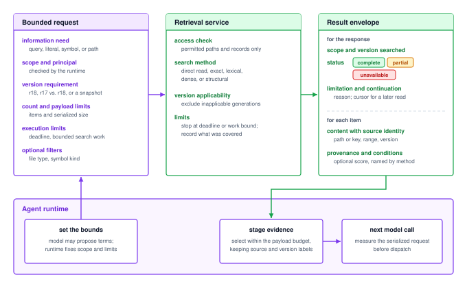
:::

### The bounded request {#sec-vol3-persistent-query-tuple}

\Advantage raw information need such as "find the notification logic" underspecifies the retrieval operation. It leaves undefined whether the caller requires the active workspace, an earlier Git revision, or a diff between them; it says nothing about which repositories the principal may access; and it ignores how many tokens the caller's remaining context window can accommodate. As summarized in @tbl-vol3-query-tuple, framing retrieval as a bounded request separates these operational constraints from the underlying index mechanics.

| Request field                    | Meaning in the repair task                                                                 | Boundary it establishes                                                               |
|:---------------------------------|:-------------------------------------------------------------------------------------------|:--------------------------------------------------------------------------------------|
| Query or information need        | Locate the waiter-notification implementation or the recorded reproducer result            | The requested match or observation, not a promise that it exists                      |
| Authorized scope and principal   | The designated repair workspace and the identity under which it is read                    | The runtime checks permitted paths and records; a scope string alone grants no access |
| Version or freshness requirement | Read r18, compare r17 with r18, or read the current source under stated snapshot semantics | Which state can answer the question                                                   |
| Result-count and payload limits  | Bound returned items and their serialized representation                                   | Count and content size are separate limits                                            |
| Execution limits                 | Deadline and supported bounds on scans, expansions, or other search work                   | When to stop waiting or searching and report incomplete work                          |
| Optional filters                 | Restrict file type, symbol kind, or other relevant metadata                                | Narrow the information need without replacing authorization                           |

: **\Advantage bounded retrieval request**: The runtime can supply task-wide defaults, while each query specializes the information need within those limits. {#tbl-vol3-query-tuple}

\Advantage version requirement differs fundamentally from a wall-clock freshness heuristic. An index entry for revision r17 remains invalid as current r18 source code even if an indexing worker refreshed it seconds ago. Wall-clock TTLs merely trigger periodic reindexing, whereas explicit version tokens establish whether a cached representation strictly matches its underlying source snapshot. When the retrieval service cannot fulfill the requested version from its precomputed index, it must either fall back to an authorized direct read of the primary store or return an explicit incomplete status—a cache invalidation trade-off examined in detail in @sec-vol3-persistent-invalidation.

Similarly, result-count, payload-size, and compute limits constrain different dimensions of system resource consumption. Ten complete source files consume dramatically more serialized tokens than ten function docstrings, yet returning a single item might still require scanning millions of candidate embeddings. The payload limit protects the caller's downstream context window, search-work budgets (such as graph traversal caps or posting-list scan limits) constrain retrieval service compute, and execution deadlines prevent the agent runtime from blocking indefinitely. Crucially, client timeouts must propagate cancellation signals to the underlying storage engines; uncancelled background queries continue to consume backend resources and inflate total execution cost.

### The result envelope {#sec-vol3-persistent-result-envelope}

\Advantage production retrieval service returns metadata describing the search execution alongside the matching records. At the response level, the result envelope specifies the repository scope and snapshot revision actually searched, the terminal execution status, and any operational constraints that qualify the results:

- `complete` confirms that the declared search algorithm ran to conclusion under its stated semantics—a precise mechanical guarantee that must never be confused with an omniscient claim of having discovered every relevant fact in existence.
- `partial` indicates that the operation halted before exhaustive evaluation, explicitly recording the abort reason (such as an expired deadline, an unavailable index partition, or an output payload cap).
- `unavailable` signals that the retrieval subsystem failed to return usable data, whether due to network partitions, authorization failures, or service crashes.

When an operation yields partial results or truncates output to respect payload limits, the envelope provides an opaque continuation cursor so subsequent bounded requests can resume paging without re-executing the entire query.

Rigorous execution statuses establish what systems software can safely infer when a query returns zero hits—the *absence rule*. An empty result proves nonexistence if and only if a fully completed exhaustive scan produced it, and even then, only within the scanned scope and revision snapshot. For example, a completed literal string search across the repository proving that a symbol does not occur in revision r18 satisfies this standard. Conversely, a truncated or partial scan that returns zero matches proves nothing; the target token may reside on an unvisited partition. Similarly, approximate nearest neighbor vector searches offer no absence guarantees: because graph pruning or inverted file partitions discard parts of the metric space, an empty or irrelevant result set may simply reflect metric recall loss rather than the absence of relevant information in the corpus.

At the item level, every returned record carries structured metadata alongside its raw content: a persistent URI or path, byte or line ranges, the exact source commit or snapshot hash, and a cryptographic provenance trail. When an item represents an empirical observation—such as a test execution log—the record must document the runtime configuration, environment variables, test revision, and terminal outcome. If an item stores a derived lesson or summary synthesized by an agent in an earlier session, its envelope must explicitly link to the primary records supporting that inference and flag its epistemic status as a derivative model output. If the retrieval engine attaches a relevance score, it must qualify that score by the generating algorithm (such as BM25, cosine similarity, or cross-encoder logits). Ranking scores exist strictly on their algorithm's internal scale; systems must not treat them as calibrated probabilities.

In the connection-pool repair task, the staged payload might pair a slice of `src/pool.py` from revision `r18` with an error trace recorded under revision `r17`. The r17 trace explains why the repair was initiated, but it provides zero evidence regarding the behavior of the r18 candidate. By packaging each record in an explicit envelope, the retrieval subsystem preserves these critical applicability distinctions across the boundary between persistent storage and the working context. Crucially, envelope labels record provenance without certifying veracity. \Advantage cryptographic content hash verifies only that the byte sequence matches a specific snapshot; it does not validate the factual correctness of the text. Similarly, categorizing a record as user input or agent-written memory confers no administrative authority on any instructions embedded within that content.

### Evidence staging {#sec-vol3-persistent-quarantine}

The agent runtime—never the retrieval backend or an uncalibrated ranking score—determines which records enter the downstream prompt. The runtime curates evidence tailored to the immediate decision, preserves the source and version tags necessary for correct interpretation, and measures the token footprint of the serialized payload. This staging phase enforces invariant closure (principle \ref{pri-invariant-closure}) directly at the durable read boundary.

Returned text remains untrusted data, even when fetched from a local repository. While defensive serialization formats cleanly separate retrieved payloads from system instructions, language models can still be misled by adversarial or malformed text embedded inside document bodies. This hazard—prompt injection—occurs when retrieved text hijacks the agent's control flow, attempting to redirect execution away from the authorized task; @sec-vol3-security details these attack vectors and their operational defenses.

Accurate payload accounting must measure the entire serialized envelope, including wrapper tags, source paths, version identifiers, and status headers, alongside the raw text bodies. Underestimating this structural overhead leads directly to context exhaustion. The ledger in notebook \ref{nbk-06-retrieval-payload-ledger} demonstrates how metadata overhead alters the number of complete records an agent can stage within a fixed prompt allocation.

```{python}
#| label: lego-06-retrieval-payload-ledger
#| echo: false
# ┌─────────────────────────────────────────────────────────────────────────────
# │ SERIALIZED RETRIEVAL PAYLOAD LEDGER
# ├─────────────────────────────────────────────────────────────────────────────
# │ Context: @nbk-06-retrieval-payload-ledger
# │ Goal: Bound complete retrieved records after output and envelope reserves.
# │ Show: Retrieval allowance, record capacity, payload used, and remainder.
# │ How: Explicit hypothetical token counts; no hardware or tokenizer claim.
# └─────────────────────────────────────────────────────────────────────────────
from mlsysim.fmt import check, fmt_int, fmt_math

class RetrievalPayloadLedger:
    # ┌── 1. LOAD (Scenario assumptions, in serialized tokens) ─────────────
    capacity = 32_768
    output_reserve = 2_048
    other_input = 24_576
    envelope = 128
    body = 512
    metadata = 64

    # ┌── 2. EXECUTE ──────────────────────────────────────────────────────
    allowance = capacity - output_reserve - other_input
    record = body + metadata
    records = (allowance - envelope) // record
    used = envelope + records * record
    remaining = allowance - used
    body_only = allowance // body  # records a body-only limit would admit
    body_only_used = envelope + body_only * record
    overshoot = body_only_used - allowance

    # ┌── 3. GUARD ────────────────────────────────────────────────────────
    check(allowance == 6_144, "retrieval allowance")
    check(record == 576 and records == 10, "complete record capacity")
    check(used == 5_888 and remaining == 256, "complete serialized payload")
    check(used <= allowance < used + record, "one additional record cannot fit")
    check(body_only == 12 and body_only_used == 7_040 and overshoot == 896, "body-only limit overshoots")

    # ┌── 4. OUTPUT ───────────────────────────────────────────────────────
    capacity_str = fmt_int(capacity)
    output_reserve_str = fmt_int(output_reserve)
    other_input_str = fmt_int(other_input)
    envelope_str = fmt_int(envelope)
    body_str = fmt_int(body)
    metadata_str = fmt_int(metadata)
    record_str = fmt_int(record)
    records_str = fmt_int(records)
    remaining_str = fmt_int(remaining)
    allowance_str = fmt_int(allowance)
    body_only_str = fmt_int(body_only)
    body_only_used_str = fmt_int(body_only_used)
    overshoot_str = fmt_int(overshoot)
    overcount_str = fmt_int(body_only - records)
    allowance_math = fmt_math(rf"{capacity:,} - {output_reserve:,} - {other_input:,} = {allowance:,}")
    payload_math = fmt_math(rf"{envelope} + {records} \times {record} = {used:,}")
```

::: {#nbk-06-retrieval-payload-ledger .callout-notebook title="Making room for retrieved evidence"}

**Problem**: \Advantage hypothetical model call permits `{python} RetrievalPayloadLedger.capacity_str` tokens in total. Reserving `{python} RetrievalPayloadLedger.output_reserve_str` tokens for generation leaves the remainder for input. If baseline system prompts, tool schemas, and conversation history occupy `{python} RetrievalPayloadLedger.other_input_str` tokens, how many complete retrieval records can the prompt accommodate?

**Math**: The retrieval allowance is `{python} RetrievalPayloadLedger.allowance_math` tokens. Assume a `{python} RetrievalPayloadLedger.envelope_str`-token response envelope and records that each contain `{python} RetrievalPayloadLedger.body_str` body tokens plus `{python} RetrievalPayloadLedger.metadata_str` metadata tokens, giving `{python} RetrievalPayloadLedger.record_str` tokens per record.

The maximum number of complete records that fit is `{python} RetrievalPayloadLedger.records_str`. Staging these records alongside their envelope consumes `{python} RetrievalPayloadLedger.payload_math` tokens, leaving a remainder of `{python} RetrievalPayloadLedger.remaining_str` tokens—insufficient to hold another complete record.

\Advantage naive sizing policy that accounts only for raw document bodies would admit `{python} RetrievalPayloadLedger.body_only_str` records. When serialized with metadata and envelopes, however, those records require `{python} RetrievalPayloadLedger.body_only_used_str` tokens, overshooting the allocated retrieval budget by `{python} RetrievalPayloadLedger.overshoot_str` tokens.

**Systems insight**: Metadata and envelope framing consume context capacity just as surely as document bodies. In this configuration, each record dedicates `{python} RetrievalPayloadLedger.metadata_str` of its `{python} RetrievalPayloadLedger.record_str` tokens to provenance, causing a body-only heuristic to overcommit the prompt by `{python} RetrievalPayloadLedger.overcount_str` records. Systems runtimes must reserve capacity for output tokens and the global envelope first, then admit $\lfloor(\text{allowance} - \text{envelope})/(\text{body} + \text{metadata})\rfloor$ records, remembering that every token assigned to system instructions or tool definitions shrinks the retrieval allowance one for one.

:::

Because subword tokenizers (such as Byte-Pair Encoding) merge tokens across string boundaries, tokenizing text fragments in isolation and summing their counts yields an inaccurate total. Runtimes must measure token lengths on the final, fully serialized prompt structure using the target model's tokenizer. When a critical record exceeds the remaining budget, the runtime must not silently truncate the text. Instead, it should stage a syntactically coherent excerpt with explicit truncation markers, defer the item to a subsequent retrieval pass, or return an opaque handle that the model can resolve on demand.

Every staged token also incurs concrete inference engine overhead beyond occupying space in the context window. Retrieved context must be processed through the model's compute-intensive prefill phase and then pinned in GPU memory as key-value (KV) cache tensors for the duration of the generation cycle or prefix cache retention window. Staging fifty candidate records instead of five scales both prefill latency and memory pressure in direct proportion to the token volume. As derived in @sec-vol3-kvcache-geometry, the memory footprint of this KV state governs the maximum batch size and serving throughput of the underlying inference cluster.

::: {#chk-06-retrieval-contract .callout-checkpoint title="Interpreting a bounded result"}

Each question presents a retrieval outcome; decide what operational conclusions it licenses.

- [ ] **Stale excerpt**: \Advantage query for current source returns an r17 excerpt after the workspace reaches r18. Which historical diagnostic inferences remain valid, and what must happen before the excerpt informs an r18 edit?
- [ ] **Deadline vs. completion**: \Advantage search reaches its deadline with no matches. Which status does it return, and which conclusion that a completed literal scan of the same snapshot would support is unavailable here?
- [ ] **Payload estimate**: If per-record metadata doubled from the value in notebook \ref{nbk-06-retrieval-payload-ledger}, how many complete records would fit the same allowance, and what must the runtime measure before dispatching the call?

:::

The retrieval contract establishes the operational bounds, provenance requirements, and payload limits for each read, but it leaves open an architectural question, namely which component formulates the query. \Advantage runtime can predict needed evidence and pre-stage it before invoking the model, or it can equip the agent with search tools to probe the store interactively as discoveries unfold.

## Agentic Retrieval {#sec-vol3-long-term-memory-agentic-retrieval}

When an agent diagnoses and repairs a failure in a complex codebase—such as a leaking connection pool—the runtime system must determine how to supply the model with relevant evidence. Two distinct retrieval architectures address this challenge. In a pre-staged architecture, the runtime predicts which artifacts will be necessary (such as `src/pool.py`, `tests/test_pool.py`, and a stack trace from a prior run) and injects them directly into the prompt before model execution begins. In an agentic architecture, the runtime equips the model with bounded text search, file reading, and symbol-navigation tools, allowing the agent to locate notification logic, inspect the test harness, and follow cross-file references as intermediate discoveries dictate. Both architectures operate over the same underlying storage systems and share identical security boundaries. They differ fundamentally in when the information need is resolved and which component formulates the retrieval queries.

Pre-staging implements standard **retrieval-augmented generation**\index{Retrieval-augmented generation!definition} (RAG), where the host system selects external documents and packages them alongside the prompt before inference begins [@lewis2020retrieval]. By contrast, **agentic retrieval**\index{Agentic retrieval!definition} delegates query formulation to the model during the execution loop, interleaving environment observations with subsequent reasoning and action steps [@yao2023react]. Autonomous systems designed for repository-scale software engineering [@jimenez2024swebench] rely heavily on this interactive paradigm: providing the model with search and navigation commands shaped for code inspection proves far more adaptable than attempting to construct a single, static top-$k$ context window up front [@yang2024sweagent]. Rather than mutually exclusive alternatives, these two patterns represent complementary policies operating over the same underlying data stores.

Pre-staging excels when the evidence required for the next decision is predictable. Loading `src/pool.py` and `tests/test_pool.py` directly into the prompt eliminates the latency and inference cost of an exploratory turn spent locating those files. However, pre-staging carries operational risks: it can consume scarce context capacity with irrelevant code, or conversely, miss transitively imported dependencies that only become apparent upon inspecting the source. Model-directed iterative search resolves this rigidity by allowing each discovery to reshape subsequent queries. For example, a failing assertion in a test file might name an internal helper function, prompting the agent to inspect that specific definition next. Yet interactive exploration introduces its own failure modes. An agent can chase unpromising leads, execute redundant searches across familiar directories, or terminate its investigation prematurely before gathering sufficient evidence.

Before introducing an auxiliary index—such as an inverted text index or a vector store—systems engineers should always benchmark against a live-source baseline. Bounded substring searches and direct file reads inspect the target workspace directly on disk, introducing no external index that can lag behind ongoing edits. When a problem description already specifies exact filenames or literal error strings, these live-source primitives often supply all the retrieval capability the agent requires. Direct filesystem access, however, presents distinct systems trade-offs. Live reads observe whichever version of a file exists at the exact moment of execution; if concurrent processes modify the workspace, separate reads executed across successive turns can straddle modifications and observe inconsistent snapshots. Furthermore, raw literal searches locate character matches without semantic awareness, failing to distinguish an active symbol definition from an obsolete comment or an unrelated log message. An auxiliary index justifies its memory footprint, construction time, and synchronization overhead only when it measurably amortizes repetitive scanning costs across long trajectories, resolves vocabulary mismatches through semantic embeddings, or accelerates traversal over structural relationships like Abstract Syntax Tree (AST) call graphs. Any rigorous systems evaluation must charge the computational cost of building and refreshing the index directly against query-time latency savings.

When an agent probes its environment, the runtime can optimize query execution through parallelism. \Advantage single model turn can emit several independent tool calls that the runtime batches or executes concurrently across threads; only queries that strictly depend on earlier observations must block for sequential resolution. @Tbl-vol3-long-term-memory-staged-vs-agentic summarizes the core trade-offs between runtime pre-staging and model-directed probing.

| Property               | Runtime pre-staging                                            | Model-directed probing                                         |
|:-----------------------|:---------------------------------------------------------------|:---------------------------------------------------------------|
| Query selection        | Runtime policy selects evidence before model invocation        | Model formulates queries dynamically from prior observations   |
| Optimal scenario       | Likely evidence needs are predictable in advance               | Intermediate results dictate which question to ask next        |
| Computational overhead | Retrieval latency and staging cost prior to the call           | Search latency and extra inference rounds for query refinement |
| Characteristic failure | Missing transitively imported dependencies or bloating context | Chasing unproductive paths or terminating search prematurely   |
| Freshness guarantee    | Governed by source version and read contract at staging        | Governed by the same read contract at tool execution time      |
| Resource governance    | Bounded by staging timeouts and context-window capacity        | Bounded by per-call limits and trajectory-wide step budgets    |

: **Pre-staging and model-directed retrieval**: Query timing and ownership change between the two policies, while source applicability and runtime-enforced limits remain shared. {#tbl-vol3-long-term-memory-staged-vs-agentic}

Crucially, the execution runtime retains absolute authority over security boundaries and resource consumption under both paradigms. The model acts strictly as an untrusted query generator: it may propose a narrower search path, supply query strings, or request specific filters, but it can never expand the authorized workspace, assume a different principal identity, or increase its own resource ceilings. The runtime enforces these boundaries at the tool interface. Tool calling schemas define and constrain the supported request parameters (@sec-vol3-tool-calling-schemas), while tool execution results transmit truncation warnings, resource limits, and continuation tokens back to the agent (@sec-vol3-tool-calling-streaming).

In production systems, these two strategies often merge into a tiered hybrid policy. The runtime pre-stages a compact workspace outline, an architectural summary, or persistent user preferences directly into the initial context window, giving the model immediate structural grounding. The agent then issues targeted tool calls to inspect specific function implementations or test traces only when those details become necessary. Evaluating such a hybrid design requires balancing the upfront token overhead of pre-staging against the inference latency and token expenditure of avoided tool turns. Whether an architecture relies on static pre-staging, dynamic agentic probing, or a hybrid combination, the effectiveness of any retrieval pipeline ultimately hinges on its matching mechanism—selecting whether lexical filtering, dense semantic embeddings, or structural graph traversal best surfaces the required evidence.

## Structured Retrieval {#sec-vol3-persistent-bm25}

When an agent investigates a software defect—such as a stalled worker in a connection pool—it faces distinct information needs: locating `tests/test_pool.py`, finding references to `test_waiter_notified_on_return`, and isolating the function enclosing a suspect synchronization statement. \Advantage well-designed retrieval contract does not force these varied tasks through a single mechanism. \Advantage known file path requires only a direct file read. \Advantage specific identifier calls for literal text search or symbol lookup. \Advantage broad symptom description requires ranking multiple candidate passages before the agent can decide which source files merit inspection.

### Exact lookup and lexical ranking {#sec-vol3-long-term-memory-exact-lexical}

Exact path lookup retrieves a named object directly from an authorized repository snapshot. Literal text search scans for exact character sequences under declared matching rules such as case sensitivity and boundary delimiters. Neither mechanism interprets semantic role: a match on a test identifier might point to its primary definition, a passing mention in a comment, an import statement, or an entry in an archived failure log.

To support repeated lexical queries across large corpora without scanning every byte on disk, retrieval systems rely on an **inverted index**\index{Inverted index!definition} [@zobel2006inverted]. The index maps each distinct term to a postings list containing every document where the term appears. Beyond the document identifier, each posting typically stores the term's in-document frequency and position offsets. How source text maps into postings depends entirely on the index's analyzer. The analyzer determines token boundaries: whether it preserves full identifier tokens, splits `snake_case` and `camelCase` identifiers, normalizes letter case, or strips inflectional affixes through stemming. Consequently, a ranked match on an analyzed identifier behaves differently from an exact match on the raw string. When an agent requires an exact literal hit, it must either query an unanalyzed exact-match field or verify the returned source snippet directly.

When a query matches dozens or hundreds of candidates, ranking determines which documents enter the agent's bounded context window. The **BM25**\index{BM25!definition}[^fn-bm25-okapi-retrieval] scoring function balances three factors: term rarity across the corpus,[^fn-idf-term-rarity] sub-linear term frequency saturation within each candidate, and document-length normalization [@robertson2009bm25]:

$$
\operatorname{score}(x,Q)=\sum_{q\in Q}\operatorname{IDF}(q)
\frac{f(q,x)(k_1+1)}{f(q,x)+k_1(1-b+b\lvert x\rvert/\overline{\lvert x\rvert})},
\qquad
\operatorname{IDF}(q)=\ln\left(1+\frac{\NumberOfDevices-\PointtopointMessageSize(q)+0.5}{\PointtopointMessageSize(q)+0.5}\right).
$$

Here $Q$ contains the query terms, $x$ is an indexed document, $f(q,x)$ is the term frequency of $q$ in $x$, $\lvert x\rvert$ is the document length in analyzer terms, and $\overline{\lvert x\rvert}$ is the collection's mean document length. The corpus contains $N$ documents in total, of which $n(q)$ contain query term $q$. Crucially, these term lengths represent analyzer counts rather than the foundation model's token counts. The tuning parameter $k_1>0$ controls term-frequency saturation: at a fixed document length, the marginal score contribution asymptotically approaches $k_1+1$ as frequency grows. The parameter $b\in[0,1]$ modulates document-length normalization, with $b=1$ fully penalizing documents proportional to their relative length and $b=0$ disabling length normalization entirely. Because ranking depends on these structural mechanics, document chunk boundaries, analyzer choices, and parameter settings fundamentally alter candidate scores even when the underlying source text remains unchanged.

[^fn-bm25-okapi-retrieval]: **BM25 (Best Match 25)**: The name records one weighting in the "Best Match" series of the Okapi retrieval system, built on the simple approximations to a two-Poisson model of term occurrence that @robertson1994simple derived. The formula survived decades of learned rankers because it needs no training data, only corpus statistics an index already keeps, which is why it remains the baseline a repository agent can deploy on the day its workspace is created. \index{BM25!Okapi origin}

[^fn-idf-term-rarity]: **Inverse Document Frequency (IDF)**: @sparckjones1972statistical proposed weighting a term by how few documents contain it, on the argument that a term shared by most documents cannot tell them apart. In a repository that argument favors exactly the tokens an agent searches for, such as a unique test name or error string, and discounts keywords every file shares, which is why a rare identifier ranks sharply under BM25 while a vague symptom description does not. \index{Inverse document frequency!origin}

```{python}
#| label: ltm-bm25-ranking-calc
#| echo: false
# What: Compare two lexical candidates, not their correctness.
# How: Apply the displayed BM25 variant to a hypothetical one-term query.
from math import log
from mlsysim.fmt import check, fmt_int, fmt_ratio

class BM25Ranking:
    # 1. LOAD — stipulated corpus statistics, not measured repository data.
    documents = 100_000
    matching_documents = 5
    average_length = 400
    short_length, long_length = 80, 4_000
    short_frequency, long_frequency = 1, 6
    k1, b = 1.2, 0.75

    # 2. EXECUTE — lengths and frequencies are analyzer-term counts.
    idf = log(1 + (documents - matching_documents + 0.5) / (matching_documents + 0.5))
    short_normalizer = k1 * (1 - b + b * short_length / average_length)
    long_normalizer = k1 * (1 - b + b * long_length / average_length)
    short_score = idf * short_frequency * (k1 + 1) / (short_frequency + short_normalizer)
    long_score = idf * long_frequency * (k1 + 1) / (long_frequency + long_normalizer)

    # 3. GUARD — validate the scenario and the ordering being illustrated.
    check(0 < matching_documents <= documents, "Document frequencies must be valid")
    check(0 < short_frequency <= short_length, "Short-document counts must be valid")
    check(0 < long_frequency <= long_length, "Long-document counts must be valid")
    check(average_length > 0 and k1 > 0 and 0 <= b <= 1, "BM25 parameters must be valid")
    check(short_score > long_score > 0, "The example must rank the short candidate first")

    # 4. OUTPUT — presentation values for all displayed scenario quantities.
    documents_str = fmt_int(documents)
    matching_documents_str = fmt_int(matching_documents)
    average_length_str = fmt_int(average_length)
    short_length_str, long_length_str = fmt_int(short_length), fmt_int(long_length)
    short_frequency_str, long_frequency_str = fmt_int(short_frequency), fmt_int(long_frequency)
    k1_str, b_str = fmt_ratio(k1, precision=1), fmt_ratio(b, precision=2)
    idf_str = fmt_ratio(idf, precision=3)
    short_score_str = fmt_ratio(short_score, precision=2)
    long_score_str = fmt_ratio(long_score, precision=2)
```

::: {#exmp-06-quantitative-bm25-score-dynamics-on .callout-example title="\Advantage higher lexical score is a ranking decision"}
**Scenario**: Consider a hypothetical index of `{python} BM25Ranking.documents_str` documents with a mean length of `{python} BM25Ranking.average_length_str` analyzer terms. \Advantage single query term appears in `{python} BM25Ranking.matching_documents_str` documents. With $k_1=$ `{python} BM25Ranking.k1_str` and $b=$ `{python} BM25Ranking.b_str`, its inverse document frequency is `{python} BM25Ranking.idf_str`.

**Analysis**: \Advantage short candidate contains `{python} BM25Ranking.short_length_str` terms and `{python} BM25Ranking.short_frequency_str` occurrence of the query term; a long candidate contains `{python} BM25Ranking.long_length_str` terms and `{python} BM25Ranking.long_frequency_str` occurrences. Substituting these counts into the scoring rule gives `{python} BM25Ranking.short_score_str` for the short candidate and `{python} BM25Ranking.long_score_str` for the long candidate. Repetition alone does not determine their order: saturation and length normalization outweigh the long candidate's additional occurrences.

**Systems lesson**: Rank orders candidates for inspection. If the short candidate is a comment while the long one holds the implementation, the agent still needs source inspection or structural information, and choosing whole files rather than functions as documents would change both scores.
:::

### Structural evidence {#sec-vol3-long-term-memory-structural-evidence}

Lexical matches identify raw text occurrences. **Structural retrieval**\index{Structural retrieval!definition} distinguishes program organization: the enclosing function, type declarations, lexical scopes, and identifiers in call expressions. \Advantage parser translates source text into abstract syntax trees with explicit spans, while symbol resolution and semantic analysis establish directed relationships between definitions and call sites. While parsing a call expression identifies the call site syntactically, resolving which concrete implementation executes at runtime requires interprocedural analysis.

During the connection-pool repair, a structural query can return the entire function containing a notification call in `src/pool.py` rather than an arbitrary fragment, and a reference query can subsequently identify its callers across the codebase. Static coverage depends on language semantics, dependencies, and build configuration; dynamic dispatch, reflection, generated code, and cross-process calls frequently escape static resolution. In a structural index, a missing edge indicates a gap in static coverage rather than an unreachable path, while a static call edge records a potential invocation rather than an executed one. @Fig-vol3-lexical-vs-ast contrasts these two retrieval representations across connection-pool sources: panel (\Advantage) maps terms like \texttt{notify} to inverted postings of file locations and frequencies without syntactic context, whereas panel (\BatchSize) constructs parsed containment and explicit call edges between functions, capturing caller-callee hierarchies that string matching misses.

::: {#fig-vol3-lexical-vs-ast fig-env="figure" fig-pos="htb" fig-cap="**Occurrences vs. Relationships**: \Advantage lexical index (\Advantage) maps each analyzed term to postings of documents and frequencies, so the term notify matches the pool source and the r17 failure log alike. \Advantage structural index (\BatchSize) records parsed containment and resolved calls, here from the waiter test to the pool's return method and on to its notification call. Its coverage is declared rather than complete, because a dynamic call can leave a target unresolved." fig-alt="Two panels. Panel \Advantage shows three quoted terms, notify, waiter, and return, each with an arrow to two postings that name a file and a term frequency. Panel \BatchSize shows the files tests/test_pool.py and src/pool.py, each with a CONTAINS arrow to a function, test_waiter_notified_on_return and pool return method. \Advantage CALLS arrow links the test to the return method, a second CALLS arrow links the return method to _available.notify(), and a dashed arrow labeled CALLS with a question mark leads from the test to a dashed box labeled dynamic call: target unknown."}
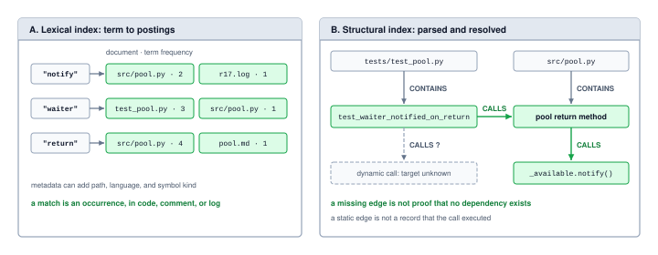
:::

@Tbl-vol3-lexical-vs-ast-table separates the questions these methods answer. Lexical indexes can carry path and symbol metadata, but text matching alone establishes no semantic relationship.

| **Information need**                              | **Suitable starting method**                      | **What the result establishes**                                                    |
|:--------------------------------------------------|:--------------------------------------------------|:-----------------------------------------------------------------------------------|
| Read a known path or locate a literal identifier  | Direct source read or declared exact-match search | The requested content or occurrences within the searched scope and version         |
| Find likely relevant documents from query terms   | Lexical ranking such as BM25                      | Candidate order under the analyzer, document boundaries, and scoring rule          |
| Find an enclosing function or resolved references | Syntax or semantic index with declared coverage   | Parsed boundaries or analysis-derived relationships, not complete runtime behavior |

: **Exact, Lexical, and Structural Retrieval**: Choose the method according to the information required, then interpret its result within the method's coverage. {#tbl-vol3-lexical-vs-ast-table}

### Search scope {#sec-vol3-long-term-memory-search-scope}

Restricting an initial probe to `src/pool.py` and `tests/test_pool.py` focuses the evidence and limits noise, provided the retrieval interface explicitly reports that bounded scope; a subsequent probe can widen the scope to investigate callers across the repository.

Filtering and ranking interact directly. \Advantage service that selects its top-ranked candidates globally and only then discards those outside the requested paths (post-filtering) can easily return an empty set while eligible matches sit farther down the global ranking. Restricting candidates before final scoring (pre-filtering) avoids this loss, as does continuing postings traversal until the requested quota of filtered documents is filled. When query budgets or latency limits terminate the search early, the result remains partial.

Choosing the evaluation order is a cost-based optimization decision analogous to access path selection in relational database optimizers [@selinger1979access].[^fn-selectivity-optimizer-memory] The decision balances the filter's selectivity against the rarity of the query terms. \Advantage selective filter—such as isolating two files in a repository of thousands—favors pre-filtering candidate documents and evaluating BM25 scores only on the survivors. Conversely, a broad filter paired with a rare identifier favors scoring first, because the rare term's postings list is already short, provided the search engine continues scanning until enough eligible results remain. This trade-off reemerges with even sharper operational hazards when searching vector proximity graphs (@sec-vol3-persistent-dense-retrieval).

[^fn-selectivity-optimizer-memory]: **Cost-Based Access Path Selection**: The System R optimizer chose among index scans, sequential scans, and join orders by estimating each predicate's selectivity and the pages each plan would touch [@selinger1979access]. \Advantage retrieval gateway faces the same estimate with a scope filter as the predicate and a postings list or vector index as the access path, and a wrong estimate costs either a scan of the whole corpus or an empty result that looks like absence. \index{Query optimization!selectivity}

### Vocabulary mismatch {#sec-vol3-long-term-memory-vocabulary-mismatch}

Exact and structural lookups succeed when the agent already possesses informative names or file locations. Early in an investigation, however, the agent may know only an observed symptom: “a connection is returned, but another caller keeps waiting,” phrased in words the source code never uses. This is the **vocabulary mismatch**\index{Vocabulary mismatch!definition} problem, where system designers and users formulate identical concepts using distinct vocabularies [@furnas1987vocabulary]. Heuristic techniques like identifier splitting, synonym expansion, or query reformulation can recover some lexical matches; once an exploratory search identifies a concrete test name, literal lookup is far more direct than further conceptual search.

When lexical heuristics still leave the candidate set inadequate, the agent needs a representation that maps descriptive prose to differently worded source implementations, along with hybrid rankers that combine dense semantic similarity with exact lexical precision without mistaking similarity for verification.

## Hybrid Retrieval {#sec-vol3-persistent-dense-retrieval}

When an agent investigates a bug report describing a caller that hangs indefinitely, lexical search across the repository can easily rank the critical return path in `src/pool.py` low or miss it entirely. The line that matters executes `notify()`, but the report describes a caller that keeps waiting. Dense retrieval supplies a complementary candidate-generation mechanism, using learned representations to match a query against records that share underlying meaning rather than literal tokens.

### Dense retrieval {#sec-vol3-long-term-memory-dense-retrieval}

**Dense retrieval**\index{Dense retrieval!definition} encodes a query and each searchable record as vectors using a learned model, ranking records by vector similarity.[^fn-vector-space-lineage] In a bi-encoder architecture, records are embedded offline before a request arrives, leaving only the query to be encoded online at request time [@karpukhin2020dense]. This separation removes heavy embedding inference from the critical query path. However, offline encoding remains an ongoing operational requirement: newly inserted or modified records require fresh vector generation, and upgrading or fine-tuning the underlying encoder invalidates the entire index, demanding a complete corpus re-embedding.

[^fn-vector-space-lineage]: **Vector Space Model**: Ranking documents by the angle between a query vector and each document vector predates learned encoders; @salton1975vector represented every document as a vector of term weights and scored it by cosine similarity. Dense retrieval keeps the geometry and replaces sparse, interpretable term weights with learned components, which is what lets it bridge vocabulary and also why no single component explains a match. \index{Vector space model!origin}

The distance metric is defined by the interaction between the encoder and index configurations. For example, inner product search is mathematically identical to cosine similarity when vectors are unit-normalized ($\ell_2 = 1.0$), which shifts the computational cost of vector normalization to indexing time rather than paying for vector division on the query path. Crucially, neither metric produces a calibrated probability that a candidate record answers the agent's question; they represent uncalibrated geometric affinities.

In the software repair task, a dense retriever can readily connect the symptom of a waiting caller to the return-and-notify implementation—providing a promising candidate for inspection rather than definitive proof of a defect. Yet the semantic abstraction that bridges vocabulary gaps can also blur fine syntactic distinctions that code execution depends on. Consider a concrete case in `src/pool.py`: the return path invokes `self._available.notify()`, the shutdown routine invokes `self._available.notify_all()`, and acquisition invokes `self._available.wait(timeout)`. All three statements share the same condition variable, module context, and conceptual vocabulary of thread synchronization. Consequently, an encoder often maps all three to neighboring points in vector space when queried about thread unblocking. Yet their operational semantics are entirely distinct: one wakes a single waiter, one wakes every waiter, and the third blocks. An exact lexical search for `notify(` isolates the call site immediately, and BM25 assigns the rare identifier a high inverse document frequency (IDF). The systems challenge is therefore determining which retrieval mechanism surfaces the precise evidence the workload requires.

### Exact and approximate vector search {#sec-vol3-long-term-memory-vector-search}

An **exact vector scan**\index{Exact vector scan!definition} scores every vector in the eligible search set under the chosen distance metric. It serves as the baseline ground truth for measuring what an approximate search misses, and it remains a practical serving method whenever the eligible candidate set is small.

The fundamental resource requirements of an exact scan follow directly from dimensional arithmetic, independent of any specific hardware architecture. Let $N$ be the number of eligible vectors, $d$ their dimension, and $w$ the storage width in bytes per component. Traversing the stored vectors requires streaming $Ndw$ bytes from memory. Counting two floating-point operations per multiply-accumulate operation, dot-product scoring requires approximately $2Nd$ FLOPs. Notably, these totals account only for the vector inner products; they exclude the latency of query embedding, top-$k$ heap maintenance, and fetching the full record payloads from persistent storage.

```{python}
#| label: lego-06-memory-bandwidth-and-latency-floor
#| echo: false
# ┌─────────────────────────────────────────────────────────────────────────────
# │ EXACT VECTOR SCAN: INTENSITY AND BANDWIDTH FLOOR (LEGO)
# ├─────────────────────────────────────────────────────────────────────────────
# │ Context: @nbk-06-memory-bandwidth-and-latency-floor
# │ Goal: Show that an exact dot-product scan is bandwidth-bound on a host.
# │ Show: 1 FLOP/byte at FP16 vs a 20 FLOP/byte host ridge; 307.2 ms floor.
# │ How: Hypothetical corpus; host bandwidth and peak rate from the registry.
# └─────────────────────────────────────────────────────────────────────────────
from mlsysim import Hardware
from mlsysim.core.units import BYTES_FP16, GB, GFLOP, byte, flop, millisecond, second
from mlsysim.fmt import check, fmt_arithmetic_intensity, fmt_bandwidth, fmt_flop_rate, fmt_flops, fmt_int, fmt_memory, fmt_time

class VectorScanLatencyFloor:
    # ┌── 1. LOAD (Hypothetical corpus; host from the registry) ─────────────
    host = Hardware.Cloud.ReferenceCPU
    n_vectors = 10_000_000
    d_dim = 768
    bytes_per_val = BYTES_FP16
    n_probes = 20  # stipulated searches in one trajectory
    n_filtered = 10_000  # stipulated eligible set after a selective scope filter
    t_budget = 10 * millisecond  # stipulated per-search latency budget

    # ┌── 2. EXECUTE (Bytes, FLOPs, intensity, and the two time floors) ────
    bw = host.memory.bandwidth
    peak = host.compute.peak_flops
    footprint = n_vectors * d_dim * bytes_per_val
    flops_total = 2 * n_vectors * d_dim * flop
    intensity = (flops_total / footprint).to(flop / byte)
    ridge = (peak / bw).to(flop / byte)
    t_mem = (footprint / bw).to(millisecond)
    t_arith = (flops_total / peak).to(millisecond)
    t_probes = (n_probes * t_mem).to(second)
    t_filtered = (n_filtered * d_dim * bytes_per_val / bw).to(millisecond)
    n_budget = int((t_budget * bw / (d_dim * bytes_per_val)).to("").magnitude)

    # ┌── 3. GUARD (Invariants) ───────────────────────────────────────────
    check(abs(footprint.to(GB).magnitude - 15.36) < 1e-9, "vector bytes")
    check(abs(flops_total.to(GFLOP).magnitude - 15.36) < 1e-9, "scan FLOPs")
    check(abs(intensity.magnitude - 1.0) < 1e-12, "one FLOP per byte at FP16")
    check(ridge > 10 * intensity, "scan sits far below the host ridge")
    check(t_mem > 10 * t_arith, "bandwidth term dominates")
    check(t_filtered < t_budget < t_mem, "filtered scan meets the budget; full scan does not")
    check(n_filtered < n_budget < n_vectors, "budget crossover lies between the two sets")

    # ┌── 4. OUTPUT (Formatting) ──────────────────────────────────────────
    n_vectors_str = fmt_int(n_vectors)
    d_dim_str = fmt_int(d_dim)
    width_str = fmt_memory(bytes_per_val, unit=byte, precision=0)
    footprint_str = fmt_memory(footprint, unit=GB, precision=2)
    work_str = fmt_flops(flops_total, unit=GFLOP, precision=2)
    intensity_str = fmt_arithmetic_intensity(intensity, precision=0)
    ridge_str = fmt_arithmetic_intensity(ridge, precision=0)
    bw_str = fmt_bandwidth(bw, unit=GB / second, precision=0)
    peak_str = fmt_flop_rate(peak, precision=0)
    t_mem_str = fmt_time(t_mem, unit=millisecond, precision=1)
    t_arith_str = fmt_time(t_arith, unit=millisecond, precision=2)
    n_probes_str = fmt_int(n_probes)
    t_probes_str = fmt_time(t_probes, unit=second, precision=1)
    n_filtered_str = fmt_int(n_filtered)
    t_filtered_str = fmt_time(t_filtered, unit=millisecond, precision=2)
    t_budget_str = fmt_time(t_budget, unit=millisecond, precision=0)
    n_budget_str = fmt_int(round(n_budget, -3), approx=True)
```

::: {#nbk-06-memory-bandwidth-and-latency-floor .callout-notebook title="Why an exact vector scan is bandwidth-bound"}
**Problem**: Consider a hypothetical searchable set of `{python} VectorScanLatencyFloor.n_vectors_str` vectors, each with `{python} VectorScanLatencyFloor.d_dim_str` components stored in FP16 at `{python} VectorScanLatencyFloor.width_str` per component, held in the memory of the reference host processor from the book's hardware registry. Which resource limits one exact dot-product scan, and what floor does it set?

**Math**: Multiply the vector count by the dimension and component width:

$$
Ndw = 10^7 \times 768 \times 2\ \text{bytes}.
$$

The raw vectors occupy `{python} VectorScanLatencyFloor.footprint_str`. Counting two FLOPs per multiply-add gives $2Nd$, or `{python} VectorScanLatencyFloor.work_str` per scan. Arithmetic intensity, the FLOPs performed per byte moved from memory, is therefore $2Nd/(Ndw) = 2/w$, which is `{python} VectorScanLatencyFloor.intensity_str` at FP16 whatever the corpus size or dimension. The reference host delivers `{python} VectorScanLatencyFloor.peak_str` and `{python} VectorScanLatencyFloor.bw_str`, a ridge point of `{python} VectorScanLatencyFloor.ridge_str`, the intensity below which memory bandwidth rather than arithmetic limits the rate (@sec-vol3-appendix-inference-roofline). The scan sits far below the ridge, so bandwidth sets its floor. Streaming the vectors takes at least `{python} VectorScanLatencyFloor.t_mem_str`, while the arithmetic alone would take `{python} VectorScanLatencyFloor.t_arith_str`. \Advantage trajectory that issues `{python} VectorScanLatencyFloor.n_probes_str` such searches spends at least `{python} VectorScanLatencyFloor.t_probes_str` moving vectors. Because the floor is linear in the eligible count, a scope filter that leaves `{python} VectorScanLatencyFloor.n_filtered_str` vectors scans in `{python} VectorScanLatencyFloor.t_filtered_str`, and a `{python} VectorScanLatencyFloor.t_budget_str` search budget admits an exact scan of up to `{python} VectorScanLatencyFloor.n_budget_str` vectors on this host.

**Systems insight**: The intensity of an exact scan is fixed by the component width, so added arithmetic never speeds it up, and an accelerator's higher ridge leaves it bandwidth-bound there too. The levers are fewer bytes per vector (compression) and fewer vectors touched (a narrower eligible set or an approximate index). The decision rule follows from the crossover. Scan exactly when the eligible set fits the search budget at the host's bandwidth, and pay for an approximate index only above it. The floor omits query encoding, top-$k$ selection, and record fetches, so it bounds a request's latency from below.
:::

This arithmetic extends the memory-bandwidth bottleneck analyzed in @sec-vol3-foundation-model-cost from autoregressive token generation directly into retrieval. The analysis also establishes where an exact scan remains the right architectural choice. When selective metadata filters restrict the search space to thousands of eligible vectors, an exact scan streams megabytes rather than gigabytes, achieving sub-millisecond latencies without the operational overhead of graph maintenance or quantization codebooks. Furthermore, because an exact scan provides perfect recall under the chosen distance metric, it serves as the essential ground truth for evaluating any approximate index.

::: {.column-margin}
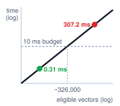{width="100%" fig-alt="Log-log line chart of exact scan time against eligible vectors. \Advantage straight rising line passes a green dot at 10,000 vectors and 0.31 ms and a red dot at 10 million vectors and 307.2 ms. \Advantage dashed horizontal line marks a 10 ms budget and crosses the scan line near 326,000 vectors."}

*Exact-scan time grows with eligible vectors; the search budget sets the crossover.*
:::

When candidate sets grow into millions of vectors and queries must return within tight latency budgets, scanning the entire corpus becomes prohibitive. **Approximate nearest-neighbor (ANN) search**\index{Approximate nearest-neighbor search!definition}[^fn-ann-dimensionality-curse] trades mathematical exactness for orders-of-magnitude reductions in latency and memory traffic, pruning the search space at the cost of occasionally missing true nearest neighbors. Systems cut memory traffic in one of two fundamental ways: by traversing a proximity graph to evaluate only a tiny fraction of the vector population, or by partitioning the space and compressing vector representations with quantization codes.

[^fn-ann-dimensionality-curse]: **Approximate Nearest Neighbors**: Exact nearest-neighbor structures that work well in two or three dimensions degrade toward a full scan as dimension grows, the curse of dimensionality. @indyk1998approximate relaxed the problem to returning a point within a factor of the true nearest distance and showed, through locality-sensitive hashing, that the relaxation admits sublinear query time. Every ANN index an agent uses makes the same bargain, so its misses are part of the contract, measured as recall, never a defect to be tuned away. \index{Approximate nearest-neighbor search!origin}

\Advantage **hierarchical navigable small-world (HNSW)**\index{HNSW!definition} index organizes high-dimensional vectors into a multi-layer proximity graph [@malkov2018efficient]. Layer 0 contains every vector in the dataset. Each inserted vector is also assigned a maximum layer $\ell = \lfloor -\ln U \cdot m_\ell \rfloor$, where $U$ is drawn uniformly from $(0, 1]$ and $m_\ell = 1 / \ln M$, with $M$ defining the maximum number of bidirectional connections per node per layer. This probabilistic assignment ensures that each progressively higher layer contains an exponentially smaller subset of nodes, mirroring the express transit lanes of a skip list [@pugh1990skip]. Traversal begins at an entry point in the sparsest top layer, greedily hopping to whichever neighbor minimizes distance to the query vector $\mathbf{q}$. When no neighbor yields further progress, the search drops down to that node's counterpart in the next layer and resumes the greedy walk. Upon reaching layer 0, the traversal switches from greedy routing to a beam search that maintains a priority queue of the $ef_{\text{search}}$ closest candidates discovered so far. The search terminates when the closest unexplored neighbor cannot improve the current candidate set, returning the top $k$ vectors. The parameter $ef_{\text{search}}$ serves as the primary query-time recall knob: expanding the beam width evaluates more distance comparisons and mitigates routing errors at the cost of higher query latency. @Fig-vol3-hnsw-routing traces this multi-layer greedy routing across three hierarchical graph tiers: the query enters at the sparse top layer (layer 2), hops greedily toward query vector $\mathbf{q}$ along long-range links, drops through intermediate layers at each local optimum, and completes an $ef_{\text{search}}$-wide beam search among dense neighbors at layer 0.

Constructing an HNSW graph requires executing this layered search for every incoming vector and establishing bidirectional links to its nearest neighbors in each layer. This structural graph topology incurs substantial memory overhead beyond the raw vectors. Deletions present a particularly demanding systems challenge: severing a node without reconstructing edge paths among its neighbors risks partitioning the graph and stranding downstream vectors. Consequently, production systems typically handle deletions by marking nodes as tombstoned while leaving graph connectivity intact—an operational compromise whose compounding costs are examined in @sec-vol3-persistent-invalidation.

::: {#fig-vol3-hnsw-routing fig-env="figure" fig-pos="htb" fig-cap="**Searching an HNSW Graph**: Each upper layer holds a geometrically smaller subset of the vectors. The query enters at the top, hops greedily toward $\mathbf{q}$ until no neighbor is closer, and drops a layer from that node. In layer 0 the walk widens into a beam of width $ef_{\text{search}}$ that visits more nodes than it returns and yields the best $k$. \Advantage vector the beam never visits cannot be returned, which is where approximate search misses come from." fig-alt="Three stacked panels labeled layer 2, layer 1, and layer 0, with more nodes in each lower layer and a dashed query marker q in each. In layer 2 an arrow hops from the entry point to a node nearer q, and a dashed arrow drops from that node to layer 1; after a second hop, another dashed arrow drops to layer 0. In layer 0 green outlines mark nodes visited by the beam and filled green nodes mark the three returned nodes around q. \Advantage legend identifies greedy hops, beam-visited nodes, returned nodes, unvisited nodes, and the query."}
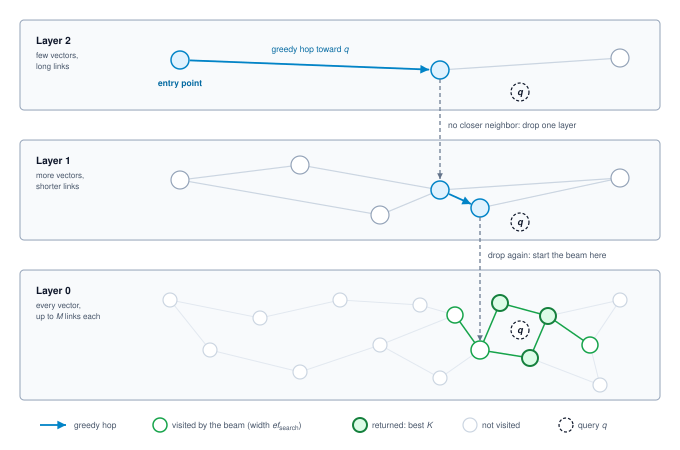
:::

Rather than navigating a graph over full-precision vectors, an inverted file index combined with **product quantization**\index{Product quantization!definition} (IVF-PQ) reduces memory bandwidth by partitioning the vector space and lossily compressing the stored representations [@jegou2011product]. During index construction, coarse $k$-means clusters the corpus into $C$ Voronoi cells, each backed by an inverted list of vector identifiers. At query time, the system computes the distance from the uncompressed query vector to all $C$ coarse centroids and evaluates only the vectors residing in the $n_{\text{probe}}$ closest cells.

Product quantization then compresses every stored vector. It splits the $d$ dimensions into $m$ distinct subvectors of dimension $d/m$. For each subspace, $k$-means trains a codebook of 256 centroids, allowing any subvector to be represented by a single one-byte index $c_j \in [0, 255]$ indicating its nearest centroid. Storing a compressed vector therefore requires only $m$ bytes. At query time, the uncompressed query vector $\mathbf{q}$ is segmented into the same $m$ subspaces. The runtime precomputes an asymmetric distance lookup table $\text{LUT}[j, c]$, which stores the squared Euclidean distance between the query's $j$-th subvector and centroid $c$ in subspace $j$. The approximate distance between the query $\mathbf{q}$ and a stored quantized vector $\mathbf{x}$ with codes $c_1, \dots, c_m$ reduces to summing table lookups:

$$
\tilde{\HiddenDimension}(\mathbf{q}, \MechanicalPlantState) = \sum_{j=1}^{\MicrobatchCount} \text{LUT}[j, c_j].
$$ {#eq-vol3-pq-adc}

@Eq-vol3-pq-adc transforms an expensive, bandwidth-bound $d$-component dot product into $m$ single-byte reads and table lookups. Because the lookup table is small enough to stay in CPU cache, evaluation proceeds at high arithmetic intensity. The parameter $n_{\text{probe}}$ balances recall against the number of cells scanned, while the subvector count $m$ trades distance fidelity against bytes per code. Systems commonly recover distance accuracy by re-scoring a short candidate list against full-precision vectors stored on secondary media or remote memory. This architecture scales gracefully to billions of vectors on accelerators [@johnson2019billion]. However, the quantization codebooks and coarse centroids are calibrated on the vector distribution present during index construction; as the corpus drifts or if the embedding model changes, quantization error compounds until the index is retrained. @Fig-vol3-ivf-pq diagrams this dual-pipeline architecture side by side: the offline build splits vectors into $m = 64$ subvectors, quantizing each into a 1-byte codebook index appended to coarse Voronoi cells, while online query execution probes the $n_{\text{probe}}$ nearest cells and scores candidates through fast asymmetric distance table lookups.

::: {#fig-vol3-ivf-pq fig-env="figure" fig-pos="htb" fig-cap="**IVF-PQ Build and Query**: At build time each stored vector is split into $m = 64$ subvectors, each replaced by the one-byte index of its nearest centroid in that subspace's codebook, and the code is appended to the inverted list of its nearest coarse cell. At query time the full-precision query selects the $n_{\text{probe}}$ nearest cells, fills a table of distances to every subspace centroid, and scores each stored code with $m$ table lookups. Sizes follow the exact-scan notebook's corpus." fig-alt="Three bands. The top band, labeled build, shows a stored vector split into 64 segments, a codebook of 256 centroids with one highlighted, and the resulting code of 64 one-byte indices, noted as 24 times fewer bytes than the FP16 vector; an arrow appends the code to cell \AFourthTaxonomyAxis. The middle row shows inverted lists for cells 1 through 4 and cell \AFourthTaxonomyAxis, with cells 3 and \AFourthTaxonomyAxis shaded as the probed cells. The bottom band, labeled query, shows four boxes in sequence: query q, choose cells, build a lookup table of 64 by 256 squared distances, and score each code with 64 lookups and adds, with an arrow from cell \AFourthTaxonomyAxis into the last box."}
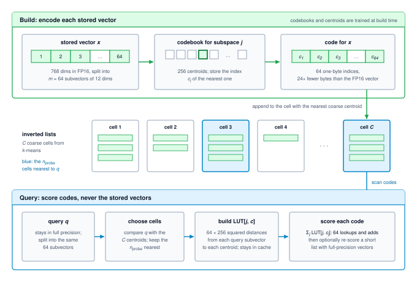
:::

```{python}
#| label: lego-06-ann-footprint
#| echo: false
# ┌─────────────────────────────────────────────────────────────────────────────
# │ ANN INDEX FOOTPRINT (LEGO)
# ├─────────────────────────────────────────────────────────────────────────────
# │ Context: @tbl-vol3-ann-tradeoffs and the cost line before it.
# │ Goal: Size HNSW links and PQ codes for the exact-scan notebook's corpus.
# │ Show: 2.56 GB of links beside 15.36 GB of vectors; 0.64 GB of codes (24x).
# │ How: Stipulated M=32 links of 8 bytes; K=64 one-byte PQ subcodes.
# └─────────────────────────────────────────────────────────────────────────────
from mlsysim.core.units import BYTES_FP32, GB, KB, byte
from mlsysim.fmt import check, fmt_int, fmt_memory, fmt_multiple

class AnnFootprint:
    # ┌── 1. LOAD (Corpus from the exact-scan notebook; stipulated index shape) ─
    n = VectorScanLatencyFloor.n_vectors
    d = VectorScanLatencyFloor.d_dim
    raw = VectorScanLatencyFloor.footprint
    links_per_node = 32
    link_bytes = 8 * byte
    pq_subvectors = 64
    pq_centroids = 256
    code_bytes_per_sub = 1 * byte
    lut_entry = BYTES_FP32

    # ┌── 2. EXECUTE ──────────────────────────────────────────────────────
    graph = n * links_per_node * link_bytes
    codes = n * pq_subvectors * code_bytes_per_sub
    ratio = (raw / codes).to("").magnitude
    lut = (pq_subvectors * pq_centroids * lut_entry).to(KB)
    sub_dim = d // pq_subvectors

    # ┌── 3. GUARD ────────────────────────────────────────────────────────
    check(d % pq_subvectors == 0, "subvectors tile the dimension")
    check(abs(graph.to(GB).magnitude - 2.56) < 1e-9, "graph links")
    check(abs(codes.to(GB).magnitude - 0.64) < 1e-9, "PQ codes")
    check(ratio == 24, "FP16 vectors to PQ codes")
    check(abs(lut.magnitude - 65.536) < 1e-9, "lookup table size (64 x 256 x 4 bytes)")

    # ┌── 4. OUTPUT ───────────────────────────────────────────────────────
    links_str = fmt_int(links_per_node)
    graph_str = fmt_memory(graph, unit=GB, precision=2)
    total_hnsw_str = fmt_memory(raw + graph, unit=GB, precision=2)
    code_str = fmt_int(pq_subvectors)
    sub_dim_str = fmt_int(sub_dim)
    codes_str = fmt_memory(codes, unit=GB, precision=2)
    ratio_mult_str = fmt_multiple(ratio, precision=0)
    lut_str = fmt_memory(lut, unit=KB, precision=1)
```

These structural trade-offs become concrete when sized against the 10-million-vector corpus from the exact-scan notebook. With `{python} AnnFootprint.links_str` eight-byte links per node, an HNSW graph adds `{python} AnnFootprint.graph_str` of edge topology to `{python} VectorScanLatencyFloor.footprint_str` of vectors. Because greedy routing traverses arbitrary graph links, memory access patterns are dominated by dependent random reads, requiring both the graph and the vectors to remain memory-resident. Product quantization with `{python} AnnFootprint.code_str` subvectors of `{python} AnnFootprint.sub_dim_str` dimensions stores `{python} AnnFootprint.codes_str` of codes, `{python} AnnFootprint.ratio_mult_str` smaller than the FP16 vectors, and its per-query lookup table occupies merely `{python} AnnFootprint.lut_str`. @Tbl-vol3-ann-tradeoffs sets the three designs side by side.

| **Property**                  | **Exact scan**                                  | **IVF-PQ**                                                               | **HNSW**                                                                |
|:------------------------------|:------------------------------------------------|:-------------------------------------------------------------------------|:------------------------------------------------------------------------|
| **Work per query**            | Every eligible vector                           | $C$ centroids plus the codes in $n_{\text{probe}}$ cells                 | Distances along a greedy path and a beam of width $ef_{\text{search}}$  |
| **Resident bytes (notebook)** | `{python} VectorScanLatencyFloor.footprint_str` | `{python} AnnFootprint.codes_str` of codes, plus centroids and codebooks | `{python} AnnFootprint.total_hnsw_str` of vectors and links             |
| **Distance fidelity**         | Exact under the metric                          | Approximate; re-scoring a short list recovers it                         | Exact for each visited vector; misses come from unvisited ones          |
| **Recall knob**               | None needed                                     | $n_{\text{probe}}$, $m$                                                  | $ef_{\text{search}}$, $M$                                               |
| **Insert and delete**         | Append; delete by exclusion                     | Cheap append; centroids and codebooks age as the corpus drifts           | Insert runs a search and relinks neighbors; delete leaves a marked node |
| **Memory access**             | Sequential streaming, bandwidth-bound           | Short sequential scans of small codes                                    | Dependent random reads, one per hop                                     |

: **Exact and approximate vector search**: Each design trades the bytes a query touches against recall and update cost. Footprints use the exact-scan notebook's hypothetical corpus and the stipulated index shapes above; measured latency and recall depend on the data, queries, and settings. {#tbl-vol3-ann-tradeoffs tbl-colwidths="[20,22,29,29]"}

Selecting among these index structures requires evaluating them against the specific record volumes, query distributions, and latency budgets the agent encounters. Systems engineers must also distinguish between two distinct evaluation metrics: recall against an exact scan measures algorithmic fidelity to the mathematical distance metric, whereas end-to-end task success measures whether the retrieved records contain the requisite causal evidence to resolve the agent's objective.

Scope filters present greater architectural friction on a graph index than on inverted postings lists. In lexical retrieval, intersecting a postings list with an eligibility bitset prunes unauthorized documents without altering how the remaining documents are traversed. In an HNSW graph, restricting search during traversal (pre-filtering) forces the beam to step exclusively onto eligible nodes. If a tenant boundary or file path mask isolates regions of the graph, the greedy walk stalls at a local minimum when all outgoing links lead to masked nodes. The search terminates prematurely and returns incomplete results, even when highly relevant eligible nodes exist just beyond the masked barrier. Conversely, filtering after an unconstrained search (post-filtering) risks returning an empty set whenever the top-$k$ candidates fall outside the authorized scope. The traversal stall and architectural mitigations diagrammed in @fig-vol3-access-prefilter resolve this dilemma: systems either partition the index into scope-isolated subgraphs, seed auxiliary entry points directly within authorized clusters, or fall back to an exact scan when high filter selectivity makes linear scoring inexpensive.

::: {#fig-vol3-access-prefilter fig-env="figure" fig-pos="htb" fig-cap="**Filtering Inside a Graph Walk**: \Advantage scope mask applied during traversal (\Advantage) removes the only links between the entry region and the eligible vectors nearest $\mathbf{q}$, so the greedy walk stops at a local minimum and returns too few results even though eligible neighbors exist. The three responses (\BatchSize) partition the index along scope boundaries, restart the walk from an entry point inside the eligible region, or, when the filter is selective, score every eligible vector exactly." fig-alt="Two panels. Panel \Advantage, labeled mask applied during the walk, shows a graph in which an arrow from an entry node reaches a green node circled in red and labeled stalls here; dashed gray masked nodes separate it from three green nodes near a dashed query marker q, labeled eligible near q, unreachable. \Advantage legend distinguishes eligible nodes from masked nodes. Panel \BatchSize, labeled three responses, shows three rows: separate graphs for scope \ScaledResource and scope Y, a walk that starts from an extra entry node among green nodes near q, and q with an arrow labeled score all pointing to a row of five green nodes."}
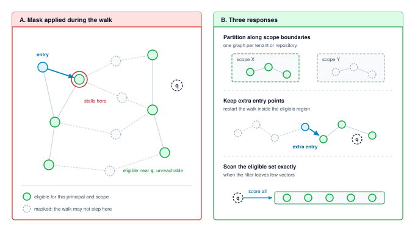
:::

### Rank fusion and reranking {#sec-vol3-long-term-memory-rank-fusion}

Production systems frequently combine multiple candidate-generation mechanisms through **hybrid retrieval**\index{Hybrid retrieval!definition}, pairing lexical keyword search with dense semantic retrieval. Before merging candidate lists, however, the runtime must establish unambiguous candidate identity based on tenant scope, source path, commit or version identifier, and span coordinates. Strict identity resolution ensures that an `r17` passage never erroneously merges with its modified `r18` counterpart, and that identical code in another tenant is never treated as authorized local evidence.

Because lexical scores (such as unbounded BM25 values) and dense similarity scores (such as cosine values in $[-1, 1]$) reside on non-comparable scales, directly normalizing or adding raw scores introduces calibration instability. **Reciprocal rank fusion (RRF)**\index{Reciprocal rank fusion!definition} bypasses score calibration by combining ranked lists based solely on candidate ordinal positions [@cormack2009reciprocal]. Let $\mathcal{R}_i$ denote the list returned by method $i$, and let $r_i(x)$ represent the 1-based rank of candidate $x$ within that list. For a positive smoothing parameter $k_{\text{rrf}}$, the truncated RRF score is defined as:

$$
\operatorname{RRF}(x) = \sum_{i:\,x\in \mathcal{R}_i} \frac{1}{k_{\text{rrf}} + r_i(x)}.
$$ {#eq-vol3-reciprocal-rank-fusion}

\Advantage candidate absent from a given list contributes zero from that source. Increasing $k_{\text{rrf}}$ compresses the score differential between adjacent ranks without making the method entirely parameter-free;[^fn-rrf-rank-monotonicity] the runtime must also define an explicit tie-breaking convention and configure candidate cutoff depths for each retrieval path.

[^fn-rrf-rank-monotonicity]: **RRF score monotonicity**\index{Reciprocal rank fusion}: With fixed $k_{\text{rrf}} > 0$, moving an item from rank $r$ to $r' < r$ in one input list increases its contribution by $1/(k_{\text{rrf}}+r')-1/(k_{\text{rrf}}+r)>0$ [@cormack2009reciprocal]. If its contributions from other lists do not decrease, its total score increases. This is a property of the item's score, not a guarantee of improved final rank when other candidates also change, or of relevant evidence.

```{python}
#| label: lego-06-reciprocal-rank-fusion
#| echo: false
# What: Reproduce an explicitly hypothetical pair of truncated candidate lists.
# How: Sum exact reciprocal ranks, then break score ties by stable candidate ID.
from fractions import Fraction
from mlsysim.fmt import check, fmt_int, fmt_ratio

class HybridRankFusion:
    # LOAD: Assumed input ranks, not measurements of either retriever's quality.
    k = 60
    lexical = {"B": 1, "A": 2, "D": 3}
    dense = {"C": 1, "A": 2, "E": 3}

    # EXECUTE: Missing candidates contribute zero.
    scores = {}
    for ranking in (lexical, dense):
        for candidate, rank in ranking.items():
            scores[candidate] = scores.get(candidate, Fraction(0)) + Fraction(1, k + rank)
    ordered = sorted(scores.items(), key=lambda item: (-item[1], item[0]))
    fused_ranks = {}
    for rank, (candidate, score) in enumerate(ordered, start=1):
        fused_ranks[candidate] = rank

    # GUARD: Check agreement benefit and explicitly deterministic tied pairs.
    check(scores["A"] == Fraction(1, 31), "two second-place contributions")
    check(scores["B"] == scores["C"], "first-place tie")
    check(scores["D"] == scores["E"], "third-place tie")
    check(list(fused_ranks) == ["A", "B", "C", "D", "E"], "stable tie order")

    # OUTPUT: Derived scores and final positions feed the table directly.
    k_str = fmt_int(k)
    a_score_str = fmt_ratio(float(scores["A"]), precision=5)
    b_score_str = fmt_ratio(float(scores["B"]), precision=5)
    c_score_str = fmt_ratio(float(scores["C"]), precision=5)
    d_score_str = fmt_ratio(float(scores["D"]), precision=5)
    e_score_str = fmt_ratio(float(scores["E"]), precision=5)
    a_rank_str = fmt_int(fused_ranks["A"])
    b_rank_str = fmt_int(fused_ranks["B"])
    c_rank_str = fmt_int(fused_ranks["C"])
    d_rank_str = fmt_int(fused_ranks["D"])
    e_rank_str = fmt_int(fused_ranks["E"])
```

To see how RRF rewards consensus across divergent retrieval mechanisms, consider an illustrative repair query evaluated on the authorized `r18` snapshot. Let A be the return-and-notify implementation span, B the reproducer test, and C, D, and E three additional candidate records. Suppose lexical search produces the ranking B, A, D, while dense retrieval produces C, A, E. With the standard choice $k_{\text{rrf}} =$ `{python} HybridRankFusion.k_str`, @eq-vol3-reciprocal-rank-fusion assigns candidate A two second-place contributions, $1/(60+2) + 1/(60+2)$, whereas candidate B receives only a single first-place contribution of $1/(60+1)$. Summing every candidate's contributions in @tbl-vol3-rrf-scoring puts candidate A at the top fused rank on consensus across both retrieval paths, even though neither individual retriever ranked it first.

| Candidate            | Lexical rank | Dense rank |                               RRF score |                         Fused position |
|:---------------------|-------------:|-----------:|----------------------------------------:|---------------------------------------:|
| \Advantage           |            2 |          2 | `{python} HybridRankFusion.a_score_str` | `{python} HybridRankFusion.a_rank_str` |
| \BatchSize           |            1 |          — | `{python} HybridRankFusion.b_score_str` | `{python} HybridRankFusion.b_rank_str` |
| \AFourthTaxonomyAxis |            — |          1 | `{python} HybridRankFusion.c_score_str` | `{python} HybridRankFusion.c_rank_str` |
| \DatasetSize         |            3 |          — | `{python} HybridRankFusion.d_score_str` | `{python} HybridRankFusion.d_rank_str` |
| E                    |            — |          3 | `{python} HybridRankFusion.e_score_str` | `{python} HybridRankFusion.e_rank_str` |

: **Fusion of hypothetical candidate rankings**: \Advantage benefits from appearing in both lists. \Advantage dash means absence from that truncated list and contributes zero. Equal scores are ordered by candidate ID, not by inferred relevance. {#tbl-vol3-rrf-scoring}

Dual consensus elevates candidate \Advantage for closer inspection, but agreement across two candidate generators remains an incomplete guarantee of relevance when both retrievers share systematic blind spots. To establish higher precision before staging evidence into the agent's context window, systems employ a **cross-encoder reranker**\index{Cross-encoder reranker!definition} [@nogueira2019passage]. Rather than scoring query and document independently, a cross-encoder evaluates the query and candidate tokens together through bidirectional cross-attention layers. This joint modeling captures fine-grained token interactions at substantial query-time cost. \Advantage reranker can only reorder candidates already surfaced by upstream generators; it cannot retrieve missing records, and its score reflects structural and semantic resemblance rather than verified task applicability.

```{python}
#| label: lego-06-rerank-pool
#| echo: false
# ┌─────────────────────────────────────────────────────────────────────────────
# │ CROSS-ENCODER RERANKING WORK (LEGO)
# ├─────────────────────────────────────────────────────────────────────────────
# │ Context: reranking-cost paragraph in the rank-fusion subsection.
# │ Goal: Show that reranking work scales with pool size times pair length.
# │ Show: 50 candidates of 300 tokens with a 100-token query = 20,000 tokens.
# │ How: Stipulated token counts; no model or hardware latency claim.
# └─────────────────────────────────────────────────────────────────────────────
from mlsysim.fmt import check, fmt_int

class RerankPool:
    # ┌── 1. LOAD (Stipulated counts) ─────────────────────────────────────
    pool = 50
    passage_tokens = 300
    query_tokens = 100

    # ┌── 2. EXECUTE ──────────────────────────────────────────────────────
    pair_tokens = passage_tokens + query_tokens
    total = pool * pair_tokens

    # ┌── 3. GUARD ────────────────────────────────────────────────────────
    check(total == 20_000, "tokens processed per reranked query")

    # ┌── 4. OUTPUT ───────────────────────────────────────────────────────
    pool_str = fmt_int(pool)
    passage_str = fmt_int(passage_tokens)
    query_str = fmt_int(query_tokens)
    total_str = fmt_int(total)
```

The substantial computational demand of joint cross-attention is why rerankers operate exclusively on short candidate pools. In a bi-encoder design, candidate vectors are computed offline, reducing query-time evaluation to a lightweight vector dot product. In a cross-encoder, query and candidate tokens must be processed jointly through the transformer layers, preventing offline precomputation. Computational cost scales with both candidate pool depth and token sequence length. For example, reranking a pool of `{python} RerankPool.pool_str` candidates of `{python} RerankPool.passage_str` tokens each against a `{python} RerankPool.query_str`-token query requires processing `{python} RerankPool.total_str` tokens—a prefill computational load comparable to a substantial model inference call, incurred entirely for ordering. Systems manage this latency budget by constraining candidate pool sizes, invoking rerankers conditionally based on query ambiguity, or executing reranking asynchronously off the interactive path. @Fig-vol3-hnsw-rrf diagrams this hybrid retrieval pipeline across four stages: parallel BM25 and HNSW dense searches generate ranked candidate lists, reciprocal rank fusion combines the streams into a unified ranking, a cross-encoder applies full bidirectional attention to rescore the top candidates, and a deduplication filter trims the final evidence set to fit within the prompt budget.

::: {#fig-vol3-hnsw-rrf fig-env="figure" fig-pos="htb" fig-cap="**From Candidate Lists to Staged Evidence**: Lexical and dense retrieval each rank candidates for the repair symptom. Candidates are joined on their full identity, so an r17 span never merges with its r18 counterpart, and reciprocal rank fusion combines ranks rather than raw scores, with the smoothing parameter $k_{\text{rrf}}$ still a design choice. \Advantage cross-encoder reorders only a short pool, because its work grows with both pool size and pair length, and the runtime stages a small labeled set within the payload budget." fig-alt="Vertical flowchart. \Advantage query box quoting the symptom a connection is returned, but another caller keeps waiting branches to two boxes, lexical ranking (BM25) and dense retrieval (ANN). Both merge into a box labeled join on candidate identity, noting scope, path, version, and span. Arrows continue to reciprocal rank fusion with its reciprocal-rank formula, then to a cross-encoder reranker over a short pool, and finally to a box labeled stage a small set within the payload budget."}
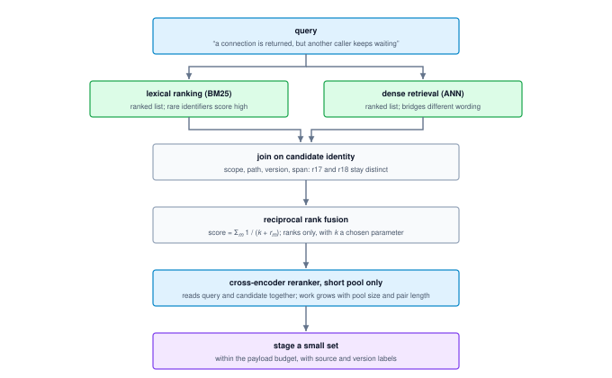
:::

Once reranked, top-ranked candidates pass into the staging pipeline (@sec-vol3-persistent-quarantine), where their provenance and authority are verified before injection into the agent's context payload. Even an optimally ranked evidence set, however, provides bounded guarantees: retrieving the `r18` implementation and a passing reproducer confirms local syntax and isolated test execution, but it cannot prove that all concurrent caller paths remain race-free. Validating broader system properties requires corroborating records—such as runtime execution traces and multi-threaded test outcomes—that extend beyond the purview of any single ranked retrieval list.

## Multi-Hop Retrieval {#sec-vol3-persistent-graphrag}

\Advantage single ranked passage often identifies an initial point of entry without delivering all the evidence an agent needs to make an informed engineering decision. In our running connection-pool repair scenario, the core implementation, the waiter-notification test, and the recorded test execution logs answer entirely distinct questions. Examining the pool implementation in isolation cannot reveal which execution paths the test actually exercised. Conversely, inspecting a passing test log leaves unanswered whether the change preserved wider public interface guarantees. **Multi-hop retrieval**\index{Multi-hop retrieval!definition} addresses this gap by traversing explicit relationships between evidence items, assembling an explanatory chain that no individual passage's retrieval score could justify alone.

Implementing multi-hop retrieval does not necessarily demand a dedicated graph database. An agent can inspect a retrieved passage, extract an unresolved reference, and issue a targeted tool call to fetch the next source artifact. Alternatively, an execution runtime can resolve known references ahead of time before invoking the model. Precomputing and maintaining explicit entity relationships pays off only when downstream queries reuse those links frequently enough to amortize the parsing and indexing overhead.

### Evidence paths {#sec-vol3-long-term-memory-evidence-paths}

In diagnosing the connection pool bug, an effective evidence path originates at the recorded failure of `test_waiter_notified_on_return` under revision `r17`, explicitly scoped by its test revision and runtime environment. From there, the traversal traces from the test assertion in `tests/test_pool.py` directly into the pool operations exercised by the waiter-return scenario in `src/pool.py`. It then compares those source regions against the candidate patch in revision `r18` and its corresponding reproducer execution. Public interface contracts and unrelated callers remain isolated for subsequent targeted queries.

The edges along this path carry fundamentally distinct semantics. \Advantage link from a test run to a commit hash binds an outcome to an exact observed artifact; a static symbol reference in test code points to an implementation entity awaiting inspection; and a diff between revisions isolates textual code modifications. \Advantage robust retrieval payload preserves these labeled edge semantics alongside precise source locations and commit hashes. Crucially, the runtime must also expose unresolved or broken links—such as a missing test log, an ambiguous dynamic dispatch target, or a traversal halted by a token budget. \Advantage static evidence path highlights plausible candidate root causes, but it cannot prove that those specific statements executed during the failing run, nor does it guarantee that all contributing dependencies were discovered.

### Maintained code graphs {#sec-vol3-long-term-memory-code-graphs}

While a simple structural index records basic symbol definitions and usages, richer reasoning over software repositories demands structured relational models. \Advantage **code property graph**\index{Code property graph!definition} unifies abstract syntax trees, control-flow graphs, and program-dependence graphs into a single directed graph of program entities connected by typed edges [@yamaguchi2014modeling]. The edge types most relevant to software agents include syntactic containment and declaration, call edges connecting call sites to function targets, data-dependence edges tracking value definitions to their uses, type inheritance, and module-level imports.

Edge typing is what makes multi-hop graph traversal selective rather than combinatorial. In our connection pool example, restricting a search to invocation and mutation edges guides the traversal directly from `test_waiter_notified_on_return` to the pool's resource-return method, and onward to the waiter queue that the method mutates—avoiding the distraction of dozens of unrelated files that merely import the pool module. The entry point for such a traversal—the seed node—can be resolved via an exact symbol lookup, an initial ranked passage retrieval, or an explicit file and line coordinate from an execution trace.

However, an edge is only as reliable as its underlying extraction mechanism. Lexical parsing reliably identifies declared syntax; resolving cross-file call targets requires complete type information and build configuration; dynamic execution traces observe only the concrete paths taken during a specific invocation. Systems graphs must therefore track provenance on every edge, ensuring the runtime never presents a statically inferred call as an observed runtime event. Furthermore, maintaining these graphs introduces ongoing invalidation overhead as the codebase evolves. \Advantage local edit to a method signature might invalidate caller graphs and dependent summaries across multiple repositories, whereas modifying an internal comment leaves structural edges unchanged. When source artifacts shift, any relationship whose underlying evidence has changed must be pruned or marked stale according to the update contracts established in @sec-vol3-persistent-invalidation.

### Bounded expansion {#sec-vol3-long-term-memory-bounded-expansion}

Unconstrained expansion from a seed node quickly pulls in vastly more context than a downstream language model can process or attend to effectively. Traversal routines require strict operational guards: filtering permitted edge types, restricting traversal direction, capping maximum search depth, and bounding the total number of visited nodes. Tracking visited entity identifiers is essential to prevent cyclic loops from triggering infinite expansion. Even with structural bounds, context packing limits remain binding because a small handful of large code or documentation nodes can easily overrun the prompt budget.

Within these operational boundaries, the runtime can prioritize candidate nodes using semantic relevance, edge type affinities, or graph-centrality algorithms like Personalized PageRank [@page1999pagerank], which concentrates random-walk probability around the initial seed nodes (@sec-vol3-appendix-math-pagerank). However, applying a naive score threshold across candidate nodes risks fragmenting the evidence chain. Preserving a coherent explanation often requires retaining an intermediate node with a lower individual query score simply to maintain topological connectivity between the seed and high-value leaf evidence, while compensating by pruning non-essential nodes elsewhere.

::: {.column-margin}
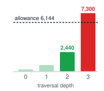{width="100%" fig-alt="Four vertical bars for traversal depths 0 through 3, each taller than the last. \Advantage dashed horizontal line marks a 6,144-token allowance. The depth 2 bar, labeled 2,440, sits below the line in green; the depth 3 bar, labeled 7,300, rises above it in red."}

*One more level of depth turns a comfortable fit into an overflow.*
:::

The notebook below separates the number of reachable candidates from the number that can be staged, on a tree simple enough to count exactly.

```{python}
#| label: lego-06-graph-neighborhood-expansion-vs-context
#| echo: false
# ┌─────────────────────────────────────────────────────────────────────────────
# │ Context: notebook nbk-06-graph-neighborhood-expansion-vs-context.
# │ Goal: Separate a traversal neighborhood from a serialized packing bound.
# │ Show: 40 reachable nodes require 7,300 tokens; at most 33 fit in 6,144.
# │ How: Count an exact tree, then apply a hypothetical final-serialization budget.
# └─────────────────────────────────────────────────────────────────────────────
from mlsysim.fmt import check, fmt_int

class GraphNeighborhoodExpansion:
    # ┌── 1. LOAD (Scenario inputs) ─────────────────────────────────────────────
    call_tokens = 32_768
    output_tokens = 2_048
    other_input_tokens = 24_576
    children = 3  # exact tree: every internal node has this many children
    depth = 3  # seed is depth zero; no repeated nodes
    node_tokens = 180  # fixed serialized size, including local provenance
    edge_envelope_tokens = 100  # stipulated total for either packing considered

    # ┌── 2. EXECUTE (Integer token accounting) ─────────────────────────────────
    allowance = call_tokens - output_tokens - other_input_tokens
    nodes = (children ** (depth + 1) - 1) // (children - 1)
    required = nodes * node_tokens + edge_envelope_tokens
    fit = (allowance - edge_envelope_tokens) // node_tokens
    packed = fit * node_tokens + edge_envelope_tokens
    shallow_nodes = (children**depth - 1) // (children - 1)  # one level less
    shallow_required = shallow_nodes * node_tokens + edge_envelope_tokens

    # ┌── 3. GUARD (Invariants) ─────────────────────────────────────────────────
    check(allowance == 6_144, "Match the chapter's retrieval allowance")
    check(nodes == 40 and required == 7_300, "Include seed and every level")
    check(fit == 33 and packed <= allowance, "Packing must fit")
    check(packed + node_tokens > allowance, "One more complete node cannot fit")
    check(required > allowance, "Full neighborhood exceeds the payload budget")
    check(shallow_nodes == 13 and shallow_required == 2_440 <= allowance, "One level shallower fits")

    # ┌── 4. OUTPUT (Formatting) ────────────────────────────────────────────────
    children_str = fmt_int(children)
    depth_str = fmt_int(depth)
    nodes_str = fmt_int(nodes)
    node_tokens_str = fmt_int(node_tokens)
    edge_tokens_str = fmt_int(edge_envelope_tokens)
    allowance_str = fmt_int(allowance)
    required_str = fmt_int(required)
    fit_str = fmt_int(fit)
    shallow_depth_str = fmt_int(depth - 1)
    shallow_nodes_str = fmt_int(shallow_nodes)
    shallow_required_str = fmt_int(shallow_required)
```

::: {#nbk-06-graph-neighborhood-expansion-vs-context .callout-notebook title="Graph expansion and the evidence budget"}

**Problem**: Can the complete neighborhood around one seed fit the chapter's `{python} GraphNeighborhoodExpansion.allowance_str`-token retrieval allowance?

**Variables**: Suppose the neighborhood is a tree with exactly `{python} GraphNeighborhoodExpansion.children_str` children per internal node, explored through depth `{python} GraphNeighborhoodExpansion.depth_str`, with the seed at depth zero and no repeated nodes. Each complete node record occupies `{python} GraphNeighborhoodExpansion.node_tokens_str` serialized tokens, including its local provenance. Reserve `{python} GraphNeighborhoodExpansion.edge_tokens_str` tokens total for edge descriptions and the result envelope. All counts are hypothetical fixed serialization sizes.

**Math**: Counting the seed and all levels gives $1 + 3 + 9 + 27 =$ `{python} GraphNeighborhoodExpansion.nodes_str` nodes. Staging them requires `{python} GraphNeighborhoodExpansion.nodes_str` $\times$ `{python} GraphNeighborhoodExpansion.node_tokens_str` $+$ `{python} GraphNeighborhoodExpansion.edge_tokens_str` $=$ `{python} GraphNeighborhoodExpansion.required_str` tokens, exceeding the allowance. With the same envelope reservation, the maximum number of complete equal-sized nodes is $\lfloor(6{,}144 - 100)/180\rfloor =$ `{python} GraphNeighborhoodExpansion.fit_str`.

Stopping one level earlier, at depth `{python} GraphNeighborhoodExpansion.shallow_depth_str`, stages all `{python} GraphNeighborhoodExpansion.shallow_nodes_str` nodes in `{python} GraphNeighborhoodExpansion.shallow_required_str` tokens.

**Systems insight**: Depth dominates traversal cost because every additional hop multiplies the expansion frontier by the graph's branching factor. \Advantage single extra level separates an evidence payload that comfortably fits the context window from one that overflows the allocation. Traversal engines must bound depth and filter edge types before ranking nodes; within those limits, scoring should prioritize nodes that preserve path connectivity rather than greedily selecting disconnected high-scoring fragments.

:::

Production code graphs exhibit clustered communities, cycles, and heavily skewed degree distributions. Consequently, calculating reachable nodes by raising an average branching factor to a traversal depth typically overestimates distinct reachable entities while underestimating the local search work required to evaluate candidate edges. When an evidence path exceeds the staging budget, the runtime must either narrow the query scope, return a truncated subgraph accompanied by an explicit continuation cursor, or defer downstream expansion to subsequent interactive agent turns. Under the absence rule, any traversal halted by an engineering limit must be explicitly reported as partial rather than exhausted.

### Community summaries as derived memory {#sec-vol3-graphrag-hierarchical}

Not every agent question resolves to a single evidence path. High-level architectural queries often span entire subsystems—for example, understanding how connection pooling, HTTP request dispatching, and transaction lifecycles interact across a service framework. Graph-based retrieval-augmented generation (GraphRAG) addresses these broader questions by constructing an entity knowledge graph and precomputing hierarchical summaries over densely connected subgraphs, or communities [@edge2024graphrag]. Unsupervised community detection[^fn-community-detection-graph] clusters related nodes based on network topology. However, whether a detected topological cluster corresponds to a true architectural boundary, and whether its generated natural-language summary remains technically accurate, are separate verification concerns.

[^fn-community-detection-graph]: **Community Detection**: GraphRAG partitions its entity graph using the Leiden algorithm, which refines modularity-based clustering to ensure that every detected community is well-separated and internally connected [@traag2019leiden]. Modularity optimization rewards groups with higher internal edge density than an equivalent random network. \Advantage detected community reflects entity co-occurrence density within the extracted corpora; whether that topological cluster corresponds to a logical module boundary recognized by system maintainers must be verified against actual source architecture. \index{Community detection!GraphRAG}

\Advantage derived summary amortizes token costs by synthesizing scattered facts into a concise artifact, but it remains a lossy, secondary representation. Every generated summary must retain bidirectional links to its source evidence, record the precise artifact revisions and operating parameters it describes, and inherit the most restrictive security label among its underlying inputs. Detailed execution plans should inspect the authoritative underlying records; the summary serves primarily as an indexed navigational map.

For instance, an automated repair summary might record that revision `r18` passed `test_waiter_notified_on_return` under a specific thread-concurrency configuration. Because an observation is scoped to its tested configuration, this fact cannot be generalized into an assertion that "the connection pool is thread-safe." Moreover, precomputed summaries incur ongoing invalidation debt. Persisting an explicit dependency manifest between source files, detected communities, and generated summaries transforms cache management from a guessing game into a deterministic graph operation. Any code modification flags all dependent summaries—and any higher-level rollups derived from them—as dirty. The runtime can continue to serve a dirty summary as a labeled historical snapshot until an offline job or on-demand trigger recompiles or invalidates it.

::: {#chk-06-hybrid-retrieval .callout-checkpoint title="Choosing and bounding related evidence"}

Apply these retrieval strategies to our running connection-pool repair scenario.

- [ ] **Method choice**: \Advantage debugging query begins with an exact test identifier, but the subsequent inquiry requires identifying all upstream callers of the modified pool method. Which indexes or direct reads best support each step, and under what workload conditions does maintaining a persistent code property graph justify its synchronization overhead?
- [ ] **Evidence path**: Why does a static dependency path from a failing test to a pool implementation fail to prove the runtime root cause or guarantee the general correctness of patch `r18`?
- [ ] **Expansion estimate**: In the tree expansion model from notebook \ref{nbk-06-graph-neighborhood-expansion-vs-context}, if each node record shrank by half, how many levels could traversal proceed before exceeding the retrieval budget, and what computational search overhead would that additional level incur that serialization bounds fail to capture?
- [ ] **Derived summaries**: What provenance links and execution constraints must accompany a synthetic summary of a passing reproducer run to prevent a subsequent agent session from drawing invalid conclusions?

:::

Deciding whether to retain a detailed path explanation or a high-level subsystem summary is fundamentally a write-policy decision. That policy dictates the fidelity, staleness, and cost of the evidence that every subsequent agent session can retrieve.

## The Memory Write Path {#sec-vol3-long-term-memory-write-path}

Retrieval can return only what the system has retained. An assistant that carries the directive “no meetings before 10:00” strictly within its current context window loses that constraint the moment the session terminates. Persisting the preference into long-term storage solves immediate conversational volatility, but it introduces the consistency challenge previewed in @sec-vol3-persistent-need: when the user later moves the boundary to 11:00, the runtime must ensure the earlier record stops governing new scheduling decisions without corrupting the historical audit trail.

The architectural distinction between authoritative sources and derived records remains fundamental (principle \ref{pri-vol3-source-authority}). \Advantage user's explicit directive provides direct evidence of an intent within a specific operational scope; an agent's internal paraphrase constitutes a lossy derived representation; and an automated rationale explaining why the user dislikes morning meetings is an ungrounded secondary inference. Storing all three artifacts as interchangeable assertions flattens evidentiary weight, depriving downstream retrieval pipelines of the ability to distinguish verified user intent from speculative model summaries.

::: {#dfn-06-memory-write-policy .callout-definition title="Memory write policy"}

\Advantage ***memory write policy***\index{Memory write policy!definition} is the runtime rule governing which proposed records enter durable storage, what claims and operational scopes they carry, and how the system subsequently corrects, supersedes, revalidates, expires, or deletes those records and their downstream derivations.

1.  **Significance**: Every admitted record becomes a candidate for retrieval in subsequent agent sessions. An unverified lesson admitted into storage can degrade the execution accuracy of every future task that retrieves it. The write path provides the most economical barrier against memory pollution because admission checks execute once per write rather than amortizing filtering costs across thousands of subsequent retrieval queries.
2.  **Distinction**: Storage retention simply preserves raw bytes in a database or index. The memory write policy governs the operational authority of those bytes, defining what claims an entry can justify and when it must stop influencing execution decisions.
3.  **Common pitfall**: Deduplicating writes based purely on embedding similarity, which erroneously discards near-identical updates (such as a revised meeting time or flipped boolean flag) as redundant duplicates.

:::

### Record scope and evidence {#sec-vol3-long-term-memory-record-scope}

Every candidate memory record requires a concrete provenance tuple: an identifiable owner, an intended operational role, a bounded applicability scope, and verifiable backing evidence. For a scheduling preference, the scope must record the user identity, the target calendar, and explicit time zone constraints rather than leaving the runtime to guess ambient execution conditions. Furthermore, the runtime must enforce explicit consent boundaries: permission to inspect user messages during active reasoning does not grant permission to commit those details into durable storage.

Software repair trajectories generate a fundamentally different class of evidence. For example, test execution records showing a failure at revision `r17` and a pass at revision `r18` represent immutable historical observations, but neither result justifies an unconditioned assertion about the codebase. \Advantage synthesized rule such as “inspect the return path when a waiter remains blocked” represents a heuristic hypothesis derived from that sequence, not a proven invariant. @Tbl-vol3-long-term-memory-write-policy formalizes these distinctions by categorizing how different memory records bind later execution.

| Record kind                          | Evidence retained                                                                  | Limit on later use                                                                    |
|:-------------------------------------|:-----------------------------------------------------------------------------------|:--------------------------------------------------------------------------------------|
| Explicit preference                  | User statement, identity, scope, and statement version                             | Applies within that scope until revised or withdrawn                                  |
| Scoped observation                   | Tool result, checked revision, command, and relevant execution conditions          | Reports the observed case, not all later states                                       |
| Generated lesson or hypothesis       | Supporting observations, derivation, unresolved assumptions, and contrary evidence | Suggests an investigation; does not establish a new fact or grant authority           |
| Episode summary or continuation note | Task identifier and links to retained events and artifacts                         | Carries selected history or unfinished work; does not replace the underlying evidence |

: **Claims in agent-written memory**: Record kinds differ in what supports them and what a later task may infer from them. {#tbl-vol3-long-term-memory-write-policy}

These record kinds impose distinct demands across different operational archetypes. The research agent (lighthouse \ref{lhs-vol3-research-agent}) and support agent (lighthouse \ref{lhs-vol3-support-agent}) stress the memory write pipeline in fundamentally different ways than an autonomous code-repair agent.

::: {#lhs-06-memory-by-archetype .callout-lighthouse title="Persistent memory by archetype"}

@Tbl-vol3-memory-by-archetype sets the three workloads side by side, from the record each one keeps to the policy it leans on.

| **Lighthouse**     | **Dominant durable record**                             | **Source of record**                                   | **Binding hazard**                                                     | **Write-policy emphasis**                                                     |
|:-------------------|:--------------------------------------------------------|:-------------------------------------------------------|:-----------------------------------------------------------------------|:------------------------------------------------------------------------------|
| **Repair agent**   | Test observations and progress notes tied to revisions  | The repository at a source generation                  | Its own edits make indexed copies stale                                | Tag every observation with its revision; invalidate on the agent's own writes |
| **Research agent** | Notes and summaries distilled from fetched pages        | Each external page as fetched, with its time           | Untrusted text becomes a confident lesson through summarization        | Admit distilled claims as hypotheses with links to the fetched pages          |
| **Support agent**  | Customer history, preferences, and answers about policy | The customer record and the published policy documents | \Advantage superseded preference or ungrounded policy answer is reused | Supersede by explicit replacement; propagate deletion to every derived copy   |

: **Persistent memory by archetype**: The binding hazard, not the storage technology, decides which part of the write policy each workload stresses. {#tbl-vol3-memory-by-archetype tbl-colwidths="[14,22,20,22,22]"}

**Systems insight**: The repair agent's memory hazard comes from its own writes, the research agent's from other people's text, and the support agent's from time. One retrieval contract serves all three, and the write policy is where they diverge.

:::

### Admission before deduplication {#sec-vol3-memory-admission-gate}

An agent model may propose a memory write, but the runtime storage layer decides whether and how to persist it. Even when an architecture allows the language model to manage its active context by paging memory entries explicitly [@packer2023memgpt], context paging controls only working set occupancy; durable admission remains the exclusive responsibility of the storage runtime. The **admission gate**\index{Memory admission!definition} validates write permissions, confirms that the target store allows persistent retention for the active session, classifies the record type, and verifies that attached evidence satisfies the schema. While structural schema validation checks required fields such as timestamps and provenance identifiers, evaluating semantic fidelity requires explicit verification rules to ensure the agent has not hallucinated facts absent from the raw transcript. Sensitive data (such as credentials and private identifiers) demands strict classification and scrubbing policies; simple regular expression filters reliably fail on unstructured disclosures that match no standard secret pattern. When an agent proposes an interpretive conclusion lacking direct observational backing, the admission gate must either reject the candidate or downgrade it to an explicitly tagged hypothesis, preventing it from masquerading as a validated preference or concrete observation.

Only after passing admission validation does the runtime evaluate whether the candidate record inserts a new entry, updates an existing record, or duplicates existing knowledge. Vector similarity in an embedding space is useful for candidate retrieval, but it cannot resolve write semantics. If a user modifies a preference from “no meetings before 10:00” to “no meetings before 11:00,” the semantic embedding vectors are nearly identical. Relying on distance thresholds for deduplication would discard the update as an uninformative repeat, quietly dropping the user's explicit correction.

When an admitted record targets an existing entity under an identical scope, the runtime executes **supersession**\index{Supersession!definition}. The runtime creates a newly versioned record and marks the prior entry as superseded. This terminates the prior record's eligibility for active decision-making while preserving it in historical logs for auditing and provenance tracing. When scopes differ—for example, if the 11:00 restriction applies only to Fridays—both records remain valid within their respective domains. When scopes overlap ambiguously, the runtime must flag an unresolved conflict or prompt the user for clarification; heuristically synthesizing conflicting records into a fuzzy compromise produces brittle, ungrounded behavior. Furthermore, systems must distinguish an in-place correction from a true state transition: fixing a transcription error that corrupted “10:00” repairs the fidelity of an existing record, whereas accepting an 11:00 update documents an authentic change in preference.

Concurrent updates demand explicit coordination primitives at the storage layer. \Advantage proposed supersession must carry the base version identifier against which it was generated. The store then evaluates and applies the update atomically through a compare-and-swap or conditional write transaction,[^fn-optimistic-concurrency-memory] closing the race condition inherent in separate read and write phases. When a collision occurs, the runtime must abort the transaction, reload the latest state, and re-evaluate the update against an explicit conflict resolution policy. Delegating concurrency conflicts back to the LLM to blend conflicting states without transaction guarantees is an invitation to silent data corruption.

[^fn-optimistic-concurrency-memory]: **Optimistic Concurrency Control**: \Advantage transaction reads without locks, validates at commit that no underlying state has changed, and restarts if validation fails [@kung1981optimistic]. The scheme pays off when conflicts are rare, which fits memory writes: two sessions seldom revise the same preference concurrently, and model calls take several seconds, making pessimistic locks impractical to hold across network invocations. \index{Optimistic concurrency control!memory writes}

### Recorded observations and derived lessons {#sec-vol3-memory-dual-write-path}

Decoupling raw observational writes from downstream inductive derivation is essential for maintaining both prompt responsiveness and data integrity. When an agent executes an action, the runtime immediately writes the raw observation—capturing the execution context, task ID, source revision, tool parameters, and raw output status—to durable storage. Only after this initial write does the runtime schedule background pipelines for summarization, embedding generation, and heuristic reflection. This separation guarantees that hard evidence persists even if downstream inference fails or crashes, while avoiding costly synchronous model calls on every execution step. Generating reflective summaries has demonstrated substantial empirical gains in autonomous error recovery [@shinn2023reflexion]; nonetheless, the resulting verbal reflections must enter the store strictly as generated hypotheses (@tbl-vol3-long-term-memory-write-policy), maintaining explicit foreign-key links to the raw observations from which they were induced.

Write acknowledgments must explicitly report the durability boundary achieved. Systems must distinguish among three distinct guarantees: *buffered in memory* (queued in an ephemeral local ring buffer), *committed to durable storage* (flushed to non-volatile disk or replicated across storage nodes under the durability contract), and *indexed for search* (visible to vector and keyword retrieval engines). Merely enqueuing an event into an in-memory worker queue provides zero crash durability. If a task requires strict persistence guarantees before taking non-reversible external actions, the runtime must block on storage confirmation rather than proceeding optimistically. Moreover, background indexing and reflection pipelines consume significant accelerator cycles and storage \ArithmeticIntensity/\Operations; system schedulers must explicitly account for these background workloads to prevent asynchronous memory indexing from starving user-facing interactive inference.

### Revalidation, expiration, and deletion {#sec-vol3-memory-recency-decay}

\Advantage retained record changes status as its supporting evidence and operational context evolve. The superseded 10:00 preference and the `r17` test failure both remain valid historical records while losing eligibility for current decisions, and retaining historical snapshots remains a deliberate architectural policy choice.

**Revalidation**\index{Revalidation!definition} refreshes the empirical support for an existing record. For instance, asking the user to confirm that the 11:00 scheduling boundary remains active provides authoritative fresh evidence. In contrast, repeatedly retrieving an entry across dozens of successful runs indicates frequent utilization, not revalidation. Confusing usage frequency with epistemic validity is dangerous: an unchecked error that is retrieved repeatedly will merely compound over time. Consequently, storage schemas must maintain distinct timestamps for record creation, last access, and last authoritative confirmation. Similarly, revalidating an automated diagnosis or heuristic rule derived from revision `r18` requires evaluating it against the current source code tree and active test environment, rather than treating age-based decay as a proxy for correctness.

**Expiration**\index{Memory expiration!definition} revokes a record's eligibility for decision-making once an expiration timestamp passes or a defined system condition is triggered. An expired temporary directive—such as an out-of-office scheduling window—must not govern subsequent actions without explicit reconfirmation. Simply penalizing an expired record with a recency decay multiplier in a vector index is architecturally inadequate: if a query has few close semantic matches, an expired record with a penalized score can still surface in the top-$k$ retrieval set and contaminate the prompt. Robust write paths enforce hard filtering, partitioning or tagging expired records so that operational retrieval filters exclude them unconditionally while retaining the payload for compliance auditing.

Deletion addresses the physical and logical lifecycle of the stored data. When a user revokes consent or asks to delete a preference, purging the primary database row is only the initial step. Stale representations frequently linger in secondary indexes, dense vector stores, consolidated episodic summaries, key-value caches, and pre-staged prompt templates managed by the runtime. \Advantage comprehensive deletion procedure must identify every downstream derivative, revoke its retrieval eligibility immediately, and schedule background reclamation or re-indexing under the governing data retention policy. To bridge the latency between request receipt and asynchronous garbage collection, systems write a **tombstone**\index{Tombstone!definition}[^fn-tombstone-death-certificate]—a durable exclusion record that filters the entity out of all active query paths before physical purging completes.

[^fn-tombstone-death-certificate]: **Death Certificates**: Distributed replicated databases encountered this challenge decades ago. If a replica silently deletes an entry, a delayed update arriving from a partitioned peer appears to be fresh data and resurrects the deleted record. @demers1987epidemic resolved this in epidemic replication by writing an explicit “death certificate” that propagates through the cluster and supersedes older versions. In an agent memory architecture, lagging asynchronous indexers, pipeline queues, and restored snapshots function just like stale replicas, making durable tombstone markers necessary prior to physical deletion. \index{Tombstone!death certificate}

\Advantage deletion receipt must specify the exact boundary of guarantees achieved. Immutable cold backups, out-of-band external audit logs, and in-flight API payloads dispatched to third-party model providers lie outside the synchronous deletion perimeter. Deleting a record from runtime memory cannot retract a prompt token that an external foundation model has already processed, nor can it un-schedule a calendar invite already sent across an enterprise network. What the runtime can—and must—guarantee is that every internal index, cache, and prompt assembly buffer within its trust domain immediately ceases to use the deleted entity in future reasoning cycles.

### Consolidation {#sec-vol3-memory-consolidation}

**Consolidation**\index{Memory consolidation!definition} compresses clusters of related, fine-grained records into structured, high-level representations optimized for future retrieval. For instance, across a dozen debugging sessions on an asynchronous runtime, several granular test traces and failed stack frames can be consolidated into an architectural summary documenting which notification paths were evaluated, which revisions broke invariants, and which hypotheses remain open. Autonomous agent architectures frequently employ background workers to synthesize episodic observations into higher-level reflections [@park2023generative]. From a systems perspective, every consolidated reflection is a generated lesson (@tbl-vol3-long-term-memory-write-policy). Clustering records by embedding proximity helps identify candidate groups for consolidation, but vector similarity alone cannot establish causal relationships; verifying that two failures share an underlying defect requires structural evidence that semantic proximity cannot supply.

When generating consolidated records, the write pipeline must preserve provenance graphs, explicitly recording references to the constituent raw records, boundary conditions, and any observed counterexamples. Synthesizing multiple successful execution traces into an unconditioned, global procedure risks overgeneralizing domain-specific behavior. Furthermore, retaining the underlying source observations alongside the consolidated abstraction remains a critical architectural decision: while consolidated summaries minimize prompt token consumption during inference, stripping the raw logs removes the granular execution traces necessary for deep auditing and subsequent re-indexing.

### Self-reinforcing errors {#sec-vol3-memory-self-poisoning}

When an unverified hypothesis enters durable memory, subsequent summarization cycles risk treating the stored conjecture as an established premise, echoing and amplifying the error across successive generations of context. Under formal evidentiary rules, repeated retrieval and re-summarization provide zero independent validation. \Advantage faulty diagnostic guess that is copied into an episode summary, absorbed into a weekly milestone report, and ultimately consolidated into a cross-project heuristic still rests entirely on the original faulty inference. To prevent memory poisoning, the storage engine must maintain rigorous dependency provenance across all derived artifacts. When an operator or verification pass invalidates a poisoned record, the invalidation must cascade through the entire dependency graph, retracting or marking as suspect every downstream summary and derived lesson. Merely down-ranking or tombstoning the root record is insufficient if derivative summaries continue circulating through retrieval indexes. Finally, even a fully validated, un-poisoned lesson functions merely as a candidate action suggestion; the execution engine must still enforce strict runtime authorization policies and environmental preconditions whenever an agent attempts to act on retrieved memories.

::: {#chk-06-memory-write-lifecycle .callout-checkpoint title="Following a preference through its lifecycle"}

\Advantage user changes “no meetings before 10:00” to “no meetings before 11:00” for the same calendar and later requests deletion of the preference. An index and a session summary still contain the original value.

- [ ] **Admission and revision**: Explain why semantic embedding similarity must not discard the 11:00 update, and identify the record that enters the superseded state.
- [ ] **Evidence and time**: The 11:00 preference was retrieved in 30 scheduling tasks across six months without explicit user revalidation. Should the runtime apply it to the next task without prompt confirmation, and which specific timestamp field determines this policy decision?
- [ ] **Withdrawal**: Enumerate all storage and cache representations that must stop influencing downstream prompts, and specify what guarantees the deletion acknowledgment can truthfully report if an immutable backup retains the raw record for 90 days.
- [ ] **Claim scope**: Contrast the evidentiary threshold required for an explicit user constraint against that required for an inductively generated scheduling heuristic.

:::

The memory write path establishes what a stored record claims, what evidence supports it, and when its operational validity terminates. However, governing the write path is only half the battle: those admission, supersession, and invalidation decisions must synchronize with downstream search indexes and retrieval caches before stale entries can misdirect subsequent agent execution.

## Storage Invalidation {#sec-vol3-persistent-invalidation}

The connection-pool repair has reached revision `r18`, yet a subsequent search can still return an excerpt of `src/pool.py` indexed at `r17`. Consider how a single stale read unravels an otherwise systematic debugging trajectory:

1. At turn 12, the agent edits the return path in `src/pool.py`, and the workspace edit tool confirms the updated file at `r18`.
2. At turn 13, a search for the notification logic retrieves the `r17` chunk—which still contains the buggy line replaced in the previous turn—without a version label.
3. At turn 14, the model infers that its earlier modification was lost and reissues the edit. The edit tool rejects the request because the target snippet no longer exists in the current file.
4. At turn 15, the model confronts conflicting signals: a confirmed write, an excerpt contradicting that write, and a failed re-edit. It concludes that the workspace filesystem is corrupted and begins issuing speculative, wide-ranging edits. Each action burns context tokens and tool budget while driving the repository further from a reviewed state.

Every step in this sequence represents a sound deduction from the staged evidence. The system failed because of the unlabeled stale read at turn 13: the retrieval layer served an accurate historical excerpt as current ground truth.

Maintaining a persistent index forces a clean separation between two operations that an ephemeral staged prompt (@sec-vol3-context-engineering-context-rot) naturally couples: withholding obsolete records and generating their replacements.

::: {#dfn-06-storage-invalidation .callout-definition title="Storage invalidation"}

***Storage invalidation***\index{Storage invalidation!definition} is the exclusion of a derived record (an index entry, vector, summary, or cached result) from current-state retrieval once a relevant change to its source makes it inapplicable, independent of when a replacement is built.

1.  **Significance**: It shrinks the window in which stale evidence can be admitted from the time to rebuild an index to the time to record an exclusion—microseconds vs. tens of milliseconds to more than a second in notebook \ref{nbk-06-index-maintenance-cost}. In the trace above, one unlabeled stale read cost three turns of the repair's budget.
2.  **Distinction**: Rebuilding synthesizes a replacement representation, whereas invalidation merely suppresses the obsolete one. This ensures that any query arriving during the rebuild window receives either an authoritative direct read or an explicit incomplete result rather than stale data.
3.  **Common pitfall**: Tracking staleness with an ephemeral dirty flag that clears automatically when a background job finishes. If an uncoordinated indexing worker completes late or a retrieval gateway restarts without durable tombstone state, obsolete entries can be erroneously readmitted.

:::

### Source generations {#sec-vol3-long-term-memory-source-generations}

To guarantee freshness, an index entry must explicitly record the **source generation**\index{Source generation!definition} from which it was derived. \Advantage source generation is a monotonic version identity defined by the storage system's write contract, providing ordering guarantees that volatile filesystem modification timestamps cannot match. In our connection-pool repair, `r17` and `r18` denote successive repository states. Once the runtime establishes `r18` as the active generation, any query seeking current code must systematically discard entries tagged with `r17`.

Data dependencies often span beyond individual files. \Advantage raw code excerpt depends solely on its source file revision; a call-graph edge depends on multiple source files alongside the static-analysis configuration; an episodic summary depends on the tool outputs and diagnostic logs it consolidates. When an underlying artifact changes, the runtime must invalidate all affected downstream records while keeping unrelated entries intact. If the dependency graph is coarse or incomplete, the runtime must conservatively widen the invalidation boundary or explicitly report retrieval uncertainty. \Advantage missing dependency link must never be treated as proof of validity.

From a systems standpoint, every retrieval index is a materialized view over base data, a problem relational database management systems have addressed for decades. Classical incremental view maintenance computes updates to a view algebraically from delta changes in base relations, bypassing the need to re-evaluate the full query [@blakeley1986efficiently; @gupta1995maintenance]. Unstructured retrieval indexes, however, resist algebraic delta maintenance. Under fixed-size chunking schemes, inserting even two lines near the beginning of a source file shifts the token boundaries of every subsequent chunk. Furthermore, deep neural embedding models are non-linear: an updated vector cannot be synthesized from a vector subtraction and a text diff. Consequently, changed text requires discarding existing entries and running end-to-end forward passes to re-embed the new chunks. Practical retrieval architectures therefore decouple invalidation—a fast, synchronous metadata exclusion—from index rebuilding, which consumes substantial compute and network latency.

Beyond source generations, an embedding record must also encode the model identifier, tokenization pipeline, and preprocessing hyperparameters that generated it. \Advantage valid source generation confirms only that the underlying text is up to date; it does not indicate whether the vector remains compatible with the active retrieval model and query encoder.

### Source and index coordination {#sec-vol3-long-term-memory-index-coordination}

Operationalizing this distinction requires a coordinated protocol among the storage coordinator, the indexing pipeline, and the retrieval gateway. This protocol assumes that the agent runtime governs workspace modifications, that the retrieval gateway can query an authoritative source generation along with its content, and that writes, index publications, and query admission share a coordination boundary—such as an atomic database transaction, an etcd revision lock, or a local mutex. During an in-flight write, the gateway either holds queries within a tight latency deadline or marks the affected file scope as temporarily unavailable. Standard message queues or pub/sub brokers cannot enforce these properties because they separate message delivery from commit ordering. The coordination sequence orchestrates a source modification while a straggling index worker remains active:

1. The source coordinator commits the patch as generation `r18` and atomically updates the active generation watermark for admission checks. This prevents a visibility split where newly committed code is readable from disk while an out-of-band index registry continues to treat `r17` as current.
2. \Advantage subsequent query for `src/pool.py` retrieves candidate vectors derived from `r17` from the background index. The retrieval gateway checks their embedded generation tag against the active watermark (`r18`) and suppresses them. This exclusion signals index lag rather than a missing file or a failed edit.
3. An indexing job started prior to the commit finishes late. During index publication, the worker checks its captured generation within the coordination boundary. Recognizing that generation `r18` has superseded its input, the coordinator discards the stale output or redirects it to an archival store.
4. \Advantage fresh worker generates replacement vectors from an `r18` snapshot. It publishes them conditionally, committing the batch only if the workspace generation and index configuration remain unchanged throughout the indexing window.
5. Inbound queries continuously evaluate candidate generations against the active watermark. Publishing `r18` records never reactivates older `r17` entries, and background garbage collectors reclaim retired vectors on an independent schedule.

Publication validation and index installation must occur as a single atomic operation: checking generation validity first and writing later introduces a time-of-check to time-of-use (TOCTOU) race condition that allows concurrent edits to invalidate the payload. In-memory and durable tombstones record excluded generations while background workers rebuild representations. Because query admission enforces generation checks on every lookup, old candidates remain excluded even if temporary dirty flags clear prematurely. Similarly, deleting a source file installs a versioned tombstone, preventing delayed workers from accidentally resurrecting an obsolete record from an earlier snapshot.

Source generations allow the exclusion policy to be expressed in a compact, interval-based form. Each derived entry $c$ carries a valid lifetime $[\ValidityIntervalOfAMemoryEntryBirth, \ValidityIntervalOfAMemoryEntryDeath)$, where $g_{\text{death}}$ remains open until a subsequent edit to that source scope closes the interval. \Advantage query evaluating workspace generation $\ValidityIntervalOfAMemoryEntryQ$ admits candidate entry $c$ if and only if

$$
\text{IsValid}(c, \ValidityIntervalOfAMemoryEntryQ) = \big(\ValidityIntervalOfAMemoryEntryBirth \le \ValidityIntervalOfAMemoryEntryQ < \ValidityIntervalOfAMemoryEntryDeath\big).
$$ {#eq-vol3-index-validity}

For current-state execution, the runtime sets $\ValidityIntervalOfAMemoryEntryQ$ to the active workspace generation. For historical diagnostics—such as an agent reviewing why an execution failed at revision `r17`—the query sets $\ValidityIntervalOfAMemoryEntryQ$ to that historical revision. Subject to retention policies, @eq-vol3-index-validity serves both use cases uniformly, preventing historical data from masquerading as current state.

Exclusion solves freshness, but it introduces an efficiency trade-off that compounds over time. Suppressed records continue to occupy memory. In an approximate nearest-neighbor graph like Hierarchical Navigable Small World (HNSW), tombstoned nodes remain embedded in their neighbors' adjacency lists. Because greedy graph traversal continues to visit and evaluate these dead nodes before filtering them out at the admission boundary, a search with a fixed beam width explores fewer live items, degrading overall recall. To prevent performance collapse, a background compaction process tracks the ratio of tombstoned records, $\rho_{\text{dead}} = \lvert V_{\text{tomb}}\rvert/\lvert V\rvert$. When this ratio crosses a tuned threshold, the system builds a compacted graph: it purges unreferenced records, recomputes neighbor connections among surviving nodes, rebuilds navigation entry points, and atomically swaps the compacted index into memory. This workflow adopts the compaction design of log-structured merge-trees [@oneil1996log], balancing query latency and retrieval recall against the compute cost of background rebuilds.

This coordination contract must remain robust against system restarts and uncoordinated writers. When a retrieval gateway restarts, it must reconstruct its authoritative generation state from durable storage before accepting queries; an empty in-memory tombstone table must never be treated as evidence that the index is fresh. Furthermore, if external tools or developers modify files without routing through the runtime coordinator, filesystem watcher events may arrive out of order or be dropped. In response, the gateway must fall back to direct, version-validated reads against the filesystem. If it cannot verify whether an indexed chunk matches disk before its query deadline expires, it must flag the result envelope as unverified rather than returning potentially stale data.

Replicated retrieval topologies require explicit **read-your-writes**\index{Read-your-writes consistency!definition}[^fn-session-guarantees-memory] guarantees, ensuring that an agent always observes the outcomes of its own preceding actions [@terry1994session]. When an agent issues a search following an edit, the query carries the log sequence number (LSN) corresponding to that write (@sec-vol3-persistence-wal). \Advantage replica whose local replay watermark lags that LSN must pause execution within a bounded wait window. If the replica does not catch up before the deadline elapses, the gateway either routes the request to an authoritative primary or returns an explicit partial-status response.

[^fn-session-guarantees-memory]: **Session Guarantees**: The Bayou project established four foundational client-centric guarantees for weakly consistent distributed storage: read your writes, monotonic reads, writes follow reads, and monotonic writes [@terry1994session]. An agentic system requires more than simple read-your-writes behavior. For example, if an agent reads `r18` from an up-to-date replica and subsequently retrieves `r17` from a lagging node on the next step, the system violates monotonic reads—causing the agent's observation of workspace history to move backward. \index{Session guarantees!monotonic reads}

### Retrieval during index refresh {#sec-vol3-long-term-memory-refresh-retrieval}

Excluding an obsolete candidate prevents an agent from consuming erroneous data, but it does not fulfill the retrieval layer's contract to return actionable context. When invalidation suppresses a record, the gateway must return an honest assessment of available evidence. As outlined in @tbl-vol3-invalidation-tradeoffs, a production retrieval layer can respond with one of three outcomes.

| Retrieval outcome             | Evidence supplied                                                                        | Remaining limitation                                                                                             |
|:------------------------------|:-----------------------------------------------------------------------------------------|:-----------------------------------------------------------------------------------------------------------------|
| Current indexed result        | Payload whose source generation and index configuration satisfy the request              | Ranking and bounded search can still omit relevant records; completion status must reflect the search performed. |
| Authorized direct source read | \Advantage bounded source excerpt with its observed version and provenance               | Direct access can be expensive, unavailable, or too narrow to answer the whole query.                            |
| Explicit incomplete result    | Admissible partial evidence, or no payload, with an explanation of the unavailable scope | The caller lacks the requested evidence and must not infer that the source contains no match.                    |

: **Retrieval choices during index refresh**: Exclusion protects against known version mismatch; replacement retrieval and search completeness remain separate obligations. {#tbl-vol3-invalidation-tradeoffs tbl-colwidths="[24,36,40]"}

The appropriate fallback depends on query structure. For an explicit target path like `src/pool.py`, the gateway can execute an authorized direct source read, returning the live `r18` text while background embedding jobs run. Conversely, a broad semantic query—such as searching for all modules affected by a modified locking interface—cannot be answered by reading a single file. Answering it accurately requires either a refreshed semantic index or comprehensive static analysis across many files. If bounded direct reads cannot resolve the query within the execution budget, the gateway must return an explicit incomplete result. Artificially inflating candidate limits (such as expanding $k$ during top-$k$ nearest-neighbor retrieval) does not solve this problem: an unindexed record does not exist in the vector index, and no search depth can retrieve missing points.

Systems architects must decide where to place this maintenance overhead. Synchronous re-indexing moves parsing, chunking, and embedding directly onto the write path, guaranteeing that fresh representations exist before any subsequent tool executes. Background re-indexing acknowledges writes immediately, allowing tools to return at once while relying on the gateway to manage queries during the refresh window. This architectural trade-off depends on workspace edit frequency and whether bounded direct reads can satisfy immediate downstream queries. As quantified in notebook \ref{nbk-06-index-maintenance-cost}, write-path latencies differ across these models by multiple orders of magnitude. @Fig-vol3-index-invalidation compares three write-path consistency models on a unified execution timeline: synchronous re-indexing stalls write acknowledgment until indexing finishes; unchecked background indexing acknowledges immediately but risks stale reads; and checked background indexing sets dirty markers that redirect subsequent queries to live source files until background reconciliation completes.

```{python}
#| label: lego-06-index-maintenance-cost
#| echo: false
# ┌─────────────────────────────────────────────────────────────────────────────
# │ WHO PAYS FOR INDEX MAINTENANCE (LEGO)
# ├─────────────────────────────────────────────────────────────────────────────
# │ Context: @nbk-06-index-maintenance-cost
# │ Goal: Compare synchronous re-indexing on the write path with exclusion.
# │ Show: 88 ms local, 210 ms remote batched, 1.26 s remote per file; exclusion
# │       costs 0.4 us per write and 1.5 us per query.
# │ How: Stipulated per-stage costs; no hardware or embedding-model claim.
# └─────────────────────────────────────────────────────────────────────────────
import math
from mlsysim.core.units import microsecond, millisecond, nanosecond, second
from mlsysim.fmt import check, fmt_int, fmt_multiple, fmt_time

class IndexMaintenanceCost:
    # ┌── 1. LOAD (Stipulated edit and per-stage costs) ───────────────────
    files = 8
    chunks_per_file = 2
    t_parse = 3.5 * millisecond  # per file
    t_lex = 2.0 * millisecond  # per chunk
    t_embed_batch = 28.0 * millisecond  # one local batch
    batch = 16
    t_rpc = 150 * millisecond  # one remote embedding request
    t_excl_write = 50 * nanosecond  # per exclusion-table entry
    candidates = 50
    t_excl_check = 30 * nanosecond  # per candidate lookup

    # ┌── 2. EXECUTE ──────────────────────────────────────────────────────
    chunks = files * chunks_per_file
    batches = math.ceil(chunks / batch)
    t_local = (files * t_parse + chunks * t_lex + batches * t_embed_batch).to(millisecond)
    t_remote = (files * t_parse + chunks * t_lex + batches * t_rpc).to(millisecond)
    t_serial = (files * t_parse + chunks * t_lex + files * t_rpc).to(second)
    t_write = (files * t_excl_write).to(microsecond)
    t_read = (candidates * t_excl_check).to(microsecond)
    write_path_ratio = (t_local / t_write).to("").magnitude

    # ┌── 3. GUARD ────────────────────────────────────────────────────────
    check(chunks == 16 and batches == 1, "one embedding batch")
    check(abs(t_local.magnitude - 88) < 1e-9, "local synchronous path")
    check(abs(t_remote.magnitude - 210) < 1e-9, "remote batched path")
    check(abs(t_serial.magnitude - 1.26) < 1e-9, "remote per-file path")
    check(t_local.to(microsecond) > 1e4 * t_write, "exclusion is orders of magnitude cheaper")

    # ┌── 4. OUTPUT ───────────────────────────────────────────────────────
    files_str = fmt_int(files)
    chunks_str = fmt_int(chunks)
    candidates_str = fmt_int(candidates)
    t_local_str = fmt_time(t_local, unit=millisecond, precision=0)
    t_remote_str = fmt_time(t_remote, unit=millisecond, precision=0)
    t_serial_str = fmt_time(t_serial, unit=second, precision=2)
    t_write_str = fmt_time(t_write, unit=microsecond, precision=1)
    t_read_str = fmt_time(t_read, unit=microsecond, precision=1)
    t_parse_str = fmt_time(t_parse, unit=millisecond, precision=1)
    t_lex_str = fmt_time(t_lex, unit=millisecond, precision=0)
    t_embed_batch_str = fmt_time(t_embed_batch, unit=millisecond, precision=0)
    batch_str = fmt_int(batch)
    t_rpc_str = fmt_time(t_rpc, unit=millisecond, precision=0)
    t_excl_write_str = fmt_time(t_excl_write, unit=nanosecond, precision=0)
    t_excl_check_str = fmt_time(t_excl_check, unit=nanosecond, precision=0)
    write_path_ratio_mult_str = fmt_multiple(write_path_ratio, precision=0, commas=True)
```

::: {#nbk-06-index-maintenance-cost .callout-notebook title="Who pays for keeping the index current"}
**Problem**: The repair's next edit modifies `{python} IndexMaintenanceCost.files_str` files across `{python} IndexMaintenanceCost.chunks_str` indexed chunks. Using stipulated per-stage costs (`{python} IndexMaintenanceCost.t_parse_str` to parse a file, `{python} IndexMaintenanceCost.t_lex_str` to update one chunk's lexical postings, `{python} IndexMaintenanceCost.t_embed_batch_str` for a local embedding batch of up to `{python} IndexMaintenanceCost.batch_str` chunks, `{python} IndexMaintenanceCost.t_rpc_str` for a remote embedding RPC, `{python} IndexMaintenanceCost.t_excl_write_str` to record an exclusion entry, and `{python} IndexMaintenanceCost.t_excl_check_str` to check an entry), how much latency does each strategy add, and which path bears the cost?

**Math**: Synchronous re-indexing halts write completion until parsing, postings updates, and vector embeddings are fully finished. Backed by a local embedding model, this pipeline adds `{python} IndexMaintenanceCost.t_local_str` directly to the write path. \Advantage single batched remote embedding call increases write overhead to `{python} IndexMaintenanceCost.t_remote_str`, while serial remote requests per file inflate it to `{python} IndexMaintenanceCost.t_serial_str`. In contrast, invalidation records `{python} IndexMaintenanceCost.files_str` exclusion entries, adding merely `{python} IndexMaintenanceCost.t_write_str` to write latency. Subsequent retrieval passes check `{python} IndexMaintenanceCost.candidates_str` candidates against this metadata, adding `{python} IndexMaintenanceCost.t_read_str` to query latency. Even the fastest synchronous approach consumes `{python} IndexMaintenanceCost.write_path_ratio_mult_str` as much write-path time as invalidation.

**Systems insight**: Synchronous invalidation guarantees that no stale entries are served while imposing negligible write-path overhead, though it does not produce fresh representations immediately. The computational cost of re-indexing is not eliminated; it is deferred to background workers, requiring the query gateway to manage the staleness gap using the strategies in @tbl-vol3-invalidation-tradeoffs. As an architectural rule, always invalidate synchronously on the write path, and trigger synchronous re-indexing only when dependent queries consistently arrive before background pipelines can finish.
:::

::: {#fig-vol3-index-invalidation fig-env="figure" fig-pos="htb" fig-cap="**Three Responses to a Source Edit**: Synchronous re-indexing blocks the write until r18 entries exist, adding `{python} IndexMaintenanceCost.t_local_str` to `{python} IndexMaintenanceCost.t_serial_str` under the notebook's stipulated costs. Background re-indexing without a generation check returns at once but admits r17 entries as current until the rebuild finishes. Background re-indexing with exclusion also returns at once; a query in the interval sees r17 excluded and receives a direct read or a partial result, and the worker publishes only if its generation is still current. The time axis is schematic." fig-alt="Three horizontal timelines, each with rows for agent, worker, and index serves, and dashed guides at r18 committed and r18 entries ready. In the synchronous timeline the agent's write is blocked while the worker parses, updates postings, and embeds r18, and a later query gets r18 entries. In the background timeline without a check, a query during the rebuild gets r17 as current source while the index still admits r17 entries. In the timeline with exclusion, r17 entries are excluded during the rebuild, the query receives a direct read or partial result, and the worker publishes only if still current. Header notes give a write-path cost of 88 ms to 1.26 s for synchronous re-indexing and 0.4 microseconds per write and 1.5 microseconds per query for exclusion."}
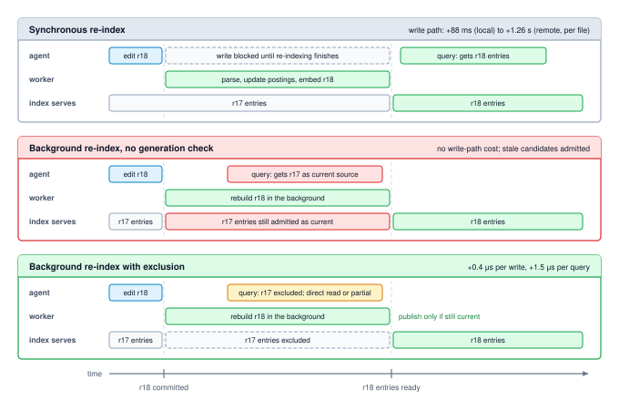
:::

Retrieved evidence represents the source state observed at the moment of the read. In an agentic system, a concurrent write can land before the model finishes deliberating and invokes its chosen action. Any tool call whose correctness depends on an unmodified workspace must therefore enforce an execution-time precondition—such as an optimistic version check—at the tool boundary. The storage subsystem's core duty is to preserve and surface the exact generation metadata that this precondition requires.

Source-generation checks suppress obsolete records, atomic publication prevents straggling workers from reinstating stale representations, and explicit fallback contracts clarify whether fresh evidence is available. Together, these mechanisms enforce internal storage consistency rather than task success. In accordance with the end-to-end argument [@saltzer1984endtoend], whether the `r18` patch truly resolves the connection leak can be established only at the system boundary through integration tests executed against the real runtime environment. What the storage layer guarantees to that boundary is an uncompromised, auditable record of the exact source generation reflected in every retrieved fact.

## Evaluating Memory Policies {#sec-vol3-persistent-governance-eval}

Excluding a stale failure trace from an earlier run keeps an outdated representation out of the agent's next request, but it does not ensure that the agent finds the fresh evidence needed to effect a repair. Conversely, a stored reflection might reproduce a recent passing test run with high accuracy while wildly overstating what the pass actually proves. Rigorous evaluation cannot treat memory as a static lookup table. It must follow information across its full lifecycle: from initial admission into persistent storage, through indexing, retrieval, and prompt staging, to the subsequent updates, supersessions, and deletions that maintain consistency as the environment evolves.

The appropriate unit of comparison is the *memory policy*. \Advantage memory policy encompasses what an agent writes, how it indexes and retrieves records, how it stages evidence in the prompt, and how it maintains that evidence across sessions. The retrieval index is merely one component of that policy. Component-level microbenchmarks help locate failures in search precision or index latency, but task-level outcomes ultimately decide whether the assembled policy satisfies operational acceptance criteria.

### Cross-session policy trials {#sec-vol3-long-term-memory-policy-trials}

\Advantage controlled cross-session trial begins with a fixed source snapshot and an identical initial memory store. Evaluators provision each policy with an isolated environment, identical task sequences, and identical constraints on model inference, tool execution, and compute budgets. Records generated during one trial session may influence subsequent sessions within that same trial—capturing the exact cross-session learning behavior under test—but must never contaminate a parallel trial. Ground-truth reference answers, test fixtures, and evaluator annotations must remain strictly outside both writable and retrievable stores. If an agent can access evaluation artifacts, a policy can easily appear to learn when it is merely caching the answers to the test suite.

The comparison in @tbl-vol3-memory-policy-comparison isolates the baseline benefit of raw persistence from the operational benefit of governing what persists. Across all experimental conditions, the system enforces identical access controls and action permissions. The "unchecked" condition isolates content admission alone, while all conditions experience external source modifications and user updates on the same synchronized fixture schedule.

| **Policy condition**                        | **Question the comparison tests**                                                                                             |
|:--------------------------------------------|:------------------------------------------------------------------------------------------------------------------------------|
| New memory writes disabled                  | Can the task be completed from the allowed sources without accumulating additional cross-session memory?                      |
| Unchecked memory writes                     | Does retaining proposed notes help later sessions, or propagate unsupported claims and duplicates?                            |
| Checked admission, no lifecycle maintenance | Do admission checks help initially but leave records misleading after later changes?                                          |
| Checked admission and lifecycle maintenance | Do correction, supersession, revalidation, expiry, and deletion preserve useful evidence under change, at an acceptable cost? |

: **Memory policy comparison**: Begin each condition from the same store and evaluate the same sequence of sessions. The conditions isolate responsibilities; none is an assumed empirical winner. {#tbl-vol3-memory-policy-comparison tbl-colwidths="[34,66]"}

\Advantage classic user-preference benchmark supplies a concrete lifecycle fixture: an initial preference recorded at 10:00, an explicit supersession at 11:00, and a user deletion request in a subsequent session. The evaluation tests whether the agent applies the active preference before deletion and complies with post-deletion invariants afterward. This requires inspecting every storage tier: primary vector and keyword indices, consolidated summaries, and staged prompt templates. An agent that suppresses the primary record from raw search results but still retrieves an unpruned summary containing the old preference violates its withdrawal contract. Furthermore, system backups or audit logs retained for regulatory compliance must fall under an explicit data-retention policy rather than being counted as active working memory.

Similarly, an iterative software-repair fixture retains an initial execution failure (run 17), records a subsequent passing test run (run 18), and then challenges a future agent session to distinguish historical debugging context from the current state of the implementation without inappropriately broadening the reproducer's scope. When source files change, the fixture tests two critical behaviors: a relevant source edit should trigger revalidation of dependent records, while an unrelated source edit tests whether the policy mistakenly discards valid, useful evidence.

Deterministic fixed-record probes isolate specific defects in admission filtering, retrieval ranking, or cache invalidation. Full task trials then allow policies to accumulate their own records across multi-turn interactions, causing their execution trajectories to diverge naturally over time. Evaluators must hold initial conditions and scoring rubrics constant across runs. When stochastic generation or environment variations introduce noise, evaluations must report the number of independent trials alongside the full distribution of outcomes rather than relying solely on mean performance.

### Retrieval relevance judgments {#sec-vol3-long-term-memory-relevance-judgments}

Standard retrieval metrics depend on unambiguous relevance judgments. For each test query, the benchmark must define the eligible source snapshot, the authorized access scope, and the specific records relevant to the agent's immediate task. Relevance is temporal and context-dependent: an execution log from a failed build (run 17) may be relevant when an agent explains the history of a bug, but it is invalid evidence for whether the current build (run 18) passes. Evaluation fixtures must explicitly label these distinctions rather than expecting an embedding model's similarity score to capture temporal validity.

Let $\mathcal{R}_k$ be the set of distinct records returned up to cutoff $k$, and let $\mathcal{D}^*$ be the set of labeled relevant records in the eligible snapshot. Precision at cutoff $k$ is defined as

$$
\text{\Parameters}@k = \frac{\lvert\mathcal{R}_k \cap \mathcal{\DatasetSize}^*\rvert}{k},
\qquad k > 0.
$$

Notice that the denominator is the target cutoff $k$, not the number of records actually returned by the retriever. Unfilled result positions receive zero credit. Under this formulation, an empty result set scores zero, ensuring that a policy that underfills its staged context cannot artificially outscore a policy that retrieves a broader set of useful evidence. In contrast, calculating precision strictly over the returned records—using $\lvert\mathcal{R}_k\rvert$ in the denominator—can invert these rankings. Evaluators must explicitly declare their denominator convention and report the raw count of returned records alongside precision scores.

Recall measures the fraction of relevant evidence retrieved from the eligible store:

$$
\text{Recall}@k = \frac{\lvert\mathcal{R}_k \cap \mathcal{\DatasetSize}^*\rvert}{\lvert\mathcal{\DatasetSize}^*\rvert}.
$$

When the relevant set $\mathcal{D}^*$ is empty, recall is mathematically undefined ($0/0$). Evaluators should isolate unanswerable queries into a dedicated reporting cohort, assessing whether the agent correctly recognizes the absence of supporting evidence or fabricates an unsupported claim. Keeping the completion status of every evaluation query visible ensures that such boundary conditions are not swept into an aggregate average.

When surfacing an immediate answer is paramount, Mean Reciprocal Rank (MRR) evaluates how quickly the system finds its first hit. MRR computes the arithmetic mean of the reciprocal rank of the first relevant record across all evaluated queries, scoring zero whenever no relevant item appears within cutoff $k$. However, MRR is insensitive to whether the complete evidence required for a multi-hop reasoning chain was assembled. Multi-hop evaluation fixtures must separately verify that all required entity relationships and source versions are present.

Temporal applicability demands a separate metric. The **stale-return rate**\index{Stale-return rate!definition} is the fraction of current-state queries that return at least one record invalidated by subsequent source modifications. Historical retrospective queries must be evaluated and reported separately. Because a retriever that returns nothing returns no stale records, a degenerate policy that returns zero results achieves a perfect stale-return rate of zero while completely failing the task. Consequently, stale-return rates must always be reported alongside recall and evidence coverage.

### Lifecycle outcomes and full costs {#sec-vol3-long-term-memory-lifecycle-costs}

\Advantage comprehensive evaluation must account for the full operational lifecycle of memory updates. In supersession and deletion trials, evaluators track whether an updated or deleted record—along with all its downstream representations, such as index postings, graph edges, and cached summaries—reached the declared target state within an established deadline. The benchmark logs update latency, queue backlogs, and unresolved timeouts. In this analysis, expiring a record from active retrieval and physically purging it from persistent storage are fundamentally distinct operations that require distinct accounting; describing a record loosely as "forgotten" obscures whether data was merely hidden from the read path or permanently deleted from the database.

End-to-end task acceptance remains the ultimate arbiter of system quality. The acceptance rate must be calculated across all admitted task trials, explicitly including timeouts, uncaught exceptions, and partial completions in the denominator. Satisfying an obsolete constraint is an operational failure, even if the retriever achieved high precision against a stale label set.

System resource accounting must respect the same strict evaluation boundaries. Cost accounting aggregates the end-to-end compute footprint: query generation, keyword search, dense similarity computation, cross-encoder reranking, model token usage, memory writes, offline consolidation, and background index compaction. This ledger must include asynchronous background operations that do not directly block foreground user requests, as well as deferred maintenance tasks lingering at the end of the evaluation window. Dividing the total expenditure by the number of successfully completed tasks yields the cost per accepted task (@eq-vol3-cost-per-accepted-task). If a system completes zero tasks, evaluators must report total expenditure and zero successes rather than computing an undefined or misleading ratio.

Storage measurements require equally clear accounting boundaries. Benchmarks should report raw source bytes separately from auxiliary structures, including inverted index postings, dense vector tables, graph adjacency lists, version metadata, and durability replicas. Authors must explicitly define whether their reported storage amplification represents auxiliary bytes divided by raw source bytes, or total stored bytes (source plus auxiliary) divided by raw source bytes. Similarly, update-latency benchmarks must compare equivalent operations: a full index rebuild against a full index rebuild, rather than comparing a complete re-indexing pass against an asynchronous tombstone lookup. Notebook \ref{nbk-06-storage-amplification} compares both metrics across two representative store architectures.

::: {.column-margin}
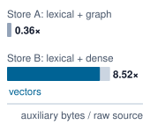{width="100%" fig-alt="Two horizontal bars of auxiliary bytes relative to the raw source. Store \Advantage, lexical plus graph, reaches 0.36 times; Store \BatchSize, lexical plus dense, reaches 8.52 times, with the larger vector portion in a darker shade."}

*Dense vectors multiply a store's auxiliary bytes by an order of magnitude.*
:::

```{python}
#| label: lego-06-storage-amplification
#| echo: false
# ┌─────────────────────────────────────────────────────────────────────────────
# │ STORAGE AMPLIFICATION AND RE-INDEX TIME (LEGO)
# ├─────────────────────────────────────────────────────────────────────────────
# │ Context: @nbk-06-storage-amplification
# │ Goal: Show why lexical+graph and lexical+dense stores differ by an order
# │       of magnitude in auxiliary bytes and re-index time.
# │ Show: auxiliary ratio 0.36x vs 8.52x; re-index 34.1 ms vs 612 ms.
# │ How: Stipulated corpus, index shapes, and throughputs; HNSW shape reused
# │      from the ANN footprint cell.
# └─────────────────────────────────────────────────────────────────────────────
from mlsysim.core.units import BYTES_FP32, MB, byte, millisecond, second
from mlsysim.fmt import check, fmt_int, fmt_memory, fmt_multiple, fmt_time

class StorageAmplification:
    # ┌── 1. LOAD (Stipulated corpus, index shapes, throughputs) ──────────
    files = 50_000
    tokens_per_file = 200
    bytes_per_file = 800 * byte
    postings_per_token = 0.8 * byte
    edges_per_file = 4
    edge_bytes = 32 * byte
    passage_tokens = 100
    d = 768
    vec_width = BYTES_FP32
    links = AnnFootprint.links_per_node
    link_bytes = AnnFootprint.link_bytes
    edited = 15
    lex_rate = 1_250  # files per second
    parse_rate = 680  # files per second
    embed_rate = 50  # chunks per second

    # ┌── 2. EXECUTE ──────────────────────────────────────────────────────
    tokens = files * tokens_per_file
    raw = files * bytes_per_file
    postings = tokens * postings_per_token
    graph = files * edges_per_file * edge_bytes
    chunks = tokens // passage_tokens
    vectors = chunks * d * vec_width
    hnsw = chunks * links * link_bytes
    aux_a = postings + graph
    aux_b = postings + vectors + hnsw
    ratio_aux_a = (aux_a / raw).to("").magnitude
    ratio_aux_b = (aux_b / raw).to("").magnitude
    edited_chunks = edited * tokens_per_file // passage_tokens
    t_a = ((edited / lex_rate + edited / parse_rate) * second).to(millisecond)
    t_b = ((edited / lex_rate + edited_chunks / embed_rate) * second).to(millisecond)
    bytes_ratio = (aux_b / aux_a).to("").magnitude
    time_ratio = (t_b / t_a).to("").magnitude

    # ┌── 3. GUARD ────────────────────────────────────────────────────────
    check(chunks == 100_000 and edited_chunks == 30, "chunk counts")
    check(abs(ratio_aux_a - 0.36) < 1e-9 and abs(ratio_aux_b - 8.52) < 1e-9, "ratios")
    check(t_b > 10 * t_a, "dense re-index dominated by embedding")

    # ┌── 4. OUTPUT ──────────────────────────────────────────────────────────
    files_str = fmt_int(files)
    tokens_per_file_str = fmt_int(tokens_per_file)
    raw_str = fmt_memory(raw, unit=MB, precision=0)
    edges_str = fmt_int(edges_per_file)
    passage_str = fmt_int(passage_tokens)
    d_str = fmt_int(d)
    aux_a_str = fmt_memory(aux_a, unit=MB, precision=1)
    aux_b_str = fmt_memory(aux_b, unit=MB, precision=1)
    vectors_str = fmt_memory(vectors, unit=MB, precision=1)
    ratio_aux_a_mult_str = fmt_multiple(ratio_aux_a, precision=2)
    ratio_aux_b_mult_str = fmt_multiple(ratio_aux_b, precision=2)
    ratio_tot_a_mult_str = fmt_multiple(1 + ratio_aux_a, precision=2)
    ratio_tot_b_mult_str = fmt_multiple(1 + ratio_aux_b, precision=2)
    edited_str = fmt_int(edited)
    edited_chunks_str = fmt_int(edited_chunks)
    embed_rate_str = fmt_int(embed_rate)
    t_a_str = fmt_time(t_a, unit=millisecond, precision=1)
    t_b_str = fmt_time(t_b, unit=millisecond, precision=0)
    bytes_ratio_mult_str = fmt_multiple(round(bytes_ratio), precision=0, approx=True)
    time_ratio_mult_str = fmt_multiple(round(time_ratio), precision=0, approx=True)
```

::: {#nbk-06-storage-amplification .callout-notebook title="Why two memory stores differ by an order of magnitude"}
**Problem**: \Advantage hypothetical repository holds `{python} StorageAmplification.files_str` files of `{python} StorageAmplification.tokens_per_file_str` tokens each, `{python} StorageAmplification.raw_str` of source. Store \Advantage adds a BM25 index and a structural graph with `{python} StorageAmplification.edges_str` edges per file. Store \BatchSize adds the same BM25 index plus `{python} StorageAmplification.passage_str`-token chunks embedded as `{python} StorageAmplification.d_str`-dimensional FP32 vectors under an HNSW graph shaped like the one in @tbl-vol3-ann-tradeoffs. How do their auxiliary bytes and re-index times compare?

**Math**: Store \Advantage's auxiliary structures occupy `{python} StorageAmplification.aux_a_str`, an auxiliary ratio of `{python} StorageAmplification.ratio_aux_a_mult_str` over the raw source (total ratio `{python} StorageAmplification.ratio_tot_a_mult_str`). Store \BatchSize's occupy `{python} StorageAmplification.aux_b_str`, of which the vectors alone are `{python} StorageAmplification.vectors_str`, an auxiliary ratio of `{python} StorageAmplification.ratio_aux_b_mult_str` (total `{python} StorageAmplification.ratio_tot_b_mult_str`). After an edit to `{python} StorageAmplification.edited_str` files, at stipulated throughputs for postings updates and parsing, Store \Advantage re-indexes in `{python} StorageAmplification.t_a_str`. Store \BatchSize must re-embed `{python} StorageAmplification.edited_chunks_str` chunks; at `{python} StorageAmplification.embed_rate_str` chunks per second it needs `{python} StorageAmplification.t_b_str`.

Store \BatchSize carries `{python} StorageAmplification.bytes_ratio_mult_str` the auxiliary bytes of Store \Advantage and takes `{python} StorageAmplification.time_ratio_mult_str` as long to re-index.

**Systems insight**: Dense vectors dominate both the bytes and the maintenance time, because each chunk becomes hundreds of floating-point components produced by a model pass. Compressing the vectors attacks the byte term; only a faster encoder or fewer re-embedded chunks attacks the time term, which sets the stale window after every edit. \Advantage dense index is worth its order of magnitude only when it raises task acceptance enough to repay that maintenance in the cost per accepted task.
:::

Staging depth warrants independent empirical measurement because task success does not increase monotonically with the retrieval cutoff $k$. While Recall@$k$ cannot decrease as $k$ increases, expanding the prompt window introduces substantial cognitive interference. Each retrieved passage that is superficially similar but contextually irrelevant competes for the model's limited attention against critical task evidence. Furthermore, language models exhibit pronounced positional bias, using relevant facts located in the middle of lengthy staged context far less reliably than those placed near the prompt boundaries [@liu2024lost]. Providing too few records starves the model of necessary context; providing too many dilutes key signals with noise. The optimal operating range depends heavily on the model's attention architecture, task complexity, and reranker quality. This mirrors the context working-set principles introduced in @sec-vol3-context-engineering-physics (principle \ref{pri-vol3-attention-working-set}). In practice, systems engineers should configure candidate retrieval to maximize recall, use a precise reranker to stage only a compact working set into the prompt, and systematically sweep staging depth across evaluation trials rather than assuming a single static cutoff.

Ultimately, memory evaluation yields a multidimensional trade-off space rather than a single scalar benchmark score. \Advantage more expansive memory store retains helpful edge-case experiences, but it also accumulates obsolete or contradictory records. Conversely, a strict admission gate shields the agent from spurious lessons at the expense of rejecting valuable domain context. Systems architects must systematically vary read and write policies under identical operational budgets, evaluating whether variations in accepted task outcomes stem from evidence coverage, temporal applicability, lifecycle maintenance failures, or compute and storage costs.

### Adversarial boundary tests {#sec-vol3-long-term-memory-adversarial-tests}

\Advantage complete evaluation suite must subject the memory system to adversarial boundary tests. In an isolated evaluation sandbox, test harnesses inject synthetic credentials, probe unauthorized namespace boundaries, and retrieve documents embedded with indirect prompt injections [@greshake2023not]. The test suite evaluates two critical enforcement layers: whether the runtime intercepts and suppresses unauthorized reads and writes, and whether an adversarial payload survives in downstream consolidated summaries after the primary source document has been withdrawn.

Evaluators must capture both the model's proposed actions and the runtime's actual execution disposition. Logging both stages ensures that the evaluation distinguishes an attempted security breach from an executed vulnerability. The memory policy is accountable for the records it admits, indexes, and stages; the tool and runtime authorization subsystems are accountable for governing what the agent is permitted to execute against the external environment.

::: {#chk-vol3-memory-policy-evaluation .callout-checkpoint title="Evidence across sessions"}

\Advantage proposed memory policy raises retrieval scores on a static snapshot. Its authors have not tested updates, deletion, or later task outcomes.

- [ ] **Trial isolation**: How would you prevent one policy's stored reflections or reference answers from contaminating another policy's trial?
- [ ] **Update semantics**: Which later-session probes would distinguish successful preference supersession from keeping both conflicting preferences?
- [ ] **Withdrawal scope**: What must be inspected beyond the original record after a deletion request, and what retention limits must the result disclose?
- [ ] **Metric boundary**: Why can a zero stale-return rate coexist with failed retrieval, and which task and cost measurements would reveal the failure?
- [ ] **Cost per accepted task**: Policy \BatchSize raises acceptance from 50 percent to 60 percent but adds background maintenance equal to a tenth of Policy \Advantage's attempt cost. Estimate whether its cost per accepted task rises or falls, and find the acceptance rate at which the two policies break even.

:::
## Fallacies and Pitfalls {#sec-vol3-long-term-memory-fallacies}

Persistent memory systems fail when they grant a stored representation more operational authority than its underlying provenance supports, or when they treat write-time admission as a permanent guarantee of validity. The misconceptions below represent common architectural traps where design shortcuts produce silent state corruption, latency spikes, or degraded reasoning fidelity. Each item highlights an engineering trade-off whose quantitative systems cost is demonstrated in this chapter's accompanying notebooks.

::: {.fallacy-pitfall}
**Fallacy**: *\Advantage near-duplicate memory carries no new information.*

Changing "no meetings before 10:00" to "no meetings before 11:00" represents a critical semantic update for a scheduling agent, yet dense embeddings place the two statements in near-identical positions in vector space. When an admission pipeline relies on vector cosine similarity as a coarse novelty filter, it rejects the update as redundant, retains the obsolete 10:00 constraint, and allows the agent to book a meeting during the exact hour the user just prohibited. High geometric proximity does not imply semantic equivalence. An admission pipeline must first establish entity identity, record kind, and explicit update semantics (@sec-vol3-memory-admission-gate); geometric similarity should deduplicate storage only after verifying that the new record asserts no state change.
:::

::: {.fallacy-pitfall}
**Pitfall**: *Treating a high-ranked record as current.*

Vector similarity scores indicate semantic or topical affinity with a query, but they convey nothing about temporal freshness, transactional validity, or operational authority. In the trace that opens @sec-vol3-persistent-invalidation, the outdated snippet `r17` ranks at the top for connection pool queries. At turn 13, the agent consumed this unlabeled record without validating its state, mistook a completed migration for pending work, and spent three subsequent turns re-editing code while amplifying repository damage. Invalidation checks prevent these cascading failures with minimal overhead: filtering `{python} IndexMaintenanceCost.candidates_str` candidates against a generation or timestamp registry costs just `{python} IndexMaintenanceCost.t_read_str` per query (notebook \ref{nbk-06-index-maintenance-cost}). While index rank identifies candidate relevance, the runtime must rely on provenance, version tags, visibility scope, and completion status to govern how a retrieved record is applied.
:::

::: {.fallacy-pitfall}
**Fallacy**: *Staging more retrieved records gives the model more evidence.*

Recall@$k$ increases monotonically with $k$, but an agent's reasoning performance and token budget do not scale in lockstep [@liu2024lost]. As demonstrated in notebook \ref{nbk-06-retrieval-payload-ledger}, a naive staging policy that measures only raw document bodies admits `{python} RetrievalPayloadLedger.body_only_str` records that serialize to `{python} RetrievalPayloadLedger.body_only_used_str` tokens, quickly overwhelming a `{python} RetrievalPayloadLedger.allowance_str`-token allowance. More critically, packing the prompt with marginally relevant records dilutes the salient context, increasing attention dispersion and hallucination rates. Systems architects must calibrate retrieval staging depth against downstream task completion and execution budgets rather than optimizing recall in isolation (@sec-vol3-persistent-governance-eval).
:::

::: {.fallacy-pitfall}
**Pitfall**: *Re-indexing synchronously on every write to keep the index current.*

Recomputing dense embeddings and rebuilding index graphs synchronously on every mutation introduces severe write latency and throughput bottlenecks. Under the benchmarks modeled in notebook \ref{nbk-06-index-maintenance-cost}, synchronous re-indexing adds between `{python} IndexMaintenanceCost.t_local_str` and `{python} IndexMaintenanceCost.t_serial_str` of blocking latency to every file edit. An asynchronous invalidation design decouples this work: writing a tombstone or generation update takes just `{python} IndexMaintenanceCost.t_write_str` during the write phase, leaving a light `{python} IndexMaintenanceCost.t_read_str` exclusion check on subsequent queries. Blocking write operations to guarantee synchronous index freshness provides little practical benefit, as it protects only the narrow window of queries issued before an asynchronous background indexer completes.
:::

::: {.fallacy-pitfall}
**Fallacy**: *Every dense store needs an approximate index, because an exact scan is too slow.*

Flat, exact vector scans scale linearly with the number of candidate vectors, but modern memory bandwidth and vectorized compute handle substantial collections within tight latency budgets. In notebook \ref{nbk-06-memory-bandwidth-and-latency-floor}, an unindexed scan across ten million vectors requires `{python} VectorScanLatencyFloor.t_mem_str`. Applying a tenant or workspace filter beforehand reduces the candidate set to `{python} VectorScanLatencyFloor.n_filtered_str` vectors, dropping scan latency to `{python} VectorScanLatencyFloor.t_filtered_str`. Within a `{python} VectorScanLatencyFloor.t_budget_str` query budget, exact scanning easily accommodates roughly `{python} VectorScanLatencyFloor.n_budget_str` vectors. Below this crossover threshold, exact scans deliver perfect recall with zero graph construction overhead, no index fragmentation, and immediate write availability. An approximate nearest neighbor index only justifies its maintenance overhead once the post-filtering candidate pool exceeds this hardware memory-bandwidth envelope.
:::

::: {.fallacy-pitfall}
**Pitfall**: *Evaluating memory on a static snapshot.*

Benchmarking a memory subsystem against a static snapshot conceals the operational costs and failure modes that emerge under continuous mutation. Snapshot benchmarks ignore index drift, synchronization lag, compaction overhead, and stale-read anomalies. In notebook \ref{nbk-06-storage-amplification}, modifying `{python} StorageAmplification.edited_str` files leaves a dense vector store serving stale records for `{python} StorageAmplification.t_b_str`, compared to `{python} StorageAmplification.t_a_str` for an inverted lexical and structural index. Furthermore, static tests cannot uncover race conditions such as a delayed worker republishing superseded state or an explicitly deleted user preference persisting inside a rolled-up summary. Systems engineers must evaluate memory architectures using dynamic lifecycle fixtures (@sec-vol3-persistent-governance-eval), measuring end-to-end task completion, synchronization latency, and storage amplification across realistic write-read-delete workloads.
:::
## Summary {#sec-vol3-long-term-memory-summary}
[]{#sec-vol3-ch6-summary}

\Advantage software repair agent needs far more than an index that matches text embeddings against a bug report. Reliable long-term memory requires the system to determine what each retained record represents, which authoritative source supports it, how context budgets constrain its entry into later requests, and how downstream state changes when that underlying support is modified. Retrieval methods locate candidates under an explicit operational contract; the write lifecycle governs which records survive to become candidates; and comprehensive evaluation ensures that engineers do not mistake improved search recall for genuine task performance.

@Tbl-vol3-long-term-memory-key-equations collects the quantitative relations governing long-term memory systems, linking each computational bound and operational threshold to the systems decision it informs.

| **Equation**                                                                                                                                                                       | **What it bounds or decides**                                                                                                | **Where derived**                    |
|:-----------------------------------------------------------------------------------------------------------------------------------------------------------------------------------|:-----------------------------------------------------------------------------------------------------------------------------|:-------------------------------------|
| $\operatorname{score}(x,Q)=\sum_{q\in Q}\operatorname{IDF}(q)\frac{f(q,x)(k_1+1)}{f(q,x)+k_1(1-b+b\lvert x\rvert/\overline{\lvert x\rvert})}$                                      | Lexical rank order; saturation ($k_1$) and length normalization ($b$) outweigh raw repetition                                | @sec-vol3-persistent-bm25            |
| $Ndw$ bytes, $2Nd$ FLOPs, intensity $2/w$                                                                                                                                          | Exact-scan time floor $Ndw/\Bandwidth$ and the eligible-set size at which an ANN index pays                                  | @sec-vol3-persistent-dense-retrieval |
| $\tilde{d}(\mathbf{q}, \mathbf{x}) = \sum_{j=1}^{m} \text{LUT}[j, c_j]$                                                                                                            | Bytes touched per scored vector under IVF-PQ; $m$ trades fidelity against code size                                          | @eq-vol3-pq-adc                      |
| $\operatorname{RRF}(x) = \sum_{i:\,x\in \mathcal{R}_i} 1/(k_{\text{rrf}} + r_i(x))$                                                                                                | Fused candidate order across methods whose scores share no scale                                                             | @eq-vol3-reciprocal-rank-fusion      |
| $\lfloor(\text{allowance} - \text{envelope})/(\text{body} + \text{metadata})\rfloor$                                                                                               | Complete records that fit a retrieval allowance once output and envelope are reserved                                        | @sec-vol3-persistent-quarantine      |
| $(\text{children}^{\text{depth}+1}-1)/(\text{children}-1)$                                                                                                                         | Nodes in a bounded traversal neighborhood, set against the payload budget                                                    | @sec-vol3-persistent-graphrag        |
| $\text{IsValid}(c, \ValidityIntervalOfAMemoryEntryQ) = \big(\ValidityIntervalOfAMemoryEntryBirth \le \ValidityIntervalOfAMemoryEntryQ < \ValidityIntervalOfAMemoryEntryDeath\big)$ | Whether a derived entry may answer a query that requires generation $\ValidityIntervalOfAMemoryEntryQ$                       | @eq-vol3-index-validity              |
| $\rho_{\text{dead}} = \lvert V_{\text{tomb}}\rvert/\lvert V\rvert$                                                                                                                 | When tombstoned entries cost enough memory and recall to trigger compaction                                                  | @sec-vol3-persistent-invalidation    |
| $\text{P}@k = \lvert\mathcal{R}_k \cap \mathcal{D}^*\rvert/k$, $\text{Recall}@k = \lvert\mathcal{R}_k \cap \mathcal{D}^*\rvert/\lvert\mathcal{D}^*\rvert$                          | Retrieval quality against a declared relevant set, with precision over the requested $k$ and the stale-return rate beside it | @sec-vol3-persistent-governance-eval |
| $\CostPerAcceptedTaskEff = \mathbb{E}[\AttemptCost]/\AcceptanceProbability$                                                                                                        | Whether a memory policy's added retrieval and maintenance cost is repaid in accepted tasks                                   | @eq-vol3-cost-per-accepted-task      |

: **Key equations of long-term memory**: Each relation either sizes the work a retrieval or maintenance step performs or decides whether a stored record may be used. {#tbl-vol3-long-term-memory-key-equations tbl-colwidths="[46,36,18]"}

::: {.callout-takeaways title="Persistent information needs a lifecycle"}

* **Records retain different kinds of evidence**: Primary source records, agent observations, synthesized lessons, and retrieval indexes serve fundamentally different roles in an evidence chain. Explicit provenance and scope allow downstream systems to distinguish an empirical execution outcome from a speculative hypothesis. System deployers remain strictly accountable when an aggregated summary or derived heuristic contradicts its underlying source of record.
* **\Advantage retrieval result has a contract**: Scope boundaries, access controls, version validity, payload budgets, and completion status dictate what enters prompt context. Formatting envelope overhead and metadata fields consume token allowances alongside record bodies, directly capping candidate capacity. Furthermore, an empty or truncated response reflects the execution bounds of the search rather than proof that matching records do not exist in the store.
* **Search strategy follows the information need**: Key-value lookups, lexical ranking, dense vector similarity, and structural graph traversal address distinct retrieval requirements. An exact scan remains the most reliable baseline until the eligible candidate set outgrows the hardware scan budget ($Ndw/\Bandwidth$). Every auxiliary vector index or inverted list introduces ongoing write amplification and synchronization overhead, which pays off only when it delivers measurable gains in task accuracy.
* **Relationships need evidence and a budget**: Explicit graph edges connect scattered records into cohesive multi-hop evidence chains. Because candidate neighborhoods expand exponentially with traversal depth ($(\text{children}^{\text{depth}+1}-1)/(\text{children}-1)$), retrieval pipelines must enforce strict depth and branching limits before scoring nodes. Traversal paths indicate topological reachability rather than verified runtime execution traces, so the agent must treat discovered paths as structural hypotheses that require independent corroboration.
* **Memory must change as its support changes**: Updates, supersession, time-to-live expiration, and deletion policies dictate whether a record remains eligible for future prompts. Modifying or evicting a primary record invalidates all downstream summaries, embeddings, and inverted postings. Apparent near-duplicates frequently represent critical real-world state mutations rather than redundant text. Moreover, frequent read access indicates high utilization, but read volume alone does not validate the ongoing factual accuracy of stored state.
* **Exclusion is cheap; fresh evidence is expensive**: Filtering out an invalidated record costs mere microseconds during query evaluation, whereas synthesizing a fresh replacement requires tens of milliseconds to several seconds of model inference or index rebuilding. Decoupling invalidation from background re-indexing through version-aware visibility windows ($g_{\text{birth}} \le \ValidityIntervalOfAMemoryEntryQ < g_{\text{death}}$) shields readers from stale state while asynchronous maintenance pipelines converge.
* **Evaluate memory policies across multi-session lifecycles**: Offline ranking benchmarks reveal candidate retrieval precision, but multi-session evaluations expose how agents compound diagnostic errors or accumulate stale context over time. System architects must assess competing memory architectures by their end-to-end task completion rate ($\AcceptanceProbability$), lifecycle contract compliance, and amortized cost per accepted task ($\CostPerAcceptedTaskEff$), using isolated search metrics primarily to diagnose local failure modes.

:::

Authority always resides with the source of record (principle \ref{pri-vol3-source-authority}). Retrieval therefore operates as an enforceable contract governing scope, freshness, and context allowances, rather than an unconstrained similarity lookup: locating a candidate record does not grant permission to inject it uncritically into downstream execution. The write lifecycle extends this discipline to all derived artifacts that agents generate across sessions, including summaries, graph entities, vector embeddings, and cached lessons. Every transformation must preserve the explicit provenance, boundary conditions, and uncertainty of the original evidence rather than silently amplifying tentative diagnostic guesses into durable facts.

## Historical Perspective and Further Reading {#sec-vol3-long-term-memory-history}

Long before digital computers possessed the capacity to store vast text collections, researchers recognized that locating the right record among many is fundamentally a selection problem rather than a storage problem. In his influential vision of the memex, @bush1945memex imagined a desk-sized device that would house an individual's books, records, and correspondence, allowing the user to establish associative trails between related items. Bush observed that human memory operates by association rather than formal indexing, and he located the primary engineering difficulty in selection rather than physical storage capacity. Over the subsequent half-century, classical information retrieval transformed selection into mathematical measurement. @salton1975vector formalized documents and queries as term-weight vectors ranked by geometric similarity in a shared vector space. @sparckjones1972statistical supplied the statistical foundation of inverse document frequency, demonstrating that rare terms provide far higher discriminative power than common ones. Building on probabilistic relevance frameworks, the approximations formulated by @robertson1994simple culminated in BM25, which remains an exceptionally durable lexical ranking baseline across modern search engines. To make these rankings practical over large collections within tight latency budgets, systems designers turned to inverted files—postings lists optimized for compact compression and fast intersection [@zobel2006inverted]. Yet lexical matching inevitably faced the vocabulary mismatch problem: users and authors routinely describe identical concepts using different words [@furnas1987vocabulary], an obstacle that ultimately required learned semantic representations.

\Advantage second lineage came from databases and distributed systems, which tackled the maintenance half of the problem long before retrieval systems confronted mutable state. Because an agent's retrieval index operates as a derived view over evolving execution logs and external environments, it inherits classical database maintenance obligations. Incremental view maintenance established the formal methods required to keep a derived table consistent with its mutating base relations without recomputing the entire view from scratch [@blakeley1986efficiently; @gupta1995maintenance]. To coordinate concurrent writes without restrictive locking, optimistic concurrency control conditioned updates on validation checks against read sets [@kung1981optimistic]. In distributed systems with weakly consistent replicas, epidemic replication algorithms proved that deletions must leave explicit tombstone markers; without them, lagging peers interpret the absence of a record as missing data and resurrect the deleted item [@demers1987epidemic]. Similarly, session guarantees formalized the exact consistency expectations—such as read-your-writes and monotonic reads—that clients require when querying lagging replicas [@terry1994session]. At the storage layer, the log-structured merge-tree turned append-only logging and deferred compaction of superseded entries into an essential systems pattern [@oneil1996log]. Each of these mechanisms directly reappears in modern agent memory architectures: a retrieval index is never merely a search structure, but a ranked materialized view over mutable history.

Learned retrieval joined these two lineages. Geometric relaxations such as locality-sensitive hashing initially emerged to help approximate nearest-neighbor search escape the curse of dimensionality [@indyk1998approximate]. Subsequently, product quantization [@jegou2011product] and navigable proximity graphs [@malkov2018efficient] made sub-linear vector search practical at the scale of billions of embeddings [@johnson2019billion]. In parallel, deep learning architectures began incorporating explicit memory components. Memory networks gave neural models a dedicated, addressable store to read and write outside their parameter weights [@weston2015memory]. Open-domain question answering then paired learned neural retrievers with reading comprehension models [@chen2017reading], and dense passage retrieval [@karpukhin2020dense] alongside retrieval-augmented generation [@lewis2020retrieval] made the retriever an end-to-end learned component of text generation. Agent architectures extended this paradigm by transforming the memory store into an active workspace that models write as well as read. Systems introduced interleaved search and reasoning traces [@yao2023react], operating-system-inspired virtual context paging [@packer2023memgpt], verbalized self-reflections to correct past failures [@shinn2023reflexion], and continuous observation streams consolidated periodically into higher-level reflections [@park2023generative]. What modern agent systems inherit from these combined lineages is the core engineering obligation developed throughout this chapter: an agent's memory record is dependable only to the extent that its provenance, version validity, and operational scope are explicitly guaranteed.

The following foundational works repay deeper study, organized in rough chronological progression:

- @bush1945memex frames personal knowledge management around associative trails and selective retrieval, demonstrating that the central challenge of agent memory—extracting relevant context from an expansive repository—predates digital computing.
- @robertson2009bm25 provides the authors' retrospective on the probabilistic relevance framework behind BM25, delivering an exceptionally clear explanation of why term saturation and document length normalization take their specific mathematical forms.
- @zobel2006inverted surveys inverted-file construction, postings compression, and fast top-$k$ query evaluation, detailing the systems engineering that underlies every production lexical index.
- @terry1994session formalizes four client-centric session guarantees in a few compact pages. Read alongside @sec-vol3-persistent-invalidation, it clarifies precisely which guarantees a retrieval gateway must enforce when managing asynchronous memory updates.
- @jegou2011product and @malkov2018efficient establish the two dominant architectural patterns in modern vector indexing. The former details product quantization for aggressive vector compression and fast asymmetric distance computation, while the latter introduces Hierarchical Navigable Small World (HNSW) graphs for sub-linear proximity routing. Both provide rigorous analyses of what each approximation sacrifices in recall vs. query latency.
- @park2023generative presents an end-to-end memory architecture for autonomous agents, combining continuous observation streams, multi-factor scoring (recency, importance, and relevance), and periodic hierarchical reflection. It serves as a concrete reference against which the record types and lifecycle contracts of this chapter can be evaluated.

## Exercises {#sec-vol3-long-term-memory-exercises}

Every quantity below is a hypothetical given chosen for round arithmetic, not a measurement of any system. Each problem ends in a decision; state the decision and the number that justifies it.

**1. Serializing a smaller call (Basic).** \Advantage call permits 16,384 tokens. The runtime reserves 1,024 for output, and all other serialized input occupies 11,264. The result envelope costs 96 tokens, and each retrieved record carries a 300-token body and 60 tokens of source, version, and provenance metadata.

(\ActionValueOrCosttogoTwo How many complete records fit, and how many tokens remain?
(b) \Advantage retrieval limit that counts only bodies would admit how many records, and by how much would their serialization overshoot the allowance?
(c) The task owner wants 13 records staged. Metadata cannot be dropped, because the version labels are what let the model tell `r17` from `r18`. What is the largest body excerpt per record that meets the request?
(\HiddenDimension) Two more tool results adding 512 tokens of other input arrive before the call. How many complete records fit now, and which reservation should the runtime recompute before dispatch?

**2. Where the exact scan stops paying (Basic).** \Advantage tenant's store holds $N = 2{,}000{,}000$ vectors of dimension $d = 1{,}024$ in FP16 ($w = 2$ bytes). The host sustains 100 GB/s of memory bandwidth and 2 TFLOP/s of peak arithmetic, and each search has a 5 ms latency budget.

(\ActionValueOrCosttogoTwo Compute the bytes, FLOPs, and arithmetic intensity of one exact scan, and compare the intensity with the host's ridge point.
(b) What is the bandwidth floor for one full scan, and how many eligible vectors can an exact scan cover within the budget?
(c) \Advantage scope filter restricts most queries to one project of 150,000 vectors. Should those queries use an exact scan or an ANN index?
(\HiddenDimension) Would storing the full corpus as INT8 bring an unfiltered exact scan within budget?

**3. How much agreement buys (Basic).** Lexical search returns \Parameters, Q, R, \SequenceLength in that order, and dense search returns \SequenceLength, \Time, \Parameters, U. Every candidate is fully scoped to the same `r18` snapshot, ties break by candidate identifier, and the runtime stages three records.

(\ActionValueOrCosttogoTwo With $k_{\text{rrf}} = 60$, compute every fused score with @eq-vol3-reciprocal-rank-fusion and the staged set.
(b) Find the largest rank $r$ at which a candidate appearing at rank $r$ in both lists still outscores a candidate at rank 1 in only one list, for $k_{\text{rrf}} = 60$ and for $k_{\text{rrf}} = 1$.
(c) Candidate Q is the reproducer test the agent must read. Is there any positive $k_{\text{rrf}}$ at which Q outranks \Parameters? How does Q reach the staged set at $k_{\text{rrf}} = 60$, and what should the runtime do instead of relying on that?

**4. How much the task names (Intermediate).** Transfer the choice of retrieval policy (@sec-vol3-long-term-memory-agentic-retrieval) to the research agent (lighthouse \ref{lhs-vol3-research-agent}), whose store holds notes distilled from fetched pages. Every model round takes 4 s, and retrieval operations are fast enough to ignore. Each note serializes to 600 tokens with its metadata, the retrieval allowance is 6,144 tokens, and everything retrieved stays in context until the answer. Three policies are available. \Advantage *direct read* stages exactly the records the task names, with no extra round. *Pre-staging* stages the top 8 ranked notes before the first call; when that set lacks needed evidence, the model falls back to probing for what is missing. \Advantage *model-directed probe* costs one model round and returns 2 notes. Every policy ends with one answer round. Three tasks arrive:

- R1: “Reconcile pinned notes `\PointtopointMessageSize-4412` and `\PointtopointMessageSize-4413`.” The evidence is those two notes. Pre-staging captures both with probability 0.9, and a miss costs one probe round. Directed search needs one probe round.
- R2: “What has earlier work in this project established about battery fade under fast charging?” The evidence is three unnamed notes. Pre-staging captures all three with probability 0.8, and a miss costs one probe round. Directed search needs two probe rounds.
- R3: “Trace where the 40 percent figure in `\PointtopointMessageSize-4412` came from.” The evidence is `\PointtopointMessageSize-4412` and three further notes, each found only from a citation in the one before. Pre-staging includes `\PointtopointMessageSize-4412` but captures the whole chain with probability 0.1, and a miss costs three dependent probe rounds. Directed search needs four dependent probe rounds.

(\ActionValueOrCosttogoTwo For R1, compute the expected latency and staged tokens of each policy. Which policy wins, and what does pre-staging add that the research agent's binding constraint makes costly?
(b) For R2, compare pre-staging with directed search in expected latency, expected staged tokens, and worst-case staged tokens against the allowance. Which should the runtime choose?
(c) For R3, compute the same quantities for pre-staging and for directed search. Why is pre-staging's lower expected latency not a reason to choose it?
(\HiddenDimension) Design a policy for R3 that combines two of the three, and compute its latency and staged tokens. State the selection rule the three tasks illustrate, and name the property of a returned record that stays the same whichever policy retrieves it.

**5. Fitting an index in memory (Intermediate).** \Advantage research store holds $N = 50{,}000{,}000$ passage vectors of dimension $d = 768$ in FP16 on a host with 64 GB of memory available for the index. The candidate designs are an exact scan of the raw vectors, HNSW with 32 eight-byte links per vector, and IVF-PQ with $m = 96$ one-byte subcodes, $C = 10{,}000$ FP16 coarse centroids, and an 8-byte record identifier per stored code.

(\ActionValueOrCosttogoTwo Which designs fit the memory budget? Compute the resident bytes of each.
(b) For IVF-PQ, give the subvector dimension, the per-query lookup-table size with FP32 entries, and the compression ratio over the FP16 vectors.
(c) With $n_{\text{probe}} = 16$ and evenly filled cells, how many bytes of codes does one query scan, and how does that compare with the bytes read to compare the query against every coarse centroid? What does the comparison suggest about the next optimization?
(\HiddenDimension) Full-precision re-scoring of a 100-candidate shortlist reads vectors from secondary storage. How many bytes does that fetch, and why is it the price of the design's recall rather than an avoidable overhead?

**6. Synchronous re-indexing in a repair session (Intermediate).** Each edit in a repair session changes 5 files and 15 indexed chunks. Stipulated costs are 4 ms to parse a file, 2 ms to update one chunk's postings, 40 ms per local embedding batch of up to 8 chunks, 150 ms per batch on a remote service, 50 ns to write an exclusion entry per file, and 30 ns to check one of 40 candidates per query. \Advantage session performs 60 edits, and the model's next dependent query arrives 2 s after each edit.

(\ActionValueOrCosttogoTwo What write-path time does synchronous re-indexing add per edit with the local service, with the remote service, and over the whole session?
(b) What does exclusion add to the write path and to each query?
(c) Under background re-indexing with exclusion, is any dependent query served while replacement entries are missing?
(\HiddenDimension) \Advantage new runtime issues an automatic verification search 50 ms after every edit. Which queries now fall inside the rebuild interval, what does the retrieval layer return for them, and does that change justify synchronous re-indexing?

**7. Deletion deadlines in a support store (Intermediate).** Transfer the invalidation analysis to the support agent (lighthouse \ref{lhs-vol3-support-agent}). Its store holds 80,000,000 memory vectors under an HNSW graph, kept at constant size because inserts balance removals. Each day 2,000 customers request full deletion of their 40 records apiece, and 20,000 customers supersede one preference, tombstoning its old vector. Compaction is triggered at $\rho_{\text{dead}} = 0.10$, rebuilds the live graph at a stipulated 20,000 vectors per second, and each tombstone occupies 16 bytes of an in-memory exclusion set. Retention policy requires deleted content to be physically removed within 30 days.

(\ActionValueOrCosttogoTwo How many days until the $\rho_{\text{dead}}$ trigger fires, and what is $\rho_{\text{dead}}$ when the retention deadline arrives? Which constraint sets the compaction schedule?
(b) How long does one compaction take, and how large is the exclusion set just before it?
(c) Each superseded preference also appears in two session summaries of about 1,000 tokens each. How many summary tokens per day would regeneration cost, and what cheaper treatment does the write lifecycle allow for a summary that is only historical?
(\HiddenDimension) The repair agent's binding hazard is its own edits making indexed copies stale. Name the support agent's binding hazard and the mechanism in this chapter that answers it.

**8. Typed edges as a budget control (Intermediate).** \Advantage structural graph around a seed function has, on average, 4 outgoing call edges and 10 import edges per node. The retrieval allowance is 8,192 tokens, each node record serializes to 200 tokens, and edges plus the envelope take 150 tokens. Treat the neighborhood as an exact tree with no repeated nodes.

(\ActionValueOrCosttogoTwo Through what depth does a traversal restricted to call edges fit, and through what depth does one that also follows imports fit?
(b) What is the largest number of complete nodes the allowance holds?
(c) Could trimming node records to 120 tokens let a depth-3 call-only traversal fit? What is the largest node record that would?
(\HiddenDimension) Why would the exact-tree count overstate the staged size of a real repository graph, and why is that no reason to drop the depth bound?

**9. Does a dense index pay for itself? (Advanced).** Two memory policies serve the same repair workload with one attempt per task. Policy \Loss, lexical plus structural retrieval, accepts 55 percent of tasks at \$0.80 per attempt. Policy D adds dense retrieval, accepts 62 percent, and stages more evidence, raising the attempt cost to \$0.84. It also re-embeds 20 chunks for each of 6 edits per task at \$0.0005 per chunk and carries \$0.01 per task of amortized vector storage. Its encoder processes 50 chunks per second.

(\ActionValueOrCosttogoTwo Compute $\CostPerAcceptedTaskEff$ for both policies with @eq-vol3-cost-per-accepted-task. Which is cheaper per accepted task?
(b) What acceptance rate must Policy \DatasetSize reach to break even with Policy \Loss?
(c) How long does each edit leave the dense index without current entries, and what must the retrieval layer do for queries in that window?
(\HiddenDimension) The vendor of Policy \DatasetSize's encoder reports that Recall@10 rose from 0.60 to 0.80 on a static snapshot. Critique the claim as evidence for adopting Policy \DatasetSize, and design the trial that would settle the decision.

**10. Redesigning a freshness scheme (Advanced).** \Advantage team proposes to keep a repair index current with a per-file dirty flag that is set when an edit commits and cleared when a rebuild finishes, plus a five-minute age limit after which any entry is re-indexed. Every replica applies each primary update exactly 2 s after it commits there, and a publication replaces the file's current entries. Consider one timeline. At $t = -0.1$ s worker W1 begins indexing `src/pool.py` at `r17`. At $t = 0$ the agent commits `r18` and the flag is set. At $t = 0.5$ s worker W2 publishes `r18` entries and clears the flag. At $t = 0.7$ s W1 finishes and publishes its `r17` entries. The agent queries the file every 3 s from $t = 3$ s onward.

(\ActionValueOrCosttogoTwo Ignoring replicas, under the proposal, for how long are `r17` entries served as current, and how many of the agent's queries can receive them?
(b) Assign generation intervals to the `r17` and `r18` entries and apply @eq-vol3-index-validity with $\ValidityIntervalOfAMemoryEntryQ$ = `r18`. Which entries are admitted, and what must W1's publication check do?
(c) \Advantage query issued at $t = 1$ s reaches a replica, carrying the log sequence number of the `r18` commit. Using the read-your-writes rule, compare a 0.5 s wait bound with a 1.5 s bound in added latency and in the evidence returned.
(d) Write the redesigned protocol as at most five rules, and state which part of the proposal, if any, survives.

::: {.callout-chapter-connection title="From memory policy to tool execution"}

The memory policies already assume controlled operations that read sources, search indexes, update records, and return bounded observations. Implementing them requires an interface that separates a generated request from its authorization, execution, and reported outcome, the boundary Part III, Tool Use, develops. @Sec-vol3-tool-calling begins with the tool-call contract through which the repair's proposed reads and writes become permitted operations, rather than treating retrieved information as permission to act.

:::

```{=latex}
\part{key:vol3_tools}
```
