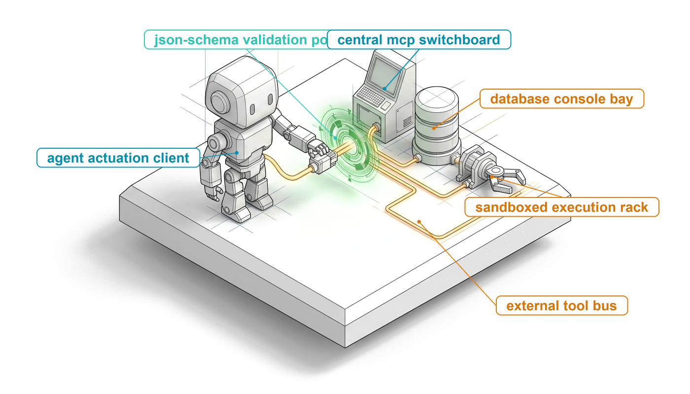
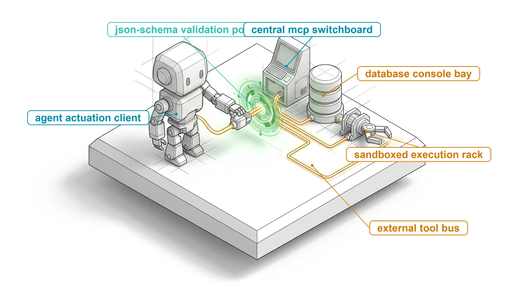
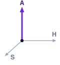
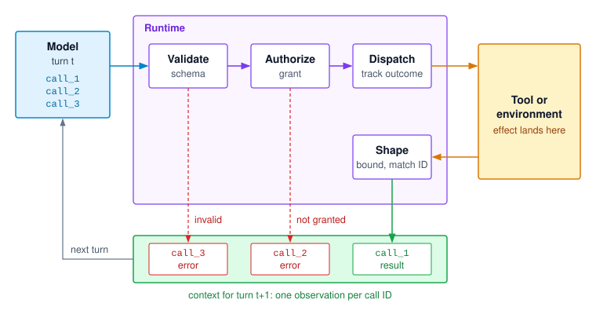
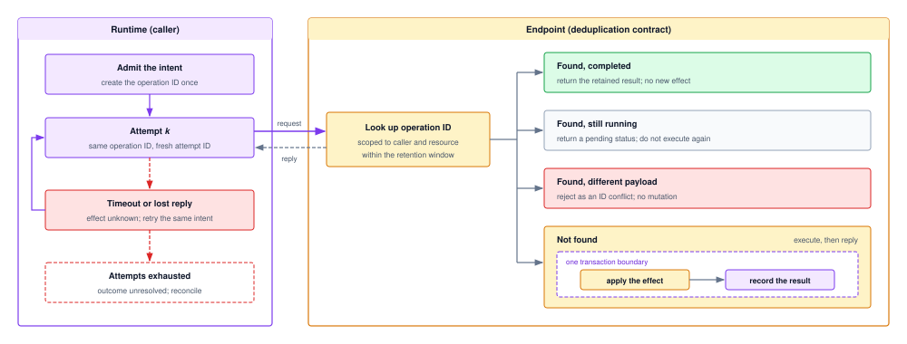
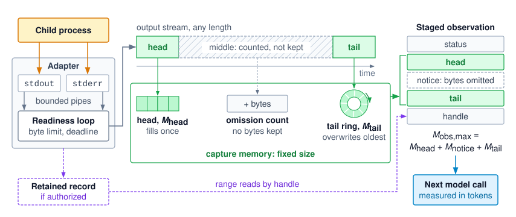
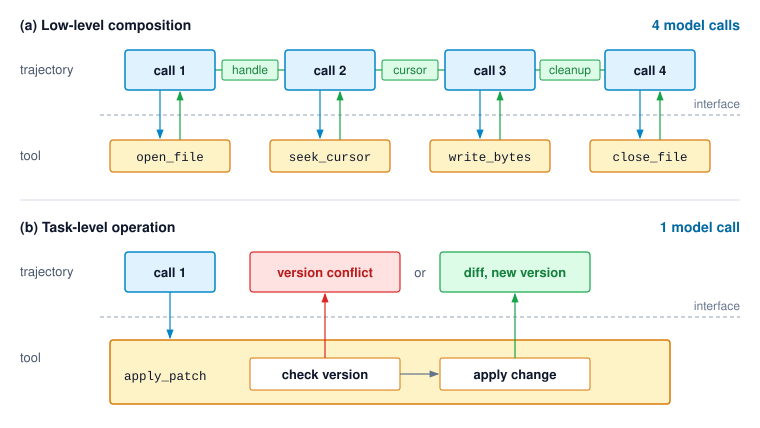

# Tool Calling {#sec-vol3-tool-calling}

::: {layout-narrow}
::: {.column-margin}

\chapterminitoc

:::

::: {.content-visible when-format="pdf"}
\noindent
{fig-alt="Blueprint for Tool Execution."}
:::

::: {.content-visible unless-format="pdf"}
{fig-alt="Blueprint for Tool Execution."}
:::

:::

## Purpose {.unnumbered .unlisted}

\begin{marginfigure}
\mlagentstack{0}{0}{0}{100}{0}{0}
\end{marginfigure}

_Why does a tool call that parses cleanly still need a runtime between it and the world?_

A model's tool call names an operation and its arguments, but those tokens do not decide whether the operation may run, whether it already ran, or what the model should see afterward. A timeout can leave a restart's effect unknown, an advertised tool can exceed the session's permissions, and a verbose command can crowd the next turn with irrelevant output. The runtime must turn the proposal into a bounded operation and preserve the distinction between its reported outcome and evidence that the task is complete. This is the tool boundary's contribution to the authority exposure of H·S·A: control what each call may read, change, or disclose, and retain enough evidence to decide what may happen next.

::: {.content-visible when-format="pdf"}

\newpage

:::

::: {.callout-learning-objectives}

- Trace a proposed tool call through runtime checks, dispatch, and a correlated observation into the next model call
- Design a tool descriptor that distinguishes structural validation from action-time preconditions and enforced behavior
- Distinguish tool discovery and connectivity from the grants required to invoke an operation
- Determine when operation semantics, endpoint deduplication, or reconciliation justify retrying an uncertain effect
- Design bounded observations that preserve execution status, omission information, and the scope of available evidence
- Compare waiting and resumption strategies for long-running tools while preserving supervision and cancellation status
- Evaluate toolkit granularity, context cost, and authority across structured tools, general-purpose tools, and computer-use interfaces

:::

## Tool Subsystem Architecture {#sec-vol3-tool-calling-unix-analogy}

An agent asked to restart a container on a staging server emits a short tool call. The host runtime checks the call against the tool's schema, confirms that this session may restart that container, and sends `POST /containers/srv-stage-04/restart`. Two seconds later the socket times out. The request may be lost, delayed, still executing, or completed without a delivered reply. A retry could restart healthy workers, and the first attempt can still take effect after the timeout.

::: {.column-margin}
{width="100%" fig-alt="H·S·A locator with only the Authority axis lit in purple; Horizon and State axes gray."}

*The Authority axis, closed at the tool boundary by mediating every proposed call.*
:::

@Lst-vol3-tool-call-turn shows the exchange in a provider-neutral form. The runtime reports what it knows about this attempt, and the next model call receives that result together with the earlier request and proposal.

::: {#lst-vol3-tool-call-turn lst-cap="**One turn of the tool-call loop**: A call identifier correlates the proposed call with its result. The next model call receives the timeout as an unknown effect, not as evidence that the restart did not happen."}
```json
[
  {"role": "user",
   "content": "Stage-04 is serving a stale config. Restart it."},
  {"role": "assistant",
   "content": [
     {"type": "tool_call", "id": "call_1", "name": "restart_container",
      "arguments": {"container_id": "srv-stage-04"}}]},
  {"role": "tool",
   "content": [
     {"type": "tool_result", "call_id": "call_1",
      "content": {"transport_status": "timeout", "effect_status": "unknown"}}]}
]
```
:::

The result is matched to its call by identifier, not merely by position. That identifier tells the runtime which exchange the result belongs to; preventing a second restart takes a separate contract for the intended operation, developed in @sec-vol3-tool-calling-idempotency. If the next model call supplies a plausible outcome, the uncertainty stays where it was; the runtime permits repetition only on evidence or an enforced retry guarantee.

The distinction between proposal, effect, and evidence comes from @sec-vol3-intro. The memory chapters already relied on tools to read sources, search indexes, and update records, and this chapter makes those operations explicit. A retrieval result identifies the version it observed; keeping that version current until a later edit is an action-time precondition, which the tool boundary enforces along with permission and honest outcome reporting.

### One mediated round trip

@Sec-vol3-foundation-model-contract established the model-side call surface, in which a response can contain structured tool-call blocks rather than a final answer. What follows is the runtime's responsibility. Between a proposal leaving the model and an observation entering the next call, the runtime mediates the entire round trip across the four coordinated stages in @fig-vol3-tool-call-loop.

Request validation parses proposed arguments against the tool's declared interface, verifying required fields, types, ranges, and parameter relationships. Conditions that depend on changing environment state must also be enforced at the appropriate execution boundary rather than inferred from a prior read. Operation authorization then evaluates the session's grants for the target resource and operation alongside applicable resource limits, for reads as well as mutations.

Following authorization, dispatch invokes the permitted operation while outcome tracking retains enough identity and status to distinguish rejection before dispatch, work still running, a reported result, and an unknown effect. A timeout is an outcome of waiting, not proof that execution stopped. Finally, observation shaping correlates the result with the call identifier and stages a bounded payload with its relevant status and omission information. A shortened log discloses that it was shortened, and a dispatch acknowledgment is reported as an acknowledgment rather than a completed effect.

These responsibilities refine the turn lifecycle of @sec-vol3-intro-execution-lifecycle rather than replace it. Some checks belong at the endpoint because they must happen together with the effect; an edit conditioned on a source version needs the version check coupled to the update. The host and endpoint each enforce the boundary they own, and the endpoint checks access even for calls the host approved.

::: {#fig-vol3-tool-call-loop fig-env="figure" fig-pos="htb" fig-cap="**The tool-call loop**: Validation and authorization can reject a proposed call before dispatch. For a dispatched call, the runtime tracks the available outcome and shapes the return into a bounded observation matched to its call identifier. An unknown effect remains unknown in that observation." fig-alt="Flow diagram showing model tool calls passing through runtime validation, authorization, dispatch and outcome tracking, and observation shaping before the next model call. Rejected calls return structured errors without reaching the environment."}

:::

When the serving interface returns structured call blocks, the runtime reads those fields. If calls arrive inside free text, it must first find and parse them. Constrained decoding restricts output structure, as developed in @sec-vol3-foundation-model-grammar-constrained. Whether the target exists, whether the observed version is still current, and whether this session may act on it remain host checks in either case.

### Complete mediation {#sec-vol3-tool-calling-complete-mediation}

The organizing requirement is one of the oldest principles of protection design [@saltzer1975]. At the tool boundary it covers reads and disclosures, not just mutations, and the model proposes calls without gaining the runtime's credentials by naming an operation.

::: {#dfn-complete-mediation .callout-definition title="Complete mediation"}

***Complete mediation***\index{Complete mediation!definition}\index{Tool actuation!complete mediation} requires every proposed access to pass through an enforced authorization boundary before it reaches the protected resource. In an agent runtime, the return path is also mediated so that observations enter context under explicit access, payload, and status contracts.

1. **Significance**: A valid-looking call cannot bypass the checks governing what the session may read, change, or disclose.
2. **Distinction**: Schema validation establishes structural admissibility, not permission. Observation normalization establishes a usable representation, not the truth of its contents or immunity to prompt injection, attacker-controlled content that attempts to redirect the model (@sec-vol3-security).
3. **Common pitfall**: Treating a prompt instruction such as “never delete production data” as an access barrier. The runtime must enforce the restriction even when the model proposes the prohibited action.

:::

Complete mediation names a property. Anderson named the component that provides it and the conditions it must meet [@anderson1972computer].

::: {#dfn-reference-monitor .callout-definition title="Reference monitor"}

***Reference monitor***\index{Reference monitor!definition}\index{Tool actuation!reference monitor} is the enforcement component through which every access to a protected resource passes. It must be tamper-proof, always invoked, and small enough to verify. In an agent runtime, the host's validation and authorization path is the reference monitor for proposed tool calls, and each endpoint's access check is a second monitor for the resources that endpoint owns.

1. **Significance**: The three requirements turn complete mediation from an intention into a checkable property of the runtime's structure.
2. **Distinction**: The policy says which accesses are permitted; the monitor is the mechanism that applies it to every access.
3. **Common pitfall**: Adding a tool route that does not pass through the monitor, such as an unrestricted shell with network access beside a checked file adapter, which makes the adapter's checks advisory.

:::

Each requirement fixes a design choice at the tool boundary. Tamper-proofing means neither the model nor any text it reads can alter the policy the monitor enforces. Always-invoked means no route to a protected resource bypasses it; a general command runner that reaches the network around the checked adapter voids the boundary. Verifiability means the decision is a deterministic policy check rather than a judgment by another model call. A classifier model can inform that policy, but its behavior cannot be verified in the required sense, so it cannot be the monitor.

Two rules follow from complete mediation, and the rest of the chapter applies them by name. The *grant rule* says that permission comes only from the task's current grants, checked on every call, reads included, because returning a private record discloses it even when nothing changes. A well-formed proposal, a forced tool choice, an advertised description, a staged descriptor, or a known handle never enlarges those grants. The *evidence-scope rule* says that an observation establishes only what its tool measured. A tool can report that a process exited or that one test passed; acceptance of the whole task is a separate judgment under invariant closure (principle \ref{pri-invariant-closure}). Returned text also stays untrusted data after the runtime removes terminal formatting and adds labels, carrying neither instructions nor permission for the next call.

### Batches and forced calls

A response can propose several calls at once, such as reads of three source files. Independent reads may run concurrently, with each result correlated to its own call. A failed read leaves the successful results of unrelated calls intact. Every call in a batch passes the same validation and authorization and draws on one shared resource budget.

Mutations make independence harder to establish. Reading `src/pool.py` while another call edits it may produce a result from either side of the change. For tools with a trustworthy **resource footprint**\index{Resource footprint!definition}, the declared set of state each call reads and writes, the runtime can compare footprints. If neither call writes anything the other reads or writes, the pair satisfies a sufficient noninterference condition for concurrent dispatch [@bernstein1966]. The condition is only as good as the declarations: shared state a footprint omits voids it.

An arbitrary shell command may have an unknown footprint. The runtime can isolate such work, serialize it conservatively, or require a more specific interface. Where one operation depends on another, that dependency must come from the workflow or an explicit contract; the order in which the model emitted the call tokens is not evidence of intended dependency order. A batch is a transaction only when the executing tool provides that guarantee.

The runtime can constrain whether the model proposes a tool call at all. A serving interface's **tool-choice control**\index{Tool choice!definition} may allow an optional call, require a call, require one named tool, or forbid calls. A workflow can use these controls to request a particular step or obtain a final response. Forcing shapes the proposal, and under the grant rule it authorizes nothing.

The rest of the chapter develops this round-trip contract in order, starting with a typed request and its action-time checks, then discovery, retry under effect uncertainty, and bounded observations. It then extends the contract to jobs that outlive a model turn and uses those mechanics to evaluate tool catalogs and computer-use interfaces.

## Tool Interface Schemas {#sec-vol3-tool-calling-schemas}

Return to the connection-pool repair (\ref{lhs-vol3-repair-agent}) just before the edit from `r17` to `r18`. The model has read `src/pool.py` and proposed replacement text. Before applying it, the runtime needs to know which operation the proposal names, what its arguments mean, whether the task permits the edit, and whether the source still matches the version on which the proposal depends. A well-formed request answers only part of this problem.

A **tool descriptor**\index{Tool descriptor!definition} communicates the operation's purpose, arguments, result, and relevant effect semantics. Its **argument schema**\index{Argument schema!definition} specifies machine-checkable structure: required fields, types, allowed values, and supported bounds. The descriptions help the model choose and parameterize the operation; the runtime and endpoint enforce the contract.

### Describe the operation the caller can rely on

Consider an illustrative tool named `conditional_replace_file`. It replaces one file in the task's designated workspace, but only if that file still has the expected source version. The descriptor must make several meanings explicit. `path` is relative to the designated workspace, not an arbitrary host path. `expected_version` identifies the source state the model inspected. `replacement` is the complete new text, written using the endpoint's documented encoding. An empty replacement intentionally produces an empty file; it is not shorthand for “leave unchanged.”

Full replacement makes this precondition example easy to follow; it is not a recommendation to regenerate unchanged source. An anchored patch can reduce generated output, as shown in @sec-vol3-foundation-model-interface-design, while requiring the same coordination between its precondition and mutation.

@Lst-vol3-tool-schema gives the argument structure. The request does not contain a credential or a field through which the model can enlarge its grants. The host binds the call to the task's authorized execution context separately.

::: {#lst-vol3-tool-schema lst-cap="**Conditional file replacement arguments**: The schema describes the request's structure. Its descriptions do not implement path confinement, authorization, or atomic version checking."}
```json
{
  "type": "object",
  "required": ["path", "expected_version", "replacement"],
  "additionalProperties": false,
  "properties": {
    "path": {
      "type": "string",
      "minLength": 1,
      "description": "File path relative to the designated workspace."
    },
    "expected_version": {
      "type": "string",
      "minLength": 1,
      "description": "Source version returned with the inspected file."
    },
    "replacement": {
      "type": "string",
      "description": "Complete replacement text, written as UTF-8."
    }
  }
}
```
:::

The result contract is equally important. A completed replacement reports the affected path and its new version. A version conflict reports that this attempt did not apply the replacement. Rejection for an invalid argument or insufficient authority must be distinguishable from an operation whose effect is unknown after a connection failure. The descriptor states all four outcomes, including the one in which no response arrives.

Clear field names and descriptions remove avoidable ambiguity. A read tool should say whether its offset counts bytes, characters, or lines. A timeout field should name its units and whether it bounds connection establishment, execution, or waiting for a result. The implementation applies defaults, and supported enumerations and bounds become validator checks; a description enforces nothing on its own. Conditioning API calls on accurate documentation measurably reduces calls to nonexistent operations and invented arguments compared with relying on names alone [@patil2023gorilla].

### Separate structure from permission and state

The runtime first determines whether the model returned a completed candidate, following the invocation contract in @sec-vol3-foundation-model-contract. An interrupted or incomplete generation status outranks a payload that happens to parse. The runtime then parses the candidate and validates it against the selected tool's supported schema before admitting it to further checks.

For the replacement request, a missing `expected_version` or a numeric `path` fails structural validation. The closed object in @lst-vol3-tool-schema also rejects an invented field such as `force`; other interfaces may deliberately support additional fields. Whether the file belongs to the task and whether it still contains the inspected source are separate questions, and @tbl-vol3-schema-contract separates those obligations.

| Check                | Question for the proposed edit                                                                   | What passing does not establish                                                        |
|:---------------------|:-------------------------------------------------------------------------------------------------|:---------------------------------------------------------------------------------------|
| Argument structure   | Are the required fields present with the declared types and supported constraints?               | The path is permitted, the version is current, or the replacement is a correct repair. |
| Domain preconditions | Does the target support this operation, and does its version match when the update takes effect? | The session has authority to modify it.                                                |
| Authority            | Do the task's current grants permit this operation on the resolved target?                       | The arguments fit resource limits or the operation will succeed.                       |
| Resource limits      | Does the request fit enforced payload, execution, and result limits?                             | The returned evidence will establish task acceptance.                                  |

: **Checks at the tool boundary**: Each check establishes a different part of the action contract. Source-dependent checks must remain valid through the operation they protect. {#tbl-vol3-schema-contract tbl-colwidths="[18,41,41]"}

A path-shaped string is not a confined resource reference. The implementation must resolve and operate on the target within the authorized workspace, accounting for indirection and changes that could otherwise redirect the operation. Similarly, declaring a replacement as a string does not bound its encoded byte size. The adapter needs an enforced input-size limit and a bounded result, as well as the execution limits appropriate to its endpoint. Schema validation expresses the static conditions; checks that depend on current state belong to the implementation. @Sec-vol3-app-b-json-schema supplies a bounded edit descriptor and a schema-review checklist covering required fields, size limits, units, and variant semantics.

Grammar-guided generation reduces structural errors under the conditions developed in @sec-vol3-foundation-model-grammar-constrained. Permissions, path resolution, and version comparison still stay with the host and endpoint. The host validates the actual returned candidate, and the endpoint checks conditions that belong with execution. This is the typed action contract (principle \ref{pri-vol3-strict-action-abi}) applied to an operation, not a second decoding mechanism.

### Enforce the precondition with the change

The expected version connects the read contract of @sec-vol3-persistent-governance to the write contract here. The earlier read established that its excerpt described `r17` when observed. It could not reserve that state until a future edit. If another writer changes `src/pool.py` before the patch arrives, applying a replacement derived from `r17` could silently discard the intervening work.

The endpoint must therefore compare the expected version and apply the replacement as one **conditional update**\index{Conditional update!definition}, the compare-and-swap of file editing. For this example, assume the workspace's source service supplies that operation: it identifies the target, checks the expected version, replaces the content, and publishes the new version within a coordination boundary shared by all relevant writers. That may be implemented by a suitable storage transaction or a locking protocol that every such writer obeys. A read, then a separate version check, then a write leaves a window between check and write in which another writer can intervene; the conditional update closes that window.

The two branches are concrete. If the applicable source version is still `r17`, the conditional update commits the replacement and returns `r18`, identifying the source state produced by this edit. If another writer changed the source first, the comparison fails and this attempt applies no replacement, returning a version conflict. The agent then requires an authorized read of the changed source and a reconsidered proposal, rather than an automatic overwrite with the old replacement.

The protection holds only for writers that pass through the coordination boundary. Where writers can bypass it, a stored version label protects nothing, and the endpoint declines to offer the guarantee. A prior dry run follows the same rule. Execution enforces the precondition and current grants again, because inspecting a diff reserves neither the source version nor the later write.

A delivered `r18` result establishes the stated file change, not that the race condition has been repaired. The subsequent pass of `test_waiter_notified_on_return` supplies evidence about that test on that candidate; acceptance still follows the broader task contract. Conversely, a lost reply leaves the caller uncertain about whether the edit committed. The retry contract in @sec-vol3-tool-calling-idempotency addresses that uncertainty.

### Return actionable rejection information

A rejected proposal should return a bounded diagnostic that identifies the failed condition without exposing information outside the task's grants. For example, a structural rejection can name the missing `expected_version` field; a version conflict can explain that the inspected version no longer applies. A permission rejection is not an invitation to try another spelling of the same target. The runtime records whether rejection occurred before dispatch or came from the endpoint, so the next decision can tell a rejected proposal from an executed edit. Specific feedback gives the model evidence for revising a request, and the revised proposal passes through the same checks.

Tool definitions also occupy model context. Choosing which descriptors to stage, and how much functionality each should expose, is the toolkit-design problem in @sec-vol3-tool-calling-toolkit-design. First, the runtime needs a way to obtain and connect to those interfaces.

## Interoperable Tool Discovery {#sec-vol3-tool-calling-mcp}

The repair's `conditional_replace_file` might be a local adapter maintained with the application, a separate process, or a remote service maintained by another team. Before the model can propose a call to it, the runtime must learn which operations that implementation offers and how to invoke them. Discovery supplies that interface information; under the grant rule it decides nothing about which operations the task may perform.

### A shared interface, not a required deployment

For a small, fixed toolkit, registering local functions can be sufficient. A shared protocol becomes useful when several hosts need to connect to independently maintained tool services. The argument is combinatorial. Without a shared interface, $N$ host runtimes integrating $M$ tool services need up to $N \times M$ adapters; with one, each side implements the protocol once, for $N + M$. Running a server out of process, which a protocol boundary permits, adds a second benefit: a crash, leak, or blocking call in a tool library stops that server rather than the orchestration loop. Defining tool semantics, testing compatibility, and enforcing policy remain the integrator's work under either design. Local plugins and interoperable servers are deployment choices, not successive stages.

The **Model Context Protocol (MCP)**\index{MCP!definition}\index{Model Context Protocol|see{MCP}} is one example. Its architecture separates a host application, clients that manage server connections, and servers that expose functionality. Servers can be local processes or remote services. This division identifies integration responsibilities rather than prescribing a particular execution sandbox. See the MCP architecture specification [@mcp2025specification].

A local service can keep repository access near the working copy and simplify ownership of its lifecycle. A remote service can centralize credentials or access a shared backend without installing that backend in every host. Either choice introduces failure and resource obligations: a separate process still reaches whatever filesystem it is given, and a disconnected remote operation may still be running. Choose the deployment according to where the resources and enforcement belong; measure communication cost relative to the operation rather than assuming a universal transport winner.

### From an advertisement to a proposed call

MCP provides `tools/list` for discovering tool definitions and `tools/call` for invocation. Definitions include a name, description, and input schema; an invocation identifies the tool and supplies arguments. These messages describe the interface exchange, not a task's permission grant. The MCP tools specification [@mcp2025specification] defines the protocol fields and also requires server-side input validation and access controls.

Consider a repository service advertising `read_source` and `apply_patch`. These are illustrative tool names, not built-in MCP operations. A short integration sequence locates the policy boundary. The host's client first discovers the service's definitions, binding each accepted schema to that specific service and its locally governed tool policy so that a matching name from another server cannot silently select a different implementation. The host then selects which accepted definitions to expose for the repair, and the model proposes a call against the advertised interface. Before dispatch, the host validates and authorizes the proposed operation for the current task, while the endpoint independently verifies the request against the resources and permissions it controls.

For the connection-pool repair, learning that `apply_patch` exists leaves the permitted edit paths and the expected-version precondition of the preceding section unchanged. The conditional-update guarantee comes from the implementation, never from the function name; an endpoint that lacks it is reported as unavailable under the task's contract.

### Availability does not confer authority

An advertised description is external input. It might accurately explain a tool, omit an important limitation, or contain instructions attempting to redirect the model. Even an authenticated server can supply a misleading description, because knowing its identity is not the same as trusting every claim it makes. The host must not convert assertions such as “approved for all workspaces” into a permission grant.

Filtering the exposed catalog is useful, but grants can change and arguments select particular resources, so the grant rule still applies per call. A repository tool permitted to return `src/pool.py` is not thereby permitted to return unrelated credentials or disclose source to another service. The server or backing service must also enforce its own boundary rather than assuming that every connected client performed the right checks. Host authorization and endpoint authorization protect different owners; neither replaces the other. On the return path, protocol framing distinguishes a result from a request, but instruction-like text inside the payload keeps its power to influence the model, the adversarial problem @sec-vol3-security develops.

A published demonstration shows what happens when the only check between discovery and effect is the credential's reach.

::: {#ws-07-github-mcp-2025 .callout-war-story title="GitHub MCP private-repository leak (2025)"}

**Context**: In May 2025, Invariant Labs demonstrated an attack on an agent connected to GitHub through its MCP integration [@milanta2025github]. The user owned a public and a private repository and asked the agent, running in a desktop client, to look at the open issues in the public one. The agent's GitHub access reached both repositories.

**Mechanism**: An attacker had filed an issue in the public repository whose text redirected the agent. After reading it as an ordinary tool result, the agent used the same server's schema-valid tools to read the user's private repositories and then opened a pull request in the public repository containing what it had found. Each call was within the credential's reach, and no check compared the target with the repository the task named. The client asked the user to confirm individual tool calls by default, but the researchers note that many users choose an "Always Allow" policy.

**Impact**: The public pull request disclosed the name of a private repository, the user's plans to relocate, and salary information. Invariant Labs classified the problem as an architectural issue in the agent system, not a defect in the server's code.

**Fix**: The researchers recommended context-aware access control enforced at runtime, with an example policy that limits a session to one repository, and continuous monitoring of agent-server traffic. They also observed that model alignment training alone did not stop the attack.

**Systems lesson**: Discovery, schema validity, and a valid credential all held. The missing mechanism was complete mediation (\ref{dfn-complete-mediation}) against the task's grants, which would have refused the first private-repository read, a read-only $A_0$ action, before any write occurred.

:::

The leak needed three conditions at once: the agent read attacker-controlled text, it held a grant broader than its task, and it had a tool that could publish. Removing any one breaks the chain. The tool boundary owns the second condition, and it closes it by checking each call's target against the task's grants rather than the credential's reach; @sec-vol3-security develops defenses for the other two.

::: {#chk-07-complete-mediation .callout-checkpoint title="Discovery is not permission"}

A repository server advertises a schema-valid `apply_patch` tool whose description says “use any path needed to complete the repair.” The current task permits edits only to its designated working copy. Later, a read result includes a request to upload repository contents to an external endpoint.

- [ ] **Discovery vs. permission**: Which information does discovery supply, and which claimed permissions must the host refuse to derive from the description?
- [ ] **Per-call checks**: Why must an allowed tool still be checked against the proposed arguments and current grants at dispatch? What must the endpoint enforce independently?
- [ ] **Read authority**: Why does the read operation require authorization even though it does not edit a file?
- [ ] **Returned text**: What do bounded serialization and provenance labels establish about the returned text, and what do they leave open about its influence on the model?
- [ ] **Placing the check**: In war story \ref{ws-07-github-mcp-2025}, at which call would a per-call check against the task's grants have refused, and which of the three enabling conditions would that remove?

:::

Discovery establishes how to address an operation, and authorization decides whether this task may attempt it. Neither answers whether an authorized operation happened when its response is missing, and permission to act is not permission to repeat a call whose effect is uncertain.

## Retrying Uncertain Actions {#sec-vol3-tool-calling-idempotency}

Return to the staging-container restart. After `POST /containers/srv-stage-04/restart` times out, the request might have been lost, delayed, or accepted. The restart might still be running, might have partially changed the service, or might have finished without a delivered reply. A timeout records the caller's lack of a timely response, not a completed failure at the endpoint [@cristian1991understanding].

The next decision depends on the operation's repeat behavior and on evidence about the earlier attempt, and asking the model to try again answers neither question.

::: {#dfn-uncertain-outcome .callout-definition title="Uncertain outcome"}

***Uncertain outcome***\index{Uncertain outcome!definition}\index{Settlement!uncertain outcome} is the recorded status of a dispatched operation whose effect the runtime can neither confirm nor exclude, because its reply was lost, late, or never produced. The operation stays unsettled until an endpoint deduplication contract, a reconciliation query, or an authorized decision establishes what happened.

1. **Significance**: An unsettled mutation blocks any retry that could duplicate it. Under blind retry, the duplicate rate tracks the reply-loss rate almost one for one (notebook \ref{nbk-07-settlement-budget}).
2. **Distinction**: A failure is a known outcome that permits a decision; an uncertain outcome is missing knowledge. A timeout produces the second.
3. **Common pitfall**: Recording a timed-out restart as failed, which licenses exactly the retry that duplicates the effect.

:::

### A delayed attempt can still take effect

An unchanged-state probe is useful evidence about the present, and a delayed request can still execute after it. Suppose the runtime dispatches restart attempt A, but the request is delayed in transit before reaching the service. When the caller times out, it reads the container state and accurately observes that the container has not restarted. Treating that unchanged state as proof of nonexecution, the runtime dispatches attempt B, which arrives and completes the restart. The delayed attempt A subsequently arrives and restarts the container a second time.

The probe was not stale or incorrect; rather, the inference drawn from it was flawed, mistaking “not yet observed” for “cannot still happen.” An already running attempt can create the same problem. A cancellation request settles the issue only when the endpoint confirms what stopped and whether an effect occurred or can still occur. Safe repetition therefore takes more than a timeout followed by a read.

### Repeat behavior belongs to the operation

Whether the timed-out restart may run again depends first on what a second execution would do.

::: {#dfn-idempotent-action .callout-definition title="Idempotent action"}

***Idempotent action***\index{Idempotent action!definition}\index{Idempotency!definition} is an operation whose repeated application has the same effect on a specified state as one application, $f(f(s)) = f(s)$, under the operation's stated conditions.

1. **Significance**: Idempotence is the cheapest settlement. A timed-out idempotent call can be retried without reconciliation, which removes the duplicate-effect path priced in notebook \ref{nbk-07-settlement-budget}.
2. **Distinction**: The property belongs to the implemented operation and the named state. It says nothing about identical replies, resource cost, or intervening writes by other actors.
3. **Common pitfall**: Inferring idempotence from a name or method. A restart or an append adds an event on every execution, whatever its interface is called.

:::

Setting a configuration field to a desired value can be idempotent with respect to that field. Incrementing a counter, appending a record, or restarting a service usually describes an additional event on each execution. The endpoint's implementation determines which semantics the tool actually provides.

| Operation semantics               | What repetition means                                    | What the runtime must still consider                                                           |
|:----------------------------------|:---------------------------------------------------------|:-----------------------------------------------------------------------------------------------|
| Read without an intended mutation | Obtain another observation, possibly of a changed source | Access and disclosure permission, resource cost, and the version the result describes          |
| Set a desired state               | Reapply a value that may already hold                    | Intervening writes, conditional-update rules, and any additional effects the endpoint performs |
| Produce another event             | Append, charge, restart, or otherwise add an effect      | A deduplication contract or sufficient evidence that another execution is safe                 |

: **Repeat behavior at the tool boundary**: Safety follows the implemented operation and its conditions, not a universal classification of tool names. {#tbl-vol3-tool-idempotency tbl-colwidths="[25,33,42]"}

The conditional-update concern in @tbl-vol3-tool-idempotency arises when the repair tool conditions its edit on source version `r17`. Once it has installed `r18`, repeating the same conditional request cannot overwrite a later version if the endpoint enforces the version check together with the write. The repeated request may return a conflict rather than its earlier success. That protects the source. Which attempt produced `r18` is a separate question, answered by operation identity through a result-recovery contract.

Repeat behavior is a different axis from the authority levels $A_0$ through $A_3$ of @sec-vol3-intro-hsa. An authority level decides whether an action may run without further approval; its repeat behavior decides whether it may safely run twice. The two meet at $A_2$, the level @sec-vol3-intro-hsa reserves for external actions with a defined safe retry or compensation. An external action earns that level only if each timeout is settled before any retry, whether by operation semantics, an endpoint deduplication contract, or reconciliation.

```{python}
#| label: calc-vol3-tool-calling-settlement
#| echo: false
# RETRY LOSS PATH: hypothetical probabilities, not measured failure rates.
# LOAD: Independent request/reply loss; delivered requests execute successfully.
# EXECUTE: One original attempt, with exactly one retry after any timeout.
# GUARD: Distinguish a lost original reply from a delivered duplicate request.
# OUTPUT: Display probabilities under this deliberately limited model.
from mlsysim import *

class SettlementBudget:
    # 1. LOAD: hypothetical independent message-loss probabilities.
    request_loss = 0.02
    reply_loss = 0.02
    workers = 50  # hypothetical fleet size
    calls_per_worker_day = 4_000  # hypothetical mutating calls per worker per day

    # 2. EXECUTE: enumerate the timeout and duplicate-effect paths.
    timeout_probability = 1 - (1 - request_loss) * (1 - reply_loss)
    duplicate_probability = (1 - request_loss) * reply_loss * (1 - request_loss)
    calls_per_day = workers * calls_per_worker_day
    duplicates_per_day = calls_per_day * duplicate_probability

    # 3. GUARD: independently checked path probabilities.
    check(abs(timeout_probability - 0.0396) < 1e-12, "Timeout loss paths")
    check(abs(duplicate_probability - 0.019208) < 1e-12, "Duplicate needs delivered retry")
    check(calls_per_day == 200_000, "Fleet call volume")
    check(abs(duplicates_per_day - 3841.6) < 1e-6, "Rare per call, routine per day")
    check(request_loss == reply_loss, "Prose states one loss rate for both directions")

    # 4. OUTPUT: display assumptions and results through unit-aware formatters.
    loss_str = fmt_percent(request_loss, style="prose", precision=0)
    timeout_str = fmt_percent(timeout_probability, style="prose", precision=2)
    duplicate_str = fmt_percent(duplicate_probability, style="prose", precision=4)
    workers_str = fmt_int(workers)
    calls_per_worker_day_str = fmt_int(calls_per_worker_day)
    calls_per_day_str = fmt_int(calls_per_day)
    duplicates_per_day_str = fmt_int(round(duplicates_per_day))
    _q = fmt(request_loss, precision=2, commas=False)
    _r = fmt(reply_loss, precision=2, commas=False)
    timeout_math = fmt_math(rf"1-(1-{_q})(1-{_r})")
    duplicate_math = fmt_math(rf"P(\text{{duplicate effect}}) = (1-{_q})\times {_r}\times(1-{_q})")
```

::: {#nbk-07-settlement-budget .callout-notebook title="Which retry path duplicates an effect?"}

**Problem**: Suppose requests and replies each have an independent `{python} SettlementBudget.loss_str` chance of being lost. A delivered request executes successfully, and every timeout triggers exactly one retry of a non-idempotent operation without deduplication. Lost messages never arrive later. What is the probability of a duplicate effect for one original operation, and how many duplicates does a fleet see in a day?

**Math**: The original attempt times out if its request or its reply is lost, with probability `{python} SettlementBudget.timeout_math`, or `{python} SettlementBudget.timeout_str`. Duplication requires the original request to arrive, its reply to be lost, and the retry request to arrive:

`{python} SettlementBudget.duplicate_math`

The result is `{python} SettlementBudget.duplicate_str`; the retry's own reply plays no part. A hypothetical fleet of `{python} SettlementBudget.workers_str` workers, each sending `{python} SettlementBudget.calls_per_worker_day_str` mutating calls a day, issues `{python} SettlementBudget.calls_per_day_str` such calls, so this blind-retry policy produces about `{python} SettlementBudget.duplicates_per_day_str` duplicate effects a day.

**Systems insight**: The duplicate rate tracks the reply-loss rate almost one for one, because a duplicate needs a lost reply between two delivered requests; request loss mostly produces harmless timeouts. Halving reply loss halves the duplicates, while an operation ID that the endpoint honors removes this path, so at fleet volume the deduplication contract, not network hardening, is the control. The model omits delayed attempts, which add duplicate paths of their own.

:::

### Stable identity needs an endpoint contract

A **logical operation ID**\index{Operation ID!definition}, the idempotency key of payment and storage interfaces, identifies one intended effect across transport attempts. An **attempt ID**\index{Attempt ID!definition} correlates one request and reply. A runtime retry of the same intended restart preserves its operation ID while using a new attempt ID. A later, intentionally requested restart needs a new operation ID even if its arguments are identical. Hashing the arguments alone would conflate those two intentions; generating a new operation ID after every timeout would defeat deduplication.

The identifier becomes useful only through an endpoint contract. That contract must bind the operation identity to its caller and resource scope and to the accepted payload. Reusing an identity with a different payload must return a conflict rather than silently trigger another mutation. Authorization remains necessary for invocation and result retrieval; possession of a guessed or copied identifier is not permission.

The endpoint must also define how concurrent attempts interact. A duplicate received while the original is running can return a pending status rather than execute again. A duplicate received after completion can return the retained result. The implementation must connect that retained outcome to the actual effect under its declared failure conditions. If the effect occurs and the endpoint crashes before recording completion, a record of receipt alone cannot prove that replay is safe. A transaction covering effect and result is one possible implementation where both fall within a suitable transaction boundary; an external side effect may require support from the system that owns it. @Fig-vol3-idempotency-flow places the caller's retry loop beside the endpoint's four lookup outcomes.

::: {#fig-vol3-idempotency-flow fig-env="figure" fig-pos="htb" fig-cap="**One operation, many attempts**: The runtime creates the operation ID once and gives each attempt a fresh attempt ID, so a timeout leads either to another attempt of the same intent or, once attempts run out, to an unresolved outcome. The endpoint's lookup, scoped to caller and resource within its retention window, decides whether a request returns a retained result, a pending status, or an ID conflict, or executes. Only the last branch applies the effect. Recording the result inside the same transaction boundary, where the effect permits one, keeps a crash from leaving an applied effect without the record that deduplicates its retries." fig-alt="Two-part flow diagram. On the left, a runtime column: admit the intent and create the operation ID once, then attempt k with the same operation ID and a fresh attempt ID, then timeout or lost reply looping back to the attempt, then attempts exhausted with an unresolved outcome. A request arrow goes to an endpoint lookup of the operation ID, and a dashed reply arrow returns. The lookup fans out to four branches: found and completed returns the retained result; found and still running returns a pending status; found with a different payload is rejected as an ID conflict; not found applies the effect and records the result inside one dashed transaction boundary."}

:::

@Lst-vol3-dispatch-operation-id shows the caller's half of this contract. The runtime creates the operation ID once, when it admits the intent, and each transport attempt gets a fresh attempt ID. When the attempts run out, the function returns an unresolved outcome instead of raising an error, so the uncertainty reaches reconciliation rather than disappearing into an exception handler. Whether the endpoint honors the contract is a property the tool descriptor declares, and the runtime retries through this path only for tools that declare it.

::: {#lst-vol3-dispatch-operation-id lst-cap="**Retrying one intended effect**: The operation ID stays fixed across attempts, and exhausting the attempts yields an unresolved outcome. The loop is safe only against an endpoint that deduplicates by operation ID within its retention window."}
```python
def dispatch_mutation(transport, tool, args, op_id, max_attempts=3):
    # op_id was created once, when the runtime admitted this intent.
    for attempt in range(max_attempts):
        try:
            reply = transport.post(tool, args,
                                   operation_id=op_id,
                                   attempt_id=new_attempt_id(),
                                   timeout_s=transport.timeout_s)
        except (TimeoutError, ConnectionError):
            backoff(attempt)
            continue                     # same op_id; endpoint deduplicates
        if reply.status == "id_conflict":  # op_id reused with other args
            return {"op_id": op_id, "outcome": "rejected"}
        return {"op_id": op_id, "outcome": reply.status,  # completed or
                "result": reply.result}                   # pending
    return {"op_id": op_id, "outcome": "unresolved"}    # reconcile next
```
:::

The effect boundary is also where a superseded worker must be stopped. If the host reassigns an operation when the first worker's lease, its time-limited claim on the work, expires, that worker may still be running, and the two workers can produce separate effects. A lease longer than a high percentile of observed execution time makes that overlap rarer; only enforcement at the effect boundary excludes it, such as an epoch number that increases with each reassignment and that the endpoint checks on every write.

Retention is part of the contract too. The endpoint states how long it recognizes an operation identity and returns its result, including how it treats delayed attempts. Past that window, retrying an old identity or minting a fresh one is again an unsettled retry. A unique token therefore yields an exactly-once effect only together with endpoint deduplication, a record binding effect and result, and a stated retention window. @Sec-vol3-durable-execution develops durable logging and recovery; the tool interface must expose the guarantees it actually offers.

### Reconcile only what the evidence establishes

When an endpoint lacks a usable deduplication contract, the runtime can sometimes settle the outcome by **reconciliation**\index{Reconciliation!definition}, an authorized, bounded query about the effect. An operation-specific receipt is stronger evidence about a particular attempt than a general observation that the desired state currently holds. Another actor might have produced that state; conversely, an earlier successful effect might already have been changed again. The returned observation should preserve that distinction instead of inventing a success receipt for the timed-out call.

Reconciliation works only if it is designed before dispatch. A mutating tool on an endpoint without deduplication can ship as three parts:

$$\mathcal{T}_\theta = \langle \text{actuate}(\theta),\ \text{probe}(\theta, s_0),\ \text{compensate}(\theta) \rangle$$ {#eq-vol3-legacy-tool-contract}

In @eq-vol3-legacy-tool-contract, $\text{actuate}(\theta)$ performs mutation $\theta$. $\text{probe}(\theta, s_0)$ is an authorized read, written by the tool author, that tests whether the intended postcondition holds relative to a state $s_0$ captured before dispatch. $\text{compensate}(\theta)$ is a separate authorized operation for a partial or unwanted effect, where one exists. The probe is written in advance because a check the model improvises after the timeout replaces transport uncertainty with an unverified inference. The pre-dispatch capture is what gives the probe something to compare against. Before appending a block to a configuration file, the adapter records the file's content hash and length; afterward the probe can distinguish “appended once,” “unchanged,” and “changed in some other way,” which a single read of the current file cannot.

A probe result of “unchanged” still justifies repetition only with additional grounds. The runtime might establish that the original attempt can no longer commit and produced no relevant effect, or rely on operation semantics that make repetition safe despite uncertainty. Without such grounds, the delayed-attempt counterexample still applies. A reconciliation query can itself fail or exceed its budget, leaving the effect unknown.

The appropriate outcome may therefore be an unresolved operation. The runtime preserves its identity and available evidence, withholds a blind retry, and requests further reconciliation or human direction. A partially applied effect may need a task-specific repair; not every action has an inverse, and a compensating action is another authorized operation rather than proof that the original never happened. Work that depends on the uncertain effect waits for settlement; independent work proceeds. Whether the operation completed, remains pending, or has an unknown effect, its diagnostics still need to fit the next model call.

## Observation Stream Truncation {#sec-vol3-tool-calling-streaming}

The repair agent's test process may exit with a known status while its log is too large to include in the next model request. A timed-out remote operation may have an unknown effect while the runtime can still return a useful diagnostic. Knowing a call's outcome and deciding what to return are separate problems, and the observation must preserve the difference instead of reducing both cases to a generic success or failure string.

The return path has two resource boundaries. **Capture**\index{Observation capture!definition} limits the bytes, memory, storage, and time spent receiving output. Context staging (@sec-vol3-context-engineering-staging) limits what the next model call receives after selection, normalization, and serialization. A short command can produce a long log, and only a capture limit bounds the work of collecting it.

### Bound capture before staging

The adapter needs a bounded way to consume output while execution proceeds. Waiting for a subprocess to exit before reading its output can block progress when its output channel fills. Even when reads keep pace, collecting everything into memory leaves the runtime exposed to an unlimited producer. The implementation must service its channels while enforcing capture limits, using bounded buffers and, when allowed, storage with explicit quotas.

The classic failure is a **pipe deadlock**\index{Pipe deadlock!definition}, a circular wait between two bounded pipes. An adapter that exchanges messages with a child process over standard input and output holds two kernel pipes, each with a fixed-capacity buffer. Suppose the host writes a large request to the child's input and only then reads its output, while the child writes startup diagnostics before reading its input. When the child fills the output pipe, its write blocks until the host reads. When the host fills the input pipe, its write blocks until the child reads. Each now waits for the other, and neither advances until a watchdog intervenes. The blocked writers sleep interruptibly, so a signal can still end them; what is lost is progress, not responsiveness. The fix is structural. The adapter marks the descriptors non-blocking and services writes and reads from one readiness loop, or dedicates a reader to each output channel, so that draining output never waits behind sending input.

A capture policy also specifies what happens at a limit. The runtime might stop retaining additional bytes while continuing bounded draining, or request termination of the operation. It must record which policy ran and whether output was lost. Discarding bytes still consumes work, so an output-volume bound complements an execution deadline and resource limit rather than replacing them. A termination request is itself an operation with an outcome, treated with cancellation in @sec-vol3-tool-calling-async-governance.

Selection happens within those limits. Keeping an initial excerpt and a rolling tail preserves the invocation context and the final diagnostic, which is where build and test logs typically print their verdict. An earlier failing test or warning can still sit in the omitted middle, so the policy discloses its omissions, and selecting recognized diagnostic records narrows the gap.

@Lst-vol3-head-truncation shows one common failure that motivates keeping a tail. In this illustrative test log, the only diagnostic follows tens of thousands of passing lines.

::: {#lst-vol3-head-truncation lst-cap="**Where head-only truncation cuts**: The invocation context sits at the top of the log and the failure sits at the bottom. A policy that keeps only the first bytes returns the banner and passing tests and discards the panic."}
```text
$ cargo test --all
   Compiling core v0.1.0 (/workspace/core)
running 48219 tests
test engine::scheduler::test_fifo ... ok
[... 48,217 further passing tests ...]
test memory::paging::test_allocator ... FAILED
---- memory::paging::test_allocator stdout ----
thread 'test_allocator' panicked at src/memory.rs:142:9:
assertion `left == right` failed
test result: FAILED. 48218 passed; 1 failed; 0 ignored
```
:::

Under a head-only policy the model sees a nonzero exit status and no explanation for it, so its next edits are guesses rather than repairs. A **head-and-tail policy**\index{Head-and-tail truncation!definition} divides the observation's byte budget three ways:

$$B_{\max} = B_{\text{head}} + B_{\text{notice}} + B_{\text{tail}}$$ {#eq-vol3-observation-byte-budget}

In @eq-vol3-observation-byte-budget, $B_{\text{head}}$ holds the first bytes of output, $B_{\text{notice}}$ reserves room for the omission notice, and $B_{\text{tail}}$ holds the most recent bytes. The head fills once and then stops growing. The tail lives in a ring buffer of $B_{\text{tail}}$ bytes that overwrites its oldest bytes as output arrives, so capture memory stays fixed however long the process runs. At exit, the adapter emits the head, a notice stating how many bytes it omitted, and the ring's contents in order. @Fig-vol3-stream-ingestion traces that path from the child's output channels to the staged observation.

::: {#fig-vol3-stream-ingestion fig-env="figure" fig-pos="htb" fig-cap="**Bounded capture before staging**: The adapter drains each bounded pipe from one readiness loop, so neither channel stalls the child, and enforces a byte limit and a deadline on capture. The head fills once, the tail ring overwrites its oldest bytes, and the middle is counted but not kept, so capture memory stays fixed however long the process writes. The staged observation carries status, head, a notice of the measured omission, and tail within the byte budget $B_{\max}$; a retained record, when authorized, lets later calls read omitted ranges by handle." fig-alt="Left-to-right datapath with five stages. A child process writes stdout and stderr into two bounded pipes in an adapter, which feed a readiness loop annotated with a capture limit in bytes and an execution deadline. Capture buffers hold a head that fills once, a dashed omitted middle whose bytes are counted, and a tail ring that overwrites its oldest bytes. A staged observation stacks process and capture status, head, a notice of bytes omitted, tail, and an inspection handle, under the equation B max equals B head plus B notice plus B tail. An arrow leads to the next model call, where the payload is measured in tokens. A dashed optional path stores a retained record with quota, expiry, and access checks, which serves bounded range reads to the inspection handle."}

:::

Line counts are a presentation convenience, not a memory bound, because one line can be arbitrarily long. Enforce byte limits on capture and parser buffers, handle character boundaries and decoding failures explicitly, then measure the final serialized model payload in tokens. That measurement includes provenance, status fields, omission notices, and other wrappers. The request must still leave room for the task's other context and reserved model output; an observation budget is not the whole context window.

```{python}
#| label: calc-vol3-tool-calling-observation-budget
#| echo: false
# What: Price a bounded observation retained in a specified set of later calls.
# How: Separate an illustrative byte/token estimate from serialized payload size.
from mlsysim.core.units import MB, Mtoken, USD, byte, token
from mlsysim.fmt import check, fmt, fmt_int, fmt_math, fmt_memory, fmt_multiple, fmt_percent, fmt_usd

class ObservationBudget:
    # LOAD: Hypothetical corpus, serialization, selection, and billing assumptions.
    raw_bytes = 24 * MB
    bytes_per_token = 3 * byte / token
    window_tokens = 128_000 * token
    shaped_tokens = 4_000 * token
    remaining_turns = 30
    input_price = 3 * USD / Mtoken
    cached_fraction_price = 0.10

    # EXECUTE: Only the shaped payload is eligible for the priced later requests.
    raw_tokens = (raw_bytes / bytes_per_token).to(token)
    raw_windows = (raw_tokens / window_tokens).to_base_units().magnitude
    shaped_share = (shaped_tokens / window_tokens).to_base_units().magnitude
    carried_tokens = shaped_tokens * remaining_turns
    carried_cost_uncached = (carried_tokens * input_price).to(USD)
    carried_cost_cached = carried_cost_uncached * cached_fraction_price

    # GUARD: Check the illustrative magnitudes without claiming task adequacy.
    check(raw_tokens.magnitude == 8_000_000, "raw token estimate")
    check(raw_windows == 62.5, "raw log exceeds whole window")
    check(carried_tokens.to(token).magnitude == 120_000, "selected later input")
    check(abs(carried_cost_uncached.magnitude - 0.36) < 1e-12, "uncached cost")
    check(abs(carried_cost_cached.magnitude - 0.036) < 1e-12, "cached cost")

    # OUTPUT: Derived prose numbers use shared formatters.
    raw_size_str = fmt_memory(raw_bytes, unit=MB, precision=0)
    bytes_per_token_str = fmt_int(bytes_per_token.to(byte / token).magnitude)
    window_tokens_str = fmt_int(window_tokens.to(token).magnitude)
    shaped_tokens_str = fmt_int(shaped_tokens.to(token).magnitude)
    remaining_turns_str = fmt_int(remaining_turns)
    input_price_str = fmt_usd((input_price * Mtoken).to(USD))
    cached_fraction_str = fmt_percent(cached_fraction_price, style="prose")
    raw_windows_mult_str = fmt_multiple(raw_windows, precision=1)
    shaped_share_str = fmt_percent(shaped_share, precision=1, style="prose")
    carried_cost_uncached_str = fmt_usd(carried_cost_uncached, precision=2)
    carried_cost_cached_str = fmt_usd(carried_cost_cached, precision=3)
    cached_discount_str = fmt_int(round(1 / cached_fraction_price))
    _mb = fmt(raw_bytes.to(MB).magnitude, precision=0, commas=False)
    _bpt = fmt_int(bytes_per_token.to(byte / token).magnitude)
    _tok = fmt_int(raw_tokens.to(token).magnitude).replace(",", "{,}")
    raw_tokens_math = fmt_math(rf"{_mb} \times 10^{{6}} / {_bpt} = {_tok}")
    _shaped = fmt_int(shaped_tokens.to(token).magnitude).replace(",", "{,}")
    _carried = fmt_int(carried_tokens.to(token).magnitude).replace(",", "{,}")
    carried_math = fmt_math(rf"{_shaped} \times {remaining_turns} = {_carried}")
```

::: {#nbk-07-observation-budget .callout-notebook title="The cost of carrying one observation through a trajectory"}
**Problem**: A hypothetical test log contains `{python} ObservationBudget.raw_size_str` of text. Assume, only for this estimate, `{python} ObservationBudget.bytes_per_token_str` bytes per token. The model's context window is `{python} ObservationBudget.window_tokens_str` tokens. The adapter instead produces a `{python} ObservationBudget.shaped_tokens_str`-token serialized observation, including its metadata, and the context policy selects that same payload for `{python} ObservationBudget.remaining_turns_str` later model calls. Assume input costs `{python} ObservationBudget.input_price_str` per million uncached tokens and cached input costs `{python} ObservationBudget.cached_fraction_str` of that price. What are the size and later input-cost consequences?

**Math**: Dividing the raw bytes by the assumed bytes per token gives `{python} ObservationBudget.raw_tokens_math` tokens, or `{python} ObservationBudget.raw_windows_mult_str` the entire window. The raw log cannot be admitted to this request. Actual tokenization depends on the text and tokenizer; a byte estimate is not an admission check.

The shaped result occupies `{python} ObservationBudget.shaped_share_str` of the whole window, before accounting for other context and output reserve. Its later input contribution is `{python} ObservationBudget.carried_math` tokens. At the assumed prices, these later reads cost `{python} ObservationBudget.carried_cost_uncached_str` if all are uncached, or `{python} ObservationBudget.carried_cost_cached_str` if all qualify for cached-input billing. These figures exclude the initial inclusion, output generation, and all other request content.

**Systems insight**: A staged observation is paid once for every later call that selects it, so its carried cost is payload times remaining turns, and both factors are knobs. Halving the payload, or dropping the observation once the decision it informs is made, cuts the bill in proportion, and cached billing cuts it by a factor of `{python} ObservationBudget.cached_discount_str` at these prices. Observation shaping therefore acts on the numerator of the cost per accepted task, $C_{\text{eff}}$ (@sec-vol3-intro-horizon-arithmetic), provided the smaller payload still carries the evidence the next decision needs.
:::

### Make omitted evidence inspectable

A truncation notice should identify what was selected, what is missing, and whether the missing material remains available. Distinguish a complete capture with a partial in-context excerpt from an incomplete capture whose discarded bytes cannot be recovered. Counts should describe what the adapter actually measured; if transport loss prevents knowing the total output, report that uncertainty rather than invent an exact omitted volume.

When authorized retention permits it, the runtime can store the captured log separately and return an **inspection handle**\index{Inspection handle!definition} for bounded reads of it. A request such as `read_observation_slice(handle, offset_bytes, max_bytes)` retrieves a specified range, subject to current access checks and the next request's payload budget. The handle identifies the original call's record, avoiding a rerun merely to recover text already captured. A search over that record can locate a diagnostic before fetching its surrounding range.

Retention is bounded. The contract carries a quota, an expiry policy, and an explicit unavailable result after loss or expiry. Logs may contain secrets, so storing or returning them requires the appropriate disclosure policy. A content hash identifies bytes; permission to read them and durability of the store are separate guarantees. Normalized excerpts should retain a mapping to their source ranges when later inspection depends on byte offsets.

Structured tools can avoid generating a monolithic log by returning pages. Each page needs both a record-count limit and a serialized payload limit, because one record may be large. The result states whether more results are known to exist or completeness remains unknown, whether a deadline or search limit curtailed the query, and how an authorized caller can continue. A cursor identifies continuation state. Access and snapshot consistency are separate contracts, so the tool states whether later pages use the same snapshot or can reflect intervening changes.

Where continuation state lives is a trade-off that agents make sharper. A stateful server-side cursor keeps an open query or snapshot on the server until the caller finishes. Agents abandon searches routinely, because an early page often changes the plan, so abandoned cursors accumulate until a time-to-live reaps them. A **stateless cursor**\index{Stateless cursor!definition} instead carries its position in the token. The tool serializes a query digest, the last key returned, and an issue time into $d$, then hands the caller $d \parallel \text{MAC}_K(d)$, the state followed by a message authentication code under a key $K$ that only the tool holds. Abandonment then costs the server nothing, and the tool rejects a forged or expired cursor. The price is consistency and context. Resuming after the last key reads current data rather than a snapshot, and the token spends more context than a short identifier. Both designs apply the retrieval-contract obligations of @sec-vol3-persistent-governance to a tool's return path.

The bounded payload now fits its request. Whether its bytes say what they appear to say is a separate problem.

## Terminal Output Normalization {#sec-vol3-tool-calling-observation-parsing}

A test runner writing to a terminal redraws its progress line with carriage returns and colors its verdict with escape sequences, so the captured bytes are not the text a person saw on screen. Prefer a documented structured-output or noninteractive mode when the tool offers one. A test report containing test identifiers, outcomes, and configuration avoids having to infer those fields from colored progress text. Such output still needs validation and resource bounds; a JSON format does not make its claims true.

When terminal output is unavoidable, the adapter needs a declared normalization policy. Color controls can be removed without retaining their display effect. Carriage returns and cursor commands can overwrite displayed text rather than append new lines, so merely deleting control bytes can change the apparent message. A parser must preserve state across incoming chunks and bound its own buffers. A parser that supports a subset of terminal behavior marks unsupported or incomplete sequences in its output. Collapsing progress updates also loses intermediate states; the retained raw record, when available, remains the source for investigating them.

Keep standard-output and standard-error provenance when available, and treat the stream name as a convention, since programs print data, warnings, and failures on either stream, and separately captured streams lose the exact cross-stream event order. Diagnostic extraction should use the known tool format, retain source locations, and report parse failures instead of manufacturing a definitive cause from a partial traceback. Normalization changes presentation, not authority. Safe serialization keeps returned text from breaking the observation's structural encoding, and the evidence-scope rule still governs what that text is.

### Report status and its evidential scope

The adapter obtains process disposition from its execution interface separately from any success message printed in a log. It can report an observed exit code, termination by a signal, or an unavailable status without guessing from text. End-of-stream alone is not proof of process completion: a process can close an output channel and continue working. Likewise, a lost result channel leaves the requested effect uncertain.

An exit code of zero is an application convention, not proof that every intended check ran. Three recurring cases show the gap. A test runner pointed at the wrong path can discover zero tests and exit zero. A shell script without `set -e` and `set -o pipefail` can fail in a middle command and still exit zero because its last command succeeded. A client can catch an application error, print it as JSON on standard output, and exit zero because the protocol exchange itself completed. Under the evidence-scope rule, the adapter therefore reports process status as one field and interprets it together with the tool's structured result and the evidence the task requires. For the connection-pool repair, the targeted reproducer passing on `r18` remains a targeted pass, not acceptance of the entire repair.

@Lst-vol3-observation-sanitization illustrates this distinction. Assume the adapter ran the specified test against a fixed `r18` workspace snapshot, parsed its documented result, and captured the complete output within its retention quota. Only an excerpt is staged. The fields are an illustrative adapter contract, not a universal tool-result schema.

::: {#lst-vol3-observation-sanitization lst-cap="**A bounded result with scoped evidence**: Process disposition, tested source, check outcome, and observation completeness answer different questions."}
```json
{
  "call_id": "call_test_42",
  "scope": {"repository": "repair-workspace", "revision": "r18"},
  "process": {"state": "exited", "exit_code": 0},
  "check": {
    "target": "tests/test_pool.py::test_waiter_notified_on_return",
    "outcome": "passed",
    "broader_regression_checks": "not_run"
  },
  "observation": {
    "capture": "complete",
    "staged_view": "excerpt",
    "selection": "invocation header and final test summary",
    "text": "Target: tests/test_pool.py::test_waiter_notified_on_return\n[intermediate output omitted]\nResult: passed",
    "omission_notice": "Intermediate output omitted from this view.",
    "inspection_handle": "obs_42",
    "retention": "until this task ends"
  }
}
```
:::

The `call_id` correlates this result with one exchange. The workspace revision identifies what was tested. The check result reports evidence for one test, while the observation fields disclose what the model has not seen. The adapter enforces access to `obs_42`, so knowing its spelling grants nothing. If capture had stopped early, the result would instead report incomplete capture and identify which retained ranges remained inspectable.

::: {#chk-07-idempotency-recovery .callout-checkpoint title="Interpreting uncertain effects and bounded observations"}

- [ ] **Delayed attempt**: A restart times out, and a later probe sees the old state. The first attempt may still commit. What additional guarantee or evidence is needed before repeating the restart?
- [ ] **Duplicate rate**: In notebook \ref{nbk-07-settlement-budget}, reply loss doubles while request loss stays fixed. Roughly how does the daily duplicate count change, and which single change removes that path instead of shrinking it?
- [ ] **Omitted evidence**: A known failed test run has a complete retained log but only a head-and-tail excerpt in context. What can the agent infer from the absent stack trace, and what bounded inspection should it request?
- [ ] **Scoped status**: The result above reports exit code zero and one targeted pass on `r18`. Which claims does that support, and which acceptance questions remain open?
- [ ] **Instruction-like output**: A normalized log contains an instruction to upload the repository elsewhere. Which presentation checks have occurred, and why do they grant no authority for that proposed upload?

:::

So far, every result describes a call whose outcome the adapter could report before the turn ended. Asynchronous dispatch extends the same return-path contract to operations that are still running, without pretending that dispatch is completion.

## Asynchronous Tool Dispatch {#sec-vol3-tool-calling-async}

The repair agent starts a long test suite and has no useful decision to make until its result arrives. A prompt return from that dispatch is an acknowledgment, not the result, and the runtime must keep supervising the work in between.

### Waiting without losing control {#sec-vol3-tool-calling-async-mismatch}

A synchronous tool interface returns its result when execution finishes, which suits a short operation or a workflow with no independent work to perform. Waiting need not freeze every control channel, since another execution context can handle cancellation, output capture, and deadlines meanwhile. The problematic design is one in which waiting also prevents the supervisor from doing those jobs.

An asynchronous interface instead returns a handle for pending work and exposes how to inspect or await its outcome. The trajectory can then wait without invoking the model repeatedly, or proceed with independent work. Independence still matters. Editing `src/pool.py` while a test job reads it could make the test result's revision ambiguous unless execution uses a fixed snapshot or another coordinated arrangement. Background execution is not permission to ignore dependencies.

Host responsiveness and inference-state retention are separate decisions. A pending job needs no token generation, and the serving engine retains, offloads, or evicts compatible KV state under its own policy, independently of the job handle. Resuming the trajectory requires an appropriate next context, whether attention state can be reused or must be recomputed; an open application connection guarantees neither.

### A handle for pending work {#sec-vol3-tool-calling-async-escrow}

The runtime admits the proposed call using the same validation, authorization, and resource checks as a synchronous call. If an executor accepts the work, the runtime records the job's identity, owner, requested operation, applicable source version, execution limits, and observation location. A model-visible **job handle**\index{Job handle!definition} identifies that record without exposing the executor's internal process-management interface. Under the grant rule, status reads, output inspection, input, and cancellation each still require their own authorization.

A provider-neutral acknowledgment might be:

```json
{
  "call_id": "call_tests_1",
  "status": "accepted_pending",
  "job_id": "job_tests_18",
  "source_revision": "r18",
  "result_available": false
}
```

Here `call_id` correlates the dispatch exchange, while `job_id` identifies the accepted work for later interactions. If a mutating operation also has a logical operation ID for retry handling, that identity retains the meaning established in @sec-vol3-tool-calling-idempotency; a job ID alone supplies no deduplication guarantee. Losing the dispatch reply can leave the runtime uncertain whether a job was accepted, just as a timeout on a short call can leave its effect uncertain.

The acknowledgment establishes only what the executor has confirmed, which in this example is acceptance for execution, not a started test process or a passing result. Later status can report running work, an explicit input request, completion with a stated result, or failure with known details. If the executor becomes unreachable, “last observed running” and “current status unavailable” preserve more information than calling the job failed. A timeout in status retrieval is not evidence that the job stopped.

When the result is available, the runtime supplies the bounded observation contract from the preceding sections, including the tested revision, checks actually executed, process or application disposition, and any omission. A completed test job at `r18` may report the targeted `test_waiter_notified_on_return` pass. A completed process and an incompletely captured output stream are compatible outcomes, so result completeness stays an explicit field.

### Resuming when there is new evidence {#sec-vol3-tool-calling-async-resumption}

There are several ways to learn that a job changed state. The important division is whether obtaining an unchanged status needs model inference. @Tbl-vol3-resumption-mechanisms compares the choices at that boundary.

| Mechanism                           | Who checks or reports status?                         | When model inference is useful                                      |
|:------------------------------------|:------------------------------------------------------|:--------------------------------------------------------------------|
| Model-directed inspection           | The model proposes a bounded status or output request | A new observation may change the diagnosis or next action           |
| Runtime polling                     | The runtime checks on a bounded schedule              | A reported change requires a decision or the final result is ready  |
| Completion or progress notification | The executor signals a relevant event to the runtime  | The runtime has obtained evidence sufficient to resume deliberation |

: **Resumption choices**: Waiting and status detection can occur outside model inference; deliberate inspection remains useful when it informs a decision. {#tbl-vol3-resumption-mechanisms}

Repeated model-directed polling is wasteful when every answer is merely “still running.” Runtime polling avoids those inference calls without requiring a notification interface. Notifications can reduce polling work, but they require authentication, correlation with the job, and handling of missing or repeated delivery. Receipt of a notification may prompt a status lookup rather than directly establish completion. Both designs still pay for supervision, and persistence of pending work across a runtime crash is developed in @sec-vol3-durable-execution.

```{python}
#| label: calc-vol3-tool-calling-polling
#| echo: false
# ┌─────────────────────────────────────────────────────────────────────────────
# │ EXTRA MODEL CALLS WHILE A JOB IS PENDING
# ├─────────────────────────────────────────────────────────────────────────────
# │ Context: @nbk-07-token-cost-and-inference-overhead.
# │ Goal: Isolate model-driven status overhead under equal useful work.
# │ Show: Pending call count, input/output tokens, and incremental token cost.
# │ How: Count scheduled checks strictly before completion; apply hypothetical
# │      cached/uncached input and output prices. Exclude common useful calls.
# └─────────────────────────────────────────────────────────────────────────────
import math
from mlsysim import *

class PollingBudget:
    # ┌── 1. LOAD (Scenario assumptions) ──────────────────────────────────
    job_duration = Q_(300, "second")  # hypothetical fixed completion time
    poll_interval = Q_(5, "second")  # checks start one interval after dispatch
    context_tokens = 32_768  # selected input per status call, including prior status
    output_tokens_per_call = 40  # complete generated status request; no extra acknowledgment
    cache_fraction = 0.95  # hypothetical aggregate input fraction billed as cached
    input_price_per_mtok = 3.00  # hypothetical dollars per million uncached input tokens
    cached_price_per_mtok = 0.30  # hypothetical dollars per million cached input tokens
    output_price_per_mtok = 15.00  # hypothetical dollars per million generated tokens

    # ┌── 2. EXECUTE (Compute) ────────────────────────────────────────────
    pending_calls = math.ceil((job_duration / poll_interval).to("").magnitude) - 1
    total_input_tokens = pending_calls * context_tokens
    total_output_tokens = pending_calls * output_tokens_per_call
    blended_input_price = (1 - cache_fraction) * input_price_per_mtok + cache_fraction * cached_price_per_mtok
    input_cost = total_input_tokens / 1e6 * blended_input_price
    output_cost = total_output_tokens / 1e6 * output_price_per_mtok
    extra_cost = input_cost + output_cost

    # ┌── 3. GUARD (Prose claims) ─────────────────────────────────────────
    check(pending_calls == 59, "Only scheduled checks strictly before completion count")
    check(total_input_tokens == 1_933_312, "Input includes exactly the pending calls")
    check(total_output_tokens == 2_360, "No separate generated acknowledgment is charged")
    check(abs(extra_cost - 0.87639072) < 1e-8, "Incremental token cost under stated prices")

    # ┌── 4. OUTPUT (Formatting) ──────────────────────────────────────────
    job_s_str = fmt_time(job_duration, unit="second", precision=0)
    interval_s_str = fmt_time(poll_interval, unit="second", precision=0)
    context_tokens_str = fmt_tokens(context_tokens)
    output_tokens_per_call_str = fmt_tokens(output_tokens_per_call)
    cache_pct_str = fmt_percent(cache_fraction, style="prose")
    input_price_str = fmt_usd(input_price_per_mtok, precision=0)
    cached_price_str = fmt_usd(cached_price_per_mtok, precision=2)
    output_price_str = fmt_usd(output_price_per_mtok, precision=0)
    pending_calls_str = fmt_count(pending_calls)
    total_input_tokens_str = fmt_tokens(total_input_tokens)
    total_output_tokens_str = fmt_tokens(total_output_tokens)
    input_cost_str = fmt_usd(input_cost, precision=4)
    output_cost_str = fmt_usd(output_cost, precision=4)
    extra_cost_str = fmt_usd(extra_cost, precision=4)
```

::: {#nbk-07-token-cost-and-inference-overhead .callout-notebook title="The extra cost of asking whether a job finished"}

**Problem**: A hypothetical test job completes at `{python} PollingBudget.job_s_str`. A model-driven policy checks every `{python} PollingBudget.interval_s_str`, starting one interval after dispatch and strictly before completion. Assume each status exchange finishes before the next scheduled check and does not change the job duration. Each model call reads a selected `{python} PollingBudget.context_tokens_str`-token input, including any prior status it needs, and generates a `{python} PollingBudget.output_tokens_per_call_str`-token status request. No additional model acknowledgment is generated. What extra inference does this policy require compared with runtime status detection?

**Math**: Both designs perform the same dispatch and the same useful completion/resumption call; exclude those common calls from both sides. The schedule yields `{python} PollingBudget.pending_calls_str` pending-status model calls, consuming `{python} PollingBudget.total_input_tokens_str` input tokens and `{python} PollingBudget.total_output_tokens_str` generated tokens. The selected input stays fixed in this scenario; the calculation does not assume every prior polling exchange remains in context forever.

Assume `{python} PollingBudget.cache_pct_str` of input tokens are billed as cached. Hypothetical prices per million tokens are `{python} PollingBudget.input_price_str` for uncached input, `{python} PollingBudget.cached_price_str` for cached input, and `{python} PollingBudget.output_price_str` for generation. Multiplying each token category by its rate gives `{python} PollingBudget.input_cost_str` in input charges and `{python} PollingBudget.output_cost_str` in output charges, totaling `{python} PollingBudget.extra_cost_str` of additional model cost.

**Systems insight**: The polling bill is the number of checks, job duration divided by poll interval, times the selected input per call times its price. It grows linearly with how long the job runs and how often the model asks, so halving the interval doubles it. Each pending job here adds `{python} PollingBudget.extra_cost_str` to the attempt cost, the numerator of $C_{\text{eff}}$, for status the runtime can obtain without inference. The rule: let the runtime detect status, and wake the model only when the observation can change a decision.

:::

### Supervising input and cancellation {#sec-vol3-tool-calling-async-governance}

Background execution retains an owner. The runtime continues enforcing the job's deadline, resource limits, output budget, and allowed effects while the model waits. Bounded inspection returns the observed status and a selected output slice with its capture time and omission metadata. A quiet log may mean slow work, waiting for input, or a stalled process, and an explicit status signal or further bounded diagnosis distinguishes them.

Some tools require additional input. Prefer a noninteractive mode with all necessary parameters when the task permits it. When interaction is required, an explicit adapter event or recognized application protocol should identify what input is requested. A generic operating-system sleep state cannot establish that a program awaits a particular answer. Before forwarding input, the runtime checks the current job state, the input's meaning, and the task's grant. Answering “yes” to a migration prompt can trigger an effect that was not covered by permission merely to inspect the migration.

Cancellation is also a request with an outcome, not an instantaneous reversal. The runtime first acknowledges that cancellation was requested, then records what the executor confirms. The job may stop, finish before the request takes effect, reject cancellation, or become unreachable with termination unconfirmed. An expiring deadline triggers the specified intervention, whose outcome is recorded the same way. The runtime accounts for every supervised descendant and remote task within its declared containment boundary.

On a POSIX host, that boundary for a local command is usually a **process group**\index{POSIX process group!definition}, the set of processes that one signal to the group reaches. A tool that runs `bash -c "make && pytest"` starts a shell, which starts `make` and its compilers and then `pytest` and any workers it forks. Signaling only the shell's process ID can end the shell while its descendants are reparented to the init process and keep running, holding processor time, build-directory locks, and open files. The adapter therefore makes each job the leader of its own process group at spawn, calling `setpgid(0, 0)` in the child before `exec`, and signals the whole group. It sends `SIGTERM` first, so processes can flush output and release locks, and after a bounded grace period sends `SIGKILL`, which cannot be caught or ignored. @Lst-vol3-process-group-teardown implements that escalation and returns the outcome it could confirm, which maps directly onto the cancellation outcomes above. A process that deliberately creates a new session or group escapes this boundary; the kernel-enforced execution envelope of @sec-vol3-sandboxes covers that case.

::: {#lst-vol3-process-group-teardown lst-cap="**Process-group teardown with escalation**: The job leads its own group, so one signal reaches every descendant still in it. Liveness is probed with signal 0 after reaping exited children, and a group that survives `SIGKILL` is reported as unconfirmed rather than assumed stopped."}
```python
import os, signal, subprocess, time

def spawn_job(argv):
    proc = subprocess.Popen(argv, process_group=0)  # setpgid(0, 0)
    return proc.pid                  # the leader's PID is the group ID

def group_alive(pgid):
    try:                             # reap exited children of ours,
        while os.waitpid(-pgid, os.WNOHANG)[0] > 0:  # or zombies
            pass                                     # still count
    except ChildProcessError:        # no children of ours remain
        pass
    try:
        os.killpg(pgid, 0)           # signal 0 probes, delivers nothing
        return True
    except ProcessLookupError:
        return False

def terminate_group(pgid, grace_s=3.0):
    for sig, wait_s in ((signal.SIGTERM, grace_s), (signal.SIGKILL, 1.0)):
        try:
            os.killpg(pgid, sig)
        except ProcessLookupError:   # group already gone
            return "exited" if sig == signal.SIGTERM else "terminated"
        deadline = time.monotonic() + wait_s
        while time.monotonic() < deadline:
            if not group_alive(pgid):
                return "terminated" if sig == signal.SIGTERM else "killed"
            time.sleep(0.05)
    return "unconfirmed"             # report it; do not claim a stop
```
:::

Two details carry the correctness of this routine. A zero return from a non-blocking `waitpid` means that children still exist and none has exited, not that the group is clean. Once no children remain, the call raises an exception rather than returning an error code. Probing the group with signal 0 answers the question the supervisor actually has, which is whether any member is still alive.

Even confirmed termination does not undo an earlier external effect. A canceled deployment may already have changed a service; a canceled test may have left permitted artifacts. The final observation must preserve known effects, remaining cleanup, and unresolved status. Further action follows the retry and reconciliation contract: “canceled” records a stop, not an absence of effects. @Sec-vol3-sandboxes develops how execution reach is bounded, and @sec-vol3-failure-recovery develops how interrupted work and partial effects are handled.

The asynchronous interface therefore extends the same call contract across time. It acknowledges pending work, retains the job's owner and limits, returns bounded observations, and separates requested control actions from confirmed outcomes. The next design question is which operations the toolkit should expose together and which should remain separate.

## Designing the Active Toolkit {#sec-vol3-tool-calling-toolkit-design}

The connection-pool repair needs operations for inspecting source, applying a candidate change, running checks, and interpreting their results. The preceding sections established what each call must report and what the runtime must control. Toolkit design asks how to expose those operations so that the model can choose an appropriate next step without carrying unnecessary definitions or managing avoidable intermediate state.

Two choices interact. Granularity determines how much work one tool performs; catalog selection determines which tool definitions the next model call sees, its **active toolkit**\index{Active toolkit!definition}. A small catalog can contain either narrowly bounded operations or a broadly expressive command runner, and a large registered catalog need not be staged in full.

### Select definitions for the next decision

**Static staging**\index{Tool staging!static} includes a fixed set of tool descriptors in each request. This keeps the available interfaces predictable and avoids a separate discovery step when the task needs one of them. It also spends input capacity on definitions that may be irrelevant to the current decision. **On-demand staging**\index{Tool staging!on-demand} selects descriptors as the task develops, reducing that particular input burden while introducing the possibility that the needed operation is omitted or discovered late.

Selection can use an explicit task-to-tool mapping, a namespace menu, a catalog search, or a combination. Dense retrieval is one possible search method, not a prerequisite for a large catalog. As with the retrieval methods in @sec-vol3-long-term-memory, a high-ranked match is a candidate. A bounded path to search again or report missing functionality keeps an omitted tool from turning into a false claim that the operation is impossible.

Staging a descriptor makes its contract visible and, under the grant rule, nothing more. The runtime still resolves every proposal against registered tool identities. If discovery returns a changed descriptor, the runtime must reconcile that version before using it rather than dispatch against an interface different from the one supplied to the model.

Definitions consume capacity together with instructions, source excerpts, prior observations, and output headroom. Measure the final serialized request, including wrappers and selection metadata, rather than adding independently tokenized description fragments and assuming their boundaries are free. The following ledger isolates catalog-related input for one call.

```{python}
#| echo: false
#| label: calc-vol3-toolkit-catalog-budget
# What: Compare catalog-related input in one hypothetical model request.
# How: Charge full descriptors in both layouts and explicit additional
#      selection/framing tokens in the selected layout. No hardware estimate.
from mlsysim import *

class ToolkitCatalogBudget:
    # 1. LOAD — stipulated counts in final serialization, not tokenizer laws.
    registered_tools = 50
    selected_tools = 6
    tokens_per_descriptor = 300 * count
    selection_overhead = 400 * count

    # 2. EXECUTE — other request content is held fixed and excluded here.
    static_tokens = registered_tools * tokens_per_descriptor
    selected_descriptors = selected_tools * tokens_per_descriptor
    selected_total = selected_descriptors + selection_overhead
    released_capacity = static_tokens - selected_total
    unused_descriptors = (registered_tools - selected_tools) * tokens_per_descriptor
    breakeven_unused = (selection_overhead / tokens_per_descriptor).to("").magnitude

    # 3. GUARD — compare the same descriptors and include added overhead.
    check(0 < selected_tools < registered_tools, "Selected tools form a proper subset")
    check(static_tokens == 15_000 * count, "Full catalog count must balance")
    check(selected_total == 2_200 * count, "Selected count includes selection overhead")
    check(selected_total + released_capacity == static_tokens, "Capacity ledger must balance")
    check(unused_descriptors == 13_200 * count, "Unused descriptors removed by selection")
    check(1 < breakeven_unused < 2, "Selection pays once two unused descriptors are removed")

    # 4. OUTPUT — typed counts and token formatters for every visible input/result.
    registered_tools_str = fmt_count(registered_tools * count)
    selected_tools_str = fmt_count(selected_tools * count)
    tokens_per_descriptor_str = fmt_tokens(tokens_per_descriptor)
    selection_overhead_str = fmt_tokens(selection_overhead)
    static_tokens_str = fmt_tokens(static_tokens)
    selected_total_str = fmt_tokens(selected_total)
    unused_descriptors_str = fmt_tokens(unused_descriptors)
    breakeven_unused_str = fmt(breakeven_unused, precision=1)
    _n = lambda q: fmt_int(q.to(count).magnitude).replace(",", "{,}")
    static_math = fmt_math(rf"{registered_tools} \times {_n(tokens_per_descriptor)} = {_n(static_tokens)}")
    selected_math = fmt_math(rf"{selected_tools} \times {_n(tokens_per_descriptor)} + {_n(selection_overhead)} = {_n(selected_total)}")
    released_math = fmt_math(rf"{_n(static_tokens)} - {_n(selected_total)} = {_n(released_capacity)}")
```

::: {#nbk-07-memory-footprint-and-prefill-latency .callout-notebook title="The input budget of an active catalog"}

**Problem**: How much next-call input capacity does a selected catalog release after counting its additional framing and selection information?

**Variables**: Suppose a registered catalog has `{python} ToolkitCatalogBudget.registered_tools_str` tools. Each complete descriptor contributes `{python} ToolkitCatalogBudget.tokens_per_descriptor_str` tokens, including its share of catalog framing. The alternative stages `{python} ToolkitCatalogBudget.selected_tools_str` of the same descriptors plus `{python} ToolkitCatalogBudget.selection_overhead_str` additional tokens for the selection interface and metadata. These are stipulated contributions within the final serialization, with other request content unchanged. In this scenario the runtime selects the subset without another model call.

**Math**: Full staging uses `{python} ToolkitCatalogBudget.static_math` tokens. The selected descriptors plus selection overhead use `{python} ToolkitCatalogBudget.selected_math` tokens. The released capacity is therefore `{python} ToolkitCatalogBudget.released_math` tokens.

**Systems insight**: Selection pays whenever its overhead is smaller than the unused descriptors it removes, here `{python} ToolkitCatalogBudget.selection_overhead_str` against `{python} ToolkitCatalogBudget.unused_descriptors_str` tokens; break-even sits at about `{python} ToolkitCatalogBudget.breakeven_unused_str` unused descriptors, so the saving grows linearly with catalog size. The released capacity recurs on every call that would have carried the full catalog, so over a trajectory it multiplies by the number of turns, like the carried observation in notebook \ref{nbk-07-observation-budget}. The comparison flips when selection needs its own model call or a missed tool forces rediscovery; those calls belong in the same ledger.

:::

Static and selected catalogs also interact differently with prefix reuse. A stable serialization can preserve a compatible prefix when serving state remains available, while changing an early descriptor can move the first divergence earlier. @Sec-vol3-context-engineering-staging and @sec-vol3-kvcache-radix-tree establish those conditions. A stable core plus task-specific additions can be useful where the model interface permits that layout, but retaining obsolete definitions merely to preserve a cache hit would undermine the tool contract. Removing an earlier temporary definition can also change the prefix of the response and observations that followed it.

### Give each tool a distinguishable job

Granularity should match the decisions the model needs to make. Ousterhout's distinction between deep and shallow interfaces applies directly [@ousterhout2018philosophy]. A **deep interface**\index{Deep interface!definition} hides substantial functionality behind a small contract, while a shallow one exposes nearly as much complexity as it implements. A file-editing interface built from separate `open_file`, `seek_cursor`, `write_bytes`, and `close_file` calls exposes intermediate handles and cleanup obligations to the trajectory. That decomposition can be appropriate when intermediate inspection is part of the task, but it is unnecessary when the intended operation is one bounded patch.

A higher-level patch operation can move mechanical file handling into the implementation and return a diff, resulting version, or explicit conflict. The conditional-edit contract in @sec-vol3-tool-calling-schemas is an example of such a boundary. Its all-or-nothing behavior, if promised, must be implemented for the stated mutation scope and failure conditions; the name `apply_patch` does not supply atomicity. A multi-file or remote operation may instead have partial effects that its result must report. Bundling work into one call changes where responsibility sits, not whether that responsibility exists. @Fig-vol3-deep-vs-shallow-interface contrasts the two boundaries for the same file edit.

::: {#fig-vol3-deep-vs-shallow-interface fig-env="figure" fig-pos="htb" fig-cap="**Shallow and deep interfaces for one edit**: The low-level composition (a) spends four model calls and places a handle, a cursor, and cleanup in the trajectory between them. The task-level operation (b) spends one call and moves the version check and the change behind the interface, returning either a diff with its new version or a version conflict. The deeper interface is all-or-nothing only if its implementation provides that property; either way, the obligations move rather than disappear." fig-alt="Two side-by-side panels. Panel a, low-level composition, shows four rows, each with a model call, a tool call, and a result in context: open_file returns a handle, seek_cursor returns a cursor position, write_bytes returns bytes written, and close_file returns closed. Below, the model selects each operation and carries handles and cleanup, while the implementation validates each operation. Panel b, task-level operation, shows one model call to apply_patch with path, expected version, and patch, an implementation box that checks the version then applies the change, noted as all-or-nothing only if the implementation provides it, and two possible results: diff and new version, or version conflict. Below, the model states one bounded intent and the implementation enforces the precondition and mutation boundary."}

:::

Useful overlap need not be eliminated. A bounded search tool can provide structured matches by default, while a separately authorized command runner supports analysis the search interface cannot express. Their descriptions should make the intended use and limits distinguishable. Redundant names with indistinguishable contracts add little; alternative interfaces with different coverage, observations, or grants can be valuable. @Tbl-vol3-toolkit-granularity compares these design choices.

| Interface style                   | Work assigned to the model                                   | Work assigned to the implementation                                                           |
|:----------------------------------|:-------------------------------------------------------------|:----------------------------------------------------------------------------------------------|
| Low-level composition             | Select intermediate operations and manage their dependencies | Validate each operation and expose handle, status, and cleanup semantics.                     |
| Task-level operation              | Specify a bounded intent, such as a patch or a test target   | Implement preconditions, mutation boundaries, and interpretable results for that task.        |
| General command or program runner | Construct a program that expresses the intended work         | Enforce execution grants and resource limits, supervise the job, and return bounded evidence. |

: **Toolkit granularity and responsibility**: Broader composition and task-specific interfaces place different obligations on the model and implementation; neither column substitutes for authorization or containment. {#tbl-vol3-toolkit-granularity tbl-colwidths="[24,33,43]"}

An argument schema can bound the form of a request without bounding everything the implementation does. A symbol-renaming tool may invoke a parser, access supporting files, or contain a defect. Its narrow signature is useful only with an implementation and enforcement boundary that uphold its advertised scope. Conversely, a shell tool's reach is set by its workspace, credentials, network access, and containment. Greater expressiveness makes its effects harder to infer from arguments, which moves the burden of bounding them onto containment (@sec-vol3-sandboxes).

Defensive defaults should follow the actual effect. Rejecting an ambiguous target can be preferable to guessing or silently appending, since appending is itself a mutation and may duplicate data. A dry run exposes a proposed diff under the observed state; approval and the action-time precondition are still checked at execution. These defaults make errors easier to interpret, while rollback and exact simulation remain properties a tool offers only when its implementation provides them.

### Evaluate the catalog as a policy

A useful comparison holds the task distribution, initial workspaces, model settings, budgets, and acceptance criteria fixed while varying granularity or staging policy. For the repair workload, trials should include finding the relevant source, applying a change against a concurrently modified file, interpreting a targeted test result, and continuing when a needed descriptor was not initially selected. These cases distinguish tool coverage from correct selection and correct selection from useful execution.

Record selection mistakes, invalid arguments, rejected or conflicting operations, unnecessary discovery calls, recovery turns, and unresolved effects alongside accepted task outcomes. Count serialized descriptor tokens and the costs of selection, execution, observation handling, and failed attempts. A recovered wrong choice costs turns, while an unrecovered one costs the task, so catalogs are ranked by cost per accepted task rather than by the probability of at least one selection error. Where designs require different grants, report that difference rather than attribute the result to tool count alone.

The design target is a toolkit whose contracts fit the workload and whose costs and failures are visible. Static staging, on-demand selection, narrow operations, and general runners are options to test under that target. The same obligations apply when the available interface is a graphical surface rather than a programmatic endpoint.

## Visual Actuation and Computer Use {#sec-vol3-tool-calling-visual-actuation}

Return to the staging-container restart, now performed through an administrative dashboard that offers no suitable programmatic interface. A **computer-use tool**\index{Computer-use tool!definition} can return a screenshot and accept clicks, keystrokes, or scrolling. The model proposes an interaction with the displayed surface; the runtime still owns validation, authorization, dispatch, and the returning observation. A valid coordinate establishes where an input event would be sent, not what effect it would have.

### An action against a changing surface

The session may restart `srv-stage-04`, but may not modify production containers. An observed confirmation dialog names the staging container and offers a Restart button. The following trace applies the same contract used for a structured call.

The observation records the application and window, a capture identifier and time, the displayed target, and the geometry presented to the model. If the runtime supplies a crop or resized image, it also retains the crop origin and scale needed to map a proposed point back into the tool's coordinate space. Screenshot pixels, window-relative coordinates, and desktop coordinates are not interchangeable. An out-of-range point should be rejected under the interface contract; silently clamping it to the nearest edge can turn an invalid proposal into a valid click on the wrong control.

The model proposes clicking Restart in that observation. Before dispatch, the adapter checks the current application, focus, target, and relevant dialog state using the signals its interface provides. Suppose a refreshed view now shows a production-container dialog in the same location. In-range coordinates no longer justify the old proposal. The runtime rejects the stale proposal and obtains a new observation. A changed clock elsewhere on the screen need not invalidate a target, but a changed resource name, modal dialog, or button placement can change the intended effect.

After the staging dialog is restored and observed again, the session's grant is checked against the intended restart, not merely against a generic permission to click. If the interface cannot establish which operation the click will invoke with the confidence required by the task, the runtime must withhold it or seek an authorized decision. Otherwise, the adapter dispatches the bounded input event and returns its disposition. Where a structured endpoint can enforce the resource identity and an action-time precondition, it can provide a stronger boundary than a coordinate click. A screenshot refresh alone does not make the later click atomic with the inspected state; another change can occur between them.

After dispatch, the next observation must establish more than that the button was pressed. A dialog disappearing may mean that a request was submitted, not that the container restarted. A subsequent status view or authorized status query can supply evidence about the target's restart and current condition. If the click returns no result and a new view still shows the old state, the earlier operation may nevertheless be pending. The click is then an uncertain outcome (\ref{dfn-uncertain-outcome}), settled under @sec-vol3-tool-calling-idempotency rather than by clicking again.

### Bound the observation without losing the target

Visual observations need the same resource discipline as textual results. The token count of an image depends on the model's encoder and the provider's billing rule, so measure the representation actually submitted and its charged cost.

Downscaling can reduce payload cost while making a small resource name or warning unreadable. Cropping can preserve target detail while hiding the window identity, a nearby warning, or a modal overlay needed to interpret it. An overview followed by a bounded detailed crop can balance these needs, provided each image retains its observation identity and coordinate mapping. Changed-region updates likewise need enough surrounding state to be interpretable; prefix reuse follows token identity, not visual similarity. The useful budget is the smallest observation that supports the next permitted decision, not simply the smallest image.

::: {#chk-07-visual-contract .callout-checkpoint title="A click is still a tool call"}

A dashboard changes after the model observes a staging restart dialog. The adapter can capture the display and send a click, but cannot atomically bind that click to the displayed resource.

- [ ] **Target identity**: Which changes require rejecting the old proposal, and why is a coordinate-range check insufficient?
- [ ] **Observation geometry**: What information must accompany a resized crop so a proposed point can be mapped to the intended surface?
- [ ] **Authority and freshness**: What does a new screenshot establish, and which action-time uncertainty remains before dispatch?
- [ ] **Effect evidence**: If the click times out and the old status remains visible, why is another click not automatically justified? What evidence would support the intended restart without claiming the whole task is complete?

:::

## Fallacies and Pitfalls {#sec-vol3-tool-calling-fallacies}

The tool boundary fails when evidence about one stage is treated as a guarantee about another. These misconceptions recur across structured, terminal, and visual interfaces.

::: {.fallacy-pitfall}
**Fallacy**: *A schema-valid call is safe to execute.*

Structural validity checks the shape of a request; the session's grant, the current domain preconditions, and resource limits are separate checks (@sec-vol3-tool-calling-schemas). In the GitHub MCP leak (war story \ref{ws-07-github-mcp-2025}), every call the agent made was schema-valid and within its credential's reach. The call that exceeded the task's grants was the first private-repository read, and no check compared it with the task.
:::

::: {.fallacy-pitfall}
**Pitfall**: *Treating a timeout as permission to retry.*

A timeout records missing knowledge, not a failure. Under the blind-retry model of notebook \ref{nbk-07-settlement-budget}, a per-call duplicate probability of `{python} SettlementBudget.duplicate_str` becomes about `{python} SettlementBudget.duplicates_per_day_str` duplicate effects a day across `{python} SettlementBudget.calls_per_day_str` mutating calls. Retry only on safe operation semantics, an endpoint that honors the operation ID, or reconciliation evidence (@sec-vol3-tool-calling-idempotency); otherwise record the effect as unresolved.
:::

::: {.fallacy-pitfall}
**Fallacy**: *A zero exit status establishes task completion.*

Exit status is the invoked program's convention. A runner that discovers zero tests, a script without `pipefail`, and a client that prints its error and exits normally all return zero (@sec-vol3-tool-calling-observation-parsing). The `r18` reproducer pass supports one exercised connection-pool case; acceptance follows the task's evidence standard (principle \ref{pri-invariant-closure}).
:::

::: {.fallacy-pitfall}
**Pitfall**: *Shrinking an observation without recording what was dropped.*

Truncation itself is unavoidable, since the illustrative log in notebook \ref{nbk-07-observation-budget} is `{python} ObservationBudget.raw_windows_mult_str` the entire context window. The mistake is losing the record of omission. A head-only policy applied to @lst-vol3-head-truncation keeps the banner and passing tests and drops the one panic that explains the failure. The head, notice, and tail of @eq-vol3-observation-byte-budget keep it within the same byte budget, and an inspection handle recovers the middle on request.
:::

::: {.fallacy-pitfall}
**Fallacy**: *Staging every registered tool is harmless because each descriptor is short.*

Descriptors add up, and they recur on every call. In notebook \ref{nbk-07-memory-footprint-and-prefill-latency}, a `{python} ToolkitCatalogBudget.registered_tools_str`-tool catalog occupies `{python} ToolkitCatalogBudget.static_tokens_str` tokens of each request, while the `{python} ToolkitCatalogBudget.selected_tools_str` tools a step needs, with selection overhead, use `{python} ToolkitCatalogBudget.selected_total_str`. Over a trajectory that difference is paid once per turn, in capacity taken from task evidence (@sec-vol3-tool-calling-toolkit-design).
:::

::: {.fallacy-pitfall}
**Pitfall**: *Letting the model poll a long-running job.*

Each "still running" answer is a full model call. In notebook \ref{nbk-07-token-cost-and-inference-overhead}, a `{python} PollingBudget.job_s_str` job checked every `{python} PollingBudget.interval_s_str` costs `{python} PollingBudget.pending_calls_str` extra model calls and `{python} PollingBudget.extra_cost_str` in tokens that change no decision. Runtime polling or a completion notification detects the change without inference and wakes the model only when the result can alter the next action (@sec-vol3-tool-calling-async-resumption).
:::

## Summary {#sec-vol3-tool-calling-summary}

The staging restart began with a request whose timeout left its effect unknown. The complete tool contract explains both what may be dispatched and what can be concluded afterward. Typed descriptors make proposals interpretable; action-time checks and grants constrain execution; retry semantics preserve uncertainty when the result is missing; and bounded observations carry the evidence needed for the next decision. Long-running jobs and visual interactions extend this contract without changing the distinction between a proposal, an effect, and task acceptance.

::: {.callout-takeaways title="A tool call includes its returning evidence"}

* **Mediate the complete round trip**: Match each result to its call and distinguish rejection, dispatch, effect, and observation delivery. The next model call needs the runtime's recorded disposition, not an inference that the proposed action must have happened.
* **Descriptors need enforced preconditions**: Types and descriptions help the model form a request, while validation, grants, and resource limits govern execution. A mutation that depends on an unchanged version needs that condition enforced with the mutation, not during an earlier read.
* **Discovery does not confer permission**: An advertised tool describes an available interface. The host decides whether this session may invoke it, and the endpoint enforces its own access boundary. Connectivity and structural validity establish neither authorization nor containment.
* **Unknown effects constrain repetition**: A timed-out attempt may still commit. Stable operation identity supports deduplication only under an endpoint contract binding identity, effect, and result; without safe repeat semantics or adequate evidence, withhold a blind retry.
* **Bound observations while preserving meaning**: Capture limits and model-payload limits govern different resources. Return status, provenance, and omission information alongside selected content, and distinguish a process result from the evidence required to accept the task.
* **Long-running tools need a lifetime contract**: A dispatch acknowledgment is not a completion result. Scoped job inspection, authorized input, cancellation outcomes, and resumption keep work supervised without requiring model-driven polling or prescribing the inference engine's KV-retention policy.
* **Evaluate interfaces by task outcomes and cost**: Catalog staging and granularity trade context cost against selection, expressiveness, and enforced reach. Visual tools face the same trade-offs, with additional observation-freshness and target-geometry constraints; neither fewer tools nor smaller observations is a universal optimum.

:::

The typed action contract (principle \ref{pri-vol3-strict-action-abi}) separates an interpretable proposal from permission to execute it. Settlement before retry (principle \ref{pri-vol3-exactly-once-settlement}) extends that discipline when the result is missing: the runtime must establish safe repetition or preserve an unresolved effect. Neither principle turns a tool's completion report into evidence that the task succeeded; acceptance still follows invariant closure (principle \ref{pri-invariant-closure}).

::: {.callout-chapter-connection title="From tool interfaces to execution isolation"}

A well-specified, authorized tool can still execute faulty or untrusted code. Its descriptor does not limit which files that implementation can reach, which external services it can contact, or how many resources it can consume. @Sec-vol3-sandboxes develops the execution envelope that enforces those limits beneath the running code, extending the tool contract from permitted requests to contained execution.

:::
