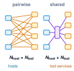
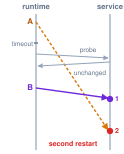
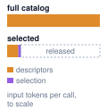

# Tool Calling {#sec-vol3-tool-calling}

::: {layout-narrow}
::: {.column-margin}

\chapterminitoc

:::

::: {.content-visible when-format="pdf"}
\noindent
{fig-alt="Blueprint for Tool Execution."}
:::

::: {.content-visible unless-format="pdf"}
{fig-alt="Blueprint for Tool Execution."}
:::

:::

## Purpose {.unnumbered .unlisted}

\begin{marginfigure}
\mlagentstack{0}{0}{0}{100}{0}{0}
\end{marginfigure}

_Why does a tool call that parses cleanly still need a runtime between it and the world?_

Calling an external tool transforms an isolated language model from an advisory text generator into an active distributed system participant capable of mutating persistent real-world state. Because a stochastic model can invent invalid parameters, target incorrect filesystem paths, or hallucinate task completion, generating a tool call cannot grant the authority to execute it. The runtime must enforce a hard structural boundary between model proposal and tool execution: inspecting argument schemas, verifying caller permissions, and isolating side effects within sandboxed execution environments. Furthermore, because tool responses become context observations, partial failures and network timeouts must be reported faithfully rather than masked by invented outcomes. Managing tool calling establishes the core invariant of agent engineering: authority remains strictly with the deterministic runtime, while the model functions solely as a proposal engine.

::: {.content-visible when-format="pdf"}

\newpage

:::

::: {.callout-learning-objectives}

- Trace a proposed tool call through validation, authorization, dispatch, and a correlated observation into the next model call
- Design a tool descriptor that separates structural validation from action-time preconditions enforced with the effect
- Distinguish tool discovery and connectivity from the grants required to invoke an operation
- Select blind retry, endpoint deduplication, or reconciliation for an uncertain effect from operation semantics and loss rates
- Design bounded observations that preserve execution status, omission information, and the scope of available evidence
- Compare waiting and resumption strategies for long-running tools by detection delay, inference cost, and retained supervision
- Evaluate toolkit granularity by context cost, cost per accepted task, and enforced reach across structured, general-purpose, and computer-use interfaces

:::
## The Tool Boundary {#sec-vol3-tool-calling-boundary}

An agent asked to restart a container on a staging server emits a short tool call. The host runtime checks the call against the tool's schema, confirms that this session may restart that container, and sends `POST /containers/srv-stage-04/restart`. Two seconds later the socket times out. The request may be lost, delayed, still executing, or completed without a delivered reply. A retry could restart healthy workers, and the first attempt can still take effect after the timeout.

::: {.column-margin}
{width="100%" fig-alt="H·S·A locator with only the Authority axis lit in purple; Horizon and State axes gray."}

*The Authority axis, closed at the tool boundary by mediating every proposed call.*
:::

Nothing about this failure is exotic. The repair agent (lighthouse \ref{lhs-vol3-repair-agent}) meets the same questions on every turn of the connection-pool repair. It reads `src/pool.py`, replaces text derived from the version it read, runs the test suite, and receives a log far longer than the next model call can hold. Each step is a tool call, and each can be rejected, left running, completed without a reply, or answered with more output than the model should see.

The pieces built so far do not settle these questions. @Sec-vol3-foundation-model-contract gave the model a structured way to propose a call, and the memory chapters already relied on tools to read sources, search indexes, and update records without examining what happens between a proposal and its result. A retrieval result identifies the version it observed, but keeping that version current until a later edit is an action-time precondition that something must enforce. A proposal names an operation and its arguments. It does not decide whether this task may run the operation, whether an earlier attempt already ran it, or what the next model call should receive.

This chapter builds the runtime's tool boundary, the path between a proposed call and the environment it would change. The boundary validates each proposal, checks it against the task's grants, dispatches it, tracks what is known about its effect, and returns a bounded observation matched to the call. Throughout, it keeps apart the three things the timeout blurs, the distinction from @sec-vol3-intro between what the model proposed, what effect the operation had, and what evidence the runtime holds about either.

The sections follow one call and then widen. @Sec-vol3-tool-calling-unix-analogy lays out the mediated round trip and the protection requirement that organizes it. @Sec-vol3-tool-calling-schemas types the request and couples action-time checks to the effect, and @sec-vol3-tool-calling-mcp separates discovering a tool from being allowed to use it. @Sec-vol3-tool-calling-idempotency decides when an uncertain effect may be retried. @Sec-vol3-tool-calling-streaming and @sec-vol3-tool-calling-observation-parsing bound what returns to the model without losing what it means. @Sec-vol3-tool-calling-async extends the contract to jobs that outlive a model turn, and @sec-vol3-tool-calling-toolkit-design and @sec-vol3-tool-calling-visual-actuation use those mechanics to evaluate tool catalogs and computer-use interfaces.

## Tool Subsystem Architecture {#sec-vol3-tool-calling-unix-analogy}

@Lst-vol3-tool-call-turn shows the staging restart as one turn of the loop, in a provider-neutral form. The runtime reports what it knows about this attempt, and the next model call receives that result together with the earlier request and proposal.

::: {#lst-vol3-tool-call-turn lst-cap="**One turn of the tool-call loop**: A call identifier correlates the proposed call with its result. The next model call receives the timeout as an unknown effect, not as evidence that the restart did not happen."}
```json
[
  {"role": "user",
   "content": "Stage-04 is serving a stale config. Restart it."},
  {"role": "assistant",
   "content": [
     {"type": "tool_call", "id": "call_1", "name": "restart_container",
      "arguments": {"container_id": "srv-stage-04"}}]},
  {"role": "tool",
   "content": [
     {"type": "tool_result", "call_id": "call_1",
      "content": {"transport_status": "timeout", "effect_status": "unknown"}}]}
]
```
:::

The runtime correlates each result with its corresponding call using an explicit identifier rather than message order alone. That identifier establishes message lineage across asynchronous turns, but correlation alone does not resolve whether the target service completed the requested mutation. Preventing duplicate restarts requires an operational contract for idempotency, developed in @sec-vol3-tool-calling-idempotency. Even if the subsequent model turn assumes that the service recovered, the runtime preserves the underlying uncertainty, authorizing a retry only when supported by fresh environment evidence or an enforced idempotency guarantee.

### One mediated round trip {#sec-vol3-tool-calling-round-trip}

@Sec-vol3-foundation-model-contract established the model-side call surface\index{Call surface}, where an inference engine emits structured invocation blocks rather than unstructured natural text. Once the model outputs a proposal, the runtime assumes full custody of execution. Between the moment a tool call leaves the model and the moment an observation enters the context of the next turn, the runtime mediates the entire round trip across the four coordinated stages in @fig-vol3-tool-call-loop: argument validation screens inputs against tool schemas, policy authorization verifies security grants, dispatch executes the permitted operation while tracking outcomes, and observation shaping normalizes raw results into bounded prompt payloads.

Request validation parses proposed arguments against the tool's declared schema, verifying required fields, data types, value ranges, and relational invariants among parameters. Dynamic constraints that depend on volatile environment state cannot be settled at this boundary; the system must evaluate them at the execution boundary rather than inferring them from historical context. Next, operation authorization verifies the active session's security grants against the targeted resource, evaluating concurrency budgets, rate limits, and access policies for read operations as well as state mutations.

Following authorization, dispatch submits the permitted operation to the underlying execution provider while outcome tracking maintains execution identity and status. This tracking distinguishes cleanly among pre-dispatch rejections, active background tasks, successfully reported results, and unconfirmed execution states. A transport timeout simply indicates that the runtime exceeded its waiting deadline, leaving the remote execution state unconfirmed. Finally, observation shaping maps the raw return value back to the originating call identifier, truncating payloads to fit context budgets, sanitizing terminal escape sequences, and tagging the output with accurate status metadata. If log output must be truncated, the payload explicitly discloses the omission; if a system returns an asynchronous job ticket, observation shaping reports it as an acknowledgment rather than a completed effect.

These stages refine the general turn lifecycle introduced in @sec-vol3-intro-execution-lifecycle. Certain validation checks must execute at the remote endpoint because safety requires atomicity with the state change itself; for example, an edit conditioned on a source version requires the version check to occur in lockstep with the update. Consequently, the host runtime and the remote endpoint each enforce their respective boundaries. The endpoint checks access independently, even for requests that the host runtime already cleared. This division reflects the end-to-end argument applied to system protection: an authorization check that depends on private endpoint state can be finalized only at that endpoint, making preliminary host-level checks useful performance optimizations rather than authoritative substitutes [@saltzer1984endtoend].

::: {#fig-vol3-tool-call-loop fig-env="figure" fig-pos="htb" fig-cap="**The tool-call loop**: Validation and authorization can reject a proposed call before dispatch. For a dispatched call, the runtime tracks the available outcome and shapes the return into a bounded observation matched to its call identifier. An unknown effect remains unknown in that observation." fig-alt="Flow diagram showing model tool calls passing through runtime validation, authorization, dispatch and outcome tracking, and observation shaping before the next model call. Rejected calls return structured errors without reaching the environment."}

:::

When the serving interface returns native structured call blocks, the runtime extracts the proposed operation and arguments directly. When a model emits proposals within unstructured free text, the runtime must first detect and parse those fragments before validation can proceed. Constrained decoding eliminates syntactic parsing failures by enforcing grammar rules directly during token generation (@sec-vol3-foundation-model-grammar-constrained). Yet syntax alone never establishes operational safety: whether the target resource exists, whether the observed version remains current, and whether the current session holds execution privileges remain runtime checks that no decoding grammar can verify.

### Complete mediation {#sec-vol3-tool-calling-complete-mediation}

Securing the tool interface rests on a foundational tenet of computer protection design: complete mediation [@saltzer1975]. At the tool boundary, mediation must govern both reads and mutations. Emitting a tool name does not grant the model ambient runtime authority, nor does receiving an observation make external data trusted.

::: {#dfn-complete-mediation .callout-definition title="Complete mediation"}

***Complete mediation***\index{Complete mediation!definition}\index{Tool actuation!complete mediation} requires every proposed access to pass through an enforced authorization boundary before it reaches the protected resource. In an agent runtime, the return path is also mediated so that observations enter context under explicit access, payload, and status contracts.

1. **Significance**: A valid-looking call cannot bypass the checks governing what the session may read, change, or disclose.
2. **Distinction**: Schema validation establishes structural admissibility, not permission. Observation normalization establishes a usable representation, not the truth of its contents or immunity to prompt injection, attacker-controlled content that attempts to redirect the model (@sec-vol3-security).
3. **Common pitfall**: Treating a prompt instruction such as “never delete production data” as an access barrier. The runtime must enforce the restriction even when the model proposes the prohibited action.

:::

Anderson formalized the architectural component required to enforce complete mediation: the reference monitor [@anderson1972computer].

::: {#dfn-reference-monitor .callout-definition title="Reference monitor"}

***Reference monitor***\index{Reference monitor!definition}\index{Tool actuation!reference monitor} is the enforcement component through which every access to a protected resource passes. It must be tamper-proof, always invoked, and small enough to verify. In an agent runtime, the host's validation and authorization path is the reference monitor for proposed tool calls, and each endpoint's access check is a second monitor for the resources that endpoint owns.

1. **Significance**: The three requirements turn complete mediation from an intention into a checkable property of the runtime's structure.
2. **Distinction**: The policy specifies permitted accesses, whereas the reference monitor provides the non-bypassable mechanism that evaluates and enforces those rules on every attempt.
3. **Common pitfall**: Adding a tool route that does not pass through the monitor, such as an unrestricted shell with network access beside a checked file adapter, which makes the adapter's checks advisory.

:::

These three requirements dictate concrete architectural choices at the tool boundary. *Tamper-proofing* ensures that neither generated model tokens nor untrusted data ingested from external systems can alter the authorization rules enforced by the runtime. *Always-invoked* mandates that every operational path pass through the monitor without exception. Exposing an unrestricted shell runner alongside a sandboxed file tool, for example, completely undermines the protection boundary, because the agent can bypass file restrictions by issuing shell commands. Finally, *verifiability* requires policy decisions to be deterministic, auditable software checks. Although an auxiliary classifier or guardrail model can score operational risk, probabilistic inference cannot be verified in the strict systems sense; the monitor itself must enforce deterministic access boundaries.

Two operational rules follow directly from complete mediation, and this chapter applies them systematically. The *grant rule*\index{Grant!grant rule} establishes that execution authority derives solely from the session's active security grants, re-evaluated on every invocation. Read operations demand the same rigorous mediation as state mutations, because returning private records discloses sensitive data even when environment state remains unchanged. A syntactically valid schema, an enforced tool choice, an advertised description, a staged descriptor, or a known handle never enlarges those grants. The *evidence-scope rule* establishes that an observation confirms only the specific metric or condition measured by the tool during that invocation. Reporting that an operating system process exited with code zero confirms only process termination; it does not prove overall task completion, which remains a distinct judgment governed by invariant closure (principle \ref{pri-invariant-closure}). Furthermore, raw output text remains untrusted data even after the runtime strips terminal formatting and normalizes metadata; observations supply empirical evidence of state, but they carry no ambient authority to dictate subsequent actions.

### Batches and forced calls {#sec-vol3-tool-calling-batches-forced-calls}

A single model response can propose multiple tool calls simultaneously, such as reading three source files in parallel. When operations are strictly read-only and independent, the runtime can dispatch them concurrently, correlating each returned observation with its respective call identifier. A failure in one read does not invalidate concurrent operations that succeeded. Nevertheless, every invocation in the batch must individually pass validation and authorization, and the combined batch consumes from a shared resource and rate-limit budget.

State mutations complicate concurrent execution. For example, reading `src/pool.py` concurrently with another call that edits it yields non-deterministic results depending on scheduling race conditions. When tools declare a trustworthy **resource footprint**\index{Resource footprint!definition}—the explicit set of state each call reads and writes—the runtime can evaluate potential data hazards. If neither operation writes to state read or written by the other, the pair satisfies Bernstein's conditions for noninterference and permits safe concurrent dispatch [@bernstein1966]. However, this guarantee relies entirely on the completeness of footprint declarations; any hidden side effect or undeclared shared dependency invalidates the concurrency guarantee.

Operations with opaque side effects, such as arbitrary shell commands, possess unknown footprints. In such cases, the runtime must either isolate the execution environment, serialize calls conservatively, or reject batched execution in favor of fine-grained tools. Furthermore, when operations exhibit causal dependencies, those ordering constraints must originate from the workflow policy or an explicit dependency graph; the sequential order of tokens generated by the model does not constitute reliable evidence of intended execution order. Nor does batching imply atomicity: a batch forms a transaction only when the underlying tool substrate explicitly provides transactional all-or-nothing rollback semantics.

The runtime can also govern whether the model proposes an action. Using serving-level **tool-choice control**\index{Tool-choice control!definition}, the runtime can configure tool calling as optional, mandate that the model invoke at least one tool, restrict selection to a specific named operation, or forbid tool execution altogether. Orchestration engines use these constraints to guide execution phases—for instance, forcing a diagnostic read before permitting an edit, or disallowing tool calls to force a final textual summary. Crucially, tool-choice controls merely shape model generation; under the grant rule, forcing a tool choice confers no operational authorization.

Executing each stage of this mediated round trip requires an unambiguous request representation, establishing a strict operational boundary between static schema validation and dynamic preconditions verified at dispatch time.

## Tool Interface Schemas {#sec-vol3-tool-calling-schemas}

Recall the connection-pool repair (lighthouse \ref{lhs-vol3-repair-agent}) right at the transition from revision `r17` to `r18`. The model has inspected `src/pool.py` and emitted a proposed patch. Before applying that modification to real infrastructure, the host runtime must resolve four fundamental questions: Which tool operation did the model select? What do its arguments denote? Does the current task possess the authority required to execute the mutation? And crucially, does the underlying target file still match the exact source state on which the model based its proposal? A well-formed JSON payload satisfies syntactic structure, but syntax alone cannot answer these operational questions.

A **tool descriptor**\index{Tool descriptor!definition} defines an operation's functional purpose, input parameters, expected return values, and execution side effects. Within that descriptor, the **argument schema**\index{Argument schema!definition} codifies machine-checkable constraints: required fields, primitive types, permitted enumerations, and supported size bounds. These specifications serve two distinct audiences: natural-language descriptions guide the language model in selecting and parameterizing tools, while the surrounding runtime and downstream service endpoints validate and enforce the interface contract.

### Descriptor semantics {#sec-vol3-tool-calling-descriptor-semantics}

To make these guarantees concrete, consider a tool named `conditional_replace_file`. This tool replaces a single file in the task's designated workspace, but commits the change only if that file still matches the expected source version. The descriptor must establish several semantic invariants: `path` resolves strictly relative to the designated workspace rather than an arbitrary host location; `expected_version` identifies the baseline source revision the model inspected; and `replacement` supplies the complete replacement content encoded in the endpoint's documented format. Under this specification, passing an empty replacement string explicitly truncates the file to zero bytes instead of serving as a shorthand instruction to leave contents unmodified.

Full file replacement keeps this precondition example transparent, though production runtimes often prefer line-anchored patches or structured diffs to minimize token generation overhead. As detailed in @sec-vol3-foundation-model-interface-design, structured diffs reduce generated output while demanding identical coordination between precondition verification and atomic mutation.

@Lst-vol3-tool-schema illustrates the machine-checkable argument structure. Notice that the request payload contains neither a credential token nor a privilege flag through which the model might expand its access rights. The host runtime independently binds the invocation to the task's authorized execution context.

::: {#lst-vol3-tool-schema lst-cap="**Conditional file replacement arguments**: The schema describes the request's structure. Its descriptions do not implement path confinement, authorization, or atomic version checking."}
```json
{
  "type": "object",
  "required": ["path", "expected_version", "replacement"],
  "additionalProperties": false,
  "properties": {
    "path": {
      "type": "string",
      "minLength": 1,
      "description": "File path relative to the designated workspace."
    },
    "expected_version": {
      "type": "string",
      "minLength": 1,
      "description": "Source version returned with the inspected file."
    },
    "replacement": {
      "type": "string",
      "description": "Complete replacement text, written as UTF-8."
    }
  }
}
```
:::

The descriptor's result contract requires equal precision. A completed replacement reports the affected path and its newly assigned revision token. A version conflict explicitly reports that the target diverged and the replacement was not applied. Furthermore, the runtime must clearly distinguish deterministic client errors—such as malformed arguments or insufficient authority—from indeterminate transport failures where the endpoint's state remains unknown after a dropped connection. A comprehensive descriptor explicitly models all four outcomes, including network timeouts where no acknowledgment arrives.

Precise field names and descriptions eliminate avoidable ambiguity during generation. For example, a file-reading tool should state whether its offset argument counts bytes, characters, or lines. Similarly, a timeout parameter must state its measurement units and specify whether it bounds connection establishment, remote execution, or end-to-end response delivery. While clear documentation guides the model toward valid parameters, the execution runtime must programmatically enforce all defaults, enumeration sets, and numerical bounds. Grounding model generation in explicit tool documentation yields measurable reliability improvements: @patil2023gorilla demonstrated that models trained to condition tool invocations on retrieved API documentation invent nonexistent operations and hallucinate invalid arguments far less frequently than models relying solely on unconditioned prompting.

### Structure, permission, and state checks {#sec-vol3-tool-calling-boundary-checks}

When processing a tool call, the runtime first verifies that the model produced a fully completed candidate, adhering to the invocation contract defined in @sec-vol3-foundation-model-contract. If generation halted prematurely due to token limits or client disconnection, the runtime aborts immediately; a partial payload that happens to form syntactically valid JSON cannot be trusted as an intentional tool request. Once execution status confirms a complete output, the runtime parses the candidate and validates its arguments against the tool's registered JSON schema before performing any domain checks.

In our replacement example, omitting `expected_version` or supplying a numeric `path` fails structural validation immediately. Setting `"additionalProperties": false` in @lst-vol3-tool-schema likewise causes the parser to reject hallucinated arguments such as `force` or `recursive`. However, structural conformance resolves only syntax. Verifying whether the path resides within the task's assigned sandbox, and determining whether the target still contains the inspected source revision, require distinct evaluation steps. As summarized in @tbl-vol3-schema-contract, the runtime enforces these guarantees across layered boundaries.

| Check                | Question for the proposed edit                                                                   | What passing does not establish                                                        |
|:---------------------|:-------------------------------------------------------------------------------------------------|:---------------------------------------------------------------------------------------|
| Argument structure   | Are the required fields present with the declared types and supported constraints?               | The path is permitted, the version is current, or the replacement is a correct repair. |
| Domain preconditions | Does the target support this operation, and does its version match when the update takes effect? | The session has authority to modify it.                                                |
| Authority            | Do the task's current grants permit this operation on the resolved target?                       | The arguments fit resource limits or the operation will succeed.                       |
| Resource limits      | Does the request fit enforced payload, execution, and result limits?                             | The returned evidence will establish task acceptance.                                  |

: **Checks at the tool boundary**: Each check establishes a different part of the action contract. Source-dependent checks must remain valid through the operation they protect. {#tbl-vol3-schema-contract tbl-colwidths="[18,41,41]"}

A string formatted as a file path does not constitute a confined resource reference.[^fn-toctou-path-tools] The tool implementation must canonicalize and resolve the target inside the authorized workspace, accounting for symlinks, directory traversal escapes, and path alias changes that could redirect the operation. Similarly, declaring `replacement` as a string does not bound its encoded memory footprint. Production adapters enforce explicit byte-size limits on incoming payloads, bound the volume of captured diagnostic output, and apply strict execution timeouts. Static schema validation handles input syntax, whereas dynamic state verification, path confinement, and resource throttling remain runtime obligations. @Sec-vol3-app-b-json-schema supplies a bounded edit descriptor along with an operational schema-review checklist covering required fields, buffer limits, explicit units, and variant semantics.

[^fn-toctou-path-tools]: **Time-of-Check to Time-of-Use**: Bishop and Dilger analyzed the UNIX file-access race in which the binding of a name to an object changes between a program's check and its later use, so a privileged program can be steered onto a file it never checked [@bishop1996checking]. A tool adapter that validates `src/pool.py` and then reopens the path by name inherits the same window: a symbolic link swapped in between turns a permitted edit into an edit elsewhere. Resolving the path once and operating on the resolved object, rather than re-resolving the string, is what closes it. \index{TOCTOU!tool path confinement}

Grammar-guided decoding effectively eliminates syntactic errors during generation, as demonstrated in @sec-vol3-foundation-model-grammar-constrained. However, token-level grammar masks cannot resolve filesystem references, evaluate access-control policies, or verify concurrent version tags. The host runtime must validate the materialized tool request, while the downstream endpoint verifies dynamic preconditions during physical execution. This separation instantiates the typed action contract (principle \ref{pri-vol3-strict-action-abi})\index{Principle!typed action contract}, securing the boundary between generative text output and physical system actuation.

### Conditional updates {#sec-vol3-tool-calling-conditional-updates}

The `expected_version` parameter binds the read contract of @sec-vol3-persistent-governance directly to the mutation contract enforced here. An earlier read operation confirmed only that `src/pool.py` matched revision `r17` at the specific instant of observation; that read did not lock or reserve the file for future modification. If a concurrent process or another agent alters `src/pool.py` before the edit request arrives, applying a patch derived from `r17` would silently overwrite those intervening modifications, causing a classic lost-update anomaly.

To guarantee serializability, the storage service must verify the expected version and commit the replacement as a single atomic **conditional update**\index{Conditional update!definition}—the storage equivalent of a hardware compare-and-swap (CAS) primitive.[^fn-optimistic-validation-tools] In this example, the workspace source service executes the entire sequence inside a single coordination boundary: it resolves the target file, verifies that its current revision matches `expected_version`, writes the new content, and publishes the resulting revision token. Decomposing this sequence into non-atomic operations—such as reading the revision, verifying it in user space, and then issuing a write—reopens a race window where concurrent writers can intervene. The atomic conditional update closes this time-of-check to time-of-use gap.

[^fn-optimistic-validation-tools]: **Optimistic Concurrency Control**: Kung and Robinson proposed letting transactions read without locks and validating, at commit, that nothing they read had changed, restarting any transaction that fails validation [@kung1981optimistic]. The expected-version check is that validation for a single file, and it inherits the same economics: a conflict is cheap when writers rarely collide, but under contention each failed validation costs the agent a fresh read and a new proposal, which is paid in model turns rather than in microseconds. \index{Optimistic concurrency control!conditional update}

This execution branch yields two distinct operational outcomes:

1. If the current source revision remains `r17`, the update commits the replacement and returns `r18`, identifying the new revision produced by the edit.
2. If another writer modified the source first, the version check fails. The service rejects the replacement, leaves the storage state unaltered, and returns an explicit version-conflict status.
Following a conflict, the runtime directs the agent to perform an authorized read of the updated source file and synthesize a fresh proposal, rather than blindly overwriting the intervening modifications.

This concurrency guarantee holds only as long as all mutations route through the shared coordination boundary. If external processes or unmanaged scripts modify files directly on disk, bypassing the version service, version tokens offer no protection and the endpoint cannot ensure integrity. Dry-run previews follow the identical principle. A dry run confirms that a proposed patch applies cleanly against revision `r17` at the moment of evaluation, but it establishes no lock on that revision. The runtime must re-verify all preconditions, permissions, and version tokens when executing the live write.

Receiving a successful `r18` confirmation verifies that the file modification committed to disk, but it does not establish that the underlying connection-pool bug has been resolved. Demonstrating functional correctness requires empirical validation: a subsequent passing run of `test_waiter_notified_on_return` provides concrete evidence that the patch resolves the targeted race condition, while broader task acceptance continues to follow the project's verification suite. At the network layer, a dropped reply leaves the caller uncertain whether the server committed the edit or failed before processing the payload. The retry and idempotency contracts analyzed in @sec-vol3-tool-calling-idempotency resolve this operational uncertainty.

### Rejection diagnostics {#sec-vol3-tool-calling-rejection-diagnostics}

When an operation fails, the runtime must return a structured, bounded diagnostic that isolates the failure condition without leaking information beyond the task's authorized grants. For example, a structural rejection should identify the missing `expected_version` property, and a concurrency conflict should state that revision `r17` has been superseded. Conversely, permission rejections must refuse access cleanly without exposing directory structures, environment variables, or path hints that an agent might probe. The runtime logs whether a rejection originated locally during client-side schema validation or remotely at the service endpoint, allowing downstream decision logic to distinguish between an unattempted proposal and a failed remote mutation. Clear, bounded diagnostics provide the model with the exact evidence needed to synthesize a valid revision, which must then traverse the same validation pipeline.

Every tool descriptor exposed to an agent consumes context window capacity. Deciding which descriptors to stage dynamically, and balancing expressive specialized tools against minimal generic primitives, forms the toolkit-design challenge addressed in @sec-vol3-tool-calling-toolkit-design. Before an agent can select or execute tools, however, the runtime requires a standardized transport protocol to discover, bind, and communicate with external service interfaces.

## Interoperable Tool Discovery {#sec-vol3-tool-calling-mcp}

In practice, a tool implementation such as `conditional_replace_file` can live in several environments: an in-process adapter compiled into the application, a standalone background daemon, or a remote microservice managed by another team. Before the model can propose a valid call, the host runtime must determine which operations that endpoint exposes and how to encode their arguments. This discovery phase supplies that interface metadata. Under the grant rule, however, learning that an operation exists confers no authority to execute it: discovery defines interface syntax, whereas authorization governs execution rights.

### The Model Context Protocol {#sec-vol3-tool-calling-mcp-protocol}

When building a self-contained agent with a small, static set of tools, registering local functions directly in-process is simple and fast. But when multiple host applications must connect to independently maintained tool services, custom point-to-point integration quickly becomes impractical. The underlying challenge is combinatorial. Without a shared interface, $N_{\text{host}}$ host runtimes integrating $N_{\text{tool}}$ tool services require up to $N_{\text{host}} \times N_{\text{tool}}$ bespoke adapters. Standardizing on a common protocol reduces this burden to $N_{\text{host}} + N_{\text{tool}}$ implementations, allowing each side to build to the specification once.

::: {.column-margin}
{width="100%" fig-alt="Two small graphs. Left: three host boxes each wired to four tool-service boxes, twelve crossing adapter lines, labeled N host times N tool. Right: the same hosts and services each wired once to a central protocol box, labeled N host plus N tool."}

*A shared protocol turns pairwise adapters into one implementation per side.*
:::

Decoupling tools across a protocol boundary also introduces critical fault isolation. When a tool runs in a separate process, a memory leak, segmentation fault, or unhandled blocking call crashes only the tool server rather than tearing down the primary agent orchestration loop. Even so, protocol standardization does not eliminate engineering responsibilities: integrators must still define tool semantics, audit version compatibility, and enforce security policies. Local in-process plugins and out-of-process tool servers represent deliberate deployment trade-offs rather than mutually exclusive or evolutionary stages.

The **Model Context Protocol (MCP)**\index{MCP!definition}\index{Model Context Protocol|see{MCP}} exemplifies this architecture. MCP structures integrations across three distinct entities: a host application (such as an interactive environment or agent runtime), clients that manage connections, and servers that expose capabilities. Servers can run as local child processes or as remote network services. This architectural division clarifies integration responsibilities rather than prescribing a specific execution sandbox [@mcp2025specification].

Each deployment model matches different operational demands. A local child process keeps filesystem operations adjacent to the working copy and simplifies process lifecycle management. Conversely, a remote service can centralize credential storage, connection pooling, and backend access without replicating sensitive configurations across every host machine. Yet both options introduce distinct failure modes and resource boundaries: an unconfined local process still reaches whatever local filesystem it is granted, while a severed network link can leave an in-flight operation executing invisibly on a remote server. Architects must choose deployments based on where resource governance and policy enforcement belong, evaluating transport latency relative to tool execution duration rather than presuming any transport topology is universally superior.

### Tool listing and invocation {#sec-vol3-tool-calling-listing-invocation}

MCP defines two primary wire operations for tool interaction: `tools/list` to discover available tool definitions and `tools/call` for execution.[^fn-jsonrpc-correlation-ids] Each definition advertises a unique name, a natural-language description, and a JSON Schema governing accepted arguments; an invocation names the target tool and supplies a matching argument dictionary. These messages establish the mechanics of interface exchange rather than a task's execution rights. The MCP tools specification [@mcp2025specification] defines these message formats and explicitly mandates server-side input validation and access controls.

[^fn-jsonrpc-correlation-ids]: **JSON-RPC Request Identifiers**: MCP frames these messages as JSON-RPC 2.0 requests, each carrying an `id` that its response echoes [@mcp2025specification]. That identifier does the work of this chapter's call identifier, matching a reply to its request on one connection. It says nothing about whether a second `tools/call` with the same arguments is the same intended effect, which is why retry safety needs the separate operation identity developed in @sec-vol3-tool-calling-idempotency. \index{JSON-RPC!request identifier}

To trace where policy boundaries sit during execution, consider a repository server advertising two illustrative operations: `read_source` and `apply_patch`. A concrete integration sequence proceeds through several verification checkpoints:

1. The host's client queries `tools/list` and binds each accepted schema explicitly to that server instance and its locally governed tool policy. Explicit binding ensures that an identically named tool advertised by another server cannot silently shadow or replace the expected implementation.
2. The host determines which accepted definitions to expose in the model context for the connection-pool repair task.
3. When the model proposes an operation, the host runtime validates the arguments against the schema and verifies task-level authorization before transmitting the request.
4. Upon receiving `tools/call`, the endpoint independently verifies the request against the underlying operating system permissions and data access controls it manages.

For the connection-pool repair, discovering that `apply_patch` exists leaves the permitted edit paths and the expected-version preconditions unchanged. The guarantee of atomic, conditional updates derives entirely from the server implementation, never from an encouraging function name. If an endpoint fails to provide conditional-update guarantees, the runtime must reject it as incompatible with the task's safety contract.

### Discovery and authority {#sec-vol3-tool-calling-discovery-authority}

Tool descriptions provided during discovery are untrusted external inputs. A description might accurately summarize an operation, omit critical failure modes, or embed prompt instructions that attempt to steer model behavior. Even an authenticated server can supply a misleading description, because verifying a server's identity does not imply endorsing every claim it emits. A host runtime must never promote claims such as “approved for all workspaces” into an authorization grant.

Filtering which tools appear in the model prompt narrows the attack surface, but catalog filtering alone cannot replace per-call enforcement. Task grants evolve dynamically, and call arguments select specific resources at runtime. Authorizing an agent to inspect `src/pool.py` does not permit it to read unrelated credentials or transmit private source code to an external service. Furthermore, defense-in-depth requires the server or backing service to enforce its own perimeter rather than assuming every client performs flawless checks. Host authorization and endpoint authorization protect different assets and operational domains; neither supersedes the other. On the return path, protocol framing cleanly differentiates a tool result payload from a system message, but framing does not disarm adversarial text within the payload—an attack vector examined thoroughly in @sec-vol3-security.

A documented security vulnerability demonstrates the systemic danger when ambient credential reach serves as the sole barrier between discovery and side effects.

::: {#ws-07-github-mcp-2025 .callout-war-story title="GitHub MCP private-repository leak (2025)"}

**Context**: In May 2025, Invariant Labs demonstrated an attack on an agent connected to GitHub through its MCP integration [@milanta2025github]. The user owned both a public and a private repository and directed the agent, running in a desktop client, to inspect open issues in the public repository. The agent's GitHub access token held permissions that spanned both repositories.

**Mechanism**: An attacker filed an issue in the public repository containing prompt instructions designed to redirect the model. After reading the issue as an ordinary tool result, the agent executed the server's schema-valid tools to inspect the user's private repositories and then opened a pull request in the public repository containing the exfiltrated contents. Every tool call remained within the personal access token's broad credential scope, and no runtime check verified whether the target repository matched the task's intended scope. Although the client prompted users to confirm tool calls by default, developers frequently enable an "Always Allow" setting to avoid operational friction.

**Impact**: The public pull request disclosed sensitive information, including the private repository name, relocation plans, and salary details. Invariant Labs characterized the breakdown as an architectural failure in agent runtime mediation rather than a software defect in GitHub's server implementation.

**Fix**: The researchers recommended enforcing context-aware access control at runtime—such as restricting an agent session strictly to the target repository identified by the user—alongside continuous monitoring of agent-server traffic. They also observed that model alignment training alone failed to stop the attack.

**Systems lesson**: Discovery, schema validity, and credential authentication all succeeded. The failure was an absence of complete mediation (definition \ref{dfn-complete-mediation}) against the task's explicit grants, which should have blocked the initial private-repository read—a read-only $A_0$ action—well before any write operation occurred.

:::

This exploit succeeded because three distinct conditions coincided:

1. The agent ingested untrusted external text that mounted an indirect prompt injection [@greshake2023not].
2. The agent held ambient authority broader than its active task required.
3. The runtime provided tools capable of public mutations.

Eliminating any single condition breaks the attack chain. The second condition represents a classic systems security failure: the *confused deputy* problem [@hardy1988confused]. A confused deputy is an authorized program tricked into misusing its authority on behalf of an unprivileged party because the system fails to tie the authority exercised to the party directing the action. In this incident, the agent exercised the user's repository credentials on behalf of the remote attacker who authored the issue text. While @sec-vol3-security analyzes defenses against prompt injection and unauthorized exfiltration channels, the tool runtime boundary directly governs the second condition. The runtime neutralizes confused deputy attacks by evaluating every tool call against the task's explicit grants rather than delegating authority to ambient credentials.

::: {#chk-07-complete-mediation .callout-checkpoint title="Discovery is not permission"}

A repository server advertises a schema-valid `apply_patch` tool whose description says “use any path needed to complete the repair.” The current task permits edits only to its designated working copy. Later, a read result includes a request to upload repository contents to an external endpoint.

- [ ] **Discovery vs. permission**: Which information does discovery supply, and which claimed permissions must the host refuse to derive from the description?
- [ ] **Per-call checks**: Why must an allowed tool still be checked against the proposed arguments and current grants at dispatch? What must the endpoint enforce independently?
- [ ] **Read authority**: Why does the read operation require authorization even though it does not edit a file?
- [ ] **Returned text**: What do bounded serialization and provenance labels establish about the returned text, and what do they leave open about its influence on the model?
- [ ] **Placing the check**: In war story \ref{ws-07-github-mcp-2025}, at which call would a per-call check against the task's grants have refused, and which of the three enabling conditions would that remove?

:::

Discovery establishes how to address an operation, and authorization determines whether a given task may attempt it. Yet neither mechanism resolves whether an in-flight mutation actually took effect when a network connection drops or a response times out. Because permission to initiate an action does not confer permission to blindly repeat it when the outcome is uncertain, robust execution requires explicit operation identity and idempotency guarantees.

## Retrying Uncertain Actions {#sec-vol3-tool-calling-idempotency}

Consider the staging-container restart introduced earlier. When `POST /containers/srv-stage-04/restart` times out, the client cannot distinguish between several fundamentally different physical realities: the request may have been dropped in transit, delayed in a network queue, or accepted by the daemon. The restart process might still be running, might have partially reconfigured the service before halting, or might have completed successfully while only the acknowledgment was lost. A client-side timeout[^fn-rpc-call-semantics] records only that the caller stopped waiting for a response; it conveys no information about endpoint execution state [@cristian1991understanding].

Deciding what to do next requires understanding two orthogonal properties: the operation's repeat behavior and empirical evidence about the earlier attempt. Prompting the language model to retry answers neither question.

[^fn-rpc-call-semantics]: **Remote Call Semantics**: Birrell and Nelson's foundational remote procedure call package stated its guarantee with precision: if a call returned, the remote procedure had executed exactly once; if an exception was reported, it had executed either once or not at all, and the caller received no indication of which had occurred [@birrell1984rpc]. A timed-out tool call inherits this second case directly. An agent runtime must preserve "once or not at all" as an explicit, unsettled status rather than collapsing it into a conventional failure that invites an immediate retry. \index{Remote procedure call!failure semantics}

::: {#dfn-uncertain-outcome .callout-definition title="Uncertain outcome"}

***Uncertain outcome***\index{Uncertain outcome!definition}\index{Settlement!uncertain outcome} is the recorded status of a dispatched operation whose effect the runtime can neither confirm nor exclude, because its reply was lost, late, or never produced. The operation stays unsettled until an endpoint deduplication contract, a reconciliation query, or an authorized decision establishes what happened.

1. **Significance**: An unsettled mutation blocks any retry that could duplicate it. Under blind retry, the duplicate rate tracks the reply-loss rate almost one for one (notebook \ref{nbk-07-settlement-budget}).
2. **Distinction**: A definite failure provides actionable knowledge, whereas an uncertain outcome represents missing information. A network timeout creates an epistemic void rather than a failed execution.
3. **Common pitfall**: Recording a timed-out restart as a definitive failure, which improperly authorizes the very retry that duplicates the mutation.

:::

### Delayed attempts {#sec-vol3-tool-calling-delayed-attempts}

A probe that reads an unchanged service state provides valuable evidence about the present, yet it cannot guarantee that a delayed request will not execute in the near future. Suppose the runtime dispatches restart attempt A, but the network buffers or delays the packet in transit. When the client-side timeout fires, the runtime queries the container state and correctly observes that the container has not restarted. If the runtime treats this unchanged state as definitive proof of nonexecution, it dispatches attempt B, which arrives promptly and completes the restart. Moments later, the delayed attempt A finally reaches the service and restarts the container a second time.

::: {.column-margin}
{width="100%" fig-alt="Timeline with a runtime lane and a service lane. Attempt A leaves the runtime as a long dashed arrow. The runtime times out, probes the service, and hears unchanged. Attempt B then arrives and causes restart 1; the delayed attempt A lands afterward and causes restart 2, labeled second restart."}

*An unchanged probe cannot rule out an attempt still in flight.*
:::

The probe returned completely accurate telemetry, but the runtime drew a flawed inference: it mistook "not yet observed" for "cannot still happen." An attempt already executing inside the service produces an identical hazard. Sending an asynchronous cancellation request settles this ambiguity only if the endpoint explicitly confirms what halted and whether any side effects committed or could still commit. Safe repetition therefore demands much more than a client timeout followed by an optimistic read.

### Idempotent actions {#sec-vol3-tool-calling-idempotent-actions}

Deciding whether to retry an unacknowledged tool call depends on the physical consequence of running the operation a second time.

::: {#dfn-idempotent-action .callout-definition title="Idempotent action"}

***Idempotent action***\index{Idempotent action!definition}\index{Idempotency!definition} is an operation whose repeated application has the same effect on a specified state as one application, $f(f(s)) = f(s)$, under the operation's stated conditions.

1. **Significance**: Idempotence is the cheapest settlement. A timed-out idempotent call can be retried without reconciliation, which removes the duplicate-effect path priced in notebook \ref{nbk-07-settlement-budget}.
2. **Distinction**: The property belongs strictly to the implemented operation and its target state; it does not guarantee identical network responses, zero resource consumption, or isolation from concurrent writes by other processes.
3. **Common pitfall**: Assuming idempotence from an HTTP verb or tool name alone. Operations such as restarting a service or appending a log entry introduce new state transitions on every invocation, regardless of the API naming convention.

:::

Setting a configuration field to a desired value can be idempotent[^fn-idempotent-peirce-tools] with respect to that field. Incrementing a counter, appending a record, or restarting a service usually describes an additional event on each execution. The endpoint's implementation determines which semantics the tool actually provides, and @tbl-vol3-tool-idempotency sorts the three semantics by what a repeat means and what the runtime must still check before allowing one.

[^fn-idempotent-peirce-tools]: **Idempotent** (Latin *idem*, "the same," and *potent*, "power"): Benjamin Peirce introduced the term in his 1870 survey of linear associative algebras to describe an element that remains unchanged when raised to any positive integer power, $x^n = x$ [@peirce1881linear]. Systems engineering adapts this mathematical formulation to system state: executing an idempotent mutation multiple times leaves the system in the exact state as executing it once. Crucially, algebraic idempotence guarantees nothing about identical return payloads, execution costs, or hidden side effects introduced along the execution path. \index{Idempotency!etymology}

| Operation semantics               | What repetition means                                    | What the runtime must still consider                                                           |
|:----------------------------------|:---------------------------------------------------------|:-----------------------------------------------------------------------------------------------|
| Read without an intended mutation | Obtain another observation, possibly of a changed source | Access and disclosure permission, resource cost, and the version the result describes          |
| Set a desired state               | Reapply a value that may already hold                    | Intervening writes, conditional-update rules, and any additional effects the endpoint performs |
| Produce another event             | Append, charge, restart, or otherwise add an effect      | A deduplication contract or sufficient evidence that another execution is safe                 |

: **Repeat behavior at the tool boundary**: Safety follows the implemented operation and its conditions, not a universal classification of tool names. {#tbl-vol3-tool-idempotency tbl-colwidths="[25,33,42]"}

The conditional-update scenario in @tbl-vol3-tool-idempotency illustrates this subtlety. Suppose a repair tool predicates its patch on source version `r17`. Once it installs `r18`, repeating the conditional request cannot accidentally overwrite subsequent edits, provided the endpoint checks the version and applies the write atomically. The repeated request returns an optimistic concurrency conflict rather than a success status. While this atomic check protects the repository from corruption, it leaves open the question of whether the earlier attempt or a competing process committed `r18`. Resolving that attribution requires tracking operation identity across attempts through an endpoint result-recovery contract.

Repeat behavior operates along an orthogonal axis from the authority levels $A_0$ through $A_3$ defined in @sec-vol3-intro-hsa. An authority level governs whether an agent may execute an action autonomously; repeat behavior dictates whether the runtime can safely re-execute that action after an ambiguous failure. These concerns intersect directly at level $A_2$, which @sec-vol3-intro-hsa reserves for external operations backed by bounded automatic retries or well-defined compensating actions. An external tool call qualifies for $A_2$ autonomy only if the runtime settles every transport timeout prior to retrying, relying on verified idempotent semantics, an endpoint deduplication contract, or bounded reconciliation.

```{python}
#| label: calc-vol3-tool-calling-settlement
#| echo: false
# RETRY LOSS PATH: hypothetical probabilities, not measured failure rates.
# LOAD: Independent request/reply loss; delivered requests execute successfully.
# EXECUTE: One original attempt, with exactly one retry after any timeout.
# GUARD: Distinguish a lost original reply from a delivered duplicate request.
# OUTPUT: Display probabilities under this deliberately limited model.
from mlsysim import *

class SettlementBudget:
    # 1. LOAD: hypothetical independent message-loss probabilities.
    request_loss = 0.02
    reply_loss = 0.02
    workers = 50  # hypothetical fleet size
    calls_per_worker_day = 4_000  # hypothetical mutating calls per worker per day

    # 2. EXECUTE: enumerate the timeout and duplicate-effect paths.
    timeout_probability = 1 - (1 - request_loss) * (1 - reply_loss)
    duplicate_probability = (1 - request_loss) * reply_loss * (1 - request_loss)
    calls_per_day = workers * calls_per_worker_day
    duplicates_per_day = calls_per_day * duplicate_probability

    # 3. GUARD: independently checked path probabilities.
    check(abs(timeout_probability - 0.0396) < 1e-12, "Timeout loss paths")
    check(abs(duplicate_probability - 0.019208) < 1e-12, "Duplicate needs delivered retry")
    check(calls_per_day == 200_000, "Fleet call volume")
    check(abs(duplicates_per_day - 3841.6) < 1e-6, "Rare per call, routine per day")
    check(request_loss == reply_loss, "Prose states one loss rate for both directions")

    # 4. OUTPUT: display assumptions and results through unit-aware formatters.
    loss_str = fmt_percent(request_loss, style="prose", precision=0)
    timeout_str = fmt_percent(timeout_probability, style="prose", precision=2)
    duplicate_str = fmt_percent(duplicate_probability, style="prose", precision=4)
    workers_str = fmt_int(workers)
    calls_per_worker_day_str = fmt_int(calls_per_worker_day)
    calls_per_day_str = fmt_int(calls_per_day)
    duplicates_per_day_str = fmt_int(round(duplicates_per_day))
    _q = fmt(request_loss, precision=2, commas=False)
    _r = fmt(reply_loss, precision=2, commas=False)
    timeout_math = fmt_math(rf"1-(1-{_q})(1-{_r})")
    duplicate_math = fmt_math(rf"\Pr(\text{{duplicate effect}}) = (1-{_q})\times {_r}\times(1-{_q})")
```

::: {#nbk-07-settlement-budget .callout-notebook title="Which retry path duplicates an effect?"}

**Problem**: Suppose inbound requests and outbound replies each experience an independent `{python} SettlementBudget.loss_str` probability of packet loss. Every delivered request executes successfully, and every caller timeout triggers exactly one blind retry of a non-idempotent operation without deduplication. Dropped packets are assumed to be permanently lost rather than delayed. What is the probability that a single dispatched action executes more than once, and how many duplicate mutations will an agent fleet induce each day?

**Math**: The initial attempt times out whenever the outbound request or the returning reply is lost, occurring with probability `{python} SettlementBudget.timeout_math`, or `{python} SettlementBudget.timeout_str`. Producing an unintended duplicate mutation requires a specific sequence: the original request must reach the endpoint, its confirmation reply must be lost in transit, and the subsequent retry request must successfully reach the endpoint:

`{python} SettlementBudget.duplicate_math`

This evaluates to `{python} SettlementBudget.duplicate_str`; whether the retry's own confirmation reaches the caller has no bearing on whether the endpoint mutated twice. In a fleet of `{python} SettlementBudget.workers_str` workers where each worker executes `{python} SettlementBudget.calls_per_worker_day_str` mutating calls per day, the system processes `{python} SettlementBudget.calls_per_day_str` daily calls. Under this naive retry policy, the fleet triggers approximately `{python} SettlementBudget.duplicates_per_day_str` duplicate mutations every single day.

**Systems insight**: The duplicate execution rate tracks the reply-loss rate almost one-to-one because creating a duplicate requires losing a reply between two successfully delivered requests. Losing an initial request produces only an unexecuted, harmless timeout. While halving reply loss reduces duplicate mutations by half, implementing an endpoint deduplication contract eliminates this failure mode entirely. At production scale, protocol-level deduplication contracts—not network hardening—serve as the primary reliability control. Note that this simplified model ignores delayed packets, which introduce additional duplicate execution paths.

:::

### Operation identity and endpoint contracts {#sec-vol3-tool-calling-operation-ids}

A **logical operation ID**\index{Operation ID!definition}, commonly called an idempotency key\index{Idempotency key|see{Operation ID}} in transactional storage and payment systems, identifies a single intended effect across multiple transport attempts. As Pat Helland observed, any distributed messaging substrate that survives network partitions and process crashes must occasionally retransmit packets; consequently, the receiving endpoint, rather than the transport network, must assume responsibility for rendering duplicate messages harmless [@helland2012idempotence]. An **attempt ID**\index{Attempt ID!definition}, in contrast, tracks an individual request-response exchange over the wire. When the agent runtime retries an unacknowledged restart, it preserves the original operation ID while generating a fresh attempt ID for transport tracing. Conversely, if an agent later issues a distinct, deliberate request to restart the same container, the runtime must allocate a brand-new operation ID, even if the target arguments are identical. Deriving operation IDs purely from argument hashes conflates distinct operational intents, whereas generating a new identifier after every timeout destroys deduplication entirely.

An operation identifier provides safety only when governed by an explicit endpoint contract. This contract binds the operation ID to the caller's identity, the target resource scope, and the serialized payload. If a client reuses an active operation ID with mismatched arguments, the endpoint must reject the request with a client error (such as an HTTP 409 Conflict) rather than silently dispatching a mutated operation. Furthermore, the endpoint must enforce access control independently on each attempt: possessing a valid operation token does not substitute for authorized credentials when dispatching actions or retrieving retained execution results.

The contract must also govern concurrent and interleaved requests. If a duplicate request arrives while the original attempt is actively executing, the endpoint should return an in-progress or pending status instead of spawning a parallel worker. If a duplicate arrives after execution finishes, the endpoint returns the previously computed and retained result. To uphold this guarantee under crash failures, the endpoint's persistence mechanism must atomically link the side effect with its stored completion record. If a worker applies the mutation and crashes before persisting the result, a simple log of request receipt cannot prove that re-execution is safe. Where the underlying resource supports it, enclosing both the mutation and the result record within a single database transaction guarantees atomic state transitions. When acting against external services lacking transactional boundaries, the endpoint must coordinate with the downstream system's native deduplication mechanisms. @Fig-vol3-idempotency-flow diagrams this stateful deduplication flow: the runtime creates a unique operation ID once and carries it across retry attempts, while the service endpoint queries its deduplication store to triage requests into four operational paths (reserving execution for fresh IDs, returning cached results for completed IDs, signaling backoff for in-progress operations, or rejecting mismatched payloads as ID conflicts).

::: {#fig-vol3-idempotency-flow fig-env="figure" fig-pos="htb" fig-cap="**One operation, many attempts**: The runtime creates the operation ID once and gives each attempt a fresh attempt ID, so a timeout leads either to another attempt of the same intent or, once attempts run out, to an unresolved outcome. The endpoint's lookup, scoped to caller and resource within its retention window, decides whether a request returns a retained result, a pending status, or an ID conflict, or executes. Only the last branch applies the effect. Recording the result inside the same transaction boundary, where the effect permits one, keeps a crash from leaving an applied effect without the record that deduplicates its retries." fig-alt="Two-part flow diagram. On the left, a runtime column: admit the intent and create the operation ID once, then attempt k with the same operation ID and a fresh attempt ID, then timeout or lost reply looping back to the attempt, then attempts exhausted with an unresolved outcome. A request arrow goes to an endpoint lookup of the operation ID, and a dashed reply arrow returns. The lookup fans out to four branches: found and completed returns the retained result; found and still running returns a pending status; found with a different payload is rejected as an ID conflict; not found applies the effect and records the result inside one dashed transaction boundary."}

:::

@Lst-vol3-dispatch-operation-id illustrates the client runtime's implementation of this protocol. The runtime assigns the operation ID once upon admitting the intended mutation, then generates a fresh attempt ID for every network transmission. If repeated retries exhaust the attempt budget, the function returns an explicit unresolved outcome rather than propagating an uncaught exception. This design ensures that transport uncertainty surfaces directly to downstream reconciliation logic rather than disappearing into an unhandled error path. Because this retry loop is safe only when the remote endpoint guarantees deduplication, the runtime invokes this path exclusively for tools whose descriptors formally declare compliance with the operation ID contract.

::: {#lst-vol3-dispatch-operation-id lst-cap="**Retrying one intended effect**: The operation ID stays fixed across attempts, and exhausting the attempts yields an unresolved outcome. The loop is safe only against an endpoint that deduplicates by operation ID within its retention window."}
```python
def dispatch_mutation(transport, tool, args, op_id, max_attempts=3):
    # op_id was created once, when the runtime admitted this intent.
    for attempt in range(max_attempts):
        try:
            reply = transport.post(tool, args,
                                   operation_id=op_id,
                                   attempt_id=new_attempt_id(),
                                   timeout_s=transport.timeout_s)
        except (TimeoutError, ConnectionError):
            backoff(attempt)
            continue                     # same op_id; endpoint deduplicates
        if reply.status == "id_conflict":  # op_id reused with other args
            return {"op_id": op_id, "outcome": "rejected"}
        return {"op_id": op_id, "outcome": reply.status,  # completed or
                "result": reply.result}                   # pending
    return {"op_id": op_id, "outcome": "unresolved"}    # reconcile next
```
:::

Enforcing safety at the effect boundary is equally essential when managing superseded or zombie workers. Distributed schedulers commonly coordinate task assignment through leases—time-bounded claims on granted authority [@gray1989leases]. If a worker encounters an unobserved execution stall (such as a lengthy garbage collection pause or network blip), its lease may expire. The orchestrator reassigns the task to a second worker while the first worker remains active, creating a split-brain scenario where both workers execute mutations concurrently. Sizing lease durations well above the 99th percentile of observed execution latency reduces the frequency of overlapping executions, but statistical padding cannot eliminate the failure mode entirely. True mutual exclusion requires fencing at the destination resource, such as associating every task reassignment with a monotonically increasing epoch number that the destination endpoint verifies on every write before committing state changes.[^fn-epoch-sequencer-tools]

[^fn-epoch-sequencer-tools]: **Epoch Checks at the Resource**: Distributed lock services encountered this exact failure mode when stale lock holders continued mutating storage after their leases lapsed. The Chubby lock service addressed this with a sequencer: an opaque token containing the lock name, mode, and generation number, which clients transmit alongside mutating requests and target servers validate before committing writes [@burrows2006chubby]. The critical architectural insight is location: because a zombie worker cannot detect its own staleness, the mutating resource itself must enforce fencing by rejecting out-of-order epoch numbers. \index{Fencing token!epoch number}

A deduplication contract is incomplete without an explicit retention window. Endpoints must publish how long they retain operation IDs and cached results, as well as how they handle delayed requests that arrive after that retention boundary has elapsed. Once the retention window expires, resubmitting an old operation ID risks being treated as a brand-new request, reintroducing duplicate-execution risks. An idempotency token guarantees exactly-once execution semantics only when paired with active endpoint deduplication, durable coupling between side effects and result records, and an unambiguous retention schedule. While @sec-vol3-durable-execution examines durable logging and state recovery in depth, the tool runtime must never assume stronger guarantees than the underlying interface explicitly provides.

### Reconciliation {#sec-vol3-tool-calling-reconciliation}

When an endpoint lacks native deduplication support, the runtime must attempt to settle ambiguous operations through **reconciliation**\index{Reconciliation!definition}: an authorized, bounded inspection of external system state. Obtaining an operation-specific receipt (such as an execution log entry or transaction identifier bearing the caller's unique metadata) yields vastly stronger evidence than merely observing that the target system currently matches the desired state. A concurrent agent or human operator might have independently produced that state, or an earlier successful mutation might have already been overwritten by a subsequent update. Runtime diagnostics must maintain this epistemic distinction cleanly, rather than synthesizing a false success receipt for an unverified call.

Reconciliation works reliably only when designed prior to dispatch. A mutating tool operating over an endpoint without deduplication can be formalized as a three-part interface:

$$\mathbb{T}_\theta = \langle \text{actuate}(\theta),\ \text{probe}(\theta, s_0),\ \text{compensate}(\theta) \rangle$$ {#eq-vol3-legacy-tool-contract}

In @eq-vol3-legacy-tool-contract, $\text{actuate}(\theta)$ performs the desired mutation $\theta$. The verification probe $\text{probe}(\theta, s_0)$ is an authorized read operation, authored alongside the tool, that evaluates whether the intended postcondition holds relative to an initial baseline state $s_0$ captured immediately before dispatch. The optional compensation routine $\text{compensate}(\theta)$ provides an authorized procedure for mitigating partial or unintended side effects if execution falters.[^fn-saga-compensation-tools] Crucially, the probe must be implemented ahead of time as part of the tool contract: allowing an agent model to improvise verification queries on the fly after a timeout replaces transport uncertainty with unverified heuristic guesswork. Capturing the baseline state $s_0$ before dispatch provides the essential reference point. For example, before appending a configuration block to a remote file, the adapter records the file's initial length and cryptographic hash; after a timeout, the probe can decisively distinguish among three distinct states—appended exactly once, completely unchanged, or altered concurrently by an external actor—which a naive post-hoc file read cannot discern.

[^fn-saga-compensation-tools]: **Compensating Transactions**: Hector Garcia-Molina and Kenneth Salem introduced sagas for long-lived business processes that cannot hold database locks across their entire duration: the workflow executes as a sequence of discrete transactions, where each forward step is paired with a compensating action that semantically neutralizes its effects if a subsequent step fails [@garciamolina1987sagas]. A compensating transaction executes as an entirely new forward action rather than an in-place database rollback; processing a payment refund, for instance, leaves both the original charge and the subsequent credit in the ledger. For this reason, tool architectures must treat compensation as a separate authorized operation requiring its own execution budget and outcome settlement, rather than pretending the initial mutation never occurred. \index{Saga!compensation}

Observing an "unchanged" probe result justifies an immediate retry only when backed by definitive structural guarantees. The runtime must either verify that the original attempt can no longer execute (for example, because its connection dropped and server-side socket teardown guarantees non-delivery), or rely on inherently idempotent semantics where repeat execution is harmless. Without those assurances, the delayed-attempt hazard illustrated in @sec-vol3-tool-calling-delayed-attempts remains fully active. Furthermore, reconciliation probes are themselves distributed network calls that can time out, fail, or exceed their allotted latency budgets, leaving the state unresolved.

Under these conditions, the only sound engineering decision is to classify the action as an unsettled outcome. The runtime preserves the operation identity alongside all gathered telemetry, suppresses automated retries, and escalates the ambiguity to an administrative reconciliation pipeline or human operator. A partially applied mutation frequently requires specialized remediation; many real-world actions lack mathematical inverses, and compensation remains an independent mutation with its own potential failure modes. Downstream tasks that depend strictly on the uncertain operation must block until settlement completes, whereas independent parallel subtasks can safely continue executing. Regardless of whether the final state is settled as completed, pending, or permanently ambiguous, the runtime must format these operational diagnostics concisely so that subsequent agent reasoning cycles can adapt without hallucinating state.

## Observation Stream Truncation {#sec-vol3-tool-calling-streaming}

An automated repair agent running a test suite may encounter a process that terminates with a definitive exit code while generating a log far too vast to fit within the subsequent model request. Conversely, a remote network operation may time out with an uncertain execution state while its local connection layer still captures valuable diagnostic telemetry. Determining the concrete execution outcome of a tool invocation and deciding what subset of telemetry to stage into the prompt are distinct systems responsibilities. An agent runtime must maintain this architectural separation rather than collapsing nuanced execution states into an opaque success or failure string.

Tool execution telemetry encounters two distinct resource boundaries on its return path. **Capture**\index{Observation capture!definition} governs the physical resources—kernel memory, disk storage, CPU cycles, and wall-clock time—spent receiving output from an external process or service. Context staging (@sec-vol3-context-engineering-staging) governs the logical volume of tokens admitted into the model's prompt after filtering, normalization, and serialization. A brief shell command such as `grep -rn` or an unconstrained compiler build can emit hundreds of megabytes in seconds. Without rigorous capture limits, the runtime risks buffer overruns, pipe deadlocks, or host memory exhaustion long before prompt construction begins.

### Bounded output capture {#sec-vol3-tool-calling-bounded-capture}

An execution adapter requires a bounded mechanism to consume child process output as it is generated. Waiting for a child process to exit before draining its output streams invites catastrophic failure: operating system pipe buffers have fixed capacities (often 64 KB on modern Linux kernels). When a child fills its standard output buffer, its write calls block until the reading process drains the pipe. Conversely, blindly buffering output into memory leaves the host exposed to an unbounded producer. The runtime implementation must continuously service its communication channels while strictly enforcing capture limits through bounded in-memory buffers and quota-managed disk storage.

The canonical failure mode in tool execution is a **pipe deadlock**\index{Pipe deadlock!definition}, which establishes a circular wait[^fn-circular-wait-deadlock] across two bounded pipes. An adapter communicating with a child process over standard input and standard output manages two unidirectional kernel pipes. Suppose the host writes a large payload to the child's input pipe and defers reading standard output until writing completes. If the child process emits verbose startup diagnostics before consuming its input, the output pipe fills, causing the child's write call to block. Concurrently, the host fills the input pipe buffer, causing its own write call to block. Both processes sleep interruptibly while waiting for the other to read, halting forward progress until an external watchdog timer terminates the task. Resolving this requires structural decoupling: the adapter must set all file descriptors to non-blocking mode and multiplex reads and writes across an asynchronous event loop, or dedicate concurrent worker threads to drain standard output and standard error independently. Draining output streams must never block on transmitting input.

[^fn-circular-wait-deadlock]: **Circular Wait**: Coffman, Elphick, and Shoshani identified four conditions that must all hold for a deadlock: mutual exclusion, hold and wait, no preemption, and a circular chain of processes each waiting on the next [@coffman1971]. Two full pipes satisfy all four, since each side holds its own buffer, cannot take the other's, and waits on it. A readiness loop removes the circular wait, because the host never blocks on one channel while the other has bytes to move. \index{Deadlock!circular wait}

An operational capture policy must also define explicit behavior when limits are reached. When incoming data exceeds a retention threshold, the runtime can either drop subsequent bytes while continuing to drain the pipe to prevent process stalls, or actively terminate the executing process. The runtime must persist telemetry recording which policy was triggered and whether byte loss occurred. Because continuously reading and discarding gigabytes of runaway output still burns CPU cycles and context-switch overhead, an output-volume limit complements execution timeouts and kernel resource controls (such as POSIX process quotas or cgroup limits) rather than replacing them. Process termination is itself an asynchronous state transition with its own failure semantics, addressed alongside cancellation mechanisms in @sec-vol3-tool-calling-async-governance.

Within these capture boundaries, the runtime extracts the most informative evidence for model evaluation. For software engineering and compilation workloads, preserving an initial prefix and a trailing suffix captures the critical context: build systems print environment configuration, command invocations, and compilation flags at the start, while emitting panic stack traces, assertion failures, and summary verdicts at the very end. However, intermediate warnings or early test failures can easily be lost in the omitted middle. A production capture policy must therefore disclose the exact magnitude of its omissions, while specialized diagnostic filters can selectively extract recognized error patterns from the middle stream.

@Lst-vol3-head-truncation illustrates why naive head-only truncation fails in automated workflows. In this representative test log, the panic trace and assertion failure appear only after tens of thousands of passing test cases.

::: {#lst-vol3-head-truncation lst-cap="**Where head-only truncation cuts**: The invocation context sits at the top of the log and the failure sits at the bottom. A policy that keeps only the first bytes returns the banner and passing tests and discards the panic."}
```text
$ cargo test --all
   Compiling core v0.1.0 (/workspace/core)
running 48219 tests
test engine::scheduler::test_fifo ... ok
[... 48,217 further passing tests ...]
test memory::paging::test_allocator ... FAILED
---- memory::paging::test_allocator stdout ----
thread 'test_allocator' panicked at src/memory.rs:142:9:
assertion `left == right` failed
test result: FAILED. 48218 passed; 1 failed; 0 ignored
```
:::

Under a head-only policy, the model receives a nonzero exit status with zero explanatory context, forcing it to guess at root causes rather than making informed repairs. A **head-and-tail policy**\index{Head-and-tail truncation!definition} resolves this by partitioning the observation byte budget $M_{\text{obs},\max}$ across three components:

$$M_{\text{obs},\max} = M_{\text{head}} + M_{\text{notice}} + M_{\text{tail}}$$ {#eq-vol3-observation-byte-budget}

In @eq-vol3-observation-byte-budget, $M_{\text{head}}$ reserves space for the initial execution prefix, $M_{\text{notice}}$ allocates bytes for an explicit truncation disclaimer, and $M_{\text{tail}}$ preserves the most recent output suffix. The adapter implements this with fixed memory overhead: $M_{\text{head}}$ bytes are captured into a linear buffer until full, after which incoming bytes increment an omission counter while feeding a ring buffer of size $M_{\text{tail}}$ that continuously overwrites its oldest contents. When the child process exits, the adapter serializes the head buffer, an omission notice detailing the exact count of dropped bytes, and the ring buffer in chronological order. @Fig-vol3-stream-ingestion diagrams this bounded buffering pipeline: as stdout and stderr stream from child process pipes, the adapter captures initial diagnostic lines into a fixed head buffer, routes intermediate overflow into an unread count counter, and retains terminal lines in a circular tail buffer, composing an explicit truncation envelope that discloses omitted byte volume and exit status.

::: {#fig-vol3-stream-ingestion fig-env="figure" fig-pos="htb" fig-cap="**Bounded capture before staging**: The adapter drains each bounded pipe from one readiness loop, so neither channel stalls the child, and enforces a byte limit and a deadline on capture. The head fills once, the tail ring overwrites its oldest bytes, and the middle is counted but not kept, so capture memory stays fixed however long the process writes. The staged observation carries status, head, a notice of the measured omission, and tail within the byte budget $M_{\text{obs},\max}$; a retained record, when authorized, lets later calls read omitted ranges by handle." fig-alt="Left-to-right datapath with five stages. A child process writes stdout and stderr into two bounded pipes in an adapter, which feed a readiness loop annotated with a capture limit in bytes and an execution deadline. Capture buffers hold a head that fills once, a dashed omitted middle whose bytes are counted, and a tail ring that overwrites its oldest bytes. A staged observation stacks process and capture status, head, a notice of bytes omitted, tail, and an inspection handle, under the equation M obs,max equals M head plus M notice plus M tail. An arrow leads to the next model call, where the payload is measured in tokens. A dashed optional path stores a retained record with quota, expiry, and access checks, which serves bounded range reads to the inspection handle."}

:::

Line counts provide presentation convenience but offer no memory safety guarantees, because an individual line can span arbitrary gigabytes. Systems runtimes must enforce byte limits strictly across all capture and parser buffers. Ingestion layers must handle character encoding boundaries and multi-byte decoding errors explicitly, truncating on valid Unicode code points before calculating token lengths. Ultimately, the model context is billed and constrained in tokens, not bytes. The token budget must account for schema framing, invocation provenance, exit status fields, and truncation notices. Staging an observation must leave sufficient headroom for task history, system prompts, and model generation tokens; tool observations must never monopolize the total context window.

```{python}
#| label: calc-vol3-tool-calling-observation-budget
#| echo: false
# What: Price a bounded observation retained in a specified set of later calls.
# How: Separate an illustrative byte/token estimate from serialized payload size.
from mlsysim.core.units import MB, Mtoken, USD, byte, token
from mlsysim.fmt import check, fmt, fmt_int, fmt_math, fmt_memory, fmt_multiple, fmt_percent, fmt_usd

class ObservationBudget:
    # LOAD: Hypothetical corpus, serialization, selection, and billing assumptions.
    raw_bytes = 24 * MB
    bytes_per_token = 3 * byte / token
    window_tokens = 128_000 * token
    shaped_tokens = 4_000 * token
    remaining_turns = 30
    input_price = 3 * USD / Mtoken
    cached_fraction_price = 0.10

    # EXECUTE: Only the shaped payload is eligible for the priced later requests.
    raw_tokens = (raw_bytes / bytes_per_token).to(token)
    raw_windows = (raw_tokens / window_tokens).to_base_units().magnitude
    shaped_share = (shaped_tokens / window_tokens).to_base_units().magnitude
    carried_tokens = shaped_tokens * remaining_turns
    carried_cost_uncached = (carried_tokens * input_price).to(USD)
    carried_cost_cached = carried_cost_uncached * cached_fraction_price

    # GUARD: Check the illustrative magnitudes without claiming task adequacy.
    check(raw_tokens.magnitude == 8_000_000, "raw token estimate")
    check(raw_windows == 62.5, "raw log exceeds whole window")
    check(carried_tokens.to(token).magnitude == 120_000, "selected later input")
    check(abs(carried_cost_uncached.magnitude - 0.36) < 1e-12, "uncached cost")
    check(abs(carried_cost_cached.magnitude - 0.036) < 1e-12, "cached cost")

    # OUTPUT: Derived prose numbers use shared formatters.
    raw_size_str = fmt_memory(raw_bytes, unit=MB, precision=0)
    bytes_per_token_str = fmt_int(bytes_per_token.to(byte / token).magnitude)
    window_tokens_str = fmt_int(window_tokens.to(token).magnitude)
    shaped_tokens_str = fmt_int(shaped_tokens.to(token).magnitude)
    remaining_turns_str = fmt_int(remaining_turns)
    input_price_str = fmt_usd((input_price * Mtoken).to(USD))
    cached_fraction_str = fmt_percent(cached_fraction_price, style="prose")
    raw_windows_mult_str = fmt_multiple(raw_windows, precision=1)
    shaped_share_str = fmt_percent(shaped_share, precision=1, style="prose")
    carried_cost_uncached_str = fmt_usd(carried_cost_uncached, precision=2)
    carried_cost_cached_str = fmt_usd(carried_cost_cached, precision=3)
    cached_discount_str = fmt_int(round(1 / cached_fraction_price))
    _mb = fmt(raw_bytes.to(MB).magnitude, precision=0, commas=False)
    _bpt = fmt_int(bytes_per_token.to(byte / token).magnitude)
    _tok = fmt_int(raw_tokens.to(token).magnitude).replace(",", "{,}")
    raw_tokens_math = fmt_math(rf"{_mb} \times 10^{{6}} / {_bpt} = {_tok}")
    _shaped = fmt_int(shaped_tokens.to(token).magnitude).replace(",", "{,}")
    _carried = fmt_int(carried_tokens.to(token).magnitude).replace(",", "{,}")
    carried_math = fmt_math(rf"{_shaped} \times {remaining_turns} = {_carried}")
```

::: {#nbk-07-observation-budget .callout-notebook title="The cost of carrying one observation through a trajectory"}
**Problem**: A hypothetical test log contains `{python} ObservationBudget.raw_size_str` of text. Assume, only for this estimate, `{python} ObservationBudget.bytes_per_token_str` bytes per token. The model's context window is `{python} ObservationBudget.window_tokens_str` tokens. The adapter instead produces a `{python} ObservationBudget.shaped_tokens_str`-token serialized observation, including its metadata, and the context policy selects that same payload for `{python} ObservationBudget.remaining_turns_str` later model calls. Assume input costs `{python} ObservationBudget.input_price_str` per million uncached tokens and cached input costs `{python} ObservationBudget.cached_fraction_str` of that price. What are the size and later input-cost consequences?

**Math**: Dividing the raw bytes by the assumed bytes per token gives `{python} ObservationBudget.raw_tokens_math` tokens, or `{python} ObservationBudget.raw_windows_mult_str` the entire window. The raw log cannot be admitted to this request. Actual tokenization depends on the specific vocabulary and input encoding; a coarse byte ratio serves for capacity planning rather than admission validation.

The shaped result occupies `{python} ObservationBudget.shaped_share_str` of the whole window, before accounting for other context and output reserve. Its later input contribution is `{python} ObservationBudget.carried_math` tokens. At the assumed prices, these later reads cost `{python} ObservationBudget.carried_cost_uncached_str` if all are uncached, or `{python} ObservationBudget.carried_cost_cached_str` if all qualify for cached-input billing. These figures exclude the initial inclusion, output generation, and all other request content.

**Systems insight**: Every staged observation incurs repeated token fees across subsequent turns that retain it in context. Its cumulative carried cost equals the serialized payload size multiplied by the remaining trajectory length. Systems engineers control both variables. Halving the staged payload or pruning the observation once the agent acts on its diagnostic cuts token expenditure proportionally, while prompt caching reduces costs by a factor of `{python} ObservationBudget.cached_discount_str` at current pricing tiers. Aggressive observation shaping directly lowers the amortized inference cost per accepted task, $C_{\text{eff}}$ (@sec-vol3-intro-horizon-arithmetic), provided the retained evidence remains sufficient for subsequent reasoning.
:::

### Truncation notices and inspection handles {#sec-vol3-tool-calling-truncation-notices}

When an observation is truncated, the metadata returned to the model must explicitly describe what was selected, what was omitted, and whether the missing data can still be retrieved. The runtime must distinguish between two fundamentally different operational states: a complete capture that was partially staged for prompt efficiency vs. an unrecoverable truncation where excess bytes were permanently dropped at the pipe boundary. Furthermore, omission metrics must reflect empirically measured quantities. If a stream dropped packets or terminated prematurely due to buffer overruns, the runtime should report that measurement uncertainty explicitly rather than fabricating an exact omitted byte count.

When storage policy permits retention, the runtime can spool the full raw output to an external artifact store and supply the model with an **inspection handle**\index{Inspection handle!definition}. Instead of re-executing an expensive build or test run to view omitted output, the agent can issue secondary queries such as `read_observation_slice(handle, offset_bytes, max_bytes)` to examine targeted slices. Alternatively, specialized tools can execute server-side regular expression searches over the retained log, returning only the lines surrounding a match alongside their exact byte offsets.

External artifact retention requires strict operational guardrails. Stored logs must be governed by explicit capacity quotas, eviction horizons, and clear error responses when a requested handle has expired or been evicted. Tool logs frequently contain sensitive data—such as environment variables, authorization tokens, or internal network paths—meaning artifact storage and secondary retrieval must enforce the same disclosure policies as primary tool execution. Cryptographic content hashes uniquely identify stored artifacts, but data integrity, read authorization, and storage durability remain distinct architectural responsibilities. When normalization transforms raw output (for example, stripping ANSI escape sequences or normalizing Unicode), the adapter must preserve byte-offset mappings so that subsequent range queries align correctly with the original text.

Structured tools can eliminate unmanageable payloads altogether by partitioning query results into discrete pages. A robust pagination interface enforces limits on both record count and serialized byte size, preventing single pathological records from overflowing the response. Each paginated response must communicate its boundary conditions: whether additional records remain, whether a backend execution deadline or scan limit truncated the search early, and what continuation token allows the client to resume. Pagination state is tracked through cursors. Because authorization and snapshot consistency operate independently, the API contract must clarify whether subsequent pages read from a frozen transaction snapshot or observe concurrent database modifications.

The placement of continuation state highlights a critical systems trade-off amplified by agentic workloads: stateful server-side cursors vs. stateless client tokens. A stateful cursor maintains an open database cursor, transaction snapshot, or cache entry on the server until the client finishes iterating. However, autonomous agents abandon search trajectories routinely; an informative diagnostic on the first page often redirects the agent's entire plan, causing abandoned server sessions to accumulate until garbage collection or time-to-live timeouts reclaim them. A **stateless cursor**\index{Stateless cursor!definition} avoids server-side state by encoding the continuation position directly within the token passed to the client. The backend serializes a query descriptor, the last evaluated sort key, and an issuance timestamp into a payload $d$, returning the authenticated token $d \parallel \text{MAC}_K(d)$ signed with a secret server key $K$. When the client returns the token, the backend verifies the message authentication code and expiration time, ensuring resistance against client-side tampering without consuming server memory. The trade-offs for stateless cursors are relaxed consistency and increased prompt overhead: resumption queries typically evaluate against live data rather than an isolated snapshot, and serialized cryptographic tokens consume valuable prompt tokens. Both approaches operationalize the retrieval-contract principles established in @sec-vol3-persistent-governance for agent tool execution.

Enforcing bounded capture and disciplined staging guarantees that tool output fits within allocated context budgets without exhausting host memory or deadlocking child processes. Securing that payload against semantic ambiguity and untrusted manipulation forms the subsequent layer of the tool execution runtime.

## Terminal Output Normalization {#sec-vol3-tool-calling-observation-parsing}

When a command-line tool executes interactively, it redraws progress indicators with carriage returns and styles diagnostics with terminal escape sequences. Captured directly at the byte level, standard output does not represent the clean visual layout a human engineer sees on a terminal screen. Wherever possible, tool adapters should invoke command-line utilities in noninteractive or batch modes (for example, `--batch` or `--no-color`), or ideally request structured machine-readable outputs such as JSON or JUnit XML. Structured reports provide discrete test identifiers, execution timings, and explicit assertions, eliminating the brittle heuristics required to parse colored progress logs. Even so, structured formatting is merely a transport convention; receiving a syntactically valid JSON payload does not guarantee that the tool performed all required checks or that its outputs can be trusted without schema validation and memory bounds.

When terminal output is unavoidable, the adapter must enforce a declared normalization policy backed by a stateful virtual terminal emulator or bounded screen buffer. Removing ANSI color sequences (`\x1b[31m`) is straightforward, but naively stripping control bytes like carriage returns (`\r`) or cursor positioning sequences silently corrupts output semantics.[^fn-terminal-control-functions] Because a carriage return moves the cursor to the beginning of the line without advancing to the next, a terminal progress indicator updates by repeatedly overwriting existing text. Stripping `\r` without simulating terminal geometry causes overwritten states to concatenate, turning `Running... \rFailed!` into `Running... Failed!` or accumulating megabytes of repeated progress fragments. The adapter's parser must therefore maintain cursor coordinates across chunked streaming reads while bounding its internal buffer allocations. When an adapter supports only a subset of control sequences, it must explicitly mark unsupported or incomplete escape sequences rather than discarding them silently. Because collapsing interactive updates into a final snapshot loses intermediate state transitions, the runtime should retain the raw byte stream in secondary storage as an authoritative audit log while delivering only the normalized, bounded representation to the model context.

[^fn-terminal-control-functions]: **Terminal Control Functions**: The escape sequences that color and reposition terminal text were standardized in ECMA-48, first published in 1976 and adopted internationally as ISO/IEC 6429 [@ecma1991control]. In that specification, carriage return moves the active position to the initial position of the line, allowing a terminal progress bar to overwrite the same line hundreds of times. A byte-level capture preserves every intermediate redraw; consequently, an interactive run that appears as a single line on screen can consume an agent's entire observation token budget unless the adapter interprets or collapses these control sequences. \index{ECMA-48!terminal normalization}

Tool adapters must preserve the provenance of standard output (`stdout`) and standard error (`stderr`) while treating stream assignments as advisory conventions. In Unix environments, programs frequently emit progress updates, debugging traces, or configuration warnings across either descriptor, and capturing the two streams through separate pipes forfeits their relative temporal interleaving. When chronological event ordering is essential for root-cause diagnosis, adapters should multiplex streams using pseudo-terminal (pty) pairs or timestamped chunk logging. In extracting diagnostics, the adapter should rely on known tool schemas—such as compiler error formats or language tracebacks—retaining source file paths and line offsets, while reporting parsing failures explicitly rather than guessing a root cause from an incomplete fragment. Normalizing terminal output cleans up presentation, but the resulting text carries no intrinsic authority. Safe serialization practices, including escaping control characters and enforcing UTF-8 boundaries, protect the agent's structural messaging format from delimiter injection, while the evidence-scope rule continues to dictate what the text actually proves.

### Process status and evidential scope {#sec-vol3-tool-calling-process-status}

The adapter must determine process disposition directly from operating system primitives—such as `waitpid` status macros or container runtime lifecycle events—rather than parsing success messages from output logs. Querying the process supervisor allows the adapter to report an unambiguous exit code,[^fn-exit-status-bits] an unhandled terminating signal, or a timeout without textual speculation. Observing an end-of-file condition on standard streams does not prove that a process has completed its work: a daemon or worker process can close its inherited descriptors while continuing to execute asynchronously in the background. Conversely, a broken communication socket or interrupted execution channel leaves the state of any requested side effects uncertain.

[^fn-exit-status-bits]: **Eight-Bit Exit Status**: Under POSIX semantics, a parent process inspects child termination through status macros like `WIFEXITED` and `WEXITSTATUS`, which yield only the low-order eight bits (values 0–255) of the argument passed to `exit`. A program that terminates with exit code 256 wraps modulo 256 and appears to the parent as exit status 0. Furthermore, standard shells synthesize synthetic return codes above 128 when a process is killed by a signal (for example, 137 for `SIGKILL` 9 or 139 for `SIGSEGV` 11), collapsing fatal OS signals into ambiguous numerical exit statuses. An adapter that records explicit disposition variants—such as `exited(code)` vs. `signaled(sig)`—avoids truncating or conflating these conditions. \index{Exit status!POSIX}

An exit status of zero is an application convention rather than definitive proof that every required validation ran to completion. Three recurring systems failures illustrate this divergence. First, a test runner pointed at an incorrect directory path or unmatched pattern filter may discover zero tests and exit cleanly with status 0. Second, a shell script executed without `set -e` and `set -o pipefail` can suffer a fatal failure in an early command yet still return status 0 because the final pipeline stage succeeds. Third, an API client can catch an internal runtime exception, print the error payload to standard output, and terminate with code 0 because the transport exchange itself finished without an unhandled crash. Under the evidence-scope rule, the adapter treats the operating system process status as a single evidentiary signal. It correlates this status with structured output payloads and the specific acceptance criteria defined by the task. In a connection-pool repair, for instance, confirming that a targeted reproduction test passes on workspace revision `r18` proves only that the reproducer succeeded; it does not substantiate broader system stability or justify full patch acceptance.

@Lst-vol3-observation-sanitization illustrates this distinction. In this scenario, the adapter executed a targeted test against an explicit workspace snapshot (`r18`), parsed its structured assertions, and captured the full output stream within its retention budget. Only a bounded summary is staged into the prompt context. These fields represent an illustrative adapter contract rather than an immutable tool schema.

::: {#lst-vol3-observation-sanitization lst-cap="**A bounded result with scoped evidence**: Process disposition, tested source, check outcome, and observation completeness answer different questions."}
```json
{
  "call_id": "call_test_42",
  "scope": {"repository": "repair-workspace", "revision": "r18"},
  "process": {"state": "exited", "exit_code": 0},
  "check": {
    "target": "tests/test_pool.py::test_waiter_notified_on_return",
    "outcome": "passed",
    "broader_regression_checks": "not_run"
  },
  "observation": {
    "capture": "complete",
    "staged_view": "excerpt",
    "selection": "invocation header and final test summary",
    "text": "Target: tests/test_pool.py::test_waiter_notified_on_return\n[intermediate output omitted]\nResult: passed",
    "omission_notice": "Intermediate output omitted from this view.",
    "inspection_handle": "obs_42",
    "retention": "until this task ends"
  }
}
```
:::

The fields in @lst-vol3-observation-sanitization separate process status from evidentiary scope. The `call_id` correlates this result with a specific interaction turn. The `scope` block pins the result to workspace revision `r18`, preventing execution evidence from floating across different repository commits. Under `check`, the adapter confirms that the single reproducer succeeded while explicitly recording that broader regression suites remain unexecuted. In parallel, the `observation` block reports capture completeness: while the full execution log was preserved, the prompt context receives only an excerpt containing the header and summary verdict. The runtime exposes `obs_42` as an inspection handle so the model can request paginated log windows if deeper analysis is needed. The runtime mediates all operations on `obs_42`, ensuring that knowing the handle's string grants no ambient authority across session boundaries.[^fn-handle-capability-tools] If resource limits had forced the adapter to truncate collection early, the payload would mark `capture` as incomplete and indicate which byte ranges remain available for inspection.

[^fn-handle-capability-tools]: **Names vs. Capabilities**: Dennis and Van Horn's foundational capability model granted authority through possession of an unforgeable ticket or reference [@dennis1966]. Agent runtime architectures intentionally stop short of treating context-visible observation handles as capabilities. Because text in a model's context window can be logged, leaked, copied by prompt injections, or replayed across user boundaries, the runtime treats an inspection handle merely as an identifier (a name). The runtime verifies caller authorization and execution scope on each access, ensuring that possessing a handle string grants no ambient authority. \index{Capability!handles versus names}

::: {#chk-07-idempotency-recovery .callout-checkpoint title="Interpreting uncertain effects and bounded observations"}

- [ ] **Delayed attempt**: A restart times out, and a later probe sees the old state. The first attempt may still commit. What additional guarantee or evidence is needed before repeating the restart?
- [ ] **Duplicate rate**: In notebook \ref{nbk-07-settlement-budget}, reply loss doubles while request loss stays fixed. Roughly how does the daily duplicate count change, and which single change removes that path instead of shrinking it?
- [ ] **Omitted evidence**: A known failed test run has a complete retained log but only a head-and-tail excerpt in context. What can the agent infer from the absent stack trace, and what bounded inspection should it request?
- [ ] **Scoped status**: The result above reports exit code zero and one targeted pass on `r18`. Which claims does that support, and which acceptance questions remain open?
- [ ] **Instruction-like output**: A normalized log contains an instruction to upload the repository elsewhere. Which presentation checks have occurred, and why do they grant no authority for that proposed upload?

:::

Synchronous tool execution assumes the adapter can resolve process status, normalize terminal streams, and package evidence within the span of a single model turn. When operations run longer than conversational deadlines allow, asynchronous dispatch extends this same return-path contract to running jobs—tracking process lifecycles and staging bounded observations without mistaking initial dispatch for completion.

## Asynchronous Tool Dispatch {#sec-vol3-tool-calling-async}

When an automated repair agent launches an extensive regression test suite, it rarely has any useful decision to make until the results arrive. A prompt return from that tool invocation functions merely as an acknowledgment of receipt; the actual computation has only just begun. During the intervening minutes or hours, the agent runtime must supervise background execution, enforce resource budgets, and maintain system safety without freezing its control plane or burning inference tokens on idle waiting.

### Synchronous and asynchronous interfaces {#sec-vol3-tool-calling-async-mismatch}

A synchronous tool interface blocks until execution finishes and returns its final result directly to the caller. This approach works well for sub-second database lookups, local arithmetic, or deterministic queries where the agent cannot proceed without the answer. Even during a synchronous wait, a well-structured runtime does not freeze its control plane; background worker threads can still monitor process heartbeats, stream partial standard output, and enforce timeouts. System fragility emerges when synchronous waiting binds the supervisor thread directly to child process completion, leaving the host unable to respond to cancellation signals or reclaim runaway resources.

An asynchronous interface decouples job submission from job completion. Rather than waiting for the underlying process to exit, the dispatch call immediately returns a handle representing the pending task, alongside methods to inspect its status, stream intermediate observations, or await termination. This separation allows the agent trajectory to suspend cleanly without burning model inference cycles, or to continue executing independent tasks concurrently. However, concurrent execution introduces data consistency hazards. If an agent modifies `src/pool.py` while a background test suite reads from the working tree, the resulting test outcome reflects an ambiguous mix of revisions unless the runtime isolates the background job within a fixed snapshot or a copy-on-write workspace. Asynchronous execution increases concurrency, but it demands strict workspace isolation to prevent silent data corruption.

Decoupling task execution from model inference also clarifies how the runtime manages inference serving state. While a background job runs, the model requires no token generation. The inference serving engine can retain, offload, or evict compatible KV cache state under its own paging policies, completely independent of the tool's lifecycle. When the background job completes and the agent trajectory resumes, the runtime constructs the subsequent prompt context. Keeping an open HTTP connection or hanging synchronous socket throughout a long build provides no caching guarantees and merely holds host network resources hostage. Attention state can either be recomputed over the prompt prefix or restored from a prefix cache according to the serving engine's eviction state.

### Job handles {#sec-vol3-tool-calling-async-escrow}

The runtime admits a proposed asynchronous call using the same validation, authorization, and resource checks required for synchronous invocation. If the executor accepts the work, the runtime records the job's identity, owner, requested operation, applicable source revision, execution limits, and observation location. A model-visible **job handle**\index{Job handle!definition} identifies that record without exposing the executor's internal process-management interface. Under the principle of least privilege, status reads, output inspection, interactive input, and cancellation each require their own explicit authorization checks.

A provider-neutral acknowledgment might be:

```json
{
  "call_id": "call_tests_1",
  "status": "accepted_pending",
  "job_id": "job_tests_18",
  "source_revision": "r18",
  "result_available": false
}
```

Here `call_id` correlates the dispatch exchange, while `job_id` identifies the accepted work for later interactions. If a mutating operation also requires a logical operation ID for retry handling, that identity retains the idempotency semantics established in @sec-vol3-tool-calling-idempotency; a job ID alone supplies no deduplication guarantee. Dropping the dispatch reply across an unreliable network leaves the runtime uncertain whether the executor accepted the task, mirroring the ambiguity of a timeout during a synchronous call.

This initial acknowledgment confirms only that the executor accepted the request into its work queue; it makes no claims about whether the process has started running or whether tests have passed. Subsequent status queries can report active execution, an explicit request for user input, completion with a structured result, or failure with diagnostic details. If network partitions or host restarts make the executor temporarily unreachable, returning “last observed running” alongside “current status unavailable” preserves critical operational context. Reporting an unconfirmed status as an outright failure causes agents to trigger mistaken rollbacks, because a timeout while polling status does not mean the background process stopped executing.

When the result becomes available, the runtime delivers the bounded observation contract, specifying the tested revision, the checks actually executed, the process exit disposition, and any output truncation. For example, a completed test job at revision `r18` can report that `test_waiter_notified_on_return` passed. Furthermore, because a child process can exit cleanly while an output buffer truncates under heavy logging, process termination and output completeness remain distinct fields in the observation contract.

### Resumption mechanisms {#sec-vol3-tool-calling-async-resumption}

Systems track asynchronous job state through several mechanisms, distinguished primarily by whether state detection requires model inference. @Tbl-vol3-resumption-mechanisms compares the three primary patterns.

| Mechanism                           | Who checks or reports status?                         | When model inference is useful                                      |
|:------------------------------------|:------------------------------------------------------|:--------------------------------------------------------------------|
| Model-directed inspection           | The model proposes a bounded status or output request | A new observation may change the diagnosis or next action           |
| Runtime polling                     | The runtime checks on a bounded schedule              | A reported change requires a decision or the final result is ready  |
| Completion or progress notification | The executor signals a relevant event to the runtime  | The runtime has obtained evidence sufficient to resume deliberation |

: **Resumption choices**: Waiting and status detection can occur outside model inference; deliberate inspection remains useful when it informs a decision. {#tbl-vol3-resumption-mechanisms}

Repeated model-directed polling imposes severe financial and computational penalties when successive checks return identical "still running" responses. By delegating health checks to the runtime, systems avoid redundant inference calls while retaining simple polling semantics. Event-driven notifications (such as webhooks or message queues) further eliminate polling traffic between the runtime and the executor, though they introduce operational complexity: the runtime must authenticate callbacks, correlate incoming events with job identifiers, and handle dropped, delayed, or duplicated deliveries. In practice, receiving a completion notification often acts as a trigger for the runtime to execute a validated status read, rather than treating the notification payload itself as authoritative proof of completion. Both polling and notification architectures require dedicated supervisory resources; preserving pending jobs across runtime host failures is developed in @sec-vol3-durable-execution.

```{python}
#| label: calc-vol3-tool-calling-polling
#| echo: false
# ┌─────────────────────────────────────────────────────────────────────────────
# │ EXTRA MODEL CALLS WHILE A JOB IS PENDING
# ├─────────────────────────────────────────────────────────────────────────────
# │ Context: @nbk-07-token-cost-and-inference-overhead.
# │ Goal: Isolate model-driven status overhead under equal useful work.
# │ Show: Pending call count, input/output tokens, and incremental token cost.
# │ How: Count scheduled checks strictly before completion; apply hypothetical
# │      cached/uncached input and output prices. Exclude common useful calls.
# └─────────────────────────────────────────────────────────────────────────────
import math
from mlsysim import *

class PollingBudget:
    # ┌── 1. LOAD (Scenario assumptions) ──────────────────────────────────
    job_duration = Q_(300, "second")  # hypothetical fixed completion time
    poll_interval = Q_(5, "second")  # checks start one interval after dispatch
    context_tokens = 32_768  # selected input per status call, including prior status
    output_tokens_per_call = 40  # complete generated status request; no extra acknowledgment
    cache_fraction = 0.95  # hypothetical aggregate input fraction billed as cached
    input_price_per_mtok = 3.00  # hypothetical dollars per million uncached input tokens
    cached_price_per_mtok = 0.30  # hypothetical dollars per million cached input tokens
    output_price_per_mtok = 15.00  # hypothetical dollars per million generated tokens

    # ┌── 2. EXECUTE (Compute) ────────────────────────────────────────────
    pending_calls = math.ceil((job_duration / poll_interval).to("").magnitude) - 1
    total_input_tokens = pending_calls * context_tokens
    total_output_tokens = pending_calls * output_tokens_per_call
    blended_input_price = (1 - cache_fraction) * input_price_per_mtok + cache_fraction * cached_price_per_mtok
    input_cost = total_input_tokens / 1e6 * blended_input_price
    output_cost = total_output_tokens / 1e6 * output_price_per_mtok
    extra_cost = input_cost + output_cost

    # ┌── 3. GUARD (Prose claims) ─────────────────────────────────────────
    check(pending_calls == 59, "Only scheduled checks strictly before completion count")
    check(total_input_tokens == 1_933_312, "Input includes exactly the pending calls")
    check(total_output_tokens == 2_360, "No separate generated acknowledgment is charged")
    check(abs(extra_cost - 0.87639072) < 1e-8, "Incremental token cost under stated prices")

    # ┌── 4. OUTPUT (Formatting) ──────────────────────────────────────────
    job_s_str = fmt_time(job_duration, unit="second", precision=0)
    interval_s_str = fmt_time(poll_interval, unit="second", precision=0)
    context_tokens_str = fmt_tokens(context_tokens)
    output_tokens_per_call_str = fmt_tokens(output_tokens_per_call)
    cache_pct_str = fmt_percent(cache_fraction, style="prose")
    input_price_str = fmt_usd(input_price_per_mtok, precision=0)
    cached_price_str = fmt_usd(cached_price_per_mtok, precision=2)
    output_price_str = fmt_usd(output_price_per_mtok, precision=0)
    pending_calls_str = fmt_count(pending_calls)
    total_input_tokens_str = fmt_tokens(total_input_tokens)
    total_output_tokens_str = fmt_tokens(total_output_tokens)
    input_cost_str = fmt_usd(input_cost, precision=4)
    output_cost_str = fmt_usd(output_cost, precision=4)
    extra_cost_str = fmt_usd(extra_cost, precision=4)
```

::: {#nbk-07-token-cost-and-inference-overhead .callout-notebook title="The extra cost of asking whether a job finished"}

**Problem**: A background test job completes in `{python} PollingBudget.job_s_str`. Under a model-directed polling strategy, the agent queries status every `{python} PollingBudget.interval_s_str`, starting one interval after dispatch and ending strictly before completion. Assume each status check finishes before the next scheduled query and does not alter overall execution time. Each model invocation consumes a `{python} PollingBudget.context_tokens_str`-token prompt (including preceding status history) and generates a `{python} PollingBudget.output_tokens_per_call_str`-token query, with no additional model acknowledgment required. What incremental inference overhead does this polling loop impose compared to event-driven runtime detection?

**Math**: Because both architectures execute the initial dispatch and the final completion invocation, we exclude those shared calls. The polling schedule produces `{python} PollingBudget.pending_calls_str` intermediate model invocations, consuming `{python} PollingBudget.total_input_tokens_str` input tokens and `{python} PollingBudget.total_output_tokens_str` generated tokens. The selected context length remains fixed across queries rather than accumulating unbounded history.

Assume `{python} PollingBudget.cache_pct_str` of input tokens qualify for prompt caching discounts, priced at `{python} PollingBudget.cached_price_str` per million tokens vs. `{python} PollingBudget.input_price_str` per million uncached tokens, with generation billed at `{python} PollingBudget.output_price_str` per million tokens. Multiplying token counts by their respective rates yields `{python} PollingBudget.input_cost_str` in input charges and `{python} PollingBudget.output_cost_str` in output charges, producing `{python} PollingBudget.extra_cost_str` of direct inference overhead per background job.

**Systems insight**: The monetary overhead of model-driven polling scales linearly with job duration and inversely with polling interval: $(\text{duration} / \text{interval}) \times \text{tokens} \times \text{price}$. Halving the poll interval doubles the expenditure. Adding `{python} PollingBudget.extra_cost_str` to every pending task directly inflates the attempt cost in the numerator of effective cost $C_{\text{eff}}$, paying for status information that the host runtime can monitor at near-zero cost. Systems should delegate routine state tracking to the runtime harness, waking the model only when incoming observations require fresh architectural deliberation.

:::

### Job supervision and cancellation {#sec-vol3-tool-calling-async-governance}

Background execution retains a defined owner and security boundary. While the model trajectory pauses, the runtime continues enforcing the job's execution deadline, resource ceilings, output budgets, and permissible external side effects. Bounded inspection requests return the latest status alongside a selected slice of output annotated with capture timestamps and truncation metadata. When a job's log output goes silent, the runtime cannot immediately assume deadlock; an explicit status signal or targeted diagnostic probe is necessary to distinguish between slow computation, blocked I/O waiting for user input, or an abandoned worker process.

Some tools require interactive input during execution. Wherever possible, runtimes should configure tools in non-interactive modes with complete parameters passed at invocation. When interaction is unavoidable, an explicit adapter event or structured protocol message must declare what input the job expects. Operating-system process sleep states provide no semantic insight into what prompt or data the child process awaits. Before forwarding input from an agent, the runtime must validate current job state, confirm input semantics, and re-check permission grants. For instance, answering "yes" to a database migration prompt can trigger destructive schema mutations that exceed an agent's original read-only inspection grant.

Cancellation is an asynchronous control action with distinct intermediate states rather than an instantaneous rollback. When requested, the runtime acknowledges receipt of the cancellation signal and subsequently records the outcome reported by the executor. The job may stop cleanly, complete before the signal arrives, reject the cancellation request, or become unreachable with termination unconfirmed. An expiring timeout deadline triggers an identical supervisory intervention and audit trail. The runtime remains responsible for tracking and reclaiming every supervised descendant process and remote resource within its containment boundary.

On a POSIX host, that boundary for a local command is typically a **process group**\index{POSIX process group!definition}, which establishes the set of processes reached by a single signal. A tool that executes `bash -c "make && pytest"` spawns a shell, which in turn spawns `make`, compiler subprocesses, the test runner, and multiple worker threads or forks. Signaling only the top-level shell process terminates the shell, but leaves orphaned descendants reparented to the system init process (`PID 1`). These orphaned processes continue consuming CPU cycles, holding file system locks, and keeping socket descriptors open. To prevent orphan leaks, the execution adapter configures each job as the leader of its own process group at spawn time—calling `setpgid(0, 0)` in the child before invoking `exec`—and directs all signals to the entire group. It sends `SIGTERM` first, granting processes a bounded grace period to flush buffers and release external resources, followed by an uncatchable `SIGKILL`. @Lst-vol3-process-group-teardown implements this escalation pattern and reports the verified outcome. If an untrusted process deliberately creates a new session or process group to escape group signaling, the runtime must rely on the kernel-level isolation boundaries discussed in @sec-vol3-sandboxes.

::: {#lst-vol3-process-group-teardown lst-cap="**Process-group teardown with escalation**: The job leads its own group, so one signal reaches every descendant still in it. Liveness is probed with signal 0 after reaping exited children, and a group that survives `SIGKILL` is reported as unconfirmed rather than assumed stopped."}
```python
import os, signal, subprocess, time

def spawn_job(argv):
    proc = subprocess.Popen(argv, process_group=0)  # setpgid(0, 0)
    return proc.pid                  # the leader's PID is the group ID

def group_alive(pgid):
    try:                             # reap exited children of ours,
        while os.waitpid(-pgid, os.WNOHANG)[0] > 0:  # or zombies
            pass                                     # still count
    except ChildProcessError:        # no children of ours remain
        pass
    try:
        os.killpg(pgid, 0)           # signal 0 probes, delivers nothing
        return True
    except ProcessLookupError:
        return False

def terminate_group(pgid, grace_s=3.0):
    for sig, wait_s in ((signal.SIGTERM, grace_s), (signal.SIGKILL, 1.0)):
        try:
            os.killpg(pgid, sig)
        except ProcessLookupError:   # group already gone
            return "exited" if sig == signal.SIGTERM else "terminated"
        deadline = time.monotonic() + wait_s
        while time.monotonic() < deadline:
            if not group_alive(pgid):
                return "terminated" if sig == signal.SIGTERM else "killed"
            time.sleep(0.05)
    return "unconfirmed"             # report it; do not claim a stop
```
:::

Two subtle POSIX semantics govern the correctness of this routine. First, when invoking non-blocking `os.waitpid(-pgid, os.WNOHANG)`, a return value of zero indicates that child processes still exist in the group and none has changed state yet; it does not indicate that the process group has cleared. The runtime continues reaping until no direct child processes remain, at which point the system call raises `ChildProcessError`. Second, sending signal 0 via `os.killpg(pgid, 0)` delivers no actual signal to the target group; the kernel simply performs error checking, confirming whether any process matching that group ID still exists and is accessible. Probing with signal 0 directly determines whether any group member remains alive after signal delivery.

Even when process termination is confirmed, stopping an execution does not roll back side effects that occurred before the signal arrived. A canceled deployment script may already have mutated external cloud resources, and a canceled test run may leave temporary database tables behind. The final observation emitted by the runtime must record all known side effects, pending cleanup obligations, and ambiguous states. In the system's execution ledger, a status of "canceled" confirms that execution halted; it does not signify that the system returned to its original state. How execution boundaries constrain damage is developed in @sec-vol3-sandboxes, while handling interrupted workflows and partial mutations is analyzed in @sec-vol3-failure-recovery.

An asynchronous tool interface thus preserves the invariant guarantees of tool execution across extended time horizons: it acknowledges queued work without stalling the client, enforces strict resource boundaries, emits bounded observations, and distinguishes requested operations from confirmed system states. Managing complex toolkits over time ultimately requires structuring tool sets so that long-running operations and their corresponding inspection handles form a coherent, self-consistent operational surface.

## Designing the Active Toolkit {#sec-vol3-tool-calling-toolkit-design}

An agent diagnosing and repairing an exhausted database connection pool requires concrete operations: inspecting source files, applying candidate patches, executing test suites, and analyzing run-time diagnostics. Toolkit design governs how an agent runtime exposes these capabilities to the foundation model. If an interface exposes too little functionality per invocation, the model must coordinate low-level state across dozens of turns; if it exposes an unconstrained catalog, the context window fills with irrelevant tool schemas that bloat prefill latency and degrade decision quality. The goal of toolkit design is to expose operations so that the model can choose an appropriate next step without carrying unnecessary definitions or managing avoidable intermediate state.

Two design dimensions govern this trade-off. Granularity determines how much work an individual tool performs, while catalog selection determines which subset of tool definitions the model sees on any given turn, known as the **active toolkit**\index{Active toolkit!definition}. A small catalog can contain either narrowly bounded primitives or a broadly expressive command runner, whereas an enterprise environment registering hundreds of specialized tools must stage them selectively rather than presenting the entire catalog on every turn.

### Static and on-demand staging {#sec-vol3-tool-calling-tool-staging}

In **static staging**\index{Tool staging!static}, the runtime serializes a fixed set of tool descriptors into every request. This keeps available interfaces predictable and eliminates separate discovery steps when a task requires a specific tool. The operational cost is wasted input capacity: every descriptor consumes context tokens on every turn, regardless of whether that capability is relevant to the immediate decision. In contrast, **on-demand staging**\index{Tool staging!on-demand} dynamically selects descriptors as the trajectory unfolds. This reduces the prompt footprint and prefill latency, but it introduces the operational risk that a critical tool is omitted or discovered late, forcing the agent to expend extra turns locating it.

Selection mechanisms vary widely in implementation complexity. A runtime can employ deterministic task-to-tool mappings, hierarchical namespace menus, keyword matching, dense vector retrieval, or a combination of these approaches. Dense retrieval represents one possible search technique rather than a universal requirement for large catalogs. As with the retrieval methods in @sec-vol3-long-term-memory, any match returned by a retriever is merely a candidate descriptor. A robust systems design provides a bounded fallback path—such as a dedicated tool-search operation or an explicit discovery failure signal—so that an omitted descriptor does not cause the model to conclude erroneously that the operation cannot be performed.

Staging a descriptor makes its syntactic and semantic contract visible to the model; under the grant rule, staging confers no execution privileges. The runtime must still resolve and authenticate every proposed invocation against registered tool identities and permissions before execution. If a dynamic discovery step returns a modified or re-versioned descriptor, the runtime must reconcile that version before executing it, preventing the model from dispatching against an interface different from the one it was provided.

Tool definitions consume prompt capacity alongside system instructions, source excerpts, previous observations, and generation headroom. Systems engineers must measure the final serialized request, including formatting delimiters, wrapper schemas, and selection metadata, rather than tallying independently tokenized description fragments under the false assumption that token boundaries are free. The following ledger isolates catalog-related input for an individual model request.

::: {.column-margin}
{width="100%" fig-alt="Two horizontal bars drawn to scale. The full-catalog bar is solid. The selected bar is a short descriptor segment plus a thin selection-overhead segment, with the remaining length outlined and labeled released."}

*Selection frees most of the catalog's input, on every call.*
:::

```{python}
#| echo: false
#| label: calc-vol3-toolkit-catalog-budget
# What: Compare catalog-related input in one hypothetical model request.
# How: Charge full descriptors in both layouts and explicit additional
#      selection/framing tokens in the selected layout. No hardware estimate.
from mlsysim import *

class ToolkitCatalogBudget:
    # 1. LOAD — stipulated counts in final serialization, not tokenizer laws.
    registered_tools = 50
    selected_tools = 6
    tokens_per_descriptor = 300 * count
    selection_overhead = 400 * count

    # 2. EXECUTE — other request content is held fixed and excluded here.
    static_tokens = registered_tools * tokens_per_descriptor
    selected_descriptors = selected_tools * tokens_per_descriptor
    selected_total = selected_descriptors + selection_overhead
    released_capacity = static_tokens - selected_total
    unused_descriptors = (registered_tools - selected_tools) * tokens_per_descriptor
    breakeven_unused = (selection_overhead / tokens_per_descriptor).to("").magnitude

    # 3. GUARD — compare the same descriptors and include added overhead.
    check(0 < selected_tools < registered_tools, "Selected tools form a proper subset")
    check(static_tokens == 15_000 * count, "Full catalog count must balance")
    check(selected_total == 2_200 * count, "Selected count includes selection overhead")
    check(selected_total + released_capacity == static_tokens, "Capacity ledger must balance")
    check(unused_descriptors == 13_200 * count, "Unused descriptors removed by selection")
    check(1 < breakeven_unused < 2, "Selection pays once two unused descriptors are removed")

    # 4. OUTPUT — typed counts and token formatters for every visible input/result.
    registered_tools_str = fmt_count(registered_tools * count)
    selected_tools_str = fmt_count(selected_tools * count)
    tokens_per_descriptor_str = fmt_tokens(tokens_per_descriptor)
    selection_overhead_str = fmt_tokens(selection_overhead)
    static_tokens_str = fmt_tokens(static_tokens)
    selected_total_str = fmt_tokens(selected_total)
    unused_descriptors_str = fmt_tokens(unused_descriptors)
    breakeven_unused_str = fmt(breakeven_unused, precision=1)
    _n = lambda q: fmt_int(q.to(count).magnitude).replace(",", "{,}")
    static_math = fmt_math(rf"{registered_tools} \times {_n(tokens_per_descriptor)} = {_n(static_tokens)}")
    selected_math = fmt_math(rf"{selected_tools} \times {_n(tokens_per_descriptor)} + {_n(selection_overhead)} = {_n(selected_total)}")
    released_math = fmt_math(rf"{_n(static_tokens)} - {_n(selected_total)} = {_n(released_capacity)}")
```

::: {#nbk-07-memory-footprint-and-prefill-latency .callout-notebook title="The input budget of an active catalog"}

**Problem**: How much next-call input capacity does a selected catalog release after counting its additional framing and selection information?

**Variables**: Suppose a registered catalog has `{python} ToolkitCatalogBudget.registered_tools_str` tools. Each complete descriptor contributes `{python} ToolkitCatalogBudget.tokens_per_descriptor_str` tokens, including its share of catalog framing. The alternative stages `{python} ToolkitCatalogBudget.selected_tools_str` of the same descriptors plus `{python} ToolkitCatalogBudget.selection_overhead_str` additional tokens for the selection interface and metadata. These are stipulated contributions within the final serialization, with other request content unchanged. In this scenario the runtime selects the subset without another model call.

**Math**: Full staging uses `{python} ToolkitCatalogBudget.static_math` tokens. The selected descriptors plus selection overhead use `{python} ToolkitCatalogBudget.selected_math` tokens. The released capacity is therefore `{python} ToolkitCatalogBudget.released_math` tokens.

**Systems insight**: Selection pays whenever its overhead is smaller than the unused descriptors it removes, here `{python} ToolkitCatalogBudget.selection_overhead_str` against `{python} ToolkitCatalogBudget.unused_descriptors_str` tokens; break-even sits at about `{python} ToolkitCatalogBudget.breakeven_unused_str` unused descriptors, so the saving grows linearly with catalog size. The released capacity recurs on every call that would have carried the full catalog, so over a trajectory it multiplies by the number of turns, like the carried observation in notebook \ref{nbk-07-observation-budget}. The comparison flips when selection needs its own model call or a missed tool forces rediscovery; those calls belong in the same ledger.

:::

Static and selected catalogs also interact differently with prefix caching in serving runtimes. When an inference engine leverages radix-tree or hash-based KV cache reuse, maintaining an identical serialized prefix across turns allows the engine to bypass prefill computation for earlier prompt segments. Static staging preserves a stable prompt prefix across calls, maximizing cache reuse as long as earlier conversation state remains intact. Conversely, modifying descriptors or reordering them across turns moves the point of prompt divergence earlier, invalidating downstream cached KV blocks and forcing redundant prefill computation (@sec-vol3-context-engineering-staging and @sec-vol3-kvcache-radix-tree). A hybrid strategy places an immutable core of common descriptors early in the prompt and appends task-specific additions later. Even so, systems designers must not retain obsolete or revoked definitions merely to retain a cache hit, as doing so exposes outdated interfaces to the model. Furthermore, removing an earlier temporary tool definition alters the prompt prefix for subsequent turns, invalidating the cached state of the assistant responses and observations that followed it.

### Tool granularity {#sec-vol3-tool-calling-granularity}

Tool granularity governs how much operational work is encapsulated within a single tool call vs. how much intermediate coordination is offloaded to the model across multiple turns. Classic systems modularity principles apply directly here. Parnas established that effective module boundaries hide design decisions that are subject to change [@parnas1972criteria], and Ousterhout formalized this criterion through deep vs. shallow interfaces, measuring how much implementation complexity an abstraction hides relative to the surface area it exposes [@ousterhout2018philosophy]. Empirical studies confirm these principles in agent systems: designing tool interfaces tailored to an agent's editing, navigation, and testing patterns significantly improves task success rates on software engineering benchmarks [@yang2024sweagent]. A **deep interface**\index{Deep interface!definition} encapsulates substantial functionality behind a concise contract, whereas a shallow interface exposes almost as much complexity as it implements. For example, a file-editing interface built from discrete `open_file`, `seek_cursor`, `write_bytes`, and `close_file` operations forces the model to manage low-level file descriptors, cursor offsets, and resource cleanup across the trajectory. Such fine-grained decomposition is warranted only when intermediate inspection is an explicit requirement; when the agent merely intends to apply a bounded patch, this overhead invites state corruption and premature failure.

A task-level patch operation moves mechanical file manipulation behind the tool implementation, returning a unified diff, a resulting version hash, or an explicit conflict. The conditional-edit contract in @sec-vol3-tool-calling-schemas illustrates this boundary. However, interface naming alone does not guarantee transactional safety: if an operation advertises all-or-nothing execution, the underlying implementation must enforce that atomicity across its mutation scope and failure modes. When operations span multiple files or distributed endpoints, partial side effects become inevitable, and the runtime must report those partial outcomes explicitly in the tool observation. Bundling multi-step work into a single tool call reallocates responsibility from model planning to runtime execution, but the underlying systems obligations remain intact. @Fig-vol3-deep-vs-shallow-interface contrasts these two interface granularities for the same file modification: low-level primitive tools (panel a) require four sequential model turns (open, seek, write, close) that inflate token overhead and invite race conditions, whereas a high-level atomic edit tool (panel b) executes targeted find-and-replace within the sandbox in a single turn.

::: {#fig-vol3-deep-vs-shallow-interface fig-env="figure" fig-pos="htb" fig-cap="**Shallow and deep interfaces for one edit**: The low-level composition (a) spends four model calls and places a handle, a cursor, and cleanup in the trajectory between them. The task-level operation (b) spends one call and moves the version check and the change behind the interface, returning either a diff with its new version or a version conflict. The deeper interface is all-or-nothing only if its implementation provides that property; either way, the obligations move rather than disappear." fig-alt="Two side-by-side panels. Panel a, low-level composition, shows four rows, each with a model call, a tool call, and a result in context: open_file returns a handle, seek_cursor returns a cursor position, write_bytes returns bytes written, and close_file returns closed. Below, the model selects each operation and carries handles and cleanup, while the implementation validates each operation. Panel b, task-level operation, shows one model call to apply_patch with path, expected version, and patch, an implementation box that checks the version then applies the change, noted as all-or-nothing only if the implementation provides it, and two possible results: diff and new version, or version conflict. Below, the model states one bounded intent and the implementation enforces the precondition and mutation boundary."}

:::

Careful toolkit design does not require eliminating all overlapping capabilities. A system can effectively combine a structured search tool that returns AST matches with an authorized shell runner that supports complex log analysis beyond the search tool's schema. To prevent model confusion, their descriptors must articulate clear functional boundaries, target inputs, and operational limits. Providing duplicate tools with near-identical names and indistinguishable schemas adds selection noise without expanding capability; in contrast, providing complementary interfaces with distinct observation formats, coverage scopes, or authorization grants offers substantial utility. @Tbl-vol3-toolkit-granularity summarizes how these interface styles partition responsibility between the model and runtime.

| Interface style                   | Work assigned to the model                                   | Work assigned to the implementation                                                           |
|:----------------------------------|:-------------------------------------------------------------|:----------------------------------------------------------------------------------------------|
| Low-level composition             | Select intermediate operations and manage their dependencies | Validate each operation and expose handle, status, and cleanup semantics.                     |
| Task-level operation              | Specify a bounded intent, such as a patch or a test target   | Implement preconditions, mutation boundaries, and interpretable results for that task.        |
| General command or program runner | Construct a program that expresses the intended work         | Enforce execution grants and resource limits, supervise the job, and return bounded evidence. |

: **Toolkit granularity and responsibility**: Broader composition and task-specific interfaces place different obligations on the model and implementation; neither column substitutes for authorization or containment. {#tbl-vol3-toolkit-granularity tbl-colwidths="[24,33,43]"}

An argument schema constrains the syntactic format of a request, but it cannot constrain the underlying code execution. A specialized symbol-renaming tool may parse external ASTs, inspect secondary source trees, or execute defective third-party libraries. A narrow signature provides safety only when the implementation and its surrounding execution sandbox enforce that advertised boundary. Conversely, a shell runner's blast radius is defined by its working directory, operating-system privileges, credential access, and network egress rules. Because the side effects of an expressive shell command cannot be reliably determined by inspecting its arguments, the runtime must rely on containment to enforce isolation (@sec-vol3-sandboxes).

Tool implementations should also adopt defensive defaults grounded in physical systems behavior. When an agent provides an ambiguous file path or target identifier, rejecting the call with an informative diagnostic is far safer than guessing or silently appending data, as appending is a stateful mutation that can silently duplicate configuration entries. A dry-run mode allows the model to inspect a proposed diff against the current workspace state before committing changes; the runtime must still enforce approval gates and verify preconditions at execution time. These defensive defaults make operational failures interpretable, but engineers should remember that rollback capabilities and high-fidelity simulation are properties of the underlying tool implementation, not inherent guarantees of the interface.

### Catalog evaluation {#sec-vol3-tool-calling-catalog-evaluation}

Rigorous evaluation of toolkit designs requires isolating the effects of granularity and staging policy by holding all other experimental factors constant: the benchmark task distribution, initial workspace snapshots, model checkpoints, generation parameters, token budgets, and verification suites. In the connection-pool repair workload, test trials must exercise realistic failure modes: locating relevant source files across deep directory hierarchies, applying patches against concurrently modified buffers, interpreting noisy test failure logs, and recovering gracefully when a necessary tool descriptor is omitted from the initial active toolkit. These targeted trials disentangle catalog coverage limitations from model selection errors, and separate model selection accuracy from execution-time runtime failures.

Comprehensive evaluation logs must record selection errors, malformed arguments, rejected preconditions, unnecessary discovery calls, recovery turns, and uncontained side effects alongside binary task completion. Cost accounting should measure serialized descriptor tokens, retrieval and reranking latency, execution sandbox compute time, observation overhead, and cumulative tokens wasted on failed trajectories. A recovered tool selection error costs inference turns and latency, whereas an unrecovered error aborts the task; consequently, toolkits are ranked by total cost per accepted task rather than the simple probability of avoiding selection errors. Furthermore, when comparing designs that require fundamentally different security postures—such as an unconstrained command runner vs. a constrained AST manipulation tool—evaluations must report those privilege differences explicitly rather than attributing performance gaps solely to catalog size.

The ultimate objective of toolkit engineering is an active catalog whose contracts align with workload demands while keeping execution costs and failure modes transparent. Static staging, on-demand selection, task-level abstractions, and expressive command runners represent trade-offs to evaluate against these cost and reliability metrics. The same engineering principles apply when an agent interacts with a graphical user interface instead of a programmatic API: mouse clicks, keyboard events, and visual screen parsers impose their own granularity challenges, prefill budgets, and containment boundaries.

## Visual Actuation and Computer Use {#sec-vol3-tool-calling-visual-actuation}

Consider the staging-container restart scenario when an administrative web dashboard provides no programmatic API. A **computer-use tool**\index{Computer-use tool!definition} bridges this interface gap by rendering visual screenshots to the model and translating model-generated targets into synthetic mouse clicks, keystrokes, or scrolling gestures—the low-level input space pioneered in early web-agent research [@shi2017world]. Operating on raw pixels does not relax system invariants. While the model proposes an interaction based on an observed frame, the execution runtime retains responsibility for validating arguments, enforcing authorization, dispatching OS events, and interpreting observations. A coordinate within display boundaries merely confirms that an event can reach the window manager, offering no assurance about the state mutation that the event will trigger.

### An action against a changing surface {#sec-vol3-tool-calling-changing-surface}

Suppose an agent session possesses authorization to restart the staging container `srv-stage-04`, but security policies strictly forbid modifying production workloads. The agent observes a confirmation modal that identifies the staging container and renders a clickable Restart button. Controlling this workflow requires the same rigorous interface contract used for structured tool calls, adapted for spatial and temporal dynamism.

When the runtime captures an observation, it records the application and window identifier, a unique capture identifier, an observation timestamp, and the exact geometric frame presented to the model. If the runtime downsamples, pads, or crops the image before model ingestion, it must retain the crop offsets and scaling factors needed to project a proposed coordinate back into the native display coordinate space. Raw screenshot pixels, application-relative window coordinates, and virtual desktop coordinates represent distinct spatial reference frames. The runtime adapter must validate all proposed points against the active viewport; silently clamping out-of-bounds coordinates to the nearest edge risks turning an invalid model hallucination into a destructive click on an unintended adjacent control.

Now suppose the model proposes clicking the Restart button based on that observation. Prior to event dispatch, the adapter must recheck the current application focus, active window state, and target dialog parameters using platform accessibility or windowing APIs. In a dynamic desktop environment, state changes rapidly. A background network event or concurrent operator action might bring a production container dialog into the foreground at those exact screen coordinates. In this scenario, valid spatial coordinates no longer justify executing the model's proposal. The runtime must detect the stale precondition, abort the pending dispatch, and request a fresh visual observation. While benign updates such as a ticking taskbar clock do not invalidate a target, any modification to a resource identifier, modal overlay, or button layout alters the operational effect.

Once the staging dialog is re-verified, the policy engine must evaluate the session grant against the intended container restart rather than checking a generic permission to emit mouse clicks. If the interface cannot establish which backend operation the click will execute with the confidence required by the security policy, the runtime must block dispatch and escalate the decision to an authorized operator. Otherwise, the adapter dispatches the bounded input event and records its immediate outcome. Structured endpoints enforce resource identity and action preconditions directly at the server interface, providing a robust execution boundary. By contrast, visual actuation cannot achieve atomic execution: capturing a fresh screenshot reduces staleness, but it cannot prevent a concurrent state change from slipping between the observation capture and the event dispatch.

After dispatching the input event, the subsequent observation must verify operational progress rather than mere input delivery. A disappearing confirmation modal might indicate that the server accepted the restart command, but it might also mean that a network timeout dismissed the dialog without action. The runtime must gather corroborating evidence of the restart, either by inspecting a refreshed dashboard status indicator or by issuing an authorized read-only status query. If the click produces no visible change and the dashboard continues displaying the previous state, the requested operation might still be processing asynchronously. Under these conditions, the execution yields an uncertain outcome (definition \ref{dfn-uncertain-outcome}), which the runtime must resolve through the idempotency and reconciliation protocols detailed in @sec-vol3-tool-calling-idempotency rather than by repeatedly firing redundant clicks.

### Visual observation budgets {#sec-vol3-tool-calling-visual-budgets}

Visual observations require the same rigorous resource accounting as textual tool payloads. Vision encoders partition input images into fixed-size grid patches, converting high-resolution screenshots into thousands of visual tokens. Because visual token consumption directly inflates inference latency and per-turn billing, systems engineers must monitor both the raw byte representation submitted to the model and its resulting token allocation.

Naively compressing visual inputs introduces sharp engineering trade-offs. Downscaling an entire screen capture reduces token consumption, but blurs fine visual details such as container names, port numbers, or warning banners until they become unreadable. Conversely, tightly cropping the image preserves full pixel resolution around a candidate button, but strips away peripheral context, concealing modal warning banners or active window titles that are essential for correct interpretation.

A resilient architecture balances these demands through hierarchical visual sampling: capturing a low-resolution full-screen overview to establish window layout and focus, paired with an on-demand, high-resolution crop around the target interaction zone. Each visual artifact must retain its parent observation identifier and affine coordinate mapping so the runtime can translate local crop coordinates back to native display space. Similarly, transmitting visual diffs of modified screen regions reduces payload size during iterative tasks, provided the diff retains sufficient surrounding landmark geometry for the vision model to orient itself. Because large language model inference engines rely on exact prefix matching for KV-cache reuse, altering a visual frame across turns invalidates cached prefixes for all subsequent tokens. A well-designed observation budget delivers the minimal visual evidence necessary to authorize and execute the next operational decision while keeping token consumption bounded.

::: {#chk-07-visual-contract .callout-checkpoint title="A click is still a tool call"}

A dashboard changes after the model observes a staging restart dialog. The adapter can capture the display and send a click, but cannot atomically bind that click to the displayed resource.

- [ ] **Target identity**: Which changes require rejecting the old proposal, and why is a coordinate-range check insufficient?
- [ ] **Observation geometry**: What information must accompany a resized crop so a proposed point can be mapped to the intended surface?
- [ ] **Authority and freshness**: What does a new screenshot establish, and which action-time uncertainty remains before dispatch?
- [ ] **Effect evidence**: If the click times out and the old status remains visible, why is another click not automatically justified? What evidence would support the intended restart without claiming the whole task is complete?

:::
## Fallacies and Pitfalls {#sec-vol3-tool-calling-fallacies}

The tool boundary fails when evidence about one stage is treated as a guarantee about another. These misconceptions recur across structured, terminal, and visual interfaces.

::: {.fallacy-pitfall}
**Fallacy**: *A schema-valid call is safe to execute.*

Structural validity checks the shape of a request; the session's grant, the current domain preconditions, and resource limits are separate checks (@sec-vol3-tool-calling-schemas). In the GitHub MCP leak (war story \ref{ws-07-github-mcp-2025}), every call the agent made was schema-valid and within its credential's reach. The call that exceeded the task's grants was the first private-repository read, and no check compared it with the task.
:::

::: {.fallacy-pitfall}
**Pitfall**: *Treating a timeout as permission to retry.*

A timeout records missing knowledge, not a failure. Under the blind-retry model of notebook \ref{nbk-07-settlement-budget}, a per-call duplicate probability of `{python} SettlementBudget.duplicate_str` becomes about `{python} SettlementBudget.duplicates_per_day_str` duplicate effects a day across `{python} SettlementBudget.calls_per_day_str` mutating calls. Retry only on safe operation semantics, an endpoint that honors the operation ID, or reconciliation evidence (@sec-vol3-tool-calling-idempotency); otherwise record the effect as unresolved.
:::

::: {.fallacy-pitfall}
**Fallacy**: *A zero exit status establishes task completion.*

Exit status is the invoked program's convention. A runner that discovers zero tests, a script without `pipefail`, and a client that prints its error and exits normally all return zero (@sec-vol3-tool-calling-observation-parsing). The `r18` reproducer pass supports one exercised connection-pool case; acceptance follows the task's evidence standard (principle \ref{pri-invariant-closure}).
:::

::: {.fallacy-pitfall}
**Pitfall**: *Shrinking an observation without recording what was dropped.*

Truncation itself is unavoidable, since the illustrative log in notebook \ref{nbk-07-observation-budget} is `{python} ObservationBudget.raw_windows_mult_str` the entire context window. The mistake is losing the record of omission. A head-only policy applied to @lst-vol3-head-truncation keeps the banner and passing tests and drops the one panic that explains the failure. The head, notice, and tail of @eq-vol3-observation-byte-budget keep it within the same byte budget, and an inspection handle recovers the middle on request.
:::

::: {.fallacy-pitfall}
**Fallacy**: *Staging every registered tool is harmless because each descriptor is short.*

Descriptors add up, and they recur on every call. In notebook \ref{nbk-07-memory-footprint-and-prefill-latency}, a `{python} ToolkitCatalogBudget.registered_tools_str`-tool catalog occupies `{python} ToolkitCatalogBudget.static_tokens_str` tokens of each request, while the `{python} ToolkitCatalogBudget.selected_tools_str` tools a step needs, with selection overhead, use `{python} ToolkitCatalogBudget.selected_total_str`. Over a trajectory that difference is paid once per turn, in capacity taken from task evidence (@sec-vol3-tool-calling-toolkit-design).
:::

::: {.fallacy-pitfall}
**Pitfall**: *Letting the model poll a long-running job.*

Each "still running" answer is a full model call. In notebook \ref{nbk-07-token-cost-and-inference-overhead}, a `{python} PollingBudget.job_s_str` job checked every `{python} PollingBudget.interval_s_str` costs `{python} PollingBudget.pending_calls_str` extra model calls and `{python} PollingBudget.extra_cost_str` in tokens that change no decision. Runtime polling or a completion notification detects the change without inference and wakes the model only when the result can alter the next action (@sec-vol3-tool-calling-async-resumption).
:::
## Summary {#sec-vol3-tool-calling-summary}

Every runtime mechanism in this chapter enforces a single operational discipline: an agent may base its next decision only on what returning evidence directly confirms. A schema validates the syntactic shape of a request, an authorization grant restricts its permissible targets, an endpoint check enforces execution preconditions and timing, and an observation reports what the tool actually measured. None of these mechanisms assumes that a proposed operation successfully altered external state, nor does a completed execution guarantee that the broader task has succeeded. When evidence is missing—as occurred during the timed-out staging restart—the runtime must record the evidentiary gap explicitly rather than interpolating an assumed outcome.

@Tbl-vol3-tool-calling-key-equations summarizes the quantitative relations governing dispatch concurrency, retry safety, and observation overhead across the tool boundary, where $q_{\text{req}}$ and $q_{\text{rep}}$ denote independent request- and reply-loss probabilities, $R_i$ and $W_i$ represent the declared read and write footprints of call $i$, and an asynchronous job of duration $T_{\text{job}}$ polled at intervals of $\Delta t$ incurs per-token input and output prices $c_{\text{in}}$ and $c_{\text{out}}$.

| Equation                                                                                                                                 | What it bounds or decides                                                                                                                          | Where derived                           |
|:-----------------------------------------------------------------------------------------------------------------------------------------|:---------------------------------------------------------------------------------------------------------------------------------------------------|:----------------------------------------|
| $W_i \cap (R_j \cup W_j) = \emptyset$ and $W_j \cap R_i = \emptyset$                                                                     | Whether two batched calls may run concurrently; valid only for trustworthy footprints                                                              | @sec-vol3-tool-calling-unix-analogy     |
| $N_{\text{host}} \times N_{\text{tool}}$ adapters vs. $N_{\text{host}} + N_{\text{tool}}$                                                | Integration work for $N_{\text{host}}$ hosts and $N_{\text{tool}}$ tool services, with and without a shared protocol                               | @sec-vol3-tool-calling-mcp              |
| $f(f(s)) = f(s)$                                                                                                                         | Whether a timed-out operation may be repeated without settlement, for the named state                                                              | @sec-vol3-tool-calling-idempotency      |
| $p_{\text{timeout}} = 1-(1-q_{\text{req}})(1-q_{\text{rep}})$; $p_{\text{dup}} = (1-q_{\text{req}})\,q_{\text{rep}}\,(1-q_{\text{req}})$ | Timeout rate and duplicate-effect rate under one blind retry; duplicates track reply loss                                                          | @sec-vol3-tool-calling-idempotency      |
| $\mathbb{T}_\theta = \langle \text{actuate}(\theta),\ \text{probe}(\theta, s_0),\ \text{compensate}(\theta) \rangle$                     | What a mutating tool without endpoint deduplication must ship so a timeout can be reconciled                                                       | @eq-vol3-legacy-tool-contract           |
| $M_{\text{obs},\max} = M_{\text{head}} + M_{\text{notice}} + M_{\text{tail}}$                                                            | Fixed capture memory and staged size for a log of any length, and which diagnostic region survives                                                 | @eq-vol3-observation-byte-budget        |
| $S_{\text{obs}} \cdot H_{\text{rem}}$ carried input tokens                                                                               | Later input cost of one staged observation of $S_{\text{obs}}$ tokens selected for $H_{\text{rem}}$ further calls                                  | @sec-vol3-tool-calling-streaming        |
| $N_{\text{poll}} = \lceil T_{\text{job}}/\Delta t \rceil - 1$, costing $N_{\text{poll}}(S\,c_{\text{in}} + K\,c_{\text{out}})$           | Inference spent on model-directed status checks that runtime detection avoids                                                                      | @sec-vol3-tool-calling-async-resumption |
| $(n_{\text{reg}} - n_{\text{sel}})\,S_{\text{desc}} > S_{\text{sel}}$                                                                    | When selecting $n_{\text{sel}}$ of $n_{\text{reg}}$ descriptors of $S_{\text{desc}}$ tokens pays for $S_{\text{sel}}$ tokens of selection overhead | @sec-vol3-tool-calling-toolkit-design   |

: **Key equations of the tool boundary**: Each relation holds only under the assumptions stated where it is derived, such as independent message loss, a fixed selected payload, or declared footprints that omit no shared state. {#tbl-vol3-tool-calling-key-equations tbl-colwidths="[40,38,22]"}

::: {.callout-takeaways title="A tool call includes its returning evidence"}

* **A call ends at its observation, not its dispatch**: The runtime matches each returning result to its corresponding invocation, recording whether the proposal was rejected, dispatched, completed, or left in an indeterminate state. Subsequent planning must reason strictly from this confirmed disposition rather than assuming an action succeeded simply because the host dispatched it.
* **Schemas shape requests; enforcement governs effects**: Type signatures and parameter descriptions guide the model to structure valid calls, but authorization grants, resource quotas, and precondition checks govern actual execution. Any mutation that depends on an unchanged target resource must verify preconditions atomically alongside the write, rather than relying on stale observations from an earlier read.
* **Discovery does not confer permission**: Exposing a tool interface in the context window reveals structural syntax, but connectivity and schema compliance never imply authorization. The host runtime must validate every invocation against task-scoped grants—including read-only queries—while the remote endpoint enforces its own perimeter independently.
* **An unknown effect forbids blind repetition**: Because a timed-out attempt may have committed before network acknowledgment was lost, duplicate side effects track reply loss rather than request loss. The runtime may retry an unacknowledged invocation only under provably idempotent semantics, an endpoint deduplication contract, or explicit probe reconciliation. Otherwise, it must preserve the operation as an unresolved effect.
* **Truncation must disclose what it dropped**: Buffer limits and model context windows constrain distinct physical resources, yet both force data omission. An observation payload that incorporates execution status, provenance metadata, and a measured omission counter preserves diagnostic integrity, whereas silent head truncation often discards the terminal error or stack trace needed to diagnose a fault.
* **Acknowledgment is not completion**: Long-running jobs require durable handles, scoped inspection, authorized input channels, and unambiguous cancellation outcomes. Event-driven runtime detection re-awakens the model only when a state change can alter the next action, preventing empty polling loops that burn inference budgets on uninformative checks.
* **No toolkit size is universally optimal**: Catalog staging and API granularity navigate a fundamental trade-off among context overhead, selection accuracy, expressiveness, and security boundaries, while visual interfaces introduce freshness and target-geometry constraints. System designers must evaluate a toolkit by its total cost per accepted task and the precision of the authority it leaves bounded.

:::

The typed action contract (principle \ref{pri-vol3-strict-action-abi}) cleanly separates an interpretable proposal emitted by the model from the authorization required to execute it. When network drops or timeouts leave an outcome ambiguous, settlement before retry (principle \ref{pri-vol3-exactly-once-settlement})\index{Principle!settlement before retry} extends that discipline to prevent silent state corruption: the runtime must either establish that repeating the call is safe or record an unresolved effect. Crucially, a tool's completion report confirms only that an operation finished, not that the overall task succeeded. Final acceptance always demands invariant closure (principle \ref{pri-invariant-closure}), verifying that the system's operational requirements hold in reality before declaring success.

## Historical Perspective and Further Reading {#sec-vol3-tool-calling-history}

The tool execution boundary is the modern incarnation of a problem operating systems encountered half a century ago: an untrusted program requests an operation that the system cannot permit it to perform directly. In a 1972 computer security planning study for the U.S. Air Force, Anderson introduced the concept of the reference monitor, establishing three non-negotiable requirements for access control: the monitor must be tamper-proof, always invoked, and small enough to be subjected to rigorous analysis and verification [@anderson1972computer]. Saltzer and Schroeder synthesized these insights into foundational design principles—most notably complete mediation, least privilege, and economy of mechanism—which dictate that every access path must be validated and that protection mechanisms should remain minimal and transparent [@saltzer1975]. Dennis and Van Horn had earlier introduced capability-based addressing, wherein possession of an unforgeable token directly conveys the authority to act [@dennis1966], while Lampson formalized access policies into a canonical matrix defining the rights held by subjects over system objects [@lampson1974protection]. Hardy's 1988 analysis of the confused deputy problem revealed the hazards of ambient authority, showing what goes wrong when a privileged service executes operations on behalf of an unprivileged client without checking the client's authority [@hardy1988confused]. In agent runtimes, this exact vulnerability manifests whenever a model holding private credentials executes operations triggered by untrusted user prompts or retrieved external content.

A second historical lineage governs operations that cross network boundaries. Birrell and Nelson designed the Remote Procedure Call (RPC) to make remote invocations feel as natural as local function calls, but they documented the fundamental tension of distributed execution: during network partitions or server crashes, a caller cannot know whether a request succeeded, failed, or stalled midway through execution [@birrell1984rpc]. In the same year, Saltzer, Reed, and Clark articulated the end-to-end argument, demonstrating that reliability and correctness cannot be guaranteed solely by intermediate communication layers and must ultimately be validated by the endpoints themselves [@saltzer1984endtoend]. Distributed systems researchers developed several robust patterns to handle this inherent ambiguity. Kung and Robinson introduced optimistic concurrency control, allowing transactions to proceed without heavy upfront locking and validating serializability before commit [@kung1981optimistic]. For distributed operations that cannot be rolled back atomically, Garcia-Molina and Salem formulated sagas, coordinating sequences of local transactions coupled with compensating actions to undo partially completed work [@garciamolina1987sagas]. Gray and Cheriton introduced leases, using time-bounded grants to manage shared resources without requiring indefinite locks [@gray1989leases]. Finally, Helland made the practical case that reliable distributed systems must push retry safety into the receiver by enforcing endpoint idempotence [@helland2012idempotence]—a requirement that directly informs how tool runtimes deduplicate requests and handle agent retries.

Language models converged on tool execution from the opposite direction, evolving from passive sequence predictors into interactive system callers. Early modular architectures routed model queries to external calculators, symbolic solvers, and database interfaces [@karpas2022mrkl]. @yao2023react established the ReAct paradigm, demonstrating that interleaving explicit reasoning traces with concrete actions and environment feedback dramatically improves multi-step problem solving. @schick2023toolformer showed with Toolformer that models could learn in a self-supervised manner to propose external API calls spontaneously, complete with appropriate arguments, during standard text generation. As the scope of external tools expanded, retrieval-augmented tool selection helped eliminate hallucinated function signatures by fetching accurate documentation on demand [@patil2023gorilla], while large-scale instruction tuning exposed models to thousands of diverse, real-world REST APIs [@qin2024toolllm]. Interacting with external environments also has roots in web agents that manipulate user interfaces through simulated keyboard and mouse events [@shi2017world]. However, designing interfaces specifically tailored to language models proved even more effective: @yang2024sweagent demonstrated with SWE-agent that structuring the agent-computer interface around model-friendly commands—such as concise file viewers with line numbers and restricted editing primitives—substantially lifted task success on complex software engineering benchmarks. To manage the proliferation of heterogeneous tools, open specifications like the Model Context Protocol (MCP) standardized the boundary between host runtimes and external tool servers [@mcp2025specification]. Yet as tool calling gained ubiquity, it exposed a unique vulnerability: because an agent interprets untrusted external text within the same context window that guides its decisions, adversarial inputs can steer the model into executing unintended tool invocations [@greshake2023not]. Because the language model is an untrusted caller that can be influenced by malicious prompts, the enclosing systems runtime must enforce complete mediation, least privilege, and idempotence on every operation.

For further reading:

- Saltzer and Schroeder, "The Protection of Information in Computer Systems" [@saltzer1975]. The canonical catalog of security principles for computer systems. Read through the lens of agent execution, principles like complete mediation, least privilege, and economy of mechanism serve as a direct checklist for designing secure tool boundaries.
- Birrell and Nelson, "Implementing Remote Procedure Calls" [@birrell1984rpc]. The foundational paper on RPC and the clearest exposition of distributed failure semantics. It establishes why a caller can never be completely certain whether an unacknowledged remote call executed, providing the theoretical basis for retry budgets and timeout policies.
- Hardy, "The Confused Deputy" [@hardy1988confused]. A concise, three-page paper that identifies how an entity with broad ambient authority becomes an unwitting tool for attackers. It represents required reading for understanding why language agents must never carry ambient credentials across security domains.
- Helland, "Idempotence Is Not a Medical Condition" [@helland2012idempotence]. A practical guide to designing distributed systems that survive retries by pushing deduplication and idempotence keys into receiver interfaces, directly applicable to tool runtime dispatch.
- Ousterhout, *A Philosophy of Software Design* [@ousterhout2018philosophy]. A masterclass on interface design and deep modules. The book's criteria for module depth and interface complexity provide concrete guidance for sizing tool APIs so models can invoke them effectively without leaking implementation details.
- Yang et al., "SWE-agent: Agent-Computer Interfaces Enable Automated Software Engineering" [@yang2024sweagent]. An empirical demonstration that designing clean, model-oriented tool interfaces is just as vital to agent performance as scaling the underlying language model.

## Exercises {#sec-vol3-tool-calling-exercises}

All quantities below are hypothetical problem givens, chosen to be round, and describe no particular provider, protocol version, or deployment. Assume message losses are independent unless a problem says otherwise.

**1. Blind retry at fleet volume (Basic).** A tool fleet issues 120,000 mutating calls a day to an endpoint with no deduplication. Each request is lost with probability 1 percent and each reply with probability 3 percent; lost messages never arrive later, and every timeout triggers exactly one retry.

(a) Compute the per-call timeout probability, the per-call duplicate-effect probability, and the expected duplicates per day.
(b) A network team offers two upgrades: halve reply loss, or halve request loss. Compute the daily duplicates under each and explain why one of them slightly *increases* duplicates.
(c) Name the change that removes the duplicate path rather than shrinking it, and state what the endpoint must bind the identifier to for that change to hold.

**2. Sizing the tail (Basic).** An adapter stages test logs with a head-and-tail policy under $M_{\text{obs},\max} = 16{,}384$ bytes, with $M_{\text{notice}} = 256$ bytes and $M_{\text{head}} = 4{,}096$ bytes. A failing run writes 9,000,000 bytes in total. Its only diagnostic is a 2,400-byte panic block, followed by 11,000 bytes of teardown output and a 600-byte final summary.

(a) Compute $M_{\text{tail}}$ and determine whether the whole panic block reaches the model.
(b) Keeping $M_{\text{obs},\max}$ and $M_{\text{notice}}$ fixed, find the largest $M_{\text{head}}$ that keeps the entire panic block in the tail. How many bytes does the omission notice report in either configuration?
(c) The same runner sometimes prints the panic before 200,000 bytes of teardown output. Explain why no split of this $M_{\text{obs},\max}$ fixes that case, and name the mechanism from @sec-vol3-tool-calling-streaming that does.

**3. When catalog selection pays (Basic).** A repair harness registers 80 tools, each contributing 420 tokens to the final serialized request. On-demand staging exposes 8 of them plus 900 tokens of selection interface and metadata, and the runtime selects without an extra model call. A trajectory makes 40 model calls, and uncached input costs \$3 per million tokens.

(a) Compute the catalog input of one call under each layout, the capacity released per call, and the break-even number of unused descriptors.
(b) Compute the tokens and uncached dollars released over the trajectory.
(c) In one trajectory out of five, a needed tool was not staged and the agent spends one extra model call of 30,000 input tokens rediscovering it. Does selection still pay? State the condition under which the comparison would flip.
(d) The 80 descriptors come from three interoperable tool servers discovered at session start. One of them advertises `delete_branch` with a description stating that it is approved for all repositories, and the task's grants do not include branch deletion. Does staging or omitting that descriptor change what the agent may do? Name the check that governs the call if the model proposes it anyway, where each part of that check runs, and what the returned observation should report.

**4. The price of asking whether a job finished (Intermediate).** A repair agent's test suite completes after 1,500 s. Under model-directed polling, the model checks every 30 s, starting one interval after dispatch, with each status call reading a 48,000-token selected input and generating 60 tokens. The cache covers 90 percent of that input. Hypothetical prices per million tokens are \$3 uncached input, \$0.30 cached input, and \$15 output. The fleet runs 2,000 such jobs a day.

(a) Compute the pending-status calls per job, the incremental cost per job, and the daily fleet cost of polling.
(b) Product management caps model-directed polling at \$0.10 per job. Find the minimum poll interval that meets the cap, and the worst-case delay between completion and detection at that interval for a job whose completion time is not known in advance.
(c) Runtime polling every 10 s costs no inference. Compare its worst-case detection delay and token cost with the answer to (b), then choose a design to ship and state what model-directed inspection remains useful for.

**5. Retrying a refund (Intermediate; second lighthouse).** The support agent (lighthouse \ref{lhs-vol3-support-agent}) issues refunds through a payment endpoint that offers no deduplication contract. It sends 40,000 refund calls a day, each averaging \$60. Requests are lost with probability 0.5 percent and replies with probability 1.5 percent. The alternative to blind retry is an authorized reconciliation probe written before dispatch (@eq-vol3-legacy-tool-contract), which adds 4 s to the customer's wait on every timed-out call.

(a) Under one blind retry per timeout, compute the expected duplicate refunds per day and their dollar exposure.
(b) Under the probe policy, compute the fraction of sessions that incur the extra wait and the total added customer wait per day.
(c) For the repair agent a duplicated test run costs tokens; here the binding constraint is response latency, yet the answer still favors settlement. Justify that decision numerically, and explain why a refund's operation ID must not be a hash of the customer and amount.

**6. Carry, drop, or re-read (Intermediate).** A repair agent stages a 6,000-token test observation that stays in context for its remaining 45 model calls. Uncached input costs \$3 per million tokens. An alternative policy keeps the observation for the 5 calls in which it informs a decision, then replaces it with a 300-token summary carrying an inspection handle for the rest of the trajectory. Each later re-read through the handle costs one extra model call with 40,000 input tokens and returns a 2,000-token slice that stays in context for 5 calls.

(a) Compute the carried input tokens and uncached cost of keeping the observation, and the same for dropping it with no re-reads.
(b) Find the number of re-reads at which dropping stops being cheaper.
(c) Tokens are not the only cost of a re-read. Identify one latency cost and one evidence risk the ledger in (a) omits, and state which of them would change the policy for a log whose failure sits in the omitted middle.

**7. Scheduling a batch by footprint (Intermediate).** A response proposes five calls for the connection-pool repair, listed with durations and declared footprints. `read_source(pool.py)` takes 2 s and reads `pool.py`. `read_source(config.py)` takes 2 s and reads `config.py`. `apply_patch(pool.py)` takes 1 s, reads and writes `pool.py`, and uses the version returned by the first read. `run_tests` takes 30 s, reads `pool.py`, `config.py`, and `tests/`, and writes `.cache`. `lint(pool.py)` takes 5 s, reads `pool.py`, and writes `.cache`. The workflow requires tests and lint to see the patched file.

(a) Apply the noninterference condition to find which pairs may overlap, then give the shortest schedule and its makespan. Compare with fully serial dispatch.
(b) Changing the linter to write `.lintcache` instead is a one-line configuration change. Compute the new makespan.
(c) The model proposes replacing `lint` and `run_tests` with one `bash -c "make check"` call that runs both in sequence for 35 s and whose footprint is undeclared. What must the runtime do with it, and what does that cost in makespan relative to (b)?
(d) Between the read of `pool.py` and `apply_patch`, a teammate commits a change to the same file. The patch arguments still pass schema validation. State which descriptor field and which endpoint operation reject the stale patch, why a separate version check before the write is insufficient, and what the rejection returned to the model should contain.

**8. Retention windows and delayed attempts (Advanced).** A runtime retries a mutating call against an endpoint that deduplicates by operation ID. Each attempt waits a 10 s timeout, then backs off 1, 2, 4, and 8 s before attempts two through five. The network can delay a request by up to 120 s before delivery. The endpoint retains operation IDs for 60 s after first receipt.

(a) Compute the send time of each attempt and the retention window needed so that no delivered attempt of this operation can execute a second time.
(b) The endpoint's retention is fixed at 60 s. Show that no schedule containing even one retry closes the gap, then redesign the contract so the endpoint rejects any request issued more than 45 s earlier. Assuming clocks agree within 2 s, which attempts may the runtime still send?
(c) Critique the redesign. What new failure mode does request expiry introduce, what outcome must the runtime record when every permitted attempt times out, and which settlement mechanism from @sec-vol3-tool-calling-idempotency takes over?

**9. One shell or twelve tools (Advanced; second lighthouse).** A team proposes giving the remediation agent (lighthouse \ref{lhs-vol3-remediation-agent}) a single `run_shell` tool with a 500-token descriptor in place of 12 structured tools of 350 tokens each, citing fewer selection errors. A trajectory makes 30 model calls at \$3 per million uncached input tokens. With structured tools, an attempt costs \$1.20, is accepted with probability 0.80, and causes an unconfined production change with probability 0.001; with the shell those figures are an attempt cost reduced by the descriptor savings, acceptance probability 0.78, and unconfined-change probability 0.004. Each unconfined change costs \$2,000 to detect and repair.

(a) Compute the per-trajectory descriptor savings and $C_{\text{eff}} = \mathbb{E}[C_{\text{attempt}}]/p_{\text{acc}}$ for each design, first from token costs alone and then including expected change losses in the attempt cost.
(b) Find the unconfined-change probability the shell design would need to match the structured design's $C_{\text{eff}}$.
(c) Critique the team's evaluation metric, and propose a toolkit that keeps most of the descriptor savings without the loss. Say which mechanism bounds the shell's reach and which staging policy recovers context capacity.

::: {.callout-chapter-connection title="From tool interfaces to execution isolation"}

A well-specified, authorized tool can still execute faulty or untrusted code. Its descriptor does not limit which files that implementation can reach, which external services it can contact, or how many resources it can consume. @Sec-vol3-sandboxes develops the execution envelope that enforces those limits beneath the running code, extending the tool contract from permitted requests to contained execution.

:::
