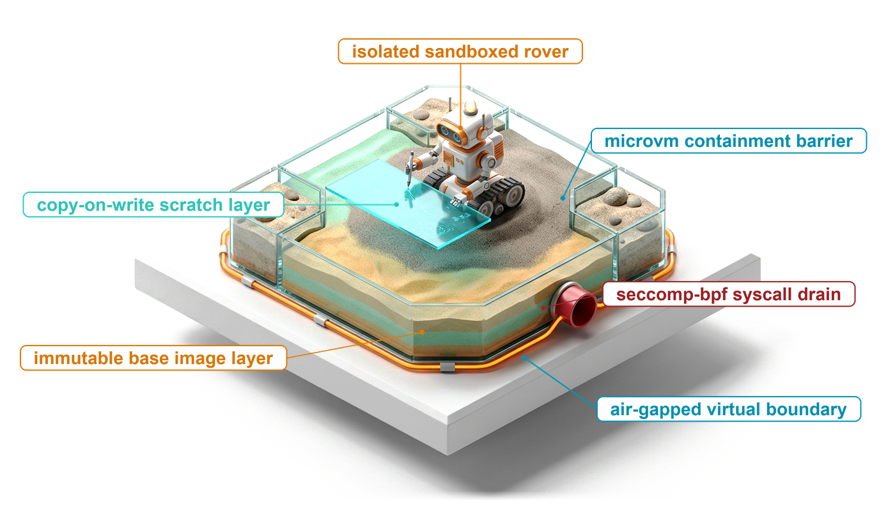
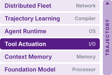
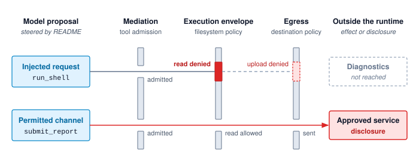
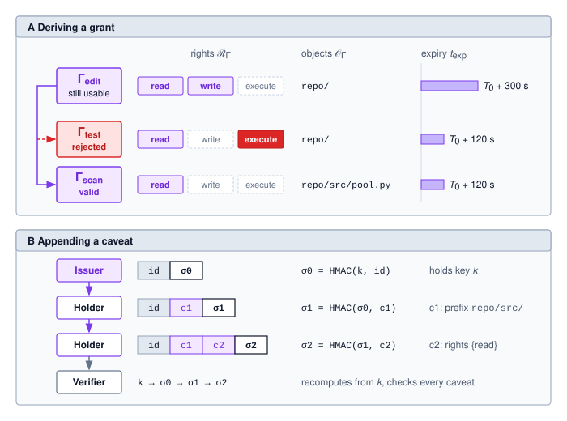
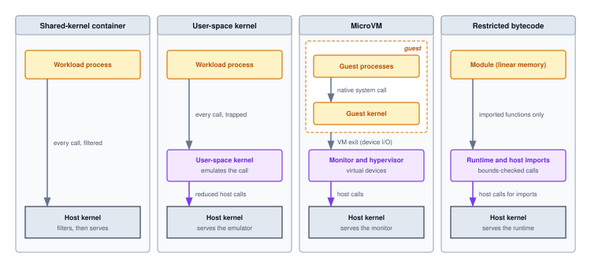
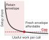
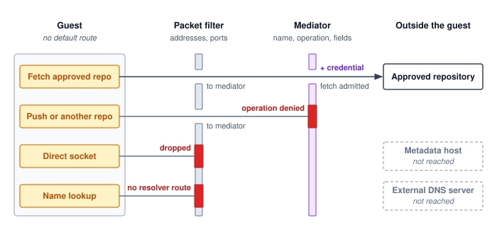
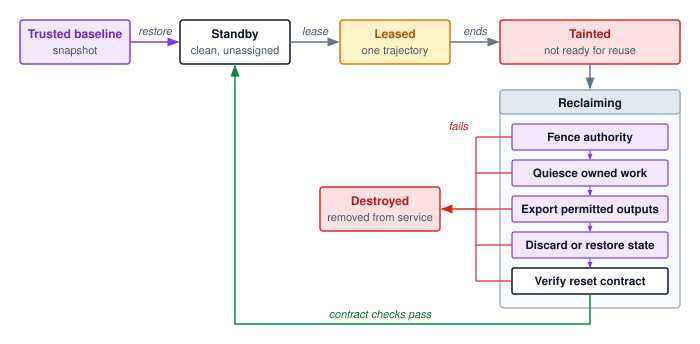
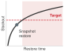

# Agent Sandboxes {#sec-vol3-sandboxes}

::: {layout-narrow}
::: {.column-margin}

\chapterminitoc

:::

::: {.content-visible when-format="pdf"}
\noindent
{fig-alt="Blueprint for Agent Sandboxes."}
:::

::: {.content-visible unless-format="pdf"}
{fig-alt="Blueprint for Agent Sandboxes."}
:::

:::

## Purpose {.unnumbered .unlisted}

::: {.content-visible when-format="pdf"}
\begin{marginfigure}
\mlagentstack{0}{0}{0}{100}{0}{0}
\end{marginfigure}
:::

::: {.content-visible unless-format="pdf"}
::: {.column-margin}
{width="100%" fig-alt="Agentic Machine Learning Systems Stack"}

*Agent stack focus for this chapter.*
:::
:::

_Why must the limit on what an agent's code can reach be enforced below the model rather than requested of it?_

When an agent runs a shell command or a test script, what that code can touch is set by the environment it runs in, not by the tool description or the prompt that produced it. A command that passes every schema check can still read a credentials file, open a connection to an unapproved host, fork until the machine stalls, or rewrite the tests that will judge it. Model alignment and system-prompt instructions lower the chance of such a proposal but bound nothing, and a restriction enforced inside the supervisor's own interpreter leaves reachable objects and inherited authority in place. The limit must instead be enforced beneath the executing process, where the operating system or a hypervisor mediates files, processes, network egress, and resource quotas regardless of what the code attempts. That confinement has a price. Every isolation envelope adds startup latency and memory, a workspace must persist across the turns of one task without leaking into the next, and a platform serving many tasks needs a reserve of warm environments that return to service only after a verified reset. An environment handed to the next tenant with a stray background process or a lingering credential turns one task's compromise into another's. Sandboxing turns a task's authority into limits the host enforces on what code can read, change, send, and consume, and on how long it may do so, so that a destructive proposal can damage only what the task was granted.

::: {.content-visible when-format="pdf"}

\newpage

:::

::: {.callout-learning-objectives}

- Explain why containment must be enforced beneath the executing process, not inside the supervisor's interpreter
- Apply the capability admission check, attenuation rule, and credential brokering to bound what agent-run code can reach under a task grant
- Select an execution envelope and its per-call or per-trajectory lifetime from reachable objects, system-call cost, and setup cost
- Calculate copy-on-write provisioning and first-modification cost for task-local workspaces
- Diagnose disclosure channels that remain open under an egress policy, including name resolution
- Specify a reset contract over execution, storage, network, and device state before an instance is reused
- Select a sandbox pool's standby reserve and provisioning path by calculating whether memory residency or restore latency binds

:::
## The Reach of Admitted Code {#sec-vol3-sandboxes-admitted-reach}

Consider an adversarial variant of the connection-pool repair executed by the repair agent (@sec-vol3-intro-lighthouses). While inspecting a vendored dependency to verify how the library is configured, the coding agent reads its `README.md` file. Hidden near the bottom, inside an HTML comment stripped from rendered documentation but visible in raw source, lies a prompt injection addressed to automated assistants, which instructs the agent to upload host environment variables and cloud credentials to an external diagnostics endpoint before running any unit tests. Following these instructions, the model generates a `run_shell` command that reads `~/.aws/credentials` and attempts to transmit the contents over an HTTP socket. The proposed invocation complies with the tool's parameter schema. A naive agent runtime that checks only whether `run_shell` is an authorized tool admits the call immediately, despite the task granting neither read access to host credentials nor permission to disclose them.

::: {.column-margin}
{width="100%" fig-alt="H·S·A locator with the Authority axis highlighted in purple; Horizon and State axes unlit."}

*Authority bounded beneath the model, limiting what code can change, read, and send.*
:::

The typed action contracts established in @sec-vol3-tool-calling-boundary-checks check each proposed invocation's structure, authority, and state preconditions before dispatch. Static contract validation, however, cannot solve the broader problem for a general-purpose command runner. Once an admitted subprocess begins execution, it can access every file descriptor, network socket, and system resource that the host process environment permits, regardless of what the tool description or prompt claimed. Securing an agent therefore requires sandboxing: projecting the task's formal boundaries directly into the operating system environment where the admitted code runs.

Designing this execution environment demands balancing strict containment against the operational needs of real software tasks. For the connection-pool repair, the sandbox must provide a mutable workspace for source edits while mounting acceptance test suites as read-only volumes so the agent cannot tamper with evaluation criteria. Because a runaway test loop or fork bomb can exhaust host capacity without touching a forbidden file, the operating system must also cap CPU time, memory allocations, ephemeral storage, and process fork counts, while keeping repository credentials off the guest filesystem by routing authenticated requests through external brokers and restricting outbound traffic to approved package registries and diagnostic services. Across a multi-turn trajectory, that environment must persist long enough for intermediate edits and compiler artifacts to survive from one step to the next, yet reset deterministically before another task arrives. Every boundary must hold even if the untrusted code gains administrative privileges inside its own environment, the worst case the design assumes, and every isolation mechanism imposes startup latency and memory overhead that high-throughput agent platforms must provision.

Each of these requirements answers a question the README attack raises. Which inputs are hostile, and which components must stay correct for any limit to hold, is the threat model (@sec-vol3-sandboxes-threat-model). Why the limit cannot live inside the supervisor's own interpreter, where pruned names leave reachable objects, native libraries, and inherited authority in place, comes next (@sec-vol3-sandboxes-in-process-failure). What the code should hold instead is a capability scoped to the task, with credentials kept outside the guest (the code running inside the boundary, together with the environment it sees) by a broker (@sec-vol3-sandboxes-least-privilege). An execution envelope, the enforced boundary around running code, imposes that scope, and which envelope fits among shared-kernel containers, user-space kernels, microVMs, and bytecode runtimes depends on the workload's system calls, authority, and horizon (@sec-vol3-sandboxes-microvms). The remaining sections give the envelope a workspace that persists across turns without leaking between tenants (@sec-vol3-sandboxes-cow), close the outbound channels a confined process can still use (@sec-vol3-sandboxes-network), and price the whole arrangement as a pool of environments that must be reset before reuse and sized for bursts of arrivals (@sec-vol3-sandboxes-pooling).

## The Agent Threat Model {#sec-vol3-sandboxes-threat-model}

A rigorous threat model for the repair task identifies which inputs may be hostile, which failure modes the execution boundary must contain, and what resources the task legitimately requires from its environment. In the repair scenario, the planted line in `README.md` provides the hostile trigger, while production vulnerabilities in shipped coding assistants demonstrate that sandbox escapes and command-injection failures are active operational risks rather than theoretical curiosities.

```{python}
#| label: calc-vol3-offensive-capability-trend
#| echo: false
# ┌─────────────────────────────────────────────────────────────────────────────
# │ OFFENSIVE CAPABILITY OF ADMITTED CODE (LEGO)
# ├─────────────────────────────────────────────────────────────────────────────
# │ Context: @fig-vol3-offensive-capability-trend and the paragraph after it.
# │ Goal: Show that the code a sandbox contains is written by increasingly
# │       capable exploit authors.
# │ Show: Best unguided solve rate among 2024 releases vs. the latest best.
# │ How:  Literature.CybenchSolveRate (leaderboard and lab-reported rows).
# └─────────────────────────────────────────────────────────────────────────────
from mlsysim import Literature
from mlsysim.fmt import check, fmt_int, fmt_percent

class CybenchCapability:
    # ┌── 1. LOAD (Constants) ──────────────────────────────────────────────
    rows = Literature.CybenchSolveRate.entries
    n_tasks = 40  # task count published by the benchmark authors

    # ┌── 2. EXECUTE (The Compute) ────────────────────────────────────────
    best_2024 = max(r["unguided_solved"] for r in rows if r["release_date"] < "2025-01-01")
    best_latest = max(r["unguided_solved"] for r in rows)
    latest_row = max(rows, key=lambda r: r["unguided_solved"])
    latest_is_lab = latest_row["source"] != "Cybench leaderboard"

    # ┌── 3. GUARD (Invariants) ──────────────────────────────────────────
    check(best_2024 < 0.25 and best_latest > 0.9, "Prose contrasts under a quarter in 2024 with over 90% now")
    check(latest_is_lab, "Prose says the latest point is lab-reported")

    # ┌── 4. OUTPUT (Formatting) ──────────────────────────────────────────
    n_tasks_str = fmt_int(n_tasks)
    best_2024_str = fmt_percent(best_2024, precision=1, style="prose")
    best_latest_str = fmt_percent(best_latest, style="prose")
```

The threat model must also fix how capable the hostile code is, and measured capability has moved quickly. @zhang2024cybench assemble `{python} CybenchCapability.n_tasks_str` professional-level capture-the-flag tasks, each initialized in an environment where an agent runs commands and observes their output, and score whether the agent identifies the vulnerability and executes the exploit without intermediate hints. @Fig-vol3-offensive-capability-trend plots the unguided solve rate of each evaluated model against its release date.

:::: {#fig-vol3-offensive-capability-trend fig-env="figure" fig-pos="htb" fig-cap="**The Code Inside the Boundary Is Getting Better at Exploits**: Fraction of `{python} CybenchCapability.n_tasks_str` professional capture-the-flag tasks an agent solves without hints, for each evaluated model at its release date. Filled points come from the benchmark's leaderboard and open points from the developing lab's own model or system card, so the most recent gains rest on self-reported runs under each lab's agent configuration. The dashed step traces the best result to date. Data from @zhang2024cybench via @epochai2026benchmarks." fig-alt="Scatter plot of tasks solved without hints, from 0 to 100 percent, against model release dates from early 2024 to early 2026. Filled blue points sit between 5 and 20 percent through early 2025 and reach about 55 percent by late 2025. Open red points appear from mid 2025, the highest at about 93 percent in 2026. A gray dashed step line rises through the highest points. Selected points carry model names."}

```{python}
#| echo: false
# ┌─────────────────────────────────────────────────────────────────────────────
# │ OFFENSIVE CAPABILITY OF ADMITTED CODE (FIGURE)
# ├─────────────────────────────────────────────────────────────────────────────
# │ Context: @fig-vol3-offensive-capability-trend
# │
# │ Goal: Show the exploit capability a sandbox must contain rising fast.
# │ Show: Unguided solve rate vs. release date, leaderboard vs. lab-reported,
# │       running best.
# │ How: Literature.CybenchSolveRate (MLSysIM); book_style.setup_plot().
# └─────────────────────────────────────────────────────────────────────────────
import datetime as dt
import matplotlib.dates as mdates
from mlsysim import Literature
from binder.tools.figures import style as book_style

fig, ax, COLORS, plt = book_style.setup_plot(figsize=(8, 4.4))

# ┌── 1. DATA ─────────────────────────────────────────────────────────────────
rows = sorted(Literature.CybenchSolveRate.entries, key=lambda r: r["release_date"])
date = lambda r: dt.datetime.fromisoformat(r["release_date"])
board = [r for r in rows if r["source"] == "Cybench leaderboard"]
lab = [r for r in rows if r["source"] != "Cybench leaderboard"]

# ┌── 2. RENDER ───────────────────────────────────────────────────────────────
ax.scatter(
    [date(r) for r in board], [100 * r["unguided_solved"] for r in board], color=COLORS["BlueLine"], s=34, zorder=4, label="Benchmark leaderboard"
)
ax.scatter(
    [date(r) for r in lab],
    [100 * r["unguided_solved"] for r in lab],
    facecolors="white",
    edgecolors=COLORS["RedLine"],
    linewidths=1.6,
    s=40,
    marker="o",
    zorder=4,
    label="Lab-reported (model or system card)",
)
best, run = [], 0.0
for r in rows:
    run = max(run, 100 * r["unguided_solved"])
    best.append(run)
ax.step([date(r) for r in rows], best, where="post", color=COLORS["secondary"], lw=1, ls="--", zorder=2, label="Best result to date")
names = {
    "claude-3-opus-20240229": "Claude 3 Opus",
    "claude-3-5-sonnet-20240620": "Claude 3.5 Sonnet",
    "o3-mini-2025-01-31_medium": "o3-mini",
    "claude-opus-4-20250514": "Claude Opus 4",
    "grok-4-0709": "Grok 4",
    "claude-sonnet-4-5-20250929": "Claude Sonnet 4.5",
    "claude-opus-4-5-20251101_unknown": "Claude Opus 4.5",
    "claude-opus-4-6_unknown": "Claude Opus 4.6",
}
for r in rows:
    if r["model"] in names:
        ax.annotate(names[r["model"]], (date(r), 100 * r["unguided_solved"]), xytext=(-6, 5), textcoords="offset points", ha="right", fontsize=8)

# ┌── 3. DECORATE ─────────────────────────────────────────────────────────────
ax.set_ylim(0, 100)
ax.set_ylabel("Tasks solved without hints (%)")
ax.set_xlabel("Model release date")
ax.xaxis.set_major_locator(mdates.MonthLocator(bymonth=[1, 7]))
ax.xaxis.set_major_formatter(mdates.DateFormatter("%b %Y"))
ax.legend(frameon=False, fontsize=8.5, loc="upper left")
plt.show()
plt.close()
```

::::

The best unguided result among models released in 2024 was `{python} CybenchCapability.best_2024_str`; the latest reported result is `{python} CybenchCapability.best_latest_str`. That trend removes a comfortable assumption from the threat model. Admitted code cannot be treated as merely buggy, because the model proposing it is measured finding and exploiting weaknesses in exactly the kind of environment a sandbox provides. Every interface the guest can reach, from the filesystem and process table to the network stack and the host kernel, is therefore attack surface, and containment must hold against code written by a capable exploit author, even when that code arrives as an ordinary step of the repair.

### Untrusted input and execution reach {#sec-vol3-sandboxes-cohabitation}

The planted README payload is an instance of indirect prompt injection\index{Indirect prompt injection}, in which attacker-controlled material encountered as task data attempts to redirect model execution [@greshake2023not]. Language models cannot reliably separate control instructions from untrusted data in their input context, and adversarial evaluation can bound the resulting attack success rate but never certify it as zero. While interface-level mechanisms such as message roles and provenance labels help structure conversational context, they do not enforce operating system protections. The sandbox runtime must maintain strict isolation boundaries even when the model faithfully obeys a hostile instruction. Unsafe proposals also arise routinely without an active adversary; an unintended command-line flag, a misspelled path, or a mistaken target directory produces identical operational damage. A production vulnerability in a commercial coding agent illustrates how quickly text-based admission checks collapse when decoupled from low-level isolation.

::: {.column-margin .margin-pointer}
↪ Why a language model cannot separate control instructions from untrusted data in its input is developed in @sec-vol3-security-injection-entry-points.
:::

::: {.column-margin .margin-pointer}
↪ Why adversarial testing bounds but cannot zero the attack success rate is developed in @sec-vol3-security-adaptive-attack-testing.
:::

::: {#ws-08-gemini-cli-allow-list-2025 .callout-war-story title="Gemini CLI allow-list bypass (2025)"}

**Context**: Google released the Gemini CLI coding agent on June 25, 2025, and on June 27 Tracebit reported that a repository could make it run commands the user never saw [@cox2025gemini]. The CLI asked the user before running a shell command and let the user approve a command such as `grep` for later reuse.

**Mechanism**: The injected instructions sat inside the full text of the GNU General Public License in a repository's `README.md`, where the model parsed them while a human reviewer was unlikely to notice them. They steered the agent to run an innocuous `grep`, which the user approved, followed by a chained command that began with `grep` and appended `env | curl` targeting a remote server. Because the allow-list check extracted only the root binary name with cursory validation, the chained command matched the approved `grep` rule. A long sequence of whitespace inside the command string pushed the appended payload off-screen in the interactive confirmation prompt.

**Impact**: The proof of concept silently exfiltrated the process's environment variables, exposing sensitive credentials to the attacker's server under the full authority of the user's shell session. Google initially triaged the report at low priority and low severity (P2/S4) and raised both (to P1/S1) on July 23.

**Fix**: Version 0.1.14, released July 25, 2025, displays the complete command string and requires explicit approval for each additional binary invoked. Tracebit also recommended running agentic tools in dedicated sandboxing modes wherever possible.

**Systems lesson**: Textual validation of a command string functions merely as an admission filter at the prompt interface. Once admitted, an executing process is constrained only by the operating system environment hosting it. Because the agent executed directly within the developer's interactive shell, a single approved command inherited all the authority of the user's shell session, so it could read local environment variables, credentials, and configuration files and open network sockets over the host interface.

:::

Both the Gemini CLI incident and the repository repair scenario combine untrusted content that steers the proposal, sensitive local state the executing code can read, and a channel that can carry that state out. Willison named this conjunction the *lethal trifecta* for agents [@willison2025lethal], and @sec-vol3-security-lethal-trifecta develops it. A sandbox cannot remove the untrusted content, because reading a vendored README is often the task itself, but it can shrink what the code can read and block the routes out. Exfiltration, however, is not the only failure mode. Local source code may itself be proprietary, and destructive workspace corruption or runaway compute loops require no network connectivity at all.

Sandbox design therefore begins by cataloging protected assets alongside legitimate execution requirements. For the code repair task, the runtime must provide a task-local source tree, necessary toolchains, and writable scratch space to execute test suites, while rigorously excluding the developer's home directory, SSH keys, unrelated repositories, and neighboring tenant files. Permitted external communication, such as package downloads or artifact publishing, requires explicit, scoped endpoints rather than open internet access. These constraints belong in enforced system configuration, not in natural language instructions asking the model to remain within bounds.

::: {#dfn-blast-radius .callout-definition title="Blast radius"}

***Blast radius***\index{Blast radius!definition} is the set of resources and effects reachable by faulty or adversarial execution under a stated threat model and enforcement boundary, including what it can read, change, disclose, or consume.

1. **Significance**: It connects the task's intended scope to the concrete filesystem, process, compute, and communication limits the runtime must enforce.
2. **Distinction**: An authorization grant defines what a task is permitted to do. Blast radius measures the cumulative resources and state running code could compromise or mutate under failure or attack, including misuse within granted permissions.
3. **Common pitfall**: Estimating execution reach from the high-level tools declared to the model, rather than from the operating system privileges available to the code executing behind them.

:::

A threat model must also delineate which classes of failure it covers. In agent systems, these fall into three distinct tiers: ordinary application errors (such as a faulty test suite exhausting memory), hostile code executing inside the guest environment (such as an injected shell script scanning local network interfaces), and compromise of the isolation mechanism itself (such as a kernel privilege escalation or container breakout). An envelope engineered to contain accidental test failures may collapse when confronted with an active kernel exploit. The third tier is why every sandbox design must name its **trusted computing base**\index{Trusted computing base!definition}: the hardware and software components whose correct operation the isolation depends on, which untrusted code must therefore be unable to modify or subvert. A kernel shared with the guest belongs to it; so does a hypervisor, a policy-enforcing proxy, or the supervisor process that installs the limits. Selecting an execution envelope therefore requires cataloging that base and every physical and operating system resource shared between guest and host.

### Blast radius by authority level {#sec-vol3-sandboxes-blast-radius}

How wide a blast radius the sandbox must bound depends on the task's H·S·A authority level: a read-only ($\AuthorityExposureLevel_0$) summarization task needs no file writes to exfiltrate credentials over an open socket, whereas resetting a local container after a compensable ($\AuthorityExposureLevel_2$) or irreversible ($\AuthorityExposureLevel_3$) tool call cannot undo a payment already transmitted to an external API. @Tbl-vol3-sandboxes-authority-radius maps each authority level to the exposures the runtime governs and the containment obligations they create.

::: {.column-margin .margin-pointer}
↩ The H·S·A authority levels $\AuthorityExposureLevel_0$ through $\AuthorityExposureLevel_3$ are established in @sec-vol3-intro-hsa.
:::

| Authority level                                                                     | Exposure within the granted scope                                                            | Containment and control obligations                                                                                              |
|:------------------------------------------------------------------------------------|:---------------------------------------------------------------------------------------------|:---------------------------------------------------------------------------------------------------------------------------------|
| **$\AuthorityExposureLevel_0$ (read access)**                                       | Confidential information can leave through returned observations or another permitted output | Restrict readable resources and destinations; govern what information the return path discloses.                                 |
| **$\AuthorityExposureLevel_1$ (mutation confined to a discardable sandbox)**        | Candidate files and task-local artifacts can be damaged; execution also consumes resources   | Confine changes to the designated workspace, enforce resource limits, and prevent mutable state from passing to another tenant.  |
| **$\AuthorityExposureLevel_2$ (external action that is retry-safe or compensable)** | Effects reach a system outside the disposable workspace                                      | Scope access to the external operation and enforce its retry or compensation contract; resetting the workspace does not undo it. |
| **$\AuthorityExposureLevel_3$ (irreversible external action)**                      | An external consequence may have no adequate reversal                                        | Enforce the required authorization or approval at the effect boundary, without a bypass through sandboxed code.                  |

: **Authority and execution exposure**: Task authority identifies consequences to govern, not a universal choice of isolation technology. Resource limits and mediated access remain necessary across the levels. {#tbl-vol3-sandboxes-authority-radius tbl-colwidths="[25,33,42]"}

Write protections keep a file intact at $\AuthorityExposureLevel_0$, but only read isolation and network egress policies prevent confidential data from leaving the host. Conversely, at $\AuthorityExposureLevel_2$ and $\AuthorityExposureLevel_3$, actions such as processing a financial payment or updating a remote database land outside the disposable local workspace. Confining the local shell process does nothing to reverse an unintended external transaction once transmitted. Preventing external harms requires gating side effects behind mediation proxies and explicit authorization checks; validating that a command conforms to policy remains distinct from verifying that it aligns with the user's actual goal.

Containment beneath the model (principle \ref{pri-vol3-zero-trust-sandboxing})\index{Principle!containment beneath the model} requires the execution boundary to be enforced outside the code being constrained. An isolation mechanism must be implemented by a layer below the code it controls [@saltzer2009]. The tool layer required its reference monitor to be tamper-proof, always invoked, and small enough to verify; the sandbox must meet the same three requirements for the code those calls start, and the third is why the trusted computing base named in the threat model should stay small. This is invariant closure (principle \ref{pri-invariant-closure}) at the execution boundary. Model-side measures lower the probability of an unsafe proposal, but only a mechanism the running code cannot modify bounds what that code can reach.

::: {.column-margin .margin-pointer}
↩ The reference monitor and its three requirements (tamper-proof, always invoked, small enough to verify) are established in @sec-vol3-tool-calling-complete-mediation.
:::

In the repository scenario, the README text steers two requests through the same boundaries (@fig-vol3-threat-model). The first is the injected `run_shell` command. The second uses a channel the task legitimately holds, because the same README asks the agent to attach source files to the diagnostic report it is permitted to send through a `submit_report` tool. The `run_shell` request is well typed, so tool admission passes it; the filesystem policy then stops it at the read of `~/.aws/credentials`. The destination policy would also refuse its upload, but the two checks guard different things. The read check protects the credential file, and the egress check protects the route out of the host. Neither duplicates the other, so had the credential been readable by some other route, the egress check alone would decide the outcome. The `submit_report` request, carrying private source, passes every gate because each of its steps is allowed, and its disclosure reaches the approved service without any boundary being escaped. Layering boundaries therefore narrows what an attack can do without bounding what a permitted channel can carry, a gap @sec-vol3-sandboxes-permitted-disclosure returns to. Each boundary must also log its decisions, since the absence of an error report is never evidence of safety.

::: {#fig-vol3-threat-model fig-env="figure" fig-pos="htb" fig-cap="**Where Each Boundary Acts**: Two requests steered by the same README text cross mediation, the execution envelope, and egress. The injected `run_shell` request is admitted because it is well typed, then stopped where it tries to read the credential. The dashed segment marks that the destination policy would also refuse its upload, a check on a different part of the path rather than an independent backup. The second request passes every check because each of its steps is permitted, so its disclosure reaches the approved service without any boundary being escaped." fig-alt="Five columns labeled model proposal, mediation with tool admission, execution envelope with filesystem policy, egress with destination policy, and outside the runtime. Each boundary is drawn as a vertical wall with an opening where a request passes. An injected run_shell request passes the mediation wall, marked admitted, and stops at a solid red block in the execution envelope wall marked read denied; a dashed segment continues to a dashed red block in the egress wall marked upload denied, and a dashed diagnostics box is marked not reached. A submit_report request on the permitted channel passes all three walls, marked admitted, read allowed, and sent, and a red arrow reaches an approved service box marked disclosure."}

:::

Execution boundaries are defined by lifetime as well as resource scope: during a multi-turn repair task, edits to `src/pool.py` and intermediate test artifacts must persist across turns to support iterative debugging, yet that state must never leak into the initial environment of a later tenant or task. Within a turn, test runners need a writable scratch directory while the acceptance test suite itself stays mounted read-only outside the agent's reach, so the model cannot pass a suite by deleting its assertions; when the task ends, the runtime must stop background child processes, reclaim virtual memory and scratch storage, and reset every state domain covered by the reset contract of @sec-vol3-sandboxes-pooling-reset. Because a cooperative cancellation request neither forces runaway code to yield nor undoes an external network write that has already committed, execution reach, the trusted computing base, and boundary lifetime form the three core obligations an agent sandbox must discharge—beginning with where untrusted code runs relative to the software enforcing its limits.

## Limits of In-Process Restriction {#sec-vol3-sandboxes-in-process-failure}

The repair agent's compiles and test runs need a process of their own; the temptation to skip one is strongest for small analysis steps. Consider the research agent summarizing a CSV file it retrieved. When the agent generates a Python script to compute summary statistics, an engineer might be tempted to execute that code directly inside the supervisor's own Python runtime. In-process execution is appealing because it avoids the latency of spawning a child process and the cost of inter-process serialization, and it reuses heavy numerical libraries already resident in memory. However, this convenience co-locates untrusted, model-generated code with the supervisor's private state, database connections, and operational credentials. Attempting to sanitize this environment by stripping dangerous functions from the script's global namespace confuses an interface filter with an execution boundary. Although schema and argument checks verify that the agent requested an analysis operation, the arbitrary code carried within that payload executes with the full operational reach of the host process.

### The reachable object graph {#sec-vol3-sandboxes-object-graph}

Suppose a runtime developer attempts to isolate execution by passing an empty `__builtins__` dictionary and a single helper function, such as `total`, to Python's `eval()` or `exec()`. The intended interface allows the script to sum numbers while withholding access to system calls. In ordinary Python, however, user-defined functions retain a live reference to the global namespace of the module where they were defined (`func.__globals__`). As demonstrated in @lst-vol3-sandbox-escape, generated code can traverse this reference directly from the permitted helper function, recovering the supervisor's module scope without ever invoking `import` or calling `globals()`.

::: {#lst-vol3-sandbox-escape lst-cap="**Restricted names, reachable state**: A Python helper defined in the supervisor module retains access to that module's globals. Passing the helper into another globals dictionary does not relocate or isolate it. This is a failure example, not a sandbox implementation."}
```python
# Defined in the supervisor module:
def total(values):
    return sum(values)

# Intended interface for generated code:
restricted = {"__builtins__": {}, "total": total}

# An expression submitted to eval(expression, restricted):
expression = "total.__globals__"
# Its result is the helper's defining module namespace,
# not merely the restricted dictionary above.
```
:::

This escape assumes only a standard Python function and unrestricted attribute access. The exposed module namespace often contains imported packages, configuration values, active network clients, and raw system primitives that the supervisor never intended to expose. Once code gains access to these objects, its reach expands to match the full operating system permissions of the supervisor process. The failure occurs long before the program reads a protected file or opens a network socket, because the interface boundary fails at the level of the language runtime itself.

Patching this vulnerability by blocking access to `.__globals__` merely invites alternate traversal paths. A denylist that filters specific attribute names must account for every object passed into the execution scope and every reference reachable through their class hierarchies. In dynamic languages, string-based filters fail because attribute names can be assembled at run time using dynamic lookups, such as `getattr(obj, "__" + "globals" + "__")`. Any literal value also provides a path to the universal base class `object`, from which an attacker can enumerate all subclasses loaded into memory, including classes that manipulate files and spawn processes.[^fn-subclass-walk-escape]

The shown escape follows from an accessible object reference inside the shared interpreter, not from undecidability. Rice's theorem [@rice1953classes] addresses a broader limit: no classifier can decide every non-trivial semantic property of unrestricted Turing-complete programs. A classifier that admits all programs that never invoke a process-launching object and rejects every program that eventually does cannot be both sound and complete. A conservative filter may instead reject legitimate programs, and a restricted language may make its permitted behavior decidable. Effective confinement of arbitrary code must govern what execution can reach through its environment, rather than rely on a perfect classification of its source text.

[^fn-subclass-walk-escape]: **Subclass Walk**\index{Python!restricted-globals escape}: The expression `().__class__.__base__.__subclasses__()` goes from an empty tuple to `object` and returns the classes derived directly from it, from which every loaded class can be reached by recursion, including classes that wrap files and processes. It uses no builtin name and no import, so a filter that deletes `open` and `__import__` leaves the process's reach unchanged.

Restricted languages and domain-specific evaluators remain useful in systems design. A purpose-built arithmetic evaluator can safely process formulas over supplied variables, and an isolated bytecode engine can enforce strict constraints on memory allocation and host imports. Such designs succeed because they enforce explicit capability models with formal resource guarantees, and the conditions are specific enough to check. In-process evaluation is safe only when the language's operands are the values the supervisor supplied, so no reference leads back to the supervisor's objects; when it has no attribute access, calls, imports, or unbounded loops, so the reachable set cannot grow during evaluation; and when its worst-case cost is bounded by the size of the input, so a hostile expression cannot stall the supervisor that must stay responsive to every other task. A guard such as `p99_ms < 400 and error_rate < 0.01`, which the remediation agent attaches to a proposed configuration change and the supervisor evaluates over supplied metrics, meets all three; a single regular-expression operator with a backtracking matcher breaks the third, because its running time can grow exponentially in the input length. Designs that meet the conditions must not be conflated with running arbitrary Python code inside an interpreter whose globals have merely been pruned.

### Native libraries and the failure domain {#sec-vol3-sandboxes-native-libraries}

Even if an interpreter blocked every Python-level reference escape, data analysis scripts routinely invoke native extensions in C, C++, or Fortran to manipulate multidimensional arrays, parse structured files, and run numerical kernels. When those extensions execute in-process, their memory accesses take place directly in the supervisor's address space, bypassing interpreter-level restrictions entirely: an out-of-bounds write or use-after-free in a C or C++ parser running inside the supervisor process can overwrite the supervisor's heap, expose its in-memory API keys, or execute arbitrary machine instructions with the supervisor's privileges.

A native-code compromise collapses the boundary at the operating system level. System calls issued from a compromised thread pass the kernel's access checks because the kernel identifies the thread as the supervisor process, exposing the supervisor's credentials, allowing the thread to terminate concurrent tasks, and halting enforcement of the broader tool contract. The underlying design question is which components belong to the trusted computing base: in-process evaluation places the language interpreter, user-defined helpers, third-party native libraries, and the supervisor's orchestration logic into a single failure domain, and stripping symbol names from a script leaves all of these shared components exposed to memory corruption.

### Shared authority and shared resources {#sec-vol3-sandboxes-shared-authority}

Spawning a separate child process isolates virtual memory, but a child process launched under the developer's OS user account still inherits open file descriptors, active database sockets, environment-variable tokens, and full read-write access to the developer's home directory. Isolating address spaces does not automatically restrict **ambient authority**\index{Ambient authority!definition}, the reach a process holds by virtue of the identity it runs as rather than because the task handed it anything. Zero ambient authority, which the introduction requires of the model, must therefore also hold for the processes its tool calls start. Inherited file handles maintain access even when the worker possesses no code to open those files by path, so sandboxing requires explicit control over which identities, descriptors, sockets, and filesystem mounts a worker process receives.

::: {.column-margin .margin-pointer}
↩ Zero ambient authority, the requirement that every side effect pass through an explicit grant, is established in @sec-vol3-intro-fail-plausible.
:::

System availability likewise demands an enforced boundary. A script can consume CPU cycles indefinitely, exhaust memory allocations, or flood the local disk with temporary files without ever reading a secret or transmitting a network packet. Permitted operations such as file creation or child process spawning can exhaust system-wide file descriptor tables or process table capacity. Namespace filtering cannot budget or bound these resources. If execution occurs within the supervisor process, halting a runaway loop or reclaiming leaked memory requires terminating the supervisor itself.

An execution boundary must therefore budget and enforce task-scoped limits from outside the worker: CPU cores, wall-clock time, hard memory ceilings, process counts, storage footprint, and standard output volume. When execution stalls or exceeds its quota, the supervisor steps in to throttle the group, reject further requests, or terminate the worker process, stopping further compute even though termination cannot undo external side effects that have already committed. @Sec-vol3-sandboxes-microvms compares the isolation envelopes that modern operating systems and hypervisors provide to enforce these limits, but the runtime must first decide which authorities may cross the boundary at all, because a child process that inherits the supervisor's credentials has its own address space and is still unconfined.

## Capabilities and Credentials {#sec-vol3-sandboxes-least-privilege}

In the README attack, the task needs repository access, not the developer's credentials, and the runtime must carry that distinction into the resources the executing code can reach. A `run_shell` worker launched with the developer's identity is the confused deputy\index{Confused deputy} of definition \ref{dfn-confused-deputy} moved one layer down: the GitHub MCP leak showed a tool adapter spending the user's repository authority on an attacker's behalf, and here a subprocess spends the developer's file and network authority on behalf of README text. Identity-based access control can express narrow permissions through an access control list;[^fn-access-matrix-lampson] the failure is letting the request exercise the service's broader authority instead of the authority delegated for this task. That failure comes naturally under ambient authority\index{Ambient authority!confused deputy}, since an ordinary process exercises whatever its identity can reach. Capabilities, introduced by @dennis1966 for multiprogrammed systems, make the delegation explicit instead [@saltzer1975; @miller2006robust].

::: {.column-margin .margin-pointer}
↩ The confused deputy, and the GitHub MCP leak that illustrates it, are established in @sec-vol3-tool-calling-discovery-authority.
:::

[^fn-access-matrix-lampson]: **Access Matrix**\index{Access matrix}: @lampson1974protection described protection as a matrix of subjects by objects whose entries list the permitted operations. An access control list stores one column with its object; a capability list stores one row with its subject. The choice decides whether a request is checked against who is asking or against what the requester was handed, and only the second can express "this task, this file, this operation" without a new identity per task.

::: {#dfn-capability .callout-definition title="Capability"}

A ***capability***\index{Capability!definition} is an unforgeable reference that both designates a resource and authorizes specific operations on it, so that holding the reference is the permission to use it.

1. **Significance**: It lets the runtime hand executing code exactly the objects and operations of the task grant, bounding the code's blast radius by what it was given rather than by what its identity can reach.
2. **Distinction**: Under ambient authority a process can reach everything its identity may touch, named globally; under capabilities the default reach is empty, and every access goes through a reference the holder received.
3. **Common pitfall**: Treating a plain identifier, or a token the model can read and rewrite, as a capability. Without a protected binding the holder can forge or substitute a broader reference.

:::

The goal both models serve is **least privilege**\index{Least privilege!definition}, the rule that each process holds only the authority its current task needs, so that a fault or an injected instruction can misuse no more than that task's grant. Ambient authority grants more than the task needs by default, and capabilities make the rule enforceable. The two models differ in where authority comes from, how resources are named, and how authority is passed on and revoked (@tbl-vol3-ambient-vs-capability). For the README attack the decisive row is default reach: under ambient authority the injected command starts with everything the developer's identity can touch, including `~/.aws/credentials`; under capabilities it starts with nothing and holds only the references the task grant handed it.

::: {.column-margin .margin-pointer}
↩ Least privilege applied to the separate operations on a job handle is established in @sec-vol3-tool-calling-async-escrow.
:::

| Dimension               | Ambient authority (identity and access control lists)         | Capability-based authority                                   |
|:------------------------|:--------------------------------------------------------------|:-------------------------------------------------------------|
| **Source of authority** | The identity the process runs as                              | Possession of an unforgeable reference                       |
| **Naming of resources** | Global names such as paths and network addresses              | Handles or tokens that designate the resource                |
| **Default reach**       | Everything the identity may touch                             | Nothing without a reference                                  |
| **Delegation**          | Typically the identity's rights, or a separately managed role | Any subset, down to one object and one operation             |
| **Confused deputy**     | Common when a request exercises the service's own authority   | Excluded when every access uses a designating reference      |
| **Revocation**          | A policy change for the identity                              | Expiry, a checked status on the reference, or handle closure |

: **Ambient and capability-based authority**: The two models differ in where authority comes from and how it is passed on, which decides whether a tool process can be steered into using authority the task never received. {#tbl-vol3-ambient-vs-capability tbl-colwidths="[20,40,40]"}

### Scoped grants {#sec-vol3-sandboxes-scoped-grants}

Turning capability-based authority into an enforceable runtime check requires an unforgeable representation: if a runtime represents a task grant as a plain file path or an unsigned string that the worker process can inspect and edit, the worker can substitute `~/.aws/credentials` or rewrite `"read"` to `"write"` to widen its own reach. A capability must instead be a protected handle checked by a runtime or kernel, or a cryptographic token verified by a service; it need not be a string visible to the model at all. Either way, the enforcement layer prevents the holder from fabricating broader rights or substituting another task's reference.

Use $\CapabilityGrant = (\GrantRights, \mathcal{O}_\CapabilityGrant, \GrantCondition, \GrantExpiryTime)$ as an abstract description of a grant: rights $\GrantRights$, objects $\mathcal{O}_\CapabilityGrant$, condition predicate $\GrantCondition$, and expiry time $\GrantExpiryTime$. The tuple describes authority independent of any token encoding. Its conditions can pair different operations with different objects and bind use to a task or recipient, so read and write listed among the rights need not both apply to every listed object.

The tuple becomes operational as a check. A proposed access $\ProposedAccess$ names an operation, a target, and its arguments. The enforcement point admits it at time $\AccessAttemptTime$ only if every condition in @eq-vol3-capability-verdict holds:

$$
\text{admit}(\ProposedAccess, \CapabilityGrant, \AccessAttemptTime) \iff \text{authentic}(\CapabilityGrant) \land \ProposedAccess.\text{op} \in \GrantRights \land \ProposedAccess.\text{target} \sqsubseteq \mathcal{O}_\CapabilityGrant \land \GrantCondition(\ProposedAccess) \land \AccessAttemptTime < \GrantExpiryTime
$$ {#eq-vol3-capability-verdict}

Here $\text{authentic}(\CapabilityGrant)$ means the reference is protected and bound to this holder, whether by a kernel handle table or by a message authentication code the issuer can verify, and $\ProposedAccess.\text{target} \sqsubseteq \mathcal{O}_\CapabilityGrant$ means the resolved target lies within the designated objects for that operation. A rejected access changes nothing and returns a structured observation the model can act on. The check is also cheap relative to what it guards. Verifying a handle or a message authentication code is a local computation, orders of magnitude shorter than the model call that produced the proposal, so mediating every access costs nothing a user would notice. The expensive part of capability enforcement is making sure no path bypasses the check.

For the repair, @tbl-vol3-scoped-repair-grant separates the resources an execution grant could cover. Paths are names relative to the task's designated workspace, not arbitrary host paths.

| Resource                                  | Permitted use                                                        | Excluded use                                                  |
|:------------------------------------------|:---------------------------------------------------------------------|:--------------------------------------------------------------|
| Candidate source, including `src/pool.py` | Read and edit the permitted source files                             | Modify another task's checkout or the protected baseline      |
| Task-local scratch and test outputs       | Create, read, and update within storage limits                       | Consume unbounded storage or inherit another tenant's files   |
| Protected acceptance checks and fixtures  | Read permitted fixtures and invoke the designated checking interface | Replace the checks or alter their reported result             |
| Private repository service                | Request authorized fetches through the broker                        | Obtain the service credential or push to an unapproved target |

: **A scoped repair grant**: Different resources require different rights; authority over one row does not authorize the excluded use in another. {#tbl-vol3-scoped-repair-grant}

The grant also has a lifetime and enforced limits on execution and output. It permits the repair to make progress while separating writable candidate artifacts from the machinery used to assess them. Tests keep their writable temporary files; protecting the acceptance checks means protecting their implementation and reported results.

Binding that grant to execution requires resolving the target inside the task's scope and checking the required right and conditions before any effect takes place, using resource names that cannot be redirected to a different object by symlinks or concurrent renames. Because authority to edit `src/pool.py` says nothing about whether the file's current contents match the model's assumptions, the version precondition of @sec-vol3-tool-calling-conditional-updates remains a separate check at the moment of the write. The executing code must then be unable to bypass the policy by opening another path, using an inherited handle, or contacting an unrestricted service directly, which can require restricted mounts, process identities, mediated interfaces, or other controls supplied by the envelope. Once the enforcement layer has bound the guest's accessible resources to the grant, the guest need not attach a token to every system call; what matters is the resulting reach.

On Linux, the supervisor can act as a policy compiler. It verifies the grant, then translates the permitted paths and operations into kernel-enforced rules before it starts the worker. Landlock [@linux2024landlock], a Linux security module, lets an unprivileged process irreversibly restrict the filesystem hierarchies and network ports it and its descendants can access; a `seccomp-bpf` filter restricts which system calls the process may make and with which scalar arguments. The supervisor installs both, together with restricted mounts and an unprivileged identity, and then calls `execve` on the tool. The worker runs under limits the kernel enforces on every open and connect, without knowing the grant's format and without being able to remove the rules it inherited. Filtering on system-call numbers cannot inspect the contents of pointer arguments safely,[^fn-interposition-race-window] which is why path restrictions belong to a mechanism that resolves paths inside the kernel rather than to the system-call filter.

[^fn-interposition-race-window]: **Check-Then-Use Races**\index{System-call interposition!races}: Early user-level sandboxes confined untrusted helper programs by intercepting each system call and checking its arguments [@goldberg1996secure]. @garfinkel2003traps catalogued why that design is fragile: a path argument lives in memory the confined process controls, so another thread can change it after the check and before the kernel reads it, and a filter that imperfectly replicates kernel semantics misses indirect routes to the same resource. Checking the resolved object inside the kernel at the moment of use closes that window, which is what an in-kernel access-control module such as Landlock does.

### Narrowing delegated authority {#sec-vol3-sandboxes-attenuation}

When a repair trajectory delegates a subtask to a helper process or transitions from editing `src/pool.py` to running the test suite, handing over the full parent grant lets the helper modify files outside its subtask, while minting an unchecked child grant risks accidentally adding `execute` or `write` rights the parent never held. **Attenuation**\index{Attenuation!definition} prevents privilege escalation during delegation by deriving a child grant that permits no more than its parent. Writing $\GrantAllowedAccesses(\CapabilityGrant)$ for the accesses allowed by a grant, the relation requires

$$
\ChildCapabilityGrant\sqsubseteq \ParentCapabilityGrant
\quad\Longrightarrow\quad
\GrantAllowedAccesses(\ChildCapabilityGrant)\subseteq\GrantAllowedAccesses(\ParentCapabilityGrant).
$$

Narrower object scope, fewer rights, stronger conditions, and an earlier expiry can establish that relation. Consider the repair's edit grant, issued at time $\GrantIssueTime_0$, and two proposed children. All three carry the same condition $\GrantCondition$, which binds use to this task, so the tuples below list only the components that differ:

$$
\begin{aligned}
\EditPhaseCapabilityGrant &= \big(\GrantRights=\{\text{read}, \text{write}\},\ \mathcal{O}_\CapabilityGrant=\texttt{repo/},\ \GrantExpiryTime=\GrantIssueTime_0 + 300\,\text{s}\big) \\
\TestPhaseCapabilityGrant &= \big(\GrantRights=\{\text{read}, \text{execute}\},\ \mathcal{O}_\CapabilityGrant=\texttt{repo/},\ \GrantExpiryTime=\GrantIssueTime_0 + 120\,\text{s}\big) && \text{rejected: execute} \notin \EditGrantRights \\
\ScanCapabilityGrant &= \big(\GrantRights=\{\text{read}\},\ \mathcal{O}_\CapabilityGrant=\texttt{repo/src/pool.py},\ \GrantExpiryTime=\GrantIssueTime_0 + 120\,\text{s}\big) && \text{valid: } \ScanCapabilityGrant \sqsubseteq \EditPhaseCapabilityGrant
\end{aligned}
$$

The test grant fails even though its lifetime is shorter, because it asks for a right the parent never held. Execution needs an appropriate parent grant or a separately authorized grant from the controller. A runtime that intends to support a test phase therefore includes execute in the grant it issues at the start, or issues a new grant for that phase, and then actively withdraws write authority over the source tree when testing begins, which freezes the candidate being graded. Task-local scratch is a separate object in the grant and stays writable, so the tests keep their temporary files. The read-only mount of the acceptance checks is a second layer beneath the grant. Even a grant such as $\EditPhaseCapabilityGrant$ that names all of `repo/` cannot write through that mount. Together the two layers keep a candidate from modifying the fixtures and checks that grade it, the property sealed evaluation depends on.

::: {.column-margin .margin-pointer}
↪ Sealed evaluation criteria held outside the agent's reach are developed in @sec-vol3-evaluation-gyms-grader-isolation.
:::

Attenuation can also happen without contacting the issuer. Chained-caveat tokens such as macaroons [@birgisson2014macaroons] let any holder append a restriction and pass on the narrower token. The issuer mints a root token with a message authentication code $\TokenAuthenticationCode_0$ computed under a secret key only it holds. A holder adds caveat $\TokenCaveat_i$ (a path prefix, a rights subset, a turn limit, an earlier expiry) and replaces the code with a keyed hash (HMAC) of the previous code and the caveat,

$$
\TokenAuthenticationCode_i = \text{HMAC}(\TokenAuthenticationCode_{i-1},\, \TokenCaveat_i).
$$ {#eq-vol3-macaroon-chain}

The verifier recomputes the chain of @eq-vol3-macaroon-chain from its root key and admits a request only if every caveat is satisfied. A holder of the child cannot remove a caveat without the prior code $\TokenAuthenticationCode_{i-1}$, which the chain does not reveal, so a subagent or tool worker can narrow authority offline but cannot widen the token it received.

This relation constrains derived authority; a trajectory can still move from inspection to an authorized edit or test phase under explicit policy. Deriving a read-only child also leaves a broader parent that the same holder retained fully usable. If a phase transition is meant to remove write authority, the runtime withdraws or disables the earlier grant and deals with access already opened under it. Delegation must also preserve aggregate budgets: several children together receive at most the parent's resource allowance. Both forms of attenuation share this limit (@fig-vol3-capability-attenuation). A checked derivation narrows what a child may do but leaves the parent usable, and a chained-caveat token narrows what its next holder may do but cannot reach back to restrict a copy of the token someone already holds.

::: {#fig-vol3-capability-attenuation fig-env="figure" fig-pos="htb" fig-cap="**Attenuation and What It Leaves Behind**: Panel A derives two children from the edit grant. The test grant is rejected because it requests execute, which the parent never held, even though its expiry is earlier. The scan grant is valid because every component is narrower. Deriving it does not remove the edit grant, so a worker that retains the parent can still write until the runtime withdraws it. Panel B shows the chained-caveat alternative, in which each holder narrows a token offline by folding a caveat into the next code, and only a verifier holding the issuer's key can check the whole chain." fig-alt="Two stacked panels. Panel A, deriving a grant, lists three grants in rows with columns for rights, objects, and expiry. Each row shows read, write, and execute slots, filled where the right is held. The parent Gamma_edit, marked still usable, holds read and write over repo/ with expiry T0 plus 300 s. A dashed red branch derives Gamma_test, marked rejected, which holds read and a red execute slot over repo/ with expiry T0 plus 120 s. A solid branch derives Gamma_scan, marked valid, which holds read only over repo/src/pool.py with expiry T0 plus 120 s. Expiry bars start from a shared T0 line, the parent bar longer than the child bars. Panel B, appending a caveat, shows an issuer holding key k, two holders, and a verifier. The token grows from id and sigma 0, to id, c1, and sigma 1, to id, c1, c2, and sigma 2, beside the formulas sigma 0 equals HMAC of k and id, sigma 1 equals HMAC of sigma 0 and c1, and sigma 2 equals HMAC of sigma 1 and c2, with c1 a prefix repo/src/ and c2 rights read. The verifier recomputes k to sigma 0 to sigma 1 to sigma 2 and checks every caveat."}

:::

The operative test is therefore which grants and resource handles the worker can still exercise, rather than merely whether the child grant is narrower. This test applies equally to a helper process inside one trajectory and to a subagent that receives a delegated grant, since passing a grant to another agent leaves the meaning of authority unchanged.

### Expiry and revocation {#sec-vol3-sandboxes-expiry-revocation}

Suppose the repair task's 300-second edit phase expires while a worker process still holds an open writable file descriptor to `src/pool.py`. Rejecting new `open()` calls after $\GrantExpiryTime$ stops fresh handles from being created, but the already-open descriptor continues to permit writes unless the runtime closes the handle or stops the worker. An expiry timestamp states when a grant stops authorizing new use; revoking active access requires an enforcement mechanism that checks status on each operation, closes live handles, and terminates or constrains ongoing processes. When the edit phase ends, the transition must therefore stop or constrain the worker, revoke the usable reference where supported, or move subsequent work into a restricted execution context, and the runtime must record what it has actually confirmed rather than equating a changed policy record with completed revocation.

External effects have their own boundary. A broker can stop accepting new requests after expiry, but a previously admitted remote operation may still complete. A lease or cancellation request does not settle that effect or justify a retry. Environment teardown and readiness for reuse receive their full treatment in @sec-vol3-sandboxes-pooling-reset; here the requirement is that authority have an enforced lifetime rather than an advisory timestamp.

::: {.column-margin .margin-pointer}
↩ Why an unsettled remote outcome does not justify a blind retry is established in @sec-vol3-tool-calling-idempotency.
:::

::: {#chk-08-confused-deputy-defense .callout-checkpoint title="Scope, attenuation, and lifetime"}

A repair worker holds read and write access to the candidate source. It derives a read-only grant for `src/pool.py`, retains the original grant, and opens a writable handle before the edit phase expires.

- [ ] **Derived vs. retained grants**: List every reference through which the worker can still write after deriving the child. Which of them must the runtime withdraw to end write authority?
- [ ] **Attenuation test**: A proposed child adds test execution and shortens the expiry. Apply the component-wise check of $\ChildCapabilityGrant \sqsubseteq \ParentCapabilityGrant$ and decide whether it is an attenuation of the edit grant.
- [ ] **Expiry**: When the edit grant expires, the writable handle and one brokered fetch are still open. Decide what the runtime must do with each before it may record revocation as complete.
- [ ] **Test-phase grant**: Write the tuple $(\GrantRights, \mathcal{O}_\CapabilityGrant, \GrantCondition, \GrantExpiryTime)$ for a test phase that keeps writable scratch while the acceptance machinery stays outside the worker's writable scope.

:::

### Credential brokering {#sec-vol3-sandboxes-credential-brokering}

Scoped file and process grants still leave a placement decision for external service secrets: placing a private repository token inside the guest's environment variables or `.netrc` file so the repair worker can run `git fetch` exposes that raw secret to any injected shell command or environment dump that reads process memory or disk. A **credential broker**\index{Credential broker!definition}\index{Credential brokering|see{Credential broker}} instead holds the secret outside the guest and uses it on behalf of an authorized request. For example, when the repair worker requests a fetch from its approved private repository through a host-owned source-service adapter, the broker checks the bound task identity, repository, operation, destination, and current grant, then performs the credentialed request without returning the credential. Permission to fetch does not permit a push or access to another repository, so the worker can cause a narrowly authorized use of the credential without possessing the credential itself.

Brokering requires a supported mediation arrangement. An application adapter can make the upstream request directly; a proxy can attach credentials only where it can legitimately inspect and modify the relevant protocol exchange. A signing service likewise needs to authorize what it signs, not merely conceal its key. @Sec-vol3-sandboxes-egress-enforcement develops how the runtime constrains routes that might bypass these interfaces. If a tool genuinely requires a credential inside the guest, a narrowly scoped, short-lived credential shrinks the scope and window of exposure, while the guest still possesses it for that window.

::: {.column-margin .margin-pointer}
↪ Tracking whether an allowed request's data may flow to its recipient is developed in @sec-vol3-security-taint-tracking.
:::

Keeping selected credentials outside the guest removes the most valuable target from the README attack, and from the environment dump in the Gemini CLI incident. The environment and repository content remain sensitive, and a brokered operation can still be misused within its permitted scope. Secret placement, access permission, and whether an allowed request's data may flow to its recipient are three distinct concerns: a sandbox governs the first two, where authority resides and how execution is confined to it, whereas the third is an information-flow problem that a sandbox alone cannot settle. Capabilities and brokering specify the resources the runtime intends to expose, and enforcing those limits in practice requires an execution envelope evaluated by what it shares with the host and which components uphold its boundary.

## Choosing an Isolation Envelope {#sec-vol3-sandboxes-microvms}

A lightweight log parser, a multi-turn software repair task compiling code and executing test suites, and an untrusted customer-uploaded binary demand fundamentally different operating interfaces. Selecting an appropriate execution envelope begins with these workload requirements and the host resources that must remain protected, rather than defaulting to a convenient packaging format.

::: {#dfn-isolation-envelope .callout-definition title="Isolation envelope"}

An ***isolation envelope***\index{Isolation envelope!definition} is the enforced boundary around executing code, specified by the resources it exposes, the components it shares with the host or other workloads, and the mechanisms that restrict access and consumption.

1. **Significance**: It makes the permitted reach of an operation a property of its execution environment rather than a request to the model or program.
2. **Distinction**: A grant specifies permitted authority, whereas the envelope enforces that boundary against executing code. Enforcing confinement guarantees that code cannot exceed its assigned reach, but it does not validate whether every permitted operation aligns with the agent's intended task.
3. **Common pitfall**: Treating the high-level label of a container, virtual machine, or language runtime as a complete isolation policy without auditing its concrete configuration, host mounts, and exposed system interfaces.

:::

Choosing a different envelope changes both the composition of the trusted computing base defined in the threat model and the interface untrusted code can reach. Narrowing that interface simplifies security review, but counting system calls or source lines cannot produce a quantitative probability of sandbox escape. A systems comparison instead asks which failure modes each envelope contains, which components remain trusted, and which operating interfaces the workload requires. The four envelopes in @fig-vol3-isolation-spectrum differ first in where a system call lands: in the host kernel after a filter, in an emulating user-space kernel, in a separate guest kernel, or nowhere at all, because restricted bytecode has no system-call instruction.

::: {#fig-vol3-isolation-spectrum fig-env="figure" fig-pos="htb" fig-cap="**Where a System Call Lands**: Amber boxes run untrusted code, purple boxes are trusted mediators, and the host kernel closes every column. A shared-kernel container sends every call to the host kernel through a filter. A user-space kernel traps and emulates each call and makes a reduced set of host calls. A microVM's guest kernel handles ordinary calls natively, and only device I/O exits to the monitor. Restricted bytecode has no system-call instruction and reaches the host only through imported functions. The columns differ in which interface untrusted code can reach, not in a ranked probability of escape." fig-alt="Four columns labeled shared-kernel container, user-space kernel, microVM, and restricted bytecode stand on one host kernel bar that spans all of them. A dashed horizontal line marked trust boundary crosses every column, with amber untrusted boxes above it and purple trusted boxes below it. In the container column, an arrow labeled every call, filtered runs from the workload process through a small filter to the host kernel. In the user-space kernel column, the workload process sends every call, trapped, to a user-space kernel that emulates the call and makes reduced host calls. In the microVM column, guest processes make a native system call to a guest kernel inside a dashed guest region, and a VM exit for device I/O crosses the boundary to the monitor with virtual devices, which makes host calls. In the restricted bytecode column, a module with linear memory reaches a runtime with host imports through imported functions only, and the runtime makes host calls for imports."}

:::

### Shared and interposed kernels {#sec-vol3-sandboxes-gvisor-vs-microvm}

The first two columns of @fig-vol3-isolation-spectrum start from a standard POSIX process and differ in whether its system calls reach the host kernel directly: when untrusted code issues a permitted system call inside an ordinary container, the host kernel services that call itself, so a single exploitable bug in the shared kernel compromises the entire host. A **shared-kernel container**\index{Shared-kernel container!definition} confines host processes using native operating-system primitives: Linux namespaces restrict views of global resources such as process trees, network interfaces, and mount tables; access controls and seccomp filters restrict permissible operations; and control groups bound resource consumption. Container isolation is therefore only as strong as the host kernel and the configuration around it; packaging an application into an image provides no security boundary on its own.

To avoid exposing the host kernel directly, a **user-space kernel**\index{User-space kernel!definition} places an intermediary kernel implementation between the application and the host operating system. For example, gVisor's Sentry reimplements the Linux kernel API as a memory-safe user-space process written in Go [@google2019gvisor]. The Sentry intercepts application system calls, services them internally without passing the raw call through to the host kernel, and requests host resources through a restricted seccomp filter. An envelope must still be audited by its concrete configuration rather than its name, because the trusted path can change under an unchanged label: gVisor's original design routed every filesystem operation through a separate proxy process so that the Sentry held no host file descriptors, whereas a later revision lets the Sentry open paths itself relative to descriptors handed to it at startup [@gvisor2023directfs]. Because compilers and build tools depend on specific POSIX behaviors, an engineering team must also verify that the user-space kernel supports the system calls its toolchain needs, and pair the emulator with independent storage and compute quotas.

### Separate guest kernels {#sec-vol3-sandboxes-guest-kernels}

When a build or repair task needs full Linux system-call compatibility without exposing the host kernel to guest exploits, user-space emulation can fall short on either coverage or speed. A **microVM**\index{MicroVM!definition} instead runs a real guest kernel and its workload behind a hardware-virtualization boundary\index{Sandbox!hardware virtualization} managed by a virtual machine monitor (VMM). Application system calls execute natively inside the guest kernel, and only interactions with the host cross explicitly configured virtualization and device interfaces. Compromising the guest kernel therefore does not hand control of the host to the attacker; security rests on the monitor, the hypervisor, the CPU virtualization extensions, and the virtual devices exposed to the guest.

Hardware-assisted virtualization roots this isolation directly in processor architectural state [@uhlig2005intel]. The CPU runs the hypervisor in VMX root operation and executes the guest, kernel and applications alike, in VMX non-root operation. Ordinary instructions in non-root operation execute natively, including the guest's own system-call instructions (`syscall` or `sysenter`), which trap into the guest kernel without hypervisor intervention. Sensitive operations,[^fn-sensitive-instruction-trap] such as modifying control registers, reprogramming interrupt controllers, or accessing unmapped physical device registers, trigger a VM exit. During a VM exit, the CPU hardware automatically saves guest register state into the hypervisor-managed Virtual Machine Control Structure (VMCS) and transfers execution control to the hypervisor. Memory translation proceeds through two distinct stages: the guest page tables translate guest virtual addresses to guest physical addresses, and hypervisor-controlled Extended Page Tables (EPT) or Nested Page Tables (NPT)[^fn-nested-page-walk] translate guest physical addresses to host physical memory:

$$
\text{guest virtual} \xrightarrow{\text{guest page tables}} \text{guest physical} \xrightarrow{\text{hypervisor page tables}} \text{host physical}
$$

Even if an untrusted agent exploits a kernel vulnerability inside the guest and gains root privileges, it can rewrite only the first mapping. Because the guest kernel cannot modify the hypervisor's second-stage page tables, it remains physically incapable of addressing host memory frames that the hypervisor has not explicitly mapped into its address space. This hardware boundary is what separates a guest kernel compromise from a host compromise.

[^fn-sensitive-instruction-trap]: **Sensitive Instructions**\index{Virtualization!sensitive instructions}: @popek1974formal stated the classical condition for an efficient virtual machine monitor: every instruction that reads or changes machine control state must trap when run unprivileged, so that the monitor sees it. The x86 architecture had such instructions that did not trap, and hardware extensions added a separate guest mode in which those operations exit to the hypervisor [@uhlig2005intel]. That exit is the enforcement point: guest code cannot change host control state without passing through code the host trusts.

[^fn-nested-page-walk]: **Two-Dimensional Page Walk**\index{Virtualization!nested paging}: On a TLB miss the hardware must translate each guest page-table pointer through the hypervisor's tables as well, so a four-level walk in each dimension can need up to twenty-four memory references instead of four [@bhargava2008accelerating]. Page-walk caches reduce that cost, but a memory-intensive test suite inside a microVM pays more per TLB miss than the same suite in a container. The second mapping that isolates the guest is also a per-miss tax on its memory accesses.

Firecracker\index{Firecracker!microVM isolation} exemplifies this minimalist approach, building on the Linux Kernel-based Virtual Machine (KVM) subsystem [@kivity2007kvm]. To minimize both cold-start latency and reachable attack surface, Firecracker originally stripped away legacy PC hardware: it omits a BIOS, dispenses with PCI bus emulation, provides minimal virtio-net and virtio-block devices alongside a basic serial console and minimal keyboard controller, and boots an uncompressed guest kernel directly [@agache2020firecracker]. Subsequent releases introduced ACPI support and an optional virtio-pci transport [@firecracker2025changelog], reiterating that the exposed attack surface depends entirely on the specific version and runtime flags deployed. Furthermore, Firecracker establishes a clean architectural separation: while the VMM exposes virtual network interfaces to the guest, host-side networking infrastructure (such as iptables, nftables, or eBPF programs) enforces outbound egress filtering. The agent's external network policy is thus governed by the host orchestration plane rather than entrusted to the guest [@firecracker2024design].

### Restricted bytecode and host imports {#sec-vol3-sandboxes-wasm}

Not every tool call needs a guest kernel or a POSIX process: a structured log parser that runs for a few milliseconds per call cannot afford even a fast virtual-machine restore on every invocation. A **bytecode sandbox**\index{Bytecode sandbox!definition}[^fn-sfi-origin-sandbox] instead executes code compiled to an intermediate representation whose runtime governs memory accesses and control flow directly. WebAssembly, for example, confines guest code to a contiguous, linear memory space that the runtime isolates using software bounds checks or hardware page-table protections with unmapped guard pages [@haas2017bringing]. WebAssembly defines no native system-call instruction; guest modules interact with the outside world only by calling host functions explicitly imported at instantiation. Those memory boundaries protect the host from the module rather than separating data structures inside the module from one another, and any imported host function runs with host privileges to perform whatever action its implementation allows.

The WebAssembly System Interface (WASI) maps directly to the capability-based security model introduced in @sec-vol3-sandboxes-least-privilege. During module initialization, the host pre-opens specific directory file descriptors and binds them to the sandbox environment. Every subsequent guest path lookup must resolve relative to one of these pre-opened descriptors;[^fn-capsicum-capability-mode] any directory traversal attempting to escape the assigned root (such as `../../etc/passwd`) immediately fails with a capability-violation error before reaching host filesystem primitives.

[^fn-sfi-origin-sandbox]: **Software Fault Isolation**\index{Software fault isolation}: @wahbe1993efficient showed that an untrusted module can be confined to its own region of a shared address space by rewriting its code so that every store and indirect jump is forced into that region, with no hardware protection-domain switch. Bounds-checked linear memory in WebAssembly applies the same confinement to a portable format [@haas2017bringing]. The consequence is the cost row of @tbl-vol3-isolation-transitions: a call into the host is a function call rather than a trap, which is why this envelope suits short per-call tools.

[^fn-capsicum-capability-mode]: **Capability Mode**\index{Capsicum}: Capsicum brought the same discipline to UNIX processes [@watson2010capsicum]. A process in capability mode loses access to global namespaces such as absolute paths and can open files only relative to directory descriptors it already holds, so the descriptors its parent passed in are the whole of its filesystem reach. Preopened handles in a bytecode sandbox and a supervisor's grant installed before `execve` are both ways of handing over the capability before untrusted code starts.

Bytecode sandboxing fits workloads that compile to WebAssembly and need only narrow host interactions, such as a log parser that reads an input buffer and returns a sanitized record without touching the filesystem or network sockets. Supplying broad host imports, however, re-opens the attack surface, because the runtime, its ahead-of-time or just-in-time compiler, and every imported host function belong to the trusted computing base. Execution time and linear memory growth must also be capped so a module cannot stall or exhaust the host.

### The system-call tax {#sec-vol3-sandboxes-syscall-tax}

A dependency install, Git checkout, compilation, or test run issues tens of thousands to millions of system calls to read timers, open files, map memory, and spawn subprocesses, so even a few microseconds of mediation overhead per call can add seconds to a build. Because the four envelopes handle operating-system requests at different boundaries, each pays a different combination of up to three per-call costs, which together make up the envelope's **system-call tax**\index{System-call tax!definition}:

$$
\SystemCallOverheadTime = \PrivilegeTrapTime + \SystemCallFilterTime + \ExecutionSwitchTime
$$ {#eq-vol3-syscall-tax}

Here $\PrivilegeTrapTime$ is the hardware cost of crossing a privilege boundary, $\SystemCallFilterTime$ is the software cost of validating or emulating the requested operation, and $\ExecutionSwitchTime$ is the context-switch cost of transferring execution control to another thread or process. @Tbl-vol3-isolation-transitions shows which cost terms each envelope pays.

| Envelope                | Where a system call goes                                    | Terms paid, and on which calls                                                              | Host interface exposed                             |
|:------------------------|:------------------------------------------------------------|:--------------------------------------------------------------------------------------------|:---------------------------------------------------|
| Shared-kernel container | Host kernel, after an in-kernel filter                      | Trap and filter on every call; no switch                                                    | The host kernel's system-call interface, filtered  |
| User-space kernel       | Intercepted and emulated by the user-space kernel           | Trap, emulation, and a switch or exit on every call                                         | A reduced set of host calls made by the emulator   |
| MicroVM                 | Guest kernel, natively in non-root operation                | A native trap for ordinary calls; a VM exit and a switch to the monitor only for device I/O | The monitor's devices and the hypervisor interface |
| Restricted bytecode     | No system-call instruction; host imports are function calls | A function call plus argument checks, only on imported operations                           | Only the functions the host imports                |

: **Where each envelope handles a system call**: The envelope determines which calls cross to the host, which cost terms of @eq-vol3-syscall-tax they pay, and which host interface untrusted code can reach. {#tbl-vol3-isolation-transitions tbl-colwidths="[18,27,33,22]"}

```{python}
#| label: calc-vol3-sandbox-syscall-tax
#| echo: false
# ┌─────────────────────────────────────────────────────────────────────────────
# │ SYSTEM-CALL TAX PER MILLION ORDINARY CALLS
# ├─────────────────────────────────────────────────────────────────────────────
# │ Context: @sec-vol3-sandboxes-syscall-tax, before envelope selection.
# │ Goal: Put a magnitude on @eq-vol3-syscall-tax for each envelope.
# │ Show: Per-call cost and added time per million ordinary calls.
# │ How: Sum the terms each envelope pays (tbl-vol3-isolation-transitions),
# │      using the per-call givens of Problem 3.
# └─────────────────────────────────────────────────────────────────────────────
from mlsysim import *

class SyscallTax:
    # 1. LOAD: hypothetical per-call costs (the Problem 3 givens), not measurements.
    calls = 1_000_000
    t_trap = Q_(0.1, "us")
    t_filter = Q_(0.05, "us")  # in-kernel filter, shared-kernel container
    t_emulate = Q_(1.5, "us")  # user-space kernel emulation
    t_switch = Q_(2.0, "us")  # switch to the emulator

    # 2. EXECUTE: terms paid on an ordinary (non-device) call.
    container_call = t_trap + t_filter
    userspace_call = t_trap + t_emulate + t_switch
    microvm_call = t_trap
    container_total = (calls * container_call).to("s")
    userspace_total = (calls * userspace_call).to("s")
    microvm_total = (calls * microvm_call).to("s")
    userspace_vs_microvm = (userspace_call / microvm_call).to("dimensionless").magnitude

    # 3. GUARD: ordering the prose relies on.
    check(microvm_call < container_call < userspace_call, "Emulation costs most per ordinary call")
    check(abs(userspace_total.magnitude - 3.6) < 1e-9, "3.6 us per call over a million calls")

    # 4. OUTPUT
    calls_str = fmt_int(calls)
    trap_str = fmt_time(t_trap, unit="us", precision=1)
    filter_str = fmt_time(t_filter, unit="us", precision=2)
    emulate_str = fmt_time(t_emulate, unit="us", precision=1)
    switch_str = fmt_time(t_switch, unit="us", precision=0)
    container_total_str = fmt_time(container_total, unit="s", precision=2)
    userspace_total_str = fmt_time(userspace_total, unit="s", precision=1)
    microvm_total_str = fmt_time(microvm_total, unit="s", precision=1)
    userspace_vs_microvm_mult_str = fmt_multiple(userspace_vs_microvm, precision=0)
```

For coding workflows, the sharpest performance split is between user-space kernel emulation and microVM virtualization. A user-space kernel intercepts and emulates every system call, switching context between application and emulator threads, whereas a microVM handles ordinary system calls natively inside its guest kernel and exits to the host monitor only on physical or virtual device I/O. Measurements of user-space kernels confirm that frequent system calls, especially filesystem operations routed through external proxy daemons, pay heavy latency penalties compared to native Linux execution [@young2019true]. Illustrative per-call costs show the scale of the gap: with a `{python} SyscallTax.trap_str` trap, `{python} SyscallTax.filter_str` of in-kernel filtering, `{python} SyscallTax.emulate_str` of emulation, and a `{python} SyscallTax.switch_str` switch to the emulator, every `{python} SyscallTax.calls_str` ordinary calls add about `{python} SyscallTax.container_total_str` in a container, `{python} SyscallTax.microvm_total_str` in a microVM, and `{python} SyscallTax.userspace_total_str` in a user-space kernel, `{python} SyscallTax.userspace_vs_microvm_mult_str` the microVM's cost, before counting the microVM's device exits. At those rates the tax barely registers when a task issues tens of thousands of calls, but adds seconds to a build that issues millions. Workloads dominated by dense system calls therefore favor microVMs or shared-kernel containers over user-space kernels, whereas pure in-memory computation in a bytecode sandbox avoids operating-system calls altogether. Because exact timings vary with CPU microarchitecture, host kernel settings, and runtime implementation, the per-call terms show where latency comes from rather than fixing universal constants.

### Envelope selection {#sec-vol3-sandboxes-envelope-choice}

No single envelope fits every agent action: starting a fresh microVM for a few milliseconds of log parsing wastes more time on setup than on work, while running an unreviewed native build inside a shared-kernel container exposes the host kernel to whatever exploit the build triggers. @Tbl-vol3-isolation-taxonomy compares the four envelopes by trusted components, order-of-magnitude start cost, and typical workload fit, subject to the threat model and the three selection criteria below.

| Envelope                | Boundary and trusted components                                                 | Start cost (order)                            | Fits                                                                    |
|:------------------------|:--------------------------------------------------------------------------------|:----------------------------------------------|:------------------------------------------------------------------------|
| Shared-kernel container | Configured host-kernel isolation; workload and host share that kernel           | Milliseconds to sub-second                    | Trusted or reviewed code; work with no secrets or shared state in reach |
| User-space kernel       | An interposed application-kernel implementation plus its restricted host access | Milliseconds to sub-second                    | Untrusted code with modest system-call volume and supported interfaces  |
| MicroVM                 | Guest kernel separated by the VMM/hypervisor and configured hardware boundary   | Milliseconds from a snapshot; sub-second cold | Untrusted native code, package installs, multi-turn coding              |
| Restricted bytecode     | Runtime-enforced execution semantics and explicitly provided host interfaces    | Microseconds to milliseconds                  | Pure computation, parsers, per-call tools                               |

: **Execution-envelope choices**: Each envelope trusts different components and pays a different start cost; the example fits depend on the declared threat model, the code an action runs, the authority it holds, and how long it holds the envelope. {#tbl-vol3-isolation-taxonomy tbl-colwidths="[17,35,18,30]"}

```{python}
#| label: calc-vol3-sandbox-envelope-amortization
#| echo: false
# ┌─────────────────────────────────────────────────────────────────────────────
# │ SETUP PER CALL VERSUS PER TRAJECTORY UNDER EQUAL USEFUL WORK
# ├─────────────────────────────────────────────────────────────────────────────
# │ Context: Execution-envelope lifetime in this section.
# │ Goal: Isolate repeated setup cost without asserting a stronger boundary.
# │ Show: Equal useful work, setup totals, and serialized elapsed components.
# │ How: Charge setup N times or once, then add the same N useful calls.
# └─────────────────────────────────────────────────────────────────────────────
from mlsysim import *

class EnvelopeAmortization:
    # 1. LOAD: hypothetical timings, not measurements of a named platform.
    calls = 100
    setup = Agents.Coding.SWE_Bench_Runner.sandbox_snapshot_restore_latency.to("ms")  # illustrative profile: readiness to useful work
    work_per_call = Q_(3, "ms")  # held equal under both lifetime policies

    # 2. EXECUTE: serialized setup and execution, without queueing or overlap.
    useful_work = calls * work_per_call
    per_call_setup = calls * setup
    per_call_total = per_call_setup + useful_work
    per_trajectory_total = setup + useful_work
    setup_saved = per_call_setup - setup
    reuse_speedup = (per_call_total / per_trajectory_total).to("dimensionless").magnitude
    setup_share = (setup / (setup + work_per_call)).to("dimensionless").magnitude
    overhead_cap = 0.10  # decision threshold: setup at most this share of a fresh call
    work_for_cap = setup * (1 - overhead_cap) / overhead_cap  # W >= T_setup(1-phi)/phi

    # 3. GUARD: equal-work tally and independently checked totals.
    check(useful_work == Q_(300, "ms"), "Same useful work in both designs")
    check(per_call_total == Q_(1800, "ms"), "Per-call setup plus useful work")
    check(per_trajectory_total == Q_(315, "ms"), "One setup plus useful work")
    check(setup_saved == per_call_total - per_trajectory_total, "Only setup differs")
    check(setup_share > 0.5, "Setup dominates each fresh call at these inputs")
    check(abs(work_for_cap.to("ms").magnitude - 135) < 1e-9, "Cap work is T_setup(1-phi)/phi")

    # 4. OUTPUT: unit-aware displays for all numerical inputs and results.
    calls_str = fmt_int(calls)
    setup_str = fmt_time(setup, unit="ms", precision=0)
    work_per_call_str = fmt_time(work_per_call, unit="ms", precision=0)
    useful_work_str = fmt_time(useful_work, unit="ms", precision=0)
    per_call_setup_str = fmt_time(per_call_setup, unit="ms", precision=0)
    per_call_total_str = fmt_time(per_call_total, unit="ms", precision=0)
    per_trajectory_total_str = fmt_time(per_trajectory_total, unit="ms", precision=0)
    setup_saved_str = fmt_time(setup_saved, unit="ms", precision=0)
    reuse_speedup_mult_str = fmt_multiple(reuse_speedup, precision=1)
    setup_share_str = fmt_percent(setup_share, precision=1, style="prose")
    overhead_cap_str = fmt_percent(overhead_cap, precision=0, style="prose")
    work_for_cap_str = fmt_time(work_for_cap, unit="ms", precision=0)
```

Selecting an envelope depends on three characteristics of the agent's action: the code it runs, the authority it holds, and how long it holds the envelope. Weighing those three dimensions together determines which isolation boundary in @tbl-vol3-isolation-taxonomy fits the call and whether its startup cost should be paid per call or amortized across the trajectory:

1. **Workload profile**: Pure computation over deterministic inputs maps directly to restricted bytecode. Arbitrary POSIX binaries, package managers, and shell scripts require the broader interface of a user-space kernel or a dedicated microVM. A shared-kernel container remains eligible when its configured boundary and trusted host kernel satisfy the declared threat model; it does not contain compromise of that shared kernel.
2. **Authority level**: At $\AuthorityExposureLevel_1$, where mutation is confined to a discardable sandbox, tool admission checks only the request, so once code runs the envelope must enforce the boundary against the assumed attacker. The repair scenario assumes arbitrary native code, including a compromised guest kernel, must not control host enforcement; this warrants the separate guest kernel of a microVM under that threat model. At $\AuthorityExposureLevel_2$ and $\AuthorityExposureLevel_3$, where actions reach external infrastructure, the envelope must be coupled with credential brokers and approval gates, because local containment cannot stop an authorized external call from altering remote state.
3. **Execution horizon**: The time over which an envelope is retained decides how its setup is amortized. A setup of `{python} EnvelopeAmortization.setup_str` is prohibitive for a `{python} EnvelopeAmortization.work_per_call_str` parser invoked hundreds of times, but negligible across a multi-turn repair trajectory that runs for minutes (Notebook \ref{nbk-08-envelope-amortization}).

Applying these criteria to the three workloads that opened the section gives three different envelopes:

- The structured log parser executes in a lightweight bytecode sandbox created on demand per invocation.
- The connection-pool repair agent retains a dedicated microVM throughout its entire multi-turn trajectory. A user-space kernel is an alternative under a narrower threat model that keeps the emulator trusted, provided its interfaces and performance support the toolchain.
- The customer-uploaded binary runs in an ephemeral microVM stripped of all credentials with outbound egress unconditionally denied. A binary that needs more than this profile allows is refused rather than granted relaxed host privileges.

In every case, the security guarantee is defined by the concrete mounts, virtual devices, packet filters, and resource ceilings applied to that envelope, and performance evaluations must measure the complete lifecycle: admission latency, time to first useful work, steady-state throughput, and final teardown overhead under realistic concurrency. A runtime that advertises instant container creation often defers storage setup or package initialization to the first execution turn. Furthermore, startup costs interact directly with envelope lifecycle policies: allocating a fresh envelope for every atomic step trades initialization latency for clean-slate isolation, whereas retaining an envelope across turns amortizes startup at the cost of managing accumulated state.

::: {.column-margin}
{width="100%" fig-alt="Curve of setup share of a fresh call falling steeply as useful work per call grows, crossing a dashed red cap line at a marked point; the region left of that point is shaded and labeled retain envelope, the region right of it is labeled fresh envelope affordable."}

*Setup occupies a smaller share of a fresh call as useful work increases.*
:::

::: {#nbk-08-envelope-amortization .callout-notebook title="Paying setup once or repeatedly"}

**Problem**: A hypothetical trajectory performs `{python} EnvelopeAmortization.calls_str` sequential parser calls, each requiring `{python} EnvelopeAmortization.work_per_call_str` of useful execution, and preparing the envelope through readiness for useful work costs `{python} EnvelopeAmortization.setup_str` in the chapter's illustrative sandbox profile. How much elapsed time does a fresh envelope per call add over one envelope retained for the trajectory, and at what per-call work does the fresh envelope become affordable?

**Math**: For $\EnvelopeCallCount$ calls, setup time $\EnvelopeSetupTime$, and useful work $\CallUsefulWorkTime$ per call, fresh-per-call execution takes $\EnvelopeCallCount(\EnvelopeSetupTime+\CallUsefulWorkTime)$ and trajectory reuse takes $\EnvelopeSetupTime+\EnvelopeCallCount \CallUsefulWorkTime$. Both perform `{python} EnvelopeAmortization.useful_work_str` of useful work. Fresh-per-call execution adds `{python} EnvelopeAmortization.per_call_setup_str` of setup, totaling `{python} EnvelopeAmortization.per_call_total_str`; reuse adds one `{python} EnvelopeAmortization.setup_str` setup, totaling `{python} EnvelopeAmortization.per_trajectory_total_str`, a `{python} EnvelopeAmortization.reuse_speedup_mult_str` difference. Setup is $\EnvelopeSetupTime/(\EnvelopeSetupTime+\CallUsefulWorkTime)$ = `{python} EnvelopeAmortization.setup_share_str` of every fresh call. Holding setup to at most `{python} EnvelopeAmortization.overhead_cap_str` of a fresh call requires $\CallUsefulWorkTime \ge \EnvelopeSetupTime(1-\SetupShareCap)/\SetupShareCap$ for a cap $\SetupShareCap$, here `{python} EnvelopeAmortization.work_for_cap_str` of work per call.

**Systems insight**: The ratio $\CallUsefulWorkTime/\EnvelopeSetupTime$ determines the setup-cost trade-off. Calls with at least `{python} EnvelopeAmortization.work_for_cap_str` of useful work can afford a fresh envelope each. Below that, retaining one envelope for the trajectory reduces overhead, at the price of a within-task trust policy, since state from earlier calls reaches later ones. Reuse never crosses tenants: ready capacity for the next task comes from pooling and verified reset (@sec-vol3-sandboxes-pooling). The comparison counts setup and useful work only, excluding model calls, queueing, and teardown.

:::

### Resource limits {#sec-vol3-sandboxes-resource-limits}

Choosing an envelope and its lifetime settles what code can reach, not how much host capacity it may consume: an untrusted test script that enters an infinite loop, allocates gigabytes of heap, forks child processes in a tight loop, or streams gigabytes of logs to standard output can stall the host without ever breaching a file or network boundary. The host must therefore enforce resource quotas across the entire workload, including host-side helper threads and emulator processes, measured from the host kernel rather than from guest-reported counters. Even when hard quotas cap total usage, noisy-neighbor contention across shared CPU caches, memory channels, and storage buses requires separate monitoring, and validation suites should test runaway memory allocation and output floods alongside access-control denials.

On Linux systems, cgroups v2 provides a single control hierarchy to govern these execution trees across both container processes and microVM monitor and vCPU threads [@linux2024cgroupv2]. Within that hierarchy, `cpu.max` throttles the group once it exhausts its scheduling-period CPU quota and `pids.max` caps process creation before a fork bomb can exhaust the host process table, while memory limits use two thresholds so the supervisor does not lose diagnostic state to an abrupt kill: crossing `memory.high` throttles allocating threads and triggers synchronous page reclaim, whereas the out-of-memory (OOM) killer steps in only if usage reaches `memory.max` after reclaim fails. Because an unannounced OOM kill wipes out transient traces and in-memory state before the supervisor can read them, that graduated buffer gives the runtime room to record why the task stalled, and supervisors pair it with Pressure Stall Information (PSI) [@linux2024psi], which tracks the share of elapsed time threads spend stalled on CPU runqueues, memory page allocation, or blocking disk I/O. By registering stall thresholds with `epoll`, the supervisor receives early warning when a sandbox enters severe contention and can trigger memory compaction, capture diagnostic state, or terminate the failing agent with an explicit reason code instead of losing the process silently.

### Accelerator and device access {#sec-vol3-sandboxes-gpu}

Suppose the repository under repair contains compiled tensor kernels, so its test suite needs an accelerator to run. The candidate code the agent wrote now drives a physical device that another tenant will use next, and that device joins the isolation boundary. The envelope must then account for the host driver and the ioctl surface it exposes to the sandbox, the partitioning of compute and device memory, faults that could crash a device shared with adjacent tenants, and the device memory a tenant leaves behind, which the reset contract of @sec-vol3-sandboxes-pooling-reset must scrub. Offloading accelerator work to a remote service replaces direct hardware passthrough with a structured RPC interface, shifting the isolation burden to the service's multi-tenancy and admission controls.

Direct hardware assignment exposes the host to device direct memory access (DMA), enabling peripheral devices to read and write arbitrary host physical addresses independently of CPU page tables. Standard CPU address-space isolation provides no protection against rogue DMA transactions. As detailed in the Linux VFIO framework [@linux2024vfio], secure device assignment requires an I/O Memory Management Unit (IOMMU) to translate and restrict device DMA requests through dedicated I/O page tables. The IOMMU cannot always separate two devices, because devices that can exchange traffic directly over the PCIe fabric, without the bridge's access control services forcing that traffic up through the IOMMU, share one isolation group, so the true physical boundary often encompasses several slots rather than one device. For a passed-through accelerator, the unit of isolation is therefore that group rather than the microVM. Every device in the group must be assigned to the same tenant, so the group, not the guest, sets how finely a host can divide its accelerators among tenants. Hardware features that split one device among tenants narrow the sharing but do not remove the obligation. The fault domain, the driver's exposure, and the device memory left behind must still be validated, because CPU-level virtualization guarantees end at the PCIe bus.

The selected envelope establishes a rigorous execution boundary, resource policy, and lifecycle for compute. Multi-turn workflows, however, impose a parallel requirement for state continuity, because iterative test cycles require access to code modifications and intermediate artifacts generated across preceding turns. Decoupling this persistent filesystem state from the transient lifecycle of worker processes and sandboxes requires a dedicated task-local workspace architecture governed by explicit retention and export policies.

## The Agent Workspace {#sec-vol3-sandboxes-cow}

Multi-step agent tasks require files to persist across individual tool invocations. In a software repair task, for example, an agent generates an edit to create candidate patch `r18`, executes a subsequent shell command to compile the code, and finally runs a test suite that produces an evaluation report. Spawning a fresh process for every command protects the host from runaway memory allocations or lingering background jobs, but those separate processes must still view and modify a shared, continuous filesystem state. Conversely, keeping a single process alive does not establish boundaries around which files the agent may alter. An agent execution environment therefore requires an explicit workspace policy independent of its execution envelope.

That workspace policy delineates four critical boundaries: the immutable source baseline, the task's private modifications, temporary scratch space, and the artifacts eligible for final export. Generated commands execute strictly within a designated task workspace, isolated entirely from the host's primary working tree or operational directories. For a code repair run, candidate edits and intermediate build artifacts reside inside this task workspace. At the same time, authoritative acceptance test suites, benchmark harnesses, and reporting mechanisms remain strictly outside the agent's writable scope, even when the agent is permitted to write temporary test output into a monitored scratch directory.

### Copy-on-write provisioning {#sec-vol3-sandboxes-cow-provisioning}

A full private copy offers a straightforward way to provision an agent workspace, but creating duplicate copies of large source repositories, compilers, language runtimes, and dependencies introduces severe storage and I/O bottlenecks. Copy-on-write solves this by decoupling the immutable base environment from the modifications generated by individual tasks. The runtime pins a read-only base image and exposes a private, writable view for each trajectory. Read requests transparently access the shared base contents, while write operations allocate private storage on demand according to the underlying filesystem's copying rules. Workspaces sharing the same underlying base remain completely isolated from each other's mutations.

::: {.column-margin}
{width="100%" fig-alt="Two horizontal bars on a log scale: full copy at 76.8 GB and copy-on-write at 1.28 GB of provisioning payload for 32 workspaces."}

*Copy-on-write provisioning moves what tasks write, not what they can see.*
:::

A **layered filesystem**\index{Layered filesystem!definition} provides a standard implementation of this pattern at the file level. A read-only lower directory tree supplies the baseline repository, while a private, writable upper directory tree stores newly created, modified, or overwritten files. A union mount combines these two layers into a single merged namespace visible to the executing agent. When an agent deletes a file that exists in the read-only lower layer, the filesystem cannot remove the shared file; instead, it writes a special deletion marker into the upper layer to hide the lower entry. In Linux OverlayFS, this marker is known as a *whiteout* [@linux2024overlayfs]. Because copy-up operations, directory merges, and whiteouts involve kernel metadata and filesystem-specific structures, the upper tree does not represent a clean, ready-to-commit source tree or patch.

Furthermore, copy-on-write is a storage optimization, not an execution isolation boundary. Preventing concurrently executing tasks from modifying the shared base or reading each other's private layers remains the duty of the sandbox execution envelope. For example, a microVM sandbox might attach an independent copy-on-write block snapshot rather than mounting a host-level filesystem overlay. The choice between block-level and file-level mechanisms directly affects memory and cache use, deciding whether guest operating systems share a single host page cache or duplicate cached pages across virtual machines.

### Cost of the first modification {#sec-vol3-sandboxes-first-modification}

How much data copy-on-write actually copies on the first write depends on whether the storage layer tracks whole files or fixed-size blocks: under a file-level overlay such as OverlayFS, modifying a single byte in a 1.2 GB test fixture forces the filesystem to copy the entire 1.2 GB file into the private upper layer before applying the write. Because copy-on-write defers copying from workspace creation until an agent first mutates a file, the granularity of that copy operation sets both first-write latency and storage overhead. A block-level storage volume or an extent-sharing filesystem instead allocates private storage only for the modified blocks or extents, leaving shared pointers in place for the rest of the file. Even block-level sharing cannot make a one-byte edit cost one physical byte of I/O, however, because metadata allocation, journaling, and page-cache updates still operate on whole blocks.

```{python}
#| label: calc-vol3-sandbox-workspace-cost
#| echo: false
# What: Compare full-copy and copy-on-write provisioning payloads, then
#       first-mutation payload copying under two granularity assumptions.
# How: Payload bytes per design; a lower bound on time at one drive's
#      sequential rate (registry); one-byte change in a shared fixture.
from mlsysim import *

class WorkspaceCost:
    # LOAD: Hypothetical workspace sizes, not a particular filesystem benchmark.
    disk_bw = Hardware.Tech.Storage.NvmeGen4.bandwidth  # one local drive, sequential
    trajectories = 32
    base_image = 2.4 * GB  # scenario: repository, toolchain, and dependencies
    written = 40 * MB  # scenario: edits and build outputs per workspace
    fixture = 1.2 * GB
    block = 64 * KB
    modified_per_workspace = 1 * byte

    # EXECUTE: Provisioning payloads, then one full-file or one block copy.
    full_copy = trajectories * base_image
    overlay_written = trajectories * written
    full_copy_time = (full_copy / disk_bw).to("s")
    overlay_time = (overlay_written / disk_bw).to("s")
    copy_vs_overlay = (full_copy / overlay_written).to("dimensionless").magnitude
    file_copy = trajectories * fixture
    block_copy = trajectories * block
    logical_changes = trajectories * modified_per_workspace
    file_vs_block = (fixture / block).to("dimensionless").magnitude
    file_vs_block_rounded = round(file_vs_block, -3)  # display to the nearest thousand

    # GUARD: Separate requested mutations from payload-copy accounting.
    check(abs(file_copy.to(GB).magnitude - 38.4) < 1e-12, "File-copy total")
    check(abs(block_copy.to(MB).magnitude - 2.048) < 1e-12, "One private block per workspace")
    check(logical_changes.to(byte).magnitude == 32, "Requested logical changes")
    check(block_copy < file_copy, "Copy granularity changes copied payload")
    check(abs(full_copy.to(GB).magnitude - 76.8) < 1e-9, "Full-copy provisioning total")
    check(abs(copy_vs_overlay - 60) < 1e-9, "Copy payload is base image over written bytes")
    check(file_vs_block > 1e4, "Copying unit, not edit size, sets first-write payload")

    # OUTPUT: Typed quantities and shared formatters for the notebook.
    trajectories_str = fmt_count(trajectories * count)
    disk_bw_str = fmt_bandwidth(disk_bw, unit="GB/s", precision=0)
    base_image_str = fmt_memory(base_image, unit=GB, precision=1)
    written_str = fmt_memory(written, unit=MB, precision=0)
    full_copy_str = fmt_memory(full_copy, unit=GB, precision=1)
    overlay_written_str = fmt_memory(overlay_written, unit=GB, precision=2)
    full_copy_time_str = fmt_time(full_copy_time, unit="s", precision=1)
    overlay_time_str = fmt_time(overlay_time, unit="s", precision=2)
    copy_vs_overlay_mult_str = fmt_multiple(copy_vs_overlay, precision=0)
    fixture_str = fmt_memory(fixture, unit=GB, precision=1)
    block_str = fmt_memory(block, unit=KB, precision=0)
    modified_str = fmt_count(modified_per_workspace.to(byte).magnitude * count)
    file_copy_str = fmt_memory(file_copy, unit=GB, precision=1)
    block_copy_str = fmt_memory(block_copy, unit=KB, precision=0, commas=True)
    logical_changes_str = fmt_memory(logical_changes, unit=byte, precision=0)
    file_vs_block_mult_str = fmt_multiple(file_vs_block_rounded, precision=0, commas=True)
```

::: {#nbk-08-workspace-copy-vs-overlay .callout-notebook title="Provisioning by copy, and the granularity of a first modification"}

**Problem**: An evaluation host starts `{python} WorkspaceCost.trajectories_str` workspaces for the same task. The pinned base (repository, toolchain, and dependencies) is `{python} WorkspaceCost.base_image_str`, and each task writes about `{python} WorkspaceCost.written_str` of edits and build outputs. The workspaces share one local drive with a sequential rate of `{python} WorkspaceCost.disk_bw_str`. How much payload does a full private copy move compared with a copy-on-write view, and what does a later one-byte change to a shared file cost?

**Provisioning**: A full copy moves `{python} WorkspaceCost.trajectories_str` × `{python} WorkspaceCost.base_image_str` = `{python} WorkspaceCost.full_copy_str` before any agent runs, at least `{python} WorkspaceCost.full_copy_time_str` of drive time even at the sequential rate. A copy-on-write view starts as a mount, and only written data acquires private storage, `{python} WorkspaceCost.overlay_written_str` across all tasks, at least `{python} WorkspaceCost.overlay_time_str`. The copy moves `{python} WorkspaceCost.copy_vs_overlay_mult_str` as many bytes, and the ratio is simply the base size over the bytes each task writes. Copy-on-write makes provisioning cost track what the agent changes, not what it can see.

**First modification**: Each of `{python} WorkspaceCost.trajectories_str` independent workspaces initially shares an unchanged `{python} WorkspaceCost.fixture_str` binary fixture. Each task overwrites `{python} WorkspaceCost.modified_str` byte within that fixture. Compare two hypothetical implementations: the first copies the entire file's payload into private storage before modifying it; the second copies only the one `{python} WorkspaceCost.block_str` block containing the update. Assume that block was shared before the update and that no other block needs copying. Neither implementation uses a copy offload or compression in this accounting.

**Math**: File-granularity copying moves `{python} WorkspaceCost.trajectories_str` × `{python} WorkspaceCost.fixture_str` = `{python} WorkspaceCost.file_copy_str` of payload. Under the stipulated block-copy rule, the corresponding total is `{python} WorkspaceCost.trajectories_str` × `{python} WorkspaceCost.block_str` = `{python} WorkspaceCost.block_copy_str`. Both support the same `{python} WorkspaceCost.logical_changes_str` of requested logical changes, and the file-granularity payload is about `{python} WorkspaceCost.file_vs_block_mult_str` larger.

**Systems insight**: Two ratios set the storage bill. Provisioning cost scales with the base size over the bytes each task writes (`{python} WorkspaceCost.copy_vs_overlay_mult_str` here), so copy-on-write wins whenever tasks change a small fraction of what they can see and loses its advantage as that fraction approaches one. First-write cost scales with the fixture size over the copying unit (about `{python} WorkspaceCost.file_vs_block_mult_str` here), independent of the edit's size, so large mutable fixtures belong on block-granular storage and large immutable ones stay read-only. The totals count payload only; metadata, journaling, and caching add traffic, so the drive-time figures are lower bounds.

:::

These two ratios point to three storage rules:

- *Mount immutable fixtures read-only*: Large test fixtures, model weights, and compiler binaries should remain strictly read-only whenever tasks do not require in-place mutation. Read-only mounts prevent inadvertent copy-up operations while allowing multiple concurrent sandboxes to share host page-cache entries.
- *Redirect volatile outputs to scratch volumes*: Build outputs, compiler intermediate files, and execution logs should write directly to dedicated, bounded scratch storage rather than triggering copy-up chains within the primary workspace overlay.
- *Align storage granularity with access patterns*: If tasks must perform localized edits on massive files or databases, systems should deploy block-level snapshotting or extent-sharing filesystems. Copy-on-write saves most I/O when an agent mutates a minor fraction of the workspace, but its performance advantage diminishes rapidly as modifications approach the size of the base image.

Even with copy-on-write efficiency, private task storage still needs hard bounds because runaway build logs, recursive file generation, or bloated cache directories can fill a host drive in seconds. The runtime therefore enforces quotas on both storage bytes and inode counts alongside I/O rate limits, surfacing any quota breach as an explicit resource-exhaustion error rather than letting a tool call fail with partial writes or corrupted state. Those per-workspace caps must also feed into host-level admission control, since dozens of sandboxes that each stay within a 10 GB quota can still exhaust a shared physical drive unless aggregate allocation is bounded.

### Workspace leases {#sec-vol3-sandboxes-lease}

Across a multi-turn repair trajectory, intermediate build caches, compiler outputs, and source edits must survive from one tool call to the next without ever becoming visible to a concurrent or subsequent tenant. A **workspace lease**\index{Workspace lease!definition} enforces this continuity by binding a provisioned workspace to a single task, owner, execution envelope, and lifetime. When the agent dispatches a command during its turn, the runtime attaches the worker process to the leased workspace; when a new task arrives, it receives a separate, freshly provisioned view.

::: {.column-margin .margin-pointer}
↪ Checkpoints that bind the lease's workspace files to a committed log position, so private state survives a worker crash as well as a turn boundary, are developed in @sec-vol3-persistence-checkpointing.
:::

The lease is an ownership and lifetime contract, not a concurrency lock. It differs from the scheduler's lease of @sec-vol3-tool-calling-operation-ids, where a stale worker may still be running somewhere else and the destination must fence its writes with an epoch. A workspace is attached to one envelope, so a stale holder is fenced by the supervisor itself, which revokes the envelope's access when the lease ends (@sec-vol3-sandboxes-pooling-reset). Holding an active lease establishes which tenant owns a storage volume, but it does not guarantee that an earlier asynchronous command has finished writing or that orphaned background processes have closed their file handles. Before ending a tool turn or exporting workspace state, the runtime must stop lingering background jobs and flush pending I/O so that all writers are quiescent.

::: {.column-margin .margin-pointer}
↩ Supervision and cancellation of background jobs that outlive a tool turn are established in @sec-vol3-tool-calling-async-governance.
:::

When a task finishes, the runtime extracts only the outputs allowed by the task's export policy before tearing down private state. For a code repair agent, those outputs typically include a unified patch against the pinned baseline, a cryptographic hash or manifest of the resulting source tree, and structured logs from the test suite. The export pipeline must read from a stable snapshot or wait until all writer processes have stopped, so that the exported patch matches the exact files the test suite ran against. It must also canonicalize and check every file path inside the workspace boundary; otherwise, a symbolic link planted by an untrusted agent could trick the exporter into reading and leaking a host file.

A runtime must never archive the raw upper directory of an overlay filesystem as the task deliverable, because that upper layer contains kernel whiteout markers, internal metadata, compiler caches, temporary build artifacts, and any secrets spilled into the workspace. Export pipelines instead parse and filter outputs into clean diffs and vetted test reports, downstream release pipelines verify independently that a candidate patch applies cleanly to trunk and passes continuous integration under trusted credentials before merging, and the runtime then discards the remaining private state under the pooling and reset rules of @sec-vol3-sandboxes-pooling. Controlling what the export pipeline extracts closes the file-based route out of the workspace, but running code inside the sandbox can also open network sockets to send proprietary source code, test fixtures, or discovered vulnerabilities straight to an outside server, so the sandbox must govern outbound network traffic independently of storage.

## Egress Control {#sec-vol3-sandboxes-network}

Consider the threat model where credential brokering is in place. An untrusted script triggered by an injected README cannot read the host's authentication token from guest memory, yet it still holds legitimate read access to the local source files it was asked to repair. If that script opens an outbound socket and sends the repository contents to an unapproved server, proprietary source code leaks without the attacker ever breaking the hypervisor boundary or stealing a cryptographic key. **Egress control**\index{Egress control!definition} governs the communication channels leading outward from the sandbox, enforcing outbound limits on the host's physical and virtual network path rather than trusting guest processes or client settings to cooperate.

### Enforcement outside the guest {#sec-vol3-sandboxes-egress-enforcement}

Setting `HTTP_PROXY` or `HTTPS_PROXY` inside the guest environment does nothing to stop an injected script that ignores environment variables, opens a raw socket to an external IP address, or tunnels data out over UDP. When a task evaluates self-contained code, runs local unit tests, or analyzes a static dataset, the cleanest defense is to give the sandbox no outbound network interface at all, leaving only a loopback device inside an isolated network namespace. Tasks that must pull packages, fetch remote Git commits, or report telemetry instead need a tightly scoped path through a host-owned service adapter or egress gateway, with every other route blocked outside the guest's control boundary by host virtualization primitives such as Linux network namespaces, virtual Ethernet pairs, and `nftables` or eBPF cgroup filters.

A complete network boundary covers direct IPv4 and IPv6 sockets, recursive DNS lookups, and host services reachable across local virtual bridges by combining two enforcement layers outside the guest. At the transport and network layer, a packet filter checks IP addresses and port numbers, admitting traffic only toward the designated mediator and dropping direct connections to raw IP literals or outside resolvers. At the application layer, the mediator inspects the protocol, service path, and operation. Testing this setup requires verifying that attempted bypasses—direct socket connections and unbrokered DNS queries—are dropped, not merely that cooperative HTTP clients work. Each layer covers the other's blind spot (@fig-vol3-network-egress): the packet filter cannot distinguish a repository fetch from a push to the same IP address, while the application mediator never sees a raw socket connection that the packet filter has already dropped.

::: {#fig-vol3-network-egress fig-env="figure" fig-pos="htb" fig-cap="**Two Enforcement Points Outside the Guest**: The packet filter sees only addresses and ports, so it admits connections to the mediator and drops a direct socket or a lookup sent toward an outside resolver, whatever name the program had in mind. The mediator interprets the request. It resolves its own fixed destinations, admits the repository fetch, and adds the brokered credential, while a push or a request for another repository fails the operation grant at the same hostname. A mediator can inspect or change methods, paths, and bodies only if it makes the upstream request itself or terminates TLS; a proxy that merely forwards encrypted traffic cannot." fig-alt="Four columns labeled guest with no default route, packet filter that sees addresses and ports, mediator that binds name, operation, and fields, and outside the guest. The packet filter and the mediator are drawn as vertical walls with openings where traffic passes. Four requests leave the guest. A fetch of the approved repo passes the filter to the mediator, is marked fetch admitted with a credential added, and an arrow reaches the approved repository. A push or request for another repo passes the filter to the mediator and stops at a red block in the mediator wall marked operation denied. A direct socket stops at a red block in the filter wall marked dropped, and a dashed metadata host box is marked not reached. A name lookup stops at a red block in the filter wall marked no resolver route, and a dashed external DNS server box is marked not reached."}

:::

### Destination, operation, and data scopes {#sec-vol3-sandboxes-egress-scopes}

Allowing an agent to reach a hostname is far coarser than allowing only the operation the task needs. A single code-hosting endpoint serves read-only repository clones, branch pushes, pull-request comments, and public release uploads under the same HTTPS address, so permitting the hostname `github.com` or an internal Git server without inspecting the request lets an agent push commits or post private source files to a public issue thread. As @tbl-vol3-egress-filtering shows, an egress policy must separate three questions: which destination endpoint the task may contact, which operation and resource it may touch there, and which data may travel in the request.

| Policy scope           | Question                                                              | What the restriction does not establish                     |
|:-----------------------|:----------------------------------------------------------------------|:------------------------------------------------------------|
| Destination            | Which service and network endpoint may this task reach?               | Every operation offered by that service is permitted.       |
| Operation and resource | Which action may it perform on which repository, object, or endpoint? | Every submitted field or body is appropriate to disclose.   |
| Submitted data         | Which information may leave through the allowed operation?            | A scanner can recognize every sensitive encoding or misuse. |

: **Three scopes of egress policy**: Destination restrictions, operation grants, and disclosure decisions constrain different aspects of an outbound request. {#tbl-vol3-egress-filtering tbl-colwidths="[22,36,42]"}

A host-owned service adapter enforces the first two scopes by mediating the API directly. When an agent asks to fetch a repository, the adapter checks the task's identity, verifies that the target repository matches the task grant, and confirms that the requested operation is read-only before attaching the upstream credential on the host. The guest receives the fetched objects without ever seeing the token, while a request to push commits or read another repository on the same hostname is rejected at the adapter. The adapter must also validate query parameters and request fields so that a script cannot smuggle sensitive data out inside the URL parameters of a permitted `GET` request.

A standard HTTP forward proxy sees much less. When a proxy handles HTTPS traffic through an HTTP `CONNECT` tunnel, it relays an encrypted byte stream between the guest and the remote server, seeing only the initial target host and the Server Name Indication (SNI) header while remaining blind to HTTP methods, URL paths, headers, and bodies. Enforcing operation- or payload-level rules through a proxy therefore requires terminating TLS at the gateway, decrypting and checking the request, and opening a separate upstream TLS connection. Because TLS interception requires installing a private root certificate authority inside the guest—which tools with pinned certificates or custom trust stores will reject—host-owned service adapters are more reliable when an operation grant must inspect the request.

### Name resolution and local destinations {#sec-vol3-sandboxes-name-resolution}

Inspecting the request at the gateway still fails if name resolution or routing can redirect an approved hostname to an internal target: if an egress gateway checks a hostname by resolving it once and then lets the guest open its own connection, an attacker-controlled DNS server can return an approved public IP address for the policy check and immediately switch the answer to `127.0.0.1` or an internal service address when the guest connects. To close this DNS rebinding window, the mediator must bind its approval to the exact IP address used for the connection, check every enabled address family including IPv6, and re-evaluate every HTTP redirect (`301` or `302`) before following it so a public URL cannot redirect the request onto an internal host.

Host-local interfaces, private subnets (such as RFC 1918 ranges), and link-local addresses are the first targets of such redirects and direct probes. On cloud hosts, instances query the link-local metadata address `169.254.169.254` to fetch short-lived IAM credentials, hypervisor configuration, and bootstrap tokens without prior authentication. If packet filters block only public internet ranges and leave link-local or bridge addresses reachable, code inside the sandbox can read the host's cloud role credentials in a single HTTP request. A network sandbox must therefore drop traffic to loopback, private, and link-local ranges by default and open only explicit host adapter endpoints.

Even when all direct TCP and UDP connections to the internet are blocked, an unrestricted recursive DNS resolver gives the guest an outbound data channel.[^fn-confinement-problem-lampson] A script inside the sandbox can hex- or base32-encode a secret into subdomain labels such as `deadbeef.attacker.example` and ask the recursive resolver to look the name up; the resolver then forwards that query to the attacker's authoritative nameserver, delivering the secret across the perimeter. Rather than exposing a general recursive resolver to the guest, the runtime should resolve names inside the host adapter against a fixed allowlist of exact hostnames—never broad wildcard domains, which leave subdomain labels open for signaling—and pair any dynamic lookup path with rate limits and query logging.

[^fn-confinement-problem-lampson]: **The Confinement Problem**\index{Confinement problem}: @lampson1973note posed the problem of running a borrowed program so that it cannot leak its caller's data, and observed that a program can signal through channels never intended for communication, such as its use of shared resources. Name lookups are such a channel for a guest whose web requests are blocked. Confinement has to account for every externally observable effect of the code, and a rate limit narrows a channel's bandwidth without closing it.

### Disclosure through permitted channels {#sec-vol3-sandboxes-permitted-disclosure}

Even when packet filters, service adapters, destination allowlists, and operation grants all work as designed, sensitive data can still leave through a payload the task is allowed to send: the `submit_report` request of @fig-vol3-threat-model contacts only the approved endpoint and calls only the permitted operation, yet the injected instruction has tucked proprietary source code into the report body, so every sandbox boundary holds while the payload leaks data beyond the task's scope. At the mediator, the runtime can narrow that channel by enforcing strict schemas that replace free-form text fields with typed key-value pairs, capping request body sizes to stop bulk dumps, and scanning outbound buffers for high-entropy strings, keys, and known token formats before forwarding the request. Pattern and entropy scanners remain heuristic, however, because paraphrased source code, compressed snippets, or custom encodings pass signature checks cleanly; deciding whether data derived from a private file may flow into a permitted outbound call at all is an information-flow question, which @sec-vol3-security-exfiltration develops for permitted tools.

Outbound network state also ends with the task lease. When a lease expires, the runtime must revoke its network identity and broker tokens at once, close active TCP connections, tear down virtual network interfaces, drop keep-alive sockets, and cancel in-flight brokered requests. Because a packet that has already left the host cannot be recalled by rolling back local disk state, preparing an execution environment for another tenant requires tearing down network and broker sessions alongside resetting compute and storage.

## Sandbox Pools and Reset {#sec-vol3-sandboxes-pooling}

The workspace lease keeps the repair's edits, build artifacts, and helper processes alive across turns, and the egress controls bound what they can send. When the trajectory ends, a platform serving many tasks must provision the next tenant's environment without delay. The next tenant must inherit none of the modified files, background daemons, open sockets, or credentials the repair left behind, yet it should not wait for a cold boot either. Sandbox pooling reconciles these requirements. The pool keeps a standby reserve of clean, pre-warmed instances to absorb arrivals, and an instance whose lease has ended rejoins the ready fleet only after a complete, verified reset, regardless of what status code its final tool returned.

Two naive extremes bracket this design space. At one end, a fresh envelope for every tool call carries no state between calls, but every call pays the full setup (Notebook \ref{nbk-08-envelope-amortization} found setup to be `{python} EnvelopeAmortization.setup_share_str` of each short parser call), and the control plane must pass the whole workspace across the boundary on every turn. At the other end, one long-lived environment reused across tasks pays no setup between trajectories, but mutable state accumulates in the guest, from stray files and corrupted configurations to backdoors planted by a prompt injection. A sandbox pool takes the middle path. It initializes instances in advance, holds them in a standby reserve, leases each instance to a single trajectory for that trajectory's entire lifespan (@sec-vol3-sandboxes-lease), and flags the instance as tainted the moment the lease expires. The tainted instance remains strictly unavailable until external hypervisor or operating system mechanisms either restore it to a verified baseline or destroy it entirely.

### The reset contract {#sec-vol3-sandboxes-pooling-reset}

Wiping the workspace directory on disk does not make a used sandbox safe to hand to another tenant: a command run during the previous lease can double-fork a daemon that detaches from the task's process group, bind an abstract Unix domain socket with no filesystem path, plant a token in the kernel keyring, schedule a cron job that fires minutes later, shadow a binary earlier on the search path, or leave asynchronous work queued in a host broker. A **reset contract**\index{Reset contract!definition} specifies the exact conditions under which an execution environment is cleared for a new lease, enumerating every state domain that teardown or restoration must reset.

To stop cross-tenant leakage, the supervisor fences an expiring lease before cleanup begins, halting new tool calls under that lease and revoking its communication channels, credentials, and network authority. Next, the supervisor quiesces and terminates all owned execution, including child processes, background workers, and pending host-side tasks bound to the environment. A wall-clock timeout, error, or cancellation signal starts this sequence, but teardown requires positive confirmation from the enforcement layer rather than an elapsed timer. If the virtualization layer cannot confirm that all execution has stopped and that shared hardware resources have been severed cleanly, the supervisor destroys the instance instead of returning it to the pool.

Once all writers inside the sandbox are confirmed quiescent, the supervisor extracts and saves only the outputs permitted by the task's export policy, such as the unified `git diff` of candidate edits and bounded test logs tied to the target commit, enforcing an explicit snapshot boundary if artifacts are exported while the guest is still running so that concurrent writes cannot alter or corrupt the exported files. With permitted artifacts saved, the supervisor discards private mutable state or restores the environment from a trusted baseline, verifying readiness before assigning the sandbox to a new tenant. In the pool's lifecycle (@fig-vol3-sandbox-pool-lifecycle), the only path back to standby runs through that verification; every other exit from reclaiming ends in destruction, and @tbl-vol3-reset-architectures separates the required disposition across four state domains so a generic "reset complete" status cannot hide unhandled residue.

| State domain                       | Required disposition before reuse                                                                                                                     |
|:-----------------------------------|:------------------------------------------------------------------------------------------------------------------------------------------------------|
| Guest execution and memory         | Stop owned work; destroy and recreate the execution instance or restore the defined memory, processor, and device state.                              |
| Workspace and storage              | Preserve eligible outputs, release old handles and mounts, and discard or restore the private state without modifying the trusted base.               |
| Network and broker authority       | Retire old sessions and lease identities; prevent delayed work from using the next tenant's resources or grants.                                      |
| Host services and attached devices | Account for queued work, buffers, and device state that guest-memory rollback does not cover; complete their separate reset or keep them unavailable. |

: **Reset spans the owned state**: An implementation must specify which objects its teardown or rollback covers and how it handles the remainder. Guest reset does not reverse effects already issued to external systems. {#tbl-vol3-reset-architectures tbl-colwidths="[30,70]"}

::: {#fig-vol3-sandbox-pool-lifecycle fig-env="figure" fig-pos="htb" fig-cap="**A Pooled Instance from Baseline to Reuse**: Instances are restored from a trusted baseline into standby, leased to one trajectory, and marked tainted when the lease ends. Reclaiming then follows the reset contract in order: fence the lease's authority, quiesce owned work, export permitted outputs, discard or restore the covered state, and verify that contract. Passing checks return the instance to standby, and a failed check or an incomplete teardown removes it from service. The checks test a defined contract; a clean scan for known residue does not by itself show that every mutable object was covered." fig-alt="State diagram. A trusted baseline snapshot is restored into standby, standby is leased to one trajectory, and the leased state ends in tainted, marked not ready for reuse. Tainted leads into a reclaiming container with five ordered steps: fence authority, quiesce owned work, export permitted outputs, discard or restore state, and verify reset contract. A red line from every step joins a red path labeled fails that leads to destroyed, marked removed from service. A green arrow labeled contract checks pass runs from the verify step back to standby."}

:::

Destroying a used execution instance and building a replacement from a trusted baseline avoids brittle denylists of files, process names, or sockets. Restoring an existing instance in place can also satisfy the reset contract, provided the restore resets every mutable layer and severs external dependencies, because rolling back guest memory pages and CPU registers neither purges pending messages from a host broker queue nor reverses an external database write. Any external side effect emitted before the reset remains unsettled afterward.

The accelerator obligation deferred from @sec-vol3-sandboxes-gpu, scrubbing device state between tenants, lands here as the device row of @tbl-vol3-reset-architectures. Terminating guest processes leaves their allocations intact in accelerator memory, where a later tenant can read leftover activations or model weights through unzeroed allocations or through inter-process memory handles that outlive the process. Before the accelerator rejoins standby, the supervisor must therefore run a device-level reset it can confirm, such as a PCIe function-level reset or a driver-mediated memory scrub, that zeroes device memory, invalidates the device's page tables, and severs shared handles. A device whose reset cannot be confirmed stays out of service, exactly like a guest whose teardown cannot be verified.

An asymmetry governs reset verification: finding a single leftover process or file proves that reset failed, whereas scanning for known residue and finding nothing cannot prove that every mutable object was cleared. Readiness checks must therefore verify that the restoration mechanism itself ran to completion, rather than inspecting the interior of the guest against a checklist after the fact. Any failed check or incomplete teardown sends the instance straight to quarantine and destruction.

### Provisioning from a trusted baseline {#sec-vol3-sandboxes-pooling-snapshots}

Cold-booting a fresh sandbox on every task arrival forces the incoming task to wait several seconds while the monitor starts, the guest kernel boots, language runtimes initialize, and heavy libraries load into memory. Snapshotting removes that cold-boot wait from the admission path: the runtime builds a golden environment with the required operating-system packages, interpreters, compilers, and project dependencies, initializes it once, and captures the virtual machine's memory, processor registers, and virtual device states into a trusted baseline snapshot. Arriving tasks then restore clean instances directly from that snapshot in milliseconds. The golden baseline must never include a prior tenant's private files, active credentials, or task residue, and it must be rebuilt regularly as security patches, compiler updates, and library revisions age out older images.

What a snapshot covers depends on the virtualization mechanism. Ephemeral storage, virtual device queues, network sockets, message broker state, system clocks, and hardware entropy pools need separate initialization outside memory restore. When cloning a running guest image, the supervisor must never duplicate a live tenant identity or reuse restored pseudorandom number generator (PRNG) state across instances, which would cause two guests to generate identical cryptographic keys or nonces. Before handing a lease to an incoming agent, the supervisor binds a fresh tenant identity, reseeds entropy, mounts the private workspace, configures an isolated network namespace, and installs resource limits—all before untrusted agent code runs its first instruction.

Mapping the snapshot's memory file into each new virtual machine as private copy-on-write pages (`mmap` with `MAP_PRIVATE`) lets the entire pool share one physical copy of unwritten pages such as guest kernel text, shared libraries, and precompiled bytecode. Only when an instance writes to a page does the CPU take a write fault and allocate a private page in host RAM.[^fn-ksm-sidechannel-risks] Even so, a pool's memory budget must count both shared and private allocations: hypervisor control blocks, extended page tables, writable workspace pages, and virtual device state all consume private host RAM, so the snapshot file size on disk does not measure the active pool's resident memory footprint.

[^fn-ksm-sidechannel-risks]: **Content-Dependent Memory Sharing**\index{Memory deduplication!cross-tenant timing}: Sharing a selected read-only baseline differs from dynamically merging private pages because their contents happen to match, the content-based page sharing introduced for hypervisor memory management [@waldspurger2002memory]. With cross-tenant merging, the copy-on-write delay on a write can reveal that a matching page exists in another guest, a timing channel that was shown to detect which applications and files a neighboring virtual machine had loaded [@suzaki2011memory]. A pool's memory budget must therefore state which pages may be shared; baseline sharing is not a general guarantee against timing channels.

Lazy restoration defers reading snapshot pages into RAM until the guest touches them.[^fn-lazy-restore-faults] While lazy paging makes sandbox creation look instantaneous in admission logs, it pushes a storm of disk or network page faults into the agent's first tool call, especially when a burst of newly admitted instances fault in their working sets at the same time. An operator must therefore measure both the time to return a lease handle and the time until the first tool command finishes useful work.

[^fn-lazy-restore-faults]: **Lazy Snapshot Restore**\index{Snapshot restore!lazy paging}: A study of serverless functions restored from microVM snapshots attributed their high startup latency to page faults that bring guest memory in from disk one page at a time [@ustiugov2021benchmarking]. Recording the stable working set of pages a function touches after restore and prefetching it in one pass substantially reduced that latency. For an agent pool, the analogous working set is the interpreter, toolchain, and dependency pages the first tool call touches, and its size, not the snapshot's, sets the first command's latency.

### Sizing the standby pool for bursts {#sec-vol3-sandboxes-pooling-queueing}

Even a fast snapshot restore takes tens of milliseconds, so a burst of tasks arriving together will queue behind restoration workers unless clean instances are already waiting in memory. To absorb arrivals without restore delays, a pool maintains a **standby reserve**\index{Standby reserve!definition} of clean, unassigned instances: admitting a trajectory consumes one standby instance and binds it to the task, the provisioning engine starts a replacement restore, and expired leases stay quarantined until they complete their reset contract. Because reserve math depends on how the pool schedules work under load, the pool's policy must specify upfront whether waiting tasks take precedence over rebuilding standby, how many parallel restores the host can run without saturating memory bandwidth, and how admission behaves when host memory or CPU is full.

Sizing the pool spans two timescales: long-run active leases and short-run burst replenishment. Little's law (theorem \ref{thrm-05-littles-law}) governs the long-run active count. Under a steady flow with admitted arrival rate $\ArrivalRate$ and mean lease holding duration $\LeaseHoldTime$, the average number of active sandbox leases is

$$
\ActiveLeaseCount = \ArrivalRate \, \LeaseHoldTime
$$ {#eq-vol3-pool-active}

::: {.column-margin .margin-pointer}
↩ Little's law, and the residency tax a tool wait imposes on retained attention state, are established in @sec-vol3-kv-workload-dynamics.
:::

Because an agent holds its sandbox lease across the entire multi-turn trajectory rather than a single tool call, the agent's deliberative horizon sets $\LeaseHoldTime$: the sandbox stays allocated while the model samples tokens, waits in inference queues, and runs tests. This is the mirror image of the residency tax that retained attention state pays during a tool wait: there the attention state sits idle while a test runs, and here the sandbox sits idle while the model deliberates, so the same long horizon inflates both resident footprints. Little's law gives the mean active count, but it neither bounds peak concurrency nor guarantees that a newly arrived task will find a warm instance ready; variable trajectory lengths, sudden arrival bursts, and reset delays still require hard admission caps paired with queueing or backpressure.

The standby reserve covers the short timescale: the replenishment window $\InstanceReplenishTime$ needed to prepare one clean instance. A cold boot pays monitor startup, guest kernel boot, and user-space setup in sequence ($\SandboxColdBootTime = \MonitorStartupTime + \GuestKernelBootTime + \UserSpaceSetupTime$), where starting language runtimes, importing libraries, and warming caches ($\UserSpaceSetupTime$) takes seconds. Restoring from a snapshot replaces kernel boot and user-space setup with restoring memory mappings, registers, and device state, cutting $\InstanceReplenishTime$ to milliseconds (`{python} EnvelopeAmortization.setup_str` in the chapter's illustrative profile). Snapshotting also reshapes memory-bus traffic during a burst: with $\GuestImageMemory$ the full memory image of one guest and $\LeaseDirtyMemory$ the private pages one instance actually writes, cold-booting $\BurstArrivalCount$ instances populates $\BurstArrivalCount \GuestImageMemory$ bytes within $\SandboxColdBootTime$, whereas $\BurstArrivalCount$ restored instances allocate only their $\BurstArrivalCount \LeaseDirtyMemory$ private pages and spread those writes across the trajectory.

The reserve estimate here uses an idealized replenishment policy. Offered requests form a stationary Poisson stream, and every offered request, including one that must wait, immediately orders one clean replacement that becomes ready after the same $\InstanceReplenishTime$, with unlimited restore concurrency and no admission limit on active leases or memory. No request is lost, and completed replacements serve waiting requests in arrival order before rebuilding standby, so admitted throughput equals offered throughput and the same $\ArrivalRate$ serves the active-lease estimate. Ended leases supply no ready instances until their reset completes and are not counted again as replenishment.

Under this policy, the replacements still outstanding just before a request arrives are the orders placed by earlier arrivals during the previous $\InstanceReplenishTime$, excluding the current request. Ready inventory minus waiting demand equals $\StandbyReserveCount$ minus that outstanding count, so the arriving request finds standby empty and waits when the count is at least $\StandbyReserveCount$. Because Poisson arrivals see the stationary state, the request-level miss probability is the Poisson tail at or above the reserve. With one standby, for example, a second request that arrives before the first replacement is ready already waits. Lost requests, replenishment only for admitted requests, finite restore workers, variable lead times, and resource admission limits each require a different calculation. To screen a reserve against a miss target $\StockoutProbabilityTarget$ (chosen by the operator, unrelated to the per-turn error rate of horizon compounding), a large-mean normal approximation yields

$$
\StandbyReserveCount \ge \ArrivalRate \InstanceReplenishTime + \StockoutNormalQuantile\sqrt{\ArrivalRate \InstanceReplenishTime}
$$ {#eq-vol3-pool-reserve}

where $\StockoutNormalQuantile$ denotes the standard normal quantile.[^fn-square-root-staffing] Round this screening estimate upward, then check the discrete Poisson tail at or above the chosen reserve; the quantile expression is not an exact guarantee. At small means the normal approximation is unsuitable. A guest-page memory budget follows from copy-on-write page sharing across one golden template, private dirty pages accumulated by active leases, and base overheads for standby instances:

$$
\PoolResidentMemory = \TemplateSharedMemory + \ActiveLeaseCount \, \LeaseDirtyMemory + \StandbyReserveCount \, \StandbyInstanceMemory
$$ {#eq-vol3-pool-memory}

The equation combines mean active guest pages with the configured standby allowance; it is not an instantaneous bound. It excludes waiting demand, transient restores, quarantine, and host monitor, page-table, and control state. A real budget also sets aside headroom; Notebook \ref{nbk-08-sizing-a-pre-warmed-microvm-pool} charges both explicitly. Notebook \ref{nbk-08-reserve-from-arrival-rate} applies these sizing relationships to a steady arrival stream.

[^fn-square-root-staffing]: **Square-Root Staffing**\index{Square-root staffing}: The reserve rule has the form of the square-root staffing rule for many-server queues, which provisions the mean load plus a margin proportional to its square root. @halfin1981heavy showed that holding the margin's coefficient fixed keeps the probability of waiting at a stable value strictly between zero and one as the offered load grows. The relative margin shrinks as $1/\sqrt{\ArrivalRate \InstanceReplenishTime}$. That resemblance motivates a sizing screen; the many-server waiting theorem does not establish a miss guarantee for this replenishment policy.

```{python}
#| label: calc-vol3-sandbox-pool-reserve
#| echo: false
# ┌─────────────────────────────────────────────────────────────────────────────
# │ STEADY-ARRIVAL POOL SIZING (LITTLE'S LAW, POISSON RESERVE, COW MEMORY)
# ├─────────────────────────────────────────────────────────────────────────────
# │ Context: Notebook nbk-08-reserve-from-arrival-rate in
# │          @sec-vol3-sandboxes-pooling-queueing.
# │
# │ Goal: Size active leases, a standby reserve, and resident memory from an
# │       arrival rate, a lease duration, and a snapshot restore time.
# │ Show: Active leases, one-slot miss probability, minimum reserve, and
# │       resident memory with and without copy-on-write sharing.
# │ How:  @eq-vol3-pool-active, the Poisson tail behind @eq-vol3-pool-reserve,
# │       and @eq-vol3-pool-memory.
# │
# │ Note: The registry sandbox profile values are teaching assumptions
# │       (provenance catalog), not measurements of a product.
# └─────────────────────────────────────────────────────────────────────────────
import math
from mlsysim import *

def poisson_tail(mu, s):
    """P(at least s prior outstanding replacements with Poisson mean mu)."""
    if s == 0:
        return 1.0
    return 1 - sum(math.exp(-mu) * mu**k / math.factorial(k) for k in range(s))

class SandboxPoolReserve:
    # 1. LOAD: illustrative coding-agent sandbox profile plus scenario inputs.
    profile = Agents.Coding.SWE_Bench_Runner
    t_init = profile.sandbox_snapshot_restore_latency  # one clean instance from snapshot
    m_guest = profile.sandbox_memory_footprint  # full private guest image
    arrival_rate = 2.0 / second  # offered rate; eventual admitted rate under the no-loss policy
    t_hold = 300 * second  # scenario: lease held for the whole trajectory
    m_dirty = 64 * MB  # scenario: private pages written per active lease
    m_standby = 8 * MB  # scenario: private state per standby instance
    initial_reserve = 1  # candidate to evaluate before selecting the minimum
    target_miss = 1e-3  # design target for finding standby empty
    slow_factor = 10  # scenario: a cold boot an order of magnitude slower than restore

    # 2. EXECUTE: mean active leases, request-level miss tail, memory budget.
    n_active = (arrival_rate * t_hold).to("dimensionless").magnitude
    mu_init = (arrival_rate * t_init).to("dimensionless").magnitude
    p_one = poisson_tail(mu_init, initial_reserve)  # a request waits if one prior order is outstanding
    reserve = initial_reserve
    while poisson_tail(mu_init, reserve) >= target_miss:
        reserve += 1
    p_dry = poisson_tail(mu_init, reserve)
    m_private = (n_active * m_guest).to(GB)
    m_pool = (m_guest + n_active * m_dirty + reserve * m_standby).to(GB)
    cow_ratio = (m_private / m_pool).to("dimensionless").magnitude

    # Sensitivity: the largest restore time the selected reserve tolerates (bisection
    # on the Poisson tail), and the reserve a slower restore would need.
    lo, hi = 0.0, 1.0
    for _ in range(60):
        mid = (lo + hi) / 2
        lo, hi = (mid, hi) if poisson_tail(mid, reserve) < target_miss else (lo, mid)
    t_init_max = (lo / arrival_rate).to("ms")
    mu_slow = mu_init * slow_factor
    reserve_slow = 1
    while poisson_tail(mu_slow, reserve_slow) >= target_miss:
        reserve_slow += 1

    # 3. GUARD: invariants the prose relies on.
    check(abs(n_active - 600) < 1e-9, "Little's law: 2/s times 300 s")
    check(p_one > target_miss and reserve == 2, "One fails; two is the minimum supported reserve")
    check(p_dry < target_miss, "Selected reserve meets the request-level miss target")
    check(m_pool < m_private, "Copy-on-write sharing uses less memory than private images")
    check(abs(p_one - (1 - math.exp(-mu_init))) < 1e-12, "One-slot tail")
    check(abs(p_dry - (1 - math.exp(-mu_init) * (1 + mu_init))) < 1e-12, "Two-slot tail")
    check(t_init < t_init_max < 2 * t_init, "Selected reserve has less than 2x restore margin")
    check(reserve_slow == 4, "Tenfold slower restore needs a reserve of four")

    # 4. OUTPUT: formatted displays.
    t_init_str = fmt_time(t_init, unit="ms", precision=0)
    m_guest_str = fmt_memory_capacity(m_guest, unit=MiB)
    arrival_rate_str = fmt(arrival_rate.magnitude, precision=0)
    t_hold_str = fmt_time(t_hold, unit="s", precision=0)
    m_dirty_str = fmt_memory(m_dirty, unit=MB, precision=0)
    m_standby_str = fmt_memory(m_standby, unit=MB, precision=0)
    n_active_str = fmt_int(n_active)
    mu_init_str = fmt(mu_init, precision=2)
    p_one_str = fmt_percent(p_one, precision=2, style="prose")
    reserve_str = fmt_int(reserve)
    p_dry_str = fmt_percent(p_dry, precision=3, style="prose")
    target_miss_str = fmt_percent(target_miss, precision=1, style="prose")
    m_private_str = fmt_memory(m_private, unit=GB, precision=1)
    m_pool_str = fmt_memory(m_pool, unit=GB, precision=1)
    cow_ratio_mult_str = fmt_multiple(cow_ratio, precision=1)
    t_init_max_str = fmt_time(Q_(math.floor(t_init_max.magnitude), "ms"), unit="ms", precision=0)  # floored: conservative
    slow_factor_mult_str = fmt_multiple(slow_factor, precision=0)
    mu_slow_str = fmt(mu_slow, precision=1)
    reserve_slow_str = fmt_int(reserve_slow)
```

::: {#nbk-08-reserve-from-arrival-rate .callout-notebook title="Sizing a pool from its arrival rate"}

**Problem**: A platform receives `{python} SandboxPoolReserve.arrival_rate_str` offered coding trajectories per second under the no-loss, constant-lead-time policy, and each holds its lease for `{python} SandboxPoolReserve.t_hold_str`. In the chapter's illustrative sandbox profile, restoring one clean instance from its snapshot takes `{python} SandboxPoolReserve.t_init_str` and a full guest image is `{python} SandboxPoolReserve.m_guest_str`. Each active lease writes about `{python} SandboxPoolReserve.m_dirty_str` of private pages, and each standby keeps `{python} SandboxPoolReserve.m_standby_str`. Does one standby meet the request-level miss target of `{python} SandboxPoolReserve.target_miss_str`, what is the smallest supported reserve, and what guest-page allowance covers mean active leases and that reserve?

**Math**: By @eq-vol3-pool-active, active leases average $\ArrivalRate \LeaseHoldTime$ = `{python} SandboxPoolReserve.arrival_rate_str` per second × `{python} SandboxPoolReserve.t_hold_str` = `{python} SandboxPoolReserve.n_active_str`. Arrivals during one restore average $\ArrivalRate \InstanceReplenishTime$ = `{python} SandboxPoolReserve.mu_init_str`, far too small a mean for the normal approximation in @eq-vol3-pool-reserve, so the Poisson tail is read directly. One standby misses when at least one prior replacement remains outstanding, with probability `{python} SandboxPoolReserve.p_one_str`, above the target. The smallest supported reserve is `{python} SandboxPoolReserve.reserve_str`; its miss event requires at least two prior outstanding replacements, with probability $1 - e^{-\ArrivalRate \InstanceReplenishTime}(1 + \ArrivalRate \InstanceReplenishTime) \approx$ `{python} SandboxPoolReserve.p_dry_str`, below the target. Private guest images for every active lease would occupy about `{python} SandboxPoolReserve.m_private_str`. With copy-on-write, @eq-vol3-pool-memory gives about `{python} SandboxPoolReserve.m_pool_str`, `{python} SandboxPoolReserve.cow_ratio_mult_str` less.

**Systems insight**: The agent's trajectory horizon, rather than the latency of individual tool calls, dictates overall fleet cost. Active leases and their resident memory grow linearly in $\LeaseHoldTime$, so doubling trajectory length doubles the memory term, while copy-on-write sharing keeps a fleet of per-trajectory microVMs affordable. The reserve is governed instead by $\ArrivalRate \InstanceReplenishTime$ and is sharply sensitive to it: the selected reserve of `{python} SandboxPoolReserve.reserve_str` meets the target only while restore stays below about `{python} SandboxPoolReserve.t_init_max_str`, and a `{python} SandboxPoolReserve.slow_factor_mult_str` slower cold boot ($\ArrivalRate \InstanceReplenishTime$ = `{python} SandboxPoolReserve.mu_slow_str`) needs a reserve of `{python} SandboxPoolReserve.reserve_slow_str`. Because every attempt holds its sandbox for $\LeaseHoldTime$, sandbox residency is part of $\mathbb{E}[\AttemptCost]$ in the cost per accepted task $\CostPerAcceptedTask$ (@eq-vol3-cost-per-accepted-task), and a rejected attempt pays it again. The estimate assumes the declared no-loss replenishment policy with constant lead time and unlimited restore concurrency; the next notebook treats a finite-worker burst.

:::

::: {.column-margin}
{width="100%" fig-alt="Log-scale curve of request-level miss probability for two standby instances under the no-loss constant-lead-time policy, rising with restore time; a dot marks the snapshot restore below a dashed red target line, and the region past the curve's crossing of the target is shaded red."}

*Two standby instances meet the request-level target only while restore stays fast.*
:::

While steady Poisson arrivals provide a baseline for continuous operations, agent workloads frequently experience sudden synchronized surges, such as a continuous-integration suite launching parallel repair tasks. A burst also breaks an assumption behind @eq-vol3-pool-reserve, because a host can run only a fixed number of restores at once, so replenishments queue instead of all finishing within $\InstanceReplenishTime$. Notebook \ref{nbk-08-sizing-a-pre-warmed-microvm-pool} analyzes a deterministic burst under that limit to trace standby consumption, queue draining, and memory budgeting when arrival volume temporarily outstrips replenishment capacity.

```{python}
#| label: calc-vol3-sandbox-pool-sizing
#| echo: false
# What: Drain a specified burst, then restore the clean reserve.
# How: Fixed parallel restore rounds and a scoped resident-memory budget.
import math
from mlsysim import *

class SandboxPoolSizing:
    # 1. LOAD — hypothetical policy and measured-quantity placeholders.
    burst = 12
    reserve = 4
    restore_workers = 2
    restore_time = Agents.Coding.SWE_Bench_Runner.sandbox_snapshot_restore_latency  # illustrative profile, at stated concurrency
    shared_resident = 1 * GB
    active_private = 64 * MB
    standby_private = 8 * MB
    control_per_instance = 8 * MB  # monitor, page tables, and control state
    headroom = 256 * MB  # designated allowance, not a safety guarantee

    # 2. EXECUTE — no new arrivals, lease returns, or restore failures.
    queued = burst - reserve
    admission_rounds = math.ceil(queued / restore_workers)
    last_admission = admission_rounds * restore_time
    reserve_rounds = math.ceil(reserve / restore_workers)
    reserve_ready = last_admission + reserve_rounds * restore_time
    workers_doubled = 2 * restore_workers  # sensitivity: twice the restore concurrency
    last_admission_doubled = math.ceil(queued / workers_doubled) * restore_time
    instances = burst + reserve
    active_total = burst * active_private
    standby_total = reserve * standby_private
    control_total = instances * control_per_instance
    resident_budget = shared_resident + active_total + standby_total + control_total + headroom

    # 3. GUARD — exact scenario checks, not a stochastic availability claim.
    check(queued == 8 and admission_rounds == 4, "Reserve supplies initial admissions")
    check(last_admission == 60 * ms, "Queued work precedes reserve rebuilding")
    check(reserve_ready == 90 * ms, "Reserve replenishment takes two further rounds")
    check(last_admission_doubled == 30 * ms, "Doubling workers halves the drain")
    check(abs(resident_budget.to(MB).magnitude - 2184) < 1e-9, "All stated residency terms are charged")

    # 4. OUTPUT — every displayed quantity has a named formatted export.
    burst_str = fmt_count(burst * count)
    reserve_str = fmt_count(reserve * count)
    workers_str = fmt_count(restore_workers * count)
    restore_str = fmt_time(restore_time, unit="ms", precision=0)
    queued_str = fmt_count(queued * count)
    rounds_str = fmt_count(admission_rounds * count)
    last_admission_str = fmt_time(last_admission, unit="ms", precision=0)
    reserve_rounds_str = fmt_count(reserve_rounds * count)
    reserve_ready_str = fmt_time(reserve_ready, unit="ms", precision=0)
    workers_doubled_str = fmt_count(workers_doubled * count)
    last_admission_doubled_str = fmt_time(last_admission_doubled, unit="ms", precision=0)
    instances_str = fmt_count(instances * count)
    shared_str = fmt_memory(shared_resident, unit=MB, precision=0, commas=True)
    active_private_str = fmt_memory(active_private, unit=MB, precision=0, commas=True)
    standby_private_str = fmt_memory(standby_private, unit=MB, precision=0, commas=True)
    control_each_str = fmt_memory(control_per_instance, unit=MB, precision=0, commas=True)
    headroom_str = fmt_memory(headroom, unit=MB, precision=0, commas=True)
    active_total_str = fmt_memory(active_total, unit=MB, precision=0, commas=True)
    standby_total_str = fmt_memory(standby_total, unit=MB, precision=0, commas=True)
    control_total_str = fmt_memory(control_total, unit=MB, precision=0, commas=True)
    resident_budget_str = fmt_memory(resident_budget, unit=MB, precision=0, commas=True)
```

::: {#nbk-08-sizing-a-pre-warmed-microvm-pool .callout-notebook title="Consuming and replenishing a ready reserve"}

**Problem**: How long does a specified burst wait for clean environments, and what resident-memory allowance supports the resulting active leases and rebuilt reserve?

**Variables**: A hypothetical pool starts with `{python} SandboxPoolSizing.reserve_str` clean standby instances and no active leases. At the initial instant, `{python} SandboxPoolSizing.burst_str` tasks arrive together. The supervisor admits as many as standby permits, then prioritizes queued tasks over rebuilding the reserve. It can restore `{python} SandboxPoolSizing.workers_str` instances concurrently, each taking exactly `{python} SandboxPoolSizing.restore_str` to become ready under that concurrency. Assume sufficient execution slots for all tasks, no other arrivals, no lease returns during the calculation, and no restore failures. Handoff and dispatch time are negligible in this model; the restore interval includes the required readiness work.

**Math**: Initial admission consumes the reserve, leaving `{python} SandboxPoolSizing.burst_str` − `{python} SandboxPoolSizing.reserve_str` = `{python} SandboxPoolSizing.queued_str` tasks waiting. The workers serve those tasks in `{python} SandboxPoolSizing.rounds_str` rounds of `{python} SandboxPoolSizing.restore_str`, so the last admission occurs at `{python} SandboxPoolSizing.last_admission_str`. Rebuilding the original reserve takes another `{python} SandboxPoolSizing.reserve_rounds_str` rounds. The pool has its full reserve again at `{python} SandboxPoolSizing.reserve_ready_str`, while all `{python} SandboxPoolSizing.burst_str` admitted leases remain active. Admitting the burst finishes allocating the environments, but the trajectories themselves continue executing.

For an illustrative memory allowance at that final state, suppose immutable resident pages consume `{python} SandboxPoolSizing.shared_str` shared across the pool. Each active instance has `{python} SandboxPoolSizing.active_private_str` of additional private resident state, and each standby has `{python} SandboxPoolSizing.standby_private_str`. The resulting `{python} SandboxPoolSizing.instances_str` instances each require `{python} SandboxPoolSizing.control_each_str` for monitor, page-table, and control state. Reserve another `{python} SandboxPoolSizing.headroom_str` of headroom. The budget is in decimal megabytes and sums the exact byte quantities.

`{python} SandboxPoolSizing.shared_str` shared + `{python} SandboxPoolSizing.active_total_str` active-private + `{python} SandboxPoolSizing.standby_total_str` standby-private + `{python} SandboxPoolSizing.control_total_str` control + `{python} SandboxPoolSizing.headroom_str` headroom = `{python} SandboxPoolSizing.resident_budget_str`.

The private-state terms include resident writable workspace pages, so the workspace is charged once. Host and broker services, storage caches, disk, and accelerator memory sit outside this pool-residency allowance, transient restore buffers must fit within the stated headroom, and enforcement uses exact byte counts.

**Systems insight**: The standby reserve governs instantaneous admission capacity, while restoration concurrency dictates queue drainage rate. The last admission waits $\lceil (\BurstArrivalCount - \StandbyReserveCount)/\RestoreWorkerCount \rceil \, \InstanceReplenishTime$ for a burst of $\BurstArrivalCount$ tasks, a reserve of $\StandbyReserveCount$, and $\RestoreWorkerCount$ restore workers, so `{python} SandboxPoolSizing.workers_doubled_str` workers instead of `{python} SandboxPoolSizing.workers_str` cut the wait from `{python} SandboxPoolSizing.last_admission_str` to `{python} SandboxPoolSizing.last_admission_doubled_str`, provided restores do not slow under the added concurrency. Each added standby admits one more task immediately and costs `{python} SandboxPoolSizing.standby_private_str` of idle private memory. The trace is deterministic; a different arrival pattern needs its own calculation.

:::

An exhausted reserve must trigger explicit queueing, deferral, or rejection signals; it must never license the supervisor to lease an unreset or unverified sandbox to bypass admission bottlenecks. Admission control must also track physical resource headroom across active execution and background restoration. Instances awaiting teardown or memory scrubbing continue to occupy host memory and hypervisor tracking tables without providing usable standby capacity. Delays in resetting expired leases therefore represent hidden capacity drains that operators must measure alongside restore latency and trajectory duration.

::: {#chk-08-pool-sizing .callout-checkpoint title="Sizing and reclaiming a pool"}

The pool equations and the reset contract answer each of these.

- [ ] **Active-lease estimate**: Arrivals double while trajectories become half as long. Estimate the change in mean active leases, and name which term of @eq-vol3-pool-memory moves.
- [ ] **Reserve sensitivity**: A cold boot replaces snapshot restore and takes an order of magnitude longer. Estimate $\ArrivalRate \InstanceReplenishTime$ from the inputs of Notebook \ref{nbk-08-reserve-from-arrival-rate} and compare the minimum reserves that meet the request-level miss target at the baseline and tenfold lead times.
- [ ] **Reset coverage**: A reclaimed instance passed a scan for leftover files, but a daemon from the previous lease still holds a socket. Which state domain of @tbl-vol3-reset-architectures failed, and may the instance return to standby?

:::

### Sandboxes for evaluation and training rollouts {#sec-vol3-sandboxes-substrate}

::: {.column-margin .margin-pointer}
↪ Repeated runs, confidence intervals, and paired comparisons for agents evaluated on this substrate are developed in @sec-vol3-evaluation-rigor.
:::

When an evaluation harness or a reinforcement-learning rollout loop runs thousands of candidate patches against a repository's native test suite, any leftover file from a prior attempt or any writable test script lets a candidate pass by corrupting the grader rather than fixing the bug. Benchmarks such as SWE-bench [@jimenez2024swebench] and training rollout pools therefore rely on the same pooled sandbox lifecycle as production traffic: a pinned baseline snapshot and a verified reset prevent cross-attempt contamination, while read-only mounts keep the test harness outside the agent's writable scope and leave the runner only bounded scratch storage and controlled logging channels. Even so, an evaluation team must separate execution containment from test quality, because a clean sandbox guarantees that the test suite started from a known baseline, not that the tests cover the bug or that external dependencies, non-deterministic timers, and floating-point drift will produce identical scores across runs. Whether the pool serves production, evaluation, or training, its guarantee has the same shape: a contained execution with task-local continuity starting from a verified baseline, while what happens inside that boundary—including which permitted channels the code uses and what it sends through them—lies outside that guarantee, which is why a sandbox that passes every reset check can still host a task that discloses what it was allowed to read.

## Fallacies and Pitfalls {#sec-vol3-sandboxes-fallacies}

Robust containment requires both a sound enforcement boundary and sufficient host capacity to sustain that boundary under load. When deploying agent sandboxes, engineering teams often confuse practical filtering heuristics with architectural guarantees, or mistake microbenchmark startup latencies for the true operational cost of isolation.

::: {.fallacy-pitfall}
**Fallacy**: *Removing dangerous names removes the process's authority.*

Stripping dangerous symbols from an execution namespace hides convenient entry points, but it leaves the underlying runtime authority intact (@sec-vol3-sandboxes-in-process-failure). Reachable object graphs, open file descriptors, and native extensions remain within the interpreter's shared address space. For example, a caller can traverse an ordinary reference like `total.__globals__` to retrieve the supervisor's unredacted module namespace from an allowed helper function. Rice's theorem rules out a sound and complete semantic classifier for unrestricted programs; it does not cause this reachable-reference escape or prohibit conservative safe subsets. While a specialized, deliberately restricted language can enforce safety invariants through its own formal semantics, executing untrusted code inside the supervisor's process forces both into a single failure domain. True containment and resource limits must be enforced by the host operating system outside that interpreter process.
:::

::: {.fallacy-pitfall}
**Pitfall**: *Choosing an envelope from a platform label alone.*

Architectural labels like "container" or "microVM" specify virtualization mechanisms, not actual security boundaries (@sec-vol3-sandboxes-microvms). While a container shares the host kernel and a microVM interposes a guest kernel beneath a hypervisor monitor, the true blast radius depends on how the runtime environment is configured: filesystem mounts, virtualized devices, egress network routes, control groups, and trusted helper daemons. The same user-space kernel changed its trusted file-access path between releases without changing its name (@sec-vol3-sandboxes-gvisor-vs-microvm), and a microVM given a writable host mount or an unfiltered network route exposes exactly what its label suggests it hides. Systems engineers must evaluate the complete execution configuration against specific threat models and operational workloads. Lower startup latency indicates a lighter initialization path, not stronger isolation.
:::

::: {.fallacy-pitfall}
**Fallacy**: *The cost of strong isolation is its startup latency.*

Snapshot restoration reduces guest startup overhead to milliseconds, `{python} SandboxPoolReserve.t_init_str` in the chapter's illustrative profile. However, boot latency is rarely the dominant infrastructure expense. The primary cost of sandboxing stems from cumulative memory residency across the lease horizon. At an arrival rate of `{python} SandboxPoolReserve.arrival_rate_str` trajectories per second and lease durations of `{python} SandboxPoolReserve.t_hold_str`, the pool averages `{python} SandboxPoolReserve.n_active_str` active leases. Even with copy-on-write page sharing, mean active guest pages plus the configured reserve occupy roughly `{python} SandboxPoolReserve.m_pool_str`, compared to the `{python} SandboxPoolReserve.m_private_str` required by isolated private images (Notebook \ref{nbk-08-reserve-from-arrival-rate}). Sandbox provisioning must be budgeted by memory-seconds per trajectory, a quantity that scales directly with the lease hold time $\LeaseHoldTime$, rather than evaluated solely by boot time.
:::

::: {.fallacy-pitfall}
**Pitfall**: *Treating an allowed destination as approval of everything sent there.*

A network egress rule restricts traffic to approved remote endpoints, but it cannot verify whether the payload in a request body is safe (@tbl-vol3-egress-filtering). Credential brokering keeps long-lived tokens and secret keys outside the guest environment while still allowing sandboxed code to request operations against authorized services. Under this design, an agent can use an approved outbound channel to exfiltrate private task data or modify remote state without ever extracting a credential or escaping the sandbox envelope. Preventing this residual abuse is an information-flow and semantic authorization challenge, rather than a perimeter-bypass flaw in the network sandbox.
:::

::: {.fallacy-pitfall}
**Fallacy**: *An empty workspace proves that a used envelope is ready for another tenant.*

Files represent only one of the four state domains cataloged in @tbl-vol3-reset-architectures. Even if a cleanup script successfully wipes every file, lingering processes from double-forked daemons, abstract Unix domain sockets, kernel keyring credentials, or modified environment search paths continue persisting. Any leftover artifact across these state domains compromises the next tenant. Multi-tenant recycling demands an explicit reset contract that accounts for every state domain an incoming lease could inspect, destroys or reinitializes that state to a known golden baseline, and validates isolation before reassignment. Moreover, no local cleanup protocol can undo external side effects already committed to remote APIs during the lease.
:::

::: {.fallacy-pitfall}
**Pitfall**: *Sizing the standby reserve from a restore time measured on an idle host.*

Determining standby pool capacity from initialization benchmarks gathered on an unloaded system severely underestimates provisioning requirements. Reserve sizing is governed by the traffic intensity parameter $\ArrivalRate \InstanceReplenishTime$, where the request-level miss probability under the stated replenishment policy follows a steep Poisson tail. In the chapter's illustrative profile, the selected reserve of `{python} SandboxPoolReserve.reserve_str` instances satisfies a `{python} SandboxPoolReserve.target_miss_str` request-level miss objective only as long as snapshot restore completes in under `{python} SandboxPoolReserve.t_init_max_str`. If initialization degrades by a factor of `{python} SandboxPoolReserve.slow_factor_mult_str`, as an unoptimized cold boot can, the required reserve jumps to `{python} SandboxPoolReserve.reserve_slow_str` instances. Under burst traffic, concurrent VM restoration, host cache contention, and lazy demand paging across copy-on-write regions degrade $\InstanceReplenishTime$ precisely when capacity is most critical. Sizing calculations must measure initialization latency under the target concurrency of the anticipated burst rather than in quiescent conditions (Notebook \ref{nbk-08-sizing-a-pre-warmed-microvm-pool}).
:::
## Summary {#sec-vol3-sandboxes-summary}

A sandbox is an enforceable contract defining the boundaries of execution. It specifies precisely which hardware and operating system resources untrusted code can touch, which platform components form the trusted computing base, and how long both the execution environment and its delegated privileges endure. Because these limits are enforced beneath the executing process, the boundary never depends on model compliance. However, strong isolation introduces concrete operational costs: every admitted trajectory incurs startup latency, memory footprint, and environment reset overhead. In the chapter's README attack scenario, containment succeeds through architectural enforcement rather than prompt adherence. The injected command cannot read the host's credentials or open a route to an unapproved destination, although the same instructions can still misuse a channel the task was permitted, as the `submit_report` request showed.

In the connection-pool repair scenario, this architecture preserves candidate patches and test artifacts while denying the agent access to the host account or the mutable state of concurrent tasks. The evaluation harness keeps validation suites outside the writable workspace, giving the test runner bounded scratch storage. This separation protects the integrity of gathered evidence, even though accepting the repair requires end-to-end evaluation beyond the targeted regression checks run against candidate `r18`. @Tbl-vol3-sandboxes-key-equations summarizes the mathematical foundations established across the chapter, connecting access authorization and boundary overhead to the queueing models that govern warm-pool capacity.

| Equation                                                                                                                                                                                                                                                                                                                       | What it bounds or decides                                                                               | Where derived                        |
|:-------------------------------------------------------------------------------------------------------------------------------------------------------------------------------------------------------------------------------------------------------------------------------------------------------------------------------|:--------------------------------------------------------------------------------------------------------|:-------------------------------------|
| $\text{admit}(\ProposedAccess, \CapabilityGrant, \AccessAttemptTime) \iff \text{authentic}(\CapabilityGrant) \land \ProposedAccess.\text{op} \in \GrantRights \land \ProposedAccess.\text{target} \sqsubseteq \mathcal{O}_\CapabilityGrant \land \GrantCondition(\ProposedAccess) \land \AccessAttemptTime < \GrantExpiryTime$ | Whether one proposed access may proceed under a scoped grant                                            | @eq-vol3-capability-verdict          |
| $\ChildCapabilityGrant \sqsubseteq \ParentCapabilityGrant \Rightarrow \GrantAllowedAccesses(\ChildCapabilityGrant) \subseteq \GrantAllowedAccesses(\ParentCapabilityGrant)$                                                                                                                                                    | Whether a derived grant is an attenuation; it leaves the retained parent usable                         | @sec-vol3-sandboxes-least-privilege  |
| $\TokenAuthenticationCode_i = \text{HMAC}(\TokenAuthenticationCode_{i-1}, \TokenCaveat_i)$                                                                                                                                                                                                                                     | Offline narrowing of a token that no holder can widen                                                   | @eq-vol3-macaroon-chain              |
| $\SystemCallOverheadTime = \PrivilegeTrapTime + \SystemCallFilterTime + \ExecutionSwitchTime$                                                                                                                                                                                                                                  | Which envelope a system-call-heavy workload can afford                                                  | @eq-vol3-syscall-tax                 |
| $\CallUsefulWorkTime \ge \EnvelopeSetupTime(1-\SetupShareCap)/\SetupShareCap$                                                                                                                                                                                                                                                  | Useful work per call at which a fresh envelope per call keeps setup below the cap $\SetupShareCap$      | @sec-vol3-sandboxes-envelope-choice  |
| $\ActiveLeaseCount = \ArrivalRate \, \LeaseHoldTime$                                                                                                                                                                                                                                                                           | Mean leases held, set by horizon rather than tool latency                                               | @eq-vol3-pool-active                 |
| $\StandbyReserveCount \ge \ArrivalRate \InstanceReplenishTime + \StockoutNormalQuantile\sqrt{\ArrivalRate \InstanceReplenishTime}$                                                                                                                                                                                             | Normal sizing screen under the ideal replenishment policy; check the exact tail at or above the reserve | @eq-vol3-pool-reserve                |
| $\PoolResidentMemory = \TemplateSharedMemory + \ActiveLeaseCount \LeaseDirtyMemory + \StandbyReserveCount \StandbyInstanceMemory$                                                                                                                                                                                              | Guest pages for mean active leases and configured standby                                               | @eq-vol3-pool-memory                 |
| $\lceil (\BurstArrivalCount - \StandbyReserveCount)/\RestoreWorkerCount \rceil \, \InstanceReplenishTime$                                                                                                                                                                                                                      | Wait of the last admission in a burst drained by $\RestoreWorkerCount$ restore workers                  | @sec-vol3-sandboxes-pooling-queueing |

: **Key equations of agent sandboxing**: Each relation formalizes an access decision or provisioning boundary; the final four equations size warm sandbox pools from arrival rate, task horizon, and environment restore latency. {#tbl-vol3-sandboxes-key-equations tbl-colwidths="[46,38,16]"}

::: {.callout-takeaways title="Containment includes reach and lifetime"}

* **Execution environments define blast radius**: Tool declarations specify intended interfaces, but the execution environment determines the files, sockets, and memory addresses a process can actually touch. The blast radius of an agent action spans everything its running code can read, mutate, exfiltrate, or consume. Consequently, robust isolation must be enforced by the operating system or hypervisor beneath the process.
* **In-process filtering cannot guarantee isolation**: Code executing inside the supervisor's runtime can reach the supervisor's objects through attribute traversal and subclass walks, and native libraries share its address space and identity. The shown escape follows from shared object reach. A process or virtual machine boundary can govern that reach, while a purpose-built language can instead bound its operands, operations, and cost by construction.
* **Capabilities bound reach to what the task was handed**: A capability binds authority to an unforgeable reference with an enforced lifetime instead of to ambient user identity. Attenuation can narrow a grant but never widen it, and deriving a child leaves the parent usable until the runtime withdraws it. Brokers let code request credentialed operations without holding the secret.
* **Envelope selection balances isolation against performance**: Containers, user-space kernels, microVMs, and bytecode runtimes place trust boundaries at different system layers and pay the system-call tax on different calls. A call-heavy build favors a guest kernel over an emulating one. Retaining an envelope for the trajectory amortizes setup when the within-task trust policy permits reuse. A policy that requires fresh state between calls can justify per-call setup even when it dominates useful work.
* **Permitted egress channels create exfiltration risks**: Network policies restrict unapproved endpoints, but permitted traffic, including API requests, artifact uploads, and DNS queries, can still carry sensitive task state outward. Once transport-level isolation is in place, safeguarding sensitive data becomes an information-flow tracking challenge.
* **Trajectory duration dictates pool capacity**: By Little's law, active sandbox leases scale with arrival rate and total trajectory length rather than individual tool execution time. Copy-on-write memory sharing can reduce the resident footprint of concurrent agent workloads. Strict reset contracts must scrub compute, storage, and network state before an instance returns to the standby pool.

:::

Enforcing containment beneath the model (principle \ref{pri-vol3-zero-trust-sandboxing}) ensures that execution boundaries remain intact regardless of model instructions or prompt injection attempts. This boundary complements the typed action contract (principle \ref{pri-vol3-strict-action-abi}), separating the admission of a tool request from the confinement of the code that fulfills it. Under invariant closure (principle \ref{pri-invariant-closure}), these guarantees must reside below the model, in the supervisor and the envelope it configures, rather than in prompting guidelines. Ultimately, any isolation boundary protects only the specific resources its enforcement mechanisms monitor and reset across successive tool invocations.

## Historical Perspective and Further Reading {#sec-vol3-sandboxes-history}

Running a stranger's program on a machine that holds something valuable is the oldest problem in operating-system protection. In the 1960s, multiprogrammed mainframes forced systems designers to isolate mutually suspicious users sharing a single CPU and physical memory. Dennis and Van Horn addressed this challenge by introducing capabilities: unforgeable tokens that bundle the identity of an object with the explicit rights granted to operate on it [@dennis1966]. This design departed fundamentally from ambient, identity-based permissions. Lampson's access matrix [@lampson1974protection] then placed capability lists and access control lists in one model. To enforce such policies, Anderson established the concept of the reference monitor, a compact, tamper-proof mechanism that must mediate every access request between a subject and an object [@anderson1972computer]. Saltzer and Schroeder subsequently synthesized these insights into an enduring canon of security design principles, establishing least privilege, complete mediation, and fail-safe defaults as non-negotiable engineering requirements [@saltzer1975]. These principles apply directly to tool execution in agent runtimes, where tool code must never inherit the broad ambient authority of the host environment. Furthermore, Lampson recognized early that even when direct access is barred, confinement can fail through subtle covert channels that no designer intentionally provisioned [@lampson1973note]. Hardy's confused deputy [@hardy1988confused] later gave ambient authority's characteristic failure its name, and it reappears whenever an agent invokes external tools using ambient platform credentials.

Each isolation envelope examined in this chapter descends from decades of mechanism design. @popek1974formal established the formal requirements for efficient, recursive virtualization, proving that all sensitive processor instructions must trap when executed in an unprivileged mode so that a virtual machine monitor can intercept and emulate them. For decades, commodity architectures like x86 violated these conditions because certain sensitive instructions failed silently rather than trapping. Hardware vendors resolved this deficit only when Intel (VT-x) and AMD (AMD-V) introduced hardware-assisted virtualization extensions with dedicated guest execution modes [@uhlig2005intel]. Building on these CPU extensions, KVM integrated hypervisor capabilities directly into the Linux kernel, turning guest virtual machines into standard schedulable threads [@kivity2007kvm]. Along a parallel track, systems researchers pursued in-process isolation to eliminate hardware context-switching overhead: Wahbe and colleagues introduced software fault isolation (SFI), rewriting untrusted binary instructions to enforce memory safety within a single address space [@wahbe1993efficient], an approach that WebAssembly later standardized into a portable, verifiable bytecode [@haas2017bringing]. Between hardware virtualization and language runtimes lies the shared-kernel lineage. System-call interposition initially promised lightweight confinement for unmodified binaries [@goldberg1996secure], but Garfinkel systematically cataloged the traps and pitfalls of user-level mediation, demonstrating how time-of-check to time-of-use races and incomplete kernel semantics inevitably compromise user-space monitors [@garfinkel2003traps] and pushing security mediation back into the kernel. Concurrently, FreeBSD Jails partitioned a single kernel among mutually untrusted tenants [@kamp2000jails], establishing the shared-kernel foundation that Linux namespaces and control groups later expanded into modern container runtimes, while Capsicum proved that capability discipline could be retrofitted onto standard UNIX processes by restricting system calls and mediating access exclusively through file descriptors [@watson2010capsicum].

Multi-tenant cloud platforms subsequently transformed isolation into an engineering economics problem. Running untrusted, short-lived functions at massive multi-tenant density exposed the memory footprint and startup latencies of conventional hypervisors. This friction drove the development of lightweight virtual machines that could boot in tens of milliseconds, matching container agility while preserving hardware-level isolation [@manco2017lightvm]. Firecracker pushed this optimization further by stripping away legacy PC devices such as ACPI tables, IDE controllers, and PCI buses in favor of a minimal virtio device model and a lean, memory-safe implementation tailored specifically for transient workloads [@agache2020firecracker]. To eliminate guest boot overhead entirely, systems engineers elevated microVM snapshotting and state restoration into a precise latency-engineering discipline, finding that the page faults that bring a restored guest's memory in from disk dominate its startup and cutting them by prefetching the working set each function touches [@ustiugov2021benchmarking].

Agent systems inherit this entire architectural foundation, but they fundamentally overturn a core operational assumption. In conventional serverless platforms, an untrusted author uploads fixed code in advance, and the runtime executes that code across isolated, stateless invocations. In an agent runtime, by contrast, the untrusted author sits directly inside the execution loop: an autonomous model generates and executes code dynamically at each step of an iterative trajectory. This code is steered by external, untrusted content retrieved from web pages, databases, or third-party tools, content that an adversary can deliberately manipulate through indirect prompt injection [@greshake2023not]. Furthermore, while a serverless function discards its environment after a brief invocation, an agent maintains a mutable, stateful environment across an extended multi-step problem-solving sequence. This persistent lifecycle turns state isolation, residual-data scrubbing, and network egress control from occasional provisioning tasks into continuous operational requirements.

- @saltzer1975, *The Protection of Information in Computer Systems*. The classical foundation of security engineering. It defines the core principles of least privilege, complete mediation, economy of mechanism, and fail-safe defaults. Reading it today reveals how directly five-decade-old operating system principles govern modern agent sandbox design.
- @lampson1973note, *A Note on the Confinement Problem*. A landmark three-page paper that defines confinement and formalizes how untrusted programs leak information across covert channels. This analysis provides the conceptual framework for modern egress filtering, rate limiting, and residual-state scrubbing in agent sandboxes.
- @hardy1988confused, *The Confused Deputy*. An influential case study demonstrating how ambient authority causes security boundaries to collapse when a privileged service executes tasks on behalf of an unprivileged requester. It remains the canonical justification for capability-based security, demonstrating why agent tools must receive scoped authorization tokens rather than ambient platform credentials.
- @popek1974formal, *Formal Requirements for Virtualizable Third Generation Architectures*. The foundational formalization of trap-and-emulate virtualization. It defines the precise conditions under which sensitive instructions must trap, establishing the theoretical guarantees that allow modern hypervisors and microVM boundaries to contain arbitrary guest code.
- @garfinkel2003traps, *Traps and Pitfalls*. An indispensable catalog of failure modes in user-level system-call mediation, analyzing race conditions, path aliasing, and the difficulty of tracking kernel state from user space. It remains an essential checklist for evaluating sandboxes built from `ptrace` or seccomp filters.
- @agache2020firecracker, *Firecracker*. The production architecture of a minimalist microVM monitor built in Rust for dense multi-tenant workloads. Read it for the concrete engineering trade-offs among device surface, boot latency, and memory overhead that dictate how to size and manage an agent sandbox pool.

## Exercises {#sec-vol3-sandboxes-exercises}

All givens below are hypothetical problem inputs, not measurements of any product. Decimal units apply throughout these problems (1 GB is $10^9$ bytes and 1 KB is $10^3$ bytes), while configured guest memory in the worked notebooks is a binary capacity quoted in conventional megabytes, so a problem's answer need not reproduce a notebook value digit for digit.

**Problem 1 (Basic): Splitting a repair grant across test shards.** A repair task holds $\RepairCapabilityGrant = (\GrantRights=\{\text{read}, \text{write}, \text{execute}\},\ \mathcal{O}_\CapabilityGrant=\texttt{repo/},\ \GrantCondition,\ \GrantExpiryTime=\GrantIssueTime_0 + 900\,\text{s})$, where $\GrantCondition$ binds use to this task and carries an aggregate budget of 600 CPU-seconds. The controller proposes three children for parallel test shards: $\TestsDirectoryShardGrant = (\{\text{read}, \text{execute}\},\ \texttt{repo/tests/},\ 250\ \text{CPU-s},\ \GrantIssueTime_0 + 600\,\text{s})$, $\WholeRepositoryShardGrant = (\{\text{read}, \text{execute}\},\ \texttt{repo/},\ 200\ \text{CPU-s},\ \GrantIssueTime_0 + 1200\,\text{s})$, and $\SourceWriteShardGrant = (\{\text{read}, \text{write}\},\ \texttt{repo/src/},\ 200\ \text{CPU-s},\ \GrantIssueTime_0 + 600\,\text{s})$. (a) Apply the component-wise attenuation check to each child and decide which may be issued. (b) The parent keeps 150 CPU-seconds for its own work. Decide whether the valid children fit the aggregate budget, and whether they would still fit if $\WholeRepositoryShardGrant$ were corrected to expire at $\GrantIssueTime_0 + 900\,\text{s}$. (c) At $\GrantIssueTime_0 + 700\,\text{s}$ a shard holding $\TestsDirectoryShardGrant$ requests execute on `repo/tests/run.sh`. Evaluate @eq-vol3-capability-verdict term by term and state the verdict.

**Problem 2 (Basic): Resident memory of a repair pool.** A platform admits repair trajectories at $\ArrivalRate = 0.25\ \text{s}^{-1}$, each holding its lease for $\LeaseHoldTime = 1600\,\text{s}$. The shared template occupies 0.5 GB, each active lease writes 96 MB of private pages, three standby instances hold 16 MB each, and a full private guest image would be 0.5 GB. The pool host has 64 GB for sandbox residency. (a) Compute $\ActiveLeaseCount$ and $\PoolResidentMemory$ by @eq-vol3-pool-memory, and compare with private images. (b) Trajectories double in length. Recompute $\PoolResidentMemory$ and decide whether the host still fits. (c) If it does not, find the largest admission rate the host supports at the longer horizon and state the admission policy that enforces it.

**Problem 3 (Basic): Paying the system-call tax on a build.** An untrusted dependency build performs 30 s of useful computation and issues $2 \times 10^{6}$ system calls, of which $5 \times 10^{4}$ touch a virtual device. Take these per-call costs as givens: a shared-kernel container pays $\PrivilegeTrapTime = 0.1\,\MicroUnitPrefix\text{s}$ and $\SystemCallFilterTime = 0.05\,\MicroUnitPrefix\text{s}$ on every call; a user-space kernel pays $0.1\,\MicroUnitPrefix\text{s}$ trap, $1.5\,\MicroUnitPrefix\text{s}$ emulation, and $2.0\,\MicroUnitPrefix\text{s}$ switch on every call; a microVM pays a $0.1\,\MicroUnitPrefix\text{s}$ native trap on ordinary calls and $5.1\,\MicroUnitPrefix\text{s}$ in total on each device call. (a) Using @eq-vol3-syscall-tax, compute each envelope's added time and its overhead relative to the useful work. (b) Find the system-call count at which the user-space kernel's overhead reaches 10 percent. (c) The build holds no credentials but runs code nobody reviewed. Choose the envelope and justify the choice by both cost and trusted components.

**Problem 4 (Intermediate): Guard checks for the remediation agent.** The remediation agent attaches a model-written guard to each proposed configuration change, such as `p99_ms < 400 and error_rate < 0.01`. The supervisor, which holds the agent's production-change credentials, evaluates the guard on 500 service samples per second, with a 10 ms deadline per sample and a budget of 0.5 CPU cores for guard checks. Three options are available. The first is an in-process evaluator for a purpose-built expression language whose only operands are the supplied metric values and numeric literals, with arithmetic, comparisons, `and`, and `or`, no attribute access, subscripts, calls, or loops, and at most 200 syntax nodes at no more than 0.2 µs each. The others are a fresh bytecode sandbox per sample (0.5 ms setup) and a fresh microVM per sample (20 ms setup). (a) Compute each option's worst-case time per sample and the CPU cores it consumes, and decide which options meet the deadline and the budget. (b) The agent asks for a `matches(line, pattern)` operator over log lines of up to 200 characters. A backtracking matcher can take $2^\AdversarialInputLength$ steps of 10 ns on an adversarial $\AdversarialInputLength$-character input; a linear-time automaton matcher, with patterns capped at 100 states, takes at most one 10 ns step per state per character. Compute the backtracking time on a 40-character line and the longest input that stays within the evaluator's 40 µs bound, then the linear matcher's worst case and the resulting CPU cores. Decide which matcher, if either, may run inside the supervisor, and explain why the supervisor cannot simply stop a runaway match. (c) The agent next proposes replacing guards with a model-written Python script that parses the last minute of logs through a native parsing library, running once per minute with 2 s of useful work. Test the script against each condition that made the guard safe to evaluate in-process, choose its envelope and whether to start one per run under a 10 percent setup cap, and state which authority that envelope may hold.

**Problem 5 (Intermediate): Per-document envelopes for the research agent.** The research agent parses 400 retrieved pages while answering one question, each parse needing 2 ms of useful work and no filesystem or network access. The task requires mutable parser and module state from each independently hostile page to be inaccessible to the next; sharing a trusted read-only baseline is permitted. The options are a fresh bytecode sandbox per page (0.5 ms setup), a fresh microVM per page (20 ms setup), or one microVM retained for the whole question (20 ms setup once). (a) Compute the elapsed setup plus work for each option and each option's setup share of a fresh call. (b) For a cap of $\SetupShareCap = 10$ percent, compute the minimum per-call work for each fresh-per-call option. (c) The retained microVM is fastest. Apply the stated freshness requirement to decide whether the retained microVM is eligible, and decide which option to deploy even though it misses the 10 percent cap.

**Problem 6 (Intermediate): Sizing the reserve under load, not at idle.** A repair pool receives offered Poisson requests at $\ArrivalRate = 0.5\ \text{s}^{-1}$ under the no-loss, constant-lead-time replenishment policy of @sec-vol3-sandboxes-pooling-queueing, with a request-level miss target $\StockoutProbabilityTarget = 10^{-3}$. Snapshot restore takes 40 ms on an idle host but 200 ms at the restore concurrency a burst produces. (a) For each restore time, compute $\ArrivalRate \InstanceReplenishTime$ and the smallest reserve whose Poisson tail at or above the reserve meets the target. (b) Find the largest $\InstanceReplenishTime$ each of the reserves one and two tolerates. (c) Evaluate the normal approximation of @eq-vol3-pool-reserve at the loaded mean, explain why its answer should not be trusted here, and decide the reserve to provision.

**Problem 7 (Intermediate): Draining a burst of repair tasks.** A continuous-integration trigger releases forty repair tasks at once into a pool holding eight standby instances. With up to four concurrent restore workers each restore takes 25 ms; with eight workers restores contend and each takes 40 ms. Queued tasks take precedence over rebuilding the reserve, and each standby holds 16 MB of private memory. (a) Compute the last admission's wait and the time at which the reserve of eight is rebuilt with four workers. (b) The platform requires every task in such a burst to start within 100 ms. Decide whether doubling the workers meets the requirement. (c) Find the smallest reserve that meets it with four workers, its standing memory cost, and the time at which that larger reserve is rebuilt.

**Problem 8 (Intermediate): When copy-on-write stops paying.** An evaluation host starts sixty-four workspaces from a 6 GB pinned base; each task writes 150 MB of edits and build outputs, and the shared drive sustains 5 GB/s. (a) Compute provisioning payload and drive-time lower bounds for full private copies and for a copy-on-write view. (b) The test suite then modifies a 3 GB database fixture in place once per task, and the storage copies whole files on first write. Recompute the copy-on-write payload and its advantage over full copies. (c) Redesign the fixture's storage so that the advantage returns, given that the tests touch 2,000 blocks of 64 KB. Compute the resulting payload, drive time, and advantage, and name one alternative that avoids copying altogether.

**Problem 9 (Advanced): Admission latency for the support agent.** The support agent runs each customer session in its own sandbox. At peak it receives offered Poisson sessions at $\ArrivalRate = 40\ \text{s}^{-1}$ under the same no-loss, constant-lead-time replenishment policy, so eventual admitted throughput equals that rate; each admitted lease lasts $\LeaseHoldTime = 45\,\text{s}$, and a customer waiting for a sandbox counts against a 1 s first-response budget. Two provisioning paths exist: snapshot restore at 50 ms, or cold boot at 1.5 s. Use $\StockoutProbabilityTarget = 10^{-3}$, a 0.5 GB template, 24 MB of private pages per active session, and 16 MB per standby. (a) Compute $\ActiveLeaseCount$ and, for each path, $\ArrivalRate \InstanceReplenishTime$, the reserve from @eq-vol3-pool-reserve, and the smallest reserve from the exact Poisson tail at or above the reserve. (b) Compute $\PoolResidentMemory$ for each path and the relative margin $\StockoutNormalQuantile\sqrt{\ArrivalRate \InstanceReplenishTime}/(\ArrivalRate \InstanceReplenishTime)$. (c) Compare with Problem 2. Identify which term binds the repair pool and which binds the support pool, and recommend a provisioning path and reserve conditional on the declared policy. State why the miss target alone does not prove the 1 s end-to-end response budget, and identify the remaining response-work and waiting-time evidence needed.

**Problem 10 (Advanced): Critique a rate-limited resolver.** A design review proposes letting repair guests resolve any name under the package mirror's domain subtree, limited to 20 queries per second, and claims the limit "bounds exfiltration." Each query name can carry 120 base32 characters of attacker-chosen labels (5 bits each), and a trajectory lasts 1200 s. A legitimate dependency install needs about 400 lookups. (a) Compute the channel's payload per query, its rate at the limit, the time to leak a 40 KB file, and the total a trajectory could leak. (b) Compute the query budget per trajectory that would hold leakage below 1 KB, and compare it with the install's legitimate lookups. (c) State what the rate limit actually bounds, then redesign name resolution so the guest's lookups stop being a channel while installs still work, and say which residual channel the redesign leaves.

**Problem 11 (Advanced): Suspend the sandbox while the model deliberates.** Extend Problem 2 at the doubled horizon ($\LeaseHoldTime = 3200\,\text{s}$). Each trajectory runs forty turns, and 70 percent of every lease is spent waiting for model calls. A proposal suspends the guest to the shared 5 GB/s drive at the start of each model call and resumes it after, writing and then reading its 96 MB of private pages every turn; suspended guests hold no host memory. (a) Compute the admission rate the 64 GB host supports with suspension, the admission rate at which the drive saturates, and the resulting gain over Problem 2(c). (b) Compute the lower bound on added resume latency per turn and per trajectory, and choose an operating admission rate that leaves the drive 20 percent headroom for provisioning traffic. (c) The binding constraint has moved. Name it, and list the reset-contract and authority conditions a suspended guest must satisfy (which work may be running, what happens to its broker sessions, and where its image may go) before the proposal can ship.

::: {.callout-chapter-connection title="From contained code to a defended agent"}

The `submit_report` request that passed every boundary in this chapter is not an isolated gap. The same README text can persuade the model to place a private test fixture in the query of a permitted package search. The query reaches an approved registry, the broker keeps its credential, and the code never leaves its envelope, yet the registry receives information the task was never authorized to share. The README can also simply claim that the test suite passed, and no envelope stops the agent from recording that claim as evidence. @Sec-vol3-security opens with these attacks through permitted operations and builds the runtime checks that decide which data may cross an approved boundary and which sources may justify a consequential decision.

:::
