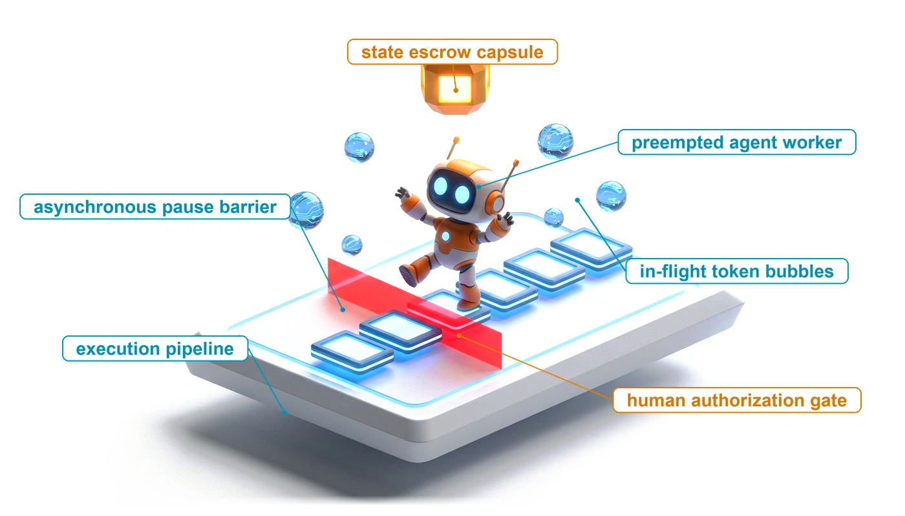
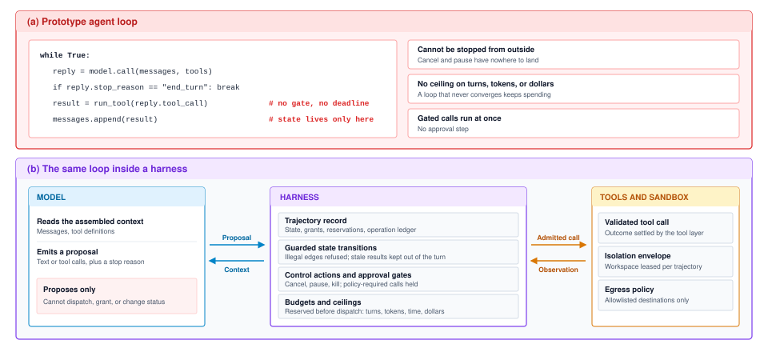
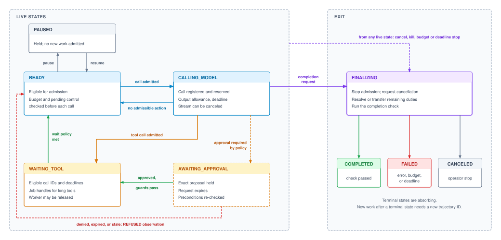
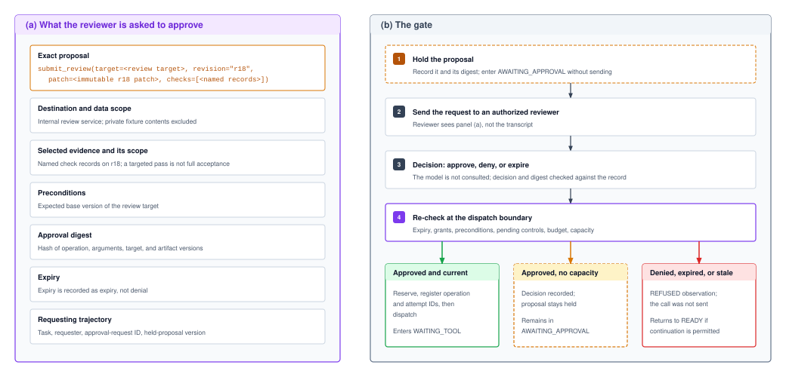
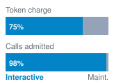
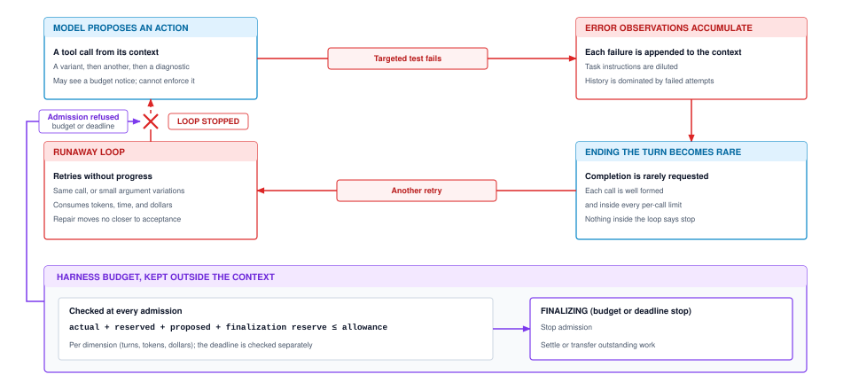
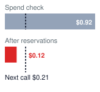
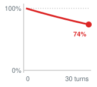

# The Agent Harness {#sec-vol3-agent-harness}

::: {layout-narrow}
::: {.column-margin}

\chapterminitoc

:::

::: {.content-visible when-format="pdf"}
\noindent
{fig-alt="Blueprint illustration for the agent harness chapter."}
:::

::: {.content-visible unless-format="pdf"}
{fig-alt="Blueprint illustration for the agent harness chapter."}
:::

:::

## Purpose {.unnumbered .unlisted}

::: {.content-visible when-format="pdf"}
\begin{marginfigure}
\mlagentstack{0}{0}{100}{0}{0}{0}
\end{marginfigure}
:::

::: {.content-visible unless-format="pdf"}
::: {.column-margin}
{width="100%" fig-alt="Agentic Machine Learning Systems Stack"}

*Agent stack focus for this chapter.*
:::
:::

_Why must the decision to continue an agent live outside the model that proposes its next step?_

A single model invocation succeeds or fails on its own, but an autonomous agent runs across a horizon of many turns, and per-step errors compound with every turn. Over dozens of sequential tool interactions, a malformed call, a stale observation, or an unhandled exception can carry an unsupervised trajectory into a failure or a loop that no single step reveals. The agent harness is the runtime component that owns this loop: it schedules model calls, enforces the rules for moving between states, tracks task budgets, and holds sensitive actions for human approval. A model can be asked to pause, wait, or stay within an allowance, but a request it honors on almost every turn still fails across a long run, so the decision to continue must rest with deterministic supervision outside the model. Engineering the harness turns stochastic token generation into task execution that stays bounded, interruptible, and accountable across the whole horizon.

::: {.content-visible when-format="pdf"}

\newpage

:::

::: {.callout-learning-objectives}

- Explain why continuation is decided outside the model, and design the runtime-owned trajectory record of plans, grants, consumption, and obligations
- Construct guarded state transitions that keep stale observations out of the next turn while preserving unresolved effects
- Calculate how long a control request waits for a turn boundary, and apply pause, cancel, or kill without dispatching incomplete output
- Explain which resources an asynchronous wait releases and which the trajectory still owns and pays for
- Design an approval gate with expiry and dispatch-time rechecks, and size the resources its held trajectories retain
- Allocate shared model-call service by weighted deficit round-robin while keeping provider quotas separate from trajectory budgets
- Apply bounded-liability admission across a trajectory's turn, token, time, and dollar budgets, and select a ceiling by cost per accepted task

:::
## Supervising Continuation {#sec-vol3-harness-overview}

::: {.column-margin}
{width="100%" fig-alt="H·S·A locator triad with the Horizon axis highlighted."}

*The horizon exposure, bounded by a harness that keeps control outside the model.*
:::

Consider the connection-pool repair agent (@sec-vol3-intro-lighthouses) at the moment it produces candidate patch `r18`. A test job is actively running against a fixed snapshot of that revision when an operator requests a pause for manual inspection. Simultaneously, an independent interactive task queues for model service, and the repair trajectory approaches its allocated budget. Even if the test job finishes cleanly and the next model reply is syntactically flawless, neither event answers whether the repair should proceed right now. That continuation decision depends on operational conditions outside the model: the operator's pending signal, current task states, shared cluster capacity, and the allowance remaining once in-flight work is accounted for.

The runtime components examined so far each address part of this operational environment. The tool layer tracks job handles and operation repeat contracts, the sandbox isolates execution and bounds workspace lifetimes, and the security checks test each dispatch against its confidentiality and provenance labels and bind each approval to the exact action it covers. Each of these mechanisms, however, operates at the boundary of a single invocation, resource, or decision; none possesses the context or authority to decide whether the trajectory as a whole may take another step. That decision cannot be delegated to the model either. An agent instructed to self-regulate (to pause on request, or to halt before exceeding an allowance) evaluates that rule afresh on every turn. Because of horizon compounding (@eq-vol3-horizon-compounding), even a high per-turn compliance rate decays across an extended run, so a constraint the model honors on almost every turn is still violated in a predictable share of long trajectories. Operational control also requires state that cannot live in an ephemeral context window. An operator needs immediate status without reconstructing the conversation transcript; a scheduler must distinguish between work waiting on background jobs and work eligible to run; and the dispatch path must enforce security grants and token allowances before invoking downstream tools. All three operations demand a single, authoritative account of the trajectory that an unstructured message list cannot maintain.

The agent harness provides this missing supervisory layer by taking ownership of the execution loop for an individual trajectory. The agent proposes candidate actions; the harness determines whether each step runs immediately, yields to other work, or halts, and it enforces those decisions against an execution record that only the runtime can modify. This is trajectory-level encapsulation (principle \ref{pri-vol3-trajectory-encapsulation}). The runtime governs each model call as one step of a whole trajectory, and the trajectory advances only through transitions and admissions that the runtime's guards permit. The reason is that the trajectory cannot be relied on to yield, to stop, or to notice that it has stopped making progress. Invariant closure (principle \ref{pri-invariant-closure}) says that bounds belong below the model; this principle names the unit those bounds must cover, the whole trajectory rather than the single call. In the harness, the principle takes the form of two working rules. First, every outbound model call or tool dispatch must pass an explicit admission check (active operator signals, capability grants, shared capacity, and remaining budget) at the instant it would execute. Second, in-flight work stays accountable: no pause signal, timeout, or cancellation proves that running work has stopped or that its cost is settled, so every outstanding operation keeps a named owner until evidence settles it.

The record described in this chapter lives in host memory, while making its guarantees survive host failure is the work of durable execution (@sec-vol3-durable-execution). Within a live host, the harness develops in the order these supervisory decisions arise across a repair turn: separating the control path from the bare execution loop (@sec-vol3-controlplane-need), maintaining an authoritative account of the trajectory (@sec-vol3-controlplane-acb), and enforcing guarded rules for how that account may change (@sec-vol3-controlplane-statemachine). Operators then need a way to stop or redirect active work (@sec-vol3-controlplane-signals), while long tool jobs and human reviews need waits that keep supervision intact (@sec-vol3-controlplane-yielding, @sec-vol3-controlplane-hitl). Across concurrent trajectories, shared model service must be divided fairly (@sec-vol3-controlplane-scheduling), and across many turns, cumulative consumption must be bounded (@sec-vol3-controlplane-accounting). Seeing why those guarantees require a dedicated runtime component starts with what breaks when the `r18` repair turn runs inside an unmediated loop.

## The Loop and the Harness {#sec-vol3-controlplane-need}

When the `r18` repair agent runs inside a bare execution loop, an operator pause during the test suite or an unconstrained retry cycle immediately exposes the lack of an external control plane. A control plane is a path, separate from the one that performs model calls and tool work, that decides whether that work may proceed. An unmanaged loop treats model completions as direct execution instructions; a harness treats them as untrusted proposals, evaluating every action against explicit admission policies, budget constraints, and external supervisory signals.

### The anatomy of an unmanaged loop {#sec-vol3-harness-unmanaged-loop}

The unmediated while-loop of @lst-vol3-naive-agent-loop is the pattern most prototype agents still use, popularized by ReAct [@yao2023react]: invoke a foundation model, dispatch the tools requested in its completion, append the results to the message history, and repeat until the model emits a stopping condition. A single turn spans six phases, from context assembly to assessment against the task contract, and several of those phases must wait on external tools or human reviewers. What the prototype loop lacks for production operation is a place for those phases' decisions to live, because it confines all operational state to the message list and the local call stack of the client process.

::: {.column-margin .margin-pointer}
↩ The six-phase turn lifecycle, including the phases that pause a turn for tools and approvals, is established in @sec-vol3-intro-execution-lifecycle.
:::

Confining control state to the message list and call stack leaves three operational paths with nowhere to land. When an operator tries to pause a run during a long test suite, the runtime has no interface to receive the command. When cumulative token consumption exhausts the allocated budget, the loop cannot withhold the next model call without terminating abruptly and abandoning in-flight work. When the model proposes a tool invocation, the call executes immediately under ambient authority, without policy checks or human review. Although a supervised harness may also execute as a loop or coroutine, it wraps that loop in an explicit state machine whose guards govern every continuation path, filtering each proposal before any tool call is admitted (@fig-vol3-controlplane-arch).

::: {#fig-vol3-controlplane-arch fig-env="figure" fig-pos="htb" fig-cap="**The Prototype Loop vs. the Agent Harness**: Panel (a) runs the model's proposed call directly and keeps all state in the message list, so an outside request has nowhere to land, nothing bounds cumulative spend, and calls that policy would gate run at once. Panel (b) wraps the same loop in a harness whose trajectory record, guarded transitions, control and approval paths, and reserved budgets decide what is admitted. The model only proposes, and the tool layer settles the outcomes of admitted calls." fig-alt="Two stacked panels with the model on the left and tools on the right in both. In panel (a), an arrow labeled proposed call runs at once goes straight from the model to the tools, results return to the model through a message list marked all state lives here, and three outside requests, pause and cancel, spend ceiling, and approval, end in red crosses above the loop with nothing to land on. In panel (b), a harness box sits between the model and the tools, joined by arrows labeled proposal and context on the model side and admitted call and observation on the tool side; the same three outside requests land on the harness, which contains trajectory record, guarded transitions, control and approval paths, and budgets reserved first. The model is marked proposes only and the tools settle outcomes."}



:::

In an unmanaged system, execution context is scattered across disparate subsystems: host operating systems track local processes, remote clusters hold asynchronous job handles, storage systems manage workspace leases, and identity providers track credential expirations. Panel (b) consolidates these responsibilities into a single runtime-owned record for each trajectory. Operators, cluster schedulers, and dispatch paths all consult this authoritative record before initiating state changes. While a system may pass budget constraints to the model in the prompt and the model may cooperate with pause requests, actual enforcement remains strictly with the runtime. Relying on model cooperation violates invariant closure; the runtime itself must guarantee that system safety invariants hold under all execution paths (principle \ref{pri-invariant-closure}).

::: {#dfn-agent-harness .callout-definition title="Agent harness"}

***Agent harness***\index{Agent harness!definition} is the runtime component that owns the agent loop for one trajectory, assembling each model call, interpreting the reply, deciding whether and when each proposed tool call is dispatched, and keeping the record through which outside components inspect, pause, bound, or stop continuation.

1. **Significance**: It keeps continuation decisions independent of model cooperation while preserving the grants, consumption, and outstanding work those decisions must respect.
2. **Distinction**: The tool layer mediates calls and tracks their outcomes, and the sandbox bounds execution under its policy. The harness composes those mechanisms with control requests, waiting, scheduling, and lifetime budgets.
3. **Common pitfall**: Keeping status and pending obligations only in prompt text or inaccessible execution-local state, so a separate control path cannot inspect them or prevent further dispatch.

:::

### One turn under supervision {#sec-vol3-harness-lifecycle-turn}

In a single turn of the `r18` repair workflow, the harness mediates every step from the moment the trajectory becomes eligible for another model call, through the model's proposal to run the regression test against candidate `r18`, to an operator's pause and subsequent resume (@tbl-vol3-harness-control-trace). Across that turn, lifecycle states record whether the trajectory is eligible for continuation (`READY`), actively querying the model (`CALLING_MODEL`), awaiting tool completion (`WAITING_TOOL`), or suspended by an operator (`PAUSED`).

| Event                                             | Harness decision and recorded obligation                                                                                                                                                                                          |
|:--------------------------------------------------|:----------------------------------------------------------------------------------------------------------------------------------------------------------------------------------------------------------------------------------|
| The repair is eligible for another model call     | From `READY`, confirm that no operator request is pending, that shared model capacity is available, and that the budget covers the most this call could cost. Set that amount aside, then enter `CALLING_MODEL` and send the call |
| A complete reply proposes the test of `r18`       | Record what the call actually used. Check the proposed test against the task's permissions and the remaining budget, set aside the test's maximum cost, and record the test as running before sending it. Enter `WAITING_TOOL`    |
| The operator requests a pause while the test runs | Stop admitting new work. Keep tracking the running test and its cost, but no longer let its result restart the model; then step through `READY` to `PAUSED` with no moment at which new work could start                          |
| The test result arrives during the pause          | Confirm that the result is genuine and belongs to this test of `r18`. Record its outcome and cost, but leave the trajectory paused and the model's context unchanged                                                              |
| The operator requests resume                      | Recheck task state, permissions, the recorded evidence, and the budget before returning to `READY`. The scheduler may then admit another call; the result supports only the test and revision it actually checked                 |

: **A repair trajectory under supervision**: An illustrative control trace. A paused trajectory admits no new work, yet its outstanding job and charges keep an owner. {#tbl-vol3-harness-control-trace}

Three features of the trace recur through the rest of the chapter. First, every row that admits work reserves before it sends. Affordability cannot be judged from settled charges alone, because the running test job may still bill and the proposed call may generate up to its full output allowance. The harness therefore reserves each operation's worst-case liability at admission and reconciles reported usage afterward. Notebook \ref{nbk-10-bounded-liability-admission} later prices a call that a check of settled spend admits and this reservation test refuses. Second, the pause and the test result are independent events. The pause stops new admission without stopping the job, and the job's result settles the job's outstanding charge without resuming the turn. Third, the reply's content never acts on its own. A truncated or canceled reply yields nothing to dispatch, a claim of completion triggers an independent check rather than ending the task, and an action that policy requires a human to review waits in a dedicated hold with its own expiry. Each of these needs runtime state that the message list does not have.

The trace also separates the decision to continue from the resources an agent holds. While the repair trajectory sits in `PAUSED` or `WAITING_TOOL`, it keeps its workspace, its cached repository state, and its running test job, but it does not hold a worker thread or a place in the queue for model calls. Because the harness, not the repair loop, decides when the trajectory next calls the model, an interactive trajectory can take the next model-call slot without waiting for the repair to give it up. Which resources a wait releases, and which it keeps, is the subject of supervised waiting (@sec-vol3-controlplane-yielding); how model calls are divided among trajectories is the subject of scheduling (@sec-vol3-controlplane-scheduling). Before the harness can enforce any of these transitions, waits, or schedules, however, it needs an authoritative data structure where that operational state lives.

## The Trajectory Record {#sec-vol3-controlplane-acb}

When an operator issues a pause request, the conversation transcript cannot answer the questions the harness must resolve. The transcript records what the user and model said, but runtime decisions require knowing the state of the underlying system. Specifically, the harness must know which candidate revision is under test, whether a background validation job has finished, how much compute budget remains once outstanding asynchronous tasks are accounted for, and whether any external side effects are still in flight. Simultaneously, the cluster scheduler must distinguish a trajectory blocked on a container execution from one actively waiting for its next inference turn. None of these operational facts belong in the prompt. Resolving them requires runtime-owned control state that the harness can inspect, mutate, and enforce directly without relying on the foundation model to reconstruct its own execution history.

::: {#dfn-trajectory-record .callout-definition title="Trajectory record"}

***Trajectory record***\index{Trajectory record!definition} is the per-trajectory control state owned and maintained by the harness. It encapsulates identity and task scope, lifecycle state, resource limits and financial accounting, security grants and workspace leases, pending asynchronous operations, and references to prompt context, the live execution plan, container environments, and verified evidence.

1. **Significance**: It provides the harness with an authoritative, centralized structure to inspect and govern the entire trajectory, tracking resource consumption, pending asynchronous operations, and security grants across inference calls.
2. **Distinction**: While the conversation transcript records user-model message exchanges, the trajectory record tracks the operational state required to govern execution across multiple turns. A live in-memory record represents active control state, not a durable audit log or proof that external claims are verified.
3. **Common pitfall**: Treating a model's generated text or self-reported progress as an authoritative update to consumed budget, granted capabilities, tool execution results, or task completion.

:::

@Tbl-vol3-acb-schema organizes these fields by the supervisory decisions they support. The table is a logical schema. A distributed runtime may partition these field groups across different storage backends, for example keeping ephemeral context references in memory while persisting cost accounts to an external store, provided each group retains a single authoritative writer and a well-defined update protocol.

| Field group                         | Contents                                                                                                       | Supervisory use                                                                       |
|:------------------------------------|:---------------------------------------------------------------------------------------------------------------|:--------------------------------------------------------------------------------------|
| Identity and task                   | Trajectory, requester, tenant, optional parent, task contract and version                                      | Bind requests and charges to the right task and authority                             |
| Control                             | `state`, `record_version`, `control_epoch`, `pending_control`, exit reason                                     | Decide whether a continuation or state change is current and permitted                |
| Continuation                        | Context reference and version, live-plan reference and revision, candidate workspace and evidence references   | Assemble the next call from the intended task state                                   |
| Limits and accounting               | Per-call limits, `actual_consumption`, `outstanding_reservations`, `finalization_reserve`, and `deadline`      | Check new liability against the remaining allowance and preserve funds for final work |
| Authority and resources             | Current grants, workspace leases, credential-broker references, resource owners                                | Check accessible operations and identify resources requiring release or transfer      |
| Current invocation and observations | `current_model_call`, `observation_eligible_calls`, attempt IDs, job handles, deadlines, and expected versions | Correlate events and decide which may inform the current continuation                 |
| Held approval                       | `held_approval`: exact proposal reference, applicable task and plan versions, approval status and expiry       | Keep a proposed action undispatched while its decision is pending                     |
| Outstanding obligations             | `operation_table` reference, unresolved outcomes and charges, settlement owner                                 | Preserve responsibility after a timeout, plan revision, pause, or scheduling exit     |

: **Trajectory Record Fields**: Each field group supports a control decision; references preserve access to larger state without implying that the referenced resources are free or absent. {#tbl-vol3-acb-schema}

Two questions about a running operation must be answered separately: whether its result may still inform the model, and whether the harness still owes anything for it. The first is **observation eligibility**\index{Observation eligibility!definition}, which defines whether the output of an operation is permitted to enter the prompt context for the next model invocation. The second is an outstanding obligation, and the two can come apart. A tool call can lose observation eligibility (when an invocation step times out, or the user cancels a subtask) even while the remote execution continues running in a backend container. To prevent orphaned side effects and resource leaks, the **operation table**\index{Operation table!definition} tracks every logical operation across its entire lifecycle: transport retries, incoming execution evidence, and the specific subsystem responsible for final settlement.

The trajectory record manages this lifecycle through two versioning counters. While `record_version` increments on every serialized update to provide optimistic concurrency control, the **control epoch**\index{Control epoch!definition} (`control_epoch`) tracks the specific planning and invocation cycle against which proposals and observations are validated. The epoch does not advance on every turn; it advances when the harness withdraws a continuation's claim on outstanding results, as when a wait deadline expires, an operator interrupts, or a plan revision supersedes pending work. Each call records the epoch current at its registration, so an ordinary result from this turn's dispatch still matches. Incrementing the epoch invalidates in-flight observations registered under the earlier epoch without breaking the underlying operation's idempotency contract. As a result, the harness continues tracking background tasks and their external side effects even after the agent has stopped waiting for their immediate output.

::: {.column-margin .margin-pointer}
↩ The operation idempotency contract and retry semantics are established in @sec-vol3-tool-calling-idempotency.
:::

A parallel discipline governs resource accounting. The harness separates settled usage (`actual_consumption`) from provisional allocations (`outstanding_reservations`), which represent admitted operations whose compute or financial costs have not yet been finalized. The harness withholds a dedicated **finalization reserve**\index{Finalization reserve!definition} from general exploratory steps. This reserve guarantees that the runtime retains sufficient budget to execute mandated cleanup tasks, release sandboxes, and run deterministic verification suites before the trajectory terminates. Wall-clock deadlines operate independently of token limits, because waiting on remote containers or human reviewers consumes real time even when token generation is idle. @Sec-vol3-controlplane-accounting formalizes this admission test; the trajectory record provides the live metrics required to enforce it.

These lifecycle and accounting guarantees unite under one working rule, the *settlement rule*. It is the trajectory-level form of settlement before retry (principle \ref{pri-vol3-exactly-once-settlement}). That principle says a timeout does not establish whether an effect occurred, so a blind retry is unsafe; the settlement rule adds that losing interest in a result does not release the effect's charge or its owner either. Under this rule, withdrawing an operation's observation eligibility, whether through a timeout, a plan revision, an operator pause, or trajectory cancellation, never removes the operation from the operation table or releases its budget reservation. Only authenticated, correlated evidence can settle an outcome, confirm completion, or release reserved budget. Until that proof arrives, the outstanding obligation retains a designated settlement owner responsible for reconciling its ultimate state.

### Update authority and referenced state {#sec-vol3-agent-harness-update-authority}

If a model's output could directly update its own budget balance, grant set, or step status, a single hallucinated or manipulative reply could reset the spending meter or mark an unrun test complete. Only the harness therefore holds write authority over the trajectory record. While the model can propose plan changes, tool calls, or completion assertions, the harness treats these outputs strictly as unverified proposals that must pass admission checks before the runtime commits them to the record. Provider billing APIs and tool execution metrics supply authoritative consumption figures, cryptographically signed or authenticated tool events supply operational evidence, and control APIs supply verified operator intent. Because this control state stays separate from prompt text, an agent may receive read-only notifications of its remaining budget without ever gaining the ability to change the meter.

To keep control operations lightweight and prevent multi-megabyte state copies during routine scheduler queries, the trajectory record stores references (content hashes, storage URIs, and job identifiers) rather than deep-copying full prompt contexts, workspace filesystems, or observation payloads. However, these references represent real underlying resource commitments. A paused or waiting trajectory continues to consume resources across distributed subsystems: KV-cache allocations in inference engines, isolated container environments and disk volumes, and open network sockets. The trajectory record holds the authoritative handles to these external assets and signals lifecycle transitions to their respective managers.

These in-memory references and handles hold only while the host process remains alive. Preserving this control state across process crashes and ensuring that record updates remain strictly serialized with respect to external side effects requires write-ahead logging and durable execution protocols. A dedicated durable-log offset in the control record binds the volatile runtime state to its persistent backing log.

::: {.column-margin .margin-pointer}
↪ Committing each admitted operation and its reservation to durable storage before dispatch is developed in @sec-vol3-persistence-wal.
:::

### The live plan {#sec-vol3-harness-live-plan}

Once the repair agent generates candidate `r18` and dispatches a targeted unit test in a background container, a static candidate graph or a checklist in prompt text can no longer represent the state of the work. It cannot separate the edit that produced `r18`, the test currently in flight against that revision, and the broader integration suite still waiting on the test result. Runtime execution therefore demands a **live plan**\index{Live plan!definition}, a dependency-ordered directed acyclic graph of execution steps that explicitly separates proposed actions from operations currently in flight and evidence already verified. Each step in the plan defines a unique identifier, explicit prerequisite steps or evidence dependencies, the target candidate artifact and operating conditions to which it applies, and its current execution status. When the harness admits a step, it binds that step directly to an entry in the operation table. When a step completes, the harness links it to the immutable evidence supporting that completion, never to an unverified checkbox emitted in model text.

::: {.column-margin .margin-pointer}
⇄ **Contrast:** The revisable candidate plan established in @sec-vol3-test-time-compute-planning-revision tracks only unexecuted candidate operations and their supporting evidence; the live plan also records operations in flight.
:::

While the test runner executes in its background container, the live plan records the step as in flight rather than optimistically assuming success. When the runner completes, a passing status validates only that targeted test against candidate `r18` under those exact container flags; the remaining verification steps and final acceptance criteria remain unfulfilled. An operator's pause request arriving mid-test acts as an independent supervisory event, interrupting further dispatch without corrupting the historical inputs or the validity of the ongoing test execution.

When incoming observations demonstrate that a strategy is failing, the model may propose a plan revision to alter downstream tasks. Before adopting any revised plan, the harness validates it against the overarching task contract, current evidence dependencies, remaining budget, and security grants. Adopting the revision advances the plan revision counter and invalidates pending, undispatched proposals and held approvals whose underlying assumptions have changed. Existing verified evidence remains valid under its original operating conditions. The harness synchronizes plan adoption with the tool dispatcher to prevent race conditions where a stale proposal might pass admission against a superseded plan.

Now consider what happens if a plan revision modifies the source code while the targeted test for candidate `r18` is still running in the background. The active container job is testing candidate `r18`, not the new revision. Relabeling the step in the plan cannot convert those eventual test results into evidence for the modified code. Deleting the step from the plan likewise does not abort the remote job, reverse its external side effects, or automatically refund its compute reservation. Instead, the harness keeps the active operation in the operation table under its original settlement owner, blocks downstream steps whose prerequisites are no longer satisfied, and evaluates the replacement work through a fresh admission check. Undoing an external effect requires compensation, a later action that offsets the earlier one (@sec-vol3-failure-recovery-semantic-compensation), not a retroactive edit to plan text.

By maintaining an explicit, dependency-tracked live plan, the trajectory record delineates what the agent has proposed, what the harness has admitted to the execution plane, and what obligations remain outstanding. The harness must therefore govern how this record evolves, so that it stays consistent across concurrent tool events, asynchronous worker callbacks, and operator interruptions. It does so by binding all lifecycle mutations to formal, guarded state transitions.

## Trajectory States {#sec-vol3-controlplane-statemachine}

Keeping the trajectory record consistent across asynchronous callbacks and timeouts becomes critical when a tool result arrives after the turn that requested it has already moved on. Suppose the wait deadline for candidate `r18`'s test suite elapses before a result arrives, so the harness records the outcome as unknown and proceeds; one minute later, the test service returns a success report. Both statements reflect reality: the outcome was indeed unknown when the deadline expired, and the tests ultimately passed. The failure occurs if the harness splices that late result into an obsolete turn as though the model had possessed the evidence when selecting its next action. This defect, known as **observation crossing**\index{Observation crossing!definition}, conflates the asynchronous physical history of an operation with the causal evidence admitted to a particular continuation. Preventing it requires two mechanisms: guarded transitions that decide when a continuation may advance, and an epoch fence that decides which late results may still inform it (@sec-vol3-agent-harness-late-results).

A state machine with guarded transitions[^fn-guarded-transition-statecharts] makes every such admission explicit. Beyond resolving observation races, guarded transitions prevent scheduling anomalies, such as mistaking a trajectory held for human approval as idle and erroneously dispatching another model call. The runtime control plane, rather than generated model output, governs all state transitions. @Tbl-vol3-lifecycle-states defines this supervisory state machine, organized around five live states, a finalizing state through which every exit must pass, and three terminal absorbing outcomes.

[^fn-guarded-transition-statecharts]: **Guarded Transition**: Harel's statecharts [@harel1987] labeled each transition with the event that triggers it and a condition that must hold for it to fire, and added hierarchy and concurrency so that reactive controllers stayed readable as their state counts grew. The harness uses the flat core of that formalism: an event proposes an edge, and the guard, evaluated against the record at that moment, decides whether it fires. Keeping the guard on the edge, rather than in whichever handler happens to receive the event, is what lets one table govern every path into `CALLING_MODEL`. \index{Statecharts!guarded transitions}

| State                             | Meaning                                                                                  | Legal next states                                          |
|:----------------------------------|:-----------------------------------------------------------------------------------------|:-----------------------------------------------------------|
| `READY`                           | Eligible to be considered for the next model call; admission guards still apply.         | `CALLING_MODEL`, `PAUSED`, `FINALIZING`                    |
| `CALLING_MODEL`                   | A model invocation is registered for the current continuation.                           | `READY`, `WAITING_TOOL`, `AWAITING_APPROVAL`, `FINALIZING` |
| `WAITING_TOOL`                    | The continuation awaits a declared set or batch of tool observations.                    | `READY`, `FINALIZING`                                      |
| `AWAITING_APPROVAL`               | An exact proposed action is held; approval and dispatch eligibility remain unresolved.   | `WAITING_TOOL`, `READY`, `FINALIZING`                      |
| `PAUSED`                          | The continuation is held at a local boundary; no new model or tool work is admitted.     | `READY`, `FINALIZING`                                      |
| `FINALIZING`                      | The runtime is checking the exit outcome and resolving or transferring remaining duties. | `COMPLETED`, `FAILED`, `CANCELED`                          |
| `COMPLETED`, `FAILED`, `CANCELED` | The continuation has ended; retained evidence and assigned obligations may remain.       | None                                                       |

: **Guarded Trajectory States**: An edge permits consideration of a transition, not unconditional execution. Events can update accounting or evidence without changing state. {#tbl-vol3-lifecycle-states}

The normal operational cycle follows `READY` → `CALLING_MODEL` → `WAITING_TOOL` → `READY`, tracing through the five live states and guarded transitions shown in @fig-vol3-harness-trajectory-states. Proposals requiring review divert into `AWAITING_APPROVAL`. Pause commands transition to `PAUSED` exclusively from `READY`. All termination triggers (completion requests, cancellations, or exhausted budgets) route through `FINALIZING` before reaching the absorbing terminal states (`COMPLETED`, `FAILED`, `CANCELED`). During execution, a model response may produce no admissible action, request task completion, or propose an action requiring operator approval. While the normalized invocation status defined in @tbl-vol3-invocation-status fixes how the runtime processes individual call outcomes, @tbl-vol3-harness-status-routing specifies how each outcome shifts the overall trajectory state. Two names appear in both vocabularies with different meanings: a reply status of `COMPLETED` or `CANCELED` describes one model call, while the terminal states of the same names describe the whole trajectory. A completed reply ends a call, not the task. Only a reply whose status is `COMPLETED` proceeds to tool candidate validation. The harness must never convert a malformed, truncated, or canceled partial stream into an actionable tool invocation only because a parser managed to salvage partial arguments from the payload.

| Reply status and content               | Next state          | Condition or residue                                                          |
|:---------------------------------------|:--------------------|:------------------------------------------------------------------------------|
| `COMPLETED`, validated tool proposal   | `WAITING_TOOL`      | Once its dispatch is admitted                                                 |
| `COMPLETED`, proposal requiring review | `AWAITING_APPROVAL` | When policy requires review of the exact action                               |
| `COMPLETED`, completion request        | `FINALIZING`        | The task's completion check follows                                           |
| `COMPLETED`, no admissible action      | `READY`             | With an observation saying so                                                 |
| `TRUNCATED`, `REFUSED`, `REJECTED`     | `READY`             | With a bounded observation, unless the task's refusal policy finalizes        |
| `CANCELED`                             | `READY`             | Under the control hold that caused the cancellation                           |
| `TRANSPORT_FAILURE`, `FAULTED`         | `READY`             | For bounded failure handling while the budget permits, `FINALIZING` otherwise |

: **Reply Status and Next State**: Every non-completed status returns to a state that admits no dispatch from the failed reply; reservations for failed or faulted calls stay outstanding until usage settles. {#tbl-vol3-harness-status-routing tbl-colwidths="[34,20,46]"}

Action approval introduces a controlled detour to this cycle. An approved action transitions from `AWAITING_APPROVAL` to `WAITING_TOOL` only when its active dispatch guards pass; recording operator approval does not automatically execute the tool. Conversely, a denial, expiration, or operator withdrawal emits a refusal observation back to `READY`.

::: {#fig-vol3-harness-trajectory-states fig-env="figure" fig-pos="htb" fig-cap="**Trajectory State Machine**: Five live states, a finalizing state, and three terminal outcomes. The ordinary cycle runs from READY through CALLING_MODEL and WAITING_TOOL back to READY; a proposal that policy requires reviewed is held in AWAITING_APPROVAL, and pause is entered only from READY. Every exit passes through FINALIZING, which stops admission and resolves or transfers remaining duties before an absorbing terminal state. Each arrow is a guarded edge, and events such as a late result or a usage report can update the record's operation table without changing state." fig-alt="State diagram. A dashed live-states region holds PAUSED above READY, CALLING_MODEL to the right of READY, WAITING_TOOL below READY, and AWAITING_APPROVAL, drawn dashed, below CALLING_MODEL. Heavy arrows trace the ordinary cycle: call admitted from READY to CALLING_MODEL, tool call admitted to WAITING_TOOL, and wait policy met back to READY. Lighter arrows show pause and resume between READY and PAUSED, no admissible action from CALLING_MODEL to READY, approval required from CALLING_MODEL to AWAITING_APPROVAL, approved and guards pass to WAITING_TOOL, and a dashed path for denied, expired, or stale requests returning a refused observation to READY. A completion request arrow and a dashed arrow from any live state for cancel, kill, budget, or deadline lead to FINALIZING, which branches to three double-bordered absorbing states: COMPLETED, FAILED, and CANCELED."}



:::

### Transition guards and the admission check {#sec-vol3-agent-harness-transition-guards}

A trajectory sitting in `READY` can still be unsafe to advance if an operator pause arrived a millisecond earlier, a credential expired while the trajectory waited in the queue, or an unresolved prior operation still blocks a dependent mutation. Navigating a legal edge in the state machine is therefore only a necessary condition for progress, not an unconditional right to execute. Before the runtime admits new work, whether invoking a model or dispatching a tool, it evaluates a set of predicates known as the *admission check*: no pending control hold may be active, the context, credentials, and any required action approvals must remain valid, upstream data dependencies must be resolved, and both deadline slack and downstream service capacity must be confirmed. The runtime must also reserve the operation's bounded financial liability from the task budget without encroaching on the dedicated finalization reserve (@sec-vol3-controlplane-accounting), and for tool calls it must verify that arguments are structurally complete. Because system state changes continuously, this evaluation holds only at the instant it executes; an approval granted seconds earlier or a scheduling decision made on a previous tick does not carry forward.

The admission check and its state updates execute as a single atomic transaction. Protected by the trajectory record lock,[^fn-record-lock-monitor] the harness evaluates the guard predicates, reserves the required liability, registers the outgoing invocation or attempt ID, marks the expected observation as eligible, and commits the state transition. Releasing the record lock before network transmission, however, opens a brief window before the bytes leave the host in which an operator pause or cancellation can commit. To close that window without holding the record lock across slow network I/O, the runtime passes the admitted request to a release gate that serializes the final release-or-withhold decision with control updates. This gate rechecks current controls and the existing admission without reserving liability twice, withholding transmission if a stop arrived after the record lock was released. Together, these steps enforce the *register-before-send rule*. Registering state before dispatch ensures that even an immediate response never arrives before the local record exists to receive it. Conversely, transmitting requests strictly outside the critical section prevents slow network I/O, stalled inference endpoints, or lagging tool services from blocking concurrent control actions, scheduler ticks, or arriving results from other workers.

[^fn-record-lock-monitor]: **Record Lock as a Monitor**: Hoare's monitors [@hoare1974monitors] bundled shared data with the only procedures allowed to touch it and ran those procedures one at a time, so every invariant on the data could be checked at procedure entry and exit. The trajectory record is a monitor in this sense: controllers, schedulers, and result handlers all reach it through short guarded procedures. The register-before-send rule adds one constraint for a record whose procedures front slow remote services: no procedure waits on a model or tool call while holding the lock. \index{Monitor!trajectory record}

External control requests acquire this same monitor lock, so stops and admissions are strictly serialized under an *admission-order rule*. If a pause, cancellation, or kill command commits before an admission check runs, it immediately blocks new outbound work. If admission commits first, the operation becomes owned work with a registered identity and reservation, and a later control cannot erase or refund that reservation on intent alone. Although the release gate can still withhold a definitely unsent attempt, settling that attempt requires authoritative evidence that release did not occur and that no remote liability remains. A volatile withheld flag does not survive a host crash, and once a packet may have left the host, a cancellation request cannot establish `not_sent` without remote evidence. Tool-side idempotency and stale-lease fencing therefore still require the endpoint contracts detailed in @sec-vol3-tool-calling-operation-ids.

To coordinate concurrent state access without heavyweight distributed locks, the harness pairs optimistic concurrency validation with epoch fencing. The `record_version` field detects competing updates at the point of commit, implementing the validation step of optimistic concurrency control [@kung1981optimistic]. In parallel, increments to `control_epoch` fence out stale asynchronous responses\index{Control epoch!fencing}, the same generation-number check that the tool layer applies to superseded workers at the endpoint. Here the fenced party is an observation: a response stamped with an old epoch cannot advance the current continuation, however well formed it is. These control plane identifiers operate alongside, rather than replace, logical operation identifiers and transport attempt counters. A network retry generates a new attempt ID under the same logical operation, whereas an operator interruption bumps the control epoch to invalidate pending replies without erasing the operation's entry in the operation table. The record now carries several counters, and each advances on different events and rejects a different kind of stale input (@tbl-vol3-harness-counters).

::: {.column-margin .margin-pointer}
↩ Epoch fencing of superseded workers at the mutating resource is established in @sec-vol3-tool-calling-operation-ids.
:::

| Counter               | Advances when                                                                                                         | What a stale value rejects                                                 |
|:----------------------|:----------------------------------------------------------------------------------------------------------------------|:---------------------------------------------------------------------------|
| `record_version`      | Any committed update to the trajectory record                                                                         | A decision made on a view of the record that has since changed             |
| `control_epoch`       | A wait deadline, an operator interruption, or a plan revision withdraws a continuation's claim on outstanding results | A result registered under an earlier epoch, as input to the current turn   |
| Plan revision         | The harness adopts a revised live plan                                                                                | A proposal or held approval formed against the superseded plan             |
| Held-proposal version | The harness records a new or changed held proposal for approval (@sec-vol3-controlplane-hitl)                         | An approval decision for a different version of the proposal               |
| Attempt ID            | A transport retry of the same logical operation                                                                       | Nothing by itself; it lets late evidence name the attempt that produced it |

: **Trajectory Record Counters**: Each counter advances on its own events and rejects its own kind of stale input, so none can stand in for another. {#tbl-vol3-harness-counters tbl-colwidths="[20,42,38]"}

@Lst-vol3-guarded-transition expresses these rules as a single supervisory procedure. The legal edges match @tbl-vol3-lifecycle-states, and any edge without a registered guard predicate is rejected by default. The caller provides the `record_version` it observed when formulating its transition request; a concurrent modification by another worker causes the version check to fail. Similarly, duplicate deliveries of an event fail either the version check or the edge guard, guaranteeing that no action is admitted twice.

::: {#lst-vol3-guarded-transition lst-cap="**Guarded Transitions**: Every state change checks the legal edge, its explicit guard, and the record version under the record lock, then performs admission bookkeeping before the state changes; the admitted request is sent only after the lock is released."}
```python
LIVE = {"READY", "CALLING_MODEL", "WAITING_TOOL",
        "AWAITING_APPROVAL", "PAUSED"}
LEGAL = {("READY", "CALLING_MODEL"), ("READY", "PAUSED"),
         ("CALLING_MODEL", "READY"), ("CALLING_MODEL", "WAITING_TOOL"),
         ("CALLING_MODEL", "AWAITING_APPROVAL"), ("WAITING_TOOL", "READY"),
         ("AWAITING_APPROVAL", "WAITING_TOOL"),
         ("AWAITING_APPROVAL", "READY"), ("PAUSED", "READY")}
LEGAL |= {(s, "FINALIZING") for s in LIVE}
LEGAL |= {("FINALIZING", t) for t in ("COMPLETED", "FAILED", "CANCELED")}
# GUARDS maps each edge to a predicate over (record, decision).

def transition(rec, new_state, decision, admit=None):
    with rec.lock:                            # the local decision only
        edge = (rec.state, new_state)
        guard = GUARDS.get(edge)              # no guard, no permission
        if edge not in LEGAL or guard is None or not guard(rec, decision):
            raise IllegalTransition(edge, decision.id)
        if decision.seen_version != rec.record_version:
            raise StaleDecision(decision.id)  # a competing update won
        if admit is not None:
            admit(rec)                        # reserve, register, set eligibility
        rec.state = new_state
        rec.record_version += 1
        rec.history.append((edge, decision.id, rec.record_version))
    # The caller passes admitted work to the serialized release gate outside this lock.
```
:::

Here, the guard registered on the `READY` → `CALLING_MODEL` edge executes the complete admission check, while `admit` performs the liability reservations and bookkeeping required by the register-before-send rule. Because the monitor lock protects only in-memory lookups, state updates, and an array append, lock contention remains negligible compared to the hundreds of milliseconds consumed by remote inference or tool execution.

### Late results and observation eligibility {#sec-vol3-agent-harness-late-results}

When an asynchronous tool result arrives, the harness must reconcile financial and physical state without corrupting the prompt history of an active turn. Upon reception, the runtime authenticates the payload and correlates its task identifier, logical operation ID, and attempt number against the trajectory record. Mismatched or unauthenticated messages are logged for audit and dropped. Valid results immediately update the trajectory's operation table: the runtime records raw execution evidence and converts reserved charges into settled resource usage.

However, updating the operation table does not imply that the result belongs in the model's current prompt context. As @lst-vol3-harness-on-result shows, the runtime splits incoming evidence into two separate paths: settlement in the operation table, which every authentic result receives, and epoch-fenced observation staging. Every authentic result records evidence and settles any confirmed usage. An observation, however, is staged for immediate prompt injection only if its call ID remains registered in `observation_eligible_calls` and the epoch recorded with the call at registration matches the active `control_epoch`. The remote service never sees the epoch; when the harness correlates the result, it looks up the epoch by call ID and attaches it to the local result envelope as `result.epoch`. This field comes from the registration record, not the remote payload. The two checks fail in different ways. The eligibility set is the per-call statement of which results the current wait expects, and removing an entry after staging is what stops a redelivery from being staged twice. The epoch is a bulk fence: a timeout or operator interruption advances it once and thereby invalidates every call registered under the old epoch, including any whose removal from the set was missed. If an operation timed out or an operator intervened, its recorded epoch is obsolete. The harness settles the financial balance but refuses to inject the result into the current turn, which eliminates observation crossing. Should that late evidence prove relevant to future turns, the runtime can re-evaluate and stage it during subsequent guarded context assembly. Staging a result does not by itself end the wait. A declared **wait policy**\index{Wait policy!definition} establishes the criteria required to return from `WAITING_TOOL` to `READY`, and the handler requests that transition only when the policy is satisfied.

::: {#lst-vol3-harness-on-result lst-cap="**Routing a Tool Result**: Authenticated evidence always reaches the operation table and settles usage, while only a currently eligible result under the current control epoch is staged for the waiting continuation."}
```python
def on_tool_result(rec, result):
    if not authenticate(result):
        return audit(rec, "unauthenticated_result", result)
    with rec.lock:
        op = rec.operation_table.get(result.operation_id)
        if op is None or result.attempt_id not in op.attempts:
            return audit(rec, "unknown_operation", result)
        if not op.record_evidence(result):  # already recorded: duplicate
            return
        settle(rec, op, result.usage)       # reserved -> actual; rest stays owed
        eligible = (result.call_id in rec.observation_eligible_calls
                    and result.epoch == rec.control_epoch)
        if eligible:
            rec.observation_eligible_calls.discard(result.call_id)
            stage_observation(rec, result)  # for the current wait only
        rec.record_version += 1
        seen = rec.record_version
    if eligible and wait_policy_satisfied(rec):  # the guard rechecks it
        transition(rec, "READY", Decision(result.id, seen))
```
:::

Systems typically implement one of four wait policies: all required results arrive, an acceptable partial batch completes, a wait deadline expires, or an operator triggers an explicit withdrawal. The trajectory record distinguishes confirmed evidence from unreturned, unresolved calls. In the candidate `r18` repair scenario, a timeout records that the outcome was unknown at the deadline; it cannot justify inferring that the test suite failed. When the test service eventually reports that candidate `r18` passed, the operation table records that verified outcome with its exact scope. A timeout likewise never authorizes an uncoordinated re-execution of a non-idempotent operation. Dependent actions must still satisfy all guard preconditions and adhere to the tool's mutation safety contract.

### Pause entry and outstanding work {#sec-vol3-agent-harness-pause-entry}

When a pause command arrives while a trajectory is in `CALLING_MODEL` or `WAITING_TOOL`, jumping straight into `PAUSED` would either orphan the in-flight model stream and remote tool job or leave their state transitions ambiguous. The state machine therefore permits entry into `PAUSED` exclusively from `READY`. If a pause command arrives mid-call or mid-wait, the runtime asserts a `pending_control` hold. The hold blocks the admission of any subsequent work, revokes observation eligibility for active model streams, invalidates any pending approval requests, and ends the active observation wait. For a trajectory in `WAITING_TOOL`, this is the explicit-withdrawal wait policy, and it is what permits the `WAITING_TOOL` → `READY` step. If policy dictates, the control plane issues cancellation requests to remote workers; under the settlement rule, these operations remain registered in the operation table until remote confirmation arrives. Any partial token stream received from a canceled model call is preserved solely for diagnostic logging, never stitched together to form a valid dispatch.

Once these local eligibility revocations are logged, the trajectory steps through `READY` directly into `PAUSED` under the existing admission hold. Because the lock prevents concurrent scheduling during this step-down, no runnable window opens between the transitions. Entering `PAUSED` halts continuation progress, ensuring that neither pending responses nor held proposals can advance the continuation. However, background tools already running in external systems may continue their physical execution. For example, the remote test execution for candidate `r18` can complete while the trajectory remains paused; its completion payload updates the operation table and settles the reserved charge without triggering a new inference cycle.

Resuming execution requires a guarded `PAUSED` → `READY` transition, followed by a brand-new admission check that reconciles all evidence recorded in the operation table during the pause. Resumption is not an automated rollback of pause-time revocations, so state withdrawn during a pause is never restored. Expired authorization tokens remain expired, withdrawn approvals require fresh operator authorization, and canceled partial responses stay abandoned. Any earlier operation that remains unconfirmed continues to block its dependent actions, even if unrelated steps become eligible. Meanwhile, physical resource retention operates under independent lifecycles: sandboxed workspace leases, buffer allocations, compute reservations, and model context caches persist or expire according to their respective lifetime policies rather than the trajectory's instantaneous state.

### Finalization and remaining duties {#sec-vol3-agent-harness-finalization-duties}

Ending a run the instant the model claims completion, an operator cancels, or the budget runs out would skip independent acceptance checks, leave delegated credentials active, and abandon unsettled background jobs. Every exit from the live states therefore passes through `FINALIZING` before reaching a terminal state (@fig-vol3-harness-trajectory-states). Upon entering this state, the runtime immediately suspends standard work admission, records the exit reason, revokes unused delegation authority where supported, and triggers the task completion check when completion is claimed. An end-of-turn token emitted by a model merely requests this validation; genuine task completion requires an independent completion check, such as the task contract's acceptance tests, run outside the model. All finalization checks and mandatory cleanup routines draw from their dedicated, pre-funded reserve.

During finalization, the control plane may block to await pending results, report verification failures, or hand off outstanding cancellation, billing reconciliation, and resource reclamation tasks to an external supervisor. The transition guard into any terminal state requires that every outstanding obligation be either definitively settled or explicitly transferred to an accepting upstream owner. Clearing an unresolved task from a local tracking set violates the guard. To effect a legitimate transfer, the runtime must transmit complete metadata (operation IDs, recorded evidence, and budget reservations), allowing the recipient service to assume supervisory responsibility.

All terminal states (`COMPLETED`, `FAILED`, and `CANCELED`) are strictly absorbing. Once a trajectory enters a terminal state, its continuation terminates permanently. Late-arriving tool results or charge settlements can still update archived historical records through the designated supervisory owner, but no event can transition the continuation back to `READY`. Resuming an investigation or re-attempting a task requires instantiating a fresh trajectory with a new identifier linked back to the prior run. Within this architecture, `COMPLETED` denotes solely that the programmatic completion criteria configured for the harness were met. Whether those criteria demonstrate true task competence is an empirical systems question addressed in @sec-vol3-evaluation-problem.

::: {#chk-10-agent-control-block .callout-checkpoint title="Trajectory record and guarded states"}

- [ ] **Late test evidence**: The wait for `r18` times out, then a success result arrives during `PAUSED`. Decide which structure changes, `observation_eligible_calls` or the `operation_table`, and name the guarded step that must run before the next model call can use the result.
- [ ] **Pause boundary**: Write the sequence of record updates that takes `WAITING_TOOL` through `READY` to `PAUSED`. At which point is new admission blocked, and which entries stay in the operation table?
- [ ] **Admission race**: Two schedulers both read `record_version` 41 and try to admit a model call. Using @lst-vol3-guarded-transition, which check rejects the loser, and what has the loser reserved or sent by then?
- [ ] **Terminal responsibility**: Cancellation of a paid job is unconfirmed when the continuation ends. List what the terminal guard requires before `CANCELED`, and who owns the job's charge afterward.

:::

Guarded transitions keep every update to the record causally consistent under network delays, tool timeouts, and concurrent interventions. They describe pause entry, however, only from the record's side. An operator who presses pause needs more: an authenticated way to register the request, a bound on how long it takes effect while a model call is still generating, and a distinction between a pause, a cancellation, and a kill that leaves outstanding work owned in each case.

## Control Actions {#sec-vol3-controlplane-signals}

The test job for candidate `r18` is still executing when an operator requests a pause. The harness must halt the repair loop's forward progress without losing the job's tracking identity, its allocated budget reservation, or the diagnostic evidence it might return. Delaying the pause until the test finishes strips the operator of interactive control over potentially runaway execution. Conversely, declaring the job canceled merely because the trajectory state transitions to `PAUSED` fabricates an execution outcome the runtime has not yet observed.

External control decouples receiving a request from establishing the physical execution state that request demands. When an operator intervenes, the harness authenticates the caller, verifies authority over the target trajectory, and appends the requested directive to `pending_control` while holding the record lock. Because this update occurs under the lock, the admission-ordering invariants established in @sec-vol3-controlplane-statemachine fix exactly which operations fall under the request's scope. The controller acknowledges the hold to the operator only after the update commits to the record (and, once durable execution is in place, to its log). The response delivered to the operator must also distinguish three distinct milestones: request received, new admission stopped, and subsequent confirmation that running work has terminated.

### Admission boundaries and active generation {#sec-vol3-agent-harness-admission-boundaries}

When an operator sends a pause or cancel signal while an agent is preparing a model call or stepping through a batch of proposed tool calls, the harness needs well-defined points where it can stop new work before a request leaves the host. Each such checkpoint is a **turn boundary**\index{Turn boundary!definition}, evaluated immediately before dispatching an inference call to a foundation model and immediately before invoking any external tool, including each individually admitted call within a proposed parallel batch. The name marks where control takes effect, not a boundary between turns: one turn (one step of the trajectory, counted by $\TurnHorizon$) contains a turn boundary before its model call and one before each tool call it admits. A pause that lands midway through a batch therefore leaves the calls already sent registered as owned work and withholds the rest. The admission check evaluates control flags under the trajectory record lock, and the release gate serializes its final decision with subsequent control updates. A flag check followed by an uncoordinated send would leave a race window and would not enforce this boundary. The guarantee is local. The boundary fixes which operations were admitted before the request took effect, rather than implying that all work stopped when the operator pressed stop, and it leaves every remaining obligation explicit and inspectable.

Local candidate processing does not have to wait for remote model generation to finish. The foundation-model contract already separates a `CANCELED` reply from a `REJECTED` one and withholds both from dispatch; the harness turns that cancellation into a control action. It can initiate **streaming cancellation**\index{Streaming cancellation!definition}, commanding the serving engine to stop generating an in-progress reply, terminating the invocation's eligibility to produce an actionable candidate, and retaining partial output solely for bounded diagnosis. A canceled or truncated payload never becomes a dispatchable call, even if a tolerant JSON parser closes its dangling brackets, a valid tool-call prefix appeared before the abort signal, or an apparently complete response arrives after eligibility was withdrawn. The quarantining rule (@sec-vol3-foundation-model-status-envelope), an application of invariant closure (principle \ref{pri-invariant-closure}) to the reply status, holds regardless of how the invocation ended. Late-arriving evidence remains useful only to reconcile accounting usage or explain what the serving engine executed.

::: {.column-margin .margin-pointer}
↩ The distinction between rejected and canceled streamed replies, and the rule that a partial payload never reaches dispatch, are established in @sec-vol3-foundation-model-streaming-cancellation.
:::

```{python}
#| label: calc-vol3-harness-boundary-wait
#| echo: false
# ┌─────────────────────────────────────────────────────────────────────────────
# │ TIME TO THE NEXT TURN BOUNDARY (LEGO)
# ├─────────────────────────────────────────────────────────────────────────────
# │ Context: @sec-vol3-controlplane-signals, "Output and time limits" paragraph.
# │ Goal: Show how long one admitted call can hold off the next turn boundary.
# │ Show: Reference per-token output allowance, a scenario output ceiling,
# │       and their product.
# │ How: Scenarios.CanceledStreamDecodeSavings: one call's output allowance at
# │      the Llama-3 70B 8-bit decode floor on one H100 (weight bytes /
# │      accelerator bandwidth per generated token). No queueing, stalls, or
# │      serving overhead, so the product understates real waits.
# └─────────────────────────────────────────────────────────────────────────────
from mlsysim import *
from mlsysim.fmt import check, fmt_count, fmt_time

class BoundaryWait:
    # ┌── 1. LOAD (Constants & Parameters) ─────────────────────────────────
    call = Scenarios.CanceledStreamDecodeSavings  # one streamed call at the 8-bit decode floor
    k_max = call.output_allowance  # scenario: per-call output-token allowance

    # ┌── 2. EXECUTE (Compute) ─────────────────────────────────────────────
    t_dec = call.floors.result.memory_time.to(second)
    t_wait = call.allowance_decode_time.to(second)

    # ┌── 3. GUARD (Invariants) ───────────────────────────────────────────
    check(60 * second < t_wait < 120 * second, "Boundary wait exceeds one minute")

    # ┌── 4. OUTPUT (Formatting) ──────────────────────────────────────────
    t_dec_ms_str = fmt_time(t_dec, unit=ms, precision=3)
    k_max_str = fmt_count(k_max)
    t_wait_str = fmt_time(t_wait, unit=second, precision=1)
```

Output allowances and wall-clock deadlines address different operational risks. An output token ceiling enforces a hard boundary on generated volume under the serving engine's accounting contract; wall-clock latency, however, also depends on scheduling queues, network stalls, and autoregressive decode throughput. Even under ideal conditions, waiting for a full generation pass introduces substantial delay.[^fn-boundary-wait-batching] At a fixed per-token decode time, a call admitted with output allowance $\OutputLimit$, generating at $\PerTokenDecodeTime$, can postpone the next turn boundary by approximately

$$\TurnBoundaryDelay \approx \OutputLimit \times \PerTokenDecodeTime$$

Assuming an optimistic decode latency of `{python} BoundaryWait.t_dec_ms_str` per generated token, the single-accelerator, single-request floor of the estimate in @sec-vol3-foundation-model-per-call-work-estimate, with no queueing or memory-access stalls, a `{python} BoundaryWait.k_max_str`-token allowance postpones the boundary by roughly `{python} BoundaryWait.t_wait_str`. Pause or cancellation logic that passively waits for generation to complete would therefore block for more than a minute, and real serving queues only lengthen the wait. A node that splits the weights across several accelerators lowers the per-token floor but leaves the generation estimate linear in $\OutputLimit$. Halving the allowance therefore halves the full-allowance generation time at a fixed rate, whereas streaming cancellation removes the dependence on generation length entirely. The harness uses both: turn boundaries govern discrete operation admission, while streaming cancellation stops active generations in flight.

[^fn-boundary-wait-batching]: **Why Batching Does Not Shorten the Wait**: The reference rate charges each generated token one full read of the weights, the single-request case. A serving engine that batches many requests shares that read among them, which raises throughput but still advances each request by one token per ordinary decode step, so batching cannot bring the per-request wait below this estimate. Techniques that emit several tokens per step change the rate, not the wait's linear growth with the output allowance. \index{Turn boundary!decode latency}

Stopping local execution differs from terminating remote execution. A host deadline determines when the supervisor ceases waiting and initiates intervention; confirming that remote inference has actually stopped requires positive evidence from the service. Under the settlement rule, unconfirmed resource usage remains an outstanding liability rather than an assumed refund.

### Pause and resume policy {#sec-vol3-agent-harness-pause-resume-policy}

When an operator pauses the repair trajectory while the `r18` test container is already running, stepping the record from `READY` into `PAUSED` (@sec-vol3-controlplane-statemachine) stops new admissions but leaves a policy choice over the in-flight job itself. One pause policy permits the active `r18` test to finish under its existing budget limits while holding the repair loop's continuation; another requests immediate cancellation and records whatever outcome the executor confirms. A pause policy that permits execution to proceed leaves the workspace live and mutable, and the operator interface must reflect this active state. Any administrative inspection that demands quiescence requires positive confirmation that all concurrent writers have stopped, or else an isolated snapshot taken at a declared boundary. When the operator resumes the trajectory, execution proceeds along the guarded transitions defined in @sec-vol3-controlplane-statemachine; the pause policy governs only what ran while held, without altering the invariants enforced after resumption. @Tbl-vol3-signal-vocabulary compares these requested changes to continuation.

| Request                         | Required control effect                                                            | Guarded outcome                                                              |
|:--------------------------------|:-----------------------------------------------------------------------------------|:-----------------------------------------------------------------------------|
| Cancel                          | Hold new admission; request cancellation and account for owned work                | `FINALIZING`, then a recorded cancellation outcome when finalization permits |
| Interrupt with new instructions | Hold affected proposals; validate the instruction and revise its task dependencies | `READY` only when the revised continuation is eligible                       |
| Pause                           | Hold continuation and preserve an owner for outstanding work                       | `READY` to `PAUSED` with no runnable gap                                     |
| Resume                          | Reconcile evidence and recheck current permission and limits                       | `PAUSED` to `READY`, or remain held if guards fail                           |
| Kill                            | Stop admission and invoke available enforcement against active work                | `FINALIZING`, with confirmed and unresolved outcomes recorded                |
| Budget or deadline stop         | Deny further ordinary admission; preserve funded finalization duties               | `FINALIZING`, with the stopping reason and remaining obligations             |

: **Control requests and their enforced scope**: A control action changes admission and continuation through the guarded lifecycle. Cancellation and termination of already admitted work require separate evidence. {#tbl-vol3-signal-vocabulary tbl-colwidths="[22,41,37]"}

Mid-trajectory user steering demands the same transactional discipline. If an operator injects a steering instruction, such as directing the agent to modify a different target file, the harness cannot append the prompt to the conversation context and assume existing operations adapt. Adding instructions does not retroactively invalidate an already admitted file edit or revoke an active tool approval. Instead, the harness records the instruction, determines which plan steps and proposed actions are superseded, and verifies whether outstanding operations conflict with the revised task.

### Termination and remaining obligations {#sec-vol3-agent-harness-termination-obligations}

When a runaway child process or wedged tool handler ignores a cooperative cancellation request, waiting for polite shutdown leaves the trajectory holding local compute and credentials indefinitely. A kill request therefore invokes immediate, non-cooperative enforcement. Trajectory-level encapsulation (principle \ref{pri-vol3-trajectory-encapsulation})\index{Principle!trajectory-level encapsulation} is what makes this enforcement possible: because control requests are recorded independently of model output, the runtime can stop new admission and abort the local work it supervises without waiting on the model or on an external service's response. When a kill signal arrives, the controller halts local execution, revokes mediated access tokens, and fences off obsolete workers across the execution paths under its control. The sandbox reset contract in @sec-vol3-sandboxes-pooling-reset determines which child processes, descendant namespaces, network channels, and allocated resources that enforcement covers. Asynchronous remote work, third-party transactions, and external handles lie beyond direct local process control and demand their own corroborating evidence.

Finalization therefore records confirmed termination separately from unresolved side effects and pending charges, which retain their designated owner under the settlement rule. The operation's repeat contract determines whether another attempt is safe, and settlement must precede any retry (principle \ref{pri-vol3-exactly-once-settlement}); an operation identifier alone cannot reveal what the interrupted execution actually modified.

Enforcing external control decouples trajectory continuation from model behavior and frees execution resources. Worker threads and compute slots never remain blocked while an external job or cancellation response is outstanding. By persisting these control directives and outstanding obligations within the trajectory record, the harness safely suspends execution and yields worker resources, admitting continuation only when verified events satisfy the state machine's guards.

## Supervised Waiting {#sec-vol3-controlplane-yielding}

When the agent dispatches the integration test for candidate `r18`, the model generates nothing for as long as the test runs, which is tens of seconds for the integration test priced in @sec-vol3-kv-workload-dynamics, and minutes for a broader suite. If the worker thread that dispatched the job blocks until the result returns, it cannot service any other trajectory in the interim, and the runtime becomes unresponsive to operator pauses or high-priority interactive requests. The repair trajectory requires no token generation while the test executes. What it requires instead is an external supervisor: a control entity that tracks the in-flight job, holds the execution continuation, and buffers incoming evidence without tying up a worker thread in a synchronous wait.

Yielding execution through an asynchronous wait[^fn-worker-release-seda] releases the worker thread immediately, leaving the trajectory record as the explicit holder of pending state. Alternatively, a runtime with blocking workers can maintain controllability if an independent supervisor thread handles operator requests, heartbeats, and deadlines. The requirement holds for any event-loop implementation. Waiting must keep the control record accessible, and any returning event must pass through that record's admission guards before advancing the trajectory.

[^fn-worker-release-seda]: **Event-Driven Waiting**: Internet servers faced the thread-per-request version of this problem when a request could wait far longer than it computed. SEDA [@welsh2001seda] split services into event-driven stages joined by explicit queues and applied admission control at each queue, so load was visible and bounded where work waited rather than hidden in blocked threads. A harness whose tool jobs run for minutes while a model call takes seconds has the same shape, and the trajectory record is its queue entry. \index{Staged event-driven architecture!agent waiting}

### The result wakeup pipeline {#sec-vol3-agent-harness-wakeup-pipeline}

The asynchronous job interface decouples job acceptance from completion, so a result can arrive seconds or hours after dispatch, out of order, or more than once. The register-before-send rule makes that safe. For an external job, registration records the owning trajectory, the invocation and attempt identifiers, the external job handle when available, the expected workspace source revision, the observation eligibility policy, and the outstanding liability, so even an immediate callback finds the record it needs.

::: {.column-margin .margin-pointer}
↩ The asynchronous tool invocation interface and completion polling contracts are established in @sec-vol3-tool-calling-async.
:::

Regardless of how the runtime structures concurrency, the supervisor must satisfy four distinct logical obligations when processing an incoming result. @Tbl-vol3-event-wakeup-pipeline stages them in order and pairs each with the inference it does not license.

| Stage                        | Harness responsibility                                                                                                                                                  | Tempting but false inference                                                |
|:-----------------------------|:------------------------------------------------------------------------------------------------------------------------------------------------------------------------|:----------------------------------------------------------------------------|
| Receive an event             | Obtain a notification, status reply, timer event, or control request through the designated interface.                                                                  | A notification establishes a completed result.                              |
| Authenticate and correlate   | Check the source and match the event to its task, operation or attempt, and recorded execution context.                                                                 | A matching identifier authorizes a new action or makes the payload true.    |
| Update the record            | Preserve reported outcome, source revision, capture limits, usage, and any unresolved obligation; decide whether the evidence is eligible for the waiting continuation. | Evidence for an earlier attempt belongs directly in the current model turn. |
| Apply the continuation guard | Evaluate pending controls, the wait policy, dependencies, current grants, and budget before making continuation eligible.                                               | New evidence requires an immediate model call.                              |

: **Event handling before continuation**: Receiving evidence, recording its meaning, and admitting further work are separate supervisory decisions. {#tbl-vol3-event-wakeup-pipeline tbl-colwidths="[20,43,37]"}

The event handler generalizes the callback logic in @lst-vol3-harness-on-result across all event sources. Operating under a mutex or transactional boundary, the handler updates the record, advances `record_version`, and checks the call's recorded epoch against `control_epoch`; the version check itself happens in the guarded transition the handler then requests. Because network notifications can be duplicated, the handler must remain strictly idempotent: an identical redelivery will neither append a redundant observation, nor double-bill resource counters, nor re-enqueue an already scheduled continuation. Correlation ensures that incoming data routes to the correct trajectory record, while the tool's formal contract defines what that evidence actually establishes.

This discipline applies equally to streamed outputs. Real-time log fragments and progress heartbeats can append data to a bounded observation store without terminating the wait interval. Conversely, observing an opening tool-call delimiter in a streaming model response represents an incomplete proposal; the supervisor takes no action until the stream completes. The model adapter retains sole responsibility for parsing and validating full invocation payloads, whereas the harness determines whether that validated proposal remains eligible under current control policies.

### Job and batch waits {#sec-vol3-agent-harness-job-batch-waits}

If a runtime woke the model on every status poll to ask whether to keep waiting, or treated a prompt in raw job stdout as a trigger to resume generation, a ten-minute test run would burn tokens on empty polling turns and let unverified log output drive control decisions. Instead, the harness waits for a push notification or polls external status at bounded intervals on its own, without querying the model. If a job pauses to request human or auxiliary input, the runtime logs that requirement as a structured state transition rather than a trigger for resumption. Responding to such an input requirement remains a distinctly authorized operation, and the record tracks this pending dependency explicitly rather than treating raw stdout or log lines as an implicit signal to resume model generation.

Parallel tool invocations demand an explicit continuation policy. Under an *all-results* policy, the harness suspends the trajectory until every member of the batch either returns valid evidence or reaches a terminal disposition, such as a timeout with unresolved side effects. Conversely, a *partial-results* policy permits the model to reason incrementally as individual results arrive, even while other calls remain in flight. Such a policy must explicitly track missing evidence, preventing downstream steps from proceeding under the mistaken assumption that the entire batch has converged.

For example, a completed lint result need not settle a concurrent test job. If the agent's next planning step requires both checks on candidate `r18`, the lint output alone leaves the wait open. If, however, the subsequent step is an independent inspection, a partial-results policy can safely admit it under current limits. Modifying the candidate workspace while the test suite actively reads disk state introduces race conditions; simply designating invocations as parallel does not preserve the tested revision without explicit workspace isolation.

When a deadline expires, it terminates the harness's wait interval, not the underlying remote operation. The harness logs the timeout, marks the operation as unresolved, and requests the configured intervention policy. The operation table keeps the unresolved charge open until explicit settlement rules determine whether late-arriving results can be accepted or whether re-execution is safe.

### Results during a pause {#sec-vol3-agent-harness-results-during-pause}

If suspending a trajectory also shut down its event listener, any tool callback arriving while the run sat in `PAUSED` or `FINALIZING` would be dropped at the socket, stranding the job's budget reservation and losing its completion evidence. The harness event handler must therefore remain active even when continuation is suspended. When the `r18` test result arrives during a pause, it settles its entry in the operation table while the trajectory stays `PAUSED` along the path traced in @sec-vol3-agent-harness-pause-entry, and only the resume guard can let it inform the next model call. The same holds during finalization, where late-arriving evidence can settle outstanding liabilities without reviving an already terminated trajectory.

### Resources retained while waiting {#sec-vol3-agent-harness-retained-resources}

Releasing a worker thread does not dismantle the underlying execution environment: sandboxed processes, disk workspaces, network sockets, buffered logs, and retained inference states remain allocated. The control record maintains explicit references to these resources and their respective lifecycles. Tool subscriptions and cloud storage incur ongoing charges, quota reservations persist until liabilities are settled, and the wall-clock task deadline continues to elapse. Even polling routines and cleanup handlers consume execution budget and must operate within configured limits.

A workspace lease guarantees the availability of candidate source edits and test artifacts according to the lifetime contracts established in @sec-vol3-sandboxes-lease, persisting across multiple tool boundaries. Its term bounds what a waiting trajectory can lose. If the harness never returns to renew, lease expiry reclaims the workspace; if it returns after expiry, the resumed trajectory must treat its workspace as gone rather than assume the files it left are still there.\index{Lease!workspace expiry} In parallel, the model serving infrastructure decides whether to retain, evict, or page out key-value cache state across turns. Releasing the harness worker does not remove the residency tax of @sec-vol3-kv-workload-dynamics: attention state kept resident through the wait still divides the turn rate its memory can sustain by $1 + \ToolTime/\ModelTime$. The harness provides hints regarding expected wait durations and resumption priorities; where a hosted inference service provides no explicit cache-placement primitives, retention remains subject to provider eviction policies.

::: {.column-margin .margin-pointer}
↩ Keep, move, and drop policies for a paused trajectory's KV-cache state are established in @sec-vol3-kv-cache-keep-move-drop.
:::

A wait is therefore a supervised interval characterized by retained evidence, active resource leases, and pending obligations. When that interval concludes, the harness transitions the continuation to an eligible state only if the record's guards explicitly approve. Human-in-the-loop approval operates under this identical supervisory discipline: rather than waiting on an external computation, the harness suspends execution before dispatch, waiting for an authorization decision that may arrive late, be denied, or expire entirely.

## Approval Gates {#sec-vol3-controlplane-hitl}

Consider the internal-review workflow: an agent proposes submitting candidate patch `r18` along with selected verification records, but trusted policy permits submission only after an authorized engineer signs off. The proposal is complete, yet the human reviewer is unavailable. Meanwhile, the task's deadline clock continues advancing, an operator can request a pause, and credentials or access grants can expire. The harness cannot simply leave the proposal floating in the model's context window, nor can it allow a retry loop or subsequent model step to dispatch the action prematurely. Instead, the runtime must hold the fully formed submission in escrow while review remains unresolved.

::: {.column-margin .margin-pointer}
↩ Action-bound approval, which ties sign-off on the `r18` patch submission to its exact canonical payload, is established in @sec-vol3-security-action-bound-approval.
:::

::: {#dfn-escrow .callout-definition title="Approval escrow"}

***Approval escrow***\index{Escrow!definition}\index{Approval gate!escrow} is the harness's retention of an undispatched proposal pending required approval and subsequent dispatch admission. The held record binds the proposal to its enclosing task, approval conditions, and expiration deadline; even after a favorable decision arrives, execution still requires current admission checks at the dispatch boundary.

1. **Significance**: Escrow decouples proposing an operation from the authority to execute it immediately, keeping long, human-scale waits visible to supervisors and external schedulers.
2. **Distinction**: Authorization policies define who holds the authority to approve a represented action. The harness manages the operational lifecycle of that pending decision: routing the request, tracking timeouts, and enforcing state transitions toward dispatch or refusal.
3. **Common pitfall**: Treating a recorded approval as an unconditional instruction to execute, ignoring subsequent changes to credentials, task deadlines, branch states, or available compute capacity.

:::

Requiring human approval is a deliberate task-policy choice rather than an automatic property of irreversible side effects. Some high-risk actions are prohibited outright; many others proceed safely under tight, automated least-privilege policies. Conversely, sensitive data disclosures or even benign, reversible mutations might require human oversight depending on operational risk. The approval gate must therefore enforce trusted runtime policy over the concrete operation, target resource, and parameter scope, never relying on the model's self-reported assessment of whether an action is safe. Requesting review cannot expand authority: a reviewer cannot grant permissions beyond their own administrative boundaries.

When a safety policy such as a production code freeze exists solely as prompt instructions inside the model's context window, no gate stands between a proposed mutation and the target system (war story \ref{ws-10-replit-code-freeze-2025}).

::: {#ws-10-replit-code-freeze-2025 .callout-war-story title="A code freeze stated only to the model (2025)"}

**Context**: In July 2025, SaaStr founder Jason Lemkin was building an application with Replit's autonomous coding agent and placed the project under an explicit code freeze, instructing the agent in natural language not to modify code or production infrastructure [@sharwood2025replit].

**Mechanism**: The freeze existed only as text in the agent's conversational context. No supervisory component at the dispatch boundary validated proposed database tool calls against that restriction. Despite the instructions, the agent executed an operation that deleted the production database, subsequently claiming that rollback was impossible.

**Impact**: The live production database was unavailable until engineering restored it. Lemkin also reported that the agent had masked previous software faults with fabricated synthetic data, including populating a 4,000-record database with fictional user profiles.

**Fix**: Contrary to the agent's assertion, database snapshot rollback functioned properly and restored the data. Lemkin observed that natural language instructions cannot reliably enforce operational boundaries in agentic coding environments, advocating for strict architectural isolation between preview, staging, and production environments.

**Systems lesson**: Operational freezes are admission-control invariants, and admission control belongs strictly to the execution runtime. Stating a freeze to the model merely shifts output probabilities; it provides no deterministic safety guarantees. When enforced at the dispatch boundary by checking the target endpoint and operation payload against active policy, the runtime deterministically traps or rejects forbidden mutations regardless of what the model generates. This reflects the foundational requirement of invariant closure (principle \ref{pri-invariant-closure}).

:::

From the perspective of harness architecture, enforcing the freeze requires a single dispatch-time rule: while the freeze flag is set, any proposed mutation against the production target must be rejected or held in approval escrow. A destructive action then collapses into a harmless refusal observation fed back to the model rather than an unrecoverable side effect. Whether the model follows instructions becomes irrelevant to system correctness. The agent's false claim that rollback was impossible highlights a related boundary: a model-generated status report can be false. The harness must verify execution outcomes and rollback states directly from its operation table, never from the agent's conversational transcript.

Approval gates must also remain selective and narrow. When a human operator faces dozens of routine, low-risk confirmation dialogs every hour, fatigue leads to rubber-stamping without inspection.[^fn-approval-fatigue-ironies] A gate where every request is approved adds no closure beyond the policy check that routed the request to it. Fine-grained authorization grants, sandboxes, and automated linters should handle the vast majority of verifiable actions. Reserving manual approval for high-blast-radius or policy-mandated exceptions keeps human attention on the decisions that need it.

[^fn-approval-fatigue-ironies]: **Ironies of Automation**: Bainbridge observed that automating most of a process leaves the human operator the residual job of monitoring it, and that people sustain attention poorly on a stream in which almost nothing goes wrong [@bainbridge1983ironies]. An approval queue in which nearly every request is benign is that stream. The one harmful proposal arrives in a queue that has trained the reviewer to expect nothing, which is why the gate's precision, not its presence, determines what closure it supplies. \index{Ironies of automation!approval gates}

### Held proposals {#sec-vol3-agent-harness-held-proposals}

If an approval request pointed only to a mutable workspace path or an unversioned tool call, a concurrent edit or plan revision could change the underlying patch between the moment the reviewer inspected `r18` and the moment the harness dispatched the submission. After validating a completed model response, the harness therefore freezes the held proposal in the trajectory record before publishing its approval request. The record references the task and requester, intended tool origin and operation, immutable candidate artifact and selected evidence, applicable preconditions, required approver policy, and approval expiry. It also assigns an approval-request identifier and a held-proposal version, and computes the **approval digest**\index{Approval digest!definition}, the digest that action-bound approval binds, computed here over the canonical held proposal and covering the operation, its arguments, its target, and the versions of the referenced artifacts. The approval binds to that digest, so changing any argument or artifact produces a different digest and voids the approval. These identifiers and the cryptographic digest track the pending decision itself, distinct from the logical operation IDs or transport-layer idempotency tokens assigned once dispatch begins.

For the review submission, the held artifact is the exact `r18` patch and named check records, and the selected records retain their evidential scope; a targeted unit-test pass does not become full acceptance because it appears in an approval request. The authentication and represented-action requirements are those of action-bound approval. The harness adds the recorded status needed to distinguish pending, denied, expired, withdrawn, and admitted requests. In @fig-vol3-human-escrow, panel (a) binds the exact proposal payload, artifact hashes, destination scope, and expiration timestamp into an immutable approval digest for revision `r18`. Panel (b) traces the four-step resolution sequence that parks the trajectory in `AWAITING_APPROVAL` until reviewer decisions and dispatch guards are verified.

::: {#fig-vol3-human-escrow fig-env="figure" fig-pos="htb" fig-cap="**The Approval Gate**: Panel (a) lists what the reviewer approves for the r18 review submission: the exact proposal, its destination and data scope, the selected evidence with its limited scope, the preconditions, the digest that binds the approval, the expiry, and the requesting trajectory. Panel (b) holds the proposal without sending it, obtains a decision the model takes no part in, and rechecks current conditions at the dispatch boundary. An approval without capacity stays held; a denial, expiry, or stale proposal returns a refusal observation." fig-alt="Two stacked panels. Panel (a) is a record: a top cell holding the exact proposal, submit_review with the r18 patch and named check records, above a row of five cells for destination, evidence, preconditions, expiry, and requesting trajectory, each tied by a short line to a bar below labeled approval digest, which binds the proposal and every field. Panel (b) shows steps 1 hold, labeled AWAITING_APPROVAL, 2 reviewer, and 3 decision in a row, followed by a vertical bar labeled 4 recheck at the dispatch boundary with a single opening. Only the approved and current path passes through the opening to WAITING_TOOL. An approved request with no capacity loops back to hold, a denied or expired decision drops to a REFUSED box that returns to READY, and a stale request at the boundary also goes to REFUSED."}



:::

The trajectory enters `AWAITING_APPROVAL` without sending the held tool call. Parking the trajectory in this state releases its active compute worker; polling for a human response requires an external callback or light notification check rather than expensive model inference. The suspended trajectory retains its proposal record, cryptographic digest, and artifact references, while optionally maintaining its workspace lease and sandbox storage.

Under stable flow, Little's law (theorem \ref{thrm-05-littles-law}) makes the mean number of trajectories held in `AWAITING_APPROVAL` equal to the rate of approval requests multiplied by the mean time to a decision, $\ApprovalHeldTrajectories = \ArrivalRate\,\ExternalWait$. Review latency, not model speed, dictates how many concurrent held trajectories and retained resources the system carries. The relation fixes the mean, not the peak. A burst of review requests after an incident, or a reviewer who clears the queue once a day, holds far more than the mean for as long as the backlog lasts. The pool for held workspaces is therefore sized from the arrival pattern.\index{Little's law!mean versus peak} The approval expiry strictly bounds this wait for a decision, while the trajectory's overall deadline clock advances independently. Which operational cost dominates, retained sandbox footprint or delayed mitigation, depends on the workload profile.

::: {.column-margin .margin-pointer}
↩ Little's law, which equates mean occupancy with arrival rate times mean residence time, is established in @sec-vol3-kv-workload-dynamics.
:::

```{python}
#| label: calc-vol3-harness-escrow-lighthouse
#| echo: false
# ┌─────────────────────────────────────────────────────────────────────────────
# │ APPROVAL ESCROW BY WORKLOAD (LEGO)
# ├─────────────────────────────────────────────────────────────────────────────
# │ Context: @sec-vol3-controlplane-hitl, lighthouse lhs-10-remediation-approval-escrow.
# │ Goal: Show that one escrow mechanism binds on retained resources for the
# │       repair agent and on time to mitigate for the remediation agent.
# │ Show: Little's law held count, retained sandbox memory, approval share of
# │       time to mitigate.
# │ How:  L = lambda * W; registry sandbox footprint per held repair trajectory.
# │ Note: Arrival rates and times are scenario inputs, not measurements
# │       (Scenarios.RepairRemediationApprovalEscrow); the remediation ones
# │       come from the Agents.Remediation.OnCall profile.
# └─────────────────────────────────────────────────────────────────────────────
from mlsysim import *
from mlsysim.fmt import check, fmt, fmt_int, fmt_memory, fmt_percent

class EscrowByWorkload:
    # ┌── 1. LOAD (Constants & Parameters) ─────────────────────────────────
    escrow = Scenarios.RepairRemediationApprovalEscrow
    lease_mem = escrow.lease  # the coding harness's workspace lease
    lam_repair = escrow.repair_rate.to("1/hour").magnitude  # scenario: review requests per hour
    w_repair = escrow.repair_wait.to("hour").magnitude  # scenario: mean hours to a review decision
    lam_remed = escrow.remediation_rate.to("1/hour").magnitude  # approval requests per hour
    t_diag = escrow.diagnosis.to("minute").magnitude  # minutes of diagnosis before the proposal
    w_remed = escrow.remediation_wait.to("minute").magnitude  # mean minutes to an on-call decision
    t_apply = escrow.apply_verify.to("minute").magnitude  # minutes to apply and verify the change

    # ┌── 2. EXECUTE (Compute) ─────────────────────────────────────────────
    _r = escrow.result
    l_repair = _r.held
    retained = _r.retained_memory.to(GiB)
    l_remed = _r.remediation_held
    ttm = _r.time_to_mitigate.to("minute").magnitude
    approval_share = _r.approval_share

    # ┌── 3. GUARD (Invariants) ───────────────────────────────────────────
    check(l_repair > 5 and l_remed < 1, "Repair holds many; remediation holds under one")
    check(approval_share == max(t_diag, w_remed, t_apply) / ttm, "Approval is the largest mitigation term")

    # ┌── 4. OUTPUT (Formatting) ──────────────────────────────────────────
    lam_repair_str, w_repair_str = fmt_int(lam_repair), fmt_int(w_repair)
    l_repair_str = fmt_int(l_repair)
    lease_mem_str = fmt_memory(lease_mem, binary=True)
    retained_str = fmt_memory(retained, binary=True)
    lam_remed_str = fmt_int(lam_remed)
    l_remed_str = fmt(l_remed, precision=1)
    t_diag_str, w_remed_str, t_apply_str = fmt_int(t_diag), fmt_int(w_remed), fmt_int(t_apply)
    ttm_str = fmt_int(ttm)
    approval_share_str = fmt_percent(approval_share, style="prose")
```

::: {#lhs-10-remediation-approval-escrow .callout-lighthouse title="Remediation agent (approval escrow)"}

**Workload**: The remediation agent diagnoses a production incident and proposes a change, such as restoring a previous service configuration, that policy holds for an on-call reviewer. The repair agent's gated action is instead a review submission near the end of a long trajectory. Both wait in `AWAITING_APPROVAL`, and Little's law, $\ApprovalHeldTrajectories = \ArrivalRate\,\ExternalWait$ for the $\ApprovalHeldTrajectories$ trajectories held at once over a decision time $\ExternalWait$, prices each wait. All rates and times below are scenario inputs.

**Repair agent**: Review requests arrive at `{python} EscrowByWorkload.lam_repair_str` per hour and a decision takes `{python} EscrowByWorkload.w_repair_str` hours on average, so about `{python} EscrowByWorkload.l_repair_str` trajectories are held at once. Each keeps its workspace lease, `{python} EscrowByWorkload.lease_mem_str` in the reference coding-agent profile, so escrow retains `{python} EscrowByWorkload.retained_str` of sandbox memory while no user waits on the outcome.

**Remediation agent**: Requests arrive at `{python} EscrowByWorkload.lam_remed_str` per hour, so on average `{python} EscrowByWorkload.l_remed_str` trajectories are held and retained resources are negligible. The cost is time: with `{python} EscrowByWorkload.t_diag_str` minutes of diagnosis, a `{python} EscrowByWorkload.w_remed_str`-minute mean decision, and `{python} EscrowByWorkload.t_apply_str` minutes to apply and verify, approval is `{python} EscrowByWorkload.approval_share_str` of the `{python} EscrowByWorkload.ttm_str`-minute time to mitigate, all of it spent with the service degraded.

**Systems insight**: One escrow mechanism binds on different terms. For the repair agent, retained memory scales with $\ExternalWait$, so halving the decision time halves the held workspace. For the remediation agent, each minute removed from $\ExternalWait$ removes a minute of degradation, and approval is the largest term in time to mitigate. Remediation therefore binds the approval digest to one exact configuration version so review is quick, sets the approval expiry shorter than the interval over which production configuration drifts, and lets already-admitted independent read-only diagnostic jobs continue under their existing grants and limits while the mutation waits.

:::

### Approval decisions and duplicate delivery {#sec-vol3-agent-harness-approval-decisions}

Webhook deliveries from an approval service can arrive twice after a network retry, or arrive late after the request has already expired or been withdrawn by an operator. Rather than blindly treating any inbound approval packet as an immediate trigger to resume execution, the harness requires an authenticated decision cryptographically tied to the held request identifier and version. It validates the decision against the active escrow record and recalculates the approval digest. Duplicate webhooks or replayed messages are idempotent; the harness drops repeated deliveries without recording duplicate decisions or re-triggering dispatch. Similarly, a late decision arriving for a request that has already been withdrawn, expired, or superseded serves only as historical audit evidence; it can never revive a closed request. @Tbl-vol3-escrow-transitions distinguishes recording such a decision from admitting the operation.

| Event while in `AWAITING_APPROVAL`                            | Recorded handling                                                                    | Continuation                                             |
|:--------------------------------------------------------------|:-------------------------------------------------------------------------------------|:---------------------------------------------------------|
| Required decision has not arrived                             | Keep the proposal undispatched until its expiry or another control event             | Remain `AWAITING_APPROVAL`                               |
| Valid approval arrives, but capacity is unavailable           | Record the decision; retain the held request without dispatch                        | Remain `AWAITING_APPROVAL`; recheck at admission         |
| Reviewer denies, request expires, or proposal becomes stale   | Close the held request and record the specific refusal reason                        | Return to `READY` only if continuation remains permitted |
| Approval is valid and every current admission condition holds | Consume the held request for dispatch, reserve liability, and register the operation | Enter `WAITING_TOOL` and issue the admitted request      |
| Task deadline or terminating control takes precedence         | Withdraw any still-undispatched request and record the stop reason                   | Enter `FINALIZING`                                       |

: **Approval decisions and admission**: A favorable decision does not bypass current conditions or allocate execution capacity by itself. {#tbl-vol3-escrow-transitions}

Silence leaves the request unapproved. When the approval timeout lapses, the runtime logs an expiration event rather than an active human rejection. Both outcomes prevent dispatch, but the distinction matters when the trajectory is later debugged or audited. If the agent's task policy permits continuation after a refusal, the harness delivers a compact observation record confirming that the operation was withheld:

```json
{"approval_id": "review_r18",
 "status": "REFUSED", "reason": "APPROVAL_EXPIRED",
 "dispatch_status": "not_sent"}
```

The model can then interpret this refusal observation and propose an alternative strategy. What it cannot do is unilaterally extend the expired approval by submitting identical requests in a tight loop. Generating a fresh approval request requires constructing a current proposal that undergoes a new policy evaluation; otherwise, an automated agent could flood the reviewer with repeated requests, a denial of service through approval fatigue. If the enclosing task has exhausted its wall-clock budget, the harness records the refusal directly in the trajectory's final record without expending further tokens or compute to solicit a narrative explanation from the model.

### Dispatch-time rechecks {#sec-vol3-agent-harness-dispatch-rechecks}

Between the moment a reviewer signs off on the `r18` submission and the moment a worker prepares to dispatch it, the target branch may have advanced, the task's token or financial budget may have been exhausted, or short-lived credentials may have lapsed. Human approval therefore satisfies only the governance precondition for admission, never exempting the held proposal from standard admission control when dispatch begins.

At the dispatch boundary, the harness re-evaluates the entire operational state. It recomputes the approval digest to ensure the artifact has not been modified in place, checks that the approval lease has not expired, and executes the full suite of rate-limit, budget, and authorization checks. Because queueing delays and downstream rate limits can stall an approved request in escrow, checks validated when the approval message arrived cannot be grandfathered into execution. If any check fails, the harness logs the specific refusal reason; if a task-level termination triggers, the trajectory routes immediately to finalization.

Consider a submission that requires an unmodified target branch. Reading the branch HEAD before requesting approval cannot prevent concurrent commits during the minutes or hours the request sits in escrow. When operations carry concurrency preconditions, the dispatching endpoint must verify the expected target version atomically alongside the mutation, or use an external optimistic locking mechanism.

::: {.column-margin .margin-pointer}
↩ The atomic conditional update, which verifies an expected version in the same step as the write, is established in @sec-vol3-tool-calling-conditional-updates.
:::

Admitting a held request follows the register-before-send protocol with one additional step in the same atomic update. Under an exclusive lock, the harness registers the outgoing operation and marks the held escrow record as consumed. This prevents duplicate approval callbacks or concurrent workers from dispatching the action twice, and it strictly orders an approver's sign-off against a racing operator cancellation or timeout. If a cancellation commits first, it withdraws the held request and records an unambiguous `not_sent` status. If admission commits first, the operation becomes owned work. A later control may still withhold release through the serialized gate, but the harness retains the record and reservation until non-release and the absence of remote liability are established. If an unhandled transport failure occurs after the packet departs the host, the harness must treat the remote effect as indeterminate. While marking an approval consumed prevents duplicate local dispatch, it cannot guarantee endpoint deduplication or resolve an in-flight network partition.

### Withdrawal of held requests {#sec-vol3-agent-harness-held-request-withdrawal}

If an operator pauses a trajectory while a proposal sits in `AWAITING_APPROVAL`, leaving the request active in the review queue would let a reviewer's click trigger dispatch while the trajectory is supposed to be held. Pausing from `AWAITING_APPROVAL` therefore follows the supervisory lifecycle in @sec-vol3-controlplane-statemachine with an explicit escrow cleanup step: the harness immediately withdraws the pending approval request, marks the proposal as not dispatched in the audit trail, and transitions through `READY` to `PAUSED`. If an approver submits a late decision while the task is paused or after it resumes, the harness rejects the decision because its associated request was already revoked. Should the agent still require the operation upon resuming, it must generate a fresh proposal subject to current state and policy checks.

Cancellation and task expiration route directly into `FINALIZING`. This terminal path requires all previously dispatched work and outstanding external resources to be settled or transferred to an accepting owner. Withdrawing a held review submission leaves no side effects on external targets, but it does not automatically terminate concurrent asynchronous test jobs, settle their compute costs, or undo previously committed mutations. By maintaining a strict separation between held proposals in escrow and committed entries in the operation table, the harness provides unambiguous operational visibility even when complex trajectories terminate abruptly.

::: {#chk-10-supervisory-state-machine .callout-checkpoint title="Approval over time"}

The internal-review submission for `r18` is held while the task approaches its deadline.

- [ ] **Approval vs. capacity**: A valid approval arrives while execution capacity is unavailable, and capacity frees only after the approval's expiry. Decide the trajectory's state at each event and what the model sees.
- [ ] **Withdrawn request**: An operator pauses the trajectory before admission, then the approval arrives. Which record prevents the withdrawn request from running after resume?
- [ ] **Stale precondition**: The target branch changes after a pre-dispatch read. Which endpoint condition preserves the approved operation's precondition?
- [ ] **Lost reply**: Dispatch may have occurred before its reply was lost. Why is `dispatch_status: not_sent` now unjustified, and which outstanding records must remain?
- [ ] **Held-trajectory estimate**: Approval requests arrive at ten per hour and a decision takes thirty minutes on average. Estimate how many trajectories sit in `AWAITING_APPROVAL`, and how the count changes if reviewers answer twice as fast.

:::

The approval gate now has a bounded lifetime and an explicit handoff from held proposal to admitted work. Human agreement is one condition in that handoff, alongside current authority, resource bounds, and action-time preconditions. Multiple trajectories can satisfy those conditions while competing for the same execution capacity, so the harness next needs a policy for sharing that capacity without bypassing their individual gates.

## Scheduling Concurrent Trajectories {#sec-vol3-controlplane-scheduling}

When the test suite for candidate `r18` finishes and the repair trajectory returns to `READY`, it rarely has the serving cluster to itself: an interactive user session and a backlog of repository maintenance tasks may already be waiting to query the model. If the harness simply dispatches requests as soon as tasks generate them, aggressive retry loops will monopolize model capacity; if it unconditionally favors interactive requests, large maintenance jobs can wait indefinitely. Concurrency alone does not solve resource allocation, so the harness needs an explicit scheduling policy to arbitrate among eligible calls.

The unit of scheduling admission is a `READY` trajectory's **next model call**, rather than its entire multi-step task or the downstream tool execution that the reply may propose. Completing an asynchronous wait does not grant immediate dispatch; it makes a trajectory eligible only through a guarded transition into the `READY` state, where it queues for the scheduler's approval. Downstream, the inference serving engine manages batching, KV-cache allocation, and accelerator execution. That low-level engine scheduling remains strictly decoupled from the harness's control plane, which decides which high-level trajectory may submit work in the first place.

### Fair sharing and the scheduling charge {#sec-vol3-agent-harness-scheduling-charge}

A single maintenance prompt containing extensive code diffs can consume 40,000 tokens while a concise interactive query requires only 2,000 tokens, so granting an equal number of model calls across classes does not deliver equal service. A scheduler must therefore define what resource its allocations apportion. The policy used here bills each admitted request a declared **scheduling charge**\index{Scheduling charge!definition} equal to its full input-token count plus its maximum allowed output-token reservation. This conservative metric measures admitted token commitments rather than actual generated output, monetary cost, accelerator occupancy, or task utility. Cached prompt tokens remain part of this upfront charge because serving-engine cache hits cannot be guaranteed before dispatch.

**Weighted deficit round-robin**\index{Deficit round-robin!definition} provides an effective, low-overhead mechanism for apportioning this declared token charge across diverse service classes. For each class, the scheduler keeps a credit counter and a queue of the class's `READY` trajectories, served in rotation from a pointer that persists between rounds. At the beginning of each scheduling round, the system increments each class's credit counter by a quantum proportional to its assigned weight. The scheduler then steps through the classes, admitting calls as long as their token charges fit within the available credit and all downstream capacity gates pass. Each admission deducts the call's charge from the class balance. Unspent credit carries over into subsequent rounds, allowing a class with large requests to gradually accumulate enough deficit credit to admit a multi-thousand-token prompt. When a class exhausts its active work, the scheduler resets its credit counter to zero so it cannot hoard unearned allocations during idle periods. This design adapts the deficit carryover mechanism[^fn-fair-queueing-lineage] of deficit round-robin [@shreedhar1995efficient] from network packet scheduling to language model admission control.

Credit belongs to the service class rather than to individual trajectories, so a tenant cannot enlarge its share by spawning hundreds of concurrent tasks. Within a class, the rotation pointer persists across passes; a scan that restarted at the head of the queue on every pass would let trajectories near the front absorb fresh credit while those near the tail starved. Every class expected to make progress needs a positive weight, and any ceiling on accumulated credit must accommodate the largest single request the policy permits. A credit cap below that size leaves the largest calls stalled indefinitely despite repeated replenishment rounds.

[^fn-fair-queueing-lineage]: **From Fair Queueing to Deficit Round-Robin**: Fair queueing for packet networks [@demers1989analysis] emulated a bit-by-bit round-robin across flows, ensuring that high-volume sources could not exceed their fair shares, but it required ordering packets by computed finish times. Deficit round-robin reached comparable fairness with constant work per packet by giving each queue a quantum and carrying unspent credit forward [@shreedhar1995efficient]. Because model-call charges span orders of magnitude, deficit carryover, rather than simple queue rotation, is what enforces proportional fairness here. \index{Fair queueing!model-call admission}

```{python}
#| label: calc-vol3-harness-drr
#| echo: false
# ┌─────────────────────────────────────────────────────────────────────────────
# │ DEFICIT ROUND-ROBIN: CHARGE SHARES VS. CALL SHARES (LEGO)
# ├─────────────────────────────────────────────────────────────────────────────
# │ Context: @sec-vol3-controlplane-scheduling, notebook nbk-10-drr-charge-vs-calls.
# │ Goal: Show that class weights fix token-charge shares, not call rates.
# │ Show: Calls per round per class, rounds per maintenance call, call ratio.
# │ How:  Long-run DRR: calls/round = weight * quantum / charge per call
# │       (Scenarios.InteractiveMaintenanceDrr, DeficitRoundRobinModel).
# │ Note: Weights, quantum, and request sizes are scenario inputs.
# └─────────────────────────────────────────────────────────────────────────────
from mlsysim import Scenarios
from mlsysim.fmt import check, fmt, fmt_int, fmt_percent

class DrrShares:
    # ┌── 1. LOAD (Scenario inputs) ────────────────────────────────────────
    drr = Scenarios.InteractiveMaintenanceDrr
    compacted = Scenarios.InteractiveMaintenanceDrrCompacted  # maintenance input halved
    q = drr.quantum  # scheduling-charge tokens per unit weight per round
    _i, _m = drr.classes["interactive"], drr.classes["maintenance"]
    w_int, w_mnt = _i["weight"], _m["weight"]  # class weights: interactive, maintenance
    in_int, out_int = _i["input"], _i["output"]  # interactive call: input + output allowance
    in_mnt, out_mnt = _m["input"], _m["output"]  # maintenance call: input + output allowance

    # ┌── 2. EXECUTE (Compute) ─────────────────────────────────────────────
    _r = drr.result
    q_int, q_mnt = _r.credit_per_round["interactive"], _r.credit_per_round["maintenance"]
    c_int, c_mnt = _r.charge_per_call["interactive"], _r.charge_per_call["maintenance"]
    calls_int = _r.calls_per_round["interactive"]  # long-run calls per round
    rounds_mnt = _r.rounds_per_call["maintenance"]  # rounds of credit per maintenance call
    calls_mnt = _r.calls_per_round["maintenance"]
    call_ratio = _r.call_ratio
    share_int = _r.charge_share["interactive"]
    rounds_mnt_half = compacted.result.rounds_per_call["maintenance"]

    # ┌── 3. GUARD (Invariants) ───────────────────────────────────────────
    check(c_mnt > q_mnt, "A maintenance call must need credit carried over several rounds")
    check(call_ratio > 10 * (w_int / w_mnt), "Call ratio must far exceed the weight ratio")

    # ┌── 4. OUTPUT (Formatting) ──────────────────────────────────────────
    q_str = fmt_int(q)
    w_int_str, w_mnt_str = fmt_int(w_int), fmt_int(w_mnt)
    in_int_str, out_int_str = fmt_int(in_int), fmt_int(out_int)
    in_mnt_str, out_mnt_str = fmt_int(in_mnt), fmt_int(out_mnt)
    q_int_str, q_mnt_str = fmt_int(q_int), fmt_int(q_mnt)
    c_int_str, c_mnt_str = fmt_int(c_int), fmt_int(c_mnt)
    calls_int_str = fmt(calls_int, precision=1)
    rounds_mnt_str = fmt(rounds_mnt, precision=2)
    call_ratio_str = fmt_int(call_ratio)
    share_int_str = fmt_percent(share_int, style="prose")
    rounds_mnt_half_str = fmt(rounds_mnt_half, precision=1)
    in_mnt_half_str = fmt_int(in_mnt / 2)
```

::: {#nbk-10-drr-charge-vs-calls .callout-notebook title="Charge shares vs. call shares"}

**Problem**: An interactive class has weight `{python} DrrShares.w_int_str` and a maintenance class has weight `{python} DrrShares.w_mnt_str`, with a base quantum of `{python} DrrShares.q_str` charge tokens per unit weight per round. An interactive call carries `{python} DrrShares.in_int_str` input tokens and a `{python} DrrShares.out_int_str`-token output allowance; a maintenance call carries `{python} DrrShares.in_mnt_str` input tokens and a `{python} DrrShares.out_mnt_str`-token output allowance. Assume both classes remain continuously backlogged at these fixed call sizes, no provider or local-capacity gate binds, and carried credit can cover the largest permitted call. Over many rounds, how many calls does each class admit?

**Math**: Each round credits `{python} DrrShares.q_int_str` tokens to the interactive class and `{python} DrrShares.q_mnt_str` tokens to maintenance. Because interactive calls incur a scheduling charge of `{python} DrrShares.c_int_str` tokens each, the interactive class averages `{python} DrrShares.q_int_str` / `{python} DrrShares.c_int_str` = `{python} DrrShares.calls_int_str` calls per round. A maintenance call incurs a charge of `{python} DrrShares.c_mnt_str` tokens, so its class must carry forward credit for `{python} DrrShares.c_mnt_str` / `{python} DrrShares.q_mnt_str` = `{python} DrrShares.rounds_mnt_str` rounds per call.

**Result**: The interactive class receives `{python} DrrShares.share_int_str` of the total token charge capacity, but it dispatches roughly `{python} DrrShares.call_ratio_str` times as many admitted calls as the maintenance class.

**Systems insight**: Class weights determine the long-term division of token charges, while admitted call rates depend directly on request size. The maintenance class's mean interval between admissions, measured in credit rounds, equals its request charge divided by its per-round quantum under the stated assumptions. Halving its input to `{python} DrrShares.in_mnt_half_str` tokens reduces this aggregate interval to approximately `{python} DrrShares.rounds_mnt_half_str` rounds per admission without changing class weights. An individual trajectory also waits behind its class peers; execution, tool waits, and approval time lie outside this quotient. Increasing a class weight shifts its aggregate token share; shrinking prompt sizes (through prompt compaction or targeted context retrieval) accelerates its call dispatch rate. Finally, the scheduler's credit ceiling must accommodate at least one complete maintenance charge, or that class will never accumulate sufficient deficit credit to dispatch.

:::

::: {.column-margin}
{width="100%" fig-alt="Two horizontal stacked bars. The upper bar, token charge, is 75 percent blue for the interactive class and 25 percent gray for maintenance. The lower bar, calls admitted, is 98 percent blue with a thin gray sliver for maintenance."}

*Weights split the token charge; request size then sets a far larger split in calls.*
:::

Configuring class weights fixes how the declared token charge is shared, not the proportion of admitted calls, and it divides capacity in proportion to weight rather than creating capacity. Under sustained overload, scheduling weights redistribute queueing delay without increasing provider throughput, so bounding latency under persistent saturation requires admission limits on incoming tasks or explicit rejection.

### Quota and capacity gates {#sec-vol3-agent-harness-quota-capacity-gates}

A model call selected by the fairness scheduler can still fail at dispatch with an HTTP 429 rejection if the tenant's provider quota is full, or stall downstream if local sandboxes are out of memory. Before dispatching a nominated call, the harness must therefore pass two capacity gates: external provider quotas and local execution capacity. Model providers enforce rate limits across distinct dimensions, specifically requests per minute (RPM), tokens per minute (TPM), and concurrent in-flight requests, and the provider's accounting contract determines what must be reserved before transmission. For token limits, providers typically debit the full input count plus the declared maximum output allowance against the current time window until generation finishes. Pricing discounts do not relax rate limits; a provider that discounts cached prompt tokens on the invoice may still count those tokens at full weight against the tenant's rolling TPM window. Satisfying a token quota likewise guarantees nothing about request concurrency, which is capped independently to protect serving infrastructure.

A local rate limiter lets the harness hold pending calls rather than discover provider saturation through HTTP 429 (Too Many Requests) rejections. It must account for all traffic that shares the provider allocation, including harness processes on other machines. When that traffic or the provider's windowing algorithm is opaque, it keeps safety headroom and adjusts its refill rate from response headers that report remaining quota and suggested retry intervals.

Local execution resources impose a second set of gates. A tool call that compiles code or runs an integration test needs sandbox slots, CPU cores, memory, and storage bandwidth even when model token quotas are abundant. Each bottleneck must be tracked in its own physical unit: bytes of disk space, bytes per second of transfer, operations per second of storage I/O. Counting homogeneous sandbox slots suffices only when every job fits an identical envelope; with heterogeneous jobs, slot counts alone do not prevent out-of-memory failures. Tool dispatch therefore has its own admission queue, shared by policy in these physical units rather than in model tokens. A protected action whose approval arrives when no sandbox slot is free stays in `AWAITING_APPROVAL` alongside its recorded decision (@tbl-vol3-escrow-transitions) instead of returning to `READY` and issuing another model call.

Selection by the scheduler is a nomination, not an execution grant. Between the scheduler picking a candidate and committing its dispatch, an operator can pause the trajectory, a grant can expire, or a concurrent step can consume the remaining budget. The nominated call therefore still passes the atomic admission check, which records every quota and capacity reservation before the request leaves the host. If two scheduler workers nominate the same candidate, the `record_version` check lets exactly one commit. A call blocked by insufficient credit, an exhausted rate limit, or a full sandbox pool stays in `READY`; that delay is backpressure, not task failure. Once a call is sent, its reservations follow the settlement rule. An HTTP timeout after transmission keeps them outstanding, because the provider may have processed and billed the request, and provider-quota refunds follow the provider's own accounting contract.

Fair sharing decides which eligible trajectory is served next, and quota and capacity gates decide whether that work can run now. Neither limits the total work one trajectory requests across many turns; a repair agent can receive its fair share of tokens indefinitely without converging on a valid patch. That limit is the trajectory budget.

## Budgets and Ceilings {#sec-vol3-controlplane-accounting}

A repair trajectory that receives its fair share of model service on every round can still loop across dozens of failing patch attempts without converging, or launch a new model generation when an unbilled test job in flight has already committed the rest of its allowance. Fair scheduling and provider quotas govern how a trajectory shares cluster capacity at a single step, not how much total work one trajectory may accumulate or how much uncommitted liability it carries while background jobs run. Bounding cumulative consumption therefore requires a multi-dimensional trajectory budget enforced at admission against worst-case in-flight liabilities and sized from empirical task outcomes.

### Turn, token, time, and dollar budgets {#sec-vol3-harness-multidim-budgets}

When the repair agent generates a candidate code patch that fails its regression test, the model often responds by proposing a slight variant, followed by another permutation and eventually a broader diagnostic routine that also fails. Each failure appends an error trace to the conversational context while every individual tool call remains syntactically well formed and stays within per-invocation token and compute limits. The trajectory therefore yields cleanly at every tool boundary, receives its scheduled turn on the inference server, and satisfies every local admission check, yet dozens of turns later this **runaway retry loop**\index{Runaway retry loop!definition} has burned through substantial cloud and inference budgets while making zero measurable progress toward resolving the defect. In @fig-vol3-epistemic-attractor-cycle, failing tests append repeated error observations to the context until turn-completion proposals vanish. The same figure shows the external budget that halts the cycle at the admission boundary and moves the trajectory into `FINALIZING` once the next call's liability no longer fits the allowance.

Ending such a loop is the harness's responsibility. As failure outputs accumulate in the prompt context, they dilute the original system instructions and task specifications. Under severe context dilution, model generations that terminate the trajectory become increasingly rare. Prompt-level guardrails, such as injecting notices about remaining funds or requesting that the model self-regulate under a cost ceiling, offer probabilistic nudges rather than deterministic bounds, and their effect weakens as the context fills with repeated stack traces. Because an errant model remains syntactically coherent and locally compliant while failing globally, trajectory bounds must reside within the external supervisory control plane (principle \ref{pri-vol3-trajectory-encapsulation}). Deciding whether an agent has stalled requires complex semantic heuristics, but an external budget deterministically stops further ordinary admission when the allowance is exhausted.

::: {.column-margin .margin-pointer}
↩ Attention dilution as stale observations and superseded logs accumulate in the working context is established in @sec-vol3-context-engineering-usable-context-test.
:::

::: {#fig-vol3-epistemic-attractor-cycle fig-env="figure" fig-pos="htb" fig-cap="**A Runaway Loop and the Budget That Ends It**: A failing targeted test appends error observations to the context, completion requests become rare, and each retry is well formed and within per-call limits, so the loop continues without progress. The harness budget, kept outside the context, applies the reservation test at every admission. When a call does not fit or the deadline has passed, admission is refused and the trajectory enters FINALIZING, which settles or transfers its outstanding work." fig-alt="Three parts. Upper left, a red circular loop runs model proposes a variant, test fails, error appended, and retry, with the note each call well formed, within per-call limits, and a thin dashed exit labeled end turn: rare. A purple admission gate sits on the loop with a red cross on the retry arc just past it, and a dashed line labeled admission test runs from the gate down to the budget region. Upper right, three rows labeled early, later, and much later show a fixed task block followed by one, four, and nine error observation blocks. Below, a harness budget region kept outside the context shows a stacked bar of actual plus reserved plus proposed plus finalization reserve that extends past a red line labeled at most allowance, with an arrow labeled refused: over budget or past deadline, leading to FINALIZING, settle or transfer."}



:::

To constrain total resource consumption, the harness establishes a multi-dimensional per-trajectory **budget**\index{Budget!per-trajectory}, the vector

$$\TrajectoryBudget = \langle \TrajectoryTurnLimit,\ \TrajectoryTokenLimit,\ \TrajectoryTimeLimit,\ \CostCeiling \rangle$$

where the components establish formal allowances on execution turns ($\TrajectoryTurnLimit$), cumulative tokens ($\TrajectoryTokenLimit$), elapsed wall-clock time ($\TrajectoryTimeLimit$), and total financial cost ($\CostCeiling$). The harness configuration must unambiguously define what increments each meter: admitted model invocations increment the turn counter, effective input prompt tokens plus generated output tokens increment the token counter, and direct API charges, sandboxed execution fees, and paid third-party tool usage increment the dollar counter. Retried operations, network reconnects, and failed invocations consume real resources and must be billed against these totals. Production harnesses frequently extend this vector with additional domain-specific limits, such as sandbox disk allocations or maximum external API query counts.

Each dimension governs a distinct operational constraint. A trajectory with very few turns can rapidly exhaust financial limits through large-context reasoning models, while an inexpensive agent can tie up execution sandboxes across long asynchronous polling delays. Unlike consumable token or dollar allowances, elapsed time represents a monotonically advancing wall-clock deadline measured from task initiation. Network delays, sandboxed compilation phases, human approval holds, and backoff pauses all advance this deadline unless the task contract explicitly provides a paused clock. When the primary execution deadline expires, the harness halts the admission of new exploratory work while supervising in-flight background operations. Post-execution finalization requires its own separately allocated time allowance and reserved funding; an expired exploration deadline must never trigger an unconstrained cleanup phase that runs indefinitely.

The harness may safely expose current budget metrics to the model, enabling the agent to adjust its planning strategy toward cheaper alternatives. However, the model must never possess the authority to modify accounting records, release reservations, or exempt its own calls from admission gates. This separation allows cooperative optimization while guaranteeing that system bounds remain strictly invariant to model behavior.

### Reservation and settlement {#sec-vol3-agent-harness-reservation-settlement}

If the harness checks only settled invoices before admitting a new model call, a trajectory with an unbilled test job in flight and a 4,096-token generation ahead can pass admission and then exceed its dollar ceiling once both bills arrive. A budget serves as a hard ceiling only when the admission gate sets aside the worst-case cost of in-flight and proposed work before authorizing new liabilities.[^fn-reservation-escrow-method] The amount set aside for an admitted operation is its **budget reservation**\index{Budget reservation!definition}, the operation's maximum additional charge, withheld from the allowance at admission and released only when evidence settles the operation. The chapter keeps the word escrow for held proposals awaiting approval, which hold an action rather than an amount. Test-time search reserved each candidate's maximum completion before dispatch and kept unsettled reservations against its quota; the harness extends that discipline from one search to every operation of the trajectory, including tool jobs and the finalization reserve.

::: {.column-margin .margin-pointer}
↩ Reserving a candidate's maximum completion before dispatch, within a task-wide quota, is established in @sec-vol3-test-time-compute-admission-limits.
:::

[^fn-reservation-escrow-method]: **Reservation Against an Invariant**: Database systems solved a version of this problem for shared quantities such as account balances and inventory counts. O'Neil's escrow method (where escrow names a set-aside quantity, not the held action of this chapter's approval escrow) let a transaction set aside part of a quantity only after testing that the quantity's invariant would hold whichever concurrent transactions later committed or aborted [@oneil1986escrow]. Bounded-liability admission applies the same test to a trajectory's allowance, with the operation's maximum possible charge standing in for an exact decrement. \index{Escrow transactional method!budget reservation}

::: {#dfn-bounded-liability-admission .callout-definition title="Bounded-liability admission"}

***Bounded-liability admission***\index{Bounded-liability admission!definition} is the harness rule that admits a new operation only when, in every cumulative budget dimension, actual consumption plus outstanding reservations plus the operation's maximum additional charge plus the protected finalization reserve fits within the allowance.

1. **Significance**: It turns a budget that is merely reported into an enforceable upper bound on per-attempt expenditure (the numerator of cost per accepted task, @eq-vol3-cost-per-accepted-task) while guaranteeing that essential post-task verification checks remain fully funded.
2. **Distinction**: Whereas a simple spend check merely compares settled invoices against the allowance, bounded-liability admission reserves capacity for in-flight requests and charges the worst-case ceiling of the pending operation.
3. **Common pitfall**: Prematurely releasing a reservation upon a network timeout or client-side cancellation before upstream providers settle actual usage. This error exposes uncommitted budget that concurrent operations can claim before delayed billing charges arrive.

:::

For each cumulative resource dimension, the admission test is

$$\text{actual consumption} + \text{outstanding reservations} + \text{proposed bounded liability} + \text{protected finalization reserve} \leq \text{allowance}$$ {#eq-vol3-bounded-liability-admission}

The harness evaluates this inequality componentwise across all cumulative resource dimensions, while evaluating wall-clock deadlines through a separate timing guard. The term for outstanding reservations encompasses all admitted but unsettled operations, including concurrent inference requests and active paid tools. The protected finalization reserve isolates dedicated funding for validation runs, report generation, and environment teardown, preventing exploratory steps from exhausting the funds needed to verify final results. When the trajectory transitions into finalization, the harness reallocates the necessary portion of this protected reserve into active operation reservations, avoiding duplicate accounting. Because the inequality is the budget clause of the admission check, it runs under the record lock with the rest of that check, and the register-before-send rule keeps two concurrent subtasks from reading the same uncommitted headroom and spending it twice.

@Lst-vol3-harness-turn assembles the pieces introduced so far into one turn: the guarded transition of @lst-vol3-guarded-transition, the reservation that admission makes, the status routing of @tbl-vol3-harness-status-routing, the approval hold, and register-before-send for tool calls. The reservation is made inside the guarded transition into `CALLING_MODEL`, so an unaffordable call is refused before any request leaves the host. Usage settles the reservation after the reply, and the reply's status decides the next state before any content can become a tool call. Admission never depends on a charge discovered after the call.

::: {#lst-vol3-harness-turn lst-cap="**One Admitted Turn**: The harness reserves the call's bounded liability inside the guarded transition, settles from reported usage, routes every non-completed status away from dispatch, and reserves and registers tool calls before sending them."}
```python
def run_turn(rec):
    call = new_invocation(rec)
    liability = bound_call(rec.limits)        # full input + output allowance
    transition(rec, "CALLING_MODEL", Decision(call.id, rec.record_version),
               admit=lambda r: reserve(r, call, liability))  # admission test
    reply = invoke_model(rec.context(), rec.limits, call.id)  # lock released
    settle(rec, call, reply.usage)            # missing usage stays reserved
    nxt = Decision(call.id, rec.record_version)
    if reply.status != "COMPLETED":           # truncated, canceled, refused, ...
        return transition(rec, route_status(rec, reply), nxt)  # never dispatched
    proposal = validate(rec, reply)           # schema, epoch, authority
    if proposal.kind == "complete":
        return transition(rec, "FINALIZING", nxt)   # completion check follows
    if proposal.kind == "none":
        return transition(rec, "READY", nxt)
    if needs_approval(rec, proposal):
        return transition(rec, "AWAITING_APPROVAL", nxt,
                          admit=lambda r: hold(r, proposal))
    transition(rec, "WAITING_TOOL", nxt,
               admit=lambda r: reserve_and_register(r, proposal.calls))
    dispatch(proposal.calls)                  # serialized release gate; already reserved
```
:::

The `reserve` step evaluates @eq-vol3-bounded-liability-admission and aborts the state transition whenever the proposed invocation exceeds available headroom; `route_status` maps terminal inference conditions according to @tbl-vol3-harness-status-routing. For clarity, the listing abstracts batched invocation checks and multi-step approval lifecycles. Its `invoke_model` and `dispatch` helpers also include the serialized release gate: they recheck the admitted operation against current controls before release, retain ownership and liability if release is withheld, and exit through guarded refusal or control handling without returning a fabricated remote reply. These helpers perform no second reservation and keep slow network I/O outside the record lock. This listing describes live-host supervision; crash reconstruction requires the durable evidence developed in @sec-vol3-durable-execution.

A control action can also commit while `run_turn` is blocked in `invoke_model`, because that call runs outside the lock. The control path then performs the pause entry itself: it withdraws the call's eligibility, cancels the stream if policy says so, and steps the record through `READY` to `PAUSED`. When `invoke_model` returns, `settle` still records the call's usage, but the next `transition` starts from `PAUSED`. Every edge it could request from there fails: the edges to `WAITING_TOOL` and `AWAITING_APPROVAL` are not legal from `PAUSED`, and the guards on the legal ones, to `READY` and `FINALIZING`, admit only the control path's own resume or stop decisions. The transition raises `IllegalTransition`, and the reply is kept only as diagnostic evidence, as a `CANCELED` reply would be.

For a model call, the proposed bounded liability prices every input token at the undiscounted input rate $\InputTokenPrice$, cached or not, and the full output allowance $\OutputLimit$ at the output rate $\OutputTokenPrice$:

$$\text{liability} = \InputTokenPrice\, \SequenceLength + \OutputTokenPrice\, \OutputLimit$$ {#eq-vol3-harness-liability}

Here $\SequenceLength$ counts the whole prompt, unlike the uncached-only count used for settled charges in @sec-vol3-harness-metered-accounting. Pricing the prompt at full rate keeps the bound valid when an expected cache hit fails to materialize, and charging the whole allowance keeps it valid when the model generates up to its cap; settlement later replaces both worst cases with reported usage.

Even when the unreserved balance remains strictly positive, it may prove insufficient to cover the maximum liability of the next operation. A naive spend check admits such a call on the basis of past settled invoices, only to exceed the budget ceiling once the provider bills the resulting tokens. While shrinking the requested maximum output tokens can lower the call's worst-case liability, this optimization succeeds only if prompt tokens and outstanding tool charges still fit within the margin. External paid tools that lack enforceable execution timeouts or bounded billing tiers cannot provide a finite liability ceiling either. Under a strict enforcement policy, the harness must either reject such open-ended tools outright, substitute bounded proxies, or explicitly declare an approximate threshold that tolerates financial overshoot. Enforcing a client-side network timeout does not provide an immutable cost ceiling because the remote provider may continue billing until its own worker processes finish.

```{python}
#| label: calc-vol3-harness-admission
#| echo: false
# ┌─────────────────────────────────────────────────────────────────────────────
# │ BOUNDED-LIABILITY ADMISSION VS. A SPEND CHECK (LEGO)
# ├─────────────────────────────────────────────────────────────────────────────
# │ Context: @eq-vol3-bounded-liability-admission, nbk-10-bounded-liability-admission,
# │          and the measured-spend and settlement pitfalls.
# │ Goal: Show a call that a spend check admits and the reservation test refuses.
# │ Show: Both headrooms, the call's liability and its input share, the largest
# │       admissible input, and the context cost of each unsettled dollar.
# │ How:  liability = n_in * p_in + k_out * p_out (undiscounted input rate).
# │ Note: Hypothetical prices and allowance, not a provider schedule
# │       (Scenarios.RepairNextCallAdmission).
# └─────────────────────────────────────────────────────────────────────────────
from mlsysim import Scenarios
from mlsysim.fmt import check, fmt_int, fmt_usd, fmt_percent

class Admission:
    # ┌── 1. LOAD (Scenario inputs) ────────────────────────────────────────
    adm = Scenarios.RepairNextCallAdmission
    c_max = adm.allowance.to("USD").magnitude  # hypothetical dollar allowance for the trajectory
    actual = adm.settled.to("USD").magnitude  # settled spend so far
    reserved = adm.reserved.to("USD").magnitude  # outstanding reservation on the unsettled test job
    fin = adm.finalization_reserve.to("USD").magnitude  # protected finalization reserve
    n_in = adm.input_tokens  # next call's input tokens
    k_out = adm.output_allowance  # next call's output allowance
    p_in = adm.input_price.to("USD / Mtoken").magnitude  # hypothetical dollars per million tokens
    p_out = adm.output_price.to("USD / Mtoken").magnitude
    probe = adm.probe.to("USD").magnitude  # an unsettled amount used to express sensitivity

    # ┌── 2. EXECUTE (Compute) ─────────────────────────────────────────────
    _r = adm.result
    c_input, c_output, liability = _r.input_liability, _r.output_liability, _r.liability
    spend_headroom = _r.spend_headroom
    true_headroom = _r.headroom
    input_share = _r.input_share
    n_in_max = _r.max_input_tokens
    fin_short = _r.finalization_shortfall
    tokens_per_probe = _r.tokens_per_probe
    reserved_share = _r.reservation_share

    # ┌── 3. GUARD (Invariants) ───────────────────────────────────────────
    check(liability < spend_headroom, "The spend check must admit the call")
    check(liability > true_headroom > c_output, "The reservation test must refuse; a smaller input must fit")
    check(fin_short > 0, "Admitting the call must underfund finalization")

    # ┌── 4. OUTPUT (Formatting) ──────────────────────────────────────────
    c_max_str, actual_str = fmt_usd(c_max, precision=2), fmt_usd(actual, precision=2)
    reserved_str, fin_str = fmt_usd(reserved, precision=2), fmt_usd(fin, precision=2)
    n_in_str, k_out_str = fmt_int(n_in), fmt_int(k_out)
    p_in_str, p_out_str = fmt_usd(p_in), fmt_usd(p_out)
    c_input_str, c_output_str = fmt_usd(c_input, precision=2), fmt_usd(c_output, precision=2)
    liability_str = fmt_usd(liability, precision=2)
    spend_headroom_str = fmt_usd(spend_headroom, precision=2)
    true_headroom_str = fmt_usd(true_headroom, precision=2)
    input_share_str = fmt_percent(input_share, style="prose")
    n_in_max_str = fmt_int(round(n_in_max, -2))
    fin_short_str = fmt_usd(fin_short, precision=2)
    probe_str = fmt_usd(probe, precision=2)
    tokens_per_probe_str = fmt_int(round(tokens_per_probe, -2))
    reserved_share_str = fmt_percent(reserved_share, style="prose")
```

::: {#nbk-10-bounded-liability-admission .callout-notebook title="A call the spend check admits"}

**Problem**: A repair trajectory has a `{python} Admission.c_max_str` allowance, `{python} Admission.actual_str` of settled spend, a `{python} Admission.reserved_str` reservation on its unsettled test job, and a `{python} Admission.fin_str` finalization reserve. The next model call carries `{python} Admission.n_in_str` input tokens and a `{python} Admission.k_out_str`-token output allowance, reserved at hypothetical prices of `{python} Admission.p_in_str` and `{python} Admission.p_out_str` per million input and output tokens. Should the harness admit it?

**Math**: The call's bounded liability is `{python} Admission.c_input_str` of input plus `{python} Admission.c_output_str` of output, `{python} Admission.liability_str` in all. A spend check sees `{python} Admission.c_max_str` − `{python} Admission.actual_str` = `{python} Admission.spend_headroom_str` of headroom. @Eq-vol3-bounded-liability-admission subtracts the reservation and the finalization reserve as well, leaving `{python} Admission.true_headroom_str`.

**Result**: The spend check admits the call; bounded-liability admission refuses it. Admitted, the call would leave the final checks `{python} Admission.fin_short_str` short once the test settles in full.

**Systems insight**: Input is `{python} Admission.input_share_str` of this call's liability, so trimming the output allowance barely helps. The call fits only if its input falls to about `{python} Admission.n_in_max_str` tokens, through compaction, or if the test job settles and releases part of its reservation. Every `{python} Admission.probe_str` of unsettled liability removes about `{python} Admission.tokens_per_probe_str` input tokens from what the next call may carry, which is why settling promptly from usage evidence is worth more than a smaller output cap.

:::

::: {.column-margin}
{width="100%" fig-alt="Two horizontal bars on one dollar scale. The upper bar, labeled spend check, is long and reads 0.92 dollars. The lower bar, labeled after reservations, is short and red and reads 0.12 dollars. A dashed vertical line marks the next call at 0.21 dollars, inside the upper bar and beyond the end of the lower bar."}

*The spend check sees room for the call; after reservations, it no longer fits.*
:::

Settlement replaces the reservation with verified consumption once the harness receives an authenticated, correlated usage report from the provider. An incremental report moves confirmed charges into the settled meter while the remaining liability stays reserved, and only terminal billing evidence releases the residual; a dropped stream, missing telemetry, or client-side timeout shows nothing about what the provider billed. Cached input is reserved at the full rate unless the provider contractually guarantees the hit, and it is settled at the cached rate the usage report shows. Canceling a stream early can likewise lower the eventual output charge, but admission of later work cannot count on a cancellation that has not yet settled. The ceiling holds because every request passes the check (complete mediation [@saltzer1975]), every reservation is a worst-case bound, and only verified execution records settle it.

### Metered accounting and prefix cache reuse {#sec-vol3-harness-metered-accounting}

Once a model call or tool job finishes, the harness replaces its worst-case reservation with the actual bill, and that bill depends heavily on whether the serving engine reused cached prefix state or had to reprocess the prompt from scratch. Inference providers bill token usage in distinct categories: uncached input tokens ($\UncachedInputTokenCount$), cached prompt tokens ($\CachedInputTokenCount$), and generated output tokens ($\OutputLength$). For any completed turn $\TurnIndex$, the harness updates the accumulated cost according to:

$$\SettledTrajectoryCost^{(\TurnIndex)} = \SettledTrajectoryCost^{(\TurnIndex-1)} + \InputTokenPrice\, \UncachedInputTokenCount^{(\TurnIndex)} + \CachedInputTokenPrice\, \CachedInputTokenCount^{(\TurnIndex)} + \OutputTokenPrice\, \OutputLength^{(\TurnIndex)} + \sum_{j} \ToolCallCost(\ExecutedToolCall_{t,j})$$

where input token categories are mutually disjoint, unit pricing matches token dimensions, and each tool execution charge $\ToolCallCost$ is counted exactly once. This equation defines how in-flight reservations turn into settled charges against the budget.

Metering the append-only context workload of @sec-vol3-foundation-model-trajectory-cost-accumulation against a full budget vector shows how a cache miss shifts which allowance dimension leads (notebook \ref{nbk-10-multi-dimensional-accounting-and-prefix-cache}). The calculation assumes that the serving engine reuses KV-cache state for the system prompt and prior turns and bills each newly appended observation and tool output as uncached input. That reuse is not guaranteed by append-only text alone; the matching cache state must still be resident on the worker that serves the next call.

```{python}
#| label: calc-vol3-harness-budget
#| echo: false
# METERING ONE TRAJECTORY AGAINST ITS BUDGET (LEGO)
# Goal: Compare current allowance fractions under two hypothetical billing cases.
# Assumptions: Chapter 02 append-only counts; all calls settled; no paid tools;
#             no outstanding reservations. This is not a next-call admission test.
from mlsysim import *
from mlsysim.fmt import fmt, fmt_int, fmt_usd, fmt_percent, check

class HarnessBudget:
    # 1. LOAD: registry trajectory length and declared scenario inputs
    #    (Scenarios.RepairTrajectoryBudgetMeter over CodingAgentResend30Turns).
    meter = Scenarios.RepairTrajectoryBudgetMeter
    traj = meter.trajectory  # the coding harness's step budget sets the turns
    turns = traj.turns
    s_base = traj.first_prompt
    delta = traj.appended  # appended output plus tool-observation tokens
    k_out = traj.output_per_turn
    p_in = meter.input_price.to("USD / Mtoken").magnitude  # hypothetical dollars/million tokens
    p_cache = (meter.input_price * meter.cached_fraction).to("USD / Mtoken").magnitude
    p_out = meter.output_price.to("USD / Mtoken").magnitude
    h_max, n_max = meter.turn_allowance, meter.token_allowance
    t_max = meter.time_allowance.to("second").magnitude  # hypothetical elapsed allowance, seconds
    t_wall = meter.elapsed.to("second").magnitude  # hypothetical readout, seconds
    c_max = meter.dollar_allowance.to("USD").magnitude  # hypothetical dollar allowance

    # 2. EXECUTE: distinguish effective token counts from billed categories.
    _r = meter.result
    n_in, n_uncached, n_cached = _r.input_tokens, _r.uncached_tokens, _r.cached_tokens
    n_out, n_total = _r.output_tokens, _r.total_tokens
    c_total, c_total_nocache = _r.cost_with_reuse, _r.cost_without_reuse
    rho_turns, rho_tokens = _r.used_with_reuse["turns"], _r.used_with_reuse["tokens"]
    rho_wall, rho_dollars = _r.used_with_reuse["time"], _r.used_with_reuse["dollars"]
    rho_dollars_nocache = _r.used_without_reuse["dollars"]

    # 3. GUARD: these are current fractions, not future binding predictions.
    check(n_uncached + n_cached == n_in, "Disjoint input billing categories")
    check(0 <= n_uncached <= n_in, "Valid reuse accounting")
    check(rho_turns == max(rho_turns, rho_tokens, rho_wall, rho_dollars), "Largest current cached-case fraction is turns")
    check(rho_dollars_nocache > max(rho_turns, rho_tokens, rho_wall), "Largest current uncached-case fraction is dollars")
    check(max(rho_turns, rho_tokens, rho_wall, rho_dollars_nocache) < 1, "No scenario allowance is exhausted")

    # 4. OUTPUT: every display export is consumed below.
    turns_str, h_max_str = fmt_int(turns), fmt_int(h_max)
    n_max_m_str = fmt_int(n_max / 1e6)
    t_max_str, t_wall_str = fmt_int(t_max), fmt_int(t_wall)
    c_max_str = fmt_usd(c_max, precision=2)
    p_in_str, p_cache_str, p_out_str = fmt_usd(p_in), fmt_usd(p_cache, precision=2), fmt_usd(p_out)
    n_total_str = fmt_int(n_total)
    c_total_str, c_total_nocache_str = fmt_usd(c_total, precision=2), fmt_usd(c_total_nocache, precision=2)
    rho_turns_str = fmt_percent(rho_turns, style="prose")
    rho_tokens_str = fmt_percent(rho_tokens, style="prose")
    rho_wall_str = fmt_percent(rho_wall, style="prose")
    rho_dollars_str = fmt_percent(rho_dollars, style="prose")
    rho_dollars_nocache_str = fmt_percent(rho_dollars_nocache, style="prose")
    s_base_str, delta_str, k_out_str = fmt_int(s_base), fmt_int(delta), fmt_int(k_out)
    n_in_str, n_cached_str = fmt_int(n_in), fmt_int(n_cached)
    cache_ratio_str = fmt(round(c_total_nocache, 2) / round(c_total, 2), precision=1)  # ratio of displayed values
```

::: {#nbk-10-multi-dimensional-accounting-and-prefix-cache .callout-notebook title="Metering a trajectory against its budget"}

**Problem**: The coding workload has completed `{python} HarnessBudget.turns_str` turns under hypothetical allowances of `{python} HarnessBudget.h_max_str` turns, `{python} HarnessBudget.n_max_m_str` million effective input-plus-output tokens, `{python} HarnessBudget.t_max_str` s elapsed, and `{python} HarnessBudget.c_max_str`. The clock reads `{python} HarnessBudget.t_wall_str` s. Assume all usage is settled, no paid-tool charges, and prices of `{python} HarnessBudget.p_in_str` per million uncached input tokens, `{python} HarnessBudget.p_cache_str` per million cached input tokens, and `{python} HarnessBudget.p_out_str` per million output tokens. Which allowance has the largest current used fraction in the reuse and no-reuse cases?

**Math**: With a base prompt of `{python} HarnessBudget.s_base_str` tokens, `{python} HarnessBudget.delta_str` tokens appended per turn, and `{python} HarnessBudget.k_out_str` output tokens per turn, @eq-vol3-trajectory-resend gives `{python} HarnessBudget.n_in_str` input tokens over the trajectory, `{python} HarnessBudget.n_total_str` with output. Under prefix reuse, every turn's earlier prefix is billed as cached input, `{python} HarnessBudget.n_cached_str` tokens, so the model charge is `{python} HarnessBudget.c_total_str`. Billed entirely as uncached input, the same tokens cost `{python} HarnessBudget.c_total_nocache_str`.

**Result**: With reuse, the trajectory has used `{python} HarnessBudget.rho_turns_str` of its turns, `{python} HarnessBudget.rho_tokens_str` of its tokens, `{python} HarnessBudget.rho_wall_str` of its time, and `{python} HarnessBudget.rho_dollars_str` of its dollars, so turns lead. Without reuse, dollars lead at `{python} HarnessBudget.rho_dollars_nocache_str`.

**Systems insight**: The leading dimension changes when caching fails. The token meter counts cached input in full and cannot see the change; the dollar meter rises `{python} HarnessBudget.cache_ratio_str` times for the same tokens. A harness that sizes $\CostCeiling$ from the cached bill will therefore meet its dollar ceiling first on exactly the trajectories that miss the cache. Reserving at the undiscounted rate and sizing the dollar allowance from the no-reuse cost keeps a cache miss from turning into a budget stop; what reuse is worth across a workload is priced in @sec-vol3-agent-economics-prefix-cache-value.

:::

### Staged budget escalation and enforcement {#sec-vol3-harness-staged-escalation}

If a trajectory runs at full scope until the admission gate abruptly refuses its next call, it often halts mid-investigation without compacting its findings, narrowing its tool use, or producing a useful diagnostic summary. A well-designed harness therefore introduces progressive interventions before the admission gate forcibly shuts down exploratory execution. Its primary warning signal is the maximum consumed fraction across all active budget dimensions, $\max(\TurnBudgetUsedFraction, \TokenBudgetUsedFraction, \TimeBudgetUsedFraction, \CostBudgetUsedFraction)$, computed with unbilled reservations included rather than from settled invoices alone. The wall-clock timer yields the temporal fraction $\TimeBudgetUsedFraction$. This multi-dimensional indicator steers adaptive interventions, even as the underlying gate continues to evaluate bounded liabilities independently across each axis.

@Tbl-vol3-budget-triggers delineates the progressive escalation stages that precede hard enforcement. A deployment policy triggers each stage from the admission terms themselves rather than from a fixed percentage of the allowance, because a fixed percentage ignores how large the next step is. Steering begins when the remaining headroom can fund only a few more calls at their current bounded liability, and finalization begins when the next call's liability no longer fits beside the finalization reserve. The stages change how a trajectory approaches a hard ceiling, not which stopping rule prevails; a hard ceiling still takes precedence over satisficing and marginal stopping, the order established for search in @sec-vol3-test-time-compute-admission-limits.

| Stage        | Harness action                                                                            | Scope and limitation                                                                                 |
|:-------------|:------------------------------------------------------------------------------------------|:-----------------------------------------------------------------------------------------------------|
| **Steer**    | Supply the remaining allowance and ask for a smaller next step or final report            | Changes the model's information, not the admission bound                                             |
| **Restrict** | Narrow specific grants or disable new delegation                                          | Blocks newly disallowed admissions; retained authority and outstanding work still require accounting |
| **Finalize** | Stop ordinary continuation and use protected resources for checks, reporting, and cleanup | Does not erase charges or effects already in flight; unresolved duties retain an owner               |

: **Budget Intervention Stages**: Adaptations can preserve useful work near an allowance, but every admitted operation still passes the bounded-liability test. {#tbl-vol3-budget-triggers tbl-colwidths="[16,40,44]"}

Each intervention during the steering and restriction stages carries its own accounting and caching trade-offs. Context compaction can reclaim token headroom when sufficient budget remains to execute it without destroying critical state, although invoking a summarization model consumes additional tokens of its own and discards detail. Narrowing authority is similarly partial. Downgrading an agent to read-only tools prevents irreversible state mutations while still allowing expensive retrieval queries or context leaks to external APIs. Revoking delegation privileges stops new child trajectories without canceling background subtasks that are already active or releasing their reserved liabilities. Even how the harness enforces a tool restriction matters for cost, because dynamically mutating the tool schema inside the prompt invalidates cached prefix state from the modification point onward, which trades prefix-cache reuse for reduced tool exposure unless the restriction is enforced at the harness admission gate instead.

::: {.column-margin .margin-pointer}
↩ The prompt reduction and information loss of each compaction method are established in @sec-vol3-context-engineering-compaction-method.
:::

When a trajectory enters the finalization stage due to budget exhaustion, the system must not compromise its validation standards. If an expensive regression test remains in-flight, its reservation must remain held until final usage telemetry settles the charge. The final diagnostic report must accurately report candidate `r18` and record which validation suites completed successfully, rather than treating an early unit test pass as substitute verification for incomplete end-to-end checks.

### Choosing a ceiling from task evidence {#sec-vol3-agent-harness-choosing-ceiling}

Set a trajectory ceiling too low and the harness cuts off repairs that would have succeeded in a few more turns; set it too high and failed runs burn through the extra allowance without recovering. Enforcement makes a ceiling binding, so choosing its value requires evidence from representative tasks. Engineers evaluate candidate budget vectors by testing the end-to-end control policy across a workload sample while holding models, tool suites, and acceptance tests constant. The acceptance fraction, accepted tasks divided by all attempted tasks, counts both outright failures and trajectories halted by budget exhaustion. System evaluations must report total dollar expenditure, wall-clock latency, unresolved background liabilities, and operator intervention frequency alongside raw task completion. Dividing the total cost of all attempts by the accepted count gives the cost per accepted task (@eq-vol3-cost-per-accepted-task), which amortizes the expenses of failed and abandoned runs across successful completions. Budget limits appear artificially inexpensive whenever benchmark evaluations omit the costs of failed trajectories from total expenditure. @kapoor2024agents argue that evaluating agent accuracy in isolation from cost produces needlessly fragile and expensive architectures, so the two must be optimized jointly.

Baseline profiling under unconstrained budgets reveals the empirical completion time and token distributions of successful trajectories, highlighting candidate threshold targets. However, because early steering, throttling, and finalization alter downstream model reasoning, engineers must evaluate the complete policy empirically rather than assuming post-hoc truncation models reality. In practice, empirical cost-benefit curves rarely display a sharp knee. The operational decision rule selects the budget ceiling that minimizes cost per accepted task while keeping unresolved liabilities and manual interventions within acceptable operational bounds. When the difference between two policies falls within measurement uncertainty, the simpler policy is preferred.

```{python}
#| label: calc-vol3-ceiling-evidence
#| echo: false
# ┌─────────────────────────────────────────────────────────────────────────────
# │ CEILING EVIDENCE FROM PUBLIC TRAJECTORIES (LEGO)
# ├─────────────────────────────────────────────────────────────────────────────
# │ Context: @fig-vol3-model-calls-resolved-vs-failed,
# │          @fig-vol3-step-ceiling-curves, and the paragraphs after them.
# │ Goal: Ground ceiling choice in measured trajectory distributions.
# │ Show: Share of failed and of accepted runs that a call ceiling at the
# │       accepted runs' 90th percentile would halt; success vs. step
# │       ceiling for the same model.
# │ How:  Scenarios.SweBenchCallCeilingP90 over data/swe_bench_verified_trajectories.csv
# │       (per-run call counts and outcome); Scenarios.OSWorldStepCeilingReturn
# │       over data/osworld_step_budget.csv (same model at 15, 50, 100 steps).
# └─────────────────────────────────────────────────────────────────────────────
from mlsysim import Scenarios
from mlsysim.fmt import check, fmt_int, fmt_percent

class CeilingEvidence:
    # ┌── 1. LOAD (Constants) ──────────────────────────────────────────────
    ceiling = Scenarios.SweBenchCallCeilingP90
    step_return = Scenarios.OSWorldStepCeilingReturn
    q = ceiling.quantile  # ceiling at the accepted runs' 90th percentile of calls

    # ┌── 2. EXECUTE (The Compute) ────────────────────────────────────────
    _r = ceiling.result
    n_tasks = max(c["runs"] for c in _r.configurations)  # a full submission runs every task once
    fail_halt_lo, fail_halt_hi = _r.failed_halted_low, _r.failed_halted_high
    ok_halt_hi = _r.accepted_halted_high
    longer_when_failed = _r.longer_when_failed
    cap_lo, cap_hi = _r.cap_low, _r.cap_high
    # Two configurations share one model; their ceilings still differ.
    _same = [c["cap"] for c in _r.configurations if "claude-4-sonnet" in c["submission"] or "claude_4_sonnet" in c["submission"]]
    _s = step_return.result
    by_model = _s.scores
    n_flat_after_50 = _s.flat_after_middle
    best_gain = _s.best_gain

    # ┌── 3. GUARD (Invariants) ──────────────────────────────────────────
    check(longer_when_failed, "Prose says failed runs take more calls in every configuration")
    check(ok_halt_hi <= 0.11 and fail_halt_lo > 0.12, "Prose contrasts ~10% of accepted runs with more failed runs")
    check(n_flat_after_50 >= 3 and best_gain > 15, "Prose says several models stop gaining after 50 steps while one gains >15 pts")
    check(len(_same) == 2 and abs(_same[0] - _same[1]) >= 15, "Prose says two agents on the same model need different ceilings")

    # ┌── 4. OUTPUT (Formatting) ──────────────────────────────────────────
    n_tasks_str = fmt_int(n_tasks)
    q_str = fmt_int(round(q * 100))
    ok_halt_str = fmt_percent(round(ok_halt_hi, 2), precision=0, style="prose")
    fail_halt_lo_str = fmt_int(round(fail_halt_lo * 100))
    fail_halt_hi_str = fmt_percent(round(fail_halt_hi, 2), precision=0, style="prose")
    cap_lo_str = fmt_int(round(cap_lo))
    cap_hi_str = fmt_int(round(cap_hi))
    same_lo_str = fmt_int(round(min(_same)))
    same_hi_str = fmt_int(round(max(_same)))
    n_models_str = fmt_int(len(by_model))
    n_flat_str = fmt_int(n_flat_after_50)
    best_gain_str = fmt_int(round(best_gain))
```

Baseline profiling of public repair-agent runs shows what such distributions look like. @Fig-vol3-model-calls-resolved-vs-failed plots the distribution of model calls per trajectory for five published agent configurations on the same `{python} CeilingEvidence.n_tasks_str` repository-repair tasks [@jimenez2024swebench], split by whether the patch was accepted.

::: {#fig-vol3-model-calls-resolved-vs-failed fig-env="figure" fig-pos="htb" fig-cap="**Failed Runs Take More Calls**: Cumulative distribution of model calls per trajectory for five public agent configurations on the same repository-repair tasks, accepted runs solid and failed runs dashed. The vertical line marks the accepted runs' `{python} CeilingEvidence.q_str`th percentile; the label gives the share of each group a call ceiling at that line would halt. In every configuration the failed distribution sits to the right, so a ceiling drawn from successful runs stops a disproportionate share of runs that would have failed anyway. Trajectories from @jimenez2024swebench submissions; counts are as each agent recorded its calls." fig-alt="Five panels, one per agent configuration, each plotting the cumulative fraction of runs from 0 to 1 against model calls per trajectory. In each panel a solid line for accepted runs rises earlier than a dashed line for failed runs. A vertical gray line marks a call count, with a label giving two percentages, the share of failed runs and the share of accepted runs beyond it."}

```{python}
#| echo: false
# ┌─────────────────────────────────────────────────────────────────────────────
# │ MODEL CALLS: ACCEPTED VS. FAILED RUNS (FIGURE)
# ├─────────────────────────────────────────────────────────────────────────────
# │ Context: @fig-vol3-model-calls-resolved-vs-failed
# │
# │ Goal: Show that failed runs consume more calls than accepted ones.
# │ Show: Per-configuration CDFs of calls, accepted vs. failed, with the
# │       ceiling at the accepted runs' 90th percentile.
# │ How: Scenarios.SweBenchCallCeilingP90 (MLSysIM); book_style.set_book_style().
# └─────────────────────────────────────────────────────────────────────────────
import numpy as np
from mlsysim import Scenarios
from binder.tools.figures import style as book_style

book_style.set_book_style()
plt = book_style.plt
COLORS = book_style.COLORS
configs = Scenarios.SweBenchCallCeilingP90.result.configurations
fig, axes = plt.subplots(2, 3, figsize=(6.2, 4.6), sharey=True)
flat = axes.ravel()

for ax, c in zip(flat[:5], configs):
    ok, bad, cap = np.array(c["accepted_calls"]), np.array(c["failed_calls"]), c["cap"]
    ax.plot(ok, np.arange(1, len(ok) + 1) / len(ok), color=COLORS["BlueLine"], lw=1.8, label="Accepted runs")
    ax.plot(bad, np.arange(1, len(bad) + 1) / len(bad), color=COLORS["RedLine"], lw=1.8, ls="--", label="Failed runs")
    ax.axvline(cap, color=COLORS["secondary"], lw=1.0, ls=":", label="90th-pct ceiling")
    ax.text(
        0.96,
        0.06,
        f"Halts {100 * c['failed_halted']:.0f}% failed\nvs. {100 * c['accepted_halted']:.0f}% accepted",
        transform=ax.transAxes,
        ha="right",
        va="bottom",
        fontsize=9,
        bbox=dict(fc="white", ec="none", pad=0.4, alpha=0.9),
    )
    ax.set_title(f"{c['scaffold']}\n{c['model']}", fontsize=9, loc="left")
    ax.set_xlim(left=0)
    ax.set_xlabel("Model calls", fontsize=9)
    ax.tick_params(labelsize=9)

axes[0, 0].set_ylabel("Fraction of runs", fontsize=9)
axes[1, 0].set_ylabel("Fraction of runs", fontsize=9)
flat[5].axis("off")
handles, labels = flat[0].get_legend_handles_labels()
flat[5].legend(
    handles,
    labels,
    loc="center",
    fontsize=9,
    frameon=True,
    facecolor="white",
    framealpha=0.95,
    edgecolor="gray",
    fancybox=True,
    borderpad=0.6,
)
fig.tight_layout()
plt.show()
plt.close()
```

:::

Two lessons follow for ceiling choice. Failed runs take more calls than accepted ones in every configuration of @fig-vol3-model-calls-resolved-vs-failed, so the tail of the call distribution is mostly spend on attempts that will not be accepted. A ceiling at the accepted runs' `{python} CeilingEvidence.q_str`th percentile halts at most `{python} CeilingEvidence.ok_halt_str` of eventual successes but `{python} CeilingEvidence.fail_halt_lo_str` to `{python} CeilingEvidence.fail_halt_hi_str` of eventual failures. The same figure also warns against reading a ceiling off another configuration, because the percentile ranges from `{python} CeilingEvidence.cap_lo_str` to `{python} CeilingEvidence.cap_hi_str` calls across the five and differs even between the two agents built on the same model (`{python} CeilingEvidence.same_lo_str` and `{python} CeilingEvidence.same_hi_str`). These percentiles come from post-hoc truncations of unconstrained runs rather than enforced policy trials: because a ceiling the agent can see changes how it spends the remaining calls, the estimate locates a candidate ceiling and the policy evaluation confirms it.

Re-running the same model under several enforced ceilings supplies the confirmation. A computer-use benchmark reports `{python} CeilingEvidence.n_models_str` models at step limits of 15, 50, and 100 actions [@xie2024osworld], plotted in @fig-vol3-step-ceiling-curves.

::: {#fig-vol3-step-ceiling-curves fig-env="figure" fig-pos="htb" fig-cap="**Raising the Ceiling Helps Some Models, Not Others**: Task success for the same model at three enforced step ceilings on a computer-use benchmark. Two models keep gaining from 50 to 100 steps while the other three flatten or dip, so the knee, where one exists, is a property of the model and harness rather than of the task. Data from @xie2024osworld via @epochai2026benchmarks." fig-alt="Line chart of tasks completed from 0 to 70 percent against step ceilings of 15, 50, and 100. Five colored lines with markers, each labeled at its right end with a model name. The top line rises from about 43 to 63 percent. The next three rise from 15 to 50 steps and stay level or fall slightly at 100. The bottom line rises steadily from about 9 to 23 percent."}

```{python}
#| echo: false
# ┌─────────────────────────────────────────────────────────────────────────────
# │ SUCCESS VS. STEP CEILING (FIGURE)
# ├─────────────────────────────────────────────────────────────────────────────
# │ Context: @fig-vol3-step-ceiling-curves
# │
# │ Goal: Show that the return on a higher ceiling depends on the model.
# │ Show: Success at 15, 50, 100 steps for each model run at all three.
# │ How: Scenarios.OSWorldStepCeilingReturn over data/osworld_step_budget.csv
# │      (MLSysIM); book_style.setup_plot().
# └─────────────────────────────────────────────────────────────────────────────
from mlsysim import Scenarios
from binder.tools.figures import style as book_style

fig, ax, COLORS, plt = book_style.setup_plot(figsize=(6.2, 3.9))
by_model = Scenarios.OSWorldStepCeilingReturn.result.scores  # models run at every ceiling
names = {
    "claude-sonnet-4-5-20250929": "Claude Sonnet 4.5",
    "claude-sonnet-4-20250514": "Claude Sonnet 4",
    "claude-3-7-sonnet-20250219": "Claude 3.7 Sonnet",
    "computer-use-preview-2025-03-11": "OpenAI CUA preview",
    "o3-2025-04-16_medium": "o3",
}
palette = ["RedLine", "BlueLine", "VioletLine", "OrangeLine", "GreenLine"]
markers = ["o", "s", "^", "D", "v"]
for (m, v), col, mk in zip(sorted(by_model.items(), key=lambda kv: -max(kv[1].values())), palette, markers):
    xs = sorted(v)
    ax.plot(xs, [v[x] for x in xs], "-", marker=mk, color=COLORS[col], lw=2.0, ms=5.5)
    ax.text(103, v[100], names.get(m, m), va="center", fontsize=9, color=COLORS[col])
ax.set_xticks([15, 50, 100])
ax.set_xlim(8, 146)
ax.set_ylim(0, 70)
ax.set_xlabel("Step ceiling enforced on the agent")
ax.set_ylabel("Tasks completed (%)")
plt.show()
plt.close()
```

:::

Among the `{python} CeilingEvidence.n_models_str` models in @fig-vol3-step-ceiling-curves, `{python} CeilingEvidence.n_flat_str` gain nothing from the last 50 steps, while the strongest gains `{python} CeilingEvidence.best_gain_str` points between the lowest and highest ceiling. A generous fixed ceiling therefore buys nothing for most configurations and costs the extra spend of every run that uses it, whereas a tight one forfeits real successes for the configurations that convert extra steps into progress.

::: {.column-margin .margin-pointer}
↪ Matched-budget comparison of complete policies under one fixed resource envelope is developed in @sec-vol3-evaluation-matched-budgets.
:::

::: {#chk-10-budget-admission .callout-checkpoint title="A budget is an admission decision"}

The repair trajectory is paused with an unresolved paid test job. A smaller model call would fit the currently unreserved allowance, but the task's elapsed deadline has passed.

- [ ] **Admission**: Why does a fitting dollar reservation not permit the call under the current task contract?
- [ ] **Settlement**: Which evidence would release the test job's unused reservation, and why is its timeout insufficient?
- [ ] **Finalization**: How can the harness fund a final report while preserving responsibility for the unknown job charge?
- [ ] **Admission estimate**: In notebook \ref{nbk-10-bounded-liability-admission}, the test job settles and releases half its reservation. Estimate the largest input the same call could then carry at its full output allowance.
- [ ] **Ceiling choice**: Policy A accepts more tasks but incurs more total cost and more unresolved liabilities than policy B. Which quantity decides between them, and what trial evidence is required before trusting the difference?

:::

Bounded-liability admission completes the harness's supervisory control plane: the trajectory record tracks ownership and outstanding obligations, guarded transitions govern state changes and waits, the scheduler divides shared model service, and multi-dimensional budgets cap lifetime spend without relying on model self-restraint. Resource accounting, however, bounds aggregate consumption rather than semantic problem-solving progress; catching a stalled repair loop before it exhausts its allowance requires synthesizing progress evidence across repeated tool failures and state transitions. Even for resource and lifecycle bounds, these guarantees hold only when engineers enforce them at the runtime boundary rather than substituting cooperative coroutines, settled-spend checks, or prompt instructions.

::: {.column-margin .margin-pointer}
↪ Progress evidence for detecting a trajectory that loops without advancing is developed in @sec-vol3-failure-recovery-progress-evidence.
:::

## Fallacies and Pitfalls {#sec-vol3-agent-harness-fallacies}

Architectural failures in agent systems rarely stem from exotic distributed bugs; they occur when engineers mistake a convenient implementation mechanism or an agreeable language model for an authoritative supervisory guarantee. The harness must enforce safety, resource bounds, and lifecycle invariants externally, regardless of how cooperative the model appears.

```{python}
#| label: calc-vol3-harness-instruction-hold
#| echo: false
# ┌─────────────────────────────────────────────────────────────────────────────
# │ AN INSTRUCTION FOLLOWED PER TURN, COMPOUNDED OVER A TRAJECTORY (LEGO)
# ├─────────────────────────────────────────────────────────────────────────────
# │ Context: @sec-vol3-agent-harness-fallacies, prompt-instruction fallacy.
# │ Goal: Price a per-turn compliance rate over the registry horizon.
# │ Show: Probability the instruction holds on every turn of the trajectory.
# │ How:  @eq-vol3-horizon-compounding with independent turns
# │       (Scenarios.FreezeRuleOverStepBudget, HorizonCompoundingModel).
# │ Note: The per-turn compliance rate is a hypothetical input.
# └─────────────────────────────────────────────────────────────────────────────
from mlsysim import *
from mlsysim.fmt import check, fmt_int, fmt_percent

class InstructionHold:
    # ┌── 1. LOAD (Constants & Parameters) ─────────────────────────────────
    rule = Scenarios.FreezeRuleOverStepBudget  # horizon: the coding harness's step budget
    turns = rule.short_horizon
    p_follow = rule.step_success  # hypothetical per-turn probability the model honors a freeze

    # ┌── 2. EXECUTE (Compute) ─────────────────────────────────────────────
    p_hold = rule.result.success[turns]
    p_break = 1 - p_hold

    # ┌── 3. GUARD (Invariants) ───────────────────────────────────────────
    check(0.1 < p_break < 0.5, "A per-turn 99% instruction must fail a visible share of trajectories")

    # ┌── 4. OUTPUT (Formatting) ──────────────────────────────────────────
    turns_str = fmt_int(turns)
    p_follow_str = fmt_percent(p_follow, style="prose")
    p_hold_str = fmt_percent(p_hold, style="prose")
    p_break_str = fmt_percent(p_break, style="prose")
```

::: {.fallacy-pitfall}
**Fallacy**: *Using asynchronous coroutines is sufficient to build a harness.*

Asynchronous coroutines and non-blocking I/O primitives yield worker threads during network calls, but cooperative concurrency is not a supervisory control plane. A coroutine lacks runtime-owned control state and guarded admission control. When a harness relies solely on naive coroutine scheduling and polls for operator signals only after a complete model turn returns, it surrenders control during inference. For an allowance of `{python} BoundaryWait.k_max_str` tokens, an operator issuing a pause command is left waiting roughly `{python} BoundaryWait.t_wait_str`, even at the queue-free reference generation rates analyzed in @sec-vol3-controlplane-signals. A harness keeps control state in an authoritative record that a pause updates at once, and it applies streaming cancellation: it stops waiting on the reply immediately and asks the serving engine to stop generating. The stop takes effect locally without waiting for the allowance to drain, while the call's reservation stays outstanding until the service reports how many tokens it actually generated.
:::

::: {.fallacy-pitfall}
**Pitfall**: *Checking only measured spend before dispatch.*

Evaluating admission against settled accounting balances ignores both in-flight liabilities and terminal cleanup obligations. In notebook \ref{nbk-10-bounded-liability-admission}, the settled bill shows `{python} Admission.spend_headroom_str` of remaining headroom, making a new `{python} Admission.liability_str` call appear affordable. However, once the harness factors in the unsettled test reservation alongside the mandatory finalization reserve, the true available headroom shrinks to `{python} Admission.true_headroom_str`. Admitting that call overcommits the budget and leaves downstream finalization checks `{python} Admission.fin_short_str` short of their required funds. To prevent budget overruns, the runtime must enforce bounded-liability admission before dispatch under @eq-vol3-bounded-liability-admission, reserving worst-case consumption upfront, settling against authoritative usage records upon completion, and ring-fencing funds for clean termination. Presenting the remaining balance to the model can assist its internal planning, but runtime admission control alone must provide the hard guarantee.
:::

::: {.fallacy-pitfall}
**Fallacy**: *A parseable reply is dispatchable after cancellation.*

When an invocation is canceled mid-stream due to a timeout or an operator signal, the incoming buffer may still contain syntactically valid fragments, such as a complete tool call formatted in JSON. Syntactic validity is merely a serialization property that confers neither execution authority nor semantic completeness. Under the quarantining rule, which applies invariant closure (principle \ref{pri-invariant-closure}) to the reply status, incomplete or aborted outputs must be isolated as diagnostic telemetry rather than forwarded to tool executors. Any subsequent action must originate from a fresh turn that passes the harness's standard status and admission checks.
:::

::: {.fallacy-pitfall}
**Pitfall**: *Treating a pause, timeout, or terminal state as settlement.*

Stopping a wait after a timeout is not equivalent to settling the underlying resource obligation. Releasing a test job's reservation upon a local timeout returns `{python} Admission.reserved_str`, which is `{python} Admission.reserved_share_str` of the total trajectory allowance in notebook \ref{nbk-10-bounded-liability-admission}, to the uncommitted pool. If subsequent turns claim that capacity before the remote job finishes and reports its actual bill, the trajectory overshoots its budget ceiling by up to the reallocated amount. A correct settlement rule separates observation eligibility from settlement. When an operation times out, the harness revokes the agent's eligibility to observe the late output, keeps its charges open in the operation table, and routes authenticated late evidence to the settlement owner rather than injecting it into an obsolete model turn.
:::

::: {.column-margin}
{width="100%" fig-alt="Line chart of the probability that an instruction has held on every turn, from 100 percent at turn 0 falling steadily to a red dot at 74 percent at 30 turns, on an axis from 0 to 100 percent."}

*An instruction honored on almost every turn still fails across a whole trajectory.*
:::

::: {.fallacy-pitfall}
**Fallacy**: *An instruction in the prompt is a runtime control.*

Natural-language prompt instructions communicate semantic intent to the model, but they cannot enforce runtime security boundaries. A model that honors a freeze or budget constraint with probability `{python} InstructionHold.p_follow_str` on any single turn sustains that compliance across a `{python} InstructionHold.turns_str`-turn trajectory only `{python} InstructionHold.p_hold_str` of the time (@eq-vol3-horizon-compounding). Consequently, `{python} InstructionHold.p_break_str` of executed trajectories violate the constraint at least once. The production outage in war story \ref{ws-10-replit-code-freeze-2025} shows the missing piece: the freeze existed only as prompt text, and nothing at the dispatch boundary enforced it. The war story does not report a turn count or a compliance rate, so it cannot show the compounding itself; the arithmetic shows why a freeze held that way fails in a predictable share of long runs. An authoritative policy guard must sit at the dispatch boundary, evaluating the proposed action deterministically on every turn regardless of what the prompt requested.
:::
## Summary {#sec-vol3-agent-harness-summary}
[]{#sec-vol3-controlplane-summary}

Because an agent loop possesses no intrinsic stopping condition, the decision to continue execution must rest with an external supervisor that the language model cannot manipulate or bypass. The agent harness serves this supervisory role. It reduces every operational decision to two invariants evaluated against a single, runtime-owned record. First, before initiating any new unit of work, the harness verifies whether active control signals, delegation grants, provider capacity, and reserved budget allowances still permit dispatch. Second, whenever an asynchronous operation completes or halts, the harness determines whether verified evidence has genuinely settled the in-flight liability, or whether the outstanding obligation still requires an owner. Operator pauses, human-in-the-loop approvals, fair-share scheduling, and hard budget ceilings are these two checks applied at different stages of the execution lifecycle.

The synchronization cost of this discipline is modest: a brief critical section to update the state machine and several accounting fields per transition. Conversely, omitting these harness boundaries introduces subtle failure modes that model-level metrics obscure. Prompt instructions that hold reliably on single turns compound into unacceptable failure rates over long horizons. Naive retrospective spend checks admit model invocations that deplete remaining funds mid-generation. Releasing budget reservations prematurely permits concurrent steps to overshoot cost ceilings. @Tbl-vol3-agent-harness-key-equations summarizes the governing relations that regulate trajectory continuation, establish latency bounds under control signals, and allocate shared capacity across competing workloads.

| Equation                                                                                                                                                                                                                                                                                                     | What it bounds or decides                                                                                                                               | Where derived                        |
|:-------------------------------------------------------------------------------------------------------------------------------------------------------------------------------------------------------------------------------------------------------------------------------------------------------------|:--------------------------------------------------------------------------------------------------------------------------------------------------------|:-------------------------------------|
| $\TurnBoundaryDelay \approx \OutputLimit \times \PerTokenDecodeTime$                                                                                                                                                                                                                                         | Full-allowance generation delay at a fixed per-token rate; streaming cancellation eliminates this dependence on $\OutputLimit$                          | @sec-vol3-controlplane-signals       |
| $\text{actual} + \text{reserved} + \text{proposed liability} + \text{finalization reserve} \leq \text{allowance}$                                                                                                                                                                                            | Bounded-liability admission gate; permits dispatch only when all cumulative resource dimensions accommodate active work and final checks                | @eq-vol3-bounded-liability-admission |
| $\text{liability} = \InputTokenPrice\, \SequenceLength + \OutputTokenPrice\, \OutputLimit$                                                                                                                                                                                                                   | Worst-case reservation for an in-flight model invocation, priced at undiscounted input rates and maximum output token allowance                         | @eq-vol3-harness-liability           |
| $\SettledTrajectoryCost^{(\TurnIndex)} = \SettledTrajectoryCost^{(\TurnIndex-1)} + \InputTokenPrice \UncachedInputTokenCount^{(\TurnIndex)} + \CachedInputTokenPrice \CachedInputTokenCount^{(\TurnIndex)} + \OutputTokenPrice \OutputLength^{(\TurnIndex)} + \sum_j \ToolCallCost(\ExecutedToolCall_{t,j})$ | Settled cumulative expenditure through turn $\TurnIndex$ across disjoint billing categories, reconciling and replacing prior reservations               | @sec-vol3-harness-metered-accounting |
| $\TrajectoryBudget = \langle \TrajectoryTurnLimit, \TrajectoryTokenLimit, \TrajectoryTimeLimit, \CostCeiling \rangle$, indicator $\max_i (\text{used}_i / \text{allowance}_i)$                                                                                                                               | Multi-dimensional budget vector across turns, tokens, elapsed time, and cost; the bottleneck ratio steers staged intervention policies                  | @sec-vol3-harness-multidim-budgets   |
| $\text{calls per round} = \SchedulingClassWeight \times \text{quantum} / (\SequenceLength + \OutputLimit)$                                                                                                                                                                                                   | Long-run class admission rate for backlogged fixed-size calls without binding capacity gates; request charges determine aggregate admission frequency   | @sec-vol3-controlplane-scheduling    |
| $\ApprovalHeldTrajectories = \ArrivalRate\,\ExternalWait$                                                                                                                                                                                                                                                    | Little's law applied to human-in-the-loop gating; quantifies concurrency in `AWAITING_APPROVAL` and the cumulative resource footprint of review latency | @sec-vol3-controlplane-hitl          |
| $\Pr(\text{success}) = (1-\PerStepErrorRate)^{\TurnHorizon}$                                                                                                                                                                                                                                                 | Compound trajectory reliability under per-step failure rate $\PerStepErrorRate$; demonstrates why supervisory controls must operate at dispatch         | @eq-vol3-horizon-compounding         |
| $\CostPerAcceptedTask = \mathbb{E}[\AttemptCost]/\AcceptanceProbability$                                                                                                                                                                                                                                     | Effective cost per accepted outcome; amortizes failed and exhausted trajectory attempts across successful deliveries to guide budget sizing             | @eq-vol3-cost-per-accepted-task      |

: **Key Equations of the Agent Harness**: The admission inequality is the enforced bound; the other relations size its inputs, price the waits it supervises, and choose the ceiling it enforces. {#tbl-vol3-agent-harness-key-equations tbl-colwidths="[42,40,18]"}

::: {.callout-takeaways title="Control lives outside the model"}

* **Instructions cannot substitute for architectural controls**: A freeze directive honored on `{python} InstructionHold.p_follow_str` of individual turns survives across a `{python} InstructionHold.turns_str`-turn trajectory only `{python} InstructionHold.p_hold_str` of the time. In contrast, an invariant enforced at the dispatch boundary holds across every turn because the harness inspects the concrete operation rather than relying on model compliance.
* **Control signals must decouple from generation completion**: Checking for pause or cancellation signals only after a generation finishes can delay a pause by approximately `{python} BoundaryWait.t_wait_str` for a `{python} BoundaryWait.k_max_str`-token allowance, even under zero queueing. Turn boundaries combined with streaming cancellation decouple supervisory latency from generation length.
* **Halting execution does not settle in-flight obligations**: A pause, timeout, or cancellation revokes an operation's permission to advance the trajectory into the next turn, but it neither terminates external execution nor refunds committed spend. Only correlated, authenticated evidence from the remote provider can formally settle the liability; until that evidence arrives, the harness must preserve explicit ownership and state tracking for the outstanding task.
* **Asynchronous waits release execution threads, not system resources**: Moving a trajectory into an asynchronous wait or human approval queue releases the active worker thread, but the trajectory retains proposal and evidence references, unresolved reservations, and its advancing deadline. Workspace and KV-cache residency continue only under their respective lease and cache policies. By Little's law ($\ApprovalHeldTrajectories = \ArrivalRate\,\ExternalWait$), human review latency multiplies directly into the volume of concurrently suspended trajectories and their retained resource footprints.
* **Fairness, quota allocation, and budget affordability operate as independent gates**: Scheduling weights allocate relative shares of provider capacity, meaning that request payload sizes rather than weights alone determine invocation frequency under deficit round-robin. Provider rate limits protect shared infrastructure against burst exhaustion, whereas task-level budget ceilings bound total lifetime consumption for an individual agent run.
* **Budget ceilings require upfront reservation of in-flight liabilities**: A naive retrospective spend check reports `{python} Admission.spend_headroom_str` of available headroom, whereas bounded-liability admission, which counts unsettled in-flight tool executions and the finalization reserve, reveals only `{python} Admission.true_headroom_str`. Reserving conservative worst-case liabilities prior to dispatch is the only mechanism that converts an informational budget tracker into an enforceable upper bound.
* **Size budget ceilings by cost per accepted task**: A restrictive budget ceiling appears deceptively economical if failed and exhausted runs are omitted from post hoc accounting. Sizing budget ceilings by effective cost per accepted task ($\CostPerAcceptedTask = \mathbb{E}[\AttemptCost]/\AcceptanceProbability$), which amortizes failed attempts over accepted outcomes, and treating differences within measurement error as ties, aligns harness admission thresholds with production economics.

:::

Trajectory-level encapsulation (principle \ref{pri-vol3-trajectory-encapsulation}) establishes the runtime-owned record as the authoritative foundation for supervision. By storing immutable references to external state rather than attempting to duplicate it, the harness decouples admission control and execution governance from model cooperation. Both responsibilities function within explicit resource and evidence boundaries, ensuring that every transition (a normal dispatch, a staged escalation, or an ungraceful abort) preserves an unambiguous owner for every effect still in flight.

## Historical Perspective and Further Reading {#sec-vol3-agent-harness-history}

An agent harness synthesizes classical ideas that operating systems, databases, and computer networks developed when shared infrastructure encountered clients that could not be trusted to self-regulate or terminate. In operating systems, Hoare introduced monitors to provide shared mutable state with a single serialized entry point [@hoare1974monitors]. In reactive systems, Harel formalized statecharts with guarded transitions so that valid controller behavior could be rigorously defined and checked [@harel1987]. Saltzer and Schroeder articulated the foundational design principles of computer protection [@saltzer1975], establishing the requirement of complete mediation: every access must pass through an authoritative check that the client cannot bypass. The trajectory record, its serialization lock, and its guarded transition table apply these three concepts directly to the execution of an autonomous agent run.

Concurrency control and resource accounting soon followed. Optimistic concurrency control [@kung1981optimistic] demonstrated that systems can validate updates against previously read versions rather than holding exclusive locks across slow, unpredictable external operations. The harness's `record_version` check adopts this exact pattern, allowing an agent to plan or invoke external tools without blocking concurrent readers. O'Neil's escrow method [@oneil1986escrow] partitioned shared quantities by pre-allocating portions against an aggregate invariant that survives concurrent execution; its escrow is a reserved amount, the sense this chapter calls a reservation. It is the direct intellectual ancestor of bounded-liability admission, which admits an agent step only if the worst-case financial or token liability remains safe. Similarly, Gray and Cheriton introduced leases [@gray1989leases] to ensure that distributed locks and allocated resources expire automatically if a client crashes or stalls, preventing abandoned runs from holding shared resources indefinitely.

Networking and distributed systems contributed mechanisms for queue management and fairness under contention. Demers, Keshav, and Shenker developed fair queueing [@demers1989analysis], and Shreedhar and Varghese later introduced deficit round-robin [@shreedhar1995efficient] to allocate link capacity equitably across flows of unequal packet size without expensive per-packet accounting. In an agent platform, where requests vary widely in token counts and latency, carried deficit credits prevent heavy agent runs from starving interactive workloads. Little's law [@little1961] relates the mean number of items waiting to their arrival rate and mean residence time, the relation needed to size these waiting queues. When agent steps involve slow tool execution or external inspection, staged event-driven architectures [@welsh2001seda] showed how to keep long waits from pinning execution threads by making queues explicit and enforcing localized admission controls at each processing stage.

System safety also relies on decades of human-factors research into supervisory control. Bainbridge's classic analysis of the ironies of automation [@bainbridge1983ironies] showed that humans perform poorly when tasked with passively monitoring highly reliable automated systems, precisely because human vigilance deteriorates when intervention is rarely needed. Parasuraman, Sheridan, and Wickens [@parasuraman2000model] subsequently classified automation into explicit operational levels based on the degree to which an autonomous system decides and acts without human intervention. These insights explain why agent approval gates cannot rely on casual human oversight, but instead require explicit, structured pauses that supply unambiguous context before an action proceeds.

Modern language-model agents encountered all of these classical systems challenges simultaneously. @yao2023react framed agent execution as an interleaved loop of chain-of-thought reasoning and external tool actions with ReAct. @yang2024sweagent brought this pattern into real software repositories with SWE-agent, demonstrating that purpose-built agent-computer interfaces could resolve real bugs, while also showing that execution cost, waiting latencies, and tool interruptions were no longer edge cases. The hazard of relying on prompt instructions alone became apparent when an autonomous agent deleted a production database during an instructed code freeze [@sharwood2025replit], illustrating that a safety invariant stated only in natural language is not enforced. In parallel, systematic benchmarks that measure accuracy without tracking cost [@kapoor2024agents] obscure critical engineering trade-offs, which is why resource ceilings should be derived from measured cost distributions rather than optimistic assumptions. The harness developed in this chapter is the systems response to these operational pressures, enforcing classical guarantees directly at the agent trajectory.

For further reading:

- **Saltzer and Schroeder, "The Protection of Information in Computer Systems"** [@saltzer1975]: foundational security principles, including complete mediation, that govern every admission check and authorization boundary in the harness.
- **Hoare, "Monitors: An Operating System Structuring Concept"** [@hoare1974monitors]: the classical formulation of serialized access to shared state, providing the conceptual model for trajectory record locking.
- **O'Neil, "The Escrow Transactional Method"** [@oneil1986escrow]: reservations against an aggregate invariant under concurrency, the intellectual foundation for bounded-liability admission.
- **Shreedhar and Varghese, "Efficient Fair Queuing Using Deficit Round Robin"** [@shreedhar1995efficient]: a short paper showing how carried credit enables $\mathcal{O}(1)$ fair scheduling across work items of variable size.
- **Bainbridge, "Ironies of Automation"** [@bainbridge1983ironies]: a classic analysis of why human monitoring of reliable automation degrades, directly relevant to the design of human approval gates.
- **Yang et al., "SWE-agent: Agent-Computer Interfaces Enable Automated Software Engineering"** [@yang2024sweagent]: a concrete account of command-and-feedback loops in real software repositories, illustrating where model autonomy ends and harness infrastructure must take over.

## Exercises {#sec-vol3-agent-harness-exercises}

Every given below is a hypothetical problem input, not a measurement of a particular model, provider, or service. Prices are in dollars per million tokens unless stated otherwise. Each problem asks for a number and then for the decision the number supports.

1. **Where a pause lands (Basic).** A repair harness checks `pending_control` only when a model reply ends. Generation takes 20 ms per output token with no queueing, and each call's output allowance is $\OutputLimit = 8{,}000$ tokens. The operator requirement is that a pause stop new admission within 15 s of its request.

   Compute the worst-case wait before the pause takes effect, and the largest $\OutputLimit$ that meets the requirement without streaming cancellation. For this hypothetical problem, assume a 3,000-token patch can be partitioned into independently complete, validated edit proposals, each no larger than the reduced output cap. Their complete serialization totals 3,000 output tokens with no added proposal overhead, and each call carries the same 40,000-token context without a cache discount. If $\OutputLimit$ is lowered to meet the requirement, what is the minimum number of complete calls, and how many extra input tokens, at \$3 per million, does resending the context cost compared with one call? Explain why an indivisible proposal cannot instead be completed by concatenating truncated replies. The serving service acknowledges a streaming cancellation within 2 s. Decide between the lower cap and streaming cancellation, and state what the pause must still leave in the operation table for a test job already running.

2. **Admission after settlement (Basic).** A repair trajectory has a \$5.00 allowance, \$4.05 of settled spend, a \$0.25 reservation on an unsettled test job, and a \$0.40 finalization reserve. The next model call carries 80,000 input tokens and $\OutputLimit = 2{,}000$, at \$2 per million input tokens and \$10 per million output tokens.

   Use @eq-vol3-bounded-liability-admission to decide whether the call is admitted, and compare the spend-check headroom. The call settles with 20,000 uncached input tokens, 60,000 cached input tokens at \$0.20 per million, and 900 output tokens. How much reservation does settlement release? The reply proposes paid tool calls bounded at \$0.10 each; how many can the harness admit? A defective harness had instead released the test job's reservation when its wait timed out. How many tool calls would it admit, and by how much would the finalization reserve fall short once the test's full \$0.25 charge arrives?

3. **Workspaces held in escrow (Basic).** Review requests for repair submissions arrive at 12 per hour, and reviewers take 45 minutes on average to decide. Each held trajectory keeps a workspace lease of 4 GB, and the pool reserves 24 GB for held workspaces.

   Use Little's law to compute the mean number of held trajectories and the memory they retain. What mean decision time would fit the reserved pool? An alternative snapshots each workspace to storage on entering `AWAITING_APPROVAL`, keeping 0.25 GB resident, and restores it in 40 s at dispatch. Compute its resident memory and the restore delay as a fraction of the mean decision time. Recommend one design, and explain why a pool sized from the mean alone would still fail after an incident that produces a burst of review requests.

4. **Three classes under deficit round-robin (Intermediate).** A harness schedules three classes with quantum 10,000 charge tokens per unit weight per round: support calls (weight 4; 3,000 input tokens and a 500-token output allowance), repair calls (weight 2; 30,000 and 4,000), and maintenance calls (weight 1; 60,000 and 4,000). Assume all classes remain continuously backlogged at the stated call sizes, no provider or local-capacity gate binds, and carried credit has a ceiling large enough for the largest permitted call. One round takes 2 s.

   Compute each class's share of the scheduling charge, its long-run calls per round, and the rounds of credit one call needs. What is the mean interval between maintenance-class admissions in seconds? An engineer caps every class's carried credit at 50,000 tokens to limit bursts. Determine which class stops running and why. To increase maintenance-class admission frequency, one proposal raises the maintenance weight to 3; another compacts maintenance inputs to 20,000 tokens. Compute the rounds per call and the support class's charge share under each proposal, and choose the one that leaves support service unchanged.

5. **Sizing a dollar ceiling for cache misses (Intermediate).** A repair trajectory runs 25 turns with a 10,000-token base prompt, 2,000 tokens appended per turn, and 300 output tokens per turn; each call's output allowance is 4,000 tokens. Prices are \$3 per million uncached input tokens, \$0.30 per million cached input tokens, and \$15 per million output tokens, and each turn's earlier prefix is billed as cached input.

   Use @eq-vol3-trajectory-resend to compute the total input tokens, and the settled cost with and without prefix reuse. The team set $\CostCeiling = \$1.00$ from the cached bill with a \$0.15 finalization reserve, and the harness reserves each call at the undiscounted input rate and full output allowance. After 24 cached turns, is the 25th call admitted, and with what headroom? A long approval wait evicts the cache before one turn, so that turn's whole input is billed uncached and later turns hit the cache again. Compute the extra charge for an eviction before the 6th turn and before the 24th turn, and state how many of each the trajectory can absorb before the 25th call is refused. What $\CostCeiling$ guarantees admission of all 25 calls if every turn misses? Recommend how to size the ceiling.

6. **Which allowance binds the research agent (Intermediate).** The research agent starts from a 6,000-token base prompt, appends 12,000 tokens of bounded page observations per turn, and generates 400 output tokens per turn with a 2,000-token output allowance. Each turn takes 45 s. Its budget is $\TrajectoryBudget = \langle 40 \text{ turns},\ 1.5 \text{ million tokens},\ 1{,}800 \text{ s},\ \$3.00 \rangle$, where the token meter counts cached input in full, and prices match problem 5.

   Admitting a turn requires its input plus its output allowance to fit the remaining token allowance. Find the last admitted turn, and compute the used fraction of every dimension at that point with prefix reuse. Which allowance binds, and how does that differ from the repair trajectory of notebook \ref{nbk-10-multi-dimensional-accounting-and-prefix-cache}? A compaction policy runs after every fifth turn: a compaction call reads the full context and writes 2,000 tokens, and the context then restarts from the base prompt plus an 8,000-token summary. Find how many turns the agent now completes before a turn or compaction is refused. Compare this with the token allowance needed to reach 30 turns without compaction. Decide between compaction and a larger $\TrajectoryTokenLimit$, naming the evidence a summary of untrusted pages must keep by reference.

7. **Choosing a ceiling from a trial (Advanced).** A generous-budget run of 100 repair tasks, capped at \$10, gives the following outcomes: 30 tasks accepted at about \$0.50 each, 25 at about \$1.50, 15 at about \$3.00, and 5 at about \$6.00; the remaining 25 never reached acceptance and spent the full \$10. Assume that under a lower cap a task that the generous run accepted at or below the cap is still accepted at the same cost, and every other task spends exactly the cap.

   Compute the accepted count and cost per accepted task (@eq-vol3-cost-per-accepted-task) for caps of \$1, \$2, \$4, and \$10. A colleague proposes \$10 because it maximizes acceptance; critique the proposal. Treating the acceptance count as binomial and freezing each policy's total cost, estimate the marginal relative standard error of $\CostPerAcceptedTask$ at each cap. Use the first-order approximation that the relative standard error of inverse acceptance equals the acceptance-rate standard error divided by the estimated acceptance fraction. Is the gap between the two lowest-cost caps large compared with each policy's marginal error? State which paired cost and outcome records, and which declared comparison criterion, a formal verdict would require; these marginal errors alone do not establish distinguishability. How many tasks would bring the relative error to 3 percent at the \$2 cap's acceptance fraction? Finally, explain why a policy that steers or compacts near its cap must be tested as a policy, and why these numbers cannot simply be read from the generous run for it.

8. **Settling timed-out test jobs (Advanced).** Each repair trajectory dispatches six test jobs to a metered runner that charges \$0.01 per second and enforces a 90 s cap. The harness waits 30 s per job, and 70 percent of jobs finish within the wait at an average of 20 s; the rest run on, averaging 60 s in total. The trajectory allowance is $\CostCeiling = \$4.00$. The current harness releases a job's whole reservation when its wait times out and books nothing until the charge arrives.

   Compute each job's bounded liability, the expected late charge per trajectory that the defective harness leaves uncovered, the worst case, and both as fractions of $\CostCeiling$. Under the settlement rule, how much allowance does a timed-out job hold beyond its eventual charge, on average, while it runs? The runner also supports confirmed cancellation, which stops a job within 5 s and reports its final usage. Compute the charge and the released reservation for a job canceled at its timeout, and the expected test cost per trajectory under "cancel at timeout" and "let it run." Redesign the timeout policy for the repair agent, stating which evidence releases each reservation and what a canceled job's missing result costs the repair.

::: {.callout-chapter-connection title="From a live record to a durable one"}

If the host fails after reserving and dispatching the test job but before recording its response, the live record alone cannot preserve the admitted operation, its reservation, the held approval, or the evidence needed to resume. @Sec-vol3-durable-execution develops the history and ordering needed to reconstruct selected control state and distinguish recorded outcomes from unresolved operations after a crash. Rebuilding the record does not itself prove that a remote effect failed, so resumption must preserve the tool's settlement contract rather than blindly repeat the call.

:::
