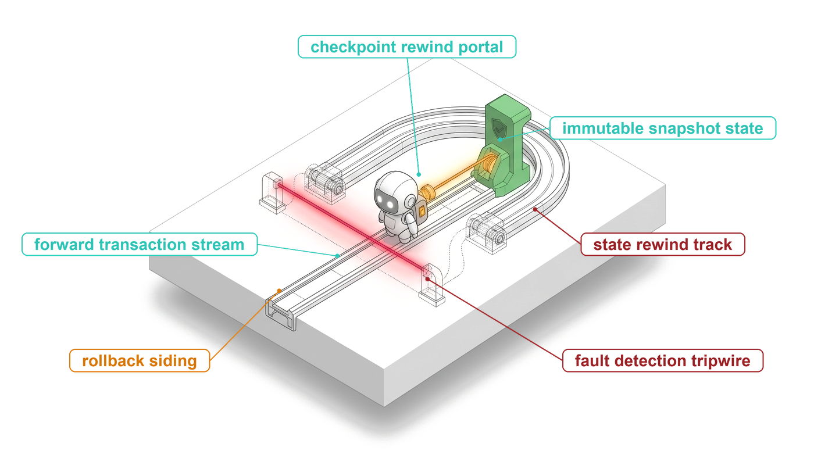
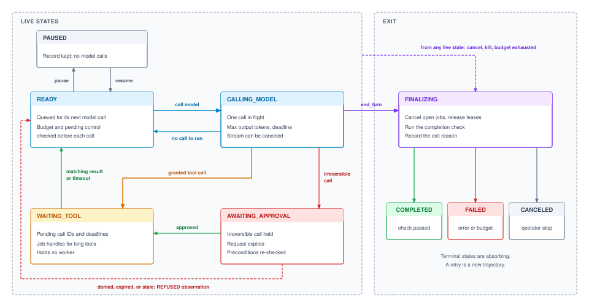
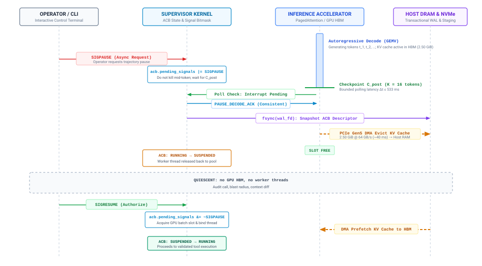
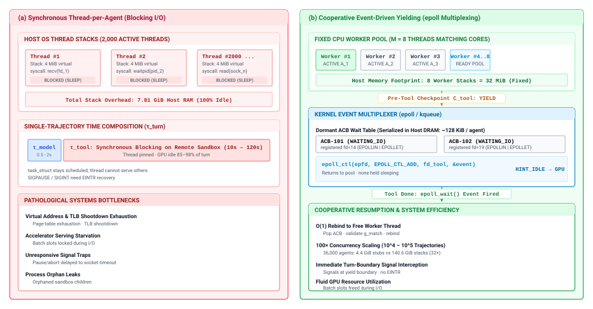
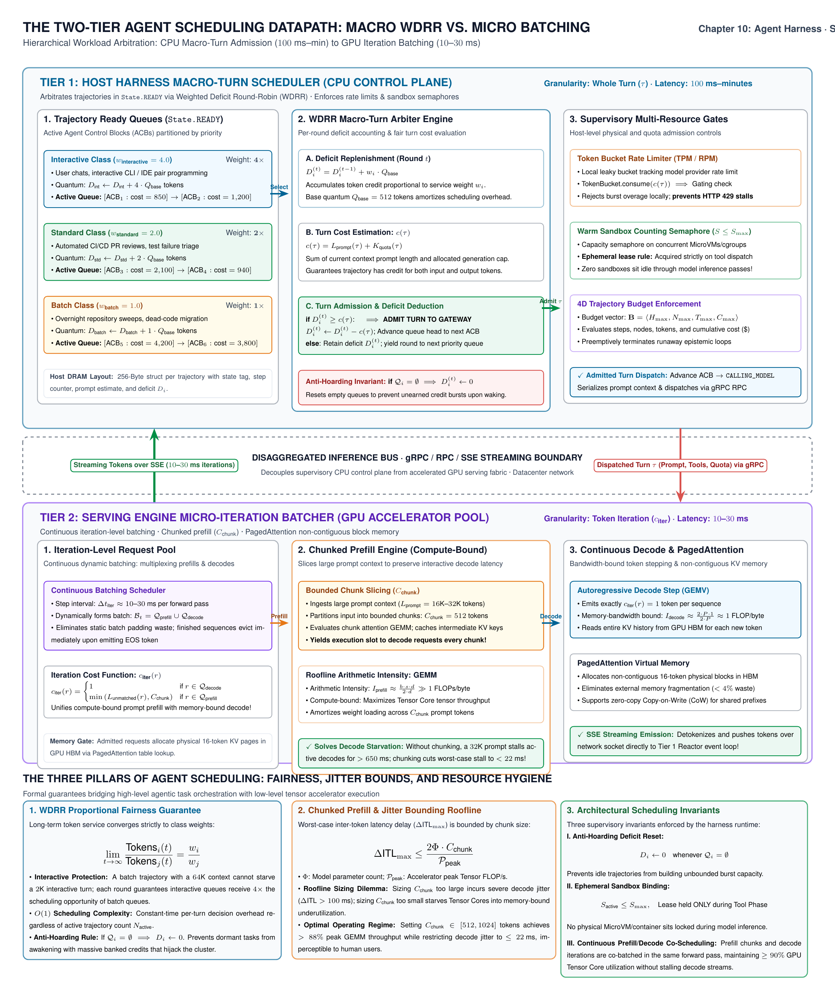
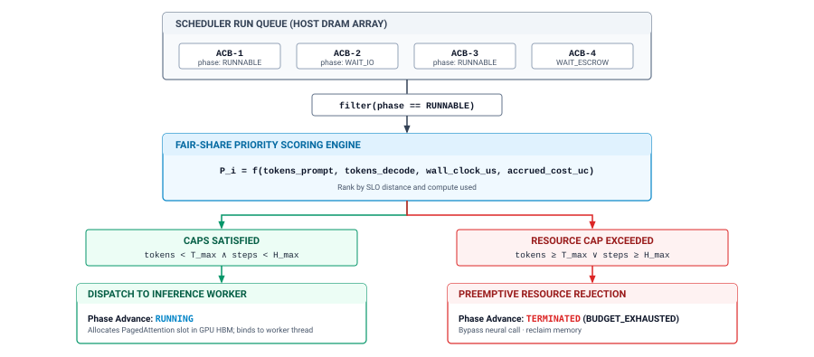
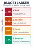

# The Agent Harness {#sec-vol3-agent-harness}

::: {layout-narrow}
::: {.column-margin}

\chapterminitoc

:::

::: {.content-visible when-format="pdf"}
\noindent
{fig-alt="Blueprint illustration for the agent harness chapter."}
:::

::: {.content-visible unless-format="pdf"}
{fig-alt="Blueprint illustration for the agent harness chapter."}
:::

:::

## Purpose {.unnumbered .unlisted}

\begin{marginfigure}
\mlagentstack{0}{0}{100}{0}{0}{0}
\end{marginfigure}

_Why does an agent loop that works for five turns fail when it is left to run for five hundred?_

A prototype agent is a loop around a model call, and for a short task the loop is enough. Left to run for hours, the same loop meets events it has no way to handle. A tool hangs and holds the whole trajectory with it. The model keeps proposing retries that are each well formed and none of which changes anything, so the bill grows while the task stands still. An operator needs to stop the run, but the loop listens only for the model's own signal that it is finished. A proposal to delete production data arrives and runs at once, because nothing stands between the proposal and the effect. All four failures share one cause. The only record of what the trajectory is doing, what it has spent, and what it is waiting for lives inside the loop and the model's context, where nothing outside can read or change it. The harness moves that record outside the model and uses it to pause, approve, bound, and stop a trajectory without asking the model to cooperate. It is the runtime's first closure for the horizon exposure of H·S·A, since every added turn is another chance to loop, stall, or overspend, and it is also where the authority exposure meets its hardest case, the irreversible action that no sandbox can undo.

::: {.content-visible when-format="pdf"}

\newpage

:::

::: {.callout-learning-objectives}

- Explain why a prototype agent loop cannot pause, bound, or stop a trajectory without the model's cooperation
- Design a trajectory record that keeps status, budgets, grants, and pending work outside the model's context
- Construct a closed trajectory state machine whose guards reject late tool results and illegal resumptions
- Apply cancel, pause, resume, and kill at turn boundaries using stop reasons and streaming cancellation
- Design an approval gate for irreversible tool calls with an expiry, a precondition re-check, and a refusal observation
- Calculate a trajectory's spend against a multi-dimensional budget and select a steer, restrict, and halt ladder
- Evaluate budget ceilings against measured cost-vs.-success curves rather than fixed rules of thumb

:::

## Transition from Naive While-Loops to Supervised Harnesses {#sec-vol3-controlplane-need}

::: {.column-margin}
{width="100%" fig-alt="H·S·A locator triad with the Horizon axis highlighted."}

*The horizon exposure, closed by a harness that keeps control outside the model.*
:::

### The anatomy of an unmanaged loop {#sec-vol3-harness-unmanaged-loop}

Consider one trajectory on a shared node, forty turns into a task it was expected to finish in five. Within the same minute, four events arrive. An operator wants to pause it for inspection, an interactive task from another tenant is waiting for the same model rate limit, its next proposal would drop a production table, and it has spent most of its budget without passing a test. A basic agent loop, written as a `while` loop around a model call, can act on none of these events. Its only exit is the stop reason with which the model ends a reply. The trajectory's phase, spending, pending tool calls, and permissions exist nowhere except in the message list and the interpreter's stack. If the process dies, the trajectory dies with it, and any process it started in its sandbox keeps running with no one to collect it.

Each of the four events asks for something the model cannot supply. Pausing needs a place outside the model where a request to stop can land and be honored at a safe moment. Yielding to the interactive tenant needs a scheduler that can see which trajectories are waiting and which are running. Holding the table drop needs a gate between the proposal and the tool. Stopping the unproductive spend needs a meter the model can neither read nor reset. Invariant closure (principle \ref{pri-invariant-closure}) already says where such bounds belong: in the runtime, below the model, enforced whatever the model proposes. Part II applied that rule to what the next call sees, and Part III applied it to what a single action may touch across tools and sandboxes. Part IV applies it to the loop itself, and the component that carries it is the harness.

The agent loop is frequently misconstrued through the classical metaphor of a CPU instruction fetch-decode-execute cycle, with the foundation model cast as an arithmetic logic unit (ALU). This metaphor breaks down across every physical systems dimension. In an actual computer systems architecture, instructions are deterministic, execution units are bounded by microarchitectural hazards, and instruction retirement takes single-digit nanoseconds. An autoregressive foundation model, by contrast, is a stochastic inference engine whose execution is fundamentally partitioned into two hardware regimes: compute-bound prefill over unmatched prompt tokens, and memory-bandwidth-bound autoregressive decoding where every emitted token requires streaming tens of gigabytes of parameter weights and key-value cache lines from High-Bandwidth Memory (HBM) to on-chip SRAM. Tool execution takes place not in an execution unit, but across IPC and network RPC boundaries into isolated sandboxes that run for milliseconds to minutes. Rather than a CPU instruction loop, the agent loop is an MLSys orchestrator that cycles across a deterministic 9-state pipeline: ingestion, prefix match, prefill, decode, actuation framing, RPC dispatch, tool execution, observation streaming, and context compaction.

::: {#dfn-agent-harness .callout-definition title="Agent harness"}

***Agent harness***\index{Agent harness!definition} is the runtime component that owns the agent loop for one trajectory, assembling each model call, interpreting the reply, deciding whether and when each proposed tool call is dispatched, and keeping the record through which anything outside the loop can inspect, pause, bound, or stop the trajectory.

1.  **Significance**: Every guarantee that must hold across turns (a turn cap, a dollar ceiling, an approval before an irreversible call, a clean stop on request) is enforced here or nowhere, because the model sees only its context and cannot be relied on to count, yield, or stop.
2.  **Distinction**: The tool layer decides whether one call is valid, authorized, and settled, and the sandbox bounds what that call can reach; the harness decides when calls happen at all, in what order, and whether the trajectory continues.
3.  **Common pitfall**: Treating the harness as glue code around the model, so that status, spend, and pending work live in local variables and prompt text that no scheduler, operator, or recovery path can read.

:::

@Fig-vol3-controlplane-arch contrasts the two designs. In panel (a), the prototype loop calls the model, runs whatever tool call comes back, and appends the result, so nothing outside the loop can intervene and nothing survives the process. In panel (b), the same loop runs inside a harness. The model still reads a context and returns a proposal, but the proposal goes to the harness, which consults a record it owns before anything happens. Granted calls cross into the tool and sandbox layers built in Part III, and observations come back through the harness before they reach the next context.

::: {.column-margin .margin-pointer}
↩ Complete mediation, schema validation, and sandboxed containment are established in @sec-vol3-tool-calling and @sec-vol3-sandboxes.
:::

::: {#fig-vol3-controlplane-arch fig-env="figure" fig-pos="htb" fig-cap="**The Prototype Loop vs. the Agent Harness**: Panel (a) shows the prototype agent loop, in which the model's reply is run directly and all trajectory state lives in the message list, so the loop cannot be stopped from outside, has no ceiling on spend, and dispatches irreversible calls at once. Panel (b) wraps the same loop in a harness that keeps a trajectory record, guards state transitions, applies control actions and approval gates, and enforces budgets, while the model proposes and the tool and sandbox layers execute only granted calls." fig-alt="Two stacked panels. The top panel shows a four-line while loop that calls a model, breaks on end_turn, runs the tool call, and appends the result, beside three boxes listing what the loop cannot do. The bottom panel shows three boxes connected by paired arrows: a model box, a harness box containing trajectory record, guarded state transitions, control actions and approval gates, and budgets and ceilings, and a tools and sandbox box."}

:::

### One turn of the harness lifecycle {#sec-vol3-harness-lifecycle-turn}

One turn of a harness makes the division of labor concrete. @Lst-vol3-harness-turn shows the decisions the harness makes around a single model call. Before calling the model it checks for pending control requests and for an exhausted budget. It calls the model with a ceiling on output tokens and a deadline. It charges the call from the provider's usage report, never from the model's own account. Then it branches on the stop reason. A reply that ends the turn goes to a completion check, a truncated reply is never dispatched, and a reply containing tool calls either waits at an approval gate or is dispatched through the tool layer.

::: {#lst-vol3-harness-turn lst-cap="**One Harness Turn**: The harness checks control requests and budgets, calls the model under per-call ceilings, charges measured usage, and branches on the stop reason before any tool call is dispatched."}
```python
def run_turn(rec: TrajectoryRecord) -> None:
    if rec.pending_control:                  # cancel, pause, kill
        return apply_control(rec)            # applied at a turn boundary
    if budget_exhausted(rec):
        return finalize(rec, reason="BUDGET_EXCEEDED")

    transition(rec, "CALLING_MODEL")
    reply = call_model(rec.context(),
                       max_tokens=rec.limits.max_output_tokens,
                       deadline=rec.limits.call_deadline)
    charge(rec, reply.usage)                 # metered, not self-reported

    if reply.stop_reason == "end_turn":
        return finalize(rec, reason="MODEL_ENDED")   # completion check
    if reply.stop_reason == "max_tokens":
        return observe(rec, truncation_notice(reply))  # never dispatched
    calls = reply.tool_calls
    if not calls:                            # refusal, stop sequence, text
        return observe(rec, reply)           # handled by policy, then READY
    if any(needs_approval(c, rec) for c in calls):
        return hold_for_approval(rec, calls)
    for c in calls:
        dispatch(rec, c)                     # validated, granted, keyed
    transition(rec, "WAITING_TOOL")
```
:::

Every line of the listing reads or writes `rec`, and the rest of the chapter follows those reads and writes in order. The record itself comes first, because the harness cannot enforce anything about a trajectory it cannot describe. The states and the guarded `transition` function come next, then the control actions and stop reasons that drive them, the waits on tools and on people, the scheduler that chooses which ready trajectory runs, and finally the budgets behind `charge` and `budget_exhausted`.

### The harness sensitivity frontier {#sec-vol3-harness-sensitivity-frontier}

The profound performance divergence between an unadorned string-concatenating while loop and an architected agent harness is not merely theoretical; it is empirically measurable across complex reasoning environments. As demonstrated in @fig-vol3-harness-sensitivity, benchmarking the exact same foundation model policy on a verified programmatic execution subset of ARC-AGI transformation grids [@chollet2019measure] reveals the **Harness Sensitivity Law**. Under a standard while-loop ReAct scaffold [@yao2023react] that passes unstructured textual frames and unmanaged scratchpad notes, the model solves only 35.2 percent to 62.7 percent of tasks across search budgets. In contrast, wrapping the identical neural weights in a stateful Provider Adapter Harness—which maintains native key-value cache prefix trees, enforces schema-validated state frames, and decouples tool execution from memory stranding [@yang2024sweagent]—catapults task accuracy to 99.95 percent on this programmatic verification suite. This 37.24 percentage-point capability leap proves that an agent's real-world competence and operational efficiency are bounded by the architectural fidelity of its harness state machine, rather than neural parameter scaling alone.

::: {#fig-vol3-harness-sensitivity fig-env="figure" fig-pos="htb" fig-cap="**The Harness Sensitivity Frontier**: Empirical solve rate for identical foundation model weights across harness architectures on a verified programmatic execution subset of ARC-AGI transformation grids [@chollet2019measure]. Transitioning from an ephemeral while-loop ReAct scaffold [@yao2023react] to a native stateful adapter harness yields a 37.24 percentage-point capability gain (from 62.7 percent to 99.95 percent), demonstrating that runtime harness state machines dominate raw parameter scaling." fig-alt="Bar chart visualizing the Harness Sensitivity Frontier. The graph plots programmatic reasoning solve rates across six configurations on ARC-AGI transformation grid tasks, rising from 35.2 percent, 54.8 percent, and 62.7 percent under while-loop scaffolds to 98.4 percent, 98.5 percent, and 99.95 percent under stateful adapter harnesses, highlighted by a red arrow marking a 37.24 percentage-point leap."}

```{python}
#| echo: false
# ┌─────────────────────────────────────────────────────────────────────────────
# │ THE HARNESS SENSITIVITY FRONTIER (FIGURE)
# ├─────────────────────────────────────────────────────────────────────────────
# │ Context: @fig-vol3-harness-sensitivity—harness architecture vs. while loops
# │
# │ Goal: Contrast interactive reasoning benchmark solve rates across scaffolds.
# │ Show: +37.24 percentage-point solve rate gain when transitioning from
# │       ephemeral while loops to stateful agent harnesses.
# │ How: Single-panel bar chart with category groupings and callout annotation.
# └─────────────────────────────────────────────────────────────────────────────
import sys
from pathlib import Path

for p in [Path(".").resolve(), Path("../..").resolve(), Path("../../..").resolve()]:
    if (p / "binder").exists():
        sys.path.insert(0, str(p))
        break

import matplotlib.pyplot as plt
import numpy as np
from binder.tools.figures import style as book_style

book_style.set_book_style()

fig, ax = plt.subplots(1, 1, figsize=(7.2, 4.4))

configs = [
    "ReAct\n(Zero Search)",
    "ReAct\n(High Search)",
    "ReAct\n(Max Search)",
    "Adapter\n(Medium)",
    "Adapter\n(Max Search)",
    "Adapter\n(High SOTA)",
]
scores = [35.18, 54.82, 62.71, 98.44, 98.55, 99.95]
bar_colors = ["#94A3B8", "#D97706", "#D97706", "#0284C7", "#0284C7", "#7C3AED"]

bars = ax.bar(range(len(configs)), scores, color=bar_colors, edgecolor="#0F172A", linewidth=0.9, width=0.54, zorder=3)
ax.set_ylim(0, 122)
ax.set_xticks(range(len(configs)))
ax.set_xticklabels(configs, fontsize=8.0, fontweight="bold")
ax.set_ylabel("Programmatic reasoning solve rate (%)", fontsize=9.0, fontweight="bold")
ax.grid(axis="y", linestyle="--", linewidth=0.5, color="#CBD5E1", alpha=0.7, zorder=1)
ax.spines["top"].set_visible(False)
ax.spines["right"].set_visible(False)

for bar, score in zip(bars, scores):
    yval = bar.get_height()
    score_txt = f"{score:.2f}%" if score > 99.0 else f"{score:.1f}%"
    ax.text(bar.get_x() + bar.get_width() / 2.0, yval + 2.5, score_txt, ha="center", va="bottom", fontsize=7.6, fontweight="bold")

ax.annotate(
    "+37.24% Solve Rate Leap",
    xy=(2.28, 63.5),
    xytext=(0.45, 92),
    arrowprops=dict(arrowstyle="->", color="#DC2626", lw=1.5),
    fontsize=8.0,
    fontweight="bold",
    color="#B91C1C",
    bbox=dict(boxstyle="round,pad=0.3", fc="#FEF2F2", ec="#FECACA", lw=0.8),
    zorder=10,
)

ax.plot([-0.25, 2.25], [-14, -14], color="#64748B", linewidth=1.2, clip_on=False)
ax.text(1.0, -18, "Ephemeral While Loops", ha="center", fontsize=7.5, fontweight="bold", color="#64748B", clip_on=False)

ax.plot([2.75, 5.25], [-14, -14], color="#7C3AED", linewidth=1.2, clip_on=False)
ax.text(4.0, -18, "Stateful Agent Harnesses", ha="center", fontsize=7.5, fontweight="bold", color="#7C3AED", clip_on=False)

plt.tight_layout()
plt.show()
plt.close()
```
:::

This empirical divergence illustrates why the harness state machine is a first-class systems primitive. An unmanaged while loop degrades on complex reasoning tasks due to three compounding failure modes: transcript bloat ($O(T^2)$ token re-transmissions that evict prefix caches), unvalidated schema drift (allowing hallucinated arguments to execute silently), and lack of transaction rollback (causing transient environment faults to permanently poison the trajectory context). By contrast, an architected harness enforces invariant closure below the model policy.

The architectural mechanisms underlying this performance and cost divergence are summarized in @tbl-vol3-harness-scaffold-comparison. While an unadorned while-loop scaffold re-transmits growing context strings and maintains unmanaged tool executions, an architected agent harness manages memory, state representation, and execution invariants through deterministic systems primitives.

| Systems Dimension        | Ephemeral While-Loop Scaffold                                | Stateful Provider Adapter Harness                          |
|:-------------------------|:-------------------------------------------------------------|:-----------------------------------------------------------|
| **Context Management**   | Naive string re-send ($O(T^2)$ token bloat)                  | Native key-value cache prefix reuse (shared prompt blocks) |
| **State Representation** | Unstructured, free-form scratchpad text                      | Typed Trajectory Record (Agent Control Block)              |
| **Tool Suspension**      | Synchronous blocking remote call (accelerator memory pinned) | Cooperative asynchronous yielding and eviction             |
| **Error Recovery**       | Process abort on fatal execution fault                       | Deterministic checkpoint rollback and repair               |
| **Action Invariants**    | Unchecked tool proposal dispatch                             | Pre-flight capability and schema validation                |
: **Scaffold versus Harness Systems Comparison**: Architectural mechanisms distinguishing ephemeral while loops from stateful agent harnesses. {#tbl-vol3-harness-scaffold-comparison}

## The Trajectory Record {#sec-vol3-controlplane-acb}

A node runs five hundred trajectories, and an operator needs to know which of them are waiting on a person, which have spent more than 90 percent of their budget, and which still hold a sandbox. The transcripts cannot answer quickly, because a transcript records what was said, not what the trajectory holds, owes, or is waiting for. The same gap appears inside the harness on every turn. When a tool result arrives, the harness must know which calls are outstanding before it accepts the result, and when a cancel arrives, it must know which jobs and leases to release. The harness therefore keeps one small structured record per trajectory, and every mechanism in this chapter works through it.

::: {#dfn-trajectory-record .callout-definition title="Trajectory record"}

***Trajectory record***\index{Trajectory record!definition} is the per-trajectory control state that the harness owns and the model never writes: the trajectory's identity, current state, per-call limits, budgets and measured spend, grants and leases, pending work, and pointers to its context, plan, log, and workspace.

1.  **Significance**: It makes the whole trajectory, not the individual model call, the unit that can be scheduled, budgeted, paused, approved, and stopped, and it lets those operations run in time proportional to the number of trajectories rather than the length of their transcripts.
2.  **Distinction**: The transcript is what the model reads; the record is what the harness reads. The durable log is the history from which the record can be rebuilt; the record is the live projection the harness consults on every turn.
3.  **Common pitfall**: Storing control state in the prompt (for example, "you have used 40 of 50 turns") or letting the model's own claims update it, which turns every bound into a request the model may ignore.

:::

@Tbl-vol3-acb-schema groups the record's fields by the job each group lets the harness do. Most groups belong to mechanisms owned elsewhere in the book; the record is where the harness keeps its handle on them.

| Field group           | Contents                                                                                     | What it lets the harness do                                                             |
|:----------------------|:---------------------------------------------------------------------------------------------|:----------------------------------------------------------------------------------------|
| **Identity**          | Trajectory ID, parent ID, tenant, task contract                                              | Route control requests, charge the right tenant, link a retry or subagent to its origin |
| **Status**            | Current state, exit reason, turn count                                                       | Answer "what is this trajectory doing" without reading its transcript                   |
| **Per-call limits**   | Model version, sampling parameters, maximum output tokens, call deadline                     | Bound and reproduce each model call                                                     |
| **Budgets and spend** | Ceilings on turns, tokens, wall-clock time, and dollars; measured use of each                | Enforce ceilings the model cannot see or reset                                          |
| **Grants and leases** | Tool grants, workspace lease, credential handle                                              | Narrow authority mid-trajectory and release everything on exit                          |
| **Pending work**      | Outstanding tool call IDs and deadlines, job handles, held approval, pending control request | Accept only matching results and cancel exactly what is still open                      |
| **Pointers**          | Context store, plan, log position, workspace snapshot                                        | Reach bulky state without copying it into the record                                    |

: **Trajectory Record Fields**: The record groups the control state the harness needs on every turn, with pointers to the context, plan, log, and workspace owned by other parts of the runtime. {#tbl-vol3-acb-schema}

The pointer group explains why the record stays small. It references the transcript, the plan, and the workspace instead of containing them, so a status query, a budget check, or a scheduling decision touches a few hundred bytes rather than hundreds of thousands of tokens. The same discipline applies to the serving side. A trajectory's attention state in the serving system is expensive to hold and cheap to reference, and whether it stays resident while the trajectory waits is a serving decision made under KV cache swapping. The record carries the reference and the harness supplies the expected wait, but the record never becomes a place where that state lives.

The second discipline concerns who writes. The model holds zero ambient authority, so nothing it emits changes the record directly. A claim in the model's output that the task is done, that little budget remains, or that a call is safe is an observation for the harness to evaluate, not an update to apply. Spend fields come from the usage the provider reports for each call, status changes only through transitions the harness validates, and grants narrow only by the harness's decision. This is trajectory-level encapsulation (principle \ref{pri-vol3-trajectory-encapsulation}) in concrete form. The whole trajectory is the unit the runtime schedules, budgets, and protects, and its control state sits where the model cannot reach it.

The record now holds everything the harness needs to describe a trajectory. A description is only as trustworthy as the rules that change it, however, and a status field that any code path can overwrite reproduces the failures of the prototype loop with an extra layer of indirection. The next section closes the status field under a small set of guarded transitions.

### Decoupling control metadata from attention memory

To support thousands of concurrent agent sessions without exhausting host resources, the harness decouples lightweight trajectory control metadata from the memory-heavy transformer inference buffers. For an agent trajectory of length $L = 32{,}768$ tokens on a model with $H = 64$ layers, $N_{\text{kv}} = 8$ key-value heads, and dimension $D = 128$:
$$
M_{\text{KV}} = 2 \times H \times N_{\text{kv}} \times D \times L \times \text{sizeof(fp16)} = 2 \times 64 \times 8 \times 128 \times 32{,}768 \times 2 \approx 8.59 \text{ GB}
$$
Because physical HBM capacity is strictly bounded per accelerator SKU ($80\text{ GB}$ on an NVIDIA H100 SXM5 and $192\text{ GB}$ on a Blackwell B200), concurrently serving hundreds of agent trajectories will rapidly exhaust accelerator memory if dormant KV caches remain pinned.[^fn-hbm-capacity-bounds] The context token buffer occupies:
$$
M_{\text{tokens}} = L \times 4 \text{ bytes} = 32{,}768 \times 4 = 131{,}072 \text{ bytes} \approx 128 \text{ KB}
$$
In sharp contrast, the Agent Control Block (ACB) metadata structure requires a compact, fixed footprint:
$$
\text{SizeOf}(\text{ACB}) = 256 \text{ bytes}
$$
Maintaining 10,000 concurrent agent trajectories in memory requires only:
$$
M_{\text{control}} = 10{,}000 \times 256 \text{ bytes} = 2.56 \times 10^6 \text{ bytes} \approx 2.44 \text{ MB}
$$

::: {.column-margin .margin-pointer}
⇄ Trajectory records occupy lightweight host memory (~4 KB); active KV caches lock gigabytes of accelerator HBM per trajectory.
:::

### Operating system derivation and the 256-byte agent control block

The Agent Control Block is not an arbitrary application-level state dictionary; it is the direct operating system analog of the classical Process Control Block (PCB) (@saltzer1975), adapted to the memory hierarchy and execution model of the Stochastic Computer. In a POSIX operating system, the kernel never stores user process memory or file contents inside the PCB; rather, the PCB stores bounded descriptors, CPU register snapshots, page table pointers (`CR3`), open file descriptor tables, credentials (`struct cred`), and scheduler entities (`struct sched_entity`).

The ACB operationalizes this exact separation of concerns for agent execution:

1. **Instruction Pointer $\longleftrightarrow$ Context Token Pointer & WAL Offset:** Just as `$pc` points to the next executable opcode in memory, `context_buf_ptr` and `wal_stream_offset` point to the token position and durable log offset from which agent generation proceeds.
2. **Page Table Root (`CR3`) $\longleftrightarrow$ PagedAttention KV Lease (`kv_lease_id`):** Rather than holding multi-gigabyte attention tensors, the ACB holds a 64-bit lease ID indexing disaggregated PagedAttention block tables in accelerator HBM or host DRAM (@sec-vol3-kvcache-pagedattention).
3. **File Descriptor Table $\longleftrightarrow$ Sandbox IPC & Escrow Descriptors:** Host UNIX sockets, guest sandbox connections, and held approval manifests are mapped directly into integer handles and correlation IDs.
4. **Process Credentials (`struct cred`) $\longleftrightarrow$ Macaroon Capability Pointer (`cap_token_ptr`):** Rather than granting ambient permissions, the ACB points to an unforgeable, monotonically attenuated Macaroon token (@sec-vol3-security-confused-deputy).
5. **Scheduler Entity (`sched_entity`) $\longleftrightarrow$ Deficit Round-Robin Envelopes:** Turn counters, token accumulators, priority weights, and financial spend meters enforce multi-dimensional resource bounds outside the model's awareness.

```c
// Packed 256-byte Agent Control Block (ACB) Descriptor
struct __attribute__((__packed__, aligned(64))) AgentControlBlock {
    // 1. Identity & Provenance (32 bytes)
    uint64_t trajectory_id;          // Unique 64-bit trajectory identifier
    uint64_t parent_id;              // Parent trajectory ID (0 for root session)
    uint64_t tenant_id;              // Tenant/customer identity for quota and isolation
    uint64_t task_contract_hash;     // SHA-256 prefix of Task Contract C

    // 2. Lifecycle State & Phase Bitmasks (24 bytes)
    uint32_t macro_state;            // READY, CALLING_MODEL, WAITING_TOOL, etc.
    uint32_t datapath_phase;         // QUIESCENT, STAGING, STREAM_DECODE, etc.
    uint64_t pending_signals;        // Atomic bitmask for SIGPAUSE, SIGKILL, etc.
    uint64_t exit_reason_code;       // Structured termination/error status code

    // 3. Monotonic Clocks & Deadlines (32 bytes)
    uint64_t created_epoch_ns;       // Monotonic epoch timestamp at creation
    uint64_t turn_deadline_ns;       // Monotonic deadline for active model/tool turn
    uint64_t trajectory_deadline_ns; // Hard wall-clock execution ceiling
    uint64_t last_transition_ns;     // Timestamp of last verified state transition

    // 4. Multi-Dimensional Accounting & DRR (48 bytes)
    uint64_t turn_count;             // Completed turn iteration counter
    uint64_t tokens_in_cumulative;   // Input tokens billed across all turns
    uint64_t tokens_out_cumulative;  // Output tokens billed across all turns
    uint64_t cost_cents_cumulative;  // Financial spend in micro-dollars/cents
    int64_t  drr_deficit_credits;    // Deficit Round-Robin token accumulator
    uint32_t priority_weight;        // Scheduling weight (interactive=4, batch=1)
    uint32_t step_token_quota;       // Token generation ceiling for current turn

    // 5. Memory & Storage Indirection Pointers (32 bytes)
    uint64_t context_buf_ptr;        // Host virtual address of token sequence buffer
    uint64_t kv_lease_id;            // 64-bit PagedAttention GPU/host block lease ID
    uint64_t wal_stream_offset;      // NVMe append-only Write-Ahead Log byte offset
    uint64_t cap_token_ptr;          // Host virtual address of Macaroon capability

    // 6. Kernel Reactor & Sandbox Handles (32 bytes)
    int32_t  guest_sandbox_fd;       // UNIX domain socket / vsock to sandbox runtime
    int32_t  active_stream_fd;       // Socket descriptor for model SSE/gRPC stream
    uint64_t pending_call_id;        // Active tool invocation correlation ID
    uint64_t held_escrow_handle;     // Identifier of staged approval manifest
    uint64_t epoll_user_data;        // Self-pointer for O(1) epoll_data.ptr dereference

    // 7. Reserved Alignment Padding (56 bytes)
    uint8_t  _reserved[56];          // Zero-padded to exact 256-byte cache line boundary
}; // sizeof(struct AgentControlBlock) == 256 bytes
```

The ACB achieves this radical memory decoupling by acting as a descriptor holding indirection handles to external physical resources, indexing non-contiguous KV-cache pages via PagedAttention block tables.[^fn-paged-attention-overhead] When an agent enters an extended tool wait or approval escrow, retaining its $8.59\text{ GB}$ KV cache on GPU pins memory that could serve active batches; migrating these blocks over PCIe to host DRAM frees accelerator capacity, though migration is bounded by interconnect bandwidth.[^fn-kv-eviction-bandwidth] As detailed in @tbl-vol3-acb-pointers:

| Pointer Reference   | Target Subsystem / Memory Tier | Physical Storage Location       | Indirection & Attenuation Invariant                                                             |
|:--------------------|:-------------------------------|:--------------------------------|:------------------------------------------------------------------------------------------------|
| `context_buf_ref`   | Logical Token Buffer           | Host System RAM                 | Monotonically growing sequence of token IDs and role boundaries; shared across prefill batches. |
| `kv_lease_id`       | Physical PagedAttention Tables | GPU High-Bandwidth Memory (HBM) | Bound to inference engine memory lease; migratable to host DRAM or evictable under contention.  |
| `wal_stream_offset` | Append-Only Write-Ahead Log    | Local NVMe Flash Storage        | Monotonically advancing byte offset enforcing durable state recovery before turn dispatch.      |
| `cap_token_ref`     | Attenuated Capability Tokens   | Supervisor Secure Memory        | Cryptographically signed Ed25519 tokens enforcing zero ambient authority across sandboxes.      |

: **Agent Control Block Memory Indirection Architecture**: Memory tiers, physical hardware boundaries, and supervisory isolation invariants for ACB descriptor pointer fields. {#tbl-vol3-acb-pointers}

The architectural trade-offs between thread-per-agent, async coroutines, and ACB descriptor registries are compared in @tbl-vol3-concurrency-models.

| Systems Dimension             | Synchronous Thread-per-Agent                                                | Cooperative Event-Driven Yielding                                      |
|:------------------------------|:----------------------------------------------------------------------------|:-----------------------------------------------------------------------|
| **Worker Concurrency**        | Bounded by OS thread limits ($10^2\text{--}10^3$ threads)                   | Bounded only by host memory descriptors ($10^4\text{--}10^5$ ACBs)     |
| **Idle Memory Footprint**     | $2\text{--}8\text{ MB}$ per idle trajectory (thread stack + kernel structs) | $64\text{--}128\text{ KB}$ per idle trajectory (serialized ACB in RAM) |
| **Signal Interception**       | Blocked in kernel syscalls; requires `EINTR` retry handling                 | Immediate; signal bits evaluated at checkpoint before thread release   |
| **Accelerator Serving Slots** | Pinned or leaked during tool execution; poor GPU utilization                | Released immediately; GPU resources service active decode queues       |
| **Failure Blast Radius**      | Worker crash destroys thread stack and leaves sandbox orphaned              | ACB outlives the worker; crash recovery needs a durable log            |
: **Synchronous versus Cooperative Execution Architecture**: Quantitative comparison of concurrency limits, memory footprint, signal responsiveness, and fault recovery across agent execution models. {#tbl-vol3-concurrency-models}

[^fn-hbm-capacity-bounds]: **High-Bandwidth Memory Capacity Boundaries**: While HBM delivers multi-terabyte-per-second memory bandwidth, physical capacity remains constrained ($80\text{ GB}$ on H100 SXM5 and $192\text{ GB}$ on B200). In multi-agent deployments serving dozens of concurrent trajectories, memory pressure forces aggressive eviction of inactive KV blocks rather than persistent GPU retention. Runtimes employ radix tree cache sharing to retain common prefix prompts in HBM while paging transient agent observation buffers to host memory.

[^fn-paged-attention-overhead]: **PagedAttention Block Table Overhead**: Decoupling virtual sequence token indices from physical GPU memory requires traversing block tables mapped across high-bandwidth memory. For a 16-token block size, pointer translation adds less than 1.5 percent kernel execution overhead compared to contiguous allocations. However, severe block table fragmentation or excessive indirection across multi-turn agent trees can degrade TLB efficiency and memory burst alignment.

[^fn-kv-eviction-bandwidth]: **Host Device Eviction Bandwidth**: Migrating inactive KV-cache blocks from accelerator HBM to host DRAM over a PCIe 5.0 $\times 16$ interconnect is bounded by an effective bidirectional transfer rate of approximately $63\text{ GB/s}$. Offloading an $8.59\text{ GB}$ KV cache for a 32,768-token trajectory consumes roughly $136\text{ ms}$ of interconnect time. Consequently, the harness only offloads cache blocks when the anticipated tool execution latency exceeds the round-trip direct memory access (DMA) transfer overhead.

## Trajectory States {#sec-vol3-controlplane-statemachine}

Two failures show what an unguarded status field allows. In the first, a trajectory dispatches a test suite with a ten-minute deadline. The deadline passes, the harness appends a timeout observation, and the model proposes a different approach. A minute later the original run finishes and its result arrives. If the harness appends it, the next call sees two contradictory observations about the same call, one saying it timed out and one saying it passed. This race, a late result crossing a newer decision, is an **observation crossing**\index{Observation crossing}. In the second failure, a trajectory is waiting for a person to approve a database drop, and a retry path elsewhere in the harness, seeing an idle trajectory, calls the model again and dispatches whatever it proposes. Both failures come from code that sets the status instead of asking whether the change is legal.

The harness prevents both by giving the trajectory a closed set of states and allowing only the transitions between them that the design names. @Tbl-vol3-lifecycle-states lists the states by what each one holds and where it may go next. Six are live and three are terminal.

| State                             | Meaning                                    | What the trajectory holds                           | Legal next states                                          |
|:----------------------------------|:-------------------------------------------|:----------------------------------------------------|:-----------------------------------------------------------|
| `READY`                           | Queued for its next model call             | The record only                                     | `CALLING_MODEL`, `PAUSED`, `FINALIZING`                    |
| `CALLING_MODEL`                   | One model call in flight                   | An open request with an output ceiling and deadline | `READY`, `WAITING_TOOL`, `AWAITING_APPROVAL`, `FINALIZING` |
| `WAITING_TOOL`                    | Tool calls dispatched, results outstanding | Pending call IDs, deadlines, job handles            | `READY`, `FINALIZING`                                      |
| `AWAITING_APPROVAL`               | An irreversible call held for a decision   | The held call, its approval request, an expiry      | `WAITING_TOOL`, `READY`, `FINALIZING`                      |
| `PAUSED`                          | Held at a turn boundary for a person       | The record only                                     | `READY`, `FINALIZING`                                      |
| `FINALIZING`                      | Cleanup before exit                        | Open jobs to cancel, leases to release              | `COMPLETED`, `FAILED`, `CANCELED`                          |
| `COMPLETED`, `FAILED`, `CANCELED` | Terminal                                   | Nothing                                             | None                                                       |

: **Trajectory States**: The closed state set of the harness, what a trajectory holds in each state, and the transitions each state permits. {#tbl-vol3-lifecycle-states}

@Fig-vol3-acb-lifecycle draws the same machine. The main cycle runs from `READY` through `CALLING_MODEL` to `WAITING_TOOL` and back. A reply with nothing to run, such as plain text or a truncated reply, returns directly to `READY` with an observation for the next call. An irreversible call diverts to `AWAITING_APPROVAL`, which leaves either toward `WAITING_TOOL` when the call is approved and still valid or back to `READY` with a refusal observation. Every exit, whether the model ended its turn or an operator, a kill, or an exhausted budget ended the run, passes through `FINALIZING`.

`PAUSED` is entered only from `READY`, and that holds even when the pause is forced rather than requested. When automated recovery cannot continue, for example because an action that should undo an earlier step has failed for good, the failure can surface in any live state, often `WAITING_TOOL`. The harness then escalates to an operator in two steps. It first settles whatever is in flight, canceling an open model call, withdrawing a held approval, and canceling each outstanding tool call or marking it in doubt when cancellation cannot be confirmed, which returns the trajectory to `READY` with nothing outstanding. Only then does it pause the trajectory through the ordinary guarded transition and revoke its grants. Escalation therefore adds no path to the machine, and the operator inherits a trajectory with no half-finished work. Failure recovery describes the failures that lead there. Furthermore, when a trajectory enters `AWAITING_APPROVAL` or `PAUSED`, operator response latency routinely spans hours. To avoid stranding scarce GPU High-Bandwidth Memory during extended pauses, the runtime dispatches cache eviction commands to the serving engine, freeing device memory blocks while preserving radix-tree prefix hashes on host storage (@sec-vol3-kvcache-swapping).

Crucially, while this in-memory state machine coordinates active host execution, an in-memory record cannot survive a supervisor daemon crash or machine reboot. To achieve crash consistency and operational durability, every state transition in @tbl-vol3-lifecycle-states must be persisted to an append-only Write-Ahead Log (WAL) before execution proceeds, as formalized in @sec-vol3-durable-execution.

::: {#fig-vol3-acb-lifecycle fig-env="figure" fig-pos="htb" fig-cap="**Trajectory State Machine**: Six live states and three terminal states. A trajectory cycles through READY, CALLING_MODEL, and WAITING_TOOL, diverts irreversible calls to AWAITING_APPROVAL, and pauses only from READY, including when failed recovery escalates the trajectory to an operator. Every exit passes through FINALIZING, which cancels open work, releases leases, and runs the completion check before the trajectory settles in an absorbing terminal state." fig-alt="State diagram with a live-states region and an exit region. Live states are PAUSED, READY, CALLING_MODEL, WAITING_TOOL, and AWAITING_APPROVAL, connected by labeled arrows: pause and resume, call model, no call to run, granted tool call, irreversible call, approved, matching result or timeout, and a dashed arrow for denied, expired, or stale requests back to READY. An end_turn arrow and a dashed arrow from any live state lead to FINALIZING, which leads to COMPLETED, FAILED, and CANCELED."}

:::

The completion path deserves care. A stop reason of `end_turn` is the model's claim that it is finished, and the harness treats it as a request to run the task's completion check, not as success. `FINALIZING` runs whatever check the task contract specifies, at the required closure evidence level, and records `COMPLETED` only if the check passes. Whether a completed trajectory also counts as an accepted task, and how often a given agent reaches one, is the core measurement problem.

::: {.column-margin .margin-pointer}
↪ Sealed verifiers, independent test fixtures, and acceptance criteria are developed in @sec-vol3-evaluation.
:::

Four invariants make the machine a guard rather than a diagram:

1. A tool result is accepted only in `WAITING_TOOL`, and only if its call ID is still pending. When a deadline passes, the harness removes the call's ID from the pending set before it appends the timeout observation, so the late result in the first failure above finds no matching ID and is dropped and logged. This closes the observation crossing.
2. A held call leaves `AWAITING_APPROVAL` for dispatch only through an approval that passes the gate's re-check. No other path, including a retry path that finds the trajectory idle, can dispatch it, which closes the second failure.
3. Every exit passes through `FINALIZING`. That state is the cleanup barrier. It cancels outstanding jobs, releases the workspace lease and credentials, records the exit reason, and runs the completion check. A trajectory that jumps straight to a terminal state leaves orphaned processes and live credentials behind.
4. Terminal states are absorbing. No late result, operator action, or retry can revive a finished trajectory. A retry is a new trajectory with a new ID whose record names the old one as its parent, so the history of each attempt stays intact for evaluation and debugging.

@Lst-vol3-guarded-transition implements the guard. Every state change in the harness goes through one function that checks the transition against the legal set, evaluates any guard attached to it, and records the change, all under the record's lock so that two concurrent events cannot both succeed.

::: {#lst-vol3-guarded-transition lst-cap="**Guarded Transitions**: Every state change passes through one function that checks the legal transition set and the transition's guard under the record's lock, and tool results are accepted only for pending call IDs."}
```python
LIVE = {"READY", "CALLING_MODEL", "WAITING_TOOL",
        "AWAITING_APPROVAL", "PAUSED"}
LEGAL = {("READY", "CALLING_MODEL"), ("READY", "PAUSED"),
         ("CALLING_MODEL", "READY"), ("CALLING_MODEL", "WAITING_TOOL"),
         ("CALLING_MODEL", "AWAITING_APPROVAL"),
         ("WAITING_TOOL", "READY"), ("AWAITING_APPROVAL", "WAITING_TOOL"),
         ("AWAITING_APPROVAL", "READY"), ("PAUSED", "READY")}
LEGAL |= {(s, "FINALIZING") for s in LIVE}
LEGAL |= {("FINALIZING", t) for t in ("COMPLETED", "FAILED", "CANCELED")}

def transition(rec, new_state, event):
    with rec.lock:
        key = (rec.state, new_state)
        guard = GUARDS.get(key, lambda rec, event: True)
        if key not in LEGAL or not guard(rec, event):
            raise IllegalTransition(rec.state, new_state, event)
        rec.history.append((rec.state, new_state, event.id))
        rec.state = new_state

def on_tool_result(rec, result):
    with rec.lock:
        if rec.state != "WAITING_TOOL" or result.call_id not in rec.pending:
            audit(rec, "late_or_unknown_result", result.call_id)
            return                                  # dropped, never appended
        rec.pending.remove(result.call_id)
        append_observation(rec, result)
```
:::

The guard costs a lock, a set lookup, and an append, which is negligible next to a model call measured in seconds, so there is no performance argument for skipping it. The state machine now says which transitions are legal. It does not yet say who may request a transition from outside the loop, or when such a request takes effect if it arrives while a model call is streaming.

::: {#chk-09-agent-control-block .callout-checkpoint title="Trajectory record and states"}

- [ ] **Record vs. transcript**: Why must pending call IDs and measured spend live in the record rather than in the transcript the model reads?
- [ ] **Observation crossing**: Which invariant rejects a tool result that arrives after its deadline, and in what order must the harness update the record to make that work?
- [ ] **Cleanup barrier**: What would leak if a canceled trajectory moved directly from `WAITING_TOOL` to `CANCELED`?
- [ ] **Retry identity**: Why is a retry a new trajectory rather than a finished trajectory returned to `READY`?

:::

### Formal state transition invariants

The execution cycle of an agent loop is not an instruction fetch-decode-execute cycle of a CPU. Rather, the runtime operates as a **hierarchical statechart** reconciling supervisory lifecycle management with physical accelerator memory and I/O boundaries:

1. **Supervisory Macro-States (`acb.state` $\in \mathcal{S}_{\text{macro}}$)**:
   The outer supervisory lifecycle governs turn scheduling, operator preemptions, escrow approvals, and resource teardown (@fig-vol3-acb-lifecycle and @lst-vol3-guarded-transition):
   $$
   \mathcal{S}_{\text{macro}} = \{\text{READY}, \text{CALLING\_MODEL}, \text{WAITING\_TOOL}, \text{AWAITING\_APPROVAL}, \text{PAUSED}, \text{FINALIZING}, \text{COMPLETED}, \text{FAILED}, \text{CANCELED}\}
   $$
2. **Physical Datapath Micro-Phases (`acb.phase` $\in \mathcal{P}_{\text{datapath}}$)**:
   Within active execution, the execution loop cycles through physical MLSys datapath phases. When a trajectory is not actively computing in the datapath—such as while queued in `READY`, held in `PAUSED`, or waiting for human review in `AWAITING_APPROVAL`—its datapath phase is strictly `QUIESCENT`, holding zero active GPU execution locks or open socket streams:
   $$
   \mathcal{P}_{\text{datapath}} = \{\text{QUIESCENT}, \text{INGESTION}, \text{PREFIX\_MATCH}, \text{PREFILL}, \text{DECODE}, \text{ACTUATION\_FRAMING}, \text{RPC\_DISPATCH}, \text{TOOL\_EXEC}, \text{OBSERVATION\_INGEST}, \text{COMPACTION\_PERSIST}\}
   $$

During model inference (`CALLING_MODEL`), the datapath advances from `QUIESCENT` through host staging (`INGESTION`), KV-cache prefix resolution (`PREFIX_MATCH`), compute-bound prompt evaluation (`PREFILL`), and memory-bandwidth-bound autoregressive generation (`DECODE`) to tool call framing (`ACTUATION_FRAMING`). Once an action is framed, the supervisory state shifts to `WAITING_TOOL` (or diverts to `AWAITING_APPROVAL` with datapath `QUIESCENT` if the proposed mutation exceeds safety blast radii). Under `WAITING_TOOL`, the datapath traverses RPC serialization (`RPC_DISPATCH`), isolated sandbox execution (`TOOL_EXEC`), stream sanitization (`OBSERVATION_INGEST`), and write-ahead log persistence with KV-cache eviction (`COMPACTION_PERSIST`).

**Closing the Supervisory Lifecycle Loop:** Upon completing `COMPACTION_PERSIST`, the datapath transitions strictly to `QUIESCENT` and the supervisory state returns to `READY`. A naive implementation that jumps directly from `COMPACTION_PERSIST` to `INGESTION` breaks the supervisory lifecycle: it bypasses turn admission, evades multi-dimensional budget accounting, and ignores operator pause signals. Returning to `READY` forces the trajectory through the turn scheduler, ensuring that resource limits and pending signals are evaluated before any subsequent turn begins.

The hardware regimes, execution dynamics, and physical resource boundaries across the datapath phases are formalized in @tbl-vol3-mlsys-state-machine. During actuation framing, the runtime evaluates schema grammar constraints using fused logit-masking kernels in on-chip SRAM to eliminate syntactic failures prior to token emission.[^fn-kernel-fusion-masking] Similarly, upon observation ingestion, the runtime persists state deltas to write-ahead storage on local NVMe flash before releasing memory allocations.[^fn-atomic-wal-persistence]

| Datapath Phase            | Enclosing State                        | Subsystem & Physical Resource   | Bottleneck & Roofline Regime                                        | Operational Invariant & Transition Guarantee                                               |
|:--------------------------|:---------------------------------------|:--------------------------------|:--------------------------------------------------------------------|:-------------------------------------------------------------------------------------------|
| **0. QUIESCENT**          | `READY`, `PAUSED`, `AWAITING_APPROVAL` | Host DRAM / NVMe Storage        | Dormant / Event-Driven Wait                                         | Zero active GPU memory or CPU execution pinned; waiting on scheduler admission or I/O.     |
| **1. INGESTION**          | `CALLING_MODEL`                        | Host RAM / Staging Buffer       | Host memory bus / JSON deserialization throughput                   | Enforces immutable sequence ordering; prepares context descriptor for cache matching.      |
| **2. PREFIX_MATCH**       | `CALLING_MODEL`                        | GPU HBM / Radix Tree Tables     | Block table hash traversal latency ($< 0.5\text{ ms}$)              | Maximizes KV-cache block reuse; identifies unmatched token suffix $L_{\text{unmatched}}$.  |
| **3. PREFILL**            | `CALLING_MODEL`                        | GPU Tensor Cores / HBM          | Compute-bound ($O(L^2)$ attention, bounded by FLOP/s)               | High arithmetic intensity ($I \gg \beta$); establishes Time-To-First-Token (TTFT).         |
| **4. DECODE**             | `CALLING_MODEL`                        | GPU HBM Read Bandwidth / SRAM   | Memory-bandwidth bound ($O(N_{\text{tok}} \cdot \Phi / \text{BW})$) | Low arithmetic intensity ($I \approx 1\text{ FLOP/byte}$); bounded by Inter-Token Latency. |
| **5. ACTUATION_FRAMING**  | `CALLING_MODEL`                        | On-Chip SRAM / Tensor Cores     | Grammar DFA bitset evaluation latency ($< 30\ \mu\text{s}$)         | Fused logit masking guarantees syntactically valid JSON tool invocations.                  |
| **6. RPC_DISPATCH**       | `WAITING_TOOL`                         | Host Network / UNIX Sockets     | IPC transport latency ($0.2\text{--}2.0\text{ ms}$)                 | Serializes validated payloads; attaches capability tokens and idempotency keys.            |
| **7. TOOL_EXEC**          | `WAITING_TOOL`                         | Guest Container / MicroVM       | Guest CPU, RAM, and external network latency                        | Bounded by execution deadlines; executes side effects in quarantined workspace.            |
| **8. OBSERVATION_INGEST** | `WAITING_TOOL`                         | Host Event Loop / Socket Stream | Non-blocking socket I/O throughput                                  | Demultiplexes chunk streams; applies terminal sanitization and payload size limits.        |
| **9. COMPACTION_PERSIST** | `WAITING_TOOL`                         | Host DRAM / NVMe Flash Storage  | NVMe write bandwidth ($10\text{--}50\ \mu\text{s}$ per append)      | Flushes state delta to durable WAL; transitions to `QUIESCENT` and returns to `READY`.     |

: **The Ten-Phase MLSys Datapath Lifecycle**: Hardware regimes, execution dynamics, and physical resource boundaries across the stochastic inference and tool actuation datapath nested within supervisory macro-states. {#tbl-vol3-mlsys-state-machine}

[^fn-kernel-fusion-masking]: **Fused Logit Masking Kernels**: Evaluating grammar-constrained deterministic finite automaton (DFA) transitions during autoregressive decode requires applying a binary vocabulary mask to the unnormalized logit vector before softmax. Unfused implementations incur costly round-trip device memory traffic by reading logits into global HBM, applying the mask in a separate kernel, and re-reading for sampling. Fused logit-masking kernels evaluate DFA bitsets directly within accelerator on-chip SRAM registers, reducing masking latency to under 30 microseconds per token.

[^fn-atomic-wal-persistence]: **Durable State Persistence Overhead**: Persisting Agent Control Block updates and trajectory checkpoints to local NVMe storage incurs write latencies of $10\text{ to }50\text{ microseconds}$ per append-only log entry. By batching disk synchronization operations to safe turn boundaries, the harness prevents I/O write stalls from corrupting the inter-token generation budget. Uncommitted in-flight state remains isolated within host memory descriptors until validated by supervisory checksums.

@Lst-vol3-acb-transition implements strict guard checks preventing illegal datapath phase jumps within the execution loop.

::: {#lst-vol3-acb-transition lst-cap="**Datapath Phase Transition Guard Verification**: Validating datapath phase advances within the Agent Control Block."}
```python
def transition_phase(acb: AgentControlBlock, new_phase: DatapathPhase, event: Event) -> None:
    """Validate and apply datapath phase transitions under the record lock."""
    valid_transitions = {
        DatapathPhase.QUIESCENT: {DatapathPhase.INGESTION},
        DatapathPhase.INGESTION: {DatapathPhase.PREFIX_MATCH},
        DatapathPhase.PREFIX_MATCH: {DatapathPhase.PREFILL, DatapathPhase.DECODE},
        DatapathPhase.PREFILL: {DatapathPhase.DECODE},
        DatapathPhase.DECODE: {DatapathPhase.ACTUATION_FRAMING, DatapathPhase.DECODE},
        DatapathPhase.ACTUATION_FRAMING: {
            DatapathPhase.RPC_DISPATCH,  # Normal tool dispatch
            DatapathPhase.QUIESCENT,     # Approval escrow diversion or text end_turn
        },
        DatapathPhase.RPC_DISPATCH: {DatapathPhase.TOOL_EXEC},
        DatapathPhase.TOOL_EXEC: {DatapathPhase.OBSERVATION_INGEST},
        DatapathPhase.OBSERVATION_INGEST: {DatapathPhase.COMPACTION_PERSIST},
        DatapathPhase.COMPACTION_PERSIST: {
            DatapathPhase.QUIESCENT,     # Enforces return to READY through scheduler
        },
    }
    with acb.lock:
        if new_phase not in valid_transitions.get(acb.phase, set()):
            raise InvalidStateTransitionError(f"Illegal phase transition from {acb.phase} to {new_phase} via {event}")
        acb.phase = new_phase
        acb.last_event = event
        acb.last_transition_ns = current_epoch_ns()
```
:::

## Control Actions {#sec-vol3-controlplane-signals}

An operator presses stop while the model is streaming a tool call whose arguments so far read `{"action": "drop_table", "target": "cust`. Stopping at once leaves a fragment that is not a valid call; if the harness logs it as the trajectory's last proposal, a recovery path that later parses the log may try to complete it. Waiting for the call to finish means waiting for the model to emit the rest of a destructive request the operator is trying to prevent. Control requests arrive whenever people and policies send them, while the trajectory can only be changed safely at certain moments, and a harness needs a rule that reconciles the two.

The rule separates arrival from effect. When a control request arrives, the harness records it in the record's pending-control field and returns. It applies the request at the next **turn boundary**\index{Turn boundary}, a moment when no model call is in flight and no tool call is half dispatched. A trajectory reaches a turn boundary before each model call, after a model reply has been parsed but before anything is dispatched, after a tool result has been accepted, and on entering an approval wait. Because a trajectory cannot be relied on to yield or stop by itself, this control has to sit outside the model (principle \ref{pri-vol3-preemptive-interrupts}), and the turn boundary is where the harness exercises it. @Tbl-vol3-signal-vocabulary lists the requests a harness needs.

| Action              | Typically issued by               | Takes effect                                     | Resulting state                      |
|:--------------------|:----------------------------------|:-------------------------------------------------|:-------------------------------------|
| **Cancel**          | User, operator, parent trajectory | Next turn boundary; an in-flight call is aborted | `FINALIZING`, then `CANCELED`        |
| **Interrupt**       | User                              | Next turn boundary, as a new user message        | `READY`, with the message in context |
| **Pause**           | Operator, scheduler               | Next turn boundary                               | `PAUSED`                             |
| **Resume**          | Operator                          | Immediately                                      | `READY`                              |
| **Kill**            | Operator, security policy         | Immediately, even mid-turn                       | `FINALIZING`, then `FAILED`          |
| **Budget exceeded** | The harness's own meter           | Next turn boundary                               | `FINALIZING`, then `FAILED`          |

: **Control Actions**: The requests a harness accepts from outside the loop, who typically issues them, when each takes effect, and the state that results. {#tbl-vol3-signal-vocabulary}

Most requests wait for a turn boundary, which raises the question of how long a model call can take to reach one. A reply cannot end before it has emitted its last token, and decode time grows with the number of output tokens. The worst-case wait is therefore the output-token ceiling multiplied by the time per output token. For a call allowed thousands of output tokens, that can reach a minute or more, far too long for an operator stopping a destructive action. Two mechanisms shorten it. The first is the output-token ceiling itself, which bounds the wait along with the cost. The second is **streaming cancellation**\index{Streaming cancellation}: the harness streams every model call and, when a cancel, pause, or kill is pending, aborts the stream, discards the partial reply, and records a cancellation event in place of a proposal. The partial reply is never parsed into a tool call. A truncated or aborted completion cannot pass verification, so it cannot be dispatched (principle \ref{pri-02-quarantining-invariant}). Tokens emitted before the abort are still billed, and the harness charges them like any others.

Every model reply also reports why it ended. The status envelope of @tbl-vol3-invocation-status already fixes what the loop may do with each outcome of a call; the harness adds only where each outcome leaves the trajectory. An end-of-turn reply moves it to `FINALIZING` for the completion check. A reply with tool calls moves it to `AWAITING_APPROVAL` if any call is irreversible and to `WAITING_TOOL` otherwise. A reply cut off at its output limit, ended by a stop sequence, or refused returns it to `READY` with an observation for the next call, unless the task's policy escalates or finalizes a refusal. A failed or timed-out call returns it to `READY` for a retry while the budget allows and to `FINALIZING` once it does not.

Kill is the one request that does not wait. It exists for cases where finishing the turn is itself the hazard, such as a sandbox escape attempt or a runaway tool writing to shared storage. The harness aborts any model call, terminates every process in the trajectory's sandbox through process-group teardown, and enters `FINALIZING` with the reason recorded. Breaking a turn has a price. A tool call dispatched just before the kill may or may not have taken effect, and its outcome is now in doubt. The harness marks such calls as in doubt rather than failed and leaves them to the idempotency settlement machinery, which uses the call's idempotency key to learn whether the effect happened. When the trajectory has spawned subagents, cancel and kill must also reach them under multiagent backpressure.

Control actions give people and policies a way into the loop at well-defined moments. Most of a trajectory's wall-clock time, however, is spent not in model calls but waiting for tools to answer, and a request that arrives during that wait has to find the trajectory in a state where it can be applied.

### Safe inspection checkpoints and signal evaluation

Asynchronous signals must not interrupt execution arbitrarily. Terminating an agent in the middle of a non-atomic filesystem operation corrupts workspace state. The harness defines deterministic checkpoints where pending signals can be safely evaluated, as detailed in @tbl-vol3-safe-checkpoints.

| Checkpoint Symbol | Cycle Boundary    | Quiescent State & Invariant Guarantee                                                      | Supervisory Trap Mechanics                                                                  |
|:------------------|:------------------|:-------------------------------------------------------------------------------------------|:--------------------------------------------------------------------------------------------|
| $C_{\text{obs}}$  | Post-Observation  | Sandbox execution completed; observation envelope verified against pending I/O descriptor. | Traps pause/kill signals before context append; discards invalid observation payloads.      |
| $C_{\text{pre}}$  | Pre-Inference     | Context assembled and serialized; no pending tensor operations on inference engine.        | Intercepts signals prior to dispatching expensive prefill batch; evicts KV lease if paused. |
| $C_{\text{post}}$ | Post-Decode       | Autoregressive decode complete; grammar validated; proposed action unparsed.               | Captures cancellation or pause before mutating host state or validating tool parameters.    |
| $C_{\text{tool}}$ | Pre-Tool Dispatch | Tool arguments validated; security capability checked; no RPC dispatched.                  | Final safety gate; prevents uncommitted side effects in sandboxes or external systems.      |

: **Safe Inspection Checkpoints**: Turn-cycle boundaries, quiescence guarantees, and supervisory trap actions ensuring atomic signal delivery. {#tbl-vol3-safe-checkpoints}

The signal dispatch lifecycle and checkpoint evaluation are diagrammed in @fig-vol3-signal-handling.

::: {#fig-vol3-signal-handling fig-env="figure" fig-pos="htb" fig-cap="**Asynchronous Signal Interception and State Resumption**: End-to-end protocol sequence governing asynchronous signal trapping, turn-boundary synchronization, and state resumption. An operator `SIGPAUSE` is buffered in the ACB signal bitmask during active autoregressive decode. At the bounded sub-checkpoint $C_{\text{post}}$ ($K=16$ tokens, latency $\le 533\text{ ms}$), the supervisor intercepts execution, persists the ACB to durable storage, evicts 2.50 GB of KV cache over PCIe Gen5 to host DRAM, and places the agent into a quiescent suspended state. Upon receiving `SIGRESUME`, the supervisor re-stages memory and resumes tool dispatch without context tearing." fig-alt="Protocol ladder diagram depicting the interaction between Operator CLI, Supervisor Kernel, Inference Accelerator, and Host DRAM during asynchronous SIGPAUSE arrival, bounded token sub-checkpoint evaluation, PCIe DMA eviction, and SIGRESUME restoration."}

:::

@Lst-vol3-signal-eval implements checkpoint evaluation, allowing trajectories to pause or terminate cleanly.

::: {#lst-vol3-signal-eval lst-cap="**Evaluating Supervisory Signals at Checkpoints**: Checking pending asynchronous signals at safe trajectory boundaries."}
```python
def evaluate_signal_checkpoint(acb: AgentControlBlock, checkpoint: Checkpoint) -> bool:
    """Evaluate pending signals at deterministic trajectory checkpoints under record lock."""
    with acb.lock:
        if not acb.pending_signals:
            return True
        sig = acb.pending_signals.popleft()
        if sig == Signal.SIGPAUSE:
            acb.state = State.PAUSED
            acb.phase = DatapathPhase.QUIESCENT
            persist_trajectory_checkpoint(acb)
            return False
        elif sig == Signal.SIGCANCEL:
            acb.state = State.FINALIZING
            acb.phase = DatapathPhase.QUIESCENT
            acb.exit_reason_code = ExitCode.OPERATOR_CANCEL
            return False
        elif sig == Signal.SIGKILL:
            acb.state = State.FINALIZING
            acb.phase = DatapathPhase.QUIESCENT
            acb.exit_reason_code = ExitCode.FORCED_KILL
            release_sandbox_lease(acb.sandbox_id)
            return False
        return True
```
:::

## Asynchronous Tool Latency and Yielding Mechanisms {#sec-vol3-controlplane-yielding}

A coding agent's turn typically pairs a model call of a few seconds with a test suite, build, or search that takes far longer. Trajectory duration accounting splits each turn into model time, tool time, and waiting, and for tool-heavy tasks the tool term dominates. A harness that gives each trajectory its own worker and lets that worker block until the tool returns spends almost all of its workers waiting. With a thousand concurrent trajectories it holds a thousand blocked workers, and a blocked worker cannot notice that a cancel has arrived until its tool call returns or times out.

The fix is to let the record, not a blocked worker, represent a waiting trajectory. At dispatch the harness writes each call's ID and deadline into the pending set, moves the trajectory to `WAITING_TOOL`, and releases the worker to serve another trajectory. The tool's completion arrives later as an event. The harness applies the guard of @lst-vol3-guarded-transition, appends the observation, and moves the trajectory to `READY` once nothing remains pending. Any event-driven I/O runtime makes this cheap. The lesson is not the choice of event loop but the fact that a waiting trajectory costs a record and nothing else, so a cancel that arrives during the wait finds the trajectory in a state where the harness can act immediately, canceling the outstanding calls and moving to `FINALIZING`.

Three refinements complete the wait. Tools that run for minutes or hours return a job handle instead of a result. The harness stores the handle in the pending set, polls it or subscribes to its completion, and uses it to cancel the job when the trajectory is canceled. A reply that contains several parallel tool calls leaves the trajectory in `WAITING_TOOL` until every call has returned or passed its deadline, so the next model call sees a complete set of observations. Every dispatched call also carries a deadline. When the deadline passes, the harness removes the call's ID from the pending set, asks the tool layer to cancel the call, and appends a structured timeout observation. If the call had side effects, its outcome is in doubt in the same way as a call interrupted by a kill, and the same settlement machinery resolves it.

::: {.column-margin .margin-pointer}
↩ Asynchronous dispatch, job handle escrow, and event-driven resumption are developed in @sec-vol3-tool-calling.
:::

While the trajectory waits, its context's cached state in the serving system is not the harness's to manage. Retaining it, evicting it, recomputing it, or offloading it is a trade between memory held and recomputation paid, evaluated from how long the wait is expected to last. The harness contributes the one input it alone knows, the expected wait, derived from the call's deadline and the tool's history. A short lint call suggests keeping the state warm. A long test suite, a pause, or an approval wait suggests releasing it.

A tool wait ends when the tool answers or its deadline passes. The next kind of wait has no such bound on the machine side, because the party the trajectory waits for is a person deciding whether an irreversible call should run at all.

### End-to-end turn latency waterfall {#sec-vol3-harness-latency-waterfall}

Model token generation operates on millisecond scales ($10\text{--}50\text{ ms}$ per token), whereas external tool calls—such as compilation jobs, database queries, and web retrievals—frequently take seconds to minutes. If an agent thread synchronously blocks while awaiting external tool completion, it ties up valuable host concurrency slots and GPU worker capacity.

To analyze the physical time distribution across a turn, the harness models the end-to-end makespan using the **End-to-End Turn Latency Waterfall**:
$$
T_{\text{turn}} = T_{\text{prefix\_match}} + T_{\text{prefill}}(L_{\text{unmatched}}) + \sum_{i=1}^{N_{\text{tok}}} T_{\text{decode}, i} + T_{\text{dispatch}} + T_{\text{sandbox\_exec}} + T_{\text{stream\_ingest}}
$$
where each term corresponds to a distinct hardware regime across the 9-state MLSys state machine:

1. **Prefix Match Latency ($T_{\text{prefix\_match}}$)**: The latency to traverse PagedAttention radix trees and hash tables in accelerator memory to identify existing cached prefix blocks ($< 0.5\text{ ms}$).
2. **Prefill Duration ($T_{\text{prefill}}$)**: The time required to compute attention across unmatched prompt tokens $L_{\text{unmatched}} = L_{\text{total}} - L_{\text{cached}}$. Because all prompt tokens are processed in parallel, arithmetic intensity is high ($I_{\text{prefill}} \approx L_{\text{unmatched}}\text{ FLOP/byte}$). For typical agent prompts ($L_{\text{unmatched}} \ge 512$), $I_{\text{prefill}}$ far exceeds the accelerator machine balance $\beta = \mathcal{P}_{\text{peak}} / \text{BW}_{\text{HBM}}$, making prefill strictly **compute-bound** ($O(L^2)$ attention, or $O(L)$ with FlashAttention):
   $$
   T_{\text{prefill}}(L_{\text{unmatched}}) \approx \frac{2 \Phi \cdot L_{\text{unmatched}} + \mathcal{O}(L_{\text{unmatched}})}{\mathcal{P}_{\text{peak}}}
   $$
   bounded by Tensor Core peak floating-point throughput $\mathcal{P}_{\text{peak}}$ rather than memory bandwidth.
3. **Autoregressive Decode Duration ($\sum T_{\text{decode}, i}$)**: The cumulative time to emit $N_{\text{tok}}$ proposal tokens. For each emitted token, the entire model parameter weight matrix $\Phi$ and the growing KV cache must be streamed from HBM to on-chip SRAM for a batch size of unity, resulting in arithmetic intensity near unity ($I_{\text{decode}} \approx 1\text{ FLOP/byte} \ll \beta$). Consequently, autoregressive decoding is strictly **memory-bandwidth bound**:
   $$
   \sum_{i=1}^{N_{\text{tok}}} T_{\text{decode}, i} \approx \frac{N_{\text{tok}} \cdot 2 \Phi}{\text{BW}_{\text{HBM}}} + \sum_{i=1}^{N_{\text{tok}}} \frac{M_{\text{KV}}(L_{\text{prefix}} + i)}{\text{BW}_{\text{HBM}}}
   $$
   This physical ceiling dictates the Inter-Token Latency (ITL) floor across hardware SKUs.[^fn-sku-memory-bandwidth] On an NVIDIA H100 SXM5 ($3.35\text{ TB/s}$ HBM3), serving a 70B parameter model in FP16 ($140\text{ GB}$ of weights across two GPUs, $70\text{ GB}$ per GPU) requires at least $70 / 3.35 \approx 20.9\text{ ms}$ per token. On a Blackwell B200 ($8.0\text{ TB/s}$ HBM3e), this floor drops to $70 / 8.0 \approx 8.75\text{ ms}$ per token.
4. **RPC Dispatch Latency ($T_{\text{dispatch}}$)**: Time spent verifying capability tokens, serializing JSON-RPC payloads, and crossing the host-guest socket boundary ($0.2\text{--}2.0\text{ ms}$).
5. **Sandbox Execution Makespan ($T_{\text{sandbox\_exec}}$)**: Time spent running the side-effecting command in an isolated guest environment (ranging from milliseconds to minutes).
6. **Observation Ingestion Latency ($T_{\text{stream\_ingest}}$)**: Time spent demultiplexing socket chunks, sanitizing terminal escape sequences, and appending observations to the trajectory record.

### Reactor event demultiplexing and descriptor dispatch {#sec-vol3-harness-reactor-demux}

Cooperative process yielding decouples execution by transitioning the trajectory to `WAITING_TOOL` immediately upon dispatching a tool request, freeing execution threads and GPU serving slots for other active trajectories. The execution dynamics are diagrammed in @fig-vol3-cooperative-yielding.

::: {#fig-vol3-cooperative-yielding fig-env="figure" fig-pos="htb" fig-cap="**Synchronous Blocking versus Cooperative Yielding**: Architectural comparison between synchronous thread-per-agent execution and cooperative event-driven yielding. Panel (a) illustrates the synchronous blocking model, where 2,000 POSIX threads lock over 8 GB of dormant stack memory and pin GPU batch slots while waiting on high-latency tool execution ($\tau_{\text{tool}} \gg \tau_{\text{model}}$). Panel (b) illustrates the supervisory `epoll` datapath, where a fixed pool of worker threads is immediately relinquished at checkpoint $C_{\text{tool}}$, registering non-blocking file descriptors with the kernel event multiplexer and scaling concurrency to $10^4\text{--}10^5$ trajectories with negligible memory overhead." fig-alt="Systems architecture diagram comparing synchronous thread-per-agent blocking, which locks 8 GB of stack memory for 2,000 threads, against cooperative event-driven yielding using an epoll multiplexer and a fixed pool of 8 worker threads managing compact ACB descriptors."}

:::

In a synchronous runtime architecture, dedicating a POSIX thread to each active trajectory allocates between $2\text{ MB}$ and $8\text{ MB}$ of thread stack memory per agent. Across $2{,}000$ concurrent trajectories, this pattern locks up to $16\text{ GB}$ of host memory solely in dormant call stacks, consumes kernel task-table entries, and caps concurrency at $10^2\text{--}10^3$ agents due to OS context-switching overhead and thread limits. When trajectories stall during long-running tool execution ($\tau_{\text{tool}} \gg \tau_{\text{model}}$), blocking threads leave valuable CPU and accelerator resources idle.

To scale agent execution across tens of thousands of concurrent trajectories, the runtime implements the **Stochastic Computer Reactor Pattern** [@schmidt1995reactor]. Rather than binding threads to trajectories, the harness operates a fixed pool of worker threads sized strictly to available CPU cores ($N_{\text{workers}} = N_{\text{cores}}$). These workers drive a kernel event demultiplexer (`epoll` on Linux or `kqueue` on BSD/macOS) that multiplexes four distinct classes of heterogeneous descriptors:

1. **Inference streaming descriptors**: Non-blocking TCP sockets carrying HTTP/2 Server-Sent Events (SSE) or bidirectional gRPC streams that deliver incremental token chunks and finish reasons from local or disaggregated model inference engines.
2. **Sandbox guest IPC descriptors**: Non-blocking Unix Domain Sockets (UDS) and virtualized serial devices (`virtio-serial`) carrying standard output, standard error, and process exit status frames from microVMs and container sandboxes.
3. **Monotonic deadline timers**: Kernel timer descriptors (`timerfd_create` configured with `CLOCK_MONOTONIC` on Linux, or `EVFILT_TIMER` on kqueue) that enforce per-token generation quotas, RPC timeouts, and human approval expiries without spin-waiting or background sleeper threads.
4. **Supervisory signal and approval descriptors**: Non-blocking signal descriptors (`signalfd`), POSIX self-pipes, and message queue handles that ingest administrative operator commands (cancel, pause, kill) and asynchronous human review decisions.

To prevent pathological thread thrashing, the Reactor enforces **edge-triggered non-blocking I/O** (`EPOLLET` or `EV_CLEAR` with `O_NONBLOCK`). Under high-throughput streaming workloads where inference engines emit 50 to 100 tokens per second, standard level-triggered notification (`EPOLLIN`) repeatedly awakens multiple worker threads for the same socket before data can be completely read, inducing destructive thundering-herd context switches. Under edge-triggered notification, a worker thread is signaled exactly once when new data arrives at the socket buffer. The worker then executes an unrolled user-space drain loop until the underlying `read` or `recv` syscall returns `EAGAIN` or `EWOULDBLOCK`, ensuring that event transitions fire strictly on state change boundaries.

The Reactor achieves zero-copy ACB dispatch by exploiting the 64-bit user data payload in kernel event structures (`epoll_data.ptr` in Linux `struct epoll_event`, or `udata` in BSD `struct kevent`). When registering an active file descriptor, the harness populates this field directly with the raw 64-bit virtual memory address of the owning `AgentControlBlock` (ACB). When `epoll_wait` unblocks, the event loop dereferences `epoll_data.ptr` in $O(1)$ time, eliminating intermediate hash-table lookups, mutex contention, and descriptor-to-trajectory indirection on the critical path. The four-stage event-driven reactivation pipeline is detailed in @tbl-vol3-event-wakeup-pipeline.

| Stage                          | Subsystem Component                   | Operational Mechanism & Transition Invariants                                                                       |
|:-------------------------------|:--------------------------------------|:--------------------------------------------------------------------------------------------------------------------|
| **1. Event Notification**      | Kernel Multiplexer (`epoll`/`kqueue`) | Edge-triggered wake-up fires as sandbox process writes JSON-RPC completion to socket descriptor.                    |
| **2. Observation Extraction**  | Supervisor Event Loop                 | Reads observation buffer $\mathbf{o}_k$, binds payload to ACB at Checkpoint $C_{\text{obs}}$, and records duration. |
| **3. Liveness & Signal Check** | ACB Signal Validator                  | Evaluates pending signal bitmask; routes to `FINALIZING` if canceled during wait, else advances to `READY`.         |
| **4. Runqueue Re-Entry**       | Scheduler Priority Queue              | Inserts ACB descriptor into active priority queue; readies context for subsequent prefill batch.                    |

: **Event-Driven Reactivation Pipeline**: The four-stage event-driven reactivation pipeline transitioning a trajectory from `WAITING_TOOL` to `READY` without thread polling or compute starvation. {#tbl-vol3-event-wakeup-pipeline}

### Bounded streaming decoding across network chunk boundaries {#sec-vol3-harness-streaming-decode}

During autoregressive decode, structured tool invocations are emitted as text tokens. Because tokens stream over HTTP Server-Sent Events (SSE) or gRPC network boundaries, tool-call opening and closing delimiters (such as ````json` or `<tool_call>`) frequently get split across network chunk boundaries. A naive decoder checking only single token payloads fails to recognize split boundaries, while buffering the entire response re-introduces synchronous worker stalls and pins GPU KV-cache slots. While predictable grammar tokens can be accelerated through speculative decoding,[^fn-speculative-decode-harness] the streaming decoder must detect split delimiters across chunk boundaries on the fly without unbounded buffering.

@Lst-vol3-bounded-decode implements bounded streaming decoding with cooperative yielding, maintaining a sliding window to catch split delimiters without buffering the entire completion.

::: {#lst-vol3-bounded-decode lst-cap="**Bounded Token Generation with Cooperative Yielding**: Streaming delimiter detection handling partial tokens across chunk boundaries without full response buffering."}
```python
async def execute_bounded_decode(
    acb: AgentControlBlock,
    token_stream: AsyncIterator[str],
    delimiters: tuple[str, ...] = ("```json", "<tool_call>", '{"name":'),
) -> GenerationResult:
    """Stream tokens bounded by step quotas, handling split delimiters without full buffering."""
    tokens_generated = 0
    sliding_window = ""
    max_delim_len = max(len(d) for d in delimiters)

    async for chunk in token_stream:
        sliding_window += chunk
        tokens_generated += 1
        acb.tokens_total += 1

        # Check for delimiter completion across network chunk boundaries
        for delim in delimiters:
            if delim in sliding_window:
                pre_text, _, remainder = sliding_window.partition(delim)
                acb.phase = DatapathPhase.ACTUATION_FRAMING
                return GenerationResult(
                    status=Status.TOOL_PENDING,
                    emitted_text=pre_text,
                    matched_delimiter=delim,
                    trailing_buffer=remainder,
                    tokens=tokens_generated,
                )

        # Evict non-overlapping text to avoid unconstrained response buffering
        if len(sliding_window) > max_delim_len:
            safe_offset = len(sliding_window) - max_delim_len
            acb.stream_buffer.append(sliding_window[:safe_offset])
            sliding_window = sliding_window[safe_offset:]

        if tokens_generated >= acb.step_token_quota:
            acb.phase = DatapathPhase.ACTUATION_FRAMING
            return GenerationResult(
                status=Status.QUOTA_EXHAUSTED,
                emitted_text="".join(acb.stream_buffer) + sliding_window,
                tokens=tokens_generated,
            )

    return GenerationResult(status=Status.STREAM_CLOSED, tokens=tokens_generated)
```
:::

[^fn-sku-memory-bandwidth]: **Accelerator Memory Bandwidth Scaling**: Hardware accelerators exhibit marked memory bandwidth disparities that govern autoregressive decode latency. For instance, an NVIDIA H100 SXM5 delivers $3.35\text{ TB/s}$ of high-bandwidth memory (HBM3) bandwidth, whereas the Blackwell B200 scales to $8.0\text{ TB/s}$ across an 8-hi HBM3e stack. Because single-token decode generates arithmetic intensity near unity, this $2.39\times$ bandwidth scaling directly compresses the inter-token latency floor for agent execution loops.

[^fn-speculative-decode-harness]: **Speculative Decoding in Tool Actuation**: Speculative decoding accelerates autoregressive generation by pairing a small draft model with a large target verifier. In agentic tool calling, predictable structural grammar tokens such as JSON syntax and schema keys achieve verification acceptance rates exceeding 90 percent. This selective predictability shifts structured token generation toward the compute-bound regime, circumventing memory bandwidth bottlenecks during actuation framing.

## Approval Gates {#sec-vol3-controlplane-hitl}

A cleanup agent proposes `drop_table(db="prod", table="orders_staging")`. The tool is in its catalog, the arguments pass validation, and the security grant allows schema changes on staging tables. The sandbox bounds what the agent's code can reach, but this call acts on a shared external system whose state no sandbox snapshot can restore. In the taxonomy of agent actions, it is an $A_3$ action. Under the pivot boundary (principle \ref{pri-vol3-reversibility-sagas}), an irreversible action can only be completed forward, so the one moment to stop a wrong one is before dispatch. The harness needs a way to hold such a call until someone with the authority to approve it has decided, without holding anything else while it waits.

::: {#dfn-escrow .callout-definition title="Escrow"}

***Escrow***\index{Escrow!definition}\index{Approval gate!escrow} is the harness's holding of an irreversible proposed tool call, undispatched, until an authorized reviewer approves it; the held call carries an expiry, is re-checked against its recorded preconditions before dispatch, and is replaced by a refusal observation to the model if it is denied, expires, or has gone stale.

1.  **Significance**: It is the only closure available for an action that cannot be undone, because every other runtime mechanism either bounds what an action can reach or repairs its effects afterward.
2.  **Distinction**: A grant decides whether a call is permitted at all; escrow decides whether a permitted irreversible call runs now, on this world state, with a person's explicit agreement.
3.  **Common pitfall**: Deciding what to gate from the model's own description of the call, or approving a call and dispatching it later without re-checking that the world still matches what the reviewer saw.

:::

The harness decides which calls go to the gate from facts it controls. The tool's side-effect annotation marks a call as destructive or irreversible, the trajectory's authority level sets how much it may do unattended, and a policy names the targets that always require review, such as production data or payments above a threshold. The model's own statement that a call is safe plays no part. The gate should also stay narrow. A reviewer asked to approve dozens of routine calls an hour learns to approve without reading, and a gate that is always approved provides no closure. Grants and sandboxes handle reversible and low-authority calls, and the gate is reserved for the calls they cannot make safe.

@Fig-vol3-human-escrow shows what the reviewer receives and how the gate proceeds. Panel (a) is the approval request. It shows the exact call in canonical form rather than the transcript that led to it, the target and its authority level, a preview such as a dry run or the number of rows affected, the preconditions the harness observed when the call was proposed, a digest of the canonical call, an expiry, and the requesting trajectory's identity and remaining budget. The approval binds to the digest, so a reviewer approves one specific action. If a later turn changes even one argument, the approval no longer applies.

::: {#fig-vol3-human-escrow fig-env="figure" fig-pos="htb" fig-cap="**The Approval Gate**: Panel (a) lists what the reviewer is asked to approve: the exact canonical call, its target and authority level, a preview, the preconditions recorded at request time, a digest that binds the approval to this call, an expiry, and the requesting trajectory. Panel (b) shows the gate: the harness holds the call, sends the request, receives a decision the model does not take part in, and re-checks the digest, preconditions, grant, and budget before dispatching with an idempotency key or returning a refusal observation." fig-alt="Two panels. The left panel lists seven labeled boxes: exact action with a drop_table call, target and authority, preview, preconditions at request time, action digest, expiry, and requesting trajectory. The right panel shows four numbered steps connected by downward arrows (hold the call, send the request, decision, re-check before dispatch) branching into an approved-and-current box that dispatches and enters WAITING_TOOL and a denied, expired, or stale box that returns a REFUSED observation and READY."}

:::

Panel (b) is the protocol. The harness holds the call and moves the trajectory to `AWAITING_APPROVAL`, where it holds only its record. The wait is long on the machine's scale, minutes to hours against seconds per turn, and by Little's law the number of trajectories waiting at once is the rate of approval requests multiplied by the mean review time. A slow review queue therefore multiplies the number of waiting trajectories, which is why a waiting trajectory must cost nothing but its record. The wait counts against the request's expiry, not against the trajectory's compute budget, because a person's review time says nothing about whether the trajectory is making progress. A long wait also makes a host restart during the wait likely, so the held call and its request must survive the process, backed by durable execution.

An approval is a decision about the world as it was when the request was written, and by the time it arrives the world may have moved. The staging table may hold new rows, another process may have changed its schema, or the grant may have been revoked. Before dispatch, the harness therefore re-reads the preconditions recorded in the request, confirms that the digest still matches the held call, and checks that the grant and budget are still valid. Only when all of these hold does it dispatch the call, with the idempotency key that makes a retried dispatch safe (principle \ref{pri-vol3-exactly-once-settlement}). A policy that requires two reviewers from different roles changes only the decision step, which waits for both approvals before the re-check.

Denial, expiry, and stale preconditions all end the same way. The harness discards the held call and returns a structured refusal to the model as the call's observation, then moves the trajectory to `READY`, so the next turn can plan around the refusal, request a fresh approval against the current state, or finish without the action:

```json
{
  "status": "REFUSED",
  "reason": "APPROVAL_EXPIRED",
  "call": "drop_table(db=\"prod\", table=\"orders_staging\")",
  "message": "No approval was recorded before the request expired."
}
```

Silence counts as denial. A gate that defaults to dispatching when no answer arrives turns every lost notification into an unreviewed irreversible action. The approval gate bounds a single step of one trajectory. The trajectories on a node still compete with each other for the same model rate limits and sandboxes, and the harness has to decide which ready trajectory runs next.

::: {#chk-09-supervisory-state-machine .callout-checkpoint title="Control actions and approval gates"}

- [ ] **Turn boundaries**: Why does a pause wait for a turn boundary while a kill does not, and what does the kill leave in doubt?
- [ ] **Stop reasons**: What should the harness do with a reply that stopped at its output limit in the middle of a tool call?
- [ ] **Gate inputs**: Which facts decide whether a call goes to the approval gate, and why is the model's description of the call excluded?
- [ ] **Stale approvals**: What must the harness re-check between receiving an approval and dispatching the call?

:::

### Cryptographic escrow manifests and quorum invariants

In high-consequence enterprise environments, human-in-the-loop approval cannot rely on ephemeral user interface flags or trust an in-memory boolean variable within the agent process. If the supervisory harness crashes, restarts across a node boundary, or is subject to malicious privilege escalation, an unapproved action held in memory must never be accidentally dispatched. Furthermore, human reviewers cannot be expected to evaluate ambiguous natural language summaries; they must inspect and sign off on the exact deterministic payload—including canonicalized argument serialization, target resource identifiers, and cryptographic environment digests—before any state mutation occurs.

To guarantee non-repudiation and prevent time-of-check to time-of-use (TOCTOU) race conditions, the supervisory harness reifies high-consequence action proposals ($A_3$) into immutable, cryptographically signed *escrow manifests*. When an agent enters the actuation phase and proposes an irreversible external modification, the harness freezes the trajectory, serializes the complete action tuple, and binds it to an asymmetric cryptographic identity with an explicit lease expiration. Before the actuation gateway releases the paused call to the underlying tool sandbox driver, it must evaluate policy quorum invariants against these signed manifests. @Lst-vol3-verify-escrow demonstrates how the runtime validates this cryptographic proof against authorized operator tokens prior to settling irreversible actions.

::: {#lst-vol3-verify-escrow lst-cap="**Cryptographic Escrow Manifest Verification**: Validating cryptographic authorization tokens before settling irreversible actions."}
```python
def verify_escrow_payload(manifest: EscrowManifest, auth_token: AuthToken) -> bool:
    """Verify cryptographic signature and policy validity of an escrow manifest."""
    if not crypto_verify(auth_token.signature, manifest.payload_hash, auth_token.public_key):
        return False
    if auth_token.expiration_epoch_ms < current_epoch_ms():
        return False
    return manifest.action_type in auth_token.permitted_actions
```
:::

The lifecycle transitions of an escrow manifest are detailed in @tbl-vol3-escrow-transitions.

| Current Phase / State                 | Event / Guard Condition                                                                         | Next State          | Action / Transition Side Effect                                                                                   |
|:--------------------------------------|:------------------------------------------------------------------------------------------------|:--------------------|:------------------------------------------------------------------------------------------------------------------|
| `ACTUATION_FRAMING` (`CALLING_MODEL`) | Action proposal exceeds blast radius threshold ($\mathbf{a}_k \in \mathcal{A}_{\text{escrow}}$) | `AWAITING_APPROVAL` | Halt dispatch, release worker and inference batch slot, checkpoint KV cache to host DRAM, persist ACB.            |
| `AWAITING_APPROVAL`                   | Wall clock $\tau_{\text{current}} > \tau_{\text{expire}}$ (Lease expiration)                    | `READY`             | Invalidate manifest $\mathcal{M}$, synthesize `REFUSED` observation $\mathbf{o}_k^{\text{synth}}$, reenqueue ACB. |
| `AWAITING_APPROVAL`                   | Valid cryptographic signature set satisfies policy $\mathcal{P}_{\text{quorum}}$                | `READY`             | Validate digests, restore ACB from NVMe, stage KV cache, dispatch $\mathbf{a}_k$ to sandbox driver.               |
: **Human Escrow State Transitions and Side Effects**: Operational state transitions, guard conditions, and resource side effects governing human approval escrows. {#tbl-vol3-escrow-transitions}

For high-stakes enterprise workflows, multiple distinct approvers are required according to the quorum invariants in @tbl-vol3-quorum-checkpoint-invariants.

| Invariant              | Formal Constraint                                                       | Systems Verification Rule                                                                                                                                                                                   |
|:-----------------------|:------------------------------------------------------------------------|:------------------------------------------------------------------------------------------------------------------------------------------------------------------------------------------------------------|
| **Signer Uniqueness**  | $\forall j \neq k,\; u_j \neq u_k$                                      | Every recorded signature must originate from a distinct cryptographic identity. A single operator cannot satisfy an $m=2$ quorum by signing twice with different credential sub-keys.                       |
| **Role Orthogonality** | $\bigcup_{i=1}^m \text{Role}(u_i) \supseteq \mathcal{C}_{\text{roles}}$ | Signatures must span disparate organizational domains. For example, deploying infrastructure mutations to production requires independent signatures from `role:secops` and `role:site-reliability`.        |
| **Temporal Validity**  | $\forall i,\; \tau_{\text{issued}} \le \tau_i \le \tau_{\text{expire}}$ | All $m$ signatures must register within the active lease window. If required signatures arrive post-expiration, the entire manifest is invalidated; partial approvals do not persist across lease renewals. |
: **Quorum Checkpoint Invariants and Formal Constraints**: Formal expressions and verification rules governing atomic multi-signature commit manifests. {#tbl-vol3-quorum-checkpoint-invariants}

## Scheduling Concurrent Trajectories {#sec-vol3-controlplane-scheduling}

A node runs forty batch trajectories doing overnight repository maintenance alongside a handful of interactive trajectories with a person waiting on each. All of them share one provider rate limit on tokens and requests per minute, and one pool of sandboxes. Served first come, first served, an interactive turn waits behind a queue of batch turns. Served greedily, the node exceeds the provider's rate limit, the provider rejects requests, and trajectories that back off on the same schedule retry together and are rejected together.

The harness schedules turns, not threads. The unit it hands out is a `READY` trajectory's next model call, and three rules handle most of the problem. First, it shares turns across priority classes in proportion to their weights, charging each turn by its estimated tokens so that one large batch turn cannot starve a small interactive one; weighted fair queuing schemes such as deficit round-robin do this with constant work per decision. Second, it admits turns against a local token bucket set below the provider's rate limit, so the harness decides who waits instead of discovering the limit through rejected requests. Third, it acquires a sandbox only when a tool call is dispatched and releases it when the call returns, so no sandbox sits idle through a model call.

Trajectories in `WAITING_TOOL`, `AWAITING_APPROVAL`, or `PAUSED` take no turns, and a trajectory returning from a long wait does not arrive with banked credit that would let it monopolize the node. The remaining hazard is priority inversion, where an interactive trajectory waits for a sandbox held by a batch trajectory's long build. Reserving a share of the sandbox pool for the interactive class removes it at the cost of some idle capacity. Sizing rate limits, pools, and priority lanes across a fleet of nodes is a broader fleet capacity question.

Fair scheduling bounds how much of the node a trajectory takes in any window of time. It does not bound how much a trajectory takes in total, because a trajectory can behave perfectly on every turn for hundreds of turns without ever finishing its task.

### Multi-dimensional resource contention vectors

When dozens or hundreds of autonomous trajectories execute concurrently across a cluster or multi-tenant node, resource bottlenecks rarely manifest along a single hardware dimension. While inference request concurrency is bounded by external token-per-minute (TPM) and request-per-minute (RPM) quotas, local tool execution places simultaneous, competing demands on physical host resources. A burst of parallel agent tasks can simultaneously exhaust host memory through container resident set sizes, starve CPU schedulers via unconstrained compilation or test execution loops, saturate kernel file descriptors through network socket proliferation, and deplete local disk bandwidth through unpruned sandbox workspaces. Robust harness design requires multi-resource admission control that models these orthogonal contention vectors rather than treating node capacity as a scalar worker count. The four primary physical hardware contention vectors and their supervisory enforcement mechanisms are synthesized in @tbl-vol3-contention-vectors.

| Contention Vector       | Physical / Virtual Subsystem | Bottleneck Metric                         | System Failure Mode Under Saturation                  | Supervisory Enforcement Mechanism                   |
|:------------------------|:-----------------------------|:------------------------------------------|:------------------------------------------------------|:----------------------------------------------------|
| **Sandbox Memory**      | Physical Host RAM            | Resident Set Size ($\text{RSS}$)          | Linux OOM killer invocation; host kernel thrashing    | Hard capacity semaphore on active container pool    |
| **Tool Execution**      | Host CPU Schedulers          | CPU Thread Utilization ($\%$)             | Supervisor event loop starvation; watchdog timeouts   | Cgroup CPU quotas and bounded worker thread pools   |
| **Inference Bandwidth** | Model Gateway Quota          | Tokens Per Minute ($\text{TPM}$)          | HTTP 429 cascades; exponential backoff convoy stalls  | Local token bucket rate-shaping admission gate      |
| **Disk Bandwidth**      | Host Storage (NVMe/SSD)      | I/O Operations Per Second ($\text{IOPS}$) | SQLite/WAL snapshot stalls; filesystem locking delays | Direct I/O rate limiting and ephemeral tmpfs mounts |

: **Multi-Dimensional Resource Contention Vectors**: Physical and virtual bottlenecks, failure modes, and supervisory arbitration strategies across host runtime subsystems. {#tbl-vol3-contention-vectors}

### Deficit round-robin dispatch architecture

To prevent greedy trajectories with large contexts from monopolizing GPU memory bandwidth and host thread pools, scheduling in agentic systems is decoupled into a strict **Two-Tier Scheduling Architecture**:

1. **Tier 1: Harness Macro-Turn Scheduler (Host CPU, $100\text{ ms}\text{--}\text{minutes}$)**: Arbitrates turn admission across concurrent trajectories in `State.READY`. The unit of scheduling is the *entire agent turn* ($\tau$). The harness employs Weighted Deficit Round-Robin (WDRR) across priority classes (Interactive vs. Standard vs. Batch) to allocate token bandwidth fairly, gating admission against token-per-minute (TPM) rate limiters and sandbox capacity.
2. **Tier 2: Serving Engine Micro-Iteration Batcher (Accelerator Engine, $10\text{--}30\text{ ms}$)**: Once a turn is admitted by Tier 1, the disaggregated inference engine (e.g., vLLM or TensorRT-LLM) manages iteration-level continuous batching, chunked prefill, and PagedAttention block allocation on GPU HBM.

The harness does not schedule individual decode iterations; attempting to execute token-stepping loops ($c(r)=1$) inside the CPU harness serializes execution on device synchronization barriers and turns the supervisory harness into an inefficient GPU dispatcher. Instead, the harness schedules macro turns, while the serving engine optimizes micro iterations.

#### Tier 1 macro-turn deficit round-robin arbitration

In each scheduling round $t$, the Tier 1 arbiter iterates over candidate trajectories in `State.READY`. For each priority queue $i \in \{\text{interactive}, \text{standard}, \text{batch}\}$:

1. **Deficit replenishment**:
   The arbiter accumulates deficit credit proportional to class service weight $w_i$ and base quantum $Q_{\text{base}}$:[^fn-drr-quantum-selection]
   $$
   D_i^{(t)} = D_i^{(t-1)} + w_i \cdot Q_{\text{base}}
   $$
2. **Turn cost estimation**:
   The token cost of an admitted turn is estimated from the current prompt length and the turn output quota:
   $$
   c(\tau) = L_{\text{prompt}}(\tau) + K_{\text{quota}}(\tau)
   $$
3. **Admission and rate gating**:
   A candidate trajectory $\tau$ in `READY` is admitted to `CALLING_MODEL` if and only if its accumulated credit satisfies the turn cost and the host token bucket rate-limiter can accommodate the load:
   $$
   D_i^{(t)} \ge c(\tau) \quad \text{and} \quad \text{TokenBucket.consume}(c(\tau))
   $$
4. **Deficit deduction**:
   Upon admitting candidate $\tau$, its allocated token quantum is deducted:
   $$
   D_i^{(t)} \leftarrow D_i^{(t)} - c(\tau)
   $$
5. **Anti-hoarding empty-queue reset**:
   If a priority queue becomes empty, its deficit counter is immediately reset to zero to prevent credit hoarding:
   $$
   D_i^{(t)} \leftarrow 0 \quad \text{if } \mathcal{Q}_i = \emptyset
   $$

#### Tier 2 micro-iteration batching inside the serving engine

Downstream on the accelerator cluster, the Tier 2 serving engine arbitrates active turn streams. To prevent long prompt prefills from starving ongoing autoregressive decodes, the serving engine partitions prompt evaluation into bounded token chunks of size $C_{\text{chunk}}$:[^fn-chunked-prefill-tradeoff]
$$
c_{\text{iter}}(r) = \begin{cases}
1 & \text{if } r \in \mathcal{Q}_{\text{decode}} \\
\min\left(L_{\text{unmatched}}(r), C_{\text{chunk}}\right) & \text{if } r \in \mathcal{Q}_{\text{prefill}}
\end{cases}
$$
By enforcing chunk limit $C_{\text{chunk}}$, the worst-case inter-token latency delay (jitter) injected into active decode sessions is strictly bounded:[^fn-inter-token-jitter]
$$
\Delta \text{ITL}_{\max} \le \frac{2 \Phi \cdot C_{\text{chunk}}}{\mathcal{P}_{\text{peak}}}
$$
The serving engine streams token chunks back across the network socket to the Tier 1 harness event loop.

The two-tier node scheduling hierarchy is illustrated in @fig-vol3-node-scheduler.

:::: {#fig-vol3-node-scheduler fig-env="figure" fig-pos="htb" fig-cap="**The Two-Tier Agent Scheduling Datapath (Macro WDRR vs. Micro Batching)**: Hierarchical arbitration bridging supervisory CPU turn scheduling with accelerator continuous batching. In Tier 1 ($100\text{ ms}\text{--}\text{minutes}$), the host harness arbitrates active trajectories across Interactive ($w=4$), Standard ($w=2$), and Batch ($w=1$) priority queues via Weighted Deficit Round-Robin (WDRR), gating whole turns ($\tau$) against a local token bucket and warm sandbox semaphore ($S \le S_{\max}$). In Tier 2 ($10\text{--}30\text{ ms}$), the accelerator serving engine executes iteration-level continuous batching, chunked prefill ($C_{\text{chunk}}$) to bound decode jitter ($\Delta \text{ITL}_{\max}$), and PagedAttention virtual block memory in GPU HBM, streaming tokens back over Server-Sent Events (SSE)." fig-alt="Comprehensive systems architecture diagram of the two-tier agent scheduling datapath. Tier 1 (Host CPU) depicts priority ready queues, WDRR deficit accumulation and turn cost deduction, and multi-resource admission gates. A disaggregated inference network bus connects to Tier 2 (GPU Serving Engine), which illustrates continuous iteration batching, chunked prefill GEMM, and continuous decode GEMV with PagedAttention block allocation. Three bottom cards detail WDRR proportional fairness, chunked prefill jitter roofline bounds, and architectural scheduling invariants."}
{#fig-vol3-node-scheduler-img width="100%"}
::::

The per-round quantum dispatch mechanics are diagrammed in @fig-vol3-scheduler-dispatch.

::: {#fig-vol3-scheduler-dispatch fig-env="figure" fig-pos="htb" fig-cap="**Scheduler Run Queue and Priority Scoring Engine**: Three-level supervisory dispatch datapath arbitrating candidate Agent Control Blocks in host DRAM. Level 1 filters the active ACB array to extract ready trajectories while bypassing waiting tool and escrow states. Level 2 ranks ready candidates through a multi-attribute fair-share priority scoring engine $P_i$. Level 3 evaluates hard token and step ceilings, admitting compliant tasks to inference batch slots while preemptively finalizing exhausted trajectories." fig-alt="Systems datapath diagram showing an ACB runqueue array in host DRAM, filtered for READY phase, scored by a priority engine evaluating tokens and SLO deficits, and branched into inference batch admission or preemptive FINALIZING rejection."}

:::

@Lst-vol3-drr-dispatch implements Tier 1 deficit round-robin dispatch across active trajectories into the serving engine.

::: {#lst-vol3-drr-dispatch lst-cap="**Deficit Round-Robin Macro-Turn Dispatch**: Fair-share scheduling across active ready trajectories using token-bucket deficit accounting."}
```python
def dispatch_macro_turn_round(
    active_acbs: list[AgentControlBlock],
    q_base: int,
    token_bucket: TokenBucket,
    engine: InferenceEngineClient,
    max_turns_per_round: int = 16,
) -> int:
    """
    Tier 1 Macro-Turn Scheduler: Arbitrates READY trajectories into CALLING_MODEL.
    Schedules whole turns using Deficit Round-Robin based on estimated prompt length,
    enforcing token-bucket rate limits before dispatching to the serving engine.
    """
    dispatched_count = 0
    for acb in active_acbs:
        # Only trajectories in READY are eligible for new turn admission
        if acb.macro_state != State.READY:
            continue

        # Replenish deficit credit proportional to priority weight
        acb.drr_deficit_credits += acb.priority_weight * q_base

        # Estimate turn token cost (unmatched prompt suffix + reserved output quota)
        estimated_prompt = acb.estimated_prompt_tokens()
        turn_cost = estimated_prompt + acb.step_token_quota

        # Evaluate DRR deficit credit and global token bucket rate-limiter
        if acb.drr_deficit_credits >= turn_cost and token_bucket.consume(turn_cost):
            acb.drr_deficit_credits -= turn_cost
            with acb.lock:
                acb.macro_state = State.CALLING_MODEL
                acb.datapath_phase = DatapathPhase.STAGING

            # Asynchronously dispatch whole turn request to Tier 2 serving engine
            stream_fd = engine.submit_turn_request(
                trajectory_id=acb.trajectory_id,
                context_buf_ptr=acb.context_buf_ptr,
                kv_lease_id=acb.kv_lease_id,
                max_tokens=acb.step_token_quota,
            )
            acb.active_stream_fd = stream_fd
            register_epoll_read(stream_fd, user_data=acb.epoll_user_data)
            dispatched_count += 1

            if dispatched_count >= max_turns_per_round:
                break
        elif acb.is_empty_queue:
            acb.drr_deficit_credits = 0  # Anti-hoarding reset

    return dispatched_count
```
:::

[^fn-inter-token-jitter]: **Decode Jitter and Convoy Effects**: In shared continuous batching engines, interleaving compute-heavy prefill operations with memory-bound decode iterations induces high-tail decode jitter. When an unmatched prompt of 4,096 tokens preempts an iteration, concurrent decode streams experience instantaneous latency spikes of 50 to 100 milliseconds. Implementing strict deficit round-robin admission and token chunking bounds this tail latency variance within predictable percentiles.

[^fn-drr-quantum-selection]: **Base Quantum Sizing in DRR**: Sizing the Deficit Round-Robin base token quantum $Q_{\text{base}}$ requires balancing scheduling fairness against batching throughput. A small quantum minimizes queue waiting times for interactive agent sessions but fragments batch execution and degrades accelerator compute utilization. Conversely, a large quantum favors long prefill throughput at the expense of severe decode latency jitter for interactive trajectories.

[^fn-chunked-prefill-tradeoff]: **Chunked Prefill Scheduling Dynamics**: Chunking long prompt inputs into discrete token slices prevents long prefill requests from starving ongoing autoregressive decode iterations. While chunking caps inter-token decode latency spikes, it introduces redundant intermediate activation storage and reduces Tensor Core compute efficiency by 8 to 14 percent compared to monolithic prefill. Serving runtimes dynamically balance chunk size against decode latency service-level objectives.

## Budgets and Ceilings {#sec-vol3-controlplane-accounting}

A production agent harness cannot rely on model self-restraint to govern its resource consumption. An autoregressive policy evaluated inside a prompt loop holds zero ambient awareness of physical machine time, financial token billing, or external tool expense. Without deterministic, host-enforced resource envelopes, a stochastic agent encountering ambiguous tasks or environment errors will spin indefinitely in degenerative reasoning attractors—consuming thousands of dollars in inference compute and stranding cluster capacity.

Governing autonomous execution requires treating resource accounting as a first-class control plane primitive. The harness enforces non-bypassable, multi-dimensional expenditure ceilings across turns, tokens, dollars, and wall-clock duration, terminating runaway execution before financial or operational blast radiuses breach organizational limits.

### Multi-dimensional budget vectors {#sec-vol3-harness-multidim-budgets}

An agent asked to diagnose a failing data pipeline runs a query that times out. The model proposes that the query was malformed and tries a variant, then another, then a broader diagnostic that also fails. Each failure appends a stack trace to the context, and each new proposal is a well-formed tool call within every per-call limit. The trajectory yields at every tool call, stays within its share of the rate limit, and releases its sandbox between calls, so to the scheduler it is a model citizen. Hours and hundreds of turns later it has spent real money and changed nothing in the environment. @Fig-vol3-epistemic-attractor-cycle traces the loop and the one mechanism that ends it.

::: {#fig-vol3-epistemic-attractor-cycle fig-env="figure" fig-pos="htb" fig-cap="**A Runaway Loop and the Budget That Ends It**: A tool failure appends error observations to the context, the model rarely proposes ending the turn, and each retry is well formed and within per-call limits, so the loop continues without progress. A budget kept by the harness outside the context, checked before every model call against turns, tokens, dollars, and wall-clock time, stops the loop and finalizes the trajectory as FAILED." fig-alt="Four boxes in a cycle: model proposes an action, error observations accumulate, ending the turn becomes rare, and runaway loop, connected by arrows labeled tool fails and another retry. A green harness budget box at the bottom checks turns, tokens, dollars, and wall-clock ceilings and leads to a halt box reading FINALIZING to FAILED with BUDGET_EXCEEDED, with an arrow marked budget crossed stopping the loop."}

:::

The model cannot end this loop by itself. It sees its context, not the meter, so turn counts, token counts, and prices are not among its inputs, and as error observations accumulate they crowd out the instructions that framed the task through context poisoning. An instruction such as "stay under five dollars" lowers the probability of overspending; it does not bound it, and it grows weaker as the context fills with failures. A looping model stays live, well formed, and inside every per-call limit while advancing nothing, so the bound on the whole trajectory has to sit outside the model with the other controls (principle \ref{pri-vol3-preemptive-interrupts}).

The harness enforces two layers of ceilings. Per-call ceilings, the maximum output tokens and the call deadline set on every request, bound a single call. A per-trajectory **budget**\index{Budget!per-trajectory} bounds the whole run with a vector of ceilings,

$$\mathbf{B} = \langle H_{\max},\ N_{\max},\ T_{\max},\ C_{\max} \rangle$$

on turns, tokens, wall-clock time, and dollars. The turn cap $H_{\max}$ is the simplest and most widely used, and it counts the same turns as the trajectory horizon $H$. It is not sufficient alone. A trajectory within its turn cap can still exhaust a large dollar budget if every turn re-sends a very long context. A wall-clock ceiling alone kills slow but cheap work, such as a trajectory waiting on a long build, and a dollar ceiling alone misses a runaway on an inexpensive model that holds sandboxes for hours. Each dimension catches a failure the others miss, and a deployment may add dimensions such as sandbox-hours where they bind.

### Metered accounting and prefix cache leverage {#sec-vol3-harness-metered-accounting}

Spend is metered, not estimated. After every call the harness reads the usage the provider reports, split into uncached input tokens, cached input tokens, and output tokens, and updates the trajectory's cost:

$$C^{(k)} = C^{(k-1)} + p_{\text{in}}\, n_{\text{in}}^{(k)} + p_{\text{cache}}\, n_{\text{cache}}^{(k)} + p_{\text{out}}\, n_{\text{out}}^{(k)} + \sum_{j} c_{\text{tool}}(t_{k,j})$$

where $n_{\text{in}}^{(k)}$, $n_{\text{cache}}^{(k)}$, and $n_{\text{out}}^{(k)}$ are turn $k$'s uncached input, cached input, and output tokens, the $p$ terms are their unit prices, and $c_{\text{tool}}$ is any direct charge for a tool call, such as a paid search. The price structure follows standard token economics. Output tokens cost several times more than input tokens, but a trajectory re-sends its growing context on every turn, so input usually dominates the trajectory's bill, and prefix caching of that re-sent context (laid out for prefix reuse, served by radix-tree eviction) is the largest single lever on it. The worked example below shows what that lever does to a budget.

```{python}
#| label: calc-vol3-harness-budget
#| echo: false
# ┌─────────────────────────────────────────────────────────────────────────────
# │ METERING ONE TRAJECTORY AGAINST ITS BUDGET (LEGO)
# ├─────────────────────────────────────────────────────────────────────────────
# │ Context: @sec-vol3-controlplane-accounting, the worked example on metering
# │          a trajectory against a multi-dimensional budget.
# │
# │ Goal: Show which ceiling binds for the coding agent's thirty-turn
# │       trajectory, and how a broken prefix cache moves the binding
# │       dimension from turns to dollars.
# │ Show: Tokens processed, dollar cost with and without prefix caching, and
# │       the budget share used in each dimension.
# │ How:  The trajectory is the one priced in tokens in the foundation-model
# │       chapter (same first prompt, per-turn growth, output per turn, and
# │       MLSysIM coding-agent trajectory length), so its numbers agree with
# │       that chapter and with the agent-economics caching notebook. Prices
# │       and the four ceilings are illustrative scenario inputs.
# └─────────────────────────────────────────────────────────────────────────────
from mlsysim import *
from mlsysim.fmt import fmt, fmt_int, fmt_usd, fmt_percent, check

class HarnessBudget:
    # ┌── 1. LOAD (Constants & Parameters) ─────────────────────────────────
    agent = Agents.Coding.SWE_Bench_Runner
    turns = agent.max_trajectory_steps  # turns completed so far
    s0 = 8_000  # scenario: first prompt (same as the foundation-model estimate)
    delta = 1_500  # scenario: tokens appended per turn
    k_out = 200  # scenario: output tokens per reply
    p_in = 3.00  # scenario: dollars per million uncached input tokens
    p_cache = 0.30  # scenario: dollars per million cached input tokens
    p_out = 15.00  # scenario: dollars per million output tokens
    h_max = 40  # scenario: turn ceiling
    n_max = 2_000_000  # scenario: token ceiling
    t_max = 900  # scenario: wall-clock ceiling, seconds
    c_max = 3.50  # scenario: dollar ceiling
    t_wall = 460  # scenario: harness clock reading, seconds

    # ┌── 2. EXECUTE (Compute) ─────────────────────────────────────────────
    n_in = turns * s0 + delta * turns * (turns - 1) // 2
    n_uncached = s0 + delta * (turns - 1)
    n_cached = n_in - n_uncached
    n_out = turns * k_out
    n_total = n_in + n_out

    c_total = (n_uncached * p_in + n_cached * p_cache + n_out * p_out) / 1e6
    c_total_nocache = (n_in * p_in + n_out * p_out) / 1e6

    rho_turns = turns / h_max
    rho_tokens = n_total / n_max
    rho_wall = t_wall / t_max
    rho_dollars = c_total / c_max
    rho_dollars_nocache = c_total_nocache / c_max

    # ┌── 3. GUARD (Invariants) ───────────────────────────────────────────
    check(rho_turns == max(rho_turns, rho_tokens, rho_wall, rho_dollars), "With caching, the turn cap should bind")
    check(rho_dollars_nocache > max(rho_turns, rho_tokens, rho_wall), "Without caching, the dollar ceiling should bind")
    check(0.70 <= rho_dollars_nocache < 0.90, "The uncached run should sit in the steer band, not restrict")

    # ┌── 4. OUTPUT (Formatting) ──────────────────────────────────────────
    turns_str = fmt_int(turns)
    h_max_str = fmt_int(h_max)
    n_max_m_str = fmt_int(n_max / 1e6)
    t_max_str = fmt_int(t_max)
    c_max_str = fmt_usd(c_max, precision=2)
    t_wall_str = fmt_int(t_wall)
    p_in_str = fmt_usd(p_in)
    p_cache_str = fmt_usd(p_cache, precision=2)
    p_out_str = fmt_usd(p_out)
    n_total_str = fmt_int(n_total)
    c_total_str = fmt_usd(c_total, precision=2)
    c_total_nocache_str = fmt_usd(c_total_nocache, precision=2)
    rho_turns_str = fmt_percent(rho_turns, style="prose")
    rho_tokens_str = fmt_percent(rho_tokens, style="prose")
    rho_wall_str = fmt_percent(rho_wall, style="prose")
    rho_dollars_str = fmt_percent(rho_dollars, style="prose")
    rho_dollars_nocache_str = fmt_percent(rho_dollars_nocache, style="prose")
```

::: {#nbk-09-multi-dimensional-accounting-and-prefix-cache .callout-notebook title="Metering a trajectory against its budget"}

**Problem**: The coding agent has run its `{python} HarnessBudget.turns_str`-turn trajectory under a budget of `{python} HarnessBudget.h_max_str` turns, `{python} HarnessBudget.n_max_m_str` million tokens, `{python} HarnessBudget.t_max_str` s of wall-clock time, and `{python} HarnessBudget.c_max_str`, and the harness's clock reads `{python} HarnessBudget.t_wall_str` s. Its token counts are the ones already worked out in tokens (\ref{nbk-02-price-of-a-trajectory}). At illustrative prices of `{python} HarnessBudget.p_in_str` per million uncached input tokens, `{python} HarnessBudget.p_cache_str` per million cached input tokens, and `{python} HarnessBudget.p_out_str` per million output tokens, which ceiling binds, with and without a working prefix cache?

**Meter readings**: The trajectory has processed `{python} HarnessBudget.n_total_str` tokens, almost all of them re-sent context. With an append-only context, only the first prompt and each later turn's new tokens are billed at the uncached price, and the trajectory has cost `{python} HarnessBudget.c_total_str`. If the cache misses on every turn, the same tokens cost `{python} HarnessBudget.c_total_nocache_str`.

**Budget used**: With caching, the trajectory has used `{python} HarnessBudget.rho_turns_str` of its turns, `{python} HarnessBudget.rho_tokens_str` of its tokens, `{python} HarnessBudget.rho_wall_str` of its wall-clock time, and `{python} HarnessBudget.rho_dollars_str` of its dollars, so the turn cap binds. Without caching, the dollar share jumps to `{python} HarnessBudget.rho_dollars_nocache_str` and dollars become the binding dimension. The token share is the same either way, because a cache changes what a token costs, not how many are processed.

**Systems insight**: The same trajectory sits comfortably inside its budget or close to its dollar ceiling depending on whether its prefix cache hits. A change that breaks the cache, such as reordering the tool list on every turn, shows up first as a dollar ceiling approached early, which is one reason the budget meters dollars separately from tokens. Later economic analysis prices the saving itself.

:::

### Staged budget escalation and enforcement {#sec-vol3-harness-staged-escalation}

The harness reduces the budget to one number per turn, the share of the tightest ceiling already used,

$$\rho_k = \max_{d} \frac{u_{k,d}}{B_d}$$

where $u_{k,d}$ is the measured use of dimension $d$ after turn $k$. A hard stop at $\rho_k = 1$ alone is wasteful, because a trajectory stopped abruptly at its ceiling discards work that a few more turns could have packaged into a usable result. The harness therefore escalates in stages, summarized in @tbl-vol3-budget-triggers and in the margin.

::: {.column-margin}
{width="100%" fig-alt="Four stacked bands labeled by share of the tightest budget used: below 70 percent nominal with full grant, 70 to 90 percent steer with a notice and compacted context, 90 to 100 percent restrict to read-only tools, and at or above 100 percent halt and finalize as FAILED."}

*Illustrative thresholds for staged escalation; the right values come from measured cost-vs.-success curves.*
:::

| Share of budget used ($\rho_k$) | Stage        | Harness action                                                                            | What it guarantees                                |
|:--------------------------------|:-------------|:------------------------------------------------------------------------------------------|:--------------------------------------------------|
| Below 0.70                      | **Nominal**  | None                                                                                      | Ordinary per-call ceilings only                   |
| 0.70 to 0.90                    | **Steer**    | Append a budget notice to the next call; compact the context                              | Nothing; lowers the chance of further exploration |
| 0.90 to 1.00                    | **Restrict** | Narrow the grant to read-only tools; disable subagent creation; ask for a final result    | No new effects on the environment                 |
| 1.00 or more                    | **Halt**     | Enter `FINALIZING`; record `BUDGET_EXCEEDED` and the binding dimension; keep partial work | No further spend                                  |

: **Staged Budget Escalation**: What the harness does as a trajectory approaches its tightest ceiling, and which stages are guarantees rather than requests. {#tbl-vol3-budget-triggers}

Each stage uses a mechanism from earlier chapters. The steer stage appends a notice stating the binding dimension and the remaining allowance, and it triggers context compaction, since a long re-sent context is usually the largest cost driver. The notice is a request, so it lowers the probability of further exploration without guaranteeing anything. The restrict stage is a guarantee, because it changes the grant rather than the prompt. Narrowing the trajectory to read-only tools moves it to $A_0$, and disabling subagent creation prevents it from escaping the budget by delegating work. Changing the tool list invalidates the cached prefix once, a cost worth paying at this point. The halt stage enters `FINALIZING`, which cancels open jobs, keeps the workspace snapshot and any partial artifacts for the caller, and records which dimension ran out, so that the trajectory's record shows why it failed as well as that it failed.

The thresholds in @tbl-vol3-budget-triggers are illustrative, and the ceilings themselves should be measured rather than guessed. The method is to run a representative task suite with generous budgets, record for every accepted task the turns and dollars it took to finish, and plot the fraction of tasks accepted within a budget $b$ as a function of $b$. The curve rises steeply and then flattens. A ceiling well past the knee buys little additional success and a great deal of spend on trajectories that were never going to finish. Because the curve differs by task class, so should the ceilings. Statistical evaluation rigor supplies the techniques for reading such curves from a finite number of trials, and economic accounting prices the result as cost per accepted task.

A budget knows how much a trajectory has spent, not whether it is getting anywhere, so a looping trajectory is caught only when it reaches a ceiling. Catching it earlier, by recognizing repeated identical calls or test results that stop changing, requires judging progress from the environment's state; semantic watchdogs develop that detection as part of failure recovery. Money that must be reserved across a parent and its subagents, and spend-rate limits across a fleet, are governed under multiagent economic policies. Within one trajectory, the budget completes the harness. The record describes the trajectory, the state machine constrains how it changes, control actions and approval gates let people intervene at safe moments, the scheduler shares the node, and the budget guarantees that the loop ends.

## Fallacies and Pitfalls {#sec-vol3-agent-harness-fallacies}

Designing an agent supervisory harness requires reconciling two fundamentally conflicting engineering paradigms: the probabilistic, open-ended generation of autoregressive language models and the deterministic, fail-safe requirements of mission-critical systems software. In conventional application frameworks, execution harnesses are largely passive wrappers providing simple retry logic, logging decorators, and transport middleware. In autonomous multi-turn systems, however, the harness serves as the operating system kernel for stochastic computation—mediating all external actuation, enforcing resource invariants, arbitrating concurrent sandbox access, and isolating non-deterministic model failures from the underlying infrastructure. Treating the harness as passive plumbing rather than as a strict state machine with formal safety invariants routinely introduces subtle distributed failure modes, uncontrolled resource exhaustion, and security vulnerabilities. The following fallacies and pitfalls examine the primary architectural missteps encountered when deploying agent runtimes to production.

::: {.fallacy-pitfall}
**Fallacy:** *Running the agent loop as async coroutines turns it into a harness.*

Moving the prototype loop onto an event loop fixes one defect, because a coroutine awaiting a tool no longer pins a worker. It fixes nothing else. The trajectory's state, pending calls, spend, and grants still live in coroutine locals, where no scheduler or operator can read them without resuming the coroutine, and no guard checks a transition before it happens. A late tool reply resumes whichever coroutine awaited it, which is exactly the observation crossing the pending-ID guard rejects. Canceling the task raises an exception wherever the model call happens to be, which can tear a streaming tool call in half. The coroutine also dies with its process and records nothing about what it intended. Asynchronous I/O is how a harness waits efficiently; the trajectory record, the guarded state machine, and turn-boundary control are what make it a harness.
:::

::: {.fallacy-pitfall}
**Fallacy:** *A budget stated in the system prompt bounds what a trajectory spends.*

An instruction such as "do not spend more than five dollars" makes the bound depend on the model's compliance, which invariant closure (principle \ref{pri-invariant-closure}) rules out. The model does not see its own token counts or the provider's prices, so it cannot compute its spend even when the instruction sits near the end of its context. The trajectories most likely to overspend are the ones in an error-recovery loop, whose contexts fill with failures that push the instruction further from the current turn. The runaway loop of @fig-vol3-epistemic-attractor-cycle is well formed on every turn, and nothing in its context tells it to stop. A budget is a ceiling the harness meters from usage reports and enforces by changing the grant or finalizing the trajectory, not a sentence the model reads.
:::

::: {.fallacy-pitfall}
**Pitfall:** *Dispatching a tool call from a truncated or canceled model reply.*

A reply that stopped at its output limit, or a stream aborted by a cancel, can end partway through a tool call. Some parsers repair the fragment by closing brackets and supplying defaults, which turns a half-written `drop_table` into a complete call with arguments the model never produced. The quarantining invariant (principle \ref{pri-02-quarantining-invariant}) forbids dispatching any output that did not end cleanly. The harness returns a truncation notice as an observation, counts repeated truncations against the budget, and, if truncation recurs, raises the output ceiling for that call type or asks the model to split its output across turns.
:::

::: {.fallacy-pitfall}
**Pitfall:** *Approving an irreversible call without an expiry or a precondition re-check.*

An approval request without an expiry leaves its trajectory parked indefinitely when a notification is lost or a reviewer changes shifts, and abandoned requests accumulate with their workspace leases and credentials still held. An approval without a re-check is worse. A reviewer who approves a table drop on Monday approves the table as it was on Monday; if the harness dispatches the call on Wednesday, after other processes have written new rows, it executes an action nobody reviewed. Every request needs an expiry that defaults to denial, a digest that binds the approval to one exact call, and a re-check of the recorded preconditions, grant, and budget immediately before dispatch.
:::

::: {.fallacy-pitfall}
**Pitfall:** *Setting the turn cap from intuition instead of from the cost-vs.-success curve.*

A turn cap chosen because "fifty turns sounds generous" fails in both directions. For simple tasks it lets failing trajectories spend long after the curve of accepted tasks has flattened. For hard tasks it cuts off trajectories that a measured curve would show finishing successfully a few turns later. Because the curve differs by task class, one global cap is wrong for most classes. Ceilings should be read from the knee of each class's curve, measured with rigorous statistical trials, and revisited whenever the model, the tools, or the context policy change.
:::

## Summary {#sec-vol3-agent-harness-summary}
[]{#sec-vol3-controlplane-summary}

A prototype agent loop keeps everything that matters about a trajectory (its state, its spend, what it is waiting for, and what it may do) inside the loop and the model's context, so nothing outside can pause it, bound it, or stop it. The harness moves that control state into a trajectory record it owns and changes the record only through guarded transitions over a closed set of states. The guards reject late tool results, keep held calls from dispatching without approval, route every exit through a cleanup barrier, and make terminal states final.

On that record the harness builds the controls a long-running trajectory needs. Control requests are recorded on arrival and applied at turn boundaries, with streaming cancellation and output ceilings bounding the wait and kill reserved for cases where finishing the turn is itself the hazard. Stop reasons tell the harness which state each reply leaves the trajectory in. Waiting trajectories hold a record rather than a worker, and irreversible calls wait in escrow for an approval that expires, binds to one exact call, and is re-checked before dispatch. A scheduler shares the node fairly across trajectories, and a metered, multi-dimensional budget steers, restricts, and finally halts a trajectory that will not finish, with ceilings read from measured cost-vs.-success curves.

::: {.callout-takeaways title="Control lives outside the model"}

* **The record, not the transcript, is the trajectory**: Status, spend, grants, and pending work live in a small record the harness owns, so every control decision reads a few fields rather than a transcript, and nothing the model emits changes them directly.
* **Guarded transitions make states mean something**: A closed state set with guards rejects late tool results, blocks dispatch from an approval wait, routes every exit through cleanup, and turns every retry into a new trajectory.
* **Requests arrive anytime; they act at turn boundaries**: Cancel, pause, and budget actions wait for a moment when nothing is half done, streaming cancellation and output ceilings keep that wait short, and only a kill breaks a turn, leaving in-doubt calls to settlement.
* **Irreversible calls wait in escrow, bound to one exact action**: An approval gate holds the call, expires into denial, re-checks the recorded preconditions before dispatch, and returns a refusal observation the model can plan around.
* **Budgets are metered ceilings read from success curves**: Turns, tokens, wall-clock time, and dollars are metered from usage reports; caching can change a trajectory's dollar share several-fold; steer, restrict, and halt stages escalate from requests to guarantees.

:::

The harness never asks the model to stop, yield, or count. Control requests take effect at turn boundaries, per-call ceilings bound each model call, and the budget bounds the whole trajectory, which is out-of-band preemption (principle \ref{pri-vol3-preemptive-interrupts}) made into mechanisms a runtime can execute. Every one of those mechanisms reads or writes a single record the model cannot touch, the concrete form of trajectory-level encapsulation (principle \ref{pri-vol3-trajectory-encapsulation}). The approval gate adds the forward-only step of the pivot boundary (principle \ref{pri-vol3-reversibility-sagas}) at the one moment it can still be applied, before dispatch. Together they close the horizon exposure for a trajectory that runs on one live host.

::: {.column-margin .margin-pointer}
↪ Write-ahead logging, deterministic replay, and crash-recovery guarantees are developed in @sec-vol3-durable-execution.
:::

::: {.callout-chapter-connection title="From a live record to a durable one"}
When the host running a trajectory loses power at turn forty, what must already be written down? The trajectory record built here lives in memory, and every guarantee in this chapter assumes the harness process survives. A crash erases the pending call IDs that reject late results, the held approval and its recorded preconditions, and the spend that enforces the budget, and it leaves unanswered whether the tool call dispatched just before the crash took effect. Durable execution makes the record a projection of an append-only trajectory log, writes each intent before its effect (principle \ref{pri-vol3-intent-before-effect}), and shows how a trajectory resumes, or is replayed for debugging, without repeating a side effect it has already caused.
:::
