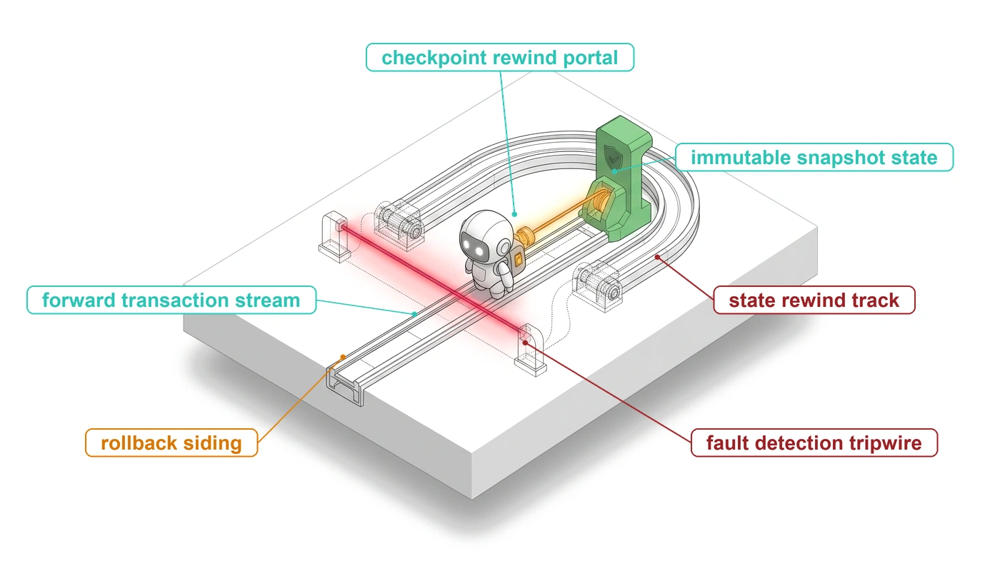
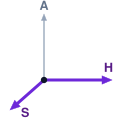
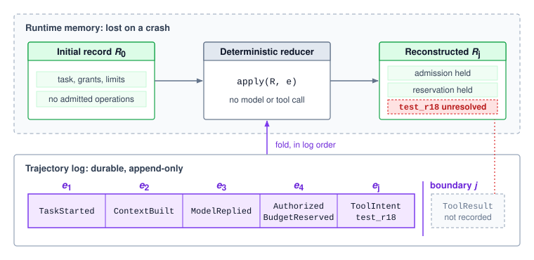
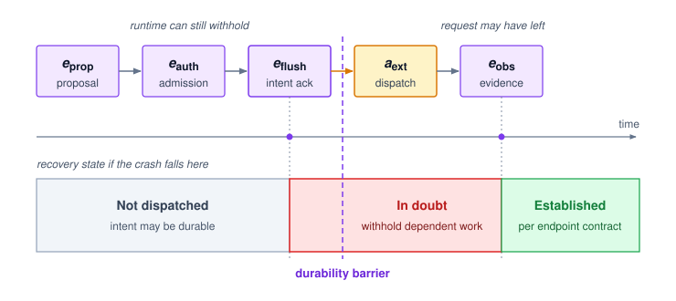
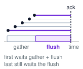
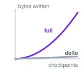
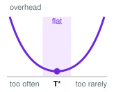
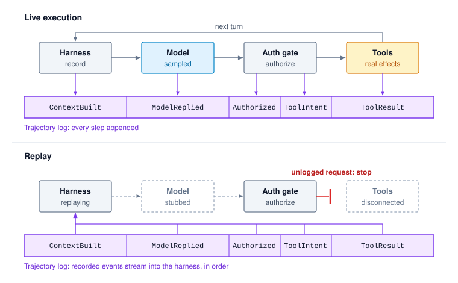

# Durable Execution {#sec-vol3-durable-execution}

::: {layout-narrow}
::: {.column-margin}

\chapterminitoc

:::

::: {.content-visible when-format="pdf"}
\noindent
{fig-alt="Blueprint for Durable Execution."}
:::

::: {.content-visible unless-format="pdf"}
{fig-alt="Blueprint for Durable Execution."}
:::

:::

## Purpose {.unnumbered .unlisted}

\begin{marginfigure}
\mlagentstack{0}{0}{100}{0}{0}{0}
\end{marginfigure}

_Why must an agent write down what it is about to do before it does it?_

A trajectory can outlive the worker that runs it. A crash after a test job is dispatched can erase the local record without stopping the job or canceling its charge. Starting again from the prompt does not recover the missing history: a fresh model call may choose different work, and repeating an earlier request can create another effect. The next worker needs the recorded decisions, available artifacts, and unresolved obligations that justify its continuation. Those records must survive the failures the system promises to tolerate, in an order that does not hide already admitted work. Durable execution preserves that basis for reconstruction without pretending that a stored intent proves an external outcome. Through the H·S·A lens, a long horizon turns state into a durability obligation and requires the runtime to preserve evidence of authority already exercised.

::: {.content-visible when-format="pdf"}

\newpage

:::

::: {.callout-learning-objectives}

- Construct an evidence log that can rebuild selected trajectory state without treating recorded claims as world truth
- Enforce intent-before-dispatch ordering under a declared failure domain while preserving uncertain external outcomes
- Choose a consistent checkpoint and reconstruction policy using artifact requirements and measured recovery costs
- Resume under current ownership, authority, control state, and outstanding effect and charge obligations
- Distinguish recorded-state reconstruction, harness regression replay, and newly executed counterfactual branches
- Locate a divergence using captured inputs and decisions while stating the evidence's limits
- Design retention and storage policies that support declared recovery, replay, and diagnostic promises

:::

## The Trajectory Log {#sec-vol3-persistence-event-sourcing}

::: {.column-margin}
{width="100%" fig-alt="H·S·A locator with the Horizon and State axes highlighted in purple and Authority in gray."}

*Horizon stretches state past one worker's life, so continuation needs a durable record.*
:::

The repair agent (\ref{lhs-vol3-repair-agent}) has admitted a test against `ws_r18`, a fixed snapshot of candidate `r18`. Its worker fails after dispatch but before the result is durably recorded. The next worker must recover the proposed test, its authority and reservation, any acknowledged pause, and any evidence about whether the executor accepted or completed the test. Restarting the prompt supplies none of that history. A fresh model call may propose different work while the original test is still running and incurring charges.

The live record in @sec-vol3-controlplane-acb already separates continuation from outstanding obligations. Durability adds a condition on where that record comes from after failure. The system must declare its **failure domain**\index{Failure domain!definition}, the set of failures its storage tolerates: a process crash with intact storage, replacement of a worker with access to the same durable volume, or permanent loss of that volume. Each case demands a stronger copy than the one before it. The repair serves as this chapter's crash worksheet, and its failure domain is the strongest of the three: the acknowledged history and every artifact recovery needs survive loss of both the worker and its local volume, and a replacement worker can reach them. Every durability claim in the worksheet is made against this contract.

### The log as recorded evidence

The record the next worker needs cannot come from the dead worker's memory or from a fresh model call, so the runtime keeps a separate history of what happened.

::: {#dfn-trajectory-log .callout-definition title="Trajectory log"}

***Trajectory log***\index{Trajectory log!definition} is the append-only, ordered sequence of typed events (delivered model inputs, returned replies, admissions, control changes, and observed tool outcomes) from which a deterministic reducer rebuilds a trajectory's control state.

1. **Significance**: Recovery folds recorded decisions instead of running the past turns again, so a crash late in a trajectory costs reconstruction time rather than one fresh model call per completed turn, each of which would again face the compounding of @eq-vol3-horizon-compounding and be charged again to the attempt cost in @eq-vol3-cost-per-accepted-task.
2. **Distinction**: The trajectory record (\ref{dfn-trajectory-record}) is the live projection that governs the next decision; the log is the history the record is projected from; the context is the selection the model reads.
3. **Common pitfall**: Logging only results, so an operation that was admitted and dispatched but whose reply was lost leaves no trace in the history.

:::

Formally, the log is a sequence

$$\mathbf{e}_{1:j} = [e_1, e_2, \dots, e_j]$$

A later correction appends new evidence rather than rewriting the earlier observation.[^fn-append-log-lineage] The live trajectory record is a projection of this history. Starting from an initial record $R_0$, a deterministic reducer applies each recorded event:

$$R_j = \text{fold}(R_0, \mathbf{e}_{1:j}) = \text{apply}(\dots\text{apply}(\text{apply}(R_0, e_1), e_2)\dots, e_j)$$

Here $j$ indexes the selected log boundary, not the turn index $t$. With fixed reducer semantics and the required event contents available, folding reconstructs the recorded projection without calling the model or executing a tool. This **event sourcing**\index{Event sourcing!definition} pattern [@kleppmann2017designing] makes past decisions the inputs to reconstruction, and facts the log never recorded stay unknown. If the last durable evidence says only that the test was admitted, the reconstructed record carries an unresolved operation. @Fig-vol3-event-sourcing traces that reconstruction for the repair, whose log ends at the admitted test's intent.

[^fn-append-log-lineage]: **Append-Only Log as Primary Record**: Rosenblum and Ousterhout's log-structured file system made the log the only structure on disk, writing every modification sequentially so that both writing and crash recovery became faster [@rosenblum1992lfs]. The same property serves a trajectory log: an append never overwrites evidence a later recovery may need, and recovery reads one ordered stream rather than reconciling scattered in-place updates. \index{Log-structured file system!append-only trajectory log}

::: {#fig-vol3-event-sourcing fig-env="figure" fig-pos="htb" fig-cap="**The Trajectory Record as a Projection of the Log**: The record in runtime memory (top) is lost on a crash; the durable, append-only log (bottom) is not. Folding the logged events through a deterministic reducer, starting from the initial record $R_0$, rebuilds the recorded projection $R_j$ at boundary $j$ without calling the model or any tool. Because the log ends at the test's recorded intent with no recorded result, the reconstructed record keeps the admission and reservation and marks the test unresolved rather than inventing its outcome." fig-alt="Two panels. Top panel, runtime memory lost on a crash: an initial record R zero, a deterministic reducer that applies each event with no model call and no tool call, and a reconstructed record R j showing admission and reservation held and test r18 unresolved. Bottom panel, the durable append-only trajectory log: events e1 TaskStarted, e2 ContextBuilt, e3 ModelReplied, e4 Authorized and BudgetReserved, and e j ToolIntent for test r18, then a log boundary j and a dashed placeholder for a ToolResult that was not recorded. An arrow labeled fold in sequence order runs from the log to the reducer."}

:::

The log also differs from the model's context. Context assembly selects what the next invocation receives, and compaction can replace earlier observations with a summary. The log keeps the delivered inputs and recorded decisions that the chosen reconstruction or replay contract requires; for a bounded observation, that means the bounded bytes the model saw rather than everything the tool produced. Reconstruction returns exactly what the log kept. A retained summary yields the summary, and a retained hash verifies bytes only while the bytes survive.

### Events that preserve the control contract

A log is useful only if its events preserve the information needed by the next owner. @Tbl-vol3-durable-log-schema groups the event families by that purpose. These are logical records, not a requirement to issue a separate storage write for each row or field. A compound admission can record its authorization, reservation, and intent together, provided reconstruction preserves their relationship and dispatch respects the durability barrier.

Every event has a trajectory identity, an event identity, a `sequence_number`, a type and schema version, and source or issuer provenance. The log also identifies its reducer version and the authenticated ownership under which appends were admitted. A sequence number locates an event; `record_version` identifies a serialized control update; `control_epoch` identifies the continuation to which a proposal or observation applies. The distinct `owner_epoch` identifies the worker ownership grant. Neither a new owner nor a new continuation changes the logical identity of an outstanding operation.

| Event family                                    | Required contents                                                                                                                                                                                      | Reconstruction use                                                                                               |
|:------------------------------------------------|:-------------------------------------------------------------------------------------------------------------------------------------------------------------------------------------------------------|:-----------------------------------------------------------------------------------------------------------------|
| `TaskStarted`                                   | Task and requester, initial grants and limits, ordinary and finalization deadlines, initial record and workspace references, configuration provenance                                                  | Establish the initial scope and accounting contract                                                              |
| `ContextBuilt`, `ModelReplied`                  | Model-call identity, immutable delivered-input manifest and bytes or available references, assembly and request configuration, reply status and payload, raw signals and available provider provenance | Recover what was supplied and observed without resampling the historical invocation                              |
| `Authorized`, `BudgetReserved`, `BudgetSettled` | Decision and policy version, invocation or operation identity, reservation bound, actual usage evidence, remaining unresolved liability, protected finalization reserve                                | Rebuild admission and accounting, not merely a remaining-balance scalar                                          |
| `ToolIntent`, `ToolResult`                      | Logical operation and transport attempt identities, represented operation and arguments, applicable revision and repeat contract, job handle when known, outcome evidence and observation completeness | Preserve possible dispatch and its evidence; a pending, partial, or timeout result does not establish settlement |
| `ControlChanged`, `PlanChanged`                 | Control request and issuer, guarded state and grant changes, record and control versions, plan revision and dependencies, observation eligibility, resource and outstanding-obligation owners          | Restore the continuation separately from work that remains unresolved                                            |
| `ApprovalRequested`, `ApprovalResolved`         | Exact held action and relevant versions, authorized reviewer and decision evidence, expiry, withdrawal or refusal status                                                                               | Restore the held decision without treating an old approval as current dispatch permission                        |
| `Compacted`, `RuntimeInput`                     | Recorded summary and dependencies; clocks, identifiers, policy/configuration inputs, and event-order information captured at the declared replay boundary                                              | Preserve the actual inputs used by context assembly or supervisory decisions                                     |
| `Checkpoint`                                    | Exact covered log boundary, compatible record and workspace manifests, required artifact references and integrity information                                                                          | Select an available base for reconstructing the record and workspace through a later suffix                      |

: **Trajectory log schema**: Event families preserve the control and evidence contract across a crash. The log records observations and decisions, not automatic proof that an external effect settled or a task succeeded. {#tbl-vol3-durable-log-schema}

The worksheet uses a small cast of identifiers. Besides the snapshot `ws_r18`, `operation_id=test_r18` identifies the intended test and `attempt_id=attempt1` its transport attempt. If the executor's acknowledgment supplies the job handle `job_tests_18`, that handle links later executor evidence to the operation, but recovery knows it only if that acknowledgment survived. A durable `ToolResult` might report pending execution, a timeout, or a completed targeted check. Its contents and provenance determine what it establishes. A late result updates the operation ledger, never an obsolete continuation (@sec-vol3-controlplane-statemachine).

The captured context needs similar care. Its manifest identifies the actual delivered inputs, not mutable source paths to fetch again on resume. Record the model and serving provenance the interface actually exposes, including its limits, since a stable hosted-model name need not identify unchanged internals. A new continuation may assemble a new context from later evidence while the earlier invocation's record stays as delivered.

The schema names what reconstruction needs, but not whether each needed event survives or whether the external request waited for it. A log that kept the complete model reply but lost the admitted test's intent would leave the next worker unable to account for work it might repeat. The next section fixes the order between durable acknowledgment and dispatch.

## Durable Intent Before Dispatch {#sec-vol3-persistence-wal}

The repair's next operation submits a targeted test of `ws_r18`. If the harness sends that request and then crashes before recording it, a replacement worker can recover a plan that still says “run the test” while the original job is already running and accruing charges. Recording only the eventual result leaves this gap open. The runtime must preserve the admitted request and its outstanding liability before the request can leave its control.

Recording the admitted request durably before sending it is **write-ahead logging**\index{Write-ahead logging!definition} applied to trajectory dispatch; @sec-vol3-appendix-systems-transactions reviews the database form of the protocol. The durable history identifies an operation that might have executed even if its reply never reaches the worker. An effect without a recoverable intent is a **phantom effect**\index{Phantom effect!definition} under the runtime's declared failure model. Preventing it takes two things: correct ordering, and storage that survives the failure the design claims to tolerate.

::: {#dfn-durable-intent .callout-definition title="Durable intent"}

***Durable intent***\index{Durable intent!definition} is the record of an admitted operation (its identity, arguments, authority, and reservation) acknowledged by storage that survives the declared failure domain before the request is dispatched.

1. **Significance**: It converts a crash between dispatch and reply from a phantom effect into an unresolved operation with an owner, at the price of one durable acknowledgment on the critical path of every dispatch (@tbl-vol3-durable-ack-domains).
2. **Distinction**: A durable intent records that work may have left the runtime. It is neither evidence that the endpoint committed the work nor a command that must execute.
3. **Common pitfall**: Taking the acknowledgment from storage that dies with the failure the design claims to survive, such as a local disk under a contract that includes volume loss.

:::

### State what the acknowledgment survives

Suppose the repair's worker appends the `test_r18` intent with `write()`, sees the call return, and dispatches the test. The host then loses power. A returned `write()` means only that the kernel has copied the bytes into its page cache, and those dirty pages vanish before writeback. The replacement finds no intent for a test that is running. The append was durable against one failure, a process crash, and not against the one that happened, so every durability claim names the failure it survives.

The same reasoning extends up the failure hierarchy. Worker replacement can recover from reattachable storage when the replacement can reach the acknowledged history and artifacts. If the failure domain includes permanent loss of the worker's volume, as the worksheet's does, the acknowledgment must come from storage outside that volume. Remoteness alone is not the test, because an asynchronously updated monitoring copy can lag the acknowledged history.

Each step up the hierarchy needs a stronger barrier. Dirty pages in the page cache outlive the process but not the host, and the barrier against host failure is `fsync()` or `fdatasync()`, which returns only after the device reports the data durable. The two calls differ in metadata. `fsync()` also flushes attributes such as modification time, while `fdatasync()` flushes only the metadata needed to read the data back, which spares a log that preallocates its file an extra write per barrier. Even then, correct barriers are easy to misplace,[^fn-fsync-crash-consistency] and a drive with a volatile write cache must honor the flush command, or the write must use force unit access (a per-write flag that bypasses that cache), before its acknowledgment covers power loss. A local barrier still dies with the volume. Surviving permanent volume loss requires a replicated store that acknowledges only after enough replicas, placed outside the lost domain, have made the record durable.[^fn-quorum-intent-ack] @Tbl-vol3-durable-ack-domains pairs each failure with the acknowledgment that survives it.

[^fn-fsync-crash-consistency]: **Crash Consistency in Practice**: A study of eleven widely used applications, including databases, key-value stores, and version-control systems, found 60 crash vulnerabilities, because each application's update protocol depended on subtle file-system persistence behavior that its authors had assumed rather than tested [@pillai2014crash]. A trajectory log inherits the same exposure, so its durability claim should be checked by injecting crashes between every write and barrier, not inferred from the calls it makes. \index{Crash consistency!trajectory log}

[^fn-quorum-intent-ack]: **Quorum Acknowledgment**: Consensus protocols such as Paxos [@lamport1998parttime] and Raft [@ongaro2014search] commit a log entry once a majority of replicas store it; because any two majorities share a replica, an acknowledged entry survives the loss of any minority. The guarantee covers only failures the replicas do not share, so a quorum placed on one host or one power domain gives the latency of replication without the durability the worksheet's contract requires. \index{Quorum!durable intent acknowledgment}

| Failure the contract tolerates          | Acknowledgment that survives it                                                                                        | Acknowledgment that does not                                      |
|:----------------------------------------|:-----------------------------------------------------------------------------------------------------------------------|:------------------------------------------------------------------|
| Process crash; host and volume intact   | Returned `write()`, which places the bytes in the kernel page cache that outlives the process                          | An event queued only in the runtime's own memory                  |
| Power loss or host crash; volume intact | Returned `fdatasync()` or `fsync()`, with the device write cache flushed or bypassed                                   | Returned `write()` alone, whose dirty pages were volatile         |
| Permanent loss of the worker's volume   | Acknowledgment from a replicated store after a quorum of replicas outside that volume's failure domain made it durable | Local barrier plus an asynchronous copy that may not have arrived |

: **Durable Acknowledgment by Failure Domain**: Each row names the weakest acknowledgment that survives its failure. Moving down the table adds a wait, first for the storage device and then for network round trips to the slowest replica in the quorum, so the declared failure domain sets the latency floor of every dispatch. {#tbl-vol3-durable-ack-domains}

The implementation must specify which failures its persistence operation covers, how errors are reported, and how a replacement identifies the complete acknowledged history; storage technology implements that contract but does not state it. @Sec-vol3-appendix-systems-boundaries compares atomicity, isolation, and durability and supplies a boundary test for separating one store's commitment from effects at other endpoints. If the acknowledgment fails or its status is uncertain, the runtime holds the dispatch and resolves the append through the store's contract. Storage unavailability therefore delays useful work, whereas sending first would remove the evidence needed to govern that work after a failure.

### Extend live admission across a crash

@Sec-vol3-controlplane-statemachine established the live admission decision: validate the completed proposal, check current authority and control state, register its identity, and reserve bounded liability before releasing the request. Durability adds an acknowledged history of that decision and the exact intended operation. For an attempt that proceeds to dispatch and later produces an observation, the ordering is

$$
e_{\text{prop}} \prec e_{\text{auth}} \prec e_{\text{flush}} \prec a_{\text{ext}} \prec e_{\text{obs}}.
$$ {#eq-vol3-wal-ordering}

In @eq-vol3-wal-ordering, $e_{\text{prop}}$ is the validated complete proposal, $e_{\text{auth}}$ is the admitted authorization and reservation decision, and $e_{\text{flush}}$ acknowledges its recoverable `ToolIntent` and required preceding records under the declared failure domain. The action $a_{\text{ext}}$ is dispatch, not endpoint completion. The event $e_{\text{obs}}$ is the later durable recording of received evidence, whose status may still be pending, partial, or unknown. The ordering constrains the events that occur; an attempt can stop before dispatch or never produce evidence. @Fig-vol3-intent-before-dispatch places a crash along this sequence and shows what each position leaves for recovery to establish.

::: {#fig-vol3-intent-before-dispatch fig-env="figure" fig-pos="htb" fig-cap="**Intent Before Dispatch**: The runtime validates a proposal, admits it with a reservation, and waits for the intent's acknowledgment under the declared failure domain before dispatch carries the request past the durability barrier. Where a crash falls determines the recovery state of @tbl-vol3-durable-recovery-states. Before the acknowledgment, a complete authoritative prefix shows no durable intent, so the attempt was not dispatched. Between the acknowledgment and adequate recorded evidence, including a crash before dispatch, the operation is in doubt; a pending or timeout observation leaves it there. After correlated outcome evidence is recorded, the outcome is established within the endpoint's contract." fig-alt="A horizontal sequence of five boxes: e prop, validated proposal; e auth, admission and reservation; e flush, intent acknowledged under declared failure domain; a dashed vertical line labeled durability barrier; a ext, dispatch, not completion; and e obs, evidence recorded, possibly pending. Below, a crash timeline in three segments, gray before the acknowledgment, red between the acknowledgment and recorded evidence, and green after it. Each segment has a crash marker connected to a card: no durable intent, not dispatched; intent with no adequate evidence, in doubt and unresolved; intent and correlated evidence, outcome established."}

:::

In the crash worksheet, the intent names `operation_id=test_r18`, `attempt_id=attempt1`, the immutable `ws_r18` input, the selected check, and the endpoint's repeat contract. It references the applicable `Authorized` and `BudgetReserved` decisions, together with the requester and task bindings, `control_epoch`, and `owner_epoch` under which they were made. The recoverable prefix must reconstruct the admitted reservation itself, not just a remaining balance.

Admission and control stay coordinated while the barrier is pending. A pause or authority change can still withhold an admitted but unsent request, because a durable intent grants permission to dispatch and imposes no obligation to. The final release guard checks the same admitted attempt without making a second reservation. If release for transmission already won that race, later control accounts for the request as sent. A withheld request keeps its ledger entry and reservation until evidence establishes that no effect or charge liability remains.

Model calls need durable identity and liability too. A reply is recorded only after generation, yet an interrupted invocation can incur charges even when its output is lost. A lost reply stays lost. A new sample is a separately admitted invocation, and any downstream effect requires that invocation's own completed, validated proposal.

### Classify the evidence, not just the event name

After the crash, the worker may treat a missing intent as evidence only after it establishes that it holds the complete authoritative history the failure domain promises. We call this the **completeness rule**\index{Completeness rule!definition}. An asynchronously copied replica cannot satisfy it, because nothing in the copy shows that it holds the last acknowledged intent. @Tbl-vol3-durable-recovery-states distinguishes the cases the rule permits.

| Surviving evidence                                                                            | What it establishes                                                                  | Consequence for continuation                                                                                       |
|:----------------------------------------------------------------------------------------------|:-------------------------------------------------------------------------------------|:-------------------------------------------------------------------------------------------------------------------|
| No durable intent in a complete authoritative prefix, under enforced write-ahead dispatch     | This attempt was not dispatched through the mediated path                            | Reconsider the recorded proposal under current admission checks; do not dispatch automatically                     |
| Durable intent plus adequate, correlated outcome evidence                                     | The recorded outcome is established to the extent supported by the endpoint contract | Reuse that evidence within its candidate and check scope; settle charges separately where necessary                |
| Durable intent without adequate outcome evidence, including a timeout or pending `ToolResult` | The operation remains unresolved                                                     | Retain its identity, liability, and settlement owner; withhold dependent work until its guards permit continuation |

: **Recovery States of a Logged Action**: These classifications require a complete surviving authoritative prefix. An incomplete replica cannot establish that an absent intent was never dispatched. {#tbl-vol3-durable-recovery-states}

In the crash worksheet, the test may not have reached the service, may still be running, or may have finished before the crash. A lost acknowledgment also means the returned job handle, `job_tests_18`, may never have been recorded. A supported lookup by the recorded operation identity supplies new evidence, which the runtime authenticates and correlates before durably updating the ledger. A targeted pass then establishes the check of `ws_r18`; acceptance of the repair is a separate decision.

An **in-doubt action**\index{In-doubt action!definition} is an admitted operation whose outcome the surviving evidence cannot settle; it records uncertainty, not failure. @Sec-vol3-tool-calling-idempotency supplies the endpoint requirements for a safe repeat: identity scope, payload binding, retention, handling of an in-flight request, and coordination between the effect and the returned result. A retry key protects only an endpoint that implements those properties. Probing by name is weaker still, because a same-name resource can belong to another operation, and an absent resource can be a delayed first attempt still in flight. Settlement before retry (principle \ref{pri-vol3-exactly-once-settlement}) states the rule, and @sec-vol3-appendix-systems-retries reviews the classical idempotence and deduplication contracts behind it.

::: {#psp-11-wal-pages-to-endpoints .callout-perspective title="Write-ahead logging, from pages to endpoints"}

Database write-ahead logging forces a change's log record to stable storage before the modified page, so that recovery can redo committed changes and undo uncommitted ones [@gray1992; @mohan1992aries]. Both repairs work because the database owns the pages it logs. An agent runtime logs intent for an effect that lives at an endpoint it does not own. Its log can rebuild the runtime's own record, but it holds no undo record for the endpoint's state, and the endpoint has no prepare phase in which it could vote on the request or hold its effect tentatively. The durable intent is therefore a unilateral commit decision, which is why a two-phase commit protocol [@gray1978notes] cannot close the gap (@sec-vol3-failure-recovery). Large-scale services reached the same conclusion from the other side, replacing distributed transactions with idempotent messages between independently owned entities [@helland2007life]. The protocol carries over intact; what changes is the recovery outcome it can promise, which ends in an in-doubt action whenever the endpoint's evidence is missing.

:::

When evidence stays insufficient, the ledger keeps an owner for reconciliation or an authorized handoff, through timeouts, pauses, and terminal continuations alike. Independent work proceeds under its own guards while dependent mutations wait. @Sec-vol3-failure-recovery develops the response to established effects that need repair.

### Share a barrier without dividing its latency

A harness running many trajectories now pays one durable acknowledgment per dispatch, and under the worksheet's contract each one is a network round trip to a replica quorum. **Group commit**\index{Group commit!definition}[^fn-group-commit-origin] lets several ready records share one durable acknowledgment [@dewitt1984]. The coordinator gathers a batch, performs the storage operation required by the failure contract, and releases only the records covered by its successful acknowledgment. Each trajectory still satisfies the same intent-before-dispatch ordering.

[^fn-group-commit-origin]: **Group Commit Origin**: DeWitt and colleagues described group commit for main-memory databases, where data access had become fast enough that the log write at each commit, rather than the work of the transaction, limited throughput [@dewitt1984]. Agent dispatch reaches the same regime once the durable acknowledgment is a network round trip, which is why a technique from database engines applies unchanged to trajectory intents. \index{Group commit!main-memory databases}

::: {.column-margin}
{width="100%" fig-alt="Timeline with five arrival dots at staggered times, each followed by a horizontal line ending at a dashed vertical line labeled ack. Below the lines, a gray box labeled gather is followed by a purple box labeled flush that ends at the ack line. Text below reads first waits gather plus flush and last still waits the flush."}

*Every batch member waits the whole shared flush; only storage work divides.*
:::

For a successful batch, let $a_i$ be the time event $i$ enters the batching queue, $t_{\text{start}}$ the start of the batch's storage operation, and $t_{\text{ack}}$ the time its durable acknowledgment becomes available. If notification delay is excluded, event $i$ waits

$$
L_i = (t_{\text{start}}-a_i) + (t_{\text{ack}}-t_{\text{start}}) = t_{\text{ack}}-a_i.
$$ {#eq-vol3-group-commit-latency}

The first term in @eq-vol3-group-commit-latency includes aggregation and queueing; the second is the actual shared storage duration. If the batch contains $N_{\text{batch}}$ events, charging that storage duration equally gives amortized storage work of $(t_{\text{ack}}-t_{\text{start}})/N_{\text{batch}}$ per event, yet every member waits through the whole shared operation, plus notification and scheduling delay before its trajectory can dispatch.

```{python}
#| label: calc-vol3-durable-group-commit
#| echo: false
# ┌─────────────────────────────────────────────────────────────────────────────
# │ GROUP COMMIT: AMORTIZED WORK VERSUS ELAPSED WAIT (LEGO)
# ├─────────────────────────────────────────────────────────────────────────────
# │ Context: @eq-vol3-group-commit-latency and the paragraph that closes
# │          "Share a barrier without dividing its latency".
# │
# │ Goal: Contrast storage work charged per event with the wait each event sees.
# │ Show: Amortized storage work per event and the first arrival's wait.
# │ How:  (t_ack - t_start) / N_batch for work; timer + (t_ack - t_start)
# │       for the first arrival.
# │ Note: Scenario timings, not measurements of a particular store.
# └─────────────────────────────────────────────────────────────────────────────
from mlsysim.fmt import fmt, fmt_int, check

class GroupCommit:
    # ┌── 1. LOAD (scenario inputs, not measurements) ─────────────────────
    timer_ms = 2.0  # maximum aggregation wait before the batch starts
    quorum_ack_ms = 4.0  # shared storage duration t_ack - t_start for a quorum
    batch = 16  # events covered by one acknowledgment

    # ┌── 2. EXECUTE ──────────────────────────────────────────────────────
    work_per_event_ms = quorum_ack_ms / batch
    first_wait_ms = timer_ms + quorum_ack_ms
    last_wait_ms = quorum_ack_ms

    # ┌── 3. GUARD (prose claims) ─────────────────────────────────────────
    check(abs(work_per_event_ms - 0.25) < 1e-9, "Amortized work is 0.25 ms")
    check(first_wait_ms > 20 * work_per_event_ms, "Wait dwarfs amortized work")
    check(last_wait_ms == quorum_ack_ms, "Even the last arrival waits the full storage duration")

    # ┌── 4. OUTPUT ───────────────────────────────────────────────────────
    timer_str = fmt_int(timer_ms)
    ack_str = fmt_int(quorum_ack_ms)
    batch_str = fmt_int(batch)
    work_str = fmt(work_per_event_ms, precision=2)
    first_str = fmt_int(first_wait_ms)
```

A larger batch cuts barrier work per record and lengthens the aggregation wait of early arrivals. Under sparse traffic, that wait dominates, and a timer bounds it; under load, amortization reduces queueing, although batch size can also lengthen the storage operation itself. With a `{python} GroupCommit.timer_str` ms timer and a `{python} GroupCommit.ack_str` ms quorum acknowledgment, a batch of `{python} GroupCommit.batch_str` intents charges `{python} GroupCommit.work_str` ms of storage work per intent, yet its first arrival waits `{python} GroupCommit.first_str` ms and its last still waits the full `{python} GroupCommit.ack_str` ms. The design rule is to size the batch timer against the dispatch latency budget, measure aggregation, queueing, and storage time separately, and never buy latency by weakening the durability domain.

::: {#chk-11-wal-invariants .callout-checkpoint title="Intent, evidence, and the durability domain"}

- [ ] **Failure domain**: The worker acknowledges an intent locally, dispatches the test, then permanently loses its disk before asynchronous replication. Does the remote replica's missing intent license a fresh dispatch, and which acknowledgment in @tbl-vol3-durable-ack-domains would have made that inference sound?
- [ ] **Crash boundary**: `test_r18` has a durable intent and reservation but no durable result. List the possibilities that remain and the one piece of evidence that would narrow them fastest.
- [ ] **Event meaning**: A durable `ToolResult` reports a timeout. Decide whether to release the test's reservation, and justify the decision.
- [ ] **Current control**: A pause is accepted after the intent becomes durable but before the final release guard authorizes transmission. Which guard stops the request, and what happens to its reservation?
- [ ] **Batch cost**: If the batch timer doubles while the batch size and storage duration stay fixed, which term of @eq-vol3-group-commit-latency grows, and what happens to the amortized storage work per intent?

:::

Write-ahead ordering preserves the identity and obligations of work that may have left the runtime; the files and other artifacts needed to interpret that work need a recovery boundary of their own. The next section binds a compatible record and workspace to an exact log boundary, so reconstruction restores the candidate whose history the log describes.

## Checkpoints {#sec-vol3-persistence-checkpointing}

The durable intent tells the replacement worker that the `r18` test may have started, but the files the test used live elsewhere. A log entry saying that an edit succeeded reconstructs the edited bytes only if those bytes, or sufficient changes from an available base, were preserved. The record and the workspace therefore need a common recovery boundary.

A **checkpoint**\index{Checkpoint!definition} binds a recoverable record snapshot and its required workspace and artifacts to an exact committed log position. It shortens reconstruction by replacing a long prefix with a compatible snapshot. This is different from the compact progress record used to assemble model context, because a useful summary cannot replace file contents, pending-operation identity, or accounting evidence.

### Publish a consistent recovery boundary

Let the checkpoint boundary $j_{\text{ckpt}}$ be a log position, like the boundary $j$ of the fold, so it identifies a committed log prefix rather than a model turn. A checkpoint manifest names that boundary, the record snapshot, the workspace snapshot, required artifact references, their integrity information, and the format and reducer versions needed to interpret them. The record includes actual consumption, outstanding reservations, control and approval status, and unresolved operations with their owners, and those duties persist while no worker executes the trajectory.

The capture protocol must make these components agree. One implementation stops admission of workspace mutations, accounts for already admitted writers, and captures the record and workspace at a defined boundary. Another uses versioned immutable artifacts with an explicit mapping to that boundary. Reading the record and filesystem at approximately the same time does not qualify.[^fn-consistent-cut-checkpoint] A task can have external work outstanding while a checkpoint is captured, provided the checkpoint carries that operation as unresolved.

[^fn-consistent-cut-checkpoint]: **Consistent Snapshot**: Chandy and Lamport defined a consistent global state of a distributed system as one in which every recorded message receipt has a recorded send, and gave a protocol that captures such a state without stopping the system [@chandy1985distributed]. A trajectory checkpoint obeys the same test on a smaller scale: the record must not refer to workspace bytes that the paired snapshot lacks, or restoration produces a state that never existed. \index{Consistent snapshot!checkpoint boundary}

Publication follows availability. First establish the consistent view and make its constituent bytes durable within the failure domain. Then durably publish the manifest or `Checkpoint` event that makes the snapshot eligible for recovery. A crash during capture leaves the previous published checkpoint and its required suffix as the recovery route; incomplete new components are garbage to clean up, and cleanup must spare artifacts the old route still needs. Copy-on-write, through a process fork or shared filesystem blocks, captures a stable view cheaply; making those bytes recoverable by another worker is a separate durability step.

Restoration verifies the manifest, required artifacts, and a complete authoritative suffix through a selected target boundary $j_{\text{target}}$. It restores the record and workspace at $j_{\text{ckpt}}$, then folds recorded control events and applies recorded workspace changes through $j_{\text{target}}$. Reconstruction calls neither the model nor the original edit tools. It writes preserved bytes into the replacement's authorized private workspace, which is distinct from rerunning the actions that produced them.

In the crash worksheet, the checkpoint at $j_{\text{ckpt}}$ names the record snapshot `record_R_ckpt` and the workspace snapshot `ws_r18`. Later events capture the model invocation and response, test admission and reservation, and the durable intent for operation `test_r18`, attempt `attempt1`. The host fails before the result is durably recorded. The test reads that immutable snapshot and uses separate scratch storage, so there are no candidate-workspace changes in this suffix. Restoring the same snapshot and folding the suffix reconstructs the outstanding test and its liability, with its result still open. Scratch or result artifacts required for a later decision need their own durable references or are reported unavailable.

For a different suffix that changes workspace files, the recovery data must include the base identity, ordered replacements or reconstructible patches, deletions, relevant metadata, and integrity checks; a result code, or a hash whose bytes are gone, does not qualify. If the record refers to a newer candidate whose delta is missing, the runtime reports that state as unavailable rather than pairing the record with the older workspace. Regenerating artifacts is new execution governed by the repair and admission policies developed in @sec-vol3-failure-recovery.

### Choose the snapshot representation

A full snapshot and an incremental representation can satisfy the same contract while spending resources differently. @Tbl-vol3-snapshot-models identifies the measurements that matter. Restore time grows with state size for a full snapshot and with chain length for deltas.

Write volume separates the two when the checkpointed state only grows, as a record that accumulates delivered context and observations does. Suppose the state grows by about $s$ bytes per turn and a checkpoint is published every $k$ turns. The $m$th full snapshot writes $m\,s\,k$ bytes, so $n$ checkpoints write

$$V_{\text{full}} = \sum_{m=1}^{n} m\,s\,k = s\,k\,\frac{n(n+1)}{2}, \qquad V_{\text{delta}} = s\,k\,n.$$ {#eq-vol3-snapshot-bytes}

@Eq-vol3-snapshot-bytes shows full snapshots growing quadratically with trajectory length while deltas grow linearly. Their ratio, $(n+1)/2$, is the **write amplification**\index{Write amplification!definition} of full snapshots: bytes written per byte of new state, caused by serializing unchanged state again at every checkpoint.

::: {.column-margin}
{width="100%" fig-alt="Two curves of bytes written against the number of checkpoints. A purple curve labeled full bends upward steeply. A gray line labeled delta rises slowly and stays near the horizontal axis."}

*Full snapshots rewrite old state, so their bytes grow quadratically.*
:::

```{python}
#| label: calc-vol3-durable-snapshot-bytes
#| echo: false
# ┌─────────────────────────────────────────────────────────────────────────────
# │ FULL VERSUS INCREMENTAL SNAPSHOT BYTES (LEGO)
# ├─────────────────────────────────────────────────────────────────────────────
# │ Context: @eq-vol3-snapshot-bytes and the prose immediately below it in
# │          "Choose the snapshot representation".
# │
# │ Goal: Make the quadratic-versus-linear write volume of @eq-vol3-snapshot-bytes
# │       concrete for one hypothetical monotonically growing trajectory.
# │ Show: Total bytes written by full snapshots and by deltas, and their ratio.
# │ How:  Direct evaluation of the closed forms; all inputs are scenario values.
# └─────────────────────────────────────────────────────────────────────────────
from mlsysim import byte, GB
from mlsysim.fmt import fmt, fmt_int, fmt_memory, check

class SnapshotBytes:
    # ┌── 1. LOAD (scenario inputs, not measurements) ─────────────────────
    turns = 500  # hypothetical trajectory length
    stride = 5  # checkpoint every stride turns
    growth_kb = 128  # state growth per turn, decimal kilobytes

    # ┌── 2. EXECUTE ──────────────────────────────────────────────────────
    n = turns // stride
    growth_bytes = growth_kb * 1e3
    full_bytes = growth_bytes * stride * n * (n + 1) / 2
    delta_bytes = growth_bytes * stride * n
    ratio = full_bytes / delta_bytes

    # ┌── 3. GUARD (prose claims) ─────────────────────────────────────────
    check(n == 100, "One hundred checkpoints")
    summed_bytes = 0.0
    for m in range(1, n + 1):
        summed_bytes += m * growth_bytes * stride
    check(abs(summed_bytes - full_bytes) < 1, "Closed form matches the sum")
    check(abs(ratio - (n + 1) / 2) < 1e-9, "Ratio equals (n+1)/2")
    check(3.0e9 < full_bytes < 3.5e9, "Full snapshots write about 3.2 GB")
    check(abs(delta_bytes - 64e6) < 1, "Deltas write 64 MB")

    # ┌── 4. OUTPUT ───────────────────────────────────────────────────────
    turns_str = fmt_int(turns)
    stride_str = fmt_int(stride)
    growth_str = fmt_int(growth_kb)
    n_str = fmt_int(n)
    full_gb_str = fmt_memory(full_bytes * byte, unit=GB, precision=1)
    delta_mb_str = fmt_int(delta_bytes / 1e6)
    ratio_str = fmt(ratio, precision=1)
```

For a hypothetical `{python} SnapshotBytes.turns_str`-turn trajectory whose state grows by `{python} SnapshotBytes.growth_str` KB per turn, checkpointing every `{python} SnapshotBytes.stride_str` turns publishes `{python} SnapshotBytes.n_str` checkpoints. Full snapshots write `{python} SnapshotBytes.full_gb_str`, while deltas write `{python} SnapshotBytes.delta_mb_str` MB, a factor of `{python} SnapshotBytes.ratio_str`. The saving moves cost rather than removing it, because restore must now retrieve and apply the delta chain.

| Choice               | What must remain available                                                     | Cost to measure                                                                    |
|:---------------------|:-------------------------------------------------------------------------------|:-----------------------------------------------------------------------------------|
| Full snapshot        | The complete selected record/workspace state and required referenced artifacts | Capture pause, bytes written, transfer and restore time for the actual state size  |
| Incremental snapshot | A compatible base, every required ordered delta, and referenced artifacts      | Capture and write savings versus chain retrieval, validation, and application cost |

: **Checkpoint Representation Trade-offs**: Compare measured capture and reconstruction costs under the same failure domain and retained-state promise; storage sharing alone establishes neither durability nor isolation. {#tbl-vol3-snapshot-models}

Periodic consolidation can shorten an incremental chain, but the replacement base must be published before dependent material is retired. Retention also depends on the promised inspection horizon, since a snapshot sufficient for current recovery need not support replay of every older turn. The retention section returns to that distinction.

### Price reconstruction rather than lost model turns

Checkpoint cadence trades capture overhead against the work of reconstructing the suffix. When the required events and workspace deltas survive, that suffix costs reading, validating, folding, and restoring recorded state, not model calls. New model calls begin only after reconstruction and guarded resume.

The classical cadence rule governs a different regime, in which a failure loses work that must be executed again.[^fn-young-restart-dumps] That happens when workspace changes were not logged, when a model call or local step was in flight, or when a local effect left no recoverable record. Each failure then repeats, on average, half an interval of execution, and balancing that loss against checkpoint pauses sets the interval.

[^fn-young-restart-dumps]: **Checkpoint Interval Lineage**: Young posed the problem for long batch jobs that saved restart information periodically so that a random failure need not restart the job from the beginning [@young1974]. The derivation assumes that lost work must be computed again; a trajectory whose turns are logged violates that assumption, which is why the interval lengthens once the log absorbs the lost-work term. \index{Young's approximation!origin}

```{python}
#| label: calc-vol3-durable-young-interval
#| echo: false
# ┌─────────────────────────────────────────────────────────────────────────────
# │ YOUNG'S CHECKPOINT INTERVAL AND THE FLAT OPTIMUM (LEGO)
# ├─────────────────────────────────────────────────────────────────────────────
# │ Context: @eq-vol3-young-interval, @thrm-11-young-checkpoint-interval, and
# │          the cadence notebook that follows it.
# │
# │ Goal: Price the interval for work that must be re-executed after a crash.
# │ Show: T*_ckpt, overhead at T*_ckpt, and overhead when T*_ckpt is missed.
# │ How:  w(T_ckpt) = T_save/T_ckpt + T_ckpt/(2 M); T*_ckpt = sqrt(2 T_save M);
# │       w(x T*_ckpt) / w(T*_ckpt) = (x + 1/x) / 2.
# │ Note: Scenario pause and failure rate, not measured values.
# └─────────────────────────────────────────────────────────────────────────────
import math
from mlsysim.fmt import fmt_int, fmt_percent, check

class YoungInterval:
    # ┌── 1. LOAD (scenario inputs, not measurements) ─────────────────────
    t_save_s = 2.0  # pause per checkpoint, including durable publication
    mtbf_min = 10  # mean time between work-losing failures, minutes
    miss_small = 2  # interval off by this factor in either direction
    miss_big = 10  # interval off by an order of magnitude

    # ┌── 2. EXECUTE ──────────────────────────────────────────────────────
    mtbf_s = mtbf_min * 60
    tau_star_s = math.sqrt(2 * t_save_s * mtbf_s)

    def overhead(tau, t_save=t_save_s, mtbf=mtbf_s):
        return t_save / tau + tau / (2 * mtbf)

    w_star = overhead(tau_star_s)
    w_small = overhead(tau_star_s * miss_small)
    w_big = overhead(tau_star_s / miss_big)
    small_penalty = w_small / w_star - 1

    # ┌── 3. GUARD (prose claims) ─────────────────────────────────────────
    check(48 < tau_star_s < 50, "tau* is about 49 s")
    check(abs(w_star - math.sqrt(2 * t_save_s / mtbf_s)) < 1e-12, "Overhead at optimum is sqrt(2 T/M)")
    check(abs(overhead(tau_star_s / miss_small) - w_small) < 1e-12, "Missing by x or 1/x costs the same")
    check(abs(small_penalty - 0.25) < 1e-9, "A factor-of-two miss costs 25 percent more")
    check(abs(w_big / w_star - (miss_big + 1 / miss_big) / 2) < 1e-9, "Order-of-magnitude miss ratio")
    check(0.40 < w_big < 0.42, "Tenfold miss gives about 41 percent overhead")

    # ┌── 4. OUTPUT ───────────────────────────────────────────────────────
    t_save_str = fmt_int(t_save_s)
    mtbf_str = fmt_int(mtbf_min)
    tau_star_str = fmt_int(tau_star_s)
    w_star_str = fmt_percent(w_star, precision=1, style="prose")
    miss_small_str = fmt_int(miss_small)
    miss_big_str = fmt_int(miss_big)
    small_penalty_str = fmt_percent(small_penalty, style="prose")
    w_big_str = f"{fmt_int(w_big * 100)} percent"
```

::: {#thrm-11-young-checkpoint-interval .callout-theorem title="Optimal checkpoint interval (Young's approximation)"}

*A checkpoint taken too often wastes pauses; one taken too rarely wastes re-execution after each failure.* When failures are rare, Poisson, and independent of progress, each failure loses on average half an interval of useful work, and the pause is small relative to the interval, **Young's approximation**\index{Young's approximation!checkpoint interval} [@young1974] gives the useful-work interval between checkpoints that minimizes expected overhead:

$$T^\ast_{\text{ckpt}} \approx \sqrt{2\,T_{\text{save}}\,M_{\text{MTBF}}}$$ {#eq-vol3-young-interval}

*   **Checkpoint pause** ($T_{\text{save}}$): Time execution stops to capture and durably publish one checkpoint.
*   **Mean time between failures** ($M_{\text{MTBF}}$): Expected time between crashes that lose unrecorded work.
*   **Overhead at the optimum**: The cadence-dependent overhead is $\sqrt{2\,T_{\text{save}}/M_{\text{MTBF}}}$ of useful time. @Sec-vol3-appendix-math-daly derives both results, and @daly2006 refines them for failures during saving and recovery.

**Pitfall**: *Missing the interval by an order of magnitude.* For a `{python} YoungInterval.t_save_str` s pause and a mean time between failures of `{python} YoungInterval.mtbf_str` minutes, $T^\ast_{\text{ckpt}} \approx$ `{python} YoungInterval.tau_star_str` s and the overhead is `{python} YoungInterval.w_star_str`. The minimum is flat: an interval off by a factor of `{python} YoungInterval.miss_small_str` in either direction raises overhead by only `{python} YoungInterval.small_penalty_str`, while a factor-of-`{python} YoungInterval.miss_big_str` miss raises it to `{python} YoungInterval.w_big_str`.

:::

The trajectory log changes the lost-work term, not the pause term, the combination that distributed-systems research calls log-based rollback recovery: a checkpoint plus a log of the nondeterministic events[^fn-determinant-model-reply] since it [@elnozahy2002survey]. A turn whose events and workspace changes are durable costs reconstruction after a crash, so substituting that smaller per-turn cost into the same balance lengthens the interval by the square root of the cost ratio. Only work the log does not cover, such as an interrupted model call, still follows @eq-vol3-young-interval directly.

[^fn-determinant-model-reply]: **Determinants**: Log-based recovery protocols record each nondeterministic event as a determinant, the information needed to reproduce its outcome during recovery, and are classified by when determinants reach stable storage [@elnozahy2002survey]. In an agent trajectory the model reply is the dominant determinant: a sampled reply cannot be regenerated, so logging it is what lets the fold replace re-execution. \index{Rollback recovery!log-based}

::: {.column-margin}
{width="100%" fig-alt="A U-shaped purple curve of overhead against checkpoint interval on a logarithmic axis, with a dot at its minimum labeled T star, a shaded band around the minimum labeled flat, and the axis ends labeled too often and too rarely."}

*Overhead is flat near the optimum interval and steep far from it.*
:::

The notebook below compares three cadences on one stipulated crash trace and checks the logged balance against it. Let $N_k$ count checkpoints at stride $k$, let $T_{\text{save}}$ be the pause per checkpoint as in @eq-vol3-young-interval, let $b$ be the base restore time per crash, and let $r$ be reconstruction time per completed turn's recorded suffix. If crash $i$ leaves $d_i(k)$ completed turns after its latest published checkpoint, the time spent on capture and recovery is

$$W(k) = N_k T_{\text{save}} + n_{\mathrm{crash}} b + r\sum_i d_i(k).$$

All three terms are in seconds. Grouping reconstruction cost by completed turn is a modeling simplification, since one turn's suffix can hold several log events.

```{python}
#| label: calc-vol3-durable-checkpoint-cadence
#| echo: false
# CHECKPOINT AND RECORDED-SUFFIX COST (LEGO)
# Goal: Compare three cadences on a fixed illustrative failure trace and check
#       them against the logged square-root balance.
# Scope: Serial capture pauses and reconstruction only; no resampled model calls.
import math
from mlsysim.fmt import fmt, fmt_int, fmt_multiple, check

class CheckpointCadence:
    # 1. LOAD: hypothetical inputs, not measured system performance.
    turns = 100
    crashes = (37, 83)  # after these completed turns; independent of cadence
    strides = (10, 25, 50)
    checkpoint_s = 0.5  # serial pause including durable publication
    base_restore_s = 1.0  # per crash, fixed across these three policies
    suffix_turn_s = 0.1  # read/validate/fold/apply per turn's recorded changes
    reexec_turn_s = 20.0  # re-execute one turn's model call and tools if unlogged

    # 2. EXECUTE: checkpoint at each multiple, including final handoff at 100.
    rows = []
    for stride in strides:
        count = turns // stride
        suffixes_list = []
        for crash in crashes:
            suffixes_list.append(crash % stride)
        suffixes = tuple(suffixes_list)
        suffix_turns = sum(suffixes)
        capture_s = count * checkpoint_s
        recovery_s = len(crashes) * base_restore_s + suffix_turns * suffix_turn_s
        total_s = capture_s + recovery_s
        rows.append((stride, count, suffixes, capture_s, recovery_s, total_s))
    best = min(rows, key=lambda row: row[5])

    # Logged square-root balance: per-turn cost c/k + lam * r * k / 2.
    crash_rate = len(crashes) / turns  # crashes per completed turn
    k_star_logged = math.sqrt(2 * checkpoint_s / (crash_rate * suffix_turn_s))
    k_star_reexec = math.sqrt(2 * checkpoint_s / (crash_rate * reexec_turn_s))
    stride_gain = math.sqrt(reexec_turn_s / suffix_turn_s)

    # Checkpoint after every turn (used by the fallacies section).
    every_turn_total_s = turns * checkpoint_s + len(crashes) * base_restore_s

    # 3. GUARD: independent arithmetic checks for this finite worksheet.
    for stride in strides:
        check(turns % stride == 0, "Final handoff checkpoint included")
    check([row[2] for row in rows] == [(7, 3), (12, 8), (37, 33)], "Correct checkpoint ages")
    check([row[1] for row in rows] == [10, 4, 2], "Capture counts")
    check(all(abs(row[5] - expected) < 1e-9 for row, expected in zip(rows, (8.0, 6.0, 10.0))), "Included seconds")
    check(best[0] == 25, "Best of three on this trace, not a universal optimum")
    check(20 < k_star_logged < 25, "Logged balance lands near the winning stride")
    check(abs(k_star_logged / k_star_reexec - stride_gain) < 1e-9, "Stride gain is sqrt of cost ratio")
    check(abs(every_turn_total_s - 52.0) < 1e-9, "Every-turn policy costs 52 s")
    check(every_turn_total_s > 8 * best[5], "Every-turn policy is far worse than the best stride")

    # 4. OUTPUT: all exported strings have inline consumers.
    turns_str = fmt_int(turns)
    crashes_str = " and ".join(fmt_int(value) for value in crashes)
    capture_str = fmt(checkpoint_s, precision=1)
    base_str = fmt_int(base_restore_s)
    suffix_str = fmt(suffix_turn_s, precision=1)
    reexec_str = fmt_int(reexec_turn_s)
    stride10_str, stride25_str, stride50_str = (fmt_int(s) for s in strides)
    best_str = fmt_int(best[0])
    best_total_str = fmt_int(best[5])
    total10_str, total25_str, total50_str = (fmt_int(row[5]) for row in rows)
    recovery10_str, recovery25_str, recovery50_str = (fmt_int(row[4]) for row in rows)
    trace_strings = []
    for row in rows:
        ages = " and ".join(fmt_int(age) for age in row[2])
        trace_strings.append(f"{fmt_int(row[1])} checkpoints and reconstructs suffixes of {ages} turns")
    trace10_str, trace25_str, trace50_str = trace_strings
    crash_rate_str = fmt(crash_rate, precision=2)
    k_logged_str = fmt_int(k_star_logged)
    k_reexec_str = fmt(k_star_reexec, precision=1)
    stride_gain_mult_str = fmt_multiple(stride_gain, precision=1)
    every_turn_str = fmt_int(every_turn_total_s)
```

::: {#nbk-11-checkpoint-cadence .callout-notebook title="Checkpoint cadence on a fixed crash trace"}

**Problem**: A hypothetical trajectory completes `{python} CheckpointCadence.turns_str` turns, with crashes after turns `{python} CheckpointCadence.crashes_str`. Each published checkpoint pauses execution for `{python} CheckpointCadence.capture_str` s. Each crash costs `{python} CheckpointCadence.base_str` s to restore the checkpoint plus `{python} CheckpointCadence.suffix_str` s per turn of recorded events and workspace changes since it. An initial checkpoint exists, every required suffix survives, and each policy also checkpoints at the final turn; only capture and reconstruction time count. Which stride, `{python} CheckpointCadence.stride10_str`, `{python} CheckpointCadence.stride25_str`, or `{python} CheckpointCadence.stride50_str` turns, spends the least time on this trace?

**Math**: The `{python} CheckpointCadence.stride10_str`-turn policy publishes `{python} CheckpointCadence.trace10_str`. The `{python} CheckpointCadence.stride25_str`-turn policy publishes `{python} CheckpointCadence.trace25_str`. The `{python} CheckpointCadence.stride50_str`-turn policy publishes `{python} CheckpointCadence.trace50_str`. Reconstruction totals are `{python} CheckpointCadence.recovery10_str` s, `{python} CheckpointCadence.recovery25_str` s, and `{python} CheckpointCadence.recovery50_str` s; adding capture pauses gives $W(k)$ of `{python} CheckpointCadence.total10_str` s, `{python} CheckpointCadence.total25_str` s, and `{python} CheckpointCadence.total50_str` s. The logged form of the balance replaces re-executed work with reconstruction at $r$ per turn. With $\lambda$ = `{python} CheckpointCadence.crash_rate_str` crashes per turn, $k^\ast = \sqrt{2T_{\text{save}}/(\lambda r)} \approx$ `{python} CheckpointCadence.k_logged_str` turns. If each lost turn instead had to be re-executed at $r_{\text{exec}}$ = `{python} CheckpointCadence.reexec_str` s, the same balance gives $k^\ast \approx$ `{python} CheckpointCadence.k_reexec_str` turns.

**Result**: The `{python} CheckpointCadence.best_str`-turn stride wins on this trace, at `{python} CheckpointCadence.best_total_str` s, next to the balance point of about `{python} CheckpointCadence.k_logged_str` turns.

**Systems insight**: Logging each turn's events and workspace changes lengthens the best stride by $\sqrt{r_{\text{exec}}/r}$, about `{python} CheckpointCadence.stride_gain_mult_str` here, because a crash then costs reconstruction instead of repeated model calls. The stride moves with the square root of each knob: quadrupling the capture pause doubles it, and so does quartering the crash rate. Because the optimum is flat (theorem \ref{thrm-11-young-checkpoint-interval}), a stride within a factor of `{python} YoungInterval.miss_small_str` of the balance point costs at most `{python} YoungInterval.small_penalty_str` extra overhead; measure $T_{\text{save}}$, $r$, and the crash rate from fault-injection traces before tuning more finely.

:::

An approval wait, context compaction, or worker handoff justifies an extra checkpoint when it shortens resume or enables a retention decision; when the record and artifacts are already recoverable, these events need none. Cadence is a cost decision, and intent ordering is a correctness requirement that no cadence relaxes.

::: {#chk-11-checkpoint-suffix .callout-checkpoint title="A checkpoint must match its suffix"}

- [ ] **Boundary**: A record reconstructed through $j_{\text{target}}$ is paired with workspace bytes from $j_{\text{ckpt}}$, and the suffix changed a file. Decide whether the runtime may resume, and name the data that would make the pair consistent.
- [ ] **Publication**: If capture fails before the manifest is durable, which checkpoint and suffix must remain recoverable, and which new artifacts may cleanup delete?
- [ ] **Cadence estimate**: A faster reducer cuts per-turn reconstruction cost fourfold while the capture pause and crash rate stay fixed. By what factor should the stride change, and roughly how much extra overhead does keeping the old stride cost?

:::

The checkpoint and suffix now provide a reconstruction route, not permission to act. The next section establishes current ownership, reconciles outstanding obligations, and rechecks the conditions for continuation.

## Resuming a Trajectory {#sec-vol3-persistence-migration}

The replacement worker finds the repair's checkpoint at $j_{\text{ckpt}}$, binding `record_R_ckpt` to the immutable workspace `ws_r18`. The surviving suffix records the model invocation and its usage, followed by admission and a durable intent for `operation_id=test_r18`, `attempt_id=attempt1`. It contains no durable test result. The files can be restored, but the missing result supports no inference about the test in either direction. The new worker must recover both the recorded state and responsibility for the outstanding operation.

**Resume**\index{Resume!definition} establishes a usable continuation from surviving records under current ownership and policy. It begins by validating authoritative availability, then acquires ownership, restores compatible state, reconciles outstanding obligations, and checks new admission. Reconstruction supplies history, and each later step grants or withholds permission. A step whose evidence or authority is unavailable leaves the trajectory held.

### Establish availability and current ownership

The worker first identifies the authoritative committed log prefix and the checkpoint artifacts it needs, and it applies the completeness rule of @sec-vol3-persistence-wal before reading any absence as evidence. If it cannot establish prefix completeness or retrieve a required artifact, it reports reconstruction unavailable rather than treating the gap as an empty history.

Ownership is a separate grant. The coordinator must authenticate the claimant and issue a new `owner_epoch` for the trajectory, which leaves `record_version`, `control_epoch`, and the identity of every admitted operation unchanged.

The old worker may have been partitioned rather than destroyed, and after its ownership lease[^fn-lease-ownership-grant] (the time-limited grant it held) expires it can still wake and attempt a write. A **fencing token**\index{Fencing token!definition}[^fn-fencing-sequencer-origin] is an authenticated ownership generation that an enforcing resource compares with the newest generation it has seen, rejecting requests from older owners [@kleppmann2017designing]; @sec-vol3-appendix-systems-fencing traces the handoff in which a delayed write meets the new fence. Exclusion therefore holds exactly at the boundaries that check the token: the log, the dispatch gate, and each participating resource. The new owner installs the ownership transition at those boundaries before relying on exclusion, and a boundary that cannot establish current ownership withholds the protected operation.

[^fn-lease-ownership-grant]: **Lease**: Gray and Cheriton introduced leases for distributed file caches: a grant valid for a fixed term, which a server can reassign after expiry without the cooperation of a failed or partitioned holder [@gray1989leases]. Expiry bounds how long a lost worker blocks recovery of its trajectory, but it relies on clocks the old holder may misjudge, which is why the new owner still fences. \index{Lease!trajectory ownership}

[^fn-fencing-sequencer-origin]: **Sequencer**: Google's Chubby lock service lets a lock holder obtain a sequencer, an opaque string carrying the lock's name, mode, and generation number, which it passes to servers that then reject requests carrying a stale generation [@burrows2006chubby]. The owner epoch plays this role for a trajectory, and it protects only the log, dispatch gate, and tools that actually check it. \index{Fencing token!Chubby sequencer}

Fencing has a narrower scope than effect settlement. A gateway can reject a new dispatch from the old owner while a request it previously forwarded remains in flight. The new worker therefore preserves `operation_id=test_r18` and the earlier attempt's evidence. Passing the new ownership check authorizes new dispatches, not a repeat of that operation, and a gateway's pending/complete map cannot make its record atomic with an independent endpoint's effect.

### Restore compatible state through the suffix

Under current ownership, the worker loads the published checkpoint and reconstructs both the record and workspace through the selected committed prefix. The reducer applies recorded decisions rather than sampling earlier model calls again. Workspace reconstruction applies the corresponding recorded deltas or retrieves the required immutable artifact versions, under the delta requirements of @sec-vol3-persistence-checkpointing.

In the crash worksheet, the suffix advances the control record, usage, and pending-operation ledger but leaves `ws_r18` unchanged, so the reconstructed record still references `ws_r18` and now carries the unsettled `test_r18` intent and reservation. The handle `job_tests_18` is recoverable only if the executor's acknowledgment was durably recorded.

### Reconcile effects, charges, and held decisions

Outstanding operations need a durable return path independent of the failed worker. A result inbox can retain authenticated evidence indexed by trajectory, logical operation, and attempt identity, with executor identity and source scope available for validation. The current settlement owner records admissible evidence in the log and `operation_ledger`. Receipt alone does not establish settlement, and a pending status, timeout, or partial result retains the corresponding uncertainty.

For `test_r18`, an authorized endpoint lookup may recover the job and its result under the tool's result-recovery contract. A matching completed result supports the targeted check of `ws_r18`, not acceptance of every repair requirement. Otherwise the operation stays unresolved, and the repeat contract from @sec-vol3-tool-calling-idempotency, not a missing reply or a matching identifier, decides whether another attempt is safe.

The same evidence discipline preserves the budget. Reconstruct `actual_consumption`, `outstanding_reservations`, and the protected `finalization_reserve`, including changes recorded by `BudgetReserved` and `BudgetSettled`. A crash does not refund a model call or test job. A partial usage report settles only the supported portion; unknown remaining liability stays reserved. New ownership must also inherit the duty to obtain final evidence or transfer that duty explicitly.

Control and approval history remain effective during this reconciliation. A recovered `PAUSED` trajectory stays held, and a terminal continuation stays terminal. A favorable approval can still await dispatch capacity in `AWAITING_APPROVAL`, while a stale, expired, or withdrawn approval stays void on every worker. Authenticated late results may settle an operation even after pause, timeout, or terminal continuation, but they update the operation ledger rather than an obsolete turn. The current owner revalidates relevant facts before staging them for a subsequent context.

### Admit the next continuation

The recovered history explains earlier decisions; current conditions govern the next one. The harness checks the task and plan dependencies, grants, approval status, available capacity, and budget before admitting work. Actual consumption plus outstanding reservations, proposed bounded liability, and the protected finalization reserve must fit the applicable cumulative allowance. The ordinary-work deadline is checked separately. Its expiry does not authorize a new exploratory call merely because money remains; finalization uses its declared time and resource allowance.

Unresolved effects withhold dependent work, not all work. An independent, bounded observation can proceed if its own authority and admission guards pass, while a mutation depending on an unresolved operation remains withheld. Resuming from `PAUSED` still uses the guarded transition to `READY` established in @sec-vol3-controlplane-statemachine. Recovered partial model output never becomes a completed candidate, and a recorded but unsent proposal still needs current dispatch checks.

Context assembly must distinguish historical reconstruction from future continuation. To inspect what the model previously received, retrieve the immutable delivered-input manifest and recorded summaries. The next `ContextBuilt` may legitimately include newly settled test evidence or an approved plan revision. Preserve the historical inputs rather than silently replacing them with fresh retrieval or regenerated summaries.

Configuration changes also require an explicit decision. The runtime can retain available recorded versions, validate a transition to new model, prompt, or tool configurations, or withhold continuation when compatibility cannot be established. An in-doubt intent keeps its original operation and payload semantics under any later schema. Record the change and its provenance limits so later comparisons treat the two executions as distinct.

A new model call requires compatible serving state, which need not mean a cold start. Prefix state may remain available, be partially reusable, or require reconstruction under the rules of @sec-vol3-kvcache-radix-tree, and inspecting a record or keeping a trajectory paused needs no prefill at all. Resume time is the sum of its stages,

$$T_{\text{resume}} = T_{\text{own}} + T_{\text{read}} + T_{\text{fold}} + T_{\text{ws}} + T_{\text{rec}} + T_{\text{prefill}},$$ {#eq-vol3-resume-time}

covering ownership acquisition, reading and validating the checkpoint and suffix, folding the suffix, restoring the workspace, reconciling outstanding operations, and rebuilding serving state for the next call.

```{python}
#| label: calc-vol3-durable-resume-prefill
#| echo: false
# ┌─────────────────────────────────────────────────────────────────────────────
# │ COLD PREFILL FLOOR ON RESUME (LEGO)
# ├─────────────────────────────────────────────────────────────────────────────
# │ Context: @eq-vol3-resume-time and the prose immediately below it in
# │          "Admit the next continuation".
# │
# │ Goal: Show the scale of the prefill term when no prefix state survives.
# │ Show: Arithmetic floor, in seconds, for prefilling a long agent context.
# │ How:  2 * params / peak 8-bit rate per prompt token, times the context
# │       length; same model, accelerator, and context length as the
# │       reference serving quantities in @sec-vol3-appendix-inference-roofline.
# └─────────────────────────────────────────────────────────────────────────────
from mlsysim import *

class ResumePrefill:
    # ┌── 1. LOAD ─────────────────────────────────────────────────────────
    model = Models.Language.Llama3_70B
    accel = Hardware.Cloud.H100
    context_tokens = 32_768  # scenario: recovered context of a long trajectory

    # ┌── 2. EXECUTE ──────────────────────────────────────────────────────
    params = model.parameters.to(ureg.count).magnitude
    peak = accel.compute.precision_flops["fp8"].to(ureg.flop / ureg.second).magnitude
    t_prefill_s = 2 * params * context_tokens / peak

    # ┌── 3. GUARD (prose claims) ─────────────────────────────────────────
    check(2.0 < t_prefill_s < 2.7, f"Prefill floor should be about 2.3 s, got {t_prefill_s:.2f}")

    # ┌── 4. OUTPUT ───────────────────────────────────────────────────────
    context_str = fmt_int(context_tokens)
    t_prefill_str = fmt(t_prefill_s, precision=1)
```

The last term is where agent recovery departs from classical database recovery, which is dominated by reading the log and repairing pages [@mohan1992aries]. Folding reads recorded events and runs deterministic harness code with no model call. Prefill, by contrast, must recompute the attention state for the entire recovered context whenever no compatible prefix state survived. At the reference model and accelerator of @sec-vol3-appendix-inference-roofline, the arithmetic floor alone for a `{python} ResumePrefill.context_str`-token context is about `{python} ResumePrefill.t_prefill_str` s of one accelerator's peak 8-bit throughput, before queueing or any inefficiency. Attention state is derived from the token prefix (principle \ref{pri-vol3-prefix-coherence}), so losing it costs reusable computation while the task's knowledge survives in the log. Routing a resumed trajectory to a server that still holds its prefix, and keeping the next context's prefix identical to the last delivered one, together remove most of this term. Measure each interval of @eq-vol3-resume-time before optimizing any one of them.

Resume turns surviving evidence into a currently permitted continuation without converting unknown outcomes into failures or permission to retry. The same reconstructed state also supports a different operation: examining recorded behavior without admitting new model or tool work. That distinction leads to replay.

## Recorded Trajectory Replay {#sec-vol3-persistence-replay}

Resuming the repair admits new work under current conditions. Debugging its history instead examines what the runtime recorded and how its code responded to the inputs available then. Running the targeted test again cannot answer that question. The new execution supplies new evidence, not the missing outcome of `test_r18` and `attempt1`.

**Replay**\index{Replay!definition} uses retained records in place of generating the historical inputs again. Its guarantee depends on which computation is being repeated. @Tbl-vol3-replay-comparison distinguishes reconstructing a recorded projection, testing harness logic, and starting a counterfactual branch.

| Mode                      | Inputs and computation                                                                                         | Supported conclusion                                        |
|:--------------------------|:---------------------------------------------------------------------------------------------------------------|:------------------------------------------------------------|
| Recorded projection       | Fold retained events with the specified reducer and compatible checkpoint                                      | What selected runtime state the recorded history represents |
| Harness regression replay | Run harness logic against captured inputs at a declared boundary, with live effects disabled                   | How that harness implementation responds to those inputs    |
| Counterfactual branch     | Restore compatible starting state, change a declared condition, and obtain valid observations for the new path | What happened in this new experiment                        |

: **Three uses of a recorded trajectory**: Reconstructing history, testing code, and exploring an alternative answer different questions. None establishes an unobserved external outcome. {#tbl-vol3-replay-comparison}

The first two modes share one structural change from live execution, shown in @fig-vol3-replay-mode. Both sources of new information are cut off, and recorded events flow into the harness in their place.

::: {#fig-vol3-replay-mode fig-env="figure" fig-pos="htb" fig-cap="**Live Execution versus Replay**: In live execution (top), each turn samples the model, passes its proposal through the authorization gate, dispatches the tool, and appends every step to the log. In replay (bottom), the model client is stubbed and tool dispatch is disconnected, so recorded replies and results stream into the harness and any request the log does not account for stops the replay. Folding those events reconstructs the recorded projection, and running harness logic against them is regression replay. A counterfactual branch differs from both, because after restoring its starting state it obtains new observations from compatible fixtures or isolated execution." fig-alt="Two panels. Top: live execution with harness record, foundation model, authorization gate, tools and environment, and trajectory log connected in a loop. Bottom: replay mode with the model and tool dispatch boxes crossed out, a recorded-results box, and the trajectory log streaming recorded events into the replaying harness."}

:::

### Inspect the recorded projection

Folding the log applies recorded decisions; today's authorization policy never re-decides yesterday's proposals. Starting from `record_R_ckpt`, the compatible suffix reconstructs the selected record through its captured admission, reservation, intent, and outcome events. If the suffix ends after `ToolIntent` with no settling evidence, the projection retains an unresolved operation.

Historical inspection can also retrieve the immutable input manifest for a particular `ContextBuilt`. That shows what the model received, including the bounded observation actually delivered, rather than a context newly assembled from whatever sources are available now. Inspecting the corresponding workspace requires the compatible snapshot and any necessary deltas.

::: {#dfn-time-travel-replay .callout-definition title="Time-travel replay"}

***Time-travel replay***\index{Time-travel replay!definition} reconstructs a selected recorded state at a historical log boundary from compatible checkpoints, events, and retained artifacts, without repeating the original model calls or external actions.

1. **Significance**: It makes the runtime's earlier evidence, decisions, and unresolved obligations inspectable at any retained boundary for the price of stored bytes and a fold, with no model tokens and no external effects.
2. **Distinction**: It reconstructs a recorded projection, not the entire past environment and not a new decision under current policy.
3. **Common pitfall**: Promising inspection at every past turn when required payloads, workspace versions, or reducer versions are no longer available.

:::

### Test the harness against captured inputs

**Harness regression replay**\index{Harness regression replay!definition} runs the harness code itself against captured inputs, rather than folding its recorded decisions. The test supplies captured model replies, tool observations, control events, and the other inputs that the tested logic consumes. At its declared boundary, this includes relevant clock values, generated identifiers, configuration, policy, and event scheduling. The capture need not model an entire machine, but omitted inputs limit the comparison. Operating-system debuggers rest on the same idea, logging the nondeterministic inputs of a run so that it can be replayed and stepped backward [@king2005debugging].

The replay adapter must match a request before returning its recorded response. A model reply belongs to its recorded invocation and delivered inputs. A tool observation belongs to a logical operation and attempt, with the expected operation name and arguments. Matching uses exact representations or an explicitly defined normalization, together with the recorded order or declared concurrency relationships.[^fn-happened-before-replay] Simply taking the next result from a queue could give the `r18` test result to a different test or candidate. A mismatch stops that comparison; it never silently falls back to a live call.

[^fn-happened-before-replay]: **Happened-Before**: Lamport showed that events in a distributed system are only partially ordered: one event precedes another when a chain of process steps and messages links them, and otherwise the two are concurrent [@lamport1978time]. Parallel tool calls in one turn are concurrent in this sense, so a replay must either record the order the harness actually observed or declare that any order is equivalent. \index{Happened-before!replay ordering}

Every live effect path must be disabled, including dispatch, callback handlers, background reconciliation, and writes to production stores. The test may update isolated test state. Captured results stand in for external observations without causing the original effects again, and the test environment, not the model, enforces these restrictions.

For example, a retained test case can supply an authenticated late result after the repair has entered `PAUSED`. The expected behavior from @sec-vol3-controlplane-statemachine is to update the operation ledger without directly restarting the continuation. A harness revision that starts a model call instead fails this particular test. The result retains its candidate and targeted-test scope; a replayed pass does not become evidence for whole-task acceptance.

Changing harness code or policy may intentionally change the decisions. The comparison must therefore state which outputs should remain equal and which new behavior is expected. A mismatch can reveal a regression, an intended change, or insufficient capture, so equality is one expected outcome among several. Recorded-input tests skip fresh model and tool execution but still spend computation, storage reads, and setup, and they cover only the supplied cases.

### Start a counterfactual branch

A counterfactual asks what would happen after changing a prompt, model, policy, or observation rule. It receives a new branch identity linked to the parent log boundary, records the change, and restores the corresponding workspace and environment fixtures. For the crash worksheet, a branch from $j_{\text{ckpt}}$ uses `ws_r18` and fixtures compatible with that boundary. Restoring only source files while using today's changed dependencies would introduce an additional experimental change.

The unchanged prefix can be reconstructed without resampling it. The changed continuation needs observations valid for its own actions. A recorded reply is reusable only while its request and assumptions still match; a new test, different arguments, or changed candidate invalidates the old downstream result. The branch must stop at that mismatch or obtain new evidence through a compatible test fixture or separately authorized isolated execution. Historical production effects stay disabled, and a parent's approval does not carry over to the branch.

A **counterfactual branch**\index{Counterfactual branch!definition} is therefore a new, separately identified execution that shares a recorded prefix with its parent. One branch can expose a useful failure case or demonstrate a proposed change; a success-rate claim requires the controlled task comparisons developed in @sec-vol3-evaluation. Replay first makes the comparison boundary explicit; the next section uses retained evidence to locate where two executions begin to differ.

## Locating a Divergence {#sec-vol3-persistence-non-determinism}

A regression replay of the repair reaches the recorded targeted-test result for candidate `r18`. The stored result is unchanged, but the revised harness assembles a different observation for the next model call. Waiting until the final repair verdict to compare the runs would hide this earlier difference. The useful diagnostic question is where the two executions first cease to agree at the boundaries the record exposes.

A **divergence point**\index{Divergence point!definition} is the first observable mismatch under a declared comparison: between recorded and reconstructed state, between old and revised harness behavior on captured inputs, or between a recording and a new execution. The comparison must identify its boundary and expected equivalence. Two serialized requests may differ in an irrelevant diagnostic field while representing the same permitted operation; different source revisions are not interchangeable merely because their test commands match. A turn number alone is too coarse when context assembly, model generation, authorization, and tool dispatch all occur within that turn.

### Compare the earliest recorded boundary

Begin at a compatible checkpoint or initial state and compare corresponding events in their recorded order. Use invocation and operation identities to align the comparison, preserving any concurrency ordering that the replay contract requires. At each boundary, compare the available inputs, the configured transformation, and its recorded output. @Tbl-vol3-nondeterminism-mitigation organizes the evidence by the first boundary at which a mismatch appears, not by cause.

| First observed difference              | Evidence to compare                                                                                                                          | What the difference establishes                                                                                         |
|:---------------------------------------|:---------------------------------------------------------------------------------------------------------------------------------------------|:------------------------------------------------------------------------------------------------------------------------|
| Assembled model input                  | Delivered messages and tool descriptions, source and workspace versions, compaction output, assembly configuration                           | The compared calls did not receive the same recorded input; inspect the earliest changed dependency or assembly step    |
| Model response                         | Complete request, decoding parameters, requested and available served-model provenance, response status and payload                          | The responses differ under the visible conditions; unrecorded service internals may limit further diagnosis             |
| Harness decision or admitted operation | Recorded response, parser and policy versions, captured clock and control inputs, current grants and reservations, exact operation arguments | The supervisory decision differs; determine whether this is an intended policy change, a defect, or an uncaptured input |
| Tool observation                       | Logical operation and attempt identities, actual arguments, target snapshot, service configuration and returned evidence                     | The recorded outcomes or observations differ; determine whether the requests and relevant environments were comparable  |

: **Evidence for Localizing Divergence**: Compare inputs and configuration at the earliest observable mismatch before interpreting downstream differences. A missing record limits the diagnosis rather than proving a particular cause. {#tbl-vol3-nondeterminism-mitigation}

Suppose the retained test observation says that `r18` passed one targeted check and that the broader regression suite was not run. In the old harness, both statements reached the model. In a regression replay, the new assembly rule drops the scope limitation while retaining “passed.” The replay uses the same recorded test response and candidate snapshot; the first mismatch is the delivered observation, before any new model response. This localizes the defect to the assembly change, which removed relevant evidence; whether the omission caused a later incorrect completion claim is a causal question for a controlled comparison.

Localization is only as fine as the surviving evidence: a surviving digest hides the omitted text, and a surviving final answer alone hides every earlier boundary. The report should identify the last comparable boundary and the next missing evidence, rather than assign the failure to whichever component appears last in the trace.

### Separate localization from explanation

A context digest checks the integrity of the recorded bytes it covers and nothing outside them. Equal digests leave decoding parameters, tool schemas outside the hashed content, model revisions, and provider configuration unverified, and even a complete visible request leaves hosted-service internals unspecified. Different digests establish a difference in the hashed input, which is one candidate explanation among several. Inspect the retained content and its provenance before interpreting either result.

Fresh model calls can vary for the reasons established in @sec-vol3-foundation-model-autoregressive. A temperature setting or fixed seed fixes the sampling rule, not the whole invocation environment. An early response difference changes later requests and observations, so later differences may simply reflect changed inputs; the first divergence is the one to explain.

Regression replay narrows this problem by supplying captured inputs at its declared boundary, as established in @sec-vol3-persistence-replay. If a decision reads an uncaptured clock value or live configuration, reproduction at that boundary is unavailable. The remedy is to capture the relevant input or narrow the replay claim, which a harness test can do without a whole-machine interception layer.

The diagnostic result is therefore a bounded statement: the earliest observed mismatch, the inputs and versions known to match, the relevant differences, and the evidence that is missing. Controlled counterfactuals can test an explanation, but one changed outcome does not establish its reliability across tasks. @Sec-vol3-evaluation develops that causal and statistical argument. Here, durability supplies the evidence needed to begin it.

::: {#chk-11-time-travel-debugging .callout-checkpoint title="Replay and divergence"}

- [ ] **First mismatch**: The recorded `r18` test result is unchanged, but a replayed context omits its coverage limitation. What has been localized, and what has not been proved?
- [ ] **Equal hashes**: Two calls have equal context digests and different model responses. Which request and provenance fields must be compared before attributing the difference?
- [ ] **Capture boundary**: A replay reads today's clock while evaluating a recorded approval. Is the resulting mismatch necessarily a harness defect, and what would make the comparison meaningful?
- [ ] **Changed behavior**: Why can a new policy's refusal be an intended regression-test outcome, while a fresh model response after that refusal belongs to a new execution?

:::

These comparisons depend on which events, delivered inputs, and artifacts remain available. Retention policy therefore determines not only storage cost but also which recovery and diagnostic claims the runtime can still support.

## Log Retention and State Compaction {#sec-vol3-persistence-compaction}

The repair can be reconstructed from the checkpoint at $j_{\text{ckpt}}$ and its required suffix while those records and artifacts remain available. An event that names a deleted `ws_r18` restores nothing, and retaining every compiler message is useless if the durable intent for `test_r18` is gone. Retention therefore begins with the recovery promise, not with a choice of storage format.

### Retain what each promise requires

The runtime needs separate lifetimes for current recovery, historical replay, and optional diagnostics. Current recovery requires a compatible published checkpoint, the complete committed suffix needed to reconstruct the selected record and workspace, and the artifacts those steps depend on. The outstanding operation also needs its identity, attempts, evidence, reservations, and settlement owner. Those duties can outlive the trajectory's terminal scheduling state. Historical replay may require earlier checkpoints, delivered model inputs, recorded replies, and runtime inputs that current recovery no longer needs. Diagnostics may additionally retain raw output that the model never received.

These sets overlap, and each needs its own lifetime. A retention policy should name the supported recovery boundary or replay interval, required artifacts, expiration conditions, and who is responsible for unresolved work, and its guarantee holds only for copies inside the failure domain. Expiring a required artifact narrows the promise; leaving its hash in a manifest does not preserve it.

For the crash worksheet, `record_R_ckpt`, `ws_r18`, and the committed suffix through the `ToolIntent` for operation `test_r18`, attempt `attempt1`, are recovery inputs. The missing result remains unknown. An unrelated diagnostic tail can be deleted without affecting reconstruction under a contract that never uses it; deleting `ws_r18` ends reconstruction, because asking the model to produce the patch again would be new execution rather than restoration of that candidate.

### Separate bulky payloads without losing dependencies

A log can keep event envelopes small by storing large payloads separately. **Content-addressed payload storage**\index{Content-addressed storage!definition}[^fn-venti-content-address] uses a content digest to identify stored bytes and check retrieved content. An event can reference the payload's digest, byte length, format, and storage location while retaining the exact bounded observation delivered to the model and its omission metadata. If the delivered observation is itself stored separately, that object becomes a required dependency too.

[^fn-venti-content-address]: **Content Addressing**: Venti used a hash of each block's contents as its identifier, which made stored blocks write-once and let duplicate copies coalesce into one [@quinlan2002venti]. Coalescing is what lets many trajectories over the same repository share a workspace base, and it is also why deletion must track references across tasks rather than per task. \index{Content-addressed storage!Venti}

For a bounded observation, the tool contract from @sec-vol3-tool-calling-streaming determines what was captured, omitted, or made available through later reads. A raw tail can be optional for a particular replay boundary, but a file delta, delivered input, or result body needed by its reducer cannot be treated as optional merely because it is large.

Required payloads must receive the appropriate durable acknowledgment before a committed event or checkpoint depends on their references. Publishing a reference first creates a crash window in which the log survives but its necessary bytes do not. Retrieval checks integrity and access rights, since a digest identifies bytes without granting permission to read them. Sharing identical stored bytes reduces duplication while task-specific provenance, confidentiality, and retention obligations stay separate. Reclaim a shared object only when no retained authorized dependency requires it; one task's expiration cannot erase another task's required input.

Separating payloads from envelopes also makes the retention bill easy to price, and the price shows which bytes matter.

```{python}
#| label: calc-vol3-durable-retention-cost
#| echo: false
# ┌─────────────────────────────────────────────────────────────────────────────
# │ RETENTION COST OF RECOVERY AND REPLAY INPUTS (LEGO)
# ├─────────────────────────────────────────────────────────────────────────────
# │ Context: "Separate bulky payloads without losing dependencies" and the
# │          retention notebook that follows it.
# │
# │ Goal: Price a year of recovery-and-replay retention for one trajectory.
# │ Show: Bytes retained, dollars per trajectory, share of an attempt's cost,
# │       and the workspace's share of the bytes.
# │ How:  turns * (envelope + payload) + workspace snapshot, times the
# │       object-storage rate and retention months.
# │ Note: Turn count and storage price from the registry; byte sizes and the
# │       attempt cost are scenario inputs, not measurements.
# └─────────────────────────────────────────────────────────────────────────────
from mlsysim import Agents, Infrastructure, USD, GB, ureg
from mlsysim.fmt import fmt, fmt_int, fmt_percent, check

class RetentionCost:
    # ┌── 1. LOAD ─────────────────────────────────────────────────────────
    turns = Agents.Coding.SWE_Bench_Runner.max_trajectory_steps  # registry
    rate = Infrastructure.Pricing.Storage.S3StandardPerTbMonth.rate  # registry
    envelope_kb = 4  # scenario: event envelopes per turn, decimal KB
    payload_kb = 128  # scenario: delivered inputs and result bodies per turn
    workspace_mb = 50  # scenario: one immutable workspace snapshot
    months = 12  # scenario: promised replay horizon
    attempt_usd = 2.10  # scenario: expected cost of one attempt

    # ┌── 2. EXECUTE ──────────────────────────────────────────────────────
    usd_per_gb_month = rate.to(USD / (GB * ureg.month)).magnitude
    log_mb = turns * (envelope_kb + payload_kb) / 1e3
    total_mb = log_mb + workspace_mb
    cost_usd = total_mb / 1e3 * usd_per_gb_month * months
    log_cost_usd = log_mb / 1e3 * usd_per_gb_month * months
    attempt_share = cost_usd / attempt_usd
    log_share = log_cost_usd / attempt_usd
    workspace_bytes_share = workspace_mb / total_mb

    # ┌── 3. GUARD (prose claims) ─────────────────────────────────────────
    check(turns == 30, "Reference coding harness runs 30 steps")
    check(abs(usd_per_gb_month - 0.023) < 1e-9, "Standard object storage at 0.023 USD/GB-month")
    check(abs(log_mb - 3.96) < 1e-9, "Log is about 4 MB")
    check(attempt_share < 0.01, "A year of retention is under 1 percent of an attempt")
    check(log_share < 0.001, "The log alone is under 0.1 percent of an attempt")
    check(workspace_bytes_share > 0.9, "The workspace dominates the bytes")

    # ┌── 4. OUTPUT ───────────────────────────────────────────────────────
    turns_str = fmt_int(turns)
    envelope_str = fmt_int(envelope_kb)
    payload_str = fmt_int(payload_kb)
    workspace_str = fmt_int(workspace_mb)
    rate_str = fmt_int(rate.to(USD / (ureg.TB * ureg.month)).magnitude)
    rate_fine_str = fmt(usd_per_gb_month, precision=3)
    months_str = fmt_int(months)
    attempt_str = fmt(attempt_usd, precision=2)
    log_mb_str = fmt(log_mb, precision=2)
    total_mb_str = fmt_int(total_mb)
    retained_size_str = fmt(total_mb / 1e3, precision=3)
    cost_cents_str = fmt(cost_usd * 100, precision=1)
    attempt_share_str = fmt_percent(attempt_share, precision=1, style="prose")
    log_share_str = fmt_percent(log_share, precision=2, style="prose")
    workspace_share_str = f"{fmt_int(workspace_bytes_share * 100)} percent"
```

::: {#nbk-11-retention-cost .callout-notebook title="The price of keeping every recovery input"}

**Problem**: A repair trajectory runs `{python} RetentionCost.turns_str` turns. Each turn appends `{python} RetentionCost.envelope_str` KB of event envelopes and `{python} RetentionCost.payload_str` KB of delivered inputs and result bodies, and the trajectory pins one `{python} RetentionCost.workspace_str` MB immutable workspace snapshot. A representative standard object-storage tier costs \$`{python} RetentionCost.rate_str` per TB-month. What does retaining every recovery and replay input for `{python} RetentionCost.months_str` months cost, relative to a hypothetical \$`{python} RetentionCost.attempt_str` attempt?

**Math**: The log holds `{python} RetentionCost.turns_str` $\times$ (`{python} RetentionCost.envelope_str` + `{python} RetentionCost.payload_str`) KB = `{python} RetentionCost.log_mb_str` MB, and the workspace brings the total to about `{python} RetentionCost.total_mb_str` MB. Retention costs `{python} RetentionCost.retained_size_str` GB $\times$ \$`{python} RetentionCost.rate_fine_str` per GB-month $\times$ `{python} RetentionCost.months_str` months $\approx$ `{python} RetentionCost.cost_cents_str` cents.

**Result**: About `{python} RetentionCost.attempt_share_str` of the attempt's cost, of which the log alone is `{python} RetentionCost.log_share_str`.

**Systems insight**: A year of full recovery and replay retention adds under 1 percent to $C_{\text{attempt}}$ in @eq-vol3-cost-per-accepted-task, and the workspace snapshot, not the log, is `{python} RetentionCost.workspace_share_str` of the bytes. The bill grows linearly with retention months and bytes per turn, so the effective lever is sharing workspace bases by content address across trajectories of the same repository; truncating the log saves almost nothing. Set retention by the recovery and replay promise, because pruning a required artifact forfeits a reconstruction claim to save `{python} RetentionCost.log_share_str` of an attempt.

:::

### Prune against a declared boundary

Once the checkpoint at $j_{\text{ckpt}}$ is published, the repair no longer needs the events before it to recover, because `record_R_ckpt` and `ws_r18` stand in for them. **Log compaction**\index{Log compaction!definition} retires such an older prefix once a newer published checkpoint preserves the selected state and every dependency required by the *current recovery* contract, including unresolved operations. The suffix must still connect to the checkpoint's exact committed boundary. Before pruning, verify that the replacement checkpoint and its artifacts are durable within the failure domain and that no retained historical replay or other obligation still requires the older material.

Compaction preserves current recovery and shortens the replay interval. Once an earlier context's inputs expire, the latest context cannot stand in for it, and squashing workspace deltas preserves a later workspace while losing intermediate revisions. A compaction policy therefore states the replay interval that survives it. An indefinitely retained event history grows with its events, independent of the current context window.

Context compaction is another operation. A recorded `Compacted` event preserves the summary used by later calls, while the lifetime of its historical inputs follows the recovery, replay, and evidence policies just defined. Optional telemetry can follow a sampling policy developed in @sec-vol3-evaluation; recovery-required events and artifacts must remain complete within their required lifetime.

### Implement the storage contract {#sec-vol3-persistence-engine-design}

A storage layer can quietly break every promise above. Suppose ingestion retries a batch after a lost acknowledgment, and the retried batch carries the `test_r18` timeout `ToolResult` under an identity that already holds later success evidence. A uniqueness constraint would accept one and silently drop the other. Ingestion must instead compare the immutable envelope and payload with the stored event under the declared encoding. An identical retry acknowledges the existing record, and a conflicting payload is an integrity or coordination error, not a duplicate to ignore. The later evidence belongs in a new event whose meaning is checked against the operation ledger, and deduplicating an event insertion never deduplicates an external effect.

The same discipline applies to every mechanism the engine uses under append, retry, migration, and deletion. A circular buffer may overwrite only events that no promise still requires. If storage cannot safely accept required records, the admissions that depend on them wait. Analytical copies may lag only when another retained copy already satisfies the recovery promise. Tier migration retires a source copy only after every referenced body, not merely its index, has reached the destination. Out-of-order replication can stage later records but advertises a complete prefix only up to the first gap. Fresh appends obey current authenticated ownership and fencing, while replicated historical events keep their original ownership metadata rather than being rewritten as actions of the new worker.

An append-only event model works with any physical index that preserves its order. An engine using sorted keys, such as a log-structured merge tree [@oneil1996log], can store immutable events under trajectory and sequence keys, and its storage-level compaction may reorganize their physical representation while preserving the logical records. Overwriting earlier events with a newer value is a different, application-level change, permitted only when the retention contract allows that information to disappear, because the order of recorded decisions is part of their meaning. Choose the engine by its durable-acknowledgment boundary, ordered reconstruction reads, ownership enforcement, artifact availability, query workload, and measured costs. One engine can serve a modest workload; separate stores help when online recovery and large historical queries need different access patterns, but each additional copy adds completeness, synchronization, and retention decisions.

::: {#chk-11-storage-retention .callout-checkpoint title="Retention is a recovery promise"}

- [ ] **Missing dependency**: The checkpoint manifest and suffix survive, but `ws_r18` is gone. Which reconstruction claim is no longer supported, and why does its digest not repair the loss?
- [ ] **Pruning boundary**: A new checkpoint supports current recovery. What else must be checked before deleting the older prefix, and which historical replay promises might be lost?
- [ ] **Replication window**: A local intent is acknowledged and its tool request dispatched before the remote copy arrives. Which declared failure domain would make that ordering insufficient?
- [ ] **Conflicting retry**: An incoming event has an existing sequence number but different result content. Why must ingestion reject the conflict rather than silently accept the duplicate key?

:::

Retention completes the reconstruction contract by keeping the evidence and artifacts it promises available. Storage can preserve a recorded uncertainty; it cannot decide whether an external operation succeeded or whether its effect was correct. Those questions remain with reconciliation and the effect-recovery policy developed next.

## Fallacies and Pitfalls {#sec-vol3-durable-execution-fallacies}

The most consequential mistakes confuse a surviving record with evidence it does not contain, or spend recovery effort where the log has already removed the cost.

```{python}
#| label: calc-vol3-durable-fallacy-rerun
#| echo: false
# ┌─────────────────────────────────────────────────────────────────────────────
# │ RERUN REPRODUCTION OVER A HORIZON (LEGO)
# ├─────────────────────────────────────────────────────────────────────────────
# │ Context: The temperature-zero fallacy in "Fallacies and Pitfalls".
# │
# │ Goal: Show that per-call reproduction compounds over a trajectory.
# │ Show: Probability that every call of a rerun reproduces its recording.
# │ How:  q^H, the form of @eq-vol3-horizon-compounding, with independent calls.
# │ Note: q is a hypothetical per-call reproduction rate, not a measurement;
# │       H is the reference coding harness's step limit from the registry.
# └─────────────────────────────────────────────────────────────────────────────
from mlsysim import Agents
from mlsysim.fmt import fmt_int, fmt_percent, check

class RerunReproduction:
    # ┌── 1. LOAD ─────────────────────────────────────────────────────────
    q = 0.99  # scenario: chance one greedy call reproduces its recorded reply
    horizon = Agents.Coding.SWE_Bench_Runner.max_trajectory_steps  # registry

    # ┌── 2. EXECUTE ──────────────────────────────────────────────────────
    p_all = q**horizon
    p_diverge = 1 - p_all

    # ┌── 3. GUARD (prose claims) ─────────────────────────────────────────
    check(horizon == 30, "Reference coding harness runs 30 steps")
    check(0.70 < p_all < 0.78, "About three in four reruns reproduce")
    check(p_diverge > 0.2, "More than one rerun in five diverges")

    # ┌── 4. OUTPUT ───────────────────────────────────────────────────────
    q_str = fmt_percent(q, style="prose")
    horizon_str = fmt_int(horizon)
    p_all_str = fmt_percent(p_all, style="prose")
```

::: {.fallacy-pitfall}
**Fallacy**: *Saving the final context window is enough to audit or recover a trajectory.*

The final context is what the last model call read, assembled under compaction and bounded observation. It omits which proposals were admitted, which intents became durable, and which results arrived and were later summarized away. Suppose a tool returned a credential at turn 7 and compaction replaced that observation with a summary by turn 12: the final context shows no trace of the exposure. Audit and recovery need the log of @tbl-vol3-durable-log-schema, from which any context can be assembled; the context cannot rebuild the log.
:::

::: {.fallacy-pitfall}
**Pitfall**: *Checkpointing after every turn to be safe.*

Once each turn's events and workspace changes are logged, a checkpoint buys only shorter reconstruction, and it pays a capture pause every time. On the crash trace of notebook \ref{nbk-11-checkpoint-cadence}, checkpointing after each of the `{python} CheckpointCadence.turns_str` turns spends `{python} CheckpointCadence.every_turn_str` s on capture and recovery, against `{python} CheckpointCadence.best_total_str` s for a `{python} CheckpointCadence.best_str`-turn stride. Size the stride from the square-root balance of theorem \ref{thrm-11-young-checkpoint-interval}, using the per-turn reconstruction cost rather than the cost of re-executing a turn.
:::

::: {.fallacy-pitfall}
**Fallacy**: *Rerunning the model at temperature zero reproduces a trajectory.*

Greedy decoding fixes the selection rule at a given logit vector, not the served computation that produces the logits. As @sec-vol3-foundation-model-autoregressive shows, a changed numerical implementation or model revision behind a stable name can flip a closely ranked token, and one early difference changes all later conditioning. Reproduction compounds like @eq-vol3-horizon-compounding. Even if `{python} RerunReproduction.q_str` of greedy calls reproduced their recorded reply, a `{python} RerunReproduction.horizon_str`-turn rerun would match its recording end to end only `{python} RerunReproduction.p_all_str` of the time, before counting changed clocks, identifiers, and tool environments. A rerun is a new trajectory with its own effects; reproducing recorded behavior means replaying the recorded model replies and tool results.
:::

::: {.fallacy-pitfall}
**Pitfall**: *Using an incomplete replica to conclude that a call was never sent.*

An absent intent rules out dispatch only when the required ordering and complete mediation held and the surviving authoritative history is complete for the declared failure domain. An asynchronously copied diagnostic log can lack an acknowledged intent, and a dispatch decided on its silence can repeat a live external operation. Establish prefix completeness from the authoritative store before treating absence as evidence.
:::

::: {.fallacy-pitfall}
**Fallacy**: *A durable intent, or a newer ownership epoch, makes an unresolved operation safe to settle or repeat.*

The intent records admitted work before dispatch; the crash may fall before the request leaves or after it takes effect, and a missing result or recorded timeout leaves that distinction open. A new ownership epoch fences stale requests at the boundaries that check it, but it cannot retract a request already forwarded to an endpoint. Settlement requires evidence under the endpoint's contract, and retry requires the established repeat contract of @sec-vol3-tool-calling-idempotency.
:::

::: {.fallacy-pitfall}
**Pitfall**: *Resuming a recovered trajectory on whichever server is free.*

Folding the log costs no model tokens, so teams budget recovery by log-read time and place the resumed trajectory wherever capacity exists. The first new model call then rebuilds attention state for the whole recovered context. For a `{python} ResumePrefill.context_str`-token context at the reference model and accelerator, the prefill floor alone is about `{python} ResumePrefill.t_prefill_str` s, before queueing. Route the resumption to a server that still holds its prefix (@eq-vol3-resume-time), and keep the next context's prefix identical to the last delivered one.
:::

## Summary {#sec-vol3-durable-execution-summary}

The repair's test job can outlive the worker that submitted it. A replacement needs the recorded candidate revision, operation identity, control state, and reserved liability, not a model-generated account of what probably happened. Durable execution preserves those records and required artifacts under a declared failure domain. An acknowledged intent makes possible dispatch visible after a crash, and the test's outcome and final charge stay open until evidence settles them.

A compatible checkpoint and surviving log suffix reconstruct the selected record and workspace at the same boundary. Resume establishes current ownership before restoring that state, then reconciles available evidence and checks present authority and allowances before admitting new work. Replay supports a different purpose: inspecting recorded state or comparing harness behavior against captured inputs without reaching live effects. Divergence analysis identifies where available evidence differs, and retention determines which reconstruction and diagnostic promises remain supportable, at a storage price small enough that the promise, not the bill, should set it. Acceptance of the whole repair remains a separate judgment that none of these mechanisms makes.

::: {.callout-takeaways title="Preserve the evidence needed to continue"}

* **Construct a recoverable record of decisions and evidence**: A fixed reducer rebuilds a selected projection from complete recorded inputs and available artifacts, so recovery costs reconstruction rather than fresh model turns. Preserve delivered context, operation identities, and actual and reserved consumption; the log records evidence about the world, not every external fact.
* **Qualify intent ordering by the failure domain**: Dispatch waits for authoritative durable acknowledgment under the chosen storage contract, and that acknowledgment sets the latency floor of every dispatch. An intent is not an endpoint commit, and an absent intent proves no dispatch only when mediation, ordering, and surviving-history completeness hold.
* **Bind checkpoints to a consistent reconstruction boundary and a square-root cadence**: Publish compatible record, workspace, and artifact state only after their required bytes are durable, and reconstruct the suffix in both. Cadence balances capture pauses against reconstruction; logging lengthens the best stride by the square root of the re-execution-to-reconstruction cost ratio, `{python} CheckpointCadence.stride_gain_mult_str` on the worked trace, and the optimum is flat within a factor of `{python} YoungInterval.miss_small_str`.
* **Resume with current ownership and outstanding obligations**: Establish authenticated ownership and enforced fences, then recheck authority, approvals, dependencies, and budgets. Preserve unresolved effects and charges through owner changes, and place the resumed trajectory where its prefix is still cached.
* **Distinguish reconstruction, regression replay, and new execution**: Folding recorded decisions reconstructs a projection; replaying harness logic requires captured inputs and disabled live-effect paths. A counterfactual continuation needs a compatible environment, new branch identity, and newly valid downstream observations when behavior changes.
* **Locate divergence before attributing its cause**: Compare delivered inputs, configuration, recorded events, and decisions at the first relevant mismatch. Hashes check integrity, not causation, and missing capture bounds the conclusion.
* **Retain bytes for each promised use**: Recovery, historical replay, and diagnostics require different artifacts and lifetimes, and content references need durable, accessible bytes. A year of full retention costs about `{python} RetentionCost.attempt_share_str` of an attempt in the worked estimate, so the promise, not the storage bill, should decide what is pruned.

:::

Intent before effect (principle \ref{pri-vol3-intent-before-effect}) requires a durable record before admitted dispatch, with durability defined against the failure the runtime claims to survive. Checkpoints and retained artifacts make the recorded state reconstructible, while unresolved external outcomes remain explicit. The principle preserves the evidence a recovery decision needs and leaves the decision itself to recovery policy. That boundary also marks where the mechanical half of invariant closure (principle \ref{pri-invariant-closure}) ends for durability. The runtime can guarantee that no admitted effect goes unrecorded and that no settled effect is repeated without an established repeat contract. It cannot decide from the log alone whether an in-doubt effect took place, or whether a recorded effect was the right one.

## Historical Perspective and Further Reading {#sec-vol3-durable-execution-history}

Every mechanism in this chapter answers a question that transaction processing met first: how can a system that crashes in the middle of an update tell afterward what it had already done? Gray's notes on database operating systems described the log as the record from which recovery reconstructs committed work, together with the two-phase commit protocol for updates that span several resource managers [@gray1978notes]. Main-memory databases then exposed the cost of that record, since the log write at each commit bounded throughput, and group commit let many transactions share one barrier [@dewitt1984]. ARIES made write-ahead logging a complete recovery method, forcing each log record to stable storage before the page it describes and repeating history on restart [@mohan1992aries], and Gray and Reuter consolidated the transaction concept, logging, and recovery into one account [@gray1992]. Storage designs meanwhile made the log the primary structure rather than an auxiliary one, first in the log-structured file system [@rosenblum1992lfs] and later in the log-structured merge tree [@oneil1996log].

A second lineage came from long computations and distributed programs. Young priced the interval between restart dumps for jobs that failures would otherwise restart from the beginning [@young1974]. Chandy and Lamport defined when a snapshot of state spread across processes is consistent [@chandy1985distributed], and the rollback-recovery literature showed that a checkpoint combined with a log of nondeterministic events can replace recomputation after a crash [@elnozahy2002survey]. Ownership after failure acquired its own tools: leases bounded how long a lost holder blocks others [@gray1989leases], generation-stamped sequencers let resources reject a stale holder [@burrows2006chubby], and replicated logs made an acknowledgment survive the loss of a minority of machines [@lamport1998parttime; @ongaro2014search]. Recording nondeterministic inputs also became a debugging tool, as time-traveling virtual machines replayed an operating system's execution backward and forward [@king2005debugging].

Agent systems inherit these mechanisms and change the recovery outcome they can promise. An agent loop interleaves model decisions with actions on external systems [@yao2023react], so its dominant nondeterministic event, the sampled reply, cannot be regenerated, and its effects land at endpoints that hold no prepare phase for the runtime. Large-scale services had already met the second problem and replaced distributed transactions with idempotent messages between independently owned entities [@helland2007life], and programming models for durable workflows gave persistent progress a formal semantics [@burckhardt2021durable]. The durable intent, the in-doubt action, and the separation of reconstruction from replay are the forms these ideas take when the process being recovered is a trajectory.

For further reading, six works trace the lineage from database recovery to agent runtimes.

- @gray1992 remains the reference for logging, recovery, and the transaction concept. Its treatment of what a commit promises, and against which failures, is the model for this chapter's failure-domain contract.
- @mohan1992aries specifies a complete write-ahead logging recovery method. Reading it shows exactly which guarantees depend on owning the logged pages, the property an agent runtime lacks at its endpoints.
- @elnozahy2002survey organizes checkpointing and message logging into one framework. It explains why logging nondeterministic events changes what a checkpoint interval must protect.
- @kleppmann2017designing connects event sourcing, replication, and fencing at the scale a practicing engineer builds. It is the most direct bridge from classical theory to a working trajectory store.
- @helland2007life argues why systems at scale abandon distributed transactions for idempotent, uniquely identified messages. Its reasoning anticipates the in-doubt action and settlement before retry.
- @burckhardt2021durable gives a formal semantics to a durable workflow model. It shows how persistent progress can be specified precisely rather than promised informally.

::: {.callout-chapter-connection title="From reconstructing the record to repairing effects"}

Once the runtime has reconstructed its record, how should it respond when the task is still incomplete or an earlier action was wrong? @Sec-vol3-failure-recovery uses the recorded evidence and unresolved obligations to choose among permitted retries, bounded repair, compensation, and escalation. Reconstructing candidate `r18` leaves open whether to revise it, and a recovered test intent leaves open whether its job ended. The next chapter develops the policy for changing the task's state while preserving responsibility for effects already started and judging whether further work makes progress.

:::
