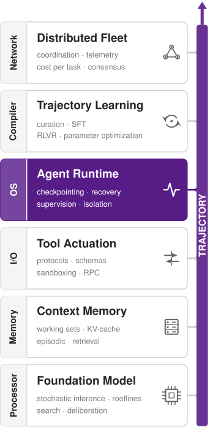

# Failure Recovery {#sec-vol3-failure-recovery}

::: {layout-narrow}
::: {.column-margin}

\chapterminitoc

:::

::: {.content-visible when-format="pdf"}
\noindent
{fig-alt="Blueprint for Fault Recovery."}
:::

::: {.content-visible unless-format="pdf"}
{fig-alt="Blueprint for Fault Recovery."}
:::

:::

## Purpose {.unnumbered .unlisted}

::: {.content-visible when-format="pdf"}
\begin{marginfigure}
\mlagentstack{0}{0}{100}{0}{0}{0}
\end{marginfigure}
:::

::: {.content-visible unless-format="pdf"}
::: {.column-margin}
{width="100%" fig-alt="Agentic Machine Learning Systems Stack"}

*Agent stack focus for this chapter.*
:::
:::

_Why can an agent that records every step it takes still leave the world half changed?_

A durable record tells a restarted agent what it intended and what it observed, but the record does not change the world. A provisioning request whose reply was lost may have created a billed environment or nothing at all, and no amount of replay settles which. Restoring a workspace snapshot resets local files, while the remote environment the agent created keeps running and keeps charging. Recovery therefore begins where recording ends, with decisions made on incomplete evidence. A runtime that reads a timeout as failure sends a second request and can leak a second resource, and one that reads it as success builds on an effect that may never have happened. Some effects can be undone only by a new operation that can itself fail, and some cannot be undone at all, so the cheapest place to stop a bad change is before the step that commits it. Other failures raise no error. A trajectory can alternate between two edits for dozens of turns, every call returning success and every health check green, while each turn resends a longer context and the bill grows faster than the turn count. Retries that every layer grants on its own allowance multiply against a dependency that is already failing, so one slow service can stall the shared worker pool. A warning in the prompt does not contain any of these hazards, because the model may ignore advice that a runtime bound would enforce. The runtime must record the cleanup it owes before it acts and keep unknown outcomes owned rather than guessed. It must weigh another attempt against unwinding by the cost still ahead rather than the cost already spent, and halt work that makes no progress at the gate where new actions are admitted. Over a long horizon, the authority an agent has already exercised becomes a set of obligations the runtime must settle.

::: {.content-visible when-format="pdf"}

\newpage

:::

::: {.callout-learning-objectives}

- Select among retry, repair, compensation, and escalation by an effect's evidence state first, then admission, then expected cost
- Register compensations before forward dispatch and order their execution with a dependency-based cleanup graph
- Compare one bounded forward repair against compensation and rebuilding, in time and dollars, at the same endpoint
- Analyze how checks placed before an irreversible commitment reduce expected loss while cleanup and residual duties remain
- Construct progress detectors and price detection latency against a cumulative budget ceiling
- Design dependency containment with a single retry owner, scoped circuit breakers, and a capped worker share
- Design an incident containment order that limits blast radius while preserving evidence and cleanup
- Evaluate recovery policies by accepted tasks, residual obligations, and unresolved outcomes rather than local status

:::

## Recovering After Partial Effects {#sec-vol3-failure-recovery-introduction}

::: {.column-margin}
{width="100%" fig-alt="H·S·A locator triad with the Horizon and Authority axes highlighted."}

*Over a long horizon, authority becomes a recovery problem for the runtime.*
:::

When a replacement worker takes over the repair agent's failed connection-pool repair (@sec-vol3-intro-lighthouses), it reconstructs the execution log and restores the candidate workspace snapshot `ws_r18`. The surviving history records an intent to run `test_r18`, but contains no evidence confirming whether the test passed, failed, or ever ran. As @sec-vol3-persistence-migration demonstrated, the worker cannot treat missing evidence as a clean slate; it must retain that uncertainty alongside the unresolved liability. State reconstruction recovers the factual foundation of the execution, but facts alone do not dictate the next step. The runtime's recovery policy must decide whether to wait for delayed evidence, attempt a targeted repair of the candidate snapshot, or abort the task entirely.

Now expand the scope of the repair to include an external side effect. Besides the unresolved `test_r18`, which remains a separate operation whose outcome is still owed, the repair provisions an isolated, temporary integration-test environment and runs a new integration suite against `ws_r18` inside it. The agent's authorization grant covers this ephemeral environment and nothing else. Production deployments, public network routing, payment processing, and the deletion of unrelated cloud resources remain strictly beyond its authority.

If a network timeout or process crash drops the provisioning reply, the worker faces an immediate impasse: it cannot know whether the remote environment was successfully allocated or never created.[^fn-generals-lost-reply] Suppose instead that telemetry confirms creation, but the integration suite subsequently crashes. Rolling back the local workspace to snapshot `ws_r18` resets internal state, yet the external environment remains active and billing charges continue to accumulate. Local rollback does not undo distributed side effects. Reclaiming those external resources requires an explicit compensating cleanup operation, followed by concrete evidence that the operation satisfied its declared postconditions.

[^fn-generals-lost-reply]: **Lost acknowledgment**: Gray named this the generals paradox in his 1978 notes on database operating systems: over a channel that can lose messages, no finite exchange lets both parties know that the last message arrived [@gray1978notes]. Fischer, Lynch, and Paterson later proved that in a fully asynchronous system no deterministic consensus protocol can guarantee termination while preserving agreement and validity if even one process may crash, since a crashed process cannot be told apart from a slow one [@fischer1985impossibility]. A tool-call timeout inherits the same ambiguity, which is why the settlement rule keeps the outcome unknown rather than guessing. \index{Two generals problem!lost reply}

Durable logs, checkpoints, and deterministic replay reconstruct what the runtime intended and what it observed. That historical reconstruction provides the evidence for recovery, but passive logs cannot alter the outside world. An execution log does not tear down an orphaned test cluster, resolve a lost network acknowledgment, or evaluate whether a subsequent attempt justifies its operational cost.

::: {.column-margin .margin-pointer}
↩ Durable logs, checkpoints, and deterministic replay are established in @sec-vol3-durable-execution.
:::

Complicating matters further, agent failures frequently manifest without throwing runtime exceptions. An agent trajectory can issue structurally valid tool calls while drifting into destructive patterns: alternating indefinitely between two conflicting edits, bombarding a degraded testing service with aggressive retries, or attempting to transmit private credentials after parsing an untrusted document. Every network call returns a successful status, every worker health check reports green, yet the agent either makes zero forward progress or actively threatens system integrity.

The recovery architecture records every compensating cleanup obligation before dispatching the operation that produces an external side effect. When an operation is interrupted, the runtime evaluates the surviving evidence alongside projected forward costs and ignores sunk expenses. It then chooses whether to retry the operation, repair the proposal within a bound, run compensating actions that unwind external side effects, or hand control to an authorized human operator. Furthermore, the architecture bounds ongoing executions even when no component raises an explicit error. By intercepting actions at the admission gate where new tool calls are scheduled, the runtime halts unproductive loops, throttles retries against saturated dependencies, and quarantines suspicious behaviors. It does not rely on prompt warnings that an agent model might overlook or ignore.

@Sec-vol3-sagas-acid-boundary demonstrates why the environment service and runtime log in this workflow share no atomic commit boundary, carrying forward from the harness the two rules that govern every subsequent recovery decision. @Sec-vol3-sagas-architecture translates these invariants into an executable saga pattern, tracking compensation obligations as explicit, dependency-ordered records. Where an execution encounters partial failure, @sec-vol3-sagas-forward-vs-backward formalizes how to evaluate the marginal cost of forward repair against backward unwinding, while @sec-vol3-sagas-pivot governs the critical transition across irreversible commitment points.

To address failures that emerge without explicit error signals, the runtime introduces three containment boundaries. Progress watchdogs identify trajectory stagnation and oscillatory loops (@sec-vol3-sagas-watchdogs). Dependency controls insulate shared backend services from retry cascades (@sec-vol3-sagas-containment). Automated quarantine policies isolate suspected security incidents (@sec-vol3-sagas-quarantine). Finally, @sec-vol3-sagas-case-study unites these control loops in a recovery worksheet for a degraded connection-pool repair, detailing the fault-injection test harness required to verify recovery correctness under real-world failures.

## Effects Outside a Shared Transaction {#sec-vol3-sagas-acid-boundary}

When the integration test crashes after the environment service has already provisioned `env_r18_01`, no database rollback in the agent runtime can reach across the network to deallocate the remote virtual machine, because the environment service and the runtime's log commit separately. Although an external service might execute internal database transactions with strict ACID guarantees, no unified atomic boundary encompasses both that remote service and the agent runtime in this workflow. A locking-based transaction can retain exclusive locks until commit or abort to enforce its chosen isolation contract. Two-phase commit coordinates an atomic decision among cooperating resource managers; during preparation each participant preserves the recovery state needed to honor that decision [@gray1981transaction]. A prepared participant may have to wait when the coordinator's decision is unavailable, retaining resources for recovery. The environment service and runtime log do not participate in such a common protocol. The external endpoints an agent invokes rarely expose a prepare phase or accept this runtime as their coordinator. Even where participants cooperate, retaining transaction resources across model generation, long tests, or asynchronous human review can block competing work for unacceptable periods. A runtime crash while a participant remains prepared can prolong that wait; it does not establish that blocking is necessarily permanent. For the independently administered services in this workflow, recovery therefore uses tentative operations, explicit cancellations, and idempotent exchanges rather than assuming a shared transaction [@helland2007life].

When atomic rollback across independent boundaries is impossible, systems must rely on **compensation**\index{Compensation!definition}:[^fn-compensation-log-gray] a forward-executing operation that establishes acceptable postconditions after a prior effect has already committed. Compensation does not erase history or restore the universe to its pristine pre-transaction state. For example, releasing a cloud-hosted development environment deallocates its virtual compute instances and stops active billing meters. The provisioning event, network ingress logs, and financial charges already accrued remain permanent, and the teardown request itself may fail on an unreachable network. To structure multi-step workflows without global isolation, Garcia-Molina and Salem introduced the **saga**\index{Saga!definition} pattern for long-lived transactions [@garciamolina1987sagas]. Rather than treating the entire trajectory as a single atomic unit, a saga partitions execution into a sequence of smaller, independently committed steps. It pairs each forward step with a compensating action designed to mitigate its side effects if a later step fails.

::: {.column-margin .margin-pointer}
↪ Two-phase commit's blocking behavior and the original saga abstraction are developed in @sec-vol3-appendix-systems-transactions.
:::

[^fn-compensation-log-gray]: **Compensating transaction**: Gray's 1981 travel-agent example had this exact structure [@gray1981transaction]. Because each flight or hotel reservation commits at an independent organization, canceling the itinerary requires executing a compensating transaction. Gray proposed that each nested step return the name and parameters of its compensator for the parent coordinator to log, falling back to human intervention as a last resort. However, Gray's coordinator logs the compensator only after the forward step successfully returns. A trajectory saga must instead record the recovery obligation before dispatching the request over the network, because a dropped connection or lost acknowledgment would otherwise leave unmanaged side effects with no corresponding recovery record. \index{Compensation!historical lineage}

Compensation is not the only recovery strategy. Apart from a plain retry of an operation whose repeat contract permits one, an agent runtime chooses among three families of response:

1. *Compensation*: execute explicit counteracting operations to neutralize partial side effects.
2. *Forward repair*: preserve valid intermediate artifacts, such as a successfully compiled binary or a provisioned database schema, and adjust subsequent steps rather than discarding completed progress.
3. *Escalated handoff*: halt autonomous dispatch and transfer unresolved obligations, active resource handles, and diagnostic logs to an authorized human operator.

The runtime balances available evidence against projected forward costs to choose among these alternatives; capital and compute time already expended are sunk costs that must not distort future recovery decisions. Whichever path it selects, two rules that the harness already enforces govern the choice, and recovery is where both are tested hardest.

The settlement rule governs what the runtime may believe about an external effect. The harness stated it as a rule about the operation table: withdrawing an operation's observation eligibility never settles the operation, and only authenticated, correlated evidence does. Recovery needs the rule in a sharper form, as three mutually exclusive evidence states for every dispatched operation: *established*, *established absent*, or *unknown*. An outcome begins as unknown, and only evidence correlated with that specific operation, interpreted through the target endpoint's contract, can move it to established or established absent. A dropped TCP acknowledgment, an HTTP gateway timeout, an asynchronous accepted-but-pending status, or a status query that returns nothing while the original request may still be in transit all leave the outcome unknown. An unknown outcome keeps its liability reservation against the task budget, keeps a durable record with a named owner, and blocks any forward action that presupposes either success or failure. The runtime may repeat the dispatch only when the endpoint's verified repeat contract makes re-execution safe, which is settlement before retry (principle \ref{pri-vol3-exactly-once-settlement}).

::: {.column-margin .margin-pointer}
↩ The settlement rule, which separates observation eligibility from settling the operation, is established in @sec-vol3-controlplane-acb.
:::

The admission check governs what the runtime may do next. Every candidate operation passes the same predicates the harness applies to ordinary work, whether it is forward progress, a retry, an environment repair, a status probe, or a cleanup action. The predicates are valid authority and approval, satisfied dependencies, available capacity, and enough time before the deadline. They also require a reservation whose bounded liability fits beside actual consumption, outstanding liability from unsettled operations, and the protected finalization reserve. The check is re-evaluated at the dispatch boundary immediately before transmission, so a plan-time approval or an earlier durable intent cannot override a later administrative hold, a revoked token, or a depleted budget. Recovery operations receive no exemption. Organizational liability for remote infrastructure does, however, outlive the agent's reasoning loop, so administrative cleanup backed by independent operational credentials can still pass admission and decommission orphaned resources long after model-directed continuation has ended.

::: {.column-margin .margin-pointer}
↩ The admission check and the finalization reserve it protects are established in @sec-vol3-agent-harness-transition-guards.
:::

A naive undo stack, such as a reversed list of tool invocations that maps server creation to server deletion, is too brittle to satisfy either the settlement rule or the admission check. In-flight operations fail asynchronously, remote endpoints drop responses, and partial writes leave external resources in states that cannot be resolved by replaying inverse functions with original arguments. Instead, the runtime must persist a structured recovery obligation *before* allowing any request to cross the network boundary. This obligation captures correlation identifiers, parent-child causal links, parameter snapshots, timeout thresholds, and settlement state, providing the durable bookkeeping needed to handle partial failure without leaking resources. The trajectory saga pattern formalizes this durable record of obligations.

## The Trajectory Saga Pattern {#sec-vol3-sagas-architecture}

When the repair worker dispatches its request to provision the temporary test environment, the remote service may allocate `env_r18_01` and start billing even if a network partition drops the return acknowledgment before it reaches the runtime. That lost reply breaks the binary assumption of a classical database saga, which coordinates a long-lived transaction across independent services by assuming that each local step either commits cleanly or aborts cleanly and reports which one happened. In an agent trajectory, the runtime can be left with an active cleanup obligation whose target resource identifier (`env_r18_01`) has not yet arrived. A saga for agent tool calls therefore cannot merely log completed steps after they return; it must durably register each recovery obligation before dispatch and explicitly track what the runtime does not yet know.

::: {#dfn-trajectory-saga .callout-definition title="Trajectory saga"}

***Trajectory saga***\index{Trajectory saga!definition} is a recovery pattern that durably records constituent tool actions and coordinates compensating actions when established external effects must be remediated, while explicitly preserving unresolved outcomes and inter-action dependencies.

1. **Significance**: Enables systematic recovery across independent external tools and services that share no common distributed transaction boundary.
2. **Distinction**: Compensation represents new forward execution that produces its own observable outcome, rather than an atomic rollback or physical reversal of the environment.
3. **Common pitfall**: Deferring cleanup registration until after receiving a successful forward response, creating a crash window where external resources leak without any durable record of their recovery obligation.

:::

In its classical formulation, a saga consists of a sequence of separately committed forward steps $\SagaForwardStep_1, \dots, \SagaForwardStep_n$, each paired with a compensating step $\SagaCompensatingStep_i$ that the runtime executes if downstream failures require remediating earlier effects [@garciamolina1987sagas]. A forward action that produces no external side effect requires no compensation. When every forward step succeeds, the saga completes execution as $\SagaForwardStep_1, \dots, \SagaForwardStep_n$. If step $\SagaForwardStep_k$ fails, a linear saga unwinds by executing compensating actions in reverse order:

$$\SagaForwardStep_1, \dots, \SagaForwardStep_{k-1}, \SagaFailedForwardStep, \SagaCompensatingStep_k, \SagaCompensatingStep_{k-1}, \dots, \SagaCompensatingStep_1,$$ {#eq-vol3-saga-unwind}

where $\SagaCompensatingStep_k$ runs only when evidence confirms that the failed step actually produced an external effect. If the outcome of $\SagaForwardStep_k$ remains unknown, the runtime's settlement rules keep the obligation for $\SagaCompensatingStep_k$ open rather than guessing. While @eq-vol3-saga-unwind models an idealized sequential workflow, non-linear trajectories require a generalized directed cleanup graph. Each compensating step $\SagaCompensatingStep_i$ is itself an independent, separately committed operation with its own execution outcome; an unwind can stall partway through, leaving certain compensations settled while others remain pending or in flight.

### Obligation registration {#sec-vol3-failure-recovery-obligation-registration}

If the runtime waited until after receiving a successful provisioning reply to register cleanup, a crash during or immediately following dispatch would orphan the remote test environment without any local recovery record. The runtime eliminates this crash window by durably registering a cleanup template *before* forward dispatch. In our temporary test-infrastructure workflow, let `provision_test_env_r18` be the stable logical operation that provisions an isolated test environment. Let `release_test_env_r18` be its corresponding cleanup operation, a distinct logical identity that remains stable across retries and restarts. Neither identity should be confused with the endpoint-generated environment identifier. That system handle, denoted `env_r18_01` in a successful provisioning run, becomes known to the runtime only after correlated response evidence settles the forward operation.

The pre-dispatch cleanup template records the exact forward operation and payload, authorized capability scope, execution preconditions, dependencies, and an explicit rule for binding the returned environment identifier once it arrives. Appended directly to the write-ahead log alongside the forward admission record, this registration shares the forward attempt's storage acknowledgment and resource reservation, avoiding the overhead and complexity of an independent state machine. Registering the cleanup before the effect it cleans up applies intent before effect (principle \ref{pri-vol3-intent-before-effect}) to the recovery obligation itself.

::: {.column-margin .margin-pointer}
↩ The durable intent record written before dispatch is established in @sec-vol3-persistence-wal.
:::

The resulting template binds cleanup to the specific environment instantiated by this provisioning operation, rather than relying on transient metadata like display names. Durably registering this template establishes a binding commitment for future recovery rather than asserting that the resource already exists. @Tbl-vol3-compensation-registration follows this distinction across each phase of the crash boundary.

| Boundary                                              | Durable obligation and available evidence                                                                                                               | Permitted interpretation                                                                                                  |
|:------------------------------------------------------|:--------------------------------------------------------------------------------------------------------------------------------------------------------|:--------------------------------------------------------------------------------------------------------------------------|
| Before provisioning dispatch                          | `provision_test_env_r18`, exact request and scope, admission and reservation, and template for `release_test_env_r18` with an unbound environment field | Cleanup is planned; no generated resource identity or provisioning outcome is yet established                             |
| Provisioning intent survives, but its result does not | The same obligation and unresolved forward attempt                                                                                                      | The request may be delayed, running, or completed; missing evidence does not authorize another creation or settle cleanup |
| Adequate correlated provisioning evidence arrives     | The evidence binds `env_r18_01` to `provision_test_env_r18`; the binding is durably recorded                                                            | Cleanup can target that resource if its dependencies and preconditions hold and it passes the admission check             |
| Cleanup is dispatched                                 | A separate admitted intent for `release_test_env_r18`, with its own attempt identity, payload, reservation, and repeat contract                         | Cleanup is in progress or unresolved; sending the request does not establish release                                      |
| Adequate cleanup evidence arrives                     | Recorded evidence establishes the declared postcondition, or identifies remaining work and its owner                                                    | Close only the established part of the obligation; retain unsupported or partial outcomes explicitly                      |

: **Registration and deferred result binding**: The recovery obligation precedes the forward effect, while an endpoint-generated resource identifier is bound only when the evidence supports it. {#tbl-vol3-compensation-registration}

When an acknowledgment is lost following dispatch, an idempotent result-recovery probe may retrieve the missing outcome. For a mutating tool without endpoint deduplication, this is the probe that the tool contract of @eq-vol3-legacy-tool-contract ships beside its actuate and compensate routines. The template registered here instantiates that contract's compensate routine for one specific, bound resource. If probing is unsupported or inconclusive, settlement rules mandate that the operation remain open with an assigned recovery owner. A naive runtime might query the external service, observe that the environment is absent, and prematurely close the cleanup record on the assumption that creation failed. Doing so creates a race condition. If the original provisioning request was merely delayed in transit, the remote service may instantiate the environment seconds later, leaving an **orphaned resource**\index{Orphaned resource!definition} that accrues compute charges indefinitely without any controlling process. If the endpoint supports explicit request cancellation, the runtime can invoke that contract to terminate the pending creation, provided the endpoint guarantees that canceled requests will not take effect downstream.

::: {.column-margin .margin-pointer}
↪ Result recovery, as distinct from repeated execution, is developed in @sec-vol3-appendix-systems-retries.
:::

### Semantic compensation {#sec-vol3-failure-recovery-semantic-compensation}

When a failed integration run forces the runtime to tear down `env_r18_01`, no recovery call can un-send the provisioning packets, erase the cloud provider's audit log, or refund the compute seconds already burned. Recovery instead runs a new forward action that deallocates the environment and stops further billing while leaving historical logs and accrued charges intact.

::: {#dfn-semantic-compensation .callout-definition title="Semantic compensation"}

***Semantic compensation***\index{Semantic compensation!definition} is an independent forward action designed to establish declared application postconditions following an earlier side effect, without claiming to erase execution history or restore every dimension of the external environment.

1. **Significance**: Provides a verifiable, checkable objective for recovery when exact physical or historical reversal is impossible.
2. **Distinction**: Releasing a temporary environment terminates its active allocation; it does not un-send network packets, erase system audit logs, or refund consumed compute charges.
3. **Common pitfall**: Treating an endpoint's asynchronous acceptance response as proof that declared postconditions have been achieved when only request receipt has occurred.

:::

In our running example, the compensation contract stipulates that the task-owned environment must no longer be allocated and that no active integration test may still depend on it, requiring any diagnostic artifacts to be transferred to durable storage prior to deallocation. The contract also defines what evidence the endpoint must supply to demonstrate successful release. Because final billing charges often settle asynchronously hours after an environment is torn down, the runtime decouples the physical resource obligation from financial settlement.

Formally, let $\PreForwardEnvironmentState$ represent the state of the environment prior to executing forward step $\SagaForwardStep$, and let $\CompensatedEnvironmentState$ denote the state after executing $\SagaForwardStep$ followed by its compensating action $\SagaCompensatingStep$. Because physical time cannot be reversed and side effects alter audit trails and financial balances, $\CompensatedEnvironmentState$ and $\PreForwardEnvironmentState$ inevitably differ. Compensation guarantees equivalence only with respect to an explicitly declared set of postcondition predicates $\CompensationPostconditionSet$. The compensation succeeds if and only if both states agree on every predicate in $\CompensationPostconditionSet$:

$$\CompensatedEnvironmentState \equiv_{\CompensationPostconditionSet} \PreForwardEnvironmentState \iff \forall \CompensationPostcondition \in \CompensationPostconditionSet:\ \CompensationPostcondition(\CompensatedEnvironmentState) = \CompensationPostcondition(\PreForwardEnvironmentState).$$ {#eq-vol3-semantic-equivalence}

Here, predicates such as “the environment is allocated” and “an admitted test depends on it” belong to $\CompensationPostconditionSet$, and both evaluate to false in $\PreForwardEnvironmentState$ and $\CompensatedEnvironmentState$. In contrast, billing records and audit histories lie outside $\CompensationPostconditionSet$, which is why financial reconciliation requires an independent settlement lifecycle. A compensation contract claims to satisfy only the predicates explicitly declared in $\CompensationPostconditionSet$; unmodeled side effects remain unaddressed.

Compensation inevitably operates on an environment that has moved on. External services or human operators may have observed the intermediate state, consumed compute seconds cannot be un-billed, and concurrent processes can alter cleanup preconditions. For instance, if a peer workflow has attached to the temporary environment for joint debugging, the originating agent cannot unilaterally destroy the resource simply because its own plan stalled. The runtime's admission control boundary must inspect live ownership and active dependency graphs at the moment of compensation, rather than blindly following stale planning text.

Local workspace restoration plays a complementary but narrower role. A compatible checkpoint restores only the local workspace projection managed directly by the runtime. Checkpoints cannot reset remote cloud environments, running external daemons, dispatched batch jobs, or accrued service charges. Those external side effects demand semantic compensation. When recovery requires both local rollback and remote compensation, the runtime orchestrates both mechanisms, verifying the independent outcome of each path before declaring the system recovered.

::: {.column-margin .margin-pointer}
↩ Checkpoint restoration, which reinstates the record and workspace without re-executing external actions, is established in @sec-vol3-durable-execution-recovery-boundaries.
:::

### Cleanup failures {#sec-vol3-failure-recovery-cleanup-failures}

Because cleanup actions cross the same external tool boundaries as forward actions, they encounter the same failure modes: network drops, rate limits, and remote service outages. Consequently, every compensating operation must pass admission control, and its intent must be durably committed before dispatch. When retrying a failed cleanup call, the runtime assigns each transport attempt a unique attempt identifier, while `release_test_env_r18` continues to designate the persistent logical operation. Retries adhere to the endpoint's repeat contract. The stable logical key ensures that duplicate deletion requests execute safely without targeting a different resource if the external system reuses names or identifiers.

::: {.column-margin .margin-pointer}
↩ Stable operation identities, with a fresh attempt identity for each retry under the endpoint's repeat contract, are established in @sec-vol3-tool-calling-operation-ids.
:::

The coordinator retires a compensation entry only upon receiving verifiable outcome evidence, rather than assuming success simply because a remote call returned without a transport error. If a release call times out, three states remain possible: the environment may be gone, it may still be undergoing deallocation, or it may remain allocated. The settlement rules keep all three possibilities open. Furthermore, cleanup actions consume quota and wall-clock execution budget; a timed-out call refunds nothing. If cleanup cannot progress further within its assigned budget, the obligation stays on record with its accumulated evidence and an assigned escalation owner. In this way, a failed agent trajectory can terminate safely without masking unresolved external leaks.

Preregistered cleanup templates execute under the supervision of the trusted runtime coordinator without invoking another model inference step. This separation enforces least-privilege control: even if the model's forward execution authority is revoked following an anomaly or budget exhaustion, a narrowly scoped cleanup grant remains accessible to the coordinator to tear down provisioned resources. If remediation requires operations beyond this pre-authorized grant, the runtime does not guess; it halts and issues an explicitly owned handoff. Later authenticated evidence or manual operator actions can settle the obligation without restarting the obsolete agent trajectory.

### The cleanup graph {#sec-vol3-failure-recovery-cleanup-graph}

A simple last-in, first-out (LIFO) unwind stack is adequate only when an agent executes a strictly linear sequence and every cleanup precondition follows that reverse order. When an agent invokes tools concurrently, triggers asynchronous background tasks, or branches across speculative plans, recovery requires tracking explicit causal dependencies. This structure is a directed **cleanup graph**\index{Cleanup graph!definition} $(\CleanupGraphVertexSet,\CleanupGraphEdgeSet)$, where each vertex represents an admitted cleanup operation and a directed edge

$$\SagaCompensatingStep_j \rightarrow \SagaCompensatingStep_k$$

signifies that compensating operation $\SagaCompensatingStep_j$ must establish its declared settlement conditions before $\SagaCompensatingStep_k$ is permitted to dispatch. Declared cleanup dependencies must form a directed acyclic graph (DAG); cyclical dependencies represent contradictory recovery requirements that demand explicit operator intervention rather than an arbitrary stack ordering.

In our temporary environment scenario, an active integration test may still be executing when a failure is detected. Confirming that the test process has stopped, or canceling it and verifying that it stopped, must precede `release_test_env_r18`. Similarly, extracting and preserving diagnostic test artifacts outside the sandbox must occur before deprovisioning the virtual machine. By contrast, removing an unrelated local scratch directory can proceed independently, provided no active test or pending evidence collection depends on it. The cleanup graph answers what must happen first, settlement rules determine what has been empirically verified, and admission control determines which operations may run next. The graph cannot be sequenced until provisioning evidence has bound its target, which is why @fig-vol3-saga-flow draws the release ordering beneath the registration step it depends on.

::: {#fig-vol3-saga-flow data-explore="mechanism-scene" data-explore-key="vol3:fig-vol3-saga-flow" fig-env="figure" fig-pos="htb" fig-cap="**Registration Before Dispatch, Release After Evidence**: The forward lane records the cleanup obligation before `provision_test_env_r18` is sent, and binds `env_r18_01` only when correlated evidence arrives; a lost reply leaves the obligation open with an owner instead of guessing a target. The dashed link shows the binding supplying the target of the registered cleanup. In the cleanup lane, `release_test_env_r18` waits for its predecessors, and its own outcome either closes the obligation or remains owned, so no path ends in an assumed clean state." fig-alt="Two stacked panels. The top panel, forward operation, shows three boxes left to right: register obligation, target unbound; dispatch provision_test_env_r18; and bind on evidence, env_r18_01. A red arrow labeled reply lost leads from dispatch to a dotted box, outcome unknown, obligation open, owned. The lower panel, registered cleanup, receives two purple links into a release box for release_test_env_r18: a solid link labeled registers from register obligation, and a dashed link labeled binds target from bind on evidence. Test ended or cancel confirmed and artifacts preserved outside the environment both feed the release box, while a separate scratch removal box has no dependency and no connections. Release branches by a green arrow to obligation closed, postcondition shown, and by a red arrow to a dotted box, retained, owned, release unconfirmed."}

:::

Structuring cleanup as a DAG isolates failures and enables concurrent unwinding. An unresolved or failed cleanup node blocks only its transitive dependents in $(\CleanupGraphVertexSet,\CleanupGraphEdgeSet)$; independent recovery subgraphs can proceed immediately once their predecessors settle, their preconditions hold, and they clear admission control. Executing independent cleanup actions in parallel reduces overall recovery latency.

The cleanup graph enforces ordering without erasing historical accountability. Settled nodes retain their verification evidence, while failed or ambiguous nodes remain bound to their assigned owners. While an authorized administrator may deliberately accept residual risk to unblock downstream execution, the system never silently records an unconfirmed release as clean.

### Branch-scoped compensation {#sec-vol3-failure-recovery-branch-compensation}

During tree searches, speculative execution, or multi-candidate exploration, an agent system frequently preserves a shared trajectory prefix while exploring several alternative continuations in parallel. While branch ancestry tracks where model execution diverged, it reveals nothing about which external resources each branch currently claims. If an agent creates a cloud test sandbox during the common prefix before branching into three separate test configurations, tearing down that sandbox because Candidate B failed would sabotage the active experiments in Candidates A and C.

The runtime therefore decouples resource ownership from logical branch history by tracking effects and cleanup obligations through reference-counted dependency graphs. When the runtime abandons a speculative branch, it reclaims only those resources owned exclusively by that branch, once its outstanding work has settled or stopped cleanly. Shared resources remain allocated until all surviving dependencies permit release. Furthermore, if an abandoned branch dispatched a provisioning request whose outcome remains unknown, that request stays recorded in the durable operation table; pruning a branch from the scheduler does not erase an unresolved external obligation.

Restoring a branch's local workspace or context window does not rewind the external environment to the branch point, and evidence gathered from an abandoned candidate cannot be assumed valid for a sibling branch merely because they share an ancestor. During counterfactual execution, local workspaces can be rolled back to earlier checkpoints, but external networks, databases, and billing meters cannot. Enforcing this distinction ensures that speculative branch pruning never silently discards external recovery duties.

::: {.column-margin .margin-pointer}
↩ Counterfactual branches, which replay a recorded prefix and then require fresh observations, are established in @sec-vol3-durable-execution-counterfactual-branches.
:::

::: {#chk-12-sagas-compensation .callout-checkpoint title="Compensation obligations and dependency scope"}

Compensation is registered before dispatch and settled by evidence afterward. Each prompt places an obligation on one side of that boundary.

- [ ] **Registration**: Provisioning returns its resource identifier only after creation. What must be recorded before dispatch, and what can be bound only afterward?
- [ ] **Unknown creation**: Why does an empty resource lookup not justify closing cleanup while a provisioning request may still be delayed?
- [ ] **Cleanup outcome**: Release is accepted but completion is unconfirmed. Which resource and charge obligations remain, and what evidence could settle each?
- [ ] **Cleanup graph**: Draw the graph for four nodes: end the test, preserve artifacts, release the environment, delete unrelated private scratch. Which nodes can run in parallel, and which one waits if ending the test stays unresolved?
- [ ] **Branch scope**: Two branches share an environment. Why does abandoning one branch not authorize releasing it or discarding its unresolved operations?

:::

While semantic compensation systematically remediates partial effects, unwinding external work can discard valuable intermediate state that could have salvaged the task. If a provisioned test environment is healthy and only the agent's proposed test configuration was malformed, tearing down the sandbox wastes time and budget that a bounded in-place correction could preserve. Deciding whether to tear down that environment or repair the configuration in place requires comparing the expected cost of forward correction against the expense of backward unwinding and rebuilding.

## Forward Recovery {#sec-vol3-sagas-forward-vs-backward}

Take the branch in which provisioning evidence did arrive. The separately authorized operation `provision_test_env_r18` has settled, binding the temporary integration-test environment `env_r18_01`. Before dispatching the integration test, the runtime validates the proposed test configuration and rejects it because a field requiring an integer contains a string. The candidate workspace remains `ws_r18`, and no integration test has started. Releasing the environment through `release_test_env_r18` would discard expensive, fully functional preparation. Conversely, a bounded correction of the configuration can restore readiness without rebuilding the environment from scratch.

This situation differs from the unresolved `test_r18` intent that the replacement worker recovered. When the runtime rejects a proposal before dispatch, it establishes definitive evidence that the executor never launched the action. A missing result under the settlement rule provides no such assurance; the operation might have succeeded, failed, or stalled midway through execution.

In dependable system design, **forward recovery**\index{Forward recovery!definition} modifies the current state or repairs a proposed action to restore an admissible path toward completing the task. By contrast, **backward recovery**\index{Backward recovery!definition} returns the system to an earlier saved state. The classical dependability taxonomy formalizes these strategies as rollforward and rollback, where rollback restores a previously captured checkpoint [@avizienis2004basic].[^fn-recovery-terms-lineage] Forward repair, the response family named earlier, is the agent runtime's form of forward recovery, which keeps valid intermediate artifacts and corrects the proposal that failed. In an agentic system, restoring a workspace checkpoint performs backward recovery for the local filesystem and memory state that the checkpoint covers. External systems, however, rarely support true rollback, and compensation sits across the divide. In intent it is backward recovery, because it moves the environment back toward the pre-effect predicates of @eq-vol3-semantic-equivalence. In execution it is forward, a new operation with its own outcome, which is why the trajectory saga definition calls it new forward execution. It achieves semantic equivalence rather than physical restoration.

[^fn-recovery-terms-lineage]: **Recovery vocabulary**: The same terminology carries conflicting meanings across the two architectural lineages this chapter draws on. Garcia-Molina and Salem defined running compensations as backward recovery for sagas, reserving forward recovery for executing missing steps from a save-point [@garciamolina1987sagas]. In the classical dependability taxonomy, however, compensation denotes masking an error through redundancy [@avizienis2004basic]; this chapter follows the saga usage, so compensation counts as backward recovery even though each compensating step is itself a forward operation. \index{Backward recovery!terminology}

### Recovery actions and evidence {#sec-vol3-failure-recovery-recovery-actions}

Treating every failure as a blanket instruction to “try again” either re-sends a non-idempotent provisioning call after an ambiguous timeout or tears down a healthy test environment `env_r18_01` when only a local configuration field had the wrong type. Separating “try again” by the evidence each failure leaves behind yields five distinct choices, because forward repair splits into two forms while retry, compensation, and escalation each remain one. A transport retry repeats the same logical operation under an established repeat contract. Forward repair takes two forms: resampling requests an entirely fresh candidate proposal from the model, while feedback-based repair [@madaan2023selfrefine; @shinn2023reflexion] supplies targeted diagnostics to prompt a revised proposal. Compensation executes registered actions to establish fallback postconditions, and escalation transfers decision authority or unresolved obligations to an authorized supervisor. @Tbl-vol3-recovery-comparison separates these choices by the evidence they require and the obligations that remain on the runtime.

| Choice                      | Appropriate basis                                                                                      | Obligation that remains                                                      |
|:----------------------------|:-------------------------------------------------------------------------------------------------------|:-----------------------------------------------------------------------------|
| Retry an existing operation | Its repeat contract and current evidence permit another transport attempt                              | Preserve logical identity, possible prior effects, and charges               |
| Generate a new proposal     | The task still permits another candidate and the runtime can distinguish it from already admitted work | Validate the complete proposal; a new sample is not a recovered result       |
| Repair using feedback       | A scoped diagnostic suggests a permitted change to the action or its prerequisites                     | Pass the admission check again; verify the repaired outcome                  |
| Compensate                  | Registered recovery actions remain applicable to established effects                                   | Respect dependency order and verify postconditions or retain residual duties |
| Hold or escalate            | No admissible automatic path remains                                                                   | Name the decision or settlement owner; do not discard pending work           |

: **Recovery choices and their evidence**: The error label alone does not select a safe response. Recovery changes are new admissions unless they merely reconstruct recorded state. {#tbl-vol3-recovery-comparison}

A network timeout raises an effect-status question before any model-repair question can be addressed, and the runtime relies on the settlement rule to resolve whether external state was altered. Similarly, an HTTP 429 rate-limit response proves only what the external service contract guarantees; it does not prove that an attempted state mutation was rejected before execution. Exponential backoff regulates the timing and throughput of a permitted retry, but no backoff schedule can transform an unsafe, non-idempotent repeat into a safe operation.

In contrast to an ambiguous timeout, a pre-dispatch configuration rejection provides a well-defined basis for repair. Because the schema validator rejected the payload locally, the runtime establishes that the proposed action never reached the executor or modified remote state. The runtime can therefore supply the original request, the target schema, the field-level diagnostic, and the task scope within a bounded repair prompt, validating the revised proposal before admitting any side effect. If the repair instead modifies source code rather than an ephemeral test configuration, the modified artifact constitutes a new candidate revision requiring fresh test evidence; previous test passes for `ws_r18` cannot certify altered code.

::: {.column-margin .margin-pointer}
↩ Structured, bounded rejection diagnostics are established in @sec-vol3-tool-calling-rejection-diagnostics.
:::

Providing feedback modifies the model's prompt conditioning without expanding its execution authority. While drawing independent resamples from a fixed prompt yields the same success probability on every attempt, repeated failures in operational agents are rarely independent. Instead, repeated failures typically expose an intrinsically difficult task, a persistent prompt misconception, or an unexpected environment state. The empirical repair success rate $\RepairSuccessProbability$ is therefore a measured property of a specific failure class and feedback policy, which systems engineers must estimate from recorded operational episodes.[^fn-self-repair-evidence]

::: {.column-margin .margin-pointer}
↩ The feedback axis established in @sec-vol3-test-time-compute-feedback-axis separates feedback that adds an external observation from asking the model to re-examine its own output.
:::

[^fn-self-repair-evidence]: **Measured self-repair**: When code-generation repair was evaluated against unconditioned resampling under matched sampling budgets, performance gains were often modest, varied substantially across problem subsets, and occasionally disappeared; high-quality feedback from a stronger verifier or a human supervisor yielded the only substantial improvements [@olausson2024selfrepair]. In the absence of external ground-truth feedback, unguided self-correction on complex reasoning tasks can actually degrade accuracy [@huang2024cannot]. Because the diagnostic signal rather than the retry attempt provides the corrective value, engineers must estimate $\RepairSuccessProbability$ separately for each failure class and feedback mechanism. \index{Repair episode!measured success}

Accumulating failed responses and diagnostic traces across successive attempts also inflates the prompt for subsequent calls. Runtimes must manage two distinct resource boundaries: the per-invocation context window capacity and the cumulative task token meter. Context assembly must fit relevant diagnostic evidence within a single invocation's context limit, whereas the billing meter charges for all input and output tokens consumed across the full sequence of repair calls. While context compaction can summarize historical attempts to fit within the context window, compaction consumes additional model calls, adds latency, and discards fine-grained diagnostic detail. Notebook \ref{nbk-12-loop-cost} in @sec-vol3-failure-recovery-loop-cost-section prices what appending feedback turn after turn costs under a concrete workload.

### Admissibility and expected cost {#sec-vol3-failure-recovery-admissibility-cost}

A repair call that is inexpensive on average can still overrun the task's remaining dollar ceiling in the worst case or attempt to bypass an expired permission grant. Before evaluating the economic trade-offs of recovery, the runtime therefore eliminates any candidate action that fails admission control. For instance, an authentication failure never grants permission to synthesize an unauthorized bypass; instead, the runtime must either request an authorized credential refresh, locate a permitted fallback operation, or pause execution and escalate. Financial and latency budgets enforce hard ceilings. Even when a proposed repair is inexpensive in expectation, the runtime admits it only if its maximum bounded liability fits within the remaining allowance. Furthermore, the assembled repair context must separately fit within the target model's context capacity.

::: {.column-margin .margin-pointer}
↩ Bounded-liability admission, which admits an operation only when its maximum charge fits the remaining allowance, is established in @sec-vol3-agent-harness-reservation-settlement.
:::

Expected cost guides the recovery policy only among candidate actions that have cleared admission. Historical expenditures are sunk costs; recovery decisions must depend strictly on forward-looking costs and risks: the cost of retaining useful state, rebuilding that state from scratch, attempting repair, and managing secondary failure. While expensive earlier preparation often implies costly reconstruction, past spending alone never justifies continuing down a failing path. Ongoing resource holding fees, unsafe residual side effects, or task deadline expirations often dictate that discarding partially completed work is preferable to attempting a repair.

### Repair vs. rebuild {#sec-vol3-failure-recovery-repair-vs-rebuild}

When `env_r18_01` is already running and only the test configuration failed local validation, tearing down and rebuilding the environment wastes every second spent provisioning it. Yet spending turns on a low-probability repair wastes tokens and still pays for the rebuild if the repair fails. To compare attempting a bounded repair against executing an immediate fallback that unwinds and rebuilds the required state, let $\FallbackCost$ denote the future cost of compensating existing side effects and rebuilding to a declared readiness endpoint. Let one bounded repair attempt cost $\RepairAttemptCost$, with probability $\RepairSuccessProbability$ of reaching that same endpoint. Assuming that an unsuccessful repair leaves the original fallback pathway available at unchanged cost, the expected total cost of attempting repair before falling back is

$$\mathbb{E}[\RepairFirstCost] = \RepairAttemptCost + (1-\RepairSuccessProbability)\FallbackCost.$$ {#eq-vol3-repair-first-cost}

For any strictly positive fallback cost, attempting repair first yields a lower expected cost than an immediate fallback whenever

$$\RepairSuccessProbability > \RepairSuccessProbability^* = \frac{\RepairAttemptCost}{\FallbackCost}.$$ {#eq-vol3-repair-breakeven}

Engineers must evaluate this comparison independently for latency (in seconds) and monetary expense (in model dollars), as their respective break-even thresholds $\RepairSuccessProbability^*$ often diverge. If $\RepairAttemptCost \ge \FallbackCost$, no success probability below one can make repair cheaper on that resource axis. Furthermore, if a failed repair alters residual side effects, extends resource holding times, or increases fallback complexity, the term $(1-\RepairSuccessProbability)\FallbackCost$ must be replaced by the corresponding conditional fallback cost. Expected cost is the last of three gates, not the first. Evidence class decides which candidates exist at all, admissibility removes those that authority, allowance, or the deadline forbids, and only then does @eq-vol3-repair-breakeven rank the survivors; @fig-vol3-recovery-decision-tree lays out that order.

::: {#fig-vol3-recovery-decision-tree fig-env="figure" fig-pos="htb" fig-cap="**Recovery Decision Order**: Evidence class comes first, because an unknown outcome admits only a retry of the same operation under its repeat contract (a result-recovery probe or a wait gathers evidence that moves the outcome out of this branch rather than acting on it), while a rejected proposal or an established effect opens new proposals, repair, and compensation. Admissibility then removes candidates that lack authority, allowance with the finalization reserve intact, or time; if none remain, the runtime holds or escalates. Expected cost at a matched endpoint chooses only among the admissible survivors, and applies separately to seconds and dollars." fig-alt="Top-to-bottom flowchart drawn as three stacked horizontal gates crossed by vertical lanes. A box labeled failure evidence recorded leads to gate 1, evidence class, what is known about the effect. Gate 1 feeds two dashed groups: outcome unknown, which covers one lane, and rejected or established, which covers three lanes. All four lanes pass down through gate 2, admissibility, listing authority, allowance with finalization reserve, and deadline; below it the lanes turn dashed and are labeled survivors only. They continue through gate 3, expected cost at a matched endpoint, repair first when p exceeds C repair over C fallback, per axis in seconds and dollars, and the lanes leaving it are labeled ranked by cost. The lanes end in four boxes: retry same operation under outcome unknown, and new proposal, repair using feedback, and compensate under rejected or established. A red arrow labeled none admissible leaves gate 2 on the right and runs down to a fifth box, hold or escalate."}

:::

```{python}
#| label: calc-vol3-failure-recovery-repair-vs-unwind
#| echo: false
# ONE REPAIR ATTEMPT VERSUS UNWIND AND REBUILD (LEGO)
# Goal: Compare the same verified-readiness endpoint on time and model dollars.
# Scope: Hypothetical costs; one bounded attempt; failure preserves fallback.
from mlsysim import *

class RepairVsUnwind:
    # 1. LOAD: scenario assumptions, not measurements or admission ceilings.
    unwind_s = 40.6
    rebuild_s = 46.0  # includes obtaining and validating a usable configuration
    rebuild_in = 38_500
    rebuild_out = 3_100
    price_in, price_out = 3.00, 15.00  # dollars per million tokens, no discount
    rep_in, rep_out = 2_390, 180  # entire isolated repair request and response
    startup_s = 0.09  # pre-output startup, NOT time to first token
    output_tps = 50
    validate_s = 0.4  # local validation charged on success and failure
    p_assume = 0.5

    # 2. EXECUTE: both paths stop at ready-to-submit, not a passing test.
    back_s = unwind_s + rebuild_s
    back_usd = (rebuild_in * price_in + rebuild_out * price_out) / 1e6
    rep_s = startup_s + rep_out / output_tps + validate_s
    rep_usd = (rep_in * price_in + rep_out * price_out) / 1e6
    pstar_s, pstar_usd = rep_s / back_s, rep_usd / back_usd
    exp_s = rep_s + (1 - p_assume) * back_s
    exp_usd = rep_usd + (1 - p_assume) * back_usd
    save_s = 1 - exp_s / back_s  # expected time saved vs. immediate fallback
    one_in = int(1 // pstar_usd)  # repair pays on both axes at 1 success in one_in

    # 3. GUARD: direct arithmetic and two-path expectations.
    check(abs(back_s - 86.6) < 1e-9, "Same-endpoint fallback seconds")
    check(abs(back_usd - 0.162) < 1e-12, "Fallback model dollars")
    check(abs(rep_s - 4.09) < 1e-9, "Startup plus all output plus validation")
    check(abs(rep_usd - 0.00987) < 1e-12, "Full isolated request billed")
    check(abs(exp_s - (p_assume * rep_s + (1 - p_assume) * (rep_s + back_s))) < 1e-9, "Time branch enumeration")
    check(abs(exp_usd - (p_assume * rep_usd + (1 - p_assume) * (rep_usd + back_usd))) < 1e-12, "Dollar branch enumeration")
    check(0 < pstar_s < pstar_usd < p_assume < 1, "Distinct thresholds and assumed policy comparison")
    check(1 / one_in > pstar_usd and 1 / one_in > pstar_s, "One success in one_in clears both thresholds")
    check(0.4 < save_s < 0.5, "Repair-first saves a bit under half the fallback time")

    # 4. OUTPUT: every formatted export is used below.
    unwind_str = fmt_qty(unwind_s * second, second, precision=1)
    rebuild_str = fmt_qty(rebuild_s * second, second, precision=0)
    rebuild_in_str, rebuild_out_str = fmt_int(rebuild_in), fmt_int(rebuild_out)
    price_in_str, price_out_str = fmt_usd(price_in, precision=0), fmt_usd(price_out, precision=0)
    rep_in_str, rep_out_str = fmt_int(rep_in), fmt_int(rep_out)
    startup_str = fmt_qty(startup_s * second, second, precision=2)
    output_tps_str = fmt_int(output_tps)
    validate_str = fmt_qty(validate_s * second, second, precision=1)
    back_s_str = fmt_qty(back_s * second, second, precision=1)
    back_usd_str = fmt_usd(back_usd, precision=3)
    rep_s_str = fmt_qty(rep_s * second, second, precision=2)
    rep_usd_str = fmt_usd(rep_usd, precision=5)
    pstar_s_str = fmt_percent(pstar_s, precision=1, style="prose")
    pstar_usd_str = fmt_percent(pstar_usd, precision=1, style="prose")
    p_assume_str = fmt_percent(p_assume, precision=0, style="prose")
    exp_s_str = fmt_qty(exp_s * second, second, precision=2)
    exp_usd_str = fmt_usd(exp_usd, precision=5)
    save_s_str = fmt_percent(save_s, precision=1, style="prose")
    one_in_str = fmt_int(one_in)
```

::: {#nbk-12-repair-vs-unwind .callout-notebook title="Repair vs. unwind at matched readiness"}

**Problem**: After the locally rejected integration-test configuration, at what repair success probability does one attempt become cheaper than immediate compensation and rebuilding, measured separately in time and model dollars? Both paths end at the same endpoint: a usable isolated environment and a validated configuration ready to submit the integration test against `ws_r18`, possibly in a different environment after rebuilding.

**Variables**: All inputs are hypothetical, and the earlier operations are settled, so no unknown provisioning request is being repeated. Immediate compensation takes `{python} RepairVsUnwind.unwind_str`; rebuilding, including obtaining and validating a usable configuration, takes `{python} RepairVsUnwind.rebuild_str`. Rebuilding uses `{python} RepairVsUnwind.rebuild_in_str` input and `{python} RepairVsUnwind.rebuild_out_str` output tokens at `{python} RepairVsUnwind.price_in_str` and `{python} RepairVsUnwind.price_out_str` per million, respectively. Compensators use no model tokens.

The isolated repair call receives `{python} RepairVsUnwind.rep_in_str` tokens in its *entire* request, including instructions, scope, failed configuration, and diagnostic; no earlier conversation is silently appended. It produces `{python} RepairVsUnwind.rep_out_str` output tokens. Assume `{python} RepairVsUnwind.startup_str` of pre-output processing for this short request, which excludes queueing and so is not a measured time to first token, then `{python} RepairVsUnwind.output_tps_str` tokens/s, followed by `{python} RepairVsUnwind.validate_str` of local validation on either outcome. The local repair has no external effects; on failure its private candidate is discarded and the original fallback remains available at unchanged cost. Success means the stated readiness checks passed. Dollars cover model tokens only, and time excludes queueing and new outages.

**Math**: The fallback takes $\FallbackCost$ = `{python} RepairVsUnwind.unwind_str` + `{python} RepairVsUnwind.rebuild_str` = `{python} RepairVsUnwind.back_s_str` and `{python} RepairVsUnwind.back_usd_str` in model charges. One repair attempt takes $\RepairAttemptCost$ = `{python} RepairVsUnwind.startup_str` + `{python} RepairVsUnwind.rep_out_str`/`{python} RepairVsUnwind.output_tps_str` s + `{python} RepairVsUnwind.validate_str` = `{python} RepairVsUnwind.rep_s_str` and costs `{python} RepairVsUnwind.rep_usd_str`. The break-even $\RepairSuccessProbability^* = \RepairAttemptCost/\FallbackCost$ is about `{python} RepairVsUnwind.pstar_s_str` for elapsed time and `{python} RepairVsUnwind.pstar_usd_str` for model dollars. At an assumed `{python} RepairVsUnwind.p_assume_str` success probability, $\RepairAttemptCost + (1-\RepairSuccessProbability)\FallbackCost$ gives an expected `{python} RepairVsUnwind.exp_s_str` and `{python} RepairVsUnwind.exp_usd_str`.

**Result**: Repair first pays on both axes whenever at least one attempt in `{python} RepairVsUnwind.one_in_str` succeeds, and at the assumed rate it cuts expected time to readiness by `{python} RepairVsUnwind.save_s_str`.

**Systems insight**: The fallback cost $\FallbackCost$ sets the decision threshold. When compensation discards expensive, reusable preparation, the ratio $\RepairAttemptCost/\FallbackCost$ is small, making repair the preferred first attempt for any failure class whose measured success rate clears it. As $\FallbackCost$ decreases toward $\RepairAttemptCost$, however, the threshold approaches certainty and immediate unwind becomes the optimal choice. Expected cost ranks admissible actions; the admission check still decides which actions are permitted to run.

:::

### The repair episode {#sec-vol3-failure-recovery-repair-episode}

Even when a single repair attempt is cheap enough to try first, allowing an agent to retry a broken configuration without a cap—or reset its attempt counter by renaming the step—turns a bounded fix into an open-ended loop. An agent runtime cannot know in advance whether a given failure is repairable, so it groups corrective attempts into a bounded **repair episode**\index{Repair episode!definition}.[^fn-recovery-blocks-randell] Each episode maintains a unique identity, records the task and candidate versions it governs, and tracks an attempt counter against an explicit allowance, the repair cap $\RepairCap$. Every corrective model invocation or tool dispatch must pass admission control and reserve its liability against that allowance. Because the counter increments upon admission rather than success, failed, timed-out, or aborted executions cannot evade the limit. Furthermore, transport retries and secondary proposals remain explicitly tied to their parent operations, ensuring that underlying retry mechanisms cannot silently consume a fresh allowance.

[^fn-recovery-blocks-randell]: **Recovery blocks**: Randell's classic recovery block architecture structured fault tolerance around a primary routine, an acceptance test, and a fixed sequence of alternates, each executed from a restored checkpoint until one passed or the sequence was exhausted [@randell1975system]. An agentic repair episode preserves the acceptance test and finite iteration, but its alternates are dynamically sampled from a language model rather than written in advance. Consequently, exhausting an episode signals an exhausted recovery budget rather than proof that no feasible solution exists. \index{Recovery block!repair episode}

Because the attempt limit is an operational policy parameter, exhausting it provides no proof that the underlying problem is unsolvable. A task's cumulative financial budget and outstanding obligations carry across any revised plan or renamed operation. Only an authorized policy modification can initiate a new repair episode, and that new episode inherits all previous telemetry and resource consumption.

Observing repeated errors or identical candidate states justifies early runtime inspection, but repetition alone does not constitute definitive proof of non-progress. An unchanged error diagnostic can follow valuable internal context pruning, and revisiting an earlier state may represent a deliberate search backtrack. @Sec-vol3-sagas-watchdogs formalizes dedicated watchdog mechanisms to detect these stalls. Once the episode allowance is exhausted or an admission check fails, the runtime denies further repair attempts and selects among still-permitted compensation, a paused continuation awaiting operator inspection, or an explicit escalation.

::: {#chk-12-repair-choice .callout-checkpoint title="Choose and bound a repair"}

A disciplined recovery strategy evaluates evidence class first, verifies admission constraints second, and optimizes expected cost last.

- [ ] **Unknown vs. rejected**: Why does a locally rejected configuration support a different recovery decision from a timed-out provisioning request?
- [ ] **Matched endpoints**: What is missing from a comparison that prices successful repair but stops the rebuild path just before the failed step?
- [ ] **Break-even estimate**: A repair attempt costs one twentieth of the unwind-and-rebuild fallback, and recorded episodes for this failure class succeed one time in ten. Should the runtime repair first, and how small would the fallback have to become to reverse the decision?
- [ ] **Expected vs. bounded cost**: Why can a repair have a favorable expected dollar cost but still fail the admission test?
- [ ] **Residual effects**: Which term must change if a failed repair leaves an extra resource to compensate or increases the fallback's holding cost?

:::

The break-even analysis in @sec-vol3-failure-recovery-repair-vs-rebuild assumed that compensation remains an available fallback pathway throughout repair. Certain external commitments, however, irreversibly alter outside state, permanently foreclosing compensation and demanding different safety guarantees.

## Irreversible Commitments {#sec-vol3-sagas-pivot}

When an agent abandons an in-flight repair task, releasing the temporary integration-test environment `env_r18_01` deallocates its virtual infrastructure while leaving behind only the accumulated compute charges. Publishing a software package to an external registry or rolling a configuration change across a live production fleet crosses a different boundary, because no recovery action within the agent's authority can pull back downloaded artifacts or undo dropped customer requests. The property of **reversibility**\index{Reversibility!recovery scope} is therefore always relative to a specified subsystem and an explicit boundary of control: a local filesystem snapshot restores the directories it tracks and nothing beyond them, and a cloud teardown stops future billing without erasing past logs.

### Recovery contracts {#sec-vol3-failure-recovery-recovery-contracts}

A runtime that assumes an API endpoint named `delete` or a low-authority label guarantees clean rollback is blind to effects, such as public package releases or external customer notifications, that no follow-up call within the agent's authority can undo. Before initiating any state modification, the execution runtime must therefore determine three properties for each proposed effect: the precise target state, the recovery action available under the task's granted authority, and the concrete evidence needed to verify that the recovery postcondition holds. @Tbl-vol3-action-invertibility distinguishes three operational recovery contracts. These contracts represent intrinsic semantic properties of the underlying operation rather than superficial endpoint names or the coarse authority levels $\AuthorityExposureLevel_0$ to $\AuthorityExposureLevel_3$.

| Recovery contract                                      | Required boundary                                                                                         | Residual effects                                                            |
|:-------------------------------------------------------|:----------------------------------------------------------------------------------------------------------|:----------------------------------------------------------------------------|
| Restore selected state                                 | Available prior state and control over the affected objects and conflicting writers                       | Charges, external observations, and other effects outside that state remain |
| Compensate a known effect                              | Authorized corrective action with explicit application postconditions and compatible current dependencies | History and other declared residue remain; compensation can itself fail     |
| Manage a commitment that cannot be undone within scope | Explicit acceptance of the nonrestorable effect and a plan for verification, follow-up, and escalation    | The committed effect remains even if later work fails                       |

: **Action recovery contracts**: Defining what state can be restored and what residual effects remain observable. Compensation is a distinct forward operation requiring explicit verification of success, rather than an assumed automatic inverse guaranteed by a tool label. {#tbl-vol3-action-invertibility}

Tearing down a temporary test environment sits squarely in the second row. Releasing environment instance `env_r18_01` deallocates its underlying compute resources, but earlier execution history and billing charges remain permanently on record.

### The commitment region {#sec-vol3-failure-recovery-commitment-region}

If an agent publishes a software package or rolls out a fleet configuration before running its validation checks, a failed check afterward discovers the defect only after the damage is public and beyond the reach of compensation. An irreversible action in the third row of @tbl-vol3-action-invertibility therefore requires explicit architectural structure, because the recovery planner must organize surrounding preparation and verification around it.[^fn-pivot-subtransaction-origin]

[^fn-pivot-subtransaction-origin]: **Pivot subtransaction**: The term comes from multidatabase transaction models, which classified each subtransaction as compensatable, retriable, or pivot (neither), allowed at most one pivot per global transaction, and required commits in the order compensatable, pivot, retriable [@mehrotra1992transaction]. The commitment region keeps that order: compensable preparation first, one pivot, then follow-up duties that can only be retried or handed off. \index{Pivot action!historical lineage}

::: {#dfn-pivot-action .callout-definition title="Pivot action"}

A ***pivot action***\index{Pivot action!definition} is the designated irreversible commitment within a bounded region of a plan, after which restoring the region's precommitment state is no longer an available recovery strategy.

1. **Significance**: The pivot splits a plan region into two distinct phases: a compensable preparation phase before it and an irreversible phase after it. Hoisting validation checks ahead of the pivot is the primary systems mechanism for preventing defective actions from becoming permanent damage.
2. **Distinction**: Being a pivot is an architectural property of an action within a plan region under a specific authority grant, rather than an intrinsic attribute of an API endpoint name. The same API call may be compensable under an administrative role with rollback privileges, yet act as a pivot under a restricted operational grant.
3. **Common pitfall**: Delaying checks until after the pivot when they could have run before it. Executing validation late converts failures that compensation could have cleanly resolved into committed production outages.

:::

A **commitment region**\index{Commitment region!definition} encompasses the span of an execution plan structured around a single pivot: preparatory work that compensation can still unwind, the pivot action itself, and the follow-up obligations that remain afterward. Commitment regions carry intent before effect (principle \ref{pri-vol3-intent-before-effect}) across a step that compensation cannot reach. Everything the runtime must check and record is settled before the irreversible action.

Within each commitment region, the agent must perform every validation check that can legitimately precede commitment before releasing the irreversible action. The runtime must preserve all necessary artifacts, validate their versions and dependencies, and record the authorized intent, resource reservations, recovery metadata, and follow-up obligations to durable storage under the failure-domain contract of @sec-vol3-durable-execution-ack-failure-domain. Only after crossing this durable boundary does the pivot action face its final admission check at dispatch time.

Limiting each region to a single pivot is an architectural discipline rather than a restriction that an entire task trajectory contain only one irreversible action. When a complex workload requires several independent state changes, the plan decomposes into a sequence of distinct commitment regions.

To see this discipline in practice, consider an authorized publishing agent tasked with deploying an approved artifact to an external registry and notifying downstream recipients. A naive plan publishes the artifact first, validates signatures and dependency versions second, drafts release notes third, and sends notifications fourth. If validation fails at the second step, an invalid artifact is already publicly visible, and no recovery action within the agent's authority can withdraw every distributed copy. @Tbl-vol3-commitment-reordering illustrates how reordering hoists every check and compensable preparation step ahead of publication, isolating publication as the single commitment of its region.

| Step | First plan                          | Reordered plan                                                   | Recovery if a later step fails                                         |
|:-----|:------------------------------------|:-----------------------------------------------------------------|:-----------------------------------------------------------------------|
| 1    | Publish the artifact (commitment)   | Validate signature and dependency versions locally               | Nothing external to undo                                               |
| 2    | Validate signature and dependencies | Stage release notes and the notification payload privately       | Discard staged drafts                                                  |
| 3    | Prepare release notes               | Confirm authority and approval; record intent and follow-up duty | Nothing external to undo                                               |
| 4    | Notify the recipient (commitment)   | Publish the artifact (commitment of this region)                 | Publication stands; notification remains an owned follow-up obligation |
| 5    |                                     | Deliver the staged notification after publication evidence       | A second commitment region with its own unknown-outcome handling       |

: **Reordering around a commitment**: Checks and compensable preparation move ahead of publication, so a failure before step 4 leaves nothing public. Notification depends on publication evidence and therefore cannot move ahead of it; it forms a second region. {#tbl-vol3-commitment-reordering}

True data and control dependencies bound how aggressively the runtime can hoist operations. For example, a validation check that depends on the published artifact, such as confirming that a public package mirror resolves its new identifier, cannot run before release. That verification must remain after the commitment, tracked as an explicit operational risk assigned to a designated owner.

Executing a commitment does not terminate cleanup. When an agent allocates independent temporary resources that are no longer needed by subsequent duties, the runtime must still release them. The orchestrator keeps the list of pending compensations across the commitment boundary, withholding only those recovery actions whose preconditions no longer hold or whose execution would directly contradict the committed state.

The software repair agent encounters few pivots within its typical grant, because even submitting a pull request for review can be withdrawn or closed. In contrast, the on-call remediation agent encounters a pivot in nearly every incident it handles, because it operates at authority level $\AuthorityExposureLevel_3$ against shared production infrastructure.

::: {#lhs-12-remediation-pivot .callout-lighthouse title="Remediation agent (pivot and compensation)"}

**Workload**: The remediation agent responds to production alerts when a service's error rate spikes following a configuration change. Its task contract permits querying telemetry systems, staging a candidate configuration on a canary slice (the small fraction of servers that receives traffic first), and rolling that configuration out fleet-wide after obtaining approval. Its operational horizon is tight, and any state modification directly affects live traffic across shared production infrastructure.

**Recovery contracts**: Querying telemetry metrics and reading logs produces no state changes to compensate. Staging a correction on the canary slice is fully compensable; reverting the canary restores the declared routing and configuration predicates, even though client requests already processed by the canary cannot be recalled. Scaling server replicas is compensable, leaving behind only the accumulated cloud charges. Rolling the configuration across the fleet alongside a rolling service restart constitutes the commitment region's pivot action, because severed TCP connections, invalidated cache entries, and requests dropped during the restart lie beyond any recovery action permitted by the agent's grant.

**Binding constraint**: While the software repair agent's recovery budget is dominated by token re-reads during prompt reconstruction, the remediation agent's recovery cost is dominated by expected irreversible loss. Every diagnostic check and synthetic test that can evaluate the canary belongs before the fleet rollout. Furthermore, the human-in-the-loop approval gate described in @sec-vol3-controlplane-hitl must sit directly at this pivot boundary, maximizing the operational loss prevented per minute of engineer review.

:::

The lighthouse's ordering rule can be priced. The **expected irreversible loss**\index{Expected irreversible loss!definition} of an execution plan, $\ExpectedIrreversibleLoss$ (the subscript is part of the symbol's name, not an authority level), sums a product over every proposed action $\PlanAction$. The product combines the probability that the action is defective, its blast-radius consequence if committed, and the unrecoverable fraction $1-\ActionRecoverableFraction$ that compensation cannot restore:

$$\ExpectedIrreversibleLoss = \sum_\PlanAction \Pr(\text{bad}\ \PlanAction)\cdot \text{consequence}(\PlanAction)\cdot(1-\ActionRecoverableFraction).$$ {#eq-vol3-expected-irreversible-loss}

::: {.column-margin}
{width="100%" fig-alt="One horizontal stacked bar drawn to scale: a short gray segment labeled Caught and a much longer red segment labeled Missed, which holds 71.4% of the remaining loss."}

*After reordering, changes the canary misses dominate the remaining loss.*
:::

Hoisting a diagnostic check ahead of the pivot transforms an unrecoverable failure mode ($\ActionRecoverableFraction = 0$) into a partially compensable canary rollback ($\ActionRecoverableFraction > 0$). Conversely, scheduling that same validation check after the pivot leaves $\ActionRecoverableFraction = 0$, forfeiting any loss reduction. A real pre-pivot check recovers through two separate factors. It catches only a fraction $\PrePivotCatchRate$ of defective actions, and reverting a caught action avoids only a fraction $\RevertFidelity$ of its consequence, while a missed action recovers nothing. The action's recoverable fraction in @eq-vol3-expected-irreversible-loss is therefore the product $\ActionRecoverableFraction = \PrePivotCatchRate\,\RevertFidelity$, and keeping the factors apart shows which one an engineering investment moves.

```{python}
#| label: calc-vol3-failure-recovery-pivot-loss
#| echo: false
# EXPECTED IRREVERSIBLE LOSS AROUND A PIVOT (LEGO)
# Goal: Price reordering canary checks ahead of a fleet rollout.
# Show: L_A for rollout-first and canary-first plans; sensitivity to catch rate.
# Scope: Agents.Remediation.OnCall workload profile (teaching assumptions,
#        not measured incident data); attempt cost uses the same terms as
#        the cost-per-accepted-task table in @sec-vol3-agent-economics.
from mlsysim import Agents, USD
from mlsysim.fmt import fmt_usd, fmt_percent, fmt_multiple, fmt_int, check

class PivotLoss:
    # 1. LOAD: remediation-agent workload profile.
    remed = Agents.Remediation.OnCall
    p_bad = remed.wrong_change_probability  # probability a proposed fleet change is wrong
    consequence = remed.wrong_change_impact.to(USD).magnitude  # impact when a wrong change fully commits
    v_catch = remed.canary_catch_rate  # fraction of wrong changes caught by canary checks pre-pivot
    r_canary = remed.canary_recovery_fraction  # fraction of a caught change's impact avoided by revert
    # Model calls, telemetry and change tools, health check, and approver review per attempt.
    c_attempt = (
        (remed.model_cost_per_attempt + remed.environment_cost_per_attempt + remed.assessment_cost_per_attempt + remed.approval_cost_per_attempt)
        .to(USD)
        .magnitude
    )
    dv = 0.10  # catch-rate increment for the sensitivity

    # 2. EXECUTE: L_A = sum P(bad) * consequence * (1 - r).
    loss_first = p_bad * consequence * (1 - 0)
    loss_caught = p_bad * v_catch * consequence * (1 - r_canary)
    loss_missed = p_bad * (1 - v_catch) * consequence * (1 - 0)
    loss_canary = loss_caught + loss_missed
    reduction = loss_first / loss_canary
    missed_share = loss_missed / loss_canary
    per_dv = p_bad * consequence * r_canary * dv  # dL/dv * dv
    loss_vs_attempt = loss_canary / c_attempt
    per_dv_vs_attempt = per_dv / c_attempt

    # 3. GUARD: arithmetic and the closed form p_bad * I * (1 - v rho).
    check(abs(loss_first - 480) < 1e-9, "Rollout-first loss")
    check(abs(loss_canary - p_bad * consequence * (1 - v_catch * r_canary)) < 1e-9, "Closed form")
    check(abs(loss_canary - 134.4) < 1e-9, "Canary-first loss")
    check(loss_canary > 5 * c_attempt, "Loss term dominates attempt cost")
    check(per_dv > c_attempt, "Ten catch-rate points must be worth more than one attempt")

    # 4. OUTPUT: every export is used below.
    p_bad_str = fmt_percent(p_bad, precision=0, style="prose")
    consequence_str = fmt_usd(consequence, precision=0)
    v_str = fmt_percent(v_catch, precision=0, style="prose")
    r_str = fmt_percent(r_canary, precision=0, style="prose")
    c_attempt_str = fmt_usd(c_attempt, precision=0)
    loss_first_str = fmt_usd(loss_first, precision=0)
    loss_caught_str = fmt_usd(loss_caught, precision=2)
    loss_missed_str = fmt_usd(loss_missed, precision=0)
    loss_canary_str = fmt_usd(loss_canary, precision=2)
    reduction_mult_str = fmt_multiple(reduction, precision=1)
    missed_share_str = fmt_percent(missed_share, precision=1, style="prose")
    dv_str = fmt_int(round(dv * 100))
    per_dv_str = fmt_usd(per_dv, precision=2)
    loss_vs_attempt_mult_str = fmt_multiple(round(loss_vs_attempt), precision=0)
    per_dv_vs_attempt_mult_str = fmt_multiple(round(per_dv_vs_attempt), precision=0)
```

::: {#nbk-12-pivot-expected-loss .callout-notebook title="Expected irreversible loss around a pivot"}

**Problem**: How much expected irreversible loss ($\ExpectedIrreversibleLoss$) per task does hoisting canary verification ahead of the fleet rollout eliminate for the remediation agent, and how does a specified increase in the pre-pivot catch rate change the remaining loss?

**Variables**: A proposed fleet change is wrong with probability $\DefectiveActionProbability$ = `{python} PivotLoss.p_bad_str`. A wrong change that commits at the pivot inflicts $\text{consequence}(\PlanAction)$ = `{python} PivotLoss.consequence_str`. Canary checks catch $\PrePivotCatchRate$ = `{python} PivotLoss.v_str` of wrong changes before the pivot, and reverting the canary avoids $\RevertFidelity$ = `{python} PivotLoss.r_str` of a caught change's impact. The attempt itself costs `{python} PivotLoss.c_attempt_str` across model inference calls, telemetry queries, post-change health checks, and on-call engineer review, with reviewer time accounting for the dominant share. All values represent scenario assumptions.

**Math**: Executing the fleet rollout first provides no recovery mechanism; @eq-vol3-expected-irreversible-loss yields $\DefectiveActionProbability\,\text{consequence}(\PlanAction)$ = `{python} PivotLoss.loss_first_str`. Staging on the canary first alters the risk: caught changes cost $\DefectiveActionProbability \PrePivotCatchRate\,\text{consequence}(\PlanAction)\,(1-\RevertFidelity)$ = `{python} PivotLoss.loss_caught_str`, while missed changes cost $\DefectiveActionProbability(1-\PrePivotCatchRate)\,\text{consequence}(\PlanAction)$ = `{python} PivotLoss.loss_missed_str`, totaling `{python} PivotLoss.loss_canary_str`. These two terms collapse algebraically to $\ExpectedIrreversibleLoss = \DefectiveActionProbability\,\text{consequence}(\PlanAction)\,(1 - \PrePivotCatchRate\RevertFidelity)$, which is @eq-vol3-expected-irreversible-loss with $\ActionRecoverableFraction = \PrePivotCatchRate\RevertFidelity$.

**Result**: Reordering operations cuts expected irreversible loss by `{python} PivotLoss.reduction_mult_str`. Of the residual loss that remains, `{python} PivotLoss.missed_share_str` stems from wrong changes that crossed the pivot undetected.

**Systems insight**: Because $\ExpectedIrreversibleLoss = \DefectiveActionProbability\,\text{consequence}(\PlanAction)\,(1-\PrePivotCatchRate\RevertFidelity)$, each `{python} PivotLoss.dv_str` percentage points of pre-pivot catch rate eliminate `{python} PivotLoss.per_dv_str` of expected loss per task, roughly `{python} PivotLoss.per_dv_vs_attempt_mult_str` the attempt's baseline execution cost. Even after reordering, the remaining loss is still `{python} PivotLoss.loss_vs_attempt_mult_str` that attempt cost. For high-authority $\AuthorityExposureLevel_3$ workloads, $\ExpectedIrreversibleLoss$ belongs directly in the expected cost calculation of @eq-vol3-cost-per-accepted-task. Charged to every attempt, accepted or not, the loss joins the numerator, $\CostPerAcceptedTask = (\mathbb{E}[\AttemptCost] + \ExpectedIrreversibleLoss)/\AcceptanceProbability$, where it dominates model token expenses. The demonstrated catch-rate sensitivity makes better canary coverage a candidate engineering investment. Choosing it ahead of better revert fidelity, fewer defective proposals, or a smaller consequence requires comparing their feasible expected-loss reductions against implementation cost and added delay. Improving revert fidelity benefits only caught changes; cheaper model calls change attempt cost rather than this scenario's irreversible-loss term.

:::

### Local staging and external settlement {#sec-vol3-failure-recovery-staging-settlement}

When a commitment region finishes its pivot action and must trigger a follow-up obligation on a second external service, crashing between the two calls can leave the first commitment complete while its required follow-up vanishes from memory. The runtime bridges that gap, without pretending the two external services share a transaction, by staging the follow-up obligation in the same local commit that records the pivot's outcome.

::: {#exmp-11-the-dual-commit-trap-and-pivot .callout-example title="What an outbox does not commit"}

**Scenario**: Consider again the reordered publication workflow. Publishing the package and notifying external recipients represent two distinct commitments, where notification strictly depends on the verified outcome of publication.

**Diagnosis**: Once evidence of publication arrives, the runtime can atomically record that outcome while enqueuing the downstream notification into an **outbox**\index{Outbox!definition}, a durable local log of outbound requests awaiting delivery. Because both state updates participate in a single local database transaction and write-ahead log, a system crash cannot persist the publication outcome while losing the notification obligation. Conversely, a crash immediately prior to that local transaction loses no state, because the durable publication intent and follow-up requirements survive, allowing recovery reconciliation to replay the update. This local database transaction cannot, however, span physical network boundaries, so it cannot atomically publish to the external registry and deliver a message to an external notification service.

If package publication succeeds but notification delivery fails, the orchestrator reports the partial outcome and retains the notification obligation for subsequent delivery. If the network drops the acknowledgment for the publication request itself, the settlement protocol applies directly to the publication operation. Under these conditions, the workflow engine can claim neither confirmed publication nor safe abandonment.

**Systems lesson**: The transactional outbox pattern renders pending external actions recoverable by persisting them as durable local obligations, while preserving the independent failure domain of each remote service.

:::

An outbox entry that is recorded but not yet confirmed sent establishes only that an intent was committed to local durable storage, not that it was never transmitted across the network. A system crash or network timeout can occur immediately after an outbound request is sent but before the local database records the dispatch update. Consequently, the external settlement rule applies to a dispatched commitment just as it does to any other network operation. At a pivot boundary, while an operation's outcome remains indeterminate, the runtime must suspend any subsequent action that relies on either verified commitment or verified noncommitment. Independent observation queries and safe local cleanup may proceed under their own admission checks, but the state machine must treat an unknown outcome as a distinct third branch, neither safely before the pivot nor definitively after it.

### The finalization contract {#sec-vol3-failure-recovery-finalization-contract}

While idempotent interfaces ensure that retrying an operation is safe, extended downstream outages or network partitions can outlast an agent's permitted execution window. To prevent open-ended execution loops, the runtime establishes a **finalization contract**\index{Finalization contract!definition} before executing any irreversible commitment. The contract extends the harness's finalization reserve, which funds finalization on every exit path. Written for one commitment region before its pivot, the contract names what that funding must buy there: the allowable remediation procedures, bound resource allocations, hard execution deadlines, and the designated escalation targets for any unresolved obligations.

When normal task execution ends, whether by completing its primary plan, hitting a deadline, or exhausting its operational authority, the harness's guards move the trajectory into the `FINALIZING` state. The finalization phase operates under a dedicated, separately metered resource budget. While model-driven repair steps must still pass standard admission checks, pre-registered deterministic cleanup handlers execute under their own restricted, highly targeted cleanup grants.

::: {.column-margin .margin-pointer}
↩ The `FINALIZING` state, through which every exit path passes under a dedicated reserve, is established in @sec-vol3-agent-harness-finalization-duties.
:::

When automated finalization fails to establish the required postconditions, the runtime writes a complete handoff record to durable storage. This record captures all verified state changes, indeterminate external operations, active resource leases, unreleased reservations, and the next responsible owner. The runtime then initiates a formal, acknowledged handoff. When an on-call engineer acknowledges the escalation page, that response transfers operational custody of the incident, leaving the underlying external operations to be reconciled manually.

Commitment regions and finalization contracts bound what a trajectory can damage. They do not bound what it can waste. A repair loop whose every call is admissible can consume its budget without moving the task toward completion, and no error ever announces it.

## Semantic Watchdogs {#sec-vol3-sagas-watchdogs}

An automated repair agent can churn through valid, syntactically well-formed tool calls without making any meaningful progress toward resolving a defect. Consider the running connection-pool repair: after running the targeted check on revision `r18`, the agent might oscillate between two complementary edits, repeatedly reproducing the exact same test failure. Every API invocation succeeds, every tool execution exits cleanly, and the execution trace lengthens, yet the underlying system remains broken. Classical systems health checks fail here because a traditional heartbeat verifies only that a process is responsive and says nothing about whether its trajectory is making progress.

Classical liveness monitoring[^fn-liveness-progress-evidence] detects the absence of activity: daemons that stop emitting keepalives, threads deadlocked on mutexes, network connections stalled on unacknowledged packets. In those traditional failure modes, an external supervisor intervenes by restarting the stalled process. A looping agent trajectory fails in the opposite way, staying hyperactive while advancing the task not at all. Its model calls return valid tokens, its tool dispatches pass schema admission, and every health probe reports green status while compute tokens and API budgets burn. Hard cumulative caps eventually halt the runaway process, but only after the trajectory has consumed nearly its entire budget. Catching unproductive cycles early requires monitoring task-level semantic evidence rather than low-level process liveness.

[^fn-liveness-progress-evidence]: **Liveness property**: In Alpern and Schneider's formalization, a liveness property says that something good eventually happens, and every finite execution can still be extended to satisfy it [@alpern1985defining]. No finite window of observations can therefore prove that a trajectory will never make progress. The runtime converts the question into a safety property, such as "no more than $\AdmittedAttemptCap$ admitted attempts," which a finite history can violate and a gate can enforce. \index{Liveness!progress evidence}

A **semantic watchdog**\index{Semantic watchdog!definition} is a runtime policy that monitors task-level observations, flags indicators of stagnation or oscillation, and executes a bounded intervention. Because semantic signals represent heuristic, fallible evidence about task health rather than formal proofs of futility, the runtime decouples detection from execution control. The detector provides the diagnostic signal, but the runtime enforcement mechanism imposes the admission hold, suspending subsequent tool execution even when the model proposes continuing. That hold is the harness's `pending_control` hold, a flag on the trajectory record that withholds admission of new work. The watchdog, control, and incident holds of this chapter all use that one flag and differ only in whether the trajectory then steps from `READY` into `PAUSED`. The split applies trajectory-level encapsulation (principle \ref{pri-vol3-trajectory-encapsulation}) to progress. The runtime, not the trajectory, decides whether work continues, because the trajectory cannot be relied on to notice that it has stopped advancing.

Static limits, such as the repair cap on a single repair episode or cumulative token and financial budgets, bound worst-case resource exposure across the entire trajectory. The harness already ends a runaway retry loop once its next call no longer fits the budget, and it steers, restricts, and then finalizes as headroom shrinks. Those stages respond to consumption, and consumption says nothing about progress. A semantic watchdog supplies the missing evidence, providing earlier, dynamic termination based on empirical progress. Even if an agent still possesses 80 percent of its turn allowance, continuing a detected non-progress pattern wastes both time and money. Watchdog heuristics operate strictly within existing budget envelopes; a permissive or malfunctioning detector can never grant an agent more attempts than its hard budget ceilings permit.

::: {.column-margin .margin-pointer}
↩ The runaway retry loop and the steer, restrict, and finalize stages that respond to consumed budget are established in @sec-vol3-harness-staged-escalation.
:::

### Progress evidence {#sec-vol3-failure-recovery-progress-evidence}

A watchdog that watches only raw tool return codes or uncanonicalized file timestamps either misses an agent toggling between two broken patches in `ws_r18` or raises a false alarm while the agent runs read-only log inspections. To evaluate trajectory health accurately, a semantic monitor requires three components: a concrete projection of task state, an authoritative observation stream, and a sliding comparison window. In our automated defect-repair scenario, meaningful evidence includes the source tree modifications, the specific regression suites executed against each candidate revision, and the resulting compiler or test diagnostic streams. Systems designers must maintain strict provenance for this evidence: a passing unit test validates only its scoped assertions, not complete task correctness. The runtime attaches the source revision, test scope, and verifier configuration to every evaluation record, ensuring that the watchdog compares identical verification criteria across successive turns.

Three complementary signals capture the primary failure patterns observed in practice. @Tbl-vol3-watchdog-invariants summarizes what each signal detects alongside its operational failure modes.

| Signal                               | What it can flag                                                                       | False alarm and missed case                                                                                        |
|:-------------------------------------|:---------------------------------------------------------------------------------------|:-------------------------------------------------------------------------------------------------------------------|
| Repeated captured state              | Candidate contents return to a previously recorded projection within a bounded history | Useful inspection or planned backtracking can repeat contents; irrelevant file changes can hide a loop             |
| Stagnant verification results        | Declared task metrics fail to improve over a chosen interval                           | Exploration can temporarily worsen a metric; a better score can hide a regression outside the check's coverage     |
| Repeated proposed action and outcome | Similar requests recur under apparently unchanged conditions after the same failure    | Waiting on a valid job or retrying after conditions change can be right; paraphrased requests evade exact matching |

: **Watchdog Signals and Their Limits**: Each signal provides empirical evidence for runtime intervention, rather than mathematical proof that a trajectory is permanently stalled. {#tbl-vol3-watchdog-invariants}

To detect state recurrence, the runtime extracts the candidate workspace state, canonicalizes its contents, and computes a cryptographic or stable non-cryptographic digest. Let $\CurrentStateDigest$ denote the digest of the canonicalized projection captured at observation step $\TurnIndex$, and let the runtime retain a bounded history window of the previous $\RetainedDigestCount$ digests. The watchdog flags a recurrence of period $\StateRecurrencePeriod$ whenever the current digest matches an earlier entry in the active window:

$$\exists\, \StateRecurrencePeriod \in \{1, \dots, \RetainedDigestCount\}:\ \CurrentStateDigest = \LaggedStateDigest.$$ {#eq-vol3-state-recurrence}

A period of $\StateRecurrencePeriod=1$ indicates an uninformative stutter turn, where an admitted action produced no net change in the tracked workspace files. A period of $\StateRecurrencePeriod=2$ captures an oscillation where the agent toggles back and forth between two candidate patches. @Lst-vol3-state-recurrence-detector implements @eq-vol3-state-recurrence by scanning backward from the most recent observation.

::: {#lst-vol3-state-recurrence-detector lst-cap="**Bounded state-recurrence check**: The scan returns the smallest period at which the current digest repeats within the retained window, or no period. A returned period is evidence for a progress review, not proof of a loop."}
```python
def recurrence_period(window: list[str], current: str) -> int | None:
    # window holds the most recent digests, oldest first, at most m entries
    for lag, past in enumerate(reversed(window), start=1):
        if past == current:
            return lag
    return None
```
:::

Digest equality confirms that the captured projection has matched an earlier state, but it does not tell the runtime why. In practice, false alarms stem from productive investigative actions that leave workspace files unaltered, such as diagnostic read-only commands or log inspection, far more often than from hash collisions. Conversely, an agent can defeat an uncalibrated detector by writing a transient timestamp or updating an ephemeral scratch file on every turn, producing novel hashes while trapped in a conceptual loop.

Effective canonicalization therefore requires a precise specification: the runtime must explicitly declare which file paths, metadata attributes, and environment variables belong to the task projection, and filter out non-deterministic noise. Because file serialization, path sorting, and hashing scale linearly with total workspace size, state capture often dominates the runtime overhead of the watchdog. Maintaining a bounded history window of size $\RetainedDigestCount$ caps memory consumption and comparison latency to $\mathcal{O}(\RetainedDigestCount)$, though it inevitably blinds the detector to long-period cycles exceeding $\RetainedDigestCount$ turns.

Verification metrics demand similarly rigorous interpretation. System designers typically orient evaluation metrics so that higher values denote better performance, for example by tracking the negative count of compilation errors alongside the number of passing unit tests. A naive watchdog policy might treat any upward movement in a single metric as sufficient evidence of progress. A more robust criterion requires a **Pareto improvement**\index{Pareto improvement!definition}, where at least one metric advances and no tracked metric regresses. Both rules have blind spots under real development workloads. A productive refactoring might temporarily break compilation while an agent restructures an interface, whereas a superficial patch might fix a trivial test while masking a severe regression in unmeasured components. Runtime policies therefore combine metric thresholds with declared grace periods, permitting temporary regressions within a bounded number of turns.

Action comparison operates prior to tool dispatch, whereas outcome comparison evaluates the empirical results of admitted operations. Re-submitting an identical command immediately after it returns a deterministic execution error provides strong evidence of stagnation. However, identical tool invocations are entirely legitimate when external preconditions change, such as polling a long-running batch job or re-reading an updated file. Conversely, minor variations in prompt formatting or parameter nonces can easily evade exact-string matching. While semantic embedding models can identify paraphrased tool arguments, they introduce inference latency and classification errors of their own. Reliable watchdogs anchor their logic directly on observed tool signatures and structured execution returns, which the runtime controls authoritatively, rather than on the model's internal reasoning tokens. In the running repair, for example, observing that workspace `ws_r18` remains byte-identical while background task `test_r18` executes does not indicate a repair loop. The runtime tracks the pending asynchronous job and respects its execution deadline rather than demanding source modifications on every poll.

### The cost of an undetected loop {#sec-vol3-failure-recovery-loop-cost-section}

::: {.column-margin}
{width="100%" fig-alt="A convex curve of cumulative input tokens against turns, rising slowly then steeply. A green dot near the origin is labeled Early stop and a red dot at the top right is labeled Turn ceiling; the area under the curve past the green dot is shaded pale red."}

*Re-sent input grows with the square of turns; late stops pay for it.*
:::

The economic damage of an undetected execution loop stems from the compounding nature of model context windows. Because modern foundation model APIs operate statelessly, each successive interaction turn re-submits the entire conversation history along with tool inputs and environment responses. If an agent loops without context pruning or prefix cache reuse, input tokens accumulate quadratically with the number of turns, the append-only resend of @eq-vol3-trajectory-resend applied from the loop's first turn. The worked analysis in notebook \ref{nbk-12-loop-cost} prices this compounding overhead, contrasting a trajectory governed solely by a generous turn ceiling with one terminated promptly by a semantic watchdog.

::: {.column-margin .margin-pointer}
↩ Prefix cache reuse across turns is established in @sec-vol3-kvcache-radix-tree.
:::

```{python}
#| label: calc-vol3-failure-recovery-loop-cost
#| echo: false
# THE COST OF AN UNDETECTED LOOP (LEGO)
# Goal: Compare a turn ceiling with an assumed earlier intervention.
# Show: Re-sent input, model charges, elapsed time, and gross avoided charge.
# Scope: Append-only context, no cache, fixed turn time; no monitor/cleanup cost.
from mlsysim import second, minute, USD
from mlsysim.fmt import fmt_int, fmt_qty, fmt_usd, fmt_multiple, check

class LoopCost:
    # 1. LOAD: one-off hypothetical workload and prices, not measurements.
    base_ctx = 1_000  # scenario assumption: first looping input, tokens
    out_turn = 300  # scenario assumption: output appended each turn, tokens
    err_turn = 800  # scenario assumption: appended error observation, tokens
    turn_time = 10 * second  # scenario assumption: complete serial turn duration
    cap = 50  # scenario assumption: ceiling counted from the loop's start
    detect = 4  # scenario assumption: intervention after this completed turn
    context_limit = 64_000  # scenario assumption: combined input/output capacity
    price_in = 3 * USD / 1_000_000  # scenario assumption: per input token
    price_out = 15 * USD / 1_000_000  # scenario assumption: per output token

    # 2. EXECUTE: every new call resends all retained prior turns.
    grow = out_turn + err_turn
    in_cap = cap * base_ctx + grow * cap * (cap - 1) // 2
    in_det = detect * base_ctx + grow * detect * (detect - 1) // 2
    charge_cap = in_cap * price_in + cap * out_turn * price_out
    charge_det = in_det * price_in + detect * out_turn * price_out
    time_cap = cap * turn_time
    time_det = detect * turn_time
    avoided_charge = charge_cap - charge_det
    ratio = (charge_cap / charge_det).to_base_units().magnitude
    peak_request = base_ctx + (cap - 1) * grow + out_turn
    half = cap // 2  # sensitivity: stop a long loop at half the ceiling
    in_half = half * base_ctx + grow * half * (half - 1) // 2
    half_ratio = in_cap / in_half

    # 3. GUARD: arithmetic and the assumed context-fit boundary.
    check(0 < detect < cap, "Intervention precedes the turn ceiling")
    check(peak_request <= context_limit, "Every modeled request fits")
    check(in_cap == 1_397_500 and in_det == 10_600, "Arithmetic-series totals")
    check(abs(charge_cap.to(USD).magnitude - 4.4175) < 1e-9, "Ceiling charge")
    check(abs(charge_det.to(USD).magnitude - 0.0498) < 1e-9, "Early-stop charge")
    check(time_cap == 500 * second and time_det == 40 * second, "Included time")
    check(3.5 < half_ratio < 4, "Halving a long loop cuts input nearly fourfold")

    # 4. OUTPUT: every export is consumed in the notebook below.
    base_ctx_str = fmt_int(base_ctx)
    out_turn_str = fmt_int(out_turn)
    err_turn_str = fmt_int(err_turn)
    grow_str = fmt_int(grow)
    turn_s_str = fmt_qty(turn_time, second, precision=0)
    cap_str = fmt_int(cap)
    detect_str = fmt_int(detect)
    context_limit_str = fmt_int(context_limit)
    peak_request_str = fmt_int(peak_request)
    price_in_str = fmt_usd(price_in * 1_000_000, precision=0)
    price_out_str = fmt_usd(price_out * 1_000_000, precision=0)
    in_cap_str = fmt_int(in_cap)
    in_det_str = fmt_int(in_det)
    usd_cap_str = fmt_usd(charge_cap, precision=2)
    usd_det_str = fmt_usd(charge_det, precision=3)
    min_cap_str = fmt_qty(time_cap, minute, precision=2)
    s_det_str = fmt_qty(time_det, second, precision=0)
    ratio_mult_str = fmt_multiple(ratio, precision=1)
    avoided_usd_str = fmt_usd(avoided_charge, precision=2)
    cap_m1_str, detect_m1_str = fmt_int(cap - 1), fmt_int(detect - 1)
    half_str = fmt_int(half)
    half_ratio_mult_str = fmt_multiple(half_ratio, precision=1)
```

::: {#nbk-12-loop-cost .callout-notebook title="What an undetected loop costs"}

**Problem**: Assume a loop continues to a `{python} LoopCost.cap_str`-turn ceiling unless the runtime intervenes after completed turn `{python} LoopCost.detect_str`. How much model spending and elapsed loop time does the intervention avoid? The intervention turn is stipulated, not a guaranteed first-detection time.

**Variables**: The first input has `{python} LoopCost.base_ctx_str` tokens. Each turn appends `{python} LoopCost.out_turn_str` output tokens and an `{python} LoopCost.err_turn_str`-token error observation, increasing the next input by `{python} LoopCost.grow_str` tokens. There is no compaction or prefix caching. The largest input plus output is `{python} LoopCost.peak_request_str` tokens, within the assumed `{python} LoopCost.context_limit_str`-token combined capacity. Each serial turn takes `{python} LoopCost.turn_s_str` despite the growing input, and hypothetical prices are `{python} LoopCost.price_in_str` and `{python} LoopCost.price_out_str` per million input and output tokens.

**Math**: @Eq-vol3-trajectory-resend gives the total prompt tokens sent, $\PromptTokensSent = \TurnHorizon\,\BasePromptLength + \TurnAppendLength\,\TurnHorizon(\TurnHorizon-1)/2$, with base prompt length $\BasePromptLength$ and per-turn append $\TurnAppendLength$; here $\TurnHorizon$ counts completed turns from the loop's start rather than the whole trajectory's horizon. The ceiling case processes `{python} LoopCost.cap_str` $\times$ `{python} LoopCost.base_ctx_str` + `{python} LoopCost.grow_str` $\times$ `{python} LoopCost.cap_str` $\times$ `{python} LoopCost.cap_m1_str`/2 = `{python} LoopCost.in_cap_str` input tokens, costs `{python} LoopCost.usd_cap_str` in model charges, and lasts `{python} LoopCost.min_cap_str`. The early stop processes `{python} LoopCost.detect_str` $\times$ `{python} LoopCost.base_ctx_str` + `{python} LoopCost.grow_str` $\times$ `{python} LoopCost.detect_str` $\times$ `{python} LoopCost.detect_m1_str`/2 = `{python} LoopCost.in_det_str` input tokens, costs `{python} LoopCost.usd_det_str`, and lasts `{python} LoopCost.s_det_str`.

**Result**: The ceiling case costs about `{python} LoopCost.ratio_mult_str` as much, so earlier stopping avoids `{python} LoopCost.avoided_usd_str` of gross model charges.

**Systems insight**: Append-only re-sending makes a loop's input grow with the square of the turns it runs, so detection latency is the primary engineering control; a static budget ceiling serves merely as an ultimate backstop. Stopping this loop at turn `{python} LoopCost.half_str` instead of `{python} LoopCost.cap_str` already cuts its input `{python} LoopCost.half_ratio_mult_str`. In an end-to-end deployment, every dollar spent on an undetected looping attempt is absorbed into $\mathbb{E}[\AttemptCost]$ in @eq-vol3-cost-per-accepted-task. Because that expected attempt cost is divided by task acceptance probability, uncontained loops aggressively inflate the effective cost per completed task across the entire fleet. The saving is gross; detector inference overhead, false alarms on useful work, and compensating cleanup actions must be debited against these savings, while prompt caching and context compaction mitigate the steepness of the quadratic curve.

:::

### Watchdog responses {#sec-vol3-failure-recovery-watchdog-responses}

When a semantic watchdog fires, the runtime constructs a structured diagnostic finding recording the triggering observations, candidate workspace revisions, plan version, active detection rule, and sliding window indices. Under the control plane's state machine rules, the engine asserts the `pending_control` hold but leaves the trajectory in its current state rather than stepping it into `PAUSED`, because two of the available responses resume work at once. While in this hold, the runtime policy selects an intervention from the three escalation options detailed in @tbl-vol3-watchdog-escalation-protocol. Bounded diagnostic continuation resembles the harness's steer stage, and ending model-directed repair is its finalize stage. The trigger differs (progress evidence rather than consumed budget), and the controlled backtrack has no budget-stage counterpart. @Fig-vol3-semantic-watchdog models this detection and containment sequence. The top panel identifies a period-2 oscillation between alternating revisions ($\CurrentStateDigest = \OscillationPriorStateDigest$) that produce identical test failures. The bottom panel records a structured finding that clamps the trajectory into an admission hold, routing execution to diagnostic continuation, controlled backtracking, or finalization.

::: {.column-margin .margin-pointer}
↩ Control plane state machine rules and admission holds are established in @sec-vol3-controlplane-statemachine.
:::

| Response                        | What the runtime does                                                                                        | Condition that limits it                                                                                  |
|:--------------------------------|:-------------------------------------------------------------------------------------------------------------|:----------------------------------------------------------------------------------------------------------|
| Bounded diagnostic continuation | Stage a truthful watchdog observation and admit a limited investigation or revised proposal                  | The new work must pass the admission check                                                                |
| Controlled backtrack            | Restore a compatible private candidate boundary and revise the continuation while retaining failure evidence | Restored files do not undo external effects; unresolved operations and dependencies must be accounted for |
| End model-directed repair       | Stop ordinary admission, enter guarded finalization, and resolve or transfer remaining duties                | Compensation and trusted cleanup still pass the admission check and settle only on evidence               |

: **Watchdog Escalation Protocol**: Runtime guards enforce the selected response; a prompt warning alone does not constrain subsequent behavior or settle outstanding effects. {#tbl-vol3-watchdog-escalation-protocol}

::: {#fig-vol3-semantic-watchdog fig-env="figure" fig-pos="htb" fig-cap="**From Recurrence to Guarded Response**: Four observations of the repair alternate between two versions of the same change with the same test failure, so $\CurrentStateDigest = \OscillationPriorStateDigest$ and @eq-vol3-state-recurrence reports period $\StateRecurrencePeriod = 2$. Equal digests establish equality of the captured projection only, and a deliberate backtrack can produce the same pattern. The finding records the supporting observations, rule, and window; the runtime then withholds new work and its policy selects one of the three responses of @tbl-vol3-watchdog-escalation-protocol, in no fixed order." fig-alt="Two stacked panels. The top panel, labeled captured projection of candidate ws_r18 revisions, holds four observation boxes at steps t minus 3 through t, alternating version A and version B, each with the same failure, connected left to right. Below each, inside a dashed purple region labeled retained window, last m digests, is its digest: a, b, a, b. The two digest b cells at t minus 2 and t are highlighted in red and joined by a red bracket labeled h sub state t equals h sub state t minus 2, implies period ell equals 2. A dashed purple arrow leads from the window down into the bottom panel, to finding recorded, observations, rule, which leads to admission hold, new work withheld, with the note policy selects one, no fixed order. The hold fans out to three equal boxes: bounded diagnostic continuation, controlled backtrack, and end model-directed repair."}

:::

In a bounded diagnostic continuation, the runtime injects an explicit, factual watchdog observation into the agent's context rather than terminating the session. A representative observation states: “The proposed test invocation was withheld. The candidate patch and test failure match an earlier attempt in the active observation window, and no changed preconditions were recorded. Formulate an alternative hypothesis before re-submitting.” This message reports concrete runtime evidence without speculating on model capability, entering a freshly assembled prompt rather than interrupting an in-flight token stream. The diagnostic prompt is not a suggestion; the admission gate enforces the boundary, rejecting repeated dispatches if the model ignores the feedback.

If intervention arrives during active work, the runtime records the same hold and withdraws eligibility from in-flight output before the continuation reaches a paused boundary. In distributed environments, initiating cancellation is an asynchronous request rather than proof that remote execution has terminated. Outstanding side effects, background test runs, and cloud infrastructure charges remain tracked under the settlement rules until remote services confirm termination, and any further investigation must pass the admission check.

When policy dictates a controlled backtrack, the engine applies checkpointing mechanisms to restore the workspace to a known-clean state. The runtime preserves the diagnostic history of the abandoned branch so the agent does not repeat the exact sequence, revalidates evidence for the restored candidate, and enforces command restrictions at the admission gate rather than relying on prompt steering. If the trajectory exhausts its retry or diagnostic budget, the runtime halts model execution entirely and transfers control to the guarded finalization protocol.

::: {#chk-12-progress-evidence .callout-checkpoint title="Progress evidence and intervention"}

A watchdog turns fallible progress evidence into an enforced hold. Test both halves.

- [ ] **Useful repetition**: `ws_r18` is unchanged while its admitted test runs. Why might a repeated-state alarm be premature, and what limits the wait?
- [ ] **Metric direction**: A candidate passes more checks but introduces a new compiler error. Why is improvement in one metric not enough to establish a Pareto improvement or task acceptance?
- [ ] **Policy vs. proof**: What can an attempt ceiling guarantee that a state-hash detector cannot? What can a bounded history miss?
- [ ] **Detection-latency estimate**: Using the loop notebook's quadratic term, estimate how the loop's input tokens change if intervention moves from the notebook's turn to twice that turn, before computing it exactly. Which omitted costs and detector errors could reverse the gross saving per accepted task?
- [ ] **Outstanding work**: A watchdog holds new proposals after a test timeout. Which effect and charge obligations remain, and why does the hold not establish that the test stopped?

:::

A progress monitor operates strictly within the scope of an individual trajectory. In production clusters, however, repeated execution failures often reflect an impaired upstream dependency (an overloaded database, a rate-limited package repository, a failing authentication service) shared across thousands of concurrent agents. Because individual attempt budgets do not limit aggregate cluster load, independent agents retrying in parallel can trigger a retry storm. Mitigating shared degradation requires shifting operational control from individual agent watchdogs to system-level circuit breakers and shared dependency boundaries.

## Tool Circuit Breakers {#sec-vol3-sagas-containment}

When an external dependency such as an automated test harness or a code-execution sandbox slows down under load, multiple concurrent agent trajectories queue up behind it. A watchdog timer can suspend an individual stalled trajectory, but other trajectories continue submitting tests to the same saturated service, while underlying client libraries inject retries beneath the agent's high-level proposals. System recovery therefore requires bounding aggregate load across the entire dependency pool rather than policing the execution limits of individual tasks.

A service slowdown does not, by itself, imply an increasing request rate. For a closed population of sequential clients, longer round-trip latencies depress the arrival rate of new requests because each client waits longer between turns. Work amplification emerges instead through feedback loops. Automated retries multiply outbound attempts. An abandoned timeout leaves orphaned work executing on the remote server while a replacement job begins. Uncoordinated middleware layers duplicate retries in nested stacks, and widespread simultaneous errors synchronize the subsequent wave of arrivals.[^fn-metastable-retry-failure] An agent runtime must identify which mechanism is driving downstream load, rather than treating every timeout as an invitation to fire off another attempt.

[^fn-metastable-retry-failure]: **Metastable failure**: Retry amplification can outlive its trigger. Bronson and colleagues describe systems in which a brief overload causes failures whose retries keep offered load above capacity after the original cause has gone, so the system stays degraded until load is shed or the retry policy changes [@bronson2021metastable]. A shared tool dependency serving many trajectories is exposed to the same feedback loop. \index{Metastable failure!retry amplification}

Containing these feedback loops requires pairing three complementary controls across the dependency boundary. When a dependency is actively failing, a *circuit breaker* intercepts and withholds new outbound calls based on recent infrastructure health signals. For calls that remain eligible to retry, a single retry owner applying *exponential backoff with jitter* spaces out and desynchronizes the attempts. While calls are in flight or queued, *bulkheads* cap the concurrency and queue slots that any one dependency can occupy on the host. None of these controls establishes whether an earlier in-flight operation, such as the unconfirmed `test_r18` execution, ever ran to completion on the remote host.

### Breaker scope and failure classification {#sec-vol3-failure-recovery-breaker-scope}

If a single circuit breaker covers an entire multi-tenant tool service and counts every client schema error as an outage, one malformed agent trajectory can trip the breaker and lock out every healthy tenant in the fleet. A **circuit breaker**\index{Circuit breaker!definition} avoids that collateral outage by enforcing a dynamic admission policy over a clearly delineated dependency boundary [@nygard2007releaseit]. This boundary, the breaker's scope, may correspond to a specific remote API endpoint, an entire geographical region, an isolated compute cluster, or a single tenant's quota partition. If a downstream service returns a quota exhaustion error for one tenant, a tenant-scoped breaker trips only for that tenant's traffic rather than cutting off access for the entire fleet. The breaker's configuration determines which failure modes count against its health budget, the sliding observation window and minimum sample size required before taking action, and the protocol for probing whether the dependency has recovered.

Failure classification is the most consequential design decision in any breaker implementation. An outcome should count against the dependency's health only when it reflects an inability of the service to handle work, such as dropped TCP connections, transport timeouts, internal server errors, or explicit throttling directives targeted at that scope. Conversely, a client or domain rejection returned by the scoped endpoint can be neutral for this breaker's infrastructure-failure metric even when the task fails. A returned schema error, permission denial, authentication failure, or ordinary “record not found” response establishes that the responding endpoint handled that request; it does not establish that every operation of the dependency is healthy. A rejection produced by local validation or authorization before dispatch supplies no observation of the dependency and must not enter its health window. Conflating client errors with service outages would allow one malformed trajectory to open a breaker for other clients.

For the policy used here, the window includes dispatched calls with classified outcomes at this dependency scope, including endpoint-generated client/domain rejections as nonfailure observations. Locally withheld proposals are excluded. Other policies may exclude neutral endpoint responses as well, but must state that denominator explicitly. Formally, consider a rolling window $\BreakerOutcomeWindow$ of recent classified outcomes. Let $\CountedFailureIndicator_i = 1$ if call $\BreakerOutcomeIndex$ was a counted infrastructure failure and $\CountedFailureIndicator_i = 0$ otherwise. The breaker trips to the `OPEN` state when

$$\lvert \BreakerOutcomeWindow\rvert \ge \BreakerMinimumSampleCount \quad\text{and}\quad \BreakerFailureFraction = \frac{1}{\lvert \BreakerOutcomeWindow\rvert}\sum_{i \in \BreakerOutcomeWindow} \CountedFailureIndicator_i \ge \BreakerTripThreshold,$$ {#eq-vol3-breaker-trip}

where $\BreakerMinimumSampleCount$ represents the minimum evidence threshold required to prevent early spurious trips during periods of low traffic, and $\BreakerTripThreshold$ is the policy's failure-fraction threshold.

@Tbl-vol3-circuit-breaker-states adapts the classic three-state machine to tool-call admission. These gate-level states belong to one dependency scope and are distinct from the trajectory states that the control plane governs.

| Breaker state | Admission policy                                                                   | Evidence used to change it                                                             |
|:--------------|:-----------------------------------------------------------------------------------|:---------------------------------------------------------------------------------------|
| `CLOSED`      | Permit consideration of calls; the admission check and repeat contract still apply | Current scoped outcomes meet the configured trip rule                                  |
| `OPEN`        | Withhold new ordinary calls to this scope                                          | Cooldown and current policy permit a limited trial                                     |
| `HALF_OPEN`   | Admit only the bounded probe allowance; hold or reject other calls                 | Current-generation probe evidence supports reopening or a controlled return to service |

: **Scoped Circuit-Breaker States**: Breaker admission gates govern subsequent outbound dispatches across a dependency boundary, while in-flight executions and capacity guarantees remain governed by settlement protocols. {#tbl-vol3-circuit-breaker-states}

Tripping the breaker to `OPEN` governs subsequent call admissions only; it leaves requests that have already crossed the network boundary to resolve under their existing transport and settlement rules. The runtime records a withheld request as rejected at the gate, not as dispatched. The gateway returns a structured observation naming the blocked scope and the estimated cooldown, which lets the model revise its plan or choose another tool, but containment rests on enforcement at the gateway, not on the model heeding that message.

The `HALF_OPEN` state needs concurrency control. Under a single-probe policy, the gateway claims the probe permit atomically before dispatch; otherwise dozens of workers waking at the end of a cooldown would each act as the probe and re-saturate the recovering dependency. Each trial cycle also increments a monotonic `breaker_generation` counter, recorded with the probe's identity at admission, and only a response carrying the active generation may change the breaker's state. The counter is local fencing metadata, distinct from a trajectory's `control_epoch` and from an authenticated storage `owner_epoch`.

::: {.column-margin .margin-pointer}
↩ Fencing tokens and the `owner_epoch` that a replacement worker installs at enforcing boundaries are established in @sec-vol3-durable-execution-availability-ownership.
:::

If a dispatched probe times out or fails, the breaker immediately reopens to `OPEN` and increments `breaker_generation`. Robust policies also lengthen the subsequent cooldown interval via exponential backoff:

$$\BreakerCooldownInterval \leftarrow \min(2\,\BreakerCooldownInterval,\, \MaximumBreakerCooldownInterval),$$

ensuring that an uncooperative or persistently degraded dependency receives geometrically fewer probe attempts up to the ceiling $\MaximumBreakerCooldownInterval$. If a delayed response from an earlier probe generation eventually succeeds, that late arrival can settle its own operation record and its charges, but the generation guard prevents it from closing the newly reopened breaker or usurping a newer trial's slot.

A probe is a concrete network operation, not a cost-free diagnostic abstraction. It must pass normal admission checks and follow a safe operational contract. A supported read-only status query serves well as a probe; issuing a resource-creation request under the label of a health probe risks creating orphaned remote state. Moreover, because a successful probe proves only that the service handled a single isolated request, the gateway must restore regular traffic gradually under rate-limiting and concurrency constraints. @Fig-vol3-circuit-breakers illustrates transitions across the three breaker states (`CLOSED`, `OPEN`, `HALF_OPEN`). Failure rates trip the breaker, atomic probe slots govern trial execution, generation counters fence out late responses, and consecutive probe failures double the cooldown interval ($\BreakerCooldownInterval$) up to its maximum ceiling.

::: {#fig-vol3-circuit-breakers fig-env="figure" fig-pos="htb" fig-cap="**Scoped Breaker Transitions**: The breaker trips from `CLOSED` to `OPEN` only when the window holds at least $\BreakerMinimumSampleCount$ classified outcomes and their failure fraction reaches $\BreakerTripThreshold$, as in @eq-vol3-breaker-trip. After the cooldown, one probe slot is claimed atomically; only a result from the current generation may close the breaker, while a failed probe reopens it, advances `breaker_generation`, and lengthens the cooldown up to its cap. A late result from an older generation settles its own operation in the operation table and changes no breaker state. Thresholds and cooldowns are policy parameters." fig-alt="State diagram inside a dashed boundary labeled one dependency scope. Three state boxes: CLOSED, ordinary guards; OPEN, new calls withheld; HALF_OPEN, one probe slot. A red arrow from CLOSED to OPEN is labeled W size at least n min and r at least r trip. An amber arrow from OPEN to HALF_OPEN is labeled T cool elapsed, slot claimed atomically. A green arrow from HALF_OPEN to CLOSED is labeled current-generation probe succeeds. A red arrow from HALF_OPEN back to OPEN is labeled probe fails or times out, advance breaker_generation, lengthen cooldown. Below the boundary, a dotted box, late probe result from an older generation, has a dashed arrow to a box labeled operation table, settles, no transition. Beside it, the update T cool becomes the minimum of twice T cool and T cool max sits above five same-color horizontal bars, labeled per failed probe, with a downward arrow marking successive failed probes; the bars double in length and then stop at a dashed line labeled cap."}

:::

### Retry coordination and jitter {#sec-vol3-failure-recovery-retry-coordination}

```{python}
#| label: calc-vol3-failure-recovery-fallacies
#| echo: false
# RETRY AMPLIFICATION ACROSS INDEPENDENT LAYERS (LEGO)
# Goal: Price the pitfall of granting each retry layer its own allowance.
# Scope: Hypothetical stack; every attempt fails, so each layer exhausts its allowance.
from mlsysim.fmt import fmt_int, check

class RetryLayers:
    # 1. LOAD: scenario assumptions.
    layers = 3  # client library, gateway, trajectory-level recovery
    attempts = 3  # attempts per layer (one try plus two retries)

    # 2. EXECUTE: nested layers multiply attempts.
    downstream = attempts**layers
    coordinated = attempts  # one owner holds a single allowance

    # 3. GUARD
    check(downstream == 27 and coordinated == 3, "Nested vs. coordinated attempts")

    # 4. OUTPUT
    layers_str, attempts_str = fmt_int(layers), fmt_int(attempts)
    downstream_str, coordinated_str = fmt_int(downstream), fmt_int(coordinated)
```

::: {.column-margin}
{width="100%" fig-alt="A tree from one red square on the left branching into 3 violet dots, then 9 violet dots, then 27 small violet dots, with the counts 1, 3, 9, and 27 printed beneath the columns."}

*Three independent retry layers turn one failing call into 27 attempts.*
:::

When a client library, an intermediate API gateway, and an agent planning loop each retry a failing call on independent allowances, their retries multiply downstream load just when the dependency is failing. If each of those `{python} RetryLayers.layers_str` layers allows `{python} RetryLayers.attempts_str` attempts (one try plus two retries) on its own allowance, a single failing logical operation sends `{python} RetryLayers.downstream_str` requests downstream, one for every path through the `{python} RetryLayers.layers_str` layers. A single owner holding the same allowance would send `{python} RetryLayers.coordinated_str` [@brooker2019timeouts]. The multiplier grows exponentially with the number of layers; delegating retry authorization to a single designated component and accounting for attempts across all layers in one shared budget removes it.

Before scheduling any retry, the governing component must apply the settlement rules and idempotency contracts. The system preserves the original logical operation identifier while distinguishing individual network transport attempts. If the agent mutates the request payload, for example by adjusting a flag after an intermediate reflection step, the runtime treats the invocation as a brand-new logical operation rather than a retry attempt. Once scheduled, the retry must pass through all admission checks exactly like fresh traffic; waiting out a backoff window confers no privileged bypass of gateway admission policies.

When multiple requests fail simultaneously during a service disruption, retrying after identical, fixed delays preserves their synchronization, causing recurrent traffic spikes at each retry step. **Capped exponential backoff with full jitter**\index{Full jitter!definition}[^fn-exponential-backoff-ethernet] breaks this synchronization by doubling the backoff ceiling exponentially up to a maximum cap and drawing the actual delay uniformly at random:

$$\RetryBackoffInterval_j = \min(\MaximumRetryBackoffInterval, \RetryBackoffInterval_0 2^\RetryAttemptIndex), \qquad \RetryJitterDelay_j \sim \operatorname{Uniform}(0,\RetryBackoffInterval_j).$$ {#eq-vol3-full-jitter}

Here $\RetryAttemptIndex=0$ indexes the first retry, $\RetryBackoffInterval_0$ represents the base backoff duration, and $\MaximumRetryBackoffInterval$ enforces an upper bound on the backoff ceiling. Brooker's analysis of retry strategies demonstrates that full jitter minimizes client contention and total completion times compared to uniform or decorrelated alternatives [@brooker2015backoff]. The parameter $\MaximumRetryBackoffInterval$ caps the span of individual delay intervals rather than the total number of attempts. Furthermore, if a downstream dependency returns explicit backoff metadata (such as an HTTP `Retry-After` header), that server-specified minimum overrides any shorter delay sampled locally.

[^fn-exponential-backoff-ethernet]: **Binary exponential backoff**: The idea predates service retries. In the 1976 Ethernet design, a station whose transmission collided waited a random interval whose mean doubled after each successive collision [@metcalfe1976ethernet]. Randomization desynchronized contending senders and doubling adapted to unknown load, the same two jobs jitter and the exponential cap do for retries against a shared tool. \index{Exponential backoff!Ethernet origin}

While independent jitter alters the arrival distribution and suppresses average contention, it supplies no deterministic reduction in peak burst size because random draws can cluster and coincide with background traffic. Rate-limiting gates and concurrency bulkheads must therefore inspect every request following its delay, re-evaluating admission rules and `breaker_generation` before dispatch. When the breaker remains open, the gateway must reject the request cleanly, preventing the agent runtime from spinning in an unthrottled loop of failed retries and redundant model inferences.

### Bulkhead isolation {#sec-vol3-failure-recovery-bulkhead-isolation}

Without per-dependency concurrency limits, one unresponsive tool—such as an overloaded code-formatting service—can tie up every worker slot in the host runtime until the agent can neither run local commands nor commit checkpoint state. **Bulkhead isolation**\index{Bulkhead isolation!definition} prevents a single stalled dependency from starving the rest of the runtime by partitioning system resources into segregated compartments with explicit concurrency and queue limits per external dependency [@nygard2007releaseit].

Systems architects must distinguish between the specific physical resources being constrained. Blocking worker threads, asynchronous event handles, open TCP sockets, retained payload buffers, and remote job reservations represent different resource pools. Switching an agent engine from synchronous threads to asynchronous coroutines frees operating system threads, but an unresolved asynchronous call still consumes file descriptors, socket buffers, and heap memory for in-flight context. Effective bulkheads define explicit limits for each bottleneck resource.

Little's law (theorem \ref{thrm-05-littles-law}) relates mean occupancy to admitted throughput and mean slot residence in a stable system. If each admitted call holds one worker until the same external timeout and there is no other worker residence in this calculation, their product gives mean blocked workers. Applying the offered request rate instead estimates the worker demand the dependency would create if every request were admitted. For sustained smooth traffic, negligible scheduling gaps, and work-conserving service, clipping that demand at the pool size gives a fluid occupancy estimate. Here $\ArrivalRate$ denotes the offered request rate, $\BlockingCallTimeout$ the timeout, and $\SharedPoolWorkerCount$ the pool size:

$$\BlockedWorkerCount = \min(\SharedPoolWorkerCount,\, \ArrivalRate \BlockingCallTimeout).$$ {#eq-vol3-blocked-workers}

When offered demand reaches or exceeds the pool size, this approximation predicts saturation if enough dependency work remains queued to keep every worker busy. It does not determine exact occupancy or time to exhaustion under arbitrary arrivals, admission rejection, or competing local work. Without a dependency cap, those blocked calls can deny local work a worker even when the local operation itself is fast.

Bulkheads bound queue capacity as well as active concurrency. When both are full, the gateway fails fast, rejecting further requests at admission and reporting that disposition to the task's recovery manager. A deeper queue absorbs transient bursts at the cost of memory and wait time, and no queued request may be dispatched after the task's deadline has passed.

Local concurrency bounds do not constrain remote work that outlives a client-side timeout. Closing a local socket leaves the test or compilation running on the remote cluster, so bounding downstream blast radius means bounding outstanding logical operations and their liability, through cooperative cancellation or by withholding further submissions. Partitioned thread pools likewise do nothing about shared-disk or network saturation caused by concurrent jobs. A bulkhead protects only the quantities it explicitly limits.

```{python}
#| label: calc-vol3-recovery-containment
#| echo: false
# CAPACITY AND JITTER UNDER DECLARED LOAD (LEGO)
# Goal: Separate bounded occupancy from probabilistic retry arrivals.
# Scope: Hypothetical blocking-worker burst and a separate retry cohort.
from mlsysim import second
from mlsysim.fmt import fmt, fmt_int, fmt_time, fmt_rate, check

class ContainmentCapacity:
    # 1. LOAD: scenario inputs, not production recommendations.
    arrivals = 256
    workers = 300
    external_cap = 64
    queue_cap = 32
    retry_count = 128
    jitter = 2 * second
    burst = 0.002 * second

    # 2. EXECUTE: no completions during the initial admission burst.
    uncapped_busy = min(arrivals, workers)
    uncapped_free = workers - uncapped_busy
    capped_busy = min(arrivals, external_cap)
    queued = min(arrivals - capped_busy, queue_cap)
    rejected = arrivals - capped_busy - queued
    protected_workers = workers - capped_busy
    synchronized_window_rate = retry_count / burst
    mean_jitter_rate = retry_count / jitter
    expected_in_window = (retry_count * burst / jitter).to("").magnitude
    spread_ratio = (synchronized_window_rate / mean_jitter_rate).to("").magnitude

    # 3. GUARD: independent arithmetic and conservation checks.
    check(capped_busy + queued + rejected == arrivals, "Account for every arrival")
    check((uncapped_free, protected_workers, queued, rejected) == (44, 236, 32, 160), "Occupancy worksheet")
    check(synchronized_window_rate == 64000 / second, "Window-average synchronized rate")
    check(mean_jitter_rate == 64 / second, "Expected offered rate within jitter window")
    check(abs(expected_in_window - 0.128) < 1e-12, "Expected count, not maximum")
    check(spread_ratio == 1000.0, "Spread ratio must be 1000")

    # 4. OUTPUT: each export is consumed by the notebook.
    arrivals_str, workers_str = fmt_int(arrivals), fmt_int(workers)
    cap_str, queue_str = fmt_int(external_cap), fmt_int(queue_cap)
    uncapped_free_str = fmt_int(uncapped_free)
    protected_str, rejected_str = fmt_int(protected_workers), fmt_int(rejected)
    retries_str = fmt_int(retry_count)
    jitter_str = fmt_time(jitter, unit="second", precision=0)
    burst_ms_str = fmt_time(burst, unit="ms", precision=0)
    synchronized_str = fmt_rate(synchronized_window_rate.to(1 / second).magnitude, "requests/s", precision=0)
    mean_str = fmt_rate(mean_jitter_rate.to(1 / second).magnitude, "requests/s", precision=0)
    expected_str = fmt(expected_in_window, precision=3)
    spread_str = fmt_int(round(spread_ratio))
```

::: {.column-margin}
{width="100%" fig-alt="Three horizontal bars on a log scale from 1 to 100,000 per second. A long filled bar is labeled Synchronized 64,000 per second; a short filled bar is labeled Jittered mean 64 per second; a dashed outline as long as the first is labeled Jittered peak, up to 64,000 per second."}

*Jitter lowers the expected retry rate, not the possible peak.*
:::

::: {#nbk-12-sizing-bulkhead-capacity-and-jitter .callout-notebook title="What capacity and jitter actually bound"}

**Problem**: Which worker-occupancy limits can bounded admission guarantee in the stated burst, and which retry-arrival quantities does jitter determine only in expectation?

**Occupancy**: Suppose `{python} ContainmentCapacity.arrivals_str` trajectories each submit one blocking external call to an otherwise idle pool of `{python} ContainmentCapacity.workers_str` workers. No call finishes during the admission burst, and there are no nested calls. Without a dependency cap, only `{python} ContainmentCapacity.uncapped_free_str` workers remain free for everything else. This is the transient burst before any timeout fires; @eq-vol3-blocked-workers gives the separately stated smooth-load estimate, while the explicit dependency cap bounds worker occupancy in either case.

**Bounded admission**: Now cap that dependency at `{python} ContainmentCapacity.cap_str` occupied workers and `{python} ContainmentCapacity.queue_str` waiting requests. Queued requests do not occupy workers. The burst fills both limits and rejects `{python} ContainmentCapacity.rejected_str` requests before dispatch. It cannot occupy `{python} ContainmentCapacity.protected_str` workers in the shared pool. The cap protects worker slots, not CPU time or storage access.

**Retry arrivals**: Separately, consider `{python} ContainmentCapacity.retries_str` eligible retries released at one time, with no subsequent retries or unrelated traffic. If they all arrive in a stipulated `{python} ContainmentCapacity.burst_ms_str` interval, the average over that interval is `{python} ContainmentCapacity.synchronized_str`. If each independently chooses an arrival uniformly across `{python} ContainmentCapacity.jitter_str`, the expected offered rate inside that interval is `{python} ContainmentCapacity.mean_str`. A fixed `{python} ContainmentCapacity.burst_ms_str` subinterval has expected count `{python} ContainmentCapacity.expected_str`; its realized count can be larger.

**Systems insight**: A cap provides a deterministic bound on concurrency, while jitter shapes only the expected arrival rate over time. With the cap in place, the stalled dependency can hold at most `{python} ContainmentCapacity.cap_str` workers regardless of how long the stall persists, making the cap size the maximum fraction of the pool that the dependency can ever monopolize. Jitter lowers the mean offered rate `{python} ContainmentCapacity.spread_str`-fold, from `{python} ContainmentCapacity.synchronized_str` to `{python} ContainmentCapacity.mean_str`. That factor is the ratio of the jitter span to the stipulated burst window. The lesson lies in the gap between the expected count and the realized one, which can include every retry in the cohort, so peak rate containment still requires an admission rate limiter. Both mechanisms bound local host resources rather than remote liability.

:::

::: {#chk-12-pool-exhaustion .callout-checkpoint title="Contain load without erasing uncertainty"}

Breakers, caps, and jitter each bound a different quantity. Name the quantity before trusting the bound.

- [ ] **Stale probe**: A probe times out, the breaker reopens, and its success arrives during a newer trial. What may that evidence update, and why must it not close the current breaker?
- [ ] **Safe repeat**: The breaker is closed and the retry delay has elapsed, but the earlier test outcome remains unknown. Which additional contract and admission checks are required?
- [ ] **Protected quantity**: Why can an execution cap preserve worker slots without bounding remote jobs or guaranteeing fast local reads?
- [ ] **Worker-occupancy estimate**: Under the smooth-load approximation, how does uncapped worker demand change when the timeout doubles, and which explicit worker cap keeps the rest of the pool available regardless of the timeout?
- [ ] **Arrival claim**: Why is an expected offered rate below nominal capacity insufficient to establish that no queue will overflow?

:::

Breakers, retry ownership, and bulkheads protect a shared dependency from the agents that use it. When the suspect component is a trajectory itself, the question changes from how much load to admit to what may proceed at all.

## Incident Containment {#sec-vol3-sagas-quarantine}

Circuit breakers and resource caps protect failing downstream dependencies; incident containment protects everything a suspect trajectory might touch next. Suppose an automated repair agent attempts to send private test fixture data through an external package-search tool. The disclosure gate rejects the invocation, and the runtime incident policy places the trajectory on hold. The immediate systems challenge is determining what may safely proceed while the control plane assesses the affected state.

::: {.column-margin .margin-pointer}
↩ Disclosure through a permitted network tool, which leaks on the outbound query, is established in @sec-vol3-security-exfiltration.
:::

An isolated timeout, a rejected tool proposal, or the ingestion of an untrusted document does not by itself prove system compromise. The incident record must separate the observed violation from its suspected root cause and document why policy mandates a hold. **Incident containment**\index{Incident containment!definition} restricts subsequent activity and prevents the propagation of potentially corrupted artifacts, all while preserving forensic evidence and maintaining explicit responsibility for actions already committed. Containment operates as an operational disposition layered directly onto existing trajectory states rather than introducing an ad hoc state machine.

### Holds on model-directed work {#sec-vol3-failure-recovery-model-work-holds}

If an incident policy asks the suspected trajectory's own model to clean up `env_r18_01`, it hands a potentially compromised context another chance to issue tool calls. Yet if it kills the worker without running cleanup, `env_r18_01` stays live and unowned. Because sagas and compensating actions rely on deterministically registered runtime handlers and pre-authorized admission checks rather than the ongoing cooperation of the model, containment can safely halt all model-directed work while keeping registered compensation routines running. Placing an agent on hold upon suspicion applies the principle of fail-safe defaults [@saltzer1975].[^fn-failsafe-defaults-hold] When the evidence justifying further model-directed execution is in doubt, the default decision denies admission rather than granting it.

[^fn-failsafe-defaults-hold]: **Fail-safe defaults**: Saltzer and Schroeder argued for basing access decisions on permission rather than exclusion because the two designs fail differently: a mistake in a permission-based mechanism refuses a legitimate request, which someone notices and reports, while a mistake in an exclusion-based one grants access silently [@saltzer1975]. An incident hold inherits that asymmetry; a wrongly held trajectory costs time and surfaces in review, whereas a wrongly admitted action may be irreversible. \index{Fail-safe defaults!incident hold}

The supervisor registers the same `pending_control` hold a watchdog uses, immediately revoking eligibility from active outputs and held proposals. Unlike a watchdog hold, an incident hold does not wait for a policy choice. It carries the trajectory through the guarded pause entry established in @sec-vol3-agent-harness-pause-entry, from `READY` to `PAUSED` without leaving an unmonitored window of execution, while an unrecoverable task transitions directly through `FINALIZING`.

Containment decisions must be pushed all the way to the dispatch boundaries that enforce them. Revoking a capability grant inside the control record accomplishes nothing if a downstream dispatch adapter continues to honor an unexpired token. While suspending a local thread halts process execution on that node, it cannot claw back network packets already in flight, guarantee that a remote worker has ceased computation, or invalidate credentials already distributed to third-party endpoints. Actual cancellation and revocation depend on the operational semantics and APIs of the affected services. The supervisor must therefore record three distinct states: which restrictions were requested, which have been confirmed by downstream services, and which remain uncertain. A 2012 trading failure shows what happens when no such external hold exists and operators improvise recovery against a live production system.

```{python}
#| label: calc-vol3-failure-recovery-knight
#| echo: false
# KNIGHT CAPITAL INCIDENT FIGURES (LEGO)
# Context: ws-12-knight-capital-2012.
# Goal: Carry the SEC order's reported figures as named, sourced inputs.
# How: Values as reported in sec2013knight (Release No. 70694); no computation.
from mlsysim.fmt import fmt_int, fmt_count, fmt_usd, check

class KnightIncident:
    # 1. LOAD: sourced from sec2013knight.
    servers = 8  # SMARS servers in the deployment
    stale_servers = 1  # servers that did not receive the new code
    parent_orders = 212  # parent orders processed by the stale code
    alert_emails = 97  # "Power Peg disabled" emails before the open
    minutes = 45  # approximate duration of the erroneous trading
    executions = 4_000_000  # executions obtained (reported as over 4 million)
    stocks = 154  # stocks traded
    shares = 397_000_000  # shares (reported as more than 397 million)
    net_long = 3.5e9  # USD, approximate net long position
    net_short = 3.15e9  # USD, approximate net short position
    loss = 460e6  # USD realized loss

    # 2. EXECUTE: reported values only.
    correct_servers = servers - stale_servers

    # 3. GUARD: reported values in source order.
    check(correct_servers == 7, "Seven servers carried the new code")
    check(loss < net_short < net_long, "Loss below both reported positions")

    # 4. OUTPUT
    servers_str = fmt_int(servers)
    correct_str = fmt_int(correct_servers)
    parent_str = fmt_int(parent_orders)
    emails_str = fmt_int(alert_emails)
    minutes_str = fmt_int(minutes)
    exec_str = fmt_count(executions, scale="million", precision=0)
    stocks_str = fmt_int(stocks)
    shares_str = fmt_count(shares, scale="million", precision=0)
    long_str = fmt_usd(net_long, precision=1, scale="billion")
    short_str = fmt_usd(net_short, precision=2, scale="billion")
    loss_str = fmt_usd(loss, precision=0, scale="million")
```

::: {#ws-12-knight-capital-2012 .callout-war-story title="Knight Capital's stale order path (2012)"}

**Context**: On 1 August 2012, Knight Capital's automated equity order router, SMARS, handled retail orders for a newly launched exchange program. The deployment of the new code missed one of the router's `{python} KnightIncident.servers_str` servers, which still held an obsolete trading function, Power Peg, retired in 2003. The new software also reused the internal flag that had originally activated Power Peg [@sec2013knight].

**Mechanism**: Orders carrying the reused flag reached the eighth server and triggered Power Peg, which lacked logic to track cumulative order fills. As a result, it continuously routed child orders for `{python} KnightIncident.parent_str` parent orders that were already complete. Knight lacked controls to compare order volume leaving SMARS against orders entering it, possessed no mechanism to halt SMARS upon abnormal activity, and had no automated alerts hooked to its position monitor. Before the market opened, `{python} KnightIncident.emails_str` automated emails reading "Power Peg disabled" arrived in employee inboxes, but staff disregarded them because the system did not categorize them as critical alerts. When operators intervened, they uninstalled the new code from the `{python} KnightIncident.correct_str` servers where it had deployed successfully. This live rollback directed all subsequent incoming traffic into Power Peg across the entire cluster.

**Impact**: Over roughly `{python} KnightIncident.minutes_str` minutes, the router executed more than `{python} KnightIncident.exec_str` trades across `{python} KnightIncident.stocks_str` stocks, totaling more than `{python} KnightIncident.shares_str` shares. Knight accumulated a net long position of approximately `{python} KnightIncident.long_str` and a net short position of `{python} KnightIncident.short_str`, suffering a realized loss of `{python} KnightIncident.loss_str`.

**Fix**: Under an SEC settlement, Knight hired an independent consultant to review its software deployment pipelines, order router architecture, pre-trade risk controls linking capital thresholds to order entry, and incident response procedures.

**Systems lesson**: Two recovery failures compounded an initial deployment defect. Because the operators lacked an external halt mechanism decoupled from the routing engine, they attempted to debug and reconfigure SMARS while it was processing live trades. Furthermore, their improvised recovery action bypassed pre-flight admission checks, deploying the defective legacy path across all servers.

:::

The two failures map onto obligations of an agent runtime. First, containment controls reside in the external supervisor and are enforced at every tool-dispatch boundary; halting an agent trajectory must never depend on the cooperative shutdown of the agent itself. Second, recovery actions must be registered in advance and pass the same admission checks as forward progress, so an unvetted rollback cannot execute an untested code path. The control missing behind both, a comparison of orders leaving the router with orders entering it, is a conservation check that must live outside the component it checks. It is the same separation that keeps a semantic watchdog's detector outside the model whose progress it judges. @Tbl-vol3-quarantine-protocol organizes these containment obligations, which overlap in practice rather than executing in a strict sequence.

| Obligation                            | Runtime action                                                                                                 | Evidence and limits to retain                                                             |
|:--------------------------------------|:---------------------------------------------------------------------------------------------------------------|:------------------------------------------------------------------------------------------|
| Stop further model-directed admission | Apply the control hold, withdraw proposal eligibility, and enforce current grants at dispatch boundaries       | Accepted hold, affected invocation and proposal identities, and requests already admitted |
| Restrict active work and channels     | Request supported cancellation and revoke or narrow delegated access                                           | Confirmed enforcement scope, pending cancellation, and already forwarded operations       |
| Preserve the incident record          | Retain relevant log boundaries, delivered inputs, artifact versions, and control decisions under access policy | Available evidence, capture omissions, suspected interval, and unresolved outcomes        |
| Govern cleanup and artifact use       | Assign residual owners, restrict affected versions, and admit independently authorized remediation             | Cleanup preconditions and results, remaining dependencies, and scoped release decisions   |

: **Incident containment obligations**: Placing a restriction on an agent does not mean its prior side effects have stopped. An effective containment protocol records both verified enforcement boundaries and all lingering downstream obligations. {#tbl-vol3-quarantine-protocol}

The obligations overlap, but the individual restrictions inside them still need an order whenever the incident owner can issue and confirm only one at a time. Until a restriction is confirmed, its source keeps exposing the system at some rate, as when a rollout keeps changing hosts, a dispatch adapter keeps forwarding queued requests, or other trajectories keep retrieving a tainted artifact. Each restriction therefore accumulates exposure for as long as it waits in line, at its source's rate. Issuing first the restrictions that remove the most exposure per minute of confirmation time minimizes the total, so a fast restriction on a moderate source can rightly precede a slow restriction on a severe one. Two constraints override that ranking. No restriction may destroy the incident record, and none may strand a registered cleanup by revoking the grant that cleanup needs.

To support post-incident analysis and remediation, the incident record links the triggering symptom to complete trajectory metadata: source code versions, proposed candidate patches, operation and retry attempt identifiers, capability grants, and resource consumption records. It explicitly identifies both the primary incident owner and the owners responsible for unresolved side effects. The runtime preserves this audit trail under its declared durability contracts. To prevent secondary information leaks, sensitive payload data must be routed to an access-controlled forensic evidence store rather than surfaced in general operational alert channels. If telemetry logging failed or dropped events during the execution window, the system must explicitly flag those capture omissions in the incident log rather than assuming clean silence.

### Affected artifacts {#sec-vol3-failure-recovery-affected-artifacts}

Stopping a compromised trajectory's next tool call does not stop another agent or a deployment pipeline from reading a summary, memory entry, or candidate patch that the compromised run already wrote. Incident quarantine therefore operates under different constraints than data provenance and confidentiality tracking. Provenance traces the origin of an object, and confidentiality restricts who may read it. An incident disposition governs whether a specific version of an artifact is trustworthy enough for continued operational use. For example, a trusted internal test fixture can remain strictly confidential without suffering data corruption, whereas a publicly generated task summary may require immediate quarantine if prompt injection embedded an adversarial instruction into its text.

::: {.column-margin .margin-pointer}
⇄ **Contrast:** Integrity provenance and confidentiality, established in @sec-vol3-security-integrity-confidentiality, govern where data came from and who may receive it; an incident disposition governs whether an artifact version may still be used.
:::

When containment trips, the runtime computes a conservative dependency closure containing all potentially tainted artifacts, drawing on prompt context histories, workspace modifications, derived objects, and recorded tool calls. The moment a violation is detected rarely marks the initial point of contamination. When the audit log cannot establish a precise, minimal interval of compromise, the runtime expands the blast radius to include all potentially affected artifacts and explicitly logs that epistemic uncertainty. Every artifact within this conservative boundary remains frozen until verified by trusted evidence.

Quarantine policies must intervene at every interface where held artifacts could influence subsequent decisions: dynamic context assembly, vector memory retrieval, external artifact export, release gating, and subsequent repair attempts. Purging a compromised source document, such as a malicious README, is ineffective if a derived intermediate summary or an updated long-term memory embedding still reflects the injected instruction. The closure is the same provenance walk that cascading revocation performs on memory, extended here to workspace files, staged proposals, and pending approvals. Staged proposals and pending human approvals generated from tainted context must therefore be held as well. If engineers require access to suspect artifacts for diagnosis, the runtime can grant bounded inspection privileges without clearing the artifact for general execution.

::: {.column-margin .margin-pointer}
↩ Cascading revocation of summaries, memories, and pending proposals derived from a compromised source is established in @sec-vol3-security-derived-record-persistence.
:::

Publishing an incident hold does not recall artifacts already transmitted to external services. The incident owner must identify all recorded downstream recipients, dispatch secondary hold requests, and track explicit acknowledgments alongside any unconfirmed deliveries. While cryptographic signatures on a revocation notice verify the sender's identity, they offer no guarantee that a remote downstream consumer has actually applied the restriction.

::: {.column-margin .margin-pointer}
↪ Lineage checks that enforce revocation without relying on push delivery to every worker are developed in @sec-vol3-multiagent-revocation-lineage.
:::

Releasing an artifact from quarantine requires auditable evidence tailored to both the artifact's exact cryptographic digest and its intended operational purpose. An authorized human reviewer or a deterministic verification suite must document the validation criteria and findings; any release grant applies strictly to that specific revision and target scope. A generative model's self-reported claim that an environment is clean carries no evidentiary weight. Furthermore, a candidate patch produced by a repair agent constitutes a brand-new artifact revision that must independently pass admission before deployment.

### Residual settlement {#sec-vol3-failure-recovery-residual-settlement}

Freezing model-directed work and quarantining suspect files still leaves any external cloud environment or in-flight test that the trajectory launched before the hold running and accruing charges. When audit logs explicitly bind the operation `provision_test_env_r18` to resource identifier `env_r18_01`, a trusted recovery service can safely invoke `release_test_env_r18` under an administrative cleanup grant once model-directed grants have been rescinded. This teardown succeeds only if the compensation call passes admission checks verifying the resource's current identity, ownership, and dependent links. Conversely, if provisioning status remains ambiguous, containment offers no license to guess resource identifiers and issue speculative deletions. Any residual cleanup that the trajectory cannot complete within its allotted finalization deadline must be escalated, along with all accumulated audit telemetry, to an authorized recovery service or human operator.

Remediation strategies vary (restoring an isolated workspace snapshot, swapping out a corrupted artifact, executing compensating transactions), but every intervention must account for concurrent operations, concurrent users, and forensic data retention. Indiscriminately rolling back every touched file risks obliterating unrelated concurrent updates or erasing critical crash logs needed to diagnose the failure. System operators must define recovery actions by their desired postconditions and safety invariants rather than applying blanket rollbacks keyed merely to an incident tag.

::: {#exmp-11-containment-latency-and-blast-radius .callout-example title="A blocked disclosure and an outstanding job"}

**Scenario**: The blocked `package_search` call that opened this section arrives while the earlier `test_r18` invocation and the provisioning request `provision_test_env_r18` are both still unsettled. The trajectory is now under an incident hold.

**Diagnosis**: Because the gate rejects the call before dispatch, no fixture bytes leave the host. That guarantee is structural, not the outcome of a race between process suspension and token streaming. The hold, however, changes nothing about the work already in flight. The operation table keeps the `test_r18` invocation and the provisioning obligation open with their owners. When an authenticated completion packet for `test_r18` arrives later, it settles that operation and its charges in the operation table, yet the trajectory stays held, because settling an earlier operation is evidence about that operation and not a release decision for the trajectory.

**Systems lesson**: Successfully blocking an outbound request proves only that the intercepted call caused no external damage; it provides no evidence regarding actions executed earlier in the run. Any prior network requests or external side effects remain unverified incident residuals requiring explicit ownership and investigation.

:::

::: {#chk-12-containment .callout-checkpoint title="Containment is not disappearance"}

Containment restricts future actions while preserving the historical record of prior execution. For each scenario, distinguish forward restrictions from forensic and residual obligations:

- [ ] **Recovery as execution**: During the 2012 Knight Capital incident, engineers uninstalled newly deployed code while live traffic was flowing. Which two runtime design principles would have halted the order router from an external control boundary without modifying running code, and subjected the subsequent rollback to pre-flight admission checks?
- [ ] **Rejected query**: An egress gate intercepts and blocks an unauthorized tool query before dispatch. What deterministic guarantees does this rejection provide regarding the blocked call, and what uncertainties does it leave regarding earlier trajectory steps?
- [ ] **Residual cleanup**: Why can an agent runtime revoke all model-directed execution grants while simultaneously executing an administrative cleanup task? Which unresolved resource identities and financial allocations must remain assigned to designated owners?
- [ ] **Staged artifact**: A suspect repository README has been quarantined, but a derived summary file remains staged in the deployment pipeline. What validation criteria must the runtime verify before releasing either the summary or a proposed patch for downstream use?

:::

Each mechanism so far has answered one kind of failure in isolation. Real incidents arrive together, and the test of the design is whether state reconstruction, saga compensation, progress watchdogs, dependency controls, and containment compose into one protocol that can be audited and validated against injected faults.

## Fault-Tolerant System Synthesis {#sec-vol3-sagas-case-study}

A single turbulent hour during an automated connection-pool repair can exercise every recovery mechanism introduced across this chapter. In rapid succession, a cloud environment provisioning reply drops over the network, the executing worker node crashes along with its ephemeral local storage, the integration testing service throttles under load, and a malformed or adversarial repository document steers the agent's next patch proposal. At each boundary the runtime establishes three facts: what durable evidence it holds, which state transition that evidence permits, and which unfulfilled obligations remain with an accountable owner.

### Mechanism composition {#sec-vol3-synthesis-architecture}

If crash recovery, saga compensation, progress watchdogs, and circuit breakers each maintained separate state machines, a repair policy could bypass an open breaker during rollback or invent a missing test outcome after a failover. An append-only control record and authoritative event history tie these recovery subsystems together into one shared protocol. Ownership leases and worker lifecycle guards determine which process has the authority to act at any given instant, while the operation table holds every side-effecting action open until correlated evidence settles it. When an action must be rolled back or aborted, registered compensation metadata specifies the permissible corrective workflows. Meanwhile, dynamic execution budgets supply the exact runtime, token, and financial quotas required by upstream admission checks. Under this architecture, the repair policy cannot bypass admission rules or invent missing execution evidence by steering down an optimistic control-flow branch.

This composition assumes that durably acknowledged history and authoritative storage artifacts survive worker crashes and the loss of ephemeral local volumes. Return to the replacement worker that opened the chapter and the crash worksheet it inherits. The surviving runtime reads the published checkpoint at $\CheckpointLogPosition$, which binds the record snapshot `record_R_ckpt` to the immutable workspace snapshot `ws_r18`. Folding the durable event suffix, it finds the admitted execution of test suite `test_r18` under attempt `attempt1` but no settlement or completion record, and the executor's job handle `job_tests_18` survives only if its acknowledgment was flushed before the crash. Rather than guessing the test outcome or dropping the unfinished task, reconstruction preserves `test_r18` as an unresolved operation that still requires verification or compensation.

::: {.column-margin .margin-pointer}
↩ The crash worksheet, with checkpoint `record_R_ckpt`, operation `test_r18`, and job handle `job_tests_18`, is established in @sec-vol3-persistence-checkpointing.
:::

### Outstanding effects worksheet {#sec-vol3-synthesis-trace}

A recovery runbook that assumes every interrupted check or teardown call eventually succeeds will silently promote a dropped test reply to a passing grade or mark an unconfirmed release as clean. @Tbl-vol3-synthesis-layers instead functions as a conditional design worksheet, where every proposed side effect must pass an explicit admission check and every reported outcome must satisfy formal settlement rules before the runtime advances.

| Boundary                                             | Evidence and permitted decision                                                                                                                      | Obligation that remains                                                                                                  |
|:-----------------------------------------------------|:-----------------------------------------------------------------------------------------------------------------------------------------------------|:-------------------------------------------------------------------------------------------------------------------------|
| Recover the original test                            | Under current authenticated ownership, reconstruct the record and workspace; seek evidence for `test_r18`, using `job_tests_18` only if it survived. | A missing result leaves the test and its charges unresolved; a targeted pass covers `ws_r18` and that check only.        |
| Admit temporary provisioning                         | Durably register intent, reservation, and the compensation template with deferred result binding before `provision_test_env_r18` is dispatched.      | The template names no endpoint-created resource and is no proof that provisioning occurred.                              |
| Lose the provisioning reply                          | A replacement owner reconstructs the same logical operation and uses the endpoint's result-recovery or safe-repeat contract.                         | The effect stays unknown; do not guess a resource ID, provision another environment blindly, or refund unknown charges.  |
| Obtain provisioning evidence                         | Bind `env_r18_01` to this operation; candidate checks then face validation and the admission check.                                                  | The environment has an owner and a registered release obligation; its existence does not show that the repair works.     |
| Reject an invalid test configuration before dispatch | The validation failure establishes that no test started; consider bounded repair, or compensation and rebuilding to the same endpoint.               | A validated configuration is not a passing test, and a changed source candidate needs a new revision and its own checks. |
| Stop or finish the continuation                      | Admit `release_test_env_r18` once its target is bound; record its own intent, attempts, and outcome evidence.                                        | Unknown release status stays owned; finalization records verified postconditions and transfers duties it cannot settle.  |

: **A recovery decision worksheet**: Every new effect needs current admission and every outcome needs evidence. The rows compose conditional recovery decisions rather than promise that all operations succeed. {#tbl-vol3-synthesis-layers}

A recovery sequence structured around this worksheet can terminate in several legitimate operational states depending on which evidence arrives. When an active worker recovers the missing result for `test_r18`, the repair workflow proceeds along its normal path. If configuration validation rejects a candidate patch and bounded repair fails, the runtime abandons that candidate and runs registered compensation to tear down temporary environments. A third outcome is neither completion nor clean teardown. If an external provisioning or release endpoint cannot confirm whether its operation took effect, the runtime halts forward progress and keeps the pending obligation open under an accountable owner. Leaving an unverified side effect explicitly unresolved keeps potential resource leaks visible instead of fabricating a clean slate.

Progress watchdogs, dependency breakers, and incident holds govern that same workflow whenever a failure raises no explicit error. If the agent repeatedly modifies connection-pool parameters without advancing its verification checks, the watchdog places the trajectory in an admission hold before it burns through its token ceiling. If the test service itself degrades under cluster load, a scoped circuit breaker blocks new outbound dispatches while letting previously forwarded provisioning requests settle. If the disclosure gate catches an injected instruction or a forbidden query, an incident hold freezes model-directed tool admission while still permitting preregistered cleanup compensations to finish under their narrow grants. Because all three controls act at the admission boundary rather than inside the prompt, none of them invents missing outcome data or widens the agent's authority during a fault.

### Fault-test plan {#sec-vol3-synthesis-benchmarks}

A recovery worksheet on paper cannot prove that the runtime preserves obligations when a reply drops or a scratch disk disappears, especially if tests only read the runtime's own logs rather than inspecting external endpoints directly. A fault-testing harness turns the worksheet into observable system behavior by pairing isolated test fixtures with instrumented mock endpoints that record actual external state independently of the runtime's self-reported logs. Before executing each test case, the test harness must explicitly define the target fault boundary, the relevant interface contracts, and the required terminal disposition. Failure domains must be distinguished with care: terminating a worker process while preserving its local disk tests crash recovery in an entirely different failure domain than severing the node and destroying its scratch volume.

@Tbl-vol3-resilience-metrics outlines the fault-injection scenarios needed to stress-test recovery contracts across these distinct domains. Test suites should isolate individual boundaries first to pinpoint recovery defects before combining multiple failures, such as dropping a provisioning response immediately before terminating the worker node, to verify that tracking obligations and compensation hooks survive complex failure cascades.

| Injected condition                                                  | Evidence to inspect                                                                                | Recovery property to test                                                                                                                 |
|:--------------------------------------------------------------------|:---------------------------------------------------------------------------------------------------|:------------------------------------------------------------------------------------------------------------------------------------------|
| Storage acknowledgment unavailable before dispatch                  | Authoritative admission history and endpoint dispatch trace                                        | No request is released without the durable acknowledgment; uncertain append status is not success.                                        |
| Reply lost after endpoint provisioning                              | Independent endpoint allocation record, operation/attempt identities, compensation registration    | No unsupported duplicate provisioning; binding uses correlated evidence or stays unresolved.                                              |
| Worker and local volume lost with provisioning unresolved           | Surviving checkpoint, complete authoritative suffix, artifacts, ownership transition, reservations | Reconstruction retains the operation, cleanup template, and liability; stale ownership cannot authorize new work at enforcing boundaries. |
| Release executes but its reply is lost                              | Endpoint resource state, release identity, attempts, and retained settlement owner                 | Cleanup is not marked complete because it was attempted; any repeat obeys the release contract.                                           |
| Candidate changes after a check                                     | Candidate and check identities, delivered observation, subsequent admission                        | Earlier evidence retains its scope, and required checks of the changed candidate are not skipped.                                         |
| Dependency slows while retries and late probes arrive               | Attempt counts across retry layers, breaker generation, queue and resource occupancy               | Retry, probe, and resource bounds hold in their scopes; stale results do not change a newer trial's state.                                |
| Suspect content induces a forbidden proposal during unresolved work | Pre-dispatch decision, incident record, affected artifact versions, residual-operation owners      | The proposal is withheld and model-directed work held; blocking it is no evidence that no earlier disclosure occurred.                    |

: **Fault-test plan for recovery contracts**: Inspect effects and surviving obligations as well as local status. Expected behavior is a test target, not an empirical finding or an end-to-end availability guarantee. {#tbl-vol3-resilience-metrics}

Test outcomes must be reported along separate dimensions rather than compressed into a single aggregate pass rate. These dimensions include task completion, established compensation postconditions, duplicate external effects, orphaned resources lacking an active owner, and unresolved outcomes. A single trajectory can contribute to several dimensions, so each reported rate must name its unit and denominator. Task completion rates include all attempted tasks, while compensation completion rates include all compensation obligations in the declared evaluation cohort, including those still unresolved; omitting unresolved cases produces artificially optimistic availability metrics. An execution trajectory can satisfy containment constraints while failing its assigned task, or it can produce a passing task check while leaving external infrastructure unreleased.

::: {.column-margin .margin-pointer}
↪ A report template that retains failures and unavailable verdicts and records outstanding effects with their owners is developed in @sec-vol3-fail-report.
:::

Latency measurements during recovery require precisely named boundary timestamps: the interval from fault injection to detection, from detection to a guarded continuation or operator handoff, and from fault injection to verified resource settlement. When an operation remains unresolved at the test observation window's cutoff, it has no meaningful settlement time. Engineers should report the raw count of unresolved cases rather than computing an average over resolved runs alone, which conceals tail latencies and hanging processes. Similarly, cost accounting must track recovery tool invocations, leaked or retained cloud resources, actual monetary charges, and outstanding reservations separately. In an agentic architecture, returning an idle worker to `READY`, receiving the first token from a language model, and establishing a verified, settled task result represent distinct operational milestones that must never be conflated.

Evaluating competing recovery policies requires strict experimental parity across benchmark tasks, injected fault distributions, endpoint semantics, execution authority, and resource allowances. Test harnesses must preserve complete execution traces alongside no-fault baseline runs. Without baseline controls, an evaluation cannot distinguish between a robust recovery mechanism and an over-defensive guardrail that repeatedly halts productive work.

::: {.column-margin .margin-pointer}
↪ Paired comparison of two systems on the same sampled tasks under matched criteria and allowances is developed in @sec-vol3-evaluation-paired.
:::

## Fallacies and Pitfalls {#sec-vol3-failure-recovery-fallacies}

Recovery errors in agentic architectures arise when engineers treat evidence gathered at one system boundary as an absolute guarantee about the state across another. Each fallacy or pitfall below mistakes a local record, a timeout, or an intermediate guard for settled external reality.

::: {.fallacy-pitfall}
**Fallacy**: *A local transaction or durable log makes a whole tool workflow atomic.*

A local database transaction or write-ahead log protects only the state that directly participates in it, such as an internal outcome record and its corresponding outbox entry. Side effects produced by external tools remain outside that boundary, no matter how meticulously the runtime logs each invocation (@sec-vol3-sagas-acid-boundary). Reliable recovery architectures must clearly delineate the true atomic boundary, treat downstream outcomes as unknown whenever execution halts ambiguously, and preregister compensation actions for every side effect that can escape into external systems.
:::

::: {.fallacy-pitfall}
**Pitfall**: *Treating a timeout as permission to try a new operation.*

When an external tool call times out, the earlier request often continues executing to completion on the remote service. For example, issuing a fresh provisioning request immediately after an earlier call times out can leave two live cloud environments running concurrently, one of them unowned, unmonitored, and accumulating billing charges. Systems must settle the definitive state of the original operation before proceeding, repeating requests only within the strict idempotency guarantees of that endpoint's contract (@sec-vol3-sagas-forward-vs-backward). Retrying an existing request, proposing a mutated alternative, and issuing a compensating transaction represent three distinct operations, each requiring its own explicit admission check.
:::

::: {.fallacy-pitfall}
**Fallacy**: *Crossing a pivot guarantees forward completion and retires cleanup.*

Crossing a pivot point commits the system to forward recovery and narrows remaining fallback options, but it provides no guarantee that subsequent operations will succeed. In the remediation scenario, even after canary checks approve a rollout to proceed, `{python} PivotLoss.missed_share_str` of the remaining expected irreversible loss stems from erroneous modifications that slipped past the pivot undetected (notebook \ref{nbk-12-pivot-expected-loss}). These failures demand bounded follow-up procedures and designated human ownership, while outstanding cleanup tasks must remain durably recorded until explicitly settled.
:::

::: {.fallacy-pitfall}
**Pitfall**: *Equating a repeated state or an open breaker with a resolved failure.*

Observing an identical state digest does not necessarily indicate an unproductive loop; intentional search and backtracking algorithms generate the exact same fingerprint. Similarly, an open circuit breaker merely blocks new admissions within its protection scope while allowing in-flight external calls to continue executing. Runtimes must record precisely why an intervention took place and track which side effects remain unresolved. Enforcing execution boundaries at the infrastructural admission gate ensures that system constraints hold even when a planning model disregards an advisory prompt.
:::

::: {.fallacy-pitfall}
**Fallacy**: *A cumulative budget ceiling is enough to catch a looping trajectory.*

While a cumulative financial ceiling caps catastrophic expenditure, an agent trapped in an append-only context loop typically exhausts nearly the entire allocation before the threshold trips. In notebook \ref{nbk-12-loop-cost}, running an errant trajectory until it hits the `{python} LoopCost.cap_str`-turn ceiling costs `{python} LoopCost.usd_cap_str`, roughly `{python} LoopCost.ratio_mult_str` the `{python} LoopCost.usd_det_str` incurred when halting at turn `{python} LoopCost.detect_str`, because quadratic context accumulation inflates token volume on every turn. A cumulative ceiling functions merely as an emergency backstop, whereas active progress detectors with low detection latency provide the operational control.
:::

::: {.fallacy-pitfall}
**Pitfall**: *Letting every layer retry on its own allowance.*

When a client library, an API gateway, and a trajectory-level recovery orchestrator each independently permit `{python} RetryLayers.attempts_str` attempts, retries multiply across the system stack. A single failing logical operation can barrage downstream services with `{python} RetryLayers.downstream_str` requests instead of the intended `{python} RetryLayers.coordinated_str`, amplifying load precisely when an already degraded dependency is least able to absorb it. System designers must assign the retry allowance for each logical operation to a single authoritative owner that coordinates attempts across all `{python} RetryLayers.layers_str` layers (@sec-vol3-sagas-containment).
:::

## Summary {#sec-vol3-sagas-summary}

Recovering from failure in an agentic system requires making decisions under incomplete knowledge. An execution runtime cannot roll back the external world, nor can it always confirm whether an in-flight tool call actually took effect. Consequently, every recovery decision converges on two concrete questions evaluated at the admission boundary before the next operation runs: *What has the observed evidence conclusively established*, and *what do current authority, dependencies, and resource allowances permit?* Retries, forward repairs, backward compensations, pivot commitments, and external interventions are not disconnected subsystems. They are different answers to these two questions, which is why one operation table and one admission gate can govern them all.

Every quantitative comparison in the chapter set action on imperfect evidence against the cost of waiting for certainty. The pairs are an in-place repair attempt against a full rebuild and an early validation check before a pivot against irreversible loss committed after it. They also include a watchdog's false interventions against runaway token burn and a rapid retry against the load it imposes on a struggling dependency. No analytical comparison relieves the runtime of maintaining explicit ownership over whatever state remains unsettled. @Tbl-vol3-failure-recovery-key-equations summarizes these quantitative relationships, which either establish the execution order for recovery actions or evaluate the trade-offs between competing recovery strategies.

| Equation                                                                                                                                                                                                                                                                                         | What it bounds or decides                                                                                                                                        | Where derived                                                                  |
|:-------------------------------------------------------------------------------------------------------------------------------------------------------------------------------------------------------------------------------------------------------------------------------------------------|:-----------------------------------------------------------------------------------------------------------------------------------------------------------------|:-------------------------------------------------------------------------------|
| $\SagaForwardStep_1, \dots, \SagaForwardStep_{k-1}, \SagaFailedForwardStep, \SagaCompensatingStep_k, \SagaCompensatingStep_{k-1}, \dots, \SagaCompensatingStep_1$                                                                                                                                | The compensation order of a linear saga after step $\SagaStepIndex$ fails; $\SagaCompensatingStep_k$ runs only on evidence that $\SagaForwardStep_k$ took effect | @eq-vol3-saga-unwind                                                           |
| $\CompensatedEnvironmentState \equiv_{\CompensationPostconditionSet} \PreForwardEnvironmentState \iff \forall \CompensationPostcondition \in \CompensationPostconditionSet:\ \CompensationPostcondition(\CompensatedEnvironmentState) = \CompensationPostcondition(\PreForwardEnvironmentState)$ | What a compensation must reestablish; predicates outside $\CompensationPostconditionSet$ are not claimed restored                                                | @eq-vol3-semantic-equivalence                                                  |
| $\mathbb{E}[\RepairFirstCost] = \RepairAttemptCost + (1-\RepairSuccessProbability)\FallbackCost$, with $\RepairSuccessProbability^* = \RepairAttemptCost/\FallbackCost$                                                                                                                          | Whether one bounded repair attempt beats immediate compensation and rebuilding, separately in seconds and dollars                                                | @eq-vol3-repair-first-cost; @eq-vol3-repair-breakeven                          |
| $\ExpectedIrreversibleLoss = \sum_\PlanAction \Pr(\text{bad}\ \PlanAction)\cdot \text{consequence}(\PlanAction)\cdot(1-\ActionRecoverableFraction)$, or $\DefectiveActionProbability\,\text{consequence}(\PlanAction)\,(1-\PrePivotCatchRate\RevertFidelity)$                                    | The expected loss a plan commits at its pivot, and how much a pre-pivot check with catch rate $\PrePivotCatchRate$ removes                                       | @eq-vol3-expected-irreversible-loss; notebook \ref{nbk-12-pivot-expected-loss} |
| $\exists\, \StateRecurrencePeriod \in \{1, \dots, \RetainedDigestCount\}:\ \CurrentStateDigest = \LaggedStateDigest$                                                                                                                                                                             | When the watchdog flags a state recurrence of period $\StateRecurrencePeriod$ within a window of $\RetainedDigestCount$ retained digests                         | @eq-vol3-state-recurrence                                                      |
| $\PromptTokensSent = \TurnHorizon\,\BasePromptLength + \TurnAppendLength\,\TurnHorizon(\TurnHorizon-1)/2$                                                                                                                                                                                        | The prompt tokens an append-only loop sends over $\TurnHorizon$ turns, which makes detection latency rather than the ceiling set its cost                        | @eq-vol3-trajectory-resend; notebook \ref{nbk-12-loop-cost}                    |
| $\lvert \BreakerOutcomeWindow\rvert \ge \BreakerMinimumSampleCount$ and $\BreakerFailureFraction \ge \BreakerTripThreshold$                                                                                                                                                                      | When a scoped breaker opens: minimum evidence $\BreakerMinimumSampleCount$ and failure fraction $\BreakerTripThreshold$ over classified outcomes                 | @eq-vol3-breaker-trip                                                          |
| $\RetryBackoffInterval_j = \min(\MaximumRetryBackoffInterval, \RetryBackoffInterval_0 2^\RetryAttemptIndex)$, $\RetryJitterDelay_j \sim \operatorname{Uniform}(0,\RetryBackoffInterval_j)$                                                                                                       | The retry delay under capped exponential backoff with full jitter; it spreads arrivals but bounds no peak rate                                                   | @eq-vol3-full-jitter                                                           |
| $\BlockedWorkerCount = \min(\SharedPoolWorkerCount, \ArrivalRate \BlockingCallTimeout)$                                                                                                                                                                                                          | The smooth-load estimate of blocked workers from uncapped demand, clipped at pool size; an explicit dependency cap supplies the occupancy guarantee              | @eq-vol3-blocked-workers                                                       |

: **Key equations of failure recovery**: Each relation orders recovery work or compares recovery choices under stated assumptions; none replaces the settlement rule or the admission check. {#tbl-vol3-failure-recovery-key-equations}

::: {.callout-takeaways title="Recover from evidence and preserve residual duties"}

* **A timeout settles nothing**: An execution outcome is verified complete, confirmed absent, or explicitly classified as unknown under the endpoint's contract. Neither an expired timeout, a logged intent, nor a restored local workspace can determine whether an external side effect actually took place. Consequently, an unknown outcome must keep its resource reservations locked and retain a designated owner until external reality is verified.
* **Cleanup is owed before the effect exists**: The runtime must persist the compensation template (forward operation identity, blast-radius scope, dependencies, and identifier-binding rules) to durable storage before dispatching the forward action. Compensations are full operations with their own failure modes and outcomes, governed by an explicit cleanup dependency graph rather than an oversimplified reverse stack.
* **Repair pays only above its threshold**: At any given endpoint, attempting a bounded in-place repair outperforms unwinding and rebuilding from scratch only when the measured success probability exceeds $\RepairAttemptCost/\FallbackCost$, evaluated independently across latency and financial cost budgets. Expected statistical benefit must never bypass the admission gate, and every proposed repair action requires its own fresh evidence.
* **Irreversible loss is set before the pivot**: Because compensation cannot undo the commitment in this scenario, moving the same validation check before the pivot allows it to avert loss that detecting the defect afterward cannot undo. In the remediation scenario, deploying a canary check prior to the pivot cut expected loss `{python} PivotLoss.reduction_mult_str`. Both forward cleanup and residual obligations survive past the pivot.
* **Detection latency sets a loop's cost**: In an append-only agent conversation, prompt tokens grow quadratically with the turn count; allowing a cycling agent to reach turn `{python} LoopCost.cap_str` cost `{python} LoopCost.ratio_mult_str` as much as halting it at turn `{python} LoopCost.detect_str`. Because intermediate progress signals are fallible evidence, the admission gate, not an advisory message to the model, must enforce the hold.
* **Retries need exactly one owner**: Uncoordinated retry loops across layered subsystems multiply traffic exponentially just when a downstream dependency is failing. Containing a fault requires a single designated retry owner, generation-scoped circuit breakers, bounded probe requests, and per-dependency concurrency bulkheads. Randomized jitter lowers the expected arrival rate and concurrency caps bound worker occupancy, but only an admission rate limiter bounds the peak request rate.
* **Stopping a trajectory is not recovering it**: Halting an execution trajectory does not eliminate active side effects, dangling external leases, or unsettled transactions. True containment maintains isolated, narrowly authorized cleanup routines, while robust fault injection tests evaluate residual duties and unverified outcomes rather than mistaking an idle process for a recovered system.

:::

Intent before effect (principle \ref{pri-vol3-intent-before-effect}) reaches past the intent record in this chapter to the cleanup that record implies. The runtime registers corrective obligations before dispatch, verifies its commitments before the pivot, and tracks every unsettled duty until evidence resolves it. Complementing this, trajectory-level encapsulation (principle \ref{pri-vol3-trajectory-encapsulation}) empowers the runtime to intervene and halt execution when progress metrics degrade. Systems engineers must design for the reality that tool actions cannot always be undone and tasks cannot always be saved. When failures strike, a well-architected agent runtime preserves safety, limits collateral damage, and maintains an auditable chain of custody over the state it leaves behind.

## Historical Perspective and Further Reading {#sec-vol3-failure-recovery-history}

The settlement rules used to reconcile agent actions descend directly from transaction processing. Gray's foundational notes on database operating systems outlined how commit decisions span distributed nodes and explained why lost network packets inevitably leave one participant uncertain of the system's global state [@gray1978notes]. In his classic 1981 essay on the transaction concept, Gray identified the practical limits that modern agent architectures still confront: workflows such as travel reservations touch external organizations, span days rather than seconds, and cannot hold locks until completion [@gray1981transaction]. Instead, they rely on compensating transactions recorded by the coordinating system to undo committed side effects. Garcia-Molina and Salem structured this approach into the saga pattern, decomposing a long-lived transaction into a sequence of independently committed steps where each forward action is paired with a compensator [@garciamolina1987sagas]. Multidatabase transaction models subsequently classified these steps by their recovery behavior, distinguishing between actions that can be compensated, actions that can be safely retried, and non-reversible pivot steps that determine whether the workflow commits or aborts [@mehrotra1992transaction]. Drawing on large-scale service designs that avoid a common distributed transaction across independently administered entities, Helland described coordination through tentative operations, explicit cancellation, and idempotent execution [@helland2007life].

A second lineage provided the conceptual vocabulary of software fault tolerance and distributed recovery. Randell introduced recovery blocks to give programs structured error handling, evaluating runtime results against an acceptance test and falling back to alternative algorithms from a restored checkpoint when an attempt failed [@randell1975system]. Avizienis and colleagues later unified this discipline into a standard dependability taxonomy, formalizing the distinctions among faults, errors, and failures while defining rollback, rollforward, and compensation as primary recovery strategies [@avizienis2004basic]. Foundations from distributed systems theory define the physical limits of these mechanisms. Alpern and Schneider established the formal boundary between safety and liveness properties [@alpern1985defining]. Fischer, Lynch, and Paterson proved that no deterministic consensus protocol can guarantee termination while preserving agreement and validity in a fully asynchronous system where even one process may crash [@fischer1985impossibility]. For agent systems, this impossibility result explains why an execution monitor cannot distinguish an abnormally slow tool from a crashed one. When an external service exceeds its latency budget, the coordinator cannot infer the outcome of the operation from network silence alone; it must treat the timeout as an operational deadline that triggers active status probing and state reconciliation.

Techniques for overload control migrated into agent execution from networking and cloud infrastructure. Metcalfe and Boggs introduced randomized exponential backoff in Ethernet to desynchronize colliding packet transmissions [@metcalfe1976ethernet]. In distributed application architectures, Nygard popularized circuit breakers and bulkheads to isolate failing dependencies before resource exhaustion cascades through an entire fleet [@nygard2007releaseit]. Modern cloud engineering formalized the mathematical dynamics of these retry loops: Brooker analyzed how randomized jitter prevents synchronized retry waves and demonstrated how layered services multiply retry volume exponentially unless coordination is centralized [@brooker2015backoff; @brooker2019timeouts]. Bronson and colleagues demonstrated that uncontrolled retries can induce metastable failures, where an overloaded service remains trapped in degraded performance long after the initial transient fault has subsided [@bronson2021metastable]. Agent runtimes inherit these operational hazards and compound them with model-driven repair loops, where language models iteratively revise faulty tool calls or code based on compiler and runtime feedback [@madaan2023selfrefine; @shinn2023reflexion]. However, empirical studies by Olausson and colleagues [@olausson2024selfrepair] and Huang and colleagues [@huang2024cannot] show that the value of iterative repair depends on the failure class and diagnostic feedback. Repeated calls without informative feedback can consume compute budgets while reproducing correlated failures.

- @gray1981transaction offers a concise and definitive explanation of why the traditional transaction concept breaks down for long-lived, cross-organizational workflows, establishing compensation as the essential recovery mechanism.
- @garciamolina1987sagas defines the saga and its forward and backward recovery strategies; reading it alongside this chapter highlights how uncertain tool execution complicates classical compensation models.
- @helland2007life explains from industrial practice how large-scale services reach agreement without distributed transactions, relying on tentative operations, explicit cancellation, and idempotent execution.
- @avizienis2004basic provides the foundational taxonomy of faults, errors, failures, and recovery techniques that modern dependability and resilience engineering build upon.
- @bronson2021metastable frames retry storms and self-sustaining overloads, analyzing the failure regimes that circuit breakers and coordinated retry policies are designed to prevent.
- @olausson2024selfrepair measures when model self-repair outperforms independent resampling under equivalent compute budgets, providing the empirical foundation for setting adaptive repair thresholds.

## Exercises {#sec-vol3-failure-recovery-exercises}

Each problem states its constraints and ends in a decision the runtime or its designer must make. Givens are hypothetical unless a lighthouse profile supplies them, and dollar figures cover only the charges each problem names.

```{python}
#| label: calc-vol3-failure-recovery-exercises
#| echo: false
# EXERCISE GIVENS FROM THE LIGHTHOUSE PROFILES (LEGO)
# Goal: Display the remediation and support workload values the exercises use.
# Scope: Agents.Remediation.OnCall and Agents.Support.CustomerOps teaching
#        assumptions; every other exercise given is a stated hypothetical.
from mlsysim import Agents, USD, second
from mlsysim.fmt import fmt_usd, fmt_percent, fmt_qty, check

class ExerciseGivens:
    # 1. LOAD: lighthouse workload profiles.
    remed = Agents.Remediation.OnCall
    support = Agents.Support.CustomerOps
    p_bad = remed.wrong_change_probability  # probability a proposed fleet change is wrong
    impact = remed.wrong_change_impact.to(USD).magnitude  # impact when a wrong change commits
    v_catch = remed.canary_catch_rate  # fraction of wrong changes caught before the pivot
    rho = remed.canary_recovery_fraction  # fraction of a caught change's impact avoided
    approval = remed.approval_cost_per_attempt.to(USD).magnitude  # reviewer cost per approval
    handoff = support.handoff_cost.to(USD).magnitude  # human handoff per session
    gen_s = support.generation_residence.to(second).magnitude  # generation time per reply

    # 2. EXECUTE: none; the exercises ask the student for every derived value.

    # 3. GUARD: the problems need interior probabilities and positive costs.
    check(0 < p_bad < 1 and 0 < v_catch < 1 and 0 < rho <= 1, "Interior probabilities")
    check(approval > 0 and handoff > 0 and gen_s > 0, "Positive costs and times")

    # 4. OUTPUT: every export is used in the problems below.
    p_bad_str = fmt_percent(p_bad, precision=0, style="prose")
    impact_str = fmt_usd(impact, precision=0)
    v_str = fmt_percent(v_catch, precision=0, style="prose")
    rho_str = fmt_percent(rho, precision=0, style="prose")
    approval_str = fmt_usd(approval, precision=0)
    handoff_str = fmt_usd(handoff, precision=0)
    gen_str = fmt_qty(gen_s * second, second, precision=0)
```

**1. Cleanup graph versus reverse stack (Basic).** A branching repair workflow has five registered cleanup operations. Once admitted, ending the integration test takes 30 s, and preserving result artifacts outside the environment takes 20 s. Releasing the temporary environment takes 40 s and requires both of the first two to be settled. Revoking the environment's temporary credential takes 5 s and requires the release. Deleting an unrelated private scratch directory takes 10 s and has no dependencies. Compute the elapsed cleanup time when a coordinator runs the five operations one at a time as a reverse stack, and when it runs the cleanup graph with unlimited parallelism. Then suppose the cancellation reply for the test is lost, so ending the test stays unresolved. Determine which operations can still settle, which are blocked, and what must be recorded for each blocked node.

**2. Repair first on two axes (Basic).** After a locally rejected test configuration, compensating and rebuilding to the same readiness endpoint takes 120 s and \$0.40 in model charges. One bounded repair attempt takes 6 s and \$0.03, and a failed attempt leaves the original fallback unchanged. Recorded episodes for this failure class succeed with probability 0.06. Compute $\RepairSuccessProbability^*$ and the expected cost of repair first on each axis, and state which axis favors repair. Decide what the runtime should do when the task's binding limit is its deadline and when it is its dollar allowance, and find the smallest measured success rate at which repair first pays on both axes.

**3. Where a loop spends its budget (Basic).** An append-only repair loop starts with a 2,000-token input. Each turn appends 400 output tokens and a 1,100-token error observation to the next input, with no compaction or prefix caching. The assumed combined input and output capacity is 64,000 tokens, and a cumulative ceiling stops the loop after 40 turns. A watchdog could instead intervene after completed turn 6. Compute the total re-sent input at the ceiling and at the intervention, and their ratio. Find the first turn by which the loop has sent half of its ceiling input, and check whether the context capacity would stop the loop before the ceiling does. Use these results to decide where engineering effort on loop cost belongs: the ceiling, the context limit, or detection latency.

**4. Classify before tripping (Intermediate).** A test-service breaker applies @eq-vol3-breaker-trip with $\BreakerMinimumSampleCount = 20$ and $\BreakerTripThreshold = 0.5$ over the last 50 classified outcomes. The current window holds 14 transport timeouts, 6 server errors, 12 validation rejections of one trajectory's malformed requests, 3 authorization denials, and 15 successful runs. The validation rejections and authorization denials were returned by the test-service endpoint, rather than by local pre-dispatch gates; this policy includes them as nonfailure observations in the window. (a) Compute $\BreakerFailureFraction$ under the chapter's classification rule and decide whether the breaker opens. (b) Recompute $\BreakerFailureFraction$ for a breaker that counts every outcome other than a successful run as a failure, and identify who pays for that design. (c) The breaker has opened during a sustained outage. Each half-open probe resolves by a 2 s timeout, the next cooldown starts when the probe resolves, the first cooldown is 5 s, and each failed probe doubles the cooldown up to an 80 s cap. Count the probes sent in the first 600 s after the trip, compare the count with a fixed 5 s cooldown, and explain what the cap trades against.

**5. Size the bulkhead (Intermediate).** Logical test operations are offered at a steady 5 per second to a shared pool of 400 workers. During a sustained stall every admitted attempt holds a worker for its full 20 s timeout. All three retry layers exhaust their allowances, one try plus one retry per layer, wherever admission permits. Ignore backoff gaps for this worker-demand estimate. Use a smooth-load, work-conserving approximation, and distinguish the unconstrained attempt demand from the rate the finite pool can actually admit; waiting or rejected attempts do not occupy workers. A client library, a gateway, and trajectory-level recovery supply the three retry layers. (a) Compute the unconstrained attempt rate and worker demand. Estimate saturated occupancy when a persistent dependency backlog keeps the pool busy, and determine the maximum admitted attempt rate at that timeout. Explain why the entire offered retry stream cannot be admitted in steady state. (b) Repeat the demand and occupancy comparison with a single retry owner that allows one try plus one retry in total, under the same smooth-load assumptions. (c) Local tool work needs at least 150 workers at all times. Choose a dependency cap, and determine which of three levers (the cap, coordinated retries, or a shorter 10 s timeout) guarantees that reservation whatever the stall's timeout turns out to be. (d) Under the coordinated policy, suppose all its offered attempts are admitted and each produces a distinct remote test, with no remote deduplication or cancellation and enough remote capacity for every test to run for 120 s. Estimate the mean outstanding remote jobs, and explain why the local cap does not bound them.

**6. Price an approval gate at the pivot (Intermediate).** Take the remediation agent's profile from notebook \ref{nbk-12-pivot-expected-loss}. A proposed fleet change is wrong with probability `{python} ExerciseGivens.p_bad_str`, and a wrong change that commits costs `{python} ExerciseGivens.impact_str`. Canary checks catch `{python} ExerciseGivens.v_str` of wrong changes before the pivot, and reverting a caught change avoids `{python} ExerciseGivens.rho_str` of its impact. An additional human approval placed before the fleet rollout costs `{python} ExerciseGivens.approval_str` of reviewer time per attempt and catches a fraction $\ApprovalCatchFraction$ of the wrong changes the canary misses; a change caught at approval is reverted on the canary like any other caught change. (a) Write $\ExpectedIrreversibleLoss$ with the gate as a function of $\ApprovalCatchFraction$, and derive the break-even $\ApprovalCatchFraction^*$ at which the gate pays for its reviewer cost. (b) Evaluate the net saving per task at $\ApprovalCatchFraction = 0.5$. (c) The same reviewer placed after the rollout, auditing committed changes, catches the same fraction. Compute its effect on $\ExpectedIrreversibleLoss$ and state the design rule it illustrates. (d) Approval adds elapsed time to every mitigation. Propose a policy that keeps most of the saving while gating fewer changes, and name the evidence that policy needs.

**7. Second lighthouse: the support agent's deadline (Intermediate).** The support agent must answer each customer turn within 8 s. In one turn it has used 5 s when the runtime rejects its refund request before dispatch because the amount field fails schema validation. The runtime keeps a 0.4 s finalization reserve for delivering the reply or the handoff notice. One bounded repair call takes `{python} ExerciseGivens.gen_str` of generation plus 0.5 s of local validation, costs \$0.006, and succeeds for this failure class with measured probability 0.6. The fallback is a human handoff at `{python} ExerciseGivens.handoff_str` per session. (a) Compute the dollar threshold $\RepairSuccessProbability^*$ and the expected dollar cost of repair first. (b) Apply the admission check to the turn's deadline and find the largest repair allowance $\RepairCap$ this turn can grant. (c) In a different session the refund request is dispatched and times out. In 30 percent of such timeouts the refund actually executed, and the mean refund is \$60. Compute the expected duplicate payout of blindly reissuing the refund, compare it with the handoff cost, and state what the endpoint's contract must provide before any repeat is safe. (d) Using the results of (a) through (c), contrast the constraint that binds this agent's recovery with the one that binds the repair agent's.

**8. Contain a suspect remediation (Intermediate).** A remediation agent trajectory R is flagged at $\TimeInstant = 0$: the fleet change it dispatched derives from a runbook summary that an injected instruction shaped, and the summary sits in shared memory where other trajectories retrieve it. Four restrictions are available, and the incident owner issues and confirms them one at a time. The control hold at the supervisor takes 0.5 min to confirm; until it does, R admits new changes to 4 hosts per minute. Canceling the fleet rollout R already dispatched takes 3 min to confirm with the rollout service, which meanwhile applies the change to 20 hosts per minute. Revoking the old grant version that a dispatch adapter still honors takes 2 min, and until then the adapter forwards R's queued requests to 2 hosts per minute. Quarantining the summary at memory retrieval takes 1 min, and until then 6 trajectories per minute retrieve it. Each affected host costs \$30 to verify and restore, and each trajectory that retrieves the summary costs \$50 to review; these are hypothetical givens. (a) Compute the containment cost, the sum over restrictions of each source's cost rate times the time its restriction is confirmed, for the order hold, revocation, cancellation, quarantine. Then find the order that minimizes it, state the rule that ranks the restrictions, and count the hosts and trajectories each order lets through. (b) Find the cancellation confirmation time below which cancellation should be issued first. (c) An engineer proposes replacing the first step with one 0.5 min action that reverts every configuration file R touched and revokes all of R's grants, including the recovery service's grant to undrain the 3 canary hosts R drained. Identify what this action destroys or strands, and state which restrictions the owner should issue instead. (d) The summary entered shared memory 40 min before detection and was retrieved at the same rate throughout. Compute the review cost of the trajectories that retrieved it before $\TimeInstant = 0$, compare it with the gap between the two orders in (a), explain why the quarantine does not contain those trajectories, and decide where the next engineering investment in containment belongs.

**9. Critique a watchdog policy (Advanced).** A team proposes detector A, which hashes the entire workspace after each turn and ends model-directed repair on the first recurrence. In a cohort of 1,000 repair trajectories, 120 enter a period-2 loop that would never be accepted. Of the remaining trajectories, 200 are useful trajectories that deliberately backtrack once and would all be accepted, and the other 680 are useful trajectories that never repeat a state and yield 500 acceptances. Detector A intervenes on every loop after completed loop turn 4 and also ends all 200 backtracking trajectories. Detector B canonicalizes a declared candidate projection and intervenes only after two recurrences with no Pareto improvement in the declared checks; it intervenes on loops after loop turn 8 and ends 20 of the backtracking trajectories. Without a detector, loops run to the 40-turn ceiling. Price each looping trajectory by its loop turns alone, using the token givens of Problem 3 at \$3 per million input tokens and \$15 per million output tokens. A useful trajectory that runs to completion costs \$1.20, and one ended early costs \$0.60. (a) Compute the cost per accepted task, total cohort cost divided by accepted tasks, for no detector, detector A, and detector B. (b) Find how many backtracking trajectories detector A could end falsely and still match detector B's cost per accepted task. (c) Critique detector A's projection and its response beyond these numbers, then propose a defensible redesign that states which parts the runtime enforces and which remain fallible evidence.

**10. Settle a lost provisioning reply (Advanced).** A repair fleet provisions 5,000 temporary environments per day at \$2.40 per environment-hour, and the provisioning reply is lost for 2 percent of calls. For 25 of each day's lost replies, the creation is still pending when the runtime first queries the endpoint's result-recovery interface, which returns no environment; the creation then completes at a time distributed uniformly between 2 and 10 minutes later. For the other lost replies, result recovery returns the created environment at once. Policy X closes the obligation on the empty lookup and provisions a replacement, relying on a sweep that runs every $\OrphanSweepInterval$ hours to delete environments with no owner; an orphan's creation time is uniform within the sweep interval. Policy Y keeps the obligation open under the settlement rule, polls result recovery for up to 15 minutes while the task waits, and binds the late environment when it appears. Value task waiting time at \$0.50 per task-minute. (a) Compute policy X's daily orphan charge for a weekly sweep ($\OrphanSweepInterval = 168$ h) and policy Y's daily waiting cost. (b) Find the sweep interval at which the two costs are equal. (c) Identify two defects of policy X that no sweep interval fixes, and specify what policy Y must do when a creation has not appeared after 15 minutes.

::: {.callout-chapter-connection title="From recovery behavior to evaluation evidence"}

Once recovery has kept every effect owned and accounted for, the runtime's own evidence cannot verify that the repair actually succeeded. Settlement, compensation, and containment establish that execution stayed within its bounds, while a targeted pass on `ws_r18`, a released temporary environment, and a well-formed final report each answer a narrower question than task success. One successful run is also a single draw from a stochastic process, and replacing one agent configuration with another needs evidence across many tasks. @Sec-vol3-evaluation develops the acceptance criteria, isolated graders, and paired comparisons that turn individual trials into evidence about one configuration of the single-agent system. Every later release and learning decision rests on that evidence.

:::
