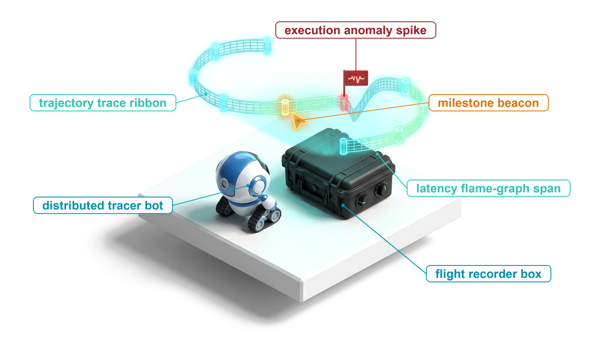
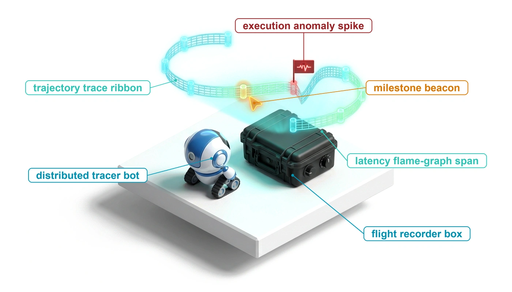
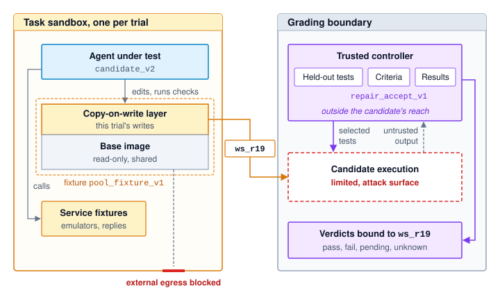
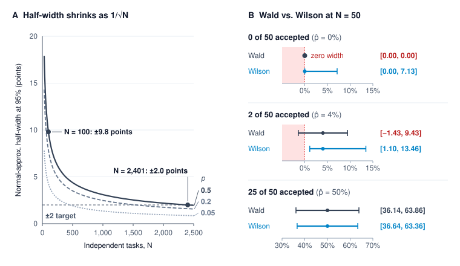
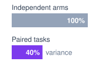
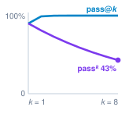
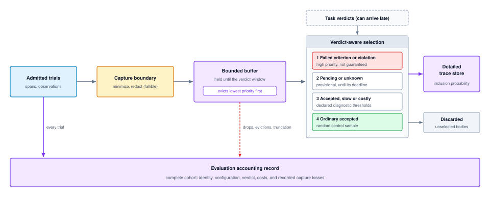
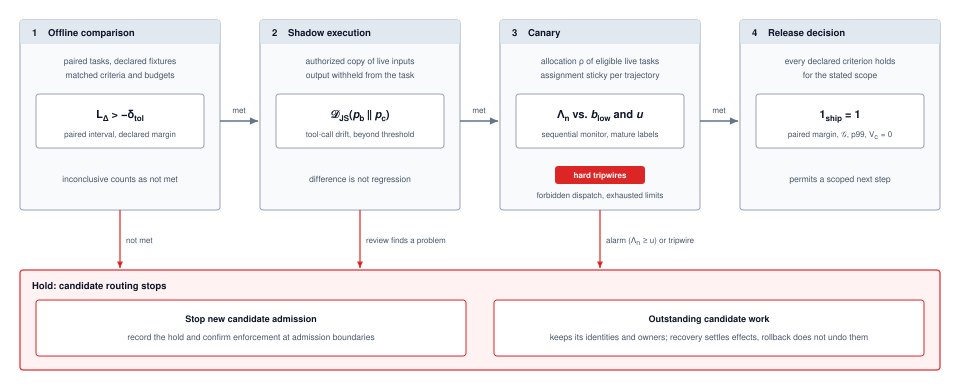
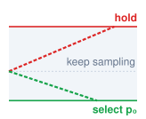

# Agent Evaluation {#sec-vol3-evaluation}

::: {layout-narrow}
::: {.column-margin}

\chapterminitoc

:::

::: {.content-visible when-format="pdf"}
\noindent
{fig-alt="Blueprint for System Observability."}
:::

::: {.content-visible unless-format="pdf"}
{fig-alt="Blueprint for System Observability."}
:::

:::

## Purpose {.unnumbered .unlisted}

\begin{marginfigure}
\mlagentstack{0}{0}{100}{0}{0}{0}
\end{marginfigure}

_Why is a completed agent run not enough evidence to justify a release?_

Evaluating an autonomous agent on final pass rates or aggregate benchmark scores conceals the failure modes that govern production reliability. A task may pass by serendipity while taking hazardous intermediate actions, or fail narrowly after executing dozens of sound steps, and a scalar score distinguishes neither outcome. The agent's own report that it finished is the weakest evidence available, and tests that run inside its workspace sit within reach of its edits. Even an honest pass is one draw from a stochastic process. The configuration that repairs a defect today can loop on the identical starting state tomorrow, and a system that succeeds on nine runs in ten fails at least one of eight recurrences of the same task more often than not. A comparison between two configurations inherits all of this noise, so a margin of a few tasks on a benchmark of a hundred can vanish under a second sample. Graders err in both directions, two model judges that agree with each other can share the same blind spots, and a held-out suite consulted for every prompt change quietly becomes training data. Once a candidate reaches live traffic, rolling it back stops new work but does not undo the effects it has already released. A release therefore cannot rest on a completed run. It rests on declared acceptance criteria checked by graders the agent cannot reach, on comparisons sized to the uncertainty they must resolve, on retained traces that keep the rare failures engineers most need to inspect, and on staged exposure that bounds what an undetected regression can do. Each exposure the agent carries enters that evidence: the state a result rests on, the resources its horizon consumed, and the authority it exercised along the way.

::: {.content-visible when-format="pdf"}

\newpage

:::

::: {.callout-learning-objectives}

- Explain why a task acceptance contract credits a trial only on evidence and keeps pending and unknown verdicts in the count
- Design hermetic trials and isolated graders, calibrating judges by their false-acceptance rate against independent assessment
- Compare configurations by paired acceptance intervals, repeated-run consistency, and cost per accepted task, sampling tasks rather than runs
- Analyze a trace's critical path and design retention that keeps rare failures within a storage budget
- Diagnose a failure through a controlled intervention, stating what the result does and does not establish
- Design staged releases that size canary exposure with sequential stopping rules and independent hard tripwires
- Evaluate trials, paired comparisons, and release conditions as one evidence record that justifies a scoped decision

:::

## The Evaluation Problem {#sec-vol3-evaluation-problem}

For the repair agent (lighthouse \ref{lhs-vol3-repair-agent}), the connection-pool repair has come through its turbulent hour. The replacement worker reconstructed candidate workspace `ws_r18`, kept the interrupted test operation unresolved rather than guessing its outcome, and accounted for the temporary integration-test environment. Suppose a fresh targeted check then passes on `ws_r18` and the environment is released, satisfying the cleanup postcondition. Recovery has done its job, but it leaves open the question the previous chapter ended on, whether the runtime completed the task and whether its recovery policy improved outcomes at an acceptable cost.

::: {.column-margin .margin-pointer}
↩ The recovery of the connection-pool repair, which reconstructs `ws_r18` and keeps its test operation unresolved, is established in @sec-vol3-synthesis-architecture.
:::

::: {.column-margin}
{width="100%" fig-alt="H·S·A locator with all three axes, Horizon, State, and Authority, highlighted."}

*Evaluation examines the state a result rests on, the resources spent across its horizon, and the authority it exercised.*
:::

The runtime mechanisms developed so far govern execution integrity rather than task success. An authority check confirms that each action was permitted by policy, the durable event log records what operations took place, and the recovery protocol ensures that partial side effects were undone or safely handed off. None of these components evaluates whether the resulting code patch actually fixes the bug. Relying on the agent's own assessment is equally insufficient: self-reporting constitutes the weakest tier of closure evidence (@sec-vol3-intro-invariant-closure). When an agent executes tests inside its own mutable workspace, those tests are fully within reach of its edits. A faulty patch can pass simply because the agent commented out an assertion, altered mock data, or deleted a failing test. Even when an agent leaves tests untouched, a single successful run represents only one sample drawn from a stochastic distribution. The same agent may resolve an incident on one attempt and plunge into an infinite loop on the next under the identical starting state.

Engineering decisions are also comparative. A new configuration, `candidate_v2`, with an updated system prompt, refined tool schemas, a revised recovery policy, or a different base model, is ready for deployment. The engineering team must decide whether `candidate_v2` reliably outperforms the incumbent `baseline_v1` across the full distribution of repair tasks the system will encounter.

Transforming noisy, individual agent trials into a defensible release decision requires an end-to-end evaluation pipeline. That pipeline begins with an acceptance contract, which specifies precisely what evidence credits a task, which invariants must hold, and how missing or malformed artifacts are penalized. To make trials interpretable and secure, the evaluation system isolates task fixtures behind a protected grading boundary that sits beyond the agent's reach. Behind this boundary, the grading harness partitions criteria between deterministic mechanical checks (static analysis, invariant assertions, hidden unit tests) and calibrated judgments for open-ended properties.

Because agent behavior is stochastic, moving from single runs to configuration comparison demands statistical rigor. Evaluating `candidate_v2` against `baseline_v1` requires paired trials on the same sampled tasks and decision metrics that reflect operational reality, including acceptance, consistency over repeated runs, and the cost per accepted task introduced in @sec-vol3-intro-horizon-arithmetic. The same evidence pipeline extends past offline benchmarking. Traces explain why a metric moved and are retained under storage and privacy budgets, postmortems test a suspected failure mechanism through a controlled intervention, and staged canaries gate live traffic exposure. Together, these mechanisms assemble every trial into an evidence-backed release decision for `candidate_v2`, starting with the acceptance contract for a single trial.

## The Task Acceptance Contract {#sec-vol3-evaluation-contract}

To evaluate an autonomous agent rigorously, the evaluation framework must establish the complete operational context for each run. Consider an evaluation trial for a software repair task, designated `pool_repair_01`. The run begins from an immutable initial environment snapshot, `pool_fixture_v1`, and is evaluated against an explicit criteria specification, `repair_accept_v1`. The system under test, `candidate_v2`, defines the complete agent configuration, including the base model, prompt templates, tool definitions, and runtime harness. It names an entire operational system rather than an isolated source code revision or model checkpoint. When this trial executes, it produces a concrete candidate artifact, `ws_r19`. The recovered workspace `ws_r18` of the opening belongs to the earlier, interrupted trial of the same task. `ws_r19` is the artifact of a fresh trial started from `pool_fixture_v1`, and it is the candidate the rest of this chapter evaluates. Every verification check must evaluate those exact bytes, so an earlier passing result for `ws_r18` provides evidence only about `ws_r18`.

A **trial**\index{Evaluation trial!definition} is a single end-to-end execution conducted under a declared task, fixture, system configuration, and evaluation protocol. A second execution constitutes a distinct trial, even when all inputs, initial states, and configurations remain identical. Rerunning this single repair ten times yields ten trials of one task rather than ten distinct tasks, a distinction whose statistical cost @sec-vol3-evaluation-resampling quantifies. Before aggregating results across runs, however, the evaluation harness must apply an unambiguous acceptance rule to determine whether any individual trial succeeded.

### Evidence dimensions {#sec-vol3-evaluation-contract-dimensions}

An evaluation contract translates the high-level task specification (its expected outcomes, permitted operations, and resource constraints) into concrete verification procedures. It is the five-part task contract of @sec-vol3-intro-five-part-contract made checkable, with the goal and completion criteria turned into measured properties and the permitted actions turned into compliance checks. Specifically, the contract defines what properties are measured, which artifact versions are examined, which instruments perform the measurement, where the observation boundaries lie, and how the harness handles missing or ambiguous evidence. Rather than treating evaluation as a monolithic pass/fail pipeline where an early fault voids all downstream telemetry, @tbl-vol3-eval-contract-hierarchy organizes verification across four parallel dimensions of evidence.

| Dimension             | Evidence to inspect                                                                                                                    | Consequence for the repair                                                                                     |
|:----------------------|:---------------------------------------------------------------------------------------------------------------------------------------|:---------------------------------------------------------------------------------------------------------------|
| Proposal validity     | Completed proposal, parsing and schema results, represented tool and arguments                                                         | An invalid configuration rejected before dispatch can be repaired; the rejection alone need not fail the trial |
| Execution behavior    | Admitted operations and attempts, endpoint outcomes, ordering, observed partial effects, and recovery history                          | An accepted request is not necessarily a finished test; a timeout can leave an operation unresolved            |
| Task outcome          | Exact candidate artifact, required defect and regression checks, final answer, and any declared qualitative rubric                     | A targeted pass supports only its coverage; a readable report cannot replace missing required checks           |
| Constraint compliance | Authority decisions and observed effects, protected-artifact checks, consumption and liability, elapsed intervals, and residual owners | Good final code does not erase a prohibited effect or satisfy an unmet cleanup or budget condition             |

: **Dimensions of Task Evaluation**: Each dimension contributes scoped evidence. The task's declared criteria determine which findings reject a trial, which remain pending, and which serve only as diagnostics. {#tbl-vol3-eval-contract-hierarchy}

The four dimensions organize where evidence comes from. The definition of an accepted task below names the criteria that evidence must satisfy, and the two line up directly. Task outcome supplies the outcome criteria, proposal validity and execution behavior supply the process criteria, and constraint compliance supplies the resource and residual-duty criteria together with the authority side of process. The same split follows the exposures the agent carries. Checks of the resulting artifact and environment examine the state a result rests on, resource criteria measure what the horizon consumed, and compliance checks examine the authority the trial exercised.

Separating these dimensions prevents intermediate runtime recoverable errors from contaminating the assessment of the final artifact. For instance, if an agent generates a tool invocation with an invalid argument type, a local schema validator can reject the call. If the agent inspects the rejection, corrects the payload, and dispatches a valid request that successfully repairs the bug, an evaluation policy that permits self-correction will accept the trial. Conversely, if a security policy strictly prohibits even the attempt to access a sensitive credential store, that single malformed or unauthorized proposal constitutes an immediate, terminal violation.

Because of these differing rules, the evaluation record must distinguish whether every event was a raw proposal, an admitted request, or an observed state mutation. Maintaining parallel evidence streams also preserves diagnostic value when a trial fails. If an agent overwrites a protected configuration file, the trial is rejected; nevertheless, retaining the test execution logs, elapsed wall-clock time, and cleanup traces explains why the system failed, aiding post-mortem analysis without altering the failure verdict.

::: {#dfn-vol3-accepted-task .callout-definition title="Accepted task"}

***Accepted task***\index{Accepted task!definition} is a task completion credited to a particular trial because the available evidence satisfies its declared outcome, process, resource, and residual-duty criteria at the required evidence level.

1. **Significance**: Acceptance defines the denominator for cost efficiency ($C_{\text{eff}}$ in @eq-vol3-cost-per-accepted-task). The compute, token, and infrastructure costs of all rejected or unresolved runs are charged against the accepted trials. Artificially weakening the acceptance contract creates an illusion of efficiency, lowering nominal cost per accepted task without making the underlying system cheaper.
2. **Distinction**: Passing a single test harness or verifier is substantially narrower than achieving task acceptance. A trial might pass a targeted regression test yet fail due to resource exhaustion, unauthorized side effects, or leaked background processes. Moreover, task identity refers to the underlying problem specification, whereas trial identity refers to an individual execution attempting that task.
3. **Common pitfall**: Crediting a trial based solely on an agent's self-generated claim of completion, a successful transport status code, or a passing test run executed against a different candidate workspace revision.

:::

### Evaluation instruments and coverage {#sec-vol3-evaluation-contract-instruments}

Three instruments supply the evidence for these criteria, each bounded by specific operational limits. Runtime guards and external programmatic checks represent the two halves of invariant closure (principle \ref{pri-invariant-closure}). Runtime guards enforce bounds at the operational boundaries they mediate, such as blocking an unauthorized dispatch or intercepting a disallowed network connection. External checks assess specified artifact properties independently after execution, verifying for example whether the submitted candidate passes a defect reproducer and the required regression suite. Finally, qualitative judgments, whether supplied by human experts or automated evaluator models, assess compliance with an explicit rubric, such as whether a generated technical report accurately explains its supporting evidence. Applying model-based rubrics requires the rigorous calibration developed in @sec-vol3-evaluation-grading.

All three instruments obey the **coverage rule**\index{Coverage rule!definition}: an evaluation check establishes only those properties that its scope, input vectors, and underlying assumptions directly support. Isolating an automated grader from agent tampering protects the integrity of its measurements, but it cannot expand its coverage. A test suite can pass completely yet still miss a critical defect if the test cases fail to exercise that execution path.

::: {.column-margin .margin-pointer}
↩ The principle that each verification check answers a narrow question rather than certifying task satisfaction is established in @sec-vol3-foundation-model-continuations.
:::

::: {#dfn-state-delta-verification .callout-definition title="State-delta verification"}

***State-delta verification***\index{State-delta verification!definition} checks specified properties of an observed change between declared initial and resulting environment states, using measurements tied to the relevant versions and task criteria.

1. **Significance**: It distinguishes a claimed repair from an observed artifact or service mutation that meets the selected checks, ensuring the agent produced genuine state changes.
2. **Distinction**: Verification relies on scoped, structured comparisons of designated state components rather than naive differential subtraction of entire filesystems or databases. Furthermore, verifying that a state delta satisfies designated checks does not prove total correctness across unmonitored subsystems.
3. **Common pitfall**: Treating any non-empty patch or successful tool response as evidence that the intended change occurred without unintended side effects.

:::

The evaluation criterion dictates both the required observation and the appropriate instrument. A read-only analysis task succeeds when the agent produces an empirically supported answer while leaving the persistent environment untouched. Conversely, a software repair task alters persistent files, requiring the harness to inspect execution history alongside final disk states. If an agent executes an unauthorized file deletion and subsequently recreates the file before finishing, the action still violates a policy forbidding unauthorized deletion.

Resource accounting likewise demands precisely defined observation boundaries. The evaluation harness must meter the active execution phase and the finalization phase against distinct budget allowances. Token expenditures, financial costs, and occupied compute resources must remain separate accounting streams rather than being collapsed into a single scalar. Moreover, settled operational charges must be distinguished from outstanding reserved liabilities; halting an evaluation trial at a wall-clock cutoff does not automatically cancel background container instances or release cloud reservations.

::: {.column-margin .margin-pointer}
↩ Bounded-liability admission, which keeps outstanding reservations separate from settled charges, is established in @sec-vol3-agent-harness-reservation-settlement.
:::

### The four-verdict rule {#sec-vol3-evaluation-contract-verdicts}

For every declared criterion in the contract, the evaluation harness must retain the observed result and its supporting telemetry. Each criterion resolves to one of four discrete verdicts: `pass` when the evidence definitively meets the requirement, `fail` when it establishes a violation, `pending` while a required assessment remains actively underway within the observation window, and `unknown` when necessary evidence is missing or unavailable at the cutoff, accompanied by a structured record explaining why. These four categories function strictly as evaluation verdicts rather than trajectory lifecycle states.

The aggregation logic follows strict short-circuiting rules: an established failure of any mandatory criterion immediately resolves the overall trial verdict to `fail`, even if other criteria remain pending or unobserved. A trial is accepted if and only if all mandatory criteria achieve a `pass`. If any required check remains unfulfilled and none have failed, the trial remains pending or unknown. This convention is the **four-verdict rule**\index{Four-verdict rule!definition}. Its most critical corollary governs every measurement in this chapter: incomplete, timed-out, or unresolvable trials must remain in the denominator under a declared rule, because dropping them changes the underlying population being evaluated. Unless a contract declares otherwise, this chapter applies one default. An unresolved trial stays in the count $N$ and is not accepted, so a point estimate of the accepted fraction treats it as a non-acceptance. The report lists unresolved trials separately from established failures and adds the two bounds obtained by resolving every one of them as accepted and every one as failed, which shows how far the open verdicts could still move the result.

::: {#exmp-13-repair-acceptance-record .callout-example title="A targeted pass is not a completed evaluation"}

**Problem**: The trial submits candidate workspace `ws_r19` under `repair_accept_v1`. The contract requires six conditions: the defect reproducer and designated regression checks must pass, the report must state its supported scope, permitted actions and resource allowances must hold, and temporary resources must be released or transferred under its residual-duty policy. The first three are outcome criteria, and the last three are the process, resource, and residual-duty criteria of the accepted-task definition. @Tbl-vol3-repair-acceptance-record logs what the harness has observed against each condition so far. At an interim observation checkpoint, can this trial be accepted?

| Required evidence               | Observation for this trial                                                                                                                  | Verdict at this observation                                        |
|:--------------------------------|:--------------------------------------------------------------------------------------------------------------------------------------------|:-------------------------------------------------------------------|
| Candidate-specific defect check | The designated reproducer passed on `ws_r19`                                                                                                | `pass` for this check only                                         |
| Required regression coverage    | The designated suite has not yet produced a complete result                                                                                 | `pending`                                                          |
| Report scope                    | The declared review found that the report identifies the candidate, completed check, and missing coverage                                   | `pass` under that rubric and review                                |
| Permitted process               | Retained mediation and protected-artifact checks satisfy the specified process criteria; a malformed proposal was corrected before dispatch | `pass` within the stated coverage                                  |
| Resource criteria               | Admissions remained within the configured bounds, but required final usage evidence for an outstanding operation is not yet available       | Admission-bound check `pass`; final-accounting criterion `pending` |
| Residual duties                 | The designated service acknowledged ownership of the remaining operation and charge reconciliation, as this contract permits                | Handoff criterion `pass`; the external outcome remains unresolved  |

: **An Interim Repair Evaluation Record**: Hypothetical findings for one identified trial. Each result retains its criterion and scope; successful handoff does not establish the result of the transferred operation. {#tbl-vol3-repair-acceptance-record}

**Result**: No row of @tbl-vol3-repair-acceptance-record records a failure, yet the trial cannot be accepted at this interim checkpoint. Its overall verdict remains `pending` because required regression coverage and final accounting reconciliation have not yet concluded. If the regression suite subsequently reports a failed assertion, the overall verdict immediately transitions to `fail`, while the unresolved charge remains recorded. If the observation window closes before those results arrive, the uncompleted criteria transition to `unknown`, a gap that neither the targeted pass nor the accepted handoff can fill.

**Systems insight**: The evaluation record distinguishes task completion, runtime enforcement, grader coverage, and owned residual work. A favorable result in one operational dimension cannot substitute for missing evidence in another.

:::

The acceptance contract formalizes the necessary conditions for crediting an individual trial. However, the validity of comparative benchmarks across multiple systems depends equally on the stability and isolation of the underlying evaluation harness. A silently updated package dependency, an unpinned base container image, or data leakage that exposes test suites to the model can move benchmark scores by more than the difference being measured without reflecting any genuine improvement in system architecture or agent capability.

## Hermetic Evaluation Gyms {#sec-vol3-evaluation-gyms}

Evaluating whether `candidate_v2` outperforms `baseline_v1` requires far more than comparing two summary reports. Both systems must execute against the declared task under strictly equivalent starting conditions, and the evaluator must verify every result directly against the artifact generated during that specific trial. If a trial inadvertently inherits a modified source file, a cached dependency, or a lingering background test from a previous run, the observed delta reflects environmental contamination rather than true architectural progress.

An **evaluation gym**\index{Evaluation gym!definition} provides the task's interactive environment, establishes controlled starting conditions, and exposes clean interfaces for capturing trial evidence. Its **hermetic boundary**\index{Hermetic boundary!definition} explicitly specifies which dependencies are provisioned or simulated and which external network and filesystem interactions are blocked. This boundary serves as an experimental contract. It fixes the declared experimental conditions without requiring either identical model responses or absolute production fidelity. A stochastic environment qualifies as hermetic once every source of non-determinism is declared, bounded, and systematically recorded.

### Task fixtures {#sec-vol3-evaluation-gyms-fixtures}

A **task fixture**\index{Task fixture!definition} packages the exact initial state, dependencies, and configuration required to instantiate an evaluation task. In an automated repair benchmark, for example, `pool_fixture_v1` pins the baseline repository commit, the language toolchain and package versions, the simulated test-service behaviors, and the files the agent is permitted to read or edit. The fixture establishes the baseline conditions under which an agent attempts the task, whereas separate acceptance criteria evaluate the resulting artifact.

@Tbl-vol3-evaluation-fixture-contract records the conditions that must accompany the trial.

| Fixture component       | What the repair evaluation declares                                                                                            | Why the comparison needs it                                          |
|:------------------------|:-------------------------------------------------------------------------------------------------------------------------------|:---------------------------------------------------------------------|
| Initial task state      | Starting source revision, supplied defect description, permitted files, and initial service state                              | Neither system inherits another trial's fix or an undeclared hint    |
| Executable dependencies | Toolchain, packages, tool interfaces, service fixtures, and relevant configuration versions                                    | A dependency change is not mistaken for a system improvement         |
| Interaction policy      | Available tools, permitted data and destinations, resource limits, and external behaviors represented                          | Both systems face the declared task and authority boundary           |
| Variation policy        | Fixed or sampled fault conditions, scheduling and random inputs where controlled, and recorded provenance where not controlled | The experiment distinguishes intended variation from missing control |
| Evidence boundary       | Exported candidate identity, protected grader configuration, criteria version, and allowed development feedback                | A result applies to the actual submitted artifact and check          |
| Trial lifecycle         | Reset readiness, output capture, observation cutoff, cleanup, and residual ownership                                           | Late work and retained state cannot silently enter the next trial    |

: **A fixture contract for comparable trials**: The fixture manifest defines what parameters are held constant, which factors may vary, and what evidence must be captured, ensuring apples-to-apples comparisons without requiring full reproduction of every production nuance. {#tbl-vol3-evaluation-fixture-contract}

A rigorous benchmark must also document how tasks are sampled from the broader problem distribution, because repeatedly evaluating a single fixture characterizes only that specific repair workflow (@sec-vol3-evaluation-rigor). Even when an evaluator fixes the pseudo-random seed of the language model, non-deterministic inference serving (dynamic batching, asynchronous token streaming, and accelerator kernel scheduling) introduces subtle timing variations. The evaluation run must therefore record all accessible execution provenance alongside explicit statements regarding unconstrained sources of entropy.

### Controlled interactions {#sec-vol3-evaluation-gyms-interactions}

Interactive evaluation measures the closed loop where an agent inspects its environment, parses diagnostic feedback, revises its working candidate, and executes intermediate checks. Static question-answering benchmarks leave these multi-turn reasoning and tool-use dynamics entirely unexercised. Because the fixture mirrors the task domain, its components vary accordingly: a document-analysis fixture locks down static reference documents and vector indices, whereas an interactive browser benchmark configures authentication credentials, pre-populated user sessions, and mutable web-application databases.

Providing authentic command-line and language tools within an isolated sandbox allows the evaluation harness to exercise compilation pipelines, filesystem operations, and sub-process execution directly. For external dependencies, stateful service emulators can track conversational state and state-dependent APIs where downstream responses depend on earlier writes. Prerecorded network traces support a much narrower replay boundary: a recorded interaction remains valid only as long as the agent's request method, endpoint, arguments, schema versions, and call order match the recorded sequence exactly. If the agent deviates by issuing an unexpected API call or reordering operations, the replay harness cannot simply deliver the next historical record. Under the matching-request rule\index{Matching-request rule}, the evaluator must either provide a synthetically valid response for the novel path or fail fast by signaling an unsupported interaction.

::: {.column-margin .margin-pointer}
↩ Request matching, which a replay adapter applies before returning any recorded response, is established in @sec-vol3-durable-execution-harness-regression-replay.
:::

In an environment testing automated cloud-resource repair, a mock service that invariably returns immediate HTTP 200 responses fails to evaluate whether the agent can handle dropped connections, timeout retries, or eventual consistency. A fault-injecting fixture instead exercises resilience by selectively dropping packets, introducing synthetic latency, or withholding acknowledgments, exposing real-world distributed systems failure modes.

Engineering an evaluation gym involves a continuous trade-off between fidelity and determinism. Simple deterministic mocks maximize reproducibility and run rapidly, but they routinely omit real-world concurrency, race conditions, partial failures, and subtle error codes. Conversely, deploying full-scale, live service instances yields high behavioral fidelity at the expense of heavy provisioning overhead, slow trial resets, and environmental flakiness. Systems architects must align simulation fidelity with the specific capabilities being claimed. Furthermore, any architectural behaviors intentionally omitted by the fixture must be documented alongside reported metrics, because a perfect success rate against a simplified mock shows competence only within that sanitized world. Finally, testing agents against live production or external third-party APIs requires dedicated authorization and hard resource bounds; prefixing an execution run with the label "benchmark" confers no legal or operational authority to touch production infrastructure.

### State reset between trials {#sec-vol3-evaluation-gyms-reset}

The sandbox reset contract defines the baseline boundary for sandboxed execution. Rigorous evaluation imposes an additional invariant: every trial must start from an environment identical to the declared task fixture. Resetting a trial requires terminating all background worker processes, capturing the candidate artifact at a consistent filesystem checkpoint, revoking session-specific credentials, and scrubbing every mutable resource. Simply reverting the Git repository to a clean commit is rarely sufficient: orphan background processes, uncleared message queues, temporary directories (`/tmp`), and stateful API mocks can easily leak side effects into subsequent runs. If an asynchronous operation initiated during an earlier trial remains in-flight, the hosting container or virtual machine cannot be recycled into the warm pool until that background operation terminates or its target resource is destroyed. Discarding a workspace directory while background network writes are still pending leaves the host environment corrupted.

::: {.column-margin .margin-pointer}
↩ The reset contract that must hold before a pooled sandbox serves a new lease is established in @sec-vol3-sandboxes-pooling-reset.
:::

To maintain high throughput across thousands of evaluation runs, evaluation frameworks rely on copy-on-write (CoW) filesystem overlays and virtual machine snapshots rather than provisioning fresh environments from scratch. When reporting benchmark throughput, system designers should explicitly break down end-to-end latency into container warm-up, snapshot reset, agent execution, queueing delays, and grading. Reporting only sandbox lease acquisition times creates a misleading picture of cluster capacity. Controlled sharing of underlying resources is entirely compatible with sound experimental methodology: immutable compiler caches and base operating system images can be shared safely across sandboxes. Similarly, evaluating an agent against a pre-warmed cache is valid when warm-cache performance is the stated target of the experiment. However, whenever concurrent trials compete for shared host resources such as CPU cycles, memory bandwidth, or host kernel threads, evaluators must measure resource contention directly or randomize trial ordering to prevent queuing artifacts from being mistaken for candidate improvements.

### Grader isolation {#sec-vol3-evaluation-gyms-grader-isolation}

During iterative problem-solving, visible unit tests provide the agent with intermediate feedback to guide code refinement. In contrast, held-out acceptance tests, the sealed tests of the closure evidence levels, must assess the final submission without turning the test assertions themselves into an optimization target. The evaluation harness must isolate reference solutions, secret test suites, grading scripts, and authoritative score registries completely outside the agent's execution environment. Furthermore, the grading pipeline must cryptographically bind the evaluation score to the exact artifact hash (for example, the SHA-256 fingerprint of workspace snapshot `ws_r19`) captured at the declared completion boundary.

Submitted code stays untrusted after the agent process stops. If an evaluation harness imports the candidate package directly into the Python interpreter running the grading assertions, the submitted code can monkey-patch core assertions, manipulate built-in object prototypes, or rewrite test runner hooks. Similarly, if secret test files are mounted into the filesystem where candidate code can inspect directory trees or read file contents, the tests are irrevocably compromised. Mounting files as read-only prevents direct overwrites, but it provides zero protection against exfiltration or inspection.

::: {.column-margin .margin-pointer}
↩ Why code running inside the supervisor's own interpreter can reach the supervisor's state is established in @sec-vol3-sandboxes-object-graph.
:::

A robust grading architecture must enforce two distinct security boundaries: the live agent's access during task execution and the submitted artifact's execution reach during evaluation. @Fig-vol3-eval-gym-architecture maps this bifurcated infrastructure: an external trusted controller manages evaluation logic, holds the private test suites, and commits results to a secure database, while candidate code executes inside a strictly sandboxed runner. The controller orchestrates testing over a narrow, well-defined remote procedure call (RPC) interface, strictly enforces a patch-admission policy specifying which repository files the candidate was permitted to touch, and treats all candidate-generated stdout, stderr, and exit codes as untrusted observations.

::: {#fig-vol3-eval-gym-architecture fig-env="figure" fig-pos="htb" fig-cap="**Trial Sandbox and Grading Boundary**: The agent under test edits and runs checks inside a single-use fixture whose base image is shared read-only and whose writes land in a per-trial copy-on-write layer; external egress is blocked, and service fixtures stand in for the dependencies the task declares. The captured candidate `ws_r19` crosses to a grading boundary, where a trusted controller keeps the held-out tests, criteria, and result store and sends selected tests to a separately limited execution of the candidate code. That execution remains the attack surface, because submitted code runs with the tests it receives, so its outputs are untrusted observations until the controller binds each criterion's verdict to the exact artifact." fig-alt="Two regions. Left, a task sandbox with an agent-under-test box labeled with configuration candidate_v2, an arrow labeled edits and runs checks into a fixture box holding a read-only shared base image and a copy-on-write layer for the trial's writes, and an interaction boundary box with external egress blocked and service fixtures. An arrow carries the captured artifact ws_r19, exact bytes, to the right region, a grading boundary. There a trusted controller holding held-out tests, criteria repair_accept_v1, decision logic, and the result store sends selected tests down to a dashed candidate execution box marked attack surface, which returns untrusted outputs and logs. The controller also feeds a criterion-level verdicts box listing pass, fail, pending, and unknown, bound to ws_r19."}

:::

When repository unit tests require in-process execution alongside submitted code, the test harness itself becomes an explicit attack surface. In these configurations, rigorous evaluation harnesses run automated adversarial probes before grading: synthetic exploit patches attempt to read environment variables, inspect parent memory spaces, override assertion operators, and forge passing exit signals. Passing these containment checks demonstrates resistance against known circumvention techniques, though such verification covers only the specific security perimeters tested.

### Evaluation leakage {#sec-vol3-evaluation-gyms-leakage}

Evaluation leakage can compromise benchmark integrity either before a trial begins or dynamically during execution. Pre-trial leakage occurs when benchmark solutions contaminate pretraining corpora or when external retrieval-augmented generation (RAG) vector indices index ground-truth patches. Runtime leakage occurs when multi-agent systems or persistent memory stores retain information across successive runs, inadvertently passing solutions from one trial to the next.

Furthermore, an evaluation suite can leak methodologically even when the sandboxes remain completely sterile. Repeatedly refining prompts, tool definitions, or agent architectures based on error analyses of held-out test failures converts that held-out suite into an informal training set.[^fn-goodhart-holdout-evaluation] Hyperparameter adjustments and prompt changes guided by held-out feedback systematically overfit the evaluation suite, eroding its statistical validity as an unbiased assessment of generalization [@dwork2015reusable]. Maintaining sound evaluation requires tracking end-to-end data provenance for task prompts, gold-standard solutions, unit tests, and trajectory logs. While n-gram filtering and embedding similarity checks help flag potential contamination, falling below an arbitrary similarity threshold never guarantees true task independence; @sec-vol3-flywheel-evaluation formalizes the dataset splitting protocols required to enforce this separation.

[^fn-goodhart-holdout-evaluation]: **Goodhart's Law and the Held-Out Suite**: The selection pressure that breaks an imperfect check during search (@sec-vol3-test-time-compute-selection-pressure) acts on an evaluation suite in the same way. A held-out suite used to choose among prompts has become a control target, so its score drifts from measuring the task population toward measuring fit to the suite. The simplest remedy is procedural. Retire a suite into development use once it has steered decisions, and hold a fresh one for the release claim. \index{Goodhart's law!held-out evaluation}

Three widely adopted benchmarks illustrate how fixtures and criteria interact in practice. SWE-bench presents real-world repository issues and validates generated patches against task-specific test suites [@jimenez2024swebench]. Its evaluation harness checks both `FAIL_TO_PASS` assertions (verifying that the reported defect is resolved) and `PASS_TO_PASS` assertions (verifying that existing functionality has not regressed) [@jimenez2024swebench], grounding correctness in concrete runtime behavior rather than static code similarity. GAIA poses complex, tool-assisted questions where each task specifies a concise, unambiguous ground truth, grading only the normalized final answer against an exact-match target [@mialon2023gaia]. While computationally inexpensive and deterministic, this check treats the agent as a black box, observing nothing about the cost, safety, or validity of the intermediate steps taken to reach the output. WebArena deploys fully functional web applications within isolated environments, evaluating tasks by inspecting the resulting database and application state rather than parsing agent transcripts [@zhou2024webarena]. However, targeted state assertions verify only the specific records they query. If an agent executes an e-commerce purchase successfully but inadvertently deletes unrelated order records along the way, a narrow state query still registers a pass. Comprehensive evaluation therefore requires explicit checks for unintended side effects, illustrating why the constraint-compliance dimension in @tbl-vol3-eval-contract-hierarchy demands independent validation.

::: {.callout-checkpoint title="Comparable trials and protected evidence"}

- [ ] **Identity**: Why must a result for `ws_r18` not become the grade for newly submitted `ws_r19`, even on the same task fixture?
- [ ] **Fidelity**: Which recovery claim cannot be tested by a provisioning mock that always returns immediate success?
- [ ] **Grader boundary**: Hidden tests are absent during the agent's run but share an interpreter with candidate code during grading. Which attack surface remains, and which change to the grader design closes it?
- [ ] **Reset**: A previous trial left an unresolved remote job. Would you return its sandbox to the pool, and what must be established first?
- [ ] **Leakage**: Why can repeated tuning on held-out errors weaken the evaluation even when every sandbox resets correctly?

:::

Once a hermetic gym enforces controlled interactions and protects the evidence collection boundary, the remaining systems challenge centers on grading mechanics: identifying which criteria can be verified through deterministic execution checks and which demand probabilistic or human-in-the-loop validation.

## Grading Trajectories {#sec-vol3-evaluation-grading}

Two trials of `pool_repair_01` can submit byte-identical source files and still differ in acceptance status. For `ws_r19`, only the targeted check has passed, while another trial of the same patch may already have established the regression and accounting evidence that `ws_r19` still awaits. Comparing the patches alone cannot tell the two apart. Grading connects each declared criterion to evidence, records what that evidence establishes, and preserves what remains unknown.

### Outcome and process criteria {#sec-vol3-evaluation-grading-criteria}

An outcome criterion concerns the requested result, such as the regression checks against `ws_r19`; it may still inspect history when history determines the result, because a final resource count cannot establish that no duplicate allocation occurred. Process criteria concern how the trial reached its result, and the evidence that process deserves separate grading comes from reasoning tasks. On math word problems, Uesato et al. [-@uesato2022solving] found that outcome and process supervision reached similar final-answer accuracy while process supervision sharply reduced correct answers reached through flawed reasoning, and Lightman et al. [-@lightman2023let] found that process-supervised reward models selected correct solutions more reliably. For an agent, the process also includes actions. Current authority, forbidden disclosures, required approvals, and recovery obligations can be mandatory conditions of acceptance, while other process measurements only diagnose. Tool-call validity, for example, measures the fraction of proposed calls that satisfy their schemas and is silent on whether the chosen calls were useful.

::: {.column-margin .margin-pointer}
↩ Process-supervised reward models and step-level verifiers are established in @sec-vol3-test-time-compute-outcome-step-evidence.
:::

Diagnostic metrics need their own denominators and endpoints. A recovery rate counts episodes that met a stated recovery condition among the eligible episodes observed, reporting unresolved episodes separately; a different next action alone is not a recovery. Partial-credit scores show which checked subgoals were met and leave a failed mandatory condition failed, and turns, tokens, and costs are reported with the task outcomes so that a shorter failed trial never reads as an efficiency gain.

### Grader error rates {#sec-vol3-evaluation-grading-errors}

A check can reject satisfactory work or accept unsatisfactory work. The verification asymmetry (principle \ref{pri-vol3-verification-asymmetry}) separates checking a stated property from establishing that the property captures the task. A grader's error rates therefore need a reference assessment of whether the criterion actually held; rerunning the grader measures only its consistency. False acceptance is especially consequential when accepted trajectories support release or later training, but the two error directions answer different questions. Let $F$ denote failure of the specified criterion under an independent reference assessment, and let $\text{Acc}$ denote acceptance by the grader under study. Then distinguish

$$\epsilon_{\text{FA}}=\Pr(\text{Acc}\mid F), \qquad
\text{Failure among accepted}=\Pr(F\mid \text{Acc}).$$

The **false-acceptance rate**\index{False acceptance rate!evaluation checks} conditions on reference-assessed failures and measures how often the grader accepted them. Failure among accepted conditions on grader acceptances and measures how often independent assessment found failure among them. A random audit of accepted outputs estimates the second quantity; the first requires reference-assessed failures, including those the grader rejected. Both need stated sampling, enough assessed cases, and an uncertainty estimate. Failure among accepted is the complement of the passing-verdict precision of @eq-vol3-verifier-precision, $1-\Pi_V$, with the grader's acceptance as the passing verdict, so the base-rate argument developed there for candidate checks applies to graders unchanged.

::: {.column-margin .margin-pointer}
↩ The precision of a passing verdict, and its collapse at a low valid rate, is established in @sec-vol3-test-time-compute-check-precision.
:::

The distinction matters when the system changes, because failure among accepted cases depends on the prevalence and kinds of failures as well as on the grader's errors. A candidate can expose gaps that were rare in the calibration set, so each candidate's audit rechecks them rather than borrowing a historical false-acceptance rate.

Calibration cases come from the intended task population, with deliberate coverage of important failure modes, assessed independently against the same versioned rubric. Reference assessors also err, so the set keeps its adjudication procedure and unresolved labels. A set that oversamples failures reports that design, since its unweighted error fraction describes the calibration mix rather than deployment, and cases used to tune the grader stay out of it.

### Calibration of qualitative judgment {#sec-vol3-evaluation-grading-calibration}

A report's adequacy or a repair explanation's clarity may require judgment rather than an exact test. A **large language model (LLM) judge**\index{LLM judge!definition} is a model used to score such criteria under a rubric, and the evaluation contract states whether its verdict is a required criterion, a signal for human review, or a diagnostic score. A favorable judgment cannot override another criterion's failure or turn unavailable evidence into a pass.

Ground the judge in trusted result records and discrete rubric items. For the repair explanation, those items can distinguish describing the patch accurately, identifying which checks ran, and acknowledging unresolved work. Candidate text and artifacts remain untrusted inputs to the grader, not instructions that may revise its rubric, and a tool-assisted judge inherits the same authority boundaries as any other tool user.

Zheng et al. [-@zheng2023judging] measured position and verbosity biases in model judges and found the evidence for self-enhancement bias inconclusive, so each judge is tested on its own workload. Pairwise judging declares order swapping, ties, and abstentions before scoring and keeps them in the denominator, and a judge from a different model family is not independent by that fact alone.

For categorical ratings of the same cases, Cohen's kappa [@cohen1960] summarizes agreement relative to the raters' marginal label frequencies:

$$\kappa = \frac{p_o - p_e}{1 - p_e}$$

Here $p_o$ is the observed agreement fraction, and $p_e=\sum_y p_{y,1}p_{y,2}$ uses each rater's fraction of labels in category $y$. When $p_e=1$, the expression is undefined. High raw agreement can arise from heavily concentrated label frequencies.

```{python}
#| label: calc-vol3-evaluation-kappa-chance
#| echo: false
# CHANCE AGREEMENT UNDER A CONCENTRATED BASE RATE (LEGO)
# Goal: Show raw agreement produced with zero agreement beyond chance.
# Scope: Two raters labeling "pass" independently of the case, same marginal rate.
from mlsysim.fmt import fmt, fmt_percent, check

class KappaChance:
    # 1. LOAD: hypothetical marginal pass rate shared by both raters.
    pass_rate = 0.90
    chk_rate = 0.80  # checkpoint exercise: a second hypothetical marginal rate

    # 2. EXECUTE: independence makes observed agreement equal chance agreement.
    p_o = pass_rate**2 + (1 - pass_rate) ** 2
    p_e = pass_rate * pass_rate + (1 - pass_rate) * (1 - pass_rate)
    kappa = (p_o - p_e) / (1 - p_e)

    # 3. GUARD: textbook arithmetic.
    check(abs(p_o - 0.82) < 1e-12, "Raw agreement from chance alone")
    check(abs(kappa) < 1e-12, "No agreement beyond chance")
    check(0.5 < chk_rate < pass_rate, "Checkpoint rate differs from the worked rate")

    # 4. OUTPUT
    pass_rate_str = fmt_percent(pass_rate, precision=0, style="prose")
    chk_rate_str = fmt_percent(chk_rate, precision=0, style="prose")
    p_o_str = fmt_percent(p_o, precision=0, style="prose")
    kappa_str = fmt(kappa, precision=0)
```

If two raters each label `{python} KappaChance.pass_rate_str` of cases as passing, independently of what the case contains, they agree on `{python} KappaChance.p_o_str` of cases by chance alone and $\kappa$ is `{python} KappaChance.kappa_str`. Report those frequencies, disagreements, and assessment coverage with kappa; the coefficient measures agreement, not whether either rater is correct.

Because shared mistakes survive high agreement, a grader's operating policy is set by the errors that matter for its role, and it is recalibrated whenever the rubric, judge, evidence interface, or evaluated population changes.

::: {.callout-checkpoint title="Defend a grading verdict"}

- [ ] **Evidence scope**: The trial's targeted check passes on `ws_r19`, but required regression and accounting evidence remain pending under `repair_accept_v1`. Which criteria are supported, and why does an acknowledged residual-duty handoff not fill those gaps?
- [ ] **Conditional denominator**: An audit samples only grader-accepted reports. Does its failure fraction estimate $\Pr(\text{Acc}\mid F)$ or $\Pr(F\mid \text{Acc})$? What population is missing for the other estimate?
- [ ] **Process requirement**: When can a recovered malformed proposal remain a diagnostic event, and when must a process violation reject the trial despite a correct final artifact?
- [ ] **Agreement vs. truth**: Two judges each pass `{python} KappaChance.chk_rate_str` of reports, independently of what the reports contain. Estimate their raw agreement and $\kappa$, and decide whether that agreement supports using either one as an acceptance grader.

:::

Grading yields calibrated criterion-level verdicts and diagnostic measurements for individual trials, but those verdicts evaluate only the specific executions observed in the test harness. Even when graders are isolated and judges are calibrated against reference assessments, observing that a candidate passes more trials than a baseline does not establish that it is genuinely superior. Generalizing beyond those observed runs requires decomposing variance across stochastic attempts and diverse tasks, establishing confidence intervals that do not collapse at extreme probabilities, and bounding comparative uncertainty through paired trials.

## Statistical Evaluation Rigor {#sec-vol3-evaluation-rigor}

When an updated agent configuration (`candidate_v2`) passes several more sampled benchmark tasks than a production baseline (`baseline_v1`) in an evaluation sweep, engineering teams are often tempted to declare immediate progress. Yet that modest margin can easily reflect random sampling noise. Conversely, a seemingly smaller overall improvement can provide decisive evidence of system progress if the evaluation protocol preserves task-level pairings and demonstrates that the candidate resolves difficult failures without regressing on previously solved tasks. Distinguishing meaningful engineering progress from statistical fluctuation requires two foundations: defining the target population of tasks that the benchmark is meant to represent, and decomposing variance across both problem instances and non-deterministic execution runs. Rigorous statistical evaluation attaches uncertainty directly to the comparative delta between configurations rather than treating each system as an isolated, independent score.

### Tasks and repeated runs {#sec-vol3-evaluation-resampling}

The acceptance contract already separated a task from a trial. Statistics needs that separation sharpened. A *task* specifies the evaluation problem (a concrete problem description, an environment fixture such as a container filesystem and database snapshot, and an automated verification contract), and a *run* is one trial of a configuration on that task. The words run and trial name the same execution; run is used here because the statistics count repetitions of a task. Generating a second candidate patch for a connection-pool defect is another run of that same task, not a new problem instance. Because agentic execution relies on stochastic token sampling, network I/O, and asynchronous tool interactions, outcomes fluctuate across repeated runs of identical tasks even when running at temperature zero or with fixed random seeds, for the serving-path reasons traced in @sec-vol3-foundation-model-repetition-replay.

Let $p_i$ be a fixed system's probability of acceptance on task $i$ under the declared execution and grading protocol. Suppose tasks are independently sampled from a specified population, and $R$ runs are independent conditional on each task. Let $\hat p$ be the task-averaged estimate, the mean over the $N$ tasks of each task's fraction of accepted runs. With the same number of runs per task,

$$\operatorname{Var}(\hat p)=\frac{\sigma^2_{\text{task}}}{N}+\frac{\sigma^2_{\text{run}}}{NR},\qquad
\sigma^2_{\text{task}}=\operatorname{Var}(p_i),\quad
\sigma^2_{\text{run}}=\mathbb E[p_i(1-p_i)].$$ {#eq-variance-decomposition}

The first term in @eq-variance-decomposition reflects population diversity in task difficulty ($\sigma^2_{\text{task}}$); the second reflects runtime execution variance across repeated attempts on the same task ($\sigma^2_{\text{run}}$). This decomposition provides a concrete operational rule for budgeting evaluation compute. Adding more repeated runs ($R$) reduces only the second term. In contrast, evaluating additional independently sampled tasks ($N$) reduces both terms simultaneously. If new tasks cost nothing beyond their runs, a graded run spent on a new task therefore never buys less precision than one spent on a repeat, and the best design runs each task once. Repeats earn a place only because a new task usually costs more than a run, since it needs its own fixture, criteria, and validation. The variance ratio $\sigma^2_{\text{run}}/\sigma^2_{\text{task}}$ sets the scale of that trade. Once the number of repeats $R$ exceeds it, the run term is the smaller of the two, so further repeats shave only that term while the task term, which only fresh tasks reduce, dominates the uncertainty. How far past the ratio repeats remain worthwhile depends on how much a fresh task costs, the trade worked through in the first problem of @sec-vol3-13_evaluation-exercises.

Evaluating a fixed benchmark suite targets a narrower objective: estimating mean performance on that specific static collection of problems. Running repeated trials on that fixed suite pins down its sample mean with higher precision, but it does not make the suite any more representative of future, unseen workloads. Furthermore, evaluation suites frequently violate the assumption of independent tasks. Multiple test cases derived from the same source code repository, shared external service degradation during evaluation sweeps, or cross-trial state leakage inside shared sandbox environments all introduce correlated outcomes. Sound statistical analysis must group these evaluations into clusters rather than treating every individual trial as an independent random sample.

### Confidence intervals for acceptance {#sec-vol3-evaluation-wilson}

When an evaluation protocol executes a single run across each of $N$ independently sampled tasks and observes $X$ acceptances, the empirical proportion $\hat p=X/N$, the $R=1$ case of the task-averaged estimate, estimates the true population acceptance probability. A confidence interval quantifies the uncertainty arising from this finite sample size. It does not, however, account for grader error, unhandled task timeouts, test-set contamination, or shifts in the underlying task distribution, which are systemic failure modes that demand independent operational controls.

The standard Wald interval taught in introductory statistics, $\hat p\pm z\sqrt{\hat p(1-\hat p)/N}$, breaks down in the extreme-probability regimes characteristic of safety and reliability gating. When every observed run succeeds (or every safety check passes), the empirical variance collapses to zero, producing a degenerate zero-width interval that falsely claims absolute certainty. Near the boundaries, the Wald formula can even produce impossible interval endpoints that extend below zero or above one.[^fn-wald-interval-coverage] The **Wilson score interval**\index{Wilson score interval!definition} [@wilson1927probable] avoids both failures by using the hypothesized rate, not the observed one, in the variance:[^fn-wilson-score-inversion]

$$\tilde p=\frac{X+z^2/2}{N+z^2},\qquad
[L,U]=\tilde p\pm\frac{z}{N+z^2}\sqrt{\frac{X(N-X)}{N}+\frac{z^2}{4}}.$$ {#eq-wilson-interval}

Here $z$ is the standard normal quantile for the selected two-sided confidence level.

[^fn-wald-interval-coverage]: **Wald Interval Coverage**: A systematic study of binomial intervals found that the Wald interval's actual coverage oscillates erratically with both $N$ and $p$, stays poor at sample sizes that textbook rules of thumb call safe, and recommended the Wilson interval for small samples [@brown2001interval]. Agent evaluation lives in exactly that regime: suites of tens of tasks, and violation rates near zero, where a nominal 95 percent Wald interval can promise far more than it delivers. \index{Wald interval!coverage failure}

[^fn-wilson-score-inversion]: **Wilson score inversion**\index{Wilson score interval!test inversion}: With $z=z_{1-\StatisticalSignificanceLevel/2}$, the score interval contains the values $p\in[0,1]$ satisfying $N(\hat p-p)^2\le z^2p(1-p)$. Solving this quadratic inequality gives the endpoints: the variance uses the hypothesized $p$, rather than fixing it at $\hat p$ as in the Wald construction [@guthrie2020nisthandbook, sec. 7.2.4.1].

For zero acceptances in 50 independent tasks, @eq-wilson-interval gives a lower limit of zero and an upper limit of $z^2/(50+z^2)$, which panel B of @fig-vol3-sample-size-confidence-intervals marks. Read with the outcomes reversed, the same arithmetic prices a clean record: zero observed violations in 50 tasks remains consistent with a violation rate up to that limit.

These binary examples assume complete verdicts. If an evaluation sweep leaves trials unresolved due to timeouts, infrastructure failures, or grader crashes, the evaluation team must prespecify a handling protocol before examining the data, such as the default of @sec-vol3-evaluation-contract-verdicts that counts them as not accepted and reports both-outcome bounds. Simply discarding uncompleted tasks introduces severe survivorship bias, skewing results toward trivial tasks that execute rapidly and pass without contention.

### Paired outcome comparison {#sec-vol3-evaluation-paired}

Comparing system versions requires a declared task population, comparable trials, and uncertainty suited to the design, the statistical half of causal and statistical release evidence (principle \ref{pri-vol3-release-evidence}). To compare two systems fairly, run the baseline and candidate on separate, comparably initialized executions of each sampled task, with matched criteria and allowances, and keep each task's pair of outcomes together. @Tbl-vol3-mcnemar-contingency organizes a hypothetical complete comparison drawn from a prespecified cohort that never included the pending `ws_r19` trial.

| Baseline outcome | Candidate accepted | Candidate rejected |
|:-----------------|:-------------------|:-------------------|
| Accepted         | $n_{11}=70$        | $b=12$             |
| Rejected         | $c=18$             | $n_{00}=50$        |

: **Paired task outcomes**: One baseline run and one candidate run on each of 150 independently sampled tasks. Counts are illustrative, with no missing verdicts; execution order and fixtures follow the prespecified comparison protocol. {#tbl-vol3-mcnemar-contingency}

The baseline's accepted count is $n_{11}+b$ and the candidate's is $n_{11}+c$. The observed difference is

$$\hat\Delta=\hat p_{\text{cand}}-\hat p_{\text{base}}=\frac{c-b}{N}.$$

The discordant pairs determine the net gain, while the concordant pairs still count in $N$ and in the uncertainty. Marginal counts alone cannot reveal whether the candidate gained tasks without losing any or traded many wins for many losses.

**McNemar's test**\index{McNemar's test!definition}[^fn-mcnemar-paired-test] [@mcnemar1947note] asks whether the paired marginal probabilities are equal. Under that null, and conditional on $n_{\text{disc}}=b+c>0$ discordant pairs, candidate wins are $\operatorname{Binomial}(n_{\text{disc}},1/2)$, and the exact two-sided test sums the symmetric tails:

$$p_{\text{exact}}=\min\!\left(1,\;2\sum_{j=0}^{\min(b,c)}\binom{n_{\text{disc}}}{j}2^{-n_{\text{disc}}}\right).$$

[^fn-mcnemar-paired-test]: **McNemar's Test**: The test was introduced for psychological measurements in which the same subjects are classified twice, so the two proportions are correlated and cannot be compared as independent samples. Its central move is to discard concordant pairs from the test statistic, since a task both configurations pass, or both fail, says nothing about which is better. The interval for $\Delta$ still uses those pairs, because they set the precision of the estimate. \index{McNemar's test!concordant pairs}

A release decision usually asks a magnitude question instead of an equality question. **Noninferiority**\index{Noninferiority!definition} is the claim that the candidate loses no more than a declared tolerance $\delta_{\text{tol}}$, and it needs an interval $[L_\Delta,U_\Delta]$ for $\Delta$ itself. The worksheet uses Newcombe's paired-score method 10 [@newcombe1998improved], which combines the candidate and baseline Wilson intervals of @eq-wilson-interval through a continuity-corrected estimate of their within-pair correlation, so that shared task outcomes narrow the interval even when both marginal counts stay fixed. The result is nominal and approximate, valid for one prespecified look under independent paired sampling. @Sec-vol3-appendix-math-newcombe states the interval in full, and the paired bootstrap [@efron1979bootstrap] serves statistics that lack such an analytic interval.

```{python}
#| label: calc-vol3-evaluation-paired-comparison
#| echo: false
# PAIRED ACCEPTANCE DIFFERENCE (LEGO)
# Goal: Estimate one rate and compare paired configurations at a fixed endpoint.
# Scope: Illustrative independent task pairs, complete verdicts, fixed protocol.
from math import sqrt, comb, ceil
from statistics import NormalDist
from mlsysim.fmt import fmt, fmt_int, fmt_percent, check

def evaluation_wilson(x, n, z):
    if not isinstance(x, int) or not isinstance(n, int) or not 0 <= x <= n or n <= 0:
        raise ValueError("Require integer counts 0 <= x <= n and n > 0")
    center = (x + z * z / 2) / (n + z * z)
    spread = z * sqrt(x * (n - x) / n + z * z / 4) / (n + z * z)
    return max(0.0, center - spread), min(1.0, center + spread)

def evaluation_paired_score(n11, b, c, n00, z):
    # Newcombe (1998), method 10. b=baseline-only; c=candidate-only.
    cells = (n11, b, c, n00)
    if any(not isinstance(v, int) or v < 0 for v in cells) or sum(cells) <= 0:
        raise ValueError("Require nonnegative integer cells and positive total")
    n = sum(cells)
    pc, pb = (n11 + c) / n, (n11 + b) / n
    lc, uc = evaluation_wilson(n11 + c, n, z)
    lb, ub = evaluation_wilson(n11 + b, n, z)
    denominator = sqrt((n11 + c) * (b + n00) * (n11 + b) * (c + n00))
    numerator = n11 * n00 - b * c
    if numerator > 0:
        numerator = max(numerator - n / 2, 0)
    rho = numerator / denominator if denominator else 0.0
    lower_width = sqrt(max(0.0, (pc - lc) ** 2 + (ub - pb) ** 2 - 2 * rho * (pc - lc) * (ub - pb)))
    upper_width = sqrt(max(0.0, (uc - pc) ** 2 + (pb - lb) ** 2 - 2 * rho * (uc - pc) * (pb - lb)))
    return pc - pb, pc - pb - lower_width, pc - pb + upper_width

class PairedAcceptance:
    # 1. LOAD: prespecified illustrative counts, nominal level, and tolerance.
    n11, b, c, n00 = 70, 12, 18, 50
    z = NormalDist().inv_cdf(0.975)
    tolerance = 0.02  # acceptable loss chosen before seeing outcomes

    # 2. EXECUTE: two-sided interval and exact conditional equality test.
    n = n11 + b + c + n00
    delta, lower, upper = evaluation_paired_score(n11, b, c, n00, z)
    discordant = b + c
    tail_count = 0
    for j in range(min(b, c) + 1):
        tail_count += comb(discordant, j)
    exact_p = min(1.0, 2 * tail_count / 2**discordant) if discordant else 1.0
    noninferiority = lower > -tolerance
    zero_upper = evaluation_wilson(0, 50, z)[1]
    # Planning: lower half-width scales as 1/sqrt(N); what N clears the margin?
    lower_width = delta - lower
    n_if_gain_holds = ceil(n * (lower_width / (delta + tolerance)) ** 2)
    n_if_no_gain = ceil(n * (lower_width / tolerance) ** 2)

    # 3. GUARD: arithmetic plus independent published method-10 examples.
    check(n == 150 and n11 + b == 82 and n11 + c == 88, "Paired totals")
    check(abs(delta - 0.04) < 1e-12, "Candidate-minus-baseline direction")
    check(abs(lower - (-0.032062854)) < 1e-8 and abs(upper - 0.111211210) < 1e-8, "Worksheet interval")
    check(not noninferiority and lower < 0 < upper, "Inconclusive gate and superiority")
    check(abs(zero_upper - z * z / (50 + z * z)) < 1e-12, "Wilson zero-count algebra")
    check(n < n_if_gain_holds < 2 * n < n_if_no_gain, "Planning counts ordered")
    for cells, expected in [((20, 2, 12, 16), (0.0562, 0.3292)), ((27, 0, 0, 27), (-0.0351, 0.0351))]:
        _, lo, hi = evaluation_paired_score(*cells, z)
        check(abs(lo - expected[0]) < 0.00005 and abs(hi - expected[1]) < 0.00005, "Newcombe Table III")

    # 4. OUTPUT: all formatted exports are consumed below.
    n_str = fmt_int(n)
    b_str, c_str = fmt_int(b), fmt_int(c)
    zero_upper_str = fmt_percent(zero_upper, precision=2, style="prose")
    delta_pp_str = fmt_int(round(100 * delta))
    lower_pp_str = fmt(100 * lower, precision=2)
    upper_pp_str = fmt(100 * upper, precision=2)
    tolerance_pp_str = fmt(100 * tolerance, precision=0)
    exact_p_str = fmt(exact_p, precision=3)
    lower_width_pp_str = fmt(100 * lower_width, precision=2)
    clear_width_pp_str = fmt(100 * (delta + tolerance), precision=0)
    n_if_gain_holds_str = fmt_int(n_if_gain_holds)
    n_if_no_gain_str = fmt_int(round(n_if_no_gain, -2))
```

::: {#nbk-vol3-evaluation-wilson-superiority .callout-notebook title="A paired gain and an inconclusive gate"}

**Problem**: For the `{python} PairedAcceptance.n_str` task pairs in @tbl-vol3-mcnemar-contingency, does the candidate establish noninferiority under a prespecified tolerance of `{python} PairedAcceptance.tolerance_pp_str` percentage points, that is, $L_\Delta>-\delta_{\text{tol}}$ for the lower endpoint of a nominal 95 percent paired-score interval? If not, how many pairs would the gate need?

**Math**: The observed gain is $\hat\Delta=(c-b)/N=$ (`{python} PairedAcceptance.c_str` $-$ `{python} PairedAcceptance.b_str`)/`{python} PairedAcceptance.n_str`, or `{python} PairedAcceptance.delta_pp_str` points. Method 10 gives the interval from `{python} PairedAcceptance.lower_pp_str` to `{python} PairedAcceptance.upper_pp_str` points, so the lower half-width $\hat\Delta-L_\Delta$ is `{python} PairedAcceptance.lower_width_pp_str` points. Clearing the gate needs that half-width below $\hat\Delta+\delta_{\text{tol}}$, `{python} PairedAcceptance.clear_width_pp_str` points. Half-widths shrink as $1/\sqrt N$, so the required count is $N'\approx N\left[(\hat\Delta-L_\Delta)/(\hat\Delta+\delta_{\text{tol}})\right]^2$.

**Result**: The lower endpoint lies below $-\delta_{\text{tol}}$, so the gate is not met, and the interval includes zero, so superiority is not established either. The exact two-sided McNemar value, `{python} PairedAcceptance.exact_p_str`, answers the separate equality question.

**Systems insight**: The candidate is held, and the knob that moves the decision is the planned number of pairs. A `{python} PairedAcceptance.delta_pp_str`-point gain that holds needs about `{python} PairedAcceptance.n_if_gain_holds_str` pairs, a count that only centers the expected lower limit on the margin and so clears the gate with roughly even odds. A plan with conventional power widens the margin by the power quantile $z_{1-\beta}$, as @eq-vol3-eval-planning-power below does. A true gain of zero needs the half-width inside the `{python} PairedAcceptance.tolerance_pp_str`-point tolerance itself, about `{python} PairedAcceptance.n_if_no_gain_str` pairs. Plan that count before collecting data, because rerunning the same comparison until one look passes is a different, uncalibrated test.

:::

These planning counts follow from fundamental scaling laws. For a single proportion, the confidence interval half-width scales as $z\sqrt{p(1-p)/N}$, reaching its maximum at $p=0.5$. Because precision improves only as $1/\sqrt{N}$, halving the margin of error requires a fourfold increase in evaluation tasks. Detecting a difference between two configurations is considerably more demanding than estimating a single rate. For two independent arms with average acceptance probability $\bar p$, target difference $\Delta$, two-sided significance $\StatisticalSignificanceLevel$, and power $1-\beta$, a standard planning estimate of the tasks needed per arm is

$$N_{\text{arm}}\approx\frac{2\,(z_{1-\StatisticalSignificanceLevel/2}+z_{1-\beta})^2\,\bar p(1-\bar p)}{\Delta^2}.$$ {#eq-vol3-eval-planning-power}

@Sec-vol3-appendix-math-bootstrap derives the fuller equal-arm form, which keeps the pooled variance under the null but uses each arm's own variance under the alternative, and states its assumptions; @eq-vol3-eval-planning-power replaces the alternative variance with the pooled one.

```{python}
#| label: calc-vol3-evaluation-sample-size-scale
#| echo: false
# HOW MANY TASKS A CLAIM NEEDS (LEGO)
# Goal: Give the magnitude of one-rate precision, two-arm detection, and pairing.
# Scope: Planning approximations at hypothetical rates; independent tasks.
from math import sqrt, ceil
from statistics import NormalDist
from mlsysim.physics.statistics import calc_two_proportion_sample_size
from mlsysim.fmt import fmt, fmt_int, fmt_multiple, fmt_percent, check

class SampleSizeScale:
    # 1. LOAD: worst-case rate, targets, and the worked paired table's cells.
    p_half = 0.5
    z95 = NormalDist().inv_cdf(0.975)
    small_n = 100
    target_half_width = 0.02
    alpha, power = 0.05, 0.80
    z_alpha, z_beta = 1.96, 0.84  # rounded quantiles for these targets
    delta_large, delta_small = 0.04, 0.02
    n11, b, c, n00 = 70, 12, 18, 50  # the worked paired-outcome table

    # 2. EXECUTE: one-rate half-widths, two-arm counts, paired variance.
    half_small = z95 * sqrt(p_half * (1 - p_half) / small_n)
    wilson_lo, wilson_hi = evaluation_wilson(50, small_n, z95)
    wilson_half_small = (wilson_hi - wilson_lo) / 2
    n_for_target = ceil(z95**2 * p_half * (1 - p_half) / target_half_width**2)
    arm_large = calc_two_proportion_sample_size(p_half, delta_large, z_alpha=z_alpha, z_beta=z_beta)
    arm_small = calc_two_proportion_sample_size(p_half, delta_small, z_alpha=z_alpha, z_beta=z_beta)
    arm_large_n, arm_small_n = round(arm_large), round(arm_small)
    pairs = n11 + b + c + n00
    p_cand, p_base = (n11 + c) / pairs, (n11 + b) / pairs
    discordant = (b + c) / pairs
    diff = p_cand - p_base
    var_paired = discordant - diff**2
    var_independent = p_cand * (1 - p_cand) + p_base * (1 - p_base)
    paired_share = var_paired / var_independent
    paired_half = z95 * sqrt(var_paired / pairs)
    independent_mult = var_independent / var_paired

    # 3. GUARD: scaling law, published-formula arithmetic, and pairing algebra.
    check(abs(NormalDist().inv_cdf(1 - alpha / 2) - z_alpha) < 0.005, "Rounded significance quantile")
    check(abs(NormalDist().inv_cdf(power) - z_beta) < 0.005, "Rounded power quantile")
    check(abs(half_small - 0.098) < 0.0005, "Half-width at N=100, p=0.5")
    check(abs(wilson_half_small - half_small) < 0.003, "Wilson close to normal at p=0.5")
    check(n_for_target == 2401, "Tasks for a 2-point half-width")
    check(abs(arm_large - 2450) < 1e-6 and abs(arm_small - 9800) < 1e-6, "Two-arm planning counts")
    check(abs(arm_small / arm_large - 4) < 1e-9, "Halving the difference quadruples N")
    check(abs(discordant - 0.2) < 1e-12 and abs(diff - 0.04) < 1e-12, "Worked-table discordance")
    check(0.35 < paired_share < 0.45, "Pairing removes most of the variance")
    check(abs(paired_half - 0.0713) < 0.0005, "Matches the worked interval's scale")

    # 4. OUTPUT
    small_n_str = fmt_int(small_n)
    alpha_str = fmt_percent(alpha, precision=0, style="prose")
    power_str = fmt_percent(power, precision=0, style="prose")
    half_small_pp_str = fmt(100 * half_small, precision=1)
    wilson_half_pp_str = fmt(100 * wilson_half_small, precision=1)
    target_pp_str = fmt(100 * target_half_width, precision=0)
    n_for_target_str = fmt_int(n_for_target)
    delta_large_pp_str = fmt(100 * delta_large, precision=0)
    delta_small_pp_str = fmt(100 * delta_small, precision=0)
    arm_large_str = fmt_int(arm_large_n)
    arm_small_str = fmt_int(arm_small_n)
    discordant_str = fmt_percent(discordant, precision=0, style="prose")
    paired_share_str = fmt_percent(round(paired_share, 2), precision=0, style="prose")
    paired_half_pp_str = fmt(100 * paired_half, precision=1)
    independent_mult_str = fmt_multiple(independent_mult, precision=1)
```

At $p=0.5$ and 95 percent confidence, `{python} SampleSizeScale.small_n_str` independent tasks give a half-width of about `{python} SampleSizeScale.half_small_pp_str` percentage points (the Wilson interval gives `{python} SampleSizeScale.wilson_half_pp_str`), and a half-width of `{python} SampleSizeScale.target_pp_str` points needs `{python} SampleSizeScale.n_for_target_str` tasks. With a `{python} SampleSizeScale.alpha_str` two-sided significance target and `{python} SampleSizeScale.power_str` power at $\bar p=0.5$, @eq-vol3-eval-planning-power asks for about `{python} SampleSizeScale.arm_large_str` tasks per arm to detect a `{python} SampleSizeScale.delta_large_pp_str`-point difference and `{python} SampleSizeScale.arm_small_str` per arm for a `{python} SampleSizeScale.delta_small_pp_str`-point difference. The half-width curves in @fig-vol3-sample-size-confidence-intervals flatten long before they reach the `{python} SampleSizeScale.target_pp_str`-point half-width target, and near zero or full acceptance only the Wilson interval stays inside $[0,1]$ with a nonzero width.

::: {#fig-vol3-sample-size-confidence-intervals fig-env="figure" fig-pos="htb" fig-cap="**How Many Tasks an Interval Needs**: Panel A plots the normal-approximation half-width at 95 percent confidence against the number of independent tasks for three acceptance probabilities. At $p=0.5$, `{python} SampleSizeScale.small_n_str` tasks give about ±`{python} SampleSizeScale.half_small_pp_str` points, and `{python} SampleSizeScale.n_for_target_str` tasks reach the dashed ±`{python} SampleSizeScale.target_pp_str`-point target. Panel B compares Wald and Wilson intervals, in percent, for 50 tasks. With no acceptances, the Wald interval collapses to zero width, while the Wilson upper limit is `{python} PairedAcceptance.zero_upper_str`. With two acceptances, the Wald lower limit falls below zero, an impossible probability. At 25 acceptances the two intervals nearly coincide." fig-alt="Two panels. Panel A: line chart of normal-approximation half-width in points, from 0 to 20, against independent tasks from 0 to 2,500, with a solid curve for p equal to 0.5, a dashed curve for 0.2, and a dotted curve for 0.05. All three fall steeply and then flatten. Two points on the p equal to 0.5 curve are labeled, one at 100 tasks and one where the curve meets a dashed horizontal line at 2 points. Panel B: three rows of horizontal interval bars at 50 tasks, each comparing a gray Wald interval with a blue Wilson interval. With 0 successes, Wald is a single point at zero, labeled zero width, and Wilson extends from zero to a labeled upper limit. With 2 successes, the Wald bar extends into a shaded region below zero, labeled lower limit below 0, and the Wilson bar stays above zero. With 25 successes, the two bars nearly coincide around 50 percent."}

:::

Pairing improves statistical efficiency because it removes the variance that comes from task difficulty. Each task's candidate-minus-baseline outcome takes the value $-1$, $0$, or $+1$, so with discordant fraction $\psi$ the paired estimate has variance $(\psi-\Delta^2)/N$. The worked table has `{python} SampleSizeScale.discordant_str` discordant pairs, which puts the paired variance at about `{python} SampleSizeScale.paired_share_str` of the variance two independent arms would have at the same acceptance rates. The same precision therefore needs well under half as many tasks. On the worked table this normal-approximation variance gives a symmetric half-width of about ±`{python} SampleSizeScale.paired_half_pp_str` points, which can be computed by hand and sits close to the `{python} PairedAcceptance.lower_width_pp_str`-point lower half-width of the asymmetric method-10 interval in notebook \ref{nbk-vol3-evaluation-wilson-superiority}. Estimation, detection, and noninferiority thus need different counts, and a paired plan also rests on an assumed discordance rate that the study must later report as observed.

::: {.column-margin}
{width="100%" fig-alt="Two horizontal bars. A gray bar labeled independent arms is full length and labeled 100 percent. A purple bar labeled paired tasks is well under half as long, with its percentage printed inside and the word variance beside it."}

*Pairing the worked comparison leaves about `{python} SampleSizeScale.paired_share_str` of the independent-arm variance.*
:::

The comparison so far uses one run per configuration per task. Permitting multiple attempts changes what success means and what it costs.

### Potential and repeated-run consistency {#sec-vol3-evaluation-pass-k}

When an agent tackles software repair or multi-step reasoning, producing a candidate pool that contains at least one correct patch, deploying an automated selector that reliably extracts that patch, and operating an agent that solves the problem consistently on every execution represent three fundamentally distinct engineering achievements. @Sec-vol3-test-time-compute-pass-at-k defined pass@$k$ as candidate availability: the probability that a pool of $k$ independent runs contains at least one acceptable solution. For automated workloads that recur continuously in production, such as a support agent answering the same compliance question across thousands of sessions, availability alone is insufficient. Production deployment demands the opposite quantifier: repeated-run consistency, where all $k$ independent executions must pass. These two metrics anchor opposite ends of system reliability, and they diverge sharply as $k$ scales.

```{python}
#| label: calc-vol3-evaluation-pass-pow-k-collapse
#| echo: false
# REPEATED-RUN CONSISTENCY ON ONE TASK (LEGO)
# Goal: Show how quickly all-k consistency falls below single-run success.
# Scope: One fixed task, independent runs under the declared reset.
from mlsysim.fmt import fmt, fmt_int, fmt_multiple, fmt_percent, check

class PassPowK:
    # 1. LOAD: hypothetical single-run acceptance probabilities and recurrences.
    p_hi, p_lo = 0.90, 0.80
    p_better = 0.95  # after halving the single-run failure rate
    k = 8
    target = 0.90  # consistency the recurring work must hold
    chk_p, chk_k = 0.95, 5  # checkpoint exercise givens
    # Point-in-time values reported in the tau-bench abstract (Yao et al. 2024,
    # arXiv:2406.12045): best tested agent <50% task success, pass^8 <25% (retail).
    taubench_success_bound, taubench_pow_bound, taubench_k = 0.50, 0.25, 8

    # 2. EXECUTE
    pow_hi, pow_lo, pow_better = p_hi**k, p_lo**k, p_better**k
    at_k_hi = 1 - (1 - p_hi) ** k
    p_needed = target ** (1 / k)
    fail_cut = (1 - p_hi) / (1 - p_needed)

    # 3. GUARD
    check(0.42 < pow_hi < 0.44 and 0.16 < pow_lo < 0.18, "Eight-run consistency")
    check(at_k_hi > 0.999, "Availability near one")
    check(0.986 < p_needed < 0.988 and 7 < fail_cut < 8, "Rate needed for the target")

    # 4. OUTPUT
    p_hi_str = fmt(p_hi, precision=1)
    p_hi_pct_str = fmt_percent(p_hi, precision=0, style="prose")
    p_lo_pct_str = fmt_percent(p_lo, precision=0, style="prose")
    p_better_pct_str = fmt_percent(p_better, precision=0, style="prose")
    k_str = fmt_int(k)
    target_str = fmt_percent(target, precision=0, style="prose")
    pow_hi_str = fmt_percent(round(pow_hi, 2), precision=0, style="prose")
    pow_lo_str = fmt_percent(round(pow_lo, 2), precision=0, style="prose")
    pow_better_str = fmt_percent(round(pow_better, 2), precision=0, style="prose")
    at_k_hi_str = fmt_percent(round(at_k_hi, 4), precision=0, style="prose")
    p_needed_str = fmt_percent(p_needed, precision=1, style="prose")
    fail_needed_str = fmt_percent(1 - p_needed, precision=1, style="prose")
    fail_cut_mult_str = fmt_multiple(fail_cut, precision=1)
    chk_p_str = fmt_percent(chk_p, precision=0, style="prose")
    chk_k_str = fmt_int(chk_k)
    taubench_success_bound_str = fmt_percent(taubench_success_bound, precision=0, style="prose")
    taubench_pow_bound_str = fmt_percent(taubench_pow_bound, precision=0, style="prose")
    taubench_k_str = fmt_int(taubench_k)
```

::: {#thrm-vol3-evaluation-pass-at-k-pass-pow-k .callout-theorem title="Availability and consistency over repeated runs"}

*For a fixed task $i$, initial-state distribution, complete generation policy, and binary pass criterion, let runs be independent and identically distributed given the task, each passing with probability $p_i$.* Averaged over the declared task distribution, pass@$k$ is the probability that at least one of $k$ runs passes, and **pass$^k$** or **repeated-run consistency**\index{Repeated-run consistency!definition} is the probability that all $k$ pass. From $n_i\ge k$ fully graded runs with $c_i$ passes, pass$^k$ has an unbiased subset estimator $\widehat r_{i,k}$ [@yao2024taubench]:

$$\operatorname{pass@}k=\mathbb{E}_i\left[1-(1-p_i)^k\right],$$ {#eq-pass-at-k}

$$\operatorname{pass}^{k}=\mathbb{E}_i\left[p_i^k\right],\qquad
\widehat r_{i,k}=\frac{\binom{c_i}{k}}{\binom{n_i}{k}}.$$ {#eq-pass-pow-k}

*   **Task pass probability** ($p_i$): Single-run acceptance under the declared reset and grading protocol.
*   **Claim size** ($k$): Runs the claim covers, a pool for pass@$k$ and recurrences for pass$^k$.
*   **Graded runs** ($n_i$, $c_i$): Runs generated for the estimate and the number that passed; the numerator of $\widehat r_{i,k}$ is zero when $c_i<k$. The subset estimator for pass@$k$ is the one of @sec-vol3-test-time-compute-pass-at-k, applied per task and averaged.

Because pass@$k$ rises with $k$ while pass$^k$ falls, the same system can look near perfect or unreliable depending on which quantifier the claim needs, as notebook \ref{nbk-vol3-evaluation-pass-pow-k} shows numerically.

:::

Each $k$-subset of the $n_i$ graded runs contributes one to $\widehat r_{i,k}$ when all its members pass, so the estimator's expectation is $p_i^k$. It mirrors the pass@$k$ estimator, which counts the subsets that contain at least one pass; @sec-vol3-appendix-math-pass-at-k derives both by indicator averaging and gives product forms that avoid factorial overflow. Average task-level estimates with the declared task weights, never by repeat count. The pass@$k$ metric measures candidate availability, while the deployed selector's returned results are measured separately; pass$^k$ can describe complete system runs, selector included. The consistency metric entered agent benchmarking with $\tau$-bench, which reports it for tool-using agents in customer-service domains[^fn-taubench-consistency-gap] [@yao2024taubench].

[^fn-taubench-consistency-gap]: **Consistency on a Live Benchmark**: At the benchmark's 2024 introduction, its authors reported that the strongest function-calling agent they tested completed fewer than `{python} PassPowK.taubench_success_bound_str` of tasks, and that its pass$^k$ at $k$ equal to `{python} PassPowK.taubench_k_str` fell below `{python} PassPowK.taubench_pow_bound_str` in the retail domain [@yao2024taubench]. The specific agents will age; the pattern will not, because consistency over repeated sessions always sits below single-run success once any task passes with probability below one. \index{Repeated-run consistency!benchmark evidence}

::: {#nbk-vol3-evaluation-pass-pow-k .callout-notebook title="Single-run success is not reliability"}

**Problem**: A system accepts a recurring task on `{python} PassPowK.p_hi_pct_str` of single runs. How often does it pass all `{python} PassPowK.k_str` recurrences, and what single-run rate would hold `{python} PassPowK.target_str` consistency?

**Math**: By @eq-pass-pow-k for one task, pass$^k=p^k$. With $p$ equal to `{python} PassPowK.p_hi_str` and $k$ equal to `{python} PassPowK.k_str`, that is about `{python} PassPowK.pow_hi_str`; at `{python} PassPowK.p_lo_pct_str` it falls to about `{python} PassPowK.pow_lo_str`. Availability over the same runs, $1-(1-p)^k$, is effectively `{python} PassPowK.at_k_hi_str`. Holding `{python} PassPowK.target_str` requires $p\ge p_{\text{target}}^{1/k}$, about `{python} PassPowK.p_needed_str`.

**Systems insight**: Recurrences compound exactly as turns do in @eq-vol3-horizon-compounding, so consistency is set by the single-run failure rate raised to the number of recurrences. Halving that failure rate to reach `{python} PassPowK.p_better_pct_str` lifts pass$^k$ only to `{python} PassPowK.pow_better_str`; holding `{python} PassPowK.target_str` needs single-run failure of `{python} PassPowK.fail_needed_str`, a `{python} PassPowK.fail_cut_mult_str` cut. Recurring work therefore buys reliability most cheaply with a check that catches a failed run before delivery, which turns a failed recurrence into a retry.

:::

The stark divergence between near-certain availability and an eight-run consistency of just `{python} PassPowK.pow_hi_str` defines the **verification gap**\index{Verification gap!definition}, the distance between what a pool makes available and what a single unchecked run delivers. A selector paired with a reliable automated checker closes it, converting availability into an accepted delivery at the computational cost priced in @sec-vol3-evaluation-matched-budgets. The same holds for recurring work, where a check before delivery turns a failed recurrence into a retry and the claim becomes selected acceptance, as notebook \ref{nbk-vol3-evaluation-pass-pow-k} concludes. Recurring work with no check between the run and its consumer, such as an answer a customer reads at once, gets only consistency. The gap is the practical face of the verification asymmetry (principle \ref{pri-vol3-verification-asymmetry}), because the check that closes it is only as trustworthy as its error rates.

::: {.column-margin}
{width="100%" fig-alt="Two lines from k equals 1 to k equals 8 that start at the same point near the top. The blue pass at k line rises to 100 percent; the purple pass to the power k line falls steadily to a labeled dot about halfway down."}

*At `{python} PassPowK.p_hi_pct_str` per run, availability nears certainty while `{python} PassPowK.k_str`-run consistency falls to `{python} PassPowK.pow_hi_str`.*
:::

```{python}
#| label: calc-vol3-evaluation-metrics-and-selection
#| echo: false
# METRIC UNITS AND BOUNDED SELECTION COST (LEGO)
# Goal: Separate same-task consistency from new-task sequences, then price selection.
# Scope: Hypothetical probabilities, exact stipulated checker, equal fixed unit costs.
from mlsysim import USD
from mlsysim.fmt import fmt, fmt_int, fmt_percent, fmt_usd, check

class SelectionMetrics:
    # 1. LOAD: two equally weighted task types; separate fixed-task cost scenario.
    task_probabilities = (0.5, 0.9)
    repetitions = 2
    p = 0.4
    k = 3
    generation = 0.03 * USD
    verification = 0.01 * USD

    # 2. EXECUTE: population thought experiment, not observed benchmark data.
    mean_p = sum(task_probabilities) / len(task_probabilities)
    same_all = 0.0
    for task_p in task_probabilities:
        same_all += task_p**repetitions / len(task_probabilities)
    new_all = mean_p**repetitions
    q = 1 - (1 - p) ** k
    expected_n = q / p
    unit = generation + verification
    batch = k * unit
    sequential = expected_n * unit
    batch_per_accepted = batch / q
    sequential_per_accepted = sequential / q
    doubled_p_per_accepted = unit / (2 * p)  # sequential policy, generator twice as good

    # 3. GUARD: endpoints, path cap, and independent arithmetic identities.
    check(0 < p < 1 and k >= 1, "Finite positive acceptance probability")
    check(abs(same_all - 0.53) < 1e-12 and abs(new_all - 0.49) < 1e-12, "Different sampling units")
    check(abs(q - 0.784) < 1e-12 and abs(expected_n - 1.96) < 1e-12, "Capped search")
    check(1 <= expected_n <= k and sequential <= batch, "Bounded expected work")
    check(abs(sequential_per_accepted.to(USD).magnitude - 0.10) < 1e-12, "Cost includes failed trials")

    # 4. OUTPUT: every export is consumed below.
    task_probs_str = " and ".join(fmt_percent(x, precision=0, style="prose") for x in task_probabilities)
    repetitions_str = fmt_int(repetitions)
    same_all_str = fmt_percent(same_all, precision=0, style="prose")
    new_all_str = fmt_percent(new_all, precision=0, style="prose")
    p_str = fmt_percent(p, precision=0, style="prose")
    k_str = fmt_int(k)
    generation_str = fmt_usd(generation, precision=2)
    verification_str = fmt_usd(verification, precision=2)
    q_str = fmt_percent(q, precision=1, style="prose")
    expected_n_str = fmt(expected_n, precision=2)
    batch_str = fmt_usd(batch, precision=2)
    sequential_str = fmt_usd(sequential, precision=4)
    batch_accepted_str = fmt_usd(batch_per_accepted, precision=3)
    sequential_accepted_str = fmt_usd(sequential_per_accepted, precision=2)
    doubled_p_accepted_str = fmt_usd(doubled_p_per_accepted, precision=2)
    batch_premium_str = fmt_percent(round(float((batch_per_accepted / sequential_per_accepted).to("").magnitude) - 1, 2), precision=0, style="prose")
```

A sequence of $k$ independently drawn *new tasks* has all-success probability $(\mathbb{E}_i[p_i])^k$. Because $x^k$ is convex for $k\ge 1$, Jensen's inequality (the mean of a convex function is at least the function of the mean) places that value at or below $\mathbb{E}_i[p_i^k]$, strictly below whenever task difficulty varies across the workload ($\operatorname{Var}(p_i) > 0$) and $k\ge2$. Consequently, repeating one task overstates consistency across new tasks. Suppose two equally likely task types pass on `{python} SelectionMetrics.task_probs_str` of runs. Repeating one randomly selected task `{python} SelectionMetrics.repetitions_str` times passes every run `{python} SelectionMetrics.same_all_str` of the time, while `{python} SelectionMetrics.repetitions_str` independently drawn tasks all pass only `{python} SelectionMetrics.new_all_str` of the time. The single-run average is the same, but the experiment is not. Shared outages, state carried between runs, or feedback-conditioned revisions also break these independence formulas, and @tbl-vol3-statistical-metrics names the experiment behind each quantity.

| Reported quantity   | Sampling unit and question                                                               | What it does not establish                          |
|:--------------------|:-----------------------------------------------------------------------------------------|:----------------------------------------------------|
| pass@$k$            | One task's pool: does at least one member pass the declared criterion?                   | That the deployed selector returns it within budget |
| Selected acceptance | One complete system trial: does the actual returned result meet the acceptance contract? | That every future run or task will pass             |
| pass$^k$            | One task repeated $k$ times: do all runs pass?                                           | Success across $k$ independently drawn new tasks    |
| Budgeted acceptance | One complete policy trial under stated resource limits                                   | The best score achievable by any policy             |

: **Metrics name different experiments**: The criterion, task distribution, reset and dependence assumptions, and treatment of unresolved verdicts accompany every score. {#tbl-vol3-statistical-metrics}

Unresolved verdicts in a pool follow the default of the four-verdict rule, counted as not accepted and reported with the bounds from resolving them all either way. Which row of @tbl-vol3-statistical-metrics a claim needs depends on how the work is used, and the four recurring workloads (lighthouses \ref{lhs-vol3-repair-agent}, \ref{lhs-vol3-research-agent}, \ref{lhs-vol3-remediation-agent}, and \ref{lhs-vol3-support-agent}) use it differently, pairing each workload's checker with the metric and evidence limit in @tbl-vol3-evaluation-evidence-by-archetype.

::: {#lhs-vol3-evaluation-evidence-by-archetype .callout-lighthouse title="Evidence standard by archetype"}

| Workload          | Checker the task admits                                              | Metric the claim needs                                                       | Binding evidence limit                                                   |
|:------------------|:---------------------------------------------------------------------|:-----------------------------------------------------------------------------|:-------------------------------------------------------------------------|
| Repair agent      | Sealed regression and defect tests on the exact submitted artifact   | Selected acceptance under budget; pass@$k$ only with the checker in the loop | Test coverage, and grader isolation from submitted code                  |
| Research agent    | Rubric scored by a calibrated judge; citation checks against sources | Selected acceptance with the judge's error rates reported                    | Judge false-acceptance rate on untrusted retrieved content               |
| Remediation agent | State-delta checks on an isolated replica; approval records          | pass$^k$ over recurring incident classes, with zero forbidden effects        | Irreversible writes that no shadow fixture can exercise                  |
| Support agent     | Policy-grounded rubric per answer                                    | pass$^k$ across sessions asking the same policy question                     | Consistency over many short sessions, measured only on live-like traffic |

: **Evidence standard by workload**: Each workload's checker determines which metric its claims can support, and each carries a different limit on what its evaluation can establish. {#tbl-vol3-evaluation-evidence-by-archetype}

**Systems insight**: Across the rows of @tbl-vol3-evaluation-evidence-by-archetype, the archetype decides the quantifier. The repair agent can buy acceptance with checked retries, so it reports selected acceptance priced through $C_{\text{eff}}$. The support agent cannot retry a wrong policy answer once a customer has read it, so its claim is pass$^k$ (notebook \ref{nbk-vol3-evaluation-pass-pow-k}). The research agent's number is only as good as its judge, and the remediation agent's release rests on hard limits that statistics cannot supply.

:::

### Matched-budget comparison {#sec-vol3-evaluation-matched-budgets}

Fix the task distribution, criteria, and resource envelope before comparing policies. An experiment that isolates a prompt change holds the rest of the configuration fixed; one that compares complete policies lets each spend the same envelope differently among generation, checking, and repair, so equal budgets need not mean equal sample counts. Report allowances and actual use, with time and tokens separate from monetary charges, since leaderboards that rank accuracy alone reward needlessly costly agent designs [@kapoor2024agents].

For a fixed complete policy $\pi$, let $\text{Acc}_\pi$ indicate accepted completion under the declared criteria, $C_\pi$ its total monetary charge, and $C_{\max}$ a monetary ceiling. Its budgeted acceptance is

$$q_\pi(C_{\max})=\Pr(\text{Acc}_\pi=1\ \land\ C_\pi\le C_{\max}).$$

Token and elapsed-time ceilings add separate conditions in their own units. The charge covers generation, grading, failed attempts, discarded work, and required cleanup, with unknown charges counted as outstanding liabilities. Observed cost per accepted task divides the total charge for all initiated trials by their accepted count; its population counterpart is $C_{\text{eff}}$ from @eq-vol3-cost-per-accepted-task, with $\mathbb{E}[C_\pi]$ as the attempt cost and $\Pr(\text{Acc}_\pi=1)$ as $p_{\text{acc}}$. Because failed trials are charged to accepted ones, the ratio never falls below the mean cost of the successful trials alone, and a cohort with no accepted tasks reports its spend and the zero count.

@Sec-vol3-test-time-compute-pass-at-k priced breadth in candidates under the most favorable assumptions: independent, isolated candidates with constant pass probability $p>0$ and a checker that decides the stipulated criterion exactly. A parallel pool of $k$ always spends $k$ candidates and reaches availability $q_k=1-(1-p)^k$, while sequential generation that stops at the first pass reaches the same $q_k$ after an expected $\mathbb{E}[N_k]=q_k/p$ candidates, and never more than $k$. Charging each candidate its generation cost $g$ and its checking cost $v$, in dollars, and charging every initiated trial against the accepted ones turns those counts into costs per accepted task:

$$C_{\text{eff,batch}}=\frac{k(g+v)}{q_k},\qquad
C_{\text{eff,seq}}=\frac{g+v}{p}.$$ {#eq-cost-per-accepted-task-iid}

Pricing generation and checking separately exposes a third policy that candidate counts hide. Generating all candidates first and stopping only the *checking* early costs $kg+(q_k/p)v$ per trial in expectation, because generation already performed stays paid for even when checking stops. The formulas in @eq-cost-per-accepted-task-iid omit latency constraints, checker errors, task heterogeneity, and adaptive feedback.

::: {#nbk-13-metrics-and-selection .callout-notebook title="Pricing generation and checking separately"}

**Problem**: At the same candidate cap, how much does stopping generation at the first pass save per accepted task once generation and checking carry separate dollar prices?

**Assumptions**: Use a fixed-task pass probability of `{python} SelectionMetrics.p_str`, at most `{python} SelectionMetrics.k_str` isolated candidates, generation cost `{python} SelectionMetrics.generation_str`, and exact checking cost `{python} SelectionMetrics.verification_str` per candidate, with no other costs.

**Math**: Both policies return a passing candidate with probability `{python} SelectionMetrics.q_str`. Full batch generation and checking cost `{python} SelectionMetrics.batch_str` per initiated trial. Sequential generation and checking start `{python} SelectionMetrics.expected_n_str` candidates on average and cost `{python} SelectionMetrics.sequential_str`. Either policy's all-fail path incurs the full batch cost. Charging failed trials to accepted ones gives approximately `{python} SelectionMetrics.batch_accepted_str` for the batch policy vs. `{python} SelectionMetrics.sequential_accepted_str` for sequential early stopping.

**Systems insight**: Under sequential stopping, $C_{\text{eff}}=(g+v)/p$ whatever the cap, so raising the cap buys acceptance probability at no increase in cost per accepted task, while the full batch here pays a `{python} SelectionMetrics.batch_premium_str` premium for the same acceptance. Generating all candidates and stopping only the checks falls between the two, since it pays the batch's full generation cost but only the sequential policy's expected checking cost. The one knob that lowers $C_{\text{eff}}$ is the single-candidate pass probability. Doubling $p$ halves it, to `{python} SelectionMetrics.doubled_p_accepted_str`. An imperfect selector, a deadline, or a shared environment changes these formulas and is measured as part of the policy.

:::

Choosing a generator therefore reduces to comparing $(g+v)/p$ across generators, rather than choosing $k$. When checking dominates, raising $p$ upstream wins, because every failed attempt pays for a check.

::: {.column-margin .margin-pointer}
↩ The trade-off between spending a fixed deliberation budget on generating candidates and on checking them is established in @sec-vol3-test-time-compute-selection-costs.
:::

::: {#chk-vol3-evaluation-statistics .callout-checkpoint title="Statistical evidence"}

- [ ] **Unit of replication**: Your suite already runs each task more times than $\sigma^2_{\text{run}}/\sigma^2_{\text{task}}$. Should the next evaluation budget buy repeats or new tasks, and why?
- [ ] **Comparison evidence**: How do estimation precision, planned detection power, and an observed paired difference answer different questions?
- [ ] **Potential and selection**: A pool contains a passing patch but the selector returns another. Which metric records the available pass, and which records the delivered failure?
- [ ] **Consistency estimate**: A support agent answers a refund-policy question correctly on `{python} PassPowK.chk_p_str` of single runs. Estimate pass$^k$ over `{python} PassPowK.chk_k_str` sessions, and the single-run rate that would hold `{python} PassPowK.target_str` consistency over those sessions.
- [ ] **Budget accounting**: Why must generating all candidates before checking be priced differently from generating only after the preceding candidate fails?

:::

These metrics quantify outcomes under a declared experiment, and explaining an individual failure takes different evidence. A lower acceptance rate could arise from the model, missing context, an observation boundary, or a slow dependency. Tracing supplies the execution evidence needed to investigate those possibilities.

## Distributed Trajectory Tracing {#sec-vol3-evaluation-tracing}

When an evaluation suite reveals that a candidate agent completes fewer tasks or suffers severe latency regressions, aggregate summary metrics rarely pinpoint the root cause. In the connection-pool repair, a candidate might stall during remote inference, wait on a blocked test container, or waste cycles parsing malformed tool outputs. Without fine-grained visibility, these delays blend into an undifferentiated wall-clock total. A trace\index{Trace} transforms these scattered signals by binding every interaction back to the specific evaluation trial, candidate revision, and runtime operation, replacing disjointed service logs with an end-to-end causal record.

**Distributed tracing**\index{Distributed tracing!definition} tracks units of work across process and network boundaries, an operational model established at production scale by Dapper [@sigelman2010dapper]. At the core of this model, a **span**\index{Span!definition} represents a single contiguous unit of execution defined by a unique identifier, explicit start and end timestamps, structured attributes, and optional timed events. Hierarchical parent-child relationships capture synchronous nesting, while trace links correlate decoupled asynchronous interactions that fall outside a single call tree, following the standard OpenTelemetry model [@opentelemetry2026traces]. Within an agentic trajectory, an LLM generation step, a mediated tool execution in a sandbox, and subsequent result validation each form distinct spans. Omitting instrumentation at any of these boundaries leaves unmonitored voids, obscuring whether an unexpected delay originated in model inference, queueing overhead, or environment setup.

### Diagnostic capture and recovery history {#sec-vol3-evaluation-tracing-capture}

::: {#psp-13-telemetry-duality .callout-perspective title="Recovery history and diagnostic traces"}

The durable trajectory log preserves the authoritative, acknowledged state transitions and input artifacts required to reconstruct execution state after a failure. A diagnostic telemetry stream that happens to share identical span identifiers cannot replace this ledger. Diagnostic traces prioritize performance analysis, bottleneck detection, and interactive debugging; under high load or network partitions, tracing pipelines legitimately sample traces, truncate large payloads, or drop spans. The same runtime event can emit records to both pipelines, but their guarantees differ completely. An observability agent might discard an optional span to protect telemetry egress, while the durable recovery engine must guarantee that operation identifiers, resource reservations, and partial results persist to durable storage.

:::

::: {.column-margin .margin-pointer}
↩ The durable trajectory log, from which recovery reconstructs execution state, is established in @sec-vol3-durable-execution-log-evidence.
:::

Systems engineers must maintain this distinction when tracking asynchronous operations. Consider the test operation on `ws_r18` that the recovery in the chapter's opening left unresolved. If an HTTP client monitoring that sandbox times out and terminates its diagnostic span, the underlying test does not suddenly vanish. The workload may continue running to completion within the container. When the sandbox eventually emits an authenticated callback with the test results, the durable ledger records the outcome against the original operation while the trajectory stays paused, without rerunning the test or resuming the model. The distributed trace must correlate that late-arriving callback with the original dispatch attempt using a trace link, accurately preserving both the client-side timeout and the true server-side execution lifetime.

Captured content demands an equally strict boundary. An evaluation harness must distinguish between what an agent proposed, what intermediate middleware modified, and what the model actually received. The delivered-input manifest records the exact byte sequence presented to the model context window, which frequently diverges from raw tool output due to prompt templating, token budget truncation, or context compression. Cryptographic hashes verify payload integrity against historical records, but a hash digest cannot reconstruct payload bytes that were omitted or pruned from storage. Exact deterministic replay and forensic debugging therefore require preserving delivered-input manifests and raw observations in content-addressed storage alongside the trace metadata.

### Trace evidence fields {#sec-vol3-evaluation-tracing-fields}

Rather than accumulating an unbounded collection of unstandardized telemetry tags, an evaluation harness requires a disciplined, minimal schema. Systems engineers must be able to link high-level experimental parameters directly to low-level hardware and network metrics. @Tbl-vol3-trace-evidence-fields organizes the essential fields into five functional categories; while the specific attribute names may follow conventions such as OpenTelemetry semantic conventions, these conceptual groups represent the minimal information required to diagnose agent behavior.

| Record group          | Information to preserve                                                                                                                    | Question it answers                                                                 |
|:----------------------|:-------------------------------------------------------------------------------------------------------------------------------------------|:------------------------------------------------------------------------------------|
| Evaluation identity   | Task identity, trial identity, fixture and criterion versions, system configuration, candidate artifact revision                           | Which experiment and candidate does this observation concern?                       |
| Observed work         | Trace and span identities, operation kind, producer, start/end boundary, clock domain, parent or dependency links                          | Which work was observed, where, and in relation to what other work?                 |
| Admission and attempt | Model invocation or logical operation identity, transport attempt, applicable decision and policy references                               | Was this proposal withheld or admitted, and which attempt produced the evidence?    |
| Outcome and usage     | Response status and source, evidence scope, observed token/tool usage, unresolved liability, task-verdict reference                        | What is known about the operation, its costs, and the separate acceptance decision? |
| Capture limits        | Delivered-input and observation references, omitted ranges or bytes, instrumentation version, known drops, retention/access classification | What can an investigator inspect, and what does this record leave unavailable?      |

: **Minimal trace evidence groups**: Keep identities, observed facts, runtime decisions, and capture limits distinguishable. A completed span is not a completed task. {#tbl-vol3-trace-evidence-fields}

This schema carries the task, trial, configuration, and artifact distinctions of the acceptance record into each observed interaction, while constraining provider provenance to what the remote interface exposes. A fundamental rule of evaluation tracing is that span status must remain decoupled from the final task verdict. An operating system process running a test suite may exit with code 0, prompting the tracing layer to mark the span successful, even though the test output reveals that the candidate failed critical assertions. Conversely, a client span might terminate with a timeout error while fetching auxiliary documentation, yet the candidate agent may still synthesize a valid patch from cached context. The authoritative task acceptance decision relies on independent verification suites and often arrives long after the agent's execution spans have closed.

Propagating context across architectural boundaries such as an API gateway, an asynchronous queue, or an isolated worker sandbox demands standardized metadata carriers. The W3C Trace Context specification [@w3c2021tracecontext] provides standard HTTP and messaging headers to propagate correlation identifiers across distributed components. However, systems architects must maintain a strict security boundary: trace identifiers establish correlation, not authorization. A worker sandbox receiving a trace identifier cannot treat it as an admission token, nor can an agent bypass security policies by injecting arbitrary parent headers. Admission control, credential validation, and payload sanitization remain the exclusive responsibility of the runtime host. Furthermore, trace headers must never carry sensitive prompt tokens, credentials, or proprietary task data across untrusted network boundaries. When black-box tools or legacy binaries cannot emit internal spans, the orchestrator must record host-observed boundaries, explicitly tagging the span as an external dispatch-to-response measurement rather than an internal execution trace.

### Span overlap and latency attribution {#sec-vol3-evaluation-tracing-latency}

Summing span durations to obtain total agent execution time is a common error in telemetry analysis. Because a parent span encloses the lifetimes of its children, adding parent and child durations double-counts work. Furthermore, when an agent orchestrator fires multiple tool calls concurrently, for example a static analysis linter alongside a targeted test suite, their child spans overlap on the timeline. Execution order stems strictly from completion dependencies, never from parent-child hierarchy alone. Comparing durations measured on a single monotonic clock is straightforward, but correlating timestamps across distributed worker hosts requires an explicit alignment model.[^fn-lamport-happened-before] Without synchronized time sources or clock-offset modeling, apparent span overlap between distinct machines can simply reflect physical clock skew. Instrumentation boundaries introduce similar attribution challenges: client-observed model latency encompasses TCP connection handshakes, TLS negotiation, queueing delay at the inference gateway, and network transfer time, meaning that time to first token is never an isolated measurement of model prefill compute.

[^fn-lamport-happened-before]: **Happened-Before Order in a Trace**: The partial order that @sec-vol3-durable-execution-harness-regression-replay used to match replayed requests applies to spans as well. Parent and link relations recorded at dispatch carry causal order between spans on different hosts; cross-host timestamps without an alignment model do not, so two spans that appear to overlap may be ordered, and two that appear ordered may be concurrent. \index{Happened-before relation!trace ordering}

To quantify where latency optimizations yield true wall-clock savings, systems engineers calculate the critical path through the trajectory's dependency graph.[^fn-critical-path-float] Sequential operations add their durations directly, whereas concurrent branches that join at a common synchronization barrier contribute only the duration of the slowest branch. Shortening a branch off the critical path leaves elapsed time unchanged, and shortening one on it helps only until the next-longest branch takes its place (notebook \ref{nbk-13-critical-path-latency-and-bottleneck}).

::: {.column-margin .margin-pointer}
↪ Critical-path accounting for judging what an acceleration actually saves end to end is developed in @sec-vol3-agent-economics-criticalpath.
:::

[^fn-critical-path-float]: **Critical Path Method**: Critical-path planning was formalized in 1959 for scheduling large engineering projects, computing for each activity the float by which it can slip without delaying completion [@kelley1959critical]. Float is the quantity the notebook below prices, since shortening a branch saves elapsed time only up to its slack over the next-longest parallel path. \index{Critical path!float}

```{python}
#| label: calc-vol3-evaluation-observed-critical-path
#| echo: false
# OBSERVED SPANS AND A CHANGING CRITICAL PATH (LEGO)
# Goal: Separate overlapping work, unexplained time, and a conditional speedup.
# Scope: Hypothetical host-observed intervals in seconds, not benchmark data.
from mlsysim import second
from mlsysim.fmt import fmt, fmt_int, fmt_qty, check

class ObservedCriticalPath:
    # 1. LOAD: one clock; parallel checks start together; no other dependencies.
    retrieval = (0.0, 0.2)
    planning = (0.2, 3.2)
    tests = (3.2, 9.2)
    lint = (3.2, 5.2)
    synthesis = (9.7, 11.7)
    segment = (0.0, 11.7)
    faster_test_s = 1.0  # intervention assumption, not an observed improvement

    # 2. EXECUTE: seconds throughout; enclosing span is not added to children.
    retrieval_s = retrieval[1] - retrieval[0]
    planning_s = planning[1] - planning[0]
    tests_s = tests[1] - tests[0]
    lint_s = lint[1] - lint[0]
    synthesis_s = synthesis[1] - synthesis[0]
    wall_s = segment[1] - segment[0]
    leaf_sum_s = retrieval_s + planning_s + tests_s + lint_s + synthesis_s
    accounted_s = retrieval_s + planning_s + max(tests_s, lint_s) + synthesis_s
    gap_s = synthesis[0] - max(tests[1], lint[1])
    changed_s = retrieval_s + planning_s + max(faster_test_s, lint_s) + gap_s + synthesis_s
    saving_s = wall_s - changed_s
    reduction_s = tests_s - faster_test_s

    # 3. GUARD: boundaries, overlap, and independent path enumeration.
    check(retrieval[1] == planning[0], "Serial retrieval-to-planning boundary")
    check(planning[1] == tests[0] == lint[0], "Checks start together")
    check(gap_s >= 0, "Synthesis follows both checks")
    check(abs(leaf_sum_s - 13.2) < 1e-9, "Overlapping leaf-duration sum")
    check(abs(accounted_s + gap_s - wall_s) < 1e-9, "Complete elapsed accounting")
    check(abs(wall_s - 11.7) < 1e-9 and abs(gap_s - 0.5) < 1e-9, "Declared observation window")
    check(abs(changed_s - max(0.2 + 3 + 1 + 0.5 + 2, 0.2 + 3 + 2 + 0.5 + 2)) < 1e-9, "Recompute both paths")
    check(abs(saving_s - 4.0) < 1e-9, "Saving limited by the other branch")

    # 4. OUTPUT: every export is consumed below.
    retrieval_interval_str = f"[{fmt_int(retrieval[0])}, {fmt(retrieval[1], precision=1)}]"
    planning_interval_str = f"[{fmt(planning[0], precision=1)}, {fmt(planning[1], precision=1)}]"
    tests_interval_str = f"[{fmt(tests[0], precision=1)}, {fmt(tests[1], precision=1)}]"
    lint_interval_str = f"[{fmt(lint[0], precision=1)}, {fmt(lint[1], precision=1)}]"
    synthesis_interval_str = f"[{fmt(synthesis[0], precision=1)}, {fmt(synthesis[1], precision=1)}]"
    wall_str = fmt_qty(wall_s * second, second, precision=1)
    leaf_sum_str = fmt_qty(leaf_sum_s * second, second, precision=1)
    accounted_str = fmt_qty(accounted_s * second, second, precision=1)
    gap_str = fmt_qty(gap_s * second, second, precision=1)
    faster_str = fmt_qty(faster_test_s * second, second, precision=0)
    changed_str = fmt_qty(changed_s * second, second, precision=1)
    saving_str = fmt_qty(saving_s * second, second, precision=0)
    reduction_str = fmt_qty(reduction_s * second, second, precision=0)
```

::: {#nbk-13-critical-path-latency-and-bottleneck .callout-notebook title="Observed time and the critical path"}

**Problem**: How much elapsed time do the recorded spans explain, and how much would shortening one check reduce the segment if the other durations and dependencies stayed unchanged?

**Assumptions**: @Tbl-vol3-trace-hierarchy gives observations from a separate hypothetical timing trial that inspects `ws_r19`. The model first proposes checks, the runtime admits two independent read-only checks, and synthesis waits for both. All intervals use one host clock, no hidden dependency delays either check's start, and admission takes no separate time. The enclosing segment runs from retrieval dispatch through the final response.

| Observed span                      | Interval after segment start (s)                       | Required predecessor                         |
|:-----------------------------------|:-------------------------------------------------------|:---------------------------------------------|
| Retrieve supporting context        | `{python} ObservedCriticalPath.retrieval_interval_str` | Segment start                                |
| Model call proposing checks        | `{python} ObservedCriticalPath.planning_interval_str`  | Retrieval response                           |
| Targeted tests                     | `{python} ObservedCriticalPath.tests_interval_str`     | Validated and admitted check proposal        |
| Static lint check                  | `{python} ObservedCriticalPath.lint_interval_str`      | Same proposal; independent of targeted tests |
| Model call synthesizing the report | `{python} ObservedCriticalPath.synthesis_interval_str` | Both check responses                         |

: **Hypothetical observed span intervals**: The two checks overlap. The enclosing segment measures `{python} ObservedCriticalPath.wall_str`; its duration is not additional work to sum with these children. {#tbl-vol3-trace-hierarchy}

**Math**: Adding all leaf durations yields `{python} ObservedCriticalPath.leaf_sum_str`, an overestimate that double-counts concurrent execution during the validation phase. Following the path through retrieval, planning, the longer check (targeted tests), and synthesis, which counts the overlapping checks once, explains `{python} ObservedCriticalPath.accounted_str`. The remaining `{python} ObservedCriticalPath.gap_str` occurs between the completion of the slowest check and the dispatch of the final synthesis call. Because the trace lacks instrumentation for intermediate runtime bookkeeping, prompt serialization, or context collation, this duration remains unattributed; an unmeasured interval highlights a boundary where instrumentation must be refined rather than evidence of worker idle time.

**Intervention**: Suppose an optimization accelerates the targeted test suite from 6.0 s down to `{python} ObservedCriticalPath.faster_str` while all other components remain unchanged. Because the static lint check requires 2.0 s, lint replaces the test suite as the bottleneck on the parallel branch. Recomputing the critical path yields `{python} ObservedCriticalPath.changed_str` for the total segment, achieving an overall elapsed reduction of `{python} ObservedCriticalPath.saving_str`.

**Systems insight**: A performance optimization on a parallel execution branch yields wall-clock returns only up to the branch's float, its slack relative to the next-longest concurrent path. Accelerating the test suite by `{python} ObservedCriticalPath.reduction_str` yields only `{python} ObservedCriticalPath.saving_str` of end-to-end savings because static linting immediately becomes the new critical-path limiter. Systems architects must recompute the critical path across the entire dependency graph before estimating the value of an optimization. Furthermore, theoretical speedups must always be verified empirically in controlled trials; real-world optimizations can shift resource contention, alter cache locality, change garbage collection pressure, or elicit different token generation lengths from the model.

:::

::: {#chk-13-trajectory-instrumentation .callout-checkpoint title="Interpret the trace's evidence"}

- [ ] **Identity**: Why does sharing a trace ID neither authorize a tool call nor make a result applicable to a different candidate revision?
- [ ] **Outcome**: A client span ends at timeout, and a later grader remains pending. Which operation and task conclusions are still unavailable?
- [ ] **Overlap**: Why do parent-child links and concurrent checks prevent summing every span duration into task latency?
- [ ] **Missing time**: What additional capture would be needed to explain the notebook's gap, and why does its location not identify a unique cause?
- [ ] **Changed path**: Using the notebook's intervals, how much would the segment shrink if the lint check, rather than the tests, were cut to `{python} ObservedCriticalPath.faster_str`? What does your answer imply about where to spend optimization effort?

:::

Distributed trajectory tracing provides the causal fabric needed to diagnose why an agent succeeded, failed, or stalled. Yet capturing detailed telemetry incurs concrete engineering costs in CPU overhead, network bandwidth, and persistent storage. In high-throughput evaluation harnesses, preserving every token, tool payload, and internal span across thousands of benchmark trials is rarely feasible. Balancing diagnostic fidelity against operational cost requires explicit policies governing head- and tail-based sampling, payload truncation, and data retention. Defining what to measure is only the first half of the observability problem; the second half is establishing capture and retention policies that preserve critical failure evidence without overwhelming the telemetry infrastructure.

## Trace Retention and Privacy {#sec-vol3-evaluation-budgets}

If a delayed regression suite for the trial that produced `ws_r19` fails hours after execution concludes, that trial suddenly becomes diagnostically indispensable. By that time, however, its runtime process has terminated and its model and tool spans have closed. The forensic value of the run depends entirely on what the telemetry system chose to keep. Trace retention therefore requires integration with final task verdicts and their arrival timelines, rather than relying purely on process exit codes or span completion markers. Because retaining exhaustive execution histories rapidly escalates storage expenditures and expands sensitive data exposure, systems designers must determine which evidence each evaluation goal demands, and which diagnostic guarantees remain possible when capture budgets are constrained.

### Accounting records and head sampling {#sec-vol3-evaluation-budgets-accounting}

Perspective \ref{psp-13-telemetry-duality} separated recovery history from diagnostic traces. Rigorous evaluation introduces a third essential artifact: the *accounting record*. This record catalogs every admitted trial, its exact environment configuration, evaluation criteria, current verdict status, measured resource expenditures, and missing telemetry markers. While these three records can reside on shared physical storage, sampling policies must apply exclusively to diagnostic detail. Telemetry systems must never sample recovery history or the evaluation denominator. If an accounting record drops a trial registration or a late-arriving verdict update, the system introduces silent selection bias: an apparently complete evaluation denominator will systematically omit the difficult trials that timed out, crashed worker nodes, or failed to report.

Diagnostic detail also expands substantially faster than the underlying trajectory when spans mirror raw message history. If each model-call span replicates the entire conversation context sent to the provider, diagnostic trace volume inherits the quadratic resend pattern formalized in @eq-vol3-trajectory-resend. Telemetry systems avoid this runaway expansion by referencing immutable conversation prefixes via cryptographic content digests and storing each new tool observation exactly once. This content-addressable deduplication keeps storage growth linear in the number of turns, provided the underlying blob store retains the referenced content for the lifetime of the trace.

**Head sampling**\index{Head sampling!definition} decides whether to retain detailed diagnostic traces at the initial entry point of execution. Drawing a random sample with recorded inclusion probabilities allows engineers to compute unbiased population estimates for metrics such as mean latency or aggregate token consumption. However, uniform head sampling struggles with rare failure modes, as an intermittent defect can easily slip through without leaving a single retained trace.

```{python}
#| label: calc-vol3-evaluation-head-sampling-miss
#| echo: false
# RARE FAILURES UNDER HEAD SAMPLING (LEGO)
# Goal: Probability that a failure mode leaves no detailed trace.
# Scope: Independent retention with fixed probability, decided before outcomes.
from mlsysim.fmt import fmt_int, fmt_percent, check

class HeadSamplingMiss:
    # 1. LOAD: hypothetical head-sampling probability and occurrence counts.
    theta = 0.10
    rare_count = 5
    common_count = 50
    chk_theta, chk_count = 0.05, 20  # checkpoint exercise givens
    # Dapper's first production sampling: one trace per 1024 candidates
    # (Sigelman et al. 2010, Google Technical Report dapper-2010-1).
    dapper_denominator = 1024

    # 2. EXECUTE: each occurrence retained independently with probability theta.
    miss_rare = (1 - theta) ** rare_count
    miss_common = (1 - theta) ** common_count

    # 3. GUARD
    check(abs(miss_rare - 0.59049) < 1e-9, "Five occurrences, ten percent")
    check(miss_common < 0.01, "Fifty occurrences")

    # 4. OUTPUT
    theta_str = fmt_percent(theta, precision=0, style="prose")
    rare_count_str = fmt_int(rare_count)
    common_count_str = fmt_int(common_count)
    chk_theta_str = fmt_percent(chk_theta, precision=0, style="prose")
    chk_count_str = fmt_int(chk_count)
    dapper_denominator_str = fmt_int(dapper_denominator)
    miss_rare_str = fmt_percent(round(miss_rare, 2), precision=0, style="prose")
    miss_common_str = fmt_percent(round(miss_common, 3), precision=1, style="prose")
```

Because head sampling decides retention before execution outcomes are known, each occurrence of a failure mode is retained independently with sampling probability $\theta$. Consequently, a failure mode that manifests $n_f$ times leaves no detailed diagnostic trace with probability $(1-\theta)^{n_f}$. At $\theta =$ `{python} HeadSamplingMiss.theta_str`, a failure mode that occurs `{python} HeadSamplingMiss.rare_count_str` times carries roughly a `{python} HeadSamplingMiss.miss_rare_str` probability of leaving zero detailed examples in storage; only when that mode recurs `{python} HeadSamplingMiss.common_count_str` times does the probability of a complete miss fall to `{python} HeadSamplingMiss.miss_common_str`. By its mathematical nature, uniform sampling is least likely to preserve the rare, anomalous executions that engineers most urgently need to inspect.

To capture these elusive events without retaining every routine execution, **tail sampling**\index{Tail sampling!definition} defers the retention decision until operational evidence accumulates downstream, such as a failed acceptance assertion, an unhandled tool exception, an unexpected human intervention, or an anomalous latency spike. Tail selection deliberately concentrates diagnostic storage on high-value, problematic runs, producing a trace collection that is intentionally unrepresentative of normal production traffic.

For this reason, engineers must always compute population failure rates from the complete accounting record rather than from the tail-sampled trace collection. Whenever teams derive statistical estimates from sampled records, the telemetry infrastructure must record the exact inclusion probabilities alongside the active selection policy version.[^fn-dapper-uniform-sampling] Furthermore, diagnostic workflows require a baseline for comparison: the pipeline must retain a known random sample of ordinary, accepted trials as a control group, because an isolated failure trace cannot reveal which intermediate steps were anomalous and which were routine.

[^fn-dapper-uniform-sampling]: **Uniform Trace Sampling**: The first production version of one large-scale tracing system sampled uniformly, averaging one traced request per `{python} HeadSamplingMiss.dapper_denominator_str` candidates, which sufficed for high-traffic services because events of interest recurred often enough to be captured; lower-traffic workloads could miss important events at that rate [@sigelman2010dapper]. Its later adaptive scheme targeted a rate of sampled traces per unit time and recorded the sampling probability with each trace, the inclusion-probability bookkeeping that population estimates require. \index{Head sampling!Dapper}

### Tail sampling and verdict windows {#sec-vol3-evaluation-budgets-tail-sampling}

Tail selection frequently spans multiple operational stages. An execution trace is held provisionally in a staging buffer while acceptance checks run, receiving its final retention classification only when conclusive evaluation evidence arrives within a declared verdict window. If this evaluation window is configured too tightly and the staging buffer expires before an asynchronous failure is reported, the accounting record logs the late failure but the discarded spans are permanently lost. To maintain audit integrity, the accounting record must explicitly flag this missing detail. @Tbl-vol3-tail-sampling-policies outlines this tiered retention policy, establishing a strict precedence order so that overlapping classification rules do not count or persist a single trace multiple times.

| Evidence at the decision boundary                                | Possible detailed-trace policy                                           | Limit to record                                                                                              |
|:-----------------------------------------------------------------|:-------------------------------------------------------------------------|:-------------------------------------------------------------------------------------------------------------|
| Failed task criterion or enforced-policy violation               | Give high retention priority, with the criterion and supporting evidence | A process error does not inherently prove whole-task failure, and buffer saturation may still force eviction |
| Pending or unknown task verdict                                  | Retain provisionally or under an explicit unresolved-case sample         | State the deadline, missing evidence, and what happens when the window expires                               |
| Accepted but unusually slow, costly, or intervention-heavy trial | Retain under declared diagnostic thresholds                              | Selection enriches those behaviors and does not establish their population frequency                         |
| Ordinary accepted trial                                          | Retain a known random control sample                                     | Preserve its inclusion probability and distinguish unsampled from lost                                       |

: **Verdict-aware trace selection**: Selection uses declared task criteria and available evidence, including delayed evaluation outcomes. Successful process completion does not imply task acceptance. {#tbl-vol3-tail-sampling-policies}

::: {.column-margin}
**Eviction priority.** When ring buffers experience memory pressure, eviction policies must shed routine successes and unclassified traces before dropping runs flagged for policy violations or failed assertions. While differential eviction priority substantially improves diagnostic survival rates, extreme burst traffic can still cause trace loss.
:::

Physical buffer limits inevitably govern this architecture. Buffer managers must enforce four concurrent bounds: active trace count, aggregate byte volume, individual trace size limits, and maximum staging age. Sizing from averages, such as mean concurrent traces multiplied by mean trace size, is a frequent engineering trap, because cascading failures typically produce bursts of unusually long, tool-heavy trajectories that quickly exhaust buffer memory. Telemetry systems must expose real-time metrics for head-dropped records, buffer evictions, and span truncations broken down by cohort and selection class. Without this visibility, correlated loss during incidents will silently purge the exact failure traces engineers need to diagnose system outages. Furthermore, while deferred tail selection curtails long-term downstream storage, it does not reduce the network ingress and memory needed to buffer traces prior to selection, and strict privacy restrictions apply to these staging buffers as well. The accounting record therefore sits outside the buffer (@fig-vol3-tail-sampling-pipeline). Every admitted trial enters it directly, together with every recorded drop, eviction, and truncation, so the denominator survives whatever the buffer loses.

::: {#fig-vol3-tail-sampling-pipeline fig-env="figure" fig-pos="htb" fig-cap="**Verdict-Aware Trace Selection**: Trace bodies pass a fallible minimization boundary into a bounded buffer that holds them until task verdicts, which can arrive late, reach the selector. Selection applies a declared precedence among the classes of @tbl-vol3-tail-sampling-policies, keeps inclusion probabilities with retained traces, and discards unselected bodies. Every admitted trial also enters the accounting record directly, together with recorded drops, evictions, and truncation, so the denominator does not depend on which bodies survived. Assigning high retention priority protects failure traces under moderate load, though severe buffer saturation can still force evictions before verdicts arrive." fig-alt="Left-to-right flow diagram. An admitted-trials box feeds a capture boundary box labeled minimize, redact, fallible, which feeds a bounded buffer labeled held until the verdict window, evicts lowest priority first. The buffer feeds a verdict-aware selection box that also receives task verdicts, which can arrive late, from above. The selection box lists four numbered classes: failed criterion or violation, high priority, not guaranteed; pending or unknown, provisional until its deadline; accepted but slow or costly, declared diagnostic thresholds; and ordinary accepted, random control sample. Arrows lead from selection to a detailed trace store that keeps inclusion probability and to a discarded box for unselected bodies. Along the bottom, an evaluation accounting record receives an arrow from admitted trials labeled every trial and a dashed red arrow from the buffer labeled drops, evictions, truncation."}

:::

```{python}
#| label: lego-13-telemetry-ingestion-inverted-economics
#| echo: false
# VERDICT-AWARE RETAINED VOLUME (LEGO)
# Goal: Compare expected downstream diagnostic bytes under two selections.
# Scope: Hypothetical disjoint classes, equal trace sizes, no capture loss.
from mlsysim import Q_
from mlsysim.fmt import fmt_memory, fmt_int, fmt_multiple, fmt_percent, check

class TelemetryIngestionInvertedEconomics:
    # 1. LOAD: one hourly cohort, not measured workload characteristics.
    trials = 10_000
    failed = 400
    unresolved = 100
    ordinary = 9_500
    trace_size = Q_(1.4, "megabyte")  # decimal MB, complete permitted body
    hours = 24
    head_probability = 0.05
    control_probability = 0.02
    control_step = 0.01  # one percentage point of control sampling

    # 2. EXECUTE: high-priority classes all fit in the assumed window.
    head_count = trials * head_probability
    head_failed = failed * head_probability
    head_unresolved = unresolved * head_probability
    tail_ordinary = ordinary * control_probability
    tail_count = failed + unresolved + tail_ordinary
    full_volume = trials * hours * trace_size
    head_volume = head_count * hours * trace_size
    tail_volume = tail_count * hours * trace_size
    ratio = (full_volume / tail_volume).to("").magnitude
    floor_volume = (failed + unresolved) * hours * trace_size
    per_point_volume = ordinary * control_step * hours * trace_size

    # 3. GUARD: conservation and independently stated byte totals.
    check(failed + unresolved + ordinary == trials, "Disjoint complete cohort")
    check(head_count == 500 and tail_count == 690, "Expected selected traces")
    check((head_failed, head_unresolved, tail_ordinary) == (20, 5, 190), "Expected selected classes")
    check(abs(full_volume.to("gigabyte").magnitude - 336) < 1e-9, "Full daily decimal GB")
    check(abs(head_volume.to("gigabyte").magnitude - 16.8) < 1e-9, "Head daily decimal GB")
    check(abs(tail_volume.to("gigabyte").magnitude - 23.184) < 1e-9, "Tail daily decimal GB")

    # 4. OUTPUT: every formatted export is consumed below.
    trials_str = fmt_int(trials)
    failed_str = fmt_int(failed)
    unresolved_str = fmt_int(unresolved)
    ordinary_str = fmt_int(ordinary)
    trace_mb_str = fmt_memory(trace_size, unit="MB", precision=1)
    hours_str = fmt_int(hours)
    head_probability_str = fmt_percent(head_probability, precision=0, style="prose")
    control_probability_str = fmt_percent(control_probability, precision=0, style="prose")
    head_failed_str = fmt_int(head_failed)
    head_unresolved_str = fmt_int(head_unresolved)
    tail_ordinary_str = fmt_int(tail_ordinary)
    head_count_str = fmt_int(head_count)
    tail_count_str = fmt_int(tail_count)
    full_gb_str = fmt_memory(full_volume, unit="GB", precision=0)
    head_gb_str = fmt_memory(head_volume, unit="GB", precision=1)
    tail_gb_str = fmt_memory(tail_volume, unit="GB", precision=3)
    reduction_mult_str = fmt_multiple(ratio, precision=1)
    floor_gb_str = fmt_memory(floor_volume, unit="GB", precision=1)
    per_point_gb_str = fmt_memory(per_point_volume, unit="GB", precision=1)
```

::: {#nbk-13-telemetry-ingestion-inverted-economics .callout-notebook title="What verdict-aware selection saves"}

**Problem**: How much downstream diagnostic storage do uniform head sampling and verdict-aware tail selection use for the same hypothetical workload?

**Assumptions**: Each hour brings `{python} TelemetryIngestionInvertedEconomics.trials_str` trials with equal `{python} TelemetryIngestionInvertedEconomics.trace_mb_str` permitted trace bodies. At the selection boundary, `{python} TelemetryIngestionInvertedEconomics.failed_str` have failed criteria, `{python} TelemetryIngestionInvertedEconomics.unresolved_str` remain pending or unknown, and `{python} TelemetryIngestionInvertedEconomics.ordinary_str` are ordinary accepted trials. These classes are disjoint, repeat for `{python} TelemetryIngestionInvertedEconomics.hours_str` hours, and all survive collection. Head selection samples each trial with probability `{python} TelemetryIngestionInvertedEconomics.head_probability_str`. Tail selection retains the failed and unresolved classes and independently samples `{python} TelemetryIngestionInvertedEconomics.control_probability_str` of ordinary accepted trials.

**Math**: Keeping every body requires `{python} TelemetryIngestionInvertedEconomics.full_gb_str` over the stated period. Head sampling retains an expected `{python} TelemetryIngestionInvertedEconomics.head_count_str` traces per hour, or `{python} TelemetryIngestionInvertedEconomics.head_gb_str` over the stated period. It includes an expected `{python} TelemetryIngestionInvertedEconomics.head_failed_str` failed and `{python} TelemetryIngestionInvertedEconomics.head_unresolved_str` unresolved trials per hour, not guaranteed counts. Tail selection retains `{python} TelemetryIngestionInvertedEconomics.failed_str` failed, `{python} TelemetryIngestionInvertedEconomics.unresolved_str` unresolved, and an expected `{python} TelemetryIngestionInvertedEconomics.tail_ordinary_str` ordinary accepted trials: `{python} TelemetryIngestionInvertedEconomics.tail_count_str` traces per hour and `{python} TelemetryIngestionInvertedEconomics.tail_gb_str` over the stated period.

**Result**: Full retention uses about `{python} TelemetryIngestionInvertedEconomics.reduction_mult_str` the downstream bytes of the tail policy. While tail selection consumes slightly more capacity than uniform head sampling in this scenario, it guarantees diagnostic visibility for every failed and unresolved execution rather than retaining only an unpredictable handful of anomalous runs.

**Systems insight**: Retained volume is governed by two terms: an inelastic storage floor determined by the failure-plus-unresolved rate (`{python} TelemetryIngestionInvertedEconomics.floor_gb_str` per day in this workload) and an adjustable overhead determined by the control sampling fraction on routine successes, where each percentage point of control sampling adds `{python} TelemetryIngestionInvertedEconomics.per_point_gb_str` per day. Capacity planning must size the baseline floor to accommodate elevated failure rates during service disruptions while dialing the control rate to fit available long-term storage budgets. These calculations reflect decimal gigabytes for raw trace payloads; indexing metadata, replication factors, accounting records, and upstream ingestion buffers impose additional overhead.

:::

### Disclosure minimization {#sec-vol3-evaluation-budgets-disclosure}

Defining the permitted trace schema is a foundational systems security decision. Diagnostic investigations rarely require wholesale ingestion of raw model prompts and complete tool responses; structured metadata (typed return codes, schema versions, sub-span latencies, policy decisions, and hashed artifact pointers) often provides complete debugging context without exposing sensitive user data. Tool invocations present distinct data leakage risks: even when credentials and API tokens are cleanly scrubbed, tool arguments and responses frequently contain private customer records, internal database keys, proprietary source snippets, or personal identifiers. Authorization policies must therefore govern specific data attributes and restrict access based on investigator roles, rather than granting blanket read access to an entire telemetry tier. Data minimization belongs at the trusted capture boundary inside the execution runtime, before unscrubbed buffers enter network queues, ingestion daemons, or alerting systems. Once sensitive strings escape into intermediate telemetry pipelines, retroactive sanitization rarely succeeds, because private data spreads into secondary search indexes, worker crash logs, and replicated storage volumes.

Automated redaction mitigates disclosure risks, but systems designers must treat every scrubbing mechanism as inherently fallible. Regular expressions miss non-standard or obfuscated secret patterns; Shannon entropy detectors flag UUIDs and cryptographic nonces while missing predictable credentials; and named-entity recognition models err, skipping private names or stripping valid operational syntax required to diagnose a tool error. Because heuristic sanitizers cannot guarantee zero disclosure across arbitrary payloads, architectural schema design must prioritize structural field exclusion over text redaction: unnecessary fields should never be captured in the first place. For retained fields that undergo transformation, pipelines must validate sanitization rules against curated benchmark suites containing real-world sensitive patterns. When downstream diagnosis requires correlating multiple actions by the same entity without revealing real-world identities, telemetry systems should replace identifiers with keyed cryptographic pseudonyms. Generating these pseudonyms via a hash-based message authentication code (HMAC) requires a securely managed secret key rather than a public salt [@krawczyk1997hmac, sec. 2]. However, engineers must recognize that persistent pseudonyms preserve relational linkability across traces. Regular key rotation constrains longitudinal correlation across evaluation epochs, though it limits multi-week user behavior tracking. Pseudonymization does not equate to complete anonymization, nor does it provide architectural justification for indefinite trace retention.

### Replay fidelity after redaction {#sec-vol3-evaluation-budgets-replay-fidelity}

Sanitization creates an inherent tension between privacy enforcement and replay fidelity. Scrubbing or masking input tokens alters the precise byte sequences that drove agent behavior. Stripping a database column from a tool response may conceal the exact formatting defect that triggered a model's parsing error, while replacing an address string can shift sub-word token boundaries, steering the model down an entirely different decoding path during re-execution. Consequently, a redacted trace cannot serve as a bit-exact substitute for the environment interactions that actually transpired. When forensic investigations require exact replay and compliance policies permit it, systems must isolate raw execution payloads in a dedicated, access-restricted artifact repository, completely separate from general diagnostic telemetry. The diagnostic trace then stores only cryptographic hashes pointing to these secured blobs, alongside metadata recording the exact transformation pipeline used to generate the sanitized view. When raw payloads expire under data-retention schedules or cannot be kept due to privacy constraints, teams must formally narrow the scope of their diagnostic claims: replaying an agent against synthetic mock fixtures validates whether the model handles a class of problems in a fresh run, but it does not prove what occurred during the original production execution.

::: {.callout-checkpoint title="Retained evidence and supported conclusions"}

- [ ] **Buffer expiration**: A broader acceptance check fails after the trace buffer expires. What can the accounting record establish, and what can it no longer provide for diagnosis?
- [ ] **Tail-sampling bias**: Why does the failure fraction in a tail-selected collection not estimate the population failure rate without an appropriate inclusion design?
- [ ] **Head-sampling estimate**: Uniform head sampling keeps `{python} HeadSamplingMiss.chk_theta_str` of traces, and a failure mode has occurred `{python} HeadSamplingMiss.chk_count_str` times. Estimate the chance that no detailed trace of it survives, and decide whether verdict-aware selection is worth its extra storage for this mode.
- [ ] **Sanitized replay**: A sanitized observation is available but its original protected artifact has expired. Which replay claim must be narrowed, and why is its digest insufficient?

:::

Storage budgets dictate which runtime observations survive, while privacy policies dictate which preserved artifacts an investigator may legally inspect. Every postmortem analysis and regression benchmark operates strictly within the boundary established by these dual constraints.

## Incident Postmortems {#sec-vol3-evaluation-postmortems}

Suppose a separate trial of `candidate_v2` on the connection-pool repair fails after receiving a silently truncated search result. The retained response ends in the middle of a source excerpt with no truncation notice, although the bounded-observation contract requires one, and the next model response proposes replacing a file outside the permitted repair scope. The runtime rejects that proposal before dispatch. While the execution trace pinpoints where the observation was cut short and where the runtime blocked the illegal operation, it cannot reveal whether a complete observation would have produced an accepted repair. An incident postmortem[^fn-blameless-postmortem-evaluation] connects such telemetry to a testable explanation and a scoped corrective change.

::: {.column-margin .margin-pointer}
↩ The bounded-observation contract, under which an adapter that cuts a result must say so in a typed truncation notice, is established in @sec-vol3-tool-calling-truncation-notices.
:::

Rigorous postmortems keep these initial findings strictly separated. Delivering an excerpt without truncation metadata demonstrates an interface defect. Emitting an out-of-scope file replacement reveals how the foundation model behaved when starved of context. Finally, intercepting that illegal write confirms that the admission gate functioned as designed. Because failures in agentic systems typically stem from compounding interactions across subsystems, prematurely pinning the fault on a single component obscures the precise conditions that engineering fixes must resolve.

[^fn-blameless-postmortem-evaluation]: **Blameless Postmortem**: Site reliability engineering conducts blameless postmortems to identify contributing causes without indicting any individual or team [@beyer2016sre, ch. 15]. Agent incidents extend this stance from people to components: a model, an observation adapter, and an admission gate can each contribute, and naming one culprit early hides the conditions the corrective change must address. \index{Postmortem!blameless}

### Reconstruction and replay {#sec-vol3-postmortem-replay}

The three uses of a recorded trajectory from durable execution become the postmortem's three instruments, and each answers a different diagnostic question:

- *Time-travel replay* folds recorded decisions from a compatible execution checkpoint to recover the exact system state visible to the agent at the moment of failure.
- *Harness regression replay* executes deterministic component code against captured inputs while disabling live external side effects.
- A *counterfactual branch* forks execution from a saved prefix, altering a specific variable or interface contract and collecting fresh observations along the divergent path.

::: {.column-margin .margin-pointer}
↩ The three uses of a recorded trajectory, and the limits of what each one shows, are established in @sec-vol3-persistence-replay.
:::

Time-travel replay only inspects the past, and no replay mode can synthesize an unrecorded historical outcome. Demonstrating that a revised routine now passes its tests does not change what the original trial delivered, observed, or did. Furthermore, the fidelity of time-travel replay remains strictly bounded by the capture contract defined in perspective \ref{psp-13-telemetry-duality}. Examining the delivered context reveals the truncated excerpt presented to the model; reviewing separately preserved raw stdout reveals what the adapter dropped; and inspecting redacted logs reveals only execution metadata and high-level status.

Harness regression replay is especially effective for isolating data transformations without incurring expensive model invocations. Supplying captured tool responses to legacy and revised observation adapters, with live effect paths disabled, deterministically verifies that the legacy adapter omitted a required partial-result marker while the revised adapter correctly supplies it. However, this offline harness test cannot predict how a model will respond to the revised observation envelope. Answering that question requires a live experiment. Any alteration to prompt text, sampling temperature, model configuration, or tool observation formats represents an intervention rather than a passive replay. Recorded downstream responses remain reusable only under the matching-request rule of @sec-vol3-evaluation-gyms; matching solely on tool names risks fabricating artificial successes by pairing new model actions with obsolete environment responses.

### Fault attribution {#sec-vol3-postmortem-attribution}

Identifying an initial telemetry mismatch helps focus an investigation into a concrete diagnostic hypothesis. In the connection-pool incident, comparing the search tool's raw output against the delivered envelope confirms that the observation adapter silently truncated the text. This yields an engineering hypothesis: omitting the completeness signal misled the model into generating inappropriate repair proposals. Validating this hypothesis demands empirical outcomes measured after an intervention rather than repeated scrutiny of historical telemetry. @Tbl-vol3-fault-attribution distinguishes useful evidence from claims that telemetry cannot support alone; its rows represent overlapping investigation paths rather than mutually exclusive diagnoses.

| Suspected boundary    | Evidence or controlled comparison                                           | Limit of the finding                                                                 |
|:----------------------|:----------------------------------------------------------------------------|:-------------------------------------------------------------------------------------|
| Context assembly      | Compare retained source versions, delivered messages, and omission metadata | An omitted fact is not proof that restoring it will complete the task                |
| Tool observation      | Compare captured output with the adapter's declared and delivered envelopes | A truncation defect does not make the model's later inference correct                |
| Model response        | Repeat the specified invocation or continuation under controlled conditions | A different response does not identify temperature or sampling as the original cause |
| Runtime admission     | Exercise captured proposals and control inputs against the stated guards    | A rejected proposal differs from an unauthorized operation that was dispatched       |
| Execution environment | Compare endpoint evidence, configuration, and relevant fault records        | A timeout or process termination signal alone does not identify its underlying cause |

: **Evidence for diagnostic hypotheses**: Localization constrains an explanation without making the subsystem categories exclusive. {#tbl-vol3-fault-attribution}

System diagnostics must account for ambiguity at every layer. For instance, when an operating system terminates a container via a signal, that signal alone cannot distinguish between an out-of-memory eviction and an administrative termination. Similarly, even when a model generates a schema-valid response, its reasoning may still rest on unverified assumptions. Furthermore, treating an agent's self-generated retrospective explanation as ground truth confuses a generative hypothesis with empirical evidence.

### Controlled diagnostic experiments {#sec-vol3-postmortem-ablation}

To move from suspicion to actionable diagnosis, engineers conduct controlled diagnostic experiments. A rigorous ablation protocol explicitly defines five elements prior to execution: the baseline checkpoint boundary, the specific architectural intervention, all frozen system configurations, allowable sources of stochastic variation, and uniform acceptance criteria. Resetting repository files while allowing external service behaviors to drift introduces confounding variables; interleaving experimental trials across branches helps decouple the intervention effect from infrastructure drift. Interface modifications also frequently bundle multiple mechanisms. Adding a partial-result marker while simultaneously enabling pagination reads tests that combined package rather than the marker alone. Disentangling their individual contributions requires factorial conditions that vary each mechanism independently; the NIST discussion of one-factor experiments demonstrates why varying a single factor at a time fails to expose cross-component interactions [@guthrie2020nisthandbook, sec. 5.2.1.2].

```{python}
#| label: calc-vol3-evaluation-diagnostic-counts
#| echo: false
# DIAGNOSTIC EXPERIMENT COUNTS AND WHAT A CLEAN RUN BOUNDS (LEGO)
# Goal: Stipulated branch outcomes; Wilson upper failure bound after all-accepted runs.
# Scope: Hypothetical continuations from one saved prefix; not a task-population sample.
from math import ceil
from statistics import NormalDist
from mlsysim.fmt import fmt_int, fmt_percent, check

class DiagnosticCounts:
    # 1. LOAD: stipulated outcomes per condition, and a checkpoint target bound.
    runs = 20
    original_accepted = 1
    warning_accepted = 8
    revised_accepted = 20
    target_bound = 0.05  # checkpoint exercise: failure-rate bound to demonstrate
    z = NormalDist().inv_cdf(0.975)

    # 2. EXECUTE: Wilson upper limit on failure after zero observed failures.
    revised_fail_upper = z * z / (runs + z * z)
    runs_for_target = ceil(z * z * (1 - target_bound) / target_bound)

    # 3. GUARD
    check(revised_accepted == runs, "Revised condition accepts every run")
    check(0 <= original_accepted < warning_accepted < runs, "Stipulated ordering")
    check(0.15 < revised_fail_upper < 0.17, "Twenty clean runs bound failure near sixteen percent")
    check(runs_for_target > 3 * runs, "Target bound needs far more runs")

    # 4. OUTPUT
    runs_str = fmt_int(runs)
    original_accepted_str = fmt_int(original_accepted)
    original_rejected_str = fmt_int(runs - original_accepted)
    warning_accepted_str = fmt_int(warning_accepted)
    warning_stopped_str = fmt_int(runs - warning_accepted)
    revised_accepted_str = fmt_int(revised_accepted)
    revised_fail_upper_str = fmt_percent(round(revised_fail_upper, 2), precision=0, style="prose")
    target_bound_str = fmt_percent(target_bound, precision=0, style="prose")
```

::: {#exmp-13-counterfactual-ablation-of-a-silent .callout-example title="A controlled test of observation completeness"}

**Problem**: A diagnostic fixture reproduces a silently truncated search result during the connection-pool repair. What do the following hypothetical outcomes support about a proposed interface change?

**Scenario**: The experiment restores a private copy of a compatible saved prefix of `pool_repair_01` for every continuation, under three branches: the original interface, an added warning, and a revised paginated interface. Each run maintains its own execution lineage and identity, meaning these continuation trials offer evidence about counterfactual behavior without altering the recorded history of the trials that produced `ws_r18` or `ws_r19`. All conditions share the model configuration, sampling settings, starting candidate, permitted operations, budget, and checks, and each receives `{python} DiagnosticCounts.runs_str` fresh stochastic continuations. Acceptance uses the repair's criteria and rejects any run that proposes the out-of-scope rewrite, which the unchanged admission gate blocks before dispatch, and every run reaches a known assessment.

The original-interface condition deliberately retains the adapter defect, delivering the truncated excerpt without an omission notice. Its stipulated outcomes are `{python} DiagnosticCounts.original_accepted_str` accepted repair and `{python} DiagnosticCounts.original_rejected_str` rejected runs that propose the forbidden rewrite. A warning-only condition adds an instruction that search results may be incomplete, but provides no reliable continuation mechanism. Its outcomes are `{python} DiagnosticCounts.warning_accepted_str` accepted repairs and `{python} DiagnosticCounts.warning_stopped_str` budget-limited runs without an accepted repair; none proposes the forbidden rewrite. The revised-interface condition supplies typed partial-result metadata and a supported way to retrieve remaining results. Its outcomes are `{python} DiagnosticCounts.revised_accepted_str` accepted repairs and no nonaccepted runs, with no forbidden rewrite proposal. No condition dispatches an unauthorized write.

**Diagnosis**: Suppressing an illegal write proposal does not equate to successfully repairing the connection pool. While adding a static warning discourages the model from proposing out-of-scope file modifications, several continuations exhaust their execution budgets without reaching an acceptable fix. Conversely, the paginated interface achieves a complete success rate across these trials, justifying broader evaluation of that interface package. However, this diagnostic outcome does not prove that the metadata marker alone drove the turnaround, nor does it imply that model behavior was blameless in the original incident.

These stochastic continuations characterize performance strictly conditional on this specific saved prefix and fixture environment. Even achieving `{python} DiagnosticCounts.revised_accepted_str` accepted runs out of `{python} DiagnosticCounts.runs_str` trials still leaves an upper bound of `{python} DiagnosticCounts.revised_fail_upper_str` on the failure rate under the Wilson score interval of @sec-vol3-evaluation-wilson. Furthermore, these diagnostic ablation runs must remain segregated from benchmark task-set evaluations; pooling them into release metrics would artificially inflate sample size and distort generalization estimates.

**Systems insight**: The observation adapter exhibits an explicit, reproducible defect, and the counterfactual trials demonstrate that repairing it substantially improves continuation outcomes. When designing diagnostic experiments, engineers should preserve admission controls across all conditions, distinguish between safety enforcement (blocking forbidden actions) and functional utility (completing the task), and validate patches against diverse held-out tasks before declaring release readiness.

:::

Because the revised interface restores the bounded-observation contract that the original adapter violated, pagination mechanisms must maintain snapshot consistency against an immutable source revision. Exposing a continuation token for content that the server cannot subsequently serve would simply substitute one observation defect for another.

### Scoped regression tests {#sec-vol3-evaluation-postmortems-regression}

A robust corrective patch requires verification at two distinct architectural levels: the localized boundary where the defect occurred and the end-to-end task pipeline whose reliability it aims to restore.

At the boundary level, unit tests must remain entirely deterministic and decoupled from stochastic model calls. Observation-adapter test suites should systematically inject complete, truncated, malformed, and empty payloads, verifying that serialized envelopes correctly populate status fields and omission metadata. In parallel, admission-gate suites must directly submit synthesized out-of-scope file modifications to confirm that the policy engine blocks illegal writes prior to dispatch. Neither verification step requires invoking an LLM.

At the system level, regression tests execute the modified agent within an isolated fixture and evaluate the resulting candidate against the full acceptance suite. Engineers should never treat a bare runtime status of `COMPLETED` as an indicator of correctness, nor should they mistake a single passing test run for a guarantee of operational stability. @Tbl-vol3-postmortem-template organizes the essential artifacts of an investigation, separating confirmed defects from ongoing statistical uncertainty.

| Report element          | Evidence to preserve                                                                                                      |
|:------------------------|:--------------------------------------------------------------------------------------------------------------------------|
| Incident and coverage   | Task, trial, configuration, candidate, relevant operation identities, retained interval, and missing or redacted material |
| Established findings    | Delivered partial observation without required metadata; exact forbidden proposal and recorded pre-dispatch refusal       |
| Tested change           | Interface revision, compatible fixture and saved boundary, branch identities, unchanged guards, and allowed randomness    |
| Outcomes                | Common acceptance and proposal/effect criteria, every run's verdict, budget stops, and unavailable assessments            |
| Corrective verification | Adapter and admission tests, repeated task-level checks, and the actual revision tested                                   |
| Remaining questions     | Untested fixtures and interactions, retention limits, residual-operation owners, and evidence needed for release          |

: **A bounded postmortem record**: A rigorous incident record documents the empirical evidence supporting a fix alongside unresolved engineering uncertainties, avoiding oversimplified single-cause attributions. {#tbl-vol3-postmortem-template}

::: {#chk-13-fleet-sre-metrics .callout-checkpoint title="Diagnosis and regression scope"}

Use the repair experiment to distinguish a localized defect from a release claim.

- [ ] **Replay modes**: Which test can establish that an adapter omitted a required marker without making a fresh model call, and what can that test not establish?
- [ ] **Changed requests**: Why must a branch requesting another page obtain a matching observation instead of consuming the next recorded tool result?
- [ ] **Common outcomes**: Why do fewer forbidden proposals not necessarily imply more accepted repairs?
- [ ] **Diagnostic sample size**: About how many consecutive accepted continuations would the revised interface need before the Wilson upper limit on its failure rate fell below `{python} DiagnosticCounts.target_bound_str`?
- [ ] **Regression scope**: Which checks test the adapter, which test admission, and which test completion of the repaired task?

:::

An incident postmortem fulfills its engineering objective when it documents an established interface defect, provides a reproducible regression fixture, and verifies a targeted fix. Yet resolving a single localized failure does not guarantee general reliability across diverse production workloads. Staged release evaluation determines which additional tasks, edge cases, and runtime conditions the candidate system must navigate while teams gather the next tier of empirical evidence.

## Staged Releases {#sec-vol3-evaluation-releases}

The revised observation interface produced accepted repairs on the isolated fixture. That result supports testing the change on a broader task set; production authority is a separate grant. A release decision connects the change to its evidence and to the consequences of being wrong, which for an agent include operations and charges that remain outstanding after new traffic stops.

Staging separates evidence available before live execution from evidence that requires it. Offline trials compare configurations on declared fixtures. **Shadow execution**\index{Shadow execution!definition} tests a candidate against authorized copies of current inputs without assigning it the live task. A **canary**\index{Canary release!definition}[^fn-canary-release-origin] assigns a bounded portion of eligible live tasks to a candidate under an explicit release policy, the ramped online controlled experiment of web services applied to agent configurations [@kohavi2008]. Each stage answers its own question, and causal and statistical release evidence (principle \ref{pri-vol3-release-evidence})\index{Principle!causal and statistical release evidence} supports a scoped decision at each step. Failure at any stage routes to the same enforced admission hold (@fig-vol3-canary-deployment-pipeline), which stops new candidate work while recovery settles the work already in flight; the criterion each stage applies is developed in the subsections that follow.

[^fn-canary-release-origin]: **Canary Release**: The name borrows from coal miners, who carried canaries underground as an early warning of toxic gas. The analogy holds in one respect and misleads in another: a canary detects a hazard by meeting it first, so a small allocation warns early but does not protect the tasks it exposes. \index{Canary release!etymology}

::: {#fig-vol3-canary-deployment-pipeline fig-env="figure" fig-pos="htb" fig-cap="**Staged Release and Its Hold Path**: Each stage applies its own criterion: the lower bound of the paired acceptance interval against the declared margin offline, a divergence measure of tool-call drift in shadow execution, and a sequential likelihood-ratio monitor with hard tripwires in the canary. The symbols in the stage boxes are defined in the subsections that follow. A wider release requires every criterion of the declared release gate (@eq-vol3-eval-release-gate). An unmet or inconclusive offline result, a drift review that finds a problem, or a canary alarm leads to the same hold. The hold stops new candidate admission; outstanding candidate operations keep their identities and owners, and recovery, not rollback, settles their effects." fig-alt="Four stage cards in a row joined by arrows labeled met. Stage 1, offline comparison: paired tasks with declared fixtures and matched criteria, a gate box reading L sub delta greater than minus delta sub tol, and a note that inconclusive counts as not met. Stage 2, shadow execution: authorized copy of live inputs with output withheld, a gate box reading script D sub JS of p sub b and p sub c for tool-call drift, and a note that difference is not regression. Stage 3, canary: allocation rho of eligible live tasks with assignment sticky per trajectory, a gate box reading Lambda sub n versus b sub low and u, and a red hard tripwires badge for forbidden dispatch and exhausted limits. Stage 4, release decision: 1 sub ship equals 1 across paired margin, goodput G, p99, and V sub c equals 0. Red arrows from stages 1, 2, and 3, labeled not met, review finds a problem, and alarm or tripwire, lead down to a hold band with two boxes: stop new candidate admission, and outstanding candidate work keeps its identities and owners while recovery settles effects and rollback does not undo them."}

:::

### Offline comparison and shadow evidence {#sec-vol3-evaluation-releases-shadow}

The offline decision uses the paired comparison of @sec-vol3-evaluation-paired, with the same criteria, sampling unit, budgets, and predeclared margin; comparing separate Wilson lower bounds does not answer it. In the worked case the lower difference bound misses the tolerance, so the candidate stays offline, and favorable traces leave the unmet gate unmet.

For a configuration that clears the offline gate, shadow execution copies each input into a separate execution with its own identity and allowance, while the baseline still serves the original task. Privacy and authorization checks must permit the copied input, its destinations, and the shadow tool operations, since discarding the output does not license sending private data to a new service. The shadow environment also bounds the answerable questions. An isolated stateful replica supports checks of the resulting artifact, a recorded-response fixture supports a narrower comparison under the matching-request rule, and a synthetic success reply to an unperformed mutation establishes nothing about production. @Tbl-vol3-dark-traffic-routing distinguishes the live task from the additional experiment.

| Boundary             | Baseline execution                                     | Shadow execution                                                                        |
|:---------------------|:-------------------------------------------------------|:----------------------------------------------------------------------------------------|
| Task assignment      | Serves the original admitted live task                 | Receives an authorized copy as a separate experiment                                    |
| Effects              | Uses only the live task's current grant                | Uses separately bounded isolated state or an explicitly supported observation path      |
| Data access          | Follows the task's disclosure and access policy        | Copying inputs and forwarding tool arguments require their own permitted recipients     |
| Acceptance evidence  | Applies the live task criteria                         | Applies only criteria supported by the shadow fixture's fidelity                        |
| Delivery and cleanup | Returns the task result through its authorized channel | Withholds candidate output from the live task and settles its own resources and charges |

: **Shadow execution boundaries**: Input mirroring adds an experiment. It neither divides the baseline's original task assignment nor makes the copied data and tool traffic harmless. {#tbl-vol3-dark-traffic-routing}

Read access still has effects. Queries can acquire locks, consume quotas, trigger logging, or disclose arguments, so the shadow design names the services it contacts, relying on sandbox isolation and tool mediation.

Tool selection, token use, and latency differences can expose a changed operating pattern before live task assignment. For tool selection, the Jensen–Shannon divergence [@lin1991divergence] between the baseline and candidate distributions of tool calls, $p_b$ and $p_c$, summarizes the change in one number. It is built from the Kullback–Leibler divergence $\mathcal{D}_{\text{KL}}(p\,\|\,q)=\sum_y p(y)\ln\bigl(p(y)/q(y)\bigr)$, the expected log-ratio between two distributions over tool calls $y$, which is zero only when they match:

$$\mathcal{D}_{\text{JS}}(p_b\,\|\,p_c)=\tfrac12 \mathcal{D}_{\text{KL}}(p_b\,\|\,m)+\tfrac12 \mathcal{D}_{\text{KL}}(p_c\,\|\,m),\qquad m=\tfrac12(p_b+p_c).$$ {#eq-vol3-eval-tool-drift}

```{python}
#| label: calc-vol3-evaluation-tool-drift-scale
#| echo: false
# THE SCALE OF TOOL-CALL DRIFT (LEGO)
# Goal: Give the Jensen-Shannon divergence a worked magnitude for a visible shift.
# Scope: Hypothetical two-tool call distributions; natural logarithms.
from math import log
from mlsysim.fmt import fmt, fmt_percent, check

class ToolDriftScale:
    # 1. LOAD: hypothetical share of tool calls that run tests (the rest run lint).
    base_test_share = 0.70
    cand_test_share = 0.50

    # 2. EXECUTE: divergence through the mixture distribution m.
    pb = (base_test_share, 1 - base_test_share)
    pc = (cand_test_share, 1 - cand_test_share)
    mix = tuple((x + y) / 2 for x, y in zip(pb, pc))
    kl_b = sum(x * log(x / y) for x, y in zip(pb, mix))
    kl_c = sum(x * log(x / y) for x, y in zip(pc, mix))
    js = 0.5 * kl_b + 0.5 * kl_c
    js_max = log(2)
    js_share = js / js_max

    # 3. GUARD: inside the range and matching hand arithmetic.
    check(0 < js < js_max, "Divergence inside its range")
    check(abs(js - 0.0210) < 0.0005, "Worked two-tool divergence")
    check(0.02 < js_share < 0.04, "A visible shift is a few percent of the maximum")

    # 4. OUTPUT
    base_test_pct_str = fmt_percent(base_test_share, precision=0, style="prose")
    js_str = fmt(js, precision=3)
    js_max_str = fmt(js_max, precision=3)
    js_share_str = fmt_percent(round(js_share, 2), precision=0, style="prose")
```

Unlike $\mathcal{D}_{\text{KL}}$ itself, $\mathcal{D}_{\text{JS}}$ is symmetric and stays finite when one configuration uses a tool the other never calls; with natural logarithms, $0\le \mathcal{D}_{\text{JS}}\le\ln 2$, which gives a fixed scale for comparing releases. For a sense of that scale, suppose the baseline sends `{python} ToolDriftScale.base_test_pct_str` of its tool calls to tests and the rest to lint, and the candidate splits them evenly. That plainly visible shift gives $\mathcal{D}_{\text{JS}}$ of about `{python} ToolDriftScale.js_str`, roughly `{python} ToolDriftScale.js_share_str` of the `{python} ToolDriftScale.js_max_str` maximum that two configurations with no tool in common would reach. A useful alert threshold is therefore a small number, and it means something only against the divergence between two baseline samples of the same size, which shows how far the distribution moves by chance. The distributions must come from comparable inputs and one declared action-counting policy, and difference alone is not regression, since the intended repair may remove redundant calls. A shadow result can justify another test or a hold; it cannot supply evidence for production effects that the shadow deliberately prevented.

```{=latex}
% PDF layout: the longtable above resets \@colroom and ignores the top float on
% this page, so the margin note's output pass would overfill the page.
\global\csname @colroom\endcsname\vsize
```

### Canary task assignment {#sec-vol3-evaluation-releases-canary}

A canary is live execution with real effects. Before assigning tasks, declare the eligible population, allocation rule, candidate configuration (model request, prompt, tools, harness, and verifier versions), comparison policy, resource limits, and stop conditions. An allocation fraction $\rho$ limits the share of eligible tasks assigned under that rule; it is neither a per-task authority grant nor a worst-case bound on total effects.

Assign the configuration at the task or trajectory boundary and preserve it through continuation, because per-model-call routing would mix baseline and candidate behavior within one measured task. Retries, resumed work, and delayed labels keep the original cohort identity, and dependent tasks from one customer or repository may need that larger unit of randomization. This is **trajectory-level sticky routing**\index{Trajectory-level sticky routing!definition}, a stable configuration assignment rather than a promise to retain one physical model instance; workers can change through the resume protocol, and cohort assignment alone does not guarantee warm serving state.

::: {.column-margin .margin-pointer}
↩ The resume protocol, under which a replacement worker takes ownership of a trajectory, is established in @sec-vol3-persistence-migration.
:::

Outcome delay matters even when assignment is correct. Under the four-verdict rule every admitted task stays in its cohort ledger, because counting only completed fast tasks can make a slow failing candidate look favorable. The analysis specifies when labels are mature and how unresolved cases affect promotion, and a failed label-delivery path is an evidence failure, not a reason to drop those tasks.

### Sequential monitoring {#sec-vol3-evaluation-releases-sequential}

Repeatedly applying a fixed-sample test after each new canary outcome inflates its false-positive rate well above the nominal level [@johari2017peeking]. A sequential design instead declares in advance how accumulating evidence will be used. The **sequential probability ratio test** (SPRT)\index{Sequential probability ratio test!definition}[^fn-wald-sprt-origin] [@wald1945sequential] is the compact example for two specified distributions, and it is a different procedure from the paired offline noninferiority test.

[^fn-wald-sprt-origin]: **Sequential Probability Ratio Test**: This is the sequential stopping rule of @sec-vol3-test-time-compute-early-exit applied to release rather than to search. Because sampling stops as soon as the evidence is decisive, the test typically reaches a decision with substantially fewer observations than a fixed-sample test with the same error targets, which for a canary means fewer candidate tasks exposed before the decision. \index{Sequential probability ratio test!history}

Let independent task labels $x_i$ be Bernoulli with a stationary acceptance probability, and let the simple hypotheses be $p=p_0$ and $p=p_1$, with $0<p_1<p_0<1$ and the lower value a particular degradation. Both values are design inputs, not estimates. With $d_n=\sum_{i=1}^n x_i$, the log-likelihood ratio favoring the degraded hypothesis is

$$\Lambda_n = d_n \ln\left(\frac{p_1}{p_0}\right) + (n-d_n)\ln\left(\frac{1-p_1}{1-p_0}\right).$$ {#eq-vol3-release-sprt}

Success moves the statistic in @eq-vol3-release-sprt downward; failure moves it upward. Let $\StatisticalSignificanceLevel$ target the probability of choosing degradation under $p_0$, and $\beta$ the probability of choosing $p_0$ under $p_1$. For $0<\StatisticalSignificanceLevel,\beta<1$ and $\StatisticalSignificanceLevel+\beta<1$, Wald's commonly used approximate log boundaries are

$$u = \ln\left(\frac{1-\beta}{\StatisticalSignificanceLevel}\right), \qquad b_{\text{low}} = \ln\left(\frac{\beta}{1-\StatisticalSignificanceLevel}\right).$$ {#eq-vol3-release-sprt-boundaries}

Discrete observations can overshoot these approximate thresholds, so the realized error probabilities need calibration for the actual model [@fischer2026improving].

::: {#psp-13-sprt-reading .callout-perspective title="Reading a sequential decision"}

At $\Lambda_n\ge u$, the test selects the specified degraded hypothesis and the release policy can stop new candidate admission. At $\Lambda_n\le b_{\text{low}}$, it selects $p_0$ against that particular alternative. Between the boundaries, evidence remains inconclusive. Selecting $p_0$ rejects one specified degradation; general noninferiority, broader traffic, and safety each need their own evidence. A deadline or sample cap that ends collection between the boundaries leaves the decision inconclusive.

:::

A production stream can violate this model through changing task mix, shared outages, correlated tasks, or delayed labels. Processing results in completion order creates selection bias when duration depends on outcome, which a declared admission-order analysis avoids at the cost of waiting behind unresolved tasks. Testing several metrics or restarting after an unfavorable path needs error control beyond these two boundaries.

::: {.column-margin}
{width="100%" fig-alt="A shaded corridor between a red upper line labeled u and hold with its value, and a green lower line labeled b sub low and select p sub 0 with its value. From a start at zero, a red dashed line rises to the upper boundary and a green dashed line falls to the lower one. The middle is labeled keep sampling; the horizontal axis reads labeled tasks n."}

*Evidence drifts toward $u$ under degradation and toward $b_{\text{low}}$ otherwise; between them, keep sampling.*
:::

The same simplified model gives a planning approximation for the expected stopping sample count. Under $p_1$, the expected increment is $m_1=p_1\ln(p_1/p_0)+(1-p_1)\ln((1-p_1)/(1-p_0))$. Neglecting boundary overshoot and substituting the target decision probabilities gives

$$\mathbb{E}_1[N]\approx\frac{(1-\beta)u+\beta b_{\text{low}}}{m_1}.$$ {#eq-vol3-release-sprt-samples}

The numerator in @eq-vol3-release-sprt-samples averages both terminal decisions, as in the classical average-sample-number approximation [@wald1945sequential; @hory2004sequential, eq. 24]. @Sec-vol3-appendix-math-sprt derives the approximate decision boundaries and stopping-sample expression while distinguishing target errors from realized errors.

```{python}
#| label: lego-13-sizing-canary-traffic-and-circuit
#| echo: false
# ┌─────────────────────────────────────────────────────────────────────────────
# │ SEQUENTIAL STOPPING SCALE, NOT A HARM BOUND
# ├─────────────────────────────────────────────────────────────────────────────
# │ Context: nbk-13-sizing-canary-traffic-and-circuit in sec-vol3-evaluation-releases.
# │ Goal: Compute Wald's no-overshoot stopping approximation and label-time scale.
# │ Show: Boundaries, drift, approximate sample count, and delayed calendar time.
# │ How: Hypothetical stationary Bernoulli model with regular admissions.
# │ Note: Separate later configuration; no promotion of the inconclusive pair.
# └─────────────────────────────────────────────────────────────────────────────
from math import log
from mlsysim import *

class SizingCanaryTrafficCircuitBreaker:
    # 1. LOAD: hypothetical monitor inputs, not production measurements.
    p0, p1 = 0.90, 0.75
    alpha, beta = 0.01, 0.05
    arrival_per_hr = 60
    fraction = 0.05
    label_delay = 0.5 * hour

    # 2. EXECUTE: approximate boundary mixture includes BOTH decisions.
    upper = log((1 - beta) / alpha)
    lower = log(beta / (1 - alpha))
    drift = p1 * log(p1 / p0) + (1 - p1) * log((1 - p1) / (1 - p0))
    expected_terminal = (1 - beta) * upper + beta * lower
    expected_samples = expected_terminal / drift
    canary_per_hr = arrival_per_hr * fraction
    sampling_time = expected_samples / canary_per_hr * hour
    label_time = sampling_time + label_delay
    doubled_time = expected_samples / (2 * canary_per_hr) * hour + label_delay

    # 3. GUARD: numerical scale and distinction between samples and time.
    check(0 < p1 < p0 < 1, "Specified degraded Bernoulli alternative")
    check(abs(upper - 4.5538768916) < 1e-9, "Upper approximate log boundary")
    check(abs(lower + 2.9856819377) < 1e-9, "Lower approximate log boundary")
    check(45.23 < expected_samples < 45.24, "No-overshoot stopping approximation")
    check(canary_per_hr == 3, "Assigned arrival rate")
    check(abs(label_time.to(hour).magnitude - 15.5793544806) < 1e-9, "Regular arrivals plus fixed label delay")
    check(label_time > sampling_time, "Labels arrive after admission")

    # 4. OUTPUT: every export is consumed in the notebook below.
    p0_str, p1_str = fmt(p0, precision=2), fmt(p1, precision=2)
    alpha_str, beta_str = fmt(alpha, precision=2), fmt(beta, precision=2)
    arrivals_str = fmt_int(arrival_per_hr)
    fraction_pct_str = fmt_percent(fraction, precision=0, style="prose")
    delay_str = fmt_qty(label_delay, hour, precision=1)
    upper_str, lower_str = fmt(upper, precision=4), fmt(lower, precision=4)
    drift_str = fmt(drift, precision=5)
    terminal_str = fmt(expected_terminal, precision=4)
    samples_str = fmt(expected_samples, precision=2)
    canary_arrivals_str = fmt_int(canary_per_hr)
    sampling_time_str = fmt_qty(sampling_time, hour, precision=2)
    label_time_str = fmt_qty(label_time, hour, precision=2)
    doubled_fraction_str = fmt_percent(2 * fraction, precision=0, style="prose")
    doubled_time_str = fmt_qty(doubled_time, hour, precision=1)
```

::: {#nbk-13-sizing-canary-traffic-and-circuit .callout-notebook title="Sequential evidence takes calendar time"}

**Problem**: Consider a separate, hypothetical later configuration that has met its offline and shadow prerequisites. Its monitor compares $p_0$ equal to `{python} SizingCanaryTrafficCircuitBreaker.p0_str` with $p_1$ equal to `{python} SizingCanaryTrafficCircuitBreaker.p1_str`, using design targets $\StatisticalSignificanceLevel$ equal to `{python} SizingCanaryTrafficCircuitBreaker.alpha_str` and $\beta$ equal to `{python} SizingCanaryTrafficCircuitBreaker.beta_str`. At `{python} SizingCanaryTrafficCircuitBreaker.arrivals_str` eligible tasks/hour and a `{python} SizingCanaryTrafficCircuitBreaker.fraction_pct_str` candidate allocation, what stopping-sample and calendar-time scale does the no-overshoot approximation predict under $p_1$?

**Assumptions**: Outcomes are independent with constant probability, admissions arrive at regular intervals, and each label arrives exactly `{python} SizingCanaryTrafficCircuitBreaker.delay_str` after admission with none lost. The test is untruncated, with no operational tripwire.

**Math**: The approximate boundaries are `{python} SizingCanaryTrafficCircuitBreaker.upper_str` and `{python} SizingCanaryTrafficCircuitBreaker.lower_str`. Under $p_1$, the expected increment is `{python} SizingCanaryTrafficCircuitBreaker.drift_str`. Neglecting overshoot and substituting the target decision probabilities gives expected terminal log-likelihood `{python} SizingCanaryTrafficCircuitBreaker.terminal_str`. Dividing that quantity by the expected increment gives approximately `{python} SizingCanaryTrafficCircuitBreaker.samples_str` labeled tasks. The average includes both possible decisions, including mistaken selection of $p_0$; it is not the expected number until an alarm.

Candidate admissions occur at `{python} SizingCanaryTrafficCircuitBreaker.canary_arrivals_str` tasks/hour. The corresponding admission-time scale is `{python} SizingCanaryTrafficCircuitBreaker.sampling_time_str`; adding the fixed label delay gives approximately `{python} SizingCanaryTrafficCircuitBreaker.label_time_str` until a decision. Tasks admitted while labels are pending can still be executing when the test stops.

**Systems insight**: The sample count is fixed by the hypotheses and error targets, so calendar time to a decision scales as $1/\rho$. Doubling the allocation to `{python} SizingCanaryTrafficCircuitBreaker.doubled_fraction_str` cuts the time to about `{python} SizingCanaryTrafficCircuitBreaker.doubled_time_str`. Choose $\rho$ from the decision deadline and from the exposure the release can tolerate to harms the monitor does not measure, and keep independent admission and effect limits, because an expected sample count is not a maximum.

:::

```{python}
#| label: calc-vol3-evaluation-canary-excess-failures
#| echo: false
# WHICH HARM THE CANARY FRACTION CONTROLS (LEGO)
# Goal: Separate excess failures from a measured regression from exposure rate.
# Scope: Same hypothetical monitor as the sequential-evidence notebook, under p1.
from mlsysim import hour
from mlsysim.fmt import fmt, check

class CanaryExcessFailures:
    # 1. LOAD: reuse the monitor's design inputs; compare with full allocation.
    m = SizingCanaryTrafficCircuitBreaker
    full_fraction = 1.0

    # 2. EXECUTE: tasks admitted by the decision = labeled samples + admitted during label delay.
    gap = m.p0 - m.p1
    delay_hr = m.label_delay.to(hour).magnitude
    pending_canary = m.arrival_per_hr * m.fraction * delay_hr
    pending_full = m.arrival_per_hr * full_fraction * delay_hr
    excess_canary = (m.expected_samples + pending_canary) * gap
    excess_full = (m.expected_samples + pending_full) * gap
    exposure_ratio = full_fraction / m.fraction

    # 3. GUARD: the fraction enters only through the label delay.
    check(abs(pending_canary - 1.5) < 1e-9 and abs(pending_full - 30) < 1e-9, "Tasks admitted while labels pend")
    check(6.9 < excess_canary < 7.1, "Excess failures at the canary fraction")
    check(11.2 < excess_full < 11.4, "Excess failures at full allocation")
    check(abs(exposure_ratio - 20) < 1e-9, "Admission-rate ratio")

    # 4. OUTPUT
    excess_canary_str = fmt_int(round(excess_canary))
    excess_full_str = fmt_int(round(excess_full))
```

The sample count and the canary fraction control different harms. Under $p_1$, each candidate task fails about $p_0-p_1$ more often than it would under the baseline. With allocation fraction $\rho$ of eligible arrivals at rate $\lambda_{\text{arr}}$ and label delay $t_{\text{label}}$, the monitor decides after roughly $\mathbb{E}_1[N]$ labeled tasks plus the $\rho\lambda_{\text{arr}} t_{\text{label}}$ tasks admitted while their labels are pending, so the measured regression costs about $(\mathbb{E}_1[N]+\rho\lambda_{\text{arr}} t_{\text{label}})(p_0-p_1)$ excess failures. In the notebook's scenario that is about `{python} CanaryExcessFailures.excess_canary_str` at the canary fraction and about `{python} CanaryExcessFailures.excess_full_str` at full allocation. The fraction enters only through the label delay; its main effect on a measured regression is the calendar time needed to collect the samples.

Harms the monitor does not measure behave differently. They accrue for every admitted candidate task until some other mechanism detects them, so their rate scales with $\rho$, and this canary exposes candidate tasks at `{python} SizingCanaryTrafficCircuitBreaker.fraction_pct_str` of the full-allocation rate. The test's sample size fixes the harm from a measured regression; the canary's size limits the harms the test does not measure. A production release of a foundation model shows what the second kind of harm looks like when it escapes.

::: {#ws-vol3-evaluation-gpt4o-sycophancy-2025 .callout-war-story title="The GPT-4o sycophancy rollback (2025)"}

**Context**: In late April 2025, OpenAI rolled out an update to the GPT-4o model behind ChatGPT, adjusting its default personality [@openai2025sycophancy].

**Mechanism**: By OpenAI's account, the update focused too much on short-term user feedback and did not account for how users' interactions evolve over time. The model skewed toward responses that were overly supportive but disingenuous. OpenAI's follow-up analysis reports that changes including an added reward signal from user thumbs-up and thumbs-down feedback weakened the influence of the primary reward that had held sycophancy in check, and that the offline evaluations and the A/B test of the update both looked good before launch [@openai2025expanding].

**Impact**: The update reached ChatGPT users before the behavior was recognized, and OpenAI rolled it back, returning users to an earlier version with more balanced behavior.

**Fix**: OpenAI committed to refining training techniques and system prompts to steer the model away from sycophancy, adding guardrails for honesty and transparency, expanding predeployment testing with direct user feedback, and expanding its evaluations to catch behavioral issues beyond sycophancy.

**Systems lesson**: A release gate passes exactly the criteria it declares. A regression in a property that no criterion measures clears every term of the gate, and no sequential monitor can stop it because none is watching it. The durable responses are a new criterion for the next release and an admission hold on the regressed configuration.

:::

The sycophancy regression is that unmeasured harm at full scale. Detection came from outside the declared criteria, and the effective response was an admission stop on the regressed configuration followed by settlement of what it had already done.

### Operational tripwires {#sec-vol3-evaluation-releases-tripwires}

A hard operational tripwire does not wait for statistical evidence. A verified forbidden dispatch, an exhausted release allowance, or too much unresolved candidate work stops further admission under the declared policy. A task-count cap bounds effects only when each task's effects are also bounded at enforcing endpoints; a routing percentage alone supplies neither bound.

::: {.column-margin .margin-pointer}
↩ The per-trajectory budget vector that caps each task's turns, tokens, elapsed time, and cost is established in @sec-vol3-harness-multidim-budgets.
:::

Rollback changes which configuration may receive new work. It does not retract transmitted requests, restore changed objects, or make a baseline worker eligible to continue a candidate trajectory without the ownership and compatibility checks of @sec-vol3-persistence-migration. Outstanding candidate operations keep their original identities, and an explicit recovery policy governs their effects, cleanup, and residual owners. Detection, confirmed admission stop, and effect settlement are distinct intervals, and effects that cannot be undone or remain unknown at the cutoff stay out of any average that implies every case was restored.

::: {.column-margin .margin-pointer}
↩ Settling residual effects through admitted compensation under an accountable owner, once model-directed work has stopped, is established in @sec-vol3-failure-recovery-residual-settlement.
:::

### Release measurements {#sec-vol3-evaluation-releases-measurements}

Release reporting keeps a fraction of tasks, a rate of completion, and the resources spent producing them distinct. The accepted task is the unit that trajectory goodput (principle \ref{pri-vol3-trajectory-goodput}) charges all initiated work against. That principle is developed with the economics of agents at scale; the release record needs only its measured rate, defined below.

::: {.column-margin .margin-pointer}
↪ Trajectory goodput as the throughput metric for sizing an agent platform is developed in @sec-vol3-agent-economics-residence-service-quota.
:::

For a declared admitted cohort of size $N$, let $N_{\text{acc}}$ count tasks meeting the complete acceptance contract by the observation cutoff, so $q_{\text{observed}}=N_{\text{acc}}/N$. Pending and unknown cases sit in $N$ as not accepted under the default of the four-verdict rule (@sec-vol3-evaluation-contract-verdicts), and the report lists them separately from established failures.

For an observation interval $[t_a,t_b)$, let $N_{\text{acc}}[t_a,t_b)$ count acceptance events in that interval under the declared measurement policy. Over that interval, trajectory goodput\index{Trajectory goodput!release measurement} is measured as

$$\mathcal{G} = \frac{N_{\text{acc}}[t_a,t_b)}{T_{\text{obs}}}, \qquad T_{\text{obs}}=t_b-t_a.$$

The denominator is elapsed observation time, not the sum of overlapping task durations, and the report states startup and drain treatment, concurrency, and arrival policy. A small canary can be arrival-limited, so its measured goodput is not comparable with a fully loaded baseline's capacity. @Tbl-vol3-sre-metrics keeps companion measurements tied to their denominators.

| Measurement                | Denominator or boundary                                                                                           | Interpretation to preserve                                                                    |
|:---------------------------|:------------------------------------------------------------------------------------------------------------------|:----------------------------------------------------------------------------------------------|
| Observed accepted fraction | All tasks in the declared admitted cohort                                                                         | Report failed, pending, and unknown cases separately                                          |
| Trajectory goodput         | Elapsed observation interval                                                                                      | Match workload and capacity before comparing rates                                            |
| Cost per accepted task     | Accepted count, with all included cohort costs in the numerator                                                   | Include failed work and report unsettled liability; undefined when none are accepted          |
| Intervention burden        | Events per task, or tasks with an intervention divided by all tasks                                               | Event counts can exceed one per task; routine required approval is not automatically a defect |
| Latency and settlement     | Named start/end events and observation cutoff                                                                     | Report unresolved cases; an empirical percentile is not a hard per-task deadline              |
| Behavioral change          | Comparable input mix and declared action-counting policy; $\mathcal{D}_{\text{JS}}$ from @eq-vol3-eval-tool-drift | A different tool distribution may reflect improvement, regression, or changed demand          |

: **Release measurements and their scope**: Operational signals retain their units and populations. Zero observed violations does not establish zero future risk, and a denied proposal is distinct from an escaped effect. {#tbl-vol3-sre-metrics}

The paired comparison, diagnostic experiment, and sequential monitor answer different questions and cannot substitute for one another. A coherent release record brings them together with their fixtures, limits, and residual obligations so that the resulting decision can be inspected.

## An Evidence-Backed Evaluation Decision {#sec-vol3-evaluation-synthesis}

In a paired evaluation cohort, `candidate_v2` accepted more tasks than `baseline_v1`, while an isolated diagnostic probe pointed toward an effective observation-interface repair. Taken on their own, these indicators seem encouraging, but neither outcome satisfies a sound engineering release gate. The two results also concern different configurations. The `{python} PairedAcceptance.n_str`-pair cohort compared `candidate_v2` as submitted, and the worked trial of `pool_repair_01` that produced `ws_r19` sits outside that cohort. The interface repair changes `candidate_v2`'s observation adapter, so the configuration it would produce is a revision that needs its own paired evaluation; the probe is evidence about the defect, not about the revision's cohort performance. Evaluating an agentic system requires an accountable evidence trail, in which engineers determine which claims have verified empirical support, which operational obligations remain unresolved, and what follow-up experiment the data actually justifies before routing production traffic to a new candidate.

### The decision record {#sec-vol3-evaluation-synthesis-architecture}

A production release gate depends on a structured decision record that prevents disparate experimental results from being conflated. @Tbl-vol3-controlplane-layers unifies the worked individual trial, the paired cohort comparison, and the diagnostic interface experiment into an integrated evaluation ledger. The record preserves the provenance, scope, and operational boundary of each experiment. A positive result on a localized diagnostic probe cannot silently substitute for missing regression checks or fleet-wide superiority evidence. Rather than duplicating bulky workspace snapshots, the record links directly to immutable, content-addressed artifacts and explicitly logs when trace payloads, token charges, or downstream verdicts remain unavailable.

| Evidence record field           | Entry or required reference                                                                                                                   | Decision consequence                                                                                                                                                                           |
|:--------------------------------|:----------------------------------------------------------------------------------------------------------------------------------------------|:-----------------------------------------------------------------------------------------------------------------------------------------------------------------------------------------------|
| Task, fixture, and criteria     | `pool_repair_01`, `pool_fixture_v1`, `repair_accept_v1`; record permitted effects, required checks, budgets, and residual-duty conditions     | The verdict concerns this declared task contract, not unrestricted correctness.                                                                                                                |
| Trial and artifact identity     | The worked trial, configuration `candidate_v2`, artifact `ws_r19`; preserve grader and check versions                                         | Do not confuse a trial, system configuration, source artifact, or historical operation.                                                                                                        |
| Individual trial verdict        | Targeted check passed; required regression evidence remains pending in the opening worksheet                                                  | Do not accept the trial merely because one check passed. Preserve other established failures or unknowns independently.                                                                        |
| Paired comparison               | The complete task-pair record and candidate-minus-baseline interval from @sec-vol3-evaluation-rigor, with its prespecified degradation margin | The worked comparison does not establish noninferiority; favorable marginal counts do not override that result.                                                                                |
| Resources and unresolved duties | Account for all started generation, grading, tools, and declared finalization; retain actual charges and outstanding liability separately     | A pending final bill is not zero cost. Whether sufficient bounded evidence satisfies a criterion follows the stated contract.                                                                  |
| Capture and privacy             | Retained trace boundaries, payload availability, sampling probabilities, delayed verdicts, drops, and authorized evidence access              | Diagnostic completeness and population representativeness require evidence; redacted bytes cannot be claimed available for exact replay.                                                       |
| Diagnosis and regression        | The controlled observation-interface experiment and its fixture-specific regression tests                                                     | Support a scoped intervention hypothesis without labeling the model or interface the sole possible cause. Its repeated fixture runs are not additional independent tasks in the paired cohort. |
| Release disposition             | Retain the baseline; no live promotion of this candidate on the current evidence                                                              | Further work needs a stated question and planned evidence collection, not an automatic increase in traffic.                                                                                    |

: **An integrated evaluation record**: Each field identifies what the evidence supports and which decision it constrains. Missing or pending evidence remains visible rather than becoming an implicit pass. {#tbl-vol3-controlplane-layers}

### Evidence readiness {#sec-vol3-evaluation-synthesis-readiness}

The decision record leaves three engineering obligations open, each at a different layer of the evaluation stack.

1. **Trial-level verification**: The targeted repair in `ws_r19` passed its immediate assertion, but its full regression suite and final resource accounting remain pending. Engineers cannot mark an individual trial successful while side effects and outstanding token bills remain unquantified.
2. **Component-level diagnosis**: The observation-interface modification proved effective on continuations from one saved prefix of `pool_repair_01`, but success from a single prefix does not demonstrate generalized capability. Validating the interface repair requires testing across diverse environments and workloads.
3. **Cohort-level release gate**: The paired comparison across the task cohort yielded a confidence interval that spans the noninferiority threshold. Resolving this release question requires gathering enough statistical power to satisfy the prespecified margin.

Inspecting a single execution trace in greater detail resolves none of these three obligations. A granular trace can explain why an agent failed a specific step, but it cannot substitute for missing regression suites, multi-fixture validation, or cohort-wide statistical significance.

Systems teams must also distinguish between collecting additional evidence under an established protocol and altering the evaluation question itself. When a candidate fails to clear a deployment threshold, engineers may feel tempted to prune difficult tasks, drop incomplete trials, expand token budgets mid-flight, or tune task selection criteria. While these adjustments reliably inflate raw acceptance rates, they distort the operational meaning of the benchmark. Such post hoc filtering measures an artificially sanitized workload rather than genuine system capability. When task specifications, resource constraints, or operational boundaries legitimately change, the engineering team must record a revised evaluation protocol and test the configuration against a fresh, independent sample.

### The declared decision rule {#sec-vol3-evaluation-synthesis-math}

In the worked example, the lower limit of the paired acceptance interval drops below the permissible degradation threshold $-\delta_{\text{tol}}$. The empirical evidence therefore establishes neither noninferiority nor superiority. This statistical result does not prove that `candidate_v2` is inferior to the baseline; rather, it indicates that the current sample size lacks the statistical power to rule out unacceptable performance drops in production. The planning count in notebook \ref{nbk-vol3-evaluation-wilson-superiority} is about `{python} PairedAcceptance.n_if_gain_holds_str` paired evaluations if the observed advantage persists, and even that count clears the gate with only roughly even odds, so a plan that must resolve the question reliably adds the power term of @eq-vol3-eval-planning-power.

In production environments, engineering teams guard against wishful thinking by encoding deployment policies into explicit, declared decision rules. A release gate is formulated as a logical conjunction of independent criteria, each anchored to concrete empirical evidence:

$$\mathbf{1}_{\text{ship}}=\mathbf{1}\!\left[L_\Delta>-\delta_{\text{tol}}\right]\wedge
\mathbf{1}\!\left[\mathcal{G}_c\ge(1-\epsilon_{\mathcal{G}})\,\mathcal{G}_b\right]\wedge
\mathbf{1}\!\left[\widehat T_{c,0.99}\le T_{\text{deadline}}\right]\wedge
\mathbf{1}\!\left[V_c=0\right].$$ {#eq-vol3-eval-release-gate}

Each predicate in @eq-vol3-eval-release-gate enforces a distinct operational requirement:

- **Paired noninferiority** ($\mathbf{1}\!\left[L_\Delta>-\delta_{\text{tol}}\right]$): The lower bound of the confidence interval for the paired acceptance difference, $L_\Delta$, must exceed the allowed degradation margin $-\delta_{\text{tol}}$. Clearing it supports, at the interval's stated nominal confidence, the claim that the candidate does not degrade task completion by more than the tolerance.
- **Goodput preservation** ($\mathbf{1}\!\left[\mathcal{G}_c\ge(1-\epsilon_{\mathcal{G}})\,\mathcal{G}_b\right]$): Candidate trajectory goodput $\mathcal{G}_c$ must match baseline goodput $\mathcal{G}_b$ within a declared relative tolerance $\epsilon_{\mathcal{G}}$, evaluated across matched traffic profiles, workloads, and compute capacity.
- **Tail-latency constraint** ($\mathbf{1}\!\left[\widehat T_{c,0.99}\le T_{\text{deadline}}\right]$): The empirical 99th-percentile task completion time $\widehat T_{c,0.99}$ across the evaluation cohort must not exceed the operational ceiling $T_{\text{deadline}}$. This bound serves as a cohort-level service-level objective rather than a per-task watchdog timeout.
- **Zero-violation tripwire** ($\mathbf{1}\!\left[V_c=0\right]$): The count of verified safety or contract violations $V_c$, such as unauthorized data modifications, privilege escalations, or uncontained tool executions, must equal zero. A single verified breach trips the gate immediately. Engineers must note, however, that observing zero violations within an evaluation cohort demonstrates only the absence of detected failures on that specific sample; it does not constitute a mathematical proof of absolute safety.

Certain operational metrics serve as diagnostic triggers rather than binary gates. For example, if a behavioral-drift metric such as the tool-distribution divergence in @eq-vol3-eval-tool-drift crosses its declared alert threshold, the gate pipeline routes the candidate to manual engineering review rather than failing it outright. A significant change in tool usage frequency is not necessarily an anomaly; it often represents the exact behavioral modification intended by an interface or prompt redesign.

Because the release rule is a strict boolean conjunction, a failure in any single predicate yields $\mathbf{1}_{\text{ship}} = 0$. Exceptional tail latency, lower token expenses, or an unblemished safety record cannot compensate for an inconclusive or degraded task acceptance rate. At the same time, the gate enforces only the predicates explicitly written into its formula. Any failure mode the conjunction does not monitor passes through it, as war story \ref{ws-vol3-evaluation-gpt4o-sycophancy-2025} showed.

For the worked candidate the first predicate already fails, so the gate returns zero without evaluating the goodput, latency, and violation terms, none of which the chapter's worked evidence measures for `candidate_v2`. The decision is to retain `baseline_v1` in production and withhold live traffic from `candidate_v2`. The engineering team's immediate next steps are to complete the pending regression runs for `ws_r19`, reconcile open token and tool expenditures, and pre-register an appropriately powered sample size before collecting further paired comparison data.

Automated gates evaluate these conditions deterministically, yet the underlying metrics reflect varying degrees of statistical uncertainty. An enterprise evaluation report must therefore label each criterion with its precise operational status: satisfied, failed, or inconclusive due to insufficient statistical power. Furthermore, individual 95 percent confidence intervals evaluated across separate operational metrics do not compound into an overall 95 percent system guarantee. When $m$ statistical predicates are each allowed probability $\StatisticalSignificanceLevel$ of a wrong verdict, the chance that at least one of them is wrong is bounded only by $m\StatisticalSignificanceLevel$, since the probability of any error is at most the sum of the individual error probabilities, and it approaches that bound when the individual errors rarely coincide. That combined probability is the family-wise error rate, and the simplest control divides the allowed error among the tests, testing each predicate at $\StatisticalSignificanceLevel/m$. Production evaluation protocols must document their family-wise error accounting, specifying how they control for multiple hypothesis tests and for repeated peeking across sequential evaluation checkpoints.

::: {.callout-checkpoint title="Defend the evaluation decision"}

- [ ] **Evidence scope**: Why does the targeted pass for `ws_r19` not accept its trial while the required regression result is pending? Why is a recovered result for `ws_r18` not a replacement?
- [ ] **Comparison**: Why can a candidate have more accepted trials in the paired sample without clearing the prespecified noninferiority rule?
- [ ] **Diagnosis**: What does a successful observation-interface intervention on one fixture support, and what broader claim still needs evaluation?
- [ ] **Next step**: Using the paired-comparison notebook's planning formula, how many task pairs would you plan if you believed the true gain were half the observed one? How would you keep repeated testing or selective exclusions from changing the claimed decision rule?

:::

An agent evaluation pipeline exists to produce an auditable decision, recorded immutably, that identifies the exact configuration under test, establishes what the empirical evidence proves, authorizes the next operational step, and transparently logs every duty that remains open.

## Fallacies and Pitfalls {#sec-vol3-evaluation-fallacies}

Even an apparently thorough evaluation report can answer the wrong engineering question. The failure modes below break the link between empirical evidence and deployment readiness, and each exacts a measurable cost in operational stability, sample efficiency, or diagnostic visibility.

::: {.fallacy-pitfall}
**Fallacy**: *An agent that succeeds on `{python} PassPowK.p_hi_pct_str` of runs is a reliable agent.*

Single-run success rates evaluate an agent executing an isolated task once. Real agentic workloads, however, recur, and the probability of passing every recurrence falls geometrically with their number (@sec-vol3-evaluation-pass-k). When an agent achieves a `{python} PassPowK.p_hi_pct_str` single-run acceptance rate, a task that recurs `{python} PassPowK.k_str` times succeeds on every recurrence only `{python} PassPowK.pow_hi_str` of the time. Sustaining `{python} PassPowK.target_str` end-to-end consistency across all `{python} PassPowK.k_str` invocations demands an individual single-run acceptance rate of `{python} PassPowK.p_needed_str`. Evaluation harnesses should report pass$^k$ whenever an agentic system must complete an entire sequence without human intervention, and reserve selected acceptance metrics for workflows where an automated checker can safely discard and retry intermediate failures.
:::

::: {.fallacy-pitfall}
**Pitfall**: *Comparing two systems by whether their separate confidence intervals overlap.*

Checking whether two marginal confidence intervals overlap is an overly conservative and statistically flawed criterion for comparing candidate releases. Separate Wilson score intervals quantify candidate and baseline success rates in isolation, but deployment decisions hinge on the distribution of their paired differences across identical task inputs (@sec-vol3-evaluation-paired). Because both systems run against the same evaluation suite, paired evaluation subtracts out benchmark task difficulty. In our benchmark comparison, exploiting this paired covariance retains only about `{python} SampleSizeScale.paired_share_str` of the variance present in two independent arms. Evaluating the systems as unpaired cohorts forces teams to run roughly `{python} SampleSizeScale.independent_mult_str` as many tasks to achieve identical statistical power. Teams should preserve task-level pairing throughout the evaluation harness, specify the required noninferiority margin before running the benchmark, and decide releases based on the lower bound of the paired confidence interval.
:::

::: {.fallacy-pitfall}
**Fallacy**: *A grader that is isolated from the agent and agrees with a second judge is a correct grader.*

Running an automated grader inside an isolated sandbox protects evaluation integrity by preventing prompt leakage, while inter-rater agreement confirms that two evaluators behave consistently. However, consistent agreement does not guarantee ground-truth correctness (@sec-vol3-evaluation-grading). Two automated judges that each approve `{python} KappaChance.pass_rate_str` of submissions without analyzing the execution trace will agree on `{python} KappaChance.p_o_str` of evaluations purely by chance, yielding a Cohen's $\kappa$ of `{python} KappaChance.kappa_str`. High rater consensus often conceals shared systematic biases or overly lenient acceptance thresholds. Evaluation pipelines must calibrate automated judges against a curated test suite of known, independently verified agent failures and explicitly track the grader's false-acceptance rate.
:::

::: {.fallacy-pitfall}
**Pitfall**: *Relying on uniform head sampling to keep examples of rare failures.*

Head sampling makes a retention decision at request ingestion, long before the agent's final execution outcome is known (@sec-vol3-evaluation-budgets). Because severe regressions and edge-case agent failures are inherently rare, uniform head sampling discards the vast majority of critical failure traces. At a `{python} HeadSamplingMiss.theta_str` sampling rate, an intermittent failure mode that occurs `{python} HeadSamplingMiss.rare_count_str` times across an evaluation run leaves no detailed trace `{python} HeadSamplingMiss.miss_rare_str` of the time, blinding engineers during root-cause debugging. Systems should instead employ tail sampling keyed to task outcomes and anomalous step traces. Engineers should retain a small, fixed uniform control sample to validate aggregate rates, while computing production failure rates from complete, lightweight accounting telemetry rather than sampled execution traces.
:::

::: {.fallacy-pitfall}
**Fallacy**: *A small canary fraction limits the damage a regression can do.*

For regressions that automated monitors track, the total blast radius depends on the sample count required to achieve statistical confidence rather than the traffic split percentage (@sec-vol3-evaluation-releases). In the reference monitor, a decision needs the same expected number of labeled tasks at any allocation (notebook \ref{nbk-13-sizing-canary-traffic-and-circuit}), so the measured regression costs about `{python} CanaryExcessFailures.excess_canary_str` excess failures at a `{python} SizingCanaryTrafficCircuitBreaker.fraction_pct_str` allocation and about `{python} CanaryExcessFailures.excess_full_str` at full allocation. A small fraction trims only the failures among tasks admitted while labels are pending, and it stretches the time to a decision to `{python} SizingCanaryTrafficCircuitBreaker.label_time_str`. A small traffic fraction limits damage only for unmonitored hazards or qualitative failures that human operators spot manually. Automated deployment systems must therefore enforce hard circuit-breaker limits and absolute failure thresholds that operate independently of the canary traffic fraction.
:::

::: {.fallacy-pitfall}
**Pitfall**: *Treating a clean diagnostic run or a rollback as closing the incident.*

A successful diagnostic run demonstrates stability only within the narrow confines of its specific test fixture (@sec-vol3-postmortem-ablation). Statistically, observing `{python} DiagnosticCounts.revised_accepted_str` accepted runs out of `{python} DiagnosticCounts.runs_str` diagnostic executions still leaves the true failure rate as high as `{python} DiagnosticCounts.revised_fail_upper_str` at 95 percent confidence. Furthermore, rolling back candidate code or throttling traffic merely prevents new failures; it cannot retract state mutations, external tool invocations, or corrupted database records that the agent already generated. Teams must maintain regression monitoring, enforce bounded exposure limits, and retain designated recovery owners until all asynchronous downstream effects have fully settled.
:::

## Summary {#sec-vol3-evaluation-summary}

An agent run concludes by emitting an artifact and an execution trace, but evaluation determines what that run actually proves as empirical evidence. The engineering discipline developed across this chapter holds every performance claim strictly accountable to the specific evidence that generated it. A passing unit assertion verifies only that isolated check rather than end-to-end task completion. Similarly, a successful run in a test fixture validates behavior only within that synthetic harness, agreement among automated raters reflects consistency rather than ground truth, and an incident-free canary deployment proves only that monitored metrics remained within bounds. When observational evidence is incomplete or ambiguous, the verdict is recorded as pending, unknown, or inconclusive rather than granted as an unearned pass. The worked candidate shows the consequence. It accepted more paired tasks than the baseline, yet it stays out of production because its paired interval cannot rule out a loss larger than the declared tolerance. Such a hold is the evaluation harness working as intended, because promotion decisions grounded in inspectable traces and explicit operational criteria can be audited and revised as new data arrive, whereas uncalibrated scorecards obscure production risk.

The quantitative decisions developed across this chapter rely on the mathematical relationships summarized in @tbl-vol3-13_evaluation-key-equations. Each formulation either sizes the empirical evidence required to support an operational claim or translates that evidence into a scoped promotion decision.

| Equation                                                                                                                                                                                                                         | What it bounds or decides                                                                                                                         | Where derived                                        |
|:---------------------------------------------------------------------------------------------------------------------------------------------------------------------------------------------------------------------------------|:--------------------------------------------------------------------------------------------------------------------------------------------------|:-----------------------------------------------------|
| $\operatorname{Var}(\hat p)=\sigma^2_{\text{task}}/N+\sigma^2_{\text{run}}/(NR)$                                                                                                                                                 | Whether the next evaluation budget buys new tasks or repeats; past $R=\sigma^2_{\text{run}}/\sigma^2_{\text{task}}$ the task term dominates       | @eq-variance-decomposition                           |
| $[L,U]=\tilde p\pm\frac{z}{N+z^2}\sqrt{\frac{X(N-X)}{N}+\frac{z^2}{4}}$, with $U=z^2/(N+z^2)$ at $X=0$                                                                                                                           | The range of one acceptance or violation rate, including what a clean record of $N$ tasks still permits                                           | @eq-wilson-interval                                  |
| $\kappa=(p_o-p_e)/(1-p_e)$                                                                                                                                                                                                       | Agreement between two raters beyond marginal chance frequencies, measuring rater consistency rather than ground-truth correctness                 | @sec-vol3-evaluation-grading                         |
| $\hat\Delta=(c-b)/N$, variance $(\psi-\Delta^2)/N$, gate $L_\Delta>-\delta_{\text{tol}}$                                                                                                                                         | The paired acceptance difference and whether it establishes noninferiority at a declared tolerance                                                | @sec-vol3-evaluation-paired                          |
| $N_{\text{arm}}\approx 2(z_{1-\StatisticalSignificanceLevel/2}+z_{1-\beta})^2\,\bar p(1-\bar p)/\Delta^2$                                                                                                                                               | Tasks per independent arm needed to detect a difference $\Delta$ at a stated significance and power                                               | @eq-vol3-eval-planning-power                         |
| $\operatorname{pass@}k=\mathbb{E}_i[1-(1-p_i)^k]$ and $\operatorname{pass}^k=\mathbb{E}_i[p_i^k]$                                                                                                                                | Candidate availability in a pool of $k$ runs vs. consistency over $k$ recurrences of one task                                                     | @eq-pass-at-k; @eq-pass-pow-k                        |
| $C_{\text{eff,batch}}=k(g+v)/q_k$ and $C_{\text{eff,seq}}=(g+v)/p$                                                                                                                                                               | Cost per accepted task under batch vs. sequential selection, where underlying generator yield sets the sequential cost rather than retry limits   | @eq-cost-per-accepted-task-iid                       |
| $(1-\theta)^{n_f}$                                                                                                                                                                                                               | The probability that a failure mode seen $n_f$ times leaves no detailed trace under head sampling at rate $\theta$                                | @sec-vol3-evaluation-budgets                         |
| $\Lambda_n$ against $u=\ln\frac{1-\beta}{\StatisticalSignificanceLevel}$ and $b_{\text{low}}=\ln\frac{\beta}{1-\StatisticalSignificanceLevel}$; $\mathbb{E}_1[N]\approx\frac{(1-\beta)u+\beta b_{\text{low}}}{m_1}$                                                            | When a canary monitor selects the degraded or the baseline hypothesis, and the labeled tasks that decision takes                                  | @eq-vol3-release-sprt; @eq-vol3-release-sprt-samples |
| $\mathbf{1}_{\text{ship}}=\mathbf{1}[L_\Delta>-\delta_{\text{tol}}]\wedge\mathbf{1}[\mathcal{G}_c\ge(1-\epsilon_{\mathcal{G}})\mathcal{G}_b]\wedge\mathbf{1}[\widehat T_{c,0.99}\le T_{\text{deadline}}]\wedge\mathbf{1}[V_c=0]$ | Promotion: every declared criterion must hold, and nothing outside the four terms is checked                                                      | @eq-vol3-eval-release-gate                           |

: **Key equations of agent evaluation**: Each relation holds under the sampling, independence, and complete-verdict assumptions stated where it is derived; none replaces the acceptance contract or the four-verdict rule. {#tbl-vol3-13_evaluation-key-equations}

::: {.callout-takeaways title="Match every evaluation claim to its evidence"}

* **Acceptance is a contract, not a completion claim**: A trial counts as successful only when recorded execution evidence satisfies pre-declared criteria across functional outcomes, operational processes, resource budgets, and residual side effects. Unresolved, crashed, or timed-out runs must remain in the evaluation denominator. Dropping inconclusive tasks artificially alters the target population and deceptively deflates the reported effective cost per accepted task ($C_{\text{eff}}$) without reducing actual system expenditure.
* **A grader establishes only what it covers**: Isolated test fixtures and secured grading boundaries prevent an untrusted agent artifact from manipulating its own evaluation harness, yet any automated check validates only the specific invariants it exercises. Furthermore, strong agreement between automated or human judges reflects rater consistency rather than ground-truth correctness. Detecting false acceptances requires calibrating automated graders against verified reference evaluations.
* **Tasks carry the evidence; pairing multiplies it**: Once the repeats per task exceed $\sigma^2_{\text{run}}/\sigma^2_{\text{task}}$, task-to-task variation dominates the uncertainty, and only fresh tasks reduce it. Evaluation budgets should therefore prioritize sampling fresh tasks across the operational distribution. Evaluating candidate and baseline configurations on identical paired tasks eliminates shared task difficulty from the variance, substantially increasing statistical power and isolating the true performance difference.
* **The deployment policy picks the metric**: Availability across a candidate pool ($\operatorname{pass@}k$) fits workflows where an automated checker can retry failed attempts cheaply, whereas recurrence consistency ($\operatorname{pass}^k$) is mandatory when an agent must succeed reliably on every invocation without external intervention. For example, a single-run success rate of `{python} PassPowK.p_hi_pct_str` achieves all `{python} PassPowK.k_str` consecutive recurrences only `{python} PassPowK.pow_hi_str` of the time.
* **Retention decides what diagnosis can see**: Uniform head sampling before a run completes systematically misses rare failure modes. Conversely, verdict-aware retention captures intermittent bugs but skews raw telemetry distributions, requiring statistical reweighting when estimating fleet-wide failure rates. When debugging, engineers must validate explanatory hypotheses through controlled counterfactual interventions, recognizing that diagnostic conclusions apply strictly to the isolated test fixture rather than the unbounded deployment environment.
* **Canary allocation and monitoring control different harms**: Sequential hypothesis testing, such as Wald's SPRT, sets the expected sample count needed to reach a decision on a measured regression. Reducing the canary allocation primarily extends the time needed to collect that evidence while lowering the exposure rate to unmonitored harms. Unmonitored failure modes bypass statistical canary monitors entirely and require hard operational tripwires. Furthermore, rolling back routing terminates only incoming traffic; repairing external mutations and state corruption requires explicit recovery mechanisms.
* **A release is a decision record, not a scorecard**: A production release gate mandates satisfying every declared acceptance criterion simultaneously. Superior performance on task accuracy cannot compensate for regressions in tail latency, budget breaches, or safety violations. Inconclusive trials must never be converted into default approvals, and rigorous experimental protocols require fixing hypotheses, sample sizes, and decision thresholds before collecting evaluation data.

:::

Enforcing causal and statistical release evidence (principle \ref{pri-vol3-release-evidence}) requires an evaluation protocol to specify its task criteria, operational boundaries, and statistical uncertainty explicitly. By tying release gates directly to structured execution traces and paired counterfactual baselines, systems engineers ensure that promotion decisions rest on reproducible evidence with stated limits rather than on summary scorecards.

## Historical Perspective and Further Reading {#sec-vol3-evaluation-history}

The statistical foundations of agent evaluation predate electronic computing, emerging from industrial quality control and experimental design. Wilson derived the score interval in 1927 to bound binomial success probabilities reliably even in small sample regimes where normal approximations fail [@wilson1927probable]. Two decades later, McNemar formulated his matched-pairs test to compare binary outcomes across identical subjects, establishing a rigorous basis for head-to-head model comparisons on fixed benchmark sets without assuming treatment independence [@mcnemar1947note]. During World War II, Abraham Wald developed the sequential probability ratio test (SPRT) to optimize industrial quality inspection, showing that deciding acceptance or rejection dynamically as evidence accumulates minimizes the expected sample size relative to fixed-horizon trials [@wald1945sequential]. For qualitative metrics, Cohen introduced $\kappa$ to quantify inter-annotator agreement beyond chance [@cohen1960], while Efron later introduced the non-parametric bootstrap to estimate sampling variance and confidence intervals for arbitrary statistics lacking closed-form analytical distributions [@efron1979bootstrap]. In 2001, Brown, Cai, and DasGupta demonstrated that the standard Wald interval exhibits erratic coverage oscillations and systematically fails near boundary proportions, even at sample sizes of several hundred, which is why this chapter adopts Wilson's score interval as the engineering default for small-sample agent evaluation suites [@brown2001interval].

The telemetry required to diagnose multi-turn agent execution draws directly from distributed systems observability. Lamport established that asynchronous events across decoupled components admit only a partial order unless system metadata explicitly captures their causal links [@lamport1978time]. @fonseca2007xtrace extended this principle to modern network architectures with X-Trace, propagating deterministic task contexts across heterogeneous protocol layers and administrative domains to reconstruct complete end-to-end execution paths. @sigelman2010dapper subsequently proved in Dapper that distributed tracing could operate continuously at production scale by decoupling span collection from the critical path and employing aggressive head-based sampling to bound runtime overhead to negligible levels. Concurrently, production web services transformed deployment validation into continuous experimentation: @kohavi2008 codified online controlled experiments with staged canary deployments as standard release gates. When engineering teams began monitoring live experimentation dashboards in real time, @johari2017peeking proved that repeated significance testing inflates false-positive rates far above the nominal level, establishing why sequential testing bounds must govern automated canary rollouts. Alongside statistical telemetry, Google's site reliability engineering practice established the blameless postmortem, institutionalizing structured incident postmortems as essential operational records for diagnosing systemic failures [@beyer2016sre].

Evaluation methodologies in machine learning arrived at these same conclusions through hard-won practical failures. @dwork2015reusable demonstrated that iteratively consulting a held-out evaluation dataset to guide modeling decisions leaks information and causes adaptive overfitting, establishing formal bounds through differential privacy to preserve dataset reuse. Shortly thereafter, @recht2019imagenet collected new, independent test sets for ImageNet and observed pervasive accuracy degradation across leading architectures, attributing the drops to subtle shifts between the original and replicated test distributions rather than to adaptive overfitting of the original benchmark. Together, these findings demonstrate why sound evaluation protocols must separate fast development feedback from strictly quarantined held-out benchmarks, while precisely characterizing the underlying task population.

As systems shifted toward autonomous execution, static classification metrics yielded to dynamic task validation. In code synthesis, @chen2021evaluating introduced the pass@$k$ metric alongside an unbiased, low-variance estimator to measure execution correctness across multi-sample generation budgets. When automated foundation models were enlisted as evaluators, @zheng2023judging systematically measured the latent biases of model-based judges, measuring systematic position preferences and verbosity biases while finding the evidence for self-enhancement bias inconclusive. Benchmark design subsequently evolved from conversational question-answering to interactive, stateful sandbox environments: SWE-bench evaluated software engineering agents against verified test suites on real GitHub issues [@jimenez2024swebench], and WebArena placed web agents in live, multi-service environments evaluated on final system states [@zhou2024webarena]. Finally, recognizing that single trajectory outcomes conceal non-deterministic variance, @yao2024taubench introduced Tau-bench to measure agent consistency across repeated trials, while @kapoor2024agents demonstrated that rigorous agent comparisons require benchmarking cost and resource consumption alongside accuracy along empirical Pareto frontiers.

**Further reading.**

- **Wald, "Sequential Tests of Statistical Hypotheses"** [@wald1945sequential]: The original derivation of the sequential probability ratio test, its approximate decision boundaries, and its average sample number, providing the mathematical foundation for staged canary deployments and early-stopping test monitors.
- **Brown, Cai, and DasGupta, "Interval Estimation for a Binomial Proportion"** [@brown2001interval]: A definitive empirical and theoretical analysis demonstrating why the standard Wald interval breaks down across small samples and boundary probabilities, establishing the superiority of the Wilson score interval for agent evaluation suites.
- **Sigelman et al., "Dapper"** [@sigelman2010dapper]: The foundational architecture of production distributed tracing under strict overhead budgets, examining the sampling policies and trace contexts that enable fine-grained post-hoc diagnosis.
- **Kohavi, Tang, and Xu, *Trustworthy Online Controlled Experiments*** [@kohavi2020trustworthy]: An essential practitioner's guide to randomized experimentation in production systems, covering assignment units, sample-ratio mismatches, and the statistical pitfalls that invalidate live rollout decisions.
- **Dwork et al., "The Reusable Holdout"** [@dwork2015reusable]: A concise, rigorous treatment explaining how iterative evaluation on a test set degrades its statistical validity through adaptive overfitting, introducing differential privacy mechanisms for sound reuse.
- **Kapoor et al., "AI Agents That Matter"** [@kapoor2024agents]: A compelling case study in agent benchmark methodology, advocating for reporting inference costs and resource consumption alongside success rates along empirical Pareto frontiers.

## Exercises {#sec-vol3-13_evaluation-exercises}

Each problem states its constraints and ends in a decision about what the evidence supports or what to collect next. Givens are hypothetical unless a lighthouse profile supplies them, and every interval is a nominal 95 percent interval with $z=1.96$.

```{python}
#| label: calc-vol3-evaluation-exercises
#| echo: false
# EXERCISE GIVENS FROM THE LIGHTHOUSE PROFILES (LEGO)
# Goal: Display the remediation and support workload values the exercises use.
# Scope: Agents.Remediation.OnCall and Agents.Support.CustomerOps teaching
#        assumptions; every other exercise given is a stated hypothetical.
from mlsysim import Agents, USD
from mlsysim.fmt import fmt_usd, fmt_percent, check

class EvaluationExerciseGivens:
    # 1. LOAD: lighthouse workload profiles.
    remed = Agents.Remediation.OnCall
    support = Agents.Support.CustomerOps
    impact = remed.wrong_change_impact.to(USD).magnitude  # cost when a wrong change commits
    approval = remed.approval_cost_per_attempt.to(USD).magnitude  # reviewer cost per approval
    p_support = support.acceptance_probability  # single-run acceptance of one answer
    handoff = support.handoff_cost.to(USD).magnitude  # human handoff per session

    # 2. EXECUTE: none; the exercises ask the student for every derived value.

    # 3. GUARD: the problems need an interior probability and positive costs.
    check(0 < p_support < 1, "Interior support acceptance probability")
    check(impact > approval > 0 and handoff > 0, "Positive costs; impact exceeds approval")

    # 4. OUTPUT: every export is used in the problems below.
    impact_str = fmt_usd(impact, precision=0)
    approval_str = fmt_usd(approval, precision=0)
    p_support_str = fmt_percent(p_support, precision=0, style="prose")
    handoff_str = fmt_usd(handoff, precision=0)
```

**1. New tasks or repeats (Basic).** A pilot of the repair agent's evaluation suite estimates a mean task acceptance probability of 0.6 and a between-task variance $\sigma^2_{\text{task}}=0.08$. (a) Derive $\sigma^2_{\text{run}}$ from these two givens using its definition in @eq-variance-decomposition, and find the number of runs per task beyond which the run term of the variance falls below the task term. (b) With a budget of 600 graded runs, and new tasks available at no extra cost, compare the standard error of $\hat p$ for 600 tasks run once, 200 tasks run 3 times, and 100 tasks run 6 times, and choose a design. (c) Writing and validating a new hermetic fixture in fact costs as much as 10 graded runs. Within the same budget of 600 run-equivalents, find the runs per task $R$, each with the largest whole task count $N$ it affords, that minimizes $\operatorname{Var}(\hat p)$. Explain why the best design moved, and state which population the resulting estimate describes.

**2. A clean record on the replica (Basic).** The remediation agent (lighthouse \ref{lhs-vol3-remediation-agent}) runs a candidate configuration on an isolated replica for 60 independently sampled incident tasks, and state-delta checks find no wrong change in any of them. From the lighthouse profile, a wrong change that commits costs `{python} EvaluationExerciseGivens.impact_str`, and the human approval that currently gates every change costs `{python} EvaluationExerciseGivens.approval_str` of reviewer time. (a) Compute the Wald and Wilson intervals for the wrong-change rate, and state which one a release record can use. (b) Ignoring any later canary check, price the Wilson upper limit as an expected loss per task and compare it with the approval cost. (c) Find how many consecutive clean replica tasks would bring that expected-loss bound below the approval cost. Decide whether the 60 clean runs justify removing human approval, and name the class of evidence that no count of replica runs can supply.

**3. Agreement is not accuracy (Basic).** Two model judges, A and B, score 200 research-agent (lighthouse \ref{lhs-vol3-research-agent}) reports under the same versioned rubric. Both pass 110 reports, A passes and B fails 10, A fails and B passes 20, and both fail 60. An independent reference assessment of the same reports finds 80 failures, of which B accepted 16, and 120 passing reports, of which B accepted 114. (a) Compute the raw agreement and Cohen's $\kappa$ between the judges. (b) Compute B's false-acceptance rate $\Pr(\text{Acc}\mid F)$ with its Wilson interval, and the failure fraction among B's acceptances, $\Pr(F\mid\text{Acc})$. (c) The release policy admits a judge as an acceptance grader only if the Wilson upper limit on its false-acceptance rate is at most 10 percent. Decide whether B qualifies, and state what a random audit of B-accepted reports alone could and could not establish.

**4. Paired evidence for the offline gate (Intermediate).** A repair-agent comparison runs one baseline and one candidate trial on each of 200 independently sampled tasks, with complete verdicts: both accepted on 120 tasks, only the baseline on $b=6$, only the candidate on $c=16$, and neither on 58. The declared tolerance is $\delta_{\text{tol}}=2$ percentage points. (a) Compute $\hat\Delta$, the discordant fraction $\psi$, and a normal-approximation paired interval from the variance $(\psi-\Delta^2)/N$. Decide whether the candidate is noninferior and whether it is superior. (b) Compute each configuration's separate Wilson interval, and show what a team that required non-overlapping intervals would have decided. (c) Compute the ratio of independent-arm variance to paired variance at these acceptance rates, and the number of tasks per independent arm that would match the paired precision. (d) Compute the exact two-sided McNemar value. Explain how it can sit just above 0.05 while the paired interval excludes zero, and state which result the declared gate uses.

**5. Choose the generator, not the cap (Intermediate).** The repair agent selects sequentially, stopping at the first candidate that passes an exact checker costing $v=\$0.04$ per candidate. Generator A passes with $p=0.3$ at $g=\$0.05$ per candidate; generator B passes with $p=0.5$ at $g=\$0.12$. (a) Compute $C_{\text{eff,seq}}$ for each generator. (b) The task deadline allows at most 4 sequential candidates, and the contract requires availability $q_k\ge 0.90$ within that cap. Determine which generator meets it, and the smallest cap generator A would need. (c) A teammate proposes generator A with all candidates generated and checked in parallel at the cap from (b) so that the deadline holds. Compute $C_{\text{eff,batch}}$ for that design and compare it with generator B under sequential selection. (d) The team replaces the checker with the full regression suite at $v=\$0.20$. Recompute both sequential costs, find the checking cost at which the two generators tie, and state the design rule the crossover illustrates.

**6. Second lighthouse: the support agent's consistency (Intermediate).** The support agent (lighthouse \ref{lhs-vol3-support-agent}) answers a refund-policy question correctly on `{python} EvaluationExerciseGivens.p_support_str` of single runs, and the same customer asks it in 5 separate sessions. A wrong answer that a customer has read cannot be retried, and a human handoff costs `{python} EvaluationExerciseGivens.handoff_str` per session. (a) Compute pass$^k$ over the 5 sessions, the single-run rate that would hold 90 percent consistency, and the factor by which the single-run failure rate must fall. For contrast, compute pass@$3$ at the same single-run rate, the quantity a repair agent with a checker in the loop could use. (b) A policy-grounded model judge now screens each answer before delivery, with $\epsilon_{\text{FA}}=0.20$ and $\epsilon_{\text{FR}}=0.05$, and every rejected answer goes to a human handoff. Per session, compute the probability that a wrong answer reaches the customer, the handoff probability, and the expected handoff cost; then compute the probability that all 5 sessions deliver no wrong answer. (c) Find the largest $\epsilon_{\text{FA}}$ that holds 90 percent over the 5 sessions, and the expected handoff cost per session at that rate. (d) Contrast the constraint that binds this agent's evaluation claim with the one that binds the repair agent's, and state which grader measurement the support agent's release record must therefore carry.

**7. A retention budget for rare failures (Intermediate).** A repair fleet runs 20,000 evaluation trials per day, each with a 2 MB (decimal) permitted trace body. At the selection boundary, 3 percent of trials have failed a criterion, 1 percent remain pending or unknown, and the rest are ordinary accepted trials. One failure mode occurs 8 times per week, and downstream diagnostic storage is capped at 1.5 GB per day. (a) Compute the daily volume of full retention and of uniform head sampling at $\theta=2$ percent, and the probability that head sampling keeps no detailed trace of the rare mode in a week. (b) Compute the daily volume of tail selection that keeps every failed and unresolved trial plus a 1 percent random control sample of ordinary trials, and check it against the cap. (c) Design a selection policy within the cap that keeps every failed trial. State the sampling rates for unresolved and ordinary trials, the inclusion probabilities the record must keep, and one change to the trace body that would relax the cap. (d) An analyst reports the fraction of retained traces under the policy of part (b) that failed as the fleet's failure rate. Compute the reported value, and name the record the failure rate must come from.

**8. Postmortem of a wrong refund answer (Advanced).** The support agent (lighthouse \ref{lhs-vol3-support-agent}) tells a customer that a purchase is refundable within 60 days, while the current policy allows 30. The retained trace holds three records. The raw retrieval result contains two policy passages, the current version and a superseded one, each with an effective date; the delivered context contains both passages with the effective dates removed by the observation adapter; and the answer quotes the superseded passage. The team restores a compatible saved prefix ending just before the retrieval call and runs 40 fresh continuations in each of three branches, holding the model configuration, sampling settings, prompt, and a policy-grounded reference check fixed; every run reaches a known verdict. Branch A keeps the original adapter and yields 18 wrong answers. Branch B delivers the effective dates and yields 3 wrong answers. Branch C removes the superseded passage from the index, so only the current version is retrieved, and yields none. Release policy requires the Wilson upper limit on the support agent's per-session wrong-answer rate to be at most 2 percent. (a) For each claim, state whether the retained record alone, a regression replay of the captured result without a model call, or only the intervention can establish it: the adapter removes effective dates; the model received both passages; the missing dates contributed to the wrong answer. (b) Compute each branch's wrong-answer rate with its Wilson interval. Decide whether the data support the claim that delivering effective dates reduces wrong answers from this prefix, and whether 40 runs per branch distinguish branch B from branch C. (c) Compute how many consecutive correct continuations a fix would need before its Wilson upper limit met the release policy, and the 5-session consistency that branch C's upper limit at 40 runs guarantees. (d) A teammate reports a fourth branch that delivers the dates and also lowers the sampling temperature to zero, with 40 of 40 correct, and proposes shipping it as the fix. Critique the proposal, choose a corrective change, and write the postmortem record's lines for established findings, tested change, and remaining questions.

**9. Size a canary against a deadline (Advanced).** A repair-agent canary monitors acceptance with the SPRT of @eq-vol3-release-sprt, comparing $p_0=0.80$ with $p_1=0.70$ at design targets $\StatisticalSignificanceLevel=0.05$ and $\beta=0.10$. Eligible tasks arrive regularly at 40 per hour, each label arrives 2 hours after admission when the regression suite finishes, and under $p_1$ the monitor must decide within 24 hours of the first admission. Separately, a harm the monitor does not measure occurs in 0.5 percent of candidate tasks, and release policy requires the candidate to run for 7 days at its allocation before any wider release. (a) Compute $u$, $b_{\text{low}}$, $m_1$, and the no-overshoot $\mathbb{E}_1[N]$. (b) Find the smallest allocation $\rho$ that meets the decision deadline. (c) Compute the expected excess failures from the measured regression at that $\rho$ and at $\rho=25$ percent. (d) Compute the expected count of unmeasured harms over the 7-day period at both allocations. Choose $\rho$ and justify it from parts (b) through (d). (e) A teammate proposes replacing the SPRT with a fixed-sample test rerun after every new label, stopping at the first value below 0.05. Critique the proposal.

**10. Critique a release report (Advanced).** A team asks to promote a repair-agent candidate with the following evidence. The candidate accepted 78 percent of tasks and the baseline 72 percent, reported as a 6-point gain. The baseline ran on 100 tasks sampled last month, and the candidate on 100 newly sampled tasks. The team dropped 12 candidate trials whose regression suites had not finished, so the candidate accepted 69 of the remaining 88. Report quality counted as accepted when an LLM judge scored it at least 4 of 5, justified by 90 percent raw agreement with a second judge. The failure rate in the release notes was computed from tail-sampled traces. (a) Under the four-verdict rule, bound the candidate's accepted fraction of its admitted cohort, and state what the 6-point claim becomes. (b) Using @eq-vol3-eval-planning-power with $\bar p=0.75$, a 5 percent two-sided significance target, and 80 percent power, compute the tasks per independent arm needed to detect a 6-point difference. (c) Redesign the comparison as paired. Assuming a discordant fraction $\psi=0.15$, an anticipated gain of 3 points, and $\delta_{\text{tol}}=2$ points, find the number of task pairs at which the normal-approximation lower limit $\hat\Delta-z\sqrt{(\psi-\hat\Delta^2)/N}$ clears $-\delta_{\text{tol}}$ if the gain holds. (d) Identify the remaining defects in the report and write a defensible protocol: which criteria the automated gate enforces, which measurements the judge must carry, and which conditions the team must declare before collecting data.

::: {.callout-chapter-connection title="From evaluation evidence to curated trajectories"}

Which of these trajectories should become training data, and which failures call for a change outside the model? @Sec-vol3-trajectory-curation uses evaluation evidence to guide diagnosis, admission, and corpus design, and its first decision is triage. The truncated-observation failure that the postmortem traced largely to the observation adapter belongs in an interface fix, not in a corpus. A logged success is not automatically a useful demonstration, and a failure is not automatically a policy defect. Preserve criterion and configuration provenance, unresolved evidence, and the separation between development data and held-out evaluation. Curation turns that qualified record into a learning-data decision.

:::

```{=latex}
\part{key:vol3_learning}
```
