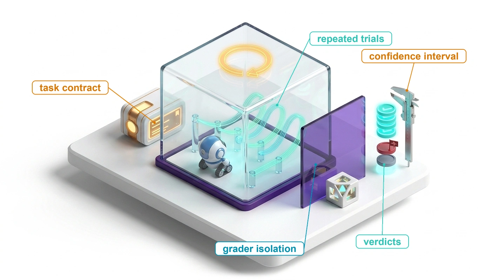

# Agent Evaluation {#sec-vol3-evaluation}

::: {layout-narrow}
::: {.column-margin}

\chapterminitoc

:::

::: {.content-visible when-format="pdf"}
\noindent
{fig-alt="Isometric blueprint of an agent evaluation gym: a task contract card feeds a sealed glass test chamber with a reset ring, where a small robot runs repeated trial trajectories; outside, behind an isolation wall, a grader station sorts the runs into verdict tokens beside a caliper that stands for the confidence interval."}
:::

::: {.content-visible unless-format="pdf"}
{fig-alt="Isometric blueprint of an agent evaluation gym: a task contract card feeds a sealed glass test chamber with a reset ring, where a small robot runs repeated trial trajectories; outside, behind an isolation wall, a grader station sorts the runs into verdict tokens beside a caliper that stands for the confidence interval."}
:::

:::

## Purpose {.unnumbered .unlisted}

::: {.content-visible when-format="pdf"}
\begin{marginfigure}
\mlagentstack{0}{0}{100}{0}{0}{0}
\end{marginfigure}
:::

::: {.content-visible unless-format="pdf"}
::: {.column-margin}
{width="100%" fig-alt="Agentic Machine Learning Systems Stack"}

*Agent stack focus for this chapter.*
:::
:::

_Why is a completed agent run not enough evidence that the configuration behind it works?_

Evaluating an autonomous agent on final pass rates or aggregate benchmark scores conceals the failure modes that govern production reliability. A task may pass by serendipity while taking hazardous intermediate actions, or fail narrowly after executing dozens of sound steps, and a scalar score distinguishes neither outcome. The agent's own report that it finished is the weakest evidence available, and tests that run inside its workspace sit within reach of its edits. Even an honest pass is one draw from a stochastic process. The configuration that repairs a defect today can loop on the identical starting state tomorrow, and a system that succeeds on nine runs in ten fails at least one of eight recurrences of the same task more often than not. A comparison between two configurations inherits all of this noise, so a margin of a few tasks on a benchmark of a hundred can vanish under a second sample. Graders err in both directions, two model judges that agree with each other can share the same blind spots, and a held-out suite consulted for every prompt change quietly becomes training data. A score reported without its cost misleads as well, because a configuration that retries until something passes can buy acceptance with spending that a rival never made. A claim about an agent configuration therefore cannot rest on a completed run. It rests on declared acceptance criteria checked by graders the agent cannot reach, on samples of tasks rather than repeated runs of a few, on paired comparisons sized to the uncertainty they must resolve, and on budgets that charge every failed attempt to the tasks that succeed. Each exposure the agent carries enters that evidence: the state a result rests on, the resources its horizon consumed, and the authority it exercised along the way.

::: {.content-visible when-format="pdf"}

\newpage

:::

::: {.callout-learning-objectives}

- Explain why a task acceptance contract credits a trial only on evidence and keeps pending and unknown verdicts in the count
- Design hermetic, leakage-controlled trials whose graders neither the agent nor its submitted code can reach
- Calibrate a model judge by its false-acceptance rate against an independent reference assessment
- Calculate acceptance intervals and allocate an evaluation budget between new tasks and repeated runs
- Compare two configurations by a paired acceptance interval against a declared noninferiority margin
- Select between candidate availability and repeated-run consistency for a stated deployment policy
- Evaluate competing policies under a matched budget by their cost per accepted task

:::

## The Evaluation Problem {#sec-vol3-evaluation-problem}

For the repair agent (@sec-vol3-intro-lighthouses), the connection-pool repair has come through its turbulent hour. The replacement worker reconstructed candidate workspace `ws_r18`, kept the interrupted test operation unresolved rather than guessing its outcome, and accounted for the temporary integration-test environment. Suppose a fresh targeted check then passes on `ws_r18` and the environment is released, satisfying the cleanup postcondition. Recovery has done its job, but it leaves open the question the previous chapter ended on, whether the runtime completed the task and whether its recovery policy improved outcomes at an acceptable cost.

::: {.column-margin .margin-pointer}
↩ The recovery of the connection-pool repair, which reconstructs `ws_r18` and keeps its test operation unresolved, is established in @sec-vol3-synthesis-architecture.
:::

::: {.column-margin}
{width="100%" fig-alt="H·S·A locator with all three axes, Horizon, State, and Authority, highlighted."}

*Evaluation examines the state a result rests on, the resources spent across its horizon, and the authority it exercised.*
:::

The runtime mechanisms developed so far govern execution integrity rather than task success. An authority check confirms that each action was permitted by policy, the durable event log records what operations took place, and the recovery protocol ensures that partial side effects were undone or safely handed off. None of these components evaluates whether the resulting code patch actually fixes the bug. Relying on the agent's own assessment is equally insufficient, because self-reporting constitutes the weakest tier of closure evidence (@sec-vol3-intro-invariant-closure). When an agent executes tests inside its own mutable workspace, those tests are fully within reach of its edits. A faulty patch can pass because the agent commented out an assertion, altered mock data, or deleted a failing test. Even when an agent leaves tests untouched, a single successful run represents only one sample drawn from a stochastic distribution. The same agent may resolve an incident on one attempt and loop without progress on the next under the identical starting state.

Engineering decisions are also comparative. A new configuration, `candidate_v2`, with an updated system prompt, refined tool schemas, a revised recovery policy, or a different base model, is ready for deployment. The engineering team must decide whether it reliably outperforms the incumbent `baseline_v1` across the full distribution of repair tasks the system will encounter. The base model is only one of those levers, and published results show the others moving acceptance just as far. A terminal-task benchmark reports the same models run inside many independently built agent scaffolds, the prompts, tool definitions, and control loop that surround the model [@merrill2026terminal]. @Fig-vol3-scaffold-spread plots every model evaluated in at least five of them.

```{python}
#| label: calc-vol3-scaffold-spread
#| echo: false
# ┌─────────────────────────────────────────────────────────────────────────────
# │ SAME MODEL, DIFFERENT SCAFFOLDS (LEGO)
# ├─────────────────────────────────────────────────────────────────────────────
# │ Context: @fig-vol3-scaffold-spread and the paragraph after it.
# │ Goal: Show that the configuration around a model moves acceptance by
# │       more than sampling noise.
# │ Show: Widest and median within-model spread; the median reported
# │       standard error; the widest model's range and scaffold count.
# │ How:  Scenarios.TerminalBenchScaffoldSpread (data/terminal_bench_2_harness.csv,
# │       models with >= 5 scaffolds; ScaffoldSpreadModel).
# └─────────────────────────────────────────────────────────────────────────────
from mlsysim import Scenarios
from mlsysim.fmt import check, fmt_int, fmt_percent

class ScaffoldSpread:
    # ┌── 1. LOAD (Constants) ──────────────────────────────────────────────
    scenario = Scenarios.TerminalBenchScaffoldSpread

    # ┌── 2. EXECUTE (The Compute) ────────────────────────────────────────
    result = scenario.result
    widest = result.widest
    widest_lo, widest_hi, widest_n = result.widest_low, result.widest_high, result.widest_count
    median_spread = result.median_spread
    median_se = result.median_se

    # ┌── 3. GUARD (Invariants) ──────────────────────────────────────────
    check(median_spread > 4 * median_se, "Prose says the typical spread is several standard errors")
    check(widest_hi - widest_lo > 0.2, "Prose says the widest spread exceeds 20 points")

    # ┌── 4. OUTPUT (Formatting) ──────────────────────────────────────────
    n_models_str = fmt_int(result.models)
    widest_lo_str = fmt_percent(round(widest_lo, 2), precision=0, style="prose")
    widest_hi_str = fmt_percent(round(widest_hi, 2), precision=0, style="prose")
    widest_n_str = fmt_int(widest_n)
    median_spread_str = fmt_int(round(100 * median_spread))
    median_se_str = fmt_int(round(100 * median_se))
```

::: {#fig-vol3-scaffold-spread fig-env="figure" fig-pos="htb" fig-cap="**One Model, Many Scaffolds**: Each row is one model; each dot is its accuracy on the same terminal-task benchmark inside a different agent scaffold, with the bar spanning lowest to highest and the count of scaffolds at right. Diamonds mark the benchmark's own reference scaffold. Rows are sorted by median accuracy, and for many models the within-row spread rivals the gap between neighboring model generations, so a reported score describes a configuration, not a model. Data from @merrill2026terminal leaderboard entries via @epochai2026benchmarks." fig-alt="Horizontal dot plot with sixteen model names on the vertical axis and accuracy from 0 to 100 percent on the horizontal axis. Each row has several blue dots joined by a light blue bar from its lowest to highest value, often one red diamond, and a label at right giving the spread in points and the number of scaffolds. Spreads range from 3 to 22 points. An annotation on the Claude Opus 4.6 row points to its range from 58 to 80 percent."}

```{python}
#| echo: false
# ┌─────────────────────────────────────────────────────────────────────────────
# │ SAME MODEL, DIFFERENT SCAFFOLDS (FIGURE)
# ├─────────────────────────────────────────────────────────────────────────────
# │ Context: @fig-vol3-scaffold-spread
# │
# │ Goal: Show the within-model spread across agent scaffolds.
# │ Show: Dot strip per model (>= 5 scaffolds), min-max bar, reference
# │       scaffold marked, spread and count labels.
# │ How: data/terminal_bench_2_harness.csv (MLSysIM); book_style.setup_plot().
# └─────────────────────────────────────────────────────────────────────────────
import numpy as np
from mlsysim import Literature
from binder.tools.figures import style as book_style

fig, ax, COLORS, plt = book_style.setup_plot(figsize=(6.2, 5.2))
rows = book_style.load_series("vol3/13_evaluation/data/terminal_bench_2_harness.csv").entries
by = {}
for r in rows:
    by.setdefault(r["model"], []).append(r)
by = {m: v for m, v in by.items() if len(v) >= 5}
order = sorted(by, key=lambda m: np.median([r["accuracy"] for r in by[m]]))
names = {
    "gpt-5-nano-2025-08-07": "GPT-5 nano",
    "gemini-2.5-pro": "Gemini 2.5 Pro",
    "Qwen3-Coder-480B-A35B-Instruct": "Qwen3-Coder-480B",
    "grok-4-0709": "Grok 4",
    "claude-haiku-4-5-20251001": "Claude Haiku 4.5",
    "gpt-5-mini-2025-08-07": "GPT-5 mini",
    "claude-opus-4-1-20250805": "Claude Opus 4.1",
    "claude-sonnet-4-5-20250929": "Claude Sonnet 4.5",
    "gpt-5-codex": "GPT-5-Codex",
    "gpt-5.1-codex": "GPT-5.1-Codex",
    "claude-opus-4-5-20251101": "Claude Opus 4.5",
    "gemini-3-pro-preview": "Gemini 3 Pro",
    "claude-opus-4-6": "Claude Opus 4.6",
    "gpt-5.3-codex": "GPT-5.3-Codex",
    "gemini-3.1-pro-preview": "Gemini 3.1 Pro",
    "gpt-5.5": "GPT-5.5",
}
for i, m in enumerate(order):
    acc = np.array([r["accuracy"] for r in by[m]]) * 100
    ref = np.array([r["accuracy"] for r in by[m] if r["harness"] == "Terminus 2"]) * 100
    oth = np.array([r["accuracy"] for r in by[m] if r["harness"] != "Terminus 2"]) * 100
    ax.plot([acc.min(), acc.max()], [i, i], color=COLORS["BlueL"], lw=6, solid_capstyle="round", zorder=1)
    ax.scatter(oth, [i] * len(oth), s=22, color=COLORS["BlueLine"], zorder=3, label="Other scaffold" if i == 0 else None)
    ax.scatter(ref, [i] * len(ref), s=40, marker="D", color=COLORS["RedLine"], zorder=4, label="Reference scaffold" if i == 0 else None)
    ax.text(acc.max() + 2.0, i, f"{acc.max() - acc.min():.0f} pts (n={len(acc)})", va="center", fontsize=9, color=COLORS["secondary"])
ax.set_yticks(range(len(order)))
ax.set_yticklabels([names.get(m, m) for m in order], fontsize=9)
ax.set_xlim(0, 108)
ax.set_xlabel("Terminal-task accuracy (%)")
ax.grid(axis="y", visible=False)
k = order.index("claude-opus-4-6")
lo = min(r["accuracy"] for r in by["claude-opus-4-6"]) * 100
hi = max(r["accuracy"] for r in by["claude-opus-4-6"]) * 100
ax.annotate(
    f"Same model: {lo:.0f}% to {hi:.0f}%",
    (lo, k),
    xytext=(14, k + 0.65),
    fontsize=9,
    bbox=dict(fc="white", ec="none", pad=0.4, alpha=0.85),
    arrowprops=dict(arrowstyle="-", color=COLORS["secondary"], lw=0.7),
)
ax.legend(
    loc="upper left",
    fontsize=9,
    frameon=True,
    facecolor="white",
    framealpha=0.95,
    edgecolor="gray",
    fancybox=True,
    borderpad=0.5,
)
plt.show()
plt.close()
```

:::

The widest row in @fig-vol3-scaffold-spread is one model scored between `{python} ScaffoldSpread.widest_lo_str` and `{python} ScaffoldSpread.widest_hi_str` across `{python} ScaffoldSpread.widest_n_str` scaffolds. The median spread across the `{python} ScaffoldSpread.n_models_str` models is `{python} ScaffoldSpread.median_spread_str` points, against a median reported standard error of about `{python} ScaffoldSpread.median_se_str` points. The differences are therefore real, not sampling noise, and they come from exactly the components `candidate_v2` changes. An evaluation that attributes a score to the base model alone credits the wrong part of the system, which is why the configuration under test is declared in full before any trial runs.

Transforming noisy, individual agent trials into a defensible release decision requires an end-to-end evaluation pipeline. That pipeline begins with an acceptance contract, which specifies precisely what evidence credits a task, which invariants must hold, and how missing or malformed artifacts are penalized. To make trials interpretable and secure, the evaluation system isolates task fixtures behind a protected grading boundary that sits beyond the agent's reach. Behind this boundary, the grading harness partitions criteria between deterministic mechanical checks (static analysis, invariant assertions, hidden unit tests) and calibrated judgments for open-ended properties.

Because agent behavior is stochastic, moving from single runs to configuration comparison demands statistical rigor. Evaluating `candidate_v2` against `baseline_v1` requires paired trials on the same sampled tasks and decision metrics that reflect operational reality, including acceptance, consistency over repeated runs, and the cost per accepted task introduced in @sec-vol3-intro-horizon-arithmetic. Together, these mechanisms turn individual trials into an offline judgment about `candidate_v2`: whether it accepts tasks at least as reliably as `baseline_v1`, at what cost, and with what uncertainty. Explaining why an individual trial failed and exposing the candidate to live work require operational traces, controlled diagnosis, and staged release (@sec-vol3-operations), but every offline or online claim starts with the acceptance contract for a single trial.

## The Task Acceptance Contract {#sec-vol3-evaluation-contract}

The recovered workspace `ws_r18` from the chapter opening belonged to an interrupted run, so crediting `candidate_v2` from a test result on `ws_r18`, or scoring a model checkpoint without pinning the prompt templates, tool schemas, and starting workspace around it, would rest a release claim on stale evidence or an undeclared scaffold change. To prevent both ambiguities on the connection-pool repair task (`pool_repair_01`), a fresh evaluation trial begins from an immutable initial environment snapshot (`pool_fixture_v1`), grades the run against an explicit criteria specification (`repair_accept_v1`), and produces a new candidate artifact, `ws_r19`. The system under test, `candidate_v2`, names the complete operational configuration (base model, prompt templates, tool definitions, and runtime harness) rather than an isolated source-code revision or model checkpoint, and every verification check in the remainder of this chapter must evaluate the exact bytes of `ws_r19` rather than borrowing results from `ws_r18`.

A **trial**\index{Evaluation trial!definition} is a single end-to-end execution conducted under a declared task, fixture, system configuration, and evaluation protocol. A second execution constitutes a distinct trial, even when all inputs, initial states, and configurations remain identical. Rerunning this single repair ten times yields ten trials of one task rather than ten distinct tasks, a distinction whose statistical cost @sec-vol3-evaluation-resampling quantifies. Before aggregating results across runs, however, the evaluation harness must apply an unambiguous acceptance rule to determine whether any individual trial succeeded.

### Evidence dimensions {#sec-vol3-evaluation-contract-dimensions}

When an evaluation harness collapses every check into a single pass/fail bit, a recoverable schema rejection early in the run looks identical to a broken patch, while a passing unit test can hide a prohibited credential read or an unclosed cloud environment. An evaluation contract avoids both errors by translating the high-level task specification (its expected outcomes, permitted operations, and resource constraints) into separate, checkable dimensions. It is the five-part task contract of @sec-vol3-intro-five-part-contract made checkable, with the goal and completion criteria turned into measured properties and the permitted actions turned into compliance checks. Specifically, the contract defines what properties are measured, which artifact versions are examined, which instruments perform the measurement, where the observation boundaries lie, and how the harness handles missing or ambiguous evidence. @Tbl-vol3-eval-contract-hierarchy organizes verification across four parallel dimensions of evidence.

| Dimension             | Evidence to inspect                                                                                                                    | Consequence for the repair                                                                                     |
|:----------------------|:---------------------------------------------------------------------------------------------------------------------------------------|:---------------------------------------------------------------------------------------------------------------|
| Proposal validity     | Completed proposal, parsing and schema results, represented tool and arguments                                                         | An invalid configuration rejected before dispatch can be repaired; the rejection alone need not fail the trial |
| Execution behavior    | Admitted operations and attempts, endpoint outcomes, ordering, observed partial effects, and recovery history                          | An accepted request is not necessarily a finished test; a timeout can leave an operation unresolved            |
| Task outcome          | Exact candidate artifact, required defect and regression checks, final answer, and any declared qualitative rubric                     | A targeted pass supports only its coverage; a readable report cannot replace missing required checks           |
| Constraint compliance | Authority decisions and observed effects, protected-artifact checks, consumption and liability, elapsed intervals, and residual owners | Good final code does not erase a prohibited effect or satisfy an unmet cleanup or budget condition             |

: **Dimensions of Task Evaluation**: Each dimension contributes scoped evidence. The task's declared criteria determine which findings reject a trial, which remain pending, and which serve only as diagnostics. {#tbl-vol3-eval-contract-hierarchy}

These four dimensions organize where evidence comes from, and they map directly onto the criteria that define an accepted task below. Task outcome supplies the outcome criteria. Proposal validity and execution behavior supply the process criteria. Constraint compliance supplies the resource and residual-duty criteria, together with the authority side of process. That division also tracks the three operational exposures the agent carries. Checks of the resulting artifact and environment examine the state a result rests on, resource criteria measure what the horizon consumed, and compliance checks audit the authority the trial exercised.

Separating these dimensions prevents intermediate runtime recoverable errors from contaminating the assessment of the final artifact. For instance, if an agent generates a tool invocation with an invalid argument type, a local schema validator can reject the call. If the agent inspects the rejection, corrects the payload, and dispatches a valid request that successfully repairs the bug, an evaluation policy that permits self-correction will accept the trial. Conversely, if a security policy strictly prohibits even the attempt to access a sensitive credential store, that single malformed or unauthorized proposal constitutes an immediate, terminal violation.

Because of these differing rules, the evaluation record must distinguish whether every event was a raw proposal, an admitted request, or an observed state mutation. Maintaining parallel evidence streams also preserves diagnostic value when a trial fails. If an agent overwrites a protected configuration file, the trial is rejected; nevertheless, retaining the test execution logs, elapsed wall-clock time, and cleanup traces explains why the system failed, aiding post-mortem analysis without altering the failure verdict.

::: {#dfn-vol3-accepted-task .callout-definition title="Accepted task"}

***Accepted task***\index{Accepted task!definition} is a task completion credited to a particular trial because the available evidence satisfies its declared outcome, process, resource, and residual-duty criteria at the required evidence level.

1. **Significance**: Acceptance defines the denominator for cost efficiency ($\CostPerAcceptedTask$ in @eq-vol3-cost-per-accepted-task). The compute, token, and infrastructure costs of all rejected or unresolved runs are charged against the accepted trials. Artificially weakening the acceptance contract creates an illusion of efficiency, lowering nominal cost per accepted task without making the underlying system cheaper.
2. **Distinction**: Passing a single test harness or verifier is substantially narrower than achieving task acceptance. A trial might pass a targeted regression test yet fail due to resource exhaustion, unauthorized side effects, or leaked background processes. Moreover, task identity refers to the underlying problem specification, whereas trial identity refers to an individual execution attempting that task.
3. **Common pitfall**: Crediting a trial based solely on an agent's self-generated claim of completion, a successful transport status code, or a passing test run executed against a different candidate workspace revision.

:::

### Evaluation instruments and coverage {#sec-vol3-evaluation-contract-instruments}

Verifying whether the trial that produced `ws_r19` satisfies all four dimensions of its acceptance contract requires inspecting live tool proposals during execution, testing the resulting workspace afterward, and reviewing the accompanying repair report, a span no single checker can cover. Three instruments therefore supply the evidence for these criteria, each bounded by specific operational limits. Runtime guards and external programmatic checks represent the two halves of invariant closure (principle \ref{pri-invariant-closure}). Runtime guards enforce bounds at the operational boundaries they mediate, such as blocking an unauthorized dispatch or intercepting a disallowed network connection. External checks assess specified artifact properties independently after execution, verifying for example whether the submitted candidate passes a defect reproducer and the required regression suite. Finally, qualitative judgments, whether supplied by human experts or automated evaluator models, assess compliance with an explicit rubric, such as whether a generated technical report accurately explains its supporting evidence. Applying model-based rubrics requires the calibration developed in @sec-vol3-evaluation-grading.

All three instruments obey the **coverage rule**\index{Coverage rule!definition}: an evaluation check establishes only those properties that its scope, input vectors, and underlying assumptions directly support. Isolating an automated grader from agent tampering protects the integrity of its measurements, but it cannot expand its coverage. A test suite can pass completely yet still miss a critical defect if the test cases fail to exercise that execution path.

::: {.column-margin .margin-pointer}
↩ The principle that each verification check answers a narrow question rather than certifying task satisfaction is established in @sec-vol3-foundation-model-continuations.
:::

::: {#dfn-state-delta-verification .callout-definition title="State-delta verification"}

***State-delta verification***\index{State-delta verification!definition} checks specified properties of an observed change between declared initial and resulting environment states, using measurements tied to the relevant versions and task criteria.

1. **Significance**: It distinguishes a claimed repair from an observed artifact or service mutation that meets the selected checks, ensuring the agent produced genuine state changes.
2. **Distinction**: Verification relies on scoped, structured comparisons of designated state components rather than naive differential subtraction of entire filesystems or databases. Furthermore, verifying that a state delta satisfies designated checks does not prove total correctness across unmonitored subsystems.
3. **Common pitfall**: Treating any non-empty patch or successful tool response as evidence that the intended change occurred without unintended side effects.

:::

The evaluation criterion dictates both the required observation and the appropriate instrument. A read-only analysis task succeeds when the agent produces an empirically supported answer while leaving the persistent environment untouched. Conversely, a software repair task alters persistent files, requiring the harness to inspect execution history alongside final disk states. If an agent executes an unauthorized file deletion and subsequently recreates the file before finishing, the action still violates a policy forbidding unauthorized deletion.

Resource accounting likewise demands precisely defined observation boundaries. The evaluation harness must meter the active execution phase and the finalization phase against distinct budget allowances. Token expenditures, financial costs, and occupied compute resources must remain separate accounting streams rather than being collapsed into a single scalar. Moreover, settled operational charges must be distinguished from outstanding reserved liabilities; halting an evaluation trial at a wall-clock cutoff does not automatically cancel background container instances or release cloud reservations.

::: {.column-margin .margin-pointer}
↩ Bounded-liability admission, which keeps outstanding reservations separate from settled charges, is established in @sec-vol3-agent-harness-reservation-settlement.
:::

### The four-verdict rule {#sec-vol3-evaluation-contract-verdicts}

When a trial reaches its observation cutoff while a regression suite is still running or a resource charge remains unsettled, forcing every criterion into a binary pass or fail either credits unfinished work or records an incomplete check as a substantive violation. For every declared criterion in the contract, the harness must instead retain the observed result and resolve it to one of four discrete verdicts. A `pass` means the evidence definitively meets the requirement. A `fail` means the evidence establishes a violation. A `pending` verdict applies while a required assessment remains actively underway within the observation window. An `unknown` verdict applies when necessary evidence is missing or unavailable at the cutoff, and it is accompanied by a structured record explaining why. These four categories function strictly as evaluation verdicts rather than trajectory lifecycle states.

The aggregation logic short-circuits. An established failure of any mandatory criterion immediately resolves the overall trial verdict to `fail`, even if other criteria remain pending or unobserved. A trial is accepted if and only if all mandatory criteria achieve a `pass`. If any required check remains unfulfilled and none have failed, the trial remains pending or unknown. This convention is the **four-verdict rule**\index{Four-verdict rule!definition}. Its main corollary governs every measurement in this chapter: incomplete, timed-out, or unresolvable trials must remain in the denominator under a declared rule, because dropping them changes the underlying population being evaluated. Unless a contract declares otherwise, this chapter applies one default. An unresolved trial stays in the count $\EvaluationTrialCount$ and is not accepted, so a point estimate of the accepted fraction, the acceptance estimator of @eq-vol3-task-acceptance, treats it as a non-acceptance. The report lists unresolved trials separately from established failures and adds the two bounds obtained by resolving every one of them as accepted and every one as failed, which shows how far the open verdicts could still move the result.

::: {#exmp-13-repair-acceptance-record .callout-example title="A targeted pass is not a completed evaluation"}

**Problem**: The trial submits candidate workspace `ws_r19` under `repair_accept_v1`. The contract requires six conditions: the defect reproducer and designated regression checks must pass, the report must state its supported scope, permitted actions and resource allowances must hold, and temporary resources must be released or transferred under its residual-duty policy. The first three are outcome criteria, and the last three are the process, resource, and residual-duty criteria of the accepted-task definition. @Tbl-vol3-repair-acceptance-record logs what the harness has observed against each condition so far. At an interim observation checkpoint, can this trial be accepted?

| Required evidence               | Observation for this trial                                                                                                                  | Verdict at this observation                                        |
|:--------------------------------|:--------------------------------------------------------------------------------------------------------------------------------------------|:-------------------------------------------------------------------|
| Candidate-specific defect check | The designated reproducer passed on `ws_r19`                                                                                                | `pass` for this check only                                         |
| Required regression coverage    | The designated suite has not yet produced a complete result                                                                                 | `pending`                                                          |
| Report scope                    | The declared review found that the report identifies the candidate, completed check, and missing coverage                                   | `pass` under that rubric and review                                |
| Permitted process               | Retained mediation and protected-artifact checks satisfy the specified process criteria; a malformed proposal was corrected before dispatch | `pass` within the stated coverage                                  |
| Resource criteria               | Admissions remained within the configured bounds, but required final usage evidence for an outstanding operation is not yet available       | Admission-bound check `pass`; final-accounting criterion `pending` |
| Residual duties                 | The designated service acknowledged ownership of the remaining operation and charge reconciliation, as this contract permits                | Handoff criterion `pass`; the external outcome remains unresolved  |

: **An Interim Repair Evaluation Record**: Hypothetical findings for one identified trial. Each result retains its criterion and scope; successful handoff does not establish the result of the transferred operation. {#tbl-vol3-repair-acceptance-record}

**Result**: No row of @tbl-vol3-repair-acceptance-record records a failure, yet the trial cannot be accepted at this interim checkpoint. Its overall verdict remains `pending` because required regression coverage and final accounting reconciliation have not yet concluded. If the regression suite subsequently reports a failed assertion, the overall verdict immediately transitions to `fail`, while the unresolved charge remains recorded. If the observation window closes before those results arrive, the uncompleted criteria transition to `unknown`, a gap that neither the targeted pass nor the accepted handoff can fill.

**Systems insight**: The evaluation record distinguishes task completion, runtime enforcement, grader coverage, and owned residual work. A favorable result in one operational dimension cannot substitute for missing evidence in another.

:::

The acceptance contract formalizes the necessary conditions for crediting an individual trial. However, the validity of comparative benchmarks across multiple systems depends equally on the stability and isolation of the underlying evaluation harness. A silently updated package dependency, an unpinned base container image, or data leakage that exposes test suites to the model can move benchmark scores by more than the difference being measured without reflecting any genuine improvement in system architecture or agent capability.

## Hermetic Evaluation Gyms {#sec-vol3-evaluation-gyms}

If a trial of `candidate_v2` on `pool_repair_01` inherits mutated state from an earlier run or reaches live external endpoints that shift between attempts, the observed score difference against `baseline_v1` measures environmental contamination rather than an architectural improvement. Both systems must execute against the declared task under equivalent starting conditions, and the evaluator must verify every result directly against the artifact generated during that specific trial. An **evaluation gym**\index{Evaluation gym!definition} provides the task's interactive environment, establishes controlled starting conditions, and exposes clean interfaces for capturing trial evidence. Its **hermetic boundary**\index{Hermetic boundary!definition} explicitly specifies which dependencies are provisioned or simulated and which external network and filesystem interactions are blocked. This boundary serves as an experimental contract: it fixes the declared experimental conditions without requiring either identical model responses or absolute production fidelity. A stochastic environment qualifies as hermetic once every source of non-determinism is declared, bounded, and systematically recorded.

### Task fixtures {#sec-vol3-evaluation-gyms-fixtures}

When two trials of `pool_repair_01` pull floating package versions or start from slightly different service states, a third-party library update between runs can masquerade as a regression or gain in the agent itself. A **task fixture**\index{Task fixture!definition} prevents that drift by packaging the exact initial state, dependencies, and configuration required to instantiate an evaluation task. In an automated repair benchmark, `pool_fixture_v1` pins the baseline repository commit, the language toolchain and package versions, the simulated test-service behaviors, and the files the agent is permitted to read or edit. The fixture establishes the baseline conditions under which an agent attempts the task, whereas separate acceptance criteria evaluate the resulting artifact; @tbl-vol3-evaluation-fixture-contract records the conditions that must accompany the trial.

| Fixture component       | What the repair evaluation declares                                                                                            | Why the comparison needs it                                          |
|:------------------------|:-------------------------------------------------------------------------------------------------------------------------------|:---------------------------------------------------------------------|
| Initial task state      | Starting source revision, supplied defect description, permitted files, and initial service state                              | Neither system inherits another trial's fix or an undeclared hint    |
| Executable dependencies | Toolchain, packages, tool interfaces, service fixtures, and relevant configuration versions                                    | A dependency change is not mistaken for a system improvement         |
| Interaction policy      | Available tools, permitted data and destinations, resource limits, and external behaviors represented                          | Both systems face the declared task and authority boundary           |
| Variation policy        | Fixed or sampled fault conditions, scheduling and random inputs where controlled, and recorded provenance where not controlled | The experiment distinguishes intended variation from missing control |
| Evidence boundary       | Exported candidate identity, protected grader configuration, criteria version, and allowed development feedback                | A result applies to the actual submitted artifact and check          |
| Trial lifecycle         | Reset readiness, output capture, observation cutoff, cleanup, and residual ownership                                           | Late work and retained state cannot silently enter the next trial    |

: **A fixture contract for comparable trials**: The fixture manifest defines what parameters are held constant, which factors may vary, and what evidence must be captured, ensuring apples-to-apples comparisons without requiring full reproduction of every production nuance. {#tbl-vol3-evaluation-fixture-contract}

A rigorous benchmark must also document how tasks are sampled from the broader problem distribution, because repeatedly evaluating a single fixture characterizes only that specific repair workflow (@sec-vol3-evaluation-rigor). Even when an evaluator fixes the pseudo-random seed of the language model, non-deterministic inference serving (dynamic batching, asynchronous token streaming, and accelerator kernel scheduling) introduces subtle timing variations. The evaluation run must therefore record all accessible execution provenance alongside explicit statements regarding unconstrained sources of entropy.

### Controlled interactions {#sec-vol3-evaluation-gyms-interactions}

Pinning a static starting snapshot is only the first step, because evaluating a repair agent on a single-turn prompt-and-patch benchmark never tests whether it can diagnose compiler errors, respect state-dependent APIs, or revise a broken attempt across turns. Interactive evaluation instead exercises the closed loop where an agent inspects its environment, parses diagnostic feedback, revises its working candidate, and runs intermediate checks. Because the fixture mirrors the task domain, its components vary accordingly. A document-analysis fixture locks down static reference documents and vector indices, whereas an interactive browser benchmark configures authentication credentials, pre-populated user sessions, and mutable web-application databases.

Providing authentic command-line and language tools within an isolated sandbox allows the evaluation harness to exercise compilation pipelines, filesystem operations, and sub-process execution directly. For external dependencies, stateful service emulators can track conversational state and state-dependent APIs where downstream responses depend on earlier writes. Prerecorded network traces support a much narrower replay boundary, since a recorded interaction remains valid only as long as the agent's request method, endpoint, arguments, schema versions, and call order match the recorded sequence exactly. If the agent deviates by issuing an unexpected API call or reordering operations, the replay harness cannot simply deliver the next historical record. Under the matching-request rule\index{Matching-request rule}, the evaluator must either provide a synthetically valid response for the novel path or fail fast by signaling an unsupported interaction.

::: {.column-margin .margin-pointer}
↩ Request matching, which a replay adapter applies before returning any recorded response, is established in @sec-vol3-durable-execution-harness-regression-replay.
:::

In an environment testing automated cloud-resource repair, a mock service that invariably returns immediate HTTP 200 responses fails to evaluate whether the agent can handle dropped connections, timeout retries, or eventual consistency. A fault-injecting fixture instead exercises resilience by selectively dropping packets, introducing synthetic latency, or withholding acknowledgments, exposing real-world distributed systems failure modes. Engineering an evaluation gym therefore involves a continuous trade-off between fidelity and determinism. Simple deterministic mocks maximize reproducibility and run rapidly, but they routinely omit real-world concurrency, race conditions, partial failures, and subtle error codes. Conversely, deploying full-scale, live service instances yields high behavioral fidelity at the expense of heavy provisioning overhead, slow trial resets, and environmental flakiness. Systems architects must align simulation fidelity with the specific capabilities being claimed. Furthermore, any architectural behaviors intentionally omitted by the fixture must be documented alongside reported metrics, because a perfect success rate against a simplified mock shows competence only within that sanitized world. Finally, testing agents against live production or external third-party APIs requires dedicated authorization and hard resource bounds; prefixing an execution run with the label "benchmark" confers no legal or operational authority to touch production infrastructure.

### State reset between trials {#sec-vol3-evaluation-gyms-reset}

Once an interactive trial finishes, reverting a repository with `git checkout` is rarely enough to restore a clean starting state: orphan background processes, uncleared message queues, temporary files in `/tmp`, and mutated API mocks can all leak side effects into the next trial. Beyond the baseline sandbox reset contract, evaluation requires every trial to start from an environment identical to the declared task fixture. Resetting a trial means terminating all background worker processes, capturing the candidate artifact at a consistent filesystem checkpoint, revoking session-specific credentials, and scrubbing every mutable resource. If an asynchronous operation initiated during an earlier trial remains in flight, the hosting container or virtual machine cannot return to the warm pool until that background operation terminates or its target resource is destroyed. Discarding a workspace directory while background network writes are still pending leaves the host environment corrupted.

::: {.column-margin .margin-pointer}
↩ The reset contract that must hold before a pooled sandbox serves a new lease is established in @sec-vol3-sandboxes-pooling-reset.
:::

To maintain high throughput across thousands of evaluation runs, evaluation frameworks rely on copy-on-write (CoW) filesystem overlays and virtual machine snapshots rather than provisioning fresh environments from scratch. When reporting benchmark throughput, system designers should explicitly break down end-to-end latency into container warm-up, snapshot reset, agent execution, queueing delays, and grading, because reporting only sandbox lease acquisition times creates a misleading picture of cluster capacity. Controlled sharing of underlying resources remains compatible with sound experimental methodology as long as the shared state cannot leak across trials. Immutable compiler caches and base operating system images can be shared safely across sandboxes. Evaluating an agent against a pre-warmed cache is valid when warm-cache performance is the stated target of the experiment. Whenever concurrent trials compete for shared host resources such as CPU cycles, memory bandwidth, or host kernel threads, however, evaluators must measure resource contention directly or randomize trial ordering to prevent queuing artifacts from being mistaken for candidate improvements.

### Grader isolation {#sec-vol3-evaluation-gyms-grader-isolation}

Resetting the sandbox between runs protects the starting state, but a trial can still corrupt its own verdict if the agent or its submitted code can reach the tests that grade it. Visible unit tests are useful during iterative problem-solving to give the agent intermediate feedback, whereas held-out acceptance tests, which act as the sealed tests of the closure evidence levels, must judge the final submission without becoming an optimization target themselves. **Grader isolation**\index{Grader isolation!definition} keeps reference solutions, secret test suites, grading scripts, and authoritative score registries outside the agent's execution environment, and cryptographically binds the resulting score to the exact artifact digest (such as the SHA-256 hash of workspace snapshot `ws_r19`) captured at completion.

::: {.column-margin .margin-pointer}
↩ Sealed tests outrank visible tests among the closure evidence levels established in @sec-vol3-intro-invariant-closure, because the agent never sees their definitions and cannot reach where they run.
:::

Submitted code stays untrusted after the agent process stops. If an evaluation harness imports the candidate package directly into the Python interpreter running the grading assertions, the submitted code can monkey-patch core assertions, manipulate built-in object prototypes, or rewrite test runner hooks. Similarly, if secret test files are mounted into the filesystem where candidate code can inspect directory trees or read file contents, the tests are irrevocably compromised. Mounting files as read-only prevents direct overwrites, but it provides zero protection against exfiltration or inspection.

::: {.column-margin .margin-pointer}
↩ Why code running inside the supervisor's own interpreter can reach the supervisor's state is established in @sec-vol3-sandboxes-object-graph.
:::

A robust grading architecture must enforce two distinct security boundaries: the live agent's access during task execution and the submitted artifact's execution reach during evaluation. In @fig-vol3-eval-gym-architecture, an external trusted controller manages evaluation logic, holds the private test suites, and commits results to a secure database, while candidate code executes inside a strictly sandboxed runner. The controller orchestrates testing over a narrow, well-defined remote procedure call (RPC) interface and strictly enforces a patch-admission policy specifying which repository files the candidate was permitted to touch. It treats all candidate-generated stdout, stderr, and exit codes as untrusted observations.

::: {#fig-vol3-eval-gym-architecture fig-env="figure" fig-pos="htb" fig-cap="**Trial Sandbox and Grading Boundary**: The agent under test edits and runs checks inside a single-use fixture whose base image is shared read-only and whose writes land in a per-trial copy-on-write layer; external egress is blocked, and service fixtures stand in for the dependencies the task declares. The captured candidate `ws_r19` crosses to a grading boundary, where a trusted controller keeps the held-out tests, criteria, and result store and sends selected tests to a separately limited execution of the candidate code. That execution remains the attack surface, because submitted code runs with the tests it receives, so its outputs are untrusted observations until the controller binds each criterion's verdict to the exact artifact." fig-alt="Two regions side by side. Left, an amber-bordered task sandbox, one per trial: an agent-under-test box labeled candidate_v2 sends an arrow labeled edits, runs checks down to a fixture drawn as two stacked layers, a copy-on-write layer for this trial's writes sitting on a read-only shared base image. An arrow labeled calls runs from the agent under test down the sandbox edge to a service fixtures box labeled emulators and replies, and a dashed line runs down to a red bar on the sandbox wall labeled external egress blocked. An amber arrow carries the captured artifact ws_r19 from the copy-on-write layer across the gap into the right region, a grading boundary. There a trusted controller holds three chips, held-out tests, criteria, and results, and is marked outside the candidate's reach. It sends selected tests down to a red dashed candidate execution box labeled limited, attack surface, which returns untrusted output upward by a dashed arrow. A separate arrow from the controller leads to a verdicts box bound to ws_r19, listing pass, fail, pending, and unknown."}

:::

When repository unit tests require in-process execution alongside submitted code, the test harness itself becomes an explicit attack surface. In these configurations, rigorous evaluation harnesses run automated adversarial probes before grading, in which synthetic exploit patches attempt to read environment variables, inspect parent memory spaces, override assertion operators, and forge passing exit signals. Passing these containment checks demonstrates resistance against known circumvention techniques, though such verification covers only the specific security perimeters tested.

### Evaluation leakage {#sec-vol3-evaluation-gyms-leakage}

Even when a sandbox blocks external network access and isolates the grader, a benchmark score is still invalid if the answer crosses the trial boundary through the model's weights, its retrieval index, or its persistent memory. Pre-trial leakage occurs through **contamination**\index{Contamination!definition}, when benchmark solutions appear in pretraining corpora, or through retrieval, when external retrieval-augmented generation (RAG) vector indices index ground-truth patches. Runtime leakage occurs when multi-agent systems or persistent memory stores retain information across successive runs, inadvertently passing solutions from one trial to the next.

::: {.column-margin .margin-pointer}
↩ Cross-session memory trials keep reference answers and fixtures outside both writable and retrievable stores, under the trial design established in @sec-vol3-long-term-memory-policy-trials.
:::

Furthermore, an evaluation suite can leak methodologically even when the sandboxes remain completely sterile. Repeatedly refining prompts, tool definitions, or agent architectures based on error analyses of held-out test failures converts that held-out suite into an informal training set.[^fn-goodhart-holdout-evaluation] Hyperparameter adjustments and prompt changes guided by held-out feedback systematically overfit the evaluation suite, eroding its statistical validity as an unbiased assessment of generalization [@dwork2015reusable]. Maintaining sound evaluation requires tracking end-to-end data provenance for task prompts, gold-standard solutions, unit tests, and trajectory logs. While n-gram filtering and embedding similarity checks help flag potential contamination, falling below an arbitrary similarity threshold never guarantees true task independence. @Sec-vol3-flywheel-evaluation formalizes the dataset splitting protocols required to enforce this separation.

[^fn-goodhart-holdout-evaluation]: **Goodhart's Law and the Held-Out Suite**: The selection pressure that breaks an imperfect check during search (@sec-vol3-test-time-compute-selection-pressure) acts on an evaluation suite in the same way. A held-out suite used to choose among prompts has become a control target, so its score drifts from measuring the task population toward measuring fit to the suite. The simplest remedy is procedural. Retire a suite into development use once it has steered decisions, and hold a fresh one for the release claim. \index{Goodhart's law!held-out evaluation}

Public agent benchmarks trade off these gym controls (task fixtures, interactive dependencies, isolated graders, and coverage limits) in different ways. SWE-bench presents real-world repository issues and validates generated patches against task-specific test suites [@jimenez2024swebench]. Its evaluation harness checks both `FAIL_TO_PASS` assertions (verifying that the reported defect is resolved) and `PASS_TO_PASS` assertions (verifying that existing functionality has not regressed) [@jimenez2024swebench], grounding correctness in concrete runtime behavior rather than static code similarity. GAIA poses complex, tool-assisted questions where each task specifies a concise, unambiguous ground truth, grading only the normalized final answer against an exact-match target [@mialon2023gaia]. While computationally inexpensive and deterministic, this check treats the agent as a black box, observing nothing about the cost, safety, or validity of the intermediate steps taken to reach the output. WebArena deploys fully functional web applications within isolated environments, evaluating tasks by inspecting the resulting database and application state rather than parsing agent transcripts [@zhou2024webarena]. However, targeted state assertions verify only the specific records they query. If an agent executes an e-commerce purchase successfully but inadvertently deletes unrelated order records along the way, a narrow state query still registers a pass. Comprehensive evaluation therefore requires explicit checks for unintended side effects, illustrating why the constraint-compliance dimension in @tbl-vol3-eval-contract-hierarchy demands independent validation.

::: {.callout-checkpoint title="Comparable trials and protected evidence"}

- [ ] **Identity**: Why must a result for `ws_r18` not become the grade for newly submitted `ws_r19`, even on the same task fixture?
- [ ] **Fidelity**: Which recovery claim cannot be tested by a provisioning mock that always returns immediate success?
- [ ] **Grader boundary**: Hidden tests are absent during the agent's run but share an interpreter with candidate code during grading. Which attack surface remains, and which change to the grader design closes it?
- [ ] **Reset**: A previous trial left an unresolved remote job. Can its sandbox return to the pool, and what must be established first?
- [ ] **Leakage**: Why can repeated tuning on held-out errors weaken the evaluation even when every sandbox resets correctly?

:::

Isolating the evaluation gym ensures that the captured candidate artifact and its execution trace reflect the trial itself rather than environmental drift or test leakage. Once the gym protects that evidence collection boundary, the next systems challenge centers on grading mechanics: identifying which criteria can be verified through deterministic execution checks and which demand calibrated judgment or human-in-the-loop review.

## Grading Trajectories {#sec-vol3-evaluation-grading}

Two trials of `pool_repair_01` can submit byte-identical source files and still differ in acceptance status. For `ws_r19`, only the targeted check has passed, while another trial of the same patch may already have established the regression and accounting evidence that `ws_r19` still awaits. Comparing the patches alone cannot tell the two apart. Grading connects each declared criterion to evidence, records what that evidence establishes, and preserves what remains unknown.

### Outcome and process criteria {#sec-vol3-evaluation-grading-criteria}

Inspecting only the final workspace snapshot `ws_r19` cannot tell whether the agent reached a passing patch cleanly or bypassed required approvals and leaked credentials along the way. An evaluation contract therefore separates outcome criteria from process criteria. An outcome criterion concerns the requested result, such as the regression checks against `ws_r19`; it may still inspect history when history determines the result, because a final resource count cannot establish that no duplicate allocation occurred. Process criteria concern how the trial reached its result, and the evidence that process deserves separate grading comes from reasoning tasks. On math word problems, Uesato et al. [-@uesato2022solving] found that outcome and process supervision reached similar final-answer accuracy while process supervision sharply reduced correct answers reached through flawed reasoning. Lightman et al. [-@lightman2023let] found that process-supervised reward models selected correct solutions more reliably. For an agent, the process also includes actions. Current authority, forbidden disclosures, required approvals, and recovery obligations can be mandatory conditions of acceptance, while other process measurements only diagnose. Tool-call validity, for example, measures the fraction of proposed calls that satisfy their schemas and is silent on whether the chosen calls were useful.

::: {.column-margin .margin-pointer}
↩ Process-supervised reward models and step-level verifiers are established in @sec-vol3-test-time-compute-outcome-step-evidence.
:::

Diagnostic metrics need their own denominators and endpoints. A recovery rate counts episodes that met a stated recovery condition among the eligible episodes observed, reporting unresolved episodes separately; a different next action alone is not a recovery. Partial-credit scores show which checked subgoals were met and leave a failed mandatory condition failed, and turns, tokens, and costs are reported with the task outcomes so that a shorter failed trial never reads as an efficiency gain.

### Grader error rates {#sec-vol3-evaluation-grading-errors}

Rerunning an automated grader on the same submission measures only whether the grader agrees with itself. Auditing only the submissions it accepted misses every bad patch it rejected, which leaves the team unable to predict how often the grader will approve a broken submission when a new candidate changes the failure mix. Because the verification asymmetry (principle \ref{pri-vol3-verification-asymmetry}) separates checking a stated property from establishing that the property captures the task, calibrating a grader requires an independent reference assessment of whether the criterion actually held. False acceptance is especially consequential when accepted trajectories support release or later training, but the two conditional error rates answer different questions. Let $\ReferenceAssessedFailure$ denote failure of the specified criterion under an independent reference assessment, and let $\text{Acc}$ denote acceptance by the grader under study. Then distinguish

$$\VerifierFalseAcceptanceRate=\Pr(\text{Acc}\mid \ReferenceAssessedFailure), \qquad
\text{Failure among accepted}=\Pr(\ReferenceAssessedFailure\mid \text{Acc}).$$

The **false-acceptance rate**\index{False acceptance rate!evaluation checks} conditions on reference-assessed failures and measures how often the grader accepted them. Failure among accepted conditions on grader acceptances and measures how often independent assessment found failure among them. A random audit of accepted outputs estimates the second quantity; the first requires reference-assessed failures, including those the grader rejected. Both need stated sampling, enough assessed cases, and an uncertainty estimate. Failure among accepted is the complement of the passing-verdict precision of @eq-vol3-verifier-precision, $1-\VerifierPrecision$, with the grader's acceptance as the passing verdict, so the base-rate argument developed there for candidate checks applies to graders unchanged.

::: {.column-margin .margin-pointer}
↩ The precision of a passing verdict, and its collapse at a low valid rate, is established in @sec-vol3-test-time-compute-check-precision.
:::

The distinction matters when the system under test changes, for two reasons. First, failure among accepted cases ($\Pr(\ReferenceAssessedFailure\mid \text{Acc})$) depends on the overall prevalence of failures in the submissions, so a candidate that fails more often increases the share of bad outputs among accepted runs even if the grader's false-acceptance rate stays fixed. Second, the false-acceptance rate ($\Pr(\text{Acc}\mid \ReferenceAssessedFailure)$) itself can shift when a new candidate fails in ways that were rare in the original calibration set, exposing blind spots in the grader. Each candidate's audit therefore rechecks both rates rather than borrowing a historical false-acceptance figure. Calibration cases come from the intended task population, with deliberate coverage of important failure modes, assessed independently against the same versioned rubric. Reference assessors also err, so the set keeps its adjudication procedure and unresolved labels. A set that oversamples failures reports that design, since its unweighted error fraction describes the calibration mix rather than deployment, and cases used to tune the grader stay out of it.

### Calibration of qualitative judgment {#sec-vol3-evaluation-grading-calibration}

An uncalibrated model judge asked whether a repair report is "clear and complete" will reward fluent, lengthy prose even when the report omits a failed regression check or echoes an adversarial instruction embedded in the candidate text. When a report's adequacy or a repair explanation's clarity requires judgment rather than an exact mechanical test, a **large language model (LLM) judge**\index{LLM judge!definition} can score the criterion under an explicit rubric. The evaluation contract must state whether its verdict is a required acceptance condition, a trigger for human review, or a diagnostic score. Even then, a favorable judgment cannot override another criterion's failure or turn unavailable evidence into a pass.

Ground the judge in trusted result records and discrete rubric items. For the repair explanation, those items can distinguish describing the patch accurately, identifying which checks ran, and acknowledging unresolved work. Candidate text and artifacts remain untrusted inputs to the grader, not instructions that may revise its rubric, and a tool-assisted judge inherits the same authority boundaries as any other tool user. Zheng et al. [-@zheng2023judging] measured position and verbosity biases in model judges and found the evidence for self-enhancement bias inconclusive, so each judge is tested on its own workload. Pairwise judging declares order swapping, ties, and abstentions before scoring and keeps them in the denominator, and a judge from a different model family is not independent by that fact alone.

For categorical ratings of the same cases, Cohen's kappa [@cohen1960] summarizes agreement relative to the raters' marginal label frequencies:

$$\InterAnnotatorAgreement = \frac{\ObservedAnnotatorAgreement - \ChanceAnnotatorAgreement}{1 - \ChanceAnnotatorAgreement}$$

Here $\ObservedAnnotatorAgreement$ is the observed agreement fraction, and $\ChanceAnnotatorAgreement=\sum_\RatingCategory \FirstRaterCategoryFraction \SecondRaterCategoryFraction$ uses each rater's fraction of labels in category $\RatingCategory$. When $\ChanceAnnotatorAgreement=1$, the expression is undefined. High raw agreement can arise from heavily concentrated label frequencies.

```{python}
#| label: calc-vol3-evaluation-kappa-chance
#| echo: false
# CHANCE AGREEMENT UNDER A CONCENTRATED BASE RATE (LEGO)
# Goal: Show raw agreement produced with zero agreement beyond chance.
# Scope: Two raters labeling "pass" independently of the case, same marginal rate.
# How: Scenarios.IndependentJudgesNinetyPercent and its 80 percent variant.
from mlsysim import Scenarios
from mlsysim.fmt import fmt, fmt_percent, check

class KappaChance:
    # 1. LOAD: hypothetical marginal pass rate shared by both raters.
    raters = Scenarios.IndependentJudgesNinetyPercent
    pass_rate = raters.class_shares[0]
    chk_rate = Scenarios.IndependentJudgesEightyPercent.class_shares[0]  # checkpoint exercise

    # 2. EXECUTE: independence makes observed agreement equal chance agreement.
    p_o = raters.agreement
    p_e = raters.chance_agreement
    kappa = raters.kappa

    # 3. GUARD: textbook arithmetic.
    check(abs(p_o - 0.82) < 1e-12, "Raw agreement from chance alone")
    check(abs(kappa) < 1e-12, "No agreement beyond chance")
    check(0.5 < chk_rate < pass_rate, "Checkpoint rate differs from the worked rate")

    # 4. OUTPUT
    pass_rate_str = fmt_percent(pass_rate, precision=0, style="prose")
    chk_rate_str = fmt_percent(chk_rate, precision=0, style="prose")
    p_o_str = fmt_percent(p_o, precision=0, style="prose")
    kappa_str = fmt(kappa, precision=0)
```

If two raters each label `{python} KappaChance.pass_rate_str` of cases as passing, independently of what the case contains, they agree on `{python} KappaChance.p_o_str` of cases by chance alone and $\InterAnnotatorAgreement$ is `{python} KappaChance.kappa_str`. Report those frequencies, disagreements, and assessment coverage with kappa; the coefficient measures agreement, not whether either rater is correct. Because shared mistakes survive high agreement, a grader's operating policy is set by the errors that matter for its role, and it is recalibrated whenever the rubric, judge, evidence interface, or evaluated population changes.

::: {.callout-checkpoint title="Defend a grading verdict"}

- [ ] **Evidence scope**: The trial's targeted check passes on `ws_r19`, but required regression and accounting evidence remain pending under `repair_accept_v1`. Which criteria are supported, and why does an acknowledged residual-duty handoff not fill those gaps?
- [ ] **Conditional denominator**: An audit samples only grader-accepted reports. Does its failure fraction estimate $\Pr(\text{Acc}\mid \ReferenceAssessedFailure)$ or $\Pr(\ReferenceAssessedFailure\mid \text{Acc})$? What population is missing for the other estimate?
- [ ] **Process requirement**: When can a recovered malformed proposal remain a diagnostic event, and when must a process violation reject the trial despite a correct final artifact?
- [ ] **Agreement vs. truth**: Two judges each pass `{python} KappaChance.chk_rate_str` of reports, independently of what the reports contain. Estimate their raw agreement and $\InterAnnotatorAgreement$, and decide whether that agreement supports using either one as an acceptance grader.

:::

Grading yields calibrated criterion-level verdicts and diagnostic measurements for individual trials, but those verdicts evaluate only the specific executions observed in the test harness. Even when graders are isolated and judges are calibrated against reference assessments, observing that a candidate passes more trials than a baseline does not establish that it is genuinely superior. Generalizing beyond those observed runs requires decomposing variance across stochastic attempts and diverse tasks, establishing confidence intervals that do not collapse at extreme probabilities, and bounding comparative uncertainty through paired trials.

## Statistical Evaluation Rigor {#sec-vol3-evaluation-rigor}

When an updated agent configuration (`candidate_v2`) passes several more sampled benchmark tasks than a production baseline (`baseline_v1`) in an evaluation sweep, engineering teams are often tempted to declare immediate progress. However, that modest margin can easily reflect random sampling noise. Conversely, a seemingly smaller overall improvement can provide decisive evidence of system progress if the evaluation protocol preserves task-level pairings and demonstrates that the candidate resolves difficult failures without regressing on previously solved tasks. Distinguishing meaningful engineering progress from statistical fluctuation requires two foundations. The first is a defined target population of tasks that the benchmark is meant to represent. The second is a decomposition of variance across both problem instances and non-deterministic execution runs. Rigorous statistical evaluation attaches uncertainty directly to the comparative delta between configurations rather than treating each system as an isolated, independent score.

### Tasks and repeated runs {#sec-vol3-evaluation-resampling}

Running the same 20 repair tasks ten times each produces 200 trials, yet treating those 200 trials as independent tasks understates the uncertainty of the benchmark whenever task difficulty varies across the workload. The acceptance contract separated a task from a trial, and statistical analysis sharpens that distinction. A *task* specifies the evaluation problem (a concrete problem description, an environment fixture such as a container filesystem and database snapshot, and an automated verification contract), while a *run* is one trial of a configuration on that task. The words run and trial name the same execution; run is used here because the statistics count repetitions of a task. Generating a second candidate patch for a connection-pool defect is another run of that same task, not a new problem instance. Because agentic execution relies on stochastic token sampling, network I/O, and asynchronous tool interactions, outcomes fluctuate across repeated runs of identical tasks even when running at temperature zero or with fixed random seeds, for the serving-path reasons traced in @sec-vol3-foundation-model-repetition-replay.

Let $\AttemptPassProbability_i$ be a fixed system's probability of acceptance on task $\TaskIndex$ under the declared execution and grading protocol. Suppose tasks are independently sampled from a specified population, and $\PerTaskRunCount$ runs are independent conditional on each task. Let $\EstimatedAcceptanceProbability$ be the task-averaged estimate, the mean over the $\EvaluationSampleCount$ tasks of each task's fraction of accepted runs. With the same number of runs per task,

$$\operatorname{Var}(\EstimatedAcceptanceProbability)=\frac{\BetweenTaskStandardDeviation^2}{\EvaluationSampleCount}+\frac{\WithinTaskRunStandardDeviation^2}{\EvaluationSampleCount \PerTaskRunCount},\qquad
\BetweenTaskStandardDeviation^2=\operatorname{Var}(\AttemptPassProbability_i),\quad
\WithinTaskRunStandardDeviation^2=\mathbb E[\AttemptPassProbability_i(1-\AttemptPassProbability_i)].$$ {#eq-variance-decomposition}

The first term in @eq-variance-decomposition reflects population diversity in task difficulty ($\BetweenTaskStandardDeviation^2$); the second reflects runtime execution variance across repeated attempts on the same task ($\WithinTaskRunStandardDeviation^2$). This decomposition provides a concrete operational rule for budgeting evaluation compute. Adding more repeated runs ($\PerTaskRunCount$) reduces only the second term. In contrast, evaluating additional independently sampled tasks ($\EvaluationSampleCount$) reduces both terms simultaneously. If new tasks cost nothing beyond their runs, a graded run spent on a new task therefore never buys less precision than one spent on a repeat, and the best design runs each task once. Repeats earn a place only because a new task usually costs more than a run, since it needs its own fixture, criteria, and validation. The variance ratio $\WithinTaskRunStandardDeviation^2/\BetweenTaskStandardDeviation^2$ sets the scale of that trade. Once the number of repeats $\PerTaskRunCount$ exceeds it, the run term is the smaller of the two, so further repeats shave only that term while the task term, which only fresh tasks reduce, dominates the uncertainty. How far past the ratio repeats remain worthwhile depends on how much a fresh task costs, the trade worked through in the first problem of @sec-vol3-13_evaluation-exercises.

Evaluating a fixed benchmark suite targets a narrower objective: estimating mean performance on that specific static collection of problems. Running repeated trials on that fixed suite pins down its sample mean with higher precision, but it does not make the suite any more representative of future, unseen workloads. Furthermore, evaluation suites frequently violate the assumption of independent tasks. Multiple test cases derived from the same source code repository, shared external service degradation during evaluation sweeps, or cross-trial state leakage inside shared sandbox environments all introduce correlated outcomes. Sound statistical analysis must group these evaluations into clusters rather than treating every individual trial as an independent random sample.

### Confidence intervals for acceptance {#sec-vol3-evaluation-wilson}

When a safety or reliability check records zero violations across 50 sampled tasks, the textbook Wald confidence interval collapses to zero width and falsely claims that future violations are impossible. In general, when an evaluation protocol executes a single run across each of $\EvaluationSampleCount$ independently sampled tasks and observes $\AcceptedSampleCount$ acceptances, the empirical proportion $\EstimatedAcceptanceProbability=\AcceptedSampleCount/\EvaluationSampleCount$ (the $\PerTaskRunCount=1$ case of the task-averaged estimate) estimates the true population acceptance probability. A confidence interval quantifies the uncertainty from that finite sample size. It does not account for grader error, unhandled task timeouts, test-set contamination, or shifts in the underlying task distribution, which demand independent operational controls.

The standard Wald interval, $\EstimatedAcceptanceProbability\pm \ConfidenceCriticalQuantile\sqrt{\EstimatedAcceptanceProbability(1-\EstimatedAcceptanceProbability)/\EvaluationSampleCount}$, breaks down in the extreme-probability regimes characteristic of safety and reliability gating. Empirical variance vanishes when every observed run succeeds or fails. Near the boundaries, the formula can also produce impossible interval endpoints below zero or above one.[^fn-wald-interval-coverage] The **Wilson score interval**\index{Wilson score interval!definition} [@wilson1927probable] avoids both failures by using the hypothesized rate, not the observed one, in the variance:[^fn-wilson-score-inversion]

$$\WilsonIntervalCenter=\frac{\AcceptedSampleCount+\ConfidenceCriticalQuantile^2/2}{\EvaluationSampleCount+\ConfidenceCriticalQuantile^2},\qquad
[\AcceptanceIntervalLowerLimit,\AcceptanceIntervalUpperLimit]=\WilsonIntervalCenter\pm\frac{\ConfidenceCriticalQuantile}{\EvaluationSampleCount+\ConfidenceCriticalQuantile^2}\sqrt{\frac{\AcceptedSampleCount(\EvaluationSampleCount-\AcceptedSampleCount)}{\EvaluationSampleCount}+\frac{\ConfidenceCriticalQuantile^2}{4}}.$$ {#eq-wilson-interval}

Here $\ConfidenceCriticalQuantile$ is the standard normal quantile for the selected two-sided confidence level. For zero acceptances in 50 independent tasks, @eq-wilson-interval gives a lower limit of zero and an upper limit of $\ConfidenceCriticalQuantile^2/(50+\ConfidenceCriticalQuantile^2)$, which panel B of @fig-vol3-sample-size-confidence-intervals marks. Read with the outcomes reversed, the same arithmetic prices a clean record: zero observed violations in 50 tasks remains consistent with a violation rate up to that limit.

[^fn-wald-interval-coverage]: **Wald Interval Coverage**: A systematic study of binomial intervals found that the Wald interval's actual coverage oscillates erratically with both $\EvaluationSampleCount$ and $\AcceptanceProbability$, stays poor at sample sizes that textbook rules of thumb call safe, and recommended the Wilson interval for small samples [@brown2001interval]. Agent evaluation lives in exactly that regime: suites of tens of tasks, and violation rates near zero, where a nominal 95 percent Wald interval can promise far more than it delivers. \index{Wald interval!coverage failure}

[^fn-wilson-score-inversion]: **Wilson score inversion**\index{Wilson score interval!test inversion}: At two-sided confidence level $1-\StatisticalSignificanceLevel$, the score interval contains the values $\AcceptanceProbability\in[0,1]$ satisfying $\EvaluationSampleCount(\EstimatedAcceptanceProbability-\AcceptanceProbability)^2\le \ConfidenceCriticalQuantile^2\AcceptanceProbability(1-\AcceptanceProbability)$. Solving this quadratic inequality gives the endpoints: the variance uses the hypothesized $\AcceptanceProbability$, rather than fixing it at $\EstimatedAcceptanceProbability$ as in the Wald construction [@guthrie2020nisthandbook, sec. 7.2.4.1].

These binary examples assume complete verdicts. If an evaluation sweep leaves trials unresolved due to timeouts, infrastructure failures, or grader crashes, the evaluation team must prespecify a handling protocol before examining the data, such as the default of @sec-vol3-evaluation-contract-verdicts that counts them as not accepted and reports both-outcome bounds. Simply discarding uncompleted tasks introduces severe survivorship bias, skewing results toward trivial tasks that execute rapidly and pass without contention.

```{python}
#| label: calc-vol3-leaderboard-rank-ties
#| echo: false
# ┌─────────────────────────────────────────────────────────────────────────────
# │ LEADERBOARD RANK TIES (LEGO)
# ├─────────────────────────────────────────────────────────────────────────────
# │ Context: @fig-vol3-leaderboard-rank-ties and the paragraph after it.
# │ Goal: Show that adjacent leaderboard ranks are rarely distinguishable.
# │ Show: Tied neighbors among the top 25; the gap a pair needs.
# │ How:  Scenarios.SweBenchVerifiedRankTies (data/epoch_swe_bench_verified_runs.csv;
# │       LeaderboardTiesModel): independent-samples z test at 95 percent on
# │       the reported standard errors (conservative relative to pairing).
# └─────────────────────────────────────────────────────────────────────────────
from mlsysim import Scenarios
from mlsysim.fmt import check, fmt_int

class RankTies:
    # ┌── 1. LOAD (Constants) ──────────────────────────────────────────────
    scenario = Scenarios.SweBenchVerifiedRankTies

    # ┌── 2. EXECUTE (The Compute) ────────────────────────────────────────
    result = scenario.result
    tied = result.tied
    needed_gap = result.needed_gap

    # ┌── 3. GUARD (Invariants) ──────────────────────────────────────────
    check(tied >= result.pairs - 2, "Prose says nearly every neighboring pair is tied")
    check(0.04 < needed_gap < 0.07, "Prose says a pair needs about five points to separate")

    # ┌── 4. OUTPUT (Formatting) ──────────────────────────────────────────
    n_models_str = fmt_int(result.models)
    top_n_str = fmt_int(result.top)
    tied_str = fmt_int(tied)
    n_pairs_str = fmt_int(result.pairs)
    needed_gap_str = fmt_int(round(100 * needed_gap))
```

Published leaderboards show how quickly intervals of this kind swallow a ranking. @Fig-vol3-leaderboard-rank-ties plots one evaluator's runs of `{python} RankTies.n_models_str` models on a repository-repair benchmark [@jimenez2024swebench], all under the same scaffold, with the standard error reported for each run [@epochai2026benchmarks].

::: {#fig-vol3-leaderboard-rank-ties fig-env="figure" fig-pos="htb" fig-cap="**Neighboring Ranks Are Statistical Ties**: The `{python} RankTies.top_n_str` highest-scoring of `{python} RankTies.n_models_str` models on a repository-repair benchmark, each run by one evaluator under one scaffold, with 95 percent intervals from the reported standard errors. `{python} RankTies.tied_str` of the `{python} RankTies.n_pairs_str` neighboring pairs differ by less than an independent-samples test can resolve; only ranks several places apart separate. Model identifiers are the evaluator's, including the reasoning-effort suffix. Data from @epochai2026benchmarks runs of @jimenez2024swebench." fig-alt="Dot plot of 25 model identifiers on the vertical axis, sorted by score, against tasks resolved from about 67 to 87 percent. Each dot has a horizontal interval bar about 7 to 8 points wide, and the bars of adjacent rows overlap along the whole list."}

```{python}
#| echo: false
# ┌─────────────────────────────────────────────────────────────────────────────
# │ LEADERBOARD RANK TIES (FIGURE)
# ├─────────────────────────────────────────────────────────────────────────────
# │ Context: @fig-vol3-leaderboard-rank-ties
# │
# │ Goal: Show overlapping intervals down a leaderboard.
# │ Show: Top-25 scores with 95% intervals from reported standard errors.
# │ How: data/epoch_swe_bench_verified_runs.csv (MLSysIM); book_style.setup_plot().
# └─────────────────────────────────────────────────────────────────────────────
import numpy as np
from mlsysim import Literature
from binder.tools.figures import style as book_style

fig, ax, COLORS, plt = book_style.setup_plot(figsize=(5.1, 5.6))
rows = sorted(book_style.load_series("vol3/13_evaluation/data/epoch_swe_bench_verified_runs.csv").entries, key=lambda r: -r["mean_score"])[:25][::-1]
y = np.arange(len(rows))
ax.errorbar(
    [100 * r["mean_score"] for r in rows],
    y,
    xerr=[196 * r["stderr"] for r in rows],
    fmt="o",
    color=COLORS["BlueLine"],
    elinewidth=1.4,
    capsize=2,
    ms=4.5,
)
ax.set_yticks(y)
ax.set_yticklabels([r["model"] for r in rows], fontsize=9)
ax.set_xlabel("Tasks resolved (%), with 95% interval")
ax.grid(axis="y", visible=False)
plt.show()
plt.close()
```

:::

With standard errors near two points, two systems need a gap of about `{python} RankTies.needed_gap_str` points before independent intervals separate them, and `{python} RankTies.tied_str` of the `{python} RankTies.n_pairs_str` neighboring pairs fall short of it. A leaderboard position is therefore a weak signal for the configuration comparison this chapter builds toward. The paired design developed next does better on the same budget, because it compares the two systems task by task and cancels the difficulty variance that independent intervals must carry.

### Paired outcome comparison {#sec-vol3-evaluation-paired}

When `candidate_v2` and `baseline_v1` are evaluated as two independent cohorts, or judged by whether their separate confidence intervals overlap, between-task difficulty variance swamps the comparison and can hide a genuine gain or conceal regressions on previously solved tasks. Comparing system versions under causal and statistical release evidence (principle \ref{pri-vol3-release-evidence}) instead requires running the baseline and candidate on separate, comparably initialized executions of each sampled task, with matched criteria and allowances, and keeping each task's pair of outcomes together. @Tbl-vol3-mcnemar-contingency organizes a hypothetical complete comparison drawn from a prespecified cohort that never included the pending `ws_r19` trial.

| Baseline outcome | Candidate accepted                   | Candidate rejected                  |
|:-----------------|:-------------------------------------|:------------------------------------|
| Accepted         | $\PairedOutcomeCellCount_{11}=70$    | $\BaselineOnlyAcceptedTaskCount=12$ |
| Rejected         | $\CandidateOnlyAcceptedTaskCount=18$ | $\PairedOutcomeCellCount_{00}=50$   |

: **Paired task outcomes**: One baseline run and one candidate run on each of 150 independently sampled tasks. Counts are illustrative, with no missing verdicts; execution order and fixtures follow the prespecified comparison protocol. {#tbl-vol3-mcnemar-contingency}

The baseline's accepted count is $\PairedOutcomeCellCount_{11}+\BaselineOnlyAcceptedTaskCount$ and the candidate's is $\PairedOutcomeCellCount_{11}+\CandidateOnlyAcceptedTaskCount$. The observed difference is

$$\EstimatedPairedAcceptanceDifference=\CandidateAcceptanceEstimate-\BaselineAcceptanceEstimate=\frac{\CandidateOnlyAcceptedTaskCount-\BaselineOnlyAcceptedTaskCount}{\EvaluationSampleCount}.$$

The discordant pairs determine the net gain, while the concordant pairs still count in $\EvaluationSampleCount$ and in the uncertainty. Marginal counts alone cannot reveal whether the candidate gained tasks without losing any or traded many wins for many losses.

**McNemar's test**\index{McNemar's test!definition}[^fn-mcnemar-paired-test] [@mcnemar1947note] asks whether the paired marginal probabilities are equal. Under that null, and conditional on $\DiscordantPairCount=\BaselineOnlyAcceptedTaskCount+\CandidateOnlyAcceptedTaskCount>0$ discordant pairs, candidate wins are $\operatorname{Binomial}(\DiscordantPairCount,1/2)$, and the exact two-sided test sums the symmetric tails:

$$\ObservedSignificanceLevel=\min\!\left(1,\;2\sum_{j=0}^{\min(\BaselineOnlyAcceptedTaskCount,\CandidateOnlyAcceptedTaskCount)}\binom{\DiscordantPairCount}{\CandidateWinCount}2^{-\DiscordantPairCount}\right).$$

[^fn-mcnemar-paired-test]: **McNemar's Test**: The test was introduced for psychological measurements in which the same subjects are classified twice, so the two proportions are correlated and cannot be compared as independent samples. Its central move is to discard concordant pairs from the test statistic, since a task both configurations pass, or both fail, says nothing about which is better. The interval for $\PairedAcceptanceDifference$ still uses those pairs, because they set the precision of the estimate. \index{McNemar's test!concordant pairs}

A release decision usually asks a magnitude question instead of an equality question. **Noninferiority**\index{Noninferiority!definition} is the claim that the candidate loses no more than a declared tolerance $\NoninferiorityTolerance$, and it needs an interval $[\PairedDifferenceLowerLimit,\PairedDifferenceUpperLimit]$ for $\PairedAcceptanceDifference$ itself. The worksheet uses Newcombe's paired-score method 10 [@newcombe1998improved], which combines the candidate and baseline Wilson intervals of @eq-wilson-interval through a continuity-corrected estimate of their within-pair correlation. Positive within-pair dependence can therefore narrow the interval even when both marginal counts stay fixed. The result is nominal and approximate, valid for one prespecified look under independent paired sampling. @Sec-vol3-appendix-math-newcombe states the interval in full, and the paired bootstrap [@efron1979bootstrap] serves statistics that lack such an analytic interval.

```{python}
#| label: calc-vol3-evaluation-paired-comparison
#| echo: false
# PAIRED ACCEPTANCE DIFFERENCE (LEGO)
# Goal: Estimate one rate and compare paired configurations at a fixed endpoint.
# Scope: Illustrative independent task pairs, complete verdicts, fixed protocol.
# How: Scenarios.RepairCandidatePairedComparison (PairedComparisonModel: Newcombe
#      method 10, exact McNemar) and Scenarios.FiftyTaskIntervals (Wilson at 0 of 50).
from mlsysim import Scenarios
from mlsysim.physics import calc_newcombe_paired_difference
from mlsysim.fmt import fmt, fmt_int, fmt_percent, check

class PairedAcceptance:
    # 1. LOAD: prespecified illustrative counts, nominal level, and tolerance.
    scenario = Scenarios.RepairCandidatePairedComparison
    n11, b, c, n00 = scenario.both, scenario.baseline_only, scenario.candidate_only, scenario.neither
    tolerance = scenario.tolerance  # acceptable loss chosen before seeing outcomes
    intervals = Scenarios.FiftyTaskIntervals

    # 2. EXECUTE: two-sided interval and exact conditional equality test.
    result = scenario.result
    z = intervals.result.z_critical
    n = result.pairs
    delta, lower, upper = result.difference, result.lower, result.upper
    exact_p = result.exact_p
    noninferiority = result.noninferior
    zero_upper = intervals.result.wilson[0][1]
    # Planning: lower half-width scales as 1/sqrt(N); what N clears the margin?
    lower_width = result.lower_width
    n_if_gain_holds = result.pairs_if_gain_holds
    n_if_no_gain = result.pairs_if_no_gain

    # 3. GUARD: arithmetic plus independent published method-10 examples.
    check(n == 150 and n11 + b == 82 and n11 + c == 88, "Paired totals")
    check(abs(delta - 0.04) < 1e-12, "Candidate-minus-baseline direction")
    check(abs(lower - (-0.032062854)) < 1e-8 and abs(upper - 0.111211210) < 1e-8, "Worksheet interval")
    check(not noninferiority and lower < 0 < upper, "Inconclusive gate and superiority")
    check(intervals.trials == 50 and abs(zero_upper - z * z / (50 + z * z)) < 1e-12, "Wilson zero-count algebra")
    check(n < n_if_gain_holds < 2 * n < n_if_no_gain, "Planning counts ordered")
    for cells, expected in [((20, 2, 12, 16), (0.0562, 0.3292)), ((27, 0, 0, 27), (-0.0351, 0.0351))]:
        _, lo, hi = calc_newcombe_paired_difference(cells[0], cells[2], cells[1], cells[3], z)
        check(abs(lo - expected[0]) < 0.00005 and abs(hi - expected[1]) < 0.00005, "Newcombe Table III")

    # 4. OUTPUT: all formatted exports are consumed below.
    n_str = fmt_int(n)
    b_str, c_str = fmt_int(b), fmt_int(c)
    zero_upper_str = fmt_percent(zero_upper, precision=2, style="prose")
    delta_pp_str = fmt_int(round(100 * delta))
    lower_pp_str = fmt(100 * lower, precision=2)
    upper_pp_str = fmt(100 * upper, precision=2)
    tolerance_pp_str = fmt(100 * tolerance, precision=0)
    exact_p_str = fmt(exact_p, precision=3)
    lower_width_pp_str = fmt(100 * lower_width, precision=2)
    clear_width_pp_str = fmt(100 * (delta + tolerance), precision=0)
    n_if_gain_holds_str = fmt_int(n_if_gain_holds)
    n_if_no_gain_str = fmt_int(round(n_if_no_gain, -2))
```

::: {#nbk-vol3-evaluation-wilson-superiority .callout-notebook title="A paired gain and an inconclusive gate"}

**Problem**: For the `{python} PairedAcceptance.n_str` task pairs in @tbl-vol3-mcnemar-contingency, does the candidate establish noninferiority under a prespecified tolerance of `{python} PairedAcceptance.tolerance_pp_str` percentage points, that is, $\PairedDifferenceLowerLimit>-\NoninferiorityTolerance$ for the lower endpoint of a nominal 95 percent paired-score interval? If not, how many pairs would the gate need?

**Math**: The observed gain is $\EstimatedPairedAcceptanceDifference=(\CandidateOnlyAcceptedTaskCount-\BaselineOnlyAcceptedTaskCount)/\EvaluationSampleCount=$ (`{python} PairedAcceptance.c_str` $-$ `{python} PairedAcceptance.b_str`)/`{python} PairedAcceptance.n_str`, or `{python} PairedAcceptance.delta_pp_str` points. Method 10 gives the interval from `{python} PairedAcceptance.lower_pp_str` to `{python} PairedAcceptance.upper_pp_str` points, so the lower half-width $\EstimatedPairedAcceptanceDifference-\PairedDifferenceLowerLimit$ is `{python} PairedAcceptance.lower_width_pp_str` points. Clearing the gate needs that half-width below $\EstimatedPairedAcceptanceDifference+\NoninferiorityTolerance$, `{python} PairedAcceptance.clear_width_pp_str` points. Half-widths shrink as $1/\sqrt \EvaluationSampleCount$, so the required count is $\RequiredTaskPairCount\approx \EvaluationSampleCount\left[(\EstimatedPairedAcceptanceDifference-\PairedDifferenceLowerLimit)/(\EstimatedPairedAcceptanceDifference+\NoninferiorityTolerance)\right]^2$.

**Result**: The lower endpoint lies below $-\NoninferiorityTolerance$, so the gate is not met, and the interval includes zero, so superiority is not established either. The exact two-sided McNemar value, `{python} PairedAcceptance.exact_p_str`, answers the separate equality question.

**Systems insight**: The candidate is held, and the knob that moves the decision is the planned number of pairs. A `{python} PairedAcceptance.delta_pp_str`-point gain that holds needs about `{python} PairedAcceptance.n_if_gain_holds_str` pairs, a count that only centers the expected lower limit on the margin and so clears the gate with roughly even odds. A powered plan adds the power quantile to the confidence quantile while keeping the engineering tolerance fixed, using the paired variance developed in this section. A true gain of zero needs the half-width inside the `{python} PairedAcceptance.tolerance_pp_str`-point tolerance itself, about `{python} PairedAcceptance.n_if_no_gain_str` pairs. Plan that count before collecting data, because rerunning the same comparison until one look passes is a different, uncalibrated test.

:::

These planning counts follow from standard scaling laws. For a single proportion, the confidence interval half-width scales as $\ConfidenceCriticalQuantile\sqrt{\AcceptanceProbability(1-\AcceptanceProbability)/\EvaluationSampleCount}$, reaching its maximum at $\AcceptanceProbability=0.5$. Because precision improves only as $1/\sqrt{\EvaluationSampleCount}$, halving the margin of error requires a fourfold increase in evaluation tasks. Detecting a difference between two configurations is considerably more demanding than estimating a single rate. For two independent arms with average acceptance probability $\PooledAcceptanceProbability$, minimum detectable difference $\MinimumDetectableEffect$, two-sided significance $\StatisticalSignificanceLevel$, and power $1-\HypothesisTestFalseNegativeRate$, a standard planning estimate of the tasks needed per arm is

$$\TasksPerComparisonArm\approx\frac{2\,(\ConfidenceCriticalQuantile+\PowerCriticalQuantile)^2\,\PooledAcceptanceProbability(1-\PooledAcceptanceProbability)}{\MinimumDetectableEffect^2}.$$ {#eq-vol3-eval-planning-power}

@Sec-vol3-appendix-math-bootstrap derives the fuller equal-arm form, which keeps the pooled variance under the null but uses each arm's own variance under the alternative, and states its assumptions; @eq-vol3-eval-planning-power replaces the alternative variance with the pooled one. Because the denominator scales with $\MinimumDetectableEffect^2$, resolving a small improvement on uncorrelated arms requires thousands of tasks unless paired evaluation removes the shared task-to-task variance.

```{python}
#| label: calc-vol3-evaluation-sample-size-scale
#| echo: false
# HOW MANY TASKS A CLAIM NEEDS (LEGO)
# Goal: Give the magnitude of one-rate precision, two-arm detection, and pairing.
# Scope: Planning approximations at hypothetical rates; independent tasks.
# How: Scenarios.AcceptanceRatePlanning (ProportionPlanningModel) and the paired
#      variance of Scenarios.RepairCandidatePairedComparison.
from statistics import NormalDist
from mlsysim import Scenarios
from mlsysim.fmt import fmt, fmt_int, fmt_multiple, fmt_percent, check

class SampleSizeScale:
    # 1. LOAD: worst-case rate, targets, and the worked paired table's cells.
    plan = Scenarios.AcceptanceRatePlanning
    paired = Scenarios.RepairCandidatePairedComparison  # the worked paired-outcome table
    p_half = plan.rate
    small_n = plan.planning_tasks
    target_half_width = plan.target_half_width
    alpha, power = plan.significance, plan.power
    z_alpha, z_beta = plan.z_alpha, plan.z_beta  # rounded quantiles for these targets
    delta_large, delta_small = plan.differences

    # 2. EXECUTE: one-rate half-widths, two-arm counts, paired variance.
    planned = plan.result
    half_small = planned.half_width
    wilson_half_small = planned.wilson_half_width
    n_for_target = planned.samples_for_target
    arm_large = planned.per_arm[delta_large]
    arm_small = planned.per_arm[delta_small]
    arm_large_n, arm_small_n = round(arm_large), round(arm_small)
    compared = paired.result
    discordant = compared.discordant_fraction
    diff = compared.difference
    paired_share = compared.paired_share
    paired_half = compared.paired_half_width
    independent_mult = compared.independent_multiple

    # 3. GUARD: scaling law, published-formula arithmetic, and pairing algebra.
    check(abs(NormalDist().inv_cdf(1 - alpha / 2) - z_alpha) < 0.005, "Rounded significance quantile")
    check(abs(NormalDist().inv_cdf(power) - z_beta) < 0.005, "Rounded power quantile")
    check(abs(half_small - 0.098) < 0.0005, "Half-width at N=100, p=0.5")
    check(abs(wilson_half_small - half_small) < 0.003, "Wilson close to normal at p=0.5")
    check(n_for_target == 2401, "Tasks for a 2-point half-width")
    check(abs(arm_large - 2450) < 1e-6 and abs(arm_small - 9800) < 1e-6, "Two-arm planning counts")
    check(abs(arm_small / arm_large - 4) < 1e-9, "Halving the difference quadruples N")
    check(abs(discordant - 0.2) < 1e-12 and abs(diff - 0.04) < 1e-12, "Worked-table discordance")
    check(0.35 < paired_share < 0.45, "Pairing removes most of the variance")
    check(abs(paired_half - 0.0713) < 0.0005, "Matches the worked interval's scale")

    # 4. OUTPUT
    small_n_str = fmt_int(small_n)
    alpha_str = fmt_percent(alpha, precision=0, style="prose")
    power_str = fmt_percent(power, precision=0, style="prose")
    half_small_pp_str = fmt(100 * half_small, precision=1)
    wilson_half_pp_str = fmt(100 * wilson_half_small, precision=1)
    target_pp_str = fmt(100 * target_half_width, precision=0)
    n_for_target_str = fmt_int(n_for_target)
    delta_large_pp_str = fmt(100 * delta_large, precision=0)
    delta_small_pp_str = fmt(100 * delta_small, precision=0)
    arm_large_str = fmt_int(arm_large_n)
    arm_small_str = fmt_int(arm_small_n)
    discordant_str = fmt_percent(discordant, precision=0, style="prose")
    paired_share_str = fmt_percent(round(paired_share, 2), precision=0, style="prose")
    paired_half_pp_str = fmt(100 * paired_half, precision=1)
    independent_mult_str = fmt_multiple(independent_mult, precision=1)
```

At $\AcceptanceProbability=0.5$ and 95 percent confidence, `{python} SampleSizeScale.small_n_str` independent tasks give a half-width of about `{python} SampleSizeScale.half_small_pp_str` percentage points (the Wilson interval gives `{python} SampleSizeScale.wilson_half_pp_str`), and a half-width of `{python} SampleSizeScale.target_pp_str` points needs `{python} SampleSizeScale.n_for_target_str` tasks. With a `{python} SampleSizeScale.alpha_str` two-sided significance target and `{python} SampleSizeScale.power_str` power at $\PooledAcceptanceProbability=0.5$, @eq-vol3-eval-planning-power asks for about `{python} SampleSizeScale.arm_large_str` tasks per arm to detect a `{python} SampleSizeScale.delta_large_pp_str`-point difference and `{python} SampleSizeScale.arm_small_str` per arm for a `{python} SampleSizeScale.delta_small_pp_str`-point difference. The half-width curves in @fig-vol3-sample-size-confidence-intervals flatten long before they reach the `{python} SampleSizeScale.target_pp_str`-point half-width target, and near zero or full acceptance only the Wilson interval stays inside $[0,1]$ with a nonzero width.

::: {#fig-vol3-sample-size-confidence-intervals fig-env="figure" fig-pos="htb" fig-cap="**How Many Tasks an Interval Needs**: Panel A plots the normal-approximation half-width at 95 percent confidence against the number of independent tasks for three acceptance probabilities. At $\AcceptanceProbability=0.5$, `{python} SampleSizeScale.small_n_str` tasks give about ±`{python} SampleSizeScale.half_small_pp_str` points, and `{python} SampleSizeScale.n_for_target_str` tasks reach the dashed ±`{python} SampleSizeScale.target_pp_str`-point target. Panel B compares Wald and Wilson intervals, in percent, for 50 tasks. With no acceptances, the Wald interval collapses to zero width, while the Wilson upper limit is `{python} PairedAcceptance.zero_upper_str`. With two acceptances, the Wald lower limit falls below zero, an impossible probability. At 25 acceptances the two intervals nearly coincide." fig-alt="Two panels. Panel A: line chart of normal-approximation half-width in points, from 0 to 20, against independent tasks from 0 to 2,500, with a solid dark curve for p equal to 0.5, a dashed curve for 0.2, and a dotted light curve for 0.05, each labeled at its right end. All three fall steeply and then flatten. Two points on the p equal to 0.5 curve are labeled, 100 tasks at plus or minus 9.8 points and 2,401 tasks where the curve meets a dashed horizontal line at 2 points. Panel B: three rows of horizontal intervals at 50 tasks, each with a gray Wald interval above a blue Wilson interval and the bracketed limits printed at the right. With 0 of 50 accepted, Wald is a single point at zero, labeled zero width, and Wilson extends from 0 to 7.13 percent. With 2 of 50, the Wald interval, from minus 1.43 to 9.43 percent, extends into a red-shaded region below zero, while the Wilson interval, from 1.10 to 13.46 percent, stays above zero. With 25 of 50, the two intervals nearly coincide around 50 percent."}

:::

Pairing preserves within-task dependence, reducing the variance of the difference when candidate and baseline outcomes have positive covariance. Each task's candidate-minus-baseline outcome takes the value $-1$, $0$, or $+1$, so with discordant fraction $\DiscordantPairFraction$ the paired estimate has variance $(\DiscordantPairFraction-\PairedAcceptanceDifference^2)/\EvaluationSampleCount$. The worked table has `{python} SampleSizeScale.discordant_str` discordant pairs, which puts the paired variance at about `{python} SampleSizeScale.paired_share_str` of the variance two independent arms would have at the same acceptance rates. The same precision therefore needs well under half as many tasks. On the worked table this normal-approximation variance gives a symmetric half-width of about ±`{python} SampleSizeScale.paired_half_pp_str` points, which can be computed by hand and sits close to the `{python} PairedAcceptance.lower_width_pp_str`-point lower half-width of the asymmetric method-10 interval in notebook \ref{nbk-vol3-evaluation-wilson-superiority}. Estimation, detection, and noninferiority thus need different counts, and a paired plan also rests on an assumed discordance rate that the study must later report as observed.

::: {.column-margin}
{width="100%" fig-alt="Two horizontal bars. A gray bar labeled independent arms is full length and labeled 100 percent. A purple bar labeled paired tasks is well under half as long, with its percentage printed inside and the word variance beside it."}

*Pairing the worked comparison leaves about `{python} SampleSizeScale.paired_share_str` of the independent-arm variance.*
:::

A powered noninferiority plan combines that paired variance with the distance from the anticipated gain to the negative tolerance. Before collecting the release sample, the evaluation team fixes the anticipated gain, discordant fraction, tolerance, and target power. Under a fixed-variance normal approximation, a single candidate-minus-baseline outcome has variance equal to the discordant fraction minus the squared anticipated gain. Multiplying this per-pair variance by the squared sum of the confidence and power quantiles and dividing by the squared sum of the anticipated gain and tolerance (which must be positive) yields the required number of task pairs. Both quantiles appear inside that squared sum because the sample must absorb two distinct margins between the true anticipated gain and the noninferiority boundary. For the two-sided 95 percent interval, the confidence quantile of 1.96 sets the half-width between the future observed difference and its lower confidence bound, while the power quantile sets how far the observed difference can fall below the true anticipated gain by chance and still keep its lower bound above the negative tolerance with the target probability. Because this approximation assumes independent pairs, complete verdicts, one planned look, and a variance held fixed at its planning value, it does not supply exact method-10 power. Rare outcomes, clustering, a changed discordance pattern, or direct calibration of the paired-score gate requires a design-specific power assessment. Furthermore, the comparison so far uses one run per configuration per task, and permitting multiple attempts changes both what success means and what it costs.

### Potential and repeated-run consistency {#sec-vol3-evaluation-pass-k}

Permitting multiple attempts means one thing when a repair agent can generate eight candidate patches offline and let a test suite pick a winner, and quite another when a support agent must answer the same compliance question across thousands of live customer sessions without a single wrong reply. Across those workloads, three engineering achievements remain distinct: producing a candidate pool that contains at least one correct patch, deploying an automated selector that reliably extracts that patch, and operating an agent that solves the problem consistently on every execution. @Sec-vol3-test-time-compute-pass-at-k defined pass@$\IndependentAttemptCount$ as candidate availability: the probability that a pool of $\IndependentAttemptCount$ independent runs contains at least one acceptable solution. For automated workloads that recur continuously in production without a checker between the agent and the user, availability alone is insufficient. Production deployment demands the opposite quantifier: repeated-run consistency, where all $\IndependentAttemptCount$ independent executions must pass. These two metrics anchor opposite ends of system reliability, and they diverge sharply as $\IndependentAttemptCount$ scales.

```{python}
#| label: calc-vol3-evaluation-pass-pow-k-collapse
#| echo: false
# REPEATED-RUN CONSISTENCY ON ONE TASK (LEGO)
# Goal: Show how quickly all-k consistency falls below single-run success.
# Scope: One fixed task, independent runs under the declared reset.
# How: Scenarios.RecurringTaskConsistency and its variants (recurrences compound
#      as turns do: HorizonCompoundingModel); tau-bench bounds from
#      Literature.AgentEvaluation (Yao et al. 2024 abstract).
from mlsysim import Literature, Scenarios
from mlsysim.physics import calc_independent_success
from mlsysim.fmt import fmt, fmt_int, fmt_multiple, fmt_percent, check

class PassPowK:
    # 1. LOAD: hypothetical single-run acceptance probabilities and recurrences.
    recurring = Scenarios.RecurringTaskConsistency
    lower_rate = Scenarios.RecurringTaskConsistencyLowerRate
    halved = Scenarios.RecurringTaskConsistencyHalvedFailure  # single-run failure rate halved
    checkpoint = Scenarios.RefundAnswerFiveSessions  # checkpoint exercise givens
    p_hi, p_lo, p_better = recurring.step_success, lower_rate.step_success, halved.step_success
    k = recurring.long_horizon
    target = recurring.target_success  # consistency the recurring work must hold
    chk_p, chk_k = checkpoint.step_success, checkpoint.long_horizon
    # Point-in-time upper bounds reported in the tau-bench abstract.
    tau = Literature.AgentEvaluation
    taubench_success_bound = tau.TauBenchSuccessUpperBoundPct / 100
    taubench_pow_bound = tau.TauBenchRetailPassPowUpperBoundPct / 100
    taubench_k = int(tau.TauBenchPassPowK)

    # 2. EXECUTE
    result = recurring.result
    pow_hi, pow_lo, pow_better = result.success[k], lower_rate.result.success[k], halved.result.success[k]
    at_k_hi = calc_independent_success(p_hi, k)
    p_needed = 1 - result.required_step_error
    fail_cut = result.error_ratio

    # 3. GUARD
    check(0.42 < pow_hi < 0.44 and 0.16 < pow_lo < 0.18, "Eight-run consistency")
    check(at_k_hi > 0.999, "Availability near one")
    check(0.986 < p_needed < 0.988 and 7 < fail_cut < 8, "Rate needed for the target")

    # 4. OUTPUT
    p_hi_str = fmt(p_hi, precision=1)
    p_hi_pct_str = fmt_percent(p_hi, precision=0, style="prose")
    p_lo_pct_str = fmt_percent(p_lo, precision=0, style="prose")
    p_better_pct_str = fmt_percent(p_better, precision=0, style="prose")
    k_str = fmt_int(k)
    target_str = fmt_percent(target, precision=0, style="prose")
    pow_hi_str = fmt_percent(round(pow_hi, 2), precision=0, style="prose")
    pow_lo_str = fmt_percent(round(pow_lo, 2), precision=0, style="prose")
    pow_better_str = fmt_percent(round(pow_better, 2), precision=0, style="prose")
    at_k_hi_str = fmt_percent(round(at_k_hi, 4), precision=0, style="prose")
    p_needed_str = fmt_percent(p_needed, precision=1, style="prose")
    fail_needed_str = fmt_percent(1 - p_needed, precision=1, style="prose")
    fail_cut_mult_str = fmt_multiple(fail_cut, precision=1)
    chk_p_str = fmt_percent(chk_p, precision=0, style="prose")
    chk_k_str = fmt_int(chk_k)
    taubench_success_bound_str = fmt_percent(taubench_success_bound, precision=0, style="prose")
    taubench_pow_bound_str = fmt_percent(taubench_pow_bound, precision=0, style="prose")
    taubench_k_str = fmt_int(taubench_k)
```

::: {#thrm-vol3-evaluation-pass-at-k-pass-pow-k .callout-theorem title="Availability and consistency over repeated runs"}

*For a fixed task $\TaskIndex$, initial-state distribution, complete generation policy, and binary pass criterion, let runs be independent and identically distributed given the task, each passing with probability $\AttemptPassProbability_i$.* Averaged over the declared task distribution, pass@$\IndependentAttemptCount$ is the probability that at least one of $\IndependentAttemptCount$ runs passes, and **pass$^\IndependentAttemptCount$** or **repeated-run consistency**\index{Repeated-run consistency!definition} is the probability that all $\IndependentAttemptCount$ pass. From $\PerTaskRunCount_i\ge \IndependentAttemptCount$ fully graded runs with $\PassingRunCount_i$ passes, pass$^\IndependentAttemptCount$ has an unbiased subset estimator $\AllRunsPassEstimate_{i,\IndependentAttemptCount}$ [@yao2024taubench]:

$$\operatorname{pass@}\IndependentAttemptCount=\mathbb{E}_i\left[1-(1-\AttemptPassProbability_i)^\IndependentAttemptCount\right],$$ {#eq-pass-at-k}

$$\operatorname{pass}^{\IndependentAttemptCount}=\mathbb{E}_i\left[\AttemptPassProbability_i^\IndependentAttemptCount\right],\qquad
\AllRunsPassEstimate_{i,\IndependentAttemptCount}=\frac{\binom{\PassingRunCount_i}{\IndependentAttemptCount}}{\binom{\PerTaskRunCount_i}{\IndependentAttemptCount}}.$$ {#eq-pass-pow-k}

*   **Task pass probability** ($\AttemptPassProbability_i$): Single-run acceptance under the declared reset and grading protocol.
*   **Claim size** ($\IndependentAttemptCount$): Runs the claim covers, a pool for pass@$\IndependentAttemptCount$ and recurrences for pass$^\IndependentAttemptCount$.
*   **Graded runs** ($\PerTaskRunCount_i$, $\PassingRunCount_i$): Runs generated for the estimate and the number that passed; the numerator of $\AllRunsPassEstimate_{i,\IndependentAttemptCount}$ is zero when $\PassingRunCount_i<\IndependentAttemptCount$. The subset estimator for pass@$\IndependentAttemptCount$ is the one of @sec-vol3-test-time-compute-pass-at-k, applied per task and averaged.

Because pass@$\IndependentAttemptCount$ rises with $\IndependentAttemptCount$ while pass$^\IndependentAttemptCount$ falls, the same system can look near perfect or unreliable depending on which quantifier the claim needs, as notebook \ref{nbk-vol3-evaluation-pass-pow-k} shows numerically.

:::

Each $\IndependentAttemptCount$-subset of the $\PerTaskRunCount_i$ graded runs contributes one to $\AllRunsPassEstimate_{i,\IndependentAttemptCount}$ when all its members pass, so the estimator's expectation is $\AttemptPassProbability_i^\IndependentAttemptCount$. It mirrors the pass@$\IndependentAttemptCount$ estimator, which counts the subsets that contain at least one pass; @sec-vol3-appendix-math-pass-at-k derives both by indicator averaging and gives product forms that avoid factorial overflow. Average task-level estimates with the declared task weights, never by repeat count. The pass@$\IndependentAttemptCount$ metric measures candidate availability, while the deployed selector's returned results are measured separately; pass$^\IndependentAttemptCount$ can describe complete system runs, selector included. The consistency metric entered agent benchmarking with $\Glyph{\tau}$-bench, which reports it for tool-using agents in customer-service domains[^fn-taubench-consistency-gap] [@yao2024taubench].

[^fn-taubench-consistency-gap]: **Consistency on a Live Benchmark**: At the benchmark's 2024 introduction, its authors reported that the strongest function-calling agent they tested completed fewer than `{python} PassPowK.taubench_success_bound_str` of tasks, and that its pass$^\IndependentAttemptCount$ at $\IndependentAttemptCount$ equal to `{python} PassPowK.taubench_k_str` fell below `{python} PassPowK.taubench_pow_bound_str` in the retail domain [@yao2024taubench]. The specific agents will age; the pattern will not, because consistency over repeated sessions always sits below single-run success once any task passes with probability below one. \index{Repeated-run consistency!benchmark evidence}

::: {#nbk-vol3-evaluation-pass-pow-k .callout-notebook title="Single-run success is not reliability"}

**Problem**: A system accepts a recurring task on `{python} PassPowK.p_hi_pct_str` of single runs. How often does it pass all `{python} PassPowK.k_str` recurrences, and what single-run rate would hold `{python} PassPowK.target_str` consistency?

**Math**: By @eq-pass-pow-k for one task, pass$^\IndependentAttemptCount=\AttemptPassProbability^\IndependentAttemptCount$. With $\AttemptPassProbability$ equal to `{python} PassPowK.p_hi_str` and $\IndependentAttemptCount$ equal to `{python} PassPowK.k_str`, that is about `{python} PassPowK.pow_hi_str`; at `{python} PassPowK.p_lo_pct_str` it falls to about `{python} PassPowK.pow_lo_str`. Availability over the same runs, $1-(1-\AttemptPassProbability)^\IndependentAttemptCount$, is effectively `{python} PassPowK.at_k_hi_str`. Holding `{python} PassPowK.target_str` requires $\AttemptPassProbability\ge \TargetRepeatedRunConsistency^{1/\IndependentAttemptCount}$, about `{python} PassPowK.p_needed_str`.

**Systems insight**: Recurrences compound exactly as turns do in @eq-vol3-horizon-compounding, so consistency is set by the single-run success probability raised to the number of recurrences. Halving the single-run failure rate to reach `{python} PassPowK.p_better_pct_str` lifts pass$^\IndependentAttemptCount$ only to `{python} PassPowK.pow_better_str`; holding `{python} PassPowK.target_str` needs single-run failure of `{python} PassPowK.fail_needed_str`, a `{python} PassPowK.fail_cut_mult_str` cut. Recurring work therefore buys reliability most cheaply with a check that catches a failed run before delivery, which turns a failed recurrence into a retry.

:::

The divergence between near-certain availability and an eight-run consistency of just `{python} PassPowK.pow_hi_str` defines the **verification gap**\index{Verification gap!definition}, the distance between what a pool makes available and what a single unchecked run delivers. A selector paired with a reliable automated checker closes it, converting availability into an accepted delivery at the computational cost priced in @sec-vol3-evaluation-matched-budgets. The same holds for recurring work, where a check before delivery turns a failed recurrence into a retry and the claim becomes selected acceptance, as notebook \ref{nbk-vol3-evaluation-pass-pow-k} concludes. Recurring work with no check between the run and its consumer, such as an answer a customer reads at once, gets only consistency. The gap is the practical face of the verification asymmetry (principle \ref{pri-vol3-verification-asymmetry}), because the check that closes it is only as trustworthy as its error rates.

::: {.column-margin}
{width="100%" fig-alt="Two lines from k equals 1 to k equals 8 that start at the same point near the top. The blue pass at k line rises to 100 percent; the purple pass to the power k line falls steadily to a labeled dot about halfway down."}

*At `{python} PassPowK.p_hi_pct_str` per run, availability nears certainty while `{python} PassPowK.k_str`-run consistency falls to `{python} PassPowK.pow_hi_str`.*
:::

```{python}
#| label: calc-vol3-evaluation-metrics-and-selection
#| echo: false
# METRIC UNITS AND BOUNDED SELECTION COST (LEGO)
# Goal: Separate same-task consistency from new-task sequences, then price selection.
# Scope: Hypothetical probabilities, exact stipulated checker, equal fixed unit costs.
# How: Scenarios.TwoTaskTypeConsistency (TaskMixConsistencyModel) and
#      Scenarios.CappedCandidateSelection (CappedSelectionCostModel).
from mlsysim import Scenarios, USD
from mlsysim.fmt import fmt, fmt_int, fmt_percent, fmt_usd, check

class SelectionMetrics:
    # 1. LOAD: two equally weighted task types; separate fixed-task cost scenario.
    mix = Scenarios.TwoTaskTypeConsistency
    selection = Scenarios.CappedCandidateSelection
    task_probabilities = tuple(mix.task_pass_rates)
    repetitions = mix.repetitions
    p = selection.pass_rate
    k = selection.cap
    generation = selection.generation_cost.to(USD)
    verification = selection.check_cost.to(USD)

    # 2. EXECUTE: population thought experiment, not observed benchmark data.
    same_all = mix.result.same_task_all
    new_all = mix.result.new_tasks_all
    cost = selection.result
    q = cost.availability
    expected_n = cost.expected_candidates
    batch = cost.batch_trial_cost
    sequential = cost.sequential_trial_cost
    batch_per_accepted = cost.batch_per_accepted
    sequential_per_accepted = cost.sequential_per_accepted
    doubled_p_per_accepted = cost.doubled_rate_per_accepted  # sequential policy, generator twice as good

    # 3. GUARD: endpoints, path cap, and independent arithmetic identities.
    check(0 < p < 1 and k >= 1, "Finite positive acceptance probability")
    check(abs(same_all - 0.53) < 1e-12 and abs(new_all - 0.49) < 1e-12, "Different sampling units")
    check(abs(q - 0.784) < 1e-12 and abs(expected_n - 1.96) < 1e-12, "Capped search")
    check(1 <= expected_n <= k and sequential <= batch, "Bounded expected work")
    check(abs(sequential_per_accepted.to(USD).magnitude - 0.10) < 1e-12, "Cost includes failed trials")

    # 4. OUTPUT: every export is consumed below.
    task_probs_str = " and ".join(fmt_percent(x, precision=0, style="prose") for x in task_probabilities)
    repetitions_str = fmt_int(repetitions)
    same_all_str = fmt_percent(same_all, precision=0, style="prose")
    new_all_str = fmt_percent(new_all, precision=0, style="prose")
    p_str = fmt_percent(p, precision=0, style="prose")
    k_str = fmt_int(k)
    generation_str = fmt_usd(generation, precision=2)
    verification_str = fmt_usd(verification, precision=2)
    q_str = fmt_percent(q, precision=1, style="prose")
    expected_n_str = fmt(expected_n, precision=2)
    batch_str = fmt_usd(batch, precision=2)
    sequential_str = fmt_usd(sequential, precision=4)
    batch_accepted_str = fmt_usd(batch_per_accepted, precision=3)
    sequential_accepted_str = fmt_usd(sequential_per_accepted, precision=2)
    doubled_p_accepted_str = fmt_usd(doubled_p_per_accepted, precision=2)
    batch_premium_str = fmt_percent(round(cost.batch_premium, 2), precision=0, style="prose")
```

A sequence of $\IndependentAttemptCount$ independently drawn *new tasks* has all-success probability $(\mathbb{E}_i[\AttemptPassProbability_i])^\IndependentAttemptCount$. Because $\FunctionInputVariable^\IndependentAttemptCount$ is convex for $\IndependentAttemptCount\ge 1$, Jensen's inequality (the mean of a convex function is at least the function of the mean) places that value at or below $\mathbb{E}_i[\AttemptPassProbability_i^\IndependentAttemptCount]$. The inequality is strict whenever task difficulty varies across the workload ($\operatorname{Var}(\AttemptPassProbability_i) > 0$) and $\IndependentAttemptCount\ge2$. Consequently, repeating one task overstates consistency across new tasks. Suppose two equally likely task types pass on `{python} SelectionMetrics.task_probs_str` of runs. Repeating one randomly selected task `{python} SelectionMetrics.repetitions_str` times passes every run `{python} SelectionMetrics.same_all_str` of the time, while `{python} SelectionMetrics.repetitions_str` independently drawn tasks all pass only `{python} SelectionMetrics.new_all_str` of the time. The single-run average is the same, but the experiment is not. Shared outages, state carried between runs, or feedback-conditioned revisions also break these independence formulas, and @tbl-vol3-statistical-metrics names the experiment behind each quantity.

| Reported quantity               | Sampling unit and question                                                               | What it does not establish                                              |
|:--------------------------------|:-----------------------------------------------------------------------------------------|:------------------------------------------------------------------------|
| pass@$\IndependentAttemptCount$ | One task's pool: does at least one member pass the declared criterion?                   | That the deployed selector returns it within budget                     |
| Selected acceptance             | One complete system trial: does the actual returned result meet the acceptance contract? | That every future run or task will pass                                 |
| pass$^\IndependentAttemptCount$ | One task repeated $\IndependentAttemptCount$ times: do all runs pass?                    | Success across $\IndependentAttemptCount$ independently drawn new tasks |
| Budgeted acceptance             | One complete policy trial under stated resource limits                                   | The best score achievable by any policy                                 |

: **Metrics name different experiments**: The criterion, task distribution, reset and dependence assumptions, and treatment of unresolved verdicts accompany every score. {#tbl-vol3-statistical-metrics}

Unresolved verdicts in a pool follow the default of the four-verdict rule, counted as not accepted and reported with the bounds from resolving them all either way. Which row of @tbl-vol3-statistical-metrics a claim needs depends on how the work is used. The four recurring workloads use it differently, and @tbl-vol3-evaluation-evidence-by-archetype pairs each workload's checker with the metric and evidence limit.

::: {#lhs-vol3-evaluation-evidence-by-archetype .callout-lighthouse title="Evidence standard by archetype"}

| Workload          | Checker the task admits                                              | Metric the claim needs                                                                              | Binding evidence limit                                                   |
|:------------------|:---------------------------------------------------------------------|:----------------------------------------------------------------------------------------------------|:-------------------------------------------------------------------------|
| Repair agent      | Sealed regression and defect tests on the exact submitted artifact   | Selected acceptance under budget; pass@$\IndependentAttemptCount$ only with the checker in the loop | Test coverage, and grader isolation from submitted code                  |
| Research agent    | Rubric scored by a calibrated judge; citation checks against sources | Selected acceptance with the judge's error rates reported                                           | Judge false-acceptance rate on untrusted retrieved content               |
| Remediation agent | State-delta checks on an isolated replica; approval records          | pass$^\IndependentAttemptCount$ over recurring incident classes, with zero forbidden effects        | Irreversible writes that no shadow fixture can exercise                  |
| Support agent     | Policy-grounded rubric per answer                                    | pass$^\IndependentAttemptCount$ across sessions asking the same policy question                     | Consistency over many short sessions, measured only on live-like traffic |

: **Evidence standard by workload**: Each workload's checker determines which metric its claims can support, and each carries a different limit on what its evaluation can establish. {#tbl-vol3-evaluation-evidence-by-archetype}

**Systems insight**: Across the rows of @tbl-vol3-evaluation-evidence-by-archetype, the archetype decides the quantifier. The repair agent can buy acceptance with checked retries, so it reports selected acceptance priced through $\CostPerAcceptedTask$. The support agent cannot retry a wrong policy answer once a customer has read it, so its claim is pass$^\IndependentAttemptCount$ (notebook \ref{nbk-vol3-evaluation-pass-pow-k}). The research agent's number is only as good as its judge, and the remediation agent's release rests on hard limits that statistics cannot supply.

:::

### Matched-budget comparison {#sec-vol3-evaluation-matched-budgets}

Leaderboards that rank configurations by pass rate alone reward a policy that generates and checks ten candidates per task over one that answers in a single pass, even when the multi-sample policy spends several times more per accepted task [@kapoor2024agents]. A sound comparison fixes the task distribution, criteria, and resource envelope before any trial runs. An experiment that isolates a prompt change holds the rest of the configuration fixed; one that compares complete policies lets each spend the same envelope differently among generation, checking, and repair, so equal budgets need not mean equal sample counts. Report allowances and actual use, with time and tokens separate from monetary charges.

::: {.column-margin .margin-pointer}
↩ The controlled and system-level comparison designs are established in @sec-vol3-test-time-compute-comparison-design.
:::

For a fixed complete policy $\pi$, let $\text{Acc}_\pi$ indicate accepted completion under the declared criteria, $\AttemptCost$ its total monetary charge, and $\CostCeiling$ a monetary ceiling. Its budgeted acceptance is

$$\BudgetedAcceptanceProbability(\CostCeiling)=\Pr(\text{Acc}_\pi=1\ \land\ \AttemptCost\le \CostCeiling).$$

Token and elapsed-time ceilings add separate conditions in their own units. The charge covers generation, grading, failed attempts, discarded work, and required cleanup, with unknown charges counted as outstanding liabilities. Observed cost per accepted task divides the total charge for all initiated trials by their accepted count; its population counterpart is $\CostPerAcceptedTask$ from @eq-vol3-cost-per-accepted-task, with $\mathbb{E}[\AttemptCost]$ as the attempt cost and $\Pr(\text{Acc}_\pi=1)$ as $\AcceptanceProbability$. Because failed trials are charged to accepted ones, the ratio never falls below the mean cost of the successful trials alone, and a cohort with no accepted tasks reports its spend and the zero count.

@Sec-vol3-test-time-compute-pass-at-k priced breadth in candidates under the most favorable assumptions: independent, isolated candidates with constant pass probability $\AttemptPassProbability>0$ and a checker that decides the stipulated criterion exactly. A parallel pool of $\IndependentAttemptCount$ always spends $\IndependentAttemptCount$ candidates and reaches availability $\CandidateAvailabilityProbability_k=1-(1-\AttemptPassProbability)^\IndependentAttemptCount$. Sequential generation that stops at the first pass reaches the same $\CandidateAvailabilityProbability_k$ after an expected $\mathbb{E}[\SequentialCandidateCount_k]=\CandidateAvailabilityProbability_k/\AttemptPassProbability$ candidates, and never more than $\IndependentAttemptCount$. Charging each candidate its generation cost $\CandidateGenerationCost$ and its checking cost $\CandidateCheckingCost$, in dollars, and charging every initiated trial against the accepted ones turns those counts into costs per accepted task:

$$\BatchCostPerAcceptedTask=\frac{\IndependentAttemptCount(\CandidateGenerationCost+\CandidateCheckingCost)}{\CandidateAvailabilityProbability_k},\qquad
\SequentialCostPerAcceptedTask=\frac{\CandidateGenerationCost+\CandidateCheckingCost}{\AttemptPassProbability}.$$ {#eq-cost-per-accepted-task-iid}

Pricing generation and checking separately exposes a third policy that candidate counts hide. Generating all candidates first and stopping only the *checking* early costs $\IndependentAttemptCount \CandidateGenerationCost+(\CandidateAvailabilityProbability_k/\AttemptPassProbability)\CandidateCheckingCost$ per trial in expectation, because generation already performed stays paid for even when checking stops. Choosing a generator under sequential stopping therefore reduces to comparing $(\CandidateGenerationCost+\CandidateCheckingCost)/\AttemptPassProbability$ across generators rather than choosing $\IndependentAttemptCount$, and when checking dominates, raising $\AttemptPassProbability$ upstream wins because every failed attempt pays for a check. The formulas in @eq-cost-per-accepted-task-iid omit latency constraints, checker errors, task heterogeneity, and adaptive feedback.

::: {.column-margin .margin-pointer}
↩ The trade-off between spending a fixed deliberation budget on generating candidates and on checking them is established in @sec-vol3-test-time-compute-selection-costs.
:::

::: {#nbk-13-metrics-and-selection .callout-notebook title="Pricing generation and checking separately"}

**Problem**: At the same candidate cap, how much does stopping generation at the first pass save per accepted task once generation and checking carry separate dollar prices?

**Assumptions**: Use a fixed-task pass probability of `{python} SelectionMetrics.p_str`, at most `{python} SelectionMetrics.k_str` isolated candidates, generation cost `{python} SelectionMetrics.generation_str`, and exact checking cost `{python} SelectionMetrics.verification_str` per candidate, with no other costs.

**Math**: Both policies return a passing candidate with probability `{python} SelectionMetrics.q_str`. Full batch generation and checking cost `{python} SelectionMetrics.batch_str` per initiated trial. Sequential generation and checking start `{python} SelectionMetrics.expected_n_str` candidates on average and cost `{python} SelectionMetrics.sequential_str`. Either policy's all-fail path incurs the full batch cost. Charging failed trials to accepted ones gives approximately `{python} SelectionMetrics.batch_accepted_str` for the batch policy vs. `{python} SelectionMetrics.sequential_accepted_str` for sequential early stopping.

**Systems insight**: Under sequential stopping, $\CostPerAcceptedTask=(\CandidateGenerationCost+\CandidateCheckingCost)/\AttemptPassProbability$ whatever the cap, so raising the cap buys acceptance probability at no increase in cost per accepted task, while the full batch here pays a `{python} SelectionMetrics.batch_premium_str` premium for the same acceptance. Generating all candidates and stopping only the checks falls between the two, since it pays the batch's full generation cost but only the sequential policy's expected checking cost. With generation and checking prices held fixed, the one knob that lowers $\CostPerAcceptedTask$ is the single-candidate pass probability. Doubling $\AttemptPassProbability$ halves it, to `{python} SelectionMetrics.doubled_p_accepted_str`. An imperfect selector, a deadline, or a shared environment changes these formulas and is measured as part of the policy.

:::

::: {#chk-vol3-evaluation-statistics .callout-checkpoint title="Statistical evidence"}

- [ ] **Unit of replication**: An evaluation suite already runs each task more times than $\WithinTaskRunStandardDeviation^2/\BetweenTaskStandardDeviation^2$. Which variance component does each option reduce, and how do fixture and run costs determine whether the next evaluation budget should buy repeats or new tasks?
- [ ] **Comparison evidence**: How do estimation precision, planned detection power, and an observed paired difference answer different questions?
- [ ] **Potential and selection**: A pool contains a passing patch but the selector returns another. Which metric records the available pass, and which records the delivered failure?
- [ ] **Consistency estimate**: A support agent answers a refund-policy question correctly on `{python} PassPowK.chk_p_str` of single runs. Estimate pass$^\IndependentAttemptCount$ over `{python} PassPowK.chk_k_str` sessions, and the single-run rate that would hold `{python} PassPowK.target_str` consistency over those sessions.
- [ ] **Budget accounting**: Why must generating all candidates before checking be priced differently from generating only after the preceding candidate fails?

:::

These metrics quantify outcomes under a declared experiment, and for the worked comparison they return an offline verdict and stop there. `candidate_v2` accepted more paired tasks than `baseline_v1`, yet its paired interval does not exclude a loss larger than the declared tolerance, so the offline evidence establishes neither noninferiority nor superiority. A powered next sample needs its gain, discordance, and tolerance fixed before any data arrive. What the metrics cannot report is why an individual trial failed. A lower acceptance rate could arise from the model, missing context, an observation boundary, or a slow dependency, and separating those causes takes execution evidence and controlled experiments rather than more aggregate counts.

## Fallacies and Pitfalls {#sec-vol3-evaluation-fallacies}

Even an apparently thorough evaluation report can answer the wrong engineering question. The failure modes below break the link between the evidence an offline evaluation collects and the claim it is used to support, and each exacts a measurable cost in reliability, sample efficiency, or grading accuracy.

::: {.fallacy-pitfall}
**Fallacy**: *An agent that succeeds on `{python} PassPowK.p_hi_pct_str` of runs is a reliable agent.*

Single-run success rates evaluate an agent executing an isolated task once. Real agentic workloads, however, recur, and the probability of passing every recurrence falls geometrically with their number (@sec-vol3-evaluation-pass-k). When an agent achieves a `{python} PassPowK.p_hi_pct_str` single-run acceptance rate, a task that recurs `{python} PassPowK.k_str` times succeeds on every recurrence only `{python} PassPowK.pow_hi_str` of the time. Sustaining `{python} PassPowK.target_str` end-to-end consistency across all `{python} PassPowK.k_str` invocations demands an individual single-run acceptance rate of `{python} PassPowK.p_needed_str`. Evaluation harnesses should report pass$^\IndependentAttemptCount$ when the claim concerns repeated executions of the same task without human intervention, and reserve selected acceptance metrics for workflows where an automated checker can safely discard and retry intermediate failures.
:::

::: {.fallacy-pitfall}
**Pitfall**: *Comparing two systems by whether their separate confidence intervals overlap.*

Checking whether two marginal confidence intervals overlap is an overly conservative and statistically flawed criterion for comparing candidate releases. Separate Wilson score intervals quantify candidate and baseline success rates in isolation, but deployment decisions hinge on the distribution of their paired differences across identical task inputs (@sec-vol3-evaluation-paired). Positive within-task covariance reduces the variance of the difference. In the benchmark comparison, exploiting that covariance retains only about `{python} SampleSizeScale.paired_share_str` of the variance present in two independent arms. Evaluating the systems as unpaired cohorts forces teams to run roughly `{python} SampleSizeScale.independent_mult_str` as many tasks to achieve identical statistical power. Teams should preserve task-level pairing throughout the evaluation harness, specify the required noninferiority margin before running the benchmark, and decide releases based on the lower bound of the paired confidence interval.
:::

::: {.fallacy-pitfall}
**Fallacy**: *A grader that is isolated from the agent and agrees with a second judge is a correct grader.*

Isolating a grader from the agent and limiting submitted-code execution protect measurement integrity within those enforced boundaries, while inter-rater agreement confirms that two evaluators behave consistently. However, consistent agreement does not guarantee ground-truth correctness (@sec-vol3-evaluation-grading). Two automated judges that each approve `{python} KappaChance.pass_rate_str` of submissions without analyzing the execution trace will agree on `{python} KappaChance.p_o_str` of evaluations purely by chance, yielding a Cohen's $\InterAnnotatorAgreement$ of `{python} KappaChance.kappa_str`. High rater consensus often conceals shared systematic biases or overly lenient acceptance thresholds. Evaluation pipelines must calibrate automated judges against a curated test suite of known, independently verified agent failures and explicitly track the grader's false-acceptance rate.
:::

::: {.fallacy-pitfall}
**Pitfall**: *Tuning a configuration against the held-out suite that will judge it.*

Every prompt, tool definition, or architecture change chosen because it fixed a held-out failure moves information from the suite into the configuration (@sec-vol3-evaluation-gyms-leakage). After enough such rounds the held-out score measures fit to that suite rather than performance on the task population it was sampled from, and no sandbox reset or similarity filter detects the drift, because nothing leaked through the environment [@dwork2015reusable]. A paired interval computed on that suite then understates the uncertainty of the claim it supports, since its tasks were no longer chosen independently of the configuration. Teams should develop against a separate development suite, retire a held-out suite into development use once it has steered decisions, and reserve a fresh sample for the comparison that decides between configurations.
:::

::: {.fallacy-pitfall}
**Fallacy**: *The configuration with the higher accuracy is the better configuration.*

Accuracy alone ranks a policy that retries until something passes above one that answers once, even when the first spends far more per accepted task, which is why leaderboards that rank accuracy alone reward needlessly costly agent designs [@kapoor2024agents]. Two policies can even reach the same acceptance probability at different costs. At the same candidate cap, the full batch of notebook \ref{nbk-13-metrics-and-selection} pays a `{python} SelectionMetrics.batch_premium_str` premium per accepted task over sequential stopping (@sec-vol3-evaluation-matched-budgets). Comparisons should fix the task distribution, criteria, and resource envelope before any trial runs, charge every failed attempt to the accepted tasks, and report budgeted acceptance and cost per accepted task alongside accuracy.
:::

## Summary {#sec-vol3-evaluation-summary}

An agent run concludes by emitting an artifact and an execution trace, but evaluation determines what that run actually proves. The discipline developed across this chapter holds every claim about a configuration accountable to the evidence that generated it. A passing unit assertion verifies only that isolated check rather than end-to-end task completion. A successful run in a test fixture validates behavior only within that harness. Agreement among automated raters reflects consistency rather than ground truth. An accuracy reported without its cost ranks designs partly by how much they were allowed to spend. When observational evidence is incomplete or ambiguous, the verdict is recorded as pending, unknown, or inconclusive rather than granted as an unearned pass. The worked candidate shows the consequence. It accepted more paired tasks than the baseline, yet its paired interval cannot rule out a loss larger than the declared tolerance, so the offline comparison holds it back. Such a hold is the evaluation harness working as intended, because a comparison sized to its noise can be audited and repeated with a powered sample, whereas an uncalibrated scorecard conceals the risk it was meant to measure.

The quantitative decisions developed across this chapter rely on the mathematical relationships summarized in @tbl-vol3-13_evaluation-key-equations. Each formulation either sizes the empirical evidence required to support a claim about a configuration or prices the acceptance that evidence reports.

| Equation                                                                                                                                                                                                                                                                                                                                                                                                                                                                               | What it bounds or decides                                                                                                                                                                                   | Where derived                  |
|:---------------------------------------------------------------------------------------------------------------------------------------------------------------------------------------------------------------------------------------------------------------------------------------------------------------------------------------------------------------------------------------------------------------------------------------------------------------------------------------|:------------------------------------------------------------------------------------------------------------------------------------------------------------------------------------------------------------|:-------------------------------|
| $\operatorname{Var}(\EstimatedAcceptanceProbability)=\BetweenTaskStandardDeviation^2/\EvaluationSampleCount+\WithinTaskRunStandardDeviation^2/(\EvaluationSampleCount \PerTaskRunCount)$                                                                                                                                                                                                                                                                                               | Variance components used with fixture and run costs to allocate new tasks versus repeats; past $\PerTaskRunCount=\WithinTaskRunStandardDeviation^2/\BetweenTaskStandardDeviation^2$ the task term dominates | @eq-variance-decomposition     |
| $[\AcceptanceIntervalLowerLimit,\AcceptanceIntervalUpperLimit]=\WilsonIntervalCenter\pm\frac{\ConfidenceCriticalQuantile}{\EvaluationSampleCount+\ConfidenceCriticalQuantile^2}\sqrt{\frac{\AcceptedSampleCount(\EvaluationSampleCount-\AcceptedSampleCount)}{\EvaluationSampleCount}+\frac{\ConfidenceCriticalQuantile^2}{4}}$, with $\AcceptanceIntervalUpperLimit=\ConfidenceCriticalQuantile^2/(\EvaluationSampleCount+\ConfidenceCriticalQuantile^2)$ at $\AcceptedSampleCount=0$ | The range of one acceptance or violation rate, including what a clean record of $\EvaluationSampleCount$ tasks still permits                                                                                | @eq-wilson-interval            |
| $\InterAnnotatorAgreement=(\ObservedAnnotatorAgreement-\ChanceAnnotatorAgreement)/(1-\ChanceAnnotatorAgreement)$                                                                                                                                                                                                                                                                                                                                                                       | Agreement between two raters beyond marginal chance frequencies, measuring rater consistency rather than ground-truth correctness                                                                           | @sec-vol3-evaluation-grading   |
| $\EstimatedPairedAcceptanceDifference=(\CandidateOnlyAcceptedTaskCount-\BaselineOnlyAcceptedTaskCount)/\EvaluationSampleCount$, variance $(\DiscordantPairFraction-\PairedAcceptanceDifference^2)/\EvaluationSampleCount$, gate $\PairedDifferenceLowerLimit>-\NoninferiorityTolerance$                                                                                                                                                                                                | The paired acceptance difference and whether it establishes noninferiority at a declared tolerance                                                                                                          | @sec-vol3-evaluation-paired    |
| $\TasksPerComparisonArm\approx 2(\ConfidenceCriticalQuantile+\PowerCriticalQuantile)^2\,\PooledAcceptanceProbability(1-\PooledAcceptanceProbability)/\MinimumDetectableEffect^2$                                                                                                                                                                                                                                                                                                       | Tasks per independent arm needed to detect a difference $\MinimumDetectableEffect$ at a stated significance and power                                                                                       | @eq-vol3-eval-planning-power   |
| $\operatorname{pass@}\IndependentAttemptCount=\mathbb{E}_i[1-(1-\AttemptPassProbability_i)^\IndependentAttemptCount]$ and $\operatorname{pass}^\IndependentAttemptCount=\mathbb{E}_i[\AttemptPassProbability_i^\IndependentAttemptCount]$                                                                                                                                                                                                                                              | Candidate availability in a pool of $\IndependentAttemptCount$ runs vs. consistency over $\IndependentAttemptCount$ recurrences of one task                                                                 | @eq-pass-at-k; @eq-pass-pow-k  |
| $\BatchCostPerAcceptedTask=\IndependentAttemptCount(\CandidateGenerationCost+\CandidateCheckingCost)/\CandidateAvailabilityProbability_k$ and $\SequentialCostPerAcceptedTask=(\CandidateGenerationCost+\CandidateCheckingCost)/\AttemptPassProbability$                                                                                                                                                                                                                               | Cost per accepted task under batch vs. sequential selection, where underlying generator yield sets the sequential cost rather than retry limits                                                             | @eq-cost-per-accepted-task-iid |

: **Key equations of agent evaluation**: Each relation holds under the sampling, independence, and complete-verdict assumptions stated where it is derived; none replaces the acceptance contract or the four-verdict rule. {#tbl-vol3-13_evaluation-key-equations}

::: {.callout-takeaways title="Match every evaluation claim to its evidence"}

* **Acceptance is a contract, not a completion claim**: A trial counts as successful only when recorded execution evidence satisfies pre-declared criteria across functional outcomes, operational processes, resource budgets, and residual side effects. Unresolved, crashed, or timed-out runs must remain in the evaluation denominator. Dropping inconclusive tasks artificially alters the target population and deceptively deflates the reported effective cost per accepted task ($\CostPerAcceptedTask$) without reducing actual system expenditure.
* **A grader establishes only what it covers**: Isolated test fixtures and secured grading boundaries prevent an untrusted agent artifact from manipulating its own evaluation harness, yet any automated check validates only the specific invariants it exercises. Furthermore, strong agreement between automated or human judges reflects rater consistency rather than ground-truth correctness. Detecting false acceptances requires calibrating automated graders against verified reference evaluations.
* **Tasks carry the evidence; pairing multiplies it**: Once repeats exceed the variance ratio $\WithinTaskRunStandardDeviation^2/\BetweenTaskStandardDeviation^2$, the between-task component dominates. Only new tasks reduce that component, but fixture cost still enters the allocation; repeats continue to reduce the run component. Pairing preserves the configurations' within-task dependence. Positive covariance reduces the difference variance, as in the worked comparison.
* **The deployment policy picks the metric**: Availability across a candidate pool ($\operatorname{pass@}\IndependentAttemptCount$) fits workflows where an automated checker can retry failed attempts cheaply, whereas recurrence consistency ($\operatorname{pass}^\IndependentAttemptCount$) is mandatory when an agent must succeed reliably on every invocation without external intervention. For example, a single-run success rate of `{python} PassPowK.p_hi_pct_str` achieves all `{python} PassPowK.k_str` consecutive recurrences only `{python} PassPowK.pow_hi_str` of the time.
* **Acceptance has a price that belongs in the comparison**: Policies are compared under a fixed task distribution, criteria, and resource envelope, with every failed attempt charged to the accepted tasks. Under sequential selection the cost per accepted task depends on the single-candidate pass probability rather than on the candidate cap, so the lever that lowers it is a better generator, not more retries.

:::

The statistical half of causal and statistical release evidence (principle \ref{pri-vol3-release-evidence}) requires an evaluation protocol to state its task criteria, the population its tasks were drawn from, and the uncertainty of every comparison before it collects data. Its causal half, which ties a claim to retained traces and controlled interventions, belongs with the exposure policy for a release in @sec-vol3-operations.

## Historical Perspective and Further Reading {#sec-vol3-evaluation-history}

The statistical foundations of agent evaluation predate electronic computing, emerging from industrial quality control and experimental design. Wilson derived the score interval in 1927 to bound binomial success probabilities reliably even in small sample regimes where normal approximations fail [@wilson1927probable]. Two decades later, McNemar formulated his matched-pairs test to compare binary outcomes across identical subjects, establishing a rigorous basis for head-to-head model comparisons on fixed benchmark sets without assuming treatment independence [@mcnemar1947note]. For qualitative metrics, Cohen introduced $\InterAnnotatorAgreement$ to quantify inter-annotator agreement beyond chance [@cohen1960], while Efron later introduced the non-parametric bootstrap to estimate sampling variance and confidence intervals for arbitrary statistics lacking closed-form analytical distributions [@efron1979bootstrap]. In 2001, Brown, Cai, and DasGupta demonstrated that the standard Wald interval oscillates erratically in coverage and systematically fails near boundary proportions, even at sample sizes of several hundred. For that reason, this chapter adopts Wilson's score interval as the engineering default for small-sample agent evaluation suites [@brown2001interval].

Evaluation methodologies in machine learning arrived at these same conclusions through hard-won practical failures. @dwork2015reusable demonstrated that iteratively consulting a held-out evaluation dataset to guide modeling decisions leaks information and causes adaptive overfitting, establishing formal bounds through differential privacy to preserve dataset reuse. Shortly thereafter, @recht2019imagenet collected new, independent test sets for ImageNet and observed pervasive accuracy degradation across leading architectures, attributing the drops to subtle shifts between the original and replicated test distributions rather than to adaptive overfitting of the original benchmark. Together, these findings demonstrate why sound evaluation protocols must separate fast development feedback from strictly quarantined held-out benchmarks, while precisely characterizing the underlying task population.

As systems shifted toward autonomous execution, static classification metrics yielded to dynamic task validation. In code synthesis, @chen2021evaluating introduced the pass@$\IndependentAttemptCount$ metric alongside an unbiased, low-variance estimator to measure execution correctness across multi-sample generation budgets. When automated foundation models were enlisted as evaluators, @zheng2023judging measured the biases of model-based judges, reporting position and verbosity preferences while finding the evidence for self-enhancement bias inconclusive. Benchmark design subsequently evolved from conversational question-answering to interactive, stateful sandbox environments: SWE-bench evaluated software engineering agents against verified test suites on real GitHub issues [@jimenez2024swebench], and WebArena placed web agents in live, multi-service environments evaluated on final system states [@zhou2024webarena]. Finally, recognizing that single trajectory outcomes conceal non-deterministic variance, @yao2024taubench introduced Tau-bench to measure agent consistency across repeated trials, while @kapoor2024agents demonstrated that rigorous agent comparisons require benchmarking cost and resource consumption alongside accuracy along empirical Pareto frontiers.

**Further reading.**

- **Brown, Cai, and DasGupta, "Interval Estimation for a Binomial Proportion"** [@brown2001interval]: An empirical and theoretical analysis demonstrating why the standard Wald interval breaks down across small samples and boundary probabilities, establishing the superiority of the Wilson score interval for agent evaluation suites.
- **Dwork et al., "The Reusable Holdout"** [@dwork2015reusable]: A concise, rigorous treatment explaining how iterative evaluation on a test set degrades its statistical validity through adaptive overfitting, introducing differential privacy mechanisms for sound reuse.
- **Zheng et al., "Judging LLM-as-a-Judge with MT-Bench and Chatbot Arena"** [@zheng2023judging]: A systematic measurement of model-based judges against human preferences, reporting position and verbosity biases, and the starting point for calibrating a judge before it grades acceptance.
- **Kapoor et al., "AI Agents That Matter"** [@kapoor2024agents]: A case study in agent benchmark methodology, advocating for reporting inference costs and resource consumption alongside success rates along empirical Pareto frontiers.

## Exercises {#sec-vol3-13_evaluation-exercises}

Each problem states its constraints and ends in a decision about what the evidence supports or what to collect next. Givens are hypothetical unless a lighthouse profile supplies them, and every interval is a nominal 95 percent interval with $\IntervalNormalQuantile=1.96$.

```{python}
#| label: calc-vol3-evaluation-exercises
#| echo: false
# EXERCISE GIVENS FROM THE LIGHTHOUSE PROFILES (LEGO)
# Goal: Display the remediation and support workload values the exercises use.
# Scope: Agents.Remediation.OnCall and Agents.Support.CustomerOps teaching
#        assumptions; every other exercise given is a stated hypothetical.
from mlsysim import Agents, USD
from mlsysim.fmt import fmt_usd, fmt_percent, check

class EvaluationExerciseGivens:
    # 1. LOAD: lighthouse workload profiles.
    remed = Agents.Remediation.OnCall
    support = Agents.Support.CustomerOps
    impact = remed.wrong_change_impact.to(USD).magnitude  # cost when a wrong change commits
    approval = remed.approval_cost_per_attempt.to(USD).magnitude  # reviewer cost per approval
    p_support = support.acceptance_probability  # single-run acceptance of one answer
    handoff = support.handoff_cost.to(USD).magnitude  # human handoff per session

    # 2. EXECUTE: none; the exercises ask the student for every derived value.

    # 3. GUARD: the problems need an interior probability and positive costs.
    check(0 < p_support < 1, "Interior support acceptance probability")
    check(impact > approval > 0 and handoff > 0, "Positive costs; impact exceeds approval")

    # 4. OUTPUT: every export is used in the problems below.
    impact_str = fmt_usd(impact, precision=0)
    approval_str = fmt_usd(approval, precision=0)
    p_support_str = fmt_percent(p_support, precision=0, style="prose")
    handoff_str = fmt_usd(handoff, precision=0)
```

**1. New tasks or repeats (Basic).** A pilot of the repair agent's evaluation suite estimates a mean task acceptance probability of 0.6 and a between-task variance $\BetweenTaskStandardDeviation^2=0.08$. (a) Derive $\WithinTaskRunStandardDeviation^2$ from these two givens using its definition in @eq-variance-decomposition, and find the number of runs per task beyond which the run term of the variance falls below the task term. (b) With a budget of 600 graded runs, and new tasks available at no extra cost, compare the standard error of $\EstimatedAcceptanceProbability$ for 600 tasks run once, 200 tasks run 3 times, and 100 tasks run 6 times, and choose a design. (c) Writing and validating a new hermetic fixture in fact costs as much as 10 graded runs. Within the same budget of 600 run-equivalents, find the runs per task $\PerTaskRunCount$, each with the largest whole task count $\EvaluationSampleCount$ it affords, that minimizes $\operatorname{Var}(\EstimatedAcceptanceProbability)$. Explain why the best design moved, and state which population the resulting estimate describes.

**2. A clean record on the replica (Basic).** The remediation agent runs a candidate configuration on an isolated replica for 60 independently sampled incident tasks, and state-delta checks find no wrong change in any of them. From the lighthouse profile, a wrong change that commits costs `{python} EvaluationExerciseGivens.impact_str`, and the human approval that currently gates every change costs `{python} EvaluationExerciseGivens.approval_str` of reviewer time. (a) Compute the Wald and Wilson intervals for the wrong-change rate, and state which one a release record can use. (b) Ignoring any later canary check, price the Wilson upper limit as an expected loss per task and compare it with the approval cost. (c) Find how many consecutive clean replica tasks would bring that expected-loss bound below the approval cost. Decide whether the 60 clean runs justify removing human approval, and name the class of evidence that no count of replica runs can supply.

**3. Agreement is not accuracy (Basic).** Two model judges, A and B, score 200 research-agent reports under the same versioned rubric. Both pass 110 reports, A passes and B fails 10, A fails and B passes 20, and both fail 60. An independent reference assessment of the same reports finds 80 failures, of which B accepted 16, and 120 passing reports, of which B accepted 114. (a) Compute the raw agreement and Cohen's $\InterAnnotatorAgreement$ between the judges. (b) Compute B's false-acceptance rate $\Pr(\text{Acc}\mid \ReferenceAssessedFailure)$ with its Wilson interval, and the failure fraction among B's acceptances, $\Pr(\ReferenceAssessedFailure\mid\text{Acc})$. (c) The release policy admits a judge as an acceptance grader only if the Wilson upper limit on its false-acceptance rate is at most 10 percent. Decide whether B qualifies, and state what a random audit of B-accepted reports alone could and could not establish.

**4. Paired evidence for the offline gate (Intermediate).** A repair-agent comparison runs one baseline and one candidate trial on each of 200 independently sampled tasks, with complete verdicts: both accepted on 120 tasks, only the baseline on $\BaselineOnlyAcceptedTaskCount=6$, only the candidate on $\CandidateOnlyAcceptedTaskCount=16$, and neither on 58. The declared tolerance is $\NoninferiorityTolerance=2$ percentage points. (a) Compute $\EstimatedPairedAcceptanceDifference$, the discordant fraction $\DiscordantPairFraction$, and a normal-approximation paired interval from the variance $(\DiscordantPairFraction-\PairedAcceptanceDifference^2)/\EvaluationSampleCount$. Decide whether the candidate is noninferior and whether it is superior. (b) Compute each configuration's separate Wilson interval, and show what a team that required non-overlapping intervals would have decided. (c) Compute the ratio of independent-arm variance to paired variance at these acceptance rates, and the number of tasks per independent arm that would match the paired precision. (d) Compute the exact two-sided McNemar value. Explain how it can sit just above 0.05 while the paired interval excludes zero, and state which result the declared gate uses.

**5. Choose the generator, not the cap (Intermediate).** The repair agent selects sequentially, stopping at the first candidate that passes an exact checker costing $\CandidateCheckingCost=\$0.04$ per candidate. Generator A passes with $\AcceptanceProbability=0.3$ at $\CandidateGenerationCost=\$0.05$ per candidate; generator B passes with $\AcceptanceProbability=0.5$ at $\CandidateGenerationCost=\$0.12$. (a) Compute $\SequentialCostPerAcceptedTask$ for each generator. (b) The task deadline allows at most 4 sequential candidates, and the contract requires availability $\CandidateAvailabilityProbability_k\ge 0.90$ within that cap. Determine which generator meets it, and the smallest cap generator A would need. (c) A teammate proposes generator A with all candidates generated and checked in parallel at the cap from (b) so that the deadline holds. Compute $\BatchCostPerAcceptedTask$ for that design and compare it with generator B under sequential selection. (d) The team replaces the checker with the full regression suite at $\CandidateCheckingCost=\$0.20$. Recompute both sequential costs, find the checking cost at which the two generators tie, and state the design rule the crossover illustrates.

**6. Second lighthouse: the support agent's consistency (Intermediate).** The support agent answers a refund-policy question correctly on `{python} EvaluationExerciseGivens.p_support_str` of single runs, and the same customer asks it in 5 separate sessions. A wrong answer that a customer has read cannot be retried, and a human handoff costs `{python} EvaluationExerciseGivens.handoff_str` per session. (a) Compute pass$^\IndependentAttemptCount$ over the 5 sessions, the single-run rate that would hold 90 percent consistency, and the factor by which the single-run failure rate must fall. For contrast, compute pass@$3$ at the same single-run rate, the quantity a repair agent with a checker in the loop could use. (b) A policy-grounded model judge now screens each answer before delivery, with $\VerifierFalseAcceptanceRate=0.20$ and $\VerifierFalseRejectionRate=0.05$, and every rejected answer goes to a human handoff. Per session, compute the probability that a wrong answer reaches the customer, the handoff probability, and the expected handoff cost; then compute the probability that all 5 sessions deliver no wrong answer. (c) Find the largest $\VerifierFalseAcceptanceRate$ that holds 90 percent over the 5 sessions, and the expected handoff cost per session at that rate. (d) Contrast the constraint that binds this agent's evaluation claim with the one that binds the repair agent's, and state which grader measurement the support agent's release record must therefore carry.

::: {.callout-chapter-connection title="From offline evidence to live operation"}

An offline comparison ends with a verdict about a configuration on a sampled task population, and for `candidate_v2` that verdict is inconclusive. It cannot say why a particular trial failed, and it says nothing about what the configuration does once it acts on live work with real authority. @Sec-vol3-operations follows the connection-pool repair past this point: traces bind each model call, tool execution, and check to its trial, while verdict-aware retention keeps rare failures within storage and privacy budgets. Controlled postmortems then test an explanation by intervening on the recorded trajectory, and staged releases bound what an undetected regression can do before a declared gate decides.
:::
